## [12]发明专利申请公布说明书

[21]申请号 200810104592.6

[43]公开日 2009年10月28日

[11] 公开号 CN 101566405A

<table><tr><td rowspan="2">[22]申请日2008.4.22 [21]申请号200810104592.6 [71]申请人 中国科学院理化技术研究所 地址100190 北京市海淀区中关村北一条2 号 [72]发明人李青康慧芳胡忠军周刚</td><td rowspan="2">代理人王凤华</td><td>[74]专利代理机构 北京泛华伟业知识产权代理有 限公司</td></tr><tr><td></td></tr><tr><td></td><td>权利要求书1页说明书9页附图3页</td></tr></table>

## [54] 发明名称

一种行驻波型声场的热驱动热声制冷机装置

## [57]摘要

一种行驻波型声场的热驱动热声制冷机装置，包括依次相连的声功反馈管、发动机室温端冷却器、发动机热声回热器、发动机加热器、热缓冲管、制冷机室温端冷却器、制冷机热声回热器、制冷机冷端换热器和声功回收管组成的声波环路，和与声功反馈管和声功回收管同时相通的谐振直管，谐振直管另一端与谐振腔相连通构成谐振支路；热声发动机和热声制冷机位声波环路内；热声发动机的发动机加热器和热声制冷机的制冷机室温端冷却器通过热缓冲管相连通。本发明综合利用热声转换的两种机制，使声波的行波和驻波成分在发动机热声回热器产生热致声效应，制冷机热声回热器中产生泵热效应；发动机产生的声功流直接进入制冷机用来制冷，且结构简化紧凑。

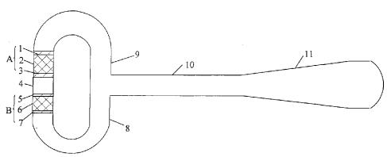

1、一种行驻波型声场的热驱动热声制冷机装置，包括：依次相连的声功反馈管、发动机室温端冷却器、发动机热声回热器、发动机加热器、热缓冲管、制冷机室温端冷却器、制冷机热声回热器、制冷机冷端换热器和声功回收管组成的声波环路，和与所述声波环路中的声功反馈管和声功回收管同时相连通的谐振直管，所述谐振直管另一端与谐振腔相连通构成谐振支路；所述发动机室温端冷却器、发动机热声回热器和发动机加热器构成一热声发动机；所述制冷机室温端冷却器、制冷机热声回热器和制冷机冷端换热器构成一热声制冷机部分；其特征在于：所述热声发动机和热声制冷机均位于声波环路内，并在声波环路上耦合一个谐振支路；所述热声发动机的发动机加热器和热声制冷机的制冷机室温端冷却器通过所述热缓冲管相连通。

2、按权利要求书1所述的行驻波型声场的热驱动热声制冷机装置，其特征在于，还包括连通于所述的声波环路中的声功反馈管和发动机室温端冷却器之间管路上的内装水平放置的弹性膜的椭圆形容腔。

3、按权利要求书1或2所述的行驻波型声场的热驱动热声制冷机装置，其特征在于，还包括安装于所述热缓冲管中的不锈钢丝网。

4、按权利要求书1所述的行驻波型声场的热驱动热声制冷机装置，其特征在于，还包括连通于所述的声波环路中的声功反馈管和发动机室温端冷却器之间管路上的容性管。

5、按权利要求书1或4所述的行驻波型声场的热驱动热声制冷机装置，其特征在于，还包括安装于所述热缓冲管中的喷射泵。

6、按权利要求书1所述的热驱动的行驻波型声场的热驱动热声制冷机装置，其特征在于，所述的弹性膜为金属弹性膜或有机弹性膜；所述的有机弹性膜为硅胶、橡胶、或聚酯塑料制作的弹性膜片；所述的金属弹性膜为弹簧钢、铍青铜或不锈钢制作的弹性膜片。

## 一种行驻波型声场的热驱动热声制冷机装置

## 技术领域

本发明涉及一种制冷机装置，特别涉及一种行驻波型声场的热驱动热声制冷机装置。

## 背景技术

热声发动机利用热声效应将热能转化为声能，产生的声能可以用来驱动脉管制冷机或其它形式的热声制冷机，二者的结合称为热声驱动的制冷系统。它具有三个主要优点：首先，该系统没有机械运动部件，结构简单、制造成本低、可靠性高；其次，工作介质为环境友好气体；第三，该系统直接以热能作为驱动源，可望应用于热能资源丰富而缺电的场合，特别是在边远地区及海上油田天然气液化等方面具有广的应用前景。

1989年，Wheatley等人设计了第一台驻波型热驱动热声制冷机。随后的1997年，Hof1er等人在此基础上做了改进，在25℃的温降条件下，将驻波热声热机总效率（制冷机的制冷量比发动机输入热量）提高到15%。1979年，Ceperley最早提出，声行波通过回热器时，所经历的热力学循环类似于斯特林循环，可以对声功进行放大。但是Ceperley所研制的实验样机并没有能够将声功放大。其主要原因是，回热器所处的声场的位置，声阻抗太小，气体微团振荡的速度幅度过大，导致粘性耗散太大。其次，沿环路的直流也是导致效率低下的原因之一。其后，于1999年，Backhaus和Swift通过在声波环路上引入一个分支谐振管，建立了一种新型的热声发动机的形式，称之为斯特林型热声发动机。这种新型的热声发动机利用谐振管的声阻抗特性，提高声波环路内回热器部分的声阻抗，从而减小了回热器部分气体微团振荡速度，达到了减小粘性耗散的作用，增加了实际输出声功的能力，提高了实际热功转换效率，其热效率高达0.30，完全可以同内燃机（0.25～0.40）和传统的活塞式斯特林发动机（0.20～0.38）相媲美。此后，使用斯特林型热声发动机结构研究的热声热机引起了各国科研工作者和工业界的关注。2002年，日本Ueda研究小组在斯特林型热声发动机的声波环路中加入热声制冷机部分，加入的热声制冷机部分位于热声发动机部分室温端换热器附近，即发动机室温端冷却器和制冷机冷端换热器通过热缓冲管连通。虽然该发动机部分和制冷机部分位于压力波腹点附近，但发动机部分的室温端靠近压力波腹点，热声热机中行驻波热声效应方向相反，因此，该热声热机总效率较低。

早期热声理论分析指出，在热声系统中使用工作气体的本征特性，可以实现驻波型热声效应（包括热能转换为声能，以及声能实现泵热），这是一种理论上不可逆的驻波型热声转换机制（工作气体的压力波与振荡速度间的相角 $\varphi = 9 0 ^ { \circ }$ ，回热器中工作流体通道的水力半径需要大于穿透层深度)。随着研究的深入，一种理论上可逆的行波型热声转换机制被提出（工作气体的压力波与振荡速度间的相角 $\varphi = 0 ^ { \circ }$ ，回热器中工作流体通道的尺寸需要远小于穿透层深度，理论上是越小越好)，形成了新的行波型热声系统。热声系统的发展是沿着从不可逆循环向可逆循环发展，实际的热声系统从驻波系统向行波系统发展，从而提高热声热机的效率。但是，实际运行的热声热机系统中无法避免工作气体在运行过程中的粘性耗散因素。例如，纯行波声场条件，理论上需要将主要热声转换元件回热器内部用于工作气体振荡的通道尺寸无限制减小，造成的结果是：可以实现高效的热声转换，但是其自身内部消耗太多，实际输出的声功将会减小，导致实际的热声转换效果差。

## 发明内容

本发明的目的在于提供一种行驻波型声场的热驱动热声制冷机装置，即根据实际热声系统的热声转换作用和耗散的情况，改变传统的驻波型热声热机和行波型热声热机的设计理念，并结合两者的热声转换机理发明一个热驱动热声制冷机装置，可提高热机的实际效率，使系统结构紧凑化、简单化、降低制冷温度、增加制冷量。

## 本发明的技术方案如下：

本发明提供的行驻波型声场的热驱动热声制冷机装置，包括：依次相连的声功反馈管、发动机室温端冷却器、发动机热声回热器、发动机加热器、热缓冲管、制冷机室温端冷却器、制冷机热声回热器、制冷机冷端换热器和声功回收管组成的声波环路，和与所述声波环路中的声功反馈管和声功回收管同时相连通的谐振直管，所述谐振直管另一端与谐振腔相连通构成谐振支路；所述发动机室温端冷却器、发动机热声回热器和发动机加热器构成一热声发动机；所述制冷机室温端冷却器、制冷机热声回热器和制冷机冷端换热器构成一热声制冷机部分；其特征在于：所述热声发动机和热声制冷机均位于声波环路内，并在声波环路上耦合一个谐振支路；所述热声发动机的发动机加热器和热声制冷机的制冷机室温端冷却器通过所述热缓冲管相连通。

本发明的行驻波型声场的热驱动热声制冷机装置，还包括连通于所述的声波环路中的声功反馈管和发动机室温端冷却器之间管路上的内装水平放置的弹性膜的椭圆形容腔。

本发明的行驻波型声场的热驱动热声制冷机装置，还可进一步包括连通于所述的声波环路中的声功反馈管和发动机室温端冷却器之间管路上的内装水平放置的弹性膜的椭圆形容腔，以及安装于所述热缓冲管中的不锈钢丝网。

本发明的行驻波型声场的热驱动热声制冷机装置，还包括连通于所述的声波环路中的声功反馈管和发动机室温端冷却器之间管路上的容性管。

本发明的行驻波型声场的热驱动热声制冷机装置，还可进一步包括连通于所述的声波环路中的声功反馈管和发动机室温端冷却器之间管路上的容性管，以及安装于所述热缓冲管中的喷射泵。

所述的弹性膜为金属弹性膜或有机弹性膜；所述的有机弹性膜为硅胶、橡胶、或聚酯塑料制作的弹性膜片；所述的金属弹性膜为弹簧钢、铍青铜或不锈钢制作的弹性膜片。

本发明的行驻波型声场的热驱动热声制冷机装置，根据实际热声系统的热声转换作用和耗散的情况，改变传统的驻波型热声热机和行波型热声热机的设计理念，并结合两者的热声转换机理发明的一个热驱动热声制冷机装置。并综合利用驻波热声效应与行波热声效应，通过对热声热机各元件合理的几何布局和设计，使热驱动热声制冷机的热声发动机和热声制冷机核心元件段工作于行驻波相位区（-85°～-20°或20°～85°)，并且核心元件段位于压力波腹附近，如图5所示。其中，热声发动机回热器中工作气体的压力波动相位落后于工作气体速度波动的相位(压力波与速度波的相位差在-85°～-20°之间)，回热器的高温端靠近压力波腹，这样回热器中声波的行波成分和驻波成分产生的热声效应均是热致声效应；在热声制冷机回热器中，工作流体压力波动的相位超前于速度波动的相位（压力波与速度波的相位差在85°～20°之间)，回热器室温端靠近压力波腹，这样声场的行波成分和驻波成分产生的热声效应均是泵热效应。这种行驻波型热声发动机驱动的热声制冷机装置综合利用了热声转换的两种机制，提高了实际热机的效率，使系统的结构紧凑化、简单化、降低制冷温度、增加制冷量，从而提供一种高效率的热声驱动制冷系统。

本发明的行驻波型声场的热驱动热声制冷机装置，从原理上实现行驻波型热驱动热声制冷机的优化设计。

根据波的分解定理，声波可以分解为驻波成分和行波成分；对于热声系统来说，热声效应可以是驻波热声效应与行波热声效应的叠加；下面分别讨论驻波与行波的热声效应：

如图2所示的驻波声场分析中回热器位置示意图中，设向右为X正方向，回热器位于压力波腹左侧，回热器中压流相位差为 $\varphi = - 9 0 ^ { \circ }$ ，热流和声功增益表达式为：

$$
\dot { \zeta _ { 2 } } = - \frac { 1 } { 4 } \Pi \delta _ { k } T _ { m } / { } ^ { 3 } p _ { 1 } ^ { s } u _ { 1 } ^ { s } \mid \Gamma - 1 \mid\tag{1}
$$

$$
\dot { W } _ { 2 } = \frac { 1 } { 4 } \Pi \hat { \mathcal { O } } _ { k } \triangle \gamma \frac { T _ { m } \beta ^ { 2 } \omega } { \rho _ { m } c _ { p } } \{ { P _ { 1 } ^ { s } } \} ^ { 2 } \{ \mid \Gamma - 1 \}\tag{2}
$$

其中， $\Gamma = \nabla T _ { _ m } / T _ { c r t }$ ，该式中其他参数含义见参考文献【1】（G. W. Swift.  
Thermoacoustic engines. J. Acoust. Soc. Am., 1988, 84:1145 -1180. ).

由式（1）和（2）可知，热流和声功增益均正比于(Γ-1)。当 $\nabla T _ { m } = \nabla T _ { c r t }$ (Γ-1)=0，回热器中热流量为零，声功增益值为零。当 $\nabla T _ { m } > \nabla T _ { c r / \ell }$ $\left( \Gamma - 1 \right) > 0$ 回热器中热流从压力腹点流出，从高温端流向低温端；声功增益为正值，声功增大。当 $\nabla T _ { m } < \nabla T _ { c r / \ell }$ ，(Γ-1)<0，回热器中热流流向压力腹点；此时声功增益值为负，声功减小。

因此，对于纯驻波热声热机，高温端靠近压力波腹，且温度梯度大于临界温度梯度时，热流从压力波腹流出，热能转化成声能。当温度梯度小于临界温度梯度时，热流流向压力波腹点，声能转化成热能。此时，若高温端靠近压力波腹时，回热器吸收声功将热流从低温端泵送到高温端；若低温端靠近压力波腹，回热器吸收声功，热流从高温端流向低温端，即不能实现热致声作用也不能实现声制冷作用。因此，在驻波声场中，发动机要实现热致声效应，发动机回热器合理布置如图3a所示；制冷机要实现泵热效应，制冷机回热器合理布置如图3b所示。

行波热声发动机，声功流从低温端流向高温端，实现热致声效应。对于行波热声制冷机，声功流从高温端流向低温端，回热器吸收声功并将热量从低温端泵送到高温端，实现泵热效应。因此，在行波声场中，要实现热致声效应或泵热效应，发动机回热器和制冷机回热器合理布置如图4所示。

因此，对于行驻波热声热机，需要合理的布置回热器在声场中的位置，使回热器中行波成分和驻波成分的热声效应相互加强，提高热声热机总效率。热声发动机回热器高温端靠近压力波腹，声功从发动机低温端流向高温端，使声场中的行波成分和驻波成分在热声发动机回热器中均是产生热致声效应；此时，热声发动机回热器中的工作气体的压力波动相位落后于工作气体速度波动的相位。热声制冷机室温端靠近压力波腹，声功从制冷机回热器室温端流向低温端，使回热器中行波成分和驻波成分均是产生声致冷效应；此时，热声制冷机回热器中的工作气体的压力波动相位超前于工作气体速度波动的相位。

本发明的行驻波型声场的热驱动热声制冷机装置，声波环路内置热声发动机由发动机室温端冷却器、发动机热声回热器和发动机加热器组成和热声制冷机由制冷机室温端冷却器、制冷机热声回热器和制冷机冷端换热器组成，并通过在声波环路上耦合由谐振直管和谐振腔组成的谐振支路的声阻抗特性，提高声波环路内回热器部分的声阻抗，从而减小了发动机热声回热器和制冷机热声回热器的气体微团振荡速度，达到了减小粘性耗散的作用，从而提高实际热功转换效率。

本发明的行驻波型声场的热驱动热声制冷机装置，将发动机热声回热器和制冷机热声回热器位于声波环路中，并且发动机热声回热器和制冷机热声回热器工作于行驻波相位区为-85°～-20°或20°～85°。

本发明的行驻波型声场的热驱动热声制冷机装置，将热声发动机位于压力波腹附近，发动机热声回热器的高温端靠近压力波腹，声功从发动机热声回热器的室温端流向高温端，即发动机热声回热器中工作气体的压力波动相位落后于工作气体速度波动的相位压力波与速度波的相位差在-85°～-20°之间；对于所述热声发动机部分，回热器中声波的行波成分和驻波成分产生的热声效应均是热致声效应，使发动机效率得到提高。

本发明的行驻波型声场的热驱动热声制冷机装置，将热声制冷机位于压力波腹附近，制冷机热声回热器的室温端靠近压力波腹，声功从制冷机回热器的室温端流向低温端，即制冷机热声回热器中的工作气体的压力波动相位超前于工作气体速度波动的相位压力波与速度波的相位差在20°～85°之间；对于所述制冷机部分，其回热器中声波的行波成分和驻波成分产生的热声效应均是泵热效应，使热声制冷机效率得到提高。

本发明的行驻波型声场的热驱动热声制冷机装置，使发动机产生的声功流的直接进入制冷机被用来制冷。

本发明的行驻波型声场的热驱动热声制冷机装置，从热声制冷机出来的声功一部分由声功反馈管反馈给发动机热声回热器，形成一个贯穿整个热声回热器的声功流行波；一部分进入由谐振管直路和谐振腔构成的谐振支路，调节声波环路内回热器部分的声阻抗，控制热声热机工作频率和稳定整个系统的工作状况。

本发明的行驻波型声场的热驱动热声制冷机装置，在声波环路中使用容腔或容性管，调整声波环路中的压流相位分布。

本发明的行驻波型声场的热驱动热声制冷机装置，在声波环路内使用弹性膜或喷射泵抑制直流效应；其弹性膜使用长寿命的弹性金属膜为金属弹性膜或有机弹性膜；所述的有机弹性膜为硅胶、橡胶、或聚酯塑料制作的弹性膜片；所述的金属弹性膜为弹簧钢、铍青铜或不锈钢制作的弹性膜片。

本发明的行驻波型声场的热驱动热声制冷机装置，在热缓冲管中使用不锈钢丝网或喷射泵可防止发动机加热器的辐射漏热，并控制制冷机室温端冷却器的温度。

本发明的行驻波型声场的热驱动热声制冷机装置，工作媒质可以使用氦气、氮气或二氧化碳等单一的工作气体，也可以使用它们的混合气体。

本发明的行驻波型声场的热驱动热声制冷机装置与现有技术相比，其关键技术在于将热声发动机和热声制冷机均放置在声波环路内，并在声波环路上耦合一个谐振支路；热声发动机的发动机加热器和热声制冷机的制冷机室温端冷却器通过所述热缓冲管相连通，使发动机产生的声功流的直接进入制冷机被用来制冷；本发明的行驻波型声场的热驱动热声制冷机装置使发动机热声回热器中的工作气体的压力波动相位落后于工作气体速度波动的相位(压力波与速度波的相位差在- $8 5 ^ { \circ } \ \sim \ - 2 0 ^ { \circ }$ 之间)，回热器的高温端靠近压力波腹，这样回热器中声波的行波成分和驻波成分发动机热声回热器中产生的热声效应均是热致声效应；同时使制冷机热声回热器中，工作流体压力波动的相位超前于速度波动的相位（压力波与速度波的相位差在 $2 0 ^ { \circ } \sim \ 8 5$ °之间)，回热器室温端靠近压力波腹，这样声场的行波成分和驻波成分在制冷机热声回热器中产生的热声效应均是泵热效应。

本发明的行驻波型声场的热驱动热声制冷机装置具备如下优点：

本发明的行驻波型热声发动机驱动的热声制冷机装置综合利用了热声转换的两种机制，使声波的行波成分和驻波成分在发动机热声回热器中产生的热声效应均是热致声效应，在制冷机热声回热器中产生的热声效应均是泵热效应；同时发动机产生的声功流直接进入制冷机被用来制冷，从而提高热机的实际效率，使系统结构紧凑化、简单化、降低制冷温度、增加制冷量。

## 附图说明

图1为本发明的行驻波型声场的热驱动热声制冷机装置的结构示意图；

图2为驻波声场分析中回热器位置示意图；

图3为驻波声场中发动机热声回热器和制冷机热声回热器合理布置示意图；

图4为行波声场中发动机热声回热器和制冷机热声回热器合理布置示意图；

图5为行驻波混合声场中发动机热声回热器和制冷机热声回热器合理布置示意图；

图6为本发明实施例1结构示意图；

图7为本发明实施例2结构示意图；

图8为本发明实施例3结构示意图；

图9为本发明实施例4结构示意图。

## 具体实施方式

下面结合附图和实施例进一步描述本发明：

## 实施例1

本实施例的结构如图6所示，它包括依次相连的声功反馈管9、容腔12、弹性膜13、发动机室温端冷却器1、发动机热声回热器2、发动机加热器3、热缓冲管4、制冷机室温端冷却器5、制冷机热声回热器6、制冷机冷端换热器7和声功回收管8组成的声波环路，和与所述声波环路中的声功反馈管9和声功回收管8同时相连通的谐振直管10，所述谐振直管10另一端与谐振腔11相连通构成谐振支路；其中发动机室温端冷却器1、发动机热声回热器2和、发动机加热器3组成的热声发动机A；制冷机室温端冷却器5、制冷机热声回热器6和制冷机冷端换热器7组成的热声制冷机B，并都位于声波环路内，而且发动机加热器3和制冷机室温端冷却器5通过热缓冲管4相连通接。

本实施例中，使用容腔12调整行波相位区长度和阻抗，使发动机热声回热器2和制冷机热声回热器6工作于高阻抗行驻波相位区——-85°～-20。或20°～85°。

本实施例，在声波环路内使用弹性膜13抑制直流效应，弹性膜13选用弹簧钢制作的弹性膜。

## 实施例2

本实施例的结构如图7所示，它包括依次相连的声功反馈管9、容腔12、弹性膜13、发动机室温端冷却器1、发动机热声回热器2、发动机加热器3、热缓冲管4、制冷机室温端冷却器5、制冷机热声回热器6、制冷机冷端换热器7和声功回收管8组成的声波环路，和与所述声波环路中的声功反馈管9和声功回收管8同时相连通的谐振直管10，所述谐振直管10另一端与谐振腔11相连通构成谐振支路；所述发动机室温端冷却器1、发动机热声回热器2和发动机加热器3组成的热声发动机部分A；所述制冷机室温端冷却器5、制冷机热声回热器6和制冷机冷端换热器7组成的热声制冷机B，两者都位于声波环路内，并且发动机加热器3和制冷机室温端冷却器5通过热缓冲管4相连通接。

本实施例中，使用容腔12调整行波相位区长度和阻抗，使发动机热声回热器2和制冷机热声回热器6工作于高阻抗行驻波相位区为－85°～-20°或20°～85°。

本实施例，在声波环路内使用弹性膜13抑制直流效应，弹性膜13选用有机材料硅胶制作的弹性膜。

本实施例，使用防辐射丝网14防止发动机加热器3的辐射漏热，以及控制制冷机室温端冷却器5在室温范围内。

## 实施例3

本实施例的结构如图8所示，它包括依次相连的声功反馈管9、容性管15、发动机室温端冷却器1、发动机热声回热器2、发动机加热器3、热缓冲管4、喷射泵16、制冷机室温端冷却器5、制冷机热声回热器6、制冷机冷端换热器7和声功回收管8组成的声波环路，和与所述声波环路中的声功反馈管9和声功回收管8同时相连通的谐振直管10，所述谐振直管10另一端与谐振腔11相连通构成谐振支路；所述发动机室温端冷却器1、发动机热声回热器2和发动机加热器3组成的热声发动机A；所述制冷机室温端冷却器5、制冷机热声回热器6和制冷机冷端换热器7组成的热声制冷机B，且都位于声波环路内，并且发动机加热器3和制冷机室温端冷却器5通过热缓冲管4相连接。

本实施例中，使用容性管15调整行波相位区长度和阻抗，使发动机热声回热器2和制冷机热声回热器6工作于高阻抗行驻波相位区为-85°～-20。或 $2 0 ^ { \circ } \sim 8 5 ^ { \circ }$

本实施例，在热缓冲管4内使用喷射泵16抑制直流效应，并防止发动机加热器3的辐射漏热，以及控制制冷机室温端冷却器5在室温范围内。

## 实施例4

本实施例，采用图9所示的装置结构，即为一对实施例1、实施例2或实施例3的行驻波型声场的热驱动热声制冷机装置通过所述谐振腔11相连。

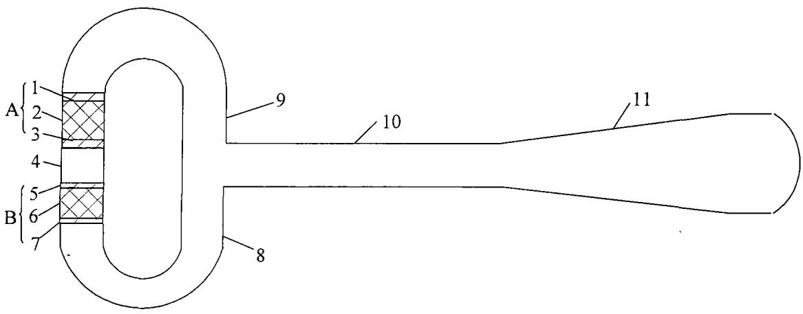  
图1

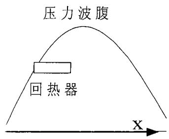  
图2

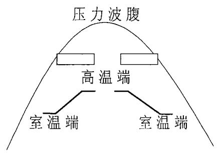  
图3a

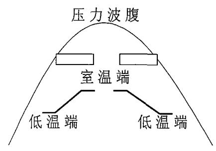  
图3b

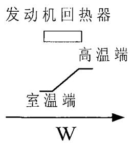  
图 4a

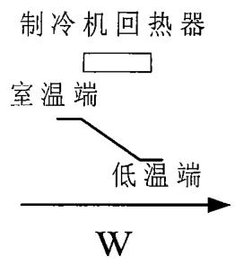  
图 4b

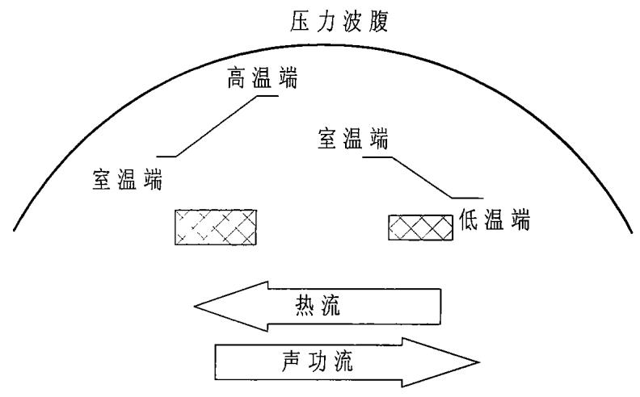  
图5

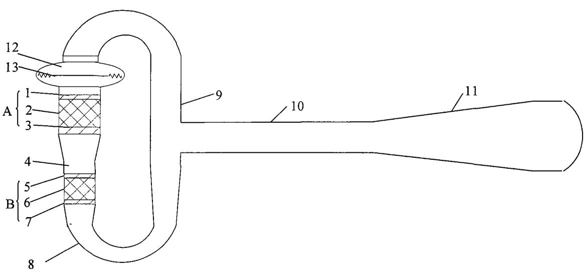  
图6

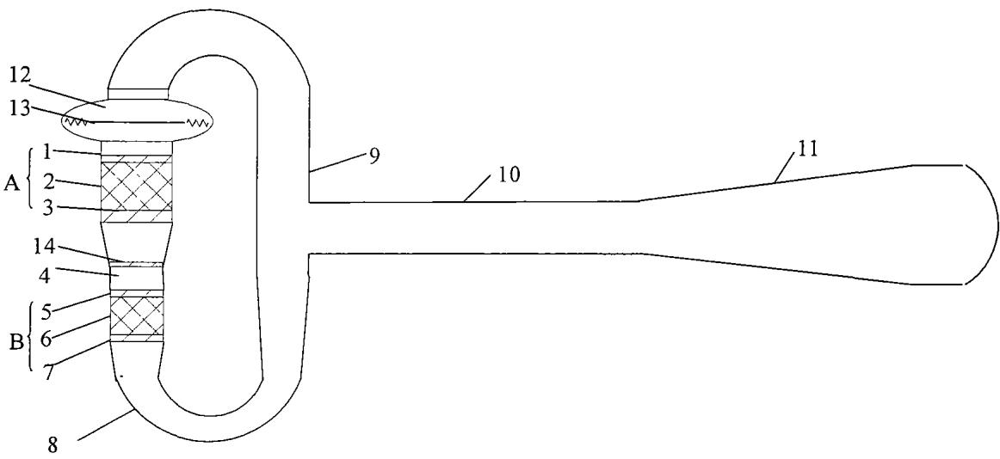

图7  
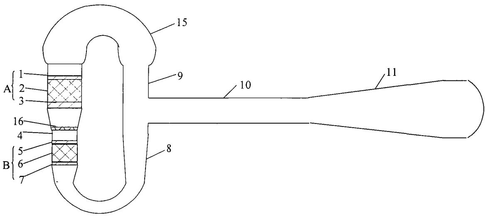  
图8

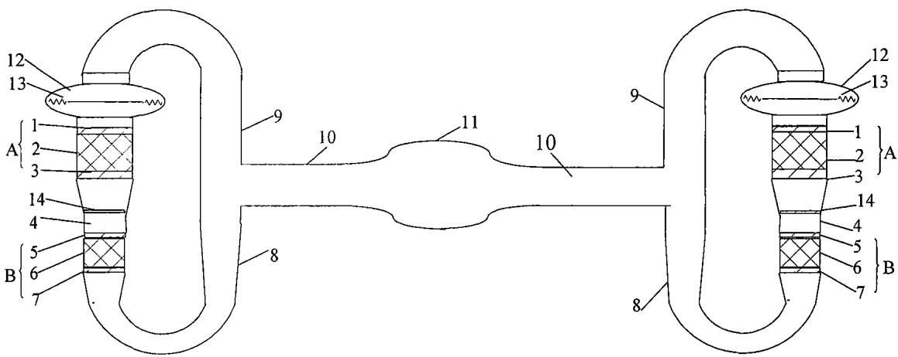  
图9