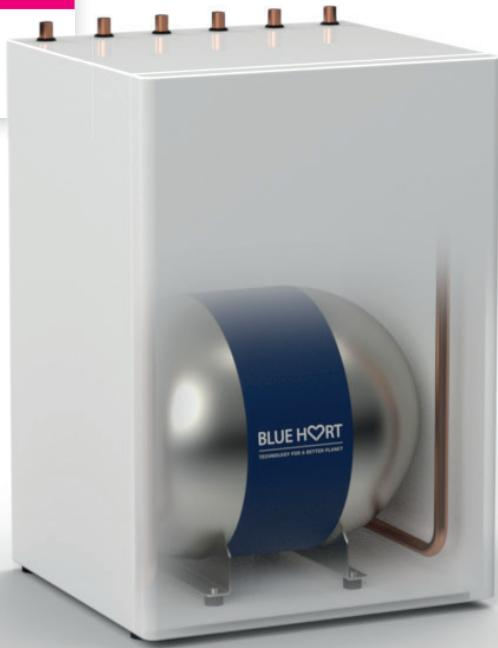
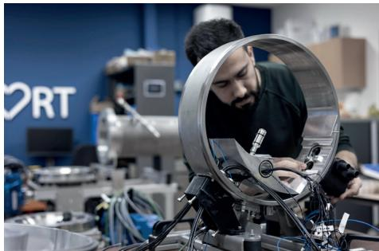
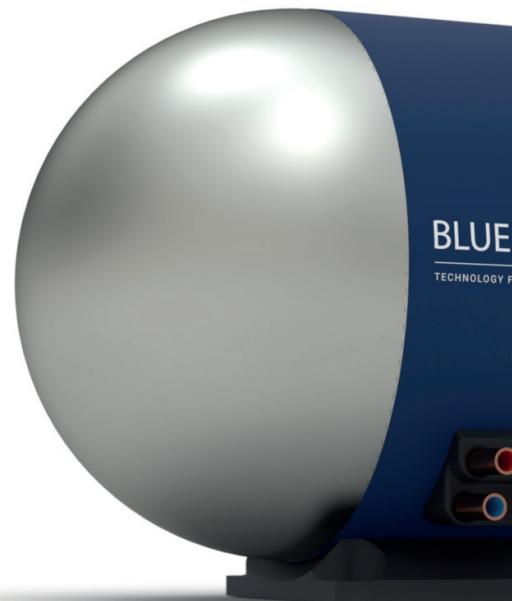
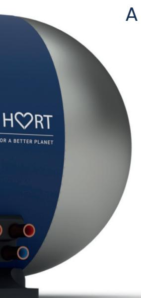
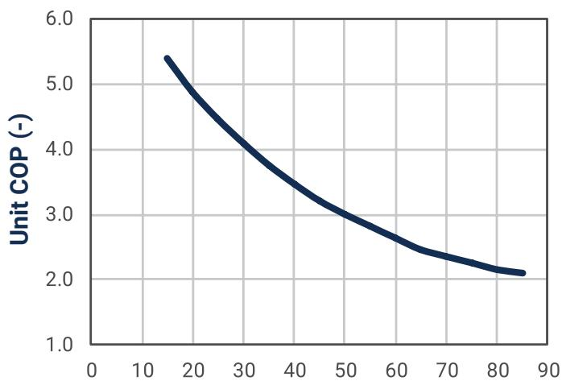
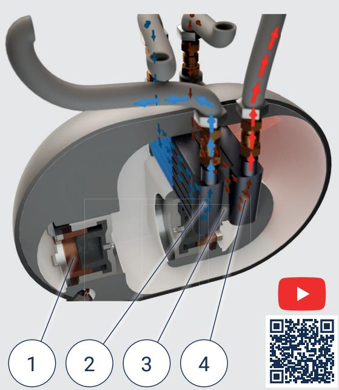
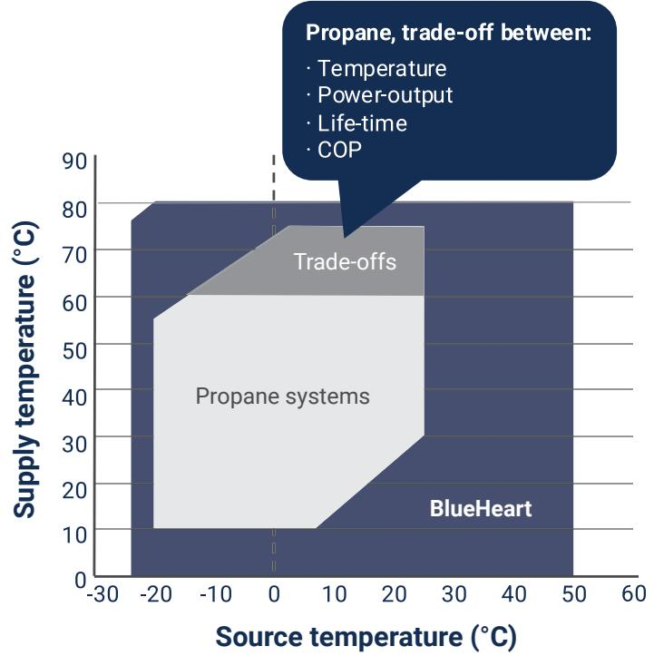
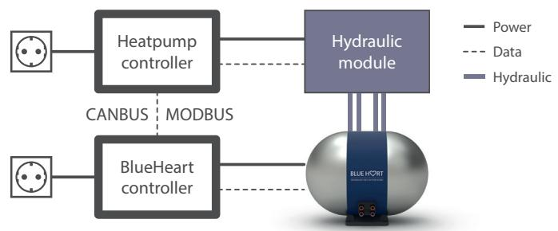
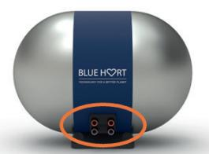
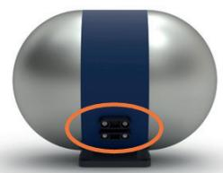

# Thermoacoustic Heat Pump Engine The industry's choice for 2027 and beyond.

PLUS DESIGN ISH 2025

Winner YOUNG INNOVATORS +

Safe: No refrigerants, non-flamable, GWP=0

Extraordinary wide temperature range

Instant performance, Immediate start/stop

Long lifetime & low maintenance

Compact

Silent

## Groundbreaking technology

Blue Heart Energy is a deep cleantech company which has developed and sells a thermoacoustic heat engine, named “BlueHeart", which radically improves performance of heating- and cooling applications.

BlueHeart is the core component for our clients. Systems are safe and can operate across a wide range of temperatures. The BlueHeart engine is a versatile solution for a large variety of applications without the need for HFC- or flammable refrigerants which make it a future proof solution.

## Industrial application by our clients

• Gas & Air treatment

• Precision temperature control for processes and equipment

• Explosive environments with ATEX, IECEx restrictions

• Capacities with stacked Blueheart units (up to 60 kW)

• Plus many other...

## Advantages for our clients and end-users

## High temperatures, enabling versatile applications

Wide operating window. Source -20°C to 40°C, Sink: 25°C to 80°C.

## Silent

Less than 35dB; similar to a modern fridge.

## Improved lifetime

Low maintenance and 20 years of lifetime.

## Easy to install

Simplified and fail-proof installation.

## Compact

With a footprint of only 55 x 55 cm.

## Multi-source

Can easily work with multiple sources. BlueHeart cools/heats liquid flows (water, brines, optional oils).

## How it works

BlueHeart's engine concentrates heat through sound waves inside a sealed and pressurized helium loop. Two linear drivers create pressure oscillations, expanding and compressing the gas at precise locations. This process absorbs and transfers energy efficiently, silently and across a wide temperature range.

1. Electric drive (generates pressure wave)   
2. Internal heat exchanger   
3. Regenerator   
4. Internal heat exchanger

  
Temperature lift, source-sink (°C)

## A wider operating envelope

BlueHeart operates across a wide temperature range efficiently.

This is what makes BlueHeart an award-winning and a versatile solution for a broad range of applications.

## Superb performance at high lifts

BlueHeart thermoacoustic engine delivers a consistent performance without conventional limitations found in vapor- compression based applications.

## Technical data [1]

<table><tr><td rowspan=1 colspan=1>Heating capacity</td><td rowspan=1 colspan=1>1-6 kW + stackable up to 60 kW</td></tr><tr><td rowspan=1 colspan=1>Maximum temperature</td><td rowspan=1 colspan=1>80℃</td></tr><tr><td rowspan=1 colspan=1>Source brine(s)</td><td rowspan=1 colspan=1>Water / Detoxified Ethylene Glycol / Propylene Glycol / Optional oils</td></tr><tr><td rowspan=1 colspan=1>Working medium</td><td rowspan=1 colspan=1>Helium</td></tr><tr><td rowspan=1 colspan=1>Nominal pressure BH unit</td><td rowspan=1 colspan=1>Up to 60 bar</td></tr><tr><td rowspan=1 colspan=1>Weight BH unit</td><td rowspan=1 colspan=1>60 kg</td></tr><tr><td rowspan=1 colspan=1>Place of installation</td><td rowspan=1 colspan=1>Inside / Outside</td></tr><tr><td rowspan=1 colspan=1>Installation orientation</td><td rowspan=1 colspan=1>Horizontal / Vertical</td></tr><tr><td rowspan=1 colspan=1>Footprint (L x W)</td><td rowspan=1 colspan=1>55x 55 cm</td></tr><tr><td rowspan=1 colspan=1>Communication</td><td rowspan=1 colspan=1>MODBUS, CANBUS</td></tr><tr><td rowspan=1 colspan=1>Energy class [2]</td><td rowspan=1 colspan=1>A++/A+++ (SCOP55/SCOP35)</td></tr></table>

[1] Specifications are based on current development and may be subject to change in the final market model.  
[2] This is the energy class attainable; actual energy label will depend on efficiency of OEM's source and sink systems.

Controller overview  
Connecting points  
  
HP Controller sends power request to BH Controller as % of max power  
BH Controller sets power target in BH Unit (voltage modulated)

  
2x Supply liquid connections (hot) 2x Source liquid connections (cold)

  
Power cable Data cable

## We invite you to learn together how BlueHeart can make your heating- and cooling application safe and sustainable!

BLUE HS2RT

TECHNOLOGY FOR A BETTER PLANET

Rijksstraatweg 27

1969 LB Heemskerk

The Netherlands

Email: sales@blueheartenergy.com

Tel: +31 624588316

www.blueheartenergy.com

