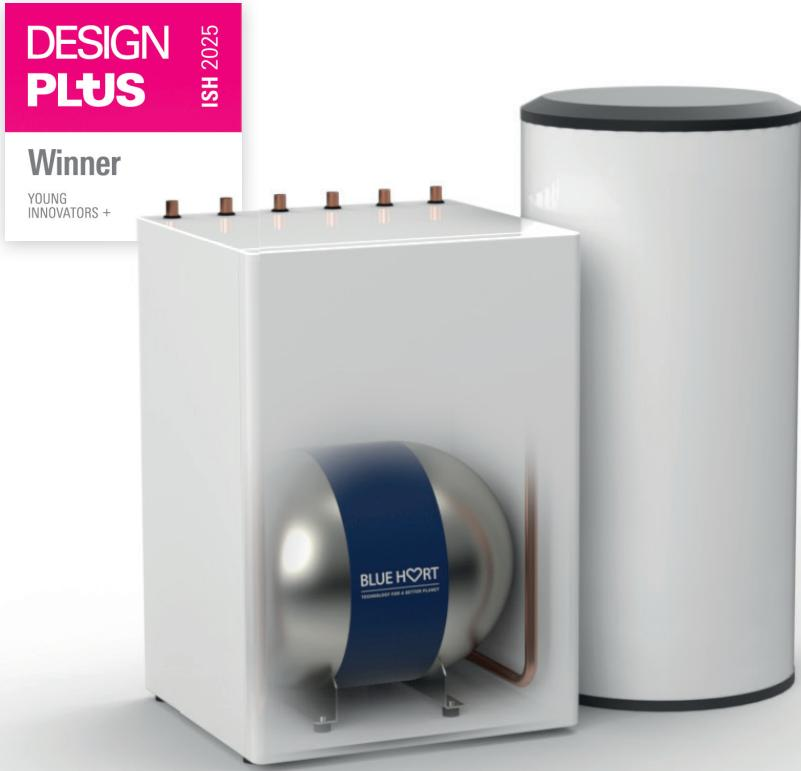
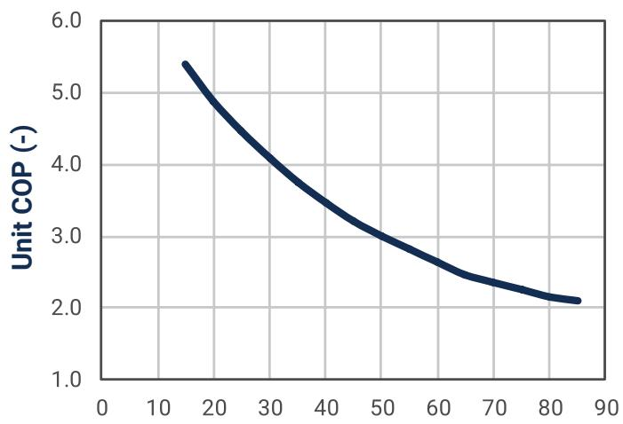
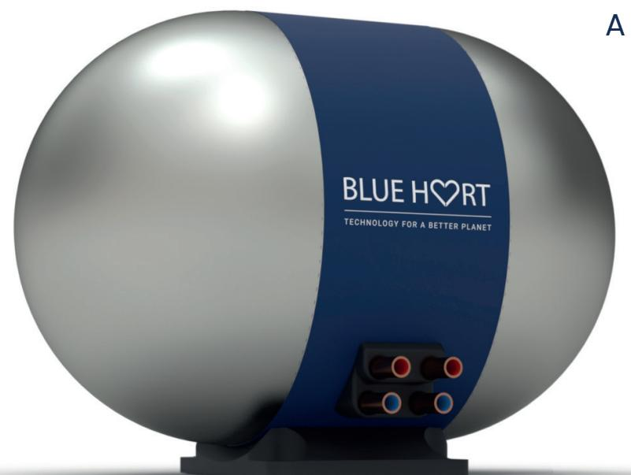
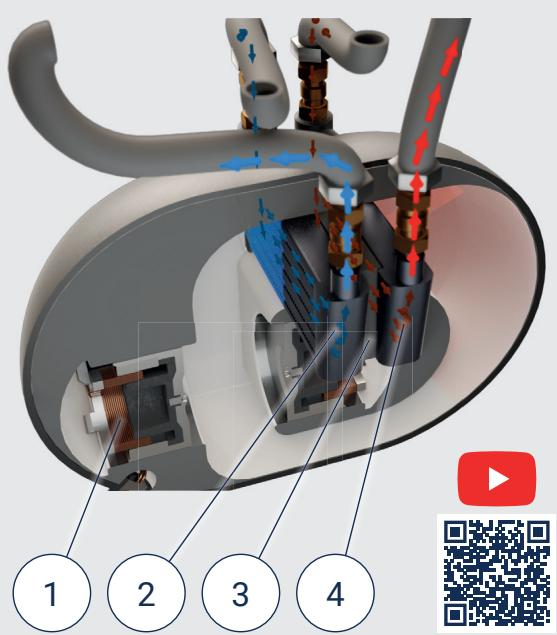
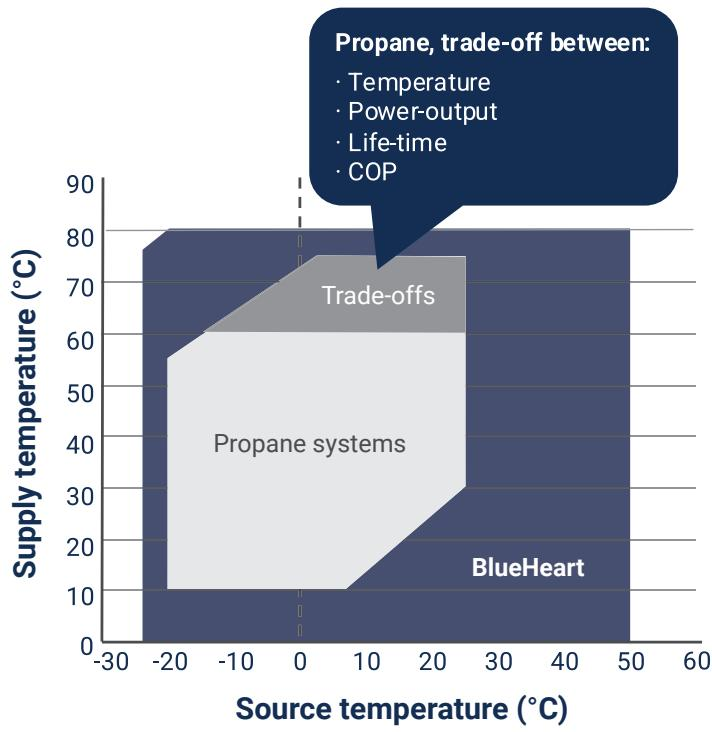
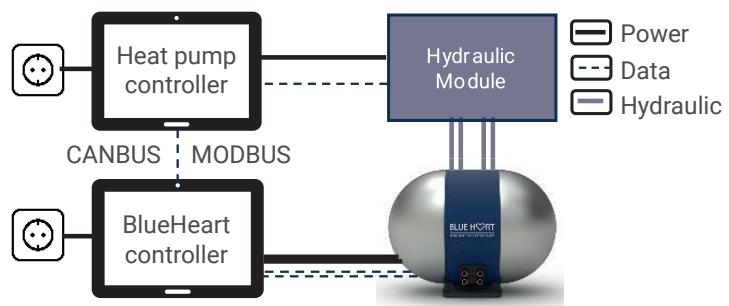
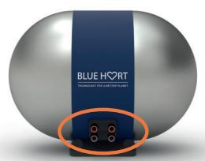
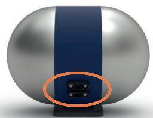

TECHNOLOGY FOR A BETTER PLANET

## Thermoacoustic Heat Pump Engine for residential space heating, air conditioning and industrial applications

Temperatures up to 80°C

Silent (<35dB)

Maintenance free & 20 years lifetime

Easy to install

Compact

Multi-source

## “A game changing solution for sustainable heating & cooling."

## Groundbreaking technology

Blue Heart Energy is a deep cleantech company which sells a thermoacoustic heat engine, named “BlueHeart", which radically improves performance of heating- and cooling applications.

The BlueHeart is the core component for our clients. Systems are silent and can operate across a wide range of temperatures. The BlueHeart engine is a versatile solution for a large variety of applications without the need for HFC- or flammable refrigerants which make it a future proof solution.

## Application by our clients

## Residential

## Industrial

• Space heating

• Air-drying / dehumidification

• Air conditioning

• Clean rooms

• Domestic hot water up to 80°C

• Central heating systems with stacked BlueHeart units (>60kW)

• Explosive environments with ATEX, IECEx restrictions

• Plus many other...

## Advantages for our clients and end-users

High temperatures, enabling versatile applications Suitable for both new and existing houses. Source -25°C to 40°C, Sink: 25°C to 80°C.

## Silent

Less than 35dB; similar to a modern fridge.

## Improved lifetime

Maintenance free and 20 years of lifetime.

## Easy to install

Simplified and fail-proof installation in every type of building.

## Compact

Fits into small spaces with a footprint of only 55cm x 55cm.   
The applications enable a reduction of the DHW auxiliary tank.

## Multi-source

Can easily work with multiple sources like air, ground, PVT, water and district heating.

## How it works

BlueHeart's engine concentrates heat through sound waves inside a sealed and pressurized helium loop. Two linear drivers create pressure oscillations, expanding and compressing the gas at precise locations. This process absorbs and transfers energy efficiently, silently and across a wide temperature range.

1. Electric drive (generates pressure wave)

2. Internal heat exchanger

3. Regenerator

4. Internal heat exchanger

  
Temperature lift, source-sink (°C)

## A wider operating envelope

BlueHeart operates across a wide temperature range efficiently.

This is what makes BlueHeart an award winning- and a versatile   
solution for both residential- and industrial applications.

## Superb performance at high lifts

BlueHeart thermoacoustic engine delivers a consistent performance without conventional limitations found in vapor- compression based applications.

## Technical data [1]

<table><tr><td rowspan=1 colspan=1>Energy class [2]</td><td rowspan=1 colspan=1>A++/A+++ (SC0P55/SC0P35)</td></tr><tr><td rowspan=1 colspan=1>Heating capacity</td><td rowspan=1 colspan=1>1-6 kW</td></tr><tr><td rowspan=1 colspan=1>Maximum temperature</td><td rowspan=1 colspan=1>80℃</td></tr><tr><td rowspan=1 colspan=1>Source compatibility</td><td rowspan=1 colspan=1>Air / PVT / Ground / Water / District Heating</td></tr><tr><td rowspan=1 colspan=1>Source brine(s)</td><td rowspan=1 colspan=1>Water / Detoxified Ethylene Glycol / Propylene Glycol</td></tr><tr><td rowspan=1 colspan=1>Supported applications</td><td rowspan=1 colspan=1>Space Heating / DHW / Cooling</td></tr><tr><td rowspan=1 colspan=1>Working medium</td><td rowspan=1 colspan=1>Helium</td></tr><tr><td rowspan=1 colspan=1>Nominal pressure</td><td rowspan=1 colspan=1>Up to 60 bar</td></tr><tr><td rowspan=1 colspan=1>Weight</td><td rowspan=1 colspan=1>60 kg</td></tr><tr><td rowspan=1 colspan=1>Place of installation</td><td rowspan=1 colspan=1>Inside / Outside</td></tr><tr><td rowspan=1 colspan=1>Installation orientation</td><td rowspan=1 colspan=1>Horizontal / Vertical</td></tr><tr><td rowspan=1 colspan=1>Footprint (L x W)</td><td rowspan=1 colspan=1>55x 55 cm</td></tr><tr><td rowspan=1 colspan=1>Communication</td><td rowspan=1 colspan=1>MODBUS, CANBUS</td></tr></table>

[1] Specifications are based on current development and may be subject to change in the final market model.  
[2] This is the energy class attainable; actual energy label will depend on efficiency of OEM's source and sink systems.

Controller overview  
Connecting points  
  
HP Controller sends power request to BH Controller as % of max power  
BH Controller sets power target in BH Unit (voltage modulated)

  
2x Supply connections (hot) 2x Source connections (cold)

  
2x Power cables 2x Data cables

## We invite you to contact us and discover how BlueHeart can make your heating and cooling application more sustainable!

BLUE HS2RT

TECHNOLOGY FOR A BETTER PLANET

Rijksstraatweg 27

1969 LB Heemskerk

The Netherlands

Email: sales@blueheartenergy.com

Tel: +31 624588316

www.blueheartenergy.com

