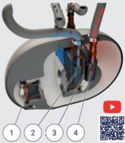

## How it works

BlueHeart's engine concentrates heat through sound waves inside a sealed and pressurized helium loop. Two linear drivers create pressure oscillations, expanding and compressing the gas at precise locations. This process absorbs and transfers energy efficiently, silently and across a wide temperature range.

1. Electric drive (generates pressure wave)   
2. Internal heat exchanger   
3. Regenerator   
4. Internal heat exchanger

