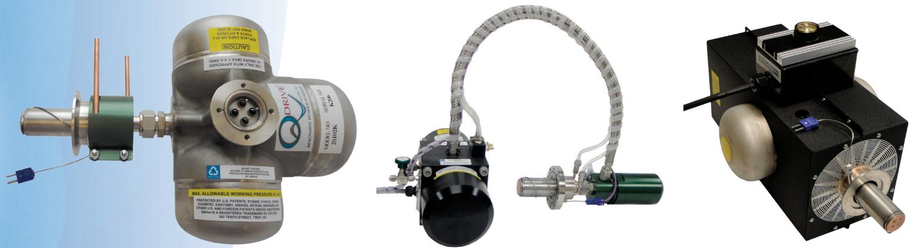
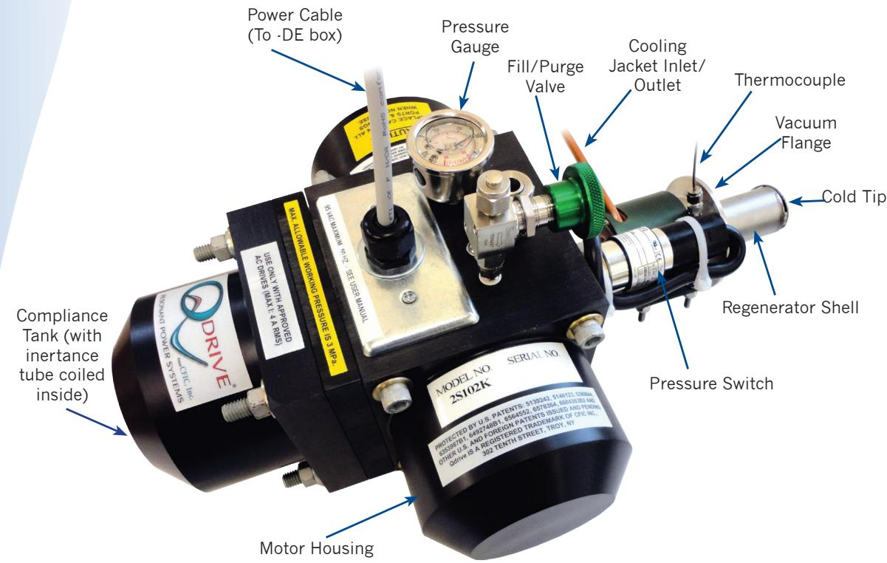
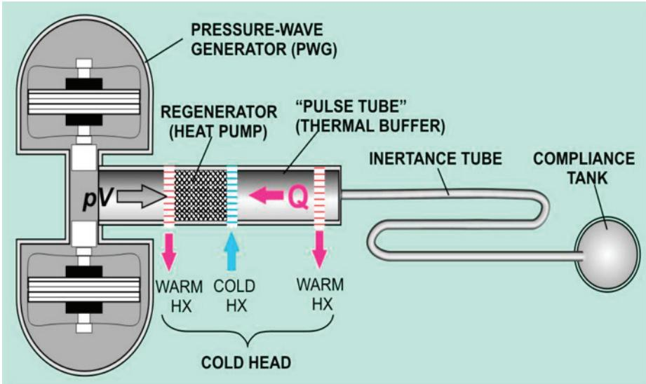
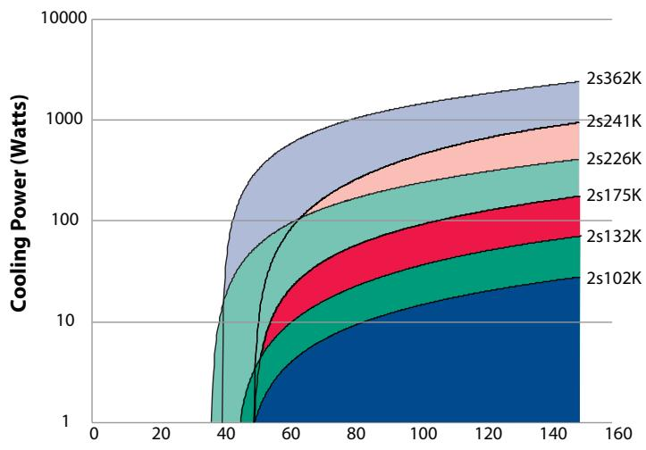
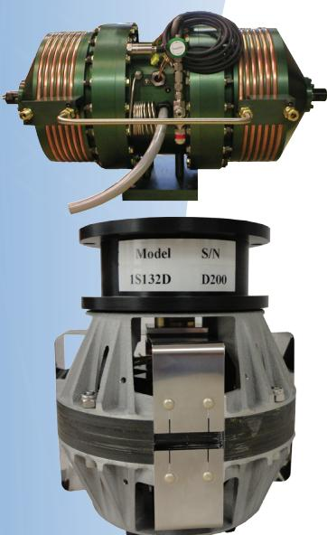

# The sound choice

Oil-Free, Low-Vibration, No-Maintenance Cryocoolers

# Durable, Dependable & Adaptable to Your Cooling Requirements

Qdrive manufactures low vibration, maintenance-free, highly reliable, acoustic Stirling (pulse tube) cryocoolers for applications in the 50K to 150K range, with watts to kilowatts of heat load. Each unit is driven by two renowned STARTM linear reciprocating motors with clearance seal pistons, providing wear free operation with no lubrication. The dual opposed motor/piston design in the pressure wave generator (PWG) is naturally balanced, and quiet. All units use inert helium gas as the working medium, making them 100% environmentally safe.

Qdrive's design is completely without cold moving parts or contact seals, eliminating maintenance required of most other cryocooler technologies. When mass at the cold point is of concern, Qdrive offers a remote head system (FAR), which also further lessens vibration. To reduce power consumption and increase versatility, only Qdrive cryocoolers can be modulated “on-the-fly" to match varying cooling load requirements. These advantages are accompanied by competitive pricing in both small and large quantities, making them ideal not only for laboratory use but also for large volume OEM applications.

  
2s102K Close Coupled Cryocooler

HTS Gas liquefaction Vacuum pumping Instrument cooling

## Applications:

Medical/Biological storage Freeze point analyzers Ultra-low refrigeration Material research

The base cryocooler unit consists of a pressure wave generator driven by patented STAR linear reciprocating motors and a compact, coaxial acoustic Stirling (pulse-tube) coldhead. The acoustic Stirling coldhead consists of a warm heat exchanger, a regenerator, a cold heat exchanger, a thermal buffer tube, a hot heat exchanger, an inertance tube, and compliance tank. The figure below shows an inline configuration for clarity, but the actual coldhead is "folded over" at the cold heat exchanger to create a salient cold zone.

## How it Works

1) Pressurized helium gas is cyclically compressed and expanded relative to the mean pressure (charge pressure) by the pistons of the PWG.

2) With each forward stroke of the pistons, some of the gas moves through the aftercooler, or warm heat exchanger, where heat is removed. The gas parcel continues through the regenerator, which precools it before reaching the cold heat exchanger.

3) As the gas moves toward the cold heat exchanger, gas in the acoustic network (thermal buffer tube, hot heat exchanger, reservoir) also moves in the same direction. Even as the driven gas stops advancing, when the pistons reach their upper limits, the network's gas continues moving, driven by its own inertia in the high-speed inertance tube. This acts like a virtual piston, moving away from the cold exchanger, which expands the gas in that area. As it expands, it gathers heat from the surroundings (the area or substance to be cooled).

4) The pistons begin withdrawing and helium then moves back through the regenerator and aftercooler. Still delayed by its inertia, the gas in the network later follows and the cycle with compression at the warm zone begins again.

5) The cryocooler motors and heat exchangers are cooled by local air, water, or an optional closed loop cooling system that consists of a reservoir, a pump, and a liquid-to-air heat exchanger.

  
Cold Head Temperature

<table><tr><td rowspan=1 colspan=1>Cooler Model</td><td rowspan=1 colspan=1>2s102K</td><td rowspan=1 colspan=1>2s132K</td><td rowspan=1 colspan=1>2s175K*</td><td rowspan=1 colspan=1>2s226K</td><td rowspan=1 colspan=1>2s241K</td><td rowspan=1 colspan=1>2s362K*</td></tr><tr><td rowspan=1 colspan=1>Capacity @ 77K (W)</td><td rowspan=1 colspan=1>6-8</td><td rowspan=1 colspan=1>17-20</td><td rowspan=1 colspan=1>50</td><td rowspan=1 colspan=1>140</td><td rowspan=1 colspan=1>175</td><td rowspan=1 colspan=1>800</td></tr><tr><td rowspan=1 colspan=1>Capacity @ 150K (W)</td><td rowspan=1 colspan=1>27</td><td rowspan=1 colspan=1>70</td><td rowspan=1 colspan=1>175</td><td rowspan=1 colspan=1>380</td><td rowspan=1 colspan=1>750</td><td rowspan=1 colspan=1>2,800</td></tr><tr><td rowspan=1 colspan=1>No load temperature (K)</td><td rowspan=1 colspan=1>50</td><td rowspan=1 colspan=1>45</td><td rowspan=1 colspan=1>50</td><td rowspan=1 colspan=1>37</td><td rowspan=1 colspan=1>50</td><td rowspan=1 colspan=1>40</td></tr><tr><td rowspan=1 colspan=1>Power consumption @ ratedcondition (W)</td><td rowspan=1 colspan=1>275</td><td rowspan=1 colspan=1>600</td><td rowspan=1 colspan=1>1,500</td><td rowspan=1 colspan=1>2,750</td><td rowspan=1 colspan=1>4,500</td><td rowspan=1 colspan=1>22,000</td></tr><tr><td rowspan=1 colspan=1>Electricalrequirements**</td><td rowspan=1 colspan=1>110Vac max.,1Φ,60Hz</td><td rowspan=1 colspan=1>110Vac max.,1Φ,60Hz</td><td rowspan=1 colspan=1>110Vac max.,1Φ,60Hz</td><td rowspan=1 colspan=1>208Vac max.,1Φ,60Hz</td><td rowspan=1 colspan=1>208Vac max.,1Φ,60Hz</td><td rowspan=1 colspan=1>380Vac max.,1Φ,60Hz</td></tr><tr><td rowspan=1 colspan=1>Maximum operating current (amps)</td><td rowspan=1 colspan=1>4.25</td><td rowspan=1 colspan=1>9</td><td rowspan=1 colspan=1>16</td><td rowspan=1 colspan=1>30</td><td rowspan=1 colspan=1>40</td><td rowspan=1 colspan=1>80</td></tr><tr><td rowspan=1 colspan=1>Ambient operating temperature</td><td rowspan=1 colspan=1>32°-90℉ (0°-32℃)</td><td rowspan=1 colspan=1>32°-90℉ (0°-32℃)</td><td rowspan=1 colspan=1>32°-90℉ (0°-32℃)</td><td rowspan=1 colspan=1>32°-90℉ (0°-32℃)</td><td rowspan=1 colspan=1>32°-90℉ (0°-32℃)</td><td rowspan=1 colspan=1>32°-90℉ (0°-32℃)</td></tr><tr><td rowspan=1 colspan=1>Maintenance Interval</td><td rowspan=1 colspan=1>None</td><td rowspan=1 colspan=1>None</td><td rowspan=1 colspan=1>None</td><td rowspan=1 colspan=1>None</td><td rowspan=1 colspan=1>None</td><td rowspan=1 colspan=1>None</td></tr><tr><td rowspan=1 colspan=1>Rejection method</td><td rowspan=1 colspan=1>H,O or Air</td><td rowspan=1 colspan=1>H,O or Air</td><td rowspan=1 colspan=1>H2O</td><td rowspan=1 colspan=1>H2O</td><td rowspan=1 colspan=1>H2O</td><td rowspan=1 colspan=1>H2O</td></tr><tr><td rowspan=1 colspan=1>Cooling flow rate (for water cooledunits)</td><td rowspan=1 colspan=1>1 liters/min</td><td rowspan=1 colspan=1>2 liters/min</td><td rowspan=1 colspan=1>4 liters/min</td><td rowspan=1 colspan=1>10 liters/min</td><td rowspan=1 colspan=1>12 liters/min</td><td rowspan=1 colspan=1>50 liters/min</td></tr></table>

All specification subject to change  
\* Units under development. Specifications estimated  
\*\* Nominal for standard unit. Custom voltage and frequency available

  
Top: Pressure Wave Generator Bottom: STAR™M Linear Reciprocating Motor

Qdrive not only provides complete cryocoolers, but also offers the reliable components they comprise. Engineers, researchers and OEM customers have developed systems using Qdrive's PWG's and patented STAR™M linear reciprocating motors because of their performance, unique wear-free design and virtually unlimited life.

For application support or to learn more about Qdrive's state-of-the-art products please contact us at 1-518-272-3565 or visit our website: www. qdrive.com. Let us help solve your cooling needs.

302 10th Street Troy, NY 12180 Ph 518-272-3565 Fax 518-272-3582 www.qdrive.com