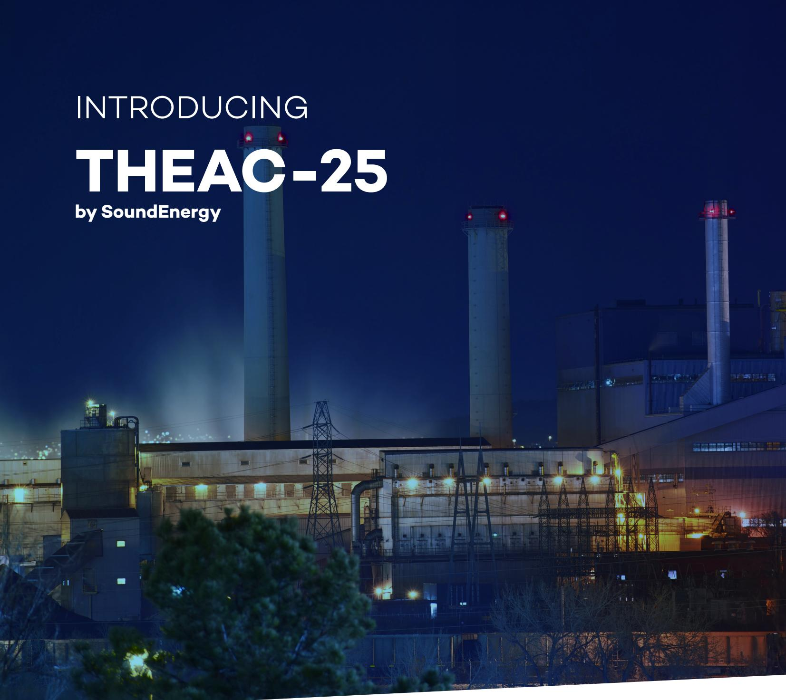
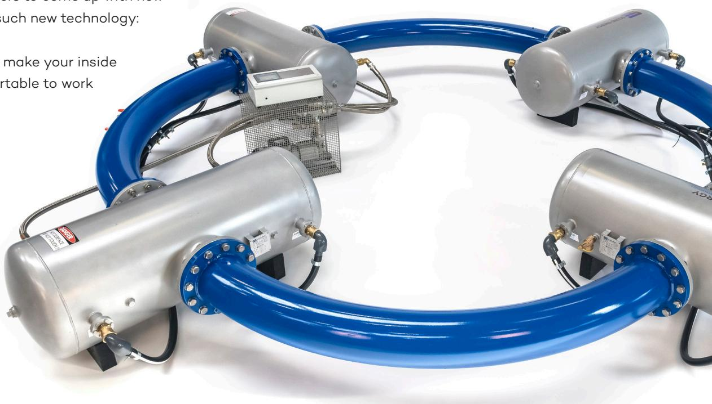
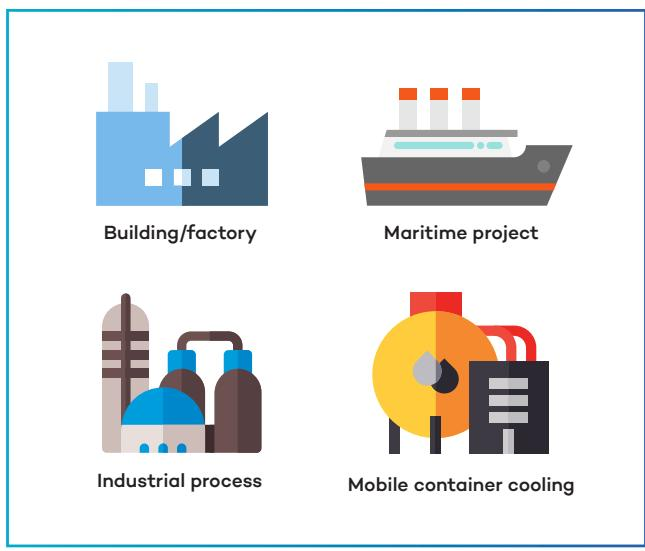
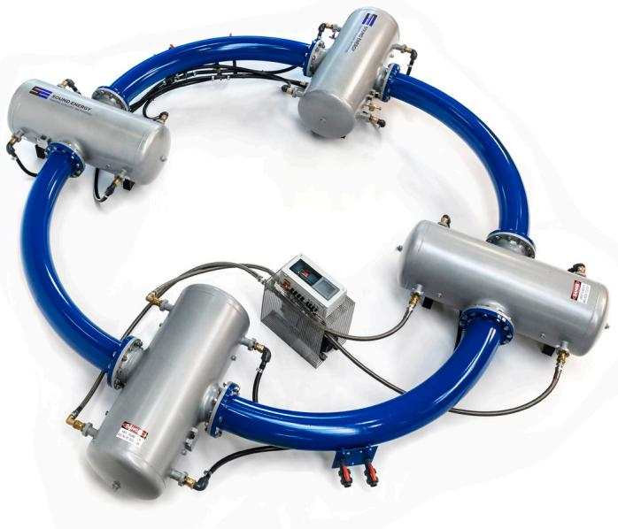
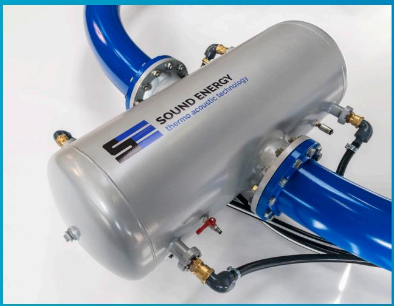

CONVERTWASTEHEATINTO COOLING Use the waste or solar heat to cool your building, process or factory

# THEAC-25 - THE SILENT ONE THERMO ACOUSTIC ENERGY CONVERTER

## Climate-friendly

We don't have to explain to you that the global demand for cooling is growing with expanding economies all around the world. And that at the same time we need to find a solution to lower our CO2 emission in order to save our planet. The world is looking at engineers to come up with new   
technology. This is such new technology:   
thermo acoustic.   
A sound solution to make your inside   
environment comfortable to work   
and live in.

## Worldwide up to 40% of national grid power is being used: for air-conditioning alone and still rising today.

## Sustainable cooling, without any toxic chemical fluids

Now the surplus of heat in your environment is probably wasted. Whether it is industrial produced heat or solar heat. And your cooling system presumably needs energy and toxic refrigerants. With thermo acoustic technology you will use the heat surplus to cool your building. You don't need any damaging fluids and your CO2 emission will be 100% zero. Let alone your energy costs which will reduce substantially as well.

## Easy fit cooling system

SoundEnergy developed the thermo acoustic energy converter THEAC-25. The Silent One. The product is designed specifically for locations or plants with a need for cooling at any cold temperature, and with solar or waste heat (> 160°C) available at the same time.

The THEAC-25 is easy to fit into the available space in stationary application, due to a flat construction. For example integrated in an array of solar collectors, or on the roof near a waste heat or flue gas exhaust.

# THEAC-25 - THE SILENT ONE THERMO ACOUSTIC ENERGY CONVERTER

## Reduce your energy costs

The THEAC-25 is suitable for sustainable cooling and can also be driven by a solar collector field. For factories, process plants, hospitals, hotels, schools, et cetera.

Use the heat of your industrial process for active cooling. It reduces your energy costs dramatically. Heat driven applications like food-bakeries, die-cast metal or metal hardening, hydrogen production, laundry drying, rubber and plastic production, prilling and many more.

Don't waste the heat of the sun radiation and diesel generators on your vessels. Use it to cool you dredging vessels, commercial vessels, military vessels, cruise ships and more.

Cool your mobile container off grid. The THEAC-23U can be built in a 2Oft. sea container equipped with concentrated solar collectors. Think of cooling fresh products, medical cold chain, or mission compound.

Join the world of next generation cooling! Save tonnes of CO2 emissions Save on your electricity bill Avoid future use of toxic refrigerants

## No maintenance, zero CO2, and exceptional lifespan

THEAC-25 is a waste or solar heat driven heat pump, or heat transformer. The internal compression, expansion and displacement of the internal working gas is performed not by pistons but by physical gas movement in an acoustic wave. For that reason, there are no mechanical moving parts in the THEAC-25, which results in an exceptional lifespan and lack of maintenance (OPEX==>zero).

An inert gas is used in the THEAC-25. Which has zero global warming potential (GWP=O).

## Performance

Because the concept involves two thermodynamic cycles, the performance of the THEAC-25 is proportional both with heat input temperature, ambient temperature and cold output temperature. For a temperature difference of 160°C between heat input temperature and ambient temperature, 25kW of cooling power is available at 12°C cold output terminals with a COP of 0,5.

## 6

By 2050, almost six billion air conditioners could eat 37% of global electricity, according to the International Energy Agency. That is because as India and China get richer -- and the planet gets hotter -- people around the globe are buying A/C units at levels approaching the United States. An environmental catastrophe is waiting to happen.

## www.forbes.com

John Koetsier, Contributor

• Maintenance free: no mechanical moving parts

• Electricity savings of up to 50 MWhrs per year

• No toxic refrigerants thus Global Warming Potential of zero

• Long expected lifecycle of 30 years

• Large reduction of Total Cost of Ownership

• Low noise: <70 dBa

About SoundEnergy SoundEnergy is established to develop and commercialize new technologies to reduce fossil energy consumption. Our main focus is SoundEnergy's breakthrough innovation: the THEAC-25. We are a modern company in sustainability, integrating environmental concern, scientific knowledge and business mentality.

After 30 years of research, thermo acoustics are proven technology. SoundEnergy products are designed and manufactured according to industrial standards using robust components and materials.

SoundEnergy B.V. Hengelosestraat 533 7521AG Enschede The Netherlands

General inquiries   
+31 [0] 53 82 00 814   
customerservice@soundenergy.nl