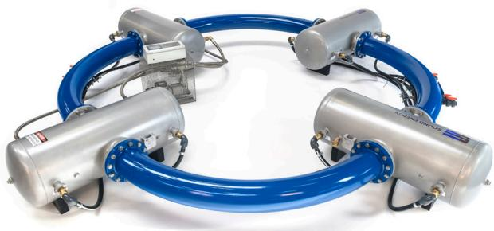
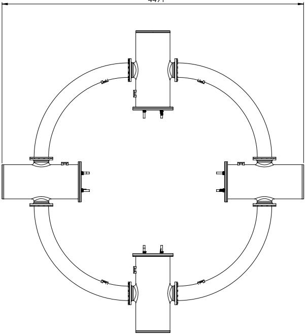
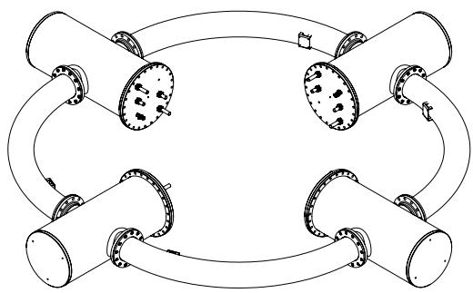
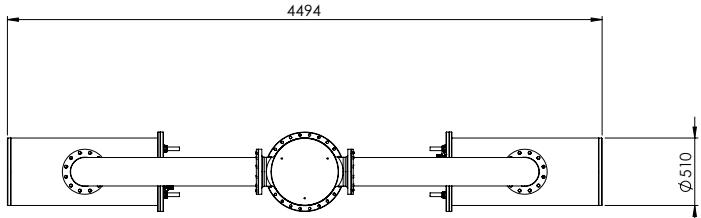
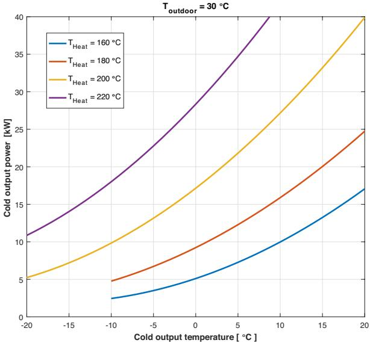

Generic system specifications
<table><tr><td rowspan=1 colspan=5>System type:                        Thermoacoustic heat pump with integrated thermoacoustic heat engine</td></tr><tr><td rowspan=1 colspan=1></td><td rowspan=1 colspan=1>typ.</td><td rowspan=1 colspan=1>max</td><td rowspan=1 colspan=1></td><td rowspan=1 colspan=1>Notes</td></tr><tr><td rowspan=1 colspan=1>Heat input temperature difference</td><td rowspan=1 colspan=1>160</td><td rowspan=1 colspan=1>300</td><td rowspan=1 colspan=1></td><td rowspan=1 colspan=1>Available between heat source and heat sink (outdoortemperature)</td></tr><tr><td rowspan=1 colspan=1>Power control range¹</td><td rowspan=1 colspan=1>0-100</td><td rowspan=1 colspan=1></td><td rowspan=1 colspan=1>%</td><td rowspan=1 colspan=1>Proportional with heat input temperature</td></tr><tr><td rowspan=1 colspan=1>Cooling power</td><td rowspan=1 colspan=1>25</td><td rowspan=1 colspan=1></td><td rowspan=1 colspan=1>kW</td><td rowspan=1 colspan=1>Proportional with heat input (see graph)</td></tr><tr><td rowspan=1 colspan=1>Refrigerant type</td><td rowspan=1 colspan=1>argon</td><td rowspan=1 colspan=1></td><td rowspan=1 colspan=1></td><td rowspan=1 colspan=1>Or other Inert gas</td></tr><tr><td rowspan=1 colspan=1>Refrigerant GWP</td><td rowspan=1 colspan=1>0</td><td rowspan=1 colspan=1></td><td rowspan=1 colspan=1></td><td rowspan=1 colspan=1></td></tr><tr><td rowspan=1 colspan=1>Refrigerant charge</td><td rowspan=1 colspan=1>940</td><td rowspan=1 colspan=1></td><td rowspan=1 colspan=1>dm3</td><td rowspan=1 colspan=1>One time fill</td></tr><tr><td rowspan=1 colspan=1>Tonne CO2 Equivalent</td><td rowspan=1 colspan=1>0</td><td rowspan=1 colspan=1></td><td rowspan=1 colspan=1></td><td rowspan=1 colspan=1></td></tr><tr><td rowspan=1 colspan=1>NET energy efficiency rating (EER)</td><td rowspan=1 colspan=1>0.5</td><td rowspan=1 colspan=1></td><td rowspan=1 colspan=1></td><td rowspan=1 colspan=1>Defined as cooling power over input heat</td></tr><tr><td rowspan=1 colspan=1>Coefficient of Performance (COP)</td><td rowspan=1 colspan=1>12.5</td><td rowspan=1 colspan=1></td><td rowspan=1 colspan=1></td><td rowspan=1 colspan=1>Defined as cooling power over input electric power</td></tr><tr><td rowspan=1 colspan=1>BTU</td><td rowspan=1 colspan=1>85.250</td><td rowspan=1 colspan=1></td><td rowspan=1 colspan=1></td><td rowspan=1 colspan=1>British Thermal Units (BTU)</td></tr><tr><td rowspan=1 colspan=1>System noise (incl. pumps)</td><td rowspan=1 colspan=1>70</td><td rowspan=1 colspan=1></td><td rowspan=1 colspan=1>dBa</td><td rowspan=1 colspan=1></td></tr><tr><td rowspan=1 colspan=1>System weight</td><td rowspan=1 colspan=1>800</td><td rowspan=1 colspan=1></td><td rowspan=1 colspan=1>kg</td><td rowspan=1 colspan=1></td></tr><tr><td rowspan=1 colspan=1>Foot print</td><td rowspan=1 colspan=1>4×4</td><td rowspan=1 colspan=1></td><td rowspan=1 colspan=1>m2</td><td rowspan=1 colspan=1>At O.6m build height</td></tr></table>

Specification per section
<table><tr><td rowspan=1 colspan=4>TA heat engine</td><td rowspan=1 colspan=5>TA Heat pump</td></tr><tr><td rowspan=1 colspan=1></td><td rowspan=1 colspan=1>typ.</td><td rowspan=1 colspan=1>max</td><td rowspan=1 colspan=1></td><td rowspan=1 colspan=1></td><td rowspan=1 colspan=1>min</td><td rowspan=1 colspan=1>typ.</td><td rowspan=1 colspan=1>max</td><td rowspan=1 colspan=1></td></tr><tr><td rowspan=1 colspan=1>TA heat engine input heatcapacity</td><td rowspan=1 colspan=1>45</td><td rowspan=1 colspan=1>70</td><td rowspan=1 colspan=1>kWT</td><td rowspan=1 colspan=1>Net cooling capacity ²</td><td rowspan=1 colspan=1></td><td rowspan=1 colspan=1>25</td><td rowspan=1 colspan=1></td><td rowspan=1 colspan=1>kWT</td></tr><tr><td rowspan=1 colspan=1>Hot fluid input temperature³</td><td rowspan=1 colspan=1>185</td><td rowspan=1 colspan=1>300</td><td rowspan=1 colspan=1>°C</td><td rowspan=1 colspan=1></td><td rowspan=1 colspan=1></td><td rowspan=1 colspan=1></td><td rowspan=1 colspan=1></td><td rowspan=1 colspan=1></td></tr><tr><td rowspan=1 colspan=1>Heat transfer medium</td><td rowspan=1 colspan=1>Thermal o</td><td rowspan=1 colspan=2>il or process fluid</td><td rowspan=1 colspan=1>Cold transfer medium</td><td rowspan=1 colspan=1></td><td rowspan=1 colspan=2>water/glycol</td><td rowspan=1 colspan=1></td></tr><tr><td rowspan=1 colspan=1>Flow rate</td><td rowspan=1 colspan=1>50</td><td rowspan=1 colspan=1></td><td rowspan=1 colspan=1>l/min</td><td rowspan=1 colspan=1>Flow rate</td><td rowspan=1 colspan=1></td><td rowspan=1 colspan=1>45</td><td rowspan=1 colspan=1></td><td rowspan=1 colspan=1>l/min</td></tr><tr><td rowspan=1 colspan=1>Fluid content</td><td rowspan=1 colspan=1>5</td><td rowspan=1 colspan=1></td><td rowspan=1 colspan=1>dm3</td><td rowspan=1 colspan=1>Cold output temperature</td><td rowspan=1 colspan=1>-20</td><td rowspan=1 colspan=1>8</td><td rowspan=1 colspan=1>=</td><td rowspan=1 colspan=1>°C</td></tr><tr><td rowspan=1 colspan=1>High temperature circulationpump</td><td rowspan=1 colspan=1>1.0</td><td rowspan=1 colspan=1></td><td rowspan=1 colspan=1>kWe</td><td rowspan=1 colspan=1>Cold return temp.</td><td rowspan=1 colspan=1>-15</td><td rowspan=1 colspan=1>12</td><td rowspan=1 colspan=1>:</td><td rowspan=1 colspan=1>°C</td></tr><tr><td rowspan=1 colspan=1>High teperature fluidconnections</td><td rowspan=1 colspan=1>G1″</td><td rowspan=1 colspan=1></td><td rowspan=1 colspan=1></td><td rowspan=1 colspan=1>Cold fluid connections</td><td rowspan=1 colspan=1></td><td rowspan=1 colspan=1>G1”</td><td rowspan=1 colspan=1></td><td rowspan=1 colspan=1></td></tr><tr><td rowspan=1 colspan=1></td><td rowspan=1 colspan=1></td><td rowspan=1 colspan=1></td><td rowspan=1 colspan=1></td><td rowspan=1 colspan=1>Heat sink transfermedium</td><td rowspan=1 colspan=1></td><td rowspan=1 colspan=1>Water/g</td><td rowspan=1 colspan=1>lycol</td><td rowspan=1 colspan=1></td></tr><tr><td rowspan=1 colspan=1>Heat sink temperature</td><td rowspan=1 colspan=1>25</td><td rowspan=1 colspan=1>50</td><td rowspan=1 colspan=1></td><td rowspan=1 colspan=1>Heat sink temperature.</td><td rowspan=1 colspan=1>&lt;0</td><td rowspan=1 colspan=1>25</td><td rowspan=1 colspan=1>50</td><td rowspan=1 colspan=1>°C</td></tr><tr><td rowspan=1 colspan=1>Heat sink capacity</td><td rowspan=1 colspan=1>70</td><td rowspan=1 colspan=1></td><td rowspan=1 colspan=1>kWT</td><td rowspan=1 colspan=1>Fluid content</td><td rowspan=1 colspan=1></td><td rowspan=1 colspan=1>5</td><td rowspan=1 colspan=1></td><td rowspan=1 colspan=1>dm3</td></tr><tr><td rowspan=1 colspan=1>Heat sink flow rate</td><td rowspan=1 colspan=1>60</td><td rowspan=1 colspan=1></td><td rowspan=1 colspan=1>l/min</td><td rowspan=1 colspan=1>Flow rate</td><td rowspan=1 colspan=1></td><td rowspan=1 colspan=1>50</td><td rowspan=1 colspan=1></td><td rowspan=1 colspan=1>1/min</td></tr><tr><td rowspan=1 colspan=1>Heat sink terminals</td><td rowspan=1 colspan=1>G1”</td><td rowspan=1 colspan=1></td><td rowspan=1 colspan=1></td><td rowspan=1 colspan=1>Heat sink terminals</td><td rowspan=1 colspan=1></td><td rowspan=1 colspan=1>G1”</td><td rowspan=1 colspan=1></td><td rowspan=1 colspan=1></td></tr><tr><td rowspan=1 colspan=1>Fluid content</td><td rowspan=1 colspan=1>5</td><td rowspan=1 colspan=1></td><td rowspan=1 colspan=1>dm3</td><td rowspan=1 colspan=1>Max. pressure</td><td rowspan=1 colspan=1></td><td rowspan=1 colspan=1>10</td><td rowspan=1 colspan=1></td><td rowspan=1 colspan=1>bar</td></tr></table>

These specifications are subject to alterations without notice

  
SoundEnergy B.V. Kopersteden 24-6 7547TK Enschede The Netherlands

General inquiries +31 (0)53 7400360 inquiries@soundenergy.nl