Final Report

# DOE Project DE-FC26-04NT42113 CPR/IW Project 17057

# Truck Thermoacoustic Generator and Chiller October 2004 - March 2011

Revised to Include All Phases—1, 2 and 3—of DE-FC26-04NT42113

To: Carl Maronde, US Department of Energy, National Energy Technology Laboratory

Robert Price, Clean Power Resources, Inc.

Tim Fogarty, Innovation Works

Author: Robert M. Keolian The Pennsylvania State University Applied Research Laboratory

Date: 10 June 2011

"This report was prepared as an account of work sponsored by an agency of the United States Government. Neither the United States Government nor any agency thereof, nor any of their employees, makes any warranty, express or implied, or assumes any legal liability or responsibility for the accuracy, completeness, or usefulness of any information, apparatus, product, or process disclosed, or represents that its use would not infringe privately owned rights. Reference herein to any specific commercial product, process, or service by trade name, trademark, manufacturer, or otherwise does not necessarily constitute or imply its endorsement, recommendation, or favoring by the United States Government or any agency thereof. The views and opinions of authors expressed herein do not necessarily state or reflect those of the United States Government or any agency thereof."

## Contents

Executive Summary 1   
Phase 1, October 2004 – September 2005 5   
Phase 2, October 2005 – March 2009 35   
Phase 3, April 2009 – April 2011 137

## Executive Summary

This Final Report describes the accomplishments of the US Department of Energy (DOE) cooperative agreement project DE-FC26-04NT42113 “Truck Thermoacoustic Generator and Chiller," whose goal is to design, fabricate and test a thermoacoustic piezoelectric generator and chiller system for use on over-the-road heavy-duty-diesel trucks, driven alternatively by the waste heat of the main diesel engine exhaust or by a burner integrated into the thermoacoustic system. The thermoacoustic system would utilize engine exhaust waste heat to generate electricity and cab air conditioning, and would also function as an auxiliary power unit (APU) for idle reduction. The unit was to be tested in Volvo engine performance and endurance test cells and then integrated onto a Class 8 over-the-road heavy-duty-diesel truck for further testing on the road. The project has been a collaboration of The Pennsylvania State University Applied Research Laboratory, Los Alamos National Laboratory, Clean Power Resources Inc., and Volvo Powertrain (Mack Trucks Inc.). Cost share funding was provided by Applied Research Laboratory, and by Clean Power Resources Inc via its grant from Innovation Works—funding that was derived from the Commonwealth of Pennsylvania. Los Alamos received its funding separately through DOE Field Work Proposal 04EE09.

The project was originally in four phases but was cut back to three due to changing priorities at the DOE. Phase 1, Applied Research, was nominally four months long, from October 2004 through January 2005, with no cost extensions continuing it through September 2005. It resulted in a paper study of the concept justifying the feasibility of the thermoacoustic approach through the modeling of the performance of several configurations of the thermoacoustic system.

The Exploratory Development phase, Phase 2, started in October 2005. It was originally to be 20 months long but funding was stretched out an extra two years with no-cost extensions to May 2009. The extra time was valuable, however, because there were many design issues related to the piezoelectric alternator and the truck version of the thermoacoustic-Stirling engine to work through. Its goal was to build a laboratory prototype device, which was accomplished, along with a design for a truck device. The laboratory device consisted of a piezoelectric alternator mated to an existing thermoacoustic-Stirling heat engine. During this phase no viable approach could be found for a truck system that would both acoustically generate electricity and simultaneously generate chilling acoustically because they could not be separately controlled in the same sound field without considerable inefficiency. This would be a particular problem in winter when air conditioning would not be needed. Thus, with DOE approval, the system configuration was altered to a thermoacoustic system just generating electricity, coupled to an off-the-shelf electrically powered air-conditioning system for the truck cab (which could additionally be power by shore power when available). The resulting design is able to generate a predicted average of 4 kW of electricity from the exhaust of a 2007 Volvo MD16 engine over flat interstate or hilly terrain driving cycles, with exhaust pressure drop of 3600 Pa, and a peak power of about 7 kW. An economic model predicts a 17 month payback period for the truck owner.

Between Phase 2 and Phase 3 there was a period without funding where the new piezoelectric alternator, the first of its type, was tested. It went through several design iterations, but its performance was disappointing. Phase 3, Advanced Development, was originally to build a device for a truck and test it in the laboratory, although work on the truck version of the generator was curtailed due to a considerable shortening of the original Phase 3 plan. Nevertheless, this phase resulted in alternator improvements and a TRL-4 proof of concept demonstration of the technology which generated 37 W of electricity, along with some progress towards constructing the truck device. The DOE portion of Phase 3 started in August 2009, but funded work couldn't start until matching funding from Pennsylvania, via Innovation Works and Clean Power Resources, was in place by January 2010. The project officially ended March 2011, although some work continues at a reduced pace. The original Phase 4, Engineering Development, was to test a truck-worthy Phase 3 device in a Volvo performance cell and in a durability cell, and to test it on the road on a Volvo or Mack truck. Phase 4 was cancelled for lack of funds.

During this project a student, John F. Brady, generated valuable thermoacoustic heat exchanger performance data. He received his PhD for this and is now a postdoctoral researcher at Los Alamos National Laboratory. Also, three patents were issued over the course of the project (US 7,081,699 “Thermoacoustic Piezoelectric Generator;" US 7,772,746 “Thermoacoustic Piezoelectric Generator;" and US 7,908,856 “In-line Stirling Energy System").

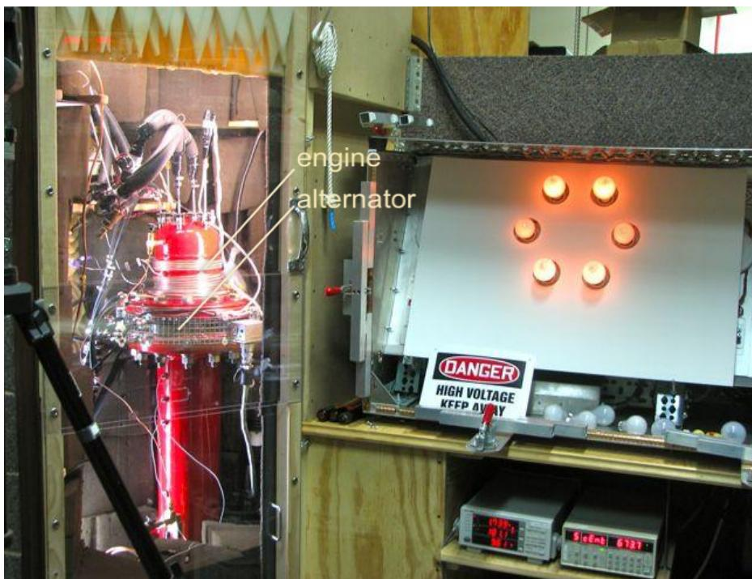  
Figure 1. Laboratory prototype engine and alternator, on the left, generating electricity to light the six bulbs on the right.

What follows in the bulk of this Final Report is a chronology of Topical and Quarterly Reports issued during the three phases of the project, with a summary at each phase. Some highlights and an overview are described here. The laboratory prototype is shown in Figure 1 generating electricity. Its piezoelectric alternator is shown in Figure 2. Sound from the engine couples to the thin spring steel diaphragm in the center of the alternator. As the diaphragm flexes either up or down, it pulls inward on the ring of six piezoelectric stacks around the perimeter, compressing them and generating electricity

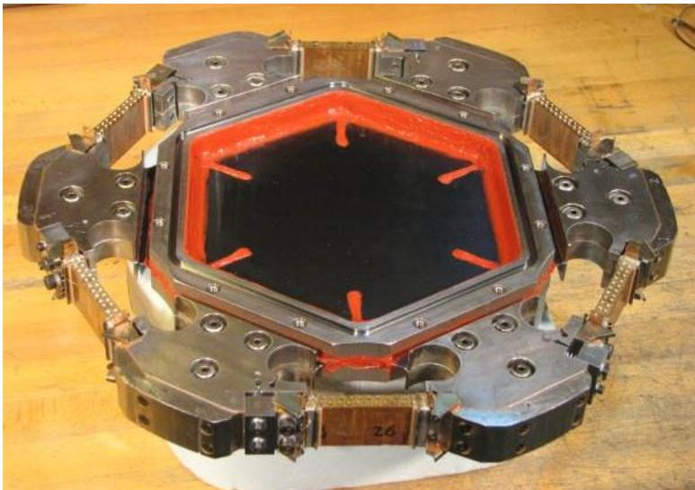  
Figure 2. Laboratory prototype flexible-diaphragm piezoelectric alternator.

A CAD model of the truck version of the generator is shown in Figure 3, and its cut-away is shown in Figure 4. Heat flows from hot heat exchanger, through the regenerator, into the cold heat exchanger of the thermoacoustic-Stirling engine. The engine can be thought of as an acoustical amplifier. Under average driving conditions, acoustic fluctuations quickly grow until 10 kW of sound flows around the collective loop of the generator through the ducts, heat exchangers and regenerators that contain pressurized helium gas. The 10 kW wave flowing into the cold heat exchanger grows in amplitude within the regenerator to 12 kW by absorbing heat via an acoustic version of the classic Stirling thermodynamic cycle. As in the prototype, the wave oscillates the flexible diaphragm of the alternator, transmitting mechanical power to its perimeter. The diaphragm pulls inward and compresses the piezoelectric elements at the perimeter with either an up or down stroke of the diaphragm. The piezoelectric elements convert the oscillating compression into 2 kW of electrical power with an expected efficiency of 95%. The remaining 10 kW of acoustic power then flows to the next stage of engine and alternator.

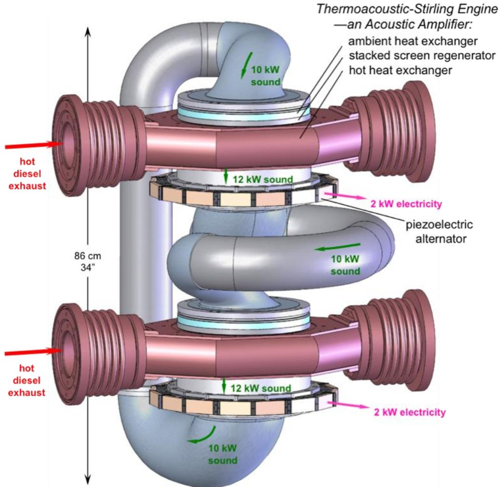

Figure 3. Design of the truck thermoacoustic piezoelectric generator.  
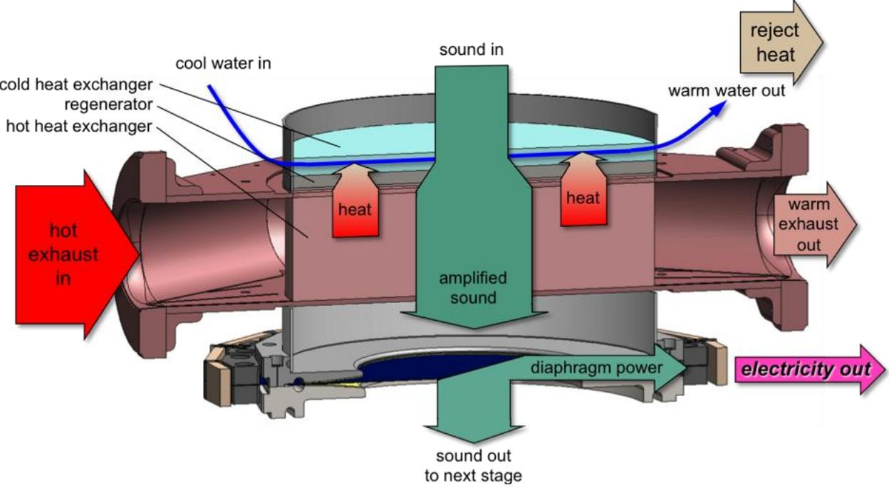  
Figure 4. Cut-away of one stage of the thermoacoustic piezoelectric generator.

Phase 1

October 2004 – September 2005

# Truck Thermoacoustic Generator and Chiller DE-FC26-04NT42113 and Field Work # 04EE09 Phase 1 Topical Report September 2005

Described herein are the accomplishments of Phase 1 of the project “Truck Thermoacoustic Generator and Chiller," whose goal is to design, fabricate and test a thermoacoustic piezoelectric generator and chiller system for use on over-the-road heavy-dutydiesel trucks, driven alternatively by the waste heat of the main diesel engine exhaust or by a burner integrated into the thermoacoustic system. The thermoacoustic system will utilize engine exhaust waste heat to generate electricity and cab air conditioning, and will also function as an auxiliary power unit (APU) for idle reduction. The unit will be tested in an engine test cell and then integrated onto a Class 8 over-the-road heavy-duty-diesel truck for further testing on the road. Fuel economy and emissions improvements will be demonstrated on the road and off the road.

The milestone for this first budget period is to justify the feasibility of the thermoacoustic approach through modeling. Phase 1 was nominally four months long, from October 2004 through January 2005, with no cost extensions continuing it through September 2005.

## Contents

I. Team Personnel 5   
II. Thermoacoustic Engine Optimizations 5   
1. Input assumptions to the trade study 5   
2. Simple analytical/circuit model optimizations 10   
3. Rough single stage engine numerical models 13   
4. Rough two stage engine models 16   
5. Cascaded regenerators in a single TASHE 19   
6. Hot end thermal interface 20   
7. Full DeltaE model of two stage system 21   
8. Full DeltaE model of engines in APU mode 23   
III. Chiller DeltaE Model 24   
IV. Piezoelectric Alternator Progress 24   
V. Recuperator and Burner Configuration 25   
VI. Conclusions 31   
References 33

## I. Team Personnel

One of the main accomplishments of Phase 1 was to fill out the team of people working on this project. They are, from the four involved institutions:

The Pennsylvania State University:   
Robert Keolian, principal investigator   
John Brady, heat exchangers and regenerators   
Jack Hughes, transduction   
Jeffrey Mayer, power electronics   
David Van Tol, transduction   
Douglas Wilcox, engineering

Los Alamos National Laboratory: Scott Backhaus, thermoacoustic-Stirling engine

Clean Power Resources: Bob Price, engineering and commercialization Lauren Simkovic, commercialization

Mack Trucks/Volvo Powertrain:   
Moataz Ali, engineering   
Kyle Kratsch, engineering   
Kenneth Murphy Jr., engineering and management   
Guy Rini, engineering and management

## II. Thermoacoustic Engine Optimizations

## 1. Input assumptions to the trade study

1. The optimal hot temperature for the thermoacoustic Stirling engine portion of the device under waste heat driven conditions was estimated using three methods that gave similar results. For the first method, Mack Trucks/Volvo Powertrain supplied ESC/OICA data for two of their engines that included engine speed, engine torque, and pre and post turbocharger temperature and pressure. ESC/OICA is a European engine emissions test protocol under steady state conditions. As shown in Fig. 1, measurements are taken at thirteen points, at idle and over a range of engine speeds and torques at higher power. For engine emissions certification, a weighted average is taken over these points, the weighting factors presumably representing a typical truck driving cycle. Points “3"and “4" are in the center of the powered torque and speed range, and are among the most heavily weighted points. The exhaust temperature of these two points were used in the first set of thermoacoustic engine optimizations.

ESC Test Modes
<table><tr><td rowspan=1 colspan=1>Mode</td><td rowspan=1 colspan=1>Engine Speed</td><td rowspan=1 colspan=1>% Load</td><td rowspan=1 colspan=1>Weight factor, %</td><td rowspan=1 colspan=1>Duration</td></tr><tr><td rowspan=1 colspan=1>1</td><td rowspan=1 colspan=1>Low idle</td><td rowspan=1 colspan=1>0</td><td rowspan=1 colspan=1>15</td><td rowspan=1 colspan=1>4 minutes</td></tr><tr><td rowspan=1 colspan=1>2</td><td rowspan=1 colspan=1>A</td><td rowspan=1 colspan=1>100</td><td rowspan=1 colspan=1>8</td><td rowspan=1 colspan=1>2 minutes</td></tr><tr><td rowspan=1 colspan=1>3</td><td rowspan=1 colspan=1>B</td><td rowspan=1 colspan=1>50</td><td rowspan=1 colspan=1>10</td><td rowspan=1 colspan=1>2 minutes</td></tr><tr><td rowspan=1 colspan=1>4</td><td rowspan=1 colspan=1>B</td><td rowspan=1 colspan=1>75</td><td rowspan=1 colspan=1>10</td><td rowspan=1 colspan=1>2 minutes</td></tr><tr><td rowspan=1 colspan=1>5</td><td rowspan=1 colspan=1>A</td><td rowspan=1 colspan=1>50</td><td rowspan=1 colspan=1>5</td><td rowspan=1 colspan=1>2 minutes</td></tr><tr><td rowspan=1 colspan=1>6</td><td rowspan=1 colspan=1>A</td><td rowspan=1 colspan=1>75</td><td rowspan=1 colspan=1>5</td><td rowspan=1 colspan=1>2 minutes</td></tr><tr><td rowspan=1 colspan=1>7</td><td rowspan=1 colspan=1>A</td><td rowspan=1 colspan=1>25</td><td rowspan=1 colspan=1>5</td><td rowspan=1 colspan=1>2 minutes</td></tr><tr><td rowspan=1 colspan=1>8</td><td rowspan=1 colspan=1>B</td><td rowspan=1 colspan=1>100</td><td rowspan=1 colspan=1>9</td><td rowspan=1 colspan=1>2 minutes</td></tr><tr><td rowspan=1 colspan=1>9</td><td rowspan=1 colspan=1>B</td><td rowspan=1 colspan=1>25</td><td rowspan=1 colspan=1>10</td><td rowspan=1 colspan=1>2 minutes</td></tr><tr><td rowspan=1 colspan=1>10</td><td rowspan=1 colspan=1>C</td><td rowspan=1 colspan=1>100</td><td rowspan=1 colspan=1>8</td><td rowspan=1 colspan=1>2 minutes</td></tr><tr><td rowspan=1 colspan=1>11</td><td rowspan=1 colspan=1>C</td><td rowspan=1 colspan=1>25</td><td rowspan=1 colspan=1>5</td><td rowspan=1 colspan=1>2 minutes</td></tr><tr><td rowspan=1 colspan=1>12</td><td rowspan=1 colspan=1>C</td><td rowspan=1 colspan=1>75</td><td rowspan=1 colspan=1>5</td><td rowspan=1 colspan=1>2 minutes</td></tr><tr><td rowspan=1 colspan=1>13</td><td rowspan=1 colspan=1>C</td><td rowspan=1 colspan=1>50</td><td rowspan=1 colspan=1>5</td><td rowspan=1 colspan=1>2 minutes</td></tr></table>

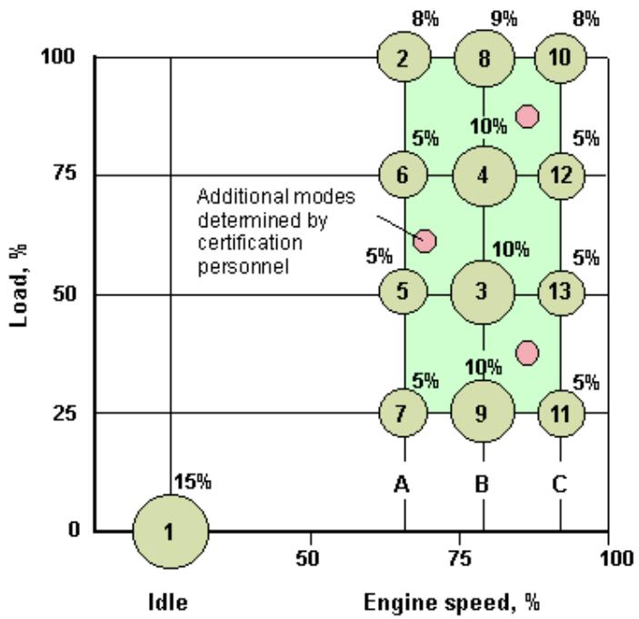  
Figure 1. European Stationary Cycle (ESC)

Mack/Volvo also supplied additional data for estimating the time-temperature profile for a typical driving cycle. The data is from two simulations that show in histogram form the necessary engine torque for a 2004 engine powering a loaded tractor trailer driving over either flat or hilly terrain. This data was combined with the previous engine torque/RPM/temperature data that had been sent, along with an assumption of near constant 1500 RPM sweet spot engine speed, to generate a weighted average engine exhaust temperature for both driving cycles. Within a couple degrees, the average temperature over the hilly run, the flat run, and the central, heavily weighted points “3"and “4"of the OICA data all gave the same post-turbo exhaust temperature $T _ { e x }$ This three-way agreement gives us confidence in designing for this exhaust temperature.

2. When running the thermoacoustic engine in waste heat capture mode, we will likely have to have our own external ambient heat exchanger to reject low grade heat from the thermoacoustic engine, since adding the extra thermoacoustic ambient-end reject heat onto the main engine cooling system would overly tax the main diesel engine cooling system. When operating as an APU when the truck is at rest, we could reject ambient-end heat into the main engine's cooling loop to keep the engine warm, use that heat for cab heating in winter, or reject the heat into the external ambient heat exchanger that is needed for waste heat operation. In any case, assuming an ambient-end temperature in the thermoacoustic engine of 100 C is probably close to reality.

3. When operating as an APU, $T _ { h }$ will likely be limited by materials considerations at the hot end. To keep the system inexpensive, we will need to avoid anything more exotic than stainless steel. Therefore, the maximum $T _ { h }$ for APU operation will be approximately 700 C.

4. There are two natural working fluids for this system; 100 PSI air which is already available from the truck's compressor (with some filtering and oil and water removal) and 100 PSI helium. Using compressed air has some advantages from the standpoint of leaks, maintenance and driver acceptance. However, using air will likely lead to a larger volume thermoacoustic-Stirling heat engine (TASHE) that will require more alternator stroke for a given power delivered. Initially, we will restrict ourselves to helium of no higher than 100 PSI because there are already 100 PSI pressure vessels aboard a truck today (the air pressure ballast tanks) and adding another 100 PSI tank, even if filled with helium, should not cause too big of an acceptance/regulation problem. (The mean pressure of the helium was increased to 200 PSI in the later models of the engine.)

5. There are several possible thermoacoustic engine configurations. We will investigate

\- Single-stage (i.e. one regenerator) TASHE

\- Two separate single-stage TASHEs in a vibration balanced configuration

\- Two-stage (i.e. two regenerators in series) TASHE

\- Standing-wave thermoacoustic engine

\- Cascaded thermoacoustic engines (combined TASHE-standing wave engine) in this order, as time permits.

6. There are three reasonable choices for the hot-end thermal interface:

a. A traditional heat exchanger, such as tube-in-shell, with the engine's working fluid oscillating in many parallel, short passages and the exhaust gas flowing directly over the outside of these passages.

b. Some type of heat pipe carrying some fraction of the waste heat from the main engine exhaust to the thermoacoustic engine's hot end.

c. An acoustically driven self-circulating heat exchange loop to circulate the engine's working fluid to a heat exchanger in the tailpipe.

7. From our discussions at the kickoff meeting, an acoustic power level of 10 kW seems reasonable to start with.

## 2. Simple analytical/circuit model optimizations

We can go a long way towards optimizing the engine by considering some fairly simple models. The first question to answer is:

Given a mass flow rate and a temperature in the exhaust stream, what temperature do we want to run the hot end of the thermoacoustic engine at to generate the most acoustic power from that stream?

Our incoming exhaust stream is defined by $m c _ { \mathrm { p } } T _ { \mathrm { e x } } ,$ where $m , c _ { \mathfrak { p } } ,$ and $T _ { \mathrm { e x } }$ are the exhaust's mass flow rate, heat capacity at constant pressure, and temperature. Based on some “typical" efficiency data for a thermoacoustic-Stirling engine, we can empirically expect the efficiency to scale like,

$$
\eta \sim \beta \left( \frac { T _ { h } } { T _ { a } } - \frac { T _ { o n s e t } } { T _ { a } } \right) ,
$$

where $\beta$ is scale factor, $T _ { \mathrm { h } }$ is the engine's hot-end temperature, and $T _ { \mathrm { o n s e t } }$ is the temperature where the engine is just oscillating but not supplying any useful power, and $T _ { a }$ is the ambient, or cold, temperature. This relationship is backed up somewhat by the following data taken in a \~2 kW thermoacoustic-Stirling heat engine utilizing a parallel-plate regenerator:

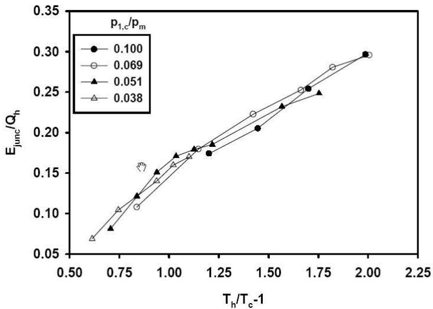  
Figure 2. Typical thermoacoustic-Stirling engine power vs. temperature.

However, this may not be a correct way to approach this problem. Perhaps one should take the given exhaust stream, assume a utilization temperature $T _ { \mathrm { h } } ,$ optimize a thermoacoustic engine at various $T _ { \mathrm { h } } \mathrm { \tilde { s } } .$ and then pick the best engine $/ T _ { \mathrm { h } }$ combination. But, we do not have that kind of time in Phase I. So, we will use this as a rough approximation to that more correct approach. Additionally, this efficiency relationship may not hold for the different types of engine we wish to consider. But, let's forge ahead.

Assuming that the exhaust-to-metal heat exchange is very good so that the exhaust exits the thermoacoustic engine's hot heat exchanger at $T _ { \mathrm { h } }$ , the acoustic power produced by the engine, $E _ { \mathrm { o u t : } }$ is

$$
E _ { o u t } = \beta m c _ { p } T _ { e x h a u s t } \bigg ( 1 - \frac { T _ { h } } { T _ { e x h a s u t } } \bigg ) \bigg ( \frac { T _ { h } } { T _ { a } } - \frac { T _ { o n s e t } } { T _ { a } } \bigg ) .
$$

Next, by taking a derivative, we optimize $E _ { \mathrm { o u t } }$ with respect to $T _ { \mathrm { h } } ,$ and find the most acoustic power is produced when

$$
T _ { h } = \frac { T _ { e x h a s u t } + T _ { o n s e t } } { 2 } .
$$

Substituting this back into $E _ { \mathrm { o u t } }$ , we find

$$
E _ { o u t } = \frac { \beta m c _ { p } T _ { e x h a s t } } { 4 } \bigg ( 1 - \frac { T _ { o n s e t } } { T _ { e x h a s t } } \bigg ) \bigg ( \frac { T _ { e x h a s t } } { T _ { a } } - \frac { T _ { o n s e t } } { T _ { a } } \bigg ) = \frac { \beta m c _ { p } T _ { a } } { 4 } \left( \tau _ { e x h a s t } - \tau _ { o n s e t } \right) ^ { 2 } ,
$$

where $\tau _ { e x h a u s t } = T _ { e x h u a s t } / T _ { a }$ and $\tau _ { o n s e t } = T _ { o n s e t } / T _ { a }$ . From either expression, it is clear that to maximize the power output, the onset temperature, $T _ { \mathrm { o n s e t } }$ , should be minimized.

From previous analytical work, the power output of a TASHE whose major loss mechanism is acoustic power dissipation in the regenerator is given by

$$
E _ { n e t } = E _ { r e \nu } \bigg ( 1 - { \frac { ( 1 + \tau ^ { 2 } ) } { 2 ( \tau - 1 ) } } \bigg ( { \frac { \omega L } { R } } \bigg ) ( \omega R C \bigg ) \bigg ) ,
$$

where $E _ { \mathrm { r e v } }$ is the power output in the absence of losses, ω is the angular frequency of oscillation, and $L , R ,$ and $C$ are the lumped element circuit parameters that describe the thermoacoustic-Stirling engine, and $\tau = T _ { h } / T _ { a }$ . By setting $E _ { \mathrm { n e t } } = 0$ , the onset temperature is found to be

$$
\tau _ { o n s e t } = \frac { T _ { o n s e t } } { T _ { a } } = \frac { \displaystyle \frac { 1 } { \gamma } - \sqrt { \left( \frac { 1 } { \gamma } \right) ^ { 2 } - 4 \left( 1 + \frac { 1 } { \gamma } \right) } } { 2 }
$$

where $\gamma = ~ ( \omega L / R ) ( \omega R C ) / 2$ The plot below shows that we want to minimize the product $( \omega L / R ) ( \omega R C )$ , to achieve the lowest onset temperature.

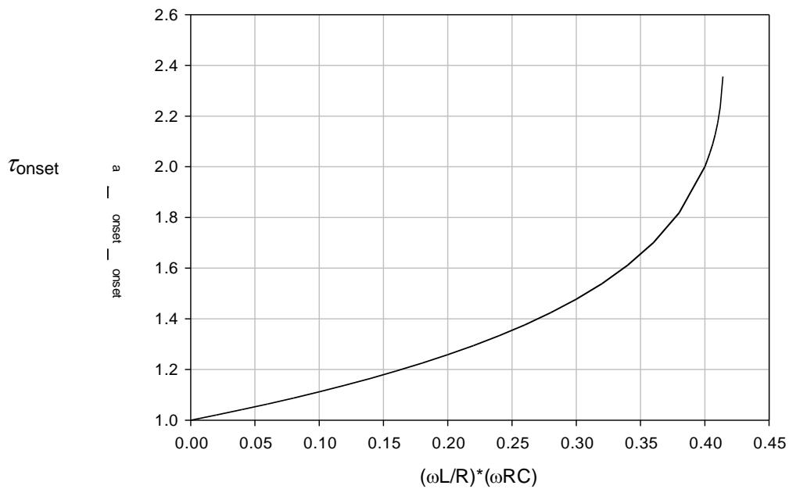  
Figure 3. Model onset temperature.

There are other requirements we can impose. We would also like the highest volumetric (and likely mass) power density possible. Previous work has shown that the condition $\omega L / R \sim 1$ gives the highest power density. Therefore, we would like to see $\omega R C < 0 . 1$ to keep the onset temperature as low as reasonable. Another way to look at this condition is that $\omega R C \sim \Delta p _ { 1 , \mathrm { r e g e n } } /$ $p _ { 1 }$ where $\Delta p _ { 1 , \mathrm { r e g e n } }$ is the pressure drop across the regenerator. Fortunately, $\Delta p _ { \mathrm { 1 , r e g e n } } / p _ { \mathrm { 1 } } \sim 0 . 1$ is already met by “typical" thermoacoustic-Stirling engine designs.

Therefore, we have a rough set of guidelines to direct the optimization of the thermoacoustic-Stirling engine (and perhaps other configurations?) for the extraction of waste heat from an exhaust stream:

$$
1 . \ T _ { \mathrm { h } } { \sim } \left( T _ { \mathrm { e x h a u s t } } { + } \ T _ { \mathrm { o n s e t } } \right) / 2
$$

2. ωL/R ～ 1 (Approximately equal volumetric flow rates in the inertance and regenerator)

3. $\omega R C < 0 . 1 \left( \Delta p _ { \mathrm { 1 , r e g e n } } / p _ { \mathrm { 1 } } < 0 . 1 \right)$

Condition 1 from above presents a new challenge. Because of the relatively low diesel engine exhaust temperature, the hot temperature of the thermoacoustic-Stirling engine will be only $T _ { \mathrm { h } } \sim$ 260 C, assuming a typical onset temperature. However, we want to operate this system as an APU as well where the temperature of the “exhaust" steam (i.e. combustor exhaust temperature) will be significantly higher. This will likely involve performance compromises at both operating conditions.

## 3. Rough single stage engine numerical models

In this initial DeltaE numerical modeling of the system (DeltaE is a well developed, freely available thermoacoustic code written at Los Alamos), we will consider waste heat capture operation and fix an exhaust stream condition roughly corresponding to a diesel engine operating at 1500 RPM and 1000 ft-lbs of torque with an exhaust temperature of $T _ { e x }$ . Under these conditions, the engine is producing 213 kW or 285 hp of shaft power. Assuming input fuel energy is split 1/3 to shaft power, 1/3 as heat to the radiator and other losses, and 1/3 as enthalpy in the exhaust, there is about 213 kW of enthalpy in the exhaust when referenced to an ambient temperature of 25 C. The heat input to the thermoacoustic engine is then determined by the hot end temperature through

$$
\mathcal { Q } _ { h } = 2 1 3 k W \bigg ( \frac { T _ { e x } - T _ { h } } { T _ { e x } - 2 5 ^ { o } C } \bigg ) .
$$

At a $T _ { \mathrm { h } }$ close to the analytically predicted $T _ { \mathrm { h } }$ for maximum waste heat utilization (i.e. maximum acoustic power produced from the exhaust stream), the engine cross-sectional area, regenerator hydraulic radius, and heat exchanger and regenerator lengths relative to the gas displacement are varied to optimize a rough DeltaE engine model for the maximum waste heat utilization. $T _ { \mathrm { h } }$ is then changed and the engine cross-sectional area is varied until a maximum in the waste heat utilization is found. The rough engine model only consists of an ambient heat exchanger, regenerator, hot heat exchanger, thermal buffer tube, and a secondary ambient heat exchanger. The power output is approximated as the excess power generated in the regenerator.

The output power of a thermoacoustic Stirling engine will be likely limited by the smallest scale to which we can feasibly make the transverse features of the heat exchangers, such as the fin spacing in a tube-and-fin exchanger or the tube diameter of a tube-in-shell exchanger.

We suspect that the smallest economically feasible transverse dimensions will be about 1 mm, which is quite a bit larger than the thermal or viscous penetration depths of the working gas, which are about one tenth this size. In this limit, therefore, we will always end up making the exchanger with the finest features that we reasonably can, and thus the smallest transverse feature size should be considered a fixed quantity when optimizing the engine over various gas compositions, pressures, temperatures, or operating frequencies.

Figure 4 shows results for waste heat utilization, engine diameter, acoustic power output, and engine efficiency as a function of $T _ { \mathrm { h } }$ for an engine operating at 300 Hz, a mean pressure of 100 PSI of helium, air, or a helium-argon mixture, an oscillating pressure amplitude of 10 PSI, and an ambient reject metal temperature of 100 C.

One may argue that the maximum in waste heat utilization occurs where it does because we more thoroughly optimized the engine at that temperature. However, reoptimization at the other temperatures does not yield a dramatic change in waste heat utilization.

The trade between helium, a helium-argon mixture, and air is quite clear. For approximately the same engine diameter, there is a drop in the power output of nearly a factor of two in going from helium to air which causes a drop in the fractional utilization of about the same factor. There is also no advantage to using the helium-argon mixture. Looking over the results under these fixed heat exchanger conditions, we have come to the realization that the best working gas is the gas with the highest thermal conductivity, because it will have the largest thermal “reach"from the metal of the heat exchanger into the working gas. Even with pure helium, however, the large resultant engine diameters may be a problem. Although the diameters will come down somewhat if we use two engines in a vibration balanced configuration, we will stick with 100 PSI helium or consider higher pressure helium in the rest of this study to keep engine diameter manageable.

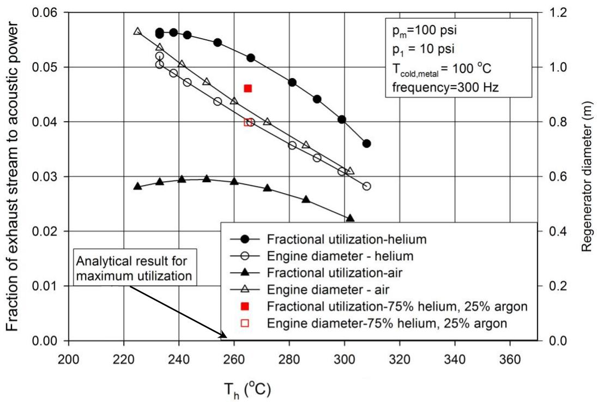

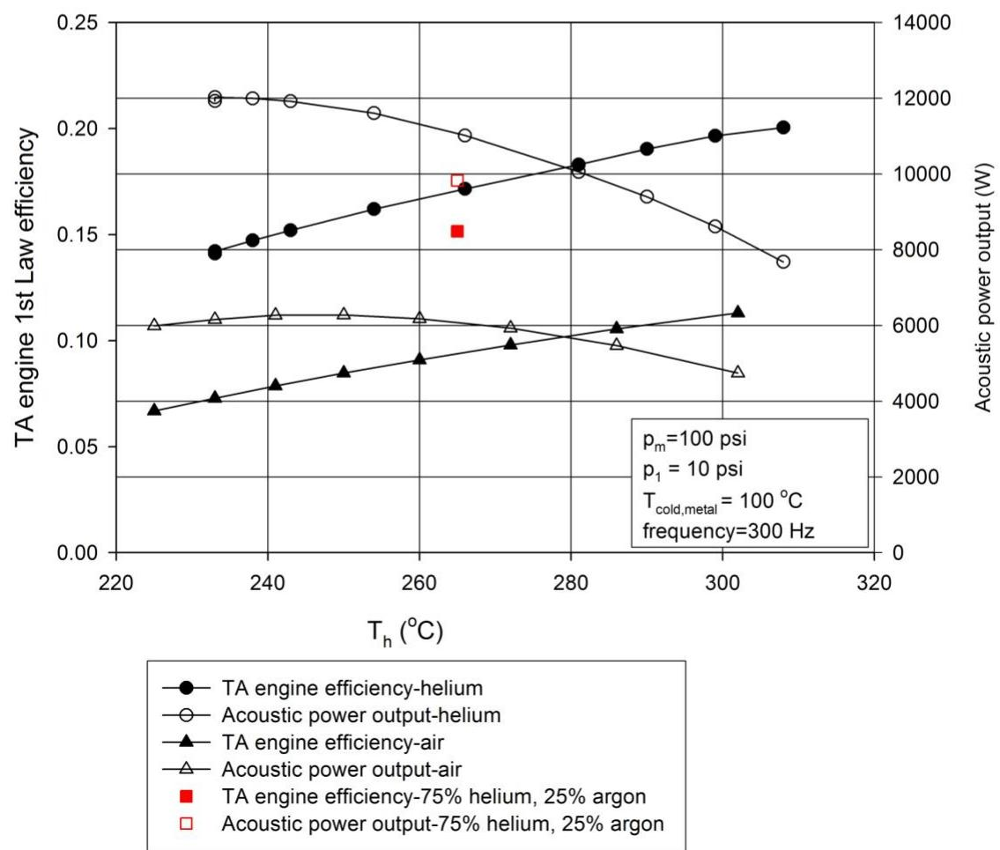  
Figure 4. Selection of working gas and hot heat exchanger temperature.

The scaling in power output and utilization is as expected. From previous analytical work, the power density is predicted to scale as $k / \delta _ { \kappa }$ where k and $\delta _ { \kappa }$ are the working gas’' thermal conductivity and thermal penetration depth. This ratio can be rewritten as $( k \rho c _ { \mathrm { p } } \omega / 2 ) ^ { 1 / 2 }$ where $\rho$ and $c _ { \mathrm { p } }$ are the working gas’density and constant pressure heat capacity and ω is the angular frequency of oscillation. For monotonic gases or mixtures of monotonic gases at the same mean pressure, $\rho c _ { \mathrm { p } }$ is constant. Therefore, we want to choose the gas or gas mixture with the highest thermal conductivity. The clear choice is helium. The relationship is not as simple for nonmonotonic gases. If we compute our figure of merit, $\left( k \rho c _ { \mathrm { p } } \omega / 2 \right) ^ { 1 / 2 }$ , for various gases relative to helium we find,

<table><tr><td colspan="5">Relative</td></tr><tr><td></td><td>ρ</td><td> ${ \tt C } _ { \tt p }$ </td><td>K</td><td>FOM FOM</td></tr><tr><td>helium</td><td>0.859</td><td>5192</td><td>0.183</td><td>28.6 1.00</td></tr><tr><td> ${ \sf H } _ { 2 }$ </td><td>0.425</td><td>14410</td><td>0.223 37.0</td><td>1.29</td></tr><tr><td>Air</td><td>6.146</td><td>1005</td><td>0.033 14.3</td><td>0.50</td></tr><tr><td>N2</td><td>5.944</td><td>1039</td><td>0.032 14.0</td><td>0.49</td></tr><tr><td>CO2</td><td>9.667</td><td>858</td><td>0.024</td><td>14.2 0.50</td></tr></table>

This shows that common gases will be two times less power dense than helium and hydrogen will be about 30% higher. Although there is a thermoacoustic advantage to using hydrogen as the working gas, it comes with flammability and hydrogen embrittlement issues that are likely too serious to overcome.

## 4. Rough two stage engine models

Before diving straight into a DeltaE model for a two-engine configuration, some simple analytical modeling is useful. By “two-engine", we mean the exhaust stream flows in series through the two engines. In this early stage of the analysis, we should not lose much by assuming that the two engines are identical except for the hot end temperature of the second engine being lower than the first. We will retain our other assumption that the exhaust gas leaves the first and second engines at their hot-end operating temperature $\mathrm { T _ { h 1 } }$ and $\mathrm { T } _ { \mathrm { h } 2 }$ .Also, we will use the same approximation to the TASHE efficiency that we used above. The power output of each engine is then

$$
E _ { o u t , 1 } \mathrm { = } m c _ { p } ( T _ { e x } - T _ { h 1 } ) \beta \Bigg ( \frac { T _ { h 1 } } { T _ { a } } - \frac { T _ { o n } } { T _ { a } } \Bigg )
$$

$$
E _ { o u t , 2 } \mathrm { = } m c _ { p } ( T _ { h 1 } - T _ { h 2 } ) \beta \Bigg ( \frac { T _ { h 2 } } { T _ { a } } - \frac { T _ { o n } } { T _ { a } } \Bigg )
$$

Optimizing the sum of these two powers with respect to $\mathrm { T _ { h l } }$ and ${ \mathrm { T } } _ { { \mathrm { h } } 2 } .$ we find that the maximum power output is obtain when $\mathrm { T _ { h l } } { = } ( 2 \mathrm { T _ { e x } } { + } \mathrm { T _ { o n } } ) / 3$ and $\mathrm { T _ { h 2 } } { = } ( \mathrm { T _ { e x } } { + } 2 \mathrm { T _ { o n } } ) / 3$ . In other words, the first engine lowers the exhaust temperature 1/3 of the way from $\mathrm { T _ { e x } }$ to $\mathrm { T _ { o n } } .$ and the second engine lowers it the second third. Substituting this result back into the expressions for $\mathrm { E _ { o u t , 1 } }$ and $\mathrm { E _ { o u t } } _ { , 2 }$ we find the optimized total power output is

$$
E _ { o u t , t o t a l } = \frac { \beta m c _ { p } T _ { a } } { 3 } ( \tau _ { e x } - \tau _ { o n } ) ^ { 2 }
$$

which is $4 / 3$ larger than the output when using a single engine. Additional stages would increase the power output from the exhaust stream further, but it would probably not be worth the complexity or cost.

A rough DeltaE model that consists of two identical engines is used to provide a quick check on the analytical predictions above. All of the top-level parameters are kept the same as in the single engine model considered earlier: mean pressure, pressure amplitude, frequency, and $\mathrm { { T } _ { a \cdot } }$ An optimization scheme similar to that used in the single engine case is used:

1. The hot heat exchanger metal temperature of each engine, $\mathrm { T _ { h l } }$ and ${ \mathrm { T } } _ { { \mathrm { h } } 2 } .$ is an input.

2. $\mathrm { T } _ { \mathrm { e x } , } \ \mathrm { T } _ { \mathrm { h l } }$ , and $\mathrm { T } _ { \mathrm { h } 2 }$ determine the amount of heat entering eaçh engine.

3. At a total regenerator cross-sectional area of ${ \sim } 0 . 8 \bar { 3 } \mathrm { ~ m } ^ { 2 } ;$ , the engine dimensions (heat exchanger and regenerator lengths and regenerator hydraulic radius), $\mathrm { T _ { h l } }$ and $\mathrm { T } _ { \mathrm { h } 2 }$ are varied until the power output is maximized.

4. The regenerator cross-sectional area is changed, and the optimization is carried out again,

The results are shown in Fig. 5.

The upper half of Fig. 5 shows the increased power output of two staged TASHEs relative to a single TASHE. The increase is slightly less than 4/3. The diameter of the each engine in the two-stage configuration is shown for reference. The second plot shows the variation in the optimum dimensionless engine temperature as the cross-sectional area is varied. Near the peak in the power output, each engine consumes roughly 1/3 of the available heat, and over the entire range the heat consumption of the two engines is roughly the same although the overall consumption varies significantly.

The main result here is that the power output generated from the given exhaust stream can be boosted by approximately 30% by going to two staged TASHEs instead of a single TASHE. Also, the system may package better because we now have two TASHEs of a smaller diameter.

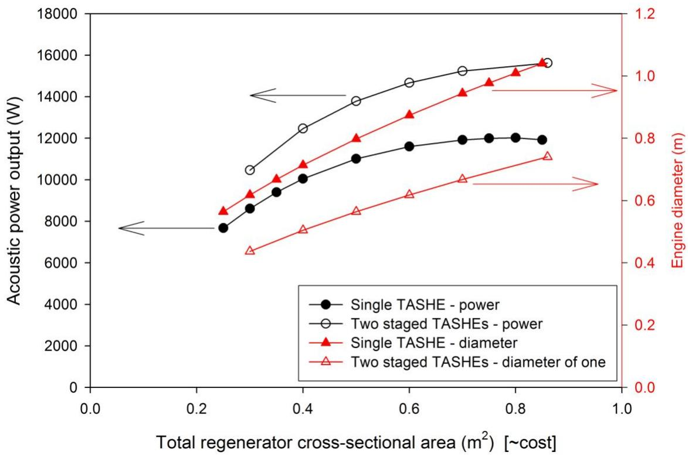

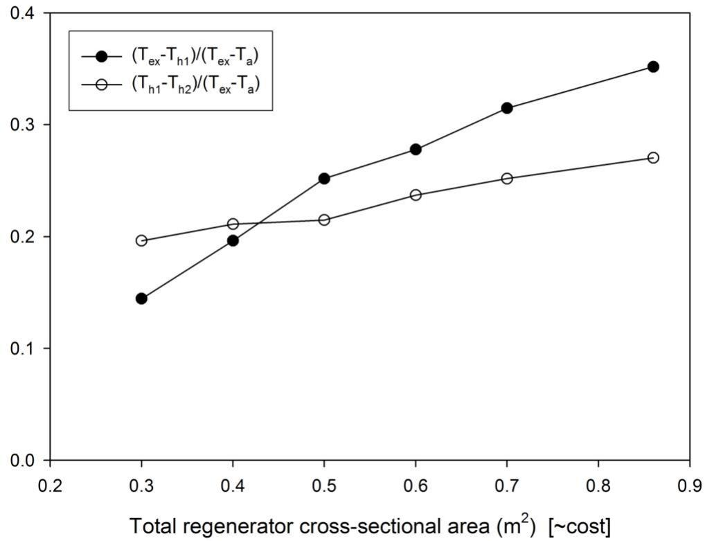  
Figure 5. Selection of regenerator diameter, which is the minimum engine diameter.

## 5. Cascaded regenerators in a single TASHE

Given the relatively low temperature of the exhaust stream from the main diesel engine, it may be advantageous to cascade two regenerator/heat exchanger units into a single TASHE feedback loop yielding an acoustic power amplification factor significantly higher than a single regenerator/heat exchanger unit. The idea is that the feedback acoustic power is amplified in the first regenerator unit which then sends its output acoustic power to a second regenerator unit which amplifies it again. This opens up an additional degree of freedom related to how the exhaust stream is fed to the two hot heat exchangers in the two regenerator units. There are a couple of “simple" options:

1. Split the exhaust stream into two parallel flows and balance those flows so each regenerator unit has the same hot-end temperature.

2. Run the exhaust stream through one hot heat exchanger, and then the other. Whether the first or second stage regenerator should be first in line and what the temperatures of each stage is best needs to be determined.

With this many degrees of freedom, we again revert to our analytical model to sort things out.

For option 1, the result is clear. If ${ \bf { \alpha } } \mathrm { ~  ~ \alpha ~ } \mathrm { ~  ~ \alpha ~ } \mathrm { ~  ~ \alpha ~ } \mathrm { ~  ~ \alpha ~ } \mathrm { ~  ~ \alpha ~ } \mathrm { ~  ~ \alpha ~ } \mathrm { ~  ~ \alpha ~ } \mathrm { ~  ~ \alpha ~ } \mathrm { ~  ~ \alpha ~ } \mathrm { ~  ~ \alpha ~ } \mathrm { ~  ~ \alpha ~ } \mathrm { ~  ~ \alpha ~ } \mathrm { ~  ~ \alpha ~ } \mathrm { ~  ~ \alpha ~ }$ and ${ \bf { \alpha } } \mathrm { \bf { { \alpha } } } \mathrm { \bf { { \alpha } } } \mathrm { \bf { { \alpha } } } \mathrm { \bf { { \alpha } } } \mathrm { \bf { { \alpha } } } \mathrm { \bf { { \alpha } } } \mathrm { \bf { { \alpha } } } \mathrm { \bf { { \alpha } } } \mathrm { \bf { { \alpha } } } \mathrm { \bf { { \alpha } } } \mathrm { \bf { { \alpha } } } \mathrm { \bf { { \alpha } } } \mathrm { \bf { { \alpha } } } \mathrm { \bf { { \alpha } } } \mathrm { \bf { { \alpha } } } \mathrm { \bf { { \alpha } } } \mathrm { \bf { { \alpha } } } \mathrm { \bf { { \alpha } } } \mathrm { \bf { { \alpha } } } \mathrm { \bf { { \alpha } } } \mathrm { \bf { { \alpha } } } \mathrm { \bf { { \alpha } } } \mathrm { \bf { { \alpha \alpha } } } \mathrm { \bf { { \alpha \alpha } } } \mathrm { \bf { { \alpha \alpha } } } \mathrm { \bf { { \alpha \alpha } } } \mathrm { \bf { \alpha } } \mathrm { \bf { \alpha } } \mathrm { \bf { \alpha } } \mathrm { \alpha } \mathrm { \alpha } \mathrm { \alpha } \mathrm { \alpha } \mathrm { \alpha } \mathrm { \alpha } \mathrm { \alpha } \mathrm { \alpha } \mathrm { \alpha } \mathrm \mathrm { \alpha } \mathrm { \alpha } \mathrm { \alpha } \mathrm \mathrm { \alpha } \mathrm { \alpha } \mathrm \mathrm { \alpha } \mathrm \mathrm { \alpha } \mathrm \mathrm { \alpha \alpha } \mathrm \mathrm { \alpha } \mathrm \mathrm { \alpha \mathrm } \mathrm  \alpha \mathrm \mathrm { \alpha } \mathrm \mathrm \mathrm { \alpha } \mathrm \mathrm { \alpha \alpha } \mathrm \mathrm \mathrm \mathrm { \alpha \alpha } \mathrm \mathrm \mathrm \mathrm { \alpha \alpha \mathrm } \mathrm \mathrm \mathrm  \mathrm \alpha \mathrm \mathrm \mathrm { \alpha \alpha \alpha \alpha } \mathrm \mathrm \mathrm \mathrm \mathrm \mathrm  \alpha \mathrm \mathrm \mathrm \mathrm \alpha \mathrm \mathrm  \alpha \alpha \alpha \alpha \mathrm \mathrm \mathrm \mathrm \mathrm \mathrm \mathrm \mathrm \mathrm  \alpha \alpha \alpha \alpha \mathrm \mathrm \mathrm \mathrm \mathrm \mathrm \mathrm \mathrm \mathrm \mathrm \mathrm \mathrm \mathrm  \alpha \alpha \Omega \mathrm \mathrm \mathrm \Omega \mathrm \mathrm \mathrm$ are the fraction of the mass flow going the first and second stages, then $\mathbf { a } _ { 1 } + \mathbf { a } _ { 2 } { = } 1$ and $\mathrm { a _ { 2 } / a _ { 1 } { \sim } ( T _ { h } { \cdot } T _ { o n } ) / T _ { a } } .$ Therefore, $\mathrm { \Delta a _ { 2 } { = } ( T _ { h } { - } T _ { o n } ) / ( T _ { h } { - } }$ $\mathrm { T _ { o n } + T _ { a } ) }$ The acoustic power output from the second stage of the cascaded system, which is the net power output, is then

$$
{ E ^ { { ( 2 ) } } } _ { o u t } = { \frac { \beta m c _ { p } } { T _ { a } } } ( T _ { e x } - T _ { h } ) ( T _ { h } - T _ { o n } ) { \frac { ( T _ { h } - T _ { o n } ) } { ( T _ { h } - T _ { o n } ) + T _ { a } } } \ .
$$

If we compare this to the result for a TASHE with a single regenerator,

$$
\frac { E ^ { ( 2 ) } { } _ { o u t } } { E ^ { ( 1 ) } { } _ { o u t } } = \frac { ( T _ { h } - T _ { o n } ) } { ( T _ { h } - T _ { o n } ) + T _ { a } } \ ,
$$

showing that the output from a two-stage TASHE with the exhaust stream flowing in parallel through the two hot heat exchangers is always less than a single-stage TASHE. For the typical numbers we are considering, the power output is 2/3 to 3/4 lower.

Option #2 has also been worked out for the exhaust gas flowing either through the first or second stage first. If the exhaust passes through the first stage first, the power output falls short by the same amount as in option 1. If the exhaust passes through the second stage first, the power output is the same as a single engine. There may be some benefit in doing things this way. The overall diameter of the system will probably come down somewhat, but the manufacturing challenges of a two-stage TASHE may offset this. However, we will still put a two-stage TASHE on the same level as a single stage TASHE.

## 6. Hot-end thermal interface

There are several ways to integrate the TASHE with the hot exhaust stream: a “traditional tube-in-shell" or similar geometry with the exhaust gas and oscillating helium in cross flow, a heat pipe array with the evaporators in the exhaust gas and the condensers in the oscillating helium, and a “lambda loop"that uses fluid diodes and the acoustic field itself to pump the TASHE's working gas around a loop external to the thermoacoustic engine that is surrounded by the flowing exhaust gas

## Traditional tube-in-shell

For the types of configurations we've considered above, a typical hot heat exchanger is roughly 1" long in the acoustic direction and about 19" across (0.5 m). The total flow area for the exhaust gas is 19 sq. in. which is equivalent to a 5" diameter pipe. This is not too far off from the diameter of the exhaust piping on a Class 8 truck (around 5" to 6’). Therefore, it seems possible that a heat exchanger of this type could be used as long as the restriction due to the heat exchanger tubes is not too severe. Another possibility is that the flows could be swapped, with the exhaust flow put inside the tubes and the helium oscillating in crossflow over the outside of the tubes.

## Heat pipes

Here, both the exhaust gas and the helium would flow over the outside of the heat pipes. The helium would be in a crossflow configuration and the exhaust would likely flow parallel to the heat pipe axis to gain more heat transfer surface area. If we really need to consider this option we will need to investigate what type of heat pipe would be applicable to the wide range of temperatures we will encounter: 0 C or below during start up on a cold day to 700 C during APU operation. Because of this wide temperature range, this approach appears hopeless.

Acoustically driven heat transfer loop—the “lambda loop"

In the “traditional" lambda loop configuration where the length of the loop is one wavelength, initial estimates show that to keep the thermal drops down below 50 C, the amount of acoustic power consumed by the loop is about 2200 W which is likely too large of a performance hit even for the simplicity and integration convenience of the lambda loop. Of the 2200 W, about 1000 W is consumed in the fluid diodes. So, while there may be other ways of configuring the loop to reduce the acoustic dissipation while still obtaining a reasonable flow rate, this would likely increase the dissipation in the fluid diodes to an unacceptable level.

Our unfortunate conclusion is that we will likely have to use some type of “traditional" heat exchanger.

## Tube-in-shell exhaust side model

An estimate of the exhaust side pressure drop and thermal resistance of a traditional tube-in-shell heat exchanger was made as a check of the feasibility of this type of design for use in the thermoacoustic engine. Tubes, containing helium within, were assumed to be placed in a hexagonal lattice. Exhaust gas passes through the shell outside the tubes in a single pass. The shell is a disk 0.4 m $( 1 6 " )$ in diameter and 64 mm (2.52") thick. This geometry, which is more open to the diesel exhaust gas than that assumed above, is made possible by using fewer, longer tubes. The tubes have a 1.5 mm straight section 48 mm long that is nearly up against the regenerator, and, on the opposite end, a conical section 16 mm long, the cone having a $7 ^ { \circ }$ half angle in an attempt to ease the transition of the acoustic flow in the tubes to the flow in the open space of the thermal buffer tube with the minimum of minor loss, while at the same time allowing more room for the exhaust gas flow. Tubes are spaced by 6 mm on centers.

From the average of points 3 and 4 of the OICA data, assuming an engine speed of 1506 RPM and torque of 878 ft-lbs, the post-turbo exhaust volume flow rate is estimated to be 0.29 $\mathrm { m } ^ { 3 } / \mathrm { s } .$ , the average Reynolds number based on the 1.5 mm tube diameter is estimated to be 521, the Nusselt number is 10.9, the heat transfer coefficient of the exhaust to the tubes is 316 $\mathrm { W / m } ^ { 2 } \mathrm { K } .$ , there is $1 . 0 6 \mathrm { m } ^ { 2 }$ total of tube wall per heat exchanger, and thus the thermal resistance of the hot heat exchanger as a whole is estimated to be 2.98 mK/W. Given the 15.9 kW hot heat of the DeltaE model described below for the first engine stage, the temperature drop between the exhaust gas and the metal is therefore approximately 47 C. This is acceptable, but a little higher than we might want for best system efficiency.

From standard correlations of pressure drop of flow over tube sheets, the pressure drop across one hot heat exchanger (not including minor losses for entry and exit pressure drops at the transitions between the exhaust duct and the heat exchanger) is estimated to be only 1430 Pa or 0.21 PSI, which is on the order of 1% of the pressure drop across a turbocharger, for example. Thus a tube in shell design appears feasible, but could potentially use some work trading off pressure drop for improved heat transfer.

## 7. Full DeltaE model of two stage system

Now that we have the guidance of the rough estimates and models above, it's time to work up a full model of the engines. How complete to make this is somewhat unknown. However, we will try to capture several things:

1. All of the engine components up to the alternator interface.

2. The thermodynamics of the exhaust/flue gas flow

3. The external heat transfer to the coolant and exhaust/flue gas streams

Using a staged two-engine configuration and $0 . 4 ~ \mathrm { m } ^ { 2 }$ of total regenerator cross-sectional area, the DeltaE model was able to generate around $1 2 \mathrm { k W }$ out of the assumed exhaust stream. However, this resulted in two engines with roughly 0.5-meter-diameter regenerators, i.e. $2 0 ^ { \circ }$ diameter. This seems too large to keep the cost and thermal expansion difficulties manageable. A $1 0 ^ { \circ }$ diameter seems more plausible but will result in a lower utilization of the waste heat. One way to get to the smaller diameter is to use four engines (two pairs of engines with one pair operating at “high" temperature and the second pair at “low" temperature) and double the mean pressure to 200 psi. Exactly how these four engines are integrated is yet to be determined

We start from scratch and work up a new DeltaE file for this configuration. Some of the overall parameters are listed below
<table><tr><td rowspan=1 colspan=1>Mean pressure</td><td rowspan=1 colspan=1>200 psia</td></tr><tr><td rowspan=1 colspan=1>Oscillation frequency</td><td rowspan=1 colspan=1>240 Hz</td></tr><tr><td rowspan=1 colspan=1>Ambient metal temperature</td><td rowspan=1 colspan=1>100 C</td></tr><tr><td rowspan=1 colspan=1>Oscillating pressure amplitude</td><td rowspan=1 colspan=1>21 psi</td></tr></table>

Note that a more conservative estimate of the operating frequency, 240 Hz rather than the earlier 300 Hz, has been assumed because at the time of making this model it looked like the alternator mass might be coming in larger than we initially thought. First, a single TASHE was optimized near 310 C, i.e. all of the relevant dimensions and the pressure amplitude were varied until the maximum waste heat conversion was obtained. Then, a second TASHE was added, and the geometry of that TASHE and its operating temperature were optimized. Internal calculations were used to ensure that each TASHE absorbed the correct amount of waste heat based on its operating temperature. The final result for waste heat utilization is given below:

<table><tr><td rowspan=1 colspan=1>Available waste heat (ref. to 25 C)</td><td rowspan=1 colspan=1>180 kW</td></tr><tr><td rowspan=1 colspan=1>Hot TASHE HHX temperature</td><td rowspan=1 colspan=1>309 C</td></tr><tr><td rowspan=1 colspan=1>Warm TASHE HHX temperature</td><td rowspan=1 colspan=1>259 C</td></tr><tr><td rowspan=1 colspan=1>Hot TASHE power output</td><td rowspan=1 colspan=1>2380 Watts</td></tr><tr><td rowspan=1 colspan=1>Warm TASHE power output</td><td rowspan=1 colspan=1>1350 Watts</td></tr><tr><td rowspan=1 colspan=1>System power output (for all 4 TASHE&#x27;s)</td><td rowspan=1 colspan=1>7460 Watts</td></tr><tr><td rowspan=1 colspan=1>Overall fraction waste heat utilization</td><td rowspan=1 colspan=1>4.1 %</td></tr></table>

## 8. Full DeltaE model of engines in APU mode

To gauge the system performance as an APU, the geometry of the “hot TASHE" model was fixed and its temperature was swept from 300 C to 700 C while fixing the APU acoustic power output of a single pair of $1 0 ^ { \circ }$ diameter engines (0.0502 m² regenerator area each) at 5200 W (assuming 4 kW of cooling at a COP of 1 and 1.2 kW of electrical power). The TASHE efficiency is plotted below. This efficiency is based on the acoustic power output divided by the heat input. It does not include any transduction efficiency or burner system efficiency. The efficiency quickly reaches a plateau near 23% for temperatures above 450 C. The lower temperatures are desirable form a burner efficiency standpoint as well as cost of materials.

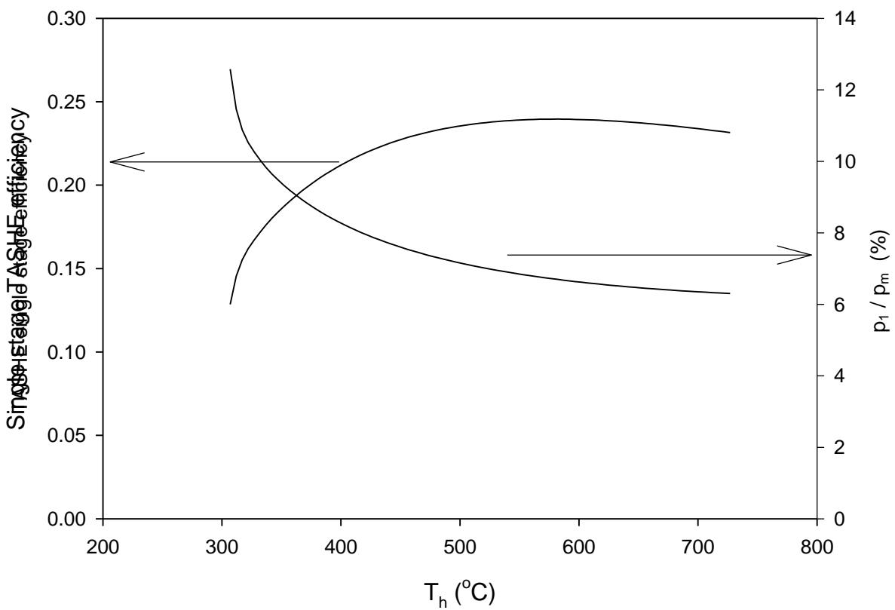  
Figure 6. APU engine performance.

## III. Chiller DeltaE Model

The optimized DeltaE model of the APU engines was used as the starting point for a DeltaE chiller model, initially keeping the same geometry for both cases. The metal temperature of the hot heat exchanger was brought down to 0 C, making it the cold heat exchanger, while leaving the metal temperature of the ambient exchanger at 100 C for the rejection of heat from the chilled load. The hydraulic radius of the stacked screen regenerator, a measure of its pore size, was then varied between 0.010 mm to 0.045 mm. The greatest cold heat pumping power of 4647 W, equivalent to 1.32 tons or 15,850 BTU/hr of air conditioning, occurs with a regenerator hydraulic radius of 35 microns, the same value as for the engine, which is a bit surprising given the substantial temperature change between the engine and refrigerator, and thus a change in the thermal penetration depth of the gas from 200 microns in the engine to 141 microns in the chiller. This highest power chiller has a first law efficiency (cold heat power / acoustic power consumed, or Coefficient of Performance) of 0.976, which is 35.7% of the ideal Carnot efficiency based on the metal temperatures (a non-conservative assumption) of the heat exchangers. The best first law efficiency of 1.075 occurs with a regenerator hydraulic radius of 27 microns, pumping 4196 W (1.19 ton, 14,300 BTU/hr) of cold power in a single stage, with an efficiency relative to Carnot of 39.4%. The chiller performance depends on system-wide assumptions made about poorly defined external heat exchangers, but the performance is pretty good as is at this stage in the optimization.

## IV. Piezoelectric Alternator Progress

A strength of materials calculation for the flexing diaphragm coupling to the wagon wheel alternator was performed. This calculation is necessary for the design of the alternator diaphragm, to determine the moving mass of the diaphragm, and to set the operating frequency of the thermoacoustic system. The theory of flat plates was extended to an azimuthally corrugated circular plate with a rigid center. The rigid center can move axially as a piston. The plate is loaded by acoustic pressure, inertial forces, and the reaction force from the alternator. A solution consisting of a superposition of six radial functions was found. Four equations in four unknowns were developed after applying a clamped boundary condition on the diaphragm outside diameter and a sliding boundary condition at the rigid center, which when solved gives the design parameters of the diaphragm. The algebra is complicated enough that these equations were solved with the aid of a computer. Unfortunately, no acceptable solution has yet been found with this relatively simple corrugated diaphragm design. Alternatives to the corrugated diaphragm for coupling methods between the thermoacoustic-Stirling engine and the wagon wheel alternator include a novel segmented diaphragm, a conventional bellows, a welded “ripple" bellows, or a clearance seal piston often used in conventional modern Stirling engines. These have been explored, but not to completion.

Instead, a new configuration for the alternator has been pursued, mostly in the context of a related Navy thermoacoustic generator program, that should also be useful to this DOE truck program. The new geometry is quite a bit simpler and thus should be less expensive to manufacture. It may also have about a quarter of the moving mass, allowing about a doubling of the operating frequency, and thus higher acoustic powers and efficiencies. Calculations in this report assume the use of the older, heavier wagon wheel alternator design, however.

## V. Recuperator and Burner Configuration

The original concept for the thermoacoustic system includes a simple recuperator to improve the burner efficiency of the APU, consisting of a combustion air intake tube surrounding the main diesel and APU combustion products exhaust duct. Before the feasibility of this recuperator can be determined, some aspects of the burner configuration need to be explored.

The stoichiometric adiabatic flame temperature resulting from burning diesel fuel with unheated combustion air is about 2025 C, and with preheated combustion air could reach 2500 C, way over the melting point of thermoacoustic hot heat exchangers made from any practical materials. One technique to avoid melting the heat exchangers is shown in Fig. 7. A fan blows ambient air at temperature $T _ { a a }$ into the recuperator which brings it to a hot air temperature $T _ { h a }$ This air passes (behind the thermoacoustic Stirling engines in the figure) to the burner to be used for combustion. The mass flow rates of the combustion products, combustion air, and fuel, are $\dot { M } _ { c p } , \ \dot { M } _ { c a }$ , and $\dot { M } _ { f }$ , respectively. For a stoichiometric burn, the ratios of $\dot { M } _ { c p } : \dot { M } _ { c a } : \dot { M } _ { f }$ are $1 . 0 0 0 : 0 . 9 3 4 : 0 . 0 6 5 2 $ SO $\dot { M } _ { c p }$ and $\dot { M } _ { c a }$ are nearly the same. The temperature of the combustion products, which starts at the adiabatic flame temperature of nearly 2500 C, drops considerably as heat, indicated by the pale pink arrows, is pulled out by the thermoacoustic hot heat exchangers HHX1 and HHX2. For better burner efficiency, much of the heat value of the combustion products exhaust stream is used in the recuperator to preheat the combustion air, further lowering the exhaust temperatures from $T _ { h e }$ on the hot exhaust end to $T _ { a e }$ on the ambient exhaust end. The lost heat value of the exhaust is given by $\dot { M } _ { c p } c _ { p } \big ( T _ { a e } - T _ { a a } \big )$ The two thermoacoustic stages convert some of the heat $Q _ { h }$ they absorbed from the combustion products into useful acoustic power $W$ , and reject the rest $Q _ { c }$ into their internal ambient heat exchangers AHX1 and AHX2.

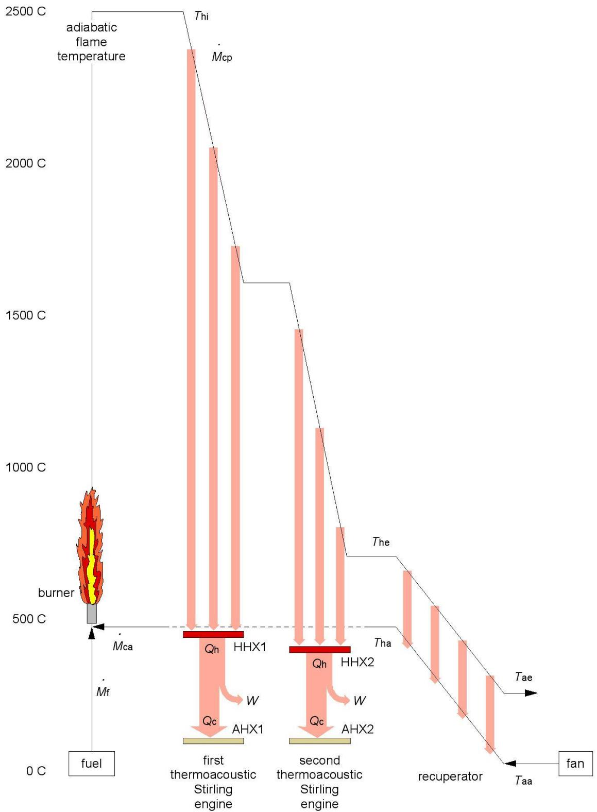  
Fig. 7. Burner/Recuperator Scheme 1. Vertical height roughly indicates temperature.

In this first scheme, the fuel rate is throttled to balance the flame heat being put into the system against the heat being pulled out by the heat exchangers thermoacoustically, such that the peak metal temperature stays acceptably low. Because a very large temperature drop must occur between the adiabatic flame and the heat exchanger metal, the heat exchangers must be in relatively poor thermal contact with the combustion products, and their thermal contact should vary dramatically with position so that uniform heating can be achieved with the radically changing combustion products temperature. However, this scheme is inconsistent with the need to design the thermoacoustic hot heat exchangers to be in good thermal contact with the exhaust side when heated by the relatively low temperature main diesel engine exhaust in the waste heat driven mode. Since the heat exchangers need to be designed to be in good thermal contact with the main diesel exhaust, this technique, if attempted, would result in the input end of the first hot heat exchanger running at the appropriate temperature but the rest of the heat exchangers running much too cold. The basic problem is that the hot heat exchangers must be designed to work with the relatively high flow rates and lower temperature of the diesel exhaust which is a problem for the APU mode. For the system to function as an APU, the flow rate through the heat exchangers should be greatly increased over the minimum needed for combustion, closer to that of the main diesel engine exhaust.

In Scheme 2, shown in Fig. 8, the fan is made much more substantial so that it can increase the flow rate through the heat exchangers by about an order of magnitude. Excess air is added to the flame combustion products bringing the exhaust temperature more in line with what the heat exchangers can tolerate. The increased flow also decreases the temperature drop from one end of the heat exchangers to the other by about an order of magnitude, in line with that encountered when used in waste heat mode. This scheme, however, puts great demands on the recuperator. The temperature difference on the ambient end $T _ { a e } - T _ { a a }$ , must be much lower than in Scheme 1 since the heat value of the exhaust lost to the ambient is $\dot { M } _ { e } c _ { p } \big ( T _ { a e } - T _ { a a } \big )$ rather than $\dot { M } _ { c p } c _ { p } \left( T _ { a e } - T _ { a a } \right)$ , and $\dot { M } _ { e } ? \ N \&$ The burner efficiency of this Scheme 2 is approximately given by $\left( T _ { h i } - T _ { h e } \right) / \left[ \left( T _ { h i } - T _ { h e } \right) + \left( T _ { a e } - T _ { a a } \right) \right]$ , where $T _ { h i }$ is the initial hot temperature of the exhaust contacting the first hot heat exchanger. Thus this scheme appears feasible with an effective enough recuperator. However, the combination of both the lower temperature difference and the high flow rate likely increases the cost and weight of the recuperator and fan substantially.

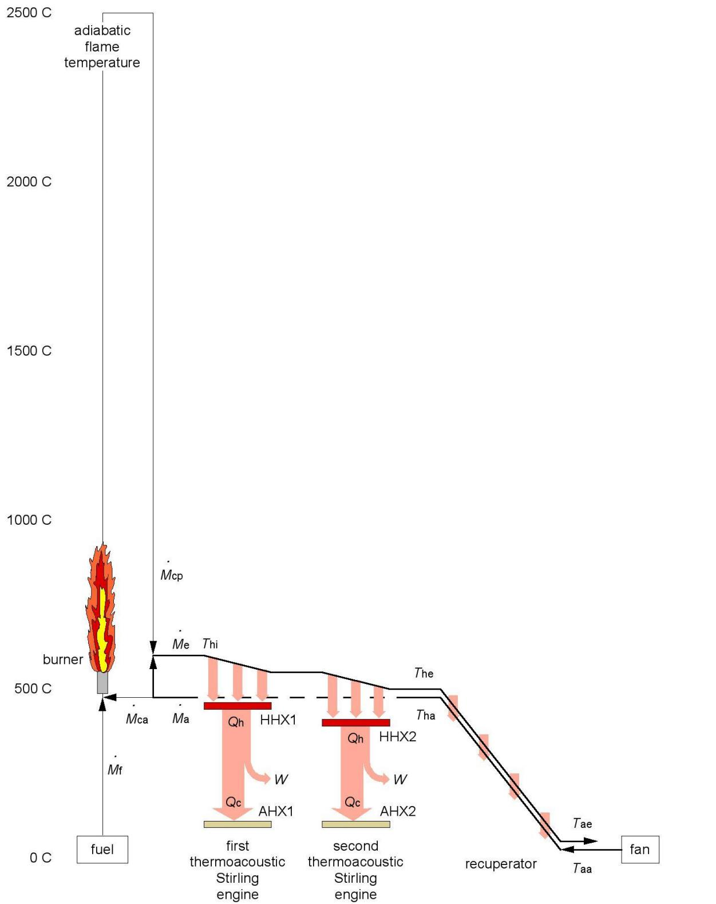  
Figure 8. Burner/Recuperator Scheme 2. The fan forces air and exhaust flow rates $\dot { M } _ { a }$ and $\dot { M } _ { e }$ to be much greater than $\dot { M } _ { c a }$ and $\dot { M } _ { c p }$ , indicated by the heavier line showing the flow past the hot heat exchangers and through the recuperator.

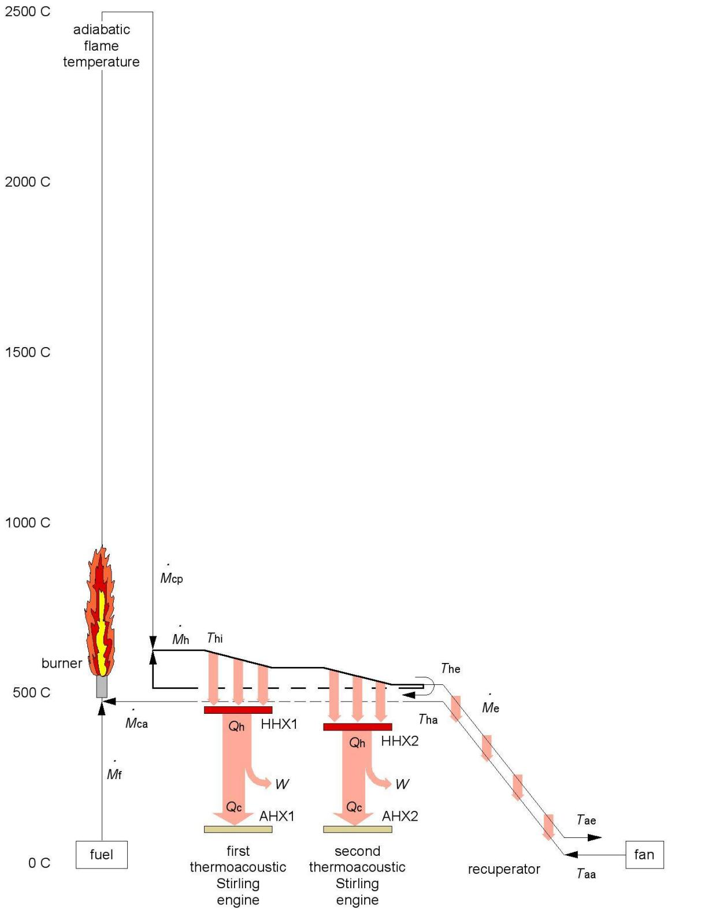  
Figure 9. Burner/Recuperator Scheme 3. Exhaust gas recirculation is used to limit high flow (shown by the heavier line) to a hot loop around the hot heat exchangers. Flow in the loop is driven by the fan and the burner.

A third scheme is shown in Fig. 9 that relies on exhaust gas recirculation. Here the fan and the expansion of gas caused by the combustion are used to hydro-mechanically drive a hot loop, shown by the heavy line in the figure. Hot combustion products on average circulate around the heat exchangers several times before exiting through the recuperator. The mass flow exiting the recuperator $\dot { M } _ { e }$ is equal to the combustion products mass flow $\dot { M } _ { c p }$ entering the loop, but both are much less than the flow $\dot { M } _ { h }$ within the hot loop. This scheme puts far less demands on the recuperator than Scheme 2, but requires the achievement of an unusual type of vortex-like flow within the hot loop. The burner efficiency in Scheme 3 is given approximately by $\bigl ( T _ { h i } - T _ { h e } \bigr ) \bigl / \bigl [ \bigl ( T _ { h i } - T _ { h e } \bigr ) + \bigl ( \lambda \mathfrak { F } _ { c p } ^ { 2 } / \lambda \mathfrak { F } _ { h } ^ { 2 } \bigr ) \bigl ( T _ { a e } - T _ { a a } \bigr ) \bigr ]$ , which is more tolerant of warm combustion products being exhausted to the ambient than in Scheme 2 because $\dot { M } _ { e } = \dot { M } _ { c p } ^ { \ }$ , carrying the lost heat, is only a small fraction of the flow $\dot { M } _ { h }$ over the exchangers.

After considering these three burner and recuperator configurations, it is now possible to make an estimate of the simple coaxial recuperator concept. The calculation was done for Scheme $^ { 3 , }$ because it is the most straightforward. The mass flow rate is estimated by using hot heat needed by the DeltaE model for the two-engine APU, of 22.8 kW, which developed 5.2 kW of useful acoustic power. It is important to note, initially neglecting the burner efficiency, that this corresponds to a fuel usage rate of 0.625 gal/hr, which is not as good as 0.3 gal/hr of the higher fuel consumption commercial APUs, but not as awful as the typical 1.0 gal/hr of an idling main diesel engine. This points out that we need to work hard to improve our poor APU efficiency by about a factor of two.

The simple recuperator is assumed to consist of a $7 ^ { \circ }$ diameter tube surrounding $\texttt { a } 5 ^ { \circ }$ diameter exhaust duct. The exhaust temperature is assumed to be 100 C greater than the air temperature throughout the recuperator. With the flow rate needed to drive the engines, the heat value lost to warm combustion products exhausting at a temperature 100 C above the ambient is 1.00 kW. Thus the burner efficiency is 22.8 $\mathbf { k W } / ( 2 2 . 8 ~ \mathbf { k W } + 1 . 0 ~ \mathbf { k W } ) = 0 . 9 5 8$ , which is quite acceptable. Flow inside this recuperator is close to being laminar (Reynolds numbers range from 990 to 4300), and heat transfer coefficients are not very good, ranging from 1.6 to $6 . 3 \ \mathrm { \check { W } / m } ^ { 2 } \mathrm { K }$ This results in the length of a simple coaxial recuperator being an unacceptably high 280 m. Therefore, the recuperator, even in Scheme 3, needs to be a fairly serious compact heat exchanger. The situation is much worse with Scheme 2. The cost and weight of this component is worrisome and needs study in Phase 2

## VI. Conclusions

The utilization of the main diesel engine exhaust waste heat has been estimated two ways, optimistically and pessimistically. The optimistic view, a slightly updated version of the estimates previously presented at the February 2005 Project Review Meeting, is shown below in Fig. 10. It was based on the rough two-stage engine DeltaE model and showed 14 kW of useful acoustic power being developed from 213 kW of waste heat, for an acoustic utilization factor of 14 kW/213 kW = 6.6%. The 14 kW was assumed to be split into a 7 kW flow into the alternator and its electronics to deliver 6 kW of electricity, and 7 kW into a chiller (or chillers) to develop 6 kW of cooling. The APU fuel consumption was estimated in February to be the same as a relatively poorly performing commercial APU unit which consumes 0.3 gal/hr of diesel fuel.

The pessimistic point of view, shown in Fig. 11, makes more conservative assumptions about the feasible regenerator area (10"diameter instead of 16"), takes a lower value of the operating frequency (240 Hz instead of 300 Hz), and is more conservative about the amount of available enthalpy in the main diesel engine exhaust stream (180 kW instead of 213 kW), but has the advantages of a higher mean pressure (200 PSI instead of 100 PSI), and the full DeltaE model for the engines. This model derived 7.5 kW of useful acoustic output from the 180 kW waste heat stream, for an acoustic utilization factor of 7.5 kW/180 kW = 4.1%. The lower acoustic power is here assumed to be split into 2.4 kW of electrical output and 4.6 kW of cab cooling. Our estimate for the fuel consumption of the APU based on similar pessimistic assumptions, including burner/recuperator efficiency, is 0.65 gal/hr.

There do not appear to be any major show stoppers apparent at this point, but there are challenges. In Phase 2 we need to focus on the inefficiencies of the system to push the pessimistic efficiency estimates closer to the optimistic predictions in order to achieve a commercially viable product. The cost of some of the non-thermoacoustic components, such as the external ambient heat exchanger and the recuperator, also threatens to be high.

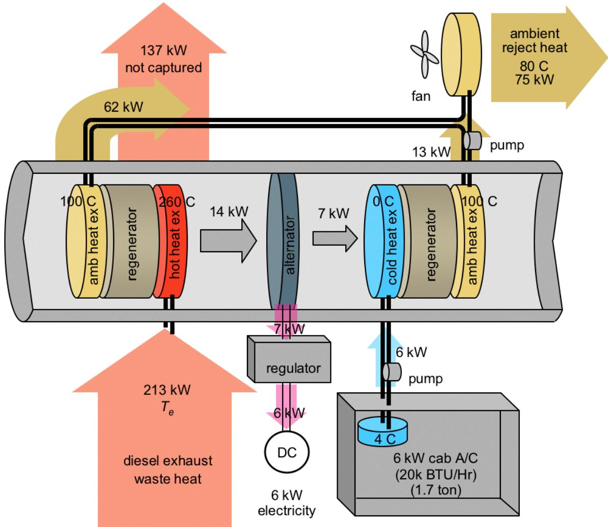  
Figure 10. “Optimistic" predictions of total system waste heat driven performance. Although only one engine is shown schematically in the figure, the power flows are the totals from a two stage engine model

  
Figure 11. “Pessimistic"predictions of total system waste heat driven performance. Although only one engine is shown schematically in the figure, the power flows are the totals from a two stage engine model

## References

1. Figure taken from http://www.dieselnet.com/standards/cycles/esc.html

Phase 2

October 2005 – March 2009

# Truck Thermoacoustic Generator and Chiller DE-FC26-04NT42113

## Phase 2 Executive Summary

The aim of this project, a DOE sponsored collaboration of Penn State, Los Alamos National Laboratory, Clean Power Resources, and Volvo Powertrain, is the design, construction and testing of a thermoacoustic generator for heavy-duty, over-the-road tractors. The program was planned with four phases. Phase 1, Applied Research, resulted in a paper study of the concept. The current Exploratory Development phase, Phase 2, is to build a laboratory prototype device. Phase 3, Advanced Development, is to build a truck-worthy device and test it in the laboratory. Phase 4, Engineering Development, is to test the Phase 3 device in a Volvo performance cell and durability cell, fix problems, and to test it on the road on a Volvo or Mack truck.

The Phase 2 design of a truck device is shown in the figure. Combustion products from a diesel burner (or in Phase 4, diesel truck exhaust) flows through two hot heat exchangers, shown in red. Not far above them are two ambient heat exchangers, which are cooled by a water/glycol mixture. Sandwiched between each pair of ambient and hot heat exchangers is a regenerator, a 1 cm tall stack of fine metal screen. These components form a pair of thermoacoustic engines— acoustical versions of Stirling engines . For experimental convenience, a large pressure vessel, not shown, drops over these components like a bell jar, mating with the flanges on either end of the hot heat exchangers. Such a large pressure vessel would not be used in a Phase 3 or commercial device. The pressure vessel is filled with 310 PSI helium gas. The gas also fills the internal spaces of the components of the figure, except for the exhaust side of the hot heat exchanger and the water/glycol side of the ambient heat exchanger.

The engines can be thought of as acoustical amplifiers. Under nominal conditions about 10 kW of acoustical power flows around a loop guided by two serpentine tubes, called the tuba and trombone, at 300 Hz in the direction of the colored arrows. Each engine amplifies this power to about 12 kW. Below each engine is a piezoelectric alternator. The alternator consists of a flexible steel diaphragm surrounded by a ring of 16 stacks of piezoelectric ceramic elements mounted to the diaphragm's rim. The internal sound wave causes the diaphragm to oscillate vertically like a drum head. Twice per cycle, as it oscillates either up or down, the diaphragm pulls inward on the ring of piezoelectric stacks. This imposes a fluctuating compressive stress on the piezoelectric stacks at 600 Hz, generating about 2 kW of electricity from each alternator. This power comes from the 12 kW of amplified acoustic power, leaving about 10 kW to be sent to the next engine and alternator—little is lost by the alternator.

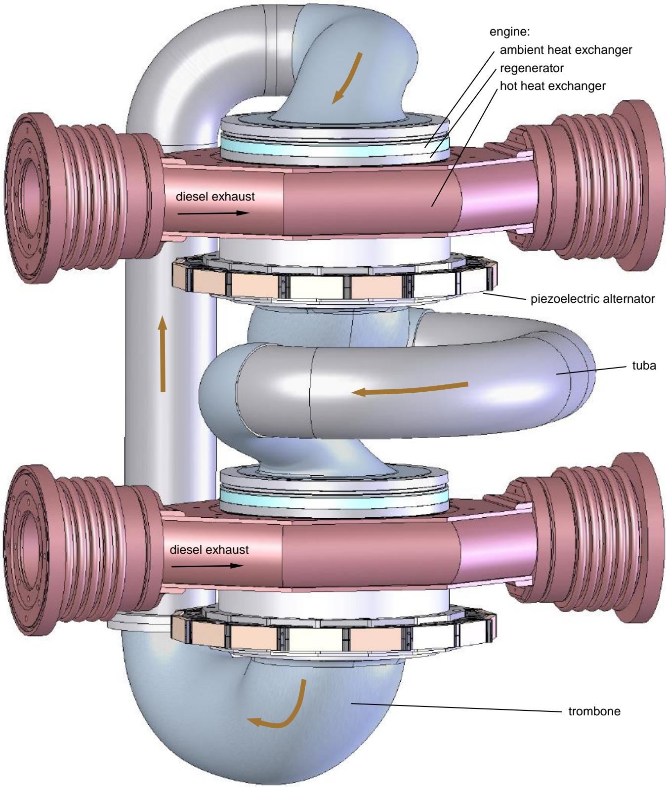  
SolidWorks model of the Phase 2 device. Colored arrows show the direction of acoustic power flow.

The generator design was optimized for the Volvo 2007 MD16 engine for flat and hilly interstate driving conditions, using PERF simulation results and test cell data supplied by Volvo Powertrain. Over both flat and hilly terrain, the generator is expected to deliver an average of 4 kW of electricity, fairly steady in the case of flat terrain, and varying between essentially zero and 8 kW on hilly terrain. Under average driving conditions, the device will impose a 3600 Pa (0.52 PSI) pressure drop with 0.40 kg/s exhaust mass flow rate. The weight of the components shown in the figure will be 255 pounds. The components could fit into a rectangular box of 28" wide x 34" high x 25" deep. This unit will be initially fired by Webasto burners. The generator efficiency (heat to electricity) is expected to be 14.8%. The burner efficiency (fuel to heat), upon which total system efficiency depends, will be poor—no effort has been made yet to improve burner efficiency.

Construction started on a 600 W “Demonstrator"prototype piezoelectric alternator coupled to an existing thermoacoustic-Stirling engine to provide a proof-of-concept test of the technology. A safe experimental area and a high-voltage instrumented load were prepared for the test.

We would like to accomplish several goals in Phase 3. Power output and efficiency estimates have slipped by about a factor of two in going from Phase 1 to Phase 2. We would like to tackle some of the energy loss mechanisms in Phase 3 and bring these numbers back up. Second is to bring the device into a more manufacturable, commercial form. No particular concern was given to the weight of the Phase 2 device. In Phase 3, internal component weight is expected to be reduced somewhat from the present 255 pounds. The Phase 3 generator will have a better engineered pressure vessel that more closely hugs the internal components. It is expected to add about 100 pounds to the internal component weight. And a Phase 3 device will be more tightly compacted, reducing each of the Phase 2 envelope dimensions by a few inches.

# Quarterly Technical Report 7 May 2006

Award: DE-FC26-04NT42113

Title: Truck Thermoacoustic Generator and Chiller

Period: October 2005 – March 2006

## Summary

This first quarterly report of Phase 2 of our project actually covers the two quarters, Oct-Nov-Dec 2005 and Jan-Feb-Mar 2006. The report consists of this summary and the barely modified technical portions of the six Monthly Communications from the reporting period.

An improved alternator design has been found that promises to be much less expensive to construct, more reliable, and better performing than the configuration in the original proposal. Unfortunately, it is not protected by a patent disclosure yet and cannot, therefore, be described in this public report. Patent protection for the original alternator configuration is proceeding. Construction of the first prototype of the improved version is proceeding (under a separate but related project for the Navy).

The thermoacoustic-Stirling engines have received much consideration and modeling. There are many configurations to choose from. To large extent, the engine configuration centers around the hot heat exchanger and hot gas ducting. A hot heat exchanger configuration and construction method has been found that looks promising and economical. Staging of pairs of engines into separately optimized first and second stage pairs (four engines total) versus a single pair of a larger stage (two engines total) is still an open question. Performance and manufacturing tradeoffs are still being made.

Basic research into tube-in-shell heat exchanger performance under oscillating flow is progressing. The reconstruction of an experimental apparatus for measuring the performance of various types of tubes is nearly complete. This work is expected to result in improved ambient and chilled thermoacoustic heat exchangers for our engine and refrigeration stages.

Low cost methods of constructing low loss, high power, piezoelectric stacks are being investigated. Some progress has been made although the results are not yet ready to be made public. It is critical to the commercial viability of our device that an economical method of constructing these high performance stacks be found.

Some preliminary work into the control system for our device has been made. It is planned the thermoacoustic engines will run at nominally constant temperature, with their acoustic amplitude varying in response to varying electrical and air conditioning loads. To achieve this, an electrical circuit will modulate the load presented to the engines by the piezoelectric alternator. Some of the system wide consequences of different loads are described in an Appendix, below.

## October 2005

Between February and September 2005, Phase 2 of this program was on hold, but nevertheless there have been developments that benefit the program. It was decided during that period to pursue a simplified, more compact, higher frequency alternator geometry discovered in February, which have now gone through a few design iterations. Additionally, Scott Backhaus has built and is debugging a thermoacoustic-Stirling engine that has similarities to what we will need for our work with trucks. He has been identifying possible sources of inefficiencies in pancake geometry (short, wide aspect ratio) thermoacoustic-Stirling engines.

During this reporting period, Douglas Wilcox II has joined our team. Doug is an incoming M.S. student in the Penn State Graduate Program in Acoustics and brings a solid mechanical engineering background to the project. Doug should be helpful with the design of our device and be an additional set of hands to help build it.

Lastly, David Van Tol has applied for and received a grant from the Office of Naval Research (N00014-00-G-0058) to increase the power output from electroacoustic sonar transducers by developing the same type of low-loss, low-cost piezoelectric stacks that we need for trucks. Dave is using this work to obtain his doctorate degree, and it will tie in very nicely with the work he is doing with us.

## November 2005

Scott Backhaus has been comparing various engine layouts. The basic sizing of the engine was made in Phase 1. The concern now is how to implement the hot and ambient piping. Implicitly in Phase 1 we assumed the use of an engine with cylindrical heat exchangers and a cylindrical regenerator surrounded by an annular inertance, the layout we are using for the Navy engine. In this case, the hot exhaust ducting nominally needs to make three penetrations to reach the hot heat exchanger—the pressure vessel, and two annular shells around the heat exchangers. Five different layouts are being compared against each other for thermal stress in the regenerator shell (assuming three different high temperature alloys: 316 stainless steel, Incoloy 800H and Incoloy 909), difficulty of heat exchanger piping, difficulty of engine manufacture and amount of dead space between the engine and the alternator. This analysis continues.

John Brady has adapted our oscillating flow heat transfer measurement apparatus for use with tube-in-shell heat exchangers. The apparatus was built by a previous student for use with finned heat exchangers. We are interested in tube-in-shell exchangers because we believe we might have a low cost manufacturing method for them in the size range useful for thermoacoustic devices. Los Alamos pioneered the use of tube-in-shell heat exchangers in thermoacoustics, although the Los Alamos exchangers have been very labor intensive to construct. The exchangers have helium oscillating inside the tubes, and an external heat transfer fluid passing around the outside of the tubes, such as a water-glycol mixture for the ambient exchangers or combustion products for the hot exchangers. The heat transfer and pressure drop characteristics of this class of exchangers have not yet been well characterized on the oscillating flow side. Our test apparatus pushes an oscillating air flow through two heat exchangers under test, with a range of oscillation amplitudes and frequencies. The upper exchanger is warmed with a hot water loop and the lower exchanger is chilled with a cold water loop. Heat transfer between the two exchangers is measured by the temperature change in the water passing through each of the exchangers, yielding the heat transfer coefficient and the heat exchanger effectiveness. The oscillating flow pressure drop is also measured, yielding the drag coefficient John has stretch out the test apparatus to measure the heat transfer between two long cylindrical tubes placed end-to-end, as a model of a pair of tube-in-shell heat exchangers. By using tubes of various lengths, we expect to be able to separate out the contribution from the cylindrical body of the tubes from end effects of the tube. Because our manufacturing method will allow us to tailor the shape of the tubes, John will also be testing other tube shapes and various end conditions. We have found that he has sufficient heat transfer sensitivity to model a tube-in-shell heat exchanger with only a single tube, but that the test apparatus has problems handling the higher pressure drop caused by having only one tube per exchanger.

Robert Keolian has been working with a brazing vendor on techniques for fabricating the piezoelectric alternator. A survey of high fatigue strength alloys has also been made, identifying the precipitation hardening stainless steels PH 15-7 Mo, PH 13-8 Mo, and 17-7 PH, as the highest endurance limit materials available for the alternator. PH 15-7 Mo and 17-7 PH are available in the thin sheets we need for the alternator, and their heat treatment is compatible with the braze. They can be pricy, but fortunately, not much material is needed. Also this month, the dimensions of an arch structure needed in the alternator have been optimized for low stress and buckling. The stresses in this potentially troublesome component look like they are under control.

## December 2005

The thermoacoustic-Stirling engines we will be using to drive the piezoelectric alternator will have a very wide, short, pancake-like aspect ratio. Scott Backaus has constructed and is testing the first such extreme aspect ratio engine as part of our Navy project. Measured efficiency has been below that predicted by the DeltaE numerical model. We have long suspected streaming problems (eddy-like steady flows) in the thermal buffer tube acting as a thermal short between the hot heat exchanger and the secondary ambient exchanger. Scott seems to have figured out, however, that the real problem is a radial temperature gradient across the face of the regenerator. A relatively small heat leak near the perimeter of the hot heat exchanger causes the center of the regenerator to be substantially hotter than the outside. By modeling an engine with two regenerators in parallel, one representing the center with a higher hot temperature and one representing the outer annular section with a lower hot temperature, Scott has been able to account for the majority of the performance deficit. Non-uniformity of the hot side temperature is causing a much larger efficiency hit than we would have guessed. This is good news for us, as it points to what we have to do in our engine for trucks—concentrate on the quality of the hot heat exchangers and relax a bit about the thermal buffer tube. It also points out another advantage for using exhaust gas recirculation—to provide better uniformity of the hot side temperature.

Keolian has been concentrating this month on getting the final design of the first fullpower Navy alternator to the machinists, working out brazing and machining issues. Finite element analysis results are encouraging at this point, showing that the material stresses may be under control at last. They also indicate that a large simplification can be made to the design. A complicated radial groove that would be difficult to machine appears to not be giving as much benefit as expected. This result is a bit surprising and is being checked. If it holds up, the groove can be eliminated with only a minor penalty in performance. It was also realized that there is a magic diameter for the alternator, which turns out to be very close to the diameter that the design has been evolving to. At this diameter, the tension dependent bending stresses that have been causing so much trouble to the design go away. At the proper amplitude, the acoustic pressure can be used to balance the effects of membrane tension to reduce the bending stresses on a critical joint near the PZT ring. Taking advantage of this fortuitous result will greatly simplify the manufacture of our alternator.

The business structure of our enterprise has been receiving the attention of Bob Price. Through his contacts with the Pittsburgh Technology Council and the National Robotics Engineering Center, he has been lining up manufacturers for our device. Bob is also acquiring data acquisition equipment for use in experiments with two diesel fuel burners that he has. (See an impressive video of the DARPA-NREC Spinner vehicle that Bob has worked on at http://www.rec.ri.cmu.edu/projects/ugcv/videos/index.htm, and other links at: http://www.rec.ri.cmu.edu/projects/ugcv/description/index.htm.)

## January 2006

The piezoelectric stacks threaten to be the most expensive item in our device, so they deserve some special attention. For the best performance, the piezoelectric ceramic should be used in its “3-3" mode, meaning that the stress is applied in the same “3" direction as that in which the electric field is developed. An example of such a stack under construction for another piezoelectric alternator project is shown in Fig. 1. The 3 direction is through the thickness of the PZT elements.

In this stack, the PZT layers are 1 mm thick. When a 7000 psi peak amplitude oscillating stress is applied along the length of the stack, each stack is expected to produce 250 W of electric power in the form of 0.44 ARms at 570 VRms. This voltage is high for our purposes. Thinner PZT layers would give a lower voltage and higher current, keeping the power the same for a given volume of PZT. The cost of the stack goes up, however, with more layers of thinner PZT elements.

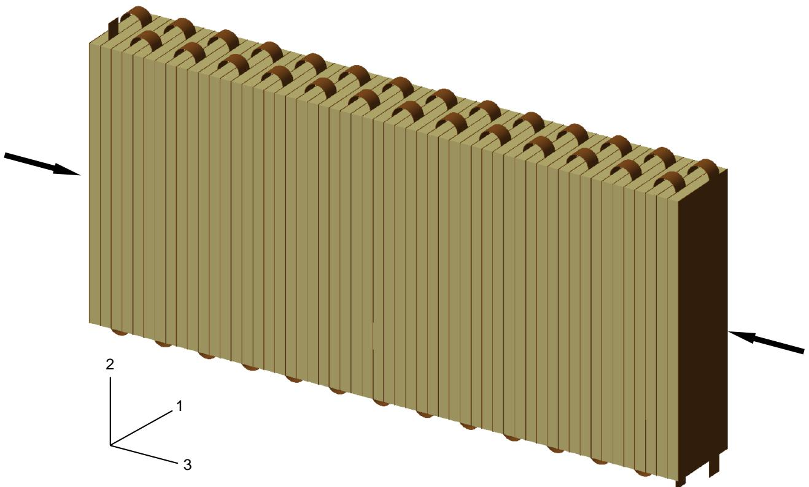  
Figure 1. Stack of 54 piezoelectric ceramic PZT elements (khaki), 2.25" long, $1 . 0 0 ^ { \dag }$ high and $. 3 0 ^ { \circ }$ wide. Oscillating compressive stress, indicated by the arrows, is applied in the 3 direction. Two sets of interdigitated beryllium copper electrodes (brown) make contact to the faces of the elements.

The usual practice in assembling stacks such as this is to use non-conductive epoxy to bond the PZT elements to the electrodes. The electrodes are able to make electrical contact to the silvered layer on the surface of the PZT if the epoxy layer is thin enough. There may be metal-metal contacts between the electrode and the silvered layer at high points in the surfaces, as well as capacitive coupling through the thin layer of epoxy. The epoxy is needed to mechanically fill in the gaps between the high points. Otherwise there would be high stress concentrations where the surfaces touch, and the compliance of the joint would be too high. The epoxy also holds the stack together. The bad news is that such joints will overheat in continuous duty operation. Most epoxies have a compliance which is about 20 times higher than the PZT, and mechanical losses that are 10-100 times greater than PZT. So, for example, if the PZT is $. 0 4 0 ^ { \circ }$ (1 mm) thick and there are two .001" thick epoxy joints per PZT element, the total epoxy thickness will be 1/20th of the total PZT thickness. But if the epoxy is 20 times more compliant, then the total squeeze of the epoxy will be about the same as the PZT. Both the epoxy and the PZT will therefore store about the same amount of mechanical potential energy. The stored reactive mechanical power in the PZT is roughly 250 W / ${ k _ { 3 3 } } ^ { 2 } = 5 2 5$ W, where $k _ { 3 3 } = 0 . 6 9$ is the 3-3 coupling factor for the PZT. The PZT formulation has been chosen to be PZT807 from Morgan Electro Ceramics because it has the lowest mechanical and electrical dissipation of any PZT identified. The mechanical Q of PZT807 is estimated to be 250 at high amplitudes, so 525

W / 250 = 2.1 W is turned into heat in the PZT. The mechanical Q for many epoxies at room temperature is around 40, but deteriorates rapidly to about 2.5 at the so-called glass transition temperature, which varies from about 60 C to 110 C depending on the epoxy. So at room temperature the power dissipated in the epoxy joints of one stack would be about 525 W / 40 = 13 W, but as the temperature rises, the power dissipated would approach 525 W / 2.5 = 210 W. Such high levels of dissipation would ruin our efficiency if the stacks could be kept cool enough, and lead to thermal runaway and destruction very easily if the stack should start to warm up. Silver conductive epoxies have even worse mechanical dissipation than non-conductive epoxies, which is why they are not used in this type of joint. Jack Hughes has been advising a series of students studying PZT-electrode joints made with epoxy.

Another approach to assembling this type of 3-3 stack is to polish the surfaces of the PZT to optical flatness and assembling the stack dry, without any epoxy. The idea is to have as much contact between the high spots of the PZT elements and the electrodes as possible, minimizing stress concentration and excess compliance. With as many layers as we have, this could be a very expensive way to proceed.

David Van Tol and Robert Keolian have been investigating joining techniques involving all-metal joints between the electrodes and PZT elements. As part of that work, pair of small Utah companies working together have been identified for assembling the stacks of Fig. 1. They have a proprietary technique for using tin as the bonding agent between the electrodes and PZT. The tin is soft enough that it can deform to fill the small gaps between the PZT and the electrode, but stiff enough and low enough in dissipation that thermal runaway should not be a problem. A different large company offers a similar joining technique. These techniques do not come cheap though. The Utah companies will be charging close to a thousand dollars per stack for assembly, although the cost will come down by several hundred dollars for a second set. The large company is asking even more although they have not yet submitted a formal quote. These costs need to be added to the cost of the PZT ceramic itself, which is several hundred dollars per stack. Hence the reason to worry about the costs of stacks for our truck project. Our device could have 24 to 36 of such stacks. Hopefully we will succeed in our efforts to develop a cheaper method of making 3-3 stacks.

There is a backup plan, however. We could use PZT in its 3-1 mode, as shown in Fig. 2. Here, the stress is applied in the “1" direction, perpendicular to the “3" direction of the electric field.

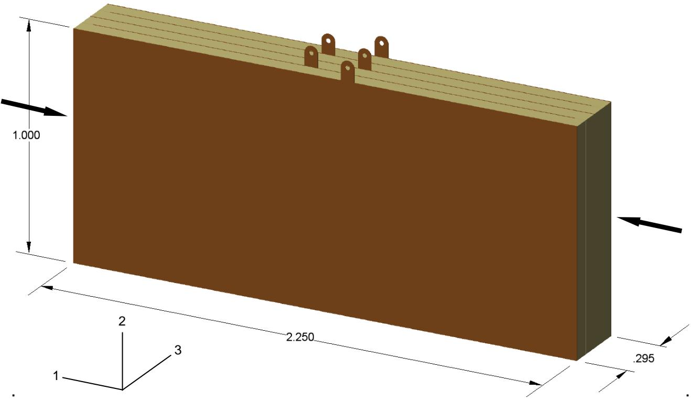  
Figure 2. Stack of four PZT elements in a 3-1 configuration. Oscillating compressive stress, indicated by the arrows, is applied in the 1 direction. There are three grounded electrodes and two high voltage electrodes.

We should be able to use lower cost epoxy joints in this type of stack. In the Fig. 1 case, the epoxy is mechanically in series with the PZT, so both the PZT and the epoxy have the same stress. But in Fig. 2, the epoxy is mechanically in parallel with the PZT, so the PZT and epoxy have the same strain. Because the stress on the PZT will be about the same in both the Fig. 1 and Fig. 2 cases, and the stiffness of the epoxy is about 20 times less than the stiffness of the PZT, the stress on the epoxy is about 20 times less in Fig. 2 than in Fig. 1. Because the power dissipated per volume of epoxy is proportional to the square of the stress, and the volume of epoxy is about the same in both cases, the power dissipated in the epoxy is about 400 times less in Fig. 2 than in Fig. 1, which should not be a problem. The Fig. 2 stack is also cheaper because there are many times fewer PZT elements.

The down side of the Fig. 2 stack is its performance. For the same applied stress and for the same 1 mm thickness of PZT elements, the 3-1 stack delivers 2.5 times less voltage through the same output impedances, so the output power is 6 times less—a serious blow to performance. (The stack in Fig. 2 was drawn with 1.8 mm thick elements instead of 1.0 mm elements to take advantage of the lower voltage.) An additional problem is that applying compression in the 1 direction tends to de-pole the ceramic, more so than the case of applying compression in the 3 direction as in Fig. 1. Therefore, the maximum stress we can apply to the Fig. 2 stack is less than the Fig. 3 stack, perhaps by a factor of 2/3. We could make up for these effects by using more PZT, but that puts more stress on the flexing parts of the alternator. The time to carefully go through these trades is closer to Phase 3 of the project when we should know if we can make an inexpensive 3-3 stack and ignore these performance hits.

## February 2006

John Brady has just about completed the latest modifications to his oscillating flow heat transfer apparatus. Recall that John is developing heat transfer and drag data for tube-in-shell heat exchangers that should be useful, especially for the cold and ambient heat exchangers of our device (see the 11/05 Monthly Highlight). We realized that because his test exchangers are a pair of long thin tubes (10" long by .685" ID) placed end to end, the pressure drops in the rig will be much higher than the rig was originally designed to handle. The pair of old large rubber bellows that had been used to push the air flow through the heat exchangers under test has been replaced four low friction carbon pistons in glass cylinders from Airpot Corporation. The dead gas volumes on either side of the heat exchangers under test have been dramatically reduced to raise a troublesome double-Helmholtz resonance frequency above the experiment's range. And a detailed model of the system's flow impedances and compliances has been made so that an accurate prediction of the flow within the heat exchangers under test can be made from a measurement of the displacement of the pistons. John believes he can now predict the flow in the heat exchangers to about a 1% accuracy.

A new type of gas-gas heat exchanger is being developed for use on the hot side of the engine. It is important to settle on the hot side construction early. Many decisions about the engine geometry flow naturally from decisions about the hot side exchanger. Doug Wilcox is calculating the viability of the new heat exchanger.

Robert Keolian visited Scott Backhaus at Los Alamos in part to talk about truck issues and view Scott's latest thermoacoustic engine.

The US Patent and Trademark Office made their first office action on our patent application for a thermoacoustic piezoelectric generator. Most of the specific claims were allowed, but the general claim of a thermoacoustic engine coupled to a piezoelectric alternator that functions as the resonating mass was rejected as being an obvious combination of prior art. We do not agree, and have appealed that decision.

A lengthy description of the stability of a thermoacoustic engine under various load conditions appears below in an Appendix. A non-public appendix containing proprietary technical information and business strategies also was attached to the February Monthly Communication.

## March 2006

Scott Backhaus has been modeling the thermoacoustic engines in DeltaE, including the new hot heat exchanger concept. One aim of the new heat exchanger is to constrict the helium flow path and extending its length to allow more area for the hot exhaust and thus lower the back pressure on the tractor engine. Scott has discovered, however that the thermoacoustic engine takes a performance hit when the helium path is lengthened too much. The inertance (acoustic mass) of the helium gas in the extended heat exchanger apparently detunes the engine, substantially lowering its output power. It is therefore important to understand just how much back pressure the main diesel engine can tolerate. Various trades were made between exhaust path geometry, power lost from the main diesel engine for pushing exhaust through the hot heat exchanger, and thermoacoustic performance.

We are considering the use of a tube-in-shell heat exchanger of novel design and construction for the ambient and refrigerated heat exchangers in the thermoacoustic device. A patent search was performed and two similar patents have been uncovered. Ours appear different enough that it should be patentable, although this needs to be determined.

John Brady has completed modifications to his oscillating flow heat transfer apparatus, and is now taking data on the first of several tube-in-shell heat exchanger geometries.

Robert Keolian attended the 2006 Mid-America Trucking Show in Louisville, KY. His impressions will be attached in a future appendix.

The following is a description that appeared in the February Monthly Communication of the stability of a thermoacoustic engine under various load conditions. The P vs. ${ p _ { 1 } } ^ { 2 }$ curves described here serve as a basis for understanding the control system.

Stirling engines, of either the thermoacoustic or free-piston variety, can be thought of as resonant systems with gain. The gain is in the form of negative damping provided by a regenerator that experiences an applied temperature gradient in the appropriate acoustic environment. The power P generated by an ideal lossless engine depends on the ratio τ of absolute temperatures of the hot heat exchanger to the ambient heat exchanger, and on the amplitude $p _ { 1 }$ of the acoustic pressure swings, as

$$
P \propto { p _ { 1 } } ^ { 2 } ( \tau - 1 ) .
$$

In Fig. 1 power is plotted as a family of straight lines vs. ${ p _ { 1 } } ^ { 2 }$ with increased slope at higher τ . Linear thermo-viscous acoustic losses are also proportional to ${ p _ { 1 } } ^ { 2 }$ and any engine has some level of linear loss, also shown in Fig 1. At low temperature ratios the loss of acoustic power is greater than the gain of acoustic power at all amplitudes, and any pressure oscillations that should occur within the engine decay exponentially in time. When the temperature ratio is high enough that the power generated by the gain of the engine is greater than the power dissipated by linear losses, microscopic pressure fluctuations, which are always present within the engine, spontaneously grow exponentially in time into macroscopic sound waves. The exponential growth continues until it is limited by some mechanism, some of which are described below.

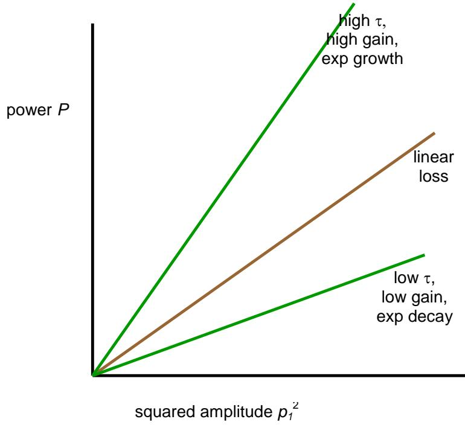  
Figure 1. Engine at various fixed temperature ratios τ .

If the engine does not have a fixed temperature ratio, but is instead driven with a fixed input power, for example by using an electrical heater instead of a traditional hot heat exchanger, the output power will be nominally independent of ${ p _ { 1 } } ^ { 2 }$ , as shown in Fig. 2. This case results in a stable operating point, where the engine power and linear loss lines cross. Below the crossing excess power is generated and the acoustic amplitude grows. Above the crossing losses are greater than gain, and the amplitude decays. Thus the crossing of the two lines describes a stable equilibrium point. The power generated by the engine is exactly equal to the power lost by the engine at equilibrium. This equilibrium is stable because deviations from the equilibrium point decay back to the equilibrium point rather than be repelled.

squared amplitude ${ p _ { 1 } } ^ { 2 }$  
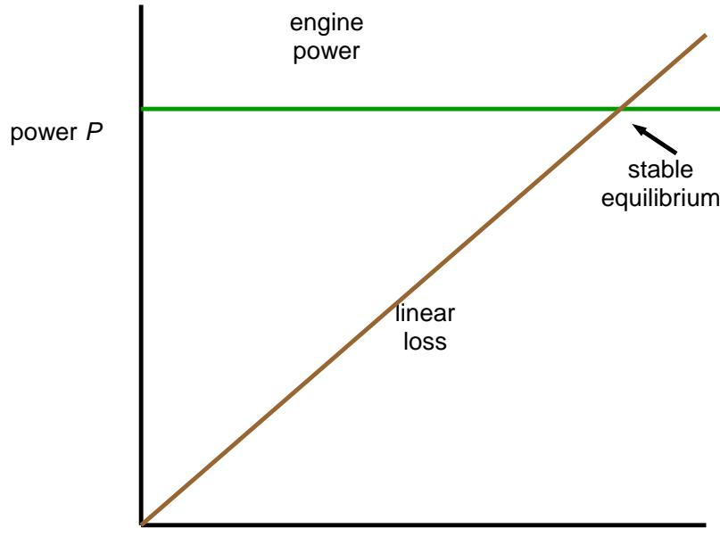  
Figure 2. Engine at fixed input power.

A common stabilizing mechanism, something in between the two previous idealizations, is a resistive limit to the amount of heat that can be supplied. Often, heat is supplied to an engine from a temperature bath through a finite thermal resistance, such that as more heat is absorbed by the engine at higher acoustic amplitudes, the temperature ratio drops at the regenerator. The thermal resistance may be a combination of resistances at the heat exchangers, such as the helium gas gas-to-metal resistance on the acoustic side of either the hot or ambient heat exchangers, a heat transfer fluid fluid-to-metal resistance on the non-acoustic side, the resistance of the heat exchanger metal itself, or other thermal resistances associated with the thermal source or ambient sink of heat. The result is shown as a down turned engine power curve in Fig 3. The crossing again describes a stable equilibrium point.

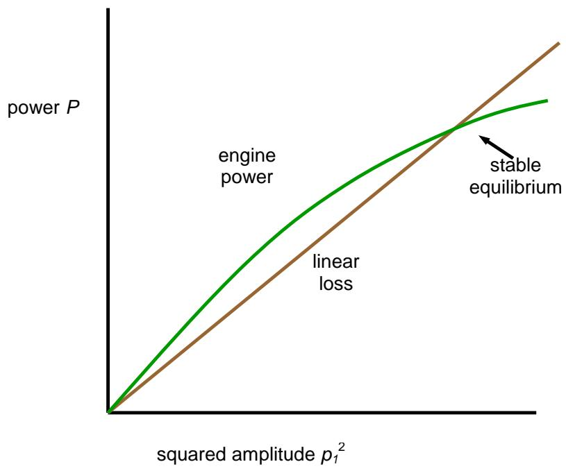  
Figure 3. Stabilizing effect of an engine with a finite thermal resistance.

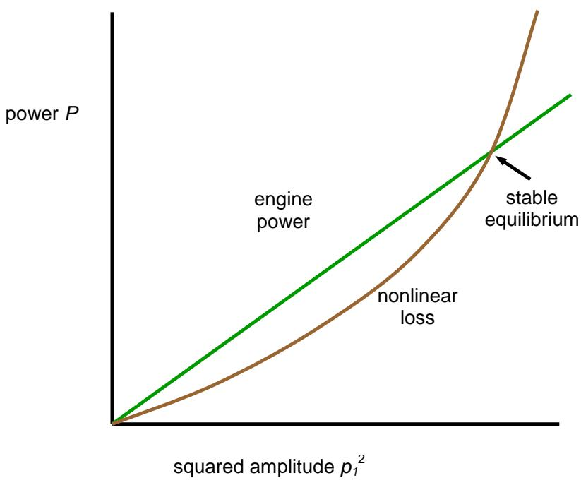  
Figure 4. Stabilizing effect of nonlinear losses.

Another common stabilizing mechanism is nonlinearity in the loss. At high acoustic amplitudes, losses from either turbulence or the so-called minor losses at transitions in flow geometries can become dominant because they cause acoustic power to be lost at a rate proportional to ${ p _ { 1 } } ^ { 3 }$ or a higher exponent. This causes the loss curve to be upturned, as in Fig. 4, resulting again in a stable equilibrium point.

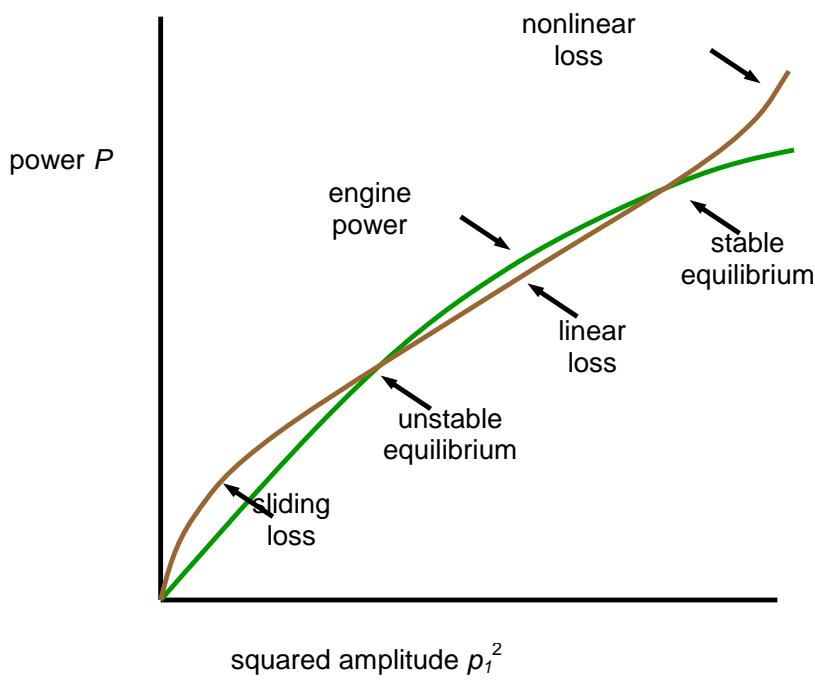  
Figure 5. Effect of sliding friction. The engine may need a kick to get started.

The case of a Stirling engine with sliding seals or with other sliding friction mechanisms is shown in Fig. 5. With sliding friction, the frictional force $F _ { f }$ is nearly a constant. The power lost to friction $P _ { f }$ is given by $F _ { f } u$ where u is the speed of the sliding contact. But since $u \propto p _ { 1 }$ $F _ { f } \propto \sqrt { { p _ { 1 } } ^ { 2 } }$ , which is singular at low amplitudes and dominates over the engine power unless the amplitude is large. This is why engines with sliding friction may need a push or kick to get them started. Once the engine is kicked past the unstable equilibrium point, given by the first crossing of the engine power and loss lines, more power is generated than is dissipated. So the amplitude continues to grow until it reaches a stable equilibrium point, given by the second crossing of the lines, drawn in Fig. 5 with both nonlinear loss and finite thermal resistance. Thermoacoustic engines are usually made with flexure rather than sliding contacts if movement of a mechanical element is needed, and so they generally do not need a kick to get started due to sliding friction. (The ability of an atomic force microscope to scan atom by atom shows that flexures can be linear all the way down to the atomic level without any funny thresholds or bumps in the stressstrain relations.)

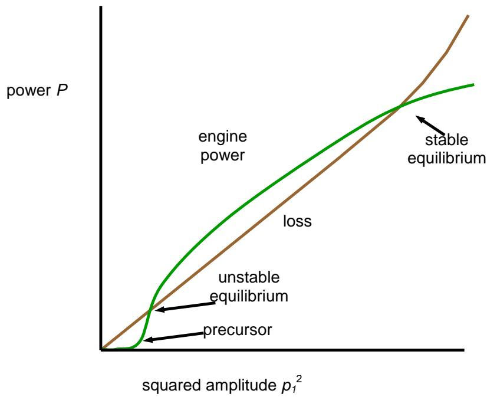  
Figure 6. Thermoacoustic engine with relatively large gaps between heat exchangers and the regenerator. This engine may need an external kick to get started.

Thermoacoustic engines may, however, display behavior similar to that caused by sliding friction if there are relatively large gaps between the heat exchangers and regenerator, the situation shown in Fig. 6. At small acoustic amplitudes, the range of motion of a helium gas parcel may be too small to bridge the gap between one of the heat exchangers and the regenerator. In such a situation, the heat transfer between the heat exchanger and the regenerator is quite small, and the output power of the engine is very low. If the engine power is lower than the losses in the engine, then microscopically small pressure fluctuations decay to zero below the unstable equilibrium point of Fig. 6, and the engine does not start without an external kick. At a high enough displacement amplitude, the parcels are able to cross the gap between the heat exchanger and regenerator. There is a sharp rise in the engine power line above which the engine is able to generate substantial power. The operation of the engine has some similarities to a "no-stack" engine that has been studied previously [R. S. Wakeland and R. M. Keolian, “Thermoacoustics with Idealized Heat Exchangers and No Stack," J. Acoust. Soc. Am. 111 (6), 2654-2664 (2002)]. However, it has been found in measurements of heat transfer across a gap [R. S. Wakeland and R. M. Keolian, “Effectiveness of parallel-plate heat exchangers in thermoacoustic devices," J. Acoust. Soc. Am. 115 (6), 2873-2886 (2004)] that the onset of substantial heat transfer is not as sharp as one might think. There is a “precursor"in the heat transfer with parcel peak-to-peak displacements that are smaller than the size of the gap. This could give the engine power curve a gradual initial upturn before the unstable equilibrium point. This ability of the gas to provide some heat transfer at parcel peak-to-peak displacement amplitudes less than the gap may explain why most thermoacoustic engines do not need an external kick to get started, even if there is a modest gap between the heat exchangers and the regenerator.

Useful electrical power can be pulled out of a thermoacoustic or conventional Stirling engine through an alternator. This represents another loss mechanism to the engine. Most linear alternators (linear in the sense that the motion of the alternator is in a line) have a linear response (linear in the sense that the output voltage and current are linearly proportional to the input force and velocity—note the two different uses of the word “linear"). If a load resistor is connected to the output of a linear response alternator, the power dissipated in the load is proportional to the square of the output voltage E and thus proportional to ${ p _ { 1 } } ^ { 2 }$ , as shown by a straight line in Fig. 7. There will be dissipative losses as well in the engine and alternator, shown by the lower line in Fig. 7. If the generator is to be useful the efficiency should be high, so the dissipative losses should be small compared to the useful transduced power. Therefore, the stability is dominated by the load and not the dissipation. The lack of a stable equilibrium point in this figure shows that an engine with a linear response alternator and a resistive load has a tendency toward instability.

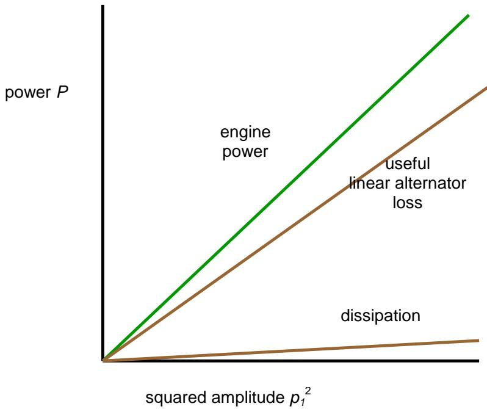  
Figure 7. Instability of engine loaded by linear response alternator and resistive load.

The ARL piezoelectric alternators considered so far, however, have a quadratic, rather than linear, response. The output voltage is proportional to the compression applied to the PZT. But this compression on the PZT depends on the square of the diaphragm displacement. The acoustics causes the diaphragm displacement to be proportional to $p _ { 1 }$ . And so, $E \propto { p _ { 1 } } ^ { 2 }$ . For a resistive load, the output power $P \propto E ^ { 2 } \propto { p _ { 1 } } ^ { 4 } \propto \left( { p _ { 1 } } ^ { 2 } \right) ^ { 2 }$ , which is plotted as a parabola in Fig. 8. There is a robust stable equilibrium where this load curve crosses the gain curve of the engine.

Therefore, an engine running with a constant temperature ratio is stable when loaded by a quadratic response alternator and a resistive load.

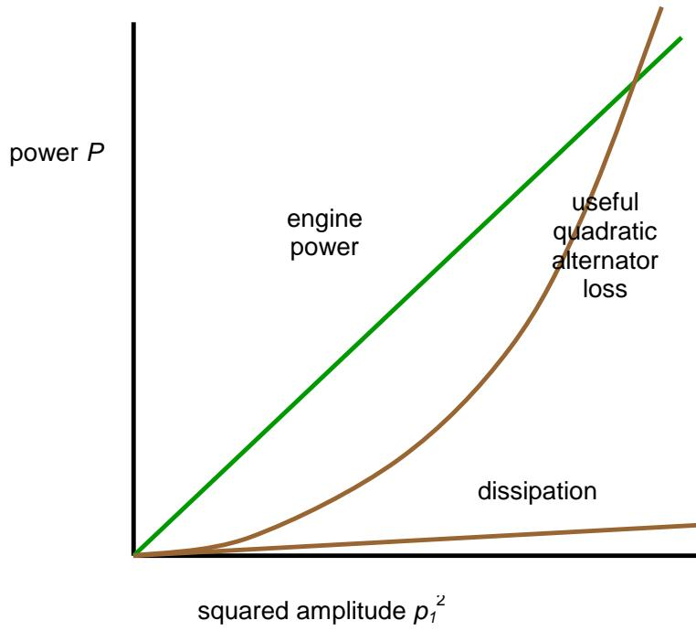  
Figure 8. Stability of engine loaded by quadratic response alternator and resistive load.

If either the linear or quadratic response alternators is loaded by a modern switching voltage regulator, the stability situation is quite different. Switching regulators can convert voltages from low to high values, or high to low values, and can convert any permutation of AC or DC into AC or DC, all with very little loss of power. These circuits act somewhat like continuously variable transformers. Power for use on the truck could be either AC or DC, but it will likely need to be regulated to some fixed nominal voltage. Such a load on the thermoacoustic engine draws a power that is independent of $p _ { 1 }$ . If a conventional regulator with an electrical load is simply attached to a Stirling generator the system will be unstable, as seen in Fig. 9. This is true whether the Stirling engine is a thermoacoustic or free-piston type or whether the alternator has linear or quadratic response. The load on the engine is constant and represented by a horizontal line. There is an equilibrium point where the load power and the engine gain meet, but the equilibrium is unstable. Should the acoustic amplitude grow a little past the equilibrium point, the output voltage will rise. The regulator will compensate by drawing less current keeping the power draw the same. More power is now being developed by the engine than is being taken away so the amplitude grows some more, repelling the system from it's equilibrium point to an indefinitely large value. Should the amplitude fluctuate below the equilibrium point, the system drives itself to no power output.

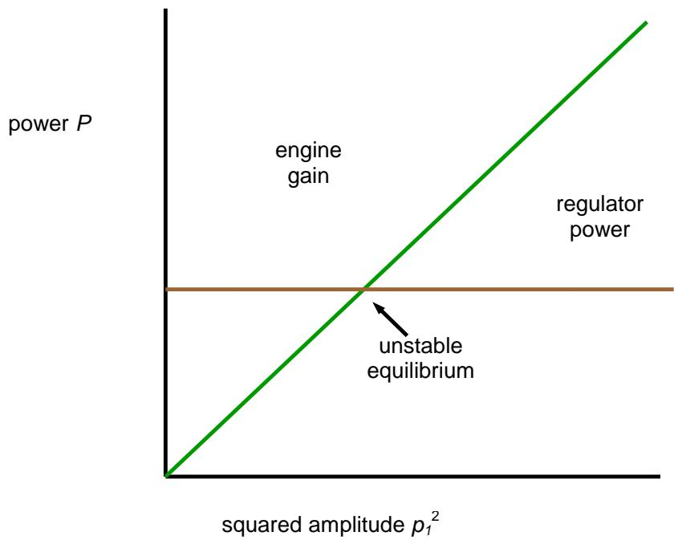  
Figure 9. Instability of an engine driving an alternator loaded by a conventional switching voltage regulator.

# Quarterly Technical Report 1 August 2006

Award: DE-FC26-04NT42113

Title: Truck Thermoacoustic Generator and Chiller

Period: April – May 2006

## Summary

Analysis of the thermoacoustic-Stirling engines has advanced to include:

• the effects of diminishing exhaust temperature down the hot heat exchanger

• tradeoff of thermoacoustic engine performance vs. main diesel engine exhaust back pressure

• the best cross sectional area of the engine

• the advantage (non-existent as it turns out) of staging the engines

• the performance over a driving cycle weighted average of exhaust temperatures.

The cost of brazing hot heat exchangers and piezoelectric alternators in production quantities was estimated and seems within budget. Brazing fatigue issues on the alternator are still uncertain. A general patent claim for a thermoacoustic engine coupled to a piezoelectric alternator has been allowed, and a new patent application for the next version of piezoelectric alternators has been prepared. We have attempted to develop a potential supplier of alternative regenerator material, with a little bit of success. There have been some positive developments moving toward lowering the cost of piezoelectric stacks. Experiments on improved cold heat exchanger geometries are proceeding.

The DOE funding for this project has been interrupted this quarter. We have been told that funding will resume in August 2006. Finances, therefore, have become quite tight.

## April 2006

## Engine Analysis

Scott's models of the thermoacoustic engine now include the effects of the temperature drop of the exhaust gas as heat is pulled out of the exhaust by the hot heat exchanger. To do this he split the core of the engine into thirds, models those thirds separately, then recombines them. To help make his models more tangible, Scott suggests the two engine geometries shown in Figs. 1 and 2. Each have plusses and minuses in terms of construction. We are still working these issues out.

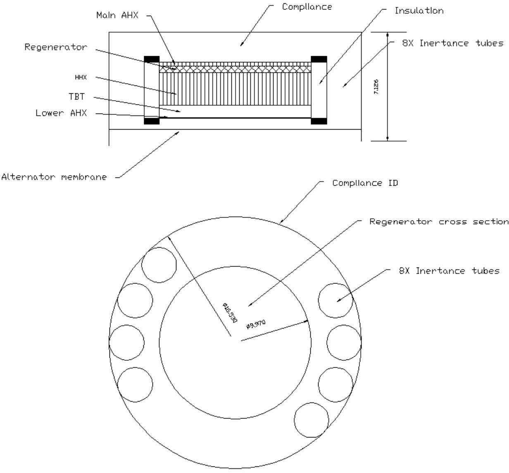  
Figure 1. Proposed tubular engine configuration.

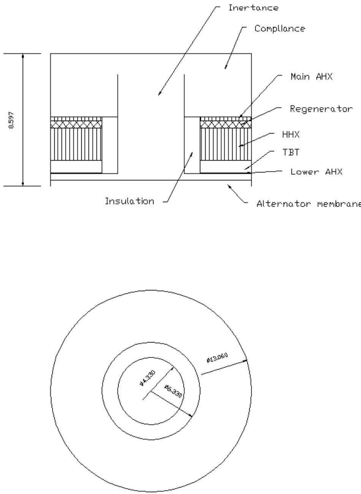  
Figure 2. Proposed annular engine configuration.

After attending the 2006 Mid America Trucking Show, we learned that engine back pressure is not as bad a problem as we thought. More on this is described in a non-public appendix to the March Monthly Communication. We have modified our engines models accordingly, but still need to check our back pressures with Volvo Powertrain.

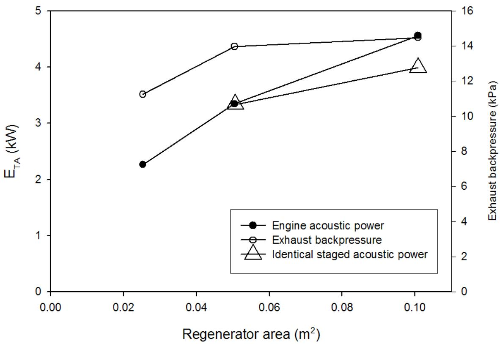  
Figure 3. Results of a sizing/staging trade study.

Scott also performed a trade study of engine area and staging for the waste heat driven engines. The end result is shown in Fig. 3. The three filled circles refer to a vibration balanced pair of $7 ' , 1 0 '$ and $1 4 ^ { \circ }$ regenerator diameter engines respectively, going from left to right. The axis on the left is $h a l f$ the total acoustic power developed by the pair $( i . e .$ the axis shows the acoustic power generated per engine). The bottom axis is half the total regenerator area. The open circles show the engine backpressure, right axis, for each engine which is the same as for a pair of engines with the exhaust ducted in parallel. The open triangles and left axis show half the total acoustic power generated by two staged pairs of engines, four engines total. The first triangle represents two pairs of $7 ^ { \circ }$ regenerator diameter engines (with the same total regenerator area as a single pair of $1 0 ^ { \circ }$ diameter engines), the second triangle represents two pairs of $1 0 ^ { \circ }$ regenerator diameter engines (with the same total regenerator area as a single pair of $1 4 ^ { \circ }$ diameter engines). For the triangles, the first stage engines and second stages engines are optimized separately, the second stage being optimized to use the cooler exhaust gasses that leave the first stage engines and the first stage optimized to use the initial hotter exhaust. To our surprise, this separate optimization did not increase the performance of the system much. At best, Scott was able to coax an extra 100W of acoustic power out of a separately optimized first and second stage system compared to a single stage system of the same total regenerator area. Apparently, because the exhaust cools down so much as it delivers heat to the hot heat exchangers, the great majority of the useful acoustic power is developed by the initial portion of the exhaust gas. It turns out, for example, considering two pairs of staged $7 ^ { \mathfrak { s } }$ engines vs. a single pair of un-staged $1 0 ^ { \circ }$ engines, that the optimization leads to the first stage of the $7 ^ { \mathfrak { s } }$ engine having nearly the same design parameters as does the $1 0 ^ { \circ }$ engine. The parameters of the second stage 7" engine can be varied by hand over a relatively large range without seriously affecting system output power because the second stage is not generating all that much power. In effect the second stage is a bottoming cycle to the first stage, and similarly, the second half of an unstaged engine can be thought of as a bottoming cycle to the first half. The optimizations end up being dominated by getting the most power out of the hottest, initial part of the exhaust gas. The rest does not matter all that much. The bottom line is that there appears to be no advantage to staging the engines, which greatly simplifies our final product. At this point we are leaning toward a either a pair of 7" or 10" engines.

The other odd thing we learned was that there is no substantial difference between evaluating the output acoustic power of an engine for a variety of exhaust temperatures and then averaging the acoustic power over the time weighted temperatures of a typical driving cycle, vs. first averaging over the time weighted driving cycle temperatures and then evaluating the output acoustic power at that single average exhaust temperature. The difference in the two averaging schemes was less than a part per thousand. As Scott pointed out early in this project (look back to the figure on page 6 of the November 2005 Monthly Communication Appendix), the output power of a thermoacoustic engine is pretty much proportional to the hot input temperature minus the hot input temperature that just gives the onset of sound. For an engine that gives an acoustic output that is linearly proportional to the input hot temperature, it doesn't matter whether the averaging is performed over the input or the output. This greatly simplifies the analysis—it is much easier to design an engine that gives the best output power to a single average temperature than to design an engine that has the best weighted average output power over a range of input temperatures.

## Brazing

We have three brazing issues to address in our project—the hot heat exchanger, the alternator, and a proprietary application. Because of this, Robert Keolian attended the 3rd International Brazing and Soldering Conference and three courses on brazing, sponsored by ASM International and the American Welding Society, in San Antonio, TX. There was some good news on all three issues learned at the meeting.

The costs for brazing a hot heat exchanger on a production basis are not outrageous. Even for vacuum nickel brazing, a high quality but expensive technique, the costs break down like this: A vacuum brazing oven costs about \$500K-\$1M depending on size. The \$1M oven gets you about a cubic meter of work space. Add to this \$10K capital cost for a high temperature jig and rack to hold and load the exchangers in the oven, and \$200K capital cost for the floor space associated with the oven and materials handling. The energy cost is about \$1000 to braze a load, and about 1 load/day can be brazed in a single shift/day. Given the size of an exchanger, say we can load 60 heat exchangers in the oven (allowing $1 0 ^ { 3 3 } \mathrm { x } 1 0 ^ { 3 3 } \mathrm { x } 1 0 ^ { 3 3 }$ per exchanger plus jig). Therefore, amortizing the oven and other capital costs over 10 years, and assuming 225 work days/year, the capital cost of the oven per exchanger works out to be (\$1.2M capital/oven) (1 oven/10 years) (1 year/225 work days) (1 work day/60 exchangers) = \$8.90 capital/exchanger. Fuel cost is (\$1000/60 exchangers) = \$16.70/exchanger, but this will get worse with time. A technician might be able to load, unload, and care for three ovens, say, and thus turn out (60)(225)(3) = 40K exchangers/year. Loaded labor cost (including fringe and overhead) per exchanger would then be about (\$70K/tech year) (1 tech year/40K exchangers) = \$1.75/exchanger. The most expensive braze filler metal we might use, Metglas nickel braze foil, costs \$18.50 per exchanger (.212 kg of 1 mil foil). Thus the braze cost per exchanger is \$8.90 capital + \$25 fuel + \$1.75 labor + \$18.50 filler metal = \$46, in today's prices, which isn't outrageous. The biggest uncertainty is in future energy prices. Thus oven braze is a viable process for the hot heat exchanger. Parent material and assembly costs are on top of this. If we need about 100K exchangers/year to satisfy Mack and Volvo demand, then we are looking at hiring two or three brazing technicians and buying seven or eight ovens with about a \$9M investment. There are also companies, at least one in Pennsylvania, that offer production brazing services with which we could ramp up production.

The alternator is also likely to be brazed. Like the heat exchanger, the brazing cost of the alternator scales with the volume of the alternator, which will be about the same as the heat exchanger, maybe a little less. But the big issue for the alternator is the high cycle fatigue strength of a brazed joint. There is surprisingly little known about this. Several braze experts were consulted on fatigue at the meeting. They agreed that the state of knowledge is meager but generally thought that because the braze joint is very thin it should take on the fatigue properties of the parent metal. On the other hand, welding experts consulted on other occasions tend to think the joints should be welded. Hopefully this question will be answered this summer in the related Navy project.

A potentially important contact was made at the braze conference that might be able to help with an application that is still proprietary at this point. He claimed to have successfully made a braze joint we have been attempting and offered to do a sample braze for us.

The conference was worth the time, although the quality of the braze courses could have been better. It was useful to talk to the many vendors at the conference. A good overview of the braze industry and brazing options was obtained. Some properties of braze alloys that are potentially useful to us were learned at the talks presented at the meeting sessions and in conversations with the vendors. Also, it was learned that to lower costs in brazed metal catalyst substrates, which have a construction similar to our hot heat exchanger, an aluminum clad steel alloy is often substituted for stainless steel. Dave Van Tol was not able to join Keolian at the conference this year, but he should consider going two years from now.

## Other Developments

After working with the US Patent and Trademark Office, our general claim of a thermoacoustic engine coupled to a piezoelectric alternator that functions as the resonating mass has been allowed.

An attempt at developing a supplier for an alternative regenerator material is described in a non-public appendix to the April Monthly Communication. Keolian's impressions from the 2006 Mid-America Trucking Show in Louisville, KY are also attached in the non-public appendix to the April Monthly Communication.

## May 2006

The US Navy Workshop on Acoustic Transduction Materials and Devices is a large invitation only gathering of material scientists and Navy transducer builders held each year at Penn State. Dave Van Tol, Jack Hughes and Robert Keolian regularly attend this event. Advances in piezoelectric materials, such as the high strain single crystal material PMN-PT $\mathrm { \small { [ ( P b ( M g _ { 1 / 3 } N b _ { 2 / 3 } ) O _ { 3 } ) _ { 1 - x } ( P b T i O _ { 3 } ) _ { x } ] } }$ , and the magnetostrictive materials Terfenol-D and Galfenol are presented here. Large strain materials would be quite useful in the design of the piezoelectric alternator. PMN-PT is available commercially although it is still quite expensive. It is studied at many laboratories, including ways of bringing the cost down. There was also useful information to be found pertaining to lowering the manufacturing costs of our piezoelectric stacks. There have been developments that point to the feasibility of low cost piezoelectric stacks with co-fired electrodes that do not use precious metals. Not much more than this can be said here because of the closed nature of the meeting.

Bob Price, Lauren Simkovich, Scott McIntyre (of CPR), and Robert Keolian met at CPR to discuss project developments and intellectual property strategy. Most of that discussion touches on proprietary information, and so is described in a non-public appendix.

An additional \$178k of funding should have come in May from the Department of Energy to cover Penn State and Los Alamos costs for June through December 2006. This funding has been delayed at least until August. We have been stretching out our funds so as not to go completely broke.

## June 2006

CPR sent Penn State a Webasto “Air Top $3 5 0 0 ^ { \circ }$ oil fired 3.5 kW air heater for experimentation. Preparations were made in the lab to safely handle combustion products and diesel fuel.

Robert Keolian spent much of June writing a patent disclosure for the new alternator configurations. He also restarted his study of power electronics in preparation for work in Phase 3 of this project.

Doug Wilcox started working on one of the new versions of the alternator. It will probably be the basis for his Master of Science thesis.

John Brady has measured his second set of tubes as a model for the cold heat exchanger. We realized, however, that we had to modify the experimental rig once again in order to eliminate a source of error caused by thermally generated pressure swings, and thus need to repeat the measurements. We are characterizing the effectiveness of heat transfer in a tube and shell heat exchanger in terms of what we believe are the most important unitless parameters: the Reynolds number Re based on tube diameter, the ratio of thermal penetration depth to the tube hydraulic radius $d _ { T } / r _ { h } ,$ and the ratio of the particle displacement to the length of the tubes x/L. But for these results in air to be applicable to helium, we should show that the heat transfer depends negligibly on the ratio of specific heats gamma, and on the Prandtl number Pr. We think that the dependence of effectiveness on gamma will depend on the existence of pressure swings in the gas, but we have yet to show this. The modification we made to the rig is to make the pressure swings negligible—we will be measuring effectiveness under isobaric conditions. Another difference between air and helium turns up in the tube aspect ratio, the ratio of the tube length to its hydraulic radius $L / r _ { h }$ . If one insists that in two experiments, the first in high pressure helium the second in atmospheric air, that the three parameters $R e , d _ { T } / r _ { h }$ and $x / L$ are the same, then it turns out that $L / r _ { h }$ in air will differ from $L / r _ { h }$ in helium by the ratio of air to helium Prandtl numbers. Since the Prandtl numbers differ slightly (.708 for atmospheric air, .678 for 200 PSI helium), the two experiments are not strictly similar. By measuring the effectiveness of heat transfer with a second set of tubes of the same radius but half the length, both in air over the same primary parameters— $R e , d _ { T } / r _ { h } .$ and $x / L$ (displacement x will be halved)—we hope to show that heat transfer effectiveness is independent of $L / r _ { h }$ which will make the results in air more generally applicable to helium. Either way, because the Prandtl numbers are so close, not being able to get the tube aspect ratio right should be a small effect.

# Quarterly Technical Report 30 October 2006

Award: DE-FC26-04NT42113

Title: Truck Thermoacoustic Generator and Chiller

Period: July - September 2006

## Summary

This quarter was a period of tight funding but a moderate amount of work. A patent application was submitted for a thermoacoustic piezoelectric generator that uses various configurations of flexible diaphragm piezoelectric alternators. A patent was also issued this quarter for a thermoacoustic piezoelectric generator using earlier configurations of the piezoelectric alternator such as the wagon-wheel configuration. Experiments on shell and tube heat exchangers were performed which motivated a new round of improvements to the experimental apparatus. A new regenerator configuration and a new engine/alternator configuration were conceived, although it is not clear whether they will be pursued vigorously at this point. A good deal of technical work on a proprietary aspect of our device was performed at Los Alamos. Efforts at reducing the cost of key components of our system and other commercialization efforts continue.

## July 2006

Jack Hughes has officially retired from Penn State, but is still working at ARL part time. Jack is Dave Van Tol's doctoral advisor for their work on bringing down the cost of PZT stacks

Kyle Kratzsch left Volvo Powertrain to move to Kentucky. Todd Reppert is our new Mack/Volvo technical point of contact. Welcome Todd.

US Patent number 7,081,699 “Thermoacoustic Piezoelectric Generator"was issued in July to Penn State. It covers alternator developments up to the “wagon wheel" style piezoelectric alternators. It also has a general claim to a thermoacoustic generator that contains a piezoelectric alternator that serves as a substantial portion of the resonating mass of the engine-alternator resonant system. The application for this patent serves as the parent to a continuation-in-part application that was also filed in July. The new application discloses piezoelectric alternators that use a flexible diaphragm to couple acoustic energy to the piezoelectric elements. This is the style of alternator we are planning to use on the truck project, and it was mentioned briefly in the February 2005 Monthly Highlight Communication. Three embodiments of the flexible diaphragm alternator are shown in the figures below

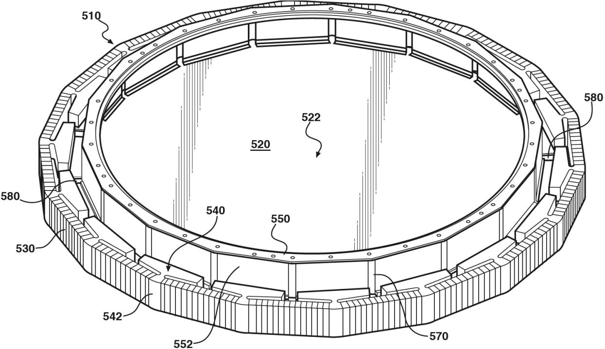  
Figure 1. Flexible diaphragm piezoelectric alternator.

In Fig. 1, the diaphragm 522, supporting struts 552, and thin arches 570 are relatively thin flexible structures made, for example, from high strength steel. The thermoacoustic engine causes the diaphragm to oscillate in the axial direction. As the diaphragm deforms in either direction, it pulls inward on keystone supports 542 which then apply a fluctuating compressive stress on piezoelectric stacks 530. The stacks convert the oscillating component of the stress into electricity.

A potential problem with the flexible diaphragm approach is the high stress that occurs in the diaphragm near its rim caused by the bending of the diaphragm while it is simultaneously under tension. The tension causes the bending to be concentrated at the rim so that the peak bending stress is much greater than it would otherwise be. The oscillating gas pressure has a compensating effect on this curvature, straightening the diaphragm at the rim if the right balance between pressure swing, swept volume, diaphragm tension and diaphragm diameter can be made. That balance may not be possible in our truck project. However, the excess curvature of the diaphragm near its rim should be controllable with two other mechanisms, one of which we will probably use.

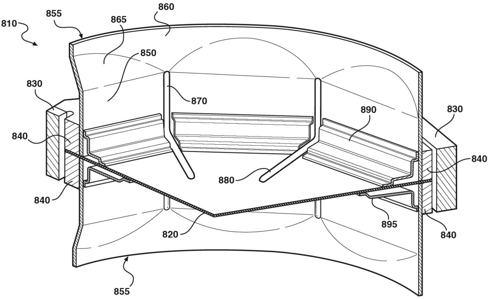  
Figure 2. Flexible diaphragm alternator with elastic foundation curvature control mechanism.

The first mechanism is shown in Fig. 2. Leaf springs 890 and 895 attach to diaphragm 820 and act as an elastic foundation that applies a small transverse (axial direction) force to the diaphragm rim where it tends to bend too much. The effect of the transverse “pressure" from the springs is similar to the effect of the acoustic pressure of used to control the curvature in Fig. 1. The operation of these springs is shown in more detail in the model of Fig. 3. The left side shows the problem of concentrated bending stress near the clamp caused by tension, the right side shows the leaf spring solution. If the joint between the leaf springs and diaphragm can be made with a process that has a fatigue endurance limit, and the stresses at the joint are kept below this endurance limit, then the alternator should have infinite life. It is hoped that vacuum furnace nickel brazing has a fatigue endurance limit and that the endurance limit is sufficiently high to make this a viable choice, but little information is available on the fatigue properties of brazed joints.

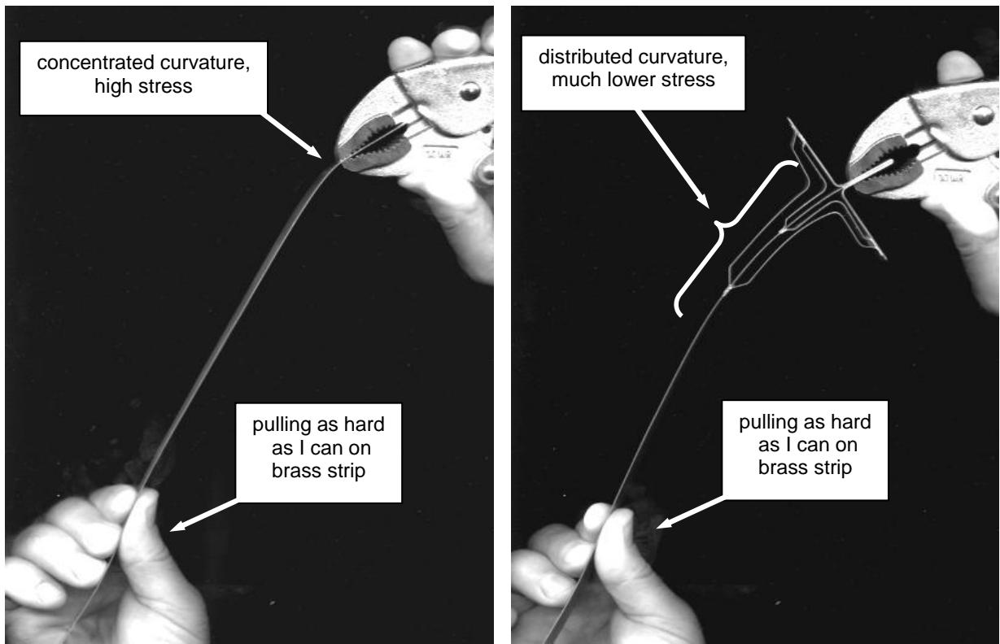  
Figure 3. Left: Simultaneous tension and bending leads to sharp curvature at the support (at the vise grips, representing the rim connection to the PZT ring). Right: Leaf springs soldered to the central brass strip apply a lateral force that distributes the curvature and lowers the stress.

The second diaphragm curvature control method, shown in Fig. 4, is more a brute force approach and its viability does not rely on the fatigue properties of a brazed joint. It is, however, potentially subject to wear, fretting, or fretting fatigue. In this method, curved guiding surfaces 690 constrain the motion of diaphragm 620 to the desired maximum curvature. The piezoelectric material 610 and 612 may be placed both above and below the diaphragm. The interaction of the diaphragm surface with the curved guiding surfaces has some similarities to the interaction of the surfaces of a roller bearing. Roller bearings have long but finite life that depends on the level of loading on the bearing. The loading on the surfaces 690 and 620 should be quite small, and so it is possible that this approach would survive over the useful life of a truck. The use of a low friction plastic on the guiding surfaces 690 might also help make this a viable alternative.

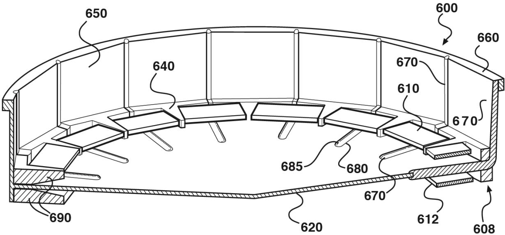  
Figure 4. Flexible diaphragm alternator with curved guiding surfaces 690.

## August 2006

A new regenerator construction method was conceived during this period. It looks like it could bring the material cost per regenerator down from about \$500 for a stack of fine mesh metal screens to about \$100 using the new technique. The new regenerator also has parallel pores, which, as Scott Backhaus has shown in previous work, should perform better than the convoluted pores of a stack of screen as long as the regenerator is fabricated with great precision. The new technique, however, involves the construction of a specialized machine for the fabrication of the regenerator. We are trying to decide if the design and construction of this machine and the resulting regenerators will become a dissertation topic for Doug Wilcox. The same fabrication techniques might be useful for heat exchangers as well.

Backhaus and Keolian performed work tracking down the costs of one of the proprietary functions of our device. The approach we were hoping to take looks too expensive to implement on a commercial device, and so we will probably revert to a lower cost approach.

Modifications to John Brady's experimental rig for measuring the performance of heat exchangers under oscillating flow were described in the June 2006 Monthly Communication. These modification were needed to greatly reduce heat flows caused by pressure swings in the experiment. In effect, because we were moving gas back and forth between hot and cold heat exchangers in a sealed system, we had poorly defined thermoacoustic heat pumping occurring, similar to the heat flows in what is known as a “no-stack" thermoacoustic engine. Some experimental results after these modifications are shown in Fig. 5.

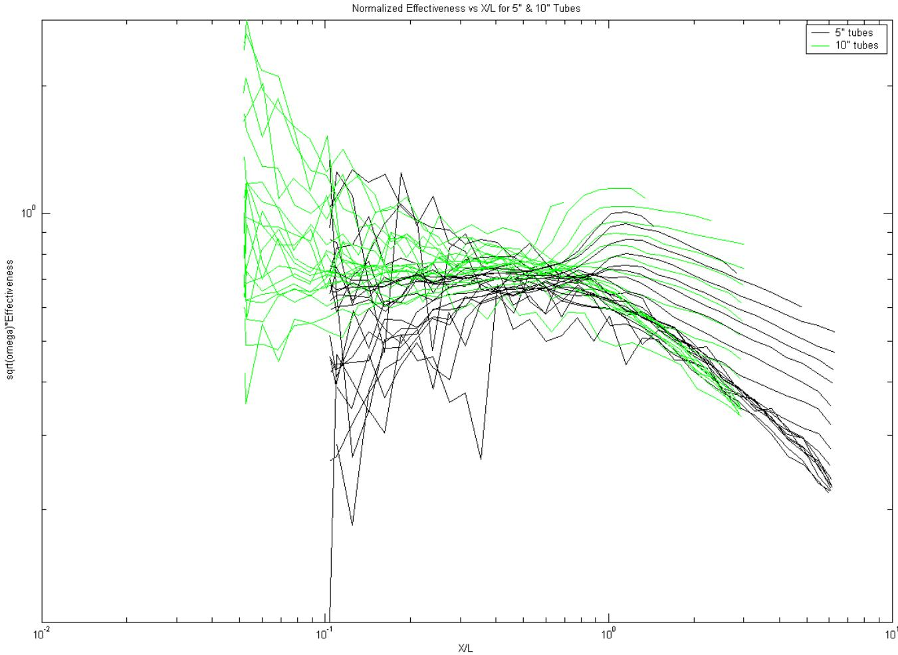  
Figure 5. Normalized effectiveness vs. x/L for tubes of length $L = 5 "$ (black) and $1 0 "$ (green).

The experiment is a geometrically scaled up version of a pair of shell and tube heat exchangers that model what we will probably use for heat exchangers on the ambient and cold sides of our engines and refrigerators. The rig measures the heat transfer between two 0.685" ID tubes, one hot, one cold. The tubes are arranged vertically with their axes along the same line, hot above the cold, with a small gap between the ends of the tubes at the center of the experiment. Air is caused to oscillate sinusoidally, flowing inside one tube, across the gap, and inside of the other tube and then back again, driven by a pair of pistons and cylinders below the lower cold tube. In Fig. 1, the effectiveness (the heat transfer between the hot and cold tubes, divided by the peak mass flow rate, the heat capacity per unit mass of air, and half the temperature difference between the tubes) is multiplied by the square root of the frequency as a normalization, and is plotted vs. x/L, where x is the amplitude of the gas motion in the tubes and L is the length of a tube. The square root of frequency normalization was found to line up many of the curves, taken at various frequencies, onto a single curve, for both $5 "$ long and $1 0 "$ long tubes. The correlation of the data is suggestive and there is an interesting bump at x/L a bit less than one. But the data is quite noisy at small x. And so in September we embarked on yet another improvement to the experimental rig. In the new setup, we will be using a cluster of four tubes instead of one for both the hot and cold sides, quadrupling the flow rate and the heat transfer, and we will be doubling the temperature difference between the hot and cold sides. These changes should increase our signal to noise ratio by a factor of eight. Also, we are going to control the temperature of the space beyond the outer ends of the tubes (above the hot tubes and below the cold tubes) to see if the bump at x/L of order one is an artifact caused by heat transfer between the outer spaces and the hot and cold tubes, or is caused instead by interesting changes in the flow in the gap between the tubes perhaps caused by the ingestion of vorticity from the outer spaces that makes it to the gap and thus enhance the heat transfer at the gap.

Doug Wilcox has been learning his way around a machine shop, and is constructing a large RF shielded metal box to contain high voltage electronics and loads driven by piezoelectric alternators. The box will contain interlocks to protect the experimenter from electrocution, and the box will contain radio frequency energy in case of an accidental arc in the alternator or power electronics so as to protect other electronic in the lab.

Backhaus and Keolian had the germ of an idea for a cleaner geometry for the arrangement of thermoacoustic engines and piezoelectric alternators. At this early stage it appears that the new geometry is cheaper to construct, eliminates the need for a "jet pump", has better helium gas flow properties that should get us around some of the problems with engine hysteresis Scott has been having, and allows the hot heat exchanger to have greater inertance which should give us the freedom to lower the pressure drop we apply to the main diesel exhaust.

Dave Van Tol has been making good progress on lowering the cost of piezoelectric stacks.

Bob Price met with a potential industrial collaborator for manufacturing one of the potentially tricky components of our system.

# Quarterly Technical Report 26 January 2007

Award: DE-FC26-04NT42113

Title: Truck Thermoacoustic Generator and Chiller

Period: October-December 2006

## Summary

A meeting was held at Mack/Volvo Powertrain in Hagerstown, MD, to discuss the direction of our thermoacoustic generator and chiller project, and to brief Mack/Volvo on the project status. A new, cleaner and simplified configuration of the thermoacoustic generator was developed. A decision was made to build a thermoacoustic electrical generator without a thermoacoustic chiller inside, and use some of the generated electricity to power an off-the-shelf electrically powered vapor-compression air-conditioning system. The rest of the electrical power would be available to the truck.

## October 2006

Bob Price and Robert Keolian met with Mack/Volvo Powertrain personnel in Hagerstown to discuss programmatic and technical aspects of our project. There we said goodbye to Todd Reppert, who was our temporary contact with Mack/Volvo, and said hello to our new primary contact Bahman Habibzadeh, who had recently joined Volvo Powertrain. Thank you Todd for taking care of us, and welcome Bahman to the project. The main thrust of the meeting was to discuss what we needed to do to make our device usable and desirable to Mack Trucks and Volvo Trucks North America. Mack/Volvo personnel were also briefed on much of the modeling work performed by Scott Backhaus, and the new approaches we plan on taking with the alternator, which were described in the last Quarterly Report.

The baseline configuration of the generator/chiller that was described at the meeting is shown in Figure 1. A pressure vessel containing helium is split into three chambers by a pair of piezoelectric alternators. The upper and middle chambers each contain an annular thermoacoustic-Stirling engine powered by hot gasses ducted through the pressure vessel. The hot gasses pass through the engines in parallel rather than in series to minimize the hot gas flow resistance. Acoustic power is generated in regenerators that are sandwiched between the hot heat exchangers and main ambient heat exchangers. Between each hot heat exchanger and alternator there is a thermal buffer tube and secondary ambient heat exchanger to cool the helium working gas before it reaches the alternator. The lower chamber contains a thermoacoustic-Stirling chiller for cab air conditioning. There is a similar thermal buffer tube and secondary ambient exchanger in the chiller. The thermodynamic cores of the engines or chiller consist of the main ambient heat exchanger, the regenerator, the hot or chilled heat exchanger, the thermal buffer tube, the secondary ambient heat exchanger and the shell that surrounds them. The two engines and the chiller have an annular acoustic feedback path between their thermodynamic cores and the pressure vessel. Although this feedback path helps give traveling wave acoustic phasing at the regenerator, overall, the gas and alternator motion of the entire device is that of a standing wave. The two alternators move in anti-phase either toward each other or away from each other. Acoustic pressure in the upper and lower chambers are essentially in phase with each other, and they are generally 180º out of phase with the pressure oscillations in the middle chamber. Not shown in the figure are three jet pumps next to the three main ambient heat exchangers for stopping so-called Gedeon streaming, an efficiency robbing steady flow of helium around and around the engines or chiller, through the thermodynamic cores and the annular feedback paths.

Also at the Hagerstown meeting, we gained valuable insight into Volvo Powertrain's plans for 2010 engines, and there was an interesting conversation on how to best use our device with the 2010 powertrain. Many design issues for the generator/chiller are truck related rather than powertrain related, and so we agreed that it would be beneficial to bring in people from Volvo Trucks NA and Mack Trucks at a future meeting. At the end of the meeting Price and Keolian got a tour of both the older engine test facilities and the new, quite beautiful engine test facilities recently built in Hagerstown.

Some aspects of the configuration shown in Figure 1 are not very pretty. Therefore, Scott Backhaus continued work on our “germ of an idea" mentioned in the last Quarterly Report for a cleaner geometry for the arrangement of thermoacoustic engines and piezoelectric alternators— an improvement and simplification of the configuration of Figure 1.

The next increment of funding was received from the DOE this month, which got us out of the red. Thank you DOE.

## November 2006

Scott Backhaus created a good DeltaE model of the new cleaner geometry thermoacoustic generator idea, which is an alternative to the electrical generator portion of Figure 1 (October 2006). Unfortunately, details of the new system cannot be described yet in this public report. The new system is appealing because, as described in the September 2006 Monthly Communication, it should be cheaper to construct, it eliminates the need for the jet pump, it has better helium flow properties that should get us around some of the problems with engine hysteresis Scott has been seeing, and it allows the hot heat exchanger to have greater inertance, which should give us the freedom to lower the pressure drop we apply to the main diesel exhaust. The performance of the new generator turns out to be as good as that in Fig. 1.

However, Scott struggled for some time with the placement of the thermoacoustic chiller stage. Keolian tried to help out but couldn't come up with any decent solutions either. The problem is that despite considering several types of thermoacoustic chillers, and considering many placements for the chillers, in each case the chiller would disturb the acoustical properties of the electrical generator enough that the generator would cease to function or be badly out of vibration balance.

As a follow up to the October Hagerstown meeting, Bahman Habibzadeh collected updated Mack/Volvo 2007 engine performance data for us.

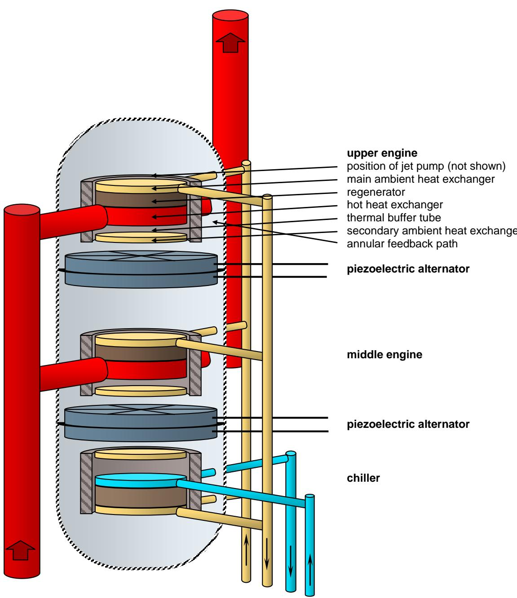  
Figure 1. Baseline configuration of the thermoacoustic generator/chiller.

Robert Keolian observed that teaching classes had been taking up so much of his time that he decided he had to give it up, and thus told his academic Chairman that he will need to stop teaching for the foreseeable future to concentrate on getting his research done successfully

Scott Backhaus, with a little help from Keolian, continued to struggle with the integration of a thermoacoustic chiller in the new, clean thermoacoustic generator geometry. Another problem became apparent, in both the new geometry and in the older geometries we were considering all along, such as that of Fig. 1 of October 2006. The problem is in controlling the system. The output electrical power is proportional to the square of the acoustic pressure amplitude. So the most straightforward and efficient way to control the output electrical power is to control the acoustic amplitude. The cooling power of the chiller stage also goes as the square of the acoustic amplitude, and again the straightforward way to control the amount of air conditioning is to control the acoustic amplitude. But because both the alternators and the chiller see the same acoustic amplitude, how do we control them separately? And in particular, how do we keep the chiller from consuming a lot of acoustic power during the winter when no air conditioning is desired? We considered several schemes, some involving bypass valves on the acoustic side, some involving automatic valves on the chilled water side, but all of these schemes were coming out ugly.

In addition to this, the coefficient of performance COP (the output chilling power per input acoustic power) of all the various flavors of thermoacoustic refrigerators considered were not very impressive. The best one was the new geometry, which Scott has modeled in DeltaE (the Los Alamos thermoacoustic modeling software). His results are shown in Fig. 2. As a function of the chiller reject temperature the COP varies from 1.2 to 2.1. Conventional mobile vapor compression refrigeration often has COPs in the range of 2-3.

So Scott had an interesting idea. Why not just build a larger capacity thermoacoustic electrical generator and use some of its electricity to drive an off-the-shelf electrically driven vapor compression system, leaving the rest available for the truck? Our control problems go away. Our acoustical problems integrating a thermoacoustic chiller into the generator go away. The system efficiency is better. Our problem of what to do with the chiller in the winter goes away. Backhaus and Keolian have less to worry about—no chiller—and can concentrate on building the best generator they can; hence less risk. And an electrically-driven truck vaporcompression air conditioning system is in Bob Price's core expertise. Even though this approach is a bit of a copout, it still uses thermoacoustics to improve the fuel efficiency of a truck because the power for the air conditioner is coming from diesel exhaust waste heat instead of a drive belt off the main diesel engine. Plus there is a chance that electrically driven A/C compressors may prove to be more reliable than belt driven compressors. We can see no down side to this plan Ralph Nine has approved the change in direction, Bob Price is happy to do the A/C side, and so it is now the plan. All this time we thought that if you go to the effort to create sound in order to generate electricity, adding a thermoacoustic chiller in the same sound field is in a sense free and straightforward. That turns out not to be true.

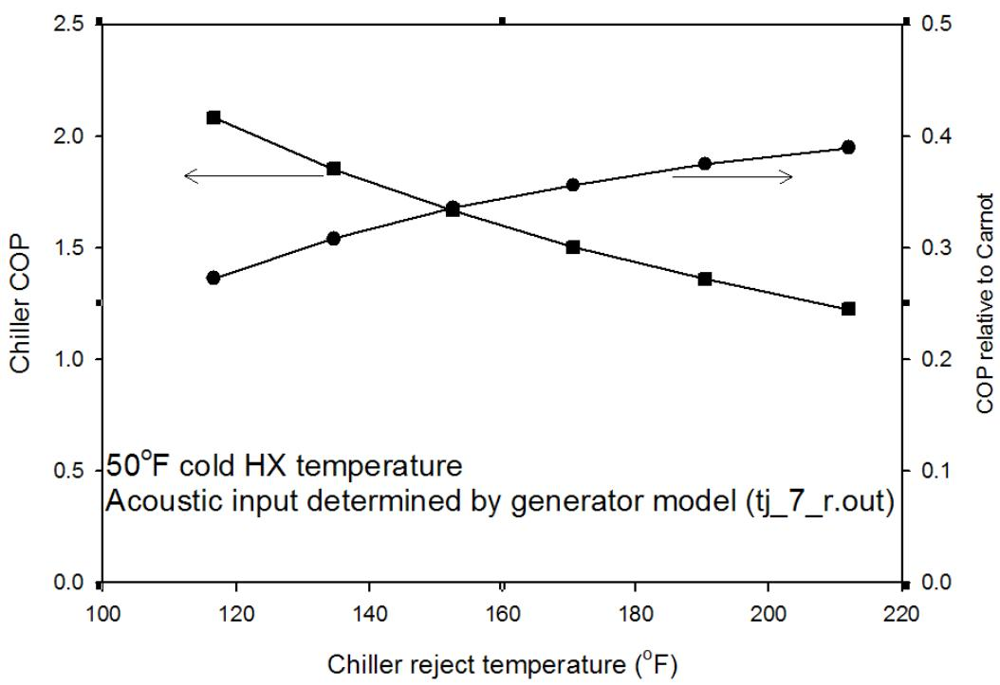  
Figure 2. Thermoacoustic chiller coefficient of performance COP (left scale), and the ratio of the COP to the ideal Carnot COP (right scale), vs. chiller reject temperature.

<table><tr><td>Financial Data for the Month Ending September 2006:</td></tr><tr><td>Current Month Expenses: $14,782.68 Inception to Date Expenses:</td></tr><tr><td>216,665.24 Funds Received: 201,108.00</td></tr><tr><td>Funds Available: -15,557.24</td></tr></table>

<table><tr><td colspan="2">Financial Data for the Month Ending October 2006:</td></tr><tr><td>Current Month Expenses:</td><td>$17,861.08</td></tr><tr><td>Inception to Date Expenses:</td><td>234,526.32</td></tr><tr><td>Funds Received: Funds Available:</td><td>345,100.00 110,573.68</td></tr></table>

<table><tr><td>Financial Data for the Month Ending November 2006:</td></tr><tr><td>Current Month Expenses: $15,911.50</td></tr><tr><td>Inception to Date Expenses: 250,437.82</td></tr><tr><td>Funds Received: 345,100.00</td></tr><tr><td>Funds Available: 94,662.18</td></tr></table>

# Quarterly Technical Report 3 May 2007

Award: DE-FC26-04NT42113

Title: Truck Thermoacoustic Generator and Chiller

Period: January-March 2007

## Summary

This was a productive quarter. During this quarter a new overall thermoacoustic generator configuration was conceived and adopted. Many years of design equations for the piezoelectric alternator were put into a single program to allow the prediction of alternator stress for various geometries. Modeling for the new overall generator configuration was completed, including a large trade study weighing the conflicting requirements of truck exhaust pressure drop, thermoacoustic engine performance, and alternator viability. System engineering has been frozen. Our Phase 2 device is optimized for the Volvo Powertrain 2007 MD16 engine. Pressure vessel mechanical design has commenced. Some experimental infrastructure has been completed.

## January 2007

From September through December of 2006, Backhaus and Keolian had been considering an alternative to the baseline configuration described in the October Monthly Highlight Communication. This month we considered yet another configuration for the thermoacoustic engines and piezoelectric alternators, and decided that this one will be the one we use. It gets around the problems described in last October's Monthly Highlight Communication, but it is further simplified and has better vibration balance than the alternative we had been considering. Air conditioning will still be provided with an off-the-shelf electrically driven unit. Scott modeled this last configuration and it performs well. The configuration is now settled.

Scott has included in his DeltaE models the latest Volvo Powertrain engine data that Bahman Habibzadeh sent us in November. We are optimizing our Phase 2 device for Volvo's 2007 MD16 engine used over a typical truck driving cycle. This update to the model caused a change in our design temperature and set the maximum design temperature for our pressure vessel. Although we are not scheduled to connect a device to an actual diesel engine or truck until Phase 4 of the project, we are designing our Phase 2 generator as if were to be installed on a tractor powered by the 2007 MD16 engine.

The commercial unit we ultimately develop will very likely be welded together for simplicity in such a way that it would have to be sawed apart to be opened up. We considered doing that as well for Phase 2, but decided instead to include flanges so that the vessel could be easily disassembled, giving access to the alternators and thermoacoustic engines inside. The arrangement of flanges and sub-assemblies for doing this was worked out. The alternator diaphragms will be held between elastomer rings which have several functions. The elastomer rings allow for motion between the alternators and the rest of the device, they allow for the pressure vessel to be disassembled, and they compensate for differential thermal expansion in the device.

Doug Wilcox and Keolian started designing a non-contact capacitive sensor array and circuit for measuring the alternator diaphragm motion for trouble shooting purposes

## February 2007

Much of the design of our device came together in February.

An old friend from the Los Alamos thermoacoustics group, Dave Gardner, was so anxious to see our gadget work that he came out and spent 10 days in State College to work on our pressure vessel on his own dime. Dave is an expert in the ASME Boiler and Pressure Vessel Code. Many thanks go to David.

Meanwhile, back in Los Alamos, Scott was completing his modeling and optimization of the new, final generator configuration, putting in just about every tweak and correction he could think of. Heat transfer and pressure drop are carefully modeled on both the exhaust and helium sides of the hot heat exchangers. The temperature drop of the exhaust as it passes through the hot heat exchangers and gives up heat is taken into account but splitting each thermoacoustic engine into three staged engines in series from the exhaust's point of view and in parallel from the helium's point of view. Scott performed a complex trade study of key thermoacoustic engine parameters that impact the truck—through the pressure drop that our device presents to the diesel exhaust stream—and impact the alternator—through choice of operating frequency and gas volume stroke. He ran and separately optimized models for the nine permutations of three exhaust pressure drops (3, 6, and 9 kPa) and three operating frequencies (200, 300 and 400 Hz). Many geometric parameters of the hot heat exchangers, ducts and volumes were varied in each of the models to maximize the acoustic power generated by the exhaust waste heat. It was the most complicated model that Scott has ever attempted, but he completed it by the end of the month. It is described in more detail in a non-public appendix to this Communication.

Meanwhile, back in State College, Keolian was trying to consolidate many years of design equations for the piezoelectric alternators into a single Mathcad program so that he could quickly test multiple alternator geometries. The goal was to find the lowest mechanical stresses in the alternator associated with any of Scott's models, and thus determine for which of Scott's models an alternator would be viable. Dave had to return home before these calculations were complete and a thermoacoustic/alternator model selected, so he wasn't able to complete the pressure vessel design. But he made a good start on it. Keolian started reading Section VIII, Division 1 of the ASME Pressure Vessel Code cover-to-cover to get his head around that monster and help with the pressure vessel design.

Modeling of the alternator design is complete. A solution was found with an acceptable peak alternating stress in the alternator diaphragm of 28 kpsi, for Scott's version of the thermoacoustic model that runs at 300 Hz and presents 3 kPa (0.43 psi) pressure drop to the main diesel exhaust. The total acoustic power output of the thermoacoustic engines to the alternators, averaged over a driving cycle, is predicted to be 4.1 kW. Alternator and charging circuit inefficiencies need to be subtracted from that power to determine the electrical power delivered to the truck, but the approximate scale of the device is now set. This completes the thermoacoustic trade study that considered the conflicting requirements of the truck exhaust back pressure, thermoacoustic efficiency, and the minimization of alternator mechanical stresses. With this, the system engineering of the device is complete and frozen. The hot heat exchanger dimensions are determined.

Pressure vessel mechanical design, including the challenging hot heat exchanger duct penetrations, is continuing with volunteer help from David Gardner of LANL. Robert Keolian has finished his reading of Section VIII, Division 1 of the ASME Boiler and Pressure Vessel Code. The pressure vessel will be primarily made from 304 stainless steel, and will probably have some components of 316 and 316H stainless steel. It looks like we can avoid materials that are any more exotic than that. Keolian is studying SolidWorks 3-D CAD software so that he can draw up the device.

Due to changing priorities at DOE, we will be having a \$30K budget shortfall for Phase 2 of our work, and a schedule slippage to 31 December 2007. The good news is that we did not lose all our remaining Phase 2 funding. Scott had been tasked to do some additional mechanical design and drawing work at Los Alamos. That work will now come over to Penn State, instead.

After much studying, two students on the project, Doug Wilcox and John Brady, passed their written and oral PhD Candidacy Exams for the Penn State Graduate Program in Acoustics. They apparently did well and their advisor is pleased.

Doug has completed construction of a large 4' x 2' x 2' radio-frequency (RF) tight enclosure for testing the high voltage electronics that will be used in the device. The enclosure has several functions. The electronics that will be developed in it during Phase 3 of the project will have high voltages and high currents that can be lethal. To keep the investigators alive and happy, the circuitry will only be powered up with the box closed, interlocks will de-power and discharge the circuitry when the box is opened, and only insulated high voltage tools will be used within the box. Also, should an arcing event happen in the alternator or circuitry, the radiofrequency seals of the box will contain the electromagnetic impulse that is generated by the arc, sparing neighboring electronics and computers in the lab from damage. The box should also contain RF digital switching noise from the pulse width modulation circuitry that will be used in our power electronics during normal operation. Some pictures of the box are shown below, showing its accordion lid (in four sections, two of which are screened for viewing inside) and the RF shielding. The shielding seems to work. A high voltage specialist has told us that arcs generate RF in the 4 GHz range, and Doug's cell phone, which operates in the 0.8 - 1.9 GHz band, cannot receive a signal when placed inside the box. Inside the box on the left are light bulbs and range elements that are a 4 kW electrical load, and on the right are hall-effect current sensors for measuring the output currents of alternator PZT stacks, individually or in groups.

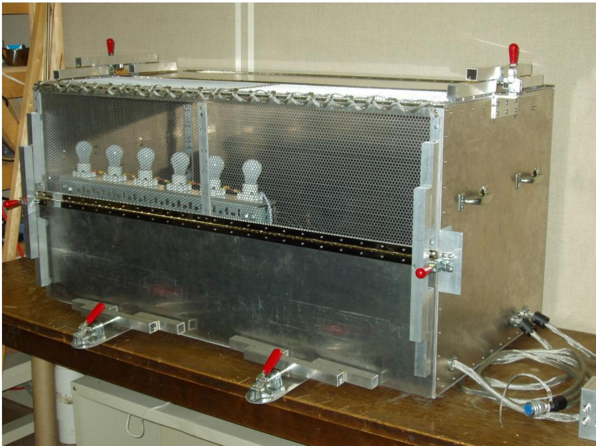  
Figure 1. RF shielded box for testing power electronics and piezoelectric alternators, lid closed. The lid is in four sections, two on top, two on the side, and can fold up out of the way. One top and one side section of the lid is screened for viewing the circuitry inside. Crisscrossed copper braids aid in the RF tightness of piano hinges of the lid. Clamps (red handles) seal the lid against the body of the box.

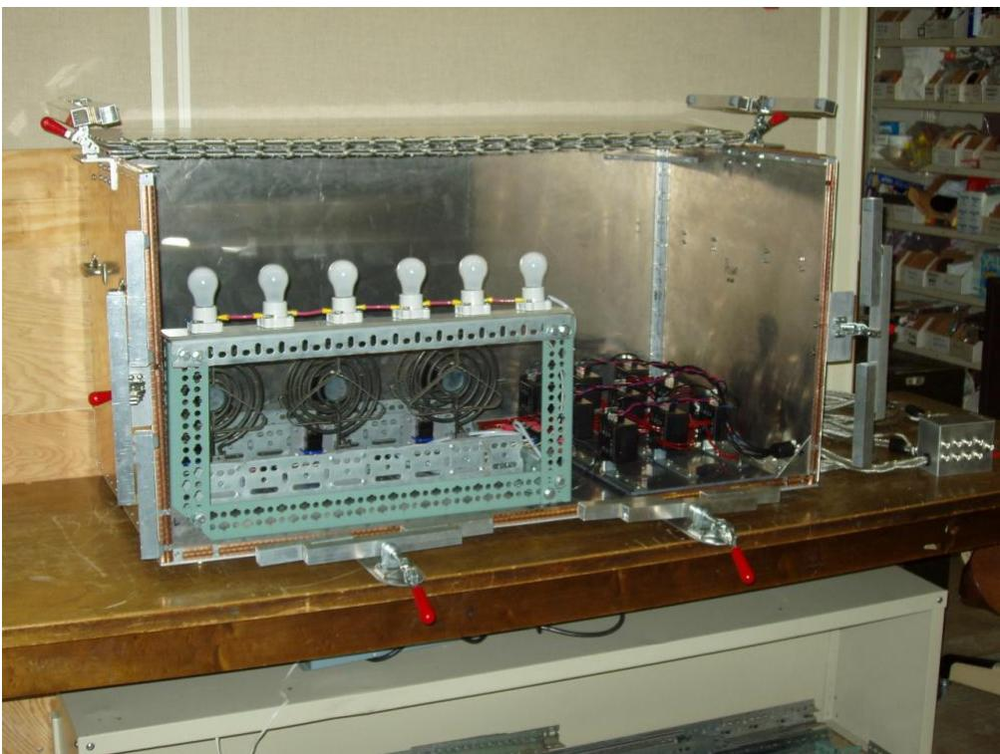  
Figure 2. RF shielded box, lid open. A 4 kW electrical load is on the left, consisting of light bulbs and range elements in series/parallel combinations. Nine hall-effect current sensors for the alternators are on right.

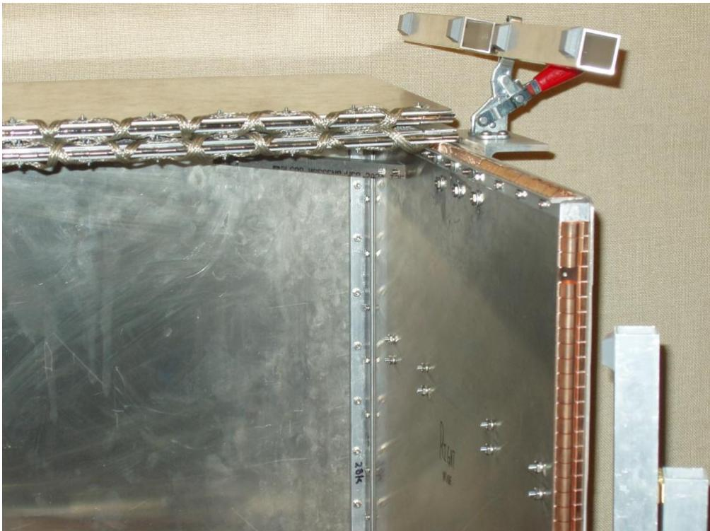  
Figure 3. Close up of RF shielding gaskets, lid hinges, and lid clamp.

# Quarterly Technical Report 16 August 2007

Award: DE-FC26-04NT42113

Title: Truck Thermoacoustic Generator and Chiller

Period: April-June 2007

## Summary

A good portion of the design engineering on the pressure vessel and internal components was performed this quarter, but there is still much to do. Corning Inc. has decided to pursue exploratory work this summer making ultra-high cell density honeycombs samples for us to evaluate as potential regenerator materials in our thermoacoustic-Stirling engines. The hope is that such materials could improve the performance and lower the cost of the engines. Modifications to the experimental rig for measuring oscillating flow heat transfer were completed, but short lived. The rig popped a major leak and needs repair.

## April 2007

Robert Keolian has been continuing his work on the pressure vessel calculations and studying SolidWorks, both with the goal of making a 3-D model and mechanical drawings of our device.

Doug Wilcox and Keolian have nearly finished the design of a capacitive sensor array for measuring alternator diaphragm displacement. Construction of the electronics has started. The circuit is essentially a bridge that internally generates an AC voltage proportional to the capacitance between a guarded electrode and the grounded diaphragm. That capacitance varies from 0.09 pF to 9 pF as the gap between the electrode and diaphragm varies from 100 mm to 1 mm. The capacitance signal is demodulated and filtered, giving a signal that goes as the inverse of the diaphragm-electrode gap. That gap signal is then inverted with a analog division circuit, giving an output linearly proportional to diaphragm displacement. The electronics will have multiple channels for measuring the diaphragm displacement at multiple electrode positions

While they were doctoral students of Keolian a few years ago at Penn State, Kevin Bastyr and Ray Wakeland, conceived of a way of making heat exchangers which will likely be used on our ambient thermoacoustic heat exchanger for the truck device and forms the motivation for the doctoral work of John Brady. We have been toying with a patent application for it for some time now, but heat exchange is a crowded field and there is similar prior art. Kevin visited Penn State this month in part to discuss the extensive patent search he has performed and to plan strategy. We may end up just claiming those aspects of the heat exchanger that are novel modifications over the prior art for use with thermoacoustics.

As described in the September 2006 Monthly Highlight Communication, John Brady had embarked on a series of changes to his oscillating flow heat transfer apparatus to improve the quality of his data that will likely be used to optimize our thermoacoustic ambient heat exchangers. Those changes are now complete and he has started taking data again. The overall layout is shown in Fig. 1. There are now four hot tubes and four cold tubes representing the heat exchangers under test, instead of one each, and the temperature difference between the hot and cold sides has been doubled. These two changes increase the thermal signal-to-noise ratio by about a factor of eight over the data that was shown in September. Also back in September, there was a bump in the heat transfer data when the gas parcel displacements were on the order of the length of the tubes. That bump was either an interesting effect to be studied, or an uninteresting artifact to be eliminated, perhaps caused by heat transfer at the backsides of the tubes, the ends that are away from the gap between where the hot and cold tubes meet. Remember that the heat transfer we want to measure is that due to gas oscillating across the gap between the hot and cold heat exchanger tubes. By flowing hot or cold water through the hollow walls of the ducts and thus control the temperature difference between the ducts and the tubes, we can tease out the amount of heat transfer coming from the backsides of the tubes rather than from the gap. Another change that was needed because of the quadrupling of the number of heat exchanger tubes, was to use eight AirPot dashpots to drive the flow instead of two, as shown in Fig. 2. In a further improvement to decrease our sensitivity to laboratory temperature swings, the layout of the external plumbing lines has been cleaned up and the insulation beefed up, as shown in Fig. 3. The tubes and ducts are now fully encased in a solid block of foam insulation. The shaker is open to the lab to let its heat escape. A hot air trap allows the hot duct to be at atmospheric pressure without mixing in cold air from the laboratory.

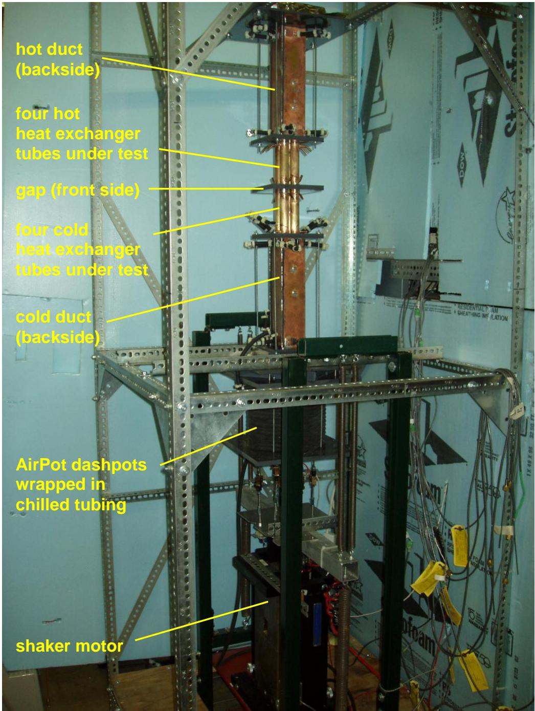  
Figure 1. Overall layout of the oscillating flow heat exchange experiment. The shaker motor and AirPot dashpots drive oscillating air flow between four hot and four cold heat exchanger tubes under test. The heat transfer coefficient is obtained from the heat transfer and temperature difference between the hot and cold heat exchanger tubes, which contain hot or cold water flowing through periphery of their double walled construction. Hot and cold ducts, on the backsides of the heat exchanger tubes away from the gap, are also hollowed wall and temperature controlled to explore the heat transfer coming from the backsides of the heat exchanger tubes.

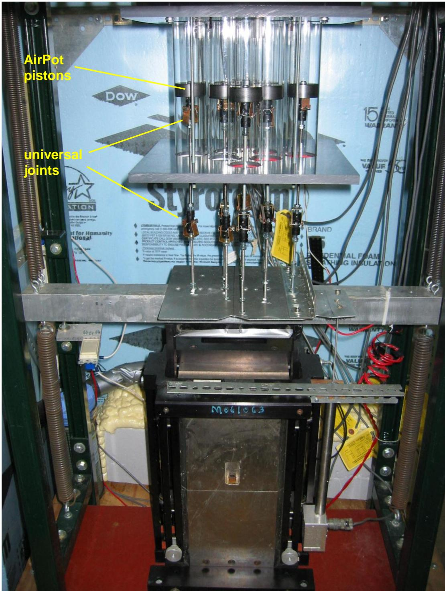  
Figure 2. Drive system. Eight AirPot dashpots are driven by the shaker motor. Each dashpot consists of a glass cylinder and a close fitting but freely sliding graphite piston. Tie rods connected by universal joints allow free vertical movement of the pistons.

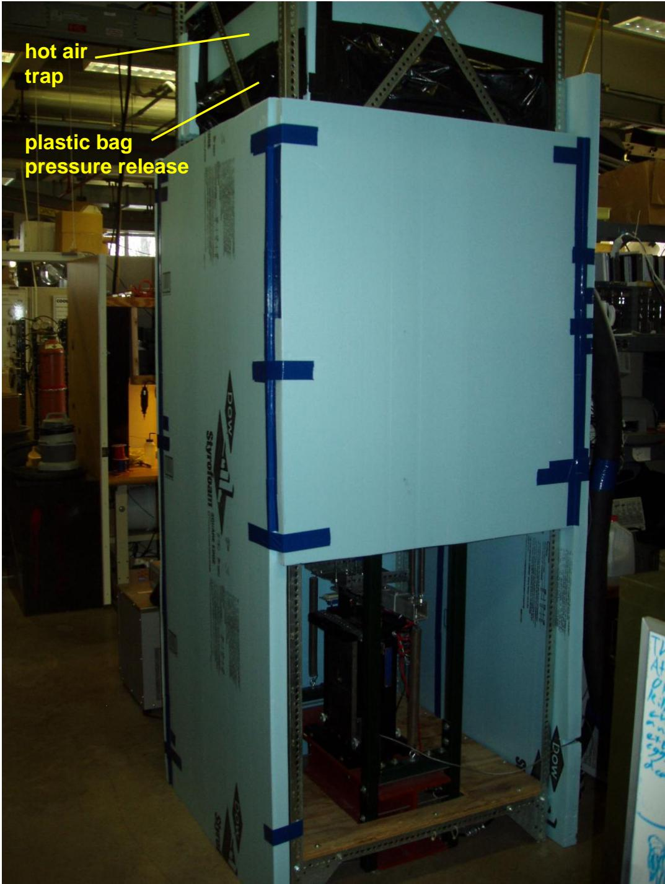  
Figure 3. Improved insulation. The heat exchanger tubes and the ducts are encased in a solid block of foam insulation sheets. Layout of the hot and cold plumbing is cleaned up and insulated. Hot and cold fluid plumbing lines are better segregated. Air in the hot duct is no longer driven by an upper piston, but is instead at atmospheric pressure. The structure at the top of the apparatus is an inverted U-shaped hot air trap and pressure release boundary condition for the hot duct. Black plastic bags flex as the oscillating flow is driven, allowing the hot duct pressure to be at atmospheric without mixing in cold air from the laboratory.

## May 2007

The regenerators of the thermoacoustic-Stirling engines, if built in the standard way with stacks of fine metal screens, could easily be the second most expensive component in a commercial version of our device—second to the PZT stacks. In hopes of lowering this potential future cost, Penn State has entered into a one-way non-disclosure agreement with Corning, Inc (proprietary information flowing in the direction of Corning to Penn State). The agreement covers a small exploratory effort at Corning, with the help of a summer intern student, at making ultra-high cell density honeycomb regenerator samples tailored for use in our device. We are very pleased to have this help from Corning. Corning presently manufactures Celcor ceramic substrates for use in automobile and truck catalytic converters, and they manufacture the ceramic cores of diesel particulate filters that are in use on 2007 heavy duty diesel trucks. For further information, refer back to the April 2006 Monthly Report non-public appendix.

David Van Tol and Robert Keolian joined other interested ARL personnel in a tour of Piezo Kinetics Incorporated (PKI), a local piezoelectric element and transducer manufacturing company. PKI among other things, makes elements for the ultrasonic cleaner industry. One of their specialties is making elements with ultra-flat surfaces. That flatness is an advantage when assembling elements into stacks. After the tour, we spoke with the president of PKI in a general way on what it would take to manufacture low cost piezoelectric stacks in the numbers we would need (about a million per year, or thousands per day) should our device be a commercial success.

Dave Van Tol and Robert Keolian also attended the US Navy Workshop on Acoustic Transduction Materials and Devices, at Penn State. This is a good meeting for seeing the latest developments in piezoelectric materials. Work in this field continues on developments of single crystal alternatives to lead-zirconate-titanate (PZT), such as PMN-PT, PIN-PMN-PT, and PZN-PT.

Keolian continues to design the pressure vessel for the Phase 2 device.

Examples are shown in Figures 4 and 5, below, of old and new heat transfer data taken by John Brady—before and after the modifications to his rig that were completed last month. Shown is the normalized heat transfer between hot and cold tubes as a function of normalized gas displacement at various frequencies. We got about the factor of eight improvement we expected in signal to noise ratio, apparent at low gas displacements. Unfortunately, just after this data was taken, one of the upper ducts popped open with a loud bang, sending water pouring into the apparatus. It became apparent that many of the solder joints on both the hot and cold ducts were bad and that the apparatus would need quite a bit of repair.

Normalized Effectiveness for 5" & 10" Tubes  
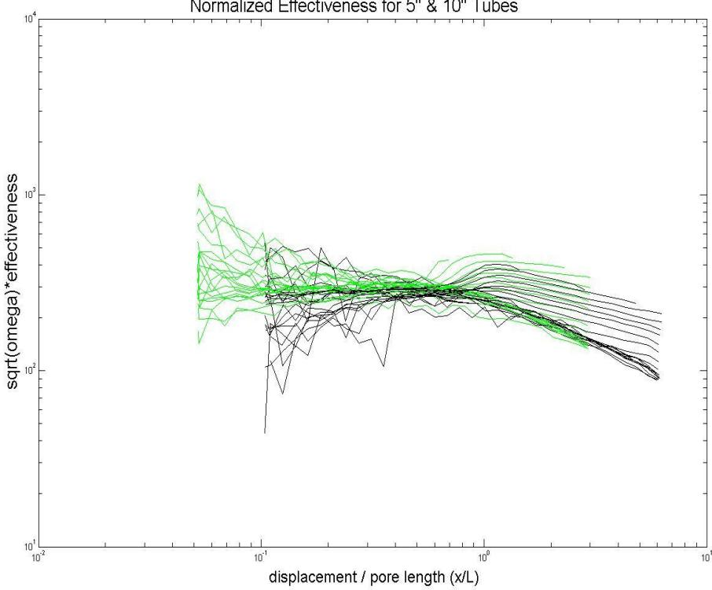  
Figure 4. Normalized effectiveness of $5 "$ long (green) and $1 0 "$ long (black) tubes.

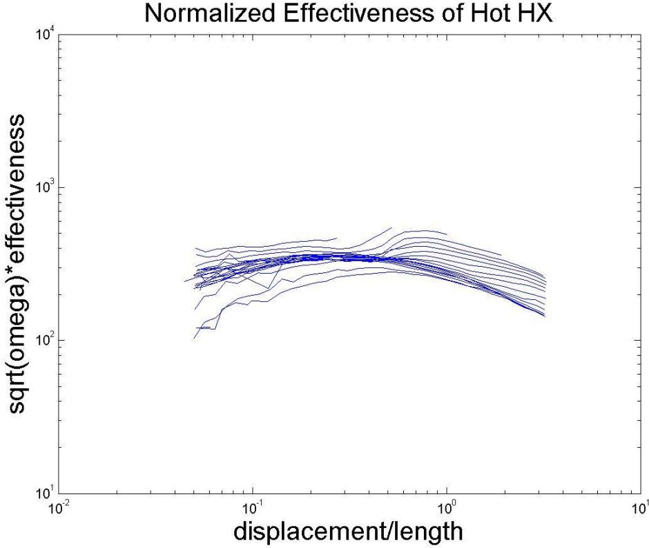  
Figure 5. Normalized effectiveness of $5 "$ long tubes.

<table><tr><td colspan="2">Financial Data for the Month Ending March 2007: Current Month Expenses: $9,942.56</td></tr><tr><td colspan="2">Inception to Date Expenses: 305,494.66 Funds Received: 345,100.00 Funds Available: 39,605.34 Financial Data for the Month Ending April 2007: Current Month Expenses: Inception to Date Expenses: Funds Received:</td></tr><tr><td colspan="2">$10,913.06 316,407.72 445,100.00 Funds Available: 128,692.28 Financial Data for the Month Ending May 2007: Current Month Expenses: $9,935.16 Inception to Date Expenses: 326,342.88 Funds Received: 445,100.00</td></tr></table>

Robert Keolian made a presentation on this and other thermoacoustic generator work in San Diego to DARPA, the Army, and other federal agencies at a DARPA Robust Portable Power Systems Workshop. Much of what we do with trucks might be of interest to the Army.

David Gardner, a friend from Los Alamos, came to Penn State to volunteer his labor and work with Keolian on the Phase 2 pressure vessel design and the assembly of the Navy 4 kW alternator. The Navy alternator will test many of the concepts we are using in the truck generator.

David Van Tol had a important success in his efforts at making low-cost low-loss piezoelectric stacks. It is described in a non-public appendix to this report.

# Quarterly Technical Report 1 November 2007

Award: DE-FC26-04NT42113

Title: Truck Thermoacoustic Generator and Chiller

Period: July-September 2007

## Summary

A patent application that includes the novel configuration of engines and alternators being used in our thermoacoustic-Stirling generator is being prepared.

Our device was briefed to the US Army. If placed on the right 1000 trucks on the battlefield, our device has the potential to save the Army on the order of \$1B per year. They showed some interest in joining with DOE in sponsoring this project, pending success on the Navy version of a 4 kW thermoacoustic generator, which is progressing in parallel with this project.

Detailed design of the pressure vessel continues. Ducts carrying hot diesel exhaust will penetrate the vessel. Thermal stress relief will be accomplished through bellows expansion joints.

A large package of patent reviews and a preliminary disclosure has been prepared for the Penn State Intellectual Property Office to help them make a decision on whether or not to apply for a patent at this time on our work with easily manufactured tube-in-shell heat exchangers. We have been developing these heat exchangers for possible use as the ambient exchanger for our device The patent decision is complicated because heat exchange is a crowded field and there is related prior art.

## July 2007

Design of the pressure vessel to the ASME Boiler and Pressure Vessel Code (Section 8, Division I), and incorporation the results into a SolidWorks 3D CAD model, is proceeding. Progress so far is shown in Figure 1. The design pressure is 307 PSI. The vessel stands 40" high. The vessel splits apart with three pairs of flanges into four sections—an upper dished head, an upper body section, a lower body section, and a lower dished head—to allow access to the parts inside. The shell has a 20" outside diameter, which allows for a few inches of hand room between the internal components and the shell wall. There should be no need for such a roomy pressure vessel or flanges in a commercial device because internal access will not be needed. In this design, ducts for the hot diesel exhaust penetrate through the side walls of the shell as in the schematic view of Figure 2. The upper and lower body sections would each have a hot heat exchanger with input and output duct penetrations, which is not shown yet in Figure 1. At this point in the design, the hot ducts are assumed to be welded directly to the walls of the body sections. Therefore, the pressure vessel walls and the flanges will get hot, bringing the design temperature of the vessel to 950 F (510 C). The flanges are sealed with metal O-rings that can take this temperature (hollow silver plated Inconel X750 annuli with internal pressurized gas) from the Garlock Helicoflex corporation. Ordinary carbon steel is not allowed for the pressure vessel at 950 F, so the shell, heads, and flanges are made of 304/304L stainless steel. Because of decreased strength and creep resistance at high temperatures, the flanges, bolts and vessel walls are fairly heavy; the shell thickness is .375", the bolt diameter is 1". There still remains a potentially difficult calculation of the stresses due to the differential thermal expansion, especially on startup, between the pressure vessel shell on the one hand and the load path along the hot heat exchanger and its ducts on the other. The initially thought was that the shell would be thin enough that it would flex to accommodate the sizable .175" expansion of the ducts and hot heat exchanger. That's looking doubtful given the thickness of the shell and the proximity of the heavy flanges to the ducts. Therefore, a flexible expansion joint at the duct-shell junction is also being considered.

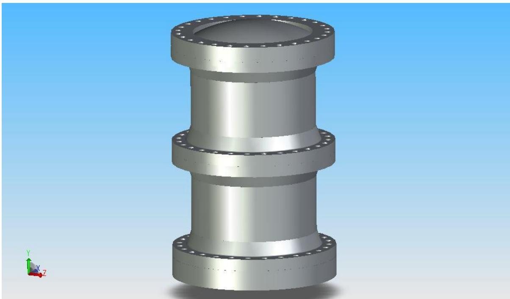  
Figure 1. SolidWorks model of the pressure vessel designed to ASME Code for 950 F and 307 PSI. Diesel exhaust duct penetrations have not yet been added to the model.

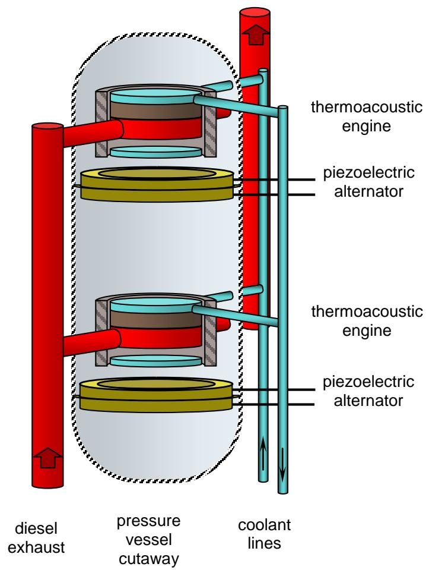  
Figure 2. Schematic layout of the thermoacoustic generator showing the approximate locations of diesel exhaust duct penetrations.

The method of assembly and disassembly, method of access, and overall layout of the components inside the pressure vessel has been determined. But because some aspects of the engine/alternator configuration remain proprietary until we get patent protection in place, further description of the internal components is made in a non-public appendix.

Chun Tai and Bahman Habibzadeh from Volvo Powertrain visited Penn State to discuss thermoacoustic technology, what it can do, its limits and barriers, how it compares with other technologies, and its economic feasibility. The Volvo team was also able to view our hardware.

Daniel Allen, the Summer Intern working at Corning on thermoacoustic regenerators, also came to visit Penn State this month to become familiar with thermoacoustics and our electrical generator.

## August 2007

We prepared a large package of patent reviews and a preliminary disclosure for the Penn State Intellectual Property Office to help them make a decision as to whether or not to apply for a patent at this time on our work with easily manufactured tube-in-shell heat exchangers. We have been developing these heat exchangers for potential use as the ambient exchanger for our device. The patent decision is complicated because heat exchange is a crowded field with an abundance of related prior art.

Our work was briefed to the US Army Communication Electronics Research and Development Engineering Center (CERDEC) at Fort Belvoir, VA. There may be a good match of our work to the Army. We believe we can save a civilian trucker on the order of \$10k per year per truck with our device with fuel costing about \$3/gallon, without increasing the maintenance requirements on the truck. But on a battlefield, the true cost of fuel is more like \$30 to \$300 per gallon depending on how far the supply lines stretch. The second highest usage of fuel by the Army is in truck convoys, behind aviation fuel. Our device, if placed on the appropriate convoy trucks, therefore has the potential to save the Army on the order of \$100k to \$1M per year per truck. Multiply that by on the order of 1000 trucks and the savings approach \$1B per year. Yow!

A potential problem was detected with an expansion joint being considered for the hot exhaust duct penetrations through the pressure vessel. The expansion joint being considered consists of a thin sheet rolled into a quarter of a circular arc, and wrapped around an “obround" duct (an obround is a rectangle with half circles substituted for the short sides). One edge of the sheet is brazed to the duct, the other to the vessel shell (imagine your foot going through a hole in a wall with the rim of your sock stretched out and attached to the edge of the hole). The sheet should allow for expansion of the duct along the horizontal duct axis. It was initially thought that it would also allow for the transverse expansion of the duct. However, it has become apparent that there will be a consider amount of shear in the plane of the thin sheet that may ruin this approach for an obround penetration. The expansion joint is being more carefully designed to see if there is a viable solution for this approach.

Bob Price visited Penn State to discuss our project and future strategy.

Doug Wilcox got his capacitive sensor circuit tested and working. It will be used to monitor the motion of the alternator diaphragm.

The Applied Research Lab has agreed to increase its support of this project by providing internal funds for the salary and tuition of Doug Wilcox, allowing us to take Doug off of DOE support. Penn State's cost share now consists of salary and tuition for two students, Doug Wilcox and John Brady.

Much work was done this month preparing the Navy 4 kW alternator for brazing. The Navy alternator has become quite similar to the type of alternator we plan to use in this project.

## September 2007

Scott Backhaus and Robert Keolian have been preparing a patent application with a LANL hired attorney that includes the new engine and alternator configurations we have been considering for this generator.

A non-circular rectangular or obround duct for the hot diesel exhaust is preferred because it nicely matches the wide aspect ratio of the hot heat exchanger. However, this was leading to problems with an expansion joint between the hot duct and the pressure vessel shell. To help understand the issue, imagine a local cylindrical coordinate system with the z axis along the horizontal duct axis, the radial r coordinate perpendicular to the duct axis, and the azimuthal angle coordinate theta going around the duct z axis. First consider a round duct penetrating the pressure vessel with an expansion joint being a thin sheet formed into some sort of azimuthally symmetric (rotationally symmetric) shape attached between the duct on one edge of the thin sheet and attached to a hole through the pressure vessel shell on the other edge. Thermal expansion of the duct will be in the r and z directions. At any point on the duct, the vector direction of the thermal expansion will lie on the plane passing through the z axis and the point on the duct. (More specifically, if one imagines the hot heat exchanger and the ducts to be mechanically floating within the pressure vessel, then the thermal expansion of all points on the duct or hot heat exchanger will be along a line passing between the point in question and the point at the very center of the hot heat exchanger—spherically radial from the geometric center of the hot heat exchanger. That line is on a plane that passes through the z axis.) At any point on the surface of a round, azimuthally symmetric thin sheet of otherwise arbitrary shape, the surface will always be normal to the plane passing through the z axis and the point on the thin sheet. Thus the axial and radial expansions of the duct induce motions in the thin sheet that are in a plane locally normal to the thin sheet, leading primarily to just bending motions of the thin sheet. With a thin enough sheet there is hope of having sufficiently small bending stresses that a viable expansion joint can be made. The situation is different with obround or rectangular ducts and a flexible expansion joint that takes on the shape of the duct. The radial and axial thermal expansions of the duct are still in the plane passing through the duct z axis and the point in question on the thin sheet. However, a thin sheet that is joined to this duct and takes on a nonazimuthally symmetric shape will no longer be locally normal at all points on the surface to a plane passing through the z axis and the point, especially near the “corners" of the duct. This will lead to a sizable membrane shear in the thin sheet, not just bending. Since the thermal expansion of the duct is almost a tenth of an inch on each side, its hard to see how nonrotationally symmetric expansion joint could ever work in metal.

Once it was determined that the duct penetration should be circular, it became apparent that it would be a wasted effort to design a custom expansion joint when bellows are an accepted and commercially available option for circular holes. A local bellows vendor was contacted who offered a viable design at a reasonable cost. The bellows will also be able to take a temperature gradient and thermally isolate the hot ducts from the pressure vessel, allowing the pressure vessel to run near room temperature. That should simplify and lighten the pressure vessel, allow the use of conventional rubber O-rings in the flanges, and simplify the thermal insulation issues inside the pressure vessel. A small disadvantage of a circular bellows, and the reason it wasn't the option initially considered, is that the transition from a circular cross section duct of about 4"

diameter to a 10" wide heat exchanger will have to be made inside the pressure vessel. That sudden a transition will be difficult to do gracefully in a limited space, and the transition will have to deal with the 307 PSI external pressure.

Keolian spent a week at Refrac Systems, a Chandler, AZ braze vendor, to assemble, vacuum nickel braze, and heat treat two copies of the Navy 4 kW alternator. It was dicey, but they came out OK. The alternators for this project will be similar, but somewhat simplified over the Navy design. Having gone through vacuum nickel braze process, it is nice to know that such technology is available. But it is also pretty clear that it would be nice to minimize its use in a commercial product. Hopefully we can avoid it in the truck alternator, but it is still the plan for the hot heat exchanger.

<table><tr><td>Financial Data for the Month Ending June 2007:</td></tr><tr><td>Current Month Expenses: $14,258.88</td></tr><tr><td>Inception to Date Expenses: 340,601.76</td></tr><tr><td>Funds Received: 445,100.00 Funds Available: 104,498.24</td></tr></table>

<table><tr><td colspan="2">Financial Data for the Month Ending July 2007:</td></tr><tr><td>Current Month Expenses:</td><td>$23,614.33</td></tr><tr><td>Inception to Date Expenses:</td><td>364,216.09</td></tr><tr><td>Funds Received:</td><td>445,100.00</td></tr><tr><td>Funds Available:</td><td>80,883.91</td></tr></table>

<table><tr><td colspan="2">Financial Data for the Month Ending August 2007:</td></tr><tr><td>Current Month Expenses:</td><td>$15,371.27</td></tr><tr><td>Inception to Date Expenses:</td><td>379,587.36</td></tr><tr><td>Funds Received:</td><td>445,100.00</td></tr><tr><td>Funds Available:</td><td>65,512.64</td></tr></table>

# Quarterly Technical Report

Award: DE-FC26-04NT42113

Title: Truck Thermoacoustic Generator and Chiller

Period: October-December 2007

## Summary

A knotty problem was solved—how to mount the piezoelectric stacks in the alternators when the stacks are not all exactly the same length and their ends are not especially parallel. A patent application was submitted for the configuration of thermoacoustic engines and alternators we will be using. Work continues on the hot heat exchanger and pressure vessel design.

## October 2007

Backhaus and Keolian continued work on a patent application for various new thermoacoustic-Stirling electrical generator configurations, one of which will be used in this project, as described in the Appendix to the July 2007 Monthly Highlight Communication. Los Alamos National Laboratory submitted the application to the US Patent and Trademark Office in October.

Lauren Simkovic, Bob Price, and Scott McIntyre of Clean Power Resources (CPR), and Robert Keolian presented our work to Jennifer Young, Managing Director of the Advanced Manufacturing Network of the Pittsburgh Technical Council, at CPR. We discussed US manufacturing issues and possible Pennsylvania State support for the initial manufacturing of our product.

The PZT stacks used on the Navy 4 kW alternator and the alternators for this project are nearly identical (the only difference being the use in trucks of .003" instead of .001" thick interelement electrodes for more robust PZT-electrode joints). But after assembly with the low-loss all-metal joining process of Constantine Technologies (Salt Lake City, UT), the Navy stacks (and thus the future truck stacks) had a .025" spread of lengths, and ends that were non-parallel by up to .0035", .002" being a typical value. This was considerably worse than expected, and makes it difficult to insert the stacks into the alternator(s) with a tight stiff joint, especially considering that the peak-to-peak oscillating compression of the stacks in operation is only .002". After considering many possible solutions, none of them pretty, it was decided to apply in both projects a .025" thick phosphor bronze “end plate" to both ends of the stacks, making all the stacks the same length (2.264" Navy, 2.37" trucks) by inserting brass shims of various thicknesses between the end PZT elements and the end plates. A low mechanical loss epoxy fills in the gaps and holds the shims, endplates and PZT together. A jig would be constructed to hold the end plates a precise distance apart for the insertion and gluing of the PZT stacks and shims between the plates. The end plates will have the same .295" width of the stacks, but extend 0.50" above and below the 1.00" height of the stacks to provide extra cooling surface and a means for guiding the insertion of the stacks into pockets to be cut in the keystones.

Heating rates for such epoxy joints were studied recently in a Master's thesis at Penn State (Michael R. Thibeault, "Thermal Effects in High Power High Duty Cycle Transducers"). Thibeault surveyed many epoxies and measured their temperature dependent heating rates for use in joints between piezoelectric elements in transducers similar to ours. Mechanical losses cause epoxy joints to heat up in response to applied oscillating stress, but because the losses are higher at higher temperatures, thermal runaway becomes a dangerous possibility at temperatures ranging from 40–100 C, depending on the so-called glass transition temperature epoxy. It thus becomes critical to account for a thermal path that the generated heat may use to leave the joint. For the best epoxy and the best joint construction type found, the heating at the frequencies and stresses used in the truck alternators will be 0.4–0.7 W per end when the generator is producing 4–7 kW, the range of values under average and peak driving conditions. In addition to this end loss, the bulk of the stack is expected to dissipate 1.8–3.0W, leading to a total dissipation of 2.6– 4.4 W per stack under average to peak driving conditions. Numbers for the Navy 4 kW alternator are almost the same, and in October a thermal model was made for the Navy alternator that should apply almost directly to the truck alternator. The stacks, being $2 . 2 6 4 " \times 1 . 0 0 0 " :$ X 0.295", are a bit larger than the size of a power resistor that would be expected to dissipate that much power. It was found for the Navy alternator that enough heat could be pulled away if active cooling was applied to the flanges that hold the O-rings above and below the alternator diaphragm. There is vigorous helium motion between the diaphragm and the flanges, which brings the diaphragm in good thermal contact with its supporting flanges, and there is just sufficient thermal conductivity through the diaphragm and keystones, and from a parallel path from the stack body through nearly stagnant helium to the cooled flanges. But it is a close thing The ambient cooling temperature available on trucks will not be as low as in the planned Navy experiment. We should be OK for laboratory testing of the truck device, but ultimately we will probably need a better solution for the road, especially one that does not rely on individually bringing all the stacks to the same length by hand. This PZT heating issue will need some watching.

Other work on the Navy 4 kW alternator performed in October that may apply to our truck project was design of high voltage standoffs and harnessing techniques for making connections to the delicate stack leads in a vibrating environment, design of the O-ring flange and gland that supports the alternator diaphragm, snubbers to stop excessive motion of the diaphragm, mounting of the capacitive diaphragm motion sensor, and a jig for holding the alternator diaphragm securely during the wire electrical discharge machining process that cuts the keystones.

## November 2007

A wire EDM (electrical discharge machining) pattern was designed for the keystones that hold the piezoelectric stacks in the Navy 4 kW alternator. Essentially the same pattern will be used in our truck alternators, the main difference being that the Navy alternator uses 18 stacks and the truck alternators will likely use 16. As can be seen in Fig. 1(a) below, every other keystone is split. A wedge, better seen in Fig. 1(b), is driven into the split keystones by screws (not shown) to apply an adjustable amount of compressive pre-stress to the stacks. The two slender arms of the split keystones and the shallow angle of the wedge, seen in Fig 1(c), allow for a .003" range of compression on the stacks. The arms are under considerable bending stress and alternating tensile stress. They are tapered to equally spread out the bending stress as much as possible. As described in last month's report, there will be bronze end plates shimmed and glued to each end of the stacks that serve to bring all the stacks to the same length with parallel sides. The stack end plates will be held in a pocket in the keystone with a tapered spring finger feature created by the EDM cut. About 35 pounds of radial shear force are needed on each end of a stack to get the mass of a stack to accelerate radially and thus cause the alternating compression on the ring of stacks (the peak compressive force normal to the stack ends is much greater, about 3000 pounds). The fingers apply about 60 pounds of force to the side of the end plate at each end of the stacks, which should take care of the shear component. The stack ends will be slipped into the keystone pocket from above. A little grease or heavy oil between the stack ends and the pocket will help assure a stiff joint. The spring finger force will be augmented by a fillet of paste epoxy placed between the keystone and stack end plates that extend $0 . 5 0 "$ above and below the pocket, which should lock the stacks in place. This epoxy is good for about 80 pounds of additional radial holding force, and can be chipped away if it becomes necessary to remove a stack from the alternator.

A jig was designed for centering a PZT stack between end plates that are held a precise distance apart. The jig facilitates the insertion of shims and the gluing of the stack assembly together with epoxy. The epoxy needs to cure at a fairly high temperature, 120 C, for low acoustic loss and a high glass transition temperature, to minimize the risk of thermal runaway. If the jig were to be made out of, say, mild steel, the thermal expansion of the steel over the $2 . 3 "$ length of the stack and 100 C temperature rise would be almost $. 0 0 3 "$ , which is excessive—the shims would fall out in the oven. The trick around this is to make the jig out of two materials, a low thermal expansion machinable “lava" aluminum-silicate ceramic and higher expansion 6061 aluminum. By adjusting the appropriate lengths of the two components, the thermal expansion of the jig can be made to match the thermal expansion of the stacks. Finding the coefficient of thermal expansion (CTE) of 6061 aluminum is easy, and literature values are consistent. The stack would have to be measured because PZT CTE depends on its thermal history (the literature says to thermally cycle it for consistent values) and the stack is made of multiple materials with properties that are not well known. It is easy to find the CTE of fired lava ceramic, but for simplicity, the jig will be made from ceramic in its unfired state. So the CTE of the lava and stacks were both measured. This turned out to be more difficult than expected. After multiple tries, however, reliable values of CTE were found: (8.05 +/- 0.6) E-06/C for the unfired lava aluminum-silicate ceramic, and (3.46 +/- 0.17) E-06/C for the stacks. The stack CTE is considerably less than the 11.0 E-06/C CTE of the 1095 carbon spring steel diaphragm we plan on using. This implies that when the alternator is cold a bias pre-compression strain of about 4E-04 should be applied to the ring of stacks, with a similar amount of pre-tension strain in the alternator, so that the ring of stacks stays in compression as the alternator heats up in operation.

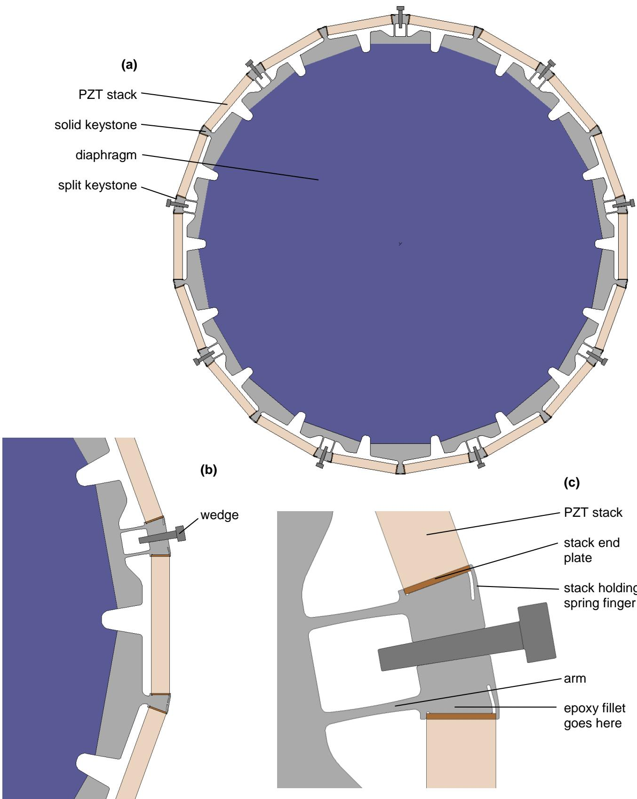  
Figure 1. Views of the Navy 4 kW alternator wire EDM pattern to hold the piezoelectric stacks. The truck alternators will use a nearly identical pattern.

## December 2007

After looking again with fresh eyes at the pressure vessel and hot duct penetrations, shown previously in Fig. 1 and Fig. 2 of the September 2007 Quarterly Report, a much simpler way of splitting up and assembling the pressure vessel and thermoacoustic core was found by changing how the hot penetrations are made. In the old system, the hot heat exchangers and their ducts were welded or brazed to separable segments of the pressure vessel, and the pressure vessel was going to run hot. In the new system, small flanges are put on the cold ends of the bellows at either end of the hot heat exchanger ducts. These flanges mate inside the pressure vessel ID to flanges welded to the pressure vessel shell. Internal pressure pushes the flanges together, so that only lightweight bolts are needed to hold them in place. The bolts pass through clearance holes in the pressure vessel flanges and are screwed into blind tapped holes in the bellows flanges. A rubber O-ring makes the seal outside the bolt circle of these flanges. The exhaust gases pass through a duct that is within the ID of the bellows, mating to the hot heat exchanger at the hot end of the bellows. The ducts keep the hot gas off the bellows, allowing the hot to cold temperature difference to occur along the bellows and the pressure vessel to stay cool. The ducts split with low pressure flanges at the same planes as the bellows end flanges. This arrangement allows most of the pressure vessel to be a single piece that can lifted off the thermoacoustic core like a bell jar. The bottom of the pressure vessel consists of a dished-head base. The thermoacoustic core can stay as one piece attached to the base. All water and electrical penetrations can be made at the base, simplifying the connections. The down side is that the pressure vessel needs to be a bit bigger in diameter to accommodate the entire length of the bellows, ducts and flanges, but it can now be made of plain steel instead of stainless steel since it runs cold, and four massive stainless steel pressure vessel flanges with metal O-rings have been eliminated. It will all make more sense once drawings are prepared.

A graceful way was found for making the exhaust flow transitions from a 3.5" round duct to the 3" high by 10" wide hot heat exchangers and back. The “minor loss" pressure drops due to the various transitions were calculated and held to 600 Pa, compared to the relatively low 3000 Pa pressure drop in the heat exchanger proper. Diffuser vanes are used to spread and converge the flow laterally, and are also used as pressure vessel “stays"to strengthen the hot heat exchanger against the external 310 PSI helium pressure trying to crush the exchanger. Additional pressure vessel calculations were performed on the hot heat exchanger and the hot exhaust manifolds.

Scott's DeltaE thermoacoustic model of the device was converted over to the new Los Alamos thermoacoustic program DeltaEC, which is easier to use, but has a slightly different format. The new model of our device was also tweaked to use thicknesses of sheet metal and tube diameters that can be purchased in the US. A little more space was also placed between the hot heat exchanger and the alternator so that they do not mechanically or thermally interfere. There is now room to put a maximum of 16 piezoelectric stacks in each alternator. More stacks means less stress on the stacks and thus less risk initially. The minimum number of stacks that might be safely used is 9 per alternator. The range is a bit ambiguous because it isn't 100% clear from the piezoelectric literature just how much stress the stacks can reliably take. We will have to find that out ourselves.

A request for bids for assembling 18 low-loss piezoelectric stacks was sent to four piezoelectric companies. This will cover the nine per alternator needed as a minimum. It is planned to supplement these with extra stacks taken from the Navy 4 kW alternator, of which there are 21 at this point, some in better shape than others.

No good deed goes unpunished. Truckers who responded to the EPA National Clean Diesel Campaign (still going on at http://www.epa.gov/diesel/idle-ncdc.htm) by putting idle reduction APUs on their trucks are being fined \$600 if they use them in California by the California Air Resource Board (CARB) if the APU has not been approved by CARB and is on a truck with a 2007 model year or later engine. Problem is that CARB hasn't approved any APUs for use in California unless the APU exhaust is routed through the tractor's diesel particulate filter (DPF) or has an approved APU DPF, of which there are none. Meanwhile, the EPA has made aftermarket changing of a certified DPF system illegal, so the trucker isn't allowed to route the APU exhaust through the tractor DPF. This is all bad news for the many aftermarket small Kubota diesel engine powered APUs out there. The goodish news for us is that 2000 W Espar and Webasto fuel operated heaters have been approved by CARB. We plan on using the burners from more powerful heaters in our device. The bad news is that the more powerful versions of the heaters do not appear to have been approved yet. This is something to keep an eye on.

<table><tr><td colspan="2">Financial Data for the Month Ending September 2007:</td></tr><tr><td>Current Month Expenses:</td><td>$4,214.58</td></tr><tr><td>Inception to Date Expenses:</td><td>383,801.94</td></tr><tr><td>Funds Received:</td><td>445,100.00</td></tr><tr><td>Funds Available:</td><td>61,298.06</td></tr></table>

<table><tr><td colspan="2">Financial Data for the Month Ending October 2007:</td></tr><tr><td>Current Month Expenses:</td><td>$3,280.70</td></tr><tr><td>Inception to Date Expenses:</td><td>387,082.64</td></tr><tr><td>Funds Received:</td><td>455,058.00</td></tr><tr><td>Funds Available:</td><td>67,975.36</td></tr></table>

<table><tr><td colspan="2">Financial Data for the Month Ending November 2007:</td></tr><tr><td>Current Month Expenses:</td><td>$4,640.35</td></tr><tr><td>Inception to Date Expenses:</td><td>391,722.99</td></tr><tr><td>Funds Received:</td><td>455,058.00</td></tr><tr><td>Funds Available:</td><td>63,335.01</td></tr></table>

# Quarterly Technical Report

Award: DE-FC26-04NT42113

Title: Truck Thermoacoustic Generator and Chiller

Period: January-March 2008

## Summary

The novel thermoacoustic configuration we are using is described below. SolidWorks 3D CAD models were made for the alternator and the shell of the hot heat exchanger. Experiments on methods for fabricating the ambient heat exchanger using electroless nickel plating have begun. The venture capital firm KPCB showed interest in our project. Work ceased on the Navy 4 kW generator.

## January 2008

Work continues on the hot heat exchanger and bellows expansion joint. Much of the hot heat exchanger was drawn up in a SolidWorks 3-D CAD model. Keolian is finally getting pretty good at SolidWorks. It's a complex program—more a data base than a drafting program. If it's done right, every line, every part, every sub-assembly and assembly is connected to something else so that if a change is made the change propagates through the entire structure through multiple files, hopefully reflecting the intent of the designer. It then will make machine drawings from the 3-D model semi-automatically.

John Brady will be making the ambient heat exchangers for the Phase 2 device as part of his doctoral work at Penn State, in addition to performing his heat transfer experiments with oscillating flow. The idea, based on the work of previous Penn State students, is to use electroless nickel plating to form the heat exchanger on a mandrel, then remove the mandrel Originally, we were not planning to try this type of heat exchanger until Phase 3 of the program, but it seems like the easiest way of getting Phase 2 heat exchangers with the fine details we need. At least it will be interesting to see how it plays out. There is a long patent literature going back a century on basically the same idea, and yet we are not aware of any heat exchangers like this in a commercial product—which is curious. Nevertheless, it may make sense for thermoacoustics because of the fine details needed in an exchanger and the high pressure of the helium working fluid. There are many enabling details to be worked out.

Mark Spector, the Office of Naval Research sponsor for the 4 kW thermoacousticpiezoelectric generator work of Keolian and Backhaus, asked us to stop working on that project, even though we were working on no-cost extensions of our grants, because it was taking so long Mark correctly surmised that we were neglecting the other project that he was funding us to do, a portable thermoacoustic-piezoelectric 500W Lightweight Power Source (LPS). Thus, we will not have results from the 4 kW project to guide us in this project. The first test of a flexible diaphragm piezoelectric alternator will either be in this project or the 500W LPS, which are similar and proceeding in parallel. It was hard to let go of the 4 kW generator.

David Wells of Kleiner Perkins Caufield & Byers (KPCB), on a visit to Penn State for energy technologies, met with Robert Keolian and toured the lab. KPCB is the Silicon Valley venture capital firm that funded an impressive list of well known companies—AOL, Amazon, Compaq, Electronic Arts, Genetech, Google, Intuit, Lotus, Macromedia, Netscape, Segway, and Sun Microsystems, among others. David expressed interest in what we are doing, wants to be kept in touch with our progress, and expressed possible interest in joining our collaboration if we see a way of bringing our efficiency up towards 20% from our predicted value (with caveats) of 14.8%—a difficult but perhaps not impossible task. He is on our “Call me when it works" list.

Work continues on the SolidWorks 3D CAD modeling of the hot heat exchangers and the alternators. John Brady and Keolian started experimenting with methods of constructing the ambient heat exchangers.

With the submission of a patent application by Los Alamos last October, we can be more open with the thermoacoustic geometry of our device. The following is a reworking of the proprietary appendix to the July 2007 Monthly Highlight Communication. Some of the construction details and internal structure of the heat exchanger described in the July appendix need to remain proprietary to leave open the possibility of a future patent application.

## Three Generator Configurations

Backhaus and Keolian have so far considered three configurations for the engines and alternators of our device. The first, known as the TASHE configuration, has been our baseline configuration and was described most recently in the October 2006 Monthly Highlight Communication. The motion of helium in the engine is basically that of a standing wave, with pressure antinodes placed on top of the regenerator. A residual traveling wave component of the standing wave gives proper Stirling phasing between the pressure swings and gas motion at the regenerator. This traveling wave component is induced by a feedback path that goes around the core of the engine. It is the type of engine that Greg Swift, Scott Backhaus and David Gardner invented at Los Alamos almost 10 years ago.

This type of engine suffers from a few problems, however. Because sound can drive a steady mass flow through the feedback path causing a thermal short, a method of mass flux suppression is needed. Sometimes the suppression can be finicky. There is also a tee junction in the engine. It's not a problem at low frequencies where the aspect ratio of the engine is long and narrow. But at the high frequencies we use with the piezoelectric alternator, the aspect ratio of the engine becomes short and fat like a pancake. This causes a long transverse flow path at the tee junction that we think might have been giving us problems in the Navy 4 kW generator. Thirdly, because a delicate balance must be made between the acoustic flows through the regenerator and the feedback path as determined by the ratio of the flow impedances between the two paths, there is a limit on how long (in the acoustic direction) we can make the hot heat exchanger and thus a limit as to how low we can make the pressure drop that the main diesel engine sees for its exhaust path. Therefore, we were considering other geometries.

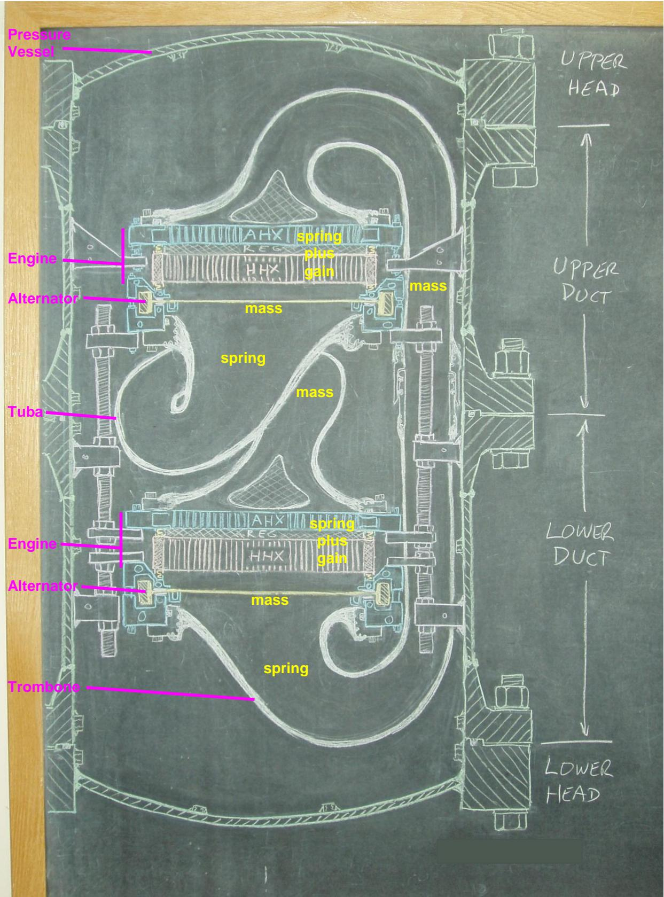  
Figure 1. The “third" configuration of engine and alternators—the one we are using.

The second configuration has not been described yet in public. It was coyly described as a “germ of an idea" in the September and November 2006 Monthly Highlight Communications. Scott had modeled this idea in DeltaE and it looks good. It gets around the above mentioned problems. It is described briefly, below.

A third configuration was mentioned in the January and February 2007 Monthly Highlight communications. It is an offshoot of the second configuration. It too gets rid of the problems mentioned above, its DeltaE model looks good, and we think it is possibly the most inexpensively constructed of the three configurations. This third configuration is the subject of this writing, and it's the one we are using. It is shown in Figure 1 in a roughly to-scale chalkboard sketch. Some of the construction details have changed since this sketch was made, but the overall acoustic layout is the same.

A pressure vessel, in green, holds the 300 psig mean helium pressure. The vessel in this sketch is 40" tall, the flange OD is 26.125", the shell OD is 20". It separates into four sections with three pairs of flanges. The vessel configuration has been simplified since this sketch was made, as described in the December 2007 Monthly Highlight Communication.

There are two Stirling engine cores in the generator, each with an ambient heat exchanger (blue, labeled AHX), regenerator (white, REG), and hot heat exchanger (pink, HHX). The ambient heat exchangers are cooled by water/glycol mix coolant lines (not shown) that take rejected heat outside the pressure vessel. The regenerator is a stack of 10" diameter disks of fine mess screen pressed into a thin shell. The dominant feature of the Stirling core, however, is the hot heat exchanger. Hot diesel exhaust flows through the hot heat exchangers into the plane of the figure, carried by hot ducts that run normal to the plane of the figure and penetrate the body section shells.

An inch below each hot heat exchanger is a yellow horizontal line representing the diaphragms of the two alternators.. Yellow rectangles at the perimeter of the diaphragm represent the keystones and PZT of the piezoelectric ring.

Two serpentine tubes, drawn in white in cross section, acoustically connect the upper and lower engine-alternator pairs. The tube between the bottom of the upper alternator and the top of the lower engine is being called the “tuba", the tube that connects the bottom of the lower alternator to the top of the upper engine is being called the “trombone."

## Operation

Unlike the baseline TASHE configuration, there is essentially no standing wave component in this engine. Instead, a nearly pure traveling wave goes around and around a loop in the counterclockwise direction from the upper engine, the upper alternator, the tuba, the lower engine, the lower alternator, and back to the top of the upper engine through the trombone. This is allowed because the loop is basically a chain of four masses and four springs, as labeled in yellow in Figure 1. Such a chain of masses and springs supports traveling wave solutions in either the clockwise or counterclockwise directions. Starting with the upper engine, the gas in the heat exchangers, the regenerator, and just above and below the Stirling engine core acts as a gas spring. Below that is the mass of the upper alternator diaphragm. Next comes the wide mouth of the upper end of the tuba whose geometry is picked to make another gas spring of the appropriate size. Beyond the mouth is a long length of tube which acts as an acoustic mass. The “Hershey's kiss" at the lower end of the tuba allows the flow to spread out over the ambient heat exchanger of the lower engine core without adding extra gaseous volume that would create another unwanted gas spring. The kiss is suspended in place with struts (not shown) that attach to the tuba. The pattern then repeats again with the volume of gas in the lower engine, the mass of the lower diaphragm, the gas spring of the wide mouth of the lower end of the trombone, and the acoustic mass of the long thin path up the side of the generator to the next Hershey's kiss spreader. The tuba and the trombone have the same nominal length if they were to be stretched out.

The space inside the pressure vessel but outside the acoustical loop is nominally devoid of sound. Both the inside and outside of the tubes are at the mean pressure, so the tuba and trombone can have relatively thin walls.

Without a temperature gradient between the ambient and hot heat exchangers the engines act only as gas springs with loss, adding to the attenuation of waves that might travel in the loop in either direction. However, with enough temperature difference between the ambient and hot sides, traveling waves that go in the direction of cold to hot in the regenerator, counterclockwise in the loop, are amplified rather than attenuated—that's the magic of the Stirling cycle—while waves traveling in the clockwise direction are attenuated even more heavily. Fluctuations start the engine off. With the hot heat exchanger hot and the ambient heat exchanger cold, sound that is one wavelength long going counterclockwise around the loop is amplified and grows exponentially in time, converting increasing amounts of thermal power flowing from hot to cold into sound. As the sound level builds up the alternators start to remove increasing amounts of power. For a resistive electrical load, the rate at which the alternators remove power from the loop is a steeper function of the acoustic amplitude than the amount of power developed by the engines. (If you are interested, this start up transient and stability under various conditions and with various loads was described in detail in the February 2006 Monthly Highlight Communication.) At some acoustic amplitude the rate of power withdrawn by the alternators matches the rate of power generated by the engines, and a steady state output power is achieved.

The two alternators are 180 degrees apart in the loop, so their diaphragms have opposite phases of motion. By coiling up the tuba's length and arranging the two engines and alternators to be inline, vibrations from the counter movement of the alternators is cancelled. Some residual vibration remains from out of balance gas motion within the tuba and trombone. We do not think these will be large enough to be troublesome, however.

Notice that the three problems with the TASHE geometry have gone away. Because there is no side feedback path around each engine, there is no opportunity for a steady mass flux to flow around a loop—here the diaphragms stop any mass flux in the overall loop. Also, there is no tee junction in this geometry—no flow branching in from the side. That makes this closer to a one dimensional geometry with cleaner flows. Thirdly, there is no parallel branching of the regenerator flow path and a side flow path, so delicate balancing of those flows is not needed. That lets us be more aggressive about necking down and stretching out the helium space in the hot heat exchanger and thus lowering the flow resistance that the hot heat exchangers present to the main diesel engine exhaust.

## The "Second"Configuration

The chronologically second configuration we considered is a multiphase inline configuration. In one of its implementations it looks very much like the generator of Fig. 1 except for substituting a third engine-alternator pair for the tuba between the other two enginealternator pairs—a contiguous row of three engines and three alternators with a (trombone) tube feeding power from the last alternator at the bottom of the row back up to the first engine at the start of the row. In general, consider a long chain of Stirling engine cores and alternators in a row. At each engine, the acoustic amplitude is amplified by a certain amount; at each alternator enough power is taken away in the steady state that the acoustic amplitude is reduced by the same amount; and for each engine-alternator pair the acoustic phasor rotates by a certain number of degrees. Three-phase power can be generated, for example, with a set of three enginealternator pairs each with a phase shift of 120 degrees per engine-alternator pair. If desired, multiple such three engine-alternator sets may be placed in a row. Four-phase power would be generated with one or more sets of four engine-alternator pairs each with 90 degrees of phase shift, and so on. As long as the phase shift through the entire chain of inline engines and alternators is an integer multiple of 360 degrees, vibration balance of the chain is achieved. A tube that is an integer number of wavelengths long then ducts power from the last alternator in the chain to the first engine of the chain, similar to the trombone tube of Fig. 1. The fewest number of engines and alternators that could be used in such a scheme is three. This is the configuration we considered in late 2006 for this project, and is the configuration Backhaus and Keolian are pursuing with the ONR 500W Lightweight Power Source. The largest number of engines and alternators that could be arranged in a row has no obvious limit, which may be a viable route for achieving very large generator powers.

## March 2008

Substantial progress has been made on the SolidWorks 3D CAD model of the alternator and hot heat exchanger. The alternator starts out with a diaphragm cut from polished 1095 carbon spring steel with a water jet or laser, as shown in Fig. 1. This material was chosen because it can be purchased already polished and hardened, avoiding problems encountered in the fabrication of the earlier 4 kW alternator for the Navy.

  
Figure 1. Initial cutting of diaphragm from raw polished and hardened 1095 spring steel.

  
Figure 2. Upper keystone ring of 4140 steel, water jet cut and conventionally machined.

A keystone ring with countersunk through holes, shown in Fig. 2, is attached above the diaphragm, and a similar ring with tapped holes is attached below. The rings are made from 4140 steel alloy, which has fairly high strength, but not so high that it cannot be drilled and tapped. The joining of the rings to the diaphragm are made with a combination of shoulder screws and solder. The shoulder screws act as shear pins between the rings and diaphragm. The plan is to loosely assemble the pieces on a hot table, add flux and solder, tighten the screws while hot, then let the assembly cool, soldering everything in place including the screws. The solder is a tin-silver eutectic solder with a 5000 PSI shear strength. There will be Belleville spring washers under the heads of the screws to assure that the keystones are tightly pressed against the diaphragm while the solder cools. The solder makes a redundant joint between the rings and the diaphragm, fills in the space between the shoulder screws and the holes in the rings and diaphragm, and hopefully prevents problems with fretting and fretting fatigue between the keystone rings and the diaphragm—a potential problem if the parts are assembled dry. All this is being tried as an alternative to vacuum nickel brazing and subsequent heat treating, the nontrivial processes used on the Navy 4 kW alternator.

A wire EDM cut, as described in the November 2007 Monthly Highlight Communication, is then made in the alternator to form keystones, half of which are split, and to make spring loaded pockets that hold the stacks, as shown in Fig. 3. Radial holes are drilled and tapped in the split keystones to hold [[4-40]] studs (not shown) that pass through holes in wedges. Nuts on the studs pull the wedges inward to apply a bias compression on the ring of PZT stacks.

The alternator is sandwiched between two flanges using O-rings, as shown in Fig. 4, with a cross section detail shown in Fig. 5. The inner sealing O-rings seal against the acoustic pressure swings but not the large 300 PSI mean pressure of the helium which is the same all around the alternator. The outer centering O-rings follows a polygonal path in a space between the flanges and the keystones. They keep the alternator centered radially, keep the alternator from rotating about its axis, help enforce a clamped (zero slope) boundary at the periphery of the diaphragm, and help damp out possible unwanted motion of the piezoelectric ring in the vertical, axial direction due to higher vibrational modes of the alternator assembly.

  
Figure 3. Alternator after wire EDM cut and the insertion of five PZT stacks. Movable wedges in every other keystone apply a bias compression to the ring of stacks. Fasteners are not shown in the model.

  
Figure 4. Alternator supported between oscualtor flanges.

  
Figure 5. Cross section detail of osculator flanges and supporting O-rings.

The inner portions of the flanges with a cross section that gently curves away from the diaphragm are being called “osculators" after the geometric term for a pair of curves that kiss up to each other. The osculators limit the curvature and thus limit the bending stress in the diaphragm. There is the potential for a slight .007" radial rubbing between the diaphragm and the osculators. To protect the diaphragm, the osculators will be lined with a Rulon low-friction laminate. Rulon is a family of filled PTFE (Teflon) plastics. One of the forms it comes in is 0.031" thick sheet etched on one side to accept epoxy. Such sheet will be bonded to the osculators as shown in Fig. 5. The manufacturer, Saint-Gorbain, is very stingy with information on what materials are used to fill the PTFE and what the resulting wear coefficients are for the various Rulon grades. Nevertheless we will give it a try, initially with all-polymer filled versions such as Rulon J or Rulon T, in the hope that the polymer fill will be gentle on the diaphragm. After gleaning a few numbers from the web and the library, the best guess at this point is that high points on the Rulon will wear down in a week or so of operation to a smoothness of about .0005". After that the helium should act as a lubricating layer, stopping wear by keeping the diaphragm from making actual mechanical contact with the Rulon coated osculator. But it remains to be seen

The shell of the hot heat exchanger is shown in Fig. 6. Diesel exhaust passes through the shell from left to right. The shell must withstand 300 PSI external pressure from the helium while at 950 F (510 C). Helium passes through the shell vertically through features not yet drawn. The shell's length from flange to flange is 28", and all parts are made from 316 stainless steel. The top and bottom plates are $. 1 4 0 ^ { \circ }$ thick. The sides are machined from $. 2 5 0 ^ { \circ }$ wall seamless tubing.

  
Figure 6. Hot heat exchanger shell.

The strategy described in the December 2007 Monthly Highlight Communication for dealing with the .14"thermal expansion of the hot heat exchanger can be seen more clearly now in the cross sectional view of Fig. 7. The larger flange on each end of the exchanger is welded to a bellows and mates to a similar flange (not shown) near the inside diameter of the bell-jar like pressure vessel. These flanges run cold. The smaller flanges concentric within them connect to 3.5" OD external ducting for the diesel exhaust, which of course runs hot. A bent sheet metal transition piece spreads the exhaust path from a circle to an ellipse. A 1"thick head piece facilitates the transition of the exhaust path from an ellipse to a modified obround—a shape that is flat on top and bottom and elliptical on the sides—to make a smooth transition to the side pieces and plates of the hot heat exchanger. The head also runs hot, so that the temperature gradient from hot to cold is along the bellows. Thermal expansion of the hot parts is taken up by a .07" contraction of each bellows and motion of the external ducting. All joints that lie between the heads are made with vacuum nickel brazing. All joints beyond the heads are made by welding.

  
Figure 7. Cutaway of hot heat exchanger shell.

Figure 8 shows the alternator, hot heat exchanger, and simplified models of the thermal buffer tube, regenerator and ambient heat exchanger put together to form the engine-alternator core. As can be seen, the structure is dominated by the hot heat exchanger. The regenerator is just a thin pancake tucked between the two heat exchangers. The thermal stress issues in the walls of the regenerator are tricky, hot and cold being in such close proximity. The solution will be described at another time.

Note that what is being shown here are just the 3D CAD models. It still remains to turn the models into formal annotated machine drawings.

  
Figure 8. Engine-alternator core, with simplified incomplete models of the ambient heat exchanger, regenerator and thermal buffer tube.

<table><tr><td colspan="2">Financial Data for the Month Ending February 2008: Current Month Expenses: $12,240</td></tr><tr><td>Funds Received: Funds Available: Financial Data for the Month Ending January 2008: Current Month Expenses: Inception to Date Expenses: Funds Received:</td><td>455,058.00 50,029.93 $-17.06 392,788.07 455,058.00</td></tr><tr><td>Funds Available: Financial Data for the Month Ending December 2007</td><td>62,269.93</td></tr><tr><td>Current Month Expenses: Inception to Date Expenses: Funds Received: Funds Available:</td><td>$1,082.14 392,805.13 455,058.00 62,252.87</td></tr></table>

# Quarterly Technical Report

Award: DE-FC26-04NT42113

Title: Truck Thermoacoustic Generator and Chiller

Period: April–June 2008

## Summary

The SolidWorks 3D CAD model of the hot heat exchanger is complete and the process of turning it into formal drawings has begun. The construction of 18 piezoelectric stacks to supplement the 21 we already have has begun. A jig for attaching ends to the stack that will bring them all to the same length with precise square ends has been constructed. Corning, Inc. has constructed a sample ultrahigh density honeycomb as a prototype for future thermoacoustic regenerators.

## April 2008

John Wight of Corning, Inc. visited Penn State bringing a sample of ultrahigh density honeycomb made for the themoacoustics community by one of his Summer interns. Such material shows promise for lower cost and higher performance regenerators in the future than the stacked fine-mesh metal screens we will be using for our present Phase 2 device. The 64 mm diameter 28 mm long sample is shown in Fig. 1 and 2.

Off the shelf Celcor starts as a ceramic paste extruded through dies to produce a green (unfired) ceramic square honeycomb with up to 900 cells per square inch with .002" thick walls (http://www.corning.com/environmentaltechnologies/products services/ceramic substrates.asp). The pliable green ceramic is then fired into a hard, temperature-resistant substrate used in automotive catalytic converters. This regenerator sample is made by filling the channels of a wet-green Celcor-like honeycomb with a substance that has similar plastic properties to the green ceramic. This cylindrical log is then pushed through a die that has a circular opening at input end and a smaller hexagonal opening at the output end, to reduce the honeycomb channel size [ref. patent US6299958]. Circles get “conformally mapped" into hexagons, so there is plenty of opportunity for distortion of the pores at the edges of the hexagon. Green hexagon segments are sliced from the die output and stacked into a hexagonal lattice. They are stuck to each other with a proprietary process, the substance filling the pores is removed, and the assembly is fired together and trimmed. The faint, roughly centimeter sized hexagons seen in Fig. 1 are the remnants of the hexagonal segments. The pores within the hexagons cannot be seen with the naked eye.

Figure 2 is a view through the eyepiece of a microscope showing the pores in a typical hexagon. Tick marks on the ruler at the top of the figure are 1 mm apart. In the neighborhood of the ruler, the pore density is about 48,000 cells per square inch, which is close to or even a bit finer than what we need for our engines. The pores look pretty good in the center of the hexagon, but are badly distorted at the edge. Nevertheless this is an impressive result for a first try. Corning will be hosting another intern this Summer to help perfect the process.

  
Figure 1. Ultrahigh density ceramic honeycomb sample from Corning.

The PZT stacks we will be using are assembled by Constantine Technologies (Salt Lake City, UT) with their low-loss all-metal joining process. The process uses tin plated BeCu electrodes that are adhered with pressure and heat to the silver glaze electrodes of the 54 individual PZT elements per stack. Twenty one stacks were manufactured for the ONR 4 kW generator project, which we will be using in this project, plus others will be made. At the end of the assembly process, the first 21 stacks had a $. 0 2 5 ^ { , }$ spread of lengths and ends that were nonparallel by up to .0035", .002" being a typical value. This was perhaps caused by variations in the process or because the elements were manufactured by Morgan Electro Ceramics in six separate batches for reasons unknown. This spread was considerably worse than expected, and will make it difficult to insert the stacks into the alternator with a tight stiff joint, especially considering that the peak-to-peak oscillating compression of the stacks in operation is only .002". After considering many possible solutions, none of them desirable, we decided to apply a .025" thick phosphor bronze “end plate" to both ends of the stacks, making all the stacks the same $2 . 2 6 4 ^ { \ ' }$ length by inserting brass shims of various thicknesses between the end PZT elements and the end plates. A low mechanical loss epoxy will fill in the gaps and hold the shims, endplates and PZT together. The end plates will have the same .295" width of the stacks but extend above and below the 1.00" height of the stacks to provide extra cooling surface and a means for guiding the insertion of the stacks into pockets to be cut in the keystones.

  
Figure 2. Close-up view (taken through a circular microscope eyepiece bordering the view) of Corning ultrahigh density ceramic honeycomb. Tick marks at top are 1 mm apart.

A jig, shown in Fig. 3, was constructed for use by both this project and the 4 kW ONR project to center the PZT stacks, one by one, between a pair of bronze endplates that are held a precise distance apart, square and true. The jig facilitates the insertion of shims and the gluing of the stack assembly together with epoxy. The epoxy needs to cure at a fairly high temperature, 120 C, for low acoustic loss and a high glass transition temperature, to minimize the risk of thermal runaway in operation. If the jig were to be made of mild steel for example, the thermal expansion of the steel over the 2.3"length of the stacks and 100 C temperature rise would be almost .003", which is excessive—the shims would fall out in the oven. The solution to this problem was to make the jig out of two materials, a low thermal expansion machinable “lava" aluminum-silicate ceramic from McMaster-Carr, and higher expansion 6061 aluminum. By adjusting the appropriate lengths of the two components, the thermal expansion of the jig can be made to match the thermal expansion of the stacks. Finding the coefficient of thermal expansion (CTE) of 6061 aluminum was straightforward, and literature values are consistent. The stack CTE had to be measured because PZT CTE depends on its thermal history (the literature suggests thermal cycling for consistent values) and the stack is made of multiple materials with properties that are not well known. It is easy to obtain the CTE of fired lava ceramic, but for simplicity, the jig was made from ceramic in its unfired state. So the CTE of the lava and stacks were both measured. Reliable values of CTE were found to be (8.05 +/- 0.6) ppm/C for the unfired lava aluminum-silicate ceramic, and (3.46 +/- 0.17) ppm/C for the stacks. The stack CTE is considerably less than the 6 ppm/C CTE of the steel alternator diaphragm. This implies that when the alternator is cold a bias pre-compression strain of about 100 ppm should be applied to the ring of stacks, with a similar amount of pre-tension strain in the alternator, so that the ring of stacks stays in compression as the alternator heats up a bit during operation.

  
Figure 3. Jig for uniformly gluing shims and end plates to stack; (a) back view, (b) front view.

This technique for mounting stacks in the alternator is only a temporary solution. Ultimately we need to find a solution that does not involve so much time consuming hand work. If anyone has any ideas, even pieces of an idea, your PI is interested in them

As mentioned in the January 2008 Monthly Highlight Communication, John Brady will attempt to make the ambient heat exchangers for the Phase 2 device as part of his doctoral work at Penn State, in addition to performing his heat transfer experiments with oscillating flow. He has completed a series of experiments that lay out the technique we will use to fabricate the ambient heat exchangers.

## May 2008

The two piezoelectric alternators for our device will use 32 piezoelectric stacks between them. Twenty one are available from the ONR 4 kW generator project. We will supplement those with 18 more constructed from material leftover from the 4 kW project. The PZT-807 ceramic material is an especially low mechanical loss version that came to us from Morgan Electro Ceramics from the UK in six batches. Each batch has slightly different characteristics. Batches #1 and #2 were used to build the first set of 21 stacks. This month, 21 samples from the thousand pieces of the other four batches, #3–#6, were mechanically and electrically characterized. The various piezoelectric parameters were fine. However, three of these batches were packed poorly enough that 17% of the pieces had substantial damage and 23% had minor flaws by the time they came to Penn State in 2006. These batches were recently meticulously repacked and shipped to Salt Lake City where they were received in good shape, ready to be assembled into stacks. It is hoped that we end up with 21 + 18 = 39 stacks, giving us seven extras. The extras will be used to replace stacks that fail mechanically or electrically in the alternators.

There has been considerable progress in the last year in the field of single crystal piezoelectric materials. At the 2008 US Navy Workshop on Acoustic Transduction Materials and Devices, attended by Keolian at Penn State, several companies presented results on new materials with, it seemed, a new emphasis on properties suitable for transduction at high amplitudes. The starting point single crystal has been PMN-PT (lead magnesium niobate-lead titanate), which has advantages and disadvantages over the PZT (lead zirconate titanate) ceramic that we have been using. A zoology of promising new crystals are being developed, among them PMN-PIN-PT, PZN-PT, PMN-PZ-PT, and doped PMN-PT. Manufacturers have been busily improving the mechanical losses, maximum operating temperatures, and maximum electric fields of the various materials. What may interest us in the future is that some of them have d32 and k32 coefficients that are dramatically better than the equivalent in PZT. This may allow us to use dozens of single pieces in a transverse mode, similar to the d31 stacks described in the January 2006 Monthly Highlight Communication, instead of dozens of stacks each made from on the order of 50 separate elements—a large improvement in parts count. The single crystals are still expensive though, and they suffer from a morphotropic (crystal symmetry) phase transition that occurs at a relatively low temperature. But the manufacturers are working quickly to bring the cost down through improved crystal growing techniques, and have pushed the phase transition temperature in some cases up to 130 C, almost high enough that it could be used with truck coolant.

Also at the meeting, Keolian met representatives from Ultra Electronics, a company that makes thousands of transducers a day in Indiana, partially with the aid of robotics to bring the numbers up and the costs down. Their quick estimate of the number of people to produce transducers for Mack Trucks and Volvo Trucks (100,000 piezo alternators/year) was 20. Because our transducers are more complicated than the type they make, let's guess something closer to 60 people. Their people make about \$10/hour, so guessing with overhead and fringe labor is about \$15/hour. So a quick estimate of labor cost in the alternators would be (60 people) \* (\$15/person hour) \* (40 hour/week) \* (52 week/year) \* (100,000 alternators/year) = \$20/alternator, or \$40/truck. Seems too good to be true. Maybe we can pay these folks more than \$10/hour.

## June 2008

The 3D CAD model for the hot heat exchanger, including internal components, is now finally complete. The hot heat exchanger is a beast. There are 1200 parts per exchanger—35 unique types of parts. The bulk of the assembly is brazed together into a single unit with vacuum oven nickel brazing, with some components welded on after the braze. Each heat exchanger should weigh about 73 pounds. The heat exchangers keep the pressure drop seen by the truck diesel exhaust stream down to 3600 Pa (0.52 PSI) with 0.20 kg/sec mass flow per hot heat exchanger. With the exhaust flow split between two hot heat exchangers in parallel the pressure drop is the same with a total mass flow of 0.40 kg/sec.

All components are 316, 316L or dual rated 316/316L stainless steel for adequate strength at high temperature, adequate corrosion resistance, and uniform thermal expansion coefficients. The material choice was a compromise in corrosion resistance vs. cost with cheaper aluminized steel or 400 series stainless steel on the low end and quite expensive nickel based superalloys on the high end. This material choice should be revisited in Phase 3 of the program to select the lowest cost material or materials that have adequate performance

Formal annotated drawings for all the individual components and sub-assemblies of the hot heat exchanger were also started this month.

<table><tr><td>Financial Data for the Month Ending March 2008: Current Month Expenses: $0.00</td></tr><tr><td>Inception to Date Expenses: 405,028.07 Funds Received: 455,058.00 Funds Available: 50,029.93 Financial Data for the Month Ending April 2008: Current Month Expenses: $8,507.70 Inception to Date Expenses: 413,535.77</td></tr><tr><td>Funds Received: 455,058.00 Funds Available: 41,522.23</td></tr><tr><td>Financial Data for the Month Ending May 2008: Current Month Expenses: $2164.29 Inception to Date Expenses: 415,700.06 Funds Received: 455,058.00 Funds Available: 39,357.94</td></tr></table>

# Quarterly Technical Report

Award: DE-FC26-04NT42113

Title: Truck Thermoacoustic Generator and Chiller

Period: July-September 2008

## Summary

Drawings for the hot heat exchanger were completed and delivered to Clean Power Resources for fabrication. Viscous loss in the osculators of the alternators has been estimated and does not appear to be a major problem. SolidWorks models of the trombone and tuba serpentine tubes were completed.

## July 2008

Formal annotated drawings (a 46 page package) for all the individual components and sub-assemblies of the hot heat exchanger are now complete. Some aspects of the hot heat exchanger internal construction are being kept proprietary for now, so they will be described in a non-public Appendix to this Communication. External components were shown already in the March 2008 Monthly Highlight Communication.

Keolian met with Clean Power Resources to convey the design and construction method of the hot heat exchanger, and to discuss overall technical and funding strategy of the project.

A corrugated fin vendor (Robinson Fin Machines, Inc.) was found and contacted for obtaining fin material for the hot heat exchanger. A solder vendor (Johnson Manufacturing Company) was contacted for recommendations, and supplies were obtained, for the mechanically stressed solder joint between the keystones and diaphragm of the piezoelectric alternators.

## August 2008

A rough estimate was made of the viscous losses associated with the helium motion between the alternator diaphragm and the osculators that are used to limit the diaphragm curvature. Over most of the cycle, once the Rulon layer on the osculators has worn in to better than .0004" of roughness (March 2008 Monthly Highlight Communications), the helium should act as a lubricating layer, keeping the diaphragm from rubbing against the osculators. However the viscous losses will be about 7% of the useful power, bringing the expected alternator efficiency down to 90% from 97%. It is non-negligible hit, but workable at this time. Future alternators will likely switch over to the spring method of curvature control (described back in the July 2006 Monthly Highlight Communication) in which this loss mechanism is much reduced.

Doug Wilcox, a student supported to work on this project by the Penn State Applied Research Laboratory as part of its cost share obligation, has taken a summer internship in thermoacoustics with a large, well-known company. The internship has proven successful, and Doug has decided to take a position with a small research oriented company that supports the larger company in thermoacoustics, finishing his Master's work with that project. We wish him well.

SolidWorks 3D models of the serpentine tuba and trombone tubes were started this month.

## September 2008

SolidWorks models of the trombone and tuba were completed, and are shown in Figure 1. The central portions of these serpentine tubes will be constructed from commercially available 4" OD steel tubing, using combinations of straight, 8" bend radius and 4" bend radius sections brazed or welded together. At each end are entry and exit horns of custom shape constructed from fiberglass and epoxy. Cores of the interior horn shape will be CNC machined in foam or wax using the SolidWorks model. These will be wrapped with fiberglass and epoxy, making a bond to the steel tubing. After the epoxy cures the cores will be removed, leaving a smooth interior to the tuba and trombone. It was tricky to get a tuba and trombone of proper length to fit, but it worked out with some modifications to the underlying DeltaEC model. In a future commercial version of the device, the horns will likely be part of a serpentine steel casting that forms most of the pressure vessel boundary. Instead, in this Phase 2 device, both the inside and outside of the horns will see the same 310 PSI mean pressure of the helium gas. The fiberglass horns therefore do not need to be made strong enough to hold in the mean helium pressure, nor do they need to be a diffusion barrier for the helium. The horns do have to take a fatigue load, however, and this has piqued the interest of the ARL composites group. They have offered to help construct the horns in exchange for fatigue data in our unique 300 Hz frequency range.

A collection of essentially all of the prior DOE reports and an Executive Summary, including some proprietary information, were prepared and sent to Skip Yeakel, an executive at Volvo Trucks North America, to bring him and other executives at VTNA and Mack Trucks up to speed on our project.

(d)  
  
Figure 1. (a) Front view, (b) left view, (c) back view, and (d) top view of the thermoacoustic core.

<table><tr><td colspan="2">Financial Data for the Month Ending June 2008: Current Month Expenses: $4,270.06</td></tr><tr><td colspan="2">Inception to Date Expenses: 419,970.12 Funds Received: 455,058.00 Funds Available: 35,087.88 Financial Data for the Month Ending July 2008: Current Month Expenses: $1,137.55 Inception to Date Expenses: 421,107.67</td></tr><tr><td colspan="2">Funds Received: 455,058.00 Funds Available: 33,950.33 Financial Data for the Month Ending August 2008: Current Month Expenses: $4,986.88 Inception to Date Expenses: 426,094.55</td></tr></table>

# Quarterly Technical Report

Award: DE-FC26-04NT42113

Title: Truck Thermoacoustic Generator and Chiller

Period: October-December 2008

## Summary

A 3D model of the pressure vessel was made for the 4 kW device. Construction started on a lower power 600 W Demonstrator to make sure we have some data at the end of this project. The end date of Phase 2 of this project has been extended to 31 March 2009 with a nocost extension.

## October 2008

Design has started on the bell-jar style pressure vessel that fits around the thermoacoustic core that was shown last month.

Eighteen assembled low-loss piezoelectric stacks arrived in good shape from the Salt Lake City vendor.

A meeting was held between Penn State and Clean Power Resources to discuss commercialization strategies.

Last month, a proprietary Executive Summary was prepared for Volvo Trucks North America and Mack Trucks. This month a non-proprietary version was prepared.

## November 2008

The pressure vessel design was changed from the older three piece 20“ OD stainless steel design that ran hot to the newer two piece 30“ OD carbon steel bell-jar design that runs at room temperature. A detailed explanation and the reasons for the change were described in the December 2007 Monthly Highlight Communication. A 3D model is shown in Figure 1.

The transparent view of the vessel on the right shows the Unistrut frame (green) supporting the thermoacoustic core on lower pressure vessel head with internal vibration mounts. Some details left to put in this model are the supporting legs and feedthrough penetrations on the lower head and a lifting hook on the upper head. A non-obvious aspect of the design is to insure that there is enough vertical clearance between the maximum lift of the lab's crane and floor to allow the upper section of the vessel to be lifted off the thermoacoustic core inside. So-called torispherical heads with their sharper bend at the rim are used instead of the more common 2:1 elliptical heads to limit the height of the vessel while clearing the Unistrut frame inside.

It is becoming apparent that building the generator is going to be more costly and time consuming than we thought. Clean Power Resources has been meeting with Innovation Works to discuss the possibility of receiving support for the construction of the hot heat exchangers.

Innovation Works is the southeastern Pennsylvania branch of Ben Franklin Technology Partners, a Pennsylvania Commonwealth network of four regional organizations that distribute state funds to stimulate economic growth in Pennsylvania.

  
Figure 1. Pressure vessel exploded view on left, transparent view on right.

Because of delays in this project, and delays in the ONR 500 W Lightweight Power Source (LPS) project that has been proceeding in parallel (mentioned in the January and February 2008 Monthly Highlight Communications), your PI has been feeling pretty anxious to quickly obtain data on a flexible diaphragm alternator that will support these programs by validating the underlying theory and provide a proof of concept demonstration. At Penn State we have an old 800 W student-built thermoacoustic Stirling engine of the TASHE type (the original baseline configuration of this project where the acoustic feedback path branches off between the engine and alternator forming a short loop to a compliance near the ambient heat exchanger—problems with it were discussed in February 2008). Since September there has been a low level modeling effort to outfit this engine with an alternator that is a cross between the alternators of this project and those of the LPS, using six of the truck stacks. This month those efforts have accelerated with some machined parts being produced. This “Demonstrator"is designed to generate 600 W of power, at 600 V and 1 A RMS.

## December 2008

A no-cost extension was requested and granted to extended the period of performance of Phase 2 of this project to March 31, 2009.

Work has been further accelerated on the 600 W Demonstrator introduced in last month's Communication. SolidWorks 3D modeling of it was completed and shown in Figure 2.

  
Figure 2. Cutaway view showing key generator components. Yellow arrows show acoustical-mechanical power flow. Blue arrow shows approximate oscillation amplitude of diaphragm. Helium fills the interior space at a mean pressure of 1 MPa (10 atm).

The Demonstrator is largely pieced together from parts on hand. The engine is from the thesis of a previous graduate student, modified to accept a piezoelectric alternator between its pressure vessel flanges. The piezoelectric stacks for the alternator are borrowed from the truck project. The fit isn't optimal, but the system should be able to generate 600 W and light up a large bank of lamps. The alternator design is a cross between the Lightweight Power Source (LPS) and truck designs. It uses curved Rulon-J covered “osculators" above and below the diaphragm to control diaphragm bending stress. Unlike the truck design but like the LPS, the piezoelectric stacks are in the ambient air, so the O-rings above and below the diaphragm are tasked to seal not only against the internal acoustic pressure swings, but also against the large helium mean pressure even while the diaphragm is vibrating between them. Lowering the engine core from its original height to a position closer to the alternator and filling the space above with a plastic filler is done to more closely match the engine volume stroke to the alternator's stroke requirements, allowing output power to reach a high level. By the end of 2008, most of the parts have been machined and an experimental space has been made in the lab that is safe against high voltage, loud sound, and pressure vessel failure.

<table><tr><td>Financial Data for the Month Ending September 2008: Current Month Expenses: $3,163.85</td></tr><tr><td>Inception to Date Expenses: 429,258.40 Funds Received: 455,058.00 Funds Available: 25,799.60 Financial Data for the Month Ending October 2008: Current Month Expenses: $3,519.34 Inception to Date Expenses: 432,777.74</td></tr><tr><td>Funds Received: 455,058.00 Funds Available: 22,280.26</td></tr><tr><td>Financial Data for the Month Ending November 2008:</td></tr><tr><td>Current Month Expenses: $1,927.36 Inception to Date Expenses: 434,705.10 Funds Received: 455,058.00 Funds Available: 20,352.90</td></tr></table>

# Quarterly Technical Report

Award: DE-FC26-04NT42113

Title: Truck Thermoacoustic Generator and Chiller

Period: January-March 2009

## Summary

A preliminary test using a dummy alternator diaphragm in a 600 W Demonstrator generator was performed which showed that the old thermoacoustic-Stirling engine that has been modified to accept a piezoelectric alternator still worked after being idle for five years. Its onset temperature was higher than expected, however. Work is progressing to add stacks of piezoelectric ceramic to the Demonstrator. Our new DOE NETL Project Manager is Carl Maronde, taking over from Ralph Nine.

## January 2009

Additional construction (bench, shelves, wire passages, acoustic isolation) of the experimental space was made in preparation for the Demonstrator test. The hot heat exchanger for the Demonstrator is a nickel-chromium heater ribbon driven by a variable autotransformer The 208 VAC primary, the 485 VAC secondary, and grounding of the autotransformer was wired in place. A bank of twenty four 120 V lamps was assembled as the Demonstrator's electrical load in the RF shielded high voltage load box, which was described in the March 2007 Monthly Highlight Communication. Voltage and current measurement instrumentation good in the multi-kilovolt range was assembled for the electrical load. Current measurement is through Hall effect sensors that do not make electrical contact to the high voltage wiring. Voltage measurement is through a 40 kV Tektronix oscilloscope probe.

## February 2009

After a conversation with Ralph Nine it became apparent that the Demonstrator might be useful in satisfying the requirements of Phase 2 of our project, allowing the start of Phase 3 soon after the present 31 March 2009 end date of the project, rather than ask for an additional no-cost extension. With the prospect of a successful end to Phase 2 and the prompt start of Phase 3, the Applied Research Laboratory agreed to support this project with \$25K in internal funds to finish the demonstrator and \$10K to support the writing of reports needed to start Phase 3 as well as search for additional funding.

Instrumentation to measure the voltage and current going to the Demonstrator heater was wired in place. The lamp load wiring (without the lamps) and shielded alternator cabling was tested to 1650 V without arcing. The lamps, wiring and measurement circuitry were also tested and calibrated under load by using the autotransformer to power the load through the alternator's high voltage cabling. Figure 1 shows the lamps lit with 485 V from the autotransformer (the maximum output of the Demonstrator is expected to be 600 V RMS, 850 V peak).

  
Figure 1. Test of the Demonstrator electrical load.

The figure shows twenty-four 120 V incandescent lamps, which are wired in three parallel strings of 6, 8, and 10 lamps in series (a series string of six 40 W lamps, in parallel with a series string of eight 60 W lamps, in parallel with a series string of ten 100 W lamps). The instrumentation below the lamp load is for heater power measurement and thermocouple measurement. The autotransformer can be seen at the very bottom of the photograph. Other instrumentation is on the bench off to the right of the photograph. The Demonstrator will reside in the small booth to the left of the photograph were it is isolated from the lab against loud sound, high voltage, and the slim possibility of explosion or flying parts. The floor in this area has a high voltage safety mat protected by a carpet.

Modifications were made to an oven door to allow the stack end jig (April 2008 Communication) to be spun like a rotisserie while stack ends are epoxied in place. The slow spinning of the jig in the oven around a horizontal axis will negate the effects of gravity and keep the epoxy and shims from sagging.

Components of the Demonstrator alternator—except for the PZT stacks—have been assembled in preparation of a preliminary test of the engine used with a passive diaphragm. The osculators are temporarily covered with vinyl tape instead of Rulon-J for this test as can be seen in Figure 2. The diaphragm used in this test is one of two, the one with lower quality.

Keystones are bolted to the diaphragm with shoulder screws, rather than bolted and soldered as planned for the final version. This can be seen in Figure 3. Figure 4 shows the upper osculator placed on the diaphragm, Figure 5 shows the alternator closed up with the upper skirt in place.

  
Figure 2. Lower osculator plate with temporary black vinyl electric tape $( 1 . 5 ^ { \ ' }$ wide) on the curved osculator surface, which is used to limit diaphragm bending stress. Below the osculator plate is a thin steel skirt that holds the alternator high voltage wiring (in red). The assembly is sitting on a blue piece of foam.

Figure 3. Keystones are bolted to the diaphragm and these are placed on the lower osculator plate. Two O-rings, which cannot be seen, are placed between the diaphragm and osculator plate. Flaws visible on the diaphragm are slight rusting caused by not cleaning the diaphragm quickly after it was cut with waterjet. A second diaphragm was made without this problem for later use.  
  
Figure 4. Upper osculator plate (and O-rings) placed on top of the diaphragm. The copper tubes extending to the lower right are for cooling water.

  
Figure 5. Preliminary alternator closed up with upper skirt and surrounding wire cage. The twelve large holes that pass through the alternator are for long $0 . 7 5 ^ { \mathrm { > } }$ bolts that connect the pressure vessel flanges. The flanges contact and press tightly against the inside edge of the skirts, transmitting the bolt stress through the alternator via six raised bosses on the osculator plates between the keystones. The wire cage will protect the PZT stacks when they are later included in the alternator, keep fingers away from high voltage, shield the lab in case of an arc, and slow down flying parts if all heck breaks loose.

## March 2009

The TASHE (Thermoacoustic Stirling Heat Engine) geometry used in the five year old Demonstrator engine requires some means of stopping so-called Gedeon streaming—steady mass flow caused by acoustic power circulating around the engine in the acoustic feedback loop. In the Demonstrator this is done by tightly stretching a 0.006" thick latex membrane over the ambient heat exchanger. It took about a week of futzing, knot tying and sore fingers to do this painful chore. Figure 1 shows the membrane in place tied down under tension and secured with hot melt glue. Being able to use the alternator itself rather than a separate membrane or other component to stop Gedeon streaming is one of the reasons we developed new engine/alternator geometries in this and the Navy programs over the last few years.

  
Figure 1. Gedeon streaming latex diaphragm on engine core above the ambient heat exchanger.

Figure 2 shows the Demonstrator preliminary alternator (without piezoelectric material) closed up in its pressure vessel placed in its experimental booth, with the plumbing, electrical, microphone, and thermocouple connections made. Figure 3 shows the booth with its door closed.

  
Figure 2. Demonstrator leak tight, in its booth, with connections made.

  
Figure 3. Demonstrator in its closed booth. The back end of the water chiller used to pull heat out of the ambient heat exchanger can be seen in the lower left. A second water chiller is behind the left wall and used to pull heat out of the osculator plates, the copper tubes wrapped around the pressure vessel, and an internal heat exchanger known as the secondary heat exchanger.

The very good news is that the engine still runs after sitting idle for five years. Even the ambient heat exchanger, which was not fully drained of water all that time, still held up against the 1 MPa (150 PSI) helium mean pressure. Also, the operating frequency was right were it was calculated to be, at 409 Hz compared to 403 Hz calculated, even with the inclusion of a diaphragm and fillers modifying in a major way the resonator's acoustical characteristics

The puzzling news is that the onset temperature—the hot heat exchanger temperature needed to get enough acoustic gain that the engine starts to develop soundwas considerably higher than before, 397 C instead of 245C. Because of the high onset temperature it was not safe to push the engine hard and exercise the diaphragm at high amplitude to see how it held up. There are several possible explanations for this. Pockets of trapped gas behind the filler was able to be ruled out on theoretical grounds. Excess dissipation in the O-rings used to support the alternator diaphragm is another possibility. The O-rings used were Viton which are usable at elevated temperature but have relatively large dissipation. Bouncing a metal weight on a Viton O-ring laying on a concrete floor shows that Viton has very little “bounce." A simple theoretical estimate, however, shows that the dissipation is unlikely to be sufficient to elevate the onset temperature as much as was seen, but the estimate made was simple-minded. Next time EPDM

O-rings will be used which have quite a bit more bounce to them. A third possibility is that a 1/8 inch OD fill line between the top and bottom sides of the alternator could have been the source of dissipation. Next time a valve will be added to this fill line and closed during operation to remove this possibility. And a fourth possibility is that this engine suffers from the same, unexplained two-state behavior that Scott Backhaus saw in a similar engine made for the Navy 4 kW work a couple years ago. Under the right manipulations of heater power and mean pressure Scott was able to make his engine behave with either good performance or poor performance. Next time this engine will be run with the similar manipulations to see if this same odd behavior is occurring here as well.

Other work was done this month to put the piezoelectric ceramic in the alternator. Individually shimmed ends are being put on the stacks to bring them all to the same dimensions square, flat and true. High voltage testing of the PZT stacks has also commenced. A small amount of arcing was found in one of the stacks. That stack was repaired. Using a microscope, dirt, possibly silicon carbide grit not properly cleaned away during the stack's manufacture, was found under its epoxy potting layer. That bad epoxy was cut out and the stack re-coated. Machining was also started on the wedged blocks that will be used to hold the stacks in the alternator and adjust their bias compression.

By the end of the month Ralph Nine called to say that he will no longer be our Project Manager at the DOE National Energy Technology Laboratory in Morgantown, WV. He has been tasked to administer the \$3.2B (B!) of economic stimulus funds distributed through the Energy Efficiency and Conservation Block Grants Program to state and local governments. Ralph has been a great tireless champion of this project and a good friend. I am going to miss him dearly, and wish him much happiness. But he has put us in the good hands of our new Project Manager Carl Maronde, who hails from the DOE National Energy Technology Laboratory in Pittsburgh, PA.

This brings us to the official end of Phase 2 of this project. Unofficially, however, work is continuing with Penn State ARL funds to bring this to a successful conclusion. There will be further reports.

<table><tr><td>Financial Data for the Month Ending December 2008: Current Month Expenses: $3,838.37</td></tr><tr><td>Inception to Date Expenses: 438,543.47 Funds Received: 455,058.00 Funds Available: 16,514.53 Financial Data for the Month Ending January 2009: Current Month Expenses: $6,007.73 Inception to Date Expenses: 438,543.47</td></tr><tr><td>Funds Received: 455,058.00 Funds Available: 10,506.80 Financial Data for the Month Ending February 2009:</td></tr><tr><td>Current Month Expenses: $6,104.93 Inception to Date Expenses: 450,656.13 Funds Received: 455,058.00 Funds Available: 4,401.87</td></tr></table>

Phase 3

April 2009 – April 2011

## Phase 3 Executive Summary

During the nine month period April–December 2009, between the DOE Phases 2 and 3 of this project, this work was supported a small amount of internal ARL funding. During this time the piezoelectric alternator was tested with multiple design variations of the osculator concept. It was concluded that the osculator approach could not be made to work well enough to be useful, and that we should move on to the sprung diaphragm concept. There also is a hint of a resonanttriad nonlinearity between modes of the diaphragm that can, on occasion, give quasiperiodic response. This will be troublesome if not suppressed in the future (although it could make for a good PhD thesis of a future graduate student). At the end of this period, funding was put in place from matching \$100K DOE and \$100K Pennsylvania Commonwealth funds, the Pennsylvanian funds flowing from Innovation Works through Clean Power Resources, Inc.

The alternator was then modified to use a silicon elastomeric spring to control the diaphragm curvature at its periphery. The first experiment with this design showed the alternator performing quantitatively as expected at low amplitude, validating the theory underlying it, but at high amplitude something caused one of the stacks to work radially outward from its slot with high enough force to bend a steel standoff that held connection wires. Most of the screws that held the stacks in place had worked loose, which was corrected with thread locker. It was erroneously thought that this was the end of the problem.

Ten watts of electrical power generation was achieved by April 2010. However, many of the stack ends were breaking, which limited the power production. It was determined that the root of the problem was that the keystones, as massive as they are, nevertheless were flexing and applying a bending moment on the stack ends, pushing them outward. Modifications commenced to limit this problem.

Thirty seven watts of electrical power were generated in August after these modifications were completed. A series of experiments were performed that varied the acoustic impedance seen by the engine. The value of this impedance affects the engine hot side temperature which limits the available output power of the engine. The problem seems to be in the reactance the engine sees—the alternator appears to be too stiff. The theory for the acoustic impedance that the alternator presents to the engine is only approximate and should be improved. At the higher amplitude that was now attainable, however, the stack supports were again problematic; a stack had moved radially out of place, broke its end and needed repair.

The effort described so far is essentially that of Task 3.2 – Testing of first-generation generator (using the DOE task list definitions). At this point, however, we were pressed by time to address our other tasks, two of which had changed through a new Statement of Work and new Statement of Program Objectives.

Task 3.3 – Heat exchangers with reduced cost and improved performance. Work continued on developing the ambient heat exchangers of the truck device. Their design was helped by the doctoral work of my student John Brady, who measured the heat transfer and pressure drop in oscillating flow in the type of shell-and-tube heat exchangers we are using for the ambient exchangers. Additionally, an as yet proprietary low-cost manufacturing method for these exchangers was further developed. John was supported through Phases 1, 2 and 3 of this project, has succeeded in earning a PhD, and is now a postdoctoral associate at the DOE's Los Alamos National Laboratory.

• Task 3.4 – Regenerators with reduced cost and improved performance. We continue our interaction with Corning, Inc. encouraging them to develop a low cost regenerator material, but for now the most practical material remains a conventional stack of fine-mesh stainless steel screens.

Task 3.5 – Piezoelectric stacks with reduced manufacturing cost. A new stack support system was developed. It eliminates nearly all of the tedious hand work and precise machining of the previous system. Experimental and numerical tests were performed, and the results look positive. A simulation shown in the figure below shows the essential idea. The support of the stack and the shape of the keystone in the neighborhood of the stack are symmetric about the centerline of the stack so that the stresses and deformation of the stack do not lean either radially inward or outward. This was not the case for the alternators used so far. Hopefully this is the solution to the problems we've been having with the alternator ejecting its stacks.

  
Von Mises stress calculated for a slice of the new alternator design with 7 KSI of compression applied to the stack. Half of the stack is at the upper right of the figure (mostly green); diaphragm is to the left (mostly red). Stress and deformation are symmetric about the stack centerline.

Task 3.6 – Final/burner/engine/alternator design. US Patent 7,772,746“Thermoacoustic Piezoelectric Generator," which mostly describes the flexible diaphragm piezoelectric alternator, and Patent 7,908,856 “In-Line Stirling Energy System," which described the overall configuration of the generator, both issued during this project. The design of the truck device we started with at the start of this phase of the project has been updated as lessons have been learned, but the most outstanding problem remains with the alternator and the holding of the stacks. Much depends on getting that right.

• Task 3.7 – Final burner/engine/alternator fabrication. Work proceeded on building the tuba and trombone acoustical ducts of the truck version of the generator. The trombone is completed, the tuba halfway so.

Coming back to Task 3.2, testing of first-generation generator, this task impacts most of the other tasks and has consumed the vast majority of time in this project. The measurement of alternator efficiency is ready to be performed, but awaits an alternator that is able to hang onto its stacks. While repairing the last broken stack, yet another stack forced its way out, this time while on a workbench, not in operation. This problem with the alternator spiting out its stacks needs to get fixed. Nothing else much matters unless an alternator can be made to work reliably, indefinitely, at full power. This remains our focus going forward.

This is not an insurmountable problem. Navy sonar systems work. Ultrasonic cleaners, many at industrial scale, work. The stacks are pushing themselves out radially, but not axially up or down; something is working fine so far in the axial direction. The new alternator design aims to eliminate what appears in retrospect to be a flaw in the old design—lack of inward-outward symmetry in the environment around the stack. Only by building it, seeing it work, and moving on to the next problem will we know for sure. That will be the task for this summer.

The rest of this Final Report is a monthly chronology assembled from previous Monthly Highlight Communications and Quarterly Reports. A few aspects of the work are potentially patentable although not developed to the point that they are ready to be disclosed in a patent application. They are described in a proprietary appendix to this report.

# Phase 3 Monthly Highlight Communications

## April 2009

In Pittsburgh, Bob Price of Clean Power Resources, John Siggins of the Penn State Industrial Research Office, and Robert Keolian met and briefed Carl Maronde, our new Project Manager at NETL, for the first time. Bob, John and Robert then traveled to the National Robotics Engineering Center (NREC) of Carnegie Mellon University to meet with Bob Riazzi about future testing of our hot heat exchanger. CPR has worked previously with NREC on DARPA autonomous vehicle projects. The third stop that day was to meet with Bob Starzynski, Desmond O'Conner, and Tim Fogarty of Innovation Works at their office to give a brief and discuss funding possibilities.

High ranking visitors from AB Volvo (Sweden) and Volvo Trucks North America (USA) toured our lab as part of a Penn State visit. The participants were Jan-Eric Sundgren, Senior Vice President, Jonathan Miller, Vice President, Governmental Relations & Public Affairs, Tony Greszler, Vice President Engineering, Pascal Amar, Project Manager, Engineering.

Work continued on adding piezoelectric ceramic stacks to the alternator. Machining of the wedged blocks that will be used to hold the stacks in the alternator and adjust their bias compression was completed. End plates were attached to the stacks to make the ends of the stacks square and true, and bring the stacks to the same precise length. A jig was constructed for precisely milling slots in the keystones to accept the stacks and wedged blocks. An error was discovered and corrected in the machining of the osculator plates that support the alternator diaphragm. The edges of the “good" diaphragm were polished to reduce the probability of fatigue cracks initiating.

## May 2009

A plan for the future funding of this project took shape this month. Carl Maronde secured a DOE commitment of \$100K for a scaled down version of Phase 3 and the elimination of the original Phase 4 engine test-cell and on-road testing of the device. Innovation Works agreed in principal to match this with another \$100K in Pennsylvania Commonwealth funds.

The team briefed Anthony Cuigini, DOE NETL Director Office of R&D, and others from NETL (Diane Newlon, Technology Transfer Manager, a couple others who's names I can't recall, and Geo Richards by telecom) on our technology at Innovation Works in Pittsburgh. Tim Fogarty, Innovation Works Director of Energy Programs, visited the Penn State laboratory to see our gadgets first hand

A thin sheet of Rulon J, a low-friction filled-plastic bearing material similar to Teflon, was epoxied to the osculator plates using a vacuum bag technique, as shown in Figure 1. The vacuum bag is an ordinary 2 gallon Ziploc bag. A brass port is attached with hot-melt glue to give access to the bag interior. Vacuum grease on the zipper and putty on the side seams make the bag air tight enough to apply vacuum, which pulls air bubbles out of the epoxy and presses and holds the Rulon in place as the epoxy cures. It worked out surprisingly well. The diaphragm will be supported between the Rulon osculators to control its curvature and bending stress at high amplitude.

The keystone supports were attached to the diaphragm with a strong, fret-free joint that does not affect the heat treatment of the high-strength spring-steel diaphragm.

  
Figure 1. Rulon J plastic sheet being epoxied to a steel oculator plate using a vacuum bag technique.

## June 2009

Slots where accurately milled into the keystones for placement of the piezoelectric stacks and the wedged stack blocks. Figure 2 show the jig that holds the alternator in place for the machining operation.

The stacks and stack wedge blocks were assembled into the alternator as shown in Figure 3. The bias compression of each stack was adjusted by the feel of tightening screws that pull the wedged blocks in place, and by the uniformity of the resonant frequency of the diaphragm when excited at different positions—a trick your PI learned in elementary school when he played the kettle drums. The diaphragm was excited with an electromagnet biased with a permanent magnet held over the diaphragm with a ring stand. Alternating current in the coil was used to excite the diaphragm at very low amplitude with the resonance detected by ear. Barely audible amplitudes were needed to keep the diaphragm in the linear regime. Higher amplitudes were easier to hear, but the increase in tension at higher amplitudes (the effect this whole alternator is based on) would cause the tuning curves to be nonlinear and hysteretic. Membrane tension in the diaphragm was adjusted to 360 PSI and bias compression on the PZT stacks to be 60 PSI by making the first azimuthally symmetric $f _ { 0 , 1 }$ mode to be 112 Hz. Uniformity of the bias was adjusted by making the first azimuthally non-symmetric $f _ { 1 , 1 }$ mode to be uniformly 186 Hz regardless of the orientation of its one nodal diameter.

  
Figure 2. Alternator in mill for cutting of slots for piezoelectric stacks.

The alternator is shown partially assembled in Figure 4.

A crowd gathered at the first run of the generator expecting to be immediately blinded by thermoacoustically powered lights. They were disappointed. The engine worked and the seals on the alternator heldthis was the good news. However, it was not possible to drive the alternator to high amplitude even with considerable heat into the engine. The generator emitted screeching sounds evidently from non-sinusoidal oscillations of the diaphragm. The fundamental acoustic frequency varied from 315 Hz to 444 Hz hysteretically. The design frequency is 403 Hz. The second run was a bit better, as if the Rulon osculators were breaking in. Each run takes about a day.

  
Figure 3. Adjustment of stack compression and diaphragm tension.

  
Figure 4. Alternator with the upper osculator plate and skirt removed.

Scott Backhaus of Los Alamos built some years ago an engine similar to the one used here. It had a tendency to go into two modes of oscillation as a function of mean pressure—one mode had poor efficiency and ran at a frequency lower than expected, the other mode had the expected frequency and efficiency. We never figured out why this occurred. Because the present engine seemed to be behaving similarly, the mean pressure was swept for the third and fourth runs. A wide variety of nonlinear phenomena was seen as the mean pressure was swept between 621 kPa and 1.1 MPa. The design mean pressure is 1.0 MPa (147 PSIA).

A series of nonlinear states occurred as the mean pressure $p _ { \mathrm { { M } } }$ was swept upward while adjusting the engine input heat to keep the acoustic peak pressure amplitude $p _ { \mathrm { l A } }$ above the diaphragm at 1500 kPa, just 0.15% of the design mean pressure and corresponding to only a fraction of a millimeter of diaphragm oscillation. (The fractional change of gas volume above the diaphragm is approximately 3/5ths the ratio of acoustic pressure to mean pressure.) In all cases the acoustic signal in the gas above the diaphragm from the engine is nearly a pure sinusoid of frequency f. A few results will be described to give a flavor of the mess. On one occasion at the lowest mean pressure of 621 kPa, a definite subharmonic $f / 2$ component could be seen in the pressure signal $p _ { \mathrm { 1 B } }$ below the diaphragm, where f in this example is 328 Hz. The piezoelectric voltage responded at $2 f$ as expected, and also at $f ,$ as might be expected if there was a slight asymmetry in the piezo response between upward and downward motion of the diaphragm.

  
Figure 5. Strong harmonics of $f ,$ 2f and 6f in the stack voltage signal, fourth run, at 1.5 kPa acoustic pressure, 689 kPa mean pressure.

At 689 $\mathrm { k P a }$ mean pressure, the response was as seen in the oscilloscope traces of Figure 5. The upper trace (pink) shows the acoustic pressure $p _ { \mathrm { l A } }$ above the diaphragm, a clean sine wave. The second trace (green) shows the pressure $p _ { \mathrm { 1 B } }$ below the diaphragm. It is a weaker signal at the position of the microphone. The third trace (yellow) shows the voltage from the piezoelectric stacks measured through a 10X probe (multiply by 10 to get the actual voltage—the equivalent of 200 mV/division—up through Fig. 9). The bottom (red) trace in the background is the Fourier transform of the stack voltage, at 500 Hz per division. Strong response can be seen in the stack voltage at $2 f$ and $6 f ,$ with even stronger response at f and weak response at the harmonics 3f, 4f, 5f, 7f, 8f and 10f. A screeching sound could be heard as in the first run.

  
Figure 6. Harmonics drop out and 2f dominates at 1.5 kPa acoustic pressure, 965 kPa mean pressure.

As the mean pressure was increased, many of these harmonics would decrease in amplitude. Just below design mean pressure, at 965 kPa, the waveforms looked as expected as in Figure 6, with 2f dominating the stack voltage. But just past the design pressure, at 1.01 MPa the stack voltage amplitude became smoothly modulated in time and the acoustic $p _ { \mathrm { l A } }$ signal became unsteady, as in Figure 7. In all the waveforms shown so far, the acoustic frequency was lower than expected; 330–332 Hz rather than 403 Hz.

  
Figure 7. Smooth, several period long, erratic modulations of $2 f$ signal in stack voltage (yellow trace) at 1.5 kPa acoustic pressure, 1.01 MPa mean pressure.

  
Figure 8. Well behaved state at 10.62 kPa acoustic pressure, 1.09 MPa mean pressure. Frequency jumped to 428 Hz.

  
Figure 9. Poorly behaved state at 12.2 kPa acoustic pressure, 1.07 MPa mean pressure.

Leaving the mean pressure at 1.09 MPa and increasing the heat into the hot heat exchanger, the acoustic amplitude above the diaphragm was made to rise from its previous value of 1500 Pa. At an acoustic amplitude of 10.62 kP, 0.97% of the mean pressure, the waveforms are well behaved and the acoustic frequency of 427 Hz is closer to the expected value, as shown in Fig. 8. As before, the first trace in pink is the acoustic pressure above the diaphragm, the second trace in green is the acoustic pressure below the diaphragm (now a cleaner signal), the third trace in yellow is the voltage from the piezoelectric stacks, and the additional fourth trace in blue is the current from the stacks into the load bank of light bulbs.

However, increasing the acoustic pressure past 1% of the mean pressure is—and has remained—problematic. (The design goal is 6% acoustic to mean pressure ratio to generate 600W of electricity.) Figure 9 shows the situation at 12.2 kPa acoustic and 1.07 MPa mean pressures (1.14% ratio). The stack waveform becomes erratic with dominant Fourier peaks at 2f and 6f.

Run number 5 was an unsuccessful attempt to drive the acoustic amplitude past 12.2 kPa in search of good behavior. Waveforms and the sounds emanating from the resonator were bad at high amplitude, so 19.1 kPa acoustic pressure was as high as it went. It was noticed that the current waveforms from individual stacks were not identical.

## July 2009

The alternator was opened up after an uneventful sixth run. It was discovered that the soft Rulon at the outer rim of the osculator was being pounded flat, as if the diaphragm were moving more like a flat rigid piston than bending gracefully like a flexible membrane. The resonance frequencies of the semi-free diaphragm were checked again as in Fig. 3 of last month to see if the diaphragm tension might have gone down perhaps from a little “give" developing in the stack mountings. Instead, the resonant frequencies went up by 4%, corresponding to an apparent 8% increase in system stiffness.

  
Figure 10. Slots in diaphragm to relieve hoop stress.

To allow the diaphragm to flex more freely as a membrane instead of a rigid plate, six slots were cut in the diaphragm by hand with a rotary tool, and polished, as shown in Fig. 10. A polished 0.125" diameter hole at the end of each slot is intended to minimize the stress concentration there and to keep the slot from turning into a crack across the diaphragm. The slots should relieve the second-order nonlinear azimuthal hoop stress that may be keeping the diaphragm from flexing freely. The length of the slots was picked merely by intuition.

Urethane (3M Windo-Weld Super Fast Urethane 08609, used for affixing auto windshields) was used to fill the slots as shown in Fig. 11. Small jigs of waxed brass tubing and magnets were used to form a cylindrical indentation in the urethane to accept the O-rings on either side of the diaphragm that hold the mean pressure and support the diaphragm. It was not clear if the O-ring would make an adequate seal against the urethane, but it turned out to be OK.

  
Figure 11. Urethane in slots. Cylindrical depressions (arrows) are molded into the urethane to accept an O-ring on either side of the diaphragm.

## August 2009

While re-assembling the alternator it was realized that there is a design flaw in the osculators. The osculators have a 7"radius of curvature cross section that is swept around the axis of the alternator. The osculator surface can be thought of as a portion of a torus, or as an annular strip from the horn of a trumpet. Thus it has curvature in two directions—a radial component and an azimuthal (hoop) component. The portion of the osculator between each of the six “leaves" of the diaphragm between the slots is in the shape of a saddle. It is easy for a thin sheet, the leaves, to bend along a surface that has curvature in one direction—to bend along a cylinder—but not to bend along a saddle-shaped surface with curvature in two directions. It is possible that the six diaphragm leaves would first curl in the radial direction at small diaphragm deflections, then snap into curvature in the hoop direction at larger deflections. The solution would be to make the osculator as six mitered cylinders, akin to taking an annular slice out of an old gramophone horn, Fig. 12, that has a hexagonal cross section. The slot of the diaphragm should then be made to line up with the joints in the horn.

Nevertheless, it was decided to make the seventh run with the osculators as is since it was ready to go. At low amplitude, the waveforms tended to be non-sinusoidal, presumably caused by initial contacts between the diaphragm and the osculators. At larger amplitudes, the waveforms cleaned up, especially above 5.2 kPa (0.52%). The multiple nonlinear states seen earlier had disappeared. It looked great up to 9.48 kPa acoustic pressure (0.93%), but just past that amplitude it broke suddenly into a terrible sounding mode, and so the power heater power was quickly turned down. The suddenness of the transition suggested that the six diaphragm leaves might be snapping into two curvature states (radial lines bending vs. tangential lines bending), but this is just conjecture. Another puzzle is that quantitatively, the voltages that stack produced were seven times smaller than expected.

  
Figure 12. Segmented gramophone horns, a model for a future osculator. Each segment has curvature in only one direction, more obvious for the horn on the left. For a six-stack alternator, a pair of six segment osculators would be needed, suggested by the horn on the right.

## September 2009

ARL received an Assistance Agreement for \$100K in DOE funds for Phase 3 of this work at the end of September. However, spending of these funds cannot start until matching funds from the Pennsylvania Commonwealth are also received by ARL, and these funds must first pass through Innovation Works and then Clean Power Resources. The process on the state side has been seriously held up because the Commonwealth has not yet passed a state budget, which was due on July 1.

No significant technical work was accomplished this month

## October 2009

The Pennsylvania Commonwealth passed its budget on October 9, allowing contract negotiations to proceed between Innovation Works and Clean Power Resources, as well as between Clean Power Resources and Penn State ARL for \$100K of Commonwealth matching funds.

The osculator plates where stripped of their Rulon coverings, epoxy was applied to fill the space, and the plates were re-machined into a hex-gramophone-horn shape shown in Fig. 13. The radius of curvature (with Rulon attached) is 4.60". However, no Rulon was attached to the plate, leaving a $0 . 3 0 ^ { \circ }$ gap between the plates and the diaphragm. The goal was to see how the diaphragm would perform at small amplitude if nothing was in contact with it.

  
Figure 13. Osculator plate with the surface facing the diaphragm machined into six cylindrical segments. A thin (.002") layer of clear tape is on the machined surface to protect the diaphragm from contacting the bare metal of the plate at high oscillation amplitude.

  
Figure 14. Great looking data at 8.15 kPa acoustic and 1.01 MPa mean pressure. Top trace (yellow) is stack voltage without the 10X probe (from here on the oscilloscope displays the actual stack voltage), second trace (blue) is current into a load of eight 15 W 120 V bulbs in series, third curve (pink) is acoustic pressure above the diaphragm, and the read background trace is the FFT of the stack voltage, 500 Hz/div.

  
Figure 15. (a) Lighting four series/parallel LEDs at 4.99 kPa (3.1 V across the set) at 4.99 kPa acoustic pressure. (b) Lighting a small 14 V incandescent bulb at 10.34 kPa acoustic pressure.

The result was the best looking waveforms to date, and, at last, the data was close to being quantitatively correct up through 10 kPa or 1% pressure ratio. All low amplitude nonlinearities had disappeared. A typical set of waveforms is shown in Fig. 14 for 8.15 kPa acoustic and 1.01 MPa mean pressures (0.81% ratio). It was possible to light four LEDs at 4.99 kPa, and to light a small incandescent bulb at 10.34 kPa acoustic pressure, as seen in Fig. 15. But again, the diaphragm would not behave properly past 1% pressure amplitude, as seen in Fig 16. At 10.7 kPa acoustic pressure, the stack voltage and current became slowly modulated. Was this caused by some sort of nonlinearity in the diaphragm, or is the diaphragm just starting to touch one of the osculator plates?

  
Figure 16. Smooth modulation of stack voltage and current waveforms at 10.7 kPa acoustic pressure.

## November 2009

To determine whether or not the latest problem at 1% pressure amplitude was caused by the diaphragm touching the osculator plate or something more ominous, the experiment was repeated in Run 9 with crayon marks on the osculator plates, hoping to see crayon marks transferred onto the diaphragm. No marks were seen but the results were ambiguous because in a test with a scrap of diaphragm steel (stupidly made after Run 9 and not before) it took too much pressure and some rubbing to transfer the crayon. Vacuum grease transferred readily, however, so the experiment was repeated again in Run 10 with grease. An unambiguous grease mark was seen on the diaphragm after opening the alternator, thus showing that, fortunately, the nonlinearity now limiting the diaphragm to 1% pressure ratio, the smooth modulation of Fig. 16 above, is the diaphragm's first touch of the lower osculator plate.

## December 2009

Rulon was now put on the new hex-symmetric osculator plates. The nonlinearities seen earlier at low amplitudes from the diaphragm touching the osculators, as manifested by strong peaks in the stack voltage at 4f and 6f as well as the expected peak at 2f, came back but lessened in importance as the amplitude was increased. The waveforms at 12.1 kPa pressure amplitude (1.20% pressure ratio) look acceptable in Fig. 17, but not great. The output voltage is also back to being about seven times less than it should be. Nevertheless, these are the best waveforms to date obtained at this amplitude.

  
Figure 17. Decent but somewhat distorted waveforms at 12.1 kPa, with Rulon covered hex-symmetric osculator.

  
Figure 18. Quasiperiodic response at 13.53 kPa.

However, as the pressure amplitude was raised to 13.53 kPa and beyond, a quasiperiodic modulation appeared. Quasiperiodicity is a nonlinear phenomenon that should have been called multi-periodicity. It describes response at two or more frequencies that are related by smoothly varying irrational numbers rather than simple locked multiples or ratios of integers. Up to this point, the response of the diaphragm has been primarily at $2 f$ and $6 f$ with lesser amounts at $4 f$ and $f ,$ all simple integer multiples of the acoustic driving frequency $f .$ In such cases, there are multiple harmonics and distortion, but the motion still repeats after one period of the fundamental. However, Fig. 18 shows wiggles on top of the $2 f$ component of the stack voltage and current that do not stay stationary on a scope trace that is being triggered by the acoustic frequency. The non-repeating waveform is a sign of quasiperiodicity. Freezing a single trace and analyzing it carefully shows that the high frequency wiggles are no longer at exactly $6 f ,$ but are slightly lower at 5.73f. The significance of this is that it implies a mechanism in the vibration physics that has an internal degree of freedom which is able to convert power at $f$ into an incommensurate, independent frequency. One such mechanism is a resonant triad. Motion of the diaphragm is dissipative; there must be a source of power to keep it going. Power is the time integral of force times velocity. If the force is at frequency of say $2 f$ and the velocity of motion is at an oddball frequency like 5.73f then the time average of the power integral is zero. But if there is also motion at another frequency, such as 3.73f such that the difference between the two frequencies is at $2 f ,$ then a nonlinear coupling between the two motions (a force that depends on the product of the two motions) could give a Fourier component at $2 f$ and lead to time average power transfer. The 5.73f motion would be free to vary around in frequency as long as there is another motion that is also occurring at a frequency that is exactly $2 f$ less. In such cases the higher frequency motion could also drift up to $6 f$ and become phase locked to the drive at $2 f ,$ this being potentially a mechanism for a strong power transfer. Indeed we have seen previously many examples of waveforms with a preponderance of energy at 2f, 4f and 6f both with and without slots in the diaphragm. The slots would seem to rule out the importance of the azimuthal modes of the diaphragm. Thus there is an inkling of a resonant triad of the first three radial modes—the second and third radial modes conspiring together through their difference frequency to pull energy out of the first radial mode. The way to kill such a mechanism is to detune the offending modes or to increase their dissipation. It is something to keep an eye on in the future.

The experiments with osculators, which are intended to control the diaphragm bending stresses at the perimeter, appear to have run their course. There are too many nonlinear effects and the piezoelectric stack voltage response has been too low, as if the diaphragm is binding against the osculators. The diaphragm oscillated much more cleanly and the stack voltage has been at the expected magnitude without the osculators (see Figs. 14–16), although it will not be possible to drive such a free diaphragm to useful amplitudes without quick damage. It was therefore concluded that it was time to abandon the osculators, at least for now, and to consider the spring method of controlling diaphragm curvature.

In late December all the contracts necessary to allow Pennsylvania Commonwealth funds to at last flow through Innovation Works, through Clean Power Resources, to Penn State were signed. This will allow DOE funds to be expended as well. I am grateful to all those involved.

January 2010  
  
Figure 19. Left: Simultaneous tension and bending leads to sharp curvature at the support (at the vise grips, representing the rim connection to the PZT ring). Right: Leaf springs soldered to the central brass strip apply a lateral force that distributes the curvature and lowers the stress.

It was decided last month to modify the present alternator to use springs around the perimeter to control diaphragm curvature. For those readers new to the project, the idea is outlined in Fig. 19. Implementation with metal springs was considered, but deemed too difficult in detail. A design concept using a compliant foundation of rubber around the perimeter was subjected to numerical simulation in SolidWorks and found to be workable. Bending stress was reduced from 256,000 PSI for a bare diaphragm to 22,000 PSI, which is workable, with an elastomeric mount at the perimeter.

A 3D model was developed as shown in Fig. 20. Hexagonal mounting rings are affixed above and below the diaphragm with elastomer (shown red in the figure). These are sandwiched between two alternator plates, shown exploded on the right of Fig. 20, that take the mechanical load of the pressure vessel and provide cooling with circulating water.

Largely to support of this project, a purchase order was placed using overhead funds for a near-top-of-the-line 64-bit PC workstation (dual quad-core Nehalem E5520 Dell Precision T7500) with large monitor to facilitate mechanical and flow simulations, as well as 3D modeling, in SolidWorks.

Responding to prior art found by the patent examiners and ourselves, we had some work to do on the claims for the continuation-in-part Thermoacoustic Piezoelectric Generator patent application that is pending.

  
Figure 20. SolidWorks 3D model of modified alternator, with alternator plates exploded on right.

## February 2010

Drawings for the elastomeric version of the alternator, described in last month's Communication, were submitted to the machine shop. Adhesion tests were made between various Permatex brand automotive high-temperature silicones and the spring-steel diaphragm material. Permatex High-Temp Red RTV Silicone Gasket material was chosen for its adequate adhesion, low mechanical dissipation (as measured by bouncing cured pieces on a concrete floor), relatively low amount of fillers, and tolerance of the high temperatures that may result from flexing at high frequencies. The first parts received from the shop allowed the making of the flexible silicone seal between the diaphragm and hexagonal mounting rings, with a jig shown in Fig. 21.

  
Figure 21. Jig for applying RTV silicone between mounting rings and diaphragm.

Volvo and Penn State entered into an agreement for research cooperation at the RETECH2010 Renewable Energy Technology Conference and Exhibition in Washington DC. Your PI enjoyed several conversations with the fine folks of Volvo. A massive snowstorm cut the conference short and made for an interesting drive home.

The new Dell PC workstation and 30" monitor arrived, but with a miniscule amount of memory. Adequate memory will be purchased when additional overhead funds become available. It is difficult to have such a nice monitor in one's office without being able to use it.

## March 2010

The alternator plates were received from the shop, cleaned up, and had their cooling tubes installed as shown in Fig. 22. The alternator was then assembled, as shown in Fig. 23.

  
Figure 22. Alternator plate with cooling tube, inside (left) and outside (right) views.

  
Figure 23. Alternator in two stages of assembly.

The twelfth run went great until it suddenly stopped. At very low amplitudes there were nonlinear modulations of the amplitude of both the acoustic pressure and the generated voltage, a sampling of which is shown in Fig. 24. However, at the larger drive levels shown in Fig. 25, these cleared up, the operating frequency jumped up to a bit over 400 Hz, and it was possible to increase the acoustic pressure amplitude to 22 kPa, 2.2% of the mean pressure, which is double that achieved before the alternator modifications. A maximum electrical power of 7 W was generated. Subsequent data reduction shows that the generator is operating quantitatively as expected and is on track for delivering full power at about 6% acoustic to mean pressure ratio.

  
Figure 24. Modulations at amplitudes near the onset of sound. Traces from top to bottom are generated voltage (yellow), generated current (blue, 1 mV = 1 mA), acoustic pressure above diaphragm at engine compliance (pink), and acoustic pressure below diaphragm in resonator (green). Left, drive power to heater is 166 W, hot temperature is $2 5 9 ^ { \circ } \mathrm { C } .$ Note 20 ms/division time scale which is 20X slower than usual display. Right, severe modulations when drive power to heater is 183 W, hot temperature is $2 8 4 \mathrm { { ^ { \circ } C } }$ Note 50 ms/division time scale.

  
Figure 25. Response at nearly the highest amplitude, with heater power of 1047 W and hot temperature of $5 4 2 ^ { \circ } \mathrm { C } .$ Traces the same as Fig. 24 with red trace the FFT of the generator voltage. Acoustic pressure is 20 kPa. Generated power is 5.4 W. Time scale is 1ms/division.

However, the highest amplitude didn't last long. The voltage intermittently cut-out over a couple seconds, then it and the sound stopped for good, and the experiment was quickly shut down. The stacks are held in place by three flat washers secured by [[2-56]] pan-head screws— two on the right end of the stack, one on the left. On one of the stacks, shown in Fig. 26, the lower right screw worked itself out and fell to the floor in the presence of the oscillating stress. The top right screw was also loose. The left screw held and kept the left bronze end plate in place. But something worked the stack outward enough that the tin cold-weld joint at the left outermost PZT element broke loose. Half of the leftmost PZT element was pulverized. There was enough force pushing the stack out, at least near the end of the event, that the post for making electrical connection to the stack was bent outward. It turned out that half of the [[2-56]] screws holding the other stacks were also loose. It was clear that a better method, such as Loctite or a super lock washer or locking wire, was needed to keep the screws in place.

  
Figure 26. Broken stack. One of the pan-head screws holding the stack in place is missing below the other screw at the far right of the photograph

In the process of removing the stack block that held the broken Stack #24, the right end of Stack #23 also came off. A jig was made to hold the keystones secure during disassembly so that this would not occur in the future.

John Brady, the student making basic measurements of heat transfer and drag in oscillating flow in support of our ambient heat exchangers, passed his written and oral comprehensive exams.

John Wight of Corning was in town and stopped by to see if there is still interest from the Penn State thermoacoustics folks in his continuing to develop new regenerator materials. We assured him there was, and had a pleasant visit trading stories.

There was some work to do in responding to the US patent office on both of our pending patents.

A roof was put on the booth surrounding the experiment to help keep the exterior sound level down. The side tank and valve that acoustically mimicked the alternator load in previous experiments were removed and replaced with a plug. They were no longer needed now that an actual alternator is present, and the valve packing was the cause of a slow leak. The resonator body was painted red to make it more photogenic.

## April 2010

The Loctite company was contacted and a series of tests made to determine which of their many thread locking formulations to use on the various screws of the alternator. Somewhat surprisingly, Loctite has trouble curing on the black oxide finish or stainless steel bodies commonly found on hex cap screws. Ultrasonic cleaning agents with sodium nitrate rust preventatives also keep Loctite from setting. Some combinations of thread locker and primer were found to be too strong to allow the removal of screws without breakage, but the results were not very consistent. The best compromise was found to be Loctite 222MS low strength thread locker with 7649 primer on the screws and only light application of primer in the holes.

Stack #22 was substituted for the heavily damaged Stack #24 and Stack #23 was able to be repaired.

A tear was found in the silicone elastomer that supports the diaphragm. The silicone looked like it had bulged and stretched outward from the tear, as if there had been an air bubble under the surface that expanded and popped when the resonator was evacuated before adding helium, or as if helium diffused into a pocket under the surface and expanded and popped upon depressurizing the experiment. Additional silicone was injected into the tear to repair it. It only had 18 hours to cure before the next run.

  
Figure 27. Glowing bulbs from 7 W of generated electricity, at 16.8 kPa acoustic amplitude. The maximum power generated for this run was 10 W at 19.1 kPa.

Run 13 was essentially a repeat of Run 12. Bob Price and John Siggins were present for these experiments and ran a video tape recorder. Again, there were odd modulations at low amplitude that could be avoided by powering to higher amplitude. Over the course of an hour (a few times quicker than usual), the amplitude was raised 19 kPa, 1.9% of mean pressure. By increasing the wattage ratings of the bulbs used for the electrical load, the load resistance was decreased and output power increased. Also, by having a few low wattage bulbs in series with higher wattage bulbs, enough power could be concentrated on the low wattage bulbs to make them unambiguously glow. Figure 27, at 16.8 kPa acoustic amplitude (1.68% of mean pressure), shows the three 15 W 120 V bulbs glowing, where the total power generated was 7 W. The bulb configuration was changed again and the amplitude increased to 19.1 kPa. Four bulbs were illuminated and 10 W generated, but before a photo could be taken the output started to ominously modulate. The voltage soon shorted out and power to the experiment was quickly reduced.

This time with Loctite, all of the [[2-56]] screws holding the stacks in place held. However, the experiment ended when Stack #22 (coincidently in the same position as Stack #24 that failed before) broke cold-weld joints at both ends, worked its way outward and shorted, as shown in Figure 28. All the stacks were then removed and microscopically examined. In the process it was discovered that all of the stacks but one had one end or both ends broken. In retrospect, it is not clear if they broke after Run 12 or Run 13 (recall that two broken stacks were found after Run 12). There was plenty of evidence from machining marks, or lack thereof, being pressed into the bronze stack end plates and from wax on the stack ends having been displaced outward, that the compression of the stacks was much greater on the inside half facing toward the diaphragm and was much less to zero on the outside half facing away from the alternator.

  
Figure 28. Damaged stack that stopped Run 13. Cold-weld joints between PZT elements and their adjacent electrodes failed at both ends of the stack.

Where the stacks seat into the keystones and stack blocks, there was also evidence of fretting—the repeated minute, relative motion between contacting surfaces leading to wear and the shedding of small particles that may become oxidized and act as a grinding compound within the joint. We can ignore fretting as a problem for these short running experiments, but it will have to be eliminated in a commercial product.

  
Figure 29. Simulation results for keystone and stack stresses at the 10 kPSI stack compression that is expected to lead to full power. On left, before modifications as in Run 12 and 13; deformations exaggerated by a factor of 220. On right, a solution to the problem with holes and slots cut in the keystone and stack block, and a keystone extension piece epoxied to the keystone; deformation exaggerated by a factor of 244. Color scale is tensile stress along the stack axis (vertical in the plane of the page). Negative stress, in greens and blues, is compression.

Simulations (made on the old PC, not the new PC workstation) suggest the cause and the solution for the stacks being forcibly pushed radially out of their slots. Figure 29 shows that as massive as they are, the keystones are nevertheless flexing, applying a moment to the ends of the stack, twisting the stack ends outward. Note, as highlighted by arrows in the left panel of Figure 29, how the edges of the keystone which should be precisely aligned with the stack axis (vertical in the page) have instead bowed outward, potentially ejecting the stack outward. The root cause is that there is more metal in the keystones, stack blocks and wedges, to the inside of the stack centerline than to the outside of the centerline. Thus the steel surfaces to which the stacks are pressed are more compliant on the outside of the alternator than the inside.

The solution that was settled upon, shown to the right of Figure 29, is to weaken the keystones and stack blocks towards the inside of the stack center line by cutting holes and slots, and to stiffen the keystones towards the outside of the stack centerline with a steel keystone extension permanently affixed with screws and epoxy. The slots appear closed up in the figure because of the exaggeration of the deformation. It is also planned to use some sort of bracket and epoxy (not shown) near the stack ends to keep the stack layers in place even if the joints between the PZT layers or at the end plates should fail.

The hasty repair of the silicone tear held during Run 13, but another tear opened up in another location. This time the problem area was more aggressively probed and cut open. There seemed to be a sizable air pocket that went pretty far back, left in the silicone when it was first applied. This pocket was able to absorb about a third of a cc of silicone when it was repaired. The good news is that the silicone is apparently strong enough to hold up mechanically to the oscillations, even under non-ideal conditions.

Forty-eight gigabytes of RAM was purchased with overhead funds for the new PC workstation. It was then discovered that the workstation had a faulty processor riser card, which was repaired by Dell.

The US patent office has been arguing that our pending joint Los Alamos, Penn State Inline Stirling Energy System invention is obvious, which surprises us, until we finally realized that the objection wasn't to the invention itself but to the way it was claimed. The claims, written by an outside attorney, were too general and missed the novel aspects of the invention. We have been re-writing the claims ourselves with the help of Los Alamos National Laboratory's intellectual property office.

## May 2010

Four stacks were repaired (#23, #25, #26, #27) and a new stack (#29) readied for the next run. One stack (#28) survived Runs 12 and 13 and will be used on the next run. Two stacks (#24 and #22 respectively) were irreparably damaged by Runs 12 and 13.

The holes and slots described last month were cut in the alternator. The task was made difficult by the harden 1095 spring steel that is sandwiched between the top and bottom halves of the keystones. The keystone extension pieces were received from the machine shop, and were given additional hand work to fit them to their individual keystones because both they and the keystones had been cut with a relatively imprecise waterjet.

Work continued on re-writing the claims for the In-line Stirling Energy System patent application.

The DOE NETL Office of Research and Development and five regional universities (Penn State, U. Pittsburgh, Carnegie Mellon U., West Virginia U., Virginia Tech) have formed a congressionally funded Regional University Alliance (RUA) for collaborative research. Keolian attended and presented at RUA meetings at Penn State and Pittsburgh, and submitted three concept papers, with the hope that this could become a venue for developing thermoacoustic hot heat exchangers similar to those needed for this project.

Keolian attended the US Navy Workshop on Acoustic Transduction Materials and Devices at Penn State. The single crystal materials continue to improve, and there are efforts to reduce their price. However, it still appears to be too early to make the switch from PZT.

Bob Price and Robert Keolian visited the Penn State Electro Optics Center in Freeport, PA (outside of Pittsburgh) to brief the director, Karl Harris, on our project.

## June 2010

The keystone extensions, described in April and shown in Figure 30, were permanently installed onto the alternator with epoxy and screws.

Stack brackets, shown in Figure 31, were designed and the job was sent to the shop for waterjet cutting. The brackets help secure the stack ends with the intent of keeping individual PZT elements in place even if the joints in the stack ends should fail. The brackets are made from sheet steel and will be bent into shape. SolidWorks has convenient routines for designing sheet metal parts, allowing one to work in either the folded or unfolded state.

The new PC workstation was made workable with the installation of a new graphics card driver. It's nice to finally be able use the giant monitor for design.

John Brady's experiments on improved geometries for our shell-and-tube ambient heat exchanger at last appear to be turning out reliable data on heat transfer and drag in oscillating flow.

  
Figure 30. Left panel shows the keystone extensions ready for attachment. The right panel shows the keystones with tapped holes ready to accept the extensions. Also visible on the right are the new holes and slots in the keystone for the reduction of bending moments on the ends of the stacks.

  
Figure 31. SolidWorks model of sheet metal brackets for stack ends. The small bracket behind the stack will be attached to the main bracket in front with wrapped string potted in epoxy. Ears of the bracket on the top and bottom will be epoxied to the stack block on the left side of the stack or to the keystone on the right side of the stack.

## July 2010

Small relief grooves were cut into the stack blocks as part of the alternator modifications that should reduce the bending moment applied to the stack ends.

Two more stack ends broke in handling and were repaired. There needs to be a better method for fabricating the stack ends in the next alternator.

The sheet metal stack brackets were received from the shop, deburred, cleaned, bent, and epoxied into place. The gluing was a painful process done in four stages of cure, with cleaning of excess epoxy after each stage. Some intermediate steps are shown in Figures 32 and 33, and the final results are shown in Figures 34–37. The process is complicated to allow the brackets to be epoxied to the stacks and to the alternator without allowing epoxy into the joint between the stack ends and the alternator. This will allow the future removal of the stacks should that become necessary by breaking the bracket-alternator joints with heat.

The modifications have been completed and the rig is ready for its next run, number 14.

A used spin caster, shown in Figure 38, was located by artist friends, purchased, and brought to Penn State from Providence, RI, for use in the fabrication of our ambient heat exchangers.

John Brady, the graduate student who has been directly and indirectly supported by the DOE over the years on this project, has interviewed for a post-doctoral position at Los Alamos National Laboratory. If all goes well, he could become a DOE employee.

Figure 32. Brackets are epoxied to the stacks but not to the alternator, while stacks are placed in the alternator for the accurate positioning of the brackets. Epoxy soaked card stock establishes a 0.025" glue thickness between the brackets and PZT to allow shear between them. Rubber bands apply pressure during gluing.  
  
Figure 33. Stacks are removed for rubber band removal and cleaning of excess epoxy. The next steps are to wrap the ends of the stacks with string to tie the small back brackets to the main front brackets, pot the string in epoxy, cure in an oven while spinning, then remove excess epoxy.

Figure 34. The final result. Stacks are inserted back into the alternator under final compression and the brackets are epoxied to the stack blocks and keystones.  
  
Figure 35. Close up of the main brackets epoxied in place. A 0.001" epoxy soaked cigarette paper establishes the glue line thickness between the bracket ears and the alternator. The brown epoxy is Armstrong A-12, a slightly flexible epoxy that will, it is hoped, stand up to the high oscillating compression during operation of the alternator.

Figure 36. View of the back of the stacks.  
  
Figure 37. Close up of a tab (arrow) in the bracket ear that bends around and locks the ear against radially outward motion.

  
Figure 38. Spin caster.

## August 2010

Run 14, the first since the alternator modifications described in the last four Monthly Highlights, was a qualified success. We generated 37 W (at 106 V and 0.351 A RMS) with 26.3 kPa acoustic amplitude. Six bulbs were able to be lit nicely, as shown in Figure 39. The waveforms, shown in Figure 40, were quite good. A hot side engine temperature of 670°C limited us from going further. The previous power record was 10 W at 19 kPa during Run 13.

The hot temperature of the engine is indicative of the “gain" the engine needs to supply the generator to keep operation in a steady state. There are two likely possibilities as to why the engine is running too hot. Either the dissipation is too high somewhere, pulling out excess power from the engine, or the engine is not seeing the proper reactance. There are plastic fillers in the bottom of the resonator, but they have a complicated cross section for historical reasons. To eliminate the possibility of excess dissipation in the lower part of the resonator below the alternator, two fillers where machined to fill the bottom of the resonator, shown in Figure 41, leaving a clean quarter wavelength of gas between the fillers and the alternator. This acoustic boundary condition leads to the least acoustic amplitude below the alternator and therefore the least dissipation. About 170 cc of pump oil was poured into the resonator to fill any gaps around the fillers, up to the gas fill line that is 4" below the top of the upper filler surface.

  
Figure 39. Lighting six 15 W 120 V bulbs with 37 W at 106 V. Three pairs of 15 W bulbs are each in series with higher wattage (lower resistance) bulbs, the three series strings connected in parallel. The 15 W bulbs therefore receive most of the output power.

  
Figure 40. Waveforms at slightly lower power than shown in Figure 39. From top to bottom, the output voltage, output current (1 amp per volt), acoustic pressure in the engine above the alternator, acoustic pressure well below the alternator.

  
Figure 41. Resonator fillers. The lower filler on the left is machined with the inner contour of the pressure vessel head. The upper filler on the right rests upon the lower filler. It has a very close fit to the inner resonator wall (to a few thousandths of an inch).

Run 15 was a test with the clean 1/4 wavelength boundary condition below the alternator. The generator performed worse than in Run 14. Engine temperatures were even higher for a given output condition, even though the dissipation had to be about the same or lower. Operating frequency went up, however. The engine is designed for 400 Hz. During Run 14, the generator operated between 417 Hz and 474 Hz, from low to high amplitude. During Run 15, the frequency ranged from 441 Hz to 512 Hz. This suggests that the problem is with the reactance seen by the engine. The alternator and the gas below the alternator are presenting a reactance that is too stiff—too spring-like.

To test this idea, and to hunt for an operating condition that would allow for more output power, Runs 16, 17 and 18 were made with 5 kg of pump oil substituted for the upper filler. A valve added to the bottom of the resonator allowed oil to be removed while the generator was under pressure, thus allowing the column of gas and the acoustic boundary condition behind the alternator to be varied continuously. Weighing the removed oil determined the height of the oil remaining in the resonator and the length of the acoustic column. Heater power was varied until acoustic pressure came to 10 kPa, 15 kPa, and if it could be reached, 20 kPa, while recording the hot side engine temperature; the goal being to reach the highest acoustic amplitude with the least engine temperature.

There were marked differences of operation at different column lengths behind the alternator. Over the range studied, the engine temperature could vary by as much as 150°C for the same 20 kPa acoustic amplitude with a 3 cm change of gas column length. In some regions nonlinear effects and hysteretic mode hopping were problems; in other regions, they were not and operation was well behaved at all amplitudes. The best waveforms and power, occurring at the end of this series of experiments, is shown in Figure 42.

  
Figure 42. The excellent waveforms (same trace sequence as Figure 40) and decent power (20.7 W at 22.8 kPa, 68 V, 304 mA, 674°C) at the end of Run 18. The display of lights has been improved by covering unused sockets. Unused sockets now have Edison style fuses instead of high wattage bulbs so that all power now goes to the lit bulbs that are shown. The upper two and lower two bulbs are 28 W halogen bulbs; the middle two are 15 W conventional bulbs. This combination gives the most output power and best light.

My general sense from this latest series of experiments is that the diaphragm is too tight and the moving portion is a bit too small. It's not letting the engine “breathe"as it should there's not enough gas flow through the engine. If so, the solution would be to perhaps not tighten the stacks in place so much, and to make the silicone mounting ring a bit larger in effective diameter.

Bob Price of Clean Power Resources and John Siggins of the Penn State Industrial Research Office visited the Penn State lab. We had discussions about possible new directions of the project. Specifically, substituting a task of modifying the experiment to allow the measuring of the efficiency of the alternator at the expense of the task of building the new ambient heat exchangers of the beta device. Bob felt that this was important in his efforts for securing venture funding for future phases of the project and a commercial transition. A second possible change discussed was substituting a task developing of a better manufacturing method for the alternator, rather than constructing the two alternators of the beta device. The present method of inserting stacks into the alternator involves a tremendous amount of overly skilled hand work that is not viable for a commercial device. It seemed daunting to do this much hand work for the 32 stacks planned for the new alternators.

A No Cost Extension of the DOE grant to 31 March 2011 was made to bring the end date of the DOE portion of the work in line with the Innovation Works-Clean Power Resources portion end date (31 December 2010) to compensate for the late start of the later funding.

## September 2010

Conditions were still improving in the series of experiments of Runs 16–18 as oil was removed and the length of the acoustic column below the alternator was increased. Performance had almost reached the best conditions that had been seen so far in Run 14. Therefore, in preparation for Run 19, the resonator/pressure-vessel was opened, the lower filler was removed, and oil was added back to the resonator to carry on with the series of experiments with even longer acoustic column lengths below the alternator, so as to reach to the acoustic conditions of Run 14 and beyond.

  
Figure 43. Broken and missing upper left ear (upper arrow) and broken glue joint of bottom left ear (lower arrow) of Stack #26. A proper pair of stack ears can be seen to the right of the stack

However, as the alternator was tipped on its side to place an O-ring, a piece fell out. An ear from one of the steel brackets that help support the stacks in place had broken off of the upper left of Stack #26, in slot #6, shown by the upper arrow in Figure 43. The glue joint between the lower left ear and the stack block, shown by the lower arrow in Figure 43 had broken as well. The left end of the stack had also slipped radially outward by about 0.018"from its proper seat in its slot. But when did it all let go? Perhaps it was at the end of the last run, and we were fortunate to catch this before running again, avoiding the destruction of another stack— or it could have just as well been during any of the previous five runs, and the alternator was working fine with the stack out of its ideal position. My money is on the later, so the plan is to support the stack in its present position with extra metal and epoxy, and hope for the best. There are some impressive forces at work here—two pretty big chunks of steel and a wide epoxy joint had to break to release the ear.

A pesky leak has been present in the experiment for some time. It was localized with a helium leak detector sniffer to the alternator in the vicinity of Stack #27—probably in the red silicone elastomer seal.

The new project directions described in last month's Highlight were formalized in a new Statement of Work and a new Statement of Project Objectives. The DOE no cost extension to 31 March 2011 described last month was also formalized.

Background information was gathered and consumed, and planning commenced, for the new tasks of making an alternator efficiency measurement and developing a new potential stack mounting method.

The patent No. 7,772,746 “Thermoacoustic Piezoelectric Generator"that covers our alternator was issued last month. The patent application Pub. No. 2009/0107138 A1 “In-line Stirling Energy System," which covers our overall vibration-balanced topology, was resubmitted to the patent office with a new set of claims this month.

John Brady has accepted a post-doc offer from Los Alamos National Laboratory (contingent on finishing his degree), moved his family to Los Alamos, and is writing his dissertation on heat exchanger performance in oscillatory flow from there. We are going through multiple drafts and are reducing his heat transfer and drag data. The data is also being compared against that of a previous student, Ray Wakeland, who did a similar experiment with a finned heat exchanger geometry instead of John's tube and shell geometry. These data are being used to estimate the proper length of the ambient heat exchangers for the truck generator, and this in turn affects the length of the tuba and trombone tubes. We are coming to the conclusion that the ambient heat exchangers, as designed in the DeltaEC models made during Phase II of this project, are too short and need to be lengthened to get additional heat transfer area.

## October 2010

Lauren Simkovic, Bob Price, and Scott McIntyre from Clean Power Resources, and Robert Keolian from Penn State attended and displayed as a vender at the World Green Energy Symposium in Philadelphia. Some good contacts were made, mostly with the other venders, but in general it was a poorly attended and poorly run event. I don't recommend it.

David Gardner, a friend from the Los Alamos National Laboratory Thermoacoustics Group, visited for a long week to volunteer help for our project. We worked mostly on the ambient heat exchangers since there no other tasks from our new SOW/SOPO task list that were developed to the point that they could be delegated. Because some aspects of the ambient heat exchangers are novel and potentially patentable, this work will be described in a proprietary appendix to this report.

Work continued on analyzing heat exchange data and John Brady's dissertation. Preliminary flow simulations were made to verify the data. Improvements were made to the PC workstation (Windows 7, SolidWorks 2010, backup drive and solid state drive, paid for with ARL overhead funds). For those wishing they had a solid state drive, it's nice, but the speed improvements were nothing to get excited about. SolidWorks still takes a minute and a half to start up, and a reboot—a too frequent occurrence—takes a minute.

## November 2010

One of our two new tasks is to measure the efficiency of the alternator—the ratio of the output electrical power to the input acoustical power. The electrical power is relatively easy to measure and is already being done. The input acoustical power is given by the integral of the pressure times the time rate of change of the normal displacement of the alternator over all its surfaces. This reduces to the time derivative of the volume swept out by the alternator times the temporal component of the pressure difference across the diaphragm that is in phase with the time derivative of the volume swing. The swept volume can be inferred by the pressure measured on the back side of the alternator and knowledge of the total volume behind the alternator, with a correction for losses and phase shifts on the surface area behind the alternator. Thus it is possible to measure the alternator efficiency with two pressure transducers, one on each side of the diaphragm. This is probably more accurate than the original plan of constructing a system that would directly measure the diaphragm displacement everywhere, because the two microphone approach is sensitive to parts of the diaphragm that are inaccessible and it is sensitive to the silicon rubber motion, plus it is a quicker measurement. However, it will not yield detailed information about the shape of the diaphragm motion.

  
Figure 44. Three surface mount piezoresistive pressure sensors to be tested for use as microphones for alternator efficiency measurements.

Researchers in thermoacoustics have been using a particular brand of piezoresistive pressure transducer as high amplitude microphones for decades. The pressure flexes a small (\~1mm) silicon diaphragm whose displacement is sensed with resistance changes in a Wheatstone bridge grown on the silicon. Their response is flat with low phase shift (important in this application) to high frequency, below their resonance at about 500 kHz. The brand we usually use, however, is in a physical package that will not fit well close to the alternator diaphragm. Today surface mount versions of these transducers are available from other manufacturers. Several were purchased, as shown in Figure 44, to be tested for suitability for use as microphones.

John Brady's time at Penn State is drawing to a close. He was able to submit his doctoral dissertation to his entire committee for approval this month and schedule a defense. His most important result is shown in Figure 45, a plot of the effectiveness E of a heat exchanger vs. Reynolds number Re. The heat exchanger is of the shell and tube type, with oscillating air flow within the tubes and water in the shell outside the tubes keeping the tube walls nearly isothermal. The ends of the tubes are rounded (radius of curvature of the tube edge is 19.5% of the tube diameter). The Reynolds number is based on peak gas velocity within the tube and the tube diameter D. Effectiveness is the heat that flows into the exchanger from the oscillating air divided by the maximum amount of heat that could have been pulled from the oscillating air had the exchanger been ideal—i.e. the deposited heat is normalized by the heat capacity of each charge of air entering the tube per cycle, the temperature difference between the air and tube wall, and the number of charges of air per second. The air is heated by another tube and shell heat exchanger placed closely above the one under test. Air is made to oscillate between the two exchangers. Several screens placed in the gap between the two exchangers mimic a regenerator.

  
Figure 45. Heat exchanger effectiveness vs. Reynolds number for oscillating flow within the tubes of a tube and shell heat exchanger.

Three different lengths L of tubes were used. The frequency and amplitude of the oscillating flow where stepped to vary Re and $r _ { h } / \delta _ { \kappa }$ , where $r _ { h }$ is the hydraulic radius = D/4 (not half the diameter), and $\delta _ { \kappa }$ is the thermal penetration depth (= the square root of the quantity twice the thermal conductivity over the density, heat capacity at constant pressure, and angular frequency). One can roughly think of Re as the gas peak velocity and $r _ { h } \ / \ \delta _ { \kappa }$ as the tube diameter scaled by the characteristic distance heat can flow in a fraction of an acoustic cycle.

Notice that at low Reynolds numbers the data for all three tube lengths line up on each other. This indicates that the effectiveness is not affected by the length of the tube in this regime. It is also an experimental check; data for the three different tube lengths were taken months apart and yet they still fall upon each other. At higher Reynolds numbers the data switches rather abruptly into a behavior that depends only on Reynolds number and tube length. The amount of heat deposited by each charge of gas is independent of the acoustic thermal penetration depth and tube radius. This possibly indicates a regime that is dominated by classical steady heat transfer entry length effects. There are small bumps in wiggles in the data near the transition between the two regimes that are reproduced in multiple traces—they are probably not noise. Perhaps they are an indication of vortex shedding from the open ends of the tubes away from the screens. Numerical simulations may reveal the underlying physics of these features at some future date. In the meantime the data are useful for the design of our ambient heat exchangers. The deviation of the effectiveness from the ideal value of unity is an important loss mechanism in thermoacoustic devices.

Clean Power Resources and Penn State prepared a joint presentation and had a telecom on our work with the venture capital arm of a major global engineering firm.

Three options were considered for a new stack mounting method, and a decision reached between them. They are all a bit unusual and involve risk. Just in case one of them works out— chances are good for one of them—they will be described in a proprietary appendix to this report.

## December 2010

John Brady successfully defended his doctoral work on “The Effects of Geometry and Adjacent Regenerators on Shell-and-Tube Heat Exchangers in Oscillating Flows." Congratulations Dr. Brady! He has been supported by an ARL Exploratory and Foundational Graduate Assistantship for many years in support of this project, which was a major component of the cost share for Phases I and II of the DOE portion of this work

With the months of analysis of John's data leading up to his dissertation and defense, it became apparent that the DeltaE model of heat exchange used in the truck version of the generator was too optimistic, and that more height would be needed for the ambient heat exchangers to increase the heat exchange area. This necessitated a change in the trombone acoustic duct length. The steel pieces of the trombone and tuba tubes had been purchased some time ago from $4 ^ { \circ }$ OD tube and $4 ^ { \circ }$ and $8 ^ { \circ }$ radius mandrel bent elbows (DME Inc, Santa Fe Springs, CA). These components were cut and brazed together this month as shown in Figure 46.

To refresh the reader's memory, a SolidWorks model of the truck device is shown in Figure 47 indicating the location of the tuba and trombone tubes. An entry and exit horn of complex shape is to be on each end of the trombone and tuba ducts. The horns are to be made from fiberglass and epoxy.

  
Figure 46. Steel components cut and brazed together of the trombone (upright) and tuba (laying flat) acoustic ducts.

The first horn to be tackled is the entry horn of the trombone—the large horn at the bottom of the truck device with a flange on each end. The SolidWorks model of the horn was sectioned, printed actual size, and transferred to polystyrene foam sheet with red ink. The foam is then cut on a band saw, hot glued together, and carved by hand into a smooth shape using the red ink from the SolidWorks sections as a guide. The resulting core is shown in Figure 48. This core is then covered in modeling clay, smoothed out and covered with fiberglass cloth tied in place with string. Epoxy was then applied to the cloth. After that hardens, the foam is dug out, leaving the horn shown in Figure 49. Some tweaks in the shape were made with Bondo putty. In all it was a very time consuming process, much worse than expected.

  
Figure 47 The truck version of the generator showing the trombone and tuba acoustic ducts and their entry and exit horns.

Our “In-line Stirling Energy System" patent application, jointly filed with Los Alamos National Laboratory, has been allowed, meaning it has been approved by the patent office and will issue at a future date. The application covers the overall configuration of engines and alternators we are using in this project, as well as some others.

Work continued on the piezoelectric stack mounting method. It is described in a short proprietary appendix to this report.

Figure 48. Trombone entry horn foam core before the application of modeling clay.  
  
Figure 49. Trombone entry horn after the removal of the core.

## January 2011

The response of some surface mount piezoresistive pressure sensors, described in the November 2010 communication, were tested for suitability as microphones. Despite the manufacturers' data sheets that described quite slow 1 ms or 0.1 ms rise times, these sensors have very fast response, closer to a microsecond. The response was measured by blowing up a small balloon (“water balloon" balloons work best) with building air until it pops at one end of a 6 inch diameter 10 foot long PVC tube, with the transducer at the other end, as seen in Figure 50. As the wave travels down the PVC tube it forms a very steep shock wave good for testing the high frequency response of transducers.

Figure 51 shows the piezoresistive silicon diaphragm of the sensor ringing at 500 kHz with a very sharp onset and a Q of 50 (indicated by the large number of cycles within the 16 microsecond 1/e decay time ). This indicates that the response will be quite flat in the audible frequency range and that the phase shift of the transducer will be concentrated in a narrow 10 kHz band around 500 kHz. The manufacturers apparently do not appreciate how to characterize their products acoustically. The slow rise times in their data sheets must refer to the rise times of the electronics they package integral with many of their transducers. But the raw transducers themselves without internal electronics have the very fast response we need.

Work continued on the other two tasks. Apparatus was designed and machined to test the stack mounting method. Foam was cut and formed for the trombone exit horn core. Additionally, a method was explored to improve the effectiveness of the ambient heat exchangers. It looks promising.

We presented our work in a telecom to Volvo Group executives for possible future collaboration, as part of the Volvo/Penn State Academic Preferred Partnership, with an eye toward submitting a proposal to the DOE to continue this project.

For three hours we were on the long list to present our work to the President of the United States on his visit to Penn State in two days, but we didn't make the short list. It sure was a tense three hours though, and it was nice to be asked.

  
Figure 50. Small surface mount piezoresistive silicon pressure sensor (Intersema MS5412) at the end of a shock wave tube, on the left side of the tube on the end of a bent gray cable, along with a pair of high frequency lab-grade Bruel & Kjaer 1/8" condenser microphones on the right side of the tube.

  
Figure 51. 500 kHz ring of the silicon pressure sensor (green trace) along with the response of the two 1/8" condenser microphones (yellow and pink traces) in response to a shock wave. Time scale is 4 microseconds per division.

## February 2011

Successful tests of the strength of the stack mounting method were performed. They are described in a proprietary appendix to the report.

A proposal to continue this work to the point of testing a generator on a truck was submitted to the DOE via NETL in response to the FY2011 Vehicle Technologies Program Funding Opportunity DE-FOA-0000239 Conservation Research and Development. It includes a sizable cost share from our partners in the proposal at Volvo Technology of America and Volvo Powertrain North America (Mack Trucks, Inc), as well as Penn State.

## March 2011

Our “In-Line Stirling Energy System" patent issued as US 7,908,856 B2, Mar. 22, 2011.

Clay was applied to the trombone exit horn core. The process is shown in Figure 52. The first layer of epoxy was applied as well.

  
Figure 52. Trombone exit horn foam core in the process of receiving a professional hard modeling clay. A hot plate melts the clay. The blue foam was machined in a lath to form a 10" flange with an O-ring groove.

  
Figure 53. Exhibit booth in the ARPA-E Energy Innovation Summit display area that consisted of posters, thermoacoustic chiller components, and demonstrations of high-efficiency piezoelectric generation and a simple acoustic laser’ that is used for classroom instruction in high schools. The posters focused on Penn State's ARPA-E BEETIT thermoacoustic air conditioner (left panel), highefficiency residential space-heating furnaces (center-left), our truck thermoacoustic piezoelectric generator (center-right), and low-cost electrical cogeneration from cook stove waste heat (right). The Sonic Joule Alpha piezoelectric alternator and a working wagon wheel piezoelectric alternator were displayed (right panel)

Three of the four Penn State Thermoacousticians attended the ARPA-E Energy Innovation Summit in National Harbor, MD, February 28–March 2. It is a well attended event.

Tim Fogarty of Innovation Works was there as well as one of our old ONR sponsors. Our exhibition booth is shown in Figure 53 were this project's work was presented along with other thermoacoustic work at ARL. An early version “wagon wheel" piezoelectric alternator generated electricity at the booth and the Sonic Joule Alpha alternator was brought as a static display.

We presented our work to Volvo Group executives during their visit to Penn State this month.

Simulations were run on the new stack mounting method that show positive results. They are described in a proprietary appendix to this report.

## April 2011

Our project is officially over at this point but this accursed thing will keep pulling me in until it is done; hence this bonus Monthly Highlight.

To improve the quality of its epoxy-fiberglass, a vacuum bag technique was used to bulk up the exit horn of the trombone. The trombone is now complete and shown in Figure 54. Fabricating the trombone was much more time consuming than expected. Moral: Avoid epoxyfiberglass. The foam cores for the tuba entry and exit horns were started, Figure 55.

  
Figure 54. Completed Trombone.

  
Figure 55. Foam cores for the tuba entry horn and tuba exit horn, before smoothing and the application of clay.

The pesky leak that was discovered in September turned out not to be a problem in the silicone seal. There was an eyelash hair sitting on an O-ring at the leak location. However, there was a tear in the silicone at another location, shown in Figure 56. Previous problems like this appeared to be caused by a pocket of gas within the silicone expanding and tearing the silicone. Not this one. No substantial void volume was found behind the tear. Because of its placement parallel to and near the lip of the hexagonal mounting ring, it appears to be a fatigue crack caused by too much strain—not great news. It was repaired with fresh silicone.

  
Figure 56. Tear in silicone before repair (left) and after (right)

The microphones for the efficiency measurement have been nicely embedded with epoxy into slots cut in the alternator plates which sit on either side of the diaphragm, as seen in Figure 57.

  
Figure 57. Surface mount pressure transducers flush mounted in slots in alternator plates—before epoxy on left, after epoxy on right.

In preparation for the efficiency measurement, Stack #26 was repaired. As described in September, it had broken the steel mounting ears and three epoxy joints holding it in place and slipped radially out of place by 0.018". The repair is shown in Figure 58. The overhanging portion of the PZT ceramic was supported by brass and epoxy, and about twenty turns of 12 pound strength beading string was wrapped between the stack and its support block, supplemented with [[2-56]] screw, and the repair potted in epoxy, to keep the stack from moving out radially further.

  
Figure 58. Repair of stack #26, which had pushed out of place presumably sometime during Runs 14–18.

But during the repair of Stack #26, Stack #27 just to its right dramatically popped out, even worse. Photos are shown in Figure 59. What the heck is going on here? The alternator was handled gently during the repair of Stack #26 while it was lifted, turned over, and gently set down on a Styrofoam block a few times. If memory serves, it may have made a slight “tink" sound when it was handled, but not enough for me to take notice and inspect it. And yet it broke two epoxy joints, tore the bottom right ear completely off, and bent and tore most of the upper right ear to shift out of place by 0.085". The stacks are under a few hundred PSI of bias compression, based on the resonant frequency of the diaphragm. My hands do not have the strength to push the stack back into place or pull it out further—it's not loose. This is a mystery—something is quite wrong with how the stacks are held in place. And it is probably the death knell of this particular alternator; it doesn't seem worth fixing. The new alternator design, shown in the appendix to the March Communication, is meant to address these issues with its symmetry in holding the stack in place. I'm going to chew on it awhile, but my first reaction is it's time to try the new alternator design and let this one go.

  
Figure 59. Broken Stack #27. This stack pushed its way out 0.085" while either being gently handled or just sitting on a bench top—not in operation.

These last pictures are too depressing. Let's end on a happier note:

  
Figure 60. It works. Not as well as it should, but it works.