# Natural refrigerants in heat pumps

  
Study into the current position of natural refrigerants in heat pumps and the expectations for the future

Charles Geelen, Infinitus Energy Solutions René van Gerwen, Entropycs (Entropy Cooling Solutions)

May 2021, English translation Nov 2022

This study was commissioned by the Netherlands Enterprise Agency for the Energy Top Sector at the request of TKI Urban Energy

Ref: TSE4200018

  
Rijksdienst voor Ondernemend Nederland

Table ot contents   
Summary ..   
1Introduction.   
1.1Study aim 12   
1.2 Scope. 13   
1.3 Study method and report strucure 13   
2Characteristics, overview and applications of refrigerants. 15   
2.1 Introduction. 15   
2.2Relevant characteristics of refrigerants 15   
2.2.1 Mechanical vapour compression and refrigerants... 15   
2.2.2 Natural versus synthetic refrigerants. 15   
2.2.3 Environmental impact of refrigerants 16   
2.2.4 Safety aspects of refrigerants. 19   
2.2.5 Common refrigerants and their properties (summary) . 22   
2.2.6 Availability and costs of refrigerants ... 23   
2.2.7 Pressure and temperature characteristics of refrigerants. 26   
2.3Systems without refrigerants and alternative concepts .... 29   
3 Natural refrigerants in more detail 31   
3.1Hydrocarbons 31   
3.2 Carbon dioxide 35   
3.3 Ammonia . 38   
Relevant laws, regulations and related standards 41   
4.1F-gases legislation, anticipated revision 41   
4.2 Laws, regulations, guidelines and standards for natural refrigerants. 42   
4.3 Employee competence and certification for working with refrigerants. 45   
4.4 BREEAM assessment .. 47   
5Effects of the choice of refrigerant on energy performance 48   
5.1 Calculated COPs. 48   
5.2 Product data provided by the suppliers 56   
5.3Projects. 59   
5.3.1 Completed projects. 59   
5.3.2 Research, development and demonstration projects 60   
Overview of heat pump applications and possible refrigerant options 64   
7 Conclusions and recommendations. .69   
8Bibliography.. 71   
Appendices .. 76   
Appendix 1: Four generations of refrigerants in historical perspective. 77   
Appendix 2: Greenhouse effects of refrigerants; GWP and TEWI 79   
Appendix 3: Degradation products and environmental effects of F-gases (HFCs and HFOs) ...... 86   
Appendix 4: Refrigerant safety.. 89   
Appendix 5: Influence of pressure and temperature characteristics on the COP .. ..96   
Appendix 6: Systems without refrigerants and alternative concepts .98   
Appendix 7: EU regulations and directives regarding refrigerants .. 108   
Appendix 8: Relevant Dutch legislation, regulations and related guidelines regarding refrigerants   
114   
Appendix 9: Standards for refrigerants. .125   
Appendix 10: Overview of calculated COPs (CoolTools) .. .131

## SUMMARY

## Aim, scope and study approach

The aim of this study is to provide insight into the potential application opportunities for natural refrigerants. The resulting report, and in particular the appendices, can be used as a reference work by policymakers, manufacturers, consultants, designers and installers when considering the type of refrigerant to use in a heat pump. Obviously, it will always remain important to consult the manufacturers' technical documentation to ensure safe application.

The study focuses on heat pumps for central heating and domestic hot water in residential and commercial buildings. Heat pumps for industrial applications are only briefly discussed.

The study was commissioned by the Netherlands Enterprise Agency RVO and TKI Urban Energy. The findings are based on the expertise of the authors, a literature review, and information provided by various experts from the Netherlands and abroad and from among the authors' own networks. The performance comparisons were carried out using specialised computer simulation programs and cross-checked against data gathered in the field. A group of industry experts, knowledge institutions and government representatives provided comments on the draft version of the report.

The study led to the conclusions and recommendations below.

## Production and use of synthetic refrigerants to be phased down

The European F-gas Regulation stipulates that the production of synthetic refrigerants (HFCs) with a significant greenhouse effect will be phased down. This means that the use of these refrigerants will be gradually decreased. The phasedown schedule is displayed below in Figure 4-1.

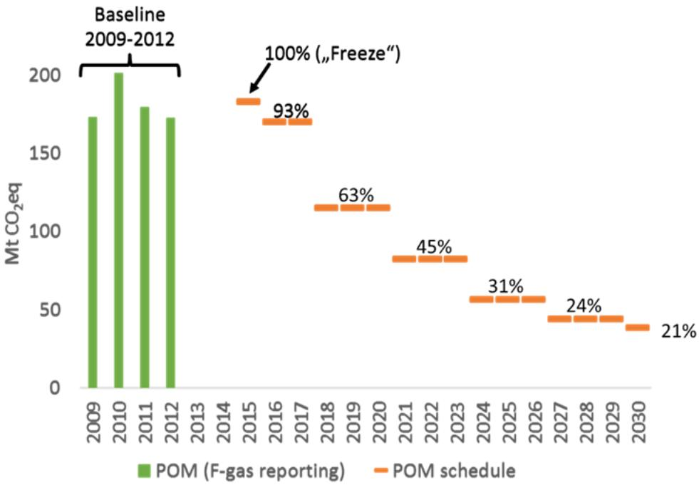  
Figure 4-1: GWP-weighted phase-down under the European F-gas Regulation (POM = Placing on the Market) (1).  
The Regulation also describes prohibitions on specific uses.

This European F-gas Regulation is effective in all Member States and has been implemented in its entirety in the Dutch F-gases Decree (F-gassen Besluit) (2) and the associated Regulations.

## Common refrigerants and their properties

Table 2-2 below lists the most commonly used refrigerants and their properties. Besides the refrigerants listed in this table, there are numerous mixtures containing HFOs currently under development, but these were either not yet commercially available or unproven as of the date of writing (early 2021). These mixtures have therefore been excluded.

<table><tr><td rowspan=1 colspan=1>Type</td><td rowspan=1 colspan=1>R number</td><td rowspan=1 colspan=1>Chemical properties</td><td rowspan=1 colspan=1>ODP</td><td rowspan=1 colspan=1>GWP</td><td rowspan=1 colspan=1>Safety class</td></tr><tr><td rowspan=1 colspan=6>Synthetic: CFCs and HCFCs</td></tr><tr><td rowspan=1 colspan=1></td><td rowspan=1 colspan=1>R12</td><td rowspan=1 colspan=1>containing chlorine,fluorine and carbon</td><td rowspan=1 colspan=1>1</td><td rowspan=1 colspan=1>10900</td><td rowspan=1 colspan=1>A1</td></tr><tr><td rowspan=1 colspan=1></td><td rowspan=1 colspan=1>R22</td><td rowspan=1 colspan=1>containing chlorine,fluorine, hydrogenand carbon</td><td rowspan=1 colspan=1>0.055</td><td rowspan=1 colspan=1>1810</td><td rowspan=1 colspan=1>A1</td></tr><tr><td rowspan=1 colspan=6>Synthetic: HFCs and mixtures containing HFCs (GWP&gt;150)</td></tr><tr><td rowspan=1 colspan=1></td><td rowspan=1 colspan=1>R134a</td><td rowspan=2 colspan=1>containing chlorine,hydrogen and carbon</td><td rowspan=1 colspan=1>0</td><td rowspan=1 colspan=1>1430</td><td rowspan=1 colspan=1>A1</td></tr><tr><td rowspan=1 colspan=1></td><td rowspan=1 colspan=1>R32</td><td rowspan=1 colspan=1>0</td><td rowspan=1 colspan=1>675</td><td rowspan=1 colspan=1>A2L</td></tr><tr><td rowspan=1 colspan=1></td><td rowspan=1 colspan=1>R410A</td><td rowspan=1 colspan=1>mixture with highGWP, withtemperature glide</td><td rowspan=1 colspan=1>0</td><td rowspan=1 colspan=1>2088</td><td rowspan=1 colspan=1>A1</td></tr><tr><td rowspan=1 colspan=1></td><td rowspan=1 colspan=1>R507A</td><td rowspan=1 colspan=1>mixture with highGWP, withouttemperature glide</td><td rowspan=1 colspan=1>0</td><td rowspan=1 colspan=1>3985</td><td rowspan=1 colspan=1>A1</td></tr><tr><td rowspan=1 colspan=1></td><td rowspan=1 colspan=1>R452B,R454B</td><td rowspan=1 colspan=1>Mixtures with lowerGWP, withtemperature glide</td><td rowspan=1 colspan=1>0</td><td rowspan=1 colspan=1>676467</td><td rowspan=1 colspan=1>A2L</td></tr><tr><td rowspan=1 colspan=6>Synthetic: HFOs and mixtures containing HFOs (GWP&lt;150)</td></tr><tr><td rowspan=1 colspan=1></td><td rowspan=1 colspan=1>R1234yf</td><td rowspan=1 colspan=1>containing fluorine,</td><td rowspan=1 colspan=1>0</td><td rowspan=1 colspan=1>4</td><td rowspan=1 colspan=1>A2L</td></tr><tr><td rowspan=1 colspan=1></td><td rowspan=1 colspan=1>R1234ze(E)</td><td rowspan=1 colspan=1>hydrogen and carbon;double bond</td><td rowspan=1 colspan=1>0</td><td rowspan=1 colspan=1>7</td><td rowspan=1 colspan=1>A2L</td></tr><tr><td rowspan=1 colspan=1></td><td rowspan=1 colspan=1>R454C</td><td rowspan=1 colspan=1>Mixtures withextremely low GWP,with temperatureglide</td><td rowspan=1 colspan=1>0</td><td rowspan=1 colspan=1>146</td><td rowspan=1 colspan=1>A2L</td></tr><tr><td rowspan=1 colspan=6>Natural</td></tr><tr><td rowspan=1 colspan=1>Ammonia</td><td rowspan=1 colspan=1>R717</td><td rowspan=1 colspan=1>NH3</td><td rowspan=1 colspan=1>0</td><td rowspan=1 colspan=1>0</td><td rowspan=1 colspan=1>B2L</td></tr><tr><td rowspan=1 colspan=1>Carbon dioxide</td><td rowspan=1 colspan=1>R744</td><td rowspan=1 colspan=1>CO2</td><td rowspan=1 colspan=1>0</td><td rowspan=1 colspan=1>1</td><td rowspan=1 colspan=1>A1</td></tr><tr><td rowspan=1 colspan=1>Hydrocarbons</td><td rowspan=1 colspan=1>R290R600aR1270</td><td rowspan=1 colspan=1>containing hydrogenand carbon (C3H8,C₄H₁o, C₃H₆)</td><td rowspan=1 colspan=1>0</td><td rowspan=1 colspan=1>2-6</td><td rowspan=1 colspan=1>A3</td></tr></table>

Table 2-2: Overview of common refrigerants (based on EN 378-1:2016, Annex E) See paragraph 2.2.5 for explanations of the terms and definitions used.

## Energetic performance of natural refrigerants

The calculation of the COP (coefficient of performance) with the simulation program CoolTools (3) reveals that, under similar conditions, heat pumps with natural refrigerants are at least as efficient as heat pumps with synthetic refrigerants. Switching to natural refrigerants leads to equivalent or higher efficiencies.

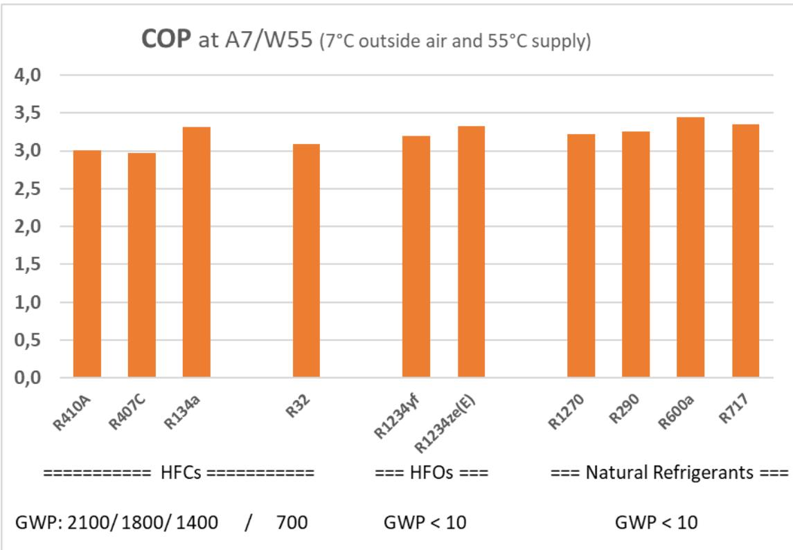

## Climate effect, GWP and TEWI

A TEWI (Total Equivalent Warming Impact) calculation was carried out to determine the direct climate effect (Global Warming Potential or GWP of the refrigerant) and indirect climate effect $( \mathsf { C O } _ { 2 }$ emissions caused by the generation of electricity for the compressor motor) of the heat pumps. The ratio between the direct and the indirect impact depends strongly on how the electricity is generated. Based on the current equivalent $\mathsf { C O } _ { 2 }$ emissions caused by average electricity generation in the Netherlands, the indirect impact is relatively large, and the direct impact therefore relatively small. As electricity production is made increasingly sustainable, the direct impact (GWP of the refrigerant) will increase relatively, and thus the climate benefits of natural refrigerants will become more substantial compared to traditional synthetic refrigerants.

## The future of natural refrigerants

Suitable natural refrigerants are available for many heat pump applications. These refrigerants have a low environmental impact, and perform comparably to or better than synthetic alternatives, with acceptable and stable costs. The three most common natural refrigerants are hydrocarbons, carbon dioxide and ammonia.

Hydrocarbons are particularly suitable for smaller heat pumps, monoblocks and single-split ACs. They are suitable for collective systems (blocks of houses and apartment buildings) and industrial applications, if adequate risk management measures can be put in place. Hydrocarbons are less suitable for larger multi-split and VRF systems due to the high costs and the constraints of the required safety measures.

Carbon dioxide is particularly suitable for higher supply temperatures (both domestic hot water and central heating in combination with a temperaturestratified buffer) in both small and large heat pumps.

Ammonia is mainly suitable for industrial heat pumps. In the future it may be used in high-tech hybrid domestic heat pumps fired by natural gas.

Existing heat pumps generally cannot be converted for use with natural refrigerants.

Table 6-1 below displays how natural refrigerants could be used in the heat pumps of the future.

## Safety

The use of refrigerants involves safety risks. These risks must be identified for each specific refrigerant, system and application and controlled with various technical and organisational measures. Manufacturers and installers must ensure that suitably safe systems are available on the market that comply with the applicable standards (e.g. the generic EN 378 standard, or the product standards in the IEC 60335 series).

For hydrocarbons, these risks are mainly related to flammability. The Netherlands Code of Practice (Nederlandse praktijkrichtlijn) NPR7600:2020, ‘Application of flammable refrigerants in refrigerating systems and heat pumps'(4), describes how these risks can be controlled.

For carbon dioxide, these risks are mainly related to high pressures and the formation of solid carbon dioxide (dry ice). The Netherlands Code of Practice NPR7601:2020, ‘Application of carbon dioxide as a refrigerant in refrigerating systems and heat pumps'(5), describes how these risks can be controlled.

For ammonia, these risks are mainly related to toxicity. The Netherlands Guideline (Nederlandse richtlijn) PGS-13:2020, ‘Application of ammonia as a refrigerant in refrigerating systems and heat pumps'(6), describes how these risks can be controlled.

Additional safety measures do increase the purchase costs of heat pumps, and often the maintenance costs too (more regular inspections or maintenance required).

## Potential applications of common natural refrigerants

The table below provides a general overview of potential applications based on the currently available data and the calculations presented in this report.

The colour codes can be interpreted as follows:

\- Green: currently in use and/or no significant restrictions

\- Yellow: few obvious practical applications

\- Orange: very limited options or significant restrictions

<table><tr><td rowspan=1 colspan=1></td><td rowspan=1 colspan=1>R290</td><td rowspan=1 colspan=1>R600a</td><td rowspan=1 colspan=1>R717</td><td rowspan=1 colspan=1>R744</td></tr><tr><td rowspan=1 colspan=1></td><td rowspan=1 colspan=1>Propane</td><td rowspan=1 colspan=1>Isobutane</td><td rowspan=1 colspan=1>Ammonia</td><td rowspan=1 colspan=1> $\mathsf { C O } _ { 2 }$ </td></tr><tr><td rowspan=1 colspan=1>Heating capacity</td><td rowspan=1 colspan=1></td><td rowspan=1 colspan=1></td><td rowspan=1 colspan=1></td><td rowspan=1 colspan=1></td></tr><tr><td rowspan=1 colspan=1>Domestic:&lt;12 kW</td><td rowspan=1 colspan=1></td><td rowspan=1 colspan=1></td><td rowspan=1 colspan=1>*)</td><td rowspan=1 colspan=1></td></tr><tr><td rowspan=1 colspan=1>Housing blocks, smallcommercial buildings,apartment buildings:&lt;70 kW</td><td rowspan=1 colspan=1></td><td rowspan=1 colspan=1></td><td rowspan=1 colspan=1>*)</td><td rowspan=1 colspan=1></td></tr><tr><td rowspan=1 colspan=1>Residential buildings,large commercialbuildings:&gt;70 kW/unit</td><td rowspan=1 colspan=1></td><td rowspan=1 colspan=1>*)</td><td rowspan=1 colspan=1>*)</td><td rowspan=1 colspan=1></td></tr><tr><td rowspan=1 colspan=1>Application/function</td><td rowspan=1 colspan=1></td><td rowspan=1 colspan=1></td><td rowspan=1 colspan=1></td><td rowspan=1 colspan=1></td></tr><tr><td rowspan=1 colspan=1>LT space heating:35℃</td><td rowspan=1 colspan=1></td><td rowspan=1 colspan=1>*)</td><td rowspan=1 colspan=1>*)</td><td rowspan=1 colspan=1>*)</td></tr><tr><td rowspan=1 colspan=1>MT space heating: $5 5 ^ { \circ } \mathsf { C }$ </td><td rowspan=1 colspan=1></td><td rowspan=1 colspan=1>*)</td><td rowspan=1 colspan=1>*)</td><td rowspan=1 colspan=1>*)</td></tr><tr><td rowspan=1 colspan=1>HT space heating: $7 5 ^ { \circ } \mathsf { C }$ </td><td rowspan=1 colspan=1></td><td rowspan=1 colspan=1></td><td rowspan=1 colspan=1>*)</td><td rowspan=1 colspan=1>*)</td></tr><tr><td rowspan=1 colspan=1>Domestic hot water:60-80℃</td><td rowspan=1 colspan=1></td><td rowspan=1 colspan=1></td><td rowspan=1 colspan=1>*)</td><td rowspan=1 colspan=1></td></tr><tr><td rowspan=1 colspan=1>Source</td><td rowspan=1 colspan=1></td><td rowspan=1 colspan=1></td><td rowspan=1 colspan=1></td><td rowspan=1 colspan=1></td></tr><tr><td rowspan=1 colspan=1>Outdoor air:-12 to $+ 1 5 \mathrm { ^ \circ C }$ </td><td rowspan=1 colspan=1></td><td rowspan=1 colspan=1>*)</td><td rowspan=1 colspan=1></td><td rowspan=1 colspan=1></td></tr><tr><td rowspan=1 colspan=1>Ground sourceheat exchanger(BTES):Drinking water: $0 / 8 ^ { \circ } \mathsf { C }$ </td><td rowspan=1 colspan=1></td><td rowspan=1 colspan=1></td><td rowspan=1 colspan=1></td><td rowspan=1 colspan=1></td></tr><tr><td rowspan=1 colspan=1>Groundwater (ATES):10-18℃</td><td rowspan=1 colspan=1></td><td rowspan=1 colspan=1></td><td rowspan=1 colspan=1></td><td rowspan=1 colspan=1></td></tr><tr><td rowspan=1 colspan=1>Ventilation air: $2 0 ^ { \circ } \mathsf { C }$ </td><td rowspan=1 colspan=1></td><td rowspan=1 colspan=1></td><td rowspan=1 colspan=1></td><td rowspan=1 colspan=1>*)</td></tr><tr><td rowspan=1 colspan=1>Residual/waste heat(including wastewaterheat recovery):20-30℃</td><td rowspan=1 colspan=1></td><td rowspan=1 colspan=1></td><td rowspan=1 colspan=1></td><td rowspan=1 colspan=1>*)</td></tr><tr><td rowspan=1 colspan=1>Specific aspects</td><td rowspan=1 colspan=1></td><td rowspan=1 colspan=1></td><td rowspan=1 colspan=1></td><td rowspan=1 colspan=1></td></tr><tr><td rowspan=1 colspan=1></td><td rowspan=1 colspan=1>*)</td><td rowspan=1 colspan=1>*)</td><td rowspan=1 colspan=1>*)</td><td rowspan=1 colspan=1>*)</td></tr></table>

Table 6-1: Overview of heat pump applications with natural refrigerants  
\*) Refer to Chapter 6 for a further explanation and additional information.

## What is important for the future of natural refrigerants?

In all heat pump applications, it is important to ensure as low as possible refrigerant emissions to minimise the impact on the environment and climate.

Heat pump manufacturers, developers, consultants and designers involved in heat pump projects are advised to consider potential applications of heat pumps with natural refrigerants. For existing heat pumps based on F-gases which have a significant greenhouse effect, we advise replacing these with a heat pump that uses a refrigerant with a lower GWP as soon as the opportunity arises. Ensuring tightness of the systems and improving the recovery, recycling and destruction of refrigerants at the end of the lifetime of a heat pump also helps to reduce the climate impact.

Specific knowledge and skills are required to work with refrigerants and heat pumps. Designers, manufacturers, installers, service engineers and operators need to be adequately trained, and companies and persons should preferably be certified. Certification is currently only legally required EU-wide for installation companies and their employees when working with F-gases with a significant greenhouse effect (2). For natural refrigerants (hydrocarbons above 5 kg, carbon dioxide above 10 kg and ammonia above 10 kg), competent personnel are required by law in The Netherlands, under the Environmental Activities Decree (Activiteitenbesluit) (7)

The Network for Refrigeration and Climate Technology (Stichting Netwerk Koude- en Klimaattechniek, NKK) manages an integrated competence system based on selfregulation to enable the involved sectors to implement these requirements for all types of refrigerants, both natural and F-gases (8). All involved companies and persons are advised to register with this competence system.

Natural refrigerants and heat pump concepts without refrigerants will need robust support to accelerate their development and introduction to the market, because of their position far behind synthetic refrigerants, currently the accepted norm and developed to full maturity over many years.

## 1 INTRODUCTION

## 1.1 STUDY AIM

## Primary aim

The aim of this study is to provide insight into potential applications of natural refrigerants. The study provides an overview of their specific characteristics, a quantification of their effects on heat pump efficiency (also in relation to potentially higher supply temperatures), and bottlenecks present in current laws, regulations and standards.

## Effect of the choice of refrigerant

The choice of refrigerant is a crucial factor in heat pump design. The choice of refrigerant determines the choice of components and the details of the design. This choice can only be made once and applies for the entire lifetime of the heat pump (it is generally not possible to switch refrigerants during the lifetime of a system, and even if technically possible, it almost always results in sub-optimal operation). The cumulative effects of the choice of refrigerant are experienced over the entire lifetime of the pump, which can be as long as 15-20 years. These include the environmental impact of refrigerant emissions, the effect on energy consumption, the operating costs, operational reliability, product lifecycle and safety. All these aspects are covered in this study.

The choice of refrigerant is just one of many factors that affect heat pump performance, and these factors also mutually influence each other. The heat pump system will need to be optimised for each refrigerant. A good example is $\mathsf { C O } _ { 2 }$ as a refrigerant, where $\mathsf { C O } _ { 2 ^ { - } }$ specific optimisation techniques such as parallel compression, flash gas bypass and ejectors are used to improve performance.

In this study, the effects of the choice of refrigerant on heat pump performance are assessed, among others, based on the results of computer simulated performance comparisons. The main advantage of this approach is that only the influence of thermodynamic refrigerant properties is reflected in the results, because all other factors are constant.

Only limited comparative field measurements are available, and these are not easily comparable, as these other factors are rarely constant in practice. Such factors include the behaviour of a building's occupants with regard to the temperature settings and the use of domestic hot water. Secondary effects also play a role, particularly differences in heat transfer and flow properties.

The reliability of performance comparisons, whether based on calculations or field measurements, is therefore limited, and conclusions about the effects on performance of the choice of refrigerant can therefore only be indicative.

## 1.2 SCOPE

a. The study focuses on heat pumps for central heating and domestic hot water in residential and commercial buildings. Heat pumps for industrial applications are only briefly discussed.

b. The study involved the following heat sources: outdoor and indoor air, ground source (BTES) and groundwater (ATES). Residual and waste heat were not included as heat sources in this study.

c. Air conditioners with a heat pump function are also excluded. Heat pumps that provide some degree of cooling are discussed briefly, insofar as the cooling function may influence the choice of refrigerant.

d. A very brief overview is given of alternative heat pump technologies that do not require a refrigerant, and is limited to a number of technologies available or under development in the Netherlands.

## 1.3 STUDY METHOD AND REPORT STRUCURE

## References consulted and comments on final draft

The findings of the study are based on the expertise of the authors, a literature review and information provided by various experts from the Netherlands and abroad and from among the authors' own networks. The performance comparisons were carried out using specialised computer simulation programs.

The final draft of this report was commented on by a number of external experts from the industry, knowledge institutions and the government (both in writing at the request of the Netherlands Enterprise Agency RVO and TKI Urban Energy, and orally during an online seminar). The comments were then incorporated into this final version.

## Chapters

Chapter 2 presents the main characteristics of refrigerants and an overview of refrigerant applications, with a focus on mechanical vapour compression systems. The difference between natural and synthetic refrigerants is discussed, as well as the environmental effects and safety aspects. A summary is provided of common refrigerants and their characteristics and the availability and costs of refrigerants are discussed. We look into pressure and temperature properties of refrigerants, and their application in heat pumps in relation to their heating capacity and function.

Alternative concepts for mechanical vapour compression without the use of refrigerants are briefly discussed.

Chapter 3 examines the three main natural refrigerants in detail: hydrocarbons, carbon dioxide and ammonia.

Chapter 4 provides an overview of relevant laws, regulations and related standards. This chapter also addresses the required employee competence and certification for working with refrigerants.

Chapter 5 discusses the effects of the choice of refrigerant on energy performance and sets out the results of the computer simulations and the data gathered in the field.

Chapter 6 provides an overview of heat pump applications and possible refrigerant options, both natural and synthetic, per category.

In chapter 7 we present our conclusions and recommendations.

Chapter 8 contains the bibliography. In the text of this report, the source reference is indicated with a sequential number between brackets ()', which refers to the numbered references in this chapter.

Tables and figures are numbered with the corresponding chapter number.

The chapters also refer to several numbered appendices with in-depth and background information.

## 2 CHARACTERISTICS, OVERVIEW AND APPLICATIONS OF REFRIGERANTS

## 2.1 INTRODUCTION

This chapter discusses the characteristics of refrigerants. This is followed by an overview of the refrigerants currently available for heat pumps and their relevant characteristics. While the subject of this study is ‘natural refrigerants', it is still useful to outline the entire refrigerant landscape. We therefore start by briefly discussing all currently known refrigerants. The main characteristics (environmental impact, safety aspects, availability, costs and anticipated cost trends) are also broadly discussed. We then look into the pressure and temperature properties of refrigerants, and their application in heat pumps in relation to their heating capacity and function.

This chapter discusses refrigerants applied in the commonly used 'reverse Rankine cycle' heat pumps. At the end of this chapter, alternative heat pump concepts without refrigerants are briefly discussed (paragraph 2.3).

A detailed elaboration of a number of specific characteristics of natural refrigerants follows from Chapter 3 onwards.

## 2.2 RELEVANT CHARACTERISTICS OF REFRIGERANTS

## 2.2.1 Mechanical vapour compression and refrigerants

More than 99% of all refrigerating, AC and heat pump systems are based on this concept. This study focuses on systems that use the conventional reverse Rankine cycle with mechanical vapour compression. These systems always require a refrigerant that evaporates and condenses in a closed cycle. This study therefore only discusses refrigerants suitable for a conventional reverse Rankine cycle.

These refrigerants are divided into two groups: natural and synthetic. This is discussed further in paragraph 2.2.2. The subsequent sections of this chapter discuss the main characteristics and effects of natural and synthetic refrigerants and their applications.

## 2.2.2 Natural versus synthetic refrigerants

Until the middle of the last century, natural refrigerants were the only available option. There is no single, globally accepted definition of 'natural refrigerants'. The definition used in the Dutch Environmental Activities Decree is as follows: "the application of carbon dioxide, ammonia or hydrocarbons as a refrigerant, other than a fluorinated greenhouse gas as meant in EU Regulation No. 517/2014, or a controlled substance as meant in EU Regulation No. 1005/2009 on substances that deplete the ozone- layer." (9) See also chapter 4.2. A broader definition based on the properties of natural refrigerants defines these as substances that occur naturally in large quantities in our ecosystem, where the quantities applied as refrigerants are negligible compared to the total amount. It has thus been proven in practice that these substances have no significant harmful effects on the environment (both short and long term) when used as refrigerants. ${ \mathsf { C O } } _ { 2 } ,$ hydrocarbons and ammonia are considered the most important natural refrigerants worldwide and fall under this broader definition. Although large-scale emissions of these substances (such as ammonia by the agriculture sector and $\mathsf { C O } _ { 2 }$ as the main greenhouse gas) have adverse environmental effects, this definition allows that they can safely be applied as refrigerants given the negligible quantities used to this end. This broader definition also allows for the fact that halogenated hydrocarbons are not considered natural, despite evidence that minute traces of naturally occurring halogenated hydrocarbons (and particularly CF₄) may occur in the atmosphere (10).

In addition to these natural refrigerants, synthetic refrigerants have been manufactured by humans in various complex chemical processes since the 1950s. Almost all synthetic refrigerants contain fluorine (F-gases) in addition to carbon. The sector that manufactures these refrigerants is also referred to as the fluorochemical industry. Chlorine, bromine and iodine are also used in addition to fluorine, which is why the collective term 'halogenated hydrocarbons' is used.

For all these synthetic substances, it remains uncertain whether significant adverse environmental effects will occur in the future, after years of use and emissions (see Chapter 2.2.3). This uncertainty does not exist for natural refrigerants.

Appendix 1 chronologically covers the four generations of refrigerants in their historical perspective and provides details on the main refrigerants.

## 2.2.3 Environmental impact of refrigerants

All refrigerants have an effect on the environment. The most important effects are discussed below.

## - Ozone depletion

Chlorinated refrigerants (CFCs and HCFCs) are the main contributors to the hole in the ozone layer. The Montreal Protocol, an international treaty to end the use of these substances, is currently in the final phase. As such, it is a practical example of a successful global campaign to reduce environmental degradation. As this treaty has almost achieved its goal to phase out these substances, this study will not address the ozone layer issue.

## - Global warming

Refrigerants containing CFCs, HCFCs and HFCs are significant contributors to the global climate problem. The GWP (Global Warming Potential) is a value for the greenhouse gas contribution of a substance per kilogram relative to $C O _ { 2 } ,$ the primary greenhouse gas (the GWP of $\mathsf { C O } _ { 2 }$ is 1 by definition). Table 2-2 gives the

GWP value of commonly used refrigerants. Appendix 2 provides more details on the greenhouse effects of refrigerants.

A global campaign is currently underway to reduce greenhouse gas emissions. The figures on the relative contribution of refrigerants to total emissions vary widely, ranging from 7% in 2015 to 25% in 2030. In any case, this contribution justifies an active reduction programme for refrigerant emissions, hence the European F-gas Regulation (2014), which is binding for all EU Member States. This Regulation contains measures to reduce emissions of F-gases with a GWP above 150. Annex 1 of this F-gas Regulation contains a table that lists all F-gases that must be phased down. Annex 2 contains a table with F-gases (mostly with a GWP below 150) that are only subject to a reporting requirement. The F-gas Regulation does not impose any reduction measures for substances with a GWP below 150. This may change as a result of the review of this Regulation which is currently being negotiated. Appendix 2 of this study lists the GWP values of commonly used refrigerants. Chapter 4 and appendices 8 and 9 discuss the laws and regulations in detail.

## Direct and indirect contribution to global warming

Besides the influence of the refrigerant (GWP, direct contribution), the energy consumption of a heat pump also contributes to global warming (indirect contribution), depending on how the energy is converted (e.g. coal-fired power plant or wind turbine).

The direct contribution to global warming is determined by the GWP of the refrigerant and the amount of substance released into the atmosphere. Leakages of refrigerant can occur, ranging from minor leaks that go undetected for some time to catastrophic leakages where a system drains completely in a matter of minutes. Leakages can also occur during maintenance and repairs (for example during removal of the refrigerant or vacuum pumping). As a rule of thumb, between 1 and 30% of the total refrigerant volume will leak each year. The leakage rates recorded in the literature vary widely and are specific to certain applications, and so are not very useful for comparison. The significant deviations between these leakage rates are caused by many different factors. The lower annual limit of 1% applies to standard household refrigerators with a hermetically sealed refrigeration circuit and an optimised design. A car AC with an open compressor that is subject to vibrations and is not regularly serviced will leak as much as 30% of its refrigerant per year. The leakage of most stationary systems used in the Netherlands is currently thought to be well below 10%. In Chapter 5 (calculations), an annual leakage of 2% is assumed (for standard small domestic heat pumps).

The recovery, processing, recycling and destruction of refrigerants involves some emissions into the atmosphere. These count towards the direct contribution. Chapter 5 (calculations) assumes that 20% of all recovered refrigerant is emitted into the atmosphere.

The European F-gas Regulation aims to reduce these emissions (leakage) and phase down the use of high GWP refrigerants (see paragraph 4.1).

Note: the production of F-gases also releases greenhouse gases. This contribution is usually not included in the direct contribution.

The indirect contribution depends on electricity consumption and how this electricity is generated. If the source of generation is unknown, the CO₂ equivalents per kWh as published by the individual countries can be used (this is known as the national electricity factor). Chapter 5 discusses the energy performance of heat pumps in relation to the choice of refrigerant.

The total contribution is the sum of the direct and indirect contribution. Since 1990, methods have been developed and applied to combine the two influences. Best known is the TEWI (Total Equivalent Warming Impact). Another is the LCA (Life Cycle Analysis). The outcomes of these analyses are highly dependent on the assumptions and the methodology used, so the resultant absolute values are of little use. However, comparative calculations based on these methods can provide insight into sensitivities and relative effects.

Chapter 5 apples the TEWI approach to compare the performance of various refrigerants in heat pumps.

## - Degradation products of F-gases (TFA)

HFCs and HFOs break down in the environment into HF, carbonyl fluoride, HCl and the so-called short-chain perfluorocarboxylic acids. Trifluoroacetic acid (TFA) is the most important of these. This substance is toxic, accumulates in wet environments and is non-biodegradable. Because of these longer term risks of TFA, there is global concern about emissions of refrigerants with HFCs and HFOs into the environment. Manufacturers of these substances (and many producers of systems that contain them) do not think these degradation products of refrigerants cause an environmental hazard. Appendix 3 provides more details about TFA.

## PFAS

Five European countries (among which the Netherlands) submitted a request to phase down the use of per- and polyfluoroalkyl substances (PFAS) in Europe by mid-2020. HFCs (and HFOs) fall under this category of substances. Appendix 3 discusses PFAS in more detail.

## - Combustion products of F-gases (HF)

The combustion of F-gases generates by-products. Phosgene and hydrogen fluoride (HF) are thought to be the main by-products, but no hard and consistent data are available to prove this. Appendix 3 discusses HF as a by-product of combustion.

## - Uncertainties about the environmental effects of F-gases

The above points reveal the uncertainties surrounding the environmental impact of F-gases (HFCs and HFOs). If the environmental effects are found to be unacceptable, the interventions required to clean up the damage already caused and prevent further damage will be extremely complicated to implement. This was proven to be the case in two previous situations: with CFCs (the main cause of the hole in the ozone layer), and with their replacement, HFCs (which later proved to make a large contribution to global warming).

This uncertainty about adverse environmental effects is the main reason to avoid using synthetic refrigerants (HFCs, HFOs), particularly where a natural alternative can be applied without drawbacks. This uncertainty does not exist for natural refrigerants as explained in paragraph 2.2.2 and appendices 1, 2 and 3.

## 2.2.4 Safety aspects of refrigerants

## Flammability and toxicity

Over the past 60 years, we have become accustomed to (and spoilt for choice with) a large range of non-flammable and low-toxicity refrigerants in safety class A1 (the familiar ${ \mathsf { C F C S } } ,$ HCFCs and HFCs). However, because of the negative environmental effects of these F-gases (ozone layer depletion and global warming), the refrigerants we will need to use in the future will almost all be flammable (the only exception being $C ( \ O _ { 2 } )$ . The chemical industry is committed to developing mixtures that are non-toxic, nonflammable and have a negligible GWP, but this is not expected to lead to any practical and widely applicable results in the foreseeable future.

Flammability is a common hazard in our everyday environment: we cook our food, heat our homes and fuel our cars with flammable substances without giving it a second thought, even when there are good non-flammable alternatives available. This analogy suggests that flammability should not be a reason to categorically reject a given refrigerant. However, the relevant safety aspects and associated regulations will need to be taken into account if we are to use flammable refrigerants. Particularly important here are the two European ATEX (ATmosphère EXplosible) directives. These cover all situations where there is a gas and dust explosion hazard. Companies and organisations that work in explosive environments are required to take measures to ensure their employees can carry out their work safely.

The refrigeration industry developed an international safety classification system in the 1960s, with flammability classes 1, 2 and 3. It was amended after the introduction of flammable HFOs, with the aim of broadening the potential uses of these substances. Criteria have been developed that distinguish HFOs from other flammable refrigerants, particularly hydrocarbons, which has resulted in a new flammability class 2L.

Two classes exist for toxicity: Class A substances have low toxicity (almost all refrigerants used in practice) and class B substances have high toxicity (ammonia). Appendix 4 provides more details on this safety classification. Table 2-1 summarises the current safety classification.

<table><tr><td rowspan=1 colspan=1>Flammability</td><td rowspan=1 colspan=2>Refrigerant classification</td></tr><tr><td rowspan=1 colspan=1>Highly flammable</td><td rowspan=1 colspan=1>A3</td><td rowspan=1 colspan=1>B3</td></tr><tr><td rowspan=1 colspan=1>Flammable</td><td rowspan=1 colspan=1>A2</td><td rowspan=1 colspan=1>B2</td></tr><tr><td rowspan=1 colspan=1>Mildly flammable</td><td rowspan=1 colspan=1>A2L</td><td rowspan=1 colspan=1>B2L</td></tr><tr><td rowspan=1 colspan=1>Non-flammable</td><td rowspan=1 colspan=1>A1</td><td rowspan=1 colspan=1>B1</td></tr><tr><td rowspan=1 colspan=1>Toxicity</td><td rowspan=1 colspan=1>Low toxicity</td><td rowspan=1 colspan=1>High toxicity</td></tr></table>

Table 2-1: Safety classification for refrigerants (ISO 817, EN 378)

In addition to flammability, there is also the concept of explosivity. The two terms are often used interchangeably. To avoid confusion, we use only the term flammability in this study.

An important safety parameter is the Lower Flammability Limit (LFL) (or Lower Explosion Limit, LEL), which is the minimum concentration of refrigerant capable of supporting a flame within a homogeneous mixture of refrigerant and air. Most safety measures are aimed at preventing concentrations above this LFL when an ignition source is present.

## ADR and CLP

Legally required classifications exist for the transport, packaging and labelling of hazardous substances, being the European Agreement for the International Carriage of Dangerous Goods by Road (ADR 2019), and EU Regulation 1272/2008 (amended in 2019) on the Classification, Labelling and Packaging of Substances and Mixtures (CLP). These classifications are not consistent with the refrigerant classification in Table 2-1. The Material Safety Data Sheet (MSDS) of a refrigerant contains more information about this (see example (11) and Appendix 4)

## Pressure safety

Besides toxicity and flammability, other safety aspects are also important. Pressure safety plays a particularly important role. The classification in the EU Pressure Equipment Directive (PED) into two substance groups (hazardous and non-hazardous) leads to the following classification in relation to the refrigerant classification in Table 2-1:

PED substance group 1 (hazardous): all refrigerants in toxicity class B and flammability class 2L, 2 or 3 (including R32, R1234yf, ammonia and hydrocarbons).

PED substance group 2 (non-hazardous): all refrigerants in toxicity class A and flammability class 1 (including R134a, R410A and carbon dioxide).

There is one inconsistency: R1234ze(E) is classified as an A2L (mildly flammable) substance in Table 2-1, but as non-hazardous (substance group 2) in the PED. This is because the flammability was determined at different temperatures. Pressure aspects are discussed in paragraph 2.2.6.

Details on the safety aspects of refrigerants, classification and terminology are provided in Appendix 4.

Laws and regulations and related safety and other standards are discussed in Chapter 4.   
Appendices 8 and 9 provide more details about the relevant laws and regulations.

## 2.2.5 Common refrigerants and their properties (summary)

Table 2-2 below lists the most commonly used refrigerants and their relevant properties.   
This is followed by an explanation of the definitions used in the table.

Besides the refrigerants listed in this table, there are numerous mixtures containing HFOs currently under development, but these were either not yet commercially available or unproven as of the date of writing (early 2021). These mixtures have therefore been excluded.

<table><tr><td rowspan=1 colspan=1>Type</td><td rowspan=1 colspan=1>R number</td><td rowspan=1 colspan=1>Chemical properties</td><td rowspan=1 colspan=1>ODP</td><td rowspan=1 colspan=1>GWP</td><td rowspan=1 colspan=1>Safety class</td></tr><tr><td rowspan=1 colspan=3>Synthetic: CFCs and HCFCs</td><td rowspan=1 colspan=3></td></tr><tr><td rowspan=1 colspan=1></td><td rowspan=1 colspan=1>R12</td><td rowspan=1 colspan=1>containing chlorine,fluorine and carbon</td><td rowspan=1 colspan=1>1</td><td rowspan=1 colspan=1>10900</td><td rowspan=1 colspan=1>A1</td></tr><tr><td rowspan=1 colspan=1></td><td rowspan=1 colspan=1>R22</td><td rowspan=1 colspan=1>containing chlorine,fluorine, hydrogenand carbon</td><td rowspan=1 colspan=1>0.055</td><td rowspan=1 colspan=1>1810</td><td rowspan=1 colspan=1>A1</td></tr><tr><td rowspan=1 colspan=6>Synthetic: HFCs and mixtures containing HFCs (GWP&gt;150)</td></tr><tr><td rowspan=1 colspan=1></td><td rowspan=1 colspan=1>R134a</td><td rowspan=2 colspan=1>containing chlorine,hydrogen and carbon</td><td rowspan=1 colspan=1>0</td><td rowspan=1 colspan=1>1430</td><td rowspan=1 colspan=1>A1</td></tr><tr><td rowspan=1 colspan=1></td><td rowspan=1 colspan=1>R32</td><td rowspan=1 colspan=1>0</td><td rowspan=1 colspan=1>675</td><td rowspan=1 colspan=1>A2L</td></tr><tr><td rowspan=1 colspan=1></td><td rowspan=1 colspan=1>R410A</td><td rowspan=1 colspan=1>mixture with highGWP, withtemperature glide</td><td rowspan=1 colspan=1>0</td><td rowspan=1 colspan=1>2088</td><td rowspan=1 colspan=1>A1</td></tr><tr><td rowspan=1 colspan=1></td><td rowspan=1 colspan=1>R507A</td><td rowspan=1 colspan=1>mixture with highGWP, withouttemperature glide</td><td rowspan=1 colspan=1>0</td><td rowspan=1 colspan=1>3985</td><td rowspan=1 colspan=1>A1</td></tr><tr><td rowspan=1 colspan=1></td><td rowspan=1 colspan=1>R452B,R454B</td><td rowspan=1 colspan=1>Mixtures with lowerGWP, withtemperature glide</td><td rowspan=1 colspan=1>0</td><td rowspan=1 colspan=1>676467</td><td rowspan=1 colspan=1>A2L</td></tr><tr><td rowspan=1 colspan=6>Synthetic: HFOs and mixtures containing HFOs (GWP&lt;150)</td></tr><tr><td rowspan=1 colspan=1></td><td rowspan=1 colspan=1>R1234yf</td><td rowspan=2 colspan=1>containing fluorine,hydrogen and carbon;double bond</td><td rowspan=1 colspan=1>0</td><td rowspan=1 colspan=1>4</td><td rowspan=1 colspan=1>A2L</td></tr><tr><td rowspan=1 colspan=1></td><td rowspan=1 colspan=1>R1234ze (E)</td><td rowspan=1 colspan=1>0</td><td rowspan=1 colspan=1>7</td><td rowspan=1 colspan=1>A2L</td></tr><tr><td rowspan=1 colspan=1></td><td rowspan=1 colspan=1>R454C</td><td rowspan=1 colspan=1>Mixtures withextremely low GWP,with temperatureglide</td><td rowspan=1 colspan=1>0</td><td rowspan=1 colspan=1>146</td><td rowspan=1 colspan=1>A2L</td></tr><tr><td rowspan=1 colspan=6>Natural</td></tr><tr><td rowspan=1 colspan=1>Ammonia</td><td rowspan=1 colspan=1>R717</td><td rowspan=1 colspan=1>NH3</td><td rowspan=1 colspan=1>0</td><td rowspan=1 colspan=1>0</td><td rowspan=1 colspan=1>B2L</td></tr><tr><td rowspan=1 colspan=1>Carbon dioxide</td><td rowspan=1 colspan=1>R744</td><td rowspan=1 colspan=1>CO2</td><td rowspan=1 colspan=1>0</td><td rowspan=1 colspan=1>1</td><td rowspan=1 colspan=1>A1</td></tr><tr><td rowspan=1 colspan=1>Hydrocarbons</td><td rowspan=1 colspan=1>R290R600aR1270</td><td rowspan=1 colspan=1>containing hydrogenand carbon (C₃H8,C₄H₁o, C₃H₆)</td><td rowspan=1 colspan=1>0</td><td rowspan=1 colspan=1>2-6</td><td rowspan=1 colspan=1>A3</td></tr></table>

Table 2-2: Overview of common refrigerants (based on EN 378-1:2016, Annex E)

Explanation of the definitions in Table 2-2.

Type: main groups based on characteristics and chemical properties. The synthetic refrigerants and mixtures are divided into with or without ODP (ozone depletion), and with a GWP>150 or a GWP<150. The GWP=150 limit is based on the current EU F-gas Regulation, in which the measures primarily concern the F-gases and mixtures with a GWP>150.

\- R number: international code for refrigerants.

Chemical properties: the atoms in the molecule or the properties of a mixture. HFOs are HFCs with a double bond, which is a technique to destabilise a molecule. The less stable the molecule, the lower the GWP, however this usually also means higher flammability.

-Mixture, with or without temperature glide:

In temperature glide, the temperature of a mixture under constant pressure changes (glides) as it evaporates or condensates. For refrigerant mixtures, the temperature glide is usually 1 to 10 K.

O An azeotropic mixture of substances has a specific concentration at which the mixture behaves as a single substance, and thus evaporates or condenses at a constant temperature and pressure. The R number starts at 5, sometimes followed by a capital letter for a specific mixture ratio under azeotropic conditions.

In a non-azeotropic (or zeotropic) mixture of substances, there is no unambiguous relationship between the pressure and temperature during evaporation and condensation. Here there is a situation of glide. The R number starts at 4, sometimes followed by a capital letter for a specific mixture ratio.

ODP: Ozone Depleting Potential. The ODP of CFC R11 is 1 by definition.

GWP: the Global Warming Potential is the contribution to global warming relative to $\mathsf { C O } _ { 2 }$ (the GWP of $\complement 0 _ { 2 }$ is 1 by definition), based on the effect over 100 years. Usually refers to publications in IPCC AR4 and AR5.

Safety class: refrigerant classification according to ISO 817/EN378. A=low toxicity, B=high toxicity; 1=non-flammable, 2L=mildly flammable, 2=flammable, 3=highly flammable.

More details are provided in appendixes 1, 2, 4 and 8.

## 2.2.6 Availability and costs of refrigerants

More and more refrigerants are coming onto the market, in particular a multitude of mixtures with HFOs as one of the components. These aim to replace specific refrigerants and applications (drop-in) with lower GWP versions. There are currently over 60 different refrigerants and mixtures available on the market. The range is constantly changing, so this study can only provide an incomplete snapshot of the market.

The information on availability and costs in this paragraph is based on interviews with refrigerant suppliers/distributors and installers of refrigerating systems and heat pumps, and concerns only the situation in the Netherlands.

## Availability

The common natural refrigerants (propane, isobutane, CO₂ and ammonia) are widely available. It is essential that only refrigerants of guaranteed quality are used (preferably with R number, but in any case with the appropriate CAS registry number), and not gases intended for other purposes.

The expected steady growth in the use of all natural refrigerants will not lead to supply problems in the future, given the limited quantities used in comparison with other applications of these substances. Due to the anticipated incidental and/or structural scarcity of F-gases (HFCs and HFOs) on the market, the stable market for natural refrigerants will be a major benefit.

Traditional HFCs with a GWP>750 are currently still readily available. As of 1 January 2021, the quota system is expected to lead to an 18% decrease in supply compared to 2020, which will mainly be reflected in the price.

HFCs with a GWP between 150 and 700 (and particularly R32) are widely available, and suppliers foresee no future supply problems. The new refrigerant R515B (with a GWP of 293) is currently only available in limited quantities. This is one of the few refrigerants available with a lower GWP that is classified as non-flammable and having low toxicity (A1).

Various HFCs and mixtures with a GWP<150 are widely available, and suppliers foresee no future supply problems. Other mixtures have been developed, but these are currently (early 2021) unavailable or only in limited quantities. These mixtures are mainly used for testing purposes.

## Recovery, recycling, reclaiming, destruction and illegal trading of F-gases

An important but uncertain factor for the availability of F-gases is the amount of refrigerant that is reused. The European F-gas Regulation requires that all used Fgases are recovered and either recycled (reused for the same application), reclaimed (reprocessed to a new specification) or professionally destroyed. This applies to refrigerants that no longer meet the required quality standard during the lifetime of the system, and to the quantity of refrigerant charge when it is decommissioned at the end of its lifetime. It is uncertain what proportion of refrigerant can actually be reused, and this proportion may decrease in the future due to the increasing quantities of mixtures used and the logistical constraints of separating these.

Much has been published about the illegal trade of refrigerants in the EU, including in (12) (part of the 'Illegal refrigerants report’). One of the problems of illegal refrigerants is that their quality is not guaranteed, which can lead to safety risks and performance issues. This problem is only expected to increase, particularly if refrigerants become scarcer and more expensive. In the Netherlands, the Human Environment and Transport Inspectorate (ILT) enforces this trade.

\- It is illegal to vent F-gases into the atmosphere.

\- Natural refrigerants may be vented under controlled and safe conditions.

The recovery and controlled destruction of natural refrigerants (incineration on site or in a specialised incinerator) can be considered for large quantities, or if it is not practically feasible to safely vent them.

## Costs and expected cost development

The costs are rarely a decisive argument for choosing a particular refrigerant, as the cost of charging the system and periodic recharging are relatively low compared to the other costs. Assuming a relatively leak-proof system, these costs are limited to around 1% of the total lifetime costs. These costs can rise to 20% in case of a leaky system (poor quality and/or inadequate maintenance). Despite the limited influence, the costs of refrigerants are still often emphasised when choosing a type of refrigerant. The following general cost considerations can be taken into account:

\- The costs of natural refrigerants are very stable and relatively low.

The costs of F-gases fluctuate widely and are based on daily prices that depend heavily on supplier-customer agreements and the size and nature of the orders. Suppliers, distributors and installers are unable to predict how the prices will change in the coming years. For example, in 2017 and 2018, the prices of some F-gases rose by a factor of 10, but fell sharply again in 2020 to close to the original price. Due to increasing production and import restrictions (GWP-weighted quota in the European F-gas Regulation; see paragraph 4.1), the supply of high-GWP F-gases will decrease significantly in the coming years. This will have a strong effect on the price (because of the market mechanism where scarcity leads to cost increases). Because the transition to low-GWP alternatives will likely not be able to keep step with the legally regulated decrease of high-GWP refrigerants, the global price of high-GWP F-gases is expected to increase sharply in the coming years.

Low-GWP HFCs may also become more expensive due to the increasing demand and the accompanying temporary or structural scarcity.

Because the F-gases market is controlled by a very small number of major multinationals, they can use targeted pricing policies to influence the choice of refrigerant and market prices.

The indicative costs (snapshot at the end of 2020, in €/kg) are given in Table 2-3. This table is based on prices per kilogram. This is not entirely suitable for comparison purposes, because the refrigerant charge required in a heat pump depends mainly on the condensation heat produced per kilogram (evaporation heat in a refrigerating system). The prices mentioned are only intended to give a rough idea of the absolute and relative prices, and are based on interviews with refrigerant suppliers and distributors, and installers of refrigerating systems and heat pumps in the Netherlands.

<table><tr><td rowspan=1 colspan=1>Refrigerant</td><td rowspan=1 colspan=1>Price €/kg</td></tr><tr><td rowspan=1 colspan=1>CO₂ (R744)</td><td rowspan=1 colspan=1>2-5</td></tr><tr><td rowspan=1 colspan=1>Propane/isobutane (R290/R600a)</td><td rowspan=1 colspan=1>7-9</td></tr><tr><td rowspan=1 colspan=1>NH₃ (R717)</td><td rowspan=1 colspan=1>4-6</td></tr><tr><td rowspan=1 colspan=1>R32</td><td rowspan=1 colspan=1>20-35</td></tr><tr><td rowspan=1 colspan=1>R410A</td><td rowspan=1 colspan=1>20-45</td></tr><tr><td rowspan=1 colspan=1>R134a</td><td rowspan=1 colspan=1>15-50</td></tr><tr><td rowspan=1 colspan=1>R404A</td><td rowspan=1 colspan=1>50-70</td></tr><tr><td rowspan=1 colspan=1>R1234yf</td><td rowspan=1 colspan=1>80-110</td></tr></table>

Table 2-3: Indicative costs of refrigerants (situation at the end of 2020; information provided by suppliers, distributors and installers)  
Chapter 6 discusses the suitability of various refrigerants for heat pump applications.

## 2.2.7 Pressure and temperature characteristics of refrigerants

Numerous parameters are important when choosing a refrigerant for a specific application.

Each refrigerant or mixture has different thermodynamic and physical properties. These properties are mostly interdependent, and ultimately determine the suitability (technical and otherwise) of a specific refrigerant for a specific application. In many cases, a single parameter (e.g. the final temperature of compression) may determine whether a specific refrigerant is technically suitable for a specific system. This study cannot fully address this complex discussion. Chapter 3 examines the three most common natural refrigerants in more detail.

This paragraph discusses one of the most important parameters in the choice of refrigerant, being the relationship between pressure and temperature.

Since the commonly applied mechanical vapour compression concept works with refrigerant evaporation at low temperature, and condensation at a higher temperature, the corresponding absolute pressures, differential pressure and pressure ratio are very important. For single refrigerants, the pressure-temperature relationship for evaporation and condensation is constant (e.g. water at 1 bar(a) always evaporates at $1 0 0 ^ { \circ } \mathsf { C } )$ . The same applies to azeotropic mixtures (all refrigerants with an R number in the 500 series, such as R507) that behave as a single substance. This does not apply to zeotropic (nonazeotropic) mixtures (all refrigerants with an R number in the 400 series, such as R410A). In these mixtures, the notorious phenomenon of 'temperature glide' occurs, which can be beneficial or detrimental depending on the type of application and design. See also the explanation for Table 2-2 and the calculations in Chapter 5.

## Absolute pressure, differential pressure and pressure ratio

The desired evaporation and condensation temperature therefore corresponds to a constant pressure for a specific refrigerant $( \mathsf { e . g . } , \mathsf { a t 4 0 ^ { \circ } C } ,$ propane always condenses at

an absolute pressure of 13.7 bar).

Because the refrigerant circulates in a closed loop, the absolute pressure is always used, and not the pressure relative to the environment (bar(g), where $" { \bf g } ^ { \prime }$ is for 'gauge; x bar(a) $= \mathsf { x b a r } ( \mathsf { g } ) + 1 )$

Many people will state categorically what the desired and allowable pressure in a given refrigerating system and heat pump should be. However, recent history has taught us that insights regarding the desired and allowable pressures for refrigerants can change significantly over the years. Some examples:

For many decades, pressures above 25 bar(a) were unthinkable. However, experiments with $\mathsf { C O } _ { 2 }$ as a refrigerant – first only at very low temperatures, with corresponding low pressures, but later also at higher temperatures and pressures – soon led to the introduction of new components: compressors specifically designed for $\mathsf { C O } _ { 2 }$ which can cope with much higher pressures, pressure differentials and pressure ratios (up to 80 bar(a)). Continuing innovations in components allowed ammonia to be condensed at significantly higher temperatures and pressures. This paved the way for the high-temperature ammonia heat pump widely used today.

Many experts insisted that the absolute pressure in a refrigerant circuit must always be above the atmospheric pressure of 1 bar(a), so that air and water vapour can never enter into the circuit in case of a leak. Over the years, this 'rule' was gradually abandoned, such as in the domestic freezer containing R134a or isobutane, where the evaporation pressure is considerably lower than 1 bar(a).

The most extreme example is the absorption air conditioner (chiller), which has been available on the market for decades, with lithium bromide as an absorbent and water as a refrigerant. The refrigerant circuit in this appliance is well below atmospheric pressure ('vacuum'), but the concept is still quite feasible, although the design challenges of working with a high negative pressure are considerable.

The historic development in pressurisation leads us to make a distinction between the short term (0-3 years) and the longer term.

## Short-term (0-3 years)

In the short term, the decisive factors are which heat pump components are commercially available for a given application, and for which refrigerants and conditions (temperatures and pressures) they are suitable, as determined by the supplier's specifications. If these specifications are not complied with, the component supplier's responsibility (and warranty) will lapse. While the manufacturer or installer of a system can choose to take this risk, they will rarely do so in practice except in the case of tests, demos and pilots.

Sometimes the lack of a single, small and affordable component can determine whether a specific heat pump can be brought to market. However, this is usually only revealed in the detailed design phase of a system, which is not addressed in this study. We can, however, discuss the availability of suitable compressors, the beating heart of any heat pump.

Compressor suppliers provide a wealth of information about the application potentials and limits of their products, and in particular the relevant pressure and temperature ranges.

Figure 2-1 is an example of such a product document. The operating conditions of this compressor, which works with the HFC refrigerant R410A, are limited to the specified range under all conditions. The complex form of this 'operating envelope' is determined by the engineering details and the maximum and minimum allowable pressures, differential pressures and pressure ratios.  
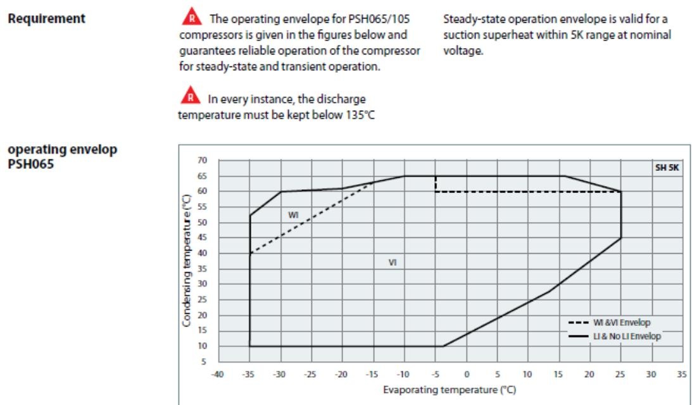  
Figure 2-1: Documentation for Danfoss compressor for heat pump applications containing R410A

## Longer term (>3 years)

For the longer term, it is justified to assume that components will be developed and approved for promising applications. Such applications will have much greater technical and economic potential than currently often predicted (with vested commercial interests playing a role in the background), as was demonstrated by the aforementioned examples.

So, for the longer term, the thermodynamic properties of refrigerants will serve as the basis for the design of applications with the highest possible COP. The practical pressure and temperature constraints of the current components need not be a limiting factor, as technological innovations will allow the development of new components to meet the market demand.

Chapters 5 and 6 elaborate further on which refrigerants are most suitable for heat pumps, taking into account the availability of components (and in particular compressors) and their specific configurations.

Appendix 5 provides a more detailed explanation of the influence of pressure and temperature characteristics on the heating capacity and COP.

## Conclusions in regard to pressure and temperature characteristics

In general, the pressures applied when using natural refrigerants are of the same order of magnitude as those for synthetic refrigerants. The only exception is carbon dioxide (R744), where the pressures are usually significantly higher. The components for these systems need to be designed accordingly.

## 2.3 SYSTEMS WITHOUT REFRIGERANTS AND ALTERNATIVE CONCEPTS

More than 99% of all cooling, AC and heat pump systems are based on this concept. This study focuses on systems that use the conventional reverse Rankine cycle with mechanical vapour compression. These systems always require a refrigerant that evaporates and condenses in a closed cycle. This study therefore only discusses refrigerants suitable for a conventional reverse Rankine cycle.

Numerous alternative concepts exist that do not require the refrigerant to evaporate and condense. In many cases, these alternative concepts have specific advantages over the conventional reverse Rankine cycle. The latter technology, however, has huge economic advantages because the costs of development have already been recuperated and it has the cost advantages of mass production. Hence these alternative concepts have an almost insurmountable disadvantage compared to the reverse Rankine cycle.

Table 2-4 below provides a list of systems without refrigerants and alternative concepts currently under development or ready for market in the Netherlands (mostly with the help of government funding). The table also provides a Technology Readiness Level (TRL) assessment. These alternative concepts are discussed in more detail in (13) and Appendix 6.

<table><tr><td rowspan=1 colspan=1>Concept</td><td rowspan=1 colspan=1>Company/organisation inthe Netherlands</td><td rowspan=1 colspan=1>TRL (indicative)</td></tr><tr><td rowspan=1 colspan=1>Water in mechanicalcompression cycle</td><td rowspan=1 colspan=1>eChiller</td><td rowspan=1 colspan=1>7-9</td></tr><tr><td rowspan=1 colspan=1>Natural gas-firedadsorption heat pump</td><td rowspan=1 colspan=1>Cooll</td><td rowspan=1 colspan=1>8</td></tr><tr><td rowspan=1 colspan=1>Absorption</td><td rowspan=1 colspan=1>Various</td><td rowspan=1 colspan=1>5-9</td></tr><tr><td rowspan=1 colspan=1>Geothermal heating andfree cooling</td><td rowspan=1 colspan=1>Various</td><td rowspan=1 colspan=1>5-9</td></tr><tr><td rowspan=1 colspan=1>Thermo-acoustic</td><td rowspan=1 colspan=1>Blue Heart EnergySoundEnergy</td><td rowspan=1 colspan=1>7</td></tr><tr><td rowspan=1 colspan=1>Air cycle</td><td rowspan=1 colspan=1>Tarnoc</td><td rowspan=1 colspan=1>7</td></tr><tr><td rowspan=1 colspan=1>Adiabatic and dew-pointcooling</td><td rowspan=1 colspan=1>Various</td><td rowspan=1 colspan=1>7-9</td></tr><tr><td rowspan=1 colspan=1>Stirling</td><td rowspan=1 colspan=1>University of Twente</td><td rowspan=1 colspan=1>5-9</td></tr><tr><td rowspan=1 colspan=1>Magnetocaloric</td><td rowspan=1 colspan=1>TU Delft</td><td rowspan=1 colspan=1>4-6</td></tr></table>

Table 2-4: Systems without refrigerants and alternative concepts, and their TRL (14), with the following extremes: TRL 1 = "Basic principles observed", and TRL 9 = "Actual system proven in operational environment (competitive manufacturing in the case of key enabling technologies)"

Strictly speaking, adsorption and absorption systems are not entirely without refrigerants, because they require an evaporating and condensing refrigerant similar to a refrigerant in the conventional reverse Rankine concept. However, because these 'thermal compressors' (with an adsorbent or absorbent and driven by heat) are based on an entirely different concept than conventional mechanical compressors, they have been included in this section regardless.

The available information leads us to conclude that satisfactory progress has been made in the development of systems without refrigerants and alternative concepts. However, few practical applications are expected in the short term (1-3 years). In the longer term (4-10 years), there is a real possibility that some of these concepts will successfully penetrate specific market niches.

Because they lag so far behind the mature, conventional synthetic refrigerants (and their applications), these heat pump concepts without refrigerants will need robust backing to accelerate their development and introduction to the market.

## 3 NATURAL REFRIGERANTS IN MORE DETAIL

The refrigerant landscape as a whole is described in paragraph 2.2. Chapter 3 examines the three main natural refrigerants in detail, being hydrocarbons, carbon dioxide and ammonia.

## 3.1 HYDROCARBONS

Hydrocarbons have been popular refrigerants since the invention of mechanical refrigeration. They provide superior and energy efficient refrigeration for most applications. Because they are highly flammable, special safety measures are required and there are restrictions on the maximum amount of refrigerant that can be used in a system or for specific applications. Clear laws and standards are required to specify how to ensure safety, however these are presently not in place. The current legislation is too generic, and the current standards are unclear, outdated, inconsistent or under revision.

For example, the IEC, ISO and CEN standards are being revised to allow more than 150 g of flammable refrigerant in hermetically sealed appliances that can be installed anywhere with minor additional safety measures, under certain conditions. This limit is expected to be increased to 500 g for hydrocarbons, subject to certain safety measures. A key innovation in this area is the development of heat pumps with an as low as possible refrigerant charge (15).

Because there are so many different versions and configurations of heat pumps available, it is not useful, and in fact undesirable, to assume a simplified system with a safe maximum refrigerant charge (as is the case in many current standards). So, to comply with the essential requirements of the EU Directives (CE marking), other legislation and product liability, it will usually not be sufficient to rely on the standards. Instead, specific risk assessments must be carried out to demonstrate conformity. This applies not only to hydrocarbons, but to all refrigerants. Chapter 4 discusses this in detail.

Table 3-1 lists the hydrocarbons that can be used as refrigerants in heat pumps. All these hydrocarbons are classified in safety class A3 (highly flammable, see Table 2-1).

<table><tr><td rowspan=1 colspan=1>Name</td><td rowspan=1 colspan=1>R number</td><td rowspan=1 colspan=1>Atmosphericboiling point(°C)</td><td rowspan=1 colspan=1>Pressure at25℃ inbar(a)</td><td rowspan=1 colspan=1>Comments</td></tr><tr><td rowspan=1 colspan=1>Ethane</td><td rowspan=1 colspan=1>R170</td><td rowspan=1 colspan=1>-89</td><td rowspan=1 colspan=1>24</td><td rowspan=1 colspan=1>Rarely used, highpressure</td></tr><tr><td rowspan=1 colspan=1>Propane</td><td rowspan=1 colspan=1>R290</td><td rowspan=1 colspan=1>-42</td><td rowspan=1 colspan=1>9.6</td><td rowspan=1 colspan=1>Most common</td></tr><tr><td rowspan=1 colspan=1>Propene(propylene)</td><td rowspan=1 colspan=1>R1270</td><td rowspan=1 colspan=1>-48</td><td rowspan=1 colspan=1>11.5</td><td rowspan=1 colspan=1>Rarely used,specific odour</td></tr><tr><td rowspan=1 colspan=1>Butane</td><td rowspan=1 colspan=1>R600</td><td rowspan=1 colspan=1>0</td><td rowspan=1 colspan=1>2.5</td><td rowspan=1 colspan=1>High-temperatureheat pumps</td></tr><tr><td rowspan=1 colspan=1>Isobutane</td><td rowspan=1 colspan=1>R600a</td><td rowspan=1 colspan=1>-12</td><td rowspan=1 colspan=1>3.5</td><td rowspan=1 colspan=1>Suitable for smallappliances</td></tr><tr><td rowspan=1 colspan=1>n-Pentane</td><td rowspan=1 colspan=1>R601</td><td rowspan=1 colspan=1>36</td><td rowspan=1 colspan=1>0.6</td><td rowspan=1 colspan=1>High-temperatureheat pumps</td></tr><tr><td rowspan=1 colspan=1>Propaene</td><td rowspan=1 colspan=1>R433A</td><td rowspan=1 colspan=1>-44</td><td rowspan=1 colspan=1>10.3</td><td rowspan=1 colspan=1>Mixture of R290and R1270,specific odour</td></tr></table>

Table 3-1: Overview of hydrocarbon refrigerants for heat pumps  
The following characteristics of hydrocarbon refrigerants are worth mentioning:

The most commonly used hydrocarbons have very similar properties to conventional (H)CFCs and HFCs and HFOs (with the exception of flammability). The choice of oil is rarely an issue.

Propane (R290) has long been the most widely used hydrocarbon in all types of applications and is very similar to the HCFC R22. Components are therefore readily available for R290. The performance (capacity, COP) of most R290 systems is comparable to or better than the corresponding systems using HFCs or HFOs.

Isobutane (R600a) is the current standard for small hermetically sealed systems (domestic refrigerators and freezers, heat pump dryers), so small components are readily and cheaply available for these appliances. Its properties are very similar to HFC R134a and CFC R12. The required pressures are lower in systems with R600a than in those with R290. However, the volumetric refrigerating capacity is also lower, thus requiring larger and more expensive components, particularly in larger systems. Isobutane generally performs well (COP), particularly in high temperature heat pumps.

Less common hydrocarbons:

Propene (R1270) is not used frequently, but has the advantage that a leak can be detected by a petroleum-like odour (like ammonia).

Butane (R600) and n-Pentane (R601) are suitable for high temperature heat pumps (particularly steam production), but are rarely used.

A mixture with the brand name Propaene (R433A), an almost azeotropic mixture of R290 and R1270, is rarely used. It has almost exactly the same properties as R22 and has the same odour as R1270.

## Fire and explosion hazards

The high flammability and explosivity of hydrocarbons mean that measures are needed to control the risks. The same applies to all flammable F-gases (R32, HFOs). The measures may include:

Limiting the refrigerant charge. With clever technical solutions, a small quantity of refrigerant can still generate significant capacity (as in the 'TKI Urban Energy HP Launch project', which involves a heat pump containing less than 150 g of propane (16)).

Locating the part of the system containing refrigerant outdoors. In the event of a leak, the refrigerant mixes quickly with the outside air, reducing the risk of a fire or explosion.

Using a ventilated enclosure/housing. The refrigerant circuit is installed in a housing equipped with a detector and ventilation system, which is activated upon detection of a leak.

– Using non-sparking equipment, tools and ATEX components ('Ex-proof').

Requirements for the location, or the minimum volume of, the room in which an appliance is installed, leading to lower concentrations of refrigerant in case of a leak.

Traditionally, the preference was for a maximum allowable refrigerant charge in an appliance, set down in a standard or law. However, this does not do justice to the wide variety of versions, configurations and operational differences. Moreover, it inhibits the development of more effective safety measures. Instead of rigid limits on the refrigerant charge, it is now preferable to determine the safety measures required for a given quantity of flammable refrigerant in a specific appliance at a specific location based on a specific risk assessment. The international standards (EN, EIC, ISO) reflect this trend and these standards are currently (early 2021) undergoing major changes, with numerous committees and working groups working on revisions and new documents. Paragraph 4.2 and Appendix 9 provide more details on the current standards.

The LifeFront project, which is funded by the EU LIFE programme, has produced several documents that clarify how such risk assessments work and provide support to the designers, manufacturers and installers who have to carry them out and define the other safety aspects involved in using hydrocarbon refrigerants, including suitable installation locations (17).

In (18), the current situation regarding the safety aspects of split ACs and heat pumps with propane is discussed.

## Applications

There are more and more applications of hydrocarbons in the world and in the Netherlands.

The following are applications using hydrocarbon refrigerants:

— Refrigeration and freezer units and plug-in display cabinets:

Hydrocarbons are used as standard in domestic refrigerators, freezers and heat pump dryers worldwide, and more and more in plug-in refrigerated display cabinets for the retail trade. Traditionally, 150 g of flammable refrigerant is considered the safe maximum refrigerant charge in hermetically sealed equipment, regardless of the location. The IEC-60335-2-89 standard (for retail display cases) was amended in 2020, allowing the application of up to 500 g of hydrocarbon under certain conditions.

For small, hermetically sealed heat pumps with a water circuit for heat supply and installation indoors, the IEC 60335-2-40 standard (ACs and heat pumps) also sets a limit of 150 g, which is likewise expected to be increased to 500 g under certain conditions in the near future. Manufacturers are anticipating this increase in their risk assessments. The safety measures are less stringent for heat pumps that can be installed outdoors in their entirety.

According to (19), heat pumps that use R290 have been available on the European market since 2017, among others from the manufacturers Heliotherm, Glen Dimplex, Alpha Innotec and NIBE.

For monoblocks and split units for AC (sometimes with heat pump function), the IEC-60335-2-40 standard limit of 150 g is also under discussion and is expected to be increased. A recent (2020) European Commission report (20) on the availability of refrigerants for new single-split ACs expressed the expectation that propane will be declared the preferred refrigerant for these applications. China and India had production capacity for 7 million propane appliances per year (up to 7 kW of refrigerating capacity) in 2019. This report also confirmed that propane appliances have more capacity and a higher COP than conventional appliances with HFCs. However, the current production costs are slightly higher because of the required safety measures, and because of the limited economies of scale. For larger multi-split and VRF systems (AC system capable of heating or cooling several rooms, with a single outdoor unit and a single piping circuit, with branches to several rooms), the refrigerant charge can reach some tens of kilos. Hydrocarbons are rarely suitable for these applications, as the required safety measures make the system too expensive and impractical.

Chillers and heat pumps in a ventilated enclosure/housing in compliance with the EN378 standard can safely be used with larger refrigerant charges.

— Various cooling, AC and heat pump systems for retail, logistics and industrial applications are suitable for hydrocarbon refrigerant charges up to 100 kg.

The Netherlands Code of Practice NPR 7600:2020 (4) specifies how flammable refrigerants can comply with the legal requirements in the Netherlands. This document also provides information on the safe use of flammable refrigerants, including hydrocarbons. Four working instructions (Werkvoorschriften) of the Royal Dutch Association of Refrigeration (KNVvK) complement NPR 7600 (21).

The additional safety measures do increase the purchase costs of heat pumps, and often the maintenance costs too (more regular inspections or maintenance required).

(22) provides more details (as of 2020) on using hydrocarbons as refrigerants in the Netherlands. (23) provides practical examples. In (24) and (25), two recent developments involving heat pumps with innovative safety features are described (see also paragraph 5.2.2).

## 3.2 CARBON DIOXIDE

Carbon dioxide $( \mathsf { C O } _ { 2 } ,$ R744) is one of the oldest refrigerants in the world. $\mathsf { C O } _ { 2 }$ is classified as refrigerant class A1 (low toxicity, non-flammable). This is the strongest argument for applying ${ \mathsf { C O } } _ { 2 } ,$ obviously in addition to the fact that it has a negligibly low GWP of 1. The latter point, that you can "use $\mathsf { C O } _ { 2 }$ to fight the $\mathsf { C O } _ { 2 }$ problem", will be hard to get across to the public. The argument for this is that the amount of $\mathsf { C O } _ { 2 }$ required for use as a refrigerant is negligible compared to the total amount of $\complement 0 _ { 2 }$ emissions.

$\mathsf { C O } _ { 2 }$ has a number of properties that make it very different to other refrigerants. These different properties are sometimes advantageous, but sometimes also disadvantageous or restrictive. The logP-h diagram below with trans-critical cycle (see Figure 3-1) reveals the following specific properties:

— the triple point (solid-liquid-vapour, at $- 5 6 . 6 ^ { \circ } \mathsf { C } )$

– dry ice (solid-vapour, $\mathsf { a t } - 7 8 . 4 ^ { \circ } \mathsf C )$

– critical point (difference/no difference between liquid and vapour, at $3 1 ^ { \circ } \mathsf { C } )$

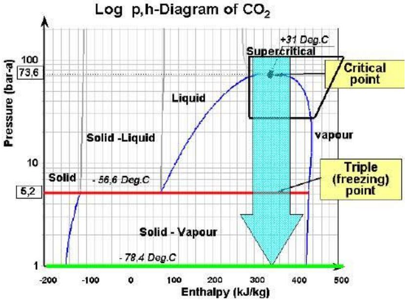  
Figure 3-1: LogP-h diagram of $\mathsf { C O } _ { 2 }$ (26)

The main differences are discussed below.

The relatively low critical point $( 3 1 ^ { \circ } \mathsf { C } )$ means that no evaporation or condensation can take place above this temperature ('supercritical state'). This is why special components are required, such as a gas cooler instead of condenser in transcritical or supercritical refrigerating systems. The traditional technique of defrosting evaporators (air coolers) with hot gas is also unsuitable.

At the triple point, dry ice is formed at a saturation temperature of $- 5 6 . 6 ^ { \circ } \mathsf { C } .$ Dry ice evaporates without transitioning to the liquid phase (desublimation) at a temperature of $\scriptscriptstyle - 7 8 ^ { \circ } \mathsf C$ and is therefore widely used as a cooling medium in open cooling processes (such as vaccine cooling). It is commercially available for this purpose. Liquid $\mathsf { C O } _ { 2 }$ can also be expanded under high pressure on site in a freezing tunnel, separating into dry ice and cold gas. These open cooling applications fall outside the scope of this study. In a closed-loop system with $\mathsf { C O } _ { 2 }$ refrigerant, the system design and operating conditions must prevent the formation of dry ice in the system, and particularly in valves or pipes that could become blocked.

Very high pressures can be reached in closed-loop systems. The saturation pressure at $2 0 ^ { \circ } \mathsf { C }$ is 57.3 bar(a). Pressures of up to 80 bar(a) can occur. This is quite feasible, as long as the design of the system takes account of these pressures. However, this will often increase the costs. In many cases, measures need to be taken to prevent the pressure in the $\mathsf { C O } _ { 2 }$ loop from rising to unacceptable levels during system downtime. These measures include controlled venting and emergency cooling.

In the event of a leakage, $\mathsf { C O } _ { 2 }$ concentrations in small, enclosed spaces can potentially rise above the limit that is dangerous for humans, so this aspect must be given extra attention.

$\mathsf { C O } _ { 2 }$ has an extremely high volumetric refrigerating capacity (about four times that of ammonia, five times that of propane and eight times that of R1234yf). This means the compressors, heat exchangers and various pipes can have significantly smaller dimensions and still achieve the same cooling or heating capacity (up to a factor of 3 smaller). This goes some way to offsetting the increased costs that go together with higher pressures. According to (19), in an R744 $\mathsf { C O } _ { 2 }$ system with comparable characteristics to an R290 propane system, the compressor can be made a factor of 2.5 smaller and the plate heat exchanger a factor of 3 smaller.

The thermodynamic properties of $\mathsf { C O } _ { 2 }$ mean a standard system will be relatively inefficient at evaporation temperatures above $\yen 0$ or condensation temperatures above $2 0 ^ { \circ } \mathsf { C }$ Several techniques have been developed to increase the efficiency of such systems (e.g. parallel compression, flash gas bypass, ejector or compressor speed control). In many cases, these techniques can be applied to achieve acceptable or even higher efficiency in comparison with conventional refrigerants, and they are also suitable for use with many other refrigerants. Such techniques do increase the complexity and costs of a system. A combination with waste heat recovery and a heat pump function can increase the efficiency and economic viability.

A reasonable ${ \mathsf { C O P } }$ can only be achieved if the gas cooler is cooled to the inlet temperature of the water heating process. This is approx. $1 5 ^ { \circ } \mathsf { C }$ for domestic hot water.

$C O _ { 2 }$ as a refrigerant is becoming more and more popular and a wide range of applications are now available.

## Applications

Cascade refrigerating systems with $\underline { { \mathsf { C O } _ { 2 } } }$ in the low stage. These have two separate refrigeration circuits with different refrigerants, connected by a cascade heat exchanger (condenser for the low stage and evaporator for the high stage). The aforementioned beneficial properties of $\mathsf { C O } _ { 2 }$ come into their own at low temperatures (evaporation temperature below $- 2 0 ^ { \circ } \mathsf { C } )$ . Ammonia or hydrocarbon is preferably used as the refrigerant in the high stage. This keeps the amount of toxic or flammable refrigerant to a safer minimum and prevents it from circulating through the areas where the evaporators are installed. ${ \mathsf { C O } } _ { 2 } / { \mathsf { N H } } _ { 3 }$ cascade systems are energetically superior at these low temperatures and are suitable for industrial applications (deep freezing) and frozen storage. However, this option is still little used for large supermarket freezer systems due to the additional costs of the concept.

Centralised $\underline { { \mathsf { C O } _ { 2 } } }$ cooling/freezing system. This is the most widely used solution for supermarkets in Europe, as the system with multiple $\mathsf { C O } _ { 2 }$ compressors facilitates flexible operation of various cooling and freezing applications and allows for the integration of ${ \mathsf { A C } } ,$ heat recovery or heat pump functions for sanitary hot water

and space heating. Typically supplied with a standard frame or rack on which the components are mounted. As of October 2019, there were more than 23,000 transcritical $\mathsf { C O } _ { 2 }$ systems in Europe.

Air-cooled condensing unit. These units are a solution for display cabinets or cold rooms in shops, petrol stations and other retail outlets in the 4 to 35 kW refrigerating capacity range. These can be combined with heat recovery (heat released during the cooling process is returned to the shop via a water circuit) Recently, a major Japanese manufacturer entered the market with a $\complement 0 _ { 2 }$ condensing unit for AC applications.

Small, plug-in refrigerated display cabinets (e.g. beverage coolers). These are typically smaller units for impulse sales at the checkout of supermarkets, in canteens, etc. $\mathsf { C O } _ { 2 }$ can be an energetically efficient option for plug-in refrigerated display cabinets, but the purchase costs are too high for frequent use. Although there were some successful developments (notably Coca-Cola), the number of appliances is now declining due to these high purchase costs.

Heat pumps. $\mathsf { C O } _ { 2 }$ can be a suitable refrigerant for heat pumps, particularly in cases where high temperatures are required (sanitary hot water). $\complement 0 _ { 2 }$ heat pumps allow a very wide range of heating capacities (from 3.5 kW to several megawatts) and applications (from household use to large-scale district and industrial heating). $\mathsf { C O } _ { 2 }$ heat pumps are mostly too expensive or inefficient for domestic applications. In Japan, $\mathsf { C O } _ { 2 }$ heat pumps have been successfully deployed for domestic hot water for years. This is due to the specific Japanese market for domestic hot water (demand of about 500,000 4 kW units per year). This Japanese concept (which builds on the EcoCute concept) will be deployed and tested in the Netherlands in 2021 as part of a heating and domestic hot water pilot project (27) (see also paragraph 5.3.2).

The Netherlands Code of Practice NPR 7601:2020 (5) specifies how the legal requirements in the Netherlands can be met. This document also provides information on the safe use of carbon dioxide refrigerant.

(28) provides more details (as of 2020) on using carbon dioxide as a refrigerant in the Netherlands.

## 3.3 AMMONIA

Ammonia (R717, NH₃) is one of the oldest refrigerants. It was a popular option in the first mechanical refrigerating systems and has remained so ever since. It has superior refrigerating properties and is energy efficient in almost all applications. The technology is still evolving, so there are opportunities for innovation, expansion into new applications, and strengthening the market position.

Ammonia has an excellent score for environmental impact, as it is highly efficient, does not produce greenhouse gases and has a negligible environmental impact. Ammonia is toxic and mildly flammable and so requires special attention for occupational health and safety, public safety, fire management and prevention, and corrosion risks. The pungent smell of ammonia is an effective warning in the event of a minor leak (5 ppm odour threshold).

It is important to be aware that copper (the commonly used material for refrigerant pipes) cannot be used with ammonia. This means more expensive materials (steel) and connections (welding) are required. It is also important to be aware of the specific corrosion mechanisms of ammonia, such as ammonia stress corrosion cracking (6).

## Applications

Ammonia is a standard refrigerant for industrial applications, in the food sector and for refrigerated and frozen storage. Refrigerant charges of up to 80,000 kg are used (e.g. in Europe's biggest ice cream factories, with refrigerating capacities of tens of megawatts). A commonly used technique involves pump or gravity circulation (with 'wet' evaporation), mostly with multiple temperature levels. The system is specifically designed to the customer's specifications and is assembled on site.

Indirect systems have a secondary refrigerant (water, glycol, brine or carbon dioxide) as thermal transport medium. This greatly reduces the ammonia charge required and concentrates the refrigerant in the machinery room, greatly increasing safety.

Cascade systems with ammonia in the high temperature stage and carbon dioxide in the low stage. This greatly reduces the ammonia charge required and concentrates the refrigerant in the machinery room, greatly increasing safety.

Add-on heat pump, connected to an industrial refrigerating system. Instead of the usual evaporative condenser, an ammonia circuit with high-pressure compressor is used which produces hot water for heating or hot process water.

Compact liquid coolers (chiller packs, packaged units and skids) are framemounted units that can be used to produce cold water, glycol or brine for industrial applications or AC systems. The heating or refrigerating capacity range varies from tens of kilowatts to several megawatts. The system is completely assembled in the factory and transported to its final destination. The compact design limits the ammonia charge required from some tens to some hundreds of kilograms. It can be installed in a container or on a roof, making it much safer to use.

High-temperature heat pumps are mainly used for industrial applications, but could also potentially be used in large supermarkets and to heat buildings. The heating capacities range from tens of kilowatts to several megawatts (see also paragraph 2.2.7).

A good example of the innovative potential of systems with ammonia is the hightemperature ammonia heat pump for industrial and similar applications.

Ammonia systems are usually too expensive to be competitive for use in small applications (<10 kW). Moreover, many of the components required for small systems are not commercially available. Exceptions are the ammonia-water absorption refrigerator (used for more than 50 years in hotel rooms, at campsites, etc.) and the natural gas-fired ammonia adsorption heat pump (described in paragraph 2.3 and Appendix 6).

The Publication Series on Dangerous Substances (Publicatiereeks Gevaarlijke Stoffen) PGS 13:2020 (6) specifies how the legal requirements in the Netherlands can be met. This document also provides a wealth of information on the safe use of ammonia as a refrigerant.

The additional safety measures do increase the purchase costs of heat pumps, and often the maintenance costs too (more regular inspections or maintenance required). The required material (steel) and type of connection (welds) can also increase the costs. These additional costs can be reduced once the technique is developed further and produced at a larger scale.

(29) provides more details (as of 2020) on using ammonia as a refrigerant in the Netherlands. (30) provides practical examples.

## 4 RELEVANT LAWS, REGULATIONS AND RELATED STANDARDS

This chapter presents an overview of the relevant laws and regulations applicable to the use of the various natural and synthetic refrigerants in the Netherlands. F-gases and natural refrigerants are discussed, followed by the legal requirements for employee competence and certification.

Appendix 7 discusses the relevant European laws and regulations in more detail.

Appendix 8 provides details about the relevant laws, regulations and related standards in the Netherlands.

Appendix 9 provides details of the relevant standards and guidelines for refrigerants.

## 4.1 F-GASES LEGISLATION, ANTICIPATED REVISION

The EU F-gas Regulation 517/2014 aims to reduce F-gas emissions through the deployment of three levels of measures:

a) Incremental GWP-weighted restrictions on the production, import and use of Fgases.

b) Prohibition on using F-gases in specific equipment.

c) Emission reductions, in particular regulations covering the recovery and destruction of refrigerants at the end of the equipment's lifetime, measures to reduce refrigerant leakages from systems, and assurances of the competence of persons and the quality of companies.

The goal is to reduce emissions by two-thirds by 2030 compared to 2014 levels. Figure 4- 1 (1) displays the EU phase-down schedule (measure a) above).

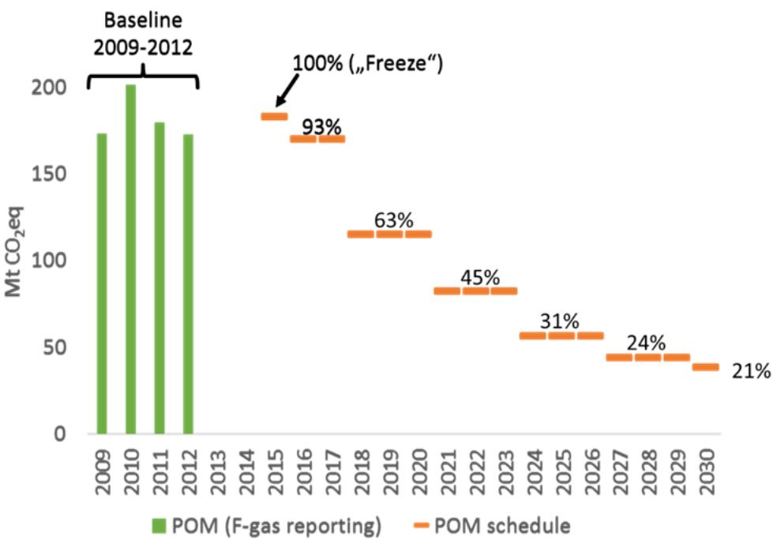  
Figure 4-1: GWP-weighted phase-down under the European F-gas Regulation (POM = Placing on the Market) (1).

This European F-gas Regulation is effective in all Member States and has been implemented in its entirety in the Dutch Decree (2) and the associated Regulations.

A revision of the EU F-gas Regulation is currently (early 2021) in preparation. A large number of stakeholders were invited to submit views on this revision. It is expected that the main clauses in the current Regulation will remain in force, in any case until 2030. The Dutch government's contribution to the review is being coordinated by the Directorate-General for Public Works and Water Management (Rijkswaterstaat) and the Ministry of Economic Affairs and Climate.

A list of options for tightening the Regulation was presented in May 2021 (31). The European Commission will come with a concrete proposal in late 2021. Additional reduction measures are expected for the group of F-gases with a GWP<150, which are currently only subject to a reporting requirement. Incentives for natural refrigerants and alternative technologies will also likely be introduced, as well as more attention for personnel competence, training and certification for all refrigerants (natural and F-gases).

## 4.2 LAWS, REGULATIONS, GUIDELINES AND STANDARDS FOR NATURAL REFRIGERANTS

This paragraph discusses the specific laws and regulations for natural refrigerants and the guidelines and standards that these laws refer to.

The legislation is enacted partly by the European Union and partly by the Dutch government and published on the websites of the relevant bodies.

Standards are published in the Netherlands by, and under the responsibility of, the Netherlands Standardisation Institute (NEN). This applies to both the international standards (ISO, IEC and EN) and the Dutch standards (NEN) and codes of practice (NPR).

For natural refrigerants, there is currently no applicable legislation similar to the EU Fgases legislation (see paragraph 4.1), which has been adopted in its entirety in Dutch legislation.

There are specific provisions for natural refrigerants in the Environmental Activities Decree which focus on safety aspects, with binding instructions from NPR 7600 (for hydrocarbons), NPR 6701 (for carbon dioxide) and PGS 13 (for ammonia). This is explained below.

## Environmental Activities Decree

In the Environmental Activities Decree 2007 (7), including an elaboration of the rules in the Environmental Activities Regulations, refrigerating systems with natural refrigerants are explicitly mentioned with reference to PGS 13, NPR 7600 and NPR 7601. The corresponding Ministerial Regulation provides more details on the relationship with these three guidelines. The Environmental Activities Decree was to be incorporated in the new integrated Environment and Planning Act some time ago, but this has been postponed several times. January 2022 is the currently planned implementation date.

The following main points apply. Refrigerating systems also include ACs and heat pumps.

For a refrigerating system with more than:

a) 10 kg of carbon dioxide, NPR 7601 applies (5)

b) 5 kg of hydrocarbons, NPR 7600 applies (4)

c) 10 kg of ammonia, PGS 13 applies (6).

These three documents are discussed below and in Appendix 8.

Broadly speaking, they involve mandatory requirements for reporting, licensing, design, implementation, installation location, operation, maintenance (annual preventive inspections), and competence and certification of persons and companies (based on selfregulation by the sector, analogous to the legally required system for F-gases).

In addition to the mentioned refrigerant charge limits, the general duty of care applies under the Occupational Health and Safety Act.

A permit requirement applies above 100 kg of hydrocarbons or 1,500 kg of ammonia.

The requirements primarily apply to the owner of the system and the employer of the relevant personnel.

## NPR 7600:2020, “Application of flammable refrigerants in refrigerating systems and heat pumps"

This code of practice was first drafted around 2000 by private parties to fill the then existing vacuum regarding the safe use of hydrocarbon refrigerants. Codes of Practice are issued by NEN, under the authority of the Standards Committee for refrigerating systems and heat pumps.

The scope of the 2020 version (4) has been extended to include all flammable refrigerants (A2L, A2, A3), in installations with more than 150 g of refrigerant, to address the need to ensure the safety of flammable F-gases. In 2015, this code of practice entered into force in Dutch legislation (the Environmental Activities Decree). This legislation requires compliance with parts of NPR 7600 for refrigerating systems with a hydrocarbon refrigerant charge of 5 kg and above.

This code of practice addresses the following safety, environmental and health aspects involving the application of flammable refrigerants (both natural and synthetic refrigerants):

\- descriptions of refrigerants and application areas

\- references to underlying guidelines and standards

\- safety classifications of refrigerating systems

requirements for the design of refrigerating systems with flammable refrigerants functional and operational requirements of safety measures

requirements and activities for the correct maintenance of a system (in particular periodic preventive maintenance by competent persons at least once a year)

\- required competence and certification (see paragraph 4.3)

## NPR7601:2020, "Application of carbon dioxide as a refrigerant in refrigerating systems and heat pumps"

This code of practice was first drafted around 2000 by private parties to fill the then existing vacuum regarding the safe use of $\complement 0 _ { 2 }$ refrigerants. Codes of practice are issued by NEN, under the authority of the Standards Committee for refrigerating systems and heat pumps. The scope of the 2020 version (5) is limited to systems with a charge above 10 kg. In 2015, this code of practice entered into force in Dutch legislation (the Environmental Activities Decree). This legislation requires compliance with parts of NPR 7601 for refrigerating systems with a $\underline { { \mathsf { C O } _ { 2 } } }$ refrigerant charge of 10 kg and above.

This code of practice addresses the following safety, environmental and health aspects involving the application of $\mathsf { C O } _ { 2 }$ refrigerants:

-descriptions of refrigerants and application areas

\- references to underlying guidelines and standards

\- safety classifications of refrigerating systems

\- requirements for the design of refrigerating systems with $\mathsf { C O } _ { 2 }$

\- functional and operational requirements of safety measures requirements and activities for the correct maintenance of a system (in particular periodic preventive maintenance by competent persons at least once a year)

\- required competence and certification (see paragraph 4.3)

## PGS 13: ammonia as a refrigerant

PGS 13 is a Dutch guideline for fire safety, occupational safety and environmental safety in the application of ammonia as a refrigerant in refrigerating systems and heat pumps, part of the Publication Series on Dangerous Substances (PGS). Between 1990 and 2001, this was covered by the CPR 13 (Committee for the Prevention of Disasters). The PGS specifies the legal requirements under the Environment and Planning Act, the Working Conditions Act and the Safety Regions Act, and is strongly embedded in the law.

A drastically revised version of PGS 13 is scheduled to be introduced in 2021 (6). This revised version forms part of the project to modernise all the PGS documents based on an explicit risk-based approach.

The revised PGS 13 applies to refrigerating systems and heat pumps that use ammonia as a refrigerant and must be followed during the design, manufacture and operation of new systems. Secondary circuits (water, glycol, brine, carbon dioxide, etc.) and thermally driven refrigerating systems are excluded.

The new PGS contains the following main elements:

\- legal frameworks

\- risk-based approach with scenarios

\- risk management targets

\- measures for meeting the targets

requirements and activities for the correct maintenance of a system (including periodic preventive maintenance by competent persons)

\- required competence and certification (see paragraph 4.3)

\- relevant information on ammonia, hazards and risks

## 4.3 EMPLOYEE COMPETENCE AND CERTIFICATION FOR WORKING WITH REFRIGERANTS

## Working with F-Gases

For working with F-gases (all work on the refrigerant circuit), the European F-gas Regulation requires professional competence and certification of persons, and quality assurance and certification of the companies under whose responsibility this work is performed. This applies to all F-gases listed in Appendix 1 of the Regulation. In practice, this concerns all HFC refrigerants with a GWP>150. R134a, R410A and R32 all fall under this requirement. HFOs (R1234yf, R1234ze(E) and HFO mixtures with GWP<150) are not covered by this requirement. Within Europe, there is a requirement to accept the certificates of employees and companies of other member states.

In the Netherlands, the certification of persons and companies under the F-gas Regulation is laid down in two detailed Assessment Guidelines approved by Rijkswaterstaat (the Ministry of Infrastructure and the Environment) (32):

BRL 100 Assessment Guideline for the F-gases certificate for companies, version 2.0, 6 June 2019

BRL 200 Assessment Guideline for the F-gases certificate for persons, version 1.2, 1 May 2017

These Assessment Guidelines are given the force of law in the Dutch F-gas Regulation.

The guidelines are implemented by the organisations responsible for assessing and issuing the certificates, such as STEK and InstallQ. The assessment is based on a theory and a practical component. Certification bodies carry out the audits. Education and training programmes are provided by various organisations.

In the Netherlands, the F-gases certificate for persons is issued permanently, unlike most other EU countries that require periodic recertification.

## Working with flammable refrigerants, carbon dioxide and ammonia

Paragraph 4.2 explained how the Dutch Environmental Activities Decree requires persons who work with hydrocarbons (above 5 kg), carbon dioxide (above 10 kg) and ammonia (above 10 kg) to be competent. The underlying codes of practice NPR 7600, NPR 7601 and PGS 13 have an identical paragraph that refers to a system of selfregulation by the industry. The idea behind this is that the industry itself takes responsibility for organising this competence and certification in practice. If the government decides that the industry has not adequately addressed this responsibility, it may introduce its own measures.

The Dutch industry established the Network for Refrigeration and Climate Technology (NKK) in 2019 to implement this self-regulation (8).

A system of Assessment and Competence requirements will be released in mid-2021 which assessment bodies, certification bodies and providers of training programmes can use to give form to this self-regulation under the responsibility of the NKK. This involves three combinations of assessment and certificate: one for all flammable refrigerants (hydrocarbons and flammable F-gases), one for carbon dioxide, and one for ammonia. Separate assessment and certificate requirements apply for flammable refrigerants and carbon dioxide in small systems. Competence requirements for designers and operating personnel are in preparation.

The establishment of the competence requirements follows the system of the EN ISO 22712 standard for 'Refrigerating systems and heat pumps – Competence of personnel', the worldwide standard for competence when working with refrigerating systems and heat pumps (see Appendix 9).

Companies can demonstrate their competence for working with natural refrigerants by obtaining company certification through the aforementioned certification bodies.

For natural refrigerants and flammable F-gases, the methodology for the legally required F-gases certification (in particular BRL 100 and BRL 200) will be followed as much as possible. This is because almost all companies will be working with a multitude of natural and synthetic refrigerants in the future and a uniform approach with regard to competence and certification in practice will be desirable.

## 4.4 BREEAM ASSESSMENT

BREEAM (33) is a certification method for assessing the sustainability of new and existing buildings, among others. The sustainability criteria on which buildings or projects are assessed are established in the BREEM-NL assessment guideline. The criteria cover a wide range of sustainability aspects. In addition to energy, they also cover health, transport, materials, water, land use & ecology, waste, pollution and management.

A maximum of 3 points can be awarded for refrigerants in the BREEAM Pollution category [POL 1]:

\- GWP=0 (or no refrigerant): 3 points

\- GWP≤5: 2 points

GWP≤750 and DELC1 ≤ 500 kg of CO₂ equivalents per kW evaporator capacity: 1 point

In addition, almost all refrigerants have requirements for leak detection and/or automatic sump collection in case of leakage.

The main assessment criterion is that all systems (with electric compressors) must comply with the requirements of NEN-EN 378:2016 or ISO 5149:2014. Additionally, refrigerating systems containing ammonia must also comply with PGS 13:2009, those with flammable refrigerants must comply with NPR 7600:2020 and those with carbon dioxide with NPR 7601:2020 (34).

## 5 EFFECTS OF THE CHOICE OF REFRIGERANT ON ENERGY PERFORMANCE

The energy performance of a heat pump is primarily determined by the source and the supply temperature. Therefore, it is important to choose the most optimal heat pump components for the situation, with the highest possible isentropic efficiency in the intended operating range of the compressor, and with sufficiently large heat exchange surfaces in the evaporator and condenser. Conditions of use and user behaviour also play an important role.

With all external conditions being equal, each refrigerant has its own, theoretical COP. A higher supply temperature (for example when propane or $\mathsf { C O } _ { 2 }$ are used) will obviously also have an impact.

The following paragraphs address the COPs.

The COP was calculated using the CoolTools software package (3). Practical losses in the refrigerant cycle were taken into account (e.g. compressor efficiency, subcooling in the condenser, superheating in the evaporator and temperature differences between the refrigerant and external media).

A graphical overview of the reported COPs was created based on the publicly available manufacturer data of serially produced, ready-to-use and readily available heat pumps.

A project summary of currently known reference projects has been prepared for heat pumps with natural refrigerants.

## 5.1 CALCULATED COPS

## Stationary simulations

The CoolTools software package was developed by IPU (35), an organisation affiliated to the Danish Technical University (DTU) in Lyngby, Denmark. CoolTools (and its predecessor CoolPack) has been used for decades around the world as a reliable and practical simulation method. This software calculates the condenser-side COP for multiple refrigerants under various source and supply conditions.

Principles of the simulations

The simulations are based on the Carnot cycle (36), taking into account the following factors (and chosen values):

\- Compressor isentropic efficiency: 70%

Superheating (vapour overheating) in the evaporator: 4 K, of which 1 K is not used

\- Subcooling (liquid undercooling) in the condenser: 2 K - The efficiency of an internal heat exchanger between the suction gas and the condensed refrigerant: 40%

Pressure loss in suction and pressure pipe expressed as temperature loss: 0.5 K each (equivalent difference in saturated temperature)

The source and supply temperatures were varied in the CoolTools calculations and matched the standard conditions at which heat pumps are tested as closely as possible. The CoolTools simulation is not related to the EU Energy Label approach.

Because these systems are installed in both new and existing buildings, calculations with high design temperatures were also included.

To account for collective systems, the COPs were also calculated for source temperatures of 10 and $2 0 ^ { \circ } \mathsf { C }$ using an ATES (Aquifer Thermal Energy Storage) network $( 5 ^ { \mathrm { t h } }$ generation heat distribution) or a distribution system for low-grade waste heat.

VRF systems are commonly used to provide both building cooling and heating. They contain relatively large refrigerant charges (HFCs) due to the use of an extensive piping network. Because there are so many possible system configurations and operating conditions, VRF systems have been excluded from this comparison.

Table 5-1 below provides an overview of the calculations for space heating.
<table><tr><td rowspan=1 colspan=1>Source/SupplyTemperature (°C)</td><td rowspan=1 colspan=1>35</td><td rowspan=1 colspan=1>55</td><td rowspan=1 colspan=1>65</td><td rowspan=1 colspan=1>75</td></tr><tr><td rowspan=1 colspan=1>-7</td><td rowspan=1 colspan=1>A-7/W35</td><td rowspan=1 colspan=1>A-7/W55</td><td rowspan=1 colspan=1>A-7/W65</td><td rowspan=1 colspan=1>A-7/W75</td></tr><tr><td rowspan=1 colspan=1>0</td><td rowspan=1 colspan=1>B0/W35</td><td rowspan=1 colspan=1>B0/W55</td><td rowspan=1 colspan=1>B0/W65</td><td rowspan=1 colspan=1>B0/W75</td></tr><tr><td rowspan=1 colspan=1>7</td><td rowspan=1 colspan=1>A7/W35</td><td rowspan=1 colspan=1>A7/W55</td><td rowspan=1 colspan=1>A7/W65</td><td rowspan=1 colspan=1>A7/W75</td></tr><tr><td rowspan=1 colspan=1>10</td><td rowspan=1 colspan=1>W10/W35</td><td rowspan=1 colspan=1>W10/W55</td><td rowspan=1 colspan=1>W10/W65</td><td rowspan=1 colspan=1>W10/W75</td></tr><tr><td rowspan=1 colspan=1>20</td><td rowspan=1 colspan=1>W20/W35</td><td rowspan=1 colspan=1>W20/W55</td><td rowspan=1 colspan=1>W20/W65</td><td rowspan=1 colspan=1>W20/W75</td></tr></table>

Table 5-1: Overview of calculations for space heating

Explanation of Table 5-1 and the graphs:

Source/Supply

\- A: Air (outside air; in the Netherlands, the L for Lucht is also used)

B: closed-loop ground source heat exchanger (Brine) - (Borehole Thermal Energy Storage)

\- W: open-loop groundwater/Aquifer (ATES) or waste heat

Source/Supply

\- W: Water (air as a supply medium is not considered).

The refrigerants are ranked in order of decreasing GWP. For the properties of these refrigerants, see Table 2-2 in paragraph 2.2.5.

## Alternative approach for $C O _ { 2 }$

Due to the transcritical cycle of ${ \mathsf { C O } } _ { 2 } ,$ its performance cannot be determined using the same method and so it is not included in this comparison. The low critical point of $\mathsf { C O } _ { 2 }$ $( 3 1 ^ { \circ } \mathsf { C } )$ is another reason why high efficiency is achieved, particularly for hot water

production with a flow-through system and in low temperature space heating. See also paragraph 3.2 (on the operation of the $\mathsf { C O } _ { 2 }$ heat pump), paragraph 5.2 (supplier data) and paragraph 5.3.2 (latest developments).

## Results of stationary simulations

Some of the results are provided in the tables and graphs below. The full results appear in Appendix 10.

For the sake of completeness, here are the chemical names of the natural refrigerants again:

\- R1270: propene (propylene)

\- R290: propane

R600a: isobutane

\- R717: ammonia

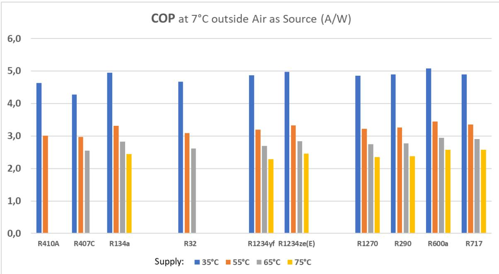  
Figure 5-1: COP per refrigerant with outdoor air of $7 \%$ as source

The image above displaying the source conditions for A7 is representative for all source conditions, the results of which are presented in Appendix 10.

## Analysis of stationary simulations

R600a (Isobutane) achieves 3-10% higher COPs than propane, with the higher values occurring at higher supply temperatures. Isobutane is widely used in low refrigerating capacity systems (household refrigerators and freezers), because it has very similar properties to the precursors HFC R134a and CFC R12. When natural refrigerants are applied in heat pumps for space heating and/or domestic hot water, they typically use R290 (propane, with properties similar to precursor HCFC R22), because smaller components are required, which is cheaper. The

higher COP using R600a can justify the use of this refrigerant for high supply temperatures.

It is interesting that the synthetic refrigerant R410A (GWP=2088) currently in common use has a COP that is 5-8% lower than that of R290. It is also unsuitable for higher supply temperatures.

Like R290 (GWP=3), R134a (GWP=1430) is suitable for high supply temperatures, and has about the same COP.

R32 (GWP=675) is suitable up to a supply temperature of approx. $6 5 ^ { \circ } \mathsf C ,$ however it has a lower COP than R134a and R290 (approx. 5% lower).

HFO R1234ze(E) (GWP=7) has the highest COP of the low-GWP synthetic refrigerants. The COPs are lower than those of isobutane, but 2-3% higher than those of propane. It has not been further investigated to what extent this advantage of R1234ze(E) proves itself in practice.

COP matrix with source and supply temperatures for propane:
<table><tr><td rowspan=1 colspan=1>Source/Supply</td><td rowspan=1 colspan=1> $3 5 \%$ </td><td rowspan=1 colspan=1> $5 5 \%$ </td><td rowspan=1 colspan=1> $6 5 \%$ </td><td rowspan=1 colspan=1> $7 5 \%$ </td></tr><tr><td rowspan=1 colspan=1>-7℃ L/W</td><td rowspan=1 colspan=1>3.59</td><td rowspan=1 colspan=1>2.63</td><td rowspan=1 colspan=1>2.31.</td><td rowspan=1 colspan=1>2.03</td></tr><tr><td rowspan=1 colspan=1>0C B/W</td><td rowspan=1 colspan=1>4.54</td><td rowspan=1 colspan=1>3.10</td><td rowspan=1 colspan=1>2.66</td><td rowspan=1 colspan=1>2.30</td></tr><tr><td rowspan=1 colspan=1>7C L/W</td><td rowspan=1 colspan=1>4.90</td><td rowspan=1 colspan=1>3.26</td><td rowspan=1 colspan=1>2.77</td><td rowspan=1 colspan=1>2.38</td></tr><tr><td rowspan=1 colspan=1>10℃ W/W</td><td rowspan=1 colspan=1>5.46</td><td rowspan=1 colspan=1>3.50</td><td rowspan=1 colspan=1>2.94</td><td rowspan=1 colspan=1>2.51</td></tr><tr><td rowspan=1 colspan=1>20°C W/W</td><td rowspan=1 colspan=1>7.64</td><td rowspan=1 colspan=1>4.29</td><td rowspan=1 colspan=1>3.48</td><td rowspan=1 colspan=1>2.89</td></tr></table>

Table 5-2: COPs of propane (R290) as a function of the supply and source temperature

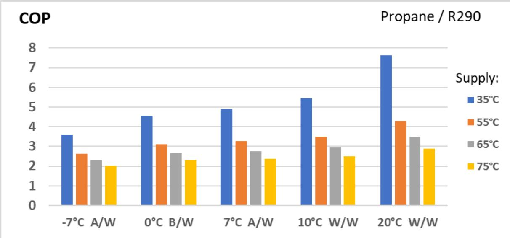  
Figure 5-2: Influence of operating conditions for propane (R290)

Figure 5-3 below gives the COPs of the various refrigerants under the same conditions (A7/W55: source temperature of $7 \%$ (outside air) and supply temperature of $5 5 ^ { \circ } \mathsf { C }$ for space heating). The GWP decreases from left to right. The COP of $\mathsf { C O } _ { 2 }$ (R744) is not comparable one-to-one because the thermodynamic cycle using a gas cooler is different to that of a condenser. According to the standard definition of the Lorentz efficiencies (Lorentz COPs) for transcritical cycles, a supply temperature of $5 5 ^ { \circ } \mathsf { C }$ and a return temperature of $4 7 ^ { \circ } \mathsf { C }$ would correspond to an average gas cooler temperature of $6 5 { - } 7 0 ^ { \circ } \mathsf C .$ COPs of 3.5 to 4.5 are realistic for heating domestic hot water from 10 to $6 0 ^ { \circ } \mathsf { C }$ in a flowthrough system with $\mathsf { C O } _ { 2 }$

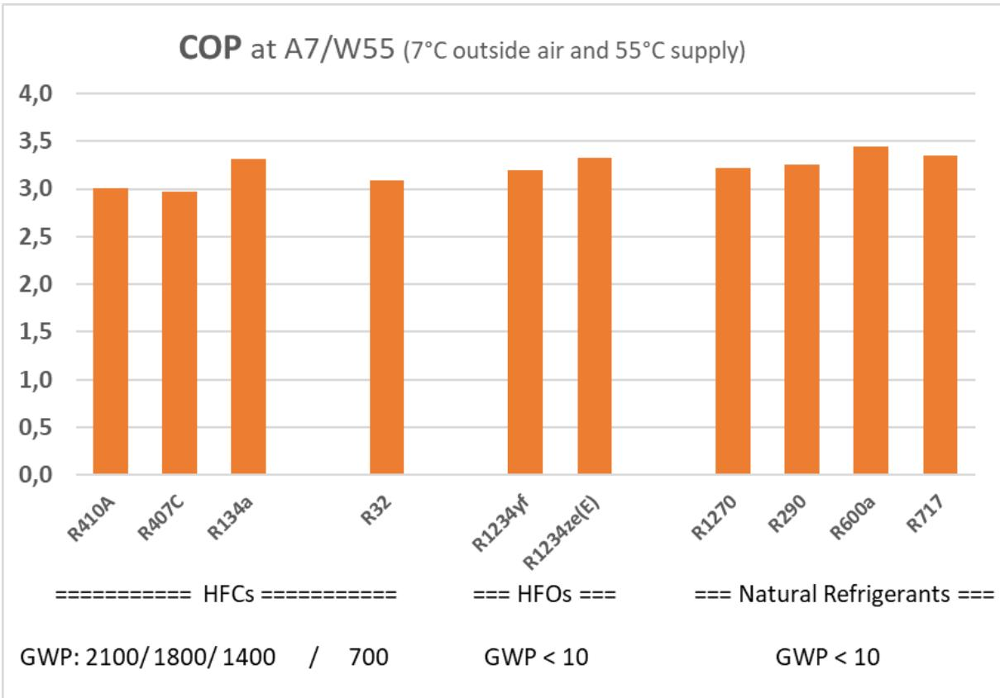  
Figure 5-3: COPs of various refrigerants under the same operating conditions

The calculated COPs reveal that the actual COPs of refrigerants can vary slightly. Based on the choice of refrigerant alone, no major differences are to be expected in overall energy performance. The maximum difference between the refrigerant with the highest COP (R600a) and the refrigerant with the lowest COP (R407C) is 15%. Other characteristics of the heat pump system, such as compressor efficiency, configuration and the surface area of the heat exchangers, have at least as much influence – certainly when combined together – on the COP.

The results also reveal that switching from high-GWP to low-GWP refrigerants has a small positive impact on energy performance (all other factors being equal).

## Dynamic simulations

There are no indications that the findings of the static simulations described earlier differ substantially from findings based on dynamic simulations (year round).

## Conclusions of the calculations

The main conclusion based on the calculations is that the choice of refrigerant does not significantly influence the performance of a heat pump under the same operating conditions. When choosing a refrigerant, there are natural candidates available that perform comparably to or better than synthetic refrigerants under the conditions studied. This supports the preference for natural refrigerants as described in paragraph 2.2.3.

## Global TEWI approach

A TEWI analysis is carried out to determine the impact of a refrigerant on the atmosphere. For this purpose, the equivalent $\mathsf { C O } _ { 2 }$ emissions are calculated based on direct use (statistical estimate of refrigerant leakage during the lifetime of the system) and the indirect $\mathsf { C O } _ { 2 }$ emissions of electricity consumption during the lifetime of the system. The result of the analysis strongly depends on the chosen starting points (the statistical estimate of leakage, the source of the electricity and the chosen analysis period). The TEWI method is described in detail in paragraph 2.2.3.

Figure 5-4 below displays the direct and indirect TEWI values for an annual heat demand of 8000 kWh for space heating and 2000 kWh for domestic hot water, based on the following starting points:

\- period: 20 years

\- annual leakage rate: 2% (37);

\- recycling at the end of the technical lifetime (20 years): 80%

${ \sf G W P 1 0 0 }$ for the direct contribution

$\mathsf { C O } _ { 2 }$ emissions of electricity generation: 0.34 kg/kWh-e

(current standard for Dutch energy performance calculations (NTA 8800))

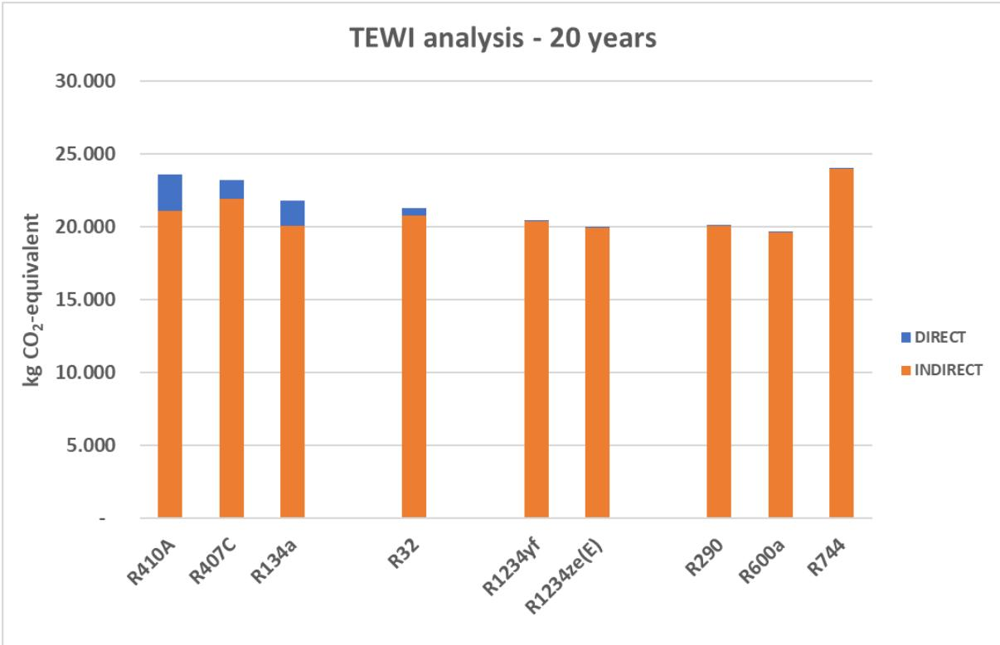  
Figure 5-4: TEWI analysis of refrigerants

The direct contribution is dependent on the GWP value of the refrigerant and is not visible with natural refrigerants or the R1234 variants (because of the low values limited to around 10 kg in $\mathsf { C O } _ { 2 }$ equivalents).

The indirect contribution from electricity consumption is therefore dominant. The relatively minor differences in this contribution arise from the different COPs of the refrigerants. $\mathsf { C O } _ { 2 }$ as a refrigerant makes a significantly higher indirect contribution due to its lower COP for space heating.

The high indirect contribution arises because the standard value of 0.34 kg/kWh-e is based on a mix (calculated for the short term) of green electricity and fossil electricity. Based on the current electricity mix, the orange columns would be about 50% higher, and thus even more dominant.

A different picture emerges when the avoided gas consumption² is included in the TEWI analysis. Unlike the cooling function (for which the TEWI analysis was originally developed), when generating heat, a heat pump usually displaces the $\mathsf { C O } _ { 2 }$ emissions of an equivalent amount of natural gas.

The same amount of heat produced by burning natural gas is associated with $\mathsf { C O } _ { 2 }$ emissions of almost 50,000 kg. This is represented by the dotted column on the left side of the graph in Figure 5-5. This column clearly reveals that using heat pumps (even with the current fuel mix for electricity generation) always results in lower $\mathsf { C O } _ { 2 }$ emissions during the lifetime of the heat pump. The choice of refrigerant has only a marginal effect on this.

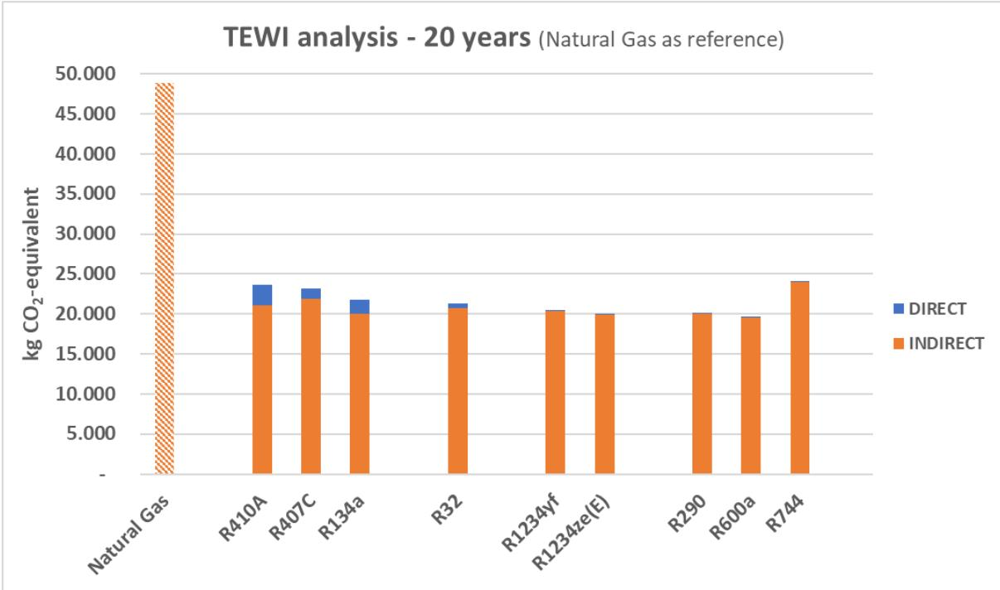  
Figure 5-5: TEWI analysis of refrigerants in comparison with natural gas

In the future, if 100% green electricity is used, the indirect contribution falls to zero and only the GWP of the refrigerants determines the TEWI.

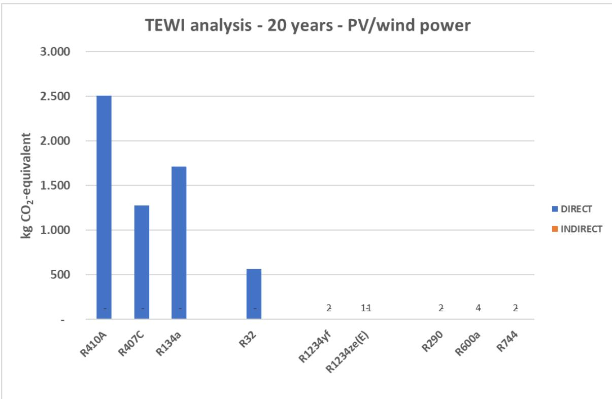  
Figure 5-6: TEWI analysis of refrigerants using green electricity

Appendix 2 contains a complete overview of the starting points and a brief sensitivity analysis.

## 5.2 PRODUCT DATA PROVIDED BY THE SUPPLIERS

The graph below (Figure 5-5) displays the COPs for three refrigerants (R410A, R32 and R290) used in fifteen heat pumps as quoted by the suppliers.

These COPs were determined based on standardised performance measurements (EN 14511 and/or EN 14825) in accredited test laboratories.

Each vertical line of dots represents the results of one heat pump.

The values are grouped by refrigerant: five heat pumps use R410A, six use R32 and four use R290.

The colours of the dots refer to the standard conditions under which the COP applies as displayed in the key.

The points in dashed boxes refer to systems in part-load operation. These are normally higher than for full-load operation under the same conditions.

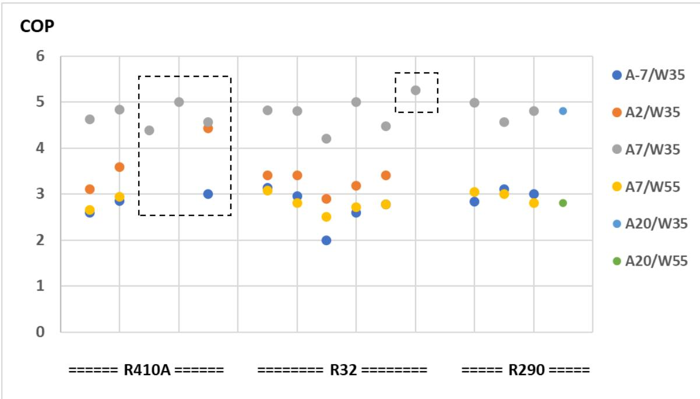  
Figure 5-7: COPs provided by the suppliers

The graph clearly reveals that the COPs of all refrigerants increase with higher source temperatures and/or decreasing supply temperatures. Crucially, however, there are no significant differences between the three common subcritical refrigerants. A more careful observation reveals that R290 delivers slightly higher COPs under conditions A7/W55 and A-7/W35 (yellow and dark blue dots).

COPs for heat pumps with $\mathsf { C O } _ { 2 }$ as refrigerant were also surveyed based on the supplier data and are displayed in Figure 5-6 below. Only a limited comparison can be made for $\mathsf { C O } _ { 2 }$ (R744) based on the standard measurement conditions in EN14511 or EN14825. This is due to the transcritical operating range: the heat is supplied by a gas cooler instead of a condenser. As a result, using $\mathsf { C O } _ { 2 }$ involves a temperature trajectory rather than a fixed condensation temperature.

The graph below displays this temperature trajectory as a horizontal line. Most of the systems have long temperature trajectories: from around 10 to $6 5 ^ { \circ } \mathsf { C }$ or even $9 0 ^ { \circ } \mathsf { C }$ These are all heat pumps used for domestic hot water heating, either flow-through systems or systems equipped with one or more heat buffers with exceptionally effective temperature stratification. The return (inlet) water is cold and the supply water is hot and ready for use. The short trajectories represent applications for space heating and involve standardised test conditions with recirculating system water. The key displays the corresponding source conditions.

Here, A is outside air (Air) and B is water with antifreeze (Brine). The numbers indicate the temperature of the source, so A-7 is an outside air temperature of $\scriptscriptstyle - 7 ^ { \circ } \mathbb { C }$ The designation W35 or W55 refers to the supply temperature of a water-filled system for space heating (35 or $5 5 ^ { \circ } \mathsf { C }$ respectively). The dots (..) after the slash $( / )$ indicate a temperature trajectory for the production of domestic hot water (there is no standardised designation for this). This temperature trajectory can be seen in the graph: the return/inlet water in the topmost (dark blue) line (A16/..) is $\mathsf { 1 0 ^ { \circ } C }$ and the supply temperature is $6 0 ^ { \circ } C$

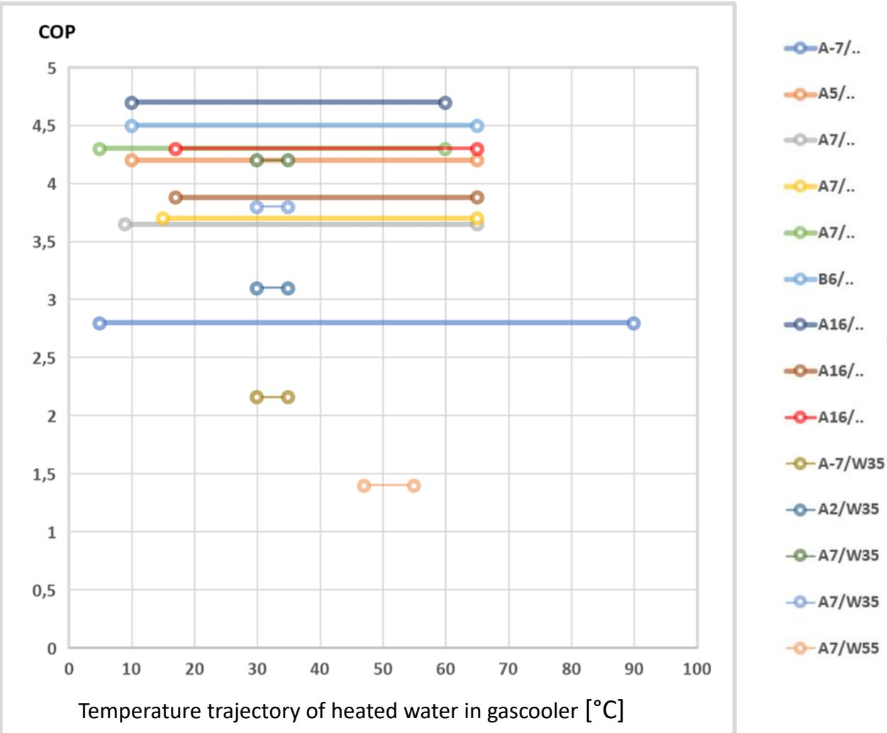  
Figure 5-8: COP of $\mathsf { C O } _ { 2 }$ refrigerant

Some specific characteristics emerge from the survey:

\- Using ${ \mathsf { C O } } _ { 2 } ,$ high COPs can be achieved with long temperature trajectories.

The lowest long line stands out in particular: a high COP of 2.8 based on a source (outdoor air) temperature of $\scriptscriptstyle - 7 ^ { \circ } \mathsf { C }$ and a hot water supply temperature of $9 0 ^ { \circ } \mathsf { C } .$ This is partly due to the very low inlet temperature of $5 \%$ in the gas cooler.

In the other long trajectories, the considerable difference in COPs stands out (between 3.6 and 4.5) under almost identical conditions. This could be explained by the different technical configurations of the heat pumps, however this information was not available.

The highest COP, 4.75, is with A16 as source condition, supplying $60 ^ { \circ } \mathsf { C }$ domestic hot water.

For low-temperature space heating (W35; the short trajectories in the graph), the COPs of $\complement 0 _ { 2 }$ are only slightly lower than the COPs of the subcritical refrigerants in Figure 5-4. At a high supply temperature (W55), the performance of $\complement 0 _ { 2 }$ under standardised test conditions is clearly and substantially lower compared to subcritical refrigerants.

It is therefore clear that $\mathsf { C O } _ { 2 }$ heat pumps have plenty of potential, and particularly for hot water production, as is also evident from the many practical examples in the following paragraph.

Furthermore – as with any heat pump – it is important to limit switching the system on and off as much as possible. The advantage of the long temperature trajectory on the supply side comes into its own when domestic hot water storage and demand are carefully balanced to match the heating capacity of the heat pump. This means these systems will be suitable for collective hot water systems (such as in hotels and multistorey buildings).

Because of the transcritical cycle, $\complement \mathsf { O } _ { 2 }$ systems for space heating with higher supply temperatures $( 5 5 ^ { \circ } \mathsf { C }$ and above; typically in existing buildings) require a large difference between the between the supply and return temperature. A maximum return temperature of approx. $4 0 ^ { \circ } C$ is therefore applied in order to optimise the working of the gas cooler and thus increase efficiency. This can be achieved by incorporating a heat buffer with effective temperature stratification.

There is also potential for application in low-temperature space heating. Despite the slightly lower COP for this use, $\mathsf { C O } _ { 2 }$ has the advantage of being non-flammable. Using combi-heat pumps (double function applications: space heating and DHW), the higher COP for domestic hot water will increase the overall performance to similar levels.

## 5.3 PROJECTS

## 5.3.1 Completed projects

Natural refrigerants have been used in mass-produced heat pumps for some time now. These heat pumps are ready-to-use and can be built into a central heating system as a 'Plug & Play' unit.

The overview below provides a general (i.e. not comprehensive) overview of the appliances currently available on the market. A number of reference projects are described in which larger heat pumps with $\mathsf { C O } _ { 2 }$ as a refrigerant were used (30-40 kW).

Alpha Innotec - LWDV (propane - 8 kW)

Widely used in the domestic market and in small businesses.

## Vaillant - aroTherm plus (propane - up to 12 kW)

Available since September 2020. Mainly used in small businesses and the domestic market to date.

## NIBE - F370/F470 (propane - 2.2 kW)

Widely used in the domestic market and small businesses.

Mitsubishi Electric - QAHV (CO₂ - 40 kW) Alklima

\- Albus Hotel (Amsterdam): domestic hot water

\- Courtyard Marriott Hotel (Hoofddorp): domestic hot water

\- Zorggroep Tangenborgh (Coevorden, elderly home): domestic hot water

\- Zozijn (Heerhugowaard, sheltered home)

\- Stadshotel (Woerden)

\- Widely used in the domestic market.

## MHI - Qton (CO₂ - 30 kW)

DUWO (Leiden, student housing): domestic hot water for 160 student flats - 2 x 30 kW (Coolmark/VINK)

Marriott Hotel (Schiphol): domestic hot water - 6 x 30 kW (Coolmark)

-Nieuwerkerk football club: domestic hot water - 30 kW (Coolmark)

Mentrum building (Amsterdam): domestic hot water and space heating (high temperature) for 90 studios - 4 x 30 kW (STULZ/INNQ)

## 5.3.2 Research, development and demonstration projects

A number of promising product development projects were launched in recent years with the help of various grants (including DEl and TSE Energie Innovatie). The products are at various stages of development, from the prototype to the demonstration phase. These projects are briefly described below.

## EcoCute: specific application for the Dutch market

DENSO's EcoCute is being further developed for application in the Dutch market in a joint project that also includes Vattenfall, Feenstra and SOLVIS. This system uses a high-temperature $\mathsf { C O } _ { 2 }$ heat pump and a stratified buffer tank with temperatureindependent inlet control. The applied buffer functions as a heat battery that is used both to supply heat to the radiators and to produce domestic hot water. The temperature stratification in the buffer allows a large temperature difference to be maintained between the heat pump supply and return. For optimum efficiency, a return temperature of about $4 0 ^ { \circ } C$ is required. Among other things, this requires precise adjustment of the flow rate through the heating appliances (usually radiators in existing buildings). As in most central heating boilers, domestic hot water is available on demand, while legionella safety is ensured through integrated domestic hot water production (freshwater station). This system has an external heat exchanger, which is installed outside the heat buffer. This means the heat buffer contains no drinking water and so no domestic hot water storage is required. The aim of this project is to develop a system that can replace central heating boilers in existing buildings.

## Development of R290 heat pump with extremely small refrigerant charge

High Performance Little Air Unit Natural Charge Heat Pump (HP-Launch)

Project participants: HAN University of Applied Sciences, Re/genT, BDH, The Hague University of Applied Sciences, MMID, TransferWorks

The aim of this project is to develop a propane heat pump with the smallest possible refrigerant charge.

The biggest challenge is the development of heat exchangers (condenser and evaporator) which combine the smallest possible refrigerant charge and the highest possible efficiency.

The results of the performance tests carried out and analysed by Re/genT (15) show that condenser heating capacity of approximately 3.5 kW can be delivered with extremely small refrigerant charges of between 150 and 170 g of R290. The COPs are higher than those of a standard heat pump available on the market (used as the reference unit for this study) in 7 out of 10 tests.

Test results:

<table><tr><td rowspan=1 colspan=1></td><td rowspan=1 colspan=1>Heating capacity(kW)</td><td rowspan=1 colspan=1>COP</td></tr><tr><td rowspan=1 colspan=1>A7/W35 - 150 g</td><td rowspan=1 colspan=1>3.4</td><td rowspan=1 colspan=1>4.47</td></tr><tr><td rowspan=1 colspan=1>A7/W35 - 170 g</td><td rowspan=1 colspan=1>3.5</td><td rowspan=1 colspan=1>4.63</td></tr></table>

## Limburg residential

In this project, Wonen Limburg (a housing association) is carrying out a large-scale pilot to determine the energy efficiency of a high-temperature air-water heat pump. To this end, two-stage propane-isobutane heat pumps will be installed in four residential complexes in Venray and four in Weert. Two different concepts will be trialled: Venray has a circulation system for DHW, Weert has a collective system for space heating and individual domestic hot water supply. In addition to the robustness of the systems, the pilot will also be used to assess the dynamic behaviour of the heat pumps based on the heating curve on the supply side and a variable source temperature (namely the outside air). A substantial amount of the energy for the heat pump is generated by solar panels. This concept will be further developed and scaled up in the 'Dutch heat pump factory'project (Nederlandse warmtepompenfabriek, MOOI32016).

The measuring equipment has been installed. Monitoring will begin after a number of changes have been introduced.

## Silent zero-energy module using a $\ b  \ b { \ b { \ b { \ b { \ b { \ b { \ b { \ b { \ b { \ b { \ b { \ b { \ b { \ b { \ b { \ b { \ b { \ b } { \ b { \ b { \ b { \ b { \ b } { \ b { \ b { \ b } { \ b { \ b } { \ b { \ b { \ b } { \ b { \ b } { \ b { \ b { } \ b { } \ b { } \ b { } } } } } } } } } } } } } } } } } } } } } } } } } } } } }$ heat pump

The project initially focused on integrating the CO₂ heat pump in a new energy module. A new design was conceived to combine the $\complement 0 _ { 2 }$ heat pump with the existing system components (inverter, heat recovery unit, monitoring system) in the energy module.

The module was tested for six months in Landsmeer in 120 newly renovated zeroenergy homes (zero-energy in this case means that the yearly electricity demand, including domestic use, is delivered by solar pv-panels).

The energy consumption of the heat pump and the water and heat consumption of the occupants were compared with two reference homes. This was done to assess whether the $\mathsf { C O } _ { 2 }$ heat pump achieved the predicted domestic hot water and space heating efficiencies in practice, with the same comfort level as heat pumps that use R410A refrigerant.

The living comfort was assessed by comparing the following parameters of the $\mathsf { C O } _ { 2 }$ heat pump and the R410A heat pump: the time to reach the programmed room temperature, the stability of the room temperature, and the supply of sufficient domestic hot water at the desired temperature. The occupants were asked to score how they experienced the living comfort.

A decibel test was also carried out (at one metre distance from the energy module) for both the $\mathsf { C O } _ { 2 }$ heat pump and the heat pump with R410A refrigerant.

The tests and noise measurements were carried out by BAM and Alklima. The Eigen Haard housing association was responsible for the PR and communicating with the occupants.

The project generated the following results (see (38) and (39)):

A prototype of an energy module with $\mathsf { C O } _ { 2 }$ heat pump that renders a home energy neutral (zero-energy) without natural gas and in combination with solar panels and insulation of the exterior walls and roof.

\- Verification that the ${ \mathsf { C O P } }$ of the new energy module (with $\mathsf { C O } _ { 2 }$ heat pump) is about 0.5 points higher than that of the heat pump currently used.

Verification that the new energy module (with $\complement 0 _ { 2 }$ heat pump) exceeds the comfort level of the current system both quantitatively (measured values) and qualitatively (occupants' experience).

Energy performance measurements, based on weighted averages of the space heating and domestic hot water production, revealed a practical SCOP (average seasonal efficiency) of respectively 2.85 (vs 2.31 with R410A) and 2.88 (vs 2.27 with R410A).

Thanks to the positive results, BAM is now considering integrating the new heat pump in its energy module as standard. BAM considers that the new heat pump will be particularly applicable for use in less well-insulated houses. At the time of writing, the new heat pump was expected to be introduced to the Dutch market by Alklima in 2020/2021.

## High safety propane heat pump with standard components

Carel Industries in Italy has developed a domestic propane heat pump with standard components and an acceptable level of safety.

They have developed an affordable and reliable heat pump in a partnership with various system and component manufacturers.

They recently presented a publication (24) describing the development of an R290 air-water heat pump.

## Safe R290 heat pump with 800 g refrigerant charge

Nibe and Alpha-Innotec collaborated with AHT, ECOS, HEAT and Shecco to develop a prototype of a domestic heat pump with an 800 g propane charge and with special

safety features to achieve an acceptable safety risk (25). This project was part of the LIFEFRONT project (17).

## Other

\- Van Hulst chicken hatchery (Veldhoven):

Industrial application of R290 and R600a, developed by Dutch company Servex. This involves a two-stage heat pump with both refrigerants in cascade, which is intended to guarantee the production of $8 0 ^ { \circ } \mathsf { C }$ central heating water, even with - $2 0 ^ { \circ } \mathsf { C }$ outside air as a source. The system is equipped with three heat pumps to ensure the desired redundancy.

The system is operating satisfactorily but no measurement data are available as yet.

\- Gulpener brewery: 'Brewing without a steam boiler'

Industrial application with R600a, with a butane heat pump developed by Servex that produces ${ \mathfrak { 1 2 0 } } ^ { \circ } \complement$ steam for the brewing process.

Combined with other process innovations (which also reduce the energy demand), they will soon be able to brew beer without the need for natural gas. The system is under construction.

This type of heat pump, developed for industrial applications, can be further developed as a modular heat pump for heating existing blocks of flats where hightemperature heating is still required. This concept will be further developed and scaled up in the 'Dutch heat pump factory' project (Nederlandse warmtepompenfabriek, MOOI32016).

It is important that such large, non-standard heat pumps are developed in consultation with competent designers and installers who are well-versed in applicable national laws and regulations, as is the case with the projects described here.

# 6 OVERVIEW OF HEAT PUMP APPLICATIONS AND POSSIBLE REFRIGERANT OPTIONS

This chapter is limited to the most commonly used natural refrigerants: propane, isobutane, ammonia and carbon dioxide. Further in this chapter is a table with an overview of heat pump applications with corresponding potential natural refrigerants.

Ammonia has been used in the refrigeration industry for almost 100 years and is known for its high energy efficiency, which is mainly due to its high evaporation energy.

Although it has excellent refrigerant properties, ammonia is toxic and flammable and cannot be used in combination with copper pipes and fittings.

To limit the refrigerant charge and avoid the distribution of ammonia through highly branched networks (outside industrial applications), ammonia is often used in combination with a secondary medium $( \mathsf { C O } _ { 2 } ,$ or water/glycol for refrigeration applications). These aspects result in ammonia applications mainly being limited to large and/or collective systems such as sports centres (swimming pool-ice rink combination) and supermarkets (besides industrial applications). This also offers opportunities for collective systems in the built environment (district heating), where the obvious solution is not to integrate the technical room in a residential building, but to install the ammoniacarrying parts in a separate building due to ammonia's toxicity and flammability

Isobutane is mainly used in refrigerators (low refrigerating capacity). No applications could be found for low-capacity space heating and/or domestic hot water. The high critical point of isobutane allows condenser temperatures well above $1 0 0 ^ { \circ } \mathsf C ,$ so hightemperature heating and domestic hot water would be obvious applications. The low volumetric capacity of isobutane (see paragraph 3.1) results in relatively high volumetric flows per kW in the internal refrigerant circuit. This requires large components, compressors, heat exchangers and pipe diameters, which increases the size and cost of the heat pump. There are, however, two interesting pilot projects involving the industrial application of isobutane in a chicken hatchery and a beer brewery (see paragraph 5.3.2).

Propane has excellent properties for both low and high-temperature space heating and domestic hot water production and has been in use for many years now. Several massproduced units are available as of around 2017, mainly from European manufacturers in the heating capacity range of 5 to 20 kW.

Due to its transcritical cycle, $\mathbf { C O _ { 2 } }$ is mainly suitable for domestic hot water production and can also be used for low-temperature space heating.

It also has potential for use with high-temperature space heating (from about $5 5 ^ { \circ } \mathsf { C } )$ , but the $\complement 0 _ { 2 }$ system cannot be directly connected to the supply system. However, several

parties are making important strides in the development of complete systems – including the addition of a temperature-stratified buffer with water or PCMs (40) as a storage medium – where a $\mathsf { C O } _ { 2 }$ heat pump serves as a heat generator for both domestic hot water and space heating.

The potential applications of refrigerants are closely related to their physical properties, as also discussed in paragraph 2.2.7. Table 6-1 below summarises these potential applications using a 'traffic light model', where the heating capacity, function and source of the applications are compared. The function and source refer to the temperature level of the condenser and evaporator respectively. The value provided is mainly based on the physical properties of the refrigerant.

The main determinants of the heating capacity are the limitations of ammonia for low capacity applications and, for isobutane, the size of the installation required for high capacity applications, which make these applications less obvious choices. A maximum of 12 kW was chosen for space heating in standard (existing) homes and a maximum of 70 kW for large utilities. This is due to the limits imposed for government support under the ISDE (grant for sustainable energy and energy-saving measures) and EIA (energy-related tax deduction for companies).

The classification below (Table 6-1) takes into account that there are only minor differences between the various refrigerants in terms of energy efficiency (COP), so the impact on the application potential is marginal. The only exception to this is the use of CO₂ in medium and high temperature space heating (see the relevant note to the table), where the COP does determine the classification (under standard measurement conditions).

The colour codes can be interpreted as follows:

\- Green: currently in use and/or no significant restrictions

\- Yellow: few obvious practical applications

\- Orange: very limited options or significant restrictions

The table below provides a general overview of potential applications based on the currently available data and the calculations presented in this report.

<table><tr><td rowspan=1 colspan=1></td><td rowspan=1 colspan=1>R290</td><td rowspan=1 colspan=1>R600a</td><td rowspan=1 colspan=1>R717</td><td rowspan=1 colspan=1>R744</td></tr><tr><td rowspan=1 colspan=1></td><td rowspan=1 colspan=1>Propane</td><td rowspan=1 colspan=1>Isobutane</td><td rowspan=1 colspan=1>Ammonia</td><td rowspan=1 colspan=1>CO2</td></tr><tr><td rowspan=1 colspan=1>Heating capacity</td><td rowspan=1 colspan=1></td><td rowspan=1 colspan=1></td><td rowspan=1 colspan=1></td><td rowspan=1 colspan=1></td></tr><tr><td rowspan=1 colspan=1>Domestic:&lt;12 kW</td><td rowspan=1 colspan=1></td><td rowspan=1 colspan=1></td><td rowspan=1 colspan=1>1)</td><td rowspan=1 colspan=1></td></tr><tr><td rowspan=1 colspan=1>Housing blocks,small commercial buildings,apartment buildings:&lt;70 kW</td><td rowspan=1 colspan=1></td><td rowspan=1 colspan=1>2)</td><td rowspan=1 colspan=1>1)</td><td rowspan=1 colspan=1></td></tr><tr><td rowspan=1 colspan=1>Residential buildings,large commercial buildings:&gt;70 kW/unit</td><td rowspan=1 colspan=1></td><td rowspan=1 colspan=1>2)</td><td rowspan=1 colspan=1>1)</td><td rowspan=1 colspan=1></td></tr><tr><td rowspan=1 colspan=1>Application/function</td><td rowspan=1 colspan=1></td><td rowspan=1 colspan=1></td><td rowspan=1 colspan=1></td><td rowspan=1 colspan=1></td></tr><tr><td rowspan=1 colspan=1>LT space heating:35℃</td><td rowspan=1 colspan=1></td><td rowspan=1 colspan=1>3)</td><td rowspan=1 colspan=1>4)</td><td rowspan=1 colspan=1>5)</td></tr><tr><td rowspan=1 colspan=1>MT space heating:55℃</td><td rowspan=1 colspan=1></td><td rowspan=1 colspan=1>3)</td><td rowspan=1 colspan=1>4)</td><td rowspan=1 colspan=1>6)</td></tr><tr><td rowspan=1 colspan=1>HT space heating:75℃</td><td rowspan=1 colspan=1></td><td rowspan=1 colspan=1></td><td rowspan=1 colspan=1>4)</td><td rowspan=1 colspan=1>6)</td></tr><tr><td rowspan=1 colspan=1>Domestic hot water:60-80℃</td><td rowspan=1 colspan=1></td><td rowspan=1 colspan=1></td><td rowspan=1 colspan=1>4)</td><td rowspan=1 colspan=1></td></tr><tr><td rowspan=1 colspan=1>Source</td><td rowspan=1 colspan=1></td><td rowspan=1 colspan=1></td><td rowspan=1 colspan=1></td><td rowspan=1 colspan=1></td></tr><tr><td rowspan=1 colspan=1>Outdoor air:-12 to +15℃</td><td rowspan=1 colspan=1></td><td rowspan=1 colspan=1>7)</td><td rowspan=1 colspan=1></td><td rowspan=1 colspan=1></td></tr><tr><td rowspan=1 colspan=1>Ground source heatexchanger (BTES):● Drinking water:0-8℃</td><td rowspan=1 colspan=1></td><td rowspan=1 colspan=1></td><td rowspan=1 colspan=1></td><td rowspan=1 colspan=1></td></tr><tr><td rowspan=1 colspan=1>Groundwater (ATES):10-18℃</td><td rowspan=1 colspan=1></td><td rowspan=1 colspan=1></td><td rowspan=1 colspan=1></td><td rowspan=1 colspan=1></td></tr><tr><td rowspan=1 colspan=1>Ventilation air: 20°C</td><td rowspan=1 colspan=1></td><td rowspan=1 colspan=1></td><td rowspan=1 colspan=1></td><td rowspan=1 colspan=1>8)</td></tr><tr><td rowspan=1 colspan=1>Residual/waste heat(including wastewater heatrecovery): 20-30°C</td><td rowspan=1 colspan=1></td><td rowspan=1 colspan=1></td><td rowspan=1 colspan=1></td><td rowspan=1 colspan=1>8)</td></tr><tr><td rowspan=1 colspan=1>Specific aspects</td><td rowspan=1 colspan=1></td><td rowspan=1 colspan=1></td><td rowspan=1 colspan=1></td><td rowspan=1 colspan=1></td></tr><tr><td rowspan=1 colspan=1></td><td rowspan=1 colspan=1>9)</td><td rowspan=1 colspan=1>10)</td><td rowspan=1 colspan=1>11)</td><td rowspan=1 colspan=1>12)</td></tr></table>

Table 6-1: Overview of heat pump applications with natural refrigerants

1) Due to its toxicity, it is not useful to invest in the development of indoor applications. Outdoor applications of ammonia also require extensive safety measures. For small heating capacities, this makes the installation disproportionately expensive.

2) For high heating capacities, the installation has to be relatively large, but this is not a problem in most cases.

3) The physical properties of isobutane lead to a high COP in combination with high supply temperatures.

4) Only suitable as a central system installed outside the residential building with distribution inside the building using a secondary medium.

5) Slightly lower efficiency than propane, but non-flammable.

6) Because of the very poor efficiency under small temperature differences between the condenser inlet and outlet, it is not recommended as an application for higher supply temperatures in conventional central heating systems (although this is technically possible).

Increasing the temperature difference between the supply and return (with a return temperature below $4 0 ^ { \circ } \mathsf { C } )$ results in a substantial improvement of the COP, under which conditions the application does have potential for hightemperature space heating. This requires installing a heat buffer with effective temperature stratification between the heat pump and the supply system. A number of market parties are currently developing such a system.

7) It should be taken into account that R600a is sub-atmospheric at evaporation temperatures below $\cdot 1 2 ^ { \circ } \mathsf { C } ,$ but that need not be a problem (R600a is used as standard in hermetic systems for domestic refrigerators and freezers).

8) The evaporation temperature very closely approaches the critical point and thus the technical and physical limits for efficient application.

9) When applied indoors, some limited additional ventilation requirements apply.

10) Because of its low density, the use of isobutane involves relatively large system components, which could lead to increased costs in some cases.

11) Components containing copper, zinc or aluminium cannot be used, which typically increases the costs.

12) Because of the high pressures, more robust pipes and compressors are required.

A cooling function is not taken into account because a heat pump with cooling function almost never leads to a different choice of refrigerant.

Temperatures above 80°C also occur in industrial applications. In addition to isobutane, npentane is also used as a natural refrigerant in this situation. These applications fall outside the scope of this study. More information is available on the internet: (41), (42) and (43).

The application of large-scale high temperature heat pumps requires careful consideration, analysis and decision-making early in the project, with the choice of refrigerant determining the performance and the required risk management. It is important to involve the appropriate expertise in this process.

## Domestic heat pumps and suitable refrigerants in Germany

A recent overview (published in late 2020 over the period 2015-2030) of the percentage use of various refrigerants in domestic heat pumps in Germany is reproduced in Table 6- 2. The overview was based on a market analysis and published by the German environment ministry (44), (45). Notable in this overview is the expectation that by 2030, 30% of new domestic heat pumps in Germany will be charged with propane (R290), and 50% with mixtures containing HFOs (the majority with a GWP just below 150); only 3% is expected to use ${ \mathsf { C O } } _ { 2 } .$ Following a period of increased use, R32 will be rapidly phased down again from 2025 onwards. These results, based on a 'business as usual' case, have led to a targeted programme to accelerate the transition to natural refrigerants in Germany. No comparable overviews could be found for other countries, including the Netherlands.

## Kriterium Kältemittel in Wärmepumpen

Anforderungen durch geltendes Recht und laufende Rechtsetzungsinitiativen, Normen und Standards

Analyse anderer Umweltzeichen, Zertifizierungen und (Förder-)Programme

MARKTANALYSE: AKTUELL AUF DEM DEUTSCHEN MARKT VERFÜGBARE WÄRMEPUMPEN UND PROGNOSTIZIERTE ENTWICKLUNG
<table><tr><td rowspan=2 colspan=1>Kältemittel inWärmepumpen</td><td rowspan=1 colspan=5>Marktdurchdringungsraten beiNeuanlagen [%]</td></tr><tr><td rowspan=1 colspan=1>2015</td><td rowspan=1 colspan=1>2018</td><td rowspan=1 colspan=1>2020</td><td rowspan=1 colspan=1>2025</td><td rowspan=1 colspan=1>2030</td></tr><tr><td rowspan=1 colspan=1>R410A</td><td rowspan=1 colspan=1>40</td><td rowspan=1 colspan=1>45</td><td rowspan=1 colspan=1>35</td><td rowspan=1 colspan=1>0</td><td rowspan=1 colspan=1>0</td></tr><tr><td rowspan=1 colspan=1>R407C</td><td rowspan=1 colspan=1>54</td><td rowspan=1 colspan=1>40</td><td rowspan=1 colspan=1>20</td><td rowspan=1 colspan=1>0</td><td rowspan=1 colspan=1>0</td></tr><tr><td rowspan=1 colspan=1>R134a</td><td rowspan=1 colspan=1>6</td><td rowspan=1 colspan=1>6</td><td rowspan=1 colspan=1>0</td><td rowspan=1 colspan=1>0</td><td rowspan=1 colspan=1>0</td></tr><tr><td rowspan=1 colspan=1>R466A</td><td rowspan=1 colspan=1>0</td><td rowspan=1 colspan=1>0</td><td rowspan=1 colspan=1>0</td><td rowspan=1 colspan=1>2</td><td rowspan=1 colspan=1>2</td></tr><tr><td rowspan=1 colspan=1>R32</td><td rowspan=1 colspan=1>0</td><td rowspan=1 colspan=1>&lt; 1</td><td rowspan=1 colspan=1>20</td><td rowspan=1 colspan=1>30</td><td rowspan=1 colspan=1>12</td></tr><tr><td rowspan=1 colspan=1>R513A</td><td rowspan=1 colspan=1>0</td><td rowspan=1 colspan=1>0</td><td rowspan=1 colspan=1>2</td><td rowspan=1 colspan=1>5</td><td rowspan=1 colspan=1>3</td></tr><tr><td rowspan=1 colspan=1>R454C/R455A/R454B</td><td rowspan=1 colspan=1>0</td><td rowspan=1 colspan=1>0</td><td rowspan=1 colspan=1>12</td><td rowspan=1 colspan=1>35</td><td rowspan=1 colspan=1>50</td></tr><tr><td rowspan=1 colspan=1>R290</td><td rowspan=1 colspan=1>0</td><td rowspan=1 colspan=1>7</td><td rowspan=1 colspan=1>10</td><td rowspan=1 colspan=1>25</td><td rowspan=1 colspan=1>30</td></tr><tr><td rowspan=1 colspan=1>R744</td><td rowspan=1 colspan=1>0</td><td rowspan=1 colspan=1>&lt; 1</td><td rowspan=1 colspan=1>&lt; 1</td><td rowspan=1 colspan=1>3</td><td rowspan=1 colspan=1>3</td></tr></table>

Quelle: eigene Darstellung basierend auf Gschrey, B.; Osterheld, S; Kleinschmidt, J: (2020) Implementierung des EU-HFKW-Phase-down in Deutschland - Realitätscheck und Projektion. Umweltbundesamt, Dessau-Roßlau

Table 6-2: Percentage use of refrigerants in new domestic heat pumps in Germany from 2015-2030 (44).

# 7 CONCLUSIONS AND RECOMMENDATIONS

Based on the available information and the calculations as presented in this report, the following conclusions and recommendations can be provided regarding the potential applications of natural refrigerants.

## Current status of natural refrigerants

\- Synthetic refrigerants (HFCs) with a significant greenhouse effect are being phased down.

Suitable natural refrigerants are available for many heat pump applications. These refrigerants have a low environmental impact, and perform comparably to or better than synthetic alternatives, with acceptable and stable costs. The three most common natural refrigerants are hydrocarbons, carbon dioxide and ammonia.

Hydrocarbons are particularly suitable for smaller heat pumps, monoblocks and single-split ACs. They are suitable for collective systems (blocks of houses and apartment buildings) and industrial applications, if adequate risk management measures can be put in place. Hydrocarbons are less suitable for larger multisplit and VRF systems due to the high costs and the constraints of the required safety measures.

Carbon dioxide is particularly suitable for higher supply temperatures (domestic hot water) in both small and large heat pumps.

Ammonia is mainly suitable for industrial heat pumps. In the future it may be used in high-tech hybrid domestic heat pumps fired by natural gas.

Existing heat pumps generally cannot be converted for use with natural refrigerants.

## Safety

The use of refrigerants involves safety risks. These risks must be identified for each specific refrigerant, system and application and controlled with various technical and organisational measures.

For hydrocarbons, these risks are mainly related to flammability. The Netherlands Code of Practice (Nederlandse praktijkrichtlijn) NPR7600:2020, 'Application of flammable refrigerants in refrigerating systems and heat pumps' (4), describes how these risks can be controlled.

For carbon dioxide, these risks are mainly related to high pressures and the formation of solid carbon dioxide (dry ice). The Netherlands Code of Practice NPR7601:2020, ‘Application of carbon dioxide as a refrigerant in refrigerating systems and heat pumps'(5), describes how these risks can be controlled.

For ammonia, these risks are mainly related to toxicity. The Netherlands Guideline (Nederlandse richtlijn) PRS-13:2020, Application of ammonia as a refrigerant in refrigerating systems and heat pumps'(6), describes how these risks can be controlled.

Additional safety measures do increase the purchase costs of heat pumps, and often the maintenance costs too (more regular inspections or maintenance required). These additional costs can be limited in many cases with the help of innovative solutions and the advantages of economies of scale.

Obviously, it will always remain important to consult the manufacturers' technical documentation to ensure safe installation.

## What is important for the future of natural refrigerants?

Heat pump manufacturers, developers, consultants and designers involved in heat pump projects are advised to consider potential applications of heat pumps with natural refrigerants.

In all heat pump applications, it is important to ensure refrigerant emissions are as low as possible in order to minimise the impact on the environment and climate. This applies from the design phase until the end of the product life cycle (design, operation, disposal and/or reuse).

For existing heat pumps based on F-gases which have a significant greenhouse effect, we advise replacing these with a heat pump that uses a refrigerant with a lower GWP as soon as the opportunity arises.

Specific knowledge and skills are required to work with refrigerants and heat pumps. Designers, manufacturers, installers, service engineers and operators need to be adequately trained, and companies and persons should preferably be certified. This certification is currently only legally required for installation companies and their employees when working with F-gases with a greenhouse effect (2). For natural refrigerants (hydrocarbons above 5 kg, carbon dioxide above 10 kg and ammonia above 10 kg), competent personnel are required by law under the Dutch Environmental Activities Decree (Activiteitenbesluit) (7).

The Dutch Network for Refrigeration and Climate Technology (Stichting Netwerk Koude- en Klimaattechniek, NKK), manages an integrated competence system, based on self-regulation, to enable the involved sectors to implement these requirements (8). All involved companies and persons are advised to register with this competence system.

Natural refrigerants and heat pump concepts without refrigerants will need robust support to accelerate their development and introduction to the market because of the lag compared to the fully developed and established synthetic refrigerants.

-The application of large-scale high temperature heat pumps requires careful consideration, analysis and decision-making early in the project.

## 8 BIBLIOGRAPHY

1. -. EU progress under the hydrofluorocarbon phase-down set out in the EU F-gas Regulation. [Online] 2020. https://www.eea.europa.eu/data-and-maps/figures/placing-on-the-market-of-hfcs.

2. —. Besluit gefluoreerde broeikasgassen en ozonlaagafbrekende stoffen. [Online] 30 sept 2015. https://wetten.overheid.nl/BWBR0037088/2015-12-01.

3. —. CoolTools v1.0.1. IPU, Kongens Lyngby, Denmark. [Online] https://www.ipu.dk/products/cooltools/.

4. —. NEN - NPR 7600:2020 Brandbare koudemiddelen. [Online] https://www.nen.nl/npr-7600-2020- nl-265329.

5. —. NEN - NPR 7601:2020 kooldioxide als koudemiddel. [Online] https://www.nen.nl/npr-7601- 2020-nl-265812.

6. —. PGS 13 Nieuwe Stijl. [Online] 2020. https://publicatiereeksgevaarlijkestoffen.nl/nieuws/ontwerp-versie-pgs-13-over-ammoniakkoelinstallaties-gepubliceerd.html.

7. —. Activiteitenbeslujit Milieubeheer. [Online] 2007. https://wetten.overheid.nl/BWBR0022762/2021-01-01.

8. —. Stichting Netwerk Koude- en Klimaattechniek. [Online] https://www.netwerkkoudeklimaat.nl/.

9. —. InfoMil - Veiligheidsvoorschriften voor koelinstallaties met natuurlijke koudemiddelen. [Online] https://www.infomil.nl/onderwerpen/integrale/activiteitenbesluit/activiteiten/installaties/koelinstall atie/automatische/.

10. Worton, David R., Jakob Schwander, William T. Sturges, Robert Mulvaney, Jean-Marc Barnola, Lara Gunn, Paul Begley, Stephen P. Humphrey, David E. Oram, Patricia Martinerie, Keith P. Shine, and Laila K. Gohar. Atmospheric Trends and Radiative Forcings of CF4 and C2F6 Inferred from Firn Air.". [Online] Environmental Science & Technology 41, no. 7 (2007): 2184-2189. https://whatsyourimpact.org/greenhouse-gases/fluorinated-gas-emissions.

11. -. Veiligheidsblad R290 Wetfalen gassen. [Online] 2018. https://www.lindegas.nl/wcs/resources/store/715848735/linSelfServices/downloadSafetyDataSheets?catalogld=30744 57345616681918&langId=113&storeld=715848735&fromMSDS=true&filename=SDS000010021747 \_NL\_NL.PDF.

12. Hoff, Menno van der. illegale-handel-f-gassen-eu-doors-wide-open. Koude & Luchtbehandeling RCC. [Online] 2019. https://www.koudeenluchtbehandeling.nl/verdieping/illegale-handel-f-gasseneu-doors-wide-open-97772.

13. Gerwen, R.J.M. van. natuurlijke exoten: waar staan we en wat brengt de toekomst? Koude & Luchrtbehandeling RCC. [Online] 2021.

https://www.koudeenluchtbehandeling.nl/verdieping/natuurlijke-exotenwaar-staan-we-en-watbrengt-de-toekomst-

102894?utm\_source=Vakmedianet\_red&utm\_medium=email&utm\_campaign=20210204\_rcc\_nwe% 20versie&tid=TIDP4611226X20AA5A71DC2C447DA890410DC888A132YI4&utm\_c.

14. -. TKI Urban Energy Kennisbank Koudetechnieken. [Online] https://www.topsectorenergie.nl/tkiurban-energy/kennisbank/factsheets-koudetechnieken.

15. Gorp, van, T., and Beek, van, M. Report\_20202\_RO04\_V1\_Measurement\_Prototype\_Heat\_Pump. HP-Launch. sl: Re/genT, 2020.

16. -. HAN - project hplaunch. [Online] 2020. https://www.han.nl/projecten/2020/hplaunch/.

17. —. lifefront downloads. EU LIFEFRONT project - Flammable Refrigerant Options for Natural Technologies – Improved standards & product design for their safe use. [Online] 2020. http://lifefront.eu/downloads/.

18. Hoff, M. van der. Vakblad Warmtepompen propaan split aircos - wat mag wel wat mag niet. [Online] 2020. https://www.vakbladwarmtepompen.nl/techniek/artikel/2020/11/propaansplitaircos-wat-mag-wel-wat-mag-niet-1016454.

19. Kleefkens, O. Refrigerants for Heat Pump Water Heaters. Report IEA Annex 46 HPT-AN46-04. 2019.

20. Commission, European. The availability of refrigerants for new split air conditioning systems that can replace fluorinated greenhouse gases or result in a lower climate impact, report C(2020) 6637 final. [Online] 2020. https://ec.europa.eu/clima/sites/default/files/news/docs/c\_2020\_6637\_en.pdf.

21. -. KNVvK Werkvoorschriften voor brandbare koudemiddelen/koolwaterstoffen. [Online] https://www.knvvkyoungcool.nl/kenniskring-natuurlijke-koudemiddelen.

22. Gerwen, R.J.M. van. koolwaterstoffen-huidige-status-en-toekomstbeeld. [Online] https://www.koudeenluchtbehandeling.nl/verdieping/koolwaterstoffen-huidige-status-entoekomstbeeld-101168?vakmedianet-approvecookies=1&\_ga=2.177543904.439039896.1599564500-1607000772.1599564500.

23. —. 4 succesvolle voorbeelden van koeling met koolwaterstoffen als-koudemiddel. koude & Luchtbehandeling RCC. [Online] 2020. https://www.koudeenluchtbehandeling.nl/verdieping/4- succesvolle-voorbeelden-van-koeling-met-koolwaterstoffen-als-koudemiddel-101251.

24. Benefits and reliability of air-to-water heat pumps in residential applications, using R-290 refrigerant and an alternative design solution to guarantee high safety with standard components. Capanelli, Sergio. Jeju, Korea: 13th IEA Heat Pump Conference, 2021. HPC2020-136.

25. Increasing flammable refrigerant charge size without compromising safety. Meljac, Laure, Forsen, Martin and Colbourne, Daniel. Jeju, Korea: 13th IEA Heat Pump Conference, 2021. HPC2020- 247.

26. Claesson, J. KTH · Department of Energy Technology (EGI). [Online] https://www.researchgate.net/institution/KTH-Royal-Institute-of-Technology.

27. -. plug-and-play-warmtepomp-van-vattenfall-voor-moeilijke-huizen. [Online] 2020. https://www.wattisduurzaam.nl/28295/energie-besparen/warmte-koude/plug-and-playwarmtepomp-van-vattenfall-voor-moeilijke-huizen/.

28. Wekken, B.J.C van der. koudemiddel-CO₂-waar-staan-we-en-wat-brengt-de-toekomst? [Online] 2020. https://www.koudeenluchtbehandeling.nl/verdieping/koudemiddel-CO₂-waar-staan-we-enwat-brengt-de-toekomst-100633.

29. Gerwen, R.J.M. van. Ammoniak als natuurlijk koudemiddel: waar staan we en wat brengt de toekomst? Koude & Luchtbehandeling RCC. [Online] 2020. https://www.koudeenluchtbehandeling.nl/verdieping/ammoniak-als-natuurlijk-koudemiddelwaarstaan-we-en-wat-brengt-de-toekomst-101778.

30. —. koude en luchtbehandeling RCC praktijkvoorbeelden van chillers en een warmtepomp met ammoniak als koudemiddel. [Online] 2020. https://www.koudeenluchtbehandeling.nl/verdieping/praktijkvoorbeelden-van-chillers-en-eenwarmtepomp-met-ammoniak-als-koudemiddel-101964.

31. -. stakeholder-conference-review-rules-fluorinated-greenhouse-gases\_en. [Online] 2021. https://ec.europa.eu/clima/news/stakeholder-conference-review-rules-fluorinated-greenhousegases\_en.

32. —. Infomil: BRL100 en BRL200. [Online] https://www.infomil.nl/onderwerpen/luchtwater/lucht/ozon-en-f-gassen/certificering/.

33. —. Wat is Breeam. BREEAM. [Online] https://www.breeam.nl/wat-is-breeam-nl-1.

34. —. Milieueffect-van-koudemiddelen. BREEAM. [Online] https://richtlijn.breeam.nl/credit/milieueffect-van-koudemiddelen-1125.

35. !PU - Thermodynamics and Energy Technology. [Online] https://www.ipu.dk/expertise/thermodynamics-energy-technology/.

36. Gerwen, R.J.M. van. rendementsbepaling van koelmachines - het belang van de carnot cyclus. [Online] 2021. https://www.koudeenluchtbehandeling.nl/nieuws/rendementsbepaling-vankoelmachineshet-belang-van-de-carnot-cyclus-102885.

37. Zottl, Andreas, et al. Evaluation method for comparison of heat pump systems with conventional heating systems. D4.3. sl: IEE/08/775/SI2.529222, 2011.

38. BAM/Alklima. Eindverslag Urban Energy-project - Stille NOM-energiemodule o.b.v. CO2 heat pump. 2019.

39. CO₂-pilots in Nederland. Alklima.

40. Warmtepomp met koudemiddel CO₂verwarmt flatgebouw in Vlaardingen. Mooi, Richard. sl: Vakmedianet, 31 mei 2021, RCC-K&L.

41. -. Mayekawa develops high temperature hydrocarbon steam heat pump. [Online] http://www.hydrocarbons21.com/articles/mayekawa\_develops\_high\_temperature\_hydrocarbon\_st eam\_heat\_pump.

42. —. STEPS: INDUSTRIAL HEAT PUMP FOR STEAM PRODUCTION. [Online] https://www.tno.nl/en/focus-areas/energy-transition/roadmaps/towards-CO₂-neutralindustry/making-industrial-heat-management-more-sustainable/steps-industrial-heat-pump-forsteam-production/.

43. —. WEBINAR HEAT PUMPS FOR DECARBONISING THE INDUSTRY. [Online] https://www.tno.nl/en/about-tno/events/2020/webinar-heat-pumps-for-decarbonising-theindustry/.

44. Thalheim, Dr. Diana. Expertenworkshop Für Mensch & Umwelt Blauer Engel Die Auszeichnung für umweltfreundliche Produkte Ihres Unternehmens. [Online] Umwelt Bundesamt (Duits Milieu

ministerie) Fachgebiet III 1.4 / Stoffbezogene Produktfragen. https://www.umweltbundesamt.de/themen/klima-energie/fluorierte-treibhausgase-fckw.

45. -. Umwelt Bundesamt UBA: Implementierung des EU-HFKW-Phase-down in Deutschland, September 2020. [Online] https://www.umweltbundesamt.de/publikationen/implementierung-deseu-hfkw-phase-down-in.

46. Maté, J., & Kanter, D. (2011). The benefits of basing policies on the 20-year GWP of HFCs. [Online] https://www.semanticscholar.org/. https://pdfs.semanticscholar.org/e874/d2cfb4330c3df9c9851aae903c5fa449a484.pdf.

47. Campbell, Jyoti S., et al. Photodissociation of CF3CHO provides a new source of CHF3 (HFC-23) in the atmosphere: implications for new refrigerants. [Online] https://assets.researchsquare.com/files/rs-199769/v1\_stamped.pdf.

48. -. HFOs: How much is too much? accelerate24.news. [Online] October 2019. https://accelerate24.news/magazines/hfos-how-much-is-too-much/.

49. Solomon, K. R., Velders, G. J. M., Wilson, S. R., Madronich, S., Longstreth, J., Aucamp, P. J., & Bornman, J. F. Sources, fates, toxicity, and risks of trifluoroacetic acid and its salts: Relevance to substances regulated under the Montreal and Kyoto Protocols. Journal of Toxicology and Environmental Health, Part B, 19(7) 2016. [Online] https://doi.org/10.1080/10937404.2016.1175981. https://ozone.unep.org/sites/default/files/2019-08/TFA2016.pdf.

50. -. World Meteorological Organization (WMO), Executive Summary: Scienti¬c Assessment of Ozone Depletion: 2018, World Meteorological Organization, Global Ozone Research and Monitoring Project – Report No. 58, 67 pp., Geneva, Switzerland, 2018. [Online] https://ozone.unep.org/sites/default/files/2019-04/SAP-2018-Assessment-report-ESrev%20%281%29.pdf.

51. Fleet, D., Hanlon, J., Osborne, K., La Vedrine, M., & Ashford, P. Study on environmental and health effects of HFO refrigerants: (Publication number: M-917|2017. [Online] https://www.miljodirektoratet.no/globalassets/publikasjoner/M917/M917.pdf

52. Van der Hoff, M. Onderzoek toont zorgwekkende toename van TFA als afbraakproduct van HFK's en HFO's Koude & Luchtbehandeling,. [Online] 2020. https://www.koudeenluchtbehandeling.nl/verdieping/onderzoek-toont-zorgwekkende-toenamevan-tfa-als-afbraakproduct-van-hfks-en-hfos-101296.

53. -. ECHA: five-european-states-call-for-evidence-on-broad-pfas-restriction. [Online] 2020. https://echa.europa.eu/-/five-european-states-call-for-evidence-on-broad-pfas-restriction.

54. —. RIVM: Q&A restriction proposal pfas. [Online] 2020. https://www.rivm.nl/en/pfas/restrictionproposal-pfas/qas-pfas-restriction-proposal.

55. —. EFCTC submits comprehensive information package about hfcs and hfos. [Online] https://www.fluorocarbons.org/news/pfas-call-for-evidence-efctc-submits-comprehensiveinformation-package-about-hfcs-and-hfos/.

56. Tedesco, R. ECOS-briefing-on-HFO-production-and-degradation\_final. [Online] 2021. https://ecostandard.org/wp-content/uploads/2021/05/ECOS-briefing-on-HFO-production-anddegradation\_final.pdf.

57. -. Chemical Safety Information-Hydrofluoric Acid. Environment, Health and Safety. [Online] 2018. https://ehs.unc.edu/chemical/hfa/chemical-safety-information-hydrofluoric-acid/.

58. —. Final Test Report Igmition behaviour report HFO 1234yf. [Online] 2009. https://www.umweltbundesamt.de/sites/default/files/medien/419/dokumente/test\_report\_hfo123 4yf\_2010\_06.pdf.

59. —. Chronic toxicity of R1234yf according to ECHA. [Online] https://echa.europa.eu/nl/registration-dossier/-/registered-dossier/16012/7/1.

60. —. Overeenkomst voor het internationale vervoer van gevaarlijke goederen over de weg (ADR). [Online] 2019. https://www.rijksoverheid.nl/documenten/publicaties/2015/05/21/adr.

61. —. CLP Verordening (EG) 1272/2008 betreffende de indeling, etikettering en verpakking van stoffen en mengsels. [Online] https://www.chemischestoffengoedgeregeld.nl/content/clp.

62. —. Wijziging CLP VERORDENING (EU) 2019/521 VAN DE COMMISSIE. [Online] https://eurlex.europa.eu/legal-content/nl/TXT/PDF/?uri=CELEX:32019R0521&from=EN.

63. —. Presure Equipment Directive PED. [Online] https://eur-lex.europa.eu/legalcontent/EN/TXT/?uri=CELEX:32014L0068.

64. —. eChiller. [Online] 2021. https://www.echiller.nl/.

65. —. Thermodynamics of high frequency oscillating flow and heat transfer in a Stirling heat pump. TKI Urban Energy. [Online] https://projecten.topsectorenergie.nl/projecten/thermodynamics-ofhigh-frequency-oscillating-flow-and-heat-transfer-in-a-stirling-heat-pump-00032982.

66. —. Besluit Activiteiten Leefomgeving. [Online] 2018. https://www.rijksoverheid.nl/documenten/besluiten/2018/07/03/besluit-activiteiten-leefomgeving.

67. —. Infomil: Besluit Activiteiten Leefomgeving - tooelichting. [Online] 2021. https://www.infomil.nl/onderwerpen/integrale/overheden-overheden/besluit-activiteiten/.

68. —. Pack Calculation Pro. IPU, Kongens Lyngby, Denmark. [Online] https://www.ipu.dk/products/pack-calculation-pro/.

69. Campbell, Jyoti S.,Kable Scott H., Hansen, Christopher S. Photodissociation of CF3CHO provides a new source of CHF3 (HFC-23) in the atmosphere: implications for new refrigerants. School of Chemistry, University of New South Wales, Sydney NSW 2052, Australia.

## APPENDICES

Appendix 1: Four generations of refrigerants in historical perspective. .77   
Appendix 2: Greenhouse effects of refrigerants; GWP and TEWI 79   
Appendix 3: Degradation products and environmental effects of F-gases (HFCs and HFOs) ....... 86   
Appendix 4: Refrigerant safety... .89   
Appendix 5: Influence of pressure and temperature characteristics on the COP .96   
Appendix 6: Systems without refrigerants and alternative concepts ..98   
Appendix 7: EU regulations and directives regarding refrigerants .. 108   
Appendix 8: Relevant Dutch legislation, regulations and related guidelines regarding refrigerants ...   
114   
Appendix 9: Standards for refrigerants. 125   
Appendix 10: Overview of calculated COPs (CoolTools) .. .131

## APPENDIX 1: FOUR GENERATIONS OF REFRIGERANTS IN HISTORICAL PERSPECTIVE

Throughout the history of refrigerants, the knowledge of and opinions about their environmental impact have continually been subject to change, with far-reaching implications for their acceptance and replacement. Below is an historical overview of four generations of refrigerants.

Over 100 years ago, the first generation of refrigerants were naturally occurring substances that required little processing. Well-known examples are ammonia, carbon dioxide, hydrocarbons (pentane, butane, propane, etc.), sulphur dioxide and many others. These substances occur abundantly in nature, and so can be considered proven natural refrigerants, with fully understood and accepted short and long-term environmental effects. Their toxicity, flammability or high application pressures involved technical and safety risks for the user which were not always easily manageable at the time.

The second generation. In the 1950s, chemical giants in the US developed non-flammable and low-toxicity alternatives. These were the halogenated hydrocarbons with fluorine and chlorine (under the brand name Freon), synthetic refrigerants whose high chemical stability made them much safer in case of leakages, and were promoted by the US as ideal safety refrigerants. These substances rapidly conquered the world, displacing the first generation of refrigerants, with the exception of ammonia in industrial applications. In the late 1970s it was discovered that these refrigerants decompose in the stratosphere and that the resulting free chlorine radicals are the main cause of ozone depletion. It was not until the late 1980s that the chemical industry recognised that there was a problem with CFCs and HCFCs (after they found a commercially attractive alternative to market: HFCs as an innovative and environmentally friendly solution to save the ozone layer). As a result, CFCs and HCFCs were phased out under the United Nations'Montreal Protocol (1987), one of the rare examples of successful global environmental cooperation.

The third generation of refrigerants were fluorinated refrigerants with no ozonedepleting effect. These were the HFCs, that contained no chlorine. The result of the successful approach under the Montreal Protocol, with its focus on halting ozone depletion, led to the rapid global adoption of HFCs. This third generation is fragmented and characterised by a wide variety of azeotropic and zeotropic mixtures. The greenhouse effect, and the extreme contribution of HFCs to it, was recognised early on, but the issue was long downplayed by the established industrial parties. The European F-gas Regulation came into force in 2006, with a greenhouse gas reduction target of 70% by 2012 (compared to 1990 levels). A version with more stringent targets came in 2014. From 2015, HFCs with a lower GWP were actively promoted, particularly the flammable R32.

The fourth generation of refrigerants is the result of much and continuing research by the chemical industry, resulting in increasingly complex molecules. These refrigerants have built-in instability through the introduction of a double chemical bond, leading to a low

GWP: these are the hydrofluoroolefins (commercially labelled HFOs, although they are actually HFCs). The industry has since developed the capacity to produce and market fourth-generation chemical alternatives in large quantities around the world, and so they are now actively promoting the global phase-down of the third-generation HFCs and the transition to the fourth generation. These HFOs (notably R1234yf and R1234ze(E)) have a GWP well below 150, the lower threshold for the European F-gas Regulation phase-down programme. Due to their instability, these HFOs are flammable in most cases and fall into the new class 2L for moderate, marketed as “mild", flammability. The global patents for fourth-generation refrigerants are owned by a small number of multinationals. The fourth generation is likewise highly fragmented, with a multitude of mixtures with diverse components in addition to HFOs, and a GWP below 150. With a few exceptions, these are all flammable, mostly in the 2L class. Currently (early 2021), new mixtures containing HFOs and other components are being introduced to the market which target specific applications and replace specific HFCs. More than 60 different mixtures have so far been registered. HFOs do have suspected adverse environmental effects, which is discussed in Appendix 3.

In light of the reservations about the second, third and fourth generations of refrigerants, since the 1990s, the first generation of natural refrigerants, and in particular $\cos _ { 2 } ,$ ammonia and hydrocarbons, have been gaining in popularity. These refrigerants are the subject of this study.

## APPENDIX 2: GREENHOUSE EFFECTS OF REFRIGERANTS; GWP AND TEWI

The greenhouse effect is expressed in $\mathsf { C O } _ { 2 }$ equivalents (in kgs). By definition, 1 kg of $\mathsf { C O } _ { 2 }$ has a Global Warming Potential (GWP) of 1. The commonly used HFC refrigerant for heat pumps and ACs, R410A, has a GWP of 2088.

The GWP values of refrigerants are an ongoing source of debate. The most important data are provided in the IPCC Assessment Reports, which are revised periodically and incorporate the latest GWP insights. This is why the GWP is based on this data, quoted as AR (Assessment report) followed by a serial number. Annex E of EN378-1 standard gives the GWP per refrigerant. The GWP values in the current (2016) version are based on data in IPCC Assessment Report 5 (AR5). The GWPs of hydrocarbons not included in AR5 are based on the data in EU F-Gas Regulation 517/2014. This Regulation contains annexes with GWP values based on AR4 (unless otherwise indicated). European laws and regulations are generally based on the GWP values in this EU regulation.

In this context, it is important to realise that all GWP values included in European laws and regulations are based on a 100-year time horizon. The effect over this extremely long period of 100 years has been normalised to reflect the effect of $\mathsf { C O } _ { 2 }$ within this horizon (with a GWP of 1 for $\mathsf { C O } _ { 2 }$ by definition). This 100-year horizon was agreed globally in the 1990s as a political compromise with the directly affected industries. In relation to current measures to curb the greenhouse effect, this 100-year horizon is extremely long, and it would be much better to choose a shorter period. Some publications suggest a more realistic period of 20 years, consistent with other climate policy timelines. This indicates that the relative effect of F-gases compared to $\mathsf { C O } _ { 2 }$ will be significantly larger: for the most commonly used HFCs by a factor of 2, for some HFCs rising to a factor of 4. This observation therefore justifies a much more drastic and rapid phase-down of F-gases than is implemented in the current laws and regulations. However, it is expected that GWP values with a 100-year horizon will continue to be used around the world, in line with current regulatory phase-down measures, because there is insufficient political support worldwide to base phase-down measures on the more realistic 20-year period. GWP values based on a 100-year horizon lead to an underestimation of the negative climate effects of refrigerants relative to $\complement \mathbf { O } _ { 2 } .$

Fourth-generation F-gases (HFOs) have a low GWP. A recent study (2021) indicates that when these HFOs degrade in the atmosphere, other F-gases are produced with extremely high GWP values (notably HFC R23, with a GWP well above 10,000 (47)). Currently, these secondary effects are not yet taken into account when determining the GWP value of a refrigerant.

## TEWI analysis

The GWP of a refrigerant is a measure of its direct contribution to the greenhouse effect when the refrigerant is emitted into the atmosphere. Other starting points are also important for this calculation, in particular the leakage rate during the lifetime of the refrigerant/system and the proportion of refrigerant that cannot be recovered when the heat pump is decommissioned at the end of its technical lifetime.

The direct contribution to the TEWI is determined by:

The required refrigerant charge per kW. This depends on the refrigerant itself and the design of the heat pump. The required refrigerant charge is determined for a large part by the design of the heat exchangers (condenser/evaporator).

In addition, the TEWI analysis includes an indirect contribution determined by the electricity consumption of a heat pump (system) over a certain period of time (usually the technical lifetime of the heat pump). This contribution in turn depends on how and how efficiently electricity is generated. The indirect contribution proves to be allimportant when that generation releases a lot of $\mathsf { C O } _ { 2 }$ (´grey' electricity), but can also be zero when only wind or solar power is used.

General starting points:

\- Analysis period of 20 years

\- Annual leakage rate: 2 (statistical average)

\- Recycling at the end of the technical lifetime (20 years): 80%

$\mathsf { C O } _ { 2 }$ emissions caused by electricity generation: 0.34 kg/kWh-e (Dutch EPBD, NTA 8800 standard)

\- Heat demand for space heating: 8000 kWh/year

\- Domestic hot water demand: 2000 kWh/year

Specific starting points:
<table><tr><td rowspan=1 colspan=1></td><td rowspan=1 colspan=1>R410A</td><td rowspan=1 colspan=1>R407C</td><td rowspan=1 colspan=1>R134a</td><td rowspan=1 colspan=1>R32</td><td rowspan=1 colspan=1>R1234yf</td><td rowspan=1 colspan=1>R1234ze(E)</td><td rowspan=1 colspan=1>R290</td><td rowspan=1 colspan=1>R600a</td><td rowspan=1 colspan=1>R744</td></tr><tr><td rowspan=1 colspan=1>Refrigerantcharge at aheating capacityof 10 kW [kg]</td><td rowspan=1 colspan=1>2.0</td><td rowspan=1 colspan=1>1.2</td><td rowspan=1 colspan=1>2.0</td><td rowspan=1 colspan=1>1.4</td><td rowspan=1 colspan=1>1.0</td><td rowspan=1 colspan=1>2.5</td><td rowspan=1 colspan=1>1.2</td><td rowspan=1 colspan=1>1.2</td><td rowspan=1 colspan=1>2.5</td></tr><tr><td rowspan=1 colspan=1>Space heatingSeasonal COP</td><td rowspan=1 colspan=1>3.8</td><td rowspan=1 colspan=1>3.6</td><td rowspan=1 colspan=1>4.1</td><td rowspan=1 colspan=1>3.9</td><td rowspan=1 colspan=1>4.0</td><td rowspan=1 colspan=1>4.15</td><td rowspan=1 colspan=1>4.1</td><td rowspan=1 colspan=1>4.25</td><td rowspan=1 colspan=1>2.8</td></tr><tr><td rowspan=1 colspan=1>Domestic hotwater overallCOP</td><td rowspan=1 colspan=1>2</td><td rowspan=1 colspan=1>2</td><td rowspan=1 colspan=1>2</td><td rowspan=1 colspan=1>2</td><td rowspan=1 colspan=1>2</td><td rowspan=1 colspan=1>2</td><td rowspan=1 colspan=1>2</td><td rowspan=1 colspan=1>2</td><td rowspan=1 colspan=1>3.5</td></tr></table>

The Seasonal COP for space heating was determined based on the average of the COPs for A7/W35 and A7/W55 (see the calculations with CoolTools in Appendix 10).

These starting points lead to the reference graph in Figure B2-1 below which is the same as Figure 5-4.

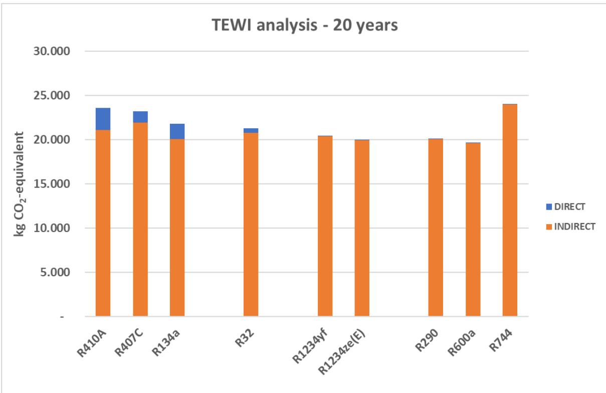  
Figure B2-1: Reference TEWI contribution

These results are used in this appendix as reference values for the sensitivity analysis.

## Sensitivity in relation to the starting points

Increased leakage rate of 6% per year (instead of 2%) and decreased recyclable charge at the end of the lifetime of 50% (instead of 80%).

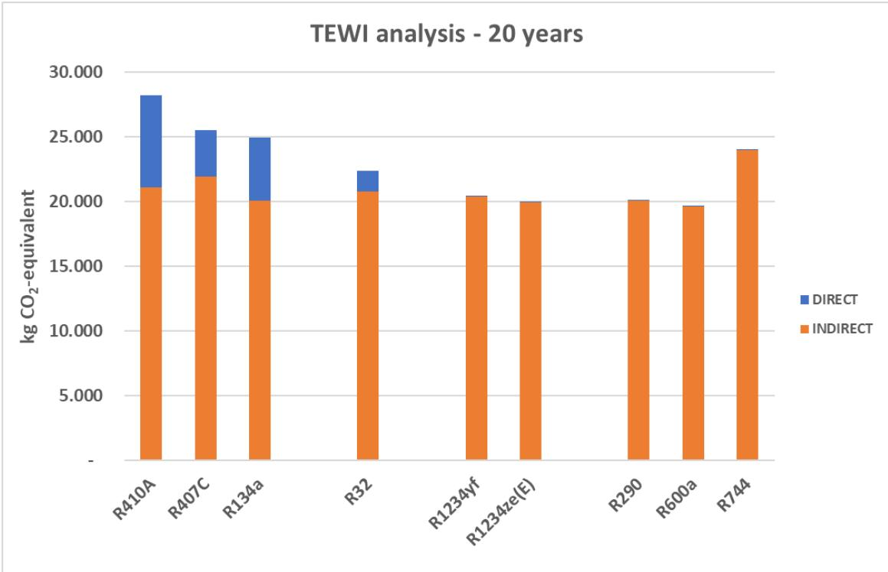  
Figure B2-2: TEWI contribution with higher leakage rate and less recovery

## 2. Indirect contribution:

a. Space heating COP with A7/W55 as Seasonal COP, which results in an increased electricity demand.

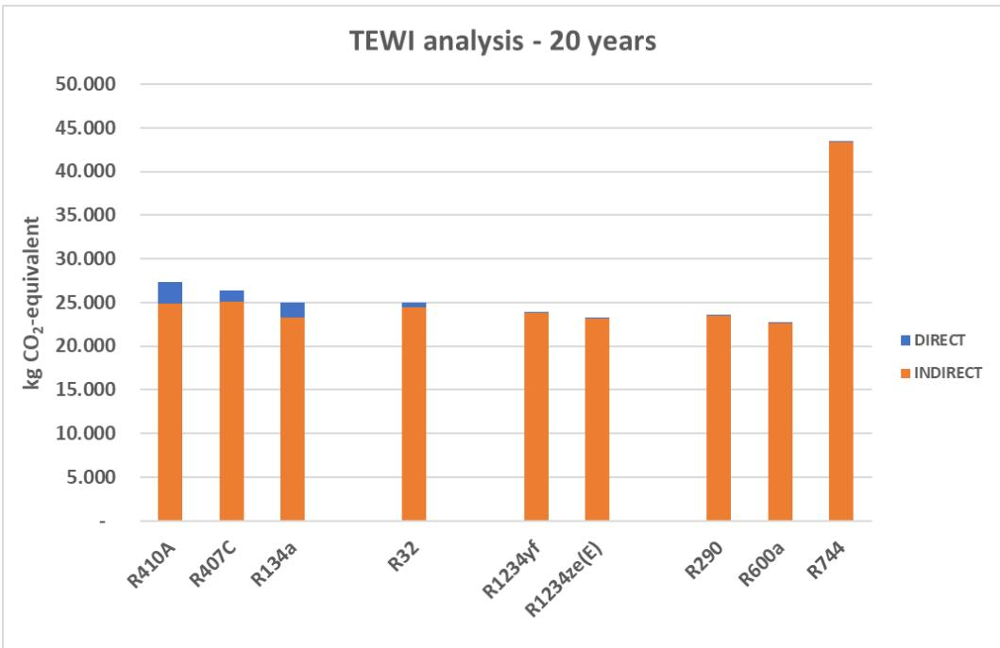  
Figure B2-3: TEWI values for COPs with A7/W55

## b. Space heating COP with A7/W35 as Seasonal COP, which results in a decreased electricity demand.

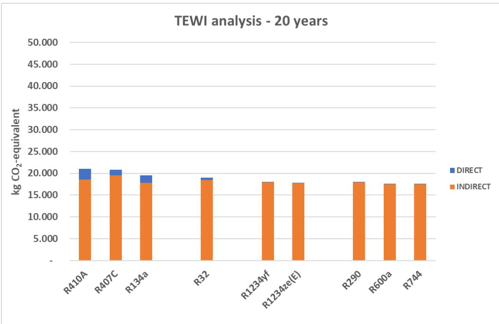  
Figure B2-4: TEWI values for COPs with A7/W35

Figures B2-3 and B2-4 clearly show the influence of the COP for space heating: at a low system temperature, the efficiency is higher and results in a lower indirect TEWI (= directly related to the electricity consumption). This effect is extreme for $\complement 0 _ { 2 }$ (R744): with low temperatures, the indirect contribution of the TEWI is similar to the other refrigerants. The efficiency of a $\complement 0 _ { 2 }$ heat pump is very low in combination with high-temperature space heating, resulting in a relatively high indirect TEWI contribution.

c. Electricity generation target in 2030: 0.18 kg $\mathsf { C O } _ { 2 }$ equivalent emissions per kWh-e

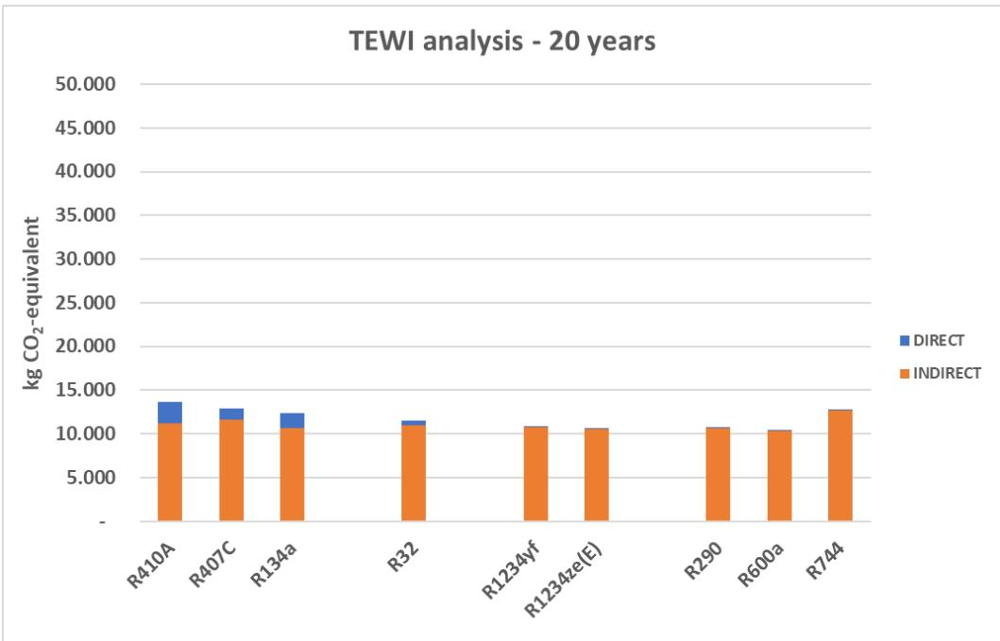  
Figure B2-5: electricity generation about 50% greener

d. 100% green electricity generation (generated locally or centrally): 0 kg $\mathsf { C O } _ { 2 }$ equivalent emissions per kWh-e

  
Figure B2-6: 100% green electricity generation (generated locally or centrally)

Conclusion regarding sensitivity:

Poor refrigerant management increases the direct contribution, so that the indirect contribution becomes less dominant.

The operating conditions of the heat pump have a significant influence on the indirect contribution. It is also clear that $\mathsf { C O } _ { 2 }$ performs poorly as a refrigerant for space heating at higher supply temperatures.

Transitioning to green electricity generation has a direct effect on the indirect contribution. The direct contribution becomes relatively larger and will become dominant for traditional refrigerants as $\mathsf { C O } _ { 2 }$ emissions from electricity generation are further reduced.

# APPENDIX 3: DEGRADATION PRODUCTS AND ENVIRONMENTAL EFFECTS OF F-GASES (HFCS AND HFOS)

## TFA

HFCs and HFOs break down in the environment into HF, carbonyl fluoride, HCl and the so-called short-chain perfluorocarboxylic acids. Trifluoroacetic acid (TFA) is the most important of these. This substance is toxic, accumulates in wet environments and is non-biodegradable. Figure B3-1 illustrates the conversion of HFO to TFA.

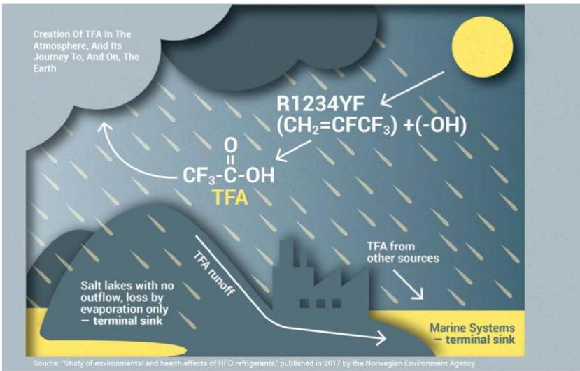  
Figure B3-1: Conversion of HFO to TFA, Shecco Accelerate (48)

The degree of conversion varies from one substance to another. This applies only to a limited extent for the HFC refrigerants, and to a large extent for the HFO refrigerants R1234ze and R1234yf. For example, 1 kg of R1234yf refrigerant is converted into 1 kg of TFA. Tables B3-1 and B3-2 display the conversion into TFA of a number of HFCs and HFOs (49).

<table><tr><td rowspan=1 colspan=1>Refrigerant</td><td rowspan=1 colspan=1>HFC-134a</td><td rowspan=1 colspan=1>HFC-143a</td><td rowspan=1 colspan=1>HFC-227ea</td><td rowspan=1 colspan=1>HFO-1234yf</td><td rowspan=1 colspan=1>HFO-1234ze</td></tr><tr><td rowspan=1 colspan=1>Molecularweight</td><td rowspan=1 colspan=1>102.03</td><td rowspan=1 colspan=1>84.04</td><td rowspan=1 colspan=1>170.03</td><td rowspan=1 colspan=1>114.02</td><td rowspan=1 colspan=1>114.02</td></tr><tr><td rowspan=1 colspan=1>Molarconversion toTFA</td><td rowspan=1 colspan=1>21%</td><td rowspan=1 colspan=1>100%</td><td rowspan=1 colspan=1>100%</td><td rowspan=1 colspan=1>100%</td><td rowspan=1 colspan=1>N/A</td></tr><tr><td rowspan=1 colspan=1>Conversion toTFA (w/w)</td><td rowspan=1 colspan=1>0.23</td><td rowspan=1 colspan=1>1.36</td><td rowspan=1 colspan=1>0.67</td><td rowspan=1 colspan=1>1.00</td><td rowspan=1 colspan=1></td></tr></table>

Table B3-1: Refrigerant conversion to TFA according to Solomons et al. (49)

Table 1. Historical (from 1990) and projected upper range of production of relevant HFCs and HCFCs in tonnes.
<table><tr><td rowspan=1 colspan=6>Compound1</td><td rowspan=1 colspan=1>HFC-134a</td><td rowspan=1 colspan=1>HFC-143a</td><td rowspan=1 colspan=1>HFC-227ea</td><td rowspan=1 colspan=1>HFO-1234yf</td><td rowspan=1 colspan=1>HFO-1234ze</td></tr><tr><td rowspan=1 colspan=6>Molecular weight</td><td rowspan=1 colspan=1>102.03</td><td rowspan=1 colspan=1>84.04</td><td rowspan=1 colspan=1>170.03</td><td rowspan=1 colspan=1>114.02</td><td rowspan=1 colspan=1>114.02</td></tr><tr><td rowspan=1 colspan=6>Molar yield</td><td rowspan=1 colspan=1>0.21</td><td rowspan=1 colspan=1>1</td><td rowspan=1 colspan=1>1</td><td rowspan=1 colspan=1>1</td><td rowspan=1 colspan=1>NA</td></tr><tr><td rowspan=1 colspan=6>Yield of TFA a.e. w/w</td><td rowspan=1 colspan=1>0.23</td><td rowspan=1 colspan=1>1.36</td><td rowspan=1 colspan=1>0.67</td><td rowspan=1 colspan=1>1.00</td><td rowspan=1 colspan=1></td></tr><tr><td rowspan=1 colspan=6>Total production from1990 to 2015</td><td rowspan=1 colspan=1>3,869,000</td><td rowspan=1 colspan=1>537,000</td><td rowspan=1 colspan=1>57,000</td><td rowspan=1 colspan=1>0</td><td rowspan=1 colspan=1>0</td></tr><tr><td rowspan=1 colspan=6>Lifetime, year²</td><td rowspan=1 colspan=1>14</td><td rowspan=1 colspan=1>51</td><td rowspan=1 colspan=1>36</td><td rowspan=1 colspan=1>&lt;0.1</td><td rowspan=1 colspan=1>&lt;0.1</td></tr><tr><td rowspan=1 colspan=6>2011 concentration,ppt³</td><td rowspan=1 colspan=1>63</td><td rowspan=1 colspan=1>12</td><td rowspan=1 colspan=1>0.6</td><td rowspan=1 colspan=1>NA</td><td rowspan=2 colspan=1>NA</td></tr><tr><td rowspan=1 colspan=6>2011 TFA productionflux, tonnes per year</td><td rowspan=1 colspan=1>18,000</td><td rowspan=1 colspan=1>3,600</td><td rowspan=1 colspan=1>510</td><td rowspan=1 colspan=1></td></tr><tr><td rowspan=9 colspan=6>Estimated total produc-tion by 2050Total cumulative contri-bution to TFA a.e. inthe global environmentTotal yield of TFA a.e.from HFC and HFOs up 20,625,000to 2050</td><td rowspan=1 colspan=1>22,047,000</td><td rowspan=1 colspan=1>8,725,000</td><td rowspan=1 colspan=1></td><td rowspan=9 colspan=2>NA358,000     3,256,000</td></tr><tr><td rowspan=2 colspan=1>5,174,000</td><td rowspan=2 colspan=1>11,838,000</td><td></td></tr><tr><td rowspan=1 colspan=2>.e. in</td><td></td></tr><tr><td rowspan=1 colspan=4>vironment</td><td rowspan=1 colspan=1></td><td rowspan=1 colspan=1></td><td></td></tr><tr><td rowspan=4 colspan=3></td><td></td><td></td><td></td></tr><tr><td rowspan=3 colspan=3>TFA a.e.</td><td rowspan=3 colspan=1></td><td></td><td></td></tr><tr><td rowspan=2 colspan=4>nd HE</td><td></td><td></td></tr><tr><td rowspan=2 colspan=1></td><td></td></tr><tr><td rowspan=1 colspan=2>HFOs up</td><td rowspan=1 colspan=1>20,625,000</td><td></td></tr></table>

a.e. = acid equivalents  
²Lifetimes from Burkholder et al. (2015).  
³Concentrations (ppt = parts per trillion, 10⁻12) from (Vollmer et al. 2011b) for HFC-134a and HFC-143a, and from Vollmer et al. (2011a) for HFC-227ea.

Table B3-2: Historical and predicted production volumes (tonnes) of HFCs and HFOs related to TFA according to Solomons et al. (49)

TFA is a strong acid and non-biodegradable. It dissolves easily in water and will therefore accumulate in the aquatic environment. Opinions are not entirely unanimous on its harmfulness and the extent to which it occurs in nature. In its Scientific Assessment of Ozone Depletion (2018), the World Meteorological Organization (WMO) (50) mentions that the formation of TFA from HFCs poses a negligible risk, but that the formation of TFA from HFOs should be further investigated. This is because of the uncertainty regarding future emissions of HFC-1234yf and other HFCs that produce TFA during degradation. A study commissioned by the Norwegian government (51) reports that there are important knowledge gaps. For instance, there is no information on toxicity to organisms that occur in salt lakes and salt deserts. Few studies have been conducted into TFA concentrations in groundwater and no analyses of TFA concentrations in crops for human consumption are reported. Gaps and shortcomings regarding the effect on the environment and human health have been pointed out in the toxicity data contained in the TFA registration dossier. Measures such as limiting the use and requiring the recovery of HFOs reduce risks to humans and the environment, the report states.

A study published in 2020 on the presence of TFA in Arctic ice sheets shows that concentrations are already rising and that there is a clear link with the use of HFO refrigerants (52).

## PFAS

In 2020, five European countries (among which the Netherlands) submitted a request to phase down the use of per- and polyfluoroalkyl substances (PFAS) in Europe (see the European Chemicals Agency (ECHA) (53) and the RIVM Q&A (54)). HFCs and HFOs fall under this category of substances. The European producers of HFCs and HFOs (EFCTC) responded that, in their view, HFCs and HFOs should not be treated as part of this group of PFAS substances, but should be assessed individually (55), (56). This is still under discussion (status in early 2021).

## HF as a combustion product

HF (hydrogen fluoride) is released during the combustion of F-gases. HF is acutely toxic and corrosive. From 30 ppm, corresponding to 25 mg/m³ of air, HF is considered life-threatening and can cause irreversible damage to health (57). This occurs during the combustion of all F-gases, but the amount of HF produced from HFOs is significantly higher due to their greater reactivity. For example, for every gram of R-1234yf that ignites, 70-240 mg of HF is released, meaning that a lethal concentration is quickly reached in the event of a fire.

The HF debate intensified with the introduction of the HFO R1234yf as an AC refrigerant in passenger cars. The German environment ministry UBA has been intensively studying this issue (58). This has led to a negative position on the use of HFOs in the German government (UBA) (44).

## APPENDIX 4: REFRIGERANT SAFETY

All refrigerants pose a potential hazard to persons and the environment. These hazards are very diverse, but we have focussed on most important safety aspects:

\- toxicity

\- flammability

\- high pressure

The refrigeration industry has developed specific standards and regulations for toxicity and flammability that apply only to the application of substances as refrigerants. In addition, there are also generic standards and regulations that apply to refrigerants. This appendix details these standards and regulations.

## Specific safety classification of refrigerants (ISO 817)

Refrigerants are classified by the refrigeration industry according to the ISO 817 standard for their degree of flammability and toxicity. The US refrigeration industry association ASHRAE, where the refrigerant manufacturers (mostly US-based) pool their expertise and interests, manages this classification. They also issue the R numbers for refrigerants and mixtures, defined in ANSI/ASHRAE standard 34, including safety classes. These R numbers are adopted in the international ISO 817 'Refrigerants - Designation and safety classification'standard. This standard forms the basis for the refrigerant classification in European standard EN 378, the European F-gas Regulation No. 517/2014, the Dutch Code of Practice NPR 7600 (flammable refrigerants), NPR 7601 (CO₂ refrigerants) and PGS 13 (ammonia).

The following classes are distinguished.

The aforementioned is summarised in Table 2-1.

<table><tr><td rowspan=1 colspan=1>Flammability</td><td rowspan=1 colspan=2>Refrigerant classification</td></tr><tr><td rowspan=1 colspan=1>Highly flammable</td><td rowspan=1 colspan=1>A3</td><td rowspan=1 colspan=1>B3</td></tr><tr><td rowspan=1 colspan=1>Flammable</td><td rowspan=1 colspan=1>A2</td><td rowspan=1 colspan=1>B2</td></tr><tr><td rowspan=1 colspan=1>Mildly flammable</td><td rowspan=1 colspan=1>A2L</td><td rowspan=1 colspan=1>B2L</td></tr><tr><td rowspan=1 colspan=1>Non-flammable</td><td rowspan=1 colspan=1>A1</td><td rowspan=1 colspan=1>B1</td></tr><tr><td rowspan=1 colspan=1>Toxicity</td><td rowspan=1 colspan=1>Low toxicity</td><td rowspan=1 colspan=1>High toxicity</td></tr></table>

Table 2-1 (copy): Safety classification of refrigerants (ISO 817, EN 378)

These classes are explained and discussed below.

## Toxicity

Class A refrigerants are considered low-toxic, with a maximum permissible concentration during a working day (Allowable Daily Exposure Level, ADEL) of up to 400 ppm.

\- Class B refrigerants are considered high-toxic.

Discussion of the toxicity classification according to ISO 817

A big advantage of this toxicity classification is its simplicity. For the refrigerants used in practice, this approach means all refrigerants are in class A, except for ammonia (R717), which is class B.

This suggests that all class A refrigerants are completely safe for health, but a nuance applies here. The displacement of oxygen by refrigerants quickly leads, without warning, to damage to health (suffocation). This is a serious safety risk.

Despite being an A class refrigerant, the legal limit for $\mathsf { C O } _ { 2 } \mathsf { i s } 0 . 5 \% . \mathsf { C O } _ { 2 }$ at 8% is lethal after 30 minutes (according to NPR 7601:2020). So, this health risk does need to be taken into account.

It is also unclear which source should be used for the ADEL value. ISO 817 uses US sources, but the EU's chemicals agency (ECHA) uses values that lead to a B classification for some refrigerants, such as R1234yf (59).

## Flammability

Refrigerants are assigned to one of the classes 1, 2, 2L or 3, based on flammability tests.

\- Class 1 (non-flammable)

A refrigerant is classified as class 1 if it does not propagate a flame when tested in air at $60 ^ { \circ } \mathsf { C }$ and 101.3 kPa. A refrigerant mixture is classified as class 1 if the WCFF (Worst Case Fractionated Formulation) of the mixture (as determined in an analysis) does not propagate a flame when tested in air at $60 ^ { \circ } \mathsf { C }$ and 101.3 kPa.

## - Class 2L (mildly flammable)

A refrigerant is classified as class 2L if it meets the following four conditions:

\- propagates a flame when tested at $6 0 ^ { \circ } \mathsf { C }$ and 101.3 kPa

\- lower flammability limit $( \mathsf { L F L } / \mathsf { L E L } ) > 3 . 5$ vol. %

\- heat of combustion < 19,000 kJ/kg

\- maximum burning rat $\mathtt { \cdot e } \le 1 0$ cm/s when tested at ${ 2 3 ^ { \circ } C }$ and 101.3 kPa.

## – Class 2 (flammable)

A single compound refrigerant is classified as class 2 if it meets the following three conditions:

\- propagates a flame when tested at $6 0 ^ { \circ } \mathsf { C }$ and 101.3 kPa

\- lower flammability limit (LFL/LEL) > 3.5 vol. %

\- heat of combustion < 19,000 kJ/kg

## - Class 3 (highly flammable)

A refrigerant is classified as class 3 if it meets the following two conditions:

\- propagates a flame when tested at $6 0 ^ { \circ } \mathsf { C }$ and 101.3 kPa

\- lower flammability limit (LFL/LEL) > 3.5 vol. %, or heat of combustion > 19,000 kJ/kg

## Discussion of the flammability classification according to ISO 817

Class A2L was introduced in 2015 to distinguish the new generation of HFOs and R32 from other flammable refrigerants, based on the differences in flame propagation speed. The substantive worth of this is questionable, but this classification according to ISO 817 is nevertheless used as a standard worldwide. The flammability risk of refrigerants requires careful attention in the design, construction, operation, maintenance and decommissioning of the systems. The same applies to the professional competence of persons carrying out these activities. This applies to all flammability classes: 2L, 2 or 3. The progressive differences in flammability between the refrigerants are of secondary importance.

Figure B4-1 provides a graphical representation of the current classification system with the main refrigerants.

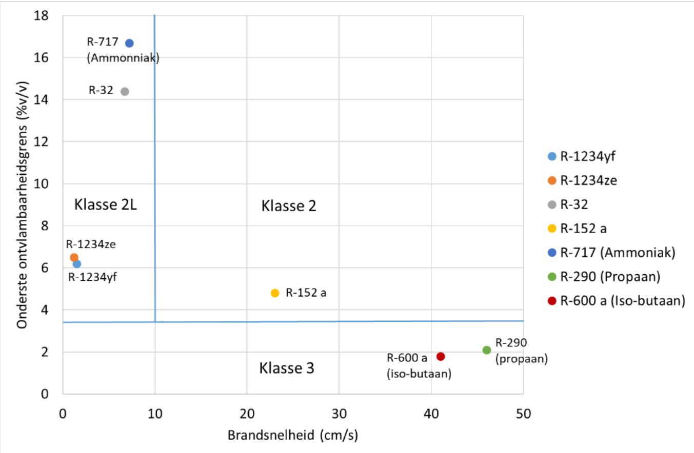  
Figure B4-1: Lower flammability threshold as a function of the burning rate for various refrigerants. The classification according to ISO 817 is included.

There is also a classification proposed that combines toxicity and flammability in a single parameter: the Practical Limit (PL). It represents the highest concentration (in kg/m³) in a space that does not lead to acute health effects and does not pose an ignition risk. The maximum refrigerant charge for specific applications can be derived from this. The tables in EN 378-1, Annex E, give this PL per refrigerant. In practice, it is not easy to combine toxicity and flammability in a single parameter. The risk mechanisms are fundamentally different, and the long-term health effects are not sufficiently taken into account. For these reasons, this report does not use the PL, but instead refers to the individual toxicity and flammability parameters.

## Classification according to the ADR (transport) and CLP (labelling and packaging)

The ADR is a European agreement for the international transport of dangerous goods (60), such as refrigerants, by road. It sets out the rules for this transport. The classification of dangerous goods follows the CLP (see below). The ADR sets rules not only for road transport, but also for the loading and unloading of dangerous goods.

The CLP Regulation (EC) 1272/2008 (amended in 2019) sets out the legal requirements for the classification, labelling and packaging of substances and mixtures (61). (62) classifies gases into three categories based on flammability, with specific criteria that are more stringent than those of ISO 817. These gases must be labelled with a GHS pictogram and a hazard statement. One consequence of this is that refrigerants classified as mildly flammable according to ISO 817 are classified as a highly flammable gas according to the CLP regulation (and also the ADR). Table B4-1 provides some examples to compare ISO 817 with the CLP regulation. For example, R1234yf and R32 are considered mildly flammable according to ISO 817, while the CLP Regulation states that R32 is highly flammable and R1234yf is flammable.

<table><tr><td rowspan=1 colspan=1>Refrigerant</td><td rowspan=1 colspan=1>Lower flammabilitylimit (% v/v)</td><td rowspan=1 colspan=1>Classificationaccordingto ISO 817</td><td rowspan=1 colspan=1>Classification accordingto CLPRegulation</td><td rowspan=1 colspan=1>GHS pictogramforflammability(implementedin the CLPRegulation)</td><td rowspan=1 colspan=1>Hazardstatement forflammability(implementedin the CLPRegulation)</td></tr><tr><td rowspan=1 colspan=1>R744</td><td rowspan=1 colspan=1>Non-flammable</td><td rowspan=1 colspan=1>A1</td><td rowspan=1 colspan=1>Non-flammable</td><td rowspan=1 colspan=1>1</td><td rowspan=1 colspan=1>1</td></tr><tr><td rowspan=1 colspan=1>R-1234yf</td><td rowspan=1 colspan=1>6.2</td><td rowspan=1 colspan=1>A2L</td><td rowspan=1 colspan=1>Category 1B</td><td rowspan=1 colspan=1></td><td rowspan=1 colspan=1>H221:Flammable gas</td></tr><tr><td rowspan=1 colspan=1>R-32</td><td rowspan=1 colspan=1>14.4</td><td rowspan=1 colspan=1>A2L</td><td rowspan=1 colspan=1>Category 1A</td><td rowspan=1 colspan=1></td><td rowspan=1 colspan=1>H220:Extremelyflammable gas</td></tr><tr><td rowspan=1 colspan=1>R-717</td><td rowspan=1 colspan=1>16.7</td><td rowspan=1 colspan=1>B2L</td><td rowspan=1 colspan=1>Category 2</td><td rowspan=1 colspan=1>1</td><td rowspan=1 colspan=1>H221:Flammable gas</td></tr><tr><td rowspan=1 colspan=1>R-290</td><td rowspan=1 colspan=1>2.1</td><td rowspan=1 colspan=1>A3</td><td rowspan=1 colspan=1>Category 1A</td><td rowspan=1 colspan=1></td><td rowspan=1 colspan=1>H220:Extremelyflammable gas</td></tr></table>

Table B4-1: Classification of various refrigerants according to ISO 817 and the CLP  
The Material Safety Data Sheets (MSDSs) provided by the gas suppliers provide many details on the safety, classification and labels of their products. An example for R290 (propane) can be found in (11).

## Classification according to the Pressure Equipment Directive (PED) and Simple Pressure Vessels Directive (SPVD)

The European Pressure Equipment Directive (2014/68/EU) (63) imposes essential safety requirements on pressure equipment and assemblies of which the maximum allowable pressure PS exceeds 0.5 bar(g). The PED describes the responsibilities and obligations of the various market parties (manufacturers/installers, importers, distributors, users, inspection bodies and the government), and regulates the design and manufacturing

requirements according to the Essential Requirements in Annex I of the PED. The commissioning and operation of the relevant equipment is regulated at the national level.

The PED focuses on two substance groups: hazardous (group 1) and non-hazardous (group 2). For the lower values of pressure x volume, the classes for the inspection schedule are particularly relevant for substance group 2 (with increasing intensity).

The A1 refrigerants fall under group 2 and all flammable and highly toxic refrigerants (R32, HFO, ammonia and propane) fall under PED group 1. There is one exception: HFO R1234ze (E) is a class A2L refrigerant but still falls under PED substance group 2, which is due to the different temperature standard for determining flammability.

In addition to the PED, there is the Simple Pressure Vessels Directive (SPVD) (2014/29/EU). This Directive applies to simple pressure vessels and cylinders containing refrigerant and is in line with the PED.

## Enthalpy of combustion: the energy released if a refrigerant ignites

When the enthalpy of combustion at the lower flammability limit is plotted for the various refrigerants (corresponding to the energy that can be released once the lower flammability limit is reached and the mixture ignites upon contact with air), it becomes clear that R1234yf, R1234ze and R32 release about 50% more energy than R290 (see figure B4-2). This indicates the amount of explosion energy released if the lower flammability limit is reached. The classifications in this appendix do not take this parameter into account, thus underestimating the explosion risk of the above-mentioned refrigerants.

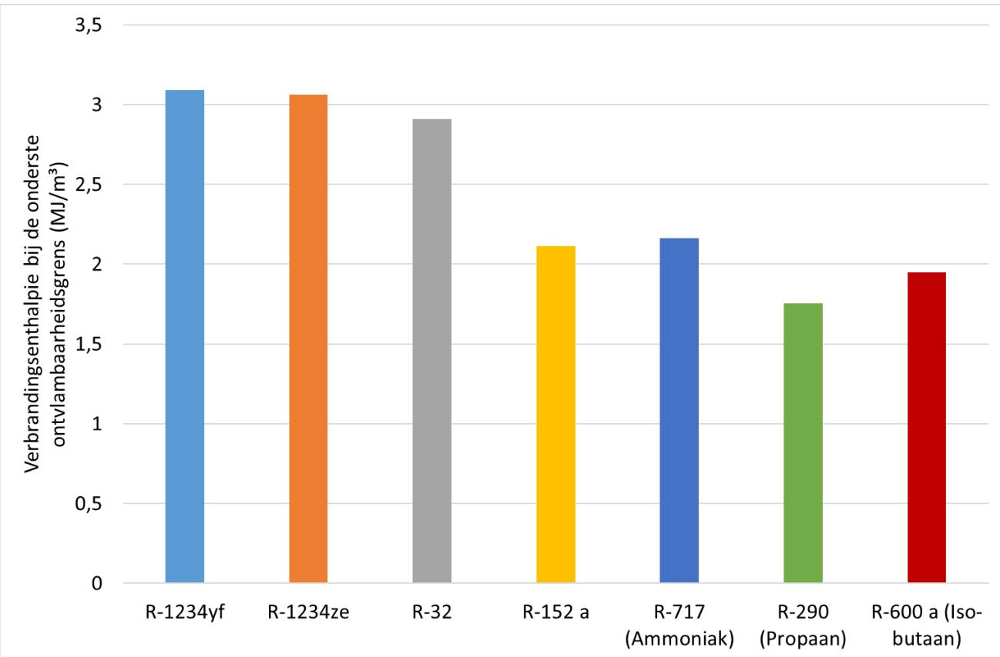  
Figure B4-2: The enthalpy of combustion of various refrigerants at the lower flammability limit.

## LFL, LEL and confusing terms for flammability and explosiveness

In addition to flammability, there is also the concept of explosivity. The two terms are often used interchangeably.

An important safety parameter is the Lower Flammability Limit (LFL), or Lower Explosion Limit (LEL), which is the minimum concentration of refrigerant capable of propagating a flame in a homogeneous mixture of refrigerant and air. All these terms are used interchangeably, and the definitions used are inconsistent. Many safety measures are aimed at preventing concentrations above this LFL when an ignition source is present. Usually a percentage of 25-50% of the LFL is applied. The LFL for refrigerants is described in the classification tables of EN 378-1.

To avoid confusion, we use only the term flammability in this study.

# APPENDIX 5: INFLUENCE OF PRESSURE AND TEMPERATURECHARACTERISTICS ON THE COP

## Energy consumption, efficiency and Carnot

Most refrigeration engineers have heard of the Carnot cycle, but few people understand its significance. Most refrigeration engineers (and the training programmes) avoid classical thermodynamics as much as possible: too theoretical, abstract, woolly, and you can't do anything with the knowledge in practice. They are mistaken, however, because you need to understand thermodynamics and Carnot 96 to determine how efficient a refrigerating system or heat pump is. Efficiency is easy to understand in open-loop systems, such as a combustion boiler: the ideal efficiency of 1 m³ of natural gas is defined as 100%, and every percentage point below that is a decrease in efficiency. But it does not work that way for a refrigerating system, because this is a closed-loop process, “the snake biting its own tail", which operates in an equilibrium relative to its environments. This brilliant discovery was made by the 19th-century physicist Nicolas Léonard Sadi Carnot using the primary laws of classical thermodynamics (with later refinements by Rudolf Clausius in 1865). The path to his result is complex (see the thermodynamics textbooks on the subject), but the result is astonishingly simple and practical, especially for reliably assessing and comparing refrigerating systems and heat pumps (including the exotic systems used in the Netherlands).

Heat naturally flows from high to low temperatures. Carnot conceived a fictitious ideal machine that pumped heat in the other direction: from an environment with a constant temperature (a heat reservoir) to an environment with a higher constant temperature (an analogy is two ponds at different elevations, with a pump that pumps the water from the lower lying pond up to the higher one). The Carnot machine requires energy (work) to do its job, just like the pump in the pond. The greater the temperature difference (or the greater the elevation difference between the two ponds), the more energy is needed to pump heat (or water) to a higher level. Carnot's ideal machine pumps that heat without any loss, so it is the theoretical ideal for a refrigerating system or heat pump.

## The Carnot factor (COP)

The Carnot factor, or Carnot COP (Coefficient of Performance) is dimensionless and represents the amount of heat pumped (in Joules) divided by the drive energy (also in Joules; but of course both can also be expressed, per unit of time, as heating/cooling capacity or driving power, both in Watts). To calculate that ideal factor, Carnot derived a stunningly simple formula from the complex laws of thermodynamics:

Carnot factor = Tlow/ (Thigh - Tlow) The temperatures do have to be expressed in Kelvin, otherwise the formula will not work $( { \sf T } _ { \sf K e l v i n } = { \sf T } _ { \sf C e l s i u s } + 2 7 3 )$

This formula applies to a refrigerating system. For a heat pump, Thigh is above the dividing line instead of $\mathsf { T } _ { \mathsf { I o w } }$ . You can deduce from this that the COP for a heat pump is equivalent to that of a refrigerating system, plus 1.

Here is a calculation example: the temperature of the environment is $20 \%$ (273+20=293 K) and the refrigerated freezer cabinet is $\mathsf { - 2 0 ^ { \circ } C }$ (273-20=253 K). The Carnot factor is then 253/(293-253) = 6.3. So, 1 kW of driving power delivers 6.3 kW of refrigerating capacity and 7.3 kW of heating capacity (in this case to be removed because it is a cooling process).

However, this ideal is never achieved. The deviations from this ideal are related to the concept of entropy, which is too complicated to discuss in detail here.

## From Carnot to energy conversion efficiency

So how do you calculate the energetic performance of a refrigerating system or heat pump? Carnot makes this easy, by defining an efficiency relative to the Carnot factor (Carnot COP). With the COP, you can calculate the Carnot efficiency of an appliance as a percentage. In our example, the freezer cabinet has a real COP of 2.1, so the Carnot efficiency is 33%. That is actually a reasonably good performance for a freezer cabinet.

To put things in perspective: a Peltier cooler (as in a camping cool box) has a Carnot efficiency of a few per cent. The most efficiently designed modern industrial ammonia refrigerating system can achieve 50%, but most appliances fall somewhere in between these two extremes.

State-of-the-art heat pumps for residential space heating and domestic hot water achieve a Carnot efficiency of 45-65%.

Carnot efficiencies need to be carefully calculated. You need to know whether the auxiliary energy factor for all fans, pumps, control units, etc. has been taken into account, and whether it concerns a design COP under full load or part load/continuous operation. Note that the temperatures often used in the Carnot calculation are the condensation and evaporation temperatures. This is misleading and impractical, because we are then comparing with a non-ideal, pseudo-Carnot machine, while we in fact need the ideal Carnot machine for the comparison, based on the temperatures of the heat reservoirs. Another problem is the comparison of mechanically (electrically) driven systems with thermally driven systems, where the source of the electricity (with coal power and solar panels as two extremes) also plays a role.

## APPENDIX 6: SYSTEMS WITHOUT REFRIGERANTS AND ALTERNATIVE CONCEPTS

Paragraph 2.3 briefly discussed the alternatives to the conventional reverse Rankine concept with an evaporating and condensing refrigerant, including water as a natural refrigerant. This appendix provides more information about these alternative concepts. Table 2-4 from that chapter is reproduced below. The alternative concepts are then discussed in more detail.

<table><tr><td rowspan=1 colspan=1>Concept</td><td rowspan=1 colspan=1>Company/organisation inthe Netherlands</td><td rowspan=1 colspan=1>TRL (indicative)</td></tr><tr><td rowspan=1 colspan=1>Water in mechanicalcompression cycle</td><td rowspan=1 colspan=1>eChiller</td><td rowspan=1 colspan=1>7-9</td></tr><tr><td rowspan=1 colspan=1>Natural gas-firedadsorption heat pump</td><td rowspan=1 colspan=1>Cooll</td><td rowspan=1 colspan=1>8</td></tr><tr><td rowspan=1 colspan=1>Absorption</td><td rowspan=1 colspan=1>Various</td><td rowspan=1 colspan=1>5-9</td></tr><tr><td rowspan=1 colspan=1>Geothermal heating(below 500m)</td><td rowspan=1 colspan=1>Various</td><td rowspan=1 colspan=1>5-8</td></tr><tr><td rowspan=1 colspan=1>*) ATES, BTES and freecooling (above 500m)</td><td rowspan=1 colspan=1>Various</td><td rowspan=1 colspan=1>&gt;9</td></tr><tr><td rowspan=1 colspan=1>Thermo-acoustic</td><td rowspan=1 colspan=1>Blue Heart EnergySoundEnergy</td><td rowspan=1 colspan=1>7</td></tr><tr><td rowspan=1 colspan=1>Air cycle</td><td rowspan=1 colspan=1>Tarnoc</td><td rowspan=1 colspan=1>7</td></tr><tr><td rowspan=1 colspan=1>Adiabatic and dew-pointcooling</td><td rowspan=1 colspan=1>Various</td><td rowspan=1 colspan=1>7-9</td></tr><tr><td rowspan=1 colspan=1>Stirling</td><td rowspan=1 colspan=1>University of Twente</td><td rowspan=1 colspan=1>5-9</td></tr><tr><td rowspan=1 colspan=1>Magnetocaloric</td><td rowspan=1 colspan=1>TU Delft</td><td rowspan=1 colspan=1>4-6</td></tr></table>

Table 2-4: Systems without refrigerants and alternative concepts, and their  
Technology Readiness Level (TRL)

\*) These systems provide cooling directly from the ground source, without the need for a refrigerating system. For heating, these systems provide the heat source for an additional heat pump, where this heat pump may use a refrigerant.

## Technology Readiness Levels

The Technology readiness levels (TRLs) in Table 2-4 are defined in 9 levels in the European HORIZON-2020 - Work Programme 2014-2015:

\- TRL 1: Basic principles observed.

\- TRL 2: Technology concept formulated.

\- TRL 3: Experimental proof of concept.

\- TRL 4: Technology validated in lab.

TRL 5: Technology validated in relevant environment (industrially relevant environment in the case of key enabling technologies).

TRL 6: Technology demonstrated in relevant environment (industrially relevant environment in the case of key enabling technologies).

\- TRL 7: System prototype demonstration in operational environment.

\- TRL 8: System complete and qualified.

TRL 9: Actual system proven in operational environment (competitive manufacturing in the case of key enabling technologies; or in space).

The TRLs in the table are taken from (14). Deviating from and additional to the TRL values in (2), the TRL for the Tarnoc Turbine Heat Pump is estimated to be 7. Evaporative and dew-point cooling involve both established technologies and technologies that are still under development, and are therefore rated 7-9. Absorption refrigeration has been an established technology for more than a century, while new absorption technologies are in the conceptual development phase, and is therefore rated 5-9.

## Transport function of heating and cooling

In addition to energy consumption, the heat transport function is also important for assessing and comparing the various refrigerants. The reference system is the conventional reverse Rankine concept, where the circulating refrigerant is also a highly effective and efficient transporter of heat and cold. In the example of a split AC unit, the two units may be installed many metres apart (one outside and one inside), connected only by two thin pipes. Unfortunately, most alternative concepts do not facilitate this transport function. For example, a thermoacoustic unit usually has a cold and a hot side (hot/cold head), with secondary circuits (circulating water or glycol) that transport the heat/cold to where it is needed. This leads to additional costs, materials and inefficiencies (additional delta T, pumping energy). Smart modifications to heat pipes and phase transitions can improve things slightly, but is still an intrinsically detrimental phenomenon. This is why alternative concepts often come out worse in a comparison with conventional appliances when the secondary circuits are taken into account.

A practical example of this heat transport disadvantage is an, otherwise successful, Unilever project (by Ben & Jerry's). An electrically driven thermoacoustic refrigerating system (with a special type of speaker and metal bellows) worked well enough, but the secondary circuits that connected the system to a display freezer cabinet for the icecream and to the outside environment ultimately caused the concept to fail.

The alternative, refrigerant-free concepts are described in detail below. This information is largely based on (14) and (13).

## Water in a mechanical compression cycle: the eChiller

In addition to the refrigerant-free concepts, there are also concepts for mechanical vapour compression systems (reverse Rankine) that use less common natural refrigerants (instead of the hydrocarbon, carbon dioxide and ammonia refrigerants discussed in detail in Chapter 3). In particular, water is of course an indisputably natural source of which there is an unlimited supply. It is used incidentally and with competitive COPs, but the

applications involve high volumes of water vapour (which requires large-scale systems) and high negative pressure in parts of the system (which involves unusual design challenges). The eChiller available in the Netherlands (64) is ideally suited for continuous industrial process cooling, cooling server and control rooms, and technical building systems. Appliances with between 15 and 150 kW cooling capacity are available on the market. The table below is taken from the website (in Dutch: capacity and EER, cooling water entrance and exit).

## Capaciteiten en prestaties

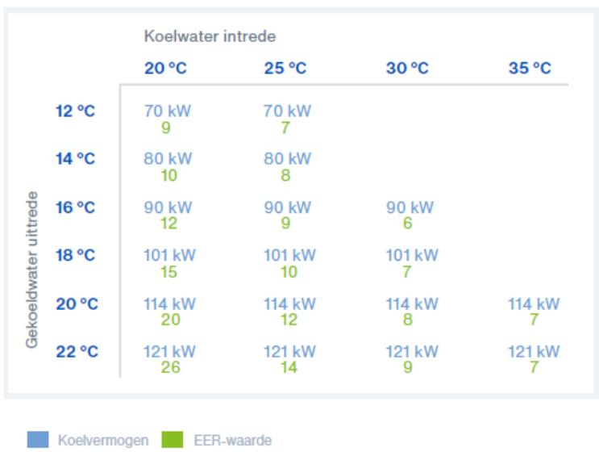

## Natural gas-fired adsorption heat pump: Cool

The Dutch company Cooll, founded in 2009 and based in the city of Enschede, is a spin-off company from the University of Twente. Cooll is working together with a number of their industry partners to develop an energy-efficient and affordable heating solution for existing and new homes. Their design involves a heat pump powered by gas which can save 30-50% of energy and $\mathsf { C O } _ { 2 }$ emissions (from fossil gas) compared to a traditional highefficiency boiler. The technology puts the heat of combustion to better use than traditional combustion appliances. Cooll's adsorption heat pump has a similar continuous cycle to a standard mechanical vapour compression heat pump. In their appliance, however, the refrigerant is compressed by a heat-driven adsorption compressor instead of a mechanical compressor. The adsorption compressor consists of two pressure vessels filled with high-grade activated carbon that are heated and cooled in a cycle of about 10 minutes. When the pressure vessel is heated (up to about $\mathsf { 1 8 0 ^ { \circ } C } )$ , ammonia is forced out of the adsorbent under high pressure and passed through a passive valve (check valve) to the high-pressure side of the heat pump. The ammonia condenses in the condenser, where it releases its heat to the central heating system (for example at $6 0 ^ { \circ } \mathsf { C } )$ , after which the ammonia pressure is reduced by the expansion valve. The liquid ammonia then

evaporates in the evaporator, absorbing energy from the outside air. The ammonia is now drawn to the other pressure vessel through a check valve. This vessel is primed to the initial temperature of the cycle $( 6 0 ^ { \circ } \mathsf { C }$ in this example), under which conditions the ammonia refrigerant is adsorbed back into the adsorbent. After about 5 minutes, the function of the two pressure vessels reverses, creating a semi-continuous process. The advantage of this system compared to a standard combustion boiler is the additional heat that is extracted from the outside air via the evaporator and condenser. This air-water heat pump is quiet, suitable for indoor installation, and achieves high primary energy efficiency in combination with high-temperature radiators. For these reasons, it is very suitable for existing homes, and can economically replace traditional high-efficiency boilers at the end of their lifetime. The same technology could, in future, be powered by biofuels or hydrogen, enabling sustainable heating using the existing gas network. An affordable mass-market product is currently being developed in collaboration with partners from the heating industry. For a larger house with natural gas consumption of, say, 2000 m³ per year, the investment can be recouped in 5-7 years through annual savings of around €500 on energy bills. The concept is currently being tested in practice.

Strictly speaking, this concept is not refrigerant-free; ammonia is the evaporating and condensing refrigerant here, analogous with a refrigerant in the conventional reverse Rankine concept. However, this concept has been included here because'the 'thermal compressor' (with carbon as the adsorbent, driven by heat) is a completely different concept to that of a conventional mechanical compressor.

## Absorption: various suppliers

Absorption refrigeration is the oldest form of artificial cooling, dating back to the time when it was not yet possible to manufacture reliable mechanical compressors. In this concept, the mechanical compressor is replaced by a so-called thermal compressor, whereby the partial vapour pressure of the refrigerant is increased by evaporating it out of an absorbent with the help of heat. Ammonia/water and water/lithium bromide are the most commonly used working pairs. Absorption concepts are very attractive for a number of applications where their environmental benefits are an advantage, especially in combination with waste heat recovery or combined heat and power. A small number of companies specialise in this technology around the world. The Netherlands has the company Colibri BV in Vaals.

Here too, the concept is not actually refrigerant-free and is driven by a thermal compressor.

## Geothermal heating, ATES, BTES and free cooling: various suppliers

Free cooling and heating is an alternative to appliances with refrigerants, and is therefore included in this overview. On the one hand, this is a confusing area because of the wide variety of terminology and the many types of systems in use. However, open and closedloop shallow (up to about 200 m) ATES- and BTES-systems have been standard technology for a long time.

The earth stores heat produced by the sun, resulting in a relatively constant subsurface temperature of 10-12°C, even at a shallow depth. That temperature increases by 2-3K per 100 metres of depth. Today, we usually drill to a depth of around 200 m. This serves as an almost ideal source for a (ground source) heat pump to efficiently heat a building in winter. In summer, the source can deliver direct cooling to the building without the intervention of a heat pump/refrigerating system. This is called 'free cooling', as no traditional AC is required. The heat that is released by the cooling system in the summer (free cooling or heat pump/air conditioner) can be stored in the ground for use in winter (regeneration) with a heat pump, so that the cooling process also contributes to more efficient heating.

## Ground energy or geothermal energy?

Both techniques are used to extract energy from the soil, but at different depths. The 500 m depth is significant in the Netherlands because the Mining Act (Mijnbouwwet) applies below that level. Based on this depth, we can divide the subsurface into a zone for 'ground energy' (0-500 m) and a zone for 'geothermal energy' (deeper than 500 m).

## – Ground energy (0-500 m).

Heat and cold extraction and storage, primarily for heating and cooling buildings. This is what we refer to as a 'ground energy system'. In practice, these systems are usually installed to no deeper than 250 m.

– Open-loop systems (groundwater systems/ATES systems).

– Closed-loop systems (ground-coupled heat exchanger systems/BTES systems).

– Geothermal systems (>500 m).

– Deep geothermal (1500-4000 m), suitable for supplying direct heat.

– Shallow geothermal (500-1500 m), direct heat suitable for greenhouses, for example.

## Ground energy partnership

BodemenergieNL is the trade association of companies and organisations in the Netherlands that develop open and closed-loop ground energy systems, in most cases in combination with a heat pump. This organisation claims that "After the use of gas in the Netherlands has been phased out in 2050, ground energy systems will provide around 25% of the buildings with sustainable heating and cooling."

## Ground energy projects (ATES and BTES)

To date, thousands of projects have been implemented or are being prepared with a primary focus on heating, but in many cases with free cooling in the summer as an added bonus (and rendering environmentally unfriendly mobile ACs unnecessary). Several heat pump manufacturers and suppliers are active in the field of ground source energy in the Netherlands, including IthoDaalderop, Nathan, Nibe, Stiebel Eltron and Vaillant.

## Thermoacoustic heat pump: Blue Heart Energy, SoundEnergy

Several companies in the Netherlands are active in the field of thermoacoustic heat pumps.

The company Blue Heart Energy ‘is a 'spin-out' of ECN technology (part of TNO since 2018). Their aim is to manufacture heat pumps for the built environment (up to 100 kW) through exclusive licensing agreements. More details at https://blueheartenergy.com/and in (14).

Another Dutch company operating in this field is SoundEnergy. In this company's product, an inert working gas undergoes a thermodynamic cycle under the influence of periodic sound waves. Sound waves are longitudinal and cause the density of the working gas to fluctuate in the direction of the wave, much like 'virtual pistons'. This allows compression, expansion and displacement of the working gas, all in a regenerator sandwiched between two heat exchangers. The timing (phase) of the changes in periodic pressure and velocity of the acoustic wave determines the direction of the cycle: as a heat engine (heat is converted into acoustic (mechanical) power), or as a heat pump (acoustic power generates a temperature increase). The cycle therefore does not require mechanically moving parts such as pistons and displacers. Because there is no phase transition, no refrigerant is required and extremely wide temperature ranges are possible. The principle behind this technology was discovered more than 150 years ago, as a variant of the wellknown Stirling machine (conventional technique for cryogenic liquefaction of gases), but the first commercial applications of thermoacoustics were only developed at the end of the last century.

## The THEAC concept

SoundEnergy's THEAC concept consists of a ring or loop-shaped acoustic resonator: a thermoacoustic heat engine combined with a thermoacoustic heat pump. The cooling system is driven by the (residual) heat of a process (see the diagram of THEAC (THErmo Acoustic Cooling)). Fluid circuits supply heat at high temperature from a heat source, dissipate the heat at ambient temperature, and supply dry or wet cooling for AC. The refrigerating capacity is highly dependent on the temperature conditions. The thermal response time of a few minutes makes the system ideal in combination with solar heat and rapidly fluctuating cooling requirements (industrial batch processes).

## THEAC in practice

SoundEnergy launched the THEAC-25 last year. Two systems have been installed, one for the cooling system of the Magenta School's new building in Delden, and one at coffee roaster Mocca d'Or in Zwolle, both in The Netherlands, which uses residual heat from coffee roasting for cooling the building. A scaled-up version is under development consisting of modules of 200 kW each, to reach cooling capacities of over 1 MW (www.soundenergy.nl).

## Air cycle: Tarnoc

## Air cycle applications

Air cycle systems are best known for their applications in aviation where they are a standard technology for airplane cabin AC. Clever use of jet engine pressure differentials and the low weight are what make this concept so successful. Air cycles are also used for AC in passenger trains. The concept is ideally suited for cryogenic and freeze-drying applications (extremely low temperature). In Japan, air cycles have been successfully used for years for freeze-drying and storing fish at extremely low temperatures (as low as - $6 5 ^ { \circ } \mathrm { C } )$ . Mayekawa's PascalAir unit has been on sale in many countries for some years now. Swiss company Mirai Intex (founded in 2015) sells both open and closed-loop air cycle units on the market (5 to 15 kW, as low $\mathsf { a s } - 1 1 0 ^ { \circ } \mathsf C )$ . In the 1990s, TNO (The Netherlands) successfully developed and built an air cycle system for a walk-in freezer $( 2 0 \mathsf { k W } , - 6 0 ^ { \circ } \mathsf { C } )$ in a pilot project (part of a major European partnership). Unfortunately, that did not lead to a follow up, due to a lack of decisive action by the Dutch stakeholders, who failed to develop the product and introduce it to the market. Air cycle concepts have been getting a lot of interest lately for achieving the extremely low temperatures of around $\mathfrak { - 8 0 ^ { \circ } C }$ required for storing Covid-19 vaccines.

## Tarnoc's air cycle technology

TU Delft (Netherlands) has developed the Turbine Heat Pump. This is a high capacity (20 kW), high-temperature $( 7 5 ^ { \circ } \mathsf { C } )$ heat pump intended to replace the traditional central heating boiler. This design of this heat pump is based on the air cycle principle. One of the major differences with a standard cooling circuit is that an open-loop system with air (R729) is used. This means that there is effectively no 'evaporator'in the system. Instead of the refrigerant being evaporated/heated, the low-temperature refrigerant (air) is released to the air and fresh refrigerant is drawn in, just like in the TNO concept described above. The process of air release and intake replaces the function of the evaporator (heat exchanger) and is therefore 100% effective. An additional advantage is that there is no formation of condensation or frost on the evaporator. In common heat pumps, frost often forms on the finned coils below 0 to $5 ^ { \circ } \mathsf { C } .$ This requires periodic activation of the defrosting cycle which strongly reduces the capacity and efficiency of the heat pump. Moreover, air leakages in this system are less consequential than refrigerant leakages in a closed-loop refrigerating system.

## Tarnoc: the technology

The name of the Tarnoc Turbine Heat Pump is derived from another unique feature of this refrigeration technology. Whereas a refrigeration circuit has an expansion valve, the pressure in an air cycle system is reduced using a radial turbine. This allows the energy to be recovered from the compressed gas. Because the turbine is attached to the same shaft as the compressor, this energy is passed on to the compressor with virtually no losses. An additional effect of the turbine is that there is a large delta T between the incoming and outgoing air. In the case of the Turbine Heat Pump, this exceeds 30 K under nominal, lowhumidity conditions. This is significantly higher than the delta T across the evaporator of current heat pumps. This also has the advantage that a significantly lower volume of air is required. The Turbine Heat Pump has an air flow rate of around 1100 m³/h, which is up to 5 times lower than vapour compression heat pumps of similar capacity. This relatively low air requirement facilitates indoor installation with relatively narrow air ducts.

The Turbine Heat Pump is completely oil-free. The combination of the compressor, turbine and high-speed electric motor is also called the 'turbo core'. The electric motor runs at a speed of 40,000 rpm. Because of this combination of high frequency and low pressure, the compressor is significantly lighter and more compact than a mechanical positive displacement compressor of the same capacity.

## Tarnoc: pilot project

This winter (2020-2021), Tarnoc will conduct a pilot project in collaboration with two housing associations. Following this pilot, in 2021 they will apply for certification and bring the Turbine Heat Pump to the wider market (www.Tarnoc.nl).

## Adiabatic and dew-point cooling: various suppliers

Numerous concepts have been and are being developed to provide cooling via water evaporation. The technique avoids the need for appliances with refrigerants. The terminology is not always consistent; among others, the terms adiabatic cooling, dewpoint cooling, evaporative cooling and desiccant cooling are used. We discuss the concepts that have been applied or developed in the Netherlands below. Because this technology cannot be used to provide heating (unlike most other cooling technologies), it has only limited relevance for this study.

## Adiabatic cooling

Evaporating water in a stream of air has a cooling effect. This effect is usually referred to as indirect or direct adiabatic cooling. These systems bring a risk of legionella spreading, for which precautions need to be taken.

## – Direct adiabatic cooling,

Humidifying air without some form of heat exchange leads to a decrease in the temperature and an increase in the relative humidity. The enthalpy and wet-bulb temperature are not affected. This means the lowest possible temperature is the wetbulb temperature. In this situation, the relative humidity is 100%, i.e. the air is saturated. These are unpleasant conditions for humans, so direct adiabatic cooling is only suitable for dry climates or situations where very little cooling is required.

## – Indirect adiabatic cooling with air conditioner

The most common method of adiabatic cooling is to install a ventilation system with heat recovery via a heat exchanger such as an adiabatic wheel heat exchanger. The return air from the building is humidified, which lowers the temperature. This cold is then transferred to the supply air. All suppliers of AC offer this option, which is probably the cheapest and most energy-efficient form of comfort cooling. The system is limited by the wet-bulb temperature. Because it is cooler inside than outside, the wet bulb temperature is also lower than outside. In poorly insulated buildings, the return air will become too hot and indirect adiabatic cooling will not work.

## Dew-point cooling

An alternative technology called 'dew-point cooling' has been developed in parallel over the last 20 years, among others in the Netherlands and Australia. In this process, supply air is cooled in a plate heat exchanger and then blown into the building. Some of the cooled air is diverted, humidified and warmed by the supply air. This theoretically allows the lower dew-point temperature to be reached, instead of the wet-bulb temperature. The supply air temperature is independent of the thermal load of the building, which makes this technique particularly suitable for buildings with many large openings, such as distribution centres and factory halls, and for poorly insulated buildings.

## Stirling: University of Twente, The Netherlands

As part of a TKI project (65), the University of Twente, Thales and Microgen Engine Corporation BV are conducting research into an electrically driven free-piston Stirling heat pump for domestic hot water. The Stirling concept works with a gaseous medium (usually Helium) and is a traditional technique for the industrial-scale production of liquid gases at temperatures close to absolute zero. Simulation models have been developed as a basis for the system design. The researchers report that 1 to 1.3 kW of heating capacity is delivered with a COP of between 2.1 and 2.4 at a source temperature of 20°C.

## Magnetocaloric refrigeration: TU Delft, The Netherlands

Magnetocaloric refrigeration makes use of the so-called magnetocaloric effect in certain solids. All atoms in alloys (mixtures of metals) have their own (disordered) magnetic field. When alloys are placed in an external magnetic field, the magnetic field within those alloys is ordered. This is because all the atoms adopt the same orientation as the external magnetic field. That movement causes the material to heat up, which heat is then released. When the external magnetic field is switched off, the field within the material becomes disordered again and the alloy cools down to below the temperature of the initial situation. The alloy then absorbs heat from the environment to regain its initial temperature, which decreases the temperature of the environment. This cycle can be repeated continuously.

Magnetocaloric heat pumps offer a number of advantages: they do not require a refrigerant, they are quiet, and they are potentially more energy efficient than conventional systems. However, many of the alloys suitable for this technique contain metals that are scarce or expensive. Recent studies promise cheaper alternatives with more affordable, less harmful and less scarce raw materials. Among these is an alloy of iron, silicon, phosphorus and manganese. However, these heat pumps are not yet commercially available. Magnetocaloric refrigeration has market potential for various applications, such as refrigerators, transport refrigeration, supermarket refrigeration and home cooling (in cooling units, heat pumps or ACs).

TU Delft has been developing magnetocaloric technology for many years, and formed a consortium with Unilever, BASF and the French company Cooltech early this century. Professor Ekkes Brück (TU Delft, formerly University of Amsterdam), who specialises in this technology, has been one of the key figures behind the search for readily usable and affordable raw materials with a minimal environmental impact. The product will now be marketed by the TU Delft start-up Magneto BV (https://magneto.systems/).

# APPENDIX 7: EU REGULATIONS AND DIRECTIVES REGARDING REFRIGERANTS

## EU regulations

EU regulations are legislative acts that apply automatically and uniformly and are legally binding for all EU Member States from the moment of their entry into force.

## EU Regulation on substances that deplete the ozone layer and the F-gas Regulation

Two European regulations and a directive set out the requirements for substances that deplete the ozone layer and F-gases, and the appliances that contain them. These include regulations on phasing out production and use, trade, emissions control, gas recovery and labelling. European regulations are directly effective in all Member States. The following regulations and directives apply:

\- EU Regulation on substances that deplete the ozone layer: EC No. 1005/2009

-F-gas Regulation: EU 517/2014

MAC Directive (Automotive directive, use of HFCs in vehicle ACs): EC 40/2006

## EU Regulation on substances that deplete the ozone layer

The Regulation on substances that deplete the ozone layer (EC No. 1005/2009) elaborates and strengthens the obligations of the Montreal Protocol on substances that deplete the ozone layer.

## F-gas Regulation

The F-Gas Regulation (EU 517/2014) elaborates and strengthens the obligations of the Kyoto Protocol on substances that contribute to the greenhouse effect. This regulation is intended to ensure that, by 2030, European emissions of F-gases are reduced by at least 60% compared to 2005 emissions.

## Components of the regulation are:

A quota system for importers and producers of HFCs ('phase down'). This quota system is intended to ensure that, by 2030, the quantity of HFCs placed on the market will be reduced by 79% compared to the market in 2015 (in CO₂ equivalents).

A list of applications and equipment using F-gases that may no longer be marketed by a specified date. The main impact will come from a ban on the placing on the market of refrigeration applications with HFCs with a GWP of 2,500 or higher (from 2020).

As of 1 January 2020, it is prohibited to use fluorinated greenhouse gases with a GWP of 2,500 or higher to service or maintain refrigeration equipment with a refrigerant charge of 40 tonnes of CO₂ equivalents or more (the same applies to recycled/regenerated refrigerants as of 2030).

Requirements for leak tightness inspections based on the tonnage of CO₂ equivalents present in an application. The more harmful the refrigerant (the higher the GWP), the more frequently it must be inspected for leaks.

The above is a brief summary of a very detailed and complex regulation. It is advised to consult the full text of the Regulation if more specific information is required.

The F-gas regulation (2014) is under review, and a list of proposed changes to the Regulation was presented in May 2021. The European Commission will come with a concrete proposal in late 2021 (31).

## EU directives

EU directives are adopted by the European Union and acquire force of law through national legislation and implementation.

The so-called 'new approach Directives' have a specific goal (the essential requirements), but give EU countries freedom to decide how to achieve this goal. EU countries must translate the directives into national legislation to achieve the stated goal. The national governments of the EU Member States are responsible for ensuring that the EU directives are implemented in their territories.

Many industrial products, including refrigerating systems, heat pumps and their components, may only be traded in the European Economic Area (EEA) if they carry a CE mark. A CE mark indicates that the product complies with all safety, health and environmental requirements applicable to that product by law, which requirements are laid down in more than 27 product-specific European directives and regulations. By carrying a CE mark, the manufacturer declares that their product complies with all essential requirements of the applicable EU directives and takes responsibility for this. These requirements may be based on harmonised standards, but other standards or documents may also apply. To this end, the manufacturer must carry out a conformity assessment, compile a technical file, draw up an EU declaration of conformity, include instructions for use where necessary, and affix the CE mark to its product. In many cases, the directives require the manufacturer to have its product tested (inspected) by an independent 'Notified Body' (in the Netherlands, this is called an 'EU conformity assessment body CBI' to distinguish it from an 'NL-CBI', which latter body is only allowed to carry out the conformity assessments required by law in the Netherlands with regard to products in use‘ the 'national add-ons' to EU legislation). When importing a product from outside the EEA, the importer must verify that the manufacturer has taken all necessary steps to obtain a CE mark, and usually effectively assumes the manufacturer's responsibilities under this mark.

For refrigerating systems, heat pumps and their components, the most important directives are those for machinery, pressure equipment, electrical and electronic equipment, energy efficiency and, in some cases, potentially explosive atmospheres. These are discussed briefly below.

## MAC Directive (falls outside the scope of this study)

Directive 2006/40/EC of the European Parliament and of the Council of 17 May 2006 relating to emissions from AC systems in motor vehicles. As of 1 January 2011, all new vehicles must use a refrigerant with a GWP below 150. This ban was implemented with some delay due to uncertainty about its practical feasibility and the limited availability of alternative technologies. In 2013, 5% of new cars were equipped with an alternative refrigerant. As of 1 January 2017, all new vehicles must use a refrigerant with a GWP below 150. HFO R1234yf has been adopted as a standard refrigerant to this end worldwide. CO₂ is again mentioned as a potential refrigerant for cars due to doubts about the environmental effects of HFOs and the specific conditions for ACs in electrically powered vehicles. In Australia, hundreds of thousands of motor vehicle owners have 'retrofilled' their AC with hydrocarbon refrigerant over the past decades.

## Directives for pressure equipment and pressure vessels

The European Pressure Equipment Directive (PED, 2014/68/EU) imposes essential safety requirements on pressure equipment and assemblies of which the maximum allowable pressure PS exceeds 0.5 bar(g). The relevant equipment must be commissioned in accordance with the manufacturer's/installer's instructions or based on reasonably foreseeable conditions of use. The PED describes the responsibilities and obligations of the various market parties (manufacturers/installers, importers, distributors, users, inspection bodies and the government), and regulates the design and manufacturing requirements according to the Essential Requirements in Annex I of the PED. The PED is based on categories. Depending on the design pressure, the size of the system, and the substance group of the refrigerant used, the system will fall under one of five 'safety categories' with increasing risk:

– Article 4.3 (good workmanship, declaration of conformity by the manufacturer).

Category I: part of CE certification based on declaration of conformity by the manufacturer.

Category II, III and IV: part of CE certification where an independent inspection body supervises the design, manufacture and final inspection of the relevant system. The higher the category, the higher the intensity of the supervision. This ranges from verification of the operating instructions and certification marks to equipment inspections, calculations and tests.

Implications for the choice of refrigerant particularly concern the fact that flammable refrigerants in class 2L (including R32, HFO and ammonia), and 2 and 3 (hydrocarbons), and toxic refrigerants in Class B (ammonia), all fall under PED substance group 1, and thus require a more intensive PED inspection regime than class A1 refrigerants (almost all other HFCs and $C 0 _ { 2 } )$ , which fall under substance group 2. There is one exception: HFO R1234ze (E) is a class A2L refrigerant but still falls under PED substance group 2.

In addition to the PED, there is the Simple Pressure Vessels Directive (SPVD) (2014/29/EU). This Directive applies to simple pressure vessels and cylinders containing refrigerant.

## Machinery Directive

The Machinery Directive 2006/42/EC (June 2006) sets out the requirements that machinery intended for the European market must comply with. This Directive contains a large number of safety and health requirements and a small number of administrative requirements. Manufacturers are obliged to meet the requirements of the Directive. An important aspect of this is the risk analysis, which determines whether additional risk mitigation measures are required. The Machinery Directive applies to machinery, interchangeable components, safety components, lifting accessories, chains, ropes and belts, removable mechanical transmission devices, and partly completed machinery (socalled semi-finished products). Refrigerating systems, heat pumps, compressors, pumps, etc. all fall under this Directive.

## ATEX directives

The two ATEX (ATmosphère EXplosible) directives cover all situations where there is a risk of gas and dust explosion hazards. Companies and organisations that work in explosive environments are required to take measures to ensure their employees can carry out their work safely.

ATEX Directive 114 (2014/34/EU, formerly ATEX 95) specifies the Ex requirements and standards that equipment and products used in   
hazardous areas must meet. This Directive mainly applies to   
manufacturers. Products that comply with the requirements of the ATEX   
114 Directive can be recognised by an additional mark in combination with the CE mark.

ATEX Directive 153 (1999/92/EC, formerly ATEX 137) describes the safety requirements that employers or owners of ATEX systems are obliged to put in place so that employees can work safely and healthily in environments with a risk of explosion. The employer must meet the following requirements:

Hazardous areas where there is a risk of explosions must be classified as ATEX zones.

— Places with explosive atmospheres must be marked with signs indicating which and how much explosive substances are present.

Systems inside the hazardous area must be properly installed, inspected and maintained by competent employees.

– Employers must ensure their employees are trained and certified to work safely in hazardous areas.

– Explosion hazard areas must be clearly marked with a warning triangle.

Refrigerating systems and heat pumps with flammable refrigerants may be subject of an ATEX zoning assessment (risk analysis), depending on the type of system and the environment in which it is located. If the assessment reveals significant risks in a zone, the first step is to implement measures to eliminate or mitigate those risks. Measures from both ATEX directives may need to be applied as applicable. Unfortunately, the EU Member States all apply the ATEX directives differently in practice. Moreover, the specific European standards (such as EN 378) are insufficiently clear on the relevance of the ATEX directives for refrigerating systems and heat pumps.

## Energy Performance of Buildings Directive

The revised European Energy Performance of Buildings Directive (EPBD III) was adopted in 2018. This Directive aims to improve the energy efficiency of buildings and so reduce energy consumption. EPBD IIl applies to organisations and individuals working in the field of the built environment, such as housing associations, building owners, tenants, technical service providers, construction companies, the building materials industry, construction and housing inspectorates, the building services engineering sector, grid operators, architects, inspection authorities and municipalities. Of particular relevance to this study are the following two pillars:

System requirements for technical building systems: EPBD III prescribes system requirements for improving the energy performance of technical building systems to improve the energy efficiency of buildings. Technical building systems include systems for space heating, space cooling, ventilation, domestic hot water, built-in lighting and building management systems. A number of countries have established a system of equivalence declarations for this purpose.

Technical certification of heating and AC systems: EPBD III includes a certification requirement for heating and AC systems with a nominal refrigerating or heating capacity of 70 kW or more. If either system is linked to a ventilation system, this ventilation system must also be certified. The heating certification requirement now applies to all heating systems, including heat pumps.

## General directives and regulations

The following EU directives mostly also apply in general to refrigerating systems and heat pumps, without sector-specific aspects.

Low Voltage Directive 2014/35/EU, February 2014, on the harmonisation of the laws of the Member States relating to the making available on the market of electrical equipment designed for use within certain voltage limits.

European regulation (1272/2008/EC, with amendment in 2019) on the Classification, Labelling and Packaging (CLP) of chemicals.

REACH is an EU regulation (EC 1907/2006) governing the production of and trade in chemical substances. REACH is an acronym for Registration, Evaluation, Authorisation and restriction of Chemicals. A supplier must provide a safety data sheet with each chemical. The end user must comply with the measures in this safety data sheet.

The ADR is a European agreement for the international transport of dangerous goods, such as refrigerants, by road. European Directive 94/55/EC requires member states to implement the ADR in their own legislation. The ADR sets rules not only for road transport, but also for the loading and unloading of dangerous goods.

The European RoHS II Directive 2011/65/EU (Restriction of Hazardous Substances) is an EU directive intended to restrict the use of certain hazardous substances in electrical and electronic equipment.

Ecodesign requirements are established in several regulations and directives. The Energy Related Products Directive 2009/125/EC (ERP, or Ecodesign Directive) establishes requirements for the ecological design of energy-related products. Under this Directive, product categories are established (known as lots) and there are regulations for the specific minimum energy performance requirements of products in a lot. The Directive mainly applies to manufacturers, importers and suppliers of refrigerating systems and heat pumps. Relevant in this regard is Regulation (EU) 2016/2281 (November 2016) implementing Directive 2009/125/EC establishing a framework for the setting of ecodesign requirements for air heating products, refrigeration products, high temperature process chillers and fan coil units. According to various European directives (92/75/CEE, 94/2/CE, 95/12/CE, 96/89/CE, 2003/66/CE, 2010/30/EU) various products such as cars, electrical appliances, light bulbs and buildings must be provided with an energy label. This label is a measure for consumers to see how environmentally friendly and/or energy-efficient a product is. The label often also provides information about the product's performance and the materials used in its production. Under the aforementioned lots, energy labels are being developed and implemented for various categories. The EU adopts delegated regulations (also called delegated acts) that are directly effective and therefore do not require separate national implementation in law.

The Recycling Directive 2012/19/EU covers Waste Electrical and Electronic Equipment (WEEE). The WEEE Directive regulates the collection of all types of discarded household equipment and sets targets for the minimum amount of electronic waste that should be collected per capita per year.

# APPENDIX 8: RELEVANT DUTCH LEGISLATION, REGULATIONS ANDRELATED GUIDELINES REGARDING REFRIGERANTS

## Relevant Dutch legislation and regulations

In the Netherlands, various national laws, acts, regulations and underlying guidelines apply to natural and synthetic refrigerants. Dutch safety, health and environmental legislation is currently (early 2021) undergoing a major transition. Existing legislation will be integrated into the new Environment and Planning Act. This Act brings together legislation and regulations for space, housing, infrastructure, the environment, nature and water, thus regulating the use and protection of the living environment. Under the Environment and Planning Act reside four general orders-in-council and one ministerial regulation which set out the rules for the practical implementation of the law.

Originally scheduled to come into force in 2018, the amended legislation was recently postponed until 1 January 2022 due to the high complexity of the simplification exercise and its political sensitivity. The details of the relevant legislation for refrigerants are provided below, indicating which refrigerants, techniques and applications they relate to. This overview anticipates the planned Integrated Environment and Planning Act as much as possible. This is followed by the relevant guidelines, with an indication of how these guidelines can acquire the force of law in legislation.

## F-gases Decree and Regulation

The Decree of 30 September 2015 establishes new rules for specific fluorinated greenhouse gases and ozone-depleting substances to implement Regulation (EU) No. 517/2014 and the accompanying Regulation of the Minister for Infrastructure and the Environment of 18 September 2015, No. IENM/BSK-2015/183974, establishing new rules for specific fluorinated greenhouse gases and ozone-depleting substances to implement Regulation (EU) No. 517/2014. This Decree and Regulation comprise the national interpretation of the European Regulation. The European Regulation has been adopted in its entirety in the Netherlands, with some minor national adjustments. This national legislation has not been integrated into the new Environment and Planning Act, and will be updated after the European F-gas Regulation has been amended. The F-gases legislation applies to all refrigeration and heat pump applications of F-gases with a GWP above 150 (substances listed in Annex 1 of the Regulation). F-gases with a GWP below 150 (Annex 2) are only subject to a reporting requirement. ACs in passenger cars are excluded; these are subject to the European MAC Directive, which has also been adopted in its entirety in national legislation. The STEK foundation was originally established as a central implementing organisation (around 1990) to implement the requirements relating to the certification of persons and companies. Under pressure from some market parties (who argued that the free market and competition were in jeopardy), the government abandoned the central role of STEK around 2012, and implementation has therefore been fragmentary. STEK has since developed into one of the key players in that free market.

## Environmental Activities Decree

In the Environmental Activities Decree 2007 (7), including an elaboration of the rules in the Environmental Activities Regulations, refrigerating systems with natural refrigerants are explicitly mentioned with reference to specific Dutch refrigeration guidelines PGS 13, NPR 7600 and NPR 7601. The corresponding Ministerial Regulation provides more details on the relationship with these three guidelines.

These references have led to the establishment of a strong relationship between legislation and guidelines since 2007. The two NPRs are guidelines that have been drafted independently by the industry and since have acquired the force of law. PGS 13 was created in close collaboration between the industry, legislators, licencing bodies, enforcement agencies, environmental services and the Dutch Safety Regions.

The Environmental Activities Decree was to be incorporated in the new integrated Environment and Planning Act some time ago, but this has been postponed several times. 1 January 2022 is currently mentioned as the implementation date. Once the new Environment and Planning Act comes into force, the Living Environment and Planning Activities Decree (BAL, successor to the Environmental Activities Decree) will also enter into force. The texts on natural refrigerants in the current Environmental Activities Decree are expected to be adopted in their entirety in the final version of the BAL.

Under the Environment and Planning Act (postponed, expected to enter into force on 1 January 2022) reside four general orders-in-council and one ministerial regulation which set out the rules for the practical implementation of the law. The new Environmental Activities Decree (BAL) and the Environmental Quality Decree (BKL) are most relevant for refrigerants.

## Environmental Activities Decree

The Decree of 3 July 2018, concerning rules about activities in the physical living environment (Environmental Activities Decree, BAL, 1485 pages!) (66), (67) contains the general rules that citizens and companies must comply with when carrying out certain activities in the physical living environment. The Decree also determines which activities require an environmental permit. The BAL contains rules aimed at ensuring the safety of systems charged with natural refrigerants. A translation of the verbatim the text applying to refrigeration is provided below. The current Environmental Activities Decree will remain in force until the BAL is formally passed (currently postponed until 1 January 2022). The texts below are almost identical to the current Environmental Activities Decree.

Section 3.2.5 Refrigerationng systems with carbon dioxide, hydrocarbons or ammonia

Article 3.15 (designation of environmentally harmful activities)

1. Environmentally harmful activities as meant in Article 2.1 include a refrigerating system with more than:

a. 10 kg of carbon dioxide

b. 5 kg of hydrocarbons, or

c. 10 kg of ammonia

2. This designation excludes refrigerating systems with: a. a fluorinated greenhouse gas as meant in Regulation (EU) No. 517/2014 of the European Parliament and of the Council of 16 April 2014 regarding fluorinated greenhouse gases, which repeals Regulation (EC) No. 842/2006 (PbEU 2014, L 150); or b. a regulated substance as meant in Regulation (EC) No. 1005/2009 of the European Parliament and of the Council of 16 September 2009 regarding substances that deplete the ozone layer (PbEU 2009, L 286);

Article 3.16 (designation of cases requiring a permit)

1. The prohibition as intended in Article 5.1(2) of the Act on performing an environmentally harmful activity without an environmental permit, applies to the environmentally harmful activity referred to in Article 3.15 to the extent that it concerns a refrigerating system with more than:

a. 100 kg of hydrocarbons, or

b. 1,500 kg of ammonia

Article 3.17 (general rules)

1. When carrying out the activity referred to in Article 3.15, the rules for refrigerating systems referred to in Section 4.33 are complied with if no more than 100 kg of hydrocarbons or no more than 1,500 kg of ammonia is used as a refrigerant.

Section 4.33 Refrigerating systems with carbon dioxide, hydrocarbons or ammonia

Article 4.432 (scope of application)

This paragraph applies to refrigerating systems with carbon dioxide, hydrocarbons or ammonia.

Article 4.433 (notification)

1. It is prohibited to perform an activity as intended in Article 4.432 if it was not reported at least four weeks before the start of the activity. 2. This article does not apply if the activity is designated as requiring a permit in Section 3.

Article 4.434 (notification: taking equivalent measures)

1. If an equivalent measure relates to measures referred to in Article 4.436(1) or (2):

a. authorisation as referred to in Article 4.7 of the Act is not required, and

b. it is prohibited to take the measure if it was not reported at least four weeks before the start of the activity.

2. A notification must include:

a. a description of the measure to be taken, and

b. data demonstrating that the equivalent measure achieves at least the same result as that intended by the prescribed measure.

Article 4.435 (external safety: refrigerating systems with carbon dioxide or hydrocarbons)

1. A refrigerating system with carbon dioxide or hydrocarbons must be designed, installed, managed and maintained in such a way that:

a. it can be safely operated

b. it can be quickly and safely shut down, and

c. unsafe situations are prevented

2. The first paragraph is in any case complied with if:

a. a refrigerating system with carbon dioxide is designed, installed, managed and maintained in accordance with NPR 7601, paragraph 5.7 and chapters 7 and 8, with the exception of paragraphs 8.3 and 8.6; or b. a refrigerating system with hydrocarbons is designed, installed, managed and maintained in accordance with NPR 7600, paragraph 5.7 and chapters 7 and 8, with the exception of paragraphs 8.3 and 8.6.

Article 4.436 (external safety: refrigerating systems with ammonia)

1. To ensure safety, a refrigerating system with ammonia must be designed and installed according to PGS 13.

2. The refrigerating system must be managed and maintained according to PGS 13.

3. A refrigerating system used for a ski run or ice rink is an indirect cooling system as meant in PGS 13.

Article 4.437 (transitional provisions: refrigerating system with ammonia for a ski run or ice rink)

Section 4.436(3) does not apply if the refrigerating system was installed before 1 January 2010.

## Environmental Quality Decree

The Environmental Quality Decree (BKL) lists standards that municipalities, provinces, water boards and the state must apply to achieve the national objectives and comply with international obligations. The BKL contains instructions for carrying out the environmental plan, for example for disaster management and external safety. The BKL also contains assessment rules for environmental permits aimed at protecting the physical living environment from external safety risks. The BKL (formerly in BEVI/REVI) includes minimum external safety distances between ammonia refrigerating systems and vulnerable objects.

## BEVI/REVI (external safety distances)

The External Safety Establishments Decree (BEVI) and underlying Regulation (REVI) are based on the Environmental Management Act and the Spatial Planning Act. The Decree implements part of the EU Seveso Il/III Directive and requires municipalities and provinces to remediate high-risk commercial activities near sensitive sites by 2010 if the site-specific lethal risk exceeds 10⁻⁶ years. This mainly concerns granting environmental permits, establishing a zoning plan and granting exemptions from a current zoning plan. An external safety distance is established to ensure the protection of buildings and locations where persons are present for a period of time and that are outside the boundary of the activity site. Tables with safety distances (in metres) are provided for refrigerating systems containing ammonia (between 1,500 and 10,000 kg). The competent authority must take these distances into account when granting environmental permits and drafting environmental plans. The BEVI and REVI will be included in the Environmental Quality Decree (BKL).

## Working conditions legislation

The Working Conditions Act (Arbowet) establishes rights and obligations of both employers and employees regarding working conditions. The Working Conditions Act primarily contains targets. The Working Conditions Decree implements the Working Conditions Act. The Working Conditions Regulations, in turn, elaborate on how to implement the rules in the Working Conditions Decree. The Working Conditions Decree (Arbobesluit) contains rules on, among others, occupational health and safety, the organisation of work, the design of workplaces, hazardous substances and personal protective equipment. The Working Conditions Regulations (Arboregeling) contain, among others, rules on the duties of the Occupational Health and Safety Service and further requirements for, among others, working safely with hazardous substances,

working in positive pressure environments, work equipment, and health and safety warnings.

PGS 13, NPR 7600 and NPOR 7601 implement this working conditions legislation.

## Security Regions Act

The Security Regions Act (Wet veiligheidsregio's) aims to ensure the efficient and effective organisation of the fire service, medical response and crisis management in a region, under the direction of a single regional body. Under this Act, the board of a security region can determine whether a company requires an in-house fire service. The Security Regions Decree (Besluit veiligheidsregio's) describes the procedure to be followed by the board of the security region to establish whether a company requires an in-house fire service. This Decree also establishes the requirements for such an in-house fire service. PGS 13 contains the implementing requirements for ammonia refrigerating systems.

## Commodities Act

The Commodities Act (Warenwet) contains product safety rules to protect the health and safety of the user of a product, whether it concerns an employee or a consumer. The underlying Commodities Act decrees (Warenwetbesluiten) set out rules for manufacturers, suppliers and other market parties. Those rules ensure that a product meets the essential health and safety requirements in the applicable European directives.

## Pressure Equipment (Commodities Act) Decree 2016

The Pressure Equipment (Commodities Act) Decree (Warenwetbesluit drukapparatuur, WBDA 2016) contains requirements for pressure equipment. The WBDA 2016 implements the European Pressure Equipment Directive (2014/68/EU). Compliance with this Directive is a condition for an appliance to be placed on the market (CE mark). In addition to the EU Directive, the Pressure Equipment (Commodities Act) Regulation 2016 (Warenwetregeling drukapparatuur) states that an inspection must take place prior to putting an appliance into service and periodically during the period of use.

## Explosion-Proof Materials (Commodities Act) Decree 2016

The Explosion-Proof Materials (Commodities Act) Decree 2016 (Warenwetbesluit explosieveilig materieel) contains rules on placing on the market of, among others, equipment and protective systems intended for locations with explosive atmospheres. This Decree implements the EU ATEX Directive (2014/34/EU), also called ATEX 114.

## Simple Pressure Vessels (Commodities Act) Decree

The Simple Pressure Vessels (Commodities Act) Decree (Warenwetbesluit drukvaten van eenvoudige vorm) contains rules on placing on the market of simple pressure vessels. This Decree implements the EU Simple Pressure Vessels Directive (2014/29/EU) and also applies to pressure vessels and cylinders containing refrigerant.

## Machinery (Commodities Act) Decree

The Machinery (Commodities Act) Decree (Warenwetbesluit machines) contains rules for machinery, including safety, testing and certification requirements. Further requirements are established in the Machinery (Commodities Act) Regulations (Warenwetregeling machines). Refrigerating systems (and some components thereof) fall under this Decree and the underlying regulations.

Energy Performance of Buildings Decree (Besluit energieprestatie gebouwen) - Decree of 24 November 2006 implementing the EU Energy Performance of Buildings Directive

The Netherlands has a system of ‘equivalence declarations’. For this study, please refer to the available sources. There is no direct relationship with the refrigerant used, although energy performance obviously depends in part on the choice of refrigerant.

## Dutch Guidelines

## BRL 100 and BRL 200

Two detailed assessment guidelines apply for the certification of persons and companies under the F-gases Decree:

The BRL 100 Assessment Guideline for the F-gases certificate for companies, version 2.0, 6 June 2019, established by the Ministry of Infrastructure and the Environment.

The BRL 200 Assessment Guideline for the F-gases certificate for persons, version 1.2, 1 May 2017, established by the Ministry of Infrastructure and the Environment.

These Assessment Guidelines are given the force of law in the Dutch F-gas Regulation.

The Dutch sector has established a system of self-regulation for the certification of persons and companies who work with natural refrigerants. This system is designed to harmonise as closely as possible with the system for F-gases as laid down in BRL 100 and BRL 200.

## NPR 7600:2020, “Application of flammable refrigerants in refrigerating systems and heat pumps"

This code of practice was first drafted around 2000 by private parties to fill the then existing vacuum regarding the safe use of hydrocarbon refrigerants. Codes of practice are issued by NEN under the authority of the Standards Committee for refrigerating systems and heat pumps.

The scope of the 2020 version has been extended to include all flammable refrigerants (A2L, A2, A3), again to address the vacuum regarding the safe use of these substances. In 2015, this code of practice entered into force in Dutch legislation. This legislation requires compliance with parts of NPR 7600 for refrigerating systems with a hydrocarbon refrigerant charge of 5 kg and above. Regardless of the refrigerant charge, the law also establishes a general duty of care.

The safety, environmental and health aspects involved in the application of flammable refrigerants (both natural and synthetic refrigerants) are addressed in this Code of Practice.

It is possible to deviate from the measures specified in this Code of Practice if this can be substantiated and if an equivalent level of health, safety and environment is achieved.

This Code of Practice explains elements of the various standards, acts and the subsequent decrees, all of which impose requirements on refrigerating systems and their construction, installation and use from different perspectives.

The code of practice contains the following sections.

\- descriptions of refrigerants and application areas

\- references to underlying guidelines and standards

\- safety classifications of refrigerating systems

\- requirements for the design of refrigerating systems with flammable refrigerants

\- functional and operational requirements of safety measures

requirements and activities for the correct maintenance of a system (in particular periodic preventive maintenance by competent persons at least once a year)

\- required competence and certification

## Scope

NPR 7600 applies to stationary refrigerating systems and heat pumps with flammable refrigerants and covers the entire life cycle (design, installation, delivery, operation, maintenance, inspection, testing and decommissioning). Toxic and flammable refrigerants such as ammonia fall outside the scope of this Code of Practice. The Code of Practice does not apply to mobile systems in general, but elements of the Code may be applied to mobile systems if applicable. Refrigerating systems that are installed according to the manufacturer's instructions and comply with the EU Low Voltage Directive, Machinery Directive and PED are considered to be in compliance with this Code. The installer of the assembly is considered a manufacturer by law and is required to comply with this Code. Furthermore, this Code does not apply to systems with a refrigerant charge < 150 g. These systems are referred to NEN-EN-IEC 60335-2-40 and NEN-EN-IEC 60335-2-89 and other applicable standards in the 60335-2 series. If the 150 g limit changes in future versions of these standards, this will also affect the scope of the Code of Practice.

## Required competence and certification

Where these measures deal with a certification scheme, the scheme is based on selfregulation by the sector. This self-regulation is intended to assure that these measures are implemented and that the personnel carrying out work and the company responsible for carrying out that work are sufficiently competent. The sector consists of

representatives of all relevant market parties (such as design/engineering firms, consultants, refrigeration installers, suppliers/manufacturers, owners/managers/users, certifying companies, certification scheme managers, training companies and knowledge institutions). To implement the certification paragraph (which is reproduced verbatim in PGS 13 and NPR 7601; see below), a private foundation was established by the sector parties in late 2019 (Network Koude- & Klimaattechniek NKK).

## NPR7601:2020, "Application of carbon dioxide as a refrigerant in refrigerating systems and heat pumps"

For this Code of Practice, the general description given for NPR 7600 applies, including the section on competence and certification.

In 2015, this code of practice entered into force in Dutch legislation. This legislation requires compliance with parts of NPR 7601 for refrigerating systems with a CO₂ refrigerant charge of 10 kg and above. Regardless of the refrigerant charge, the law also establishes a general duty of care.

## Scope

The scope includes mechanical vapour compression refrigerating systems and heat pumps with more than 10 kg of carbon dioxide as refrigerant. The following systems fall outside the scope of this Code:

Secondary circuits (water, glycol, brine, etc.) used to discharge or absorb heat to or from the primary cooling circuit containing carbon dioxide.

Refrigerating systems with zeotropic or azeotropic refrigerant mixtures with carbon dioxide as one of the components of the mixture.

## PGS 13: ammonia as a refrigerant

PGS 13 is a guideline for fire safety, occupational safety and environmental safety in the application of ammonia as a refrigerant in refrigerating systems and heat pumps, part of the Publication Series on Dangerous Substances (Publicatiereeks Gevaarlijke Stoffen, PGS). Between 1990 and 2001, this was covered by the CPR 13 (Committee for the Prevention of Disasters). A drastically revised version of PGS 13 is scheduled to be introduced in the Netherlands in the first half of 2020 (PGS 13 'New Style'). This revised version forms part of the project to modernise all the PGS documents based on an explicit risk-based approach. Based on the knowledge and expertise of experts from industry and government, 33 hazard scenarios (series of consecutive events leading to an unwanted (dangerous) event) were identified, and 23 targets and 129 measures were systematically formulated. These measures reduce the likelihood of an incident and/or prevent or limit the adverse consequences thereof. This approach to risks provides the user of the guideline with a better understanding of why the measures have been introduced.

The new PGS contains the following main elements:

\- Legal frameworks

\- Risk-based approach with scenarios

\- Targets

\- Measures for meeting the targets

\- The legal interpretation of each measure is given with regard to:

Environmental safety

Fire control for environmental safety

Occupational safety

Fire control and disaster management

For the purpose of this study, the final draft of the revised PGS 13:2020 'New Style', VERSION 0.2 (APRIL 2020) is taken as the starting point (6).

The revised PGS 13 applies to refrigerating systems and heat pumps that use ammonia as a refrigerant and must be followed during the manufacture of new systems. The PGS covers the entire life cycle of the system. The following systems fall outside the scope of this PGS:

Secondary circuits (water, glycol, brine, carbon dioxide, etc.) used to discharge on absorb heat to or from the primary cooling circuit containing ammonia.

Thermally driven refrigerating systems based on the absorption or adsorption principle with ammonia as one of the components of the refrigerant mixture (in most cases with water as absorbent).

Refrigerating systems with zeotropic or azeotropic refrigerant mixtures with ammonia as one of the components of the mixture.

Where ammonia is used as one of the refrigerants in a cascade refrigerating system (usually in combination with carbon dioxide as the refrigerant in the other part of the system), this PGS applies primarily to the part with ammonia refrigerant, taking into account the potential hazards and risks that may arise if ammonia unexpectedly enters the other part of the cascade refrigerating system or vice versa.

The PGS specifies the legal requirements under the Environment and Planning Act, the Working Conditions Act and the Safety Regions Act.

PGS 13 'New Style' was drafted in an intensive 4-year process by a team of representatives of the industry (Royal Dutch Association of Refrigeration (KNVvK), Dutch Association of Refrigeration and Air Conditioning Companies (NVKL), Dutch Cold Store Association (Nekovri)) and government (Association of Provincial Authorities (IPO), Association of Netherlands Municipalities (VNG), the Social Affairs and Employment Inspectorate (Inspectie SZW), Environmental Protection Agencies (Omgevingsdiensten), and the Dutch Fire Service (Brandweer Nederland)).

## KNVvK working instructions for hydrocarbons

The Royal Dutch Association of Refrigeration (KNVvK) released four working instructions in 2018 which complement NPR 7600 and can be applied by designers and installers who work with flammable refrigerants, and particularly hydrocarbons.

The four working instructions cover the following topics:

Specific requirements for the quality of brazed joints in refrigerating systems and heat pumps with hydrocarbon refrigerant.

Working safely with hydrocarbon refrigerant in refrigerating systems and heat pumps

•Using hydrocarbon refrigerant in refrigerating systems and heat pumps installed indoors

Stationary detectors for hydrocarbon refrigerant in refrigerating systems and heat pumps

These working instructions do not have the force of law, but are intended to be used as guides by the professional practice. In 2021, these will be adjusted to the broader scope of NPR 7600:2020 (all flammable refrigerants). The working instructions are available at (21).

## APPENDIX 9: STANDARDS FOR REFRIGERANTS

A major and structural problem with standards for refrigerating systems and heat pumps is that there are four international and two national organisations that develop and manage standards, with limited coordination between them.

CEN develops European standards (EN). CEN/TC-182 (Refrigerating systems, safety and environmental requirements) is the most important for refrigerants. The standard EN 378 falls under this TC. CEN/TC 113 is specific to heat pumps and AC systems.

ISO develops international standards (IsO). In many cases, these overlap with the CEN standards, and coordination is difficult because of different interests in Europe and the rest of the world. ISO 817, the standard for refrigerant properties, is mostly adopted by CEN.

CENELEC develops European standards for electrical appliances (EN). Most appliances that are electrically powered are considered electrical appliances. In CENELEC, the most important work related to refrigeration and heat pumps involves converting the IEC standards into EN standards.

IEC develops international standards for electrical appliances (IEC). Most appliances that are electrically powered are considered electrical appliances. Originally this applied only to appliances with an electrical plug (plug-in), but the scope has been widened over the years. IEC 60336-2-40 (ACs and heat pumps) is the most important standard for refrigerants and heat pumps.

In the Netherlands, the CEN and ISO standards are represented in the Dutch Standardisation Organisation NEN, by NEN NC 341094 'Refrigerating systems and heat pumps'. Standards issued in the Netherlands are given a prefix NEN. The NC also issues codes of practice, such as NPR 7600 and NPR 7601. On the initiative of this NC, an ad hoc group was established in 2020 to coordinate with NEC 61, prompted by the problems surrounding the voting on the 150 g flammable refrigerant issue in IEC 60335-2-40 (see below).

In the Netherlands, the CENELEC and IEC standards are represented in the NEN by NEC 61 'Safety of household appliances'.

Given this complex organisational structure, it is impossible for a small country like the Netherlands to adequately operate its own standardisation system in practice. The main focus in recent decades has been on refrigerants. The following is an overview of the standards relevant to refrigerants and heat pumps.

## EN 378:2016

NEN EN 378:2016 'Refrigerating systems and heat pumps – Safety and environmental requirements' is a key European horizontal standard in four parts that covers the entire life cycle of refrigerating systems and heat pumps (design, manufacture, installation, operation, maintenance and repair, to decommissioning and disposal). This standard has been developed since 1987 by a broad team of experts from all over Europe, with the – widely supported – aim of creating a uniform European standard in this field. The Netherlands made an important contribution to this process, thanks to the then very progressive Dutch legislation and regulations from 1990 onwards ('CFC Action Programme' and the 'Regulation on Leak Tightness of Refrigerating Systems'). These were the forerunners of the current European F-gas regulation. A large family of detailed standards for many aspects and components (compressors, pipes, fittings, safety devices, leak tightness, competence, etc.) are related to NEN-EN 378 and can be considered part of this standard. CEN publishes three versions (English, German and French), with the English version taking precedence. In the Netherlands, NEN has produced a Dutch version of EN 378:2016.

CEN/TC-182 continuously improves and extends EN 378 and related standards, involving more than 12 expert working groups. These working groups are made up of experts nominated by the national standards organisations (NEN in the Netherlands).

Of note here is Working Group WG 12 'Flammable Refrigerants Standardization Request M/555'. This WG was established in 2018 by CEN/TC-182, based on mandate M555 (mandate from the European Commission to CEN/CENELEC to remove barriers to standards for flammable refrigerants, in particular Class A3). In 2021, this WG 12 published two Technical Specifications (TS), one for the installation (including the installation location) and one for the operation of refrigerating systems and heat pumps with flammable refrigerants. There was also a Technical Report (TR) with background information and guidelines. This work is increasingly relevant because almost all refrigerants used in the future (with low GWPs) will be flammable. The EU LifeFront project has produced several documents that provide support to the designers, manufacturers and installers in carrying out risk assessments and defining other safety aspects, including suitable installation locations and the relevant standards (17).

## Scope of EN 378

This standard contains requirements related to the safety of persons and property, environmental protection guidelines, and procedures for the operation, maintenance and repair of refrigerating systems and heat pumps, and refrigerant recovery. The standard applies to stationary and mobile refrigerating systems of all sizes, with the exception of vehicle AC systems, and also covers the installation location of refrigerating systems and indirect cooling or heating systems. Vertical product family standards (in particular series ((EN)-IEC 60335) on the safety of refrigerating systems take precedence over EN 378. These are discussed below.

## Relevance of EN 378

The four parts of EN 378 were created by regrouping the 13 parts of the first draft of this standard and cover the entire life cycle of a refrigerating system. This standard structure is a constant subject of debate, but will not change for the time being. The key aspects of these four parts of EN 378 are listed below.

## Part 1: Basic requirements, definitions, classification and selection criteria

-Definitions of technical terms

Classification and selection criteria. Accommodation spaces are categorised with a view to the safety of persons who may be directly affected in case of a failure in a refrigerating system. This is based on the location, number of persons using the location, access categories, system details and the refrigerant type.

This classification leads to maximum refrigerant charges (in kg), sometimes with additional safety requirements. This approach is under pressure because it grossly oversimplifies the situation and inhibits technical developments. The standard allows for deviations from these maximum refrigerant charges if an equivalent level of safety can be demonstrated through a risk assessment. Future versions of EN 378 and the products that fall under WG 12 are expected to underpin this approach.

\- These classification and selection criteria are also applied in parts 2, 3 and 4.

Annex E presents the safety classifications of and information on refrigerants in tabular form (see also ISO 817).

Part 2: Design, construction, testing, marking and documentation.

Detailed requirements are included for the design, construction and assembly of refrigerating systems, including piping, components and materials. This part also specifies requirements for testing, commissioning, marking and documentation. Requirements for secondary heat transfer circuits are excluded, with the exception of refrigerating system requirements.

Some of the requirements in this part have been harmonised and established in Annexes ZA (relationship with EU Pressure Equipment Directive 2014/68/EU) and ZB (relationship with EU Machinery Directive 2006/42/EC).

## Part 3: Installation location and personal protection

Safety requirements for the location of the refrigerating system and its components.

Detailed requirements of electrical installations and safety devices.

\- Annex A describes requirements for personal protective equipment.

## Part 4: Operation, maintenance, repair and recovery

Requirements for operating, maintaining and repairing refrigerating systems and the recovery, reuse and disposal of all types of refrigerants, compressor oil and heat transfer fluids.

## (EN) IEC 60335 series

IEC 60335 'Household and similar electrical appliances - Safety' is a series of standards developed by parties involved in electrical engineering standardisation (IEC and CENELEC). It applies in parallel to the ISO and CEN non-electrical standards, usually described as vertical product family standards. The horizontal standard EN 378 describes that in case of products that are covered by these product family standards, the latter shall prevail.

Such IEC standards are often converted into EN-IEC standards. However, for various reasons, this conversion process has been severely delayed.

The existence of two parallel systems of standards continuously leads to ambiguity and tension, as these electrical product standards often have a broad and vaguely defined scope, with much overlap with non-electrical standards. The two standards communities are also often strictly separated at the national level. In the Netherlands, an ad hoc NEN Joint Working Group was recently established to coordinate between the two communities.

One aspect of this is the hotly debated 150 g limit for flammable refrigerants, which has long been included in this 60335 series, without clear justification. Appliances with flammable refrigerant charges below this limit can be used at any location. As it is due to be relaxed, many manufacturers already exceed this limit, whereby they can claim a comparable level of safety based on a specific risk assessment.

This 60335 family includes numerous sub-standards for refrigerating systems and heat pumps. The most important of these are listed below, including details on the 150 g limit.

(EN) IEC 60335-2-24 Household and similar electrical appliances - Safety - Part 2-24: Particular requirements for refrigerating appliances, ice-cream appliances and icemakers

This standard mainly applies to household refrigerators and freezers. This is a specific sector dominated by a limited number of large multinational manufacturers who are closely involved in the standardisation process. In Europe, this entire market switched to isobutane (R600a) many years ago, generally with refrigerant charges below 150 g. The standardisation bodies are working to relax this limit.

(EN) IEC 60335-2-89 Household and similar electrical appliances - Safety - Part 2-89: Particular requirements for commercial refrigerating appliances and ice-makers with an incorporated or remote refrigerant unit or motor compressor

This standard mainly applies to plug-in refrigerated and frozen products display cabinets and similar appliances, mainly for use in the retail sector. Here, the 150 g limit was a major restriction for the application of flammable refrigerants. In late 2019, after a difficult vote, it was agreed to relax this limit to 500 g, subject to conditions.

(EN) IEC 60335-2-40 Household and similar electrical appliances - Safety - Part 2-40: Particular requirements for electrical heat pumps, air-conditioners and dehumidifiers

This standard mainly applies to ACs (monoblock, split, VRF) and heat pumps for use in buildings and homes. The 150 g limit was again a major restriction for the application of flammable refrigerants in certain applications, also because it suggested a limit that does not actually exist. Annex GG describes the maximum refrigerant content, ventilation requirements and secondary circuit requirements. These conditions will be relaxed (as mentioned above).

## ISO 5149

ISO 5149:2014 is very similar to EN 378, but contains some essential differences. However, the review processes of ISO are fundamentally different to those of CEN, with the USA and Japan often dominant in ISO, and Europe divided. Certain important parties (mostly outside Europe) want the next version of ISO 5149 to replace EN 378 with EM-ISO 5149. Because this would mean that Europe would have less control over the content of the EN-ISO standard, and with European Directives firmly embedded in EN standards through harmonisation, this option is seen by many as undesirable. This study does not further discuss ISO 5149 and focuses on EN 378.

## ISO 22712

This standard is the ISO version of EN 13313 'Refrigerating systems and heat pumps - Competence of personnel'. This EN version was initiated early this century in the Netherlands, thanks in part to the then pioneering role of RLK (legislation) and STEK (certification body). In 2020, this EN standard was converted into an ISO version, unfortunately with a different number (because the ISO number 13313 was already in use for another standard). This ISO version will soon be released as EN ISO 22712.

This standard provides a detailed description of the competence requirements for various activities (design, installation, maintenance, etc.), with or without a practical component, and at four competence levels. The intention is to implement this standard as much as possible worldwide in the development and implementation of training courses, curricula, assessment requirements and related certification.

## ISO 817

ISO 817:2014 'Refrigerants -Designation and safety classification' with periodic updates, gives the vapour density, molecular mass, normal boiling point, azeotropic temperatures, ODP and GWP of refrigerants. The safety classification and concentration limits are also provided.

This concerns the R number (Refrigerant) and the classifications A (low toxicity) or B (toxic) and 1 (non-flammable) A2L (mildly flammable), A2 (flammable) and A3 (highly flammable). Class A2L was introduced in 2015 to distinguish the new generation of HFOs and R32 from other flammable refrigerants, based on the differences in flame propagation speed. The substantive worth has been questioned, but this classification according to ISO 817 is nevertheless used as a standard worldwide.

The mostly US refrigerant manufacturers set down the technical details of their refrigerants as a basis for this ISO 817, which in its turn is derived from the US ANSI/ASHRAE Standard 34. The refrigerant information in EN 378 and the European F-gas Regulation No. 517/2014 is based on this ISO 817.

## APPENDIX 10: OVERVIEW OF CALCULATED COPS (COOLTOOLS)

To give an idea of the principles in the logp-h diagram, the values of the equivalent temperature loss in the suction and hot gas lines have been exaggerated, as well as the efficiency of the suction gas heat exchanger.

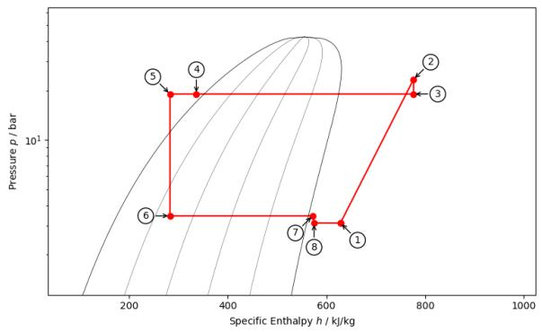

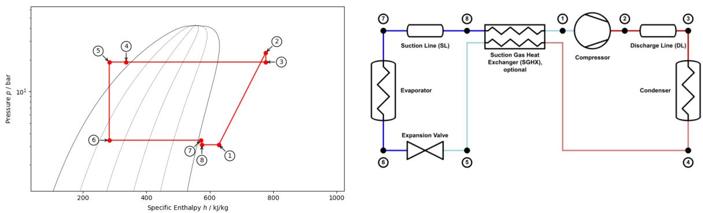

Overview of calculations:
<table><tr><td rowspan=1 colspan=1>Source/SupplyTemperature (°C)</td><td rowspan=1 colspan=1>35</td><td rowspan=1 colspan=1>55</td><td rowspan=1 colspan=1>65</td><td rowspan=1 colspan=1>75</td></tr><tr><td rowspan=1 colspan=1>-7</td><td rowspan=1 colspan=1>A-7/W35</td><td rowspan=1 colspan=1>A-7/W55</td><td rowspan=1 colspan=1>A-7/W65</td><td rowspan=1 colspan=1>A-7/W75</td></tr><tr><td rowspan=1 colspan=1>0</td><td rowspan=1 colspan=1>B0/W35</td><td rowspan=1 colspan=1>B0/W55</td><td rowspan=1 colspan=1>B0/W65</td><td rowspan=1 colspan=1>B0/W75</td></tr><tr><td rowspan=1 colspan=1>7</td><td rowspan=1 colspan=1>A7/W35</td><td rowspan=1 colspan=1>A7/W55</td><td rowspan=1 colspan=1>A7/W65</td><td rowspan=1 colspan=1>A7/W75</td></tr><tr><td rowspan=1 colspan=1>10</td><td rowspan=1 colspan=1>W10/W35</td><td rowspan=1 colspan=1>W10/W55</td><td rowspan=1 colspan=1>W10/W65</td><td rowspan=1 colspan=1>W10/W75</td></tr><tr><td rowspan=1 colspan=1>20</td><td rowspan=1 colspan=1>W20/W35</td><td rowspan=1 colspan=1>W20/W55</td><td rowspan=1 colspan=1>W20/W65</td><td rowspan=1 colspan=1>W20/W75</td></tr></table>

For the sake of completeness, here are the chemical names of the natural refrigerants again:

\- R1270: propene

\- R290: propane

\- R600a: isobutane

\- R717: ammonia

Starting points A-7/W35 to A-7/W75
<table><tr><td rowspan=1 colspan=1>Evaporator</td><td rowspan=1 colspan=1></td><td rowspan=1 colspan=1>CoolTools</td><td rowspan=1 colspan=1></td><td rowspan=1 colspan=1>Condensor</td><td rowspan=1 colspan=1></td><td rowspan=1 colspan=1></td><td rowspan=1 colspan=1></td><td rowspan=1 colspan=1></td><td rowspan=1 colspan=1>CoolTools</td></tr><tr><td rowspan=1 colspan=1>prim-out [°C]</td><td rowspan=1 colspan=1>-12</td><td rowspan=1 colspan=1>(State 7)</td><td rowspan=1 colspan=1></td><td rowspan=1 colspan=1>prim-out [°C]</td><td rowspan=1 colspan=1>35</td><td rowspan=1 colspan=1>55</td><td rowspan=1 colspan=1>65</td><td rowspan=1 colspan=1>75</td><td rowspan=1 colspan=1>(State 4)</td></tr><tr><td rowspan=1 colspan=1>T-Evap [°C]</td><td rowspan=1 colspan=1>-16</td><td rowspan=1 colspan=1>(State 6)</td><td rowspan=1 colspan=1></td><td rowspan=1 colspan=1>T-Cond [°C]</td><td rowspan=1 colspan=1>37</td><td rowspan=1 colspan=1>57</td><td rowspan=1 colspan=1>67</td><td rowspan=1 colspan=1>77</td><td rowspan=1 colspan=1></td></tr><tr><td rowspan=1 colspan=1>sec-in [°C]</td><td rowspan=1 colspan=1>-7</td><td rowspan=1 colspan=1></td><td rowspan=1 colspan=1></td><td rowspan=1 colspan=1>sec-in [°C]</td><td rowspan=1 colspan=1>30</td><td rowspan=1 colspan=1>47</td><td rowspan=1 colspan=1>55</td><td rowspan=1 colspan=1>65</td><td rowspan=1 colspan=1></td></tr><tr><td rowspan=1 colspan=1>sec-uit [C]</td><td rowspan=1 colspan=1>-11</td><td rowspan=1 colspan=1></td><td rowspan=1 colspan=1></td><td rowspan=1 colspan=1>sec-uit [°C]</td><td rowspan=1 colspan=1>35℃</td><td rowspan=1 colspan=1>55℃</td><td rowspan=1 colspan=1>65℃</td><td rowspan=1 colspan=1>75℃</td><td rowspan=1 colspan=1></td></tr></table>

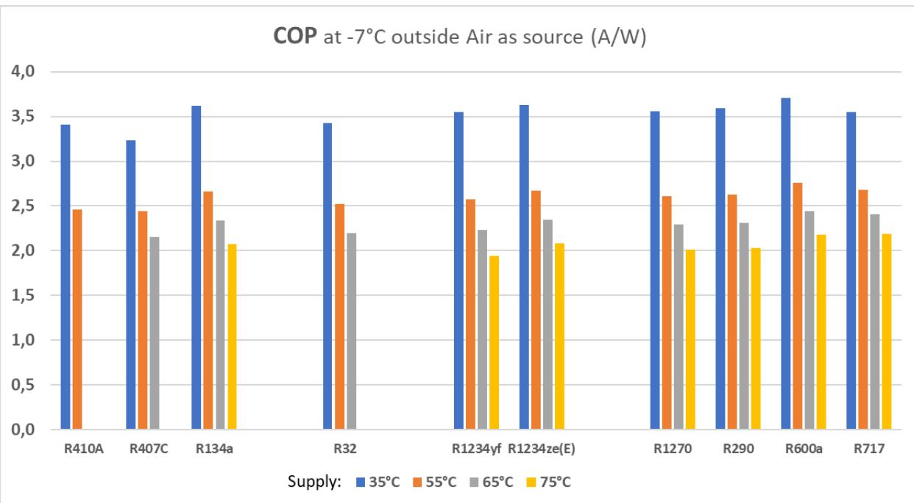  
Figure B12-1: COP per refrigerant with outdoor air of $\scriptscriptstyle - 7 ^ { \circ } \mathsf { C }$ as source

Starting points B0/W35 to B0/W75
<table><tr><td rowspan=1 colspan=1>Evaporator</td><td rowspan=1 colspan=1></td><td rowspan=1 colspan=1>CoolTools</td><td rowspan=1 colspan=1></td><td rowspan=1 colspan=1>Condensor</td><td rowspan=1 colspan=1></td><td rowspan=1 colspan=1></td><td rowspan=1 colspan=1></td><td rowspan=1 colspan=1></td><td rowspan=1 colspan=1>CoolTools</td></tr><tr><td rowspan=1 colspan=1>prim-out [°C]</td><td rowspan=1 colspan=1>-1(</td><td rowspan=1 colspan=1>State 7)</td><td rowspan=1 colspan=1></td><td rowspan=1 colspan=1>prim-out [°C]</td><td rowspan=1 colspan=1>35</td><td rowspan=1 colspan=1>55</td><td rowspan=1 colspan=1>65</td><td rowspan=1 colspan=1>75</td><td rowspan=1 colspan=1>(State 4)</td></tr><tr><td rowspan=1 colspan=1>T-Evap [°C]</td><td rowspan=1 colspan=1>-5</td><td rowspan=1 colspan=1>(State 6)</td><td rowspan=1 colspan=1></td><td rowspan=1 colspan=1>T-Cond [°C]</td><td rowspan=1 colspan=1>37</td><td rowspan=1 colspan=1>57</td><td rowspan=1 colspan=1>67</td><td rowspan=1 colspan=1>77</td><td rowspan=1 colspan=1></td></tr><tr><td rowspan=1 colspan=1>sec-in [°C]</td><td rowspan=1 colspan=1>0</td><td rowspan=1 colspan=1></td><td rowspan=1 colspan=1></td><td rowspan=1 colspan=1>sec-in [°C]</td><td rowspan=1 colspan=1>30</td><td rowspan=1 colspan=1>47</td><td rowspan=1 colspan=1>55</td><td rowspan=1 colspan=1>65</td><td rowspan=1 colspan=1></td></tr><tr><td rowspan=1 colspan=1>sec-uit [°C]</td><td rowspan=1 colspan=1>-3</td><td rowspan=1 colspan=1></td><td rowspan=1 colspan=1></td><td rowspan=1 colspan=1>sec-uit [°C]</td><td rowspan=1 colspan=1>35℃</td><td rowspan=1 colspan=1>55℃</td><td rowspan=1 colspan=1>65℃</td><td rowspan=1 colspan=1>75℃</td><td rowspan=1 colspan=1></td></tr></table>

  
Figure B12-2: COP per refrigerant with closed-loop ground source system (Brine) of $0 \%$ as source

Starting points A7/W35 to A7/W75
<table><tr><td rowspan=1 colspan=1>Evaporator</td><td rowspan=1 colspan=1></td><td rowspan=1 colspan=1>CoolTools</td><td rowspan=1 colspan=1></td><td rowspan=1 colspan=1>Condensor</td><td rowspan=1 colspan=1></td><td rowspan=1 colspan=1></td><td rowspan=1 colspan=1></td><td rowspan=1 colspan=1></td><td rowspan=1 colspan=1>CoolTools</td></tr><tr><td rowspan=1 colspan=1>prim-out [°C]</td><td rowspan=1 colspan=1>2(</td><td rowspan=1 colspan=1>State 7)</td><td rowspan=1 colspan=1></td><td rowspan=1 colspan=1>prim-out [°C]</td><td rowspan=1 colspan=1>35</td><td rowspan=1 colspan=1>55</td><td rowspan=1 colspan=1>65</td><td rowspan=1 colspan=1>75</td><td rowspan=1 colspan=1>(State 4)</td></tr><tr><td rowspan=1 colspan=1>T-Evap [°C]</td><td rowspan=1 colspan=1>-2</td><td rowspan=1 colspan=1>(State 6)</td><td rowspan=1 colspan=1></td><td rowspan=1 colspan=1>T-Cond [°C]</td><td rowspan=1 colspan=1>37</td><td rowspan=1 colspan=1>57</td><td rowspan=1 colspan=1>67</td><td rowspan=1 colspan=1>77</td><td rowspan=1 colspan=1></td></tr><tr><td rowspan=1 colspan=1>sec-in [°C]</td><td rowspan=1 colspan=1>7</td><td rowspan=1 colspan=1></td><td rowspan=1 colspan=1></td><td rowspan=1 colspan=1>sec-in [°C]</td><td rowspan=1 colspan=1>30</td><td rowspan=1 colspan=1>47</td><td rowspan=1 colspan=1>55</td><td rowspan=1 colspan=1>65</td><td rowspan=1 colspan=1></td></tr><tr><td rowspan=1 colspan=1>sec-uit [°C]</td><td rowspan=1 colspan=1>3</td><td rowspan=1 colspan=1></td><td rowspan=1 colspan=1></td><td rowspan=1 colspan=1>sec-uit [°C]</td><td rowspan=1 colspan=1>35</td><td rowspan=1 colspan=1>55</td><td rowspan=1 colspan=1>65</td><td rowspan=1 colspan=1>75</td><td rowspan=1 colspan=1></td></tr></table>

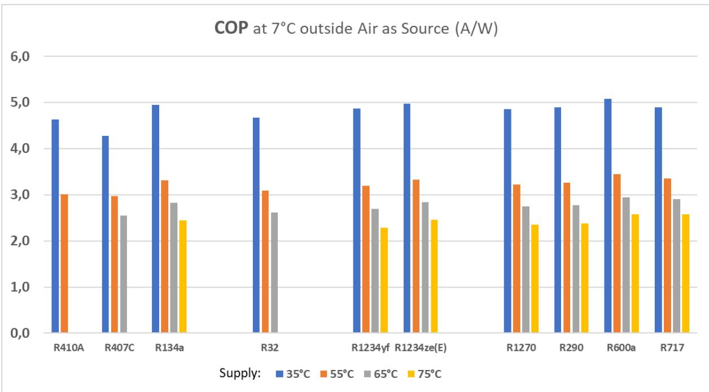  
Figure B12-3: COP per refrigerant with outdoor air of $7 \%$ as source

Starting points W10/W35 to W10/W75
<table><tr><td rowspan=1 colspan=1>Evaporator</td><td rowspan=1 colspan=1></td><td rowspan=1 colspan=1>CoolTools</td><td rowspan=1 colspan=1></td><td rowspan=1 colspan=1>Condensor</td><td rowspan=1 colspan=1></td><td rowspan=1 colspan=1></td><td rowspan=1 colspan=1></td><td rowspan=1 colspan=1></td><td rowspan=1 colspan=1>CoolTools</td></tr><tr><td rowspan=1 colspan=1>prim-out [°C]</td><td rowspan=1 colspan=1>6(</td><td rowspan=1 colspan=1>State 7)</td><td rowspan=1 colspan=1></td><td rowspan=1 colspan=1>prim-out [°C]</td><td rowspan=1 colspan=1>35</td><td rowspan=1 colspan=1>55</td><td rowspan=1 colspan=1>65</td><td rowspan=1 colspan=1>75</td><td rowspan=1 colspan=1>(State 4)</td></tr><tr><td rowspan=1 colspan=1>T-Evap [°C]</td><td rowspan=1 colspan=1>2</td><td rowspan=1 colspan=1>(State 6)</td><td rowspan=1 colspan=1></td><td rowspan=1 colspan=1>T-Cond [°C]</td><td rowspan=1 colspan=1>37</td><td rowspan=1 colspan=1>57</td><td rowspan=1 colspan=1>67</td><td rowspan=1 colspan=1>77</td><td rowspan=1 colspan=1></td></tr><tr><td rowspan=1 colspan=1>sec-in [°C]</td><td rowspan=1 colspan=1>10</td><td rowspan=1 colspan=1></td><td rowspan=1 colspan=1></td><td rowspan=1 colspan=1>sec-in [°C]</td><td rowspan=1 colspan=1>30</td><td rowspan=1 colspan=1>47</td><td rowspan=1 colspan=1>55</td><td rowspan=1 colspan=1>65</td><td rowspan=1 colspan=1></td></tr><tr><td rowspan=1 colspan=1>sec-uit [°C]</td><td rowspan=1 colspan=1>4</td><td rowspan=1 colspan=1></td><td rowspan=1 colspan=1></td><td rowspan=1 colspan=1>sec-uit [°C]</td><td rowspan=1 colspan=1>35</td><td rowspan=1 colspan=1>55</td><td rowspan=1 colspan=1>65</td><td rowspan=1 colspan=1>75</td><td rowspan=1 colspan=1></td></tr></table>

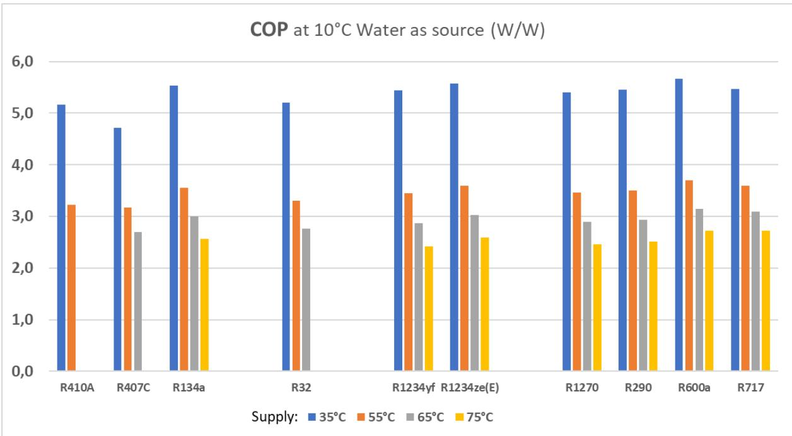  
Figure B12-4: COP per refrigerant with open-loop geothermal system (Water) of $1 0 ^ { \circ } \mathsf { C }$ as source

Starting points W20/W35 to W20/W75
<table><tr><td rowspan=1 colspan=1>Evaporator</td><td rowspan=1 colspan=1></td><td rowspan=1 colspan=1>CoolTools</td><td rowspan=1 colspan=1></td><td rowspan=1 colspan=1>Condensor</td><td rowspan=1 colspan=1></td><td rowspan=1 colspan=1></td><td rowspan=1 colspan=1></td><td rowspan=1 colspan=1></td><td rowspan=1 colspan=1>CoolTools</td></tr><tr><td rowspan=1 colspan=1>prim-out [°C]</td><td rowspan=1 colspan=1>16(</td><td rowspan=1 colspan=1>State 7)</td><td rowspan=1 colspan=1></td><td rowspan=1 colspan=1>prim-out [°C]</td><td rowspan=1 colspan=1>35</td><td rowspan=1 colspan=1>55</td><td rowspan=1 colspan=1>65</td><td rowspan=1 colspan=1>75</td><td rowspan=1 colspan=1>(State 4)</td></tr><tr><td rowspan=1 colspan=1>T-Evap [°C]</td><td rowspan=1 colspan=1>12</td><td rowspan=1 colspan=1>(State 6)</td><td rowspan=1 colspan=1></td><td rowspan=1 colspan=1>T-Cond [°C]</td><td rowspan=1 colspan=1>37</td><td rowspan=1 colspan=1>57</td><td rowspan=1 colspan=1>67</td><td rowspan=1 colspan=1>77</td><td rowspan=1 colspan=1></td></tr><tr><td rowspan=1 colspan=1>sec-in [°C]</td><td rowspan=1 colspan=1>20</td><td rowspan=1 colspan=1></td><td rowspan=1 colspan=1></td><td rowspan=1 colspan=1>sec-in [°C]</td><td rowspan=1 colspan=1>30</td><td rowspan=1 colspan=1>47</td><td rowspan=1 colspan=1>55</td><td rowspan=1 colspan=1>65</td><td rowspan=1 colspan=1></td></tr><tr><td rowspan=1 colspan=1>sec-uit [°C]</td><td rowspan=1 colspan=1>14</td><td rowspan=1 colspan=1></td><td rowspan=1 colspan=1></td><td rowspan=1 colspan=1>sec-uit [°C]</td><td rowspan=1 colspan=1>35</td><td rowspan=1 colspan=1>55</td><td rowspan=1 colspan=1>65</td><td rowspan=1 colspan=1>75</td><td rowspan=1 colspan=1></td></tr></table>

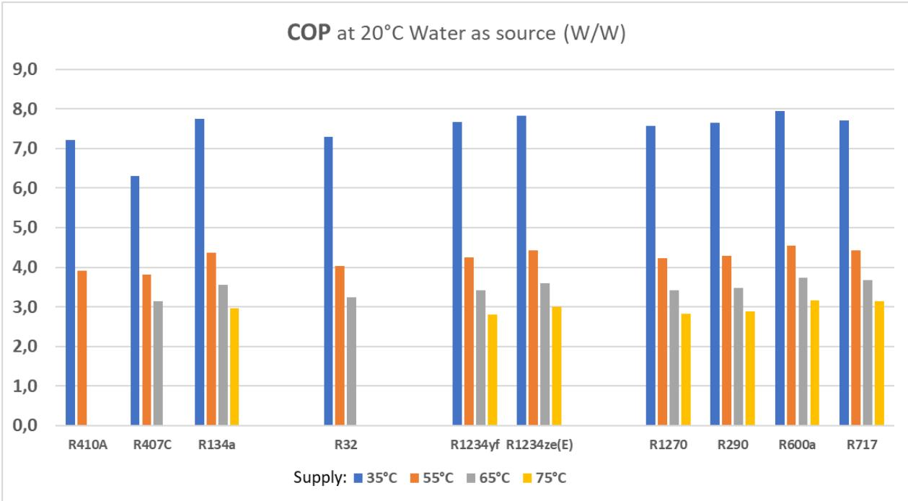  
Figure B12-5: COP per refrigerant with system Water of $2 0 ^ { \circ } \mathsf { C }$ as source