# Progress Towards the Development of a Long-Lived Venus Lander Duplex System

Rodger W. Dyson and Geoffrey A. Bruder Glenn Research Center, Cleveland, Ohio

Since its founding, NASA has been dedicated to the advancement of aeronautics and space science. The NASA Scientific and Technical Information (STI) program plays a key part in helping NASA maintain this important role.

The NASA STI Program operates under the auspices of the Agency Chief Information Officer. It collects, organizes, provides for archiving, and disseminates NASA's STI. The NASA STI program provides access to the NASA Aeronautics and Space Database and its public interface, the NASA Technical Reports Server, thus providing one of the largest collections of aeronautical and space science STI in the world. Results are published in both non-NASA channels and by NASA in the NASA STI Report Series, which includes the following report types:

TECHNICAL PUBLICATION. Reports of completed research or a major significant phase of research that present the results of NASA programs and include extensive data or theoretical analysis. Includes compilations of significant scientific and technical data and information deemed to be of continuing reference value. NASA counterpart of peer-reviewed formal professional papers but has less stringent limitations on manuscript length and extent of graphic presentations.

TECHNICAL MEMORANDUM. Scientific and technical findings that are preliminary or of specialized interest, e.g., quick release reports, working papers, and bibliographies that contain minimal annotation. Does not contain extensive analysis.

CONTRACTOR REPORT. Scientific and technical findings by NASA-sponsored contractors and grantees.

• CONFERENCE PUBLICATION. Collected papers from scientific and technical conferences, symposia, seminars, or other meetings sponsored or cosponsored by NASA.

SPECIAL PUBLICATION. Scientific. technical, or historical information from NASA programs, projects, and missions, often concerned with subjects having substantial public interest.

TECHNICAL TRANSLATION. Englishlanguage translations of foreign scientific and technical material pertinent to NASA's mission.

Specialized services also include creating custom thesauri, building customized databases, organizing and publishing research results.

For more information about the NASA STI program, see the following:

• Access the NASA STI program home page at http://www.sti.nasa.gov

• E-mail your question via the Internet to help@ sti.nasa.gov

• Fax your question to the NASA STI Help Desk at 443-757-5803

Telephone the NASA STI Help Desk at 443-757-5802

Write to:   
NASA Center for AeroSpace Information (CASI)   
7115 Standard Drive   
Hanover, MD 21076–1320

# Progress Towards the Development of a Long-Lived Venus Lander Duplex System

Rodger W. Dyson and Geoffrey A. Bruder Glenn Research Center, Cleveland, Ohio

Prepared for the   
8th International Energy Conversion Engineering Conference (IECEC) sponsored by the American Institute of Aeronautics and Astronautics Nashville, Tennessee, July 25–28, 2010

National Aeronautics and Space Administration

Glenn Research Center Cleveland, Ohio 44135

## Acknowledgments

This work was supported by the NASA Science Mission Directorate, Radioisotope Power System Project Office Technology Development Project. The Advanced Stirling Duplex Team is fortunately comprised of the leading experts in their specific discipline areas. The authors would like to humbly thank the team for their energy and creativity.

This report is a formal draft or working paper, intended to solicit comments and ideas from a technical peer group.

Trade names and trademarks are used in this report for identification only. Their usage does not constitute an official endorsement, either expressed or implied, by the National Aeronautics and Space Administration.

Level of Review: This material has been technically reviewed by technical management.

Available from

National Technical Information Service 5301 Shawnee Road Alexandria, VA 22312

NASA Center for Aerospace Information 7115 Standard Drive Hanover, MD 21076–1320

# Progress Towards the Development of a Long-Lived Venus Lander Duplex System

Rodger W. Dyson and Geoffrey A. Bruder National Aeronautics and Space Administration Glenn Research Center Cleveland, Ohio 44135

## Abstract

NASA has begun the development of a combined Stirling cycle power and cooling system (duplex) to enable the long-lived surface exploration of Venus and other harsh environments in the solar system. The duplex system will operate from the heat provided by decaying radioisotope plutonium-238 or its substitute. Since the surface of Venus has a thick, hot, and corrosive atmosphere, it is a challenging proposition to maintain sensitive lander electronics under survivable conditions. This development effort requires the integration of: a radioisotope or fission heat source; heat pipes; high-temperature, corrosionresistant material; multistage cooling; a novel free-displacer Stirling convertor for the lander; and a minimal vibration thermoacoustic Stirling convertor for the seismometer. The first year effort includes conceptual system design and control studies, materials development, and prototype hardware testing. A summary of these findings and test results is presented in this report.

## Nomenclature

ASD Advanced Stirling Duplex

ASRG Advanced Stirling Radioisotope Generator

FSP Fission Surface Power

REP Radioisotope Electric Propulsion

RPS Radioisotope Power System

TRL Technology Readiness Level

DAQ Data Acquisition

PLC Programmable Logic Controller

VEXAG Venus Exploration Analysis Group

TASHEThermoacoustic Stirling Heat Engine

## Introduction

Radioisotope power systems (RPSs) have been used for decades in space to enable scientific missions to the farthest reaches of our solar system except in the most extreme high-temperature environments such as occur on the surface of Venus, Jupiter, Mercury, Io, or near the Sun. Of those extreme environments, Venus is in many ways the most challenging to operate within due to the high-temperature, high-pressure, and corrosive atmosphere. All of the currently proposed Venus missions have a very limited technology base to enable even short duration (5 to 10 hr) surface exploration the power and cooling requirements are particularly challenging. Fortunately, Glenn's Advanced Stirling Duplex, which is being supported by the RPS Program Office's Technology Development Project, can provide both the electrical power and cooling protection required for long-term exploration (>1 year), while reducing the overall development costs of the spacecraft (Refs. 9, 10, 11, 12, 13, and 14).

## Stirling Triad of Enabled Missions Overview

Stirling systems have been selected as the power conversion technology for the Advanced Stirling Radioisotope Generator (ASRG), Fission Surface Power (FSP), and the Advanced Stirling Duplex (ASD) project because of their high efficiency. These three technology development efforts will enable longduration missions to any location in the solar system. Often non-nuclear power technologies such as solar and chemical are preferred whenever solar radiation is available or the mission is of short duration. But in many cases, space exploration requires radioisotope- or fission-based power systems.

## ASRG

ASRG and its lower and higher power cousins provide modest power levels (100's W to about 1 kW) in difficult environments such as the outer planets and Moon. For example, ASRG enables outer planet exploration and it also enables a long-lived international lunar network. A higher power convertor based on the same basic technology is also being considered. The ASRG is designed to operate for 17 years to support outer planet science missions.

## FSP

FSP provides high power levels (1 to 100's kW) in difficult environments such as the Moon, Mars, and outer planets for human outposts or large flagship missions. It utilizes the heat from a fission reactor to provide very high power levels. It is intended to operate for at least 8 to 10 years and is the only viable power option for high power levels (Refs. 8 and 9).

## ASD

ASD (Figs. 1 and 2) enables exploration in areas no other power technology can provide due to excessively high temperatures. ASRG and FSP systems cannot operate in hot environments $( > 3 0 0 ~ ^ { \circ } \mathrm { C } )$ since they do not provide cooling and their organic and magnetic components would fail. Nearly all other power technologies cannot survive either in the extreme environments that exist on Venus, Mercury, Jupiter, and Io. One exception is high-temperature batteries, which can operate at high temperatures for a limited time. However, any long-lived mission in an extreme environment would benefit from ASD technology to provide not only a long-lived power supply, but to refrigerate other sensitive components such as electronics, sensors, and motors.

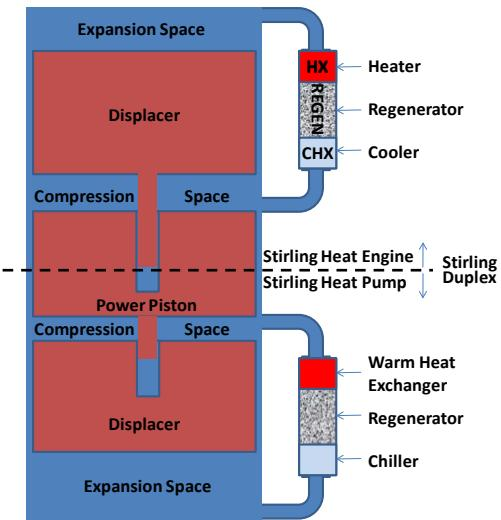  
Figure 1.—Duplex block diagram.

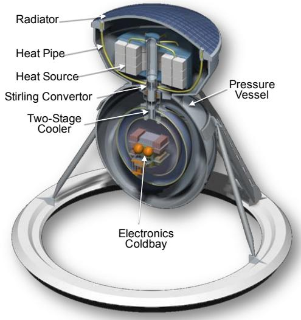  
Figure 2.—ASD.

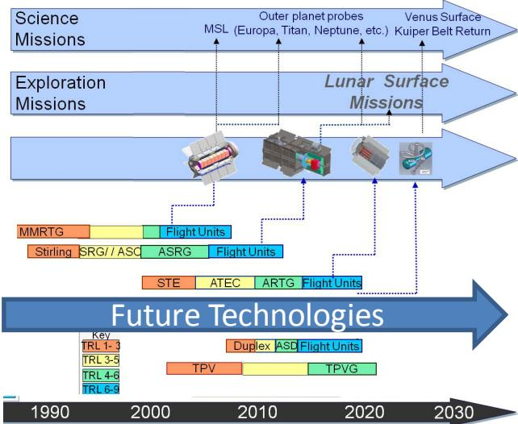  
Figure 3.—RPS technology roadmap.

## RPS Technology Roadmap

As shown in Figure 3, the development path is defined by the technology readiness level (TRL). The current plan envisions the use of ASRG for outer planet missions over the next decade. FSP is anticipated for mission use starting in the next decade. Notice ASD is intended to be demonstrated in the 2016 timeframe to TRL 6 and would be flight qualified by 2020.

## Advanced Stirling Duplex Team

The ASD Team comprises NASA, industry, and academia. The stakeholders include the mission planning organizations, project office, technology development organizations, and research management The team makeup is designed to quickly develop and test a working duplex prototype. Multiple parallel efforts are underway to develop both power and cooling technologies that can operate at high temperature on the surface of Venus. The supporting technologies being developed by this team include a freedisplacer Stirling power convertor, a thermoacoustic power convertor, a multistage Stirling cooler, control system, thermophotovoltaic power convertor, variable conductance heat pipe, extreme high-temperature materials, full-scale extreme environment test chamber, and spacecraft-cooling-related integration technologies such as insulation, radiator, and heat collection systems. The mission planning centers, which include Jet Propulsion Laboratory, Goddard, and Applied Physics Laboratory have provided challenging requirements that must be met for this technology to be useful under a variety of Venus mission scenarios. Several space grant consortium projects from Arizona, North Carolina, and Maryland have also contributed to the lander design. The National Research Council's planetary science subcommittee and decadal survey have also highly ranked missions to Venus. The Venus Exploration Advisory Group has proposed specific missions requiring the ASD.

Clearly, many organizations have a stake in the successful development of this duplex system, and a team consisting of discpline leaders have been formed to expeditiously demonstrate this new enabling technology.

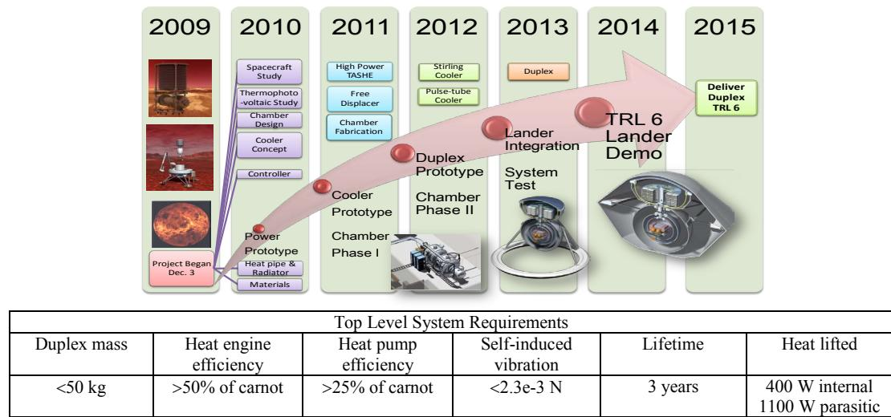

<table><tr><td rowspan=1 colspan=6>Top Level System Requirements</td></tr><tr><td rowspan=1 colspan=1>Duplex mass</td><td rowspan=1 colspan=1>Heat engineefficiency</td><td rowspan=1 colspan=1>Heat pumpefficiency</td><td rowspan=1 colspan=1>Self-inducedvibration</td><td rowspan=1 colspan=1>Lifetime</td><td rowspan=1 colspan=1>Heat lifted</td></tr><tr><td rowspan=1 colspan=1>&lt;50 kg</td><td rowspan=1 colspan=1>&gt;50% of carnot</td><td rowspan=1 colspan=1>&gt;25% of carnot</td><td rowspan=1 colspan=1>&lt;2.3e-3 N</td><td rowspan=1 colspan=1>3 years</td><td rowspan=1 colspan=1>400 W internal1100 W parasitic</td></tr></table>

Figure 4.—Schedule, requirements, and milestones.

## Development Schedule, Requirements, and Milestones

As shown in Figure 4, the technology development project is expected to have a 5-year development period. The test chamber and power convertors are being developed initially, followed by coolers that are then integrated into a duplex and eventually integrated into a mock lander and aeroshell for a complete system demonstration.

## Venus Exploration Approach

While Venus has been explored in the past, the ability for extensive scientific return has had to wait until new technologies such as the Advanced Stirling Duplex could be developed to answer some key questions including the following: “Was there ever an ocean on Venus?"; “Why does Venus not have a magnetic field?"; and “Did Venus ever have plate tectonics?". Perhaps more significant is the runaway greenhouse gas effect causing the planet to overheat. Some of the lessons learned about Venus may apply to Earth as well. Venus is not considered to be habitable due to the high-pressure, high-temperature, and corrosive atmosphere, however, as Landis (Ref. 15) has suggested, floating cities in the mild climate above the sulfuric acid clouds are a possibility.

The approach for returning to Venus has been the development of multiple mission scenarios by independent teams in which new technology is assumed to be available. A Venus mission was already recommended in the last decadal survey and more recently, a Discovery mission announcement opportunity has Venus ranked in the top three. Some technology development has begun for these proposed missions including the ASD, high-temperature electronics, and balloon bellows for Venus Mobile Explorer. These technologies are required to provide power, cooling, communications, and mobility over extended durations.

Since current technology only permits very short-lived missions, it is critical that ASD be demonstrated soon so these missions can be properly baselined to include long-lived in-situ surface elements.

## Past and Proposed Missions

Numerous missions to the Venus surface have been attempted. The longest surviving was the Soviet Venera 13. It lasted for 127 min and was cooled with a phase change material and utilized batteries for power.

Several mission scenarios have been proposed for exploring the surface of Venus including the use of rovers, landers, and buoyant vehicles. In addition, long-lived weather stations and seismometers on the surface have been proposed. One of the most significant studies was recently completed by the Venus Science and Technology Definition Team in which a flagship mission was proposed for launch in the 2025 timeframe. In that mission, two landers, two balloons, and an orbiter were proposed. Since a Venus capable Stirling duplex has not been demonstrated, the baseline mission assumed the landers would only survive for 5 hr. In a separate mission study (Ref. 16), the Venus Mobile Explorer is proposed in a decadal white paper in which a bellows system inflates and deflates to enable hopping across the planet. In this system, the ability to actively cool the lander enables extensive time on the surface.

In all of those studies in which only passive cooling is used, the near surface vehicle must exercise all of its instruments in a concerted dash to complete its science mission. This requires a much higher peak power load than if only some of the instruments are operating at a time. Since the Stirling duplex will enable at least a year's worth of operations, the electrical power requirement is likely to be considerably less than the baselined missions currently require (Ref. 15).

## Venus Environment

Venus is perhaps the most challenging exploration target in the solar system. Some of the environmental parameters are shown in Figure 5. In addition to the hot surface and high pressure, the environment contains potentially very corrosive and reactive species. On the surface the atmosphere is mostly supercritical carbon dioxide and nitrogen, but it also contains trace amounts of sulfur dioxide. argon, water, carbon monoxide, helium, neon, hydrogen chloride, and hydrogen fluoride. Hydrogen sulfide and sulfuric acid are found above the surface. The dense atmosphere also limits the planetary entry angle permitted and limits the solar radiation reaching the surface. The surface of the planet is basalt and rocky. It is thought the thick atmosphere is due to extreme volcanic activity. The lack of old craters on the surface suggests a sublimation occurs every million years or so.

The challenging Venus environment requires new technology development beyond ASD to fully explore the surface including high temperature electronics, sensors, motors, and materials. These new technologies must be demonstrated in a simulated Venus environment for flight qualification. Since Venus is in many ways the harshest environment in the solar system, any technology developed to survive there can likely be used in other challenging locations in which high temperature limits mission life such as Mercury, Jupiter, Io, and near the Sun. Fortunately, radiation exposure is minimized on Venus due to the thick atmosphere.

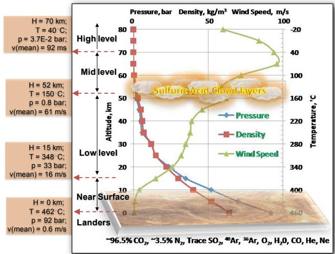  
Figure 5.—Venus environment.

## Extreme Environment Test Chamber

All eight of the currently proposed missions to Venus would benefit significantly from active cooling. But key to demonstrating component and system performance is testing in a suitable Venus environment. While a few organizations have very small testing chambers suitable for low TRL test tube and coupon testing, the international community is in need of a larger facility,

The capability for testing and validation of technology systems in extreme environments such as on the surface of Venus, Jupiter, Mercury, and on Jupiter's moon, Io, does not currently exist. Several mission studies have concluded the need for developing surface exploration technologies such as Stirling duplex for power and cooling, high temperature sensors, electronics, motors, telecom, and sample acquisition systems for operating in those extreme environments. This section provides a brief description of a proposed test chamber that would enable the development and flight qualification of these critical technologies.

## Background

Due to the challenging Venus environment, mission planners have a very limited technology base from which to choose to achieve near planetary surface scientific goals. An ASD has been identified as a key technology development priority since it will provide both the electrical power and cooling necessary to enable long-lived surface missions. But key to demonstrating component and system performance is testing in a suitable Venus environment.

## Proposed Facility

Since the initial need is for materials characterization and power system performance testing in a Venus environment, a small 3- by 5-ft chamber is being fabricated such as shown in Figure 6. A larger chamber would subsequently be added to this smaller chamber to allow complete system testing. The modular nature of this design also allows for simultaneous tests from several organizations and the addition of much larger chambers if required by the Agency.

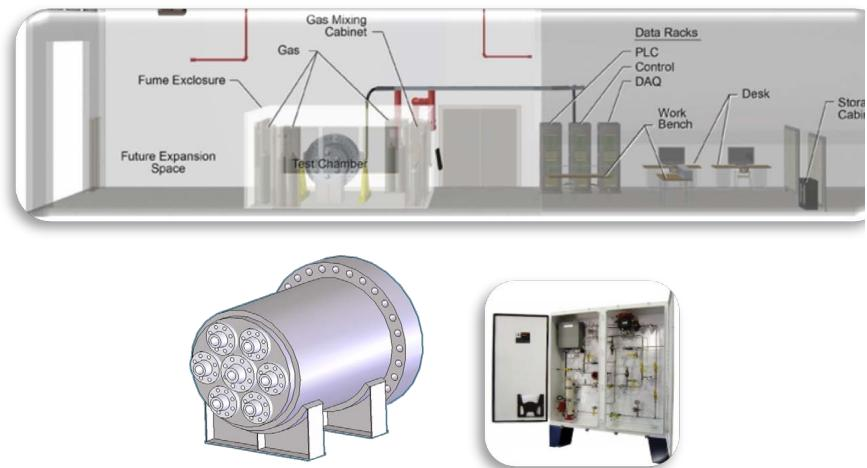  
Figure 6.—Extreme environment chamber.

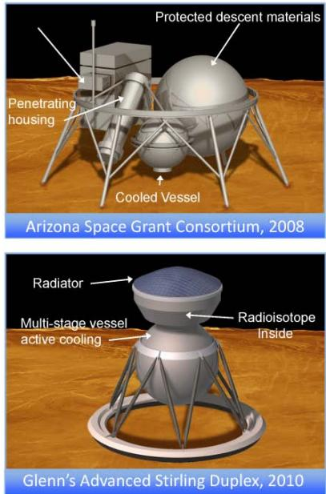

## Features

As shown in Figure 6, the test chamber facility will include test article controls, DAQ, and PLC racks for test chamber control, optical port holes, removable liner, rolling door access, and overhead crane access. Notice the chamber consists of several sections to allow for modular construction that is consistent with budget and testing requirements.

## Mission Phases

The test chamber will be capable of supporting both a vacuum and high pressure to simulate the entire mission sequence including launch, cruise, entry, descent, and surface operations. The chamber will support both on surface testing and higher atmospheric operations. The pressure, temperature, wind speed, and atmospheric composition can be varied within the chamber. The wind speed is below 1 m/s at the surface, but significantly impacts radiator sizing, seismometer, weather, and lander stability considerations.

## Lander Concepts

Shown in Figure 7 are four proposed lander concepts (Refs. 2, 3, 10, and 11) that could be tested in the extreme environment chamber. Originally, the VISM Team proposed a lander in which the seismometer was attached to an actively cooled pressure vessel in 1993. Next, the Arizona Space Grant Consortium recommended a hybrid dual chamber approach in which only some of the instruments were cooled. The NASA Science Technology Definition Team develop a passively cooled lander concept in 2009. Most recently, the ASD Team developed an actively cooled lander concept similar to the original VISM concept, but without a seismometer attached. The pressure vessel size is approximately 3 ft in diameter and the landers are typically less than 500 lb. The test chamber is intended to initially test only the power, cooling, and materials components in the 3- by 5-ft chamber. Note that it is necessary to include the entire lander in the Stirling duplex test because the exact parasitic heat load into the vessel is not known at this time. Moreover, the multistage cooling requires separately cooled and insulated compartments to be successfully tested (Ref. 16).

Also, since Venus has approximately the same gravity as Earth, the test chamber can very realistically simulate all known physics occurring on the Venus surface.

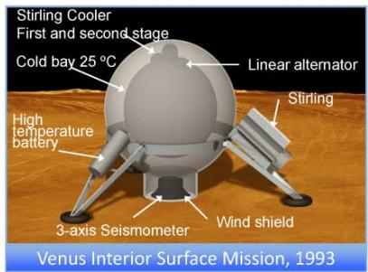

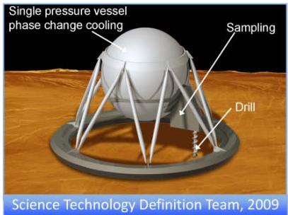  
Figure 7.—Lander concepts.

TABLE 1.—POWER OPTIONS
<table><tr><td>Approach</td><td>Efficiency, %  $\begin{array} { r } { \frac { T _ { h o t } } { T _ { c o l d } } = \frac { 1 1 2 3 K } { 7 7 3 K } } \end{array}$ </td></tr><tr><td>Free-Piston Stirling</td><td>17</td></tr><tr><td>Free-Displacer Stirling</td><td>15</td></tr><tr><td>Thermoacoustic Stirling</td><td>13</td></tr><tr><td>Brayton/Rankine</td><td>11</td></tr><tr><td>Thermoelectric (Segmented)</td><td>3-4</td></tr><tr><td>Solar Array</td><td>&lt; 1</td></tr><tr><td>Beamed Power</td><td>&lt; 1</td></tr><tr><td>Thermionic</td><td>&lt; 1</td></tr><tr><td>Battery</td><td>=</td></tr></table>

TABLE 2.—COOLING OPTIONS
<table><tr><td>Approach</td><td>Efficiency % of Carnot</td></tr><tr><td>Free-Piston Stirling</td><td>28</td></tr><tr><td>Free-Displacer Stirling</td><td>24</td></tr><tr><td>Thermoacoustic/Pulse Tube</td><td>20</td></tr><tr><td>Brayton/Rankine</td><td>18</td></tr><tr><td>Thermionic</td><td>15</td></tr><tr><td>Thermoelectric (Segmented)</td><td>1</td></tr><tr><td>Mixed Refrigerant</td><td></td></tr><tr><td>Phase Change</td><td></td></tr></table>

## Advanced Stirling Duplex

The high temperatures on Venus require a high-efficiency power and cooling system because the high heat rejection temperatures create a small temperature ratio for power conversion. Since the refrigerated temperatures are approximately 30 °C, and the environment is approximately 460 °C, most power technologies cannot operate efficiently enough to be useful.

## Power and Cooling Trade-Space

Shown in Tables 1 and 2 are a comparison of power conversion options and cooler options. Notice all the Stirling cycle power and cooling systems have a higher overall efficiency. One of the properties of Stirling convertors is their ability to maintain high efficiencies even when the temperature ratio gets small. Another important consideration is in how to integrate the power and cooling systems into a single duplex. For example, a Stirling cycle has an oscillating working fluid whereas a Brayton cycle has rotating turbomachinery. Attempting to join an oscillation with a rotation can limit the overall system efficiency because pneumatic connections between the two systems are not possible. Instead, either an electrical or mechanical connection must be utilized that each create additional losses, respectively.

## Effect of Hot-End Temperature

Notice in the figure on the right a comparison is made of three power convertors based on the Stirling cycle: free-piston, free-displacer, and thermoacoustic. It is currently believed that free-piston is the most efficient power conversion option available, followed by free-displacer, and then by thermoacoustic. However, as the dashed line shows, if the free-piston convertor cannot be operated with a temperature hotter than 950 °C due to having moving parts in the hot-end (Ref. 17) and if both the free-displacer and thermoacoustic designs can be operated at much higher temperatures since they have no moving parts at the hot-end, then the dashed line in Figure 8 shows the free-displacer will eventually out-perform the freepiston at 1025 °C and the thermoacoustic outperforms the free-piston at $1 1 3 0 ^ { \circ } \mathrm { C }$ For these reasons, these alternative technologies are being developed under this project with a goal of $1 2 0 0 ^ { \circ } \mathrm { C }$ at the hot-end.

It should also be noted that thermophotovoltaic technology is not shown as a power system since it cannot operate at Venus temperatures unless refrigerated. It is potentially possible to combine a thermoacoustic duplex with a thermophotovoltaic system to provide cooling and power with no moving parts.

## Life-Limiting Mechanisms

The Stirling cycle devices have been improved over the past decades to the point they are extremely efficient and reliable. Some potential life-limiting mechanisms might include wear, fatigue, creep, permeation, and radiation. Fortunately, as shown in Figure 9, some of these mechanisms have been mitigated since noncontacting operation is now possible using either flexures or gas bearings.

Relative Heat Input vs. Head Temperature  
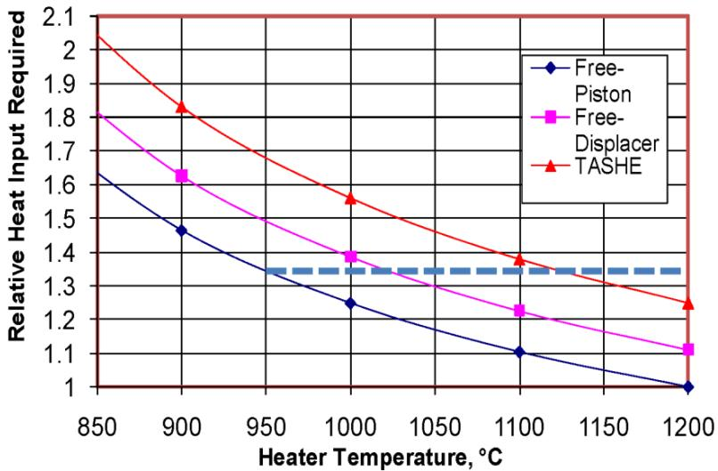  
Figure 8.—Efficiency comparison.

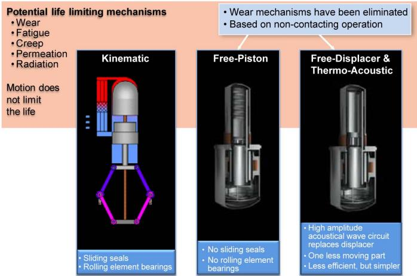  
Figure 9.—Life limiting mechanisms.

Notice that the free-piston configuration does not have a mechanical connection between the displacer and the piston. The relative motion of these elements is determined by physical resonance conditions and the non-contact operation is achieved with gas bearings. This configuration is currently the world's most efficient heat engine achieving 55 percent of Carnot efficiency.

In the last example shown in the figure, a free-displacer convertor is depicted in which the displacer is shortened and power is taken off of the displacer. In that case, the efficiency of the engine decreases due to the increased dead volume. A related technology is the thermoacoustic convertor in which the displacer is entirely removed and replaced by an acoustical circuit.

One of the design issues is the working fluid. Often helium is used, but in the case of the Stirling duplex, there appear to be advantages to utilizing alternative working fluids such as hydrogen or carbon dioxide. One of the challenges of using alternative fluids is they tend to permeate through the walls or can damage magnets. If a suitable material is identified for fluid containment then modest improvement in system efficiencies (\~1 percentage point) (Ref. 18) are possible for the heat engine and cooler.

Another design issue is the thickness of the heater head. Ideally, the walls would be thin to reduce thermal losses from the hot-end to the cold-end. Thin walls can lead to excessive material creep, especially at the high temperatures. This creep can cause the oscillating flow to bypass the regenerator.

One possible approach to minimizing this effect is to use the Venus atmosphere as the working fluid (Ref. 18). In this way, the inside of the duplex would always be directly connected to its environment. Hence, the pressure forces would always be in static equilibrium and creep effects are minimized.

Fatigue can occur on the moving parts, especially those on the hot-end of the convertor due to the repeated oscillating pressure forces acting on them. While more research is required to quantify the exact limitations, this project is investigating every option. Also, parts such as springs or flexures have to be carefully designed for millions of oscillations over the entire operating life. Finally, radiation is potentially a concern, particularly for magnets and organics. Preliminary tests indicated minimal impact at expected exposure limitations. Also, one of the benefits of the thick Venus atmosphere is minimal radiation actually reaches the surface (Ref. 6).

## Principle of Operation

The Stirling duplex can be designed with a variety of power and cooling configurations (Ref. 1). Each of those power and cooling technologies can be joined into a duplex using either a pneumatic, electrical, or mechanical connection. The least desirable is the mechanical mode due to the need for gear lubrication and the associated frictional losses. The electrical mode requires converting the mechanical motion into electrical and then back into mechanical. Each of those conversion steps results in overall energy losses due to the imperfect efficiency of linear alternators and compressors. The most desirable is the pneumatic mode because the acoustical energy is directly used for cooling without the gear friction or alternator conversion losses.

## Cooling System Staging

One of the keys for developing a successful Venus lander cooling system is to take advantage of the thermodynamic efficiency of a multistage cooler.

## Single-Stage Cooler

In a single-stage cooler, the heat is removed from the payload bay in a single step. Most previous Venus lander studies assumed a single-stage cooler would be utilized and this resulted in very inefficient designs. As shown in Figure 10, all the electronics are contained within a single pressure vessel. This is the same basic pressure vessel structure used for all previous Venus landers (Refs. 3, 5, and 7).

Notice that the cooler has to reject the heat produced by the electronics in the payload and the heat that enters from outside the pressure vessel due to the hot Venus environment. Shown in this figure is the original design from 1993 in which a double acting Stirling engine with 8 GPHS was assumed.

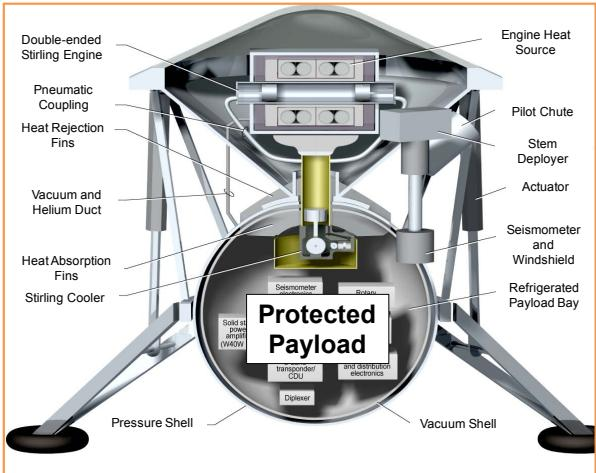  
Figure 10.—Single-stage cooling system.

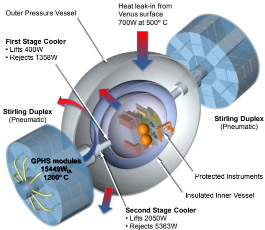  
Figure 11.—Two-stage cooler integration.

The cooler has a piston that was activated from the helium pressure wave and the piston then acted through a gear system to power the cooler. The heat absorption fins were used to collect the heat so the cooler could pump it out. The heat rejection fins would reject the cold-end waste heat from the Stirling convertor. Notice this duplex had a pneumatic coupling but connected to a kinematic cooler. This original design was overly optimistic in the heat engine and cooler efficiencies assumed, the electrical payload requirements were understated, and uneven cooling in the payload was never addressed.

## Two-Stage Cooler

The two-stage cooler configuration shown in Figure 11 is a much more recently designed configuration (Ref. 2). Notice the number of GPHS modules ranges from 8 up to 40 depending on the power and cooling required. Now the overall efficiency of the duplex is higher because of the significant thermodynamic advantage that occurs by intercepting the heat coming from the Venus environment at a higher temperature. The heat collection and rejection is also enhanced via modern variable conductance heat pipes. This allows the payload bay to be evenly cooled (Ref. 4).

## Prototype Convertors

A number of prototype heat engine convertors have been developed in the past under different projects that demonstrate high hot-end operating temperatures are currently possible.

## High-Temperature Stirling

A Component Test Power Convertor (CTPC) was developed under the SP-100 program to operate at 777 °C while producing 12 kWe and operating with a mean pressure of 15 MPa. Since the Venus environment is approximately 460 °C, it is possible to use this engine on Venus if the cold-end were protected with refrigeration as in a duplex configuration. Moreover, the high operating pressure actually exceeds the Venus atmospheric pressure. This was demonstrated nearly 20 years ago.

More recently, the Advanced Stirling Convertor was demonstrated to operate at 850 °C while achieving 55 percent of Carnot efficiency with over 2000 hr of continuous operation. It is anticipated that this convertor would operate with 17 percent efficiency on the surface of Venus if the cold-end were protected in a duplex configuration. While not demonstrated yet, it is thought by leading designers the highest temperature possible with ASC technology is $9 5 0 ~ ^ { \circ } \mathrm { C }$ due to cyclic fatigue on the moving hot-end parts (Ref. 17).

Most recently, several attempts at eliminating moving parts in the hot-end were successful by developing small power convertors utilizing thermoacoustic technology. While they operated at only around 600 °C on the hot-end, they demonstrated the efficiency that is possible with this approach. In general, they are about 80 percent as efficient as the free-piston-based Stirling cycle commonly used when operated at the same temperatures. However, as mentioned previously, if their hot-end temperature can approach 1200 °C, their overall efficiency may surpass the ASC as shown in Figure 8 if the ASC is limited to 950 °C. Higher power thermoacoustic engines have also been demonstrated as discussed in the next section (Ref. 17).

Clearly, high-temperature and high-pressure Stirling systems have already been demonstrated, and an approach for raising the temperature further has been demonstrated. The cold-end temperatures are less of a concern because they can be cooled in a duplex configuration,

## High-Power Thermoacoustic

A thermoacoustic engine/driver that was initially developed under an Air Force Small Business Innovation Research (SBIR) phase II effort, was successfully tested as shown in Figure 12. This proof-ofconcept prototype operates at the high power levels required for a Venus mission. It is unique in that it was designed to operate as a duplex for the ARES upper stage rocket's cryogenic propellant densification system. It is the second largest thermo-acoustic engine ever constructed and it is designed to be mated with a two-stage cryocooler. Due to funding discontinuation, the engine and cryocooler were never operated and have sat in mothball for over 2 years. The Advanced Stirling Duplex project was able to leverage this previous work to quickly assemble and test this hardware. Since the engine is the first at the higher power levels required for Venus, it is an ideal risk reduction tool to confirm our analytical models so we can confidently design for the Venus environment.

Shown in Figure 12 is the thermoacoustic engine with one of the consultants on the project, Dr. Greg Swift. The engine operates at 30 Hz with 500 psi mean helium pressure. It is designed to accept 12000 W of thermal energy and convert that to 4000 W of acoustical energy. This engine/driver can be connected to linear alternators and pulse tube coolers to provide electrical power and refrigeration.

While this engine is not designed to operate at Venus temperatures, it provides an important proof-ofconcept for understanding the physics of these large engines. Moreover, the already fabricated cryocooler can be quickly added to this engine to form a prototype duplex early in our project to help guide future development efforts.

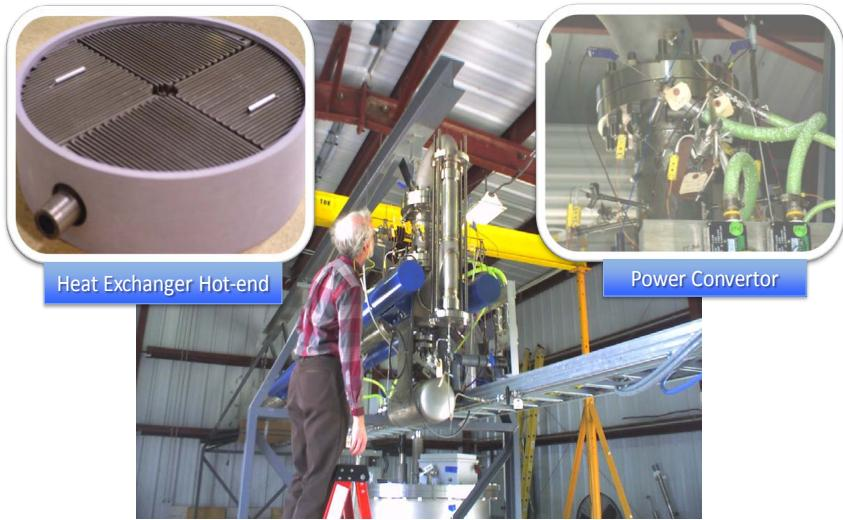  
Figure 12.—High-power thermoacoustic milestone completed.

Also shown in Figure 12 are a large resonator and dummy masses to contain the inertial forces. Note that since this engine was originally designed to provide cryogenic cooling, its operating frequency is 30 Hz. This low frequency induces vibration and requires a large resonator. However, for our Venus application of this technology, the cooler can operate at much higher frequencies since the refrigerated temperatures are much higher. This significantly reduces vibrations and reduces the size of the resonator required. The closeup of the engine shown in Figure 12 shows the electrical heating leads and liquid cooling lines.

One of the critical components of any thermoacoustic engine is the jet pump (Ref. 18). This component prevents Gedeon streaming from occurring within the engine and it is very difficult to analytically predict its behavior. The jet pump on this engine will be resized several times to optimize the performance of the engine. After that, the next step for this early prototype demonstration effort is the addition of a cryocooler to confirm the duplex operation matches analytical predictions. Once all physical behavior can be explained and our analytical predictions are validated, then this duplex can be cost effectively and confidently modified to operate under Venus conditions.

## Technical Challenges

Many technical challenges as shown in Figure 13 remain to be addressed under this current effort. First, a Stirling cycle heat engine must be developed that can operate at a high hot-end temperature with high efficiency, and be compatible with the Venus environmental conditions. Second, a high-efficiency Stirling cycle multistage cooler must be developed that can fit within the lander's pressure vessel and operate at very high efficiency with minimal vibration. Third, the heat engine and multistage cooler must be compatible with each other, share the same working fluid, and maintain an overall high system efficiency. Fourth, the variable conductance heat pipe technology must be developed to efficiently transport heat energy to the heat engine and cold fingers while rejecting heat to radiators that are exposed to the Venus environment. Fifth, the entire system must operate within the pressure vessel of the lander while being mass efficient. Finally, the Stirling duplex, heat pipes, radiator, and insulated pressure vessel, as shown in Figure 2 must be demonstrated to operate within the Venus environment for up to 1 year.

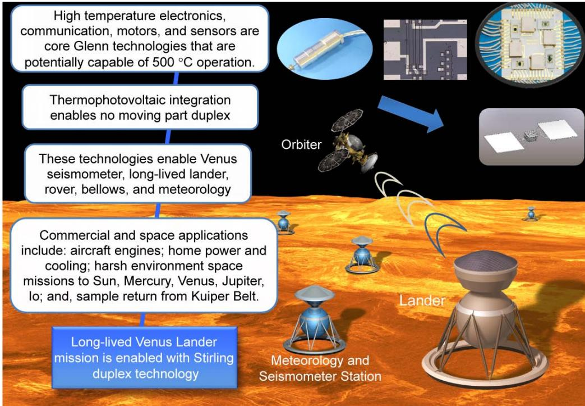  
Figure 13.—Strategic technologies and commercialization.

## Conclusions

Clearly the development of a Stirling duplex is possible and desirable for a host of reasons including: solar system exploration in harsh environments such as Venus and Mercury; commercial opportunities such as efficient home power and cooling; and environmental benefits such as climate change model verification. This technology development project is anticipated to continue for the next several years with a demonstration unit scheduled for completion by 2015. Success of this effort will be when the Stirling duplex can operate at TRL 6 in a Venus-like environmental test chamber for 1 year while maintaining the payload bay of a mock Venus lander within acceptable refrigerated limits.

## References

1. Kadambi, J.R., Sastry, S. “A Thermoacoustic Engine Refrigerator System for Space," Ph.D. Dissertation, Mechanical Engineering Dept., Case Western Reserve Univ., Cleveland, OH, 2010.

2. Dyson, R.W., Schmitz, P.G., Penswick, L.B., Bruder, G.A., “Long-Lived Venus Lander Conceptual Design: How to Keep it Cool," AIAA International Energy Conversion Engineering Conference, AIAA–2009–4631, Denver, CO, 2009, Aug. 2–5.

3. Stofan, E., Nock, K., Dudenhoefer, J., Vitali, N., Schock, A., Neuman, J., "Venus Interior Structure Mission (VISM),"Advanced Stirling Duplex [online database], URL: http://www.grc.nasa.gov/WWW/ASDT/documents/VISM%20Documents.pdf [cited 15 May 1993].

4. Hall, J.L., Bullock, M., Senske, D.A., Cutts, J.A., Grammier, R., "Venus Flagship Mission Study, Final Report of the Venus Science and Technology Definition Team," Jet Propulsion Lab [online database], URL: http://vfm.jpl.nasa.gov/files/Venus+Flagship+Mission+Study+090501- compressed.pdf [cited 17 April 2009].

5. Mellott, K.D., “Electronics and Sensor Cooling With a Stirling Cycle for Venus Surface Mission," AIAA-2004–5610, 2004.

6. Bugby, D., Seghi, S., Kroliczek, E., Pauken, M., "Novel Architecture for a Long-Life, Lightweight Venus Lander," AIP Space, Propulsion & Energy Science International Forum, CP1103, SPESIF-2009, Washington, DC, 2009, pp. 39–50.

7. Wilson, K.B., “The Use of Sage Simulation Software in the Design and Testing of Sunpower's Pulsetube Cryocooler," M.S. Thesis, Mechanical Engineering Dept., Ohio University., Athens, OH, 2005.

8. Arnold, E.D., "Handbook of Shielding Requirements and Radiation Characteristics of Isotopic Power Sources for Terrestrial, Marine, and Space Applications," Oak Ridge National Lab., Rept. ORNL-3576, Oak Ridge, TN, Apr. 1964.

9. Palac, D.T., Mason, L.S., Harlow, S., “"Fission Surface Power Technology Development Status," AIAA-2008–7812, 2008.

10. Coburn, A., Daniel, E., Frazier, M., Grimsley, E., “Venus Lander Concept of Design Report," Embry-Riddle Aeronautical University, December 2008.

1 1. Balint, T., Cutts, J., Bullock M., Garvin, J., Gorevan S., Hall, J., et al., “Technologies for Future Venus Exploration," Venus Exploration Analysis Group (VEXAG) [online database], URL: http://www.lpi.usra.edu/decadal/vexag/techWhitePaper.pdf [cited 9 September 2009].

12. Radioisotope Power Systems Committee, NRC, Radioisotope Power Systems: An Imperative for Maintaining U.S. Leadership in Space Exploration, National Research Council, ISBN-13: 978-0-309- 13857-4, 2009, pp. 68.

13. Rodgers, D., Gilmore, M., Sweetser, T., "Venus Sample Return: A Hot Topic...," IEEE 0-7803-5846- 5/00, 2000.

14. O'Brien, R.C., Ambrosi, R.M., Bannister, N.P., Howe, S.D., Atkinson, H.V., "Safe radioisotope thermoelectric generators and heat sources for space applications,"J. of Nuclear Materials, Vol. 377, 2008, pp. 506–521.

15. Landis G.A., “Human Telerobotic Exploration of Venus: A Flexible Path Design Study," Space Technology and Applications Int. Forum-STAIF 2003, AIP Conference Proc., Jan. 28, 2003-Volume 654, pp. 1193–1198.

16. Glaze, L. et al., “Venus Mobile Explorer (VME): A Mission Concept Study for the National Research Council Planetary Decadal Survey," 7th International Planetary Probe Workshop, 2010.

18. Swift, G., Haberbusch, M., "Thermoacoustic Duplex Technology for Cooling and Powering a Venus Lander," SBIR Phase III, Sierra-Lobo, Inc., 2010.

17. Wood, G., Personal Communication, Sunpower, Inc., 2010.

<table><tr><td rowspan=1 colspan=5>REPORT DOCUMENTATION PAGE</td><td rowspan=1 colspan=1>Form ApprovedOMB No. 0704-0188</td></tr><tr><td rowspan=1 colspan=6>The public reporting burden for this collection of information is estimated to average 1 hour per response, including the time for reviewing instructions, searching existing data sources, gathering and maintaining thedata needed, and completing and reviewing the collection of information. Send comments regarding this burden estimate or any other aspect of this collection of information, including suggestions for reducing thisburden, to Department of Defense, Washington Headquarters Services, Directorate for Information Operations and Reports (0704-0188), 1215 Jefferson Davis Highway, Suite 1204, Arlington, VA 22202-4302.Respondents should be aware that notwithstanding any other provision of law, no person shall be subject to any penalty for failing to comply with a collection of information if it does not display a currently valid OMBcontrol number.PLEASE DO NOT RETURN YOUR FORM TO THE ABOVE ADDRESS.</td></tr><tr><td rowspan=1 colspan=2>1. REPORT DATE (DD-MM-YYYY)01-05-2011</td><td rowspan=1 colspan=3>2. REPORT TYPETechnical Memorandum</td><td rowspan=1 colspan=1>3. DATES COVERED (From - To)</td></tr><tr><td rowspan=3 colspan=5>4. TITLE AND SUBTITLEProgress Towards the Development of a Long-Lived Venus Lander Duplex System</td><td rowspan=1 colspan=1>5a. CONTRACT NUMBER</td></tr><tr><td rowspan=1 colspan=1>5b. GRANT NUMBER</td></tr><tr><td rowspan=1 colspan=1>5c. PROGRAM ELEMENT NUMBER</td></tr><tr><td rowspan=3 colspan=5>6. AUTHOR(S)Dyson, Rodger, W.; Bruder, Geoffrey, A</td><td rowspan=1 colspan=1>5d. PROJECT NUMBER</td></tr><tr><td rowspan=1 colspan=1>5e. TASK NUMBER</td></tr><tr><td rowspan=1 colspan=1>5f. WORK UNIT NUMBERWBS 138494.04.01.03</td></tr><tr><td rowspan=1 colspan=5>7. PERFORMING ORGANIZATION NAME(S) AND ADDRESS(ES)National Aeronautics and Space AdministrationJohn H. Glenn Research Center at Lewis FieldCleveland, Ohio 44135-3191</td><td rowspan=1 colspan=1>8. PERFORMING ORGANIZATIONREPORT NUMBERE-17389-1</td></tr><tr><td rowspan=2 colspan=5>9. SPONSORING/MONITORING AGENCY NAME(S) AND ADDRESS(ES)National Aeronautics and Space AdministrationWashington, DC 20546-0001</td><td rowspan=1 colspan=1>10. SPONSORING/MONITOR&#x27;SACRONYM(S)NASA</td></tr><tr><td rowspan=1 colspan=1>11. SPONSORING/MONITORINGREPORT NUMBERNASA/TM-2011-217018</td></tr><tr><td rowspan=1 colspan=6>12. DISTRIBUTION/AVAILABILITYSTATEMENTUnclassified-UnlimitedSubject Category: 20Available electronically at http://www.sti.nasa.govThis publication is available from the NASA Center for AeroSpace Information, 443-757-5802</td></tr><tr><td rowspan=1 colspan=6>13. SUPPLEMENTARY NOTES</td></tr><tr><td rowspan=1 colspan=6>14. ABSTRACTNASA has begun the development of a combined Stirling cycle power and cooling system (duplex) to enable the long-lived surfaceexploration of Venus and other harsh environments in the solar system. The duplex system will operate from the heat provided by decayingradioisotope plutonium-238 or its substitute. Since the surface of Venus has a thick, hot, and corrosive atmosphere, it is a challengingproposition to maintain sensitive lander electronics under survivable conditions. This development effort requires the integration of: aradioisotope or fission heat source; heat pipes; high-temperature, corrosion-resistant material; multistage cooling; a novel free-displacerStirling convertor for the lander; and a minimal vibration thermoacoustic Stirling convertor for the seismometer. The first year effortincludes conceptual system design and control studies, materials development, and prototype hardware testing. A summary of these findingsand test results is presented in this report.</td></tr><tr><td rowspan=1 colspan=6>15. SUBJECT TERMSStirling duplex spacecraft power cooling</td></tr><tr><td rowspan=1 colspan=3>16. SECURITY CLASSIFICATION OF:</td><td rowspan=2 colspan=1>17. LIMITATION OFABSTRACTUU</td><td rowspan=2 colspan=1>18. NUMBEROFPAGES21</td><td rowspan=1 colspan=1>19a. NAME OF RESPONSIBLE PERSONSTI Help Desk (email:help@sti.nasa.gov)</td></tr><tr><td rowspan=1 colspan=1>a. REPORTU</td><td rowspan=1 colspan=1>b. ABSTRACTU</td><td rowspan=1 colspan=1>C. THISPAGEU</td><td rowspan=1 colspan=1>19b. TELEPHONE NUMBER (include area code)443-757-5802</td></tr></table>

Standard Form 298 (Rev. 8-98) Prescribed by ANSI Std. Z39-18