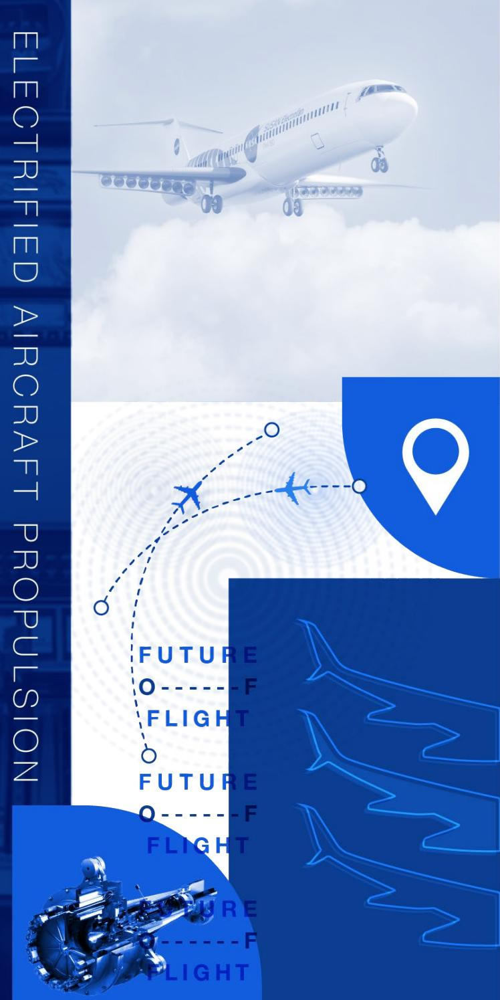

## NASAAERONAUTICSCan it fly?

# Technical Challenge 10.1: Focused Technologies for EAP Demonstrator

AAVP/AATT Technical Seminar   
Andrew Woodworth Ph.D., NASA Glenn Research Center   
March 28th, 2025

## Background: What is electrified aircraft propulsion?

## EAP is the partial or complete electrification of an aircraft's propulsion system

• All electric: stored energy in battery or like device is the only power source and electric motors are the only propulsion

• Hybrid: combination propulsion from a turbine and stored energy (e.g. battery)

• Turbo electric: energy is produced by turbine/fuel/generator and propulsion achieved by electric motors

## Electrified aircraft propulsion (EAP) brings benefit through enabling efficiencies in the turbine and/or aerodynamics

## EAP Systems

• Electric machines

· Motors

• Generators

• Combination of both

## • Power conversion

• Solid state electronics

• Solid electronics

• Inverters (DC to AC)

• Converters (AC to DC)

• DC/DC converters (changes or regulates DC voltages)

• Fault protection (circuit breakers)

• Thermal management

• Propulsion controls

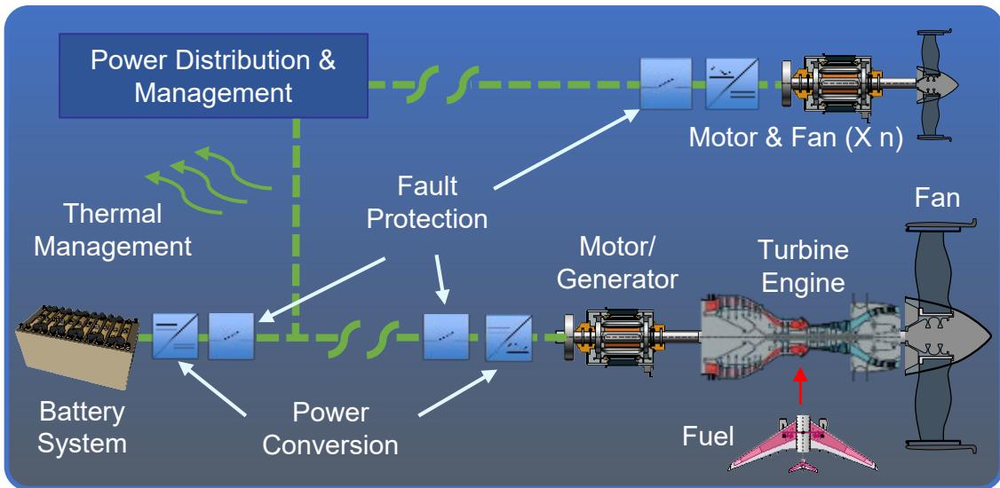  
Notional EAP System

• Matches the sources and sinks of energy in the system to create an operable system that is fault tolerant

Distribution (cables/ busbars/connectors-not addressed in this work)

Batteries and battery management (not addressed in this body of work)

## Background: Why megawatt scale?

• Single Aisle aircraft comprise the largest segment of commercial aircraft

Impacting technology for the transport class requires MW-scale systems

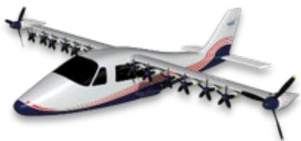

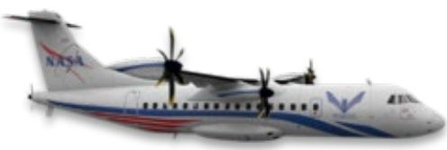

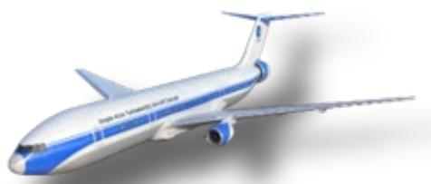

<table><tr><td rowspan=1 colspan=1>Market</td><td rowspan=1 colspan=1>Regional Air Mobility</td><td rowspan=1 colspan=1>Regional Turboprops&amp; Turbofans</td><td rowspan=1 colspan=1>Single Aisle</td></tr><tr><td rowspan=1 colspan=1>Passengers</td><td rowspan=1 colspan=1>1-19</td><td rowspan=1 colspan=1>20-150</td><td rowspan=1 colspan=1>150-more</td></tr><tr><td rowspan=1 colspan=1>Speed</td><td rowspan=1 colspan=1>≈150-250 mph</td><td rowspan=1 colspan=1>≈300-400 mph</td><td rowspan=1 colspan=1>≈500-700 mph</td></tr><tr><td rowspan=1 colspan=1>Range</td><td rowspan=1 colspan=1>≈100-500 miles</td><td rowspan=1 colspan=1>500-1500 miles</td><td rowspan=1 colspan=1>1500-3500 miles</td></tr><tr><td rowspan=1 colspan=1>Power</td><td rowspan=1 colspan=1>≈1MW</td><td rowspan=1 colspan=1>1 to 5 MW</td><td rowspan=1 colspan=1>3 to 30MW</td></tr><tr><td rowspan=1 colspan=1>Heat</td><td rowspan=1 colspan=1>≈200 kW waste heat</td><td rowspan=1 colspan=1>200kw to 1MW waste heat</td><td rowspan=1 colspan=1>600kW to 6MW waste heat</td></tr></table>

# Background: Relationship to AATT Investments

Advanced Air Vehicle Program (AAVP) /Advanced Air Transport Technology Project (AATT)

Are EAP aircraft viable for 2030-35? (est. 2014) Technical Challenge 5.2: Electrified Aircraft Propulsion (EAP) Viability

Viability of EAP is not well known in 2014 and therefore this is to both help determine what if any future investment would be made

Determine what if any interest industry has in EAP

Can it fly? (est. 2019)

Technical Challenge 10.1: Focused Technologies for EAP Demonstrator

Established to confirm that megawatt-scale electric aircraft powertrain technologies can be safely and successfully demonstrated for use in regional and single-aisle electrified aircraft propulsion (EAP) vehicles.

Emerging Technical Challenge (eTC) – Seed for the next technical challenge (est. 2019)

Is superconducting technology ready to contribute? (est. 2024)

Technical Challenge: 10.2: High Power EAP

The next step for EAP development is to push for technologies that extend systems beyond the MW scale

## Background: Are EAP Aircraft Viable for 2030-35?

## Technical Challenge 5.2: Electrified Aircraft Propulsion (EAP) Viability

How TC 5.2 laid the groundwork for TC 10.1

## Technical Challenge 5.2: Metrics

Specific power density (mass) has always been an issue for aircraft

Increasing the specific power density of motors was a critical technological achievement of the Wright brothers

Adding electrical components increases mass and therefore lightweighting is critical

• Terrestrial megawatt systems do not share this issue

Increasing voltages is necessary to increase specific power density

• Power = voltage x current

• Power loss = (current)² x resistance

Increasing voltage decreases electrical current, reducing the size and mass of the conductors while also deceasing loss

Increasing efficiency is critical to decreasing the size and complexity of the thermal management system

• EAP systems require a distributed thermal management system

Thermal systems not only add mass but also drag (application dependent)

## Establishment and meeting of key metrics have helped push the technological edge

Metrics for 1 kVA or greater power electronics
<table><tr><td>Performance Metrics</td><td>Specific Power Efficiency (kW/kg)</td></tr><tr><td>Minimum 12</td><td>(%) 98.0</td></tr><tr><td>Goal</td><td>19 99.0</td></tr><tr><td>Stretch</td><td>25 99.5</td></tr></table>

Metrics MW scale electric machines
<table><tr><td>Performance Metrics</td><td>Specific Power (kW/kg)</td><td>Efficiency (%)</td></tr><tr><td>Goal</td><td>13.2</td><td>96.0</td></tr></table>

## Background: Are EAP Aircraft Viable for 2030-35? (con't)

## How TC 5.2 laid the groundwork for TC 10.1

Are EAP Aircraft Viable for 2030-35? (est. 2014) Technical Challenge 5.2: Electrified Aircraft Propulsion (EAP) Viability

Multiple aircraft design concept studies indicate that hybrid propulsion systems can lead to block fuel savings

NRA-sponsored machines and inverters demonstrated substantial improvements in specific power and efficiency

An EAP-relevant, soft-magnetic alloy class was matured from laboratory demonstration to component application

Simplified, subscale powertrains and full-scale components tests completed in NEAT testbed at sea level (altitude capability added later)

NASA and industry investment in EAP expanded beyond this subproject with considerable momentum

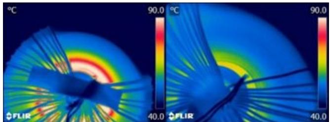  
Thermal image of a magnetic core made of NASA's soft magnetic materials

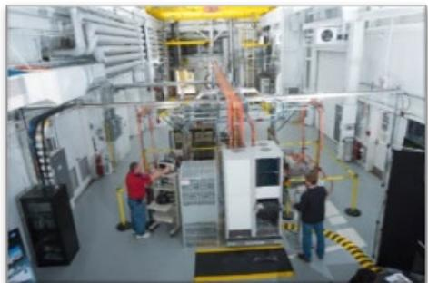  
NASA Electric Aircraft Testbed (NEAT)

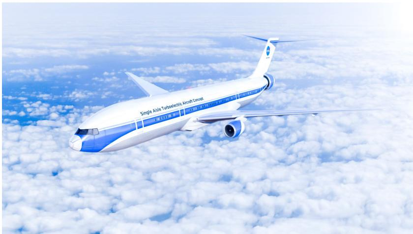  
NASA's STARC-ABL Concept Vehicle

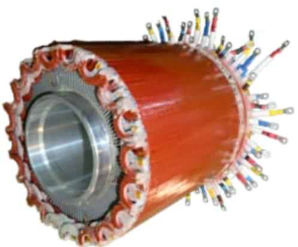  
NRA sponsored electric machine credit Kiruba Haran (UIUC)

## Background: Can it Fly?

## 10.1: Focused Technologies for EAP Demonstrator

Aimed to have a technology readiness sufficient to impact a flight demonstration

State-of-the-art in 2019 was only 250kW, (a long way from 1 MW)

Y Address key tall poles facing adoption EAP systems

Operation at altitude EAP components identified as tall pole

Paschen's law indicates increasing voltages above state-ofthe-art 270V creates safety and operability concerns

Testing of systems was necessary, as well as further development of components to be flight-like

## • Fault Management

• Flight-like DC circuit breaker technology

Propulsion controls: How operability of an EAP system is maintained through fault conditions

Improving power quality through advanced inductor filters

Thermal systems for distributed heat loads needed to be addressed

Paschen's Curve  
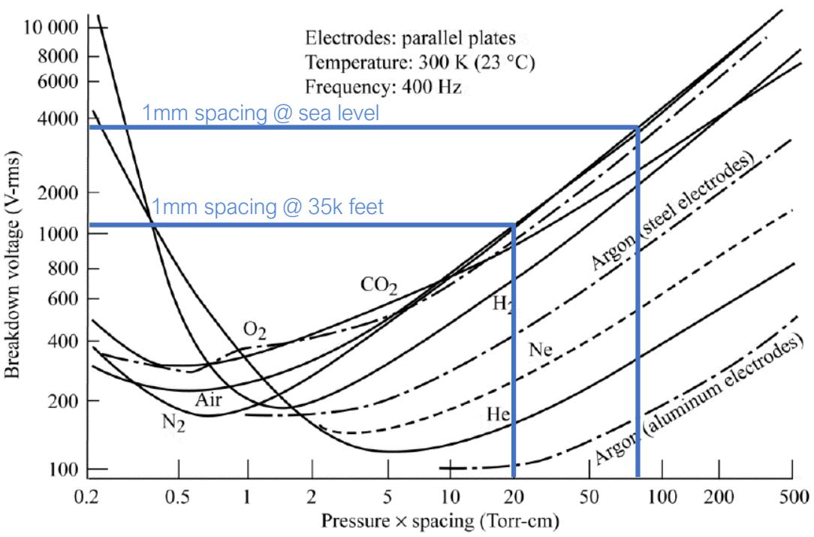  
Source: NASA-HDBK-4007

## Technologies:Testing

## The NASA Electric Aircraft Testbed (NEAT)

Created for AATT to perform R&D on MW-class powertrains:

A Propulsion controls

Power quality and stability

Y System-level effects

V Characterization and evaluation of new technologies such as high-performance machines, inverters, control algorithms, fault and thermal management systems

Altitude chamber (60kft-max) brought online to enable component and systems tests

√ GE MW scale machine and altitude integration tests

√NASA ULI program's MW machine with integrated power electronics

√magniX 650 kW motor and drive

Partnership with ARPA-E to test ASCEND motors (current test program) :

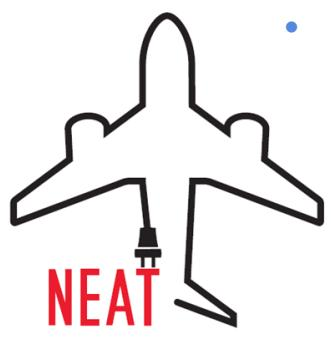

• Wright Electric 2 MW motor

RTRC 250 kW sub-scale version of ultra-high power density MW-class machine NEAT

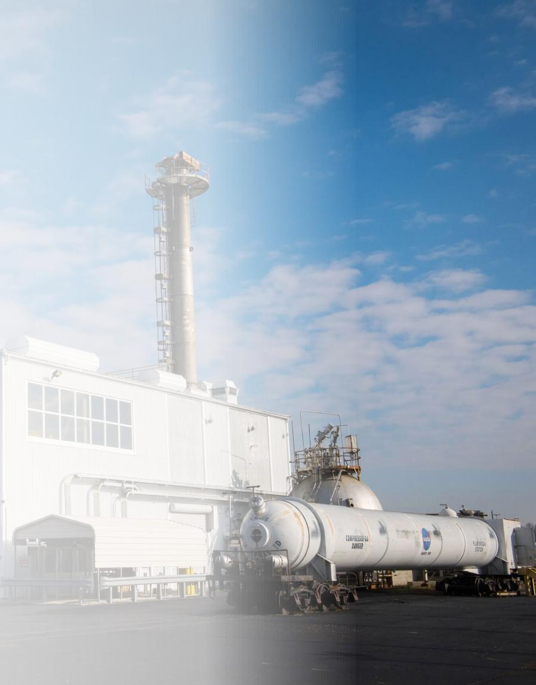

Reducing risk for flight demonstrators and products through ground tests at the NASA Electric Aircraft Testbed

## Technologies: Fault Management

Naval Post Graduate School (NPS), GE, and RTX Solid-State Flight-Weight Breakers

Transport-class electrified airplanes require safety systems that can interrupt a megawatt of DC power in 100 microseconds or less and weight \~10 X less than current state-of-the-art to protect personnel, aircraft, and powertrain components.

GE, RTX and Navy Postgraduate School met or surpassed all the expected goals showing NASA KPPs can be achieved.

<table><tr><td rowspan=1 colspan=1>Metric</td><td rowspan=1 colspan=1>Minimum Goal</td><td rowspan=1 colspan=1>Expected Goal</td><td rowspan=1 colspan=1>Stretch Goal</td></tr><tr><td rowspan=1 colspan=1>Specific Power (kW/kg)</td><td rowspan=1 colspan=1>50</td><td rowspan=1 colspan=1>100</td><td rowspan=1 colspan=1>200</td></tr><tr><td rowspan=1 colspan=1>Voltage (kV)</td><td rowspan=1 colspan=1>0.8</td><td rowspan=1 colspan=1>1</td><td rowspan=1 colspan=1>≥2</td></tr><tr><td rowspan=1 colspan=1>Current (A)</td><td rowspan=1 colspan=1>800</td><td rowspan=1 colspan=1>1000</td><td rowspan=1 colspan=1>&gt;1000</td></tr><tr><td rowspan=1 colspan=1>Response (μs)</td><td rowspan=1 colspan=1>250</td><td rowspan=1 colspan=1>100</td><td rowspan=1 colspan=1>10</td></tr><tr><td rowspan=1 colspan=1>Efficiency (%)</td><td rowspan=1 colspan=1>99.3</td><td rowspan=1 colspan=1>99.5</td><td rowspan=1 colspan=1>99.97</td></tr><tr><td rowspan=1 colspan=1>Altitude Capability (ft)</td><td rowspan=1 colspan=1>25,000</td><td rowspan=1 colspan=1>35,000</td><td rowspan=1 colspan=1>51,000</td></tr></table>

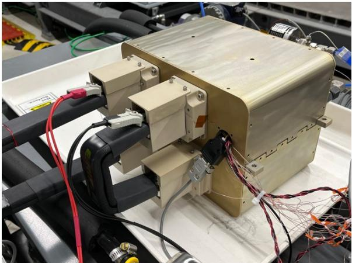  
RTX solid-state breaker credit RTX

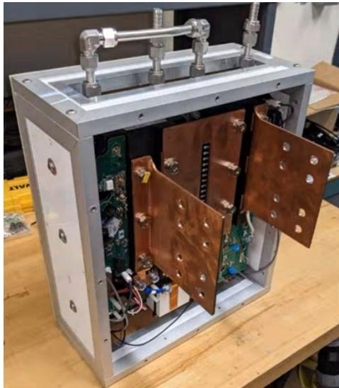  
NPS solid-state breaker credit NPS

## Technologies: Power Electronics

GE SLIM flight-weight inverter competed and tested at NEAT

Goals: power conversion peak efficiency of 99% and power density at of 19kW/kg for active components

Uses high speed GE's ultra-high efficiency and high voltage Silicon Carbide (SiC) power devices

Represents the first step towards a lightweight flight-worthy inverter to enable hybrid-electric aircraft applications

## In-house 250 kW, 1000 V Inverter

Design challenge to develop novel inverter technologies

Compatible with new specific power dense electric machines

Novel design reduces switching losses, filtering requirements

Pressurized housing allows altitude operation

• Addresses thermal challenges

Addressing powertrain stability and power quality

Bus stability analysis for representative powertrains

• Impedance modeling and measurement

Objective is to provide guidance on system stability, power quality, future standards development for MW powertrain

## Power electronics technologies maturing at a fast pace

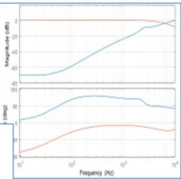

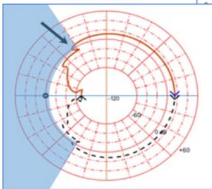  
Power Quality Models

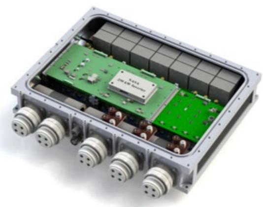  
NASA 250 kW Inverter

## Technologies: Soft Magnetic Induction Filters (Materials)

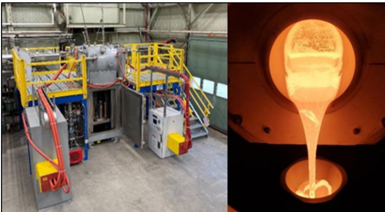  
Vacuum induction furnace

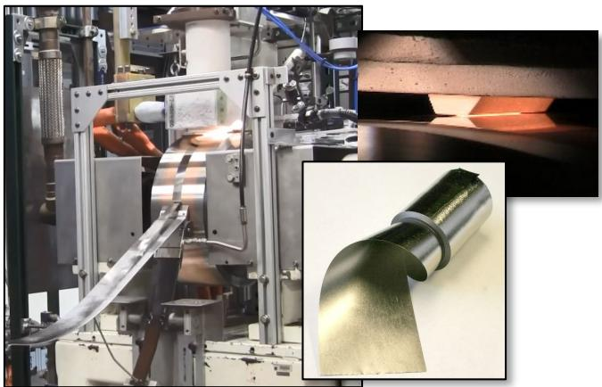  
Planar flow caster and amorphous ribbon  
Common mode chokes integrated into flight rated packaging for X-57

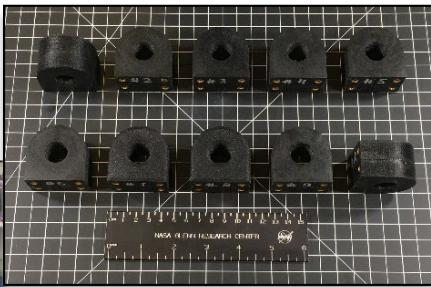

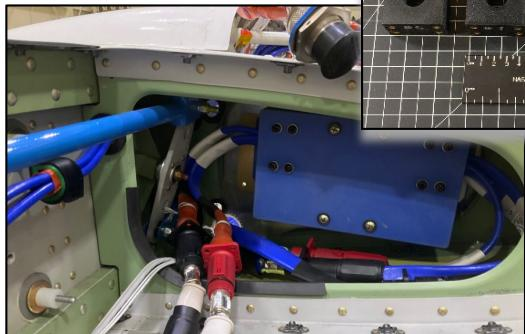  
Filter assembly mounted into wing web

Key accomplishments:

Provided a wide range of prototype cores to industry, academic, and government power electronic designers

Developed new alloys that improve the useful temperature range and enable gapless cores through a wide range of permeability

• Improved modelling and design capability

• 25%-75% reduction in mass/volume over SOA materials in the same application

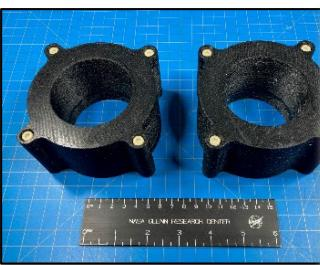

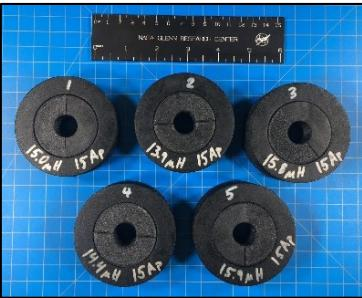

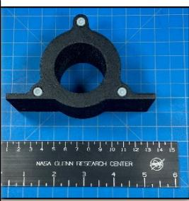  
Various chokes with custom packaging

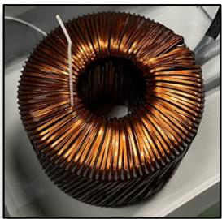  
Graded permeability load inductor

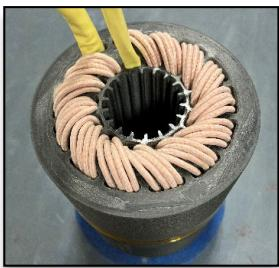  
Dual active bridge: 40% lighter than ferrite

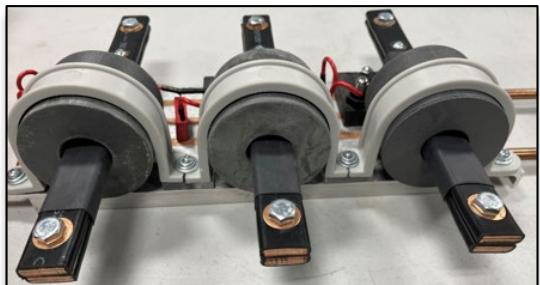  
Measured voltages without filter

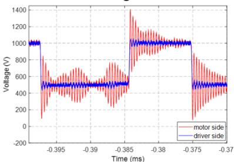

Measured voltages with filter  
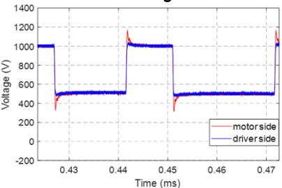  
1000A capable inductors in dV/dt filters with measured performance \~ credit RTX

## Technologies: Electric Machines

UIUC/HINETICS developing 1 MW slot less permanent magnet machine for direct drive

• Tested 300 kW unit at partial power and speed

• Providing projected efficiencies > 97.5% at University of Illinois POETS lab

• Verified full speed for the motor and full stator current loading

## Testing of state-of-the-art machines at NEAT

• 3 tested, 1 in progress, 1 in the queue (more interest has been expressed)

## High Efficiency Megawatt Motor (eTC)

• 1.4 MW, 16 kW/kg and > 98% efficient

## Key Lessons Learned

MW scale specific power dense machines have highly coupled thermal, mechanical and electromagnetic components

• Co-design of power electronics & machine is critical

Low impedance of these machines requires decreasing total harmonic distortion and decreasing noise from power electronics is critical

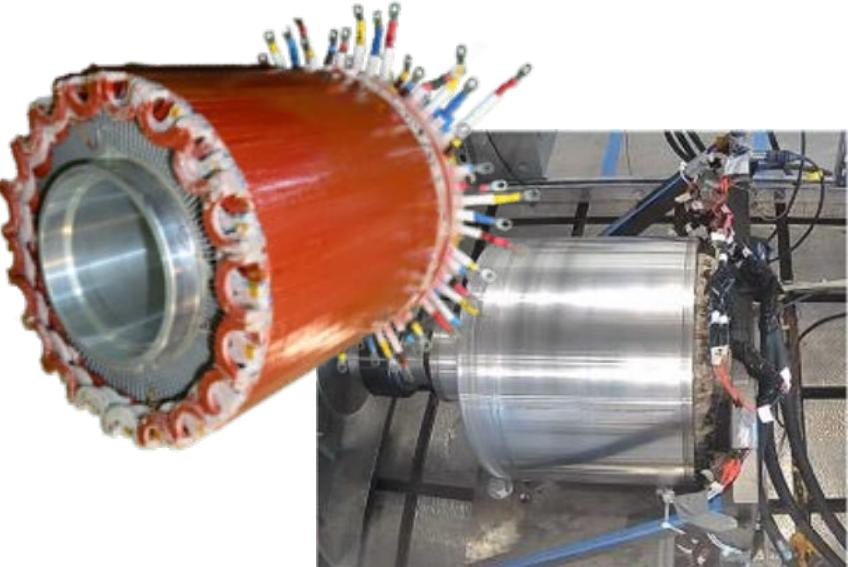  
300kW NRA sponsored electric machine credit Kiruba Haran (UIUC)

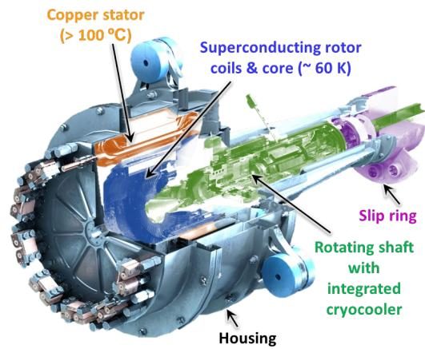  
Heigh Efficiency Megawatt Motor (HEMM)

## Technologies: Thermal Management

Mega watt scale aircraft require 100s of KWs of cooling in a distributed system • Low-grade thermal rejection was limited to <300 kW.

Demonstrates an aircraft-sized solid-state integrated thermal management system.

Demonstrated acoustic waves combined with heat pipes can cool a single-aisle electric aircraft powertrain as shown in Fig. (a)

Solid-state power electronic modules can be effectively integrated and cooled with solidstate acoustic refrigeration shown Figs. (b, c)

Aircraft waste heat can be reused and redirected during flight even under g-loading conditions

Develop five new technologies:

1. Aircraft sized 300K-500K thermosyphon for deicing

2. Aircraft-sized 800K-1000K thermosyphon for combustion

3. Aircraft-sized loop thermosyphon flat plate for modules

4. MW-scale flight-weight, power electronics compatible cold plate (integrated with solid state breaker) with solid-state thermal system (no pumped fluids required for higher reliability)

5. Aircraft-sized acoustic heat pump for no-moving part refrigeration and waste heat exergy amplification

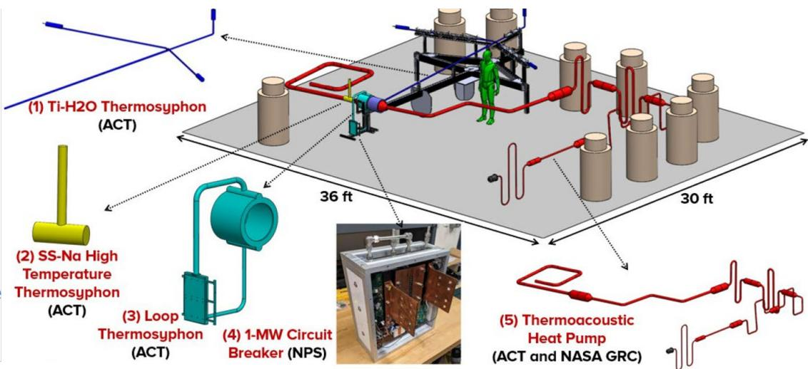

Partners: U. Michigan, JPL, Naval Postgraduate School, Thermavant, and Advanced Cooling Technologies, Inc.

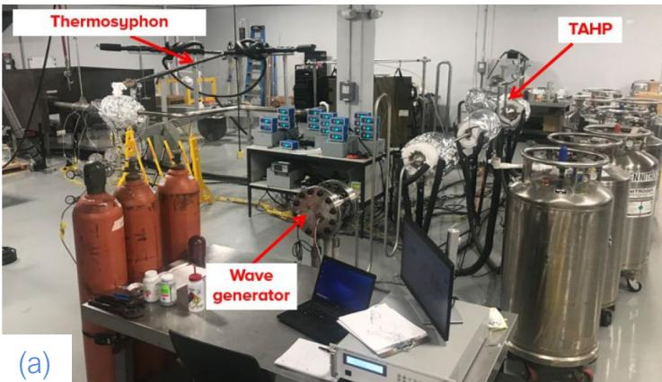

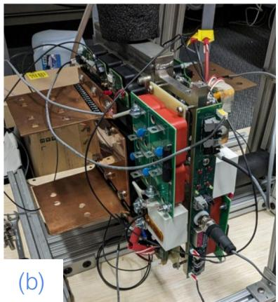

(c)  
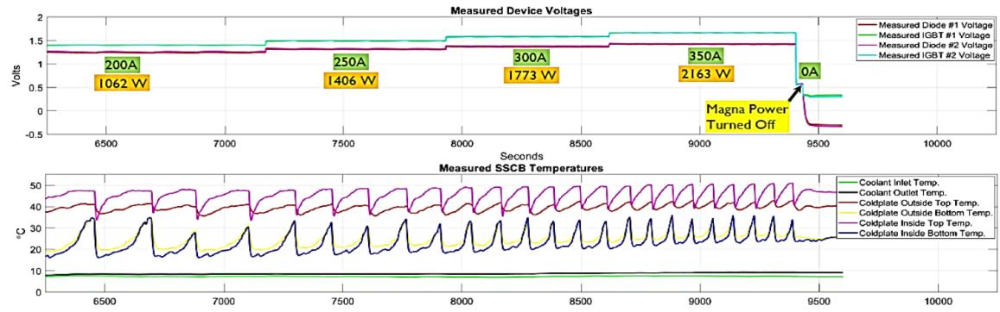

## Technologies: Propulsion Controls

Turbine Electric Energy Management (TEEM): to optimize energy usage of a hybridelectric propulsion system during transient operation. (TACP/TTT developed concept)

• Hardware in the loop real-time demonstration of a controls concept

Real-Time turbofan simulation for Engine shaft speed, torque, and inertia are expressed by a pair of electric motors

Test Results from TEEM Control System Test at NEAT

Demonstrated the ability of TEEM to dynamically alter shaft speed to maintain the designed operating line performance during engine transient operations.

Demonstrated dynamics of full-scale hybrid turbofan model and mechanically coupled EM system using Adaptive Sliding Mode Inertia Controller and Scaling algorithm though hardware-in-the-loop testing

## Single-aisle Turboelectric Aircraft with Aft Boundary Layer Propulsion (STARC-ABL)

Identified multiple failure modes and reversionary control approaches to retain as much performance as possible while maintaining operability

Identified the need for a redundant DC bus in the concept

• Hardware in the loop testing of controls concept

Subscale STARC-ABL power system and turbomachinery shaft loads using NEAT h/ware

• Real-time simulation of control system and turbomachinery dynamics

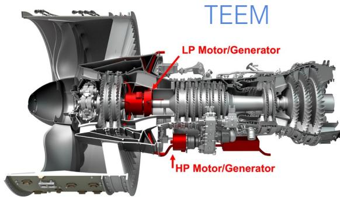

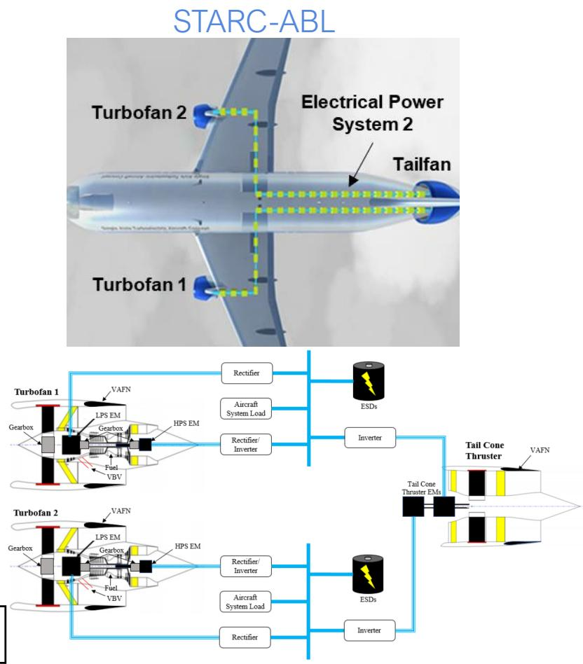

## Relationship to the Electric Powertrain Flight Demonstrator Project

Demonstrators identify gaps in technology, integration, standards and regulation that need to be addressed for commercialization

## The EPFD Project

• Maturing MW class technology

• Maturing integration of EAP with an airframe

• Addressing standards and regulatory gaps

## TC 15.2 and 10.1 Contributions

EPFD adopted metrics that were derived from technology maturation efforts

• NEAT testing of EPFD systems

GE MW scale machine and altitude integration tests

magniX 650 kW motor and drive

Planned flight demonstrations are directly incorporating AATT-sponsored TRL-6 components and TRL-4+ powertrain test results

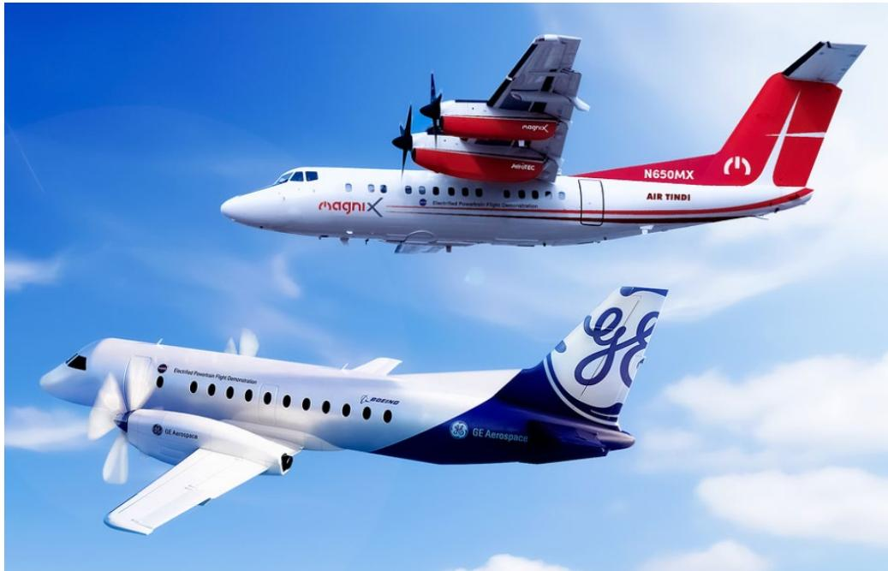  
Electric Propulsion Flight Demonstrators

We have now demonstrated that both our NASA KPPs and flight safety/redundancy requirements can be achieved.

TC 10.1: Focused Technologies for EAP Demonstrator

## Background (con't): Emerging Technical Challenge (eTC)

Development of TC 10.2 Technical Challenge 10.1: Focused Technologies Demonstrated for EAP Demonstrator

Technology not deemed ready to impact a flight demonstration

Electric machine insulation solutions

• Focused on supporting HEMM by evaluating off the shelf material solutions

● Developing new materials that solve thermal issues specific power dense machines face

## High Efficiency Megawatt Motor

• Partially superconducting

• 1.4 MW, >98% efficient, 16 kW/kg (electromagnetic specific power goal)

Superconducting machines

• Previous work identified AC loss (heat generated) in the machine stator was too great

Refocused team on solving AC loss problem

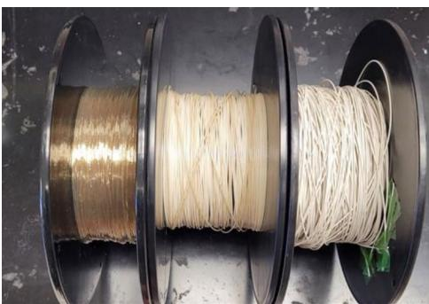  
High Efficiency Megawatt Motor

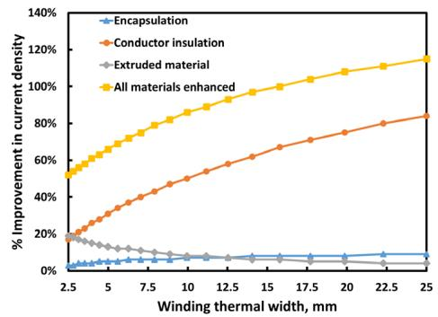  
Electric machine insulation solutions

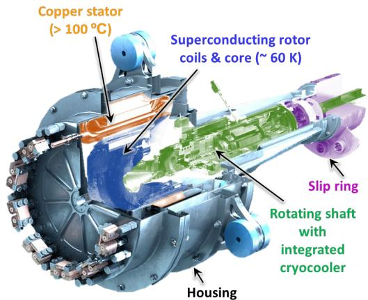

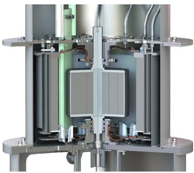  
Superconducting Machines

## eTC Results: Electric Machine Insulation Solutions

Thermal management of power dense megawatt scale electric machines is a significant challenge

• Driven by thermally insulating nature of electrical insulation and potting materials

• Specifically of challenge in the stator comprised of 4 or more different materials

• 30% of loss (heat generated) is in the stator

Develop materials that meet electric and mechanical requirements while increasing the overall all thermal conductivity

Used modeling to both set key performance parameters and show impact on stator performance

Moderate improvements of all the materials has a significant benefit to performance The stator is a composite material

Materials developed in the lab were able to achieve key performance parameters

Evaluated lifetime ageing of developed material

Feed this information back into the development process

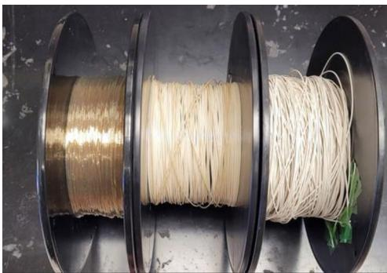

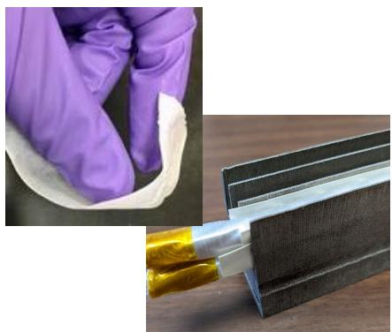

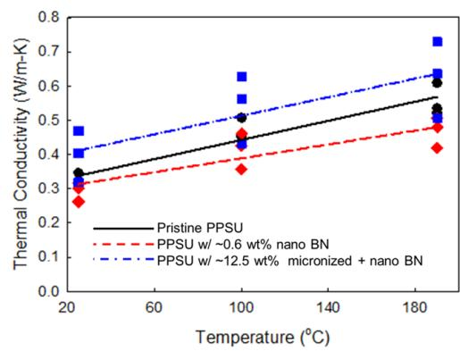  
Significant improvements in electric machine performance through materials development is activable

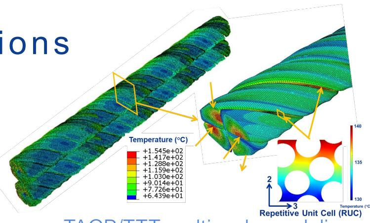  
TACP/TTT multiscale modeling

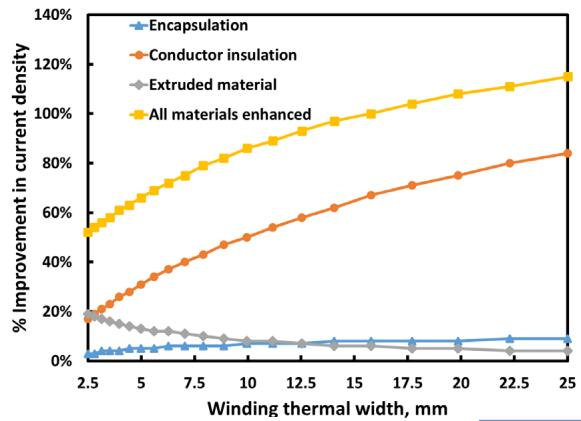

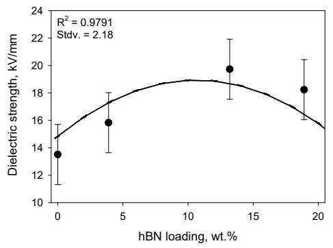

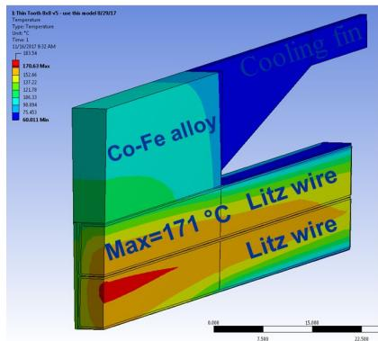

## eTC Results: Electric Machines

Heigh Efficiency Megawatt Motor (eTC)

• 1.4 MW (can be a motor or generator)

• >98% efficient, 16 kW/kg (electromagnetic specific power goal)

• Superconducting Rotor (DC), ambient Cu- Litz wire stator

Completed design of HEMM to near CDR level

## Successes

1st ever demonstration of a practical cryogen-free (conductive) superconducting MW-class rotor

• Derisked cryocooler designed to rotate at high speed

Demonstrated fabrication and direct cooling of full-scale stator

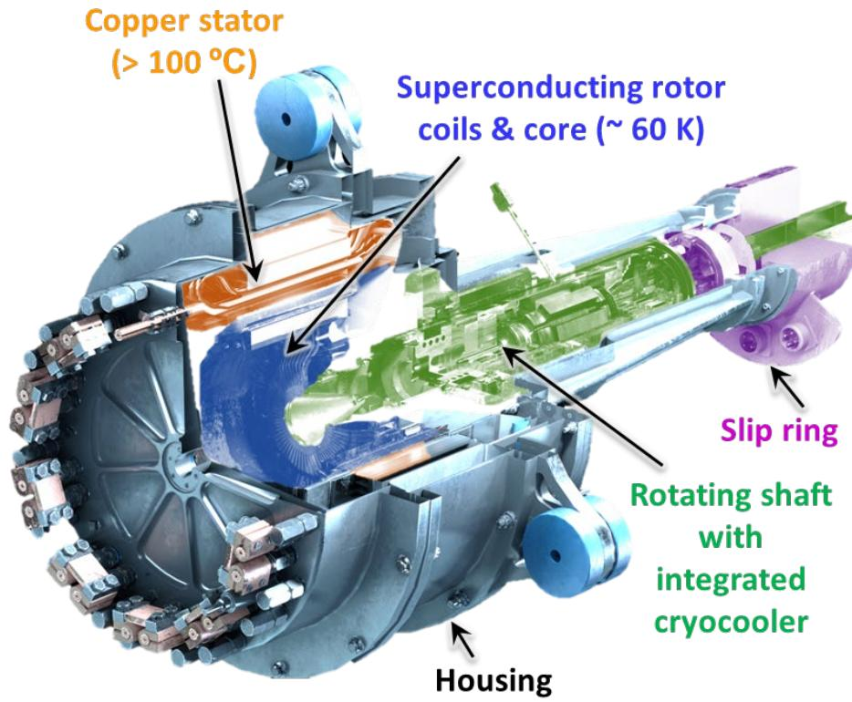  
Heigh Efficiency Megawatt Motor (HEMM)

## eTC Results: Superconducting Machines

• Development of test facilities to properly characterize and explore AC loss

• New superconducting wires developed though SBIR efforts to address AC loss mechanisms

• Development of HEMM rotor gave more insight into constructing machines with superconducting elements

## ICE-Box

• Wide range of test articles – single wires to components or assemblies up to about ∅0.75 m x 1 m

• Current vacuum capability: \~10-3 torr (warm) to \~10-5 torr (cold)

Cryocooler Lift Capacity   
Primary AL-325:   
79W @ 20K   
or 100W @ 25K

Designed for secondary / cold wall cryocooler, but not currently installed

• Inert gas backfill capable

## Superconducting AC Coil Tester

• \~20 K and up

• 0-400 Hz electrical frequency

0.4-0.5 T magnetic field produced by spinning rotor

Test article cooled with cryocooled gaseous He (GHe)

• Loss target: \~5 – 50 W

• Expected tare: < 2 W

  
Test article with internal GHe flow

LN₂-cooled back iron

8 pole permanent magnet rotor

Drive motor connection

## What's next: TC: 10.2 High Power EAP

## Electrified Aircraft propulsion systems of 10MW or greater

• System analysis and integration studies of one or more high power EAP concepts

Propulsion controls and fault management studies of high-power EAP systems

• Superconducting machine technology

Compatible power electronics

## Is superconducting technology ready to contribute to EAP?

## Robust Superconducting (SC) Machine

Preliminary design for 5 MW machine (capable of driving a fan)

• Superconducting rotor

Low AC loss stator winding and thermal management approach Down-select among fully SC and fully cryogenic options

• Subscale machine and drive TRL 3 demo

• Overall thermal management approach

Robust cryo-capable 5 MW drive

## Key Challenges

• Low AC loss stator

• Issues arising from high current

• Thermal management

• Power quality & reliability

• Safe high voltage systems

• Weight

• Materials & manufacturing

Measured voltages without filter

## Wrap Up

Are EAP aircraft viable for 2030-35? (est. 2014) Technical Challenge 5.2: Electrified Aircraft Propulsion (EAP) Viability

• Yes, they are viable

• NASA and Industry investments greatly expanded

• Key enabling metrics set

## Can it fly? (est. 2019)

Technical Challenge 10.1: Focused Technologies for EAP Demonstrator

Yes, megawatt-scale electric aircraft powertrain technologies can be safely and successfully demonstrated for use in regional and single-aisle electrified aircraft propulsion (EAP) vehicles

• Key technical barriers bought down

• Technology development

• Testing

• Has impacted EPFD

Is superconducting technology ready to contribute? (est. 2024)

Technical Challenge: 10.2: High Power EAP

The next step for EAP development is to push for technologies that extend systems beyond the MW scale is underway!

## Stakeholders

Advanced Air Vehicle Program's Advanced Air Transport Technology Project, Hybrid Thermally Efficient Core Project

Integrated Aviation Systems Program Electrified Powertrain Flight Demonstrator Project

Transformative Aeronautics Concepts Project's Transformative Tools and Technologies Project and University Innovation Project

Project Management: Amy Jankovsky

Technical Leads: Rodger Dyson, Andrew Woodworth

Team Leads

Electric Machines: Ralph Jansen with support from Andy Provenza

Superconducting Systems: Gerry Brown with support from Justin Scheidler

Power Electronics: David Avanesian, Matt Granger

Materials: Alex Leary, Andrew Woodworth

Thermal Management Systems: Rodger Dyson

Controls & Fault Management: Don Simon

NASA Electric Aircraft Testbed: Joe Haglage and Nuha Nawash