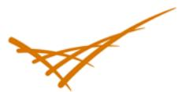

Prepared for the U.S. Department of Energy under Contract DE-AC05-76RL01830

# The Prospects of Alternatives to Vapor Compression Technology for Space Cooling and Food Refrigeration Applications

DR Brown N Fernandez

JA Dirks TB Stout

March 2010

Pacific Northwest NATIONAL LABORATORY

## DISCLAIMER

This report was prepared as an account of work sponsored by an agency of the United States Government. Neither the United States Government nor any agency thereof, nor Battelle Memorial Institute, nor any of their employees, makes any warranty, express or implied, or assumes any legal liability or responsibility for the accuracy, completeness, or usefulness of any information, apparatus, product, or process disclosed, or represents that its use would not infringe privately owned rights. Reference herein to any specific commercial product, process, or service by trade name, trademark, manufacturer, or otherwise does not necessarily constitute or imply its endorsement, recommendation, or favoring by the United States Government or any agency thereof, or Battelle Memorial Institute. The views and opinions of authors expressed herein do not necessarily state or reflect those of the United States Government or any agency thereof.

PACIFIC NORTHWEST NATIONALLABORATORY operated by BATTELLE for the UNITED STATES DEPARTMENT OF ENERGY under Contract DE-AC05-76RL01830

Printed in the United States of America

Available to DOE and DOE contractors from the Office of Scientific and Technical Information, P.O. Box 62, Oak Ridge, TN 37831-0062; ph: (865) 576-8401 fax: (865) 576-5728 email: reports@adonis.osti.gov

Available to the public from the National Technical Information Service, U.S. Department of Commerce, 5285 Port Royal Rd., Springfield, VA 22161 ph: (800) 553-6847 fax: (703) 605-6900 email: orders@ntis.fedworld.gov online ordering: http://www.ntis.gov/ordering.htm

# The Prospects of Alternatives to Vapor Compression Technology for Space Cooling and Food Refrigeration Applications

DR Brown N Fernandez

JA Dirks TB Stout

March 2010

Prepared for

the U.S. Department of Energy

under Contract DE-AC05-76RL01830

Pacific Northwest National Laboratory

Richland, Washington 99352

## Summary

Five alternatives to vapor compression technology were qualitatively evaluated to determine their prospects for being better than vapor compression for space cooling and food refrigeration applications. The results of the assessment are summarized in Table 1. Overall, thermoacoustic and magnetic technologies were judged to have the best prospects for competing with vapor compression technology, with thermotunneling, thermoelectric, and thermionic technologies trailing behind, in that order.

Thermoacoustic and magnetic technologies look relatively attractive because many working prototypes have already been built, the development barriers appear moderate, and the potential efficiencies are medium to high. Thermotunneling has a high efficiency potential, but the difficulty of creating and maintaining the nanometer scale gaps required by the technology significantly lowered its rating. The recent development of better materials opens the door for improvements in the performance of thermoelectric coolers, but not enough to be competitive with vapor compression coolers. Thermionic devices have the capability for very high cooling densities, which will likely lead to microelectronic applications, but its inherently low efficiency makes it a very poor prospect for eventually competing with vapor compression technology.

Four of the five alternative technologies (all but thermoacoustic) use solid “refrigerants," which allows direct contact heat transfer at the “evaporator"and “condenser."This effectively cuts the approach temperature by about 50% compared to vapor compression technology because the refrigerant-side resistance to heat transfer is eliminated. The performance impact is a 10-20% increase in coefficient of performance (COP), depending on the rating conditions for cooling source and sink temperature.

Table 1. Prospects of Alternatives to Vapor Compression Technology
<table><tr><td rowspan=1 colspan=1>Technology</td><td rowspan=1 colspan=1>TheoreticalMaximumCarnotEfficiency</td><td rowspan=1 colspan=1>State ofDevelopment</td><td rowspan=1 colspan=1>Best CarnotEfficiencyAchieved</td><td rowspan=1 colspan=1>DevelopmentBarriers</td><td rowspan=1 colspan=1>Extent of R&amp;DActivity</td><td rowspan=1 colspan=1>Prospect forCompetingwith VaporCompression</td></tr><tr><td rowspan=1 colspan=1>Thermoelectric</td><td rowspan=1 colspan=1>25-35%</td><td rowspan=1 colspan=1>Commercial</td><td rowspan=1 colspan=1>10-15%</td><td rowspan=1 colspan=1>Medium</td><td rowspan=1 colspan=1>Many players</td><td rowspan=1 colspan=1>Fair</td></tr><tr><td rowspan=1 colspan=1>Thermionic</td><td rowspan=1 colspan=1>20-30%</td><td rowspan=1 colspan=1>Experimental</td><td rowspan=1 colspan=1>&lt; 10%</td><td rowspan=1 colspan=1>High</td><td rowspan=1 colspan=1>A few players</td><td rowspan=1 colspan=1>Poor</td></tr><tr><td rowspan=1 colspan=1>Thermo-tunneling</td><td rowspan=1 colspan=1>50-80%</td><td rowspan=1 colspan=1>Experimental</td><td rowspan=1 colspan=1>No data</td><td rowspan=1 colspan=1>Very High</td><td rowspan=1 colspan=1>A few players</td><td rowspan=1 colspan=1>Average</td></tr><tr><td rowspan=1 colspan=1>Thermoacoustic</td><td rowspan=1 colspan=1>60-100%</td><td rowspan=1 colspan=1>Prototype</td><td rowspan=1 colspan=1>≈ 20%</td><td rowspan=1 colspan=1>Medium</td><td rowspan=1 colspan=1>Many players</td><td rowspan=1 colspan=1>Good</td></tr><tr><td rowspan=1 colspan=1>Magnetic</td><td rowspan=1 colspan=1>50-60%</td><td rowspan=1 colspan=1>Prototype</td><td rowspan=1 colspan=1>≈ 20%1</td><td rowspan=1 colspan=1>Medium</td><td rowspan=1 colspan=1>Many players</td><td rowspan=1 colspan=1>Good</td></tr><tr><td rowspan=1 colspan=1>VaporCompression</td><td rowspan=1 colspan=1>70-80%</td><td rowspan=1 colspan=1>Commercial</td><td rowspan=1 colspan=1>60%</td><td rowspan=1 colspan=1>Alreadydeveloped</td><td rowspan=1 colspan=1>Widespread</td><td rowspan=1 colspan=1></td></tr></table>

## Table of Contents

Summary … …iii   
Introduction ..... ……1   
………5   
Thermionic Cooling.... .…9   
Thermoacoustic Cooling … ……15   
Thermotunneling Cooling ...31   
....35

## Figures

Figure 1. Ideal Vapor Compression Ideal Vapor Compression Cycle . .2   
Figure 2. Actual Vapor Compression Cycle .3   
Figure 3. Magnetic and Vapor Compression Cooling Cycles .5   
Figure 4. Adiabatic temperature change for Gadolinium ..6   
Figure 5. Rotary Magnetic Cooler Developed by Astronautics Corporation of America .. ..7   
Figure 6. Thermionic Emission Cooling .10   
Figure 7. Thermionic Space Cooling System .10   
Figure 8. Standing-Wave Heat Pump (a and b) and Heat Engine(c and d) .. ..16   
Figure 9. A Thermoacoustic Stack of Glass Tubing .. ..17   
Figure 10. A Traveling-Wave Thermoacoustic Engine .18   
Figure 11. Temperature Induced Voltage Potential.. .24   
Figure 12. The Seebeck Effect. .24   
Figure 13. The Peltier Effect 25   
Figure 14. A Complete Thermoelectric Module. .26   
Figure 15. N-type and P-type Semiconductor Pellets. .26   
Figure 16. Single Semiconductor Thermoelectric Heat Pump . .26   
Figure 18. Thermoelectric ZT and COP .27   
Figure 17. Semiconductor Pellet Connections.. .27   
Figure 19. Thermal Emission of Electrons .32

## Tables

Table 1. Prospects of Alternatives to Vapor Compression Technology ... .. ii   
Table 2. Design Conditions for Fluid Refrigerants... ..4   
Table 3. Design Conditions for Solid Refrigerants.. ...4

## Introduction

This document identifies and describes alternatives to vapor compression cooling technology and qualitatively assesses the relative prospects of the alternatives for space cooling and food refrigeration applications. For each alternative, the concept and R&D status are described, prior research is summarized, and potential performance is discussed. The prospects of each alternative are then assessed relative to vapor compression and the other alternatives.

Improvements to vapor compression technology and hybrid combinations of vapor compression and other cooling technologies were specifically excluded from this assessment. In addition, no claim is made that the five concepts evaluated here are the only alternatives to vapor compression worthy of consideration.

## Alternative Technology Ranking

Assessment of the alternative technologies was based on the following characteristics.

• Theoretical maximum Carnot efficiency

• Current state of development

• Current best Carnot efficiency

• Developmental barriers

• Extent of developmental activity.

The prospect for each alternative was assigned an overall rating (excellent, good, average, fair, or poor) based on the subjective, composite view of the five characteristics.

## Vapor Compression Technology

Vapor compression is currently the incumbent technology for the vast majority of space cooling and food refrigeration applications. However, it does not exactly match a Carnot cycle, so its potential coefficient of performance (COP) is less than the maximum possible. The ideal vapor compression cycle is illustrated in Figure 1, and an actual vapor compression cycle, including inefficiencies, is illustrated in Figure 2.

In the vapor compression cycle, vapor is compressed to a superheated fluid, then cooled and condensed at constant pressure. The refrigerant is then irreversibly throttled to a lower pressure, producing a mixture of liquid and vapor. Finally, the liquid is evaporated at constant pressure. Deviations from Carnot for the ideal vapor compression cycle are the irreversible expansion of the liquid refrigerant and superheating of the refrigerant above its condensing temperature. In addition, sub-cooling in the condenser, superheating in the evaporator, frictional losses in refrigerant tubing, less than 100% efficient compressors, and finite temperature differences across evaporator and condenser surfaces further lower the actual COP.

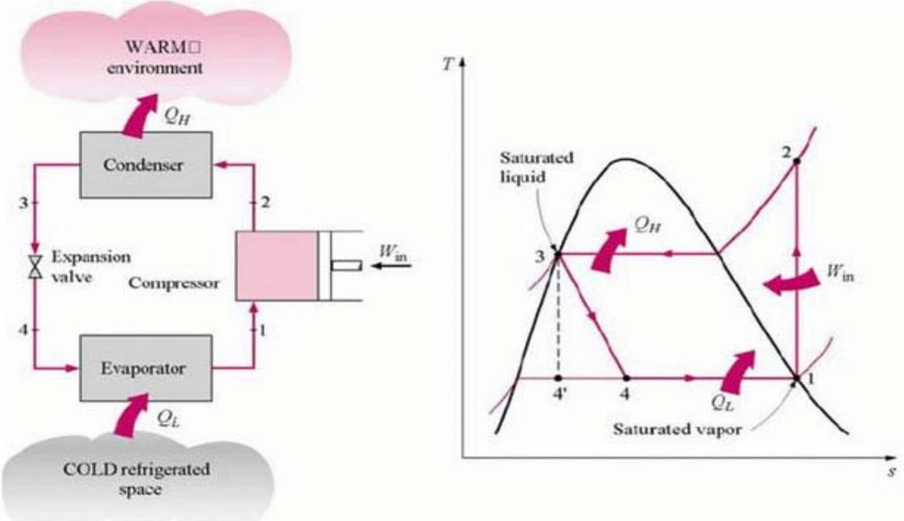  
Figure 1. Ideal Vapor Compression Ideal Vapor Compression Cycle (coolingdevice.net, undated)

The ratio of the ideal vapor compression COP to Carnot COP depends on the refrigerant, as well as source and sink temperatures, but is in the range of 70-80% (Stoker and Jones 1982, Nehdi et al. 2007). Current large centrifugal water-cooled chillers have COPs that are about 60% of Carnot at Air-Conditioning, Heating and Refrigeration Institute (AHRI) design conditions (U.S. DOE 2009). Smaller, aircooled chillers and unitary equipment have COPs that are closer to 40% of Carnot at AHRI conditions (U.S. DOE 2009).

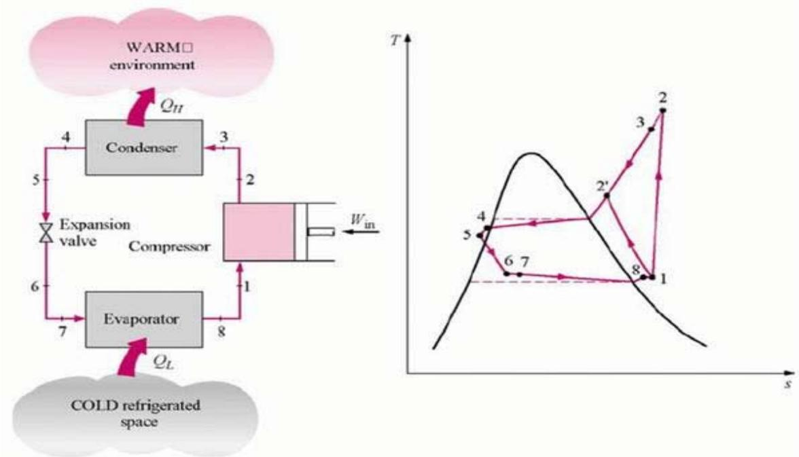  
Figure 2. Actual Vapor Compression Cycle (coolingdevice.net, undated)²

Design conditions for calculating cooling system performance in this report are summarized in Tables 1 and 2. Equipment rating standards published by AHRI define the source and sink temperatures for water chillers and the sink temperature for unitary equipment, but not the source temperature for the latter³. Procedures described in the Code of Federal Regulations (10 CFR Part 430, Subpart B, Appendix A) define the source and sink temperatures applicable to refrigerators and freezers. Differences in standard source and sink temperatures make comparisons of absolute COPs inappropriate for different types of cooling equipment. Therefore, potential and actual COPs are generally expressed as a fraction of Carnot in this document.

Neither the AHRI standards nor Federal Regulations define refrigerant conditions, leaving the approach to source and sink temperatures a design option. For this report, the approach temperature for air to refrigerant was assumed to be $\mathtt { 1 0 ^ { \circ } F }$ and other approach temperatures (e.g., $6 ^ { \circ } \mathsf { F }$ for water to refrigerant) were estimated based on the relative values of typical overall heat transfer coefficients. Four of the five alternative concepts evaluated effectively use solid “refrigerants," so direct contact with an air or water stream would be possible at the “evaporator” and “condenser."The performance benefit is essentially the same as removing the refrigerant-side resistance to heat transfer. For the solid refrigerant technologies (all but thermoacoustic), the effective approach temperature is reduced to $6 ^ { \circ } \mathsf { F }$ for air and

2°F for water, resulting in a higher COP because the refrigerant lift is reduced. The advantage is quantified by the increase in refrigerant Carnot COP when comparing results for the same application in Tables 2 and 3.

Table 2. Design Conditions for Fluid Refrigerants
<table><tr><td rowspan=1 colspan=1>Application</td><td rowspan=1 colspan=1>Source FluidType andTemperature</td><td rowspan=1 colspan=1>SourceRefrigerantTemperature</td><td rowspan=1 colspan=1>Sink FluidType andTemperature</td><td rowspan=1 colspan=1>SinkRefrigerantTemperature</td><td rowspan=1 colspan=1>FluidCarnotCOP</td><td rowspan=1 colspan=1>RefrigerantCarnot COP</td></tr><tr><td rowspan=1 colspan=1>water-cooledchillers</td><td rowspan=1 colspan=1>44℉ water</td><td rowspan=1 colspan=1> $3 8 ^ { \circ } \mathsf { F }$ </td><td rowspan=1 colspan=1>85°℉ water</td><td rowspan=1 colspan=1>91°℉</td><td rowspan=1 colspan=1>12.3</td><td rowspan=1 colspan=1>9.4</td></tr><tr><td rowspan=1 colspan=1>air-cooledchillers</td><td rowspan=1 colspan=1>44°℉ water</td><td rowspan=1 colspan=1>38°℉</td><td rowspan=1 colspan=1>95°℉ air</td><td rowspan=1 colspan=1>105 ℉</td><td rowspan=1 colspan=1>9.9</td><td rowspan=1 colspan=1>7.4</td></tr><tr><td rowspan=1 colspan=1>air-cooledunitaryequipment</td><td rowspan=1 colspan=1>55℉air</td><td rowspan=1 colspan=1>45°℉</td><td rowspan=1 colspan=1>95°℉ air</td><td rowspan=1 colspan=1>105℉</td><td rowspan=1 colspan=1>12.9</td><td rowspan=1 colspan=1>8.4</td></tr><tr><td rowspan=1 colspan=1>refrigerator</td><td rowspan=1 colspan=1>38℉ air</td><td rowspan=1 colspan=1>28°℉</td><td rowspan=1 colspan=1>90°℉ air</td><td rowspan=1 colspan=1>100°℉</td><td rowspan=1 colspan=1>9.6</td><td rowspan=1 colspan=1>6.8</td></tr><tr><td rowspan=1 colspan=1>freezer</td><td rowspan=1 colspan=1>5℉ air</td><td rowspan=1 colspan=1>-5°℉</td><td rowspan=1 colspan=1>90°℉ air</td><td rowspan=1 colspan=1>100°℉</td><td rowspan=1 colspan=1>5.5</td><td rowspan=1 colspan=1>4.3</td></tr></table>

Table 3. Design Conditions for Solid Refrigerants
<table><tr><td rowspan=1 colspan=1>Application</td><td rowspan=1 colspan=1>Source FluidType andTemperature</td><td rowspan=1 colspan=1>SourceRefrigerantTemperature</td><td rowspan=1 colspan=1>Sink FluidType andTemperature</td><td rowspan=1 colspan=1>SinkRefrigerantTemperature</td><td rowspan=1 colspan=1>FluidCarnotCOP</td><td rowspan=1 colspan=1>RefrigerantCarnot COP</td></tr><tr><td rowspan=1 colspan=1>water-cooledchillers</td><td rowspan=1 colspan=1>44°℉ water</td><td rowspan=1 colspan=1>42°℉</td><td rowspan=1 colspan=1>85°℉ water</td><td rowspan=1 colspan=1>87°℉</td><td rowspan=1 colspan=1>12.3</td><td rowspan=1 colspan=1>11.1</td></tr><tr><td rowspan=1 colspan=1>air-cooledchillers</td><td rowspan=1 colspan=1>44℉ water</td><td rowspan=1 colspan=1>42℉</td><td rowspan=1 colspan=1>95°℉ air</td><td rowspan=1 colspan=1>101°℉</td><td rowspan=1 colspan=1>9.9</td><td rowspan=1 colspan=1>8.5</td></tr><tr><td rowspan=1 colspan=1>air-cooledunitaryequipment</td><td rowspan=1 colspan=1>55℉ air</td><td rowspan=1 colspan=1>49°℉</td><td rowspan=1 colspan=1>95℉ air</td><td rowspan=1 colspan=1>101℉</td><td rowspan=1 colspan=1>12.9</td><td rowspan=1 colspan=1>9.8</td></tr><tr><td rowspan=1 colspan=1>refrigerator</td><td rowspan=1 colspan=1>38℉ air</td><td rowspan=1 colspan=1>32°℉</td><td rowspan=1 colspan=1>90°℉ air</td><td rowspan=1 colspan=1>96℉</td><td rowspan=1 colspan=1>9.6</td><td rowspan=1 colspan=1>7.7</td></tr><tr><td rowspan=1 colspan=1>freezer</td><td rowspan=1 colspan=1>5℉ air</td><td rowspan=1 colspan=1>-1℉</td><td rowspan=1 colspan=1>90°℉ air</td><td rowspan=1 colspan=1>96℉</td><td rowspan=1 colspan=1>5.5</td><td rowspan=1 colspan=1>4.7</td></tr></table>

## Magnetic Cooling

Magnetic cooling utilizes the application of an alternating magnetic field to cool ferromagnetic materials via the magnetocaloric effect. The application of a magnetic field heats the material under adiabatic conditions. Rejection of this heat to the environment, followed by removal of the magnetic field, cools the material below its initial temperature. The cooled material may then be warmed by the cooling load, completing the cycle. Thermodynamic modeling suggests that magnetic cooling could have a 25% efficiency advantage over the best current vapor compression technology in air-cooled applications. Although prior Federal funding of this concept did not result in a commercial product, recent advances in magnetocaloric materials and widespread international interest make magnetic cooling a “good" prospect worthy of additional Federal funding.

## Concept Description

Magnetic cooling utilizes the thermodynamically reversible magnetocaloric effect (MCE) to transfer heat from a cold source to a hot source in a manner parallel to that of a conventional vapor compression cycle. When a magnetic field is applied to a magnetic material near its magnetic ordering temperature (or Curie temperature), the magnetic moments of its atoms are aligned, which reduces the magnetic entropy of the material. In turn, this requires an increase in the temperature of the material under adiabatic conditions. If heat is removed from the material when magnetized, the material will cool below its initial temperature when the magnetic field is removed, thus providing a mechanism for a cooling cycle. Magnetic and vapor compression cooling cycles are illustrated in Figure 3.

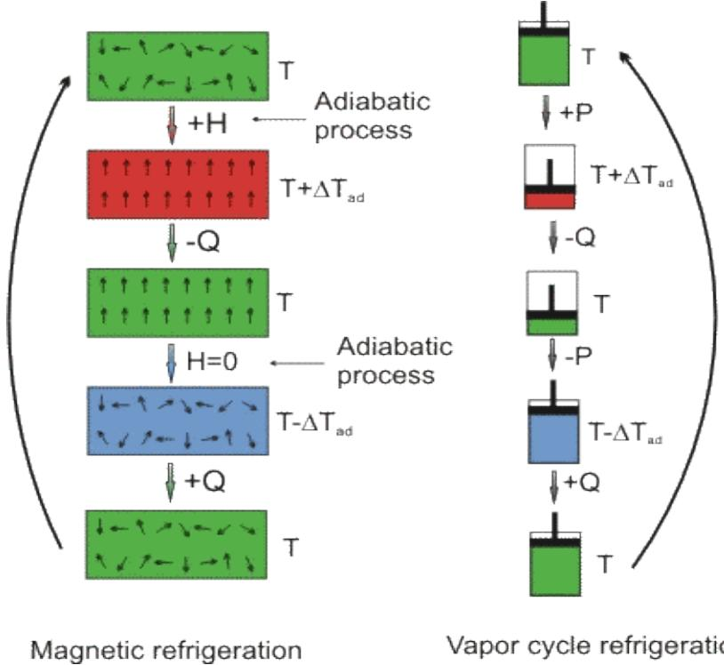  
Figure 3. Magnetic and Vapor Compression Cooling Cycles (Wikipedia)

The MCE varies for different materials and is dependent on temperature and the strength of the magnetic field applied for a given material. The temperature at which MCE is greatest is called the Curie temperature. Thus, materials of greatest interest for potential space cooling application will not only show a strong MCE, but also have a Curie temperature near the temperature required for space cooling. To date, most of the work on magnetic cooling for space cooling has utilized gadolinium or gadolinium alloys as the magnetic material because of its high MCE value at $2 0 ^ { \circ } \mathsf { C }$ (see Figure 4). In particular, the use of gadolinium alloys broadens the MCE peak across a wider temperature range, increasing the applicable energy source and sink temperatures. A prototype of a magnetic cooler developed by Astronautic Corporation of America is shown in Figure 5.

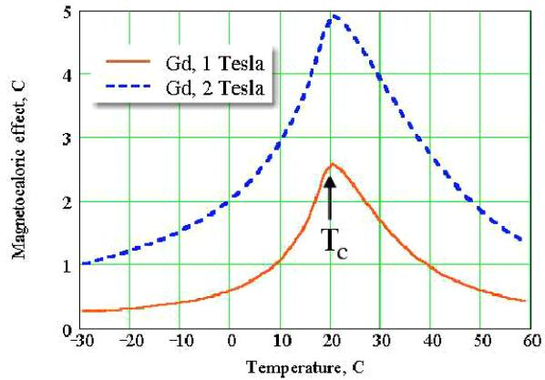  
Figure 4. Adiabatic temperature change for Gadolinium (Gshneidner and Pecharsky 2008)

## Prior Research

The roots of magnetic cooling date back to the discovery of the magnetocaloric effect (MCE) by Warburg in 1881. Using MCE for cooling was first independently proposed by Debye and Giauque in the late 1920s. Early work was oriented toward cryogenic applications. In fact, magnetic cooling has been used since the 1930s to produce temperatures less than 1 K.

The first apparatus for cooling near room temperature was developed by Brown in the late 1970s (Brown 1976). Brown was not only the first to use ferromagnetic materials with an MCE effect near room temperature, but was also the first to incorporate a regenerator to increase the source and sink temperature span beyond the range possible for a ferromagnetic material working through a single magnetization-cooling-demagnetization cycle. In 1990, Green and co-workers (Green et al. 1990) were the first to use the MCE effect for room- temperature cooling of a load other than the magnetic material itself. Thereafter, from the late 1990s through the current decade, many active magnetic regenerator (AMR) cooling devices have been developed by various organizations around the world.

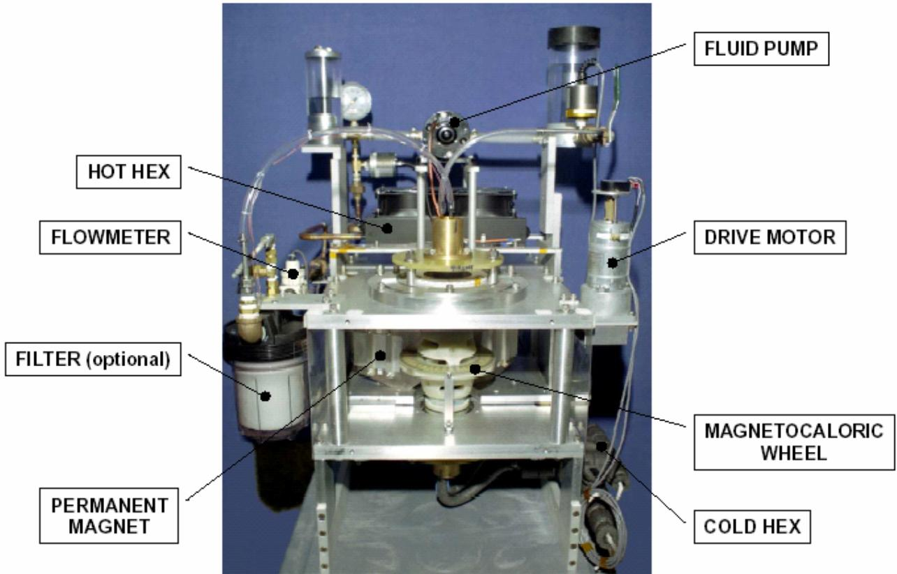  
Figure 5. Rotary Magnetic Cooler Developed by Astronautics Corporation of America

Beyond the work described above by Brown and Green, significant early work on magnetic cooling was conducted at Los Alamos National Laboratory (LANL). Technology developed at LANL was later transferred to Astronautics Corporation of America (ACA) in 1985. ACA then teamed with the Ames Laboratory (AL). While the initial work of these two organizations was largely focused on cryogenic applications of magnetic cooling, development of room-temperature systems was initiated in the mid-1990s. With \$3 million of Department of Energy (DOE) funding, the ACA/AL team developed a 0.6 -kW (0.17-ton) magnetic cooler that ran for over 5000 hours during an 18-month test period in 1996-1997. Subsequent government funding was used by ACA/AL to examine the prospects for magnetic cooling of automobiles in the late 1990s. Work during the current decade has focused on transitioning the cooling technology from a superconducting magnet to a less expensive permanent magnet. This work was supported in part by funding from the DOE and National Institute of Science and Technology.

## Potential Performance

Perhaps the best assessment of the performance prospects for magnetic cooling is documented in a recent report prepared by the University of Applied Sciences of Western Switzerland (Kitanovski et al. 2008). This study examined the prospects for magnetic cooling in nine applications with a focus on four applications (household refrigerators, central cooling systems, room air conditioners, and supermarket refrigeration) judged to have the best prospects during initial screening. Magnetic system performance estimates were developed from detailed models of fluid flow, heat transfer, and magnetic materials incorporating a comprehensive treatment of loss mechanisms. Vapor compression performance was compared against magnetic systems as a function of source temperature, magnetic system cycle

frequency, and magnetic field strength. The results for the two space-cooling applications can be summarized as follows.

For the central cooling application, the efficiency could improve by a factor ranging from 0.9 to 1.7 when compared to air-cooled chillers, depending on cycle frequency, based on $7 ^ { \circ } C$ source and $3 5 ^ { \circ } C$ sink temperatures. The air-cooled chiller was assumed to have a COP of 2.7, however, compared to about 3.9 for the best available vapor compression technology.

For the central cooling application, the efficiency could improve by a factor ranging from 0.7 to 1.4 when compared to water-cooled chillers, depending on cycle frequency, based on $7 ^ { \circ } C$ source and $2 7 ^ { \circ } C$ sink temperatures. The water-cooled chiller was assumed to have a COP of 5.4, however, compared to about 7.5 for the best available vapor compression technology.

For the room air conditioner application, the efficiency could improve by a factor ranging from 0.9 to 1.6 when compared to air-cooled packaged units, depending on cycle frequency, based on $1 0 ^ { \circ } \mathsf { C }$ source and $4 5 ^ { \circ } \mathsf { C }$ sink temperatures. The air-cooled package unit was assumed to have a COP of 3.2, which is close to the best available window unit, which has a COP of 3.5.

The analysis examined cycle frequencies ranging from 1 to 10 Hz. System performance is better for low frequencies, but mass, volume, and cost decrease with higher frequencies. System performance also improves with increasing magnetic power. The results quoted above are all based on a 2 Tesla permanent magnet.

## R&D Status

As of mid-2009, at least 25 room-temperature magnetic cooling prototypes have been built and tested by at least eight different organizations, but no commercially available products are known to exist. Most of these prototypes had a cooling capacity less than 1 kW (0.28 ton), however, so current designs will need to be scaled up for space cooling applications. While the many prototypes have proven that the concept will work, performance to date has been short of commercially viable requirements (e.g., COP of 1.2 for source/sink temperature delta of $1 2 ^ { \circ } \mathsf { C }$ by AMA) (Engelbrecht et al. 2005). Other key issues facing the concept's development include the following.

Reducing or managing thermal and magnetic hysteresis losses in high magnetic refrigerant (MCE) materials

• Increasing the field strength and/or reducing the cost of permanent magnets

•Mass production of MCE materials.

## Prospects Relative to Current SOA

Theoretical analyses suggest that magnetic cooling could have a higher Carnot efficiency compared to the best current air-cooled vapor compression systems. In addition, recent advances in high-MCE materials appear to have spawned significant worldwide renewal in developing this technology. On the other hand, this concept has also received significant prior Federal funding without resulting in a commercial product. Overall, the long-run prospects for this technology are judged to be “good" and worthy of additional Federal investment.

## Thermionic Cooling

Thermionic emission was discovered by Edison during early experiments with the light bulb and is the operating principle behind vacuum tube diodes. The application of thermionics for cooling was first proposed by Mahan in 1994. When voltage is applied across two materials with a gap or barrier thickness less than an electron mean free path, high-energy electrons will leave one surface for the other while being replaced by average energy electrons. The result is a lowering of the temperature of the first surface and corresponding heating of the second surface. The potential efficiency is relatively high, but does not appear as good as vapor compression systems. Theoretical and experimental studies to date have shown the capability of higher heat fluxes than with thermoelectric devices $( > 1 \mathrm { k W } / \mathrm { c m } ^ { 2 } )$ SO many researchers envision applications in cooling microelectronics. Available literature, however, indicate little more than the conduct of laboratory experiments and modeling of academic interest. With potential efficiency poorer than vapor compression and no multilayer devices yet constructed that could prevent the backward conduction of heat, the prospects for this concept in space cooling or food refrigeration applications are rated as “poor."

## Concept Description

Thermionic cooling is similar to thermoelectric cooling in that it utilizes an electric potential difference to induce a current and a temperature difference across two surfaces. The operating principle is different, however. Electron transport between surfaces in thermoelectric devices occurs via diffusion, while ballistic electron transport is the mode for thermionic devices. This results in non-linear electric and thermal transport with respect to applied voltage or temperature differences. Ballistic electron transport also means there is no Joule heating in the barrier layer between cathode and anode surfaces because the electrons do not collide with anything when traveling from the cathode to the anode.

At the heart of thermionic cooling is the process of thermionic emission. Thermionic emission is the discharge of electrons from the free surface of a material. For an electron to be discharged from the surface, that electron's energy must be sufficiently high to overcome the electrostatic forces that otherwise confine the electron to the outer band of the material. The current density of the emission is given by Richardson's Law,

$$
J = A _ { \mathrm { G } } T ^ { 2 } \mathrm { e } ^ { \frac { - W } { k T } }
$$

where

$\mathsf { A } _ { \mathsf { G } }$ is a constant that depends on material properties,

T is the absolute temperature,

W is the work function of the material or the minimum energy required to remove an electron from its surface, and

k is the Boltzmann constant.

Two surfaces at equilibrium will exchange high-energy electrons and remain at the same temperature. Application of a voltage potential will induce a current and force transport of the high-energy electrons in one direction, from the cathode to the anode. The high-energy electrons are replaced by average energy electrons in the cathode and vice versa in the anode. As a result, the cathode is cooled and the anode heated. The transfer of an electron across the energy barrier separating emitter and collector surfaces is illustrated in Figure 6. A diagram of a theoretical cooling system using thermionic cooling is shown in Figure 7.

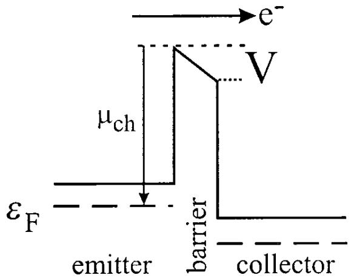  
Figure 6. Thermionic Emission Cooling (Ulrich et al. 2001)

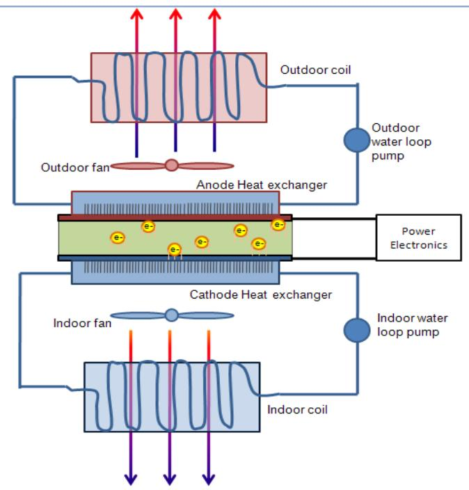  
Figure 7. Thermionic Space Cooling System

## Prior Research

The phenomenon of thermionic emission was first reported by Guthrie and later by Edison in the late 1800s. In the early 1900s, Fleming developed the two-element vacuum-tube diode, which uses thermionic emission as its operating principle. Later, in the 1920s, Richardson was awarded a Nobel prize for his work on thermionic phenomenon including the development of mathematical laws governing thermionic emission.

It wasn't until 1994 that a thermionic refrigerator was first proposed by Mahan (1994). Mahan originally proposed a device constructed of two metal plates separated by a vacuum. Such a device is not considered practical at room temperature because it requires materials with a work function less than 0.3 eV, which are not known to exist. Shakouri then suggested using multiple layers of different semiconductors as possible low work function materials (Shakouri et al. 1997). Mahan then proposed alternating layers of metals and semiconductors, taking advantage of the low Schottky energy barriers between such materials (Mahan et al. 1998). Thin layers were used to maintain thermionic rather than thermoelectric transport and low temperature differences per layer were used to minimize thermal conduction in the undesired direction.

Since 2000, M. O’Dwyer and colleagues have published several papers describing the potential performance of thermionic devices in various configurations. Shakouri and colleagues also continue to work in this area. In particular, the potential application of thermionics for cooling of microelectronic devices has generated the most interest. Testing of actual hardware focused on space cooling or food refrigeration applications is not apparent.

## Potential Performance

Different types of efficiencies are often reported for thermionic devices, so it's important to understand the variation in terms used.

First, there is the electronic efficiency (or COP). This is equal to the gross thermionic cooling (the average energy of an emitted electron less that of a replacement electron times the current) divided by the input electrical work. At a barrier height of 0.3 eV, O'Dwyer et al. report electronic efficiencies equal to 53-60% of Carnot depending on the number and shape of barriers (O’Dwyer et al. 2006).

The electronic efficiency does not take into account the backward conduction of heat from the anode to the cathode, which is a significant problem for thermionic devices because of the sub-micron thicknesses of the barrier materials. Also excluded from the electronic efficiency are joule heating of the cathode and metallization layers. Thus, the device COP is equal to

$$
\ C O P _ { \mathit { d e v i c e } } = { \frac { ( { \dot { Q } } _ { \mathit { e l e c t r o n i c } } - { \frac { \beta } { d } } \Delta T - I ^ { 2 } R ) } { V I } }
$$

where

β is the conductivity of the barrier material, and

In practice, it is the conduction of heat from the anode to the cathode that dominates device efficiency. Conduction is reduced by increasing the barrier thickness, but it must not be increased much beyond the electron mean free path (a few microns) or the overall efficiency will drop. The magnitude of the mean free path depends on the characteristics of the system the particle is in, and is equal to

$$
\ell = ( \sigma n ) ^ { - 1 } ,
$$

where

$\ell$ is the mean free path,

n is the number of target particles per unit volume, and

σ is the effective cross sectional area for collision (Wikipedia).

O’Dwyer reports a maximum device COP of 23% of Carnot at a 200-nm barrier thickness and a 0.1 K ∆T across the barrier. Thus far, real devices have cooling efficiencies that are not attractive for space cooling. For example, Zhang et al. report a COP of 35.6% for a 40-micron square device using a Si/SiGe superlattice barrier intended for integrated circuitry (IC) cooling (Zhang et al. 2006).

Note that the device COP only considers the COP of cooling achieved at the cathode-anode pair, and does not represent the actual system COP, which would include additional losses as well as parasitic electric loads to deliver cooling to the space and reject heat outside.

## R&D Status

Research into thermionic cooling has mainly focused on “micro-refrigerators" for cooling of hot spots on IC chips. Fabrication of the micro-refrigerators has relied on established processes of film deposition, etching, and photolithography developed in the fields of integrated circuitry and microelectromechanical systems (MEMS). While space cooling applications would have to rely on much bigger surface areas to transfer the required heat duties, the literature on macro-scale cooling applications seems to indicate that the proposed fabrication techniques would remain the same, but implemented on a much larger scale. Modern photovoltaic panels for electricity generation serve as a precedent for this degree of scalability of iC fabrication techniques.

As noted above, current thermionic cooling systems have COPs well less than 1. The biggest hurdle to improving this performance is reducing the flow of heat backwards through the device from the cathode to the anode. In theory, multilayer construction with the temperature difference per layer limited to 1 K or less as first proposed by Mahan and Woods would result in efficiencies comparable to vapor compression, but no such devices are known to have been built and tested to date (Mahan et al. 1998).

## Prospects Relative to Current State of the Art

Thermionics offer the potential for very high cooling densities (1 kW/cm²), which makes it potentially attractive for on-chip cooling of micro-electronic devices. This characteristic does not result in much of an advantage for space cooling or food refrigeration applications where the volume and weight constraints are not as severe. Multi-layer devices using semiconductor superlattices with low thermal conductivity appear to offer good performance potential, but not as good as vapor compression technology.

## Thermoacoustic Cooling

Thermoacoustic technology can be harnessed to provide useful cooling. It does this using acoustic work to provide pressure waves, which expand and compress a gas inside a resonator. These pressure waves also cause displacement of the gas. If the time phasing between pressure and displacement is correct, the gas can be made to pump heat from a cold heat exchanger to a hot heat exchanger across a component (called a stack or regenerator depending on the dimensions of the spaces in which the gas oscillates) that provides temporary storage for the heat. This technology got its start around 200 years ago and has since developed into viable competition to vapor compression technology. Compared to vapor compression, thermoacoustic cooling is low cost, reliable, environmentally friendly, well suited for proportional control, and has the ability to easily generate cooling using waste heat as a power source. The technology is currently less efficient than vapor compression and suffers from relatively low power density. However, there do not appear to be any roadblocks that could not be overcome with further research and development. The combination of high performance potential, significant prototype development, and industry interest in cryogenic applications makes the prospects for this technology look “good."

## Concept Description

Sound waves, which are pressure oscillations, cause gas to compress and expand, which causes the gas to heat up and cool down, respectively. Because the gas will want to flow from high to low pressure, there is also displacement involved. When this happens adjacent to a surface, the gas can be made to do work (heat engine) or to produce useful cooling (heat pump). The effect occurs naturally wherever sound waves are present, but the pressure oscillations required to produce a useful amount of work or cooling are many times greater than would normally be present; at 94-dB (equivalent to loud speech) the temperature fluctuation is only around $1 / 1 0 0 , 0 0 0 ^ { \mathrm { t h } }$ of a degree C (Buscemi 2005). This is where resonators come into play. Resonators allow the sound wave to amplify until a new steady-state amplitude is reached. Like pushing a person in a swing set, adding energy at the right moment allows the oscillation to build. There are two classes of thermoacoustic device: standing-wave and travelingwave (also called Stirling because the time phasing between pressure and velocity is the same as that in Stirling engines and heat pumps).

## Standing-Wave Devices

Standing-wave devices, such as the representation shown in Figure 8, generate useful cooling by pumping heat from the cold heat exchanger to the hot heat exchanger. Pumping heat requires the input of work in the form of acoustic power from the loudspeaker on the left end of the resonator. The cold heat exchanger absorbs heat from an external load, while the hot heat exchanger rejects heat to the surroundings or other heat sink.

The stack⁴ (see Figure 9) serves to increase the surface area in contact with the oscillating gas and acts as temporary storage for the heat as it is transported from the cold exchanger to the hot exchanger. If the parallel plates in the stack are spaced too far apart, much of the oscillating gas will simply expand and contract adiabatically and will not pump any heat. If the plates are spaced too close together, the thermal contact between the oscillating gas and the stack will be too good, and the gas will expand and contract isothermally and, again, will not pump any heat. The stack does not necessarily have to be made from plates. For example, the one shown in Figure 9 is made from bundled glass tubing.

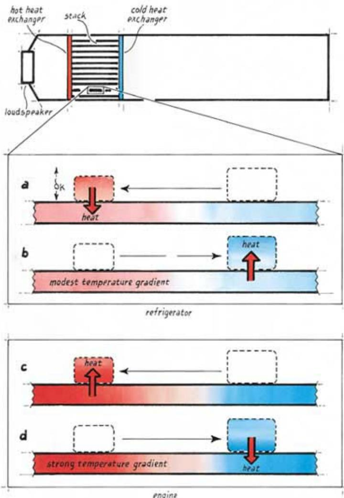  
Figure 8. Standing-Wave Heat Pump (a and b) and Heat Engine(c and d) (Garrett and Backhaus 2000)

The stack material is also important. The goal is to provide the gas a place to temporarily store the heat as it is shuttled along the length of the stack, as well as to insulate between the hot and cold ends to minimize heat conduction, which would reduce the efficiency of the device. Therefore, the stack is typically made from a material with high heat capacity that does not conduct heat well; ceramic would be an example.

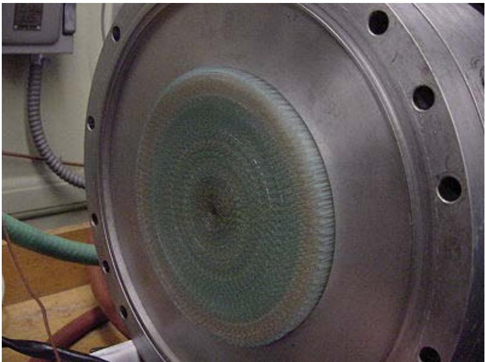  
Figure 9. A Thermoacoustic Stack of Glass Tubing (Wikipedia).

Once the acoustic power source (loudspeaker) is activated, a standing-wave will form in the resonator. The mechanism for heat transfer from the cold heat exchanger to the hot heat exchanger is explained by examining a single parcel of gas as it oscillates between the plates of the stack, as shown in Figure 8a and 8b. In Figure 8a, the parcel of gas moves to the left toward higher pressure. As it does this, the gas is compressed and heats up accordingly. At the end of its leftward motion, the gas is hotter than the stack at that position, so the parcel of gas rejects heat into the stack. Now the parcel of gas begins moving back to the right (Figure 8b) toward lower pressure. As it does this, the gas expands and cools. When it reaches the end of its rightward motion, the gas is cooler than the stack at that position, and heat flows into the parcel from the stack. The mode of operation just described is that of a heat pump.

Figure 8c and 8d show the reverse of the cycle just described. This time, a temperature gradient provided by an outside heat source drives the oscillation to produce acoustic power. Note that the temperature gradient must be greater than when operated as a heat pump; the hot end of the stack needs to be hotter than the compressed gas, and the cold end needs to be colder than the expanded gas for the engine to operate.

The individual parcels of gas move only a fraction of the length of the stack, but the combined action of all of the parcels working together is able to shuttle the heat the entire length of the stack.

## Traveling-Wave Devices

Unlike standing-wave engines and heat pumps, where pressure and position are substantially in phase, pressure and velocity are substantially in phase in traveling-wave engines and heat pumps. This requires a more complicated acoustic network than the simple resonators in standing-wave devices (see Figure 10). The other major difference is that traveling-wave devices have a regenerator rather than a stack.

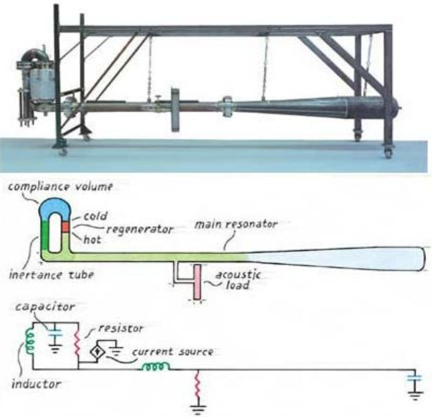  
Figure 10. A Traveling-Wave Thermoacoustic Engine (Garrett and Backhaus 2000)

The regenerator looks nearly like a stack in most cases. The difference is that the spaces in which the gas oscillates are smaller than in a stack because the goal here is to have very good thermal contact with the gas. A major advantage of traveling-wave devices is that they can theoretically achieve Carnot efficiency, while standing-wave devices are limited to 40-50% of Carnot (Berson et al. 2008). Approaching Carnot efficiency can only be done, however, by having the cooling capacity of the machine approach zero (Huang et al. 2005).

The cycle, in heat pump mode, can again be explained by imagining a single parcel of gas: The parcel is compressed adiabatically in the open space outside of the regenerator by the pressure wave, heating up as this happens. As the parcel is displaced and enters the hot end of the regenerator, it rejects heat into the regenerator. Outside of the other end of the regenerator, the parcel is adiabatically expanded, cooling as this happens. As the parcel is displaced back through the regenerator, it absorbs heat from the cold end of the regenerator. The heat transport is caused by the parcel of gas depositing the heat of compression to the hot end of the regenerator and absorbing that same amount of heat from the cold end of the regenerator. The thermal expansion and contraction that takes place inside of the regenerator cancel each other out, so there is no net heat transfer in those steps. Unlike stack-based devices, where the displacement of a parcel of gas is a small fraction of the length of the stack, the

parcel of gas in a regenerator-based device must be displaced clear through the regenerator and heat exchangers to operate properly.

## Prior Research

Major developments in thermoacoustic technology are presented in chronological order.

• The history of thermoacoustic technology began more than 200 years ago when glassblowers noticed that, when blowing a glass bulb, the tips of their glass stems would sometimes emit sound.

• In 1777, Byron Higgins conducted experiments in which oscillations in a tube were excited by the application of a hydrogen flame.

In 1816, Laplace corrected Newton's calculation of the speed of sound in air. Newton had thought that the expansions and contractions caused by the sound wave did not affect the temperature. The corrected calculation yielded a value that is 18% faster.

• Around the 1850s, papers on the Sondhauss and Rijke tubes, both rudimentary thermoacoustic engines, were published.

•The theory of thermoacoustics began to take shape in 1868 when Kirchhoff calculated acoustic attenuation in a duct caused by the oscillatory heat transfer between the duct wall and the oscillating gas.

Rayleigh studied Sondhauss tubes, as well as other acoustic phenomena, and offered a qualitative explanation of the phenomena in 1896.

• Taconis, around 1950, noticed spontaneous oscillations in a hollow glass tube closed at one end when the open end of such a tube was used to stir liquid helium. His explanation of the effect was essentially the same as that of Rayleigh.

• An important advancement came in 1962 when Carter et al. realized that placing closely spaced parallel plates inside of Sondhauss tubes greatly increased the thermoacoustic effects.

• In 1965, Gifford and Longsworth accidentally discovered that it was possible to produce significant cooling by applying a low frequency, high amplitude sound wave to a gas-filled tube.

•Throughout the 1960s, Rott et al. published a series of papers that established a theoretical understanding of thermoacoustics.

•In 1975, Merkli and Thomann discovered, using Sondhauss oscillators, that cooling of the tube wall, not just heating, is possible in the area of maximum gas velocity (the velocity antinode)(Merkli and Thomann 1975) .

•In 1979, Ceperley made important advancements in Stirling engine technology when he realized that the time phasing between pressure and velocity in Stirling engines and refrigerators is that of a traveling acoustic wave (Wheatley et al. 1983).

•Hofler et al. invented a standing-wave thermoacoustic refrigerator by applying the mathematics introduced by Rott to a temperature gradient too small to sustain oscillations (Hofler et al. 1988).

• In 1998, Garrett et al. finished work on a 10-kW thermoacoustic cooler/air conditioner named TRITON. The name comes from the fact that the cooler was designed to deliver 3 tons of cooling (Pennsylvania State University, undated).

•In 2000, Backhaus and Swift published a paper describing a thermoacoustic-Stirling engine that achieves a heat-to-acoustic energy efficiency comparable to established energy conversion technologies (Backhaus and Swift 2000).

## Potential Performance

The only moving part in a thermoacoustic heat pump is the vibrating loudspeaker, so the technology should prove to be reliable as well as low in cost. Thermoacoustic heat pumps also use environmentally benign noble gases or mixtures thereof. Another advantage is that thermoacoustic devices are well suited for proportional control, i.e., the ability to adjust the cooling output provided by the cooler to the heat load. This should result in an efficiency advantage compared to smaller vapor compression cooling systems that are usually operated only at full capacity and are cycled on and off to match the cooling load.

Thermoacoustic coolers can also be easily powered directly from a heat source. This is accomplished by coupling a thermoacoustic engine and cooler into one device—the heat powers the engine, which generates the acoustic power used by the cooler. Unfortunately, thermoacoustic cooling is currently less efficient than vapor compression cooling, as will be discussed in more detail below. Power density could also be an issue for some applications where space is limited. However, there are no apparent barriers limiting improvement upon these deficiencies with further research and development. Key thermoacoustic research needs identified by Pennsylvania State include the following:

• More advanced simulation models that are not limited to low acoustic Mach numbers

• A better understanding of thermoacoustics at higher amplitudes

• Modeling the individual components that make up a thermoacoustic device.

## R&D Status

Currently, no thermoacoustic air-conditioning technology has been commercialized. Cool Sound Industries, Inc. and ThermoAcoustics Corp. have launched websites, but at this point, they serve only to promote thermoacoustic air conditioning along with other applications. Another commercial entity, Clever Fellows Innovation Consortium, Inc., has already begun selling thermoacoustic cryocoolers. According to the research group at Pennsylvania State University, the largest hurdle to commercialization is the lack of individuals with the necessary background in acoustics, transduction, heat exchanger design, and instrumentation. Additionally, they mention the lack of suppliers for the specialized components (acoustic drivers, stacks and regenerators, and heat exchangers) that are needed to make a thermoacoustic device. At this point, most of the components must be custom designed and manufactured. The current focus, specifically in air-conditioning applications, is to improve efficiency as well as to increase power density. Stack-based coolers currently have an efficiency 20-30% below equivalent vapor compression coolers. Traveling-wave coolers, being intrinsically more

efficient than stack-based coolers, have potentially better performance, yet no theoretical or experimental performance data could be found for this type of device. However, a traveling-wave thermoacoustic-Stirling heat engine built by Los Alamos National Laboratory did achieve 42% of Carnot efficiency (Backhaus and Swift 2000).

## Prospects Relative to Current State of the Art

This technology seems to hold promise as a replacement to vapor compression coolers. Before this will be possible, the efficiency and power density will need to improve. Although more complicated than standing-wave coolers, traveling-wave coolers seem to hold the most promise, because they are intrinsically more efficient. While a good example of a traveling-wave cooler was not found, an engine using this technology has demonstrated impressive efficiency. It seems only a matter of time before these devices have caught up with and most likely surpassed the standing-wave devices. One of the biggest hurdles identified is the lack of individuals with the necessary background in thermodynamics and acoustics. No information found suggests that this technology could not be a commercially viable alternative to vapor compression with further development.

## Thermoelectric Cooling

Thermoelectric coolers rely on the thermodynamically reversible Peltier effect. An applied DC current provides the work input needed to drive charge carrier (electrons and holes) diffusion in an electrically conductive material. This causes heat to flow from one junction of two dissimilar conductors to the other junction. Work on thermoelectric technology began back in the early 1800s, when Thomas Seebeck discovered thermoelectricity and has progressed to the point where commercial products have been produced. It is the only cooling concept evaluated in this assessment with commercial products, but current application is limited to niche markets, where other attributes outweigh its low efficiency and relatively high cost. Opportunities for performance improvement exist, however, by implementing available semiconductor materials with more than double the performance of commonly employed materials. However, even utilization of the best available thermoelectric materials would not result in a device that would be as efficient as the best currently available vapor compression equipment. Thus, the overall prospect for this technology was rated "fair."

## Concept Description

Thermoelectric devices are able to convert thermal energy into electrical potential when heat is supplied (heat engine) or pump heat against its natural flow from hot to cold using work provided by a DC electrical current (heat pump). Thermal energy transport is accomplished by charge carriers, which can be either electrons or holes. In contrast to thermionics, where transport occurs over micron distances, or thermotunneling, where transport occurs over nanometer distances, electron transport in thermoelectric devices occurs over macroscopic distances measured in centimeters. Thus, electron transport occurs via diffusion in thermoelectric devices rather than a ballistic mode for the other two mechanisms. The design and operation of thermoelectric devices is governed by the thermodynamically reversible Seebeck, Peltier, and Thomson effects.

## Seebeck Effect

As shown in Figure 11, a temperature gradient across a conductor will induce electromotive force between the hot and cold end of the conductor. When heat is applied to one end of a conductor, the charge carriers gain energy and move at a higher velocity than the charge carriers in the cold region, much like when a gas is heated. Consequently, there is a net diffusion of charge carriers from the hot end to the cold end of the conductor. This net diffusion will continue until the electrical potential that develops between the hot and cold ends of the conductor is strong enough to prevent further net diffusion of charge carriers, i.e., a steady-state condition is reached. The voltage produced between the two ends is proportional to the temperature gradient, and the proportionality factor is known as the Seebeck coefficient.

When a closed circuit is created by joining the ends of two dissimilar conductors and heat is added to one of the junctions, the circuit will transport heat to the other junction maintained at a lower temperature and an electrical potential is generated between the hot and cold junctions (Figure 12).

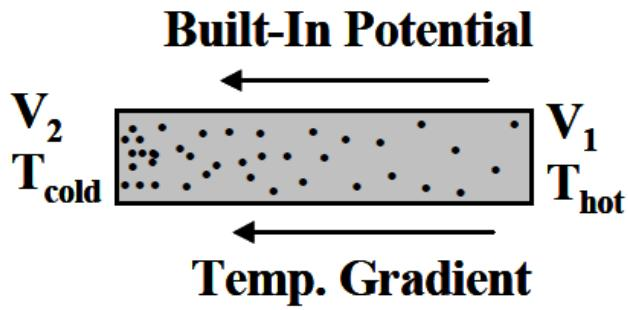  
Figure 11. Temperature Induced Voltage Potential (Yang 2007)

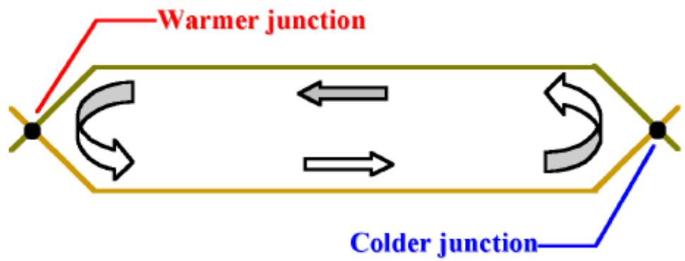  
Figure 12. The Seebeck Effect (Tellurex 2010a)

The amount of heat carried by the current in conductor A from the hot junction to the cold junction is greater than flow of heat carried by the current in conductor B from the cold junction to the hot junction. Thus, heat must be continuously added to the hot junction and removed from the cold junction to maintain the two junction temperatures.

## Peltier Effect

This effect is of primary interest in thermoelectric space-conditioning and other thermoelectric cooling applications. As with the Seebeck effect, the Peltier effect (Figure 13) is a result of joining two dissimilar conductors. This effect is actually the reverse of the Seebeck effect, and in many texts, the effects are considered the same. While the Seebeck effect does work through the generation of an electrical current when a load is connected across the potential, the Peltier effect uses work in the form of a DC electrical current to transport heat from one junction and reject it at the other. Again, heat is absorbed at one junction and rejected at the other because of the difference in the quantity of energy transported by charge carriers in the two conductors. The rate of heat transport is proportional to the applied current, and the proportionality coefficient is known as the Peltier coefficient. Note that the cold

junction and hot junction can be reversed simply by reversing the direction that current flows through the device.

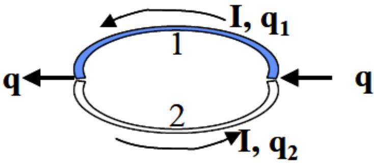  
Figure 13. The Peltier Effect (Yang 2007)

## Thomson Effect

This effect describes the heat absorption/rejection or electromotive force generation that occurs in a single conducting material. This effect results from the same heat transport mechanism as in the Seebeck and Peltier effects. If a temperature gradient exists over a conductor, an electromotive force results, as was shown in Figure 11. Alternatively, if current flows through a conductor over which a temperature gradient exists, heat will be absorbed or rejected. This effect has a smaller magnitude than the Seebeck or Peltier effects, but needs to be considered when designing a thermoelectric device.

## A Thermoelectric Device

A thermoelectric module (Figure 14) uses two semiconducting pellets (also called legs), one n-type and one p-type, that are connected electrically in series and thermally in parallel (Figure 15). It is possible to make a device using a single semiconductor pellet rather than connecting them (Figure 16), but it would not be able to pump enough heat to be of any practical use. It is also possible to connect the devices electrically and thermally in parallel (Figure 17), but such a device would draw an unrealistic amount of current. For example, a typical 254-pellet device constructed in this manner would draw over 1000 amps . By connecting n-type and p-type semiconductors in series, it is possible to produce a module that is large enough to provide a useful amount of heating/cooling or electrical power and still achieve a configuration that is thermally in parallel so that the heat flows in one direction. This works because the holes are repelled by positive charge and the electrons are repelled from negative charge. In the n-type material, the charge carriers (electrons) flow with the electrical current, and in the p-type material, the charge carriers (holes) flow against the current.

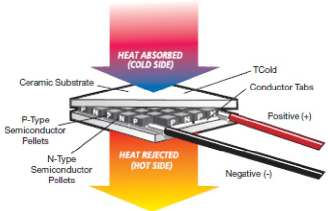  
Figure 14. A Complete Thermoelectric Module (Tellurex 2010b)

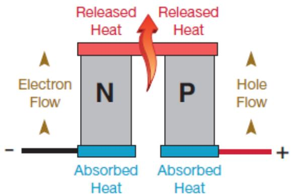  
Figure 15. Semiconductors Electrically in Series and Thermally in Parallel (Tellurex 2010b)

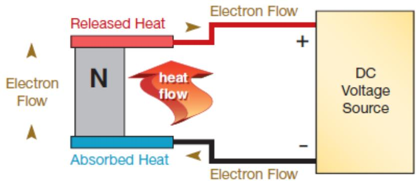  
Figure 16. Single Semiconductor Thermoelectric Heat Pump (Tellurex 2010b)

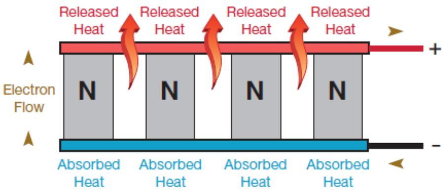  
Figure 17. Semiconductors Electrically and Thermally in Parallel (Tellurex 2010b)

## Thermoelectric Materials and the Figure-of-Merit

The best thermoelectric materials are electrically conductive, thermally insulating, and have a high Seebeck coefficient. Semiconducting material pairs are selected so that one charge carrier thermally dominates over the other. Thus, there are not competing heat flows within the device. A dimensionless quantity $( Z \mathsf { T } ) ^ { 5 }$ known as the figure-of-merit is a grouping of a material's electrical and thermal properties and is directly related to the efficiency of thermoelectric devices, as illustrated in Figure 18.

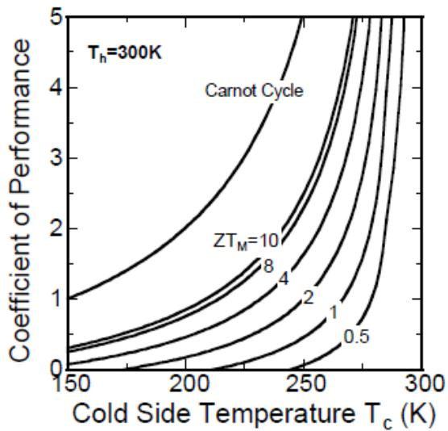  
Figure 18. Thermoelectric ZT and COP (Yang 2007)

## Prior Research

Major developments are presented in chronological order below.

• In 1821, Thomas Seebeck discovered thermoelectricity when he noticed that a compass needle would deflect when placed near a circuit constructed out of two different metals with the junctions at different temperatures.

In 1834, Jean Peltier observed the heating and cooling that occurred when current passed through junctions between two dissimilar metals.

• Four years later, Emil Lenz explained the observations made my Peltier. Heat is generated or absorbed at the junctions between the two metals. Lenz demonstrated the effect by freezing and then melting water by varying the direction of current flow.

In 1851, William Thomson (Lord Kelvin) explained the Seebeck and Peltier effects and discovered a thermodynamic relationship between the two. He also predicted, and later observed, a third thermoelectric effect known now as the Thomson effect.

•It was not until 1909 and 1911 that Edmund Altenkirch established the theory of thermoelectric engines and heat pumps. He also showed that good thermoelectric materials should have large Seebeck coefficients, high electrical conductivity, and low thermal conductivity.

•In the 1920s through the ${ 1 9 6 0 5 } ,$ semiconductor materials were produced that had Seebeck coefficients on the order of 100 μV/K. Previously, metals, with Seebeck coefficients around 10 $\mu \lor / \kappa ,$ were used.

• In 1949, Abram Loffe et al. established the modern theory of thermoelectric conversion.

• In 1954, H. J. Goldsmid and R. W. Douglas demonstrated thermoelectric cooling to below $0 \%$ in a room temperature environment.

A few years later, Loffe et al. showed that the ratio of electrical conductivity to thermal conductivity could be improved by adding isomorphous elements or compounds to the semiconductor.

Starting in the 1990s, several new methods for increasing the figure-of-merit were introduced. One was the introduction of phonon rattlers to reduce thermal conductivity while having little impact on electrical conductivity. Another was the use of low-dimensional structures (quantum wells, nanowires, and quantum dots) to fine-tune the properties of the material for better thermoelectric performance. Rama Venkatasubramanian and others were able to create thermoelectric materials with figure-or-merit above 2.0 (Majumdar 2009).

## Potential Performance

The efficiency of currently available thermoelectric cooling devices is only between 10-15% of Carnot (COP approximately 1-1.5), but this is based on semiconductor materials with ZT values around 1.0. Currently, the highest ZT values are in $\mathsf { B i } _ { 2 } \mathsf { T e } _ { 3 } .$ based superlattices and PbTe-based quantum dot superlattices, with values of approximately 2.5 and 2.0, respectively. However, neither of these materials has been implemented in commercial products, which suggests a potential doubling of efficiency or better is possible without further breakthroughs in materials. Higher ZT values would be required for thermoelectric devices to be competitive with vapor compression

The Seebeck, Peltier, and Thomson effects are thermodynamically reversible. However, joule heating, caused by electrical resistance in a conductor, is thermodynamically irreversible and thus causes loss of efficiency.

## R&D Status

Thermoelectric devices are the most mature of the advanced cooling technologies evaluated in this assessment, and several commercial products exist, albeit in niche markets. Industry leaders include Marlow, Melcor, ADV-Engineering, Thermoelectric Cooling America, and Tellurex. Marlow and Melcor account for the majority of the market.

Research focuses mainly on improving the efficiency of the technology by increasing ZT. The most often used, commercially available, thermoelectric materials are Bi₂Te₃-based alloys (ZT≈1.0 at room temperature), PbTe-based alloys (ZT≈0.9 at 700 K), and SiGe alloys (ZT≈0.7 at 1000 K). Other efforts are directed at reducing cost, improving the power factor,⁶ and developing environmentally friendly thermoelectric materials. The lowest practical temperature currently achievable is $\mathopen { } \mathclose \bgroup \left. - 1 0 0 ^ { \circ } \mathsf { C } , \right.$ and the highest is $8 0 ^ { \circ } \mathsf { C } .$ These temperature limits are caused by current manufacturing limitations and not any intrinsic limit of the technology.

Because of its relatively low efficiency and high cost, current applications of thermoelectric technology are confined to those where the following conditions exist.

• where the cooling load varies considerably,

• for spot cooling,

• where reliability and silent operation are important,

• for small cooling loads (less than 25-W),

• for small temperature differences (less than $1 0 ^ { \circ } \mathsf { C } ) .$

• when the ability to heat and cool with the same unit is important, and

• where space is limited.

Example applications are temperature stabilization in laboratory equipment, portable coolers, and cooling of electronics.

## Prospects Relative to Current State of the Art

Thermoelectric technology is currently too costly and its efficiency is too low to compete with vapor compression in most space cooling and food refrigeration applications. On the other hand, it is the most successful and the closest to competing with vapor compression of any of the cooling concepts evaluated in this assessment.

If cost and performance similar to vapor compression were achieved, the following advantages would tip the scales in favor of thermoelectric cooling.

•No moving parts, hence inherently reliable

• Higher cooling density, hence smaller equipment

• Able to switch from cooling to heating with the same equipment

• Proportional control capability

0 tracks set point temperature better

o higher part load performance

• Silent operation

• Does not use environmentally damaging refrigerants.

Even with development and application of the best ZT materials currently available, thermoelectric technology would not be competitive with vapor compression. Still higher ZT materials must be identified to allow thermoelectric cooling to compete with vapor compression. Therefore, despite the momentum associated with an existing industry coupled with relatively high ZT materials that have been identified, but not commercialized, the prospects for thermoelectric coolers were only rated “fair."

## Thermotunneling Cooling

Thermotunneling describes a process where the transfer of relatively energetic (i.e., warm) electrons from one surface to another is made possible by nanometer-scale gaps. Application of an external voltage causes the electron tunneling to proceed in one direction, resulting in cooling of the surface losing the energetic electrons. The potential efficiency is about the same as vapor compression technology. The concept is in its infancy and faces many difficult development issues, none of which were resolved in a recently completed 3-year DOE research project. Use of a vacuum for the gap eliminates the backward thermal conduction problem associated with both thermionic and thermoelectric concepts. However, creating and maintaining such a narrow gap over an area that would result in significant cooling is a daunting hurdle. This combination of high risk and moderate payoff makes thermotunneling an “average" prospect for R&D funding.

## Concept Description

Thermotunneling is a thermoelectric process where electron transfer from one surface to another is facilitated by the two surfaces being within a few nanometers of each other. Application of a low voltage potential across the surfaces allows relatively energetic electrons to transfer from one surface to the other. The relatively energetic electrons are replaced by electrons with average energy, thus cooling the first surface while heating the second surface. The use of low-work function materials are required to facilitate electron transfer7. The close proximity of the two surfaces allows electron transfer to occur at an energy level less than normally required, as if tunneling through the normal energy barrier. This process is also called field emission. The concept of thermal emission is illustrated in Figure 19a for the case of micron separation and Figure 19b for the case of nanometer separation

## Prior Research

In the early 1940s studies completed by Fleming and Henderson, and then Nottingham investigated the difference in energy between electrons emitted from a surface during field emission and replacement electrons. During the 1960s, Huffman investigated thermotunneling across thin layers of oxides between metal layers in the context of generating power from a thermal gradient. More recently (2003), Hishinuma et al. were able to measure the cooling effect created by the room-temperature emission of electrons across a 1-2 nm gap. Subsequently, General Electric was paid \$1.5M by the DOE to investigate thermotunneling for space cooling, but after a 3-year research program, they were unable to develop a prototype with a measureable cooling effect (Weaver et al. 2007).

(a)  
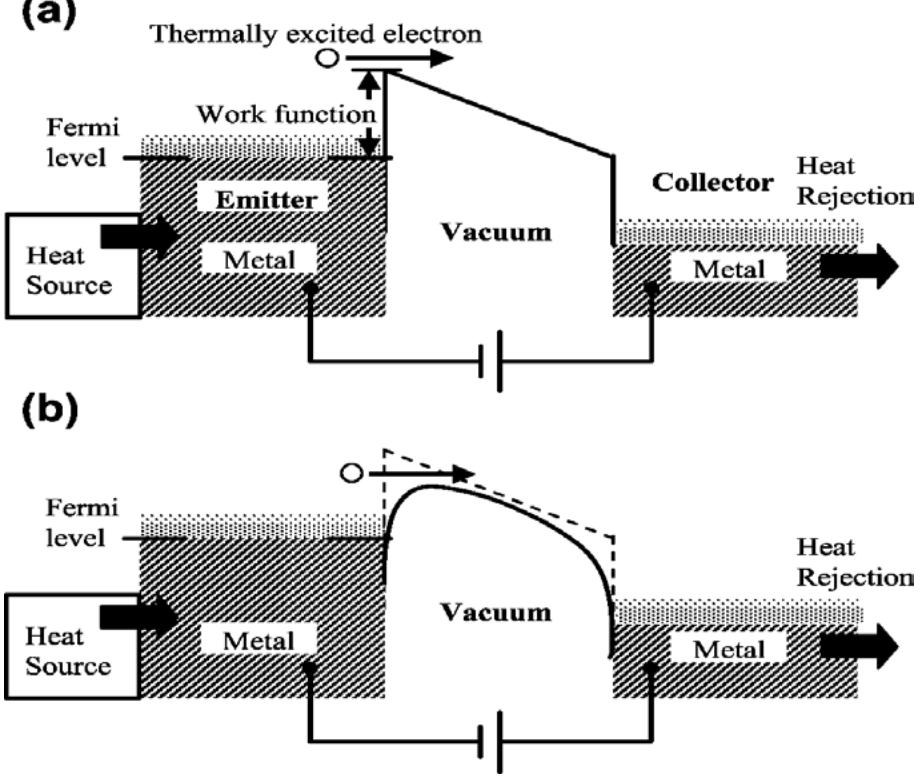  
Figure 19. Thermal Emission of Electrons (Hishinuma et al. 2003)

During an overlapping time period continuing to the present, Borealis Exploration Limited has developed nearly 40 patents related to the concept, but has not yet developed a commercial product (Borealis undated). Another current player is Tempronics, Inc., which claims to have developed a means for establishing and maintaining a 2-nm vacuum gap in a thermotunneling device and has recently published a paper on this subject (Enikov and Makansi 2008).

## Potential Performance

The theoretical performance of thermotunneling devices operating near room temperature has been estimated by GE, Borealis, and Tempronics to be in the range of 50% to 80% of Carnot. However, no performance data are known to have been reported for any thermotunneling hardware.

## R&D Status

Thermotunneling is in the infancy of product development with no testing results for systems or components reported in the literature, except for point electrodes. Extensive private development by Borealis suggests the possibility of product development and commercialization in the near future, but this remains to be seen. Key developmental hurdles include:

•Establishing and maintaining nm-scale gaps over cm square or larger areas.

•Keeping electrode materials clean during fabrication and assembly.

• Development of low (<= 1 eV) work function materials for designs using a vacuum gap.

• Development of more thermally resistant semiconductor materials for designs using nanostructured superlattices.

• Control of energy level of emitting electrons.

## Prospects Relative to Current State of the Art

The theoretical performance of thermotunneling for room-temperature cooling is similar to vapor compression technology, but the design hurdles will be difficult to overcome. The large number of patents held by Borealis suggests that product development may come sooner than otherwise expected, however, so the prospects for thermotunneling cooling were give an “average" rating.

## References

Backhaus, S. and G. Swift. 2000. A thermoacoustic-Stirling heat engine: Detailed study, The Journal of the Acoustical Society of America, Vol. 107, No. 6, pages 3148-3166.

Berson, A, M. Michard, and P. Blanc-Benon. 2008. Measurement of acoustic velocity in the stack of a thermoacoustic refrigerator using particle image velocity, Heat and Mass Transfer, Vol. 44, No. 8.

Borealis,http://borealis.com/technology/patents.shtml, undated.

Brown, G.V. 1976. Magnetic heat pumping near room temperature, Journal of Applied Physics, Vol. 47, 3673-3680.

Buscemi, K. 2005. Refrigeration and Air Conditioning: Sound Power, Appliance Design Magazine, April.

Cooling Device,http://coolingdevice.net/4.html, undated.

Engelbrecht, K., et al. 2005. A Numerical Model of an Active Magnetic Regenerator Refrigeration System, University of Wisconsin – Madison.

Enikov, E.T., and T. Makansi. 2008. Analysis of nanometer vacuum gap formation in thermotunneling devices, Nanotechnology, Vol. 19, 075703.

Garrett, S. and S. Backhaus. 2000. The Power of Sound, American Scientist, Vol. 88, No. 6, November-December.

Green, G. et al. 1990. A gadolinium-terbium active regenerator. Advanced Cryogenic Engineering, Vol. 35, 1165-1174.

Gschneidner, K.A. and V.K. Pecharsky. 2008. Magnetic Cooling – An Energy Efficient and Green Technology. EPRI Workshop to Address Basic Science and Research Needs for Energy Efficiency.

Hishinuma, Y., et al. 2003. Measurement of cooling by room-temperature thermionic emission across a nanometer gap, Journal of Applied Physics, Vol. 94, No. 3.

Hofler, T., et al. 1988. Acoustic Cooling Engine, U.S. patent number 4,722,201, February.

Huang, Y., E. Lou, et al. 2005. A Traveling Wave Thermoacoustic Refrigerator within Room Temperature Range, Cryocoolers 13, Ross, R., editor.

Kitanovski, A. et al. 2008. Application of Magnetic Refrigeration and its Feasibility, University of Applied Sciences of Western Switzerland.

Mahan, G. 1994. Thermionic Refrigeration, Journal of Applied Physics, Vol. 76, No. 7.

Mahan, G. and L. Woods. 1998. Multilayer Thermionic Refrigeration, Physical Review Letters, Vol. 80, No. 18.

Majumdar, A. 2009. Nature Nanotechnology, Vol. 4, pages 214-215.

Merkli, P. and H. Thomann. 1975. Thermoacoustic effect in a resonance tube, Journal of Fluid Mechanics Digital Archive, Vol. 70, No. 1, pages 161-177.

Nehdi, E, L Kairouani, and M Bouzaina. 2007. Performance analysis of the vapour compression cycle using ejector as an expander, International Journal of Energy Research, Vol. 31, pp 364- 375.

O’Dwyer, M., T.E. Humphrey, et al. 2006. The Effect of Barrier Shape on Thermionic Refrigerator Performance, Proceedings of SPIE, The International Society for Optical Engineering, Vol. 6035, January.

Pennsylvania State University Graduate Program in Acoustics, TRITON: Shipboard Thermoacoustic Cooler,http://www.acs.psu.edu/thermoacoustics/refrigeration/triton.htm undated.

Shakouri, A. and J. Bowers. 1997. Heterostructure integrated thermionic coolers, Applied Physics Letters, Vol. 71, No. 9.

Stoker, W. and J. Jones. 1982. Refrigeration and Air Conditioning, McGraw-Hill Book Company, New York.

Tellurex. 2010a. Frequently Asked Questions About Our Power Generation Technology. Traverse City, Michigan

Tellurex. 2010b. Frequently Asked Questions About Our Cooling and Heating Technology. Traverse City, Michigan.

Ulrich, M., P. Barnes, and C. Vining. 2001. Comparison of solid-state thermionic refrigeration with thermoelectric refrigeration, Journal of Applied Physics, Vol . 90, No 3.

U.S. Department of Energy, Research Call to DOE/Federal Laboratories, Advanced Energy Efficient Building Technologies, October 2009.

Weaver, S. et al. 2007. Thermotunneling Based Cooling Systems for High Efficiency Buildings, General Electric Global Research, Niskayuna, NY.

Wheatly, J. et al. 1983. An intrinsically irreversible thermoacoustic heat engine, The Journal of the Acoustical Society of America, pages 153-170.

Wikipedia,www.wikipedia.org, undated.

Yang, B. 2007. Thermoelectric Technology Assessment, Air Conditioning and Technology Research Institute, May.

Zhang, Y. et al. 2006. On-Chip High Speed Localized Cooling Using Superlattice Microrefrigerators, IEEE Transactions on Components and Packaging Technologies, Vol. 29, No 2.

## Distribution

## No. of Copies

6 U.S. Department of Energy EERE-Office of Planning, Budget and Analysis (EE-3B) 1000 Independence Avenue, S.W. Washington, DC 20585

Darrell Beschen David Boomsma Pat Booher Jeff Dowd Brian Unruh George Tzortzis

7 U.S. Department of Energy EERE-Building Technologies Program (EE-2J) 1000 Independence Avenue, S.W. Washington, DC 20585

Colin McCormick Joseph Hagerman Tony Bouza (5)

5 Sam Baldwin U.S. Department of Energy EERE-Board of Directors (EE-11) 1000 Independence Avenue, S.W. Washington, DC 20585

Mark Ginsberg Senior Technical Advisor (Buildings and Communities) EERE-Board of Directors (EE-11) U.S. Department of Energy 1000 Independence Avenue, S.W. Washington, DC 20585

## No. of Copies

Jacques Beaudry-Losique   
ActingDAS for Renewable Energy   
EERE- Office of the Deputy Assistant Secretary for Technology Development (EE-20)   
U.S. Department of Energy   
1000 Independence Avenue, S.W.   
Washington, DC 20585 Steve Chalk   
Principal Deputy Assistant Secretary   
EERE Office of Principal Deputy Assistant Secretary (EE-10)   
U.S. Department of Energy   
1000 Independence Avenue, S.W.   
Washington, DC 20585 David Rodgers   
Director, Strategic Planning & Analysis EERE Office of Principal Deputy Assistant Secretary (EE-10)   
U.S. Department of Energy   
EERE-Building Technologies   
Program (EE-2J)   
1000 Independence Avenue, S.W.   
Washington, DC 20585

3 Ed Barbour (3) Navigant Consulting 1801 K Street, NW Suite 500 Washington, D.C. 20006

M.D. Levine   
Ernest Orlando Lawrence Berkeley   
National Laboratory   
1 Cyclotron Road, 90-R3027D   
Berkeley, CA 94720

## Distribution

## No. of Copies

Jerry Dion   
FEMP (EE-2L)   
1000 Independence Avenue, S.W. Washington, DC 20585   
T. Chan   
Ernest Orlando Lawrence Berkeley   
National Laboratory   
1 Cyclotron Road, 90-R4000   
Berkeley, CA 94720   
L.L. Dale   
Ernest Orlando Lawrence Berkeley   
National Laboratory   
1 Cyclotron Road, 90-R4000   
Berkeley, CA 94720   
W. Short   
National Renewable Energy Laboratory   
617 Cole Boulevard, Mail Stop 2721   
Golden, CO 80401-3393   
Harvey Sachs   
American Council for an Energy-Efficient   
Economy   
1001 Connecticut Avenue, N.W.,   
Suite 801   
Washington, DC 20036 Jeff Harris   
Alliance to Save Energy 120018th Street, N.W. Suite 900   
Washington, DC 20036

## No. of Copies

John “Skip” Laitner Alliance to Save Energy 120018th Street, N.W. Suite 900 Washington, DC 20036

William Haslebacher   
National Energy Technology Laboratory   
3610 Collins Ferry Road   
P.O. Box 880   
Morgantown, WV 26507-0880

## Local Distribution

2 DOE Pacific Northwest Site Office W. F. Edwards K9-42

47Pacific Northwest National Laboratory

D. R. Brown (5) K6-10 J. A. Dirks (5) K6-10 N. Fernandez (5) K5-16 B. R. Kinzey Portland/1/OS S. C. McDonald (10) BWO A. K. Nicholls (5) BWO S. Somasundaram K5-20 E.G. Baker K2-20 T.B. Stout (5) K6-10 T. M. Weber (3) K6-05 Information Release Office (5) K1-06

