## Electrodynamic driver for the space thermoacoustic refrigerator (STAR)

<table><tr><td rowspan=1 colspan=1>Title</td><td rowspan=1 colspan=1>Electrodynamic driver for the space thermoacoustic refrigerator(STAR)</td></tr><tr><td rowspan=1 colspan=1>Item Type</td><td rowspan=1 colspan=1>Thesis</td></tr><tr><td rowspan=1 colspan=1>Authors</td><td rowspan=1 colspan=1>Fitzpatrick, Michele</td></tr><tr><td rowspan=1 colspan=1>URI</td><td rowspan=1 colspan=1>https://hdl.handle.net/10945/23204</td></tr><tr><td rowspan=1 colspan=1>Publisher</td><td rowspan=1 colspan=1>Monterey, California. Naval Postgraduate School</td></tr><tr><td rowspan=1 colspan=1>Date Issued</td><td rowspan=1 colspan=1>1988-03</td></tr><tr><td rowspan=1 colspan=1>Rights</td><td rowspan=1 colspan=1>This publication is a work of the U.S. Government as defined inTitle 17, United States Code, Section 101. Copyright protection isnot available for this work in the United States.</td></tr><tr><td rowspan=1 colspan=1>Download date</td><td rowspan=1 colspan=1>2026-08-25 02:04:06</td></tr><tr><td rowspan=1 colspan=1>Link to Item</td><td rowspan=1 colspan=1>https://hdl.handle.net/10945/23204</td></tr></table>

Downloaded from NPS Archive: Calhoun


# NAVAL POSTGRADUATE SCHOOL Monterey , California


THESIS

F48.355

ELECTRODYNAMIC DRIVER FOR THESPACE THERMOACOUSTIC REFRIGERATOR (STAR)

by

Michele Fitzpatrick

March 1988

Thesis Co-advisor:

Thesis Co-advisor:

S. L. Garrett

T. Hofler

Approved for public release; distribution is unlimited.

<table><tr><td rowspan=1 colspan=13>ECU..I LLASSIFICATION OF THIS PAGEREPORT DOCUMENTATION PAGE</td></tr><tr><td rowspan=2 colspan=6>1a. REPORTSCIUSSiFIECATION</td><td></td><td></td><td></td><td></td><td></td><td></td><td></td></tr><tr><td rowspan=1 colspan=7></td></tr><tr><td rowspan=2 colspan=6>2a. JECC.Y CLASSIFICATION AUTHORITY</td><td></td><td></td><td></td><td></td><td></td><td></td><td></td></tr><tr><td rowspan=2 colspan=7>DISTRIBUTION/AVAILABILITY OF REPORTApproved for public release;distribution is unlimited.</td></tr><tr><td rowspan=1 colspan=6>2b. DECLASSIFICATION/DOWNGRADING SCHEDULE</td></tr><tr><td rowspan=2 colspan=6></td><td></td><td></td><td></td><td></td><td></td><td></td><td></td></tr><tr><td rowspan=1 colspan=7>5 MONITORING ORGANIZATION REPORT NUMBER(S)</td></tr><tr><td rowspan=1 colspan=5>6a NAME OF PERFOPMING ORGANIZATIONNaval Postgraduate School</td><td rowspan=1 colspan=1>6b OFFICE SYMBOL(If applicable)61Gx</td><td rowspan=1 colspan=7>7a NAME OF MONITORING ORGANIZATIONNaval Postgraduate School</td></tr><tr><td rowspan=2 colspan=6>6c. ADDRESS (City, State, and ZIP Code)Monterey,CA 93943-5000</td><td></td><td></td><td></td><td></td><td></td><td></td><td></td></tr><tr><td rowspan=1 colspan=7>7b. ADDRESS (City, State, and ZIP Code)Monterey, CA 93943-5000</td></tr><tr><td rowspan=3 colspan=6>8a. NAME OF FUNDING/SPONSORING(f annlicahla)ORGANIZATIONCode 1112Office of Naval Research</td><td></td><td></td><td></td><td></td><td></td><td></td><td></td></tr><tr><td rowspan=1 colspan=7>9. PROCUREMENT INSTRUMENT IDENTIFICATION NUMBER</td></tr><tr><td rowspan=2 colspan=7>10. SOURCE OF FUNDING NUMBERS</td></tr><tr><td></td><td rowspan=2 colspan=5>8c. ADDRESS (City, State, and ZIP Code)800 N. Quiney St.Arlington,VA 22217</td></tr><tr><td></td><td rowspan=1 colspan=2>PROGRAMELEMENT NO</td><td rowspan=1 colspan=1>PROJECTNO</td><td rowspan=1 colspan=3>TASKNO</td><td rowspan=1 colspan=1>WORK UNITACCESSION NO</td></tr><tr><td></td><td rowspan=1 colspan=12>11. TITLE (Include Security Classification)ELECTRODYNAMIC DRIVER FOR THE SPACE THERMOACOUSTIC REFRIGERATOR (STAR)</td></tr><tr><td></td><td rowspan=1 colspan=12>12. PERSONAL AUTHOR(S)Fitzpatrick,Michele</td></tr><tr><td></td><td></td><td></td><td></td><td rowspan=2 colspan=2>13b TIME COVERED</td><td rowspan=2 colspan=5>14. DATE OF REPORT (Year, Month, Day)</td><td rowspan=2 colspan=2>15 PAGF COUNT197</td></tr><tr><td rowspan=10 colspan=13>18 SUBJECT TERMS (Continue on reverse if necessarv and identify by block number)17.                 COSATI CODESISTRIBUTION/AVAILABILITY OF ABSTRACTCYMBOLTEIED223. NAME OF RESPONSIBLE INDIVIDUALSECURITY CLASSIFICATION OF THIS PAGE83 APR edition may be used until exhaustedDD FORM 1473, 84 MAR                                                                                         U.S. Government Printing Office: 1986—606All other editions are obsoletei                                     UNCLASSIFIED</td></tr><tr><td rowspan=1 colspan=12></td></tr><tr><td rowspan=1 colspan=4></td><td rowspan=4 colspan=8>Electrodynastic lefrigeakto</td></tr><tr><td rowspan=1 colspan=1>FIELD</td><td rowspan=1 colspan=1>GROUP</td><td rowspan=1 colspan=2>SUB-GROUP</td></tr><tr><td rowspan=1 colspan=1></td><td rowspan=1 colspan=1></td><td rowspan=1 colspan=2></td></tr><tr><td rowspan=1 colspan=1></td><td rowspan=1 colspan=1></td><td rowspan=1 colspan=2></td></tr><tr><td rowspan=1 colspan=12></td></tr><tr><td rowspan=2 colspan=5>20ISTRIBUTION/AVAILABILITY ASSME AS RPTDTIC USERS</td></tr><tr><td rowspan=1 colspan=6>21 AUSTCACTSECURIYCLASSIFICATION</td></tr><tr><td rowspan=1 colspan=5>2S NAME OF RESPONSIELE INDIVIDUAL</td><td rowspan=1 colspan=3>408-646-25.40</td><td rowspan=1 colspan=3></td></tr></table>

Approved for public release; distribution is unlimited.

Electrodynamic Driver for the Space Thermoacoustic Refrigerator (STAR)

by

Michele,Fitzpatrick Lieutenant, United States Coast Guard B.S.. United States Coast Guard Academy, 1980

Submitted in partial fulfillment of the requirements for the degree of

MASTER OF SCIENCE IN PHYSICS

from the

NAVAL POSTGRADUATE SCHOOL March 1988

## ABSTRACT

The cbjective of the STAR project is to test and space

qualify a new continuous cycle cryogenic refrigeration

system for cooling of sensors and electronics which is based

upon the newly discovered thermoacoustic heat pumping

effect. The new refrigerator has no sliding seals, a cycle

frequency of about 3oo Hz, and uses acoustic resonance to

enhance the overall power density and efficiency. This

thesis is concerned specifically with the design and testing

of the electrodynamic transducer which is responsible for

the electro-acoustic power conversion. A computer model of

the driver/resonator system is presented along with  the

techniques for measurement of the electrical and mechanical

parameters used as input for the model.

A final driver design (including dimensional drawings)

utilizing a modified JBL 2450J neodymium-iron-boron

compression driver and associated leak-tight electrical

feed-throughs, microphone, accelerometer, pressure gage.

pressure housing, and resonator interface is provided.

## TABLE OF CONTENTS

I. INTRODUCTION-  
A. BACKGROUND   
1. History   
2. Thermodynamics-  
3. Overall Efficiency   
B. SPACE THERMOACOUSTIC REFRIGERATOR (STAR)--   
1. Motivation-  
2. Get Away Special (GAS) Program-  
3. Shared Sub-systems from NASA G-313--   
C. SCOPE-- 6   
II. THEORY--   
A. THERMOACOUSTIC THEORY-  
1. Qualitative Picture   
2. Single Plate  
à. Heat Flow   
b. Work Flow   
c. Efficiency   
3. Short Stack-  
4。 Design Considerations-  
B. DRIVER REQUIREMENTS-  
C. ELECTRODYNAMIC THEORY-  
1. Physics- 6   
2. Equivalent Circuit- 9   
3. Losses-  
D. COUPLED SYSTEM-  
1. Computer Model   
a. Input  
b. Output   
2. Assumed Typical Parameters   
III. DRIVER PARAMETER MEASUREMENTS   
A. INTRODUCTION-- 4   
B. IMPEDANCE ANALYZER-  
C. MECHANICAL PARAMETERS-  
1. Dynamic Mass Loading of Driver   
2. Bellows Parameters-  
3. Combined System- 5   
D. TRANSDUCTION COEFFICIENT (BL)   
E. MICROPHONE CALIBRATION- 9   
F. ELECTROACOUSTIC EFFICIENCY--   
G. COMPARISON TO COMPUTER MODEL-  
1. Mechanical Resistance   
2. Model Results-  
H. DRIVER RESONANCE ALTERATION--   
IV. STAR DRIVER PARAMETERS-  
A. INTRODUCTION--   
1. Interface with NASA GAS Cannister   
2. Maximizing Electroacoustic Efficiency   
3. Driver Selection-------------- -—-----91   
B. NIB PARAMETERS----- ----93   
1. Moving Mass and Suspension Stiffness------95   
2. Transduction Coefficient (Bl)-------------97   
3. Mechanical Resistance--------------------103   
C. MODELED EFFICIENCY----   
1. Input Values for Pure Helium-------------113   
2. Input Values for Helium-Xenon------------114   
3. Computer Model Results-------------------119   
V.STAR DRIVER CONSTRUCTION-------------------------129   
A. INTRODUCTION----   
B. DESIGN CONSIDERATIONS------------------------132   
1. Electrical Feed-Throughs-----------------132   
2. Measurement Devices----   
VI.CONCLUSION AND RECOMMENDATIONS-------------------144   
APPENDIX A - Computer Model Calculation Program-------146   
APPENDIX B - Computer Model Graph Program-------------151   
APPENDIX C - STAR Driver Dimensional Drawings---------156   
APPENDIX D - STAR Driver List of Materials------------167   
REFERENCES----- -------------16   
INITIAL DISTRIBUTION LIST-- -----171   
II-1 Computer Model Input--Example Data------   
III-1 Bellows Stiffness--Static Measurement Results----64   
III-2 Static Measurement of Altec 290-16K   
Transduction Coefficient- 6   
III-3 Electroacoustic Efficiency Measurements-.   
III-4 Computer Model Input--Altec 290-16K in Air-------80   
III-5 Results of Altec 290-16K Driver Resonant   
Frequency Alteration-  
IV-1 Static Loading of NIB Driver to Determine   
Suspension Stiffness and Transduction   
Coefficient-  
IV-2 Comparison Data for the Three Drivers-  
IV-3 Computer Model Input--JBL NIB in Helium   
Pressurized to Ten Atmospheres at   
Temperature = 250K-  
IV-4 Computer Model Input--JBL NIB in Helium-  
Xenon Pressurized to Ten Atmospheres at   
Temperature = 250K-  
IV-5 Computer Model Results for NIB Driver--   
Peak Electroacoustic Efficiency (%)--   
V-1 Helium Leak Detector Test Results on Copper   
Wire-Epoxy

## LIST OF FIGURES

I-1 The Thermodynamics of (a) Prime Movers and   
(b) Refrigerators   
I-2 Basic Thermoacoustic Refrigerator   
I-3 Chain of Energy Transformations in a   
Thermoacoustic Refrigerator   
I-4 Schematic of the Space Thermoacoustic   
Refrigerator in its Get Away Special   
Cannister   
I-5 Block Diagram of the Electronics for the   
Space Thermoacoustic Refrigerator   
I-6 Photograph of Hofler's (1986) Prototype   
Refrigerator   
II-1 Gas Parcel Diagram   
II-2 Schematic of an Electrodynamic Transducer   
II-3 Electrodynamic Transducer--Forced Simple   
Harmonic Oscillator Model-  
II-4 Equivalent Electrical Circuit for the   
Electrodynamic Transducer   
II-5 Computer Model Sample Output--Driver Voltage vs.   
Frequency for One Ampere Current into Driver- -48   
II-6 Computer Model Sample Output--Piston Velocity   
vs. Frequency for One Ampere into Driver- 49   
II-7 Computer Model Sample Output--Acoustic   
Power vs. Frequency for One Ampere- 5   
II-8 Computer Model Sample Output--Electroacoustic   
Efficiency vs. Frequency   
III-1 Least Squares Fit of Period Squared vs. Added   
Mass to Determine Stiffness and Moving Mass of   
the Altec 290-16K Driver-  
III-2 Photograph of Servometer Custom-Designed   
Dynamic Bellows--With and Without Test Stand----61   
III-3 Photograph of Linear Variable Differential   
Transformer (LVDT) in its Calibration Stand-----62   
III-4 Calibration Data for LVDT Voltage Output vs.   
Displacement 63   
III-5 Least Squares Fit of Period Squared vs. Added   
Mass for Dynamic Loading of Bellows- -63   
III-6 Least Squares Fit of Period Squared vs. Added   
Mass for Combined Driver-Reducer-Bellows   
System- 66   
III-7 Driver Displacement vs. Voice Coil Current as   
Measured with LVDT/Lock-in Analyzer- 66   
III-8 Photograph of Altec 290-16K Driver Assembly   
with Resonator Tube and Endevco Microphone-  
III-9 Altec 290-16K Modified Impedance Magnitude vs   
Frequency-  
III-10 Altec 290-16K Modified Impedance Phase Angle   
vs. Frequency--Full Frequency Range- 78   
III-11 Least Squares Fit of Altec 290-16K Modified   
Impedance Phase Angle as a Function of   
Frequency Near Resonance 78   
III-12 Computer Model Output for Altec 290-16K--   
Driver Voltage vs. Frequency for One Amp---- -81   
III-13 Computer Model Output for Altec 290-16K--   
Piston Velocity vs. Frequency for One Amp-- -82   
III-14 Computer Model Output for Altec 290-16K--   
Acoustic Power vs. Frequency for One Amp- -83   
III-15 Computer Model Output for Altec 290-16K--   
Electroacoustic Efficiency vs. Frequency---- --84   
IV-1 Schematic Drawing of JBL 2445J Driver- 92   
IV-2 Photographs of JBL Neodymium-Iron-Boron   
Driver- 94   
IV-3 Least Squares Fit of Period Squared vs.   
Added Mass for NIB Driver in Air- 96   
IV-4 Least Squares Fit of Period Squared vs.   
Added Mass for NIB Driver in Vacuum- 96   
IV-5 MTI-1ooo Photonic Sensor with NIB Driver------   
IV-6 Calibration Data for Photonic Sensor   
Voltage Output vs. Displacement- 101   
IV-7 Least Squares Fit of DC Current Through   
Voice Coil vs. Photonic Voltage Output-- --101   
IV-8 NIB Impedance Magnitude vs. Frequency-- -104   
IV-9 NIB Impedance Phase Angle as a Function of   
Frequency--Full Frequency Range-- 106   
IV-10 NIB Impedance Phase Angle as a Function of   
Frequency--Linear Segment Near Resonance---- --106   
IV-11 Sample of Free Decay Output from Nicolet   
310 Storage Oscilloscope- -108   
IV-12 Semi-log Plot of Amplitude vs. Period Number   
for NIB Free Decay in Air- -109   
IV-13 Semi-log Plot of Amplitude vs. Period Number   
for NIB Free Decay in Vacuum- -109   
IV-14 Photographic Comparison of the Three Drivers   
--Altec 290-16K, JBL 2445J, and JBL NIB--------112   
IV-15 Photograph of JBL NIB Driver with (a) Reducer   
and (b) Bellows--- -116   
IV-16 Computer Model Output for NIB with Helium   
(Bl = 15, Q = 20)--Driver Voltage vs.   
Frequency for One Amp-- 120   
IV-17 Computer Model Output for NIB with Helium   
(Bl= 15. Q = 20)--Piston Velocity vs.   
Frequency for One Amp-- 121   
IV-18 Computer Model Output for NIB with Helium   
(Bl = 15, Q = 20)--Acoustic Power vs.   
Frequency for One Amp-  
IV-19 Computer Model Output for NIB with Helium   
(Bl = 15. Q = 20)--Electroacoustic   
Efficiency vs. Frequency--   
IV-20 Computer Model Output for NIB with Helium-  
Xenon (Bl = 15, Q = 20)--Driver Voltage vs.   
Frequency for One Amp- 124   
IV-21 Computer Model Output for NIB with Helium-  
Xenon (Bl = 15. Q = 20)--Piston Velocity   
vs. Frequency for One Amp   
IV-22 Computer Model Output for NIB with Helium-  
Xenon (B1 = 15, Q = 20)--Acoustic Power   
vs. Frequency for One Amp   
IV-23 Computer Model Output for NIB with Helium-  
Xenon (Bl = 15, Q = 20)--Electroacoustic   
Efficiency vs. Frequency- 127   
V-1 Cross-sectional Schematic of the STAR Driver   
Housing- 130   
V-2 Cross-sectional Schematic of the Helium Leak   
Detector Test Fixture -134   
V-3 Photograph of the Helium Leak Detector Test   
Fixture 35   
V-4 Driver Housing Feed-through Plug for the   
Electrical Leads- 138   
V-5 Example of Wire Lead Connectors for Feed-  
Through Plug: (a) Single Wire and   
(b) Co-axial Cable- 140   
V-6 [C Pressure Transducer and Driver Housing   
Plug Fitting- 142   
C-1 NIB Driver with all Housing Parts and   
Test Lid- -156   
C-2 Driver Housing--Resonator View 157   
C-3 Driver Housing--Side View AA- -158   
C-4 Feed-Through for Electrical Leads- -159   
C-5 Driver Housing--Side View BB- 160   
C-6 DC Pressure Transducer and Feed-Through Plug---161   
C-7 Driver Housing Lid View 162   
C-8 Aluminum Pusher Plate 163   
C-9 Pressure Lid 164   
C-10 Pressure and Helium Leak Test Lid-- 165   
C-11 Reducer Cone

## ACKNOWLEDGEMENT

The author would like to thank Mr. Fancher M. Murray.

P. E..a Research Fellow JBL Incorporated, for his

cooperation in providing the modified Harmon-JBL!(Tm>

neodymium-iron-boron electrodynamic driver for use in the

Space Thermoacoustic Refrigerator (STAR). The author would

also like to thank her thesis advisors for their assistance,

interesting discussions, and inspiration.

## I. INTRODUCTION

## A. BACKGROUND

## 1. History

Thermoacoustics can generally be described as the

study of the interaction between heat and sound. Scientific

interest in this interaction is not new. Lord Rayleigh (1878

and 1945) discussed various qualitative examples of the

production of sound oy heat. In one of these examples he

describes investigations by Sondhauss (1850) of an effect

observed by glassblowers: heating a bulb of glass at the

end of a hollow rod occasionally led to the generation of

sound. Faraday (1818) demonstrated that this effect occurred

with gases other than air. Sondhauss proved that the vibra-

tion of the glass itself did not generate the sound, but he

offered no explanation as to what did. In his description of

Sonhauss' work,Rayleigh stressed the importance of the

phase difference between temperature and particle motion.

Rijke (1859) built an open tube with a wire mesh inside.

When the mesh was heated, the tube produced a sound of

impressive intensity. The functioning of this oscillator is

slightly different since it requires steady gas flow for its

operation. A similar sound production effect was observed by

Taconis, et al.(1949) in hollow tubes immersed in liguid

helium (4.2-K). The Taconis oscillations were addressed

quantitatively by Yazaki, et al. (1980). The work described

above deals primarily with prime movers--devices that con-

vert a temperature gradient to sound energy. We call this

the classical era of thermoacoustics.

Interest in thermoacoustics was renewed when the

idea of the use of acoustical devices as refrigerators

appeared. Gifford and Longsworth (1966) described the pump-

ing of heat along a surface caused by a periodic change in

the pressure of the adjoining gas. Such a change can be

produced by the oscillations of a sound wave. In their

experiments Merkli and Thomann (1974) explored the heating

and cooling effects on the wall of a gas-filled resonant

tube. They found that heat was transported from a region

near the velocity antinode (or maximum value) of the sound's

standing wave to regions near the adjacent pressure anti-

nodes. Thermoacoustic prime movers have also received recent

attention. Kempton (1976) investigated the excess noise of

aeroengines above that predicted by theory. He determined

that the sound was produced by unsteady heat transfer. Each

of these latter three groups of exprimenters used some

theory for comparison, but it was mostly qualitative. None

provided the complete quantitative theory that would explain

their experimental observations.

The theoretical breakthrough in thermoacoustics

field was made by Nicklaus Rott (1969, 1974.1975, and

1980). His theory combined basic principles from physics,

thermodynamics, and acoustics to quantitatively describe the

effects found in both types of thermoacoustic devices: prime

movers and heat pumps. Prime movers use a temperature gra-

dient to create sound, as in the effects discussed by Sond-

hauss, Rayleigh, Taconis, and Kempton. Heat pumps, or refri-

gerators, use the oscillating pressure of a sound wave to

produce a temperature difference, as described by Gifford

and Longsworth and Merkli and Thomann. Rott described the

effect found by Merkli and Thomann as thermoacoustic stream-

ing. It is this effect that makes thermoacoustic refrigera-

tion possible.

Inspired by Ceperley's (1979) traveling wave Ster-

ling Cycle heat engine and Rott's quantitative theory, the

team of Wheatley, Hofler, Swift, Migliori, and Garrett

(1982, 1983a, 1983b, 1985, and 1986) developed a series of

thermoacoustic experiments at Los Alamos National Laboratory

in New Mexico. They investigated the basic thermoacoustic

effects in both prime movers and refrigerators and compared

their experimental results to Rott's theory.

2. Thermodynamics

We'll digress from history here to explain the ther-

modynamic distinction between prime movers and refrigera-

tors. This discussion follows Sears and Salinger (1975). A

prime mover receives heat at a high temperature, T (the hot

reservoir), does work on its surroundings, and rejects heat

at a lower temperature, Tc (the cold reservoir), as shown in

Figure I-1.a. The first law of thermodynamics tells us that

the heat flow (Q) from the hot reservoir must equal the

work done on the surroundings (W) plus the heat flow (Qc) to

the cold reservoir:

$$
a _ { n + } = w + a _ { c } .\tag{I-1}
$$

The second law of thermodynamics states that in every pro-

cess the entropy of the universe must either remain constant

or increase. The entropy change for the isothermal heat

transport to/from the reservoirs is defined as the heat flow

divded by the reservoir temperature. For a prime mover the

second law can be written:

$$
\Delta \mathrm { S } _ { \mapsto } \quad \dot { \hat { \omega } } _ { \sf C } \quad \quad \mathrm { o r } \quad \quad \mathsf { O } _ { \sf H } / \mathrm { T } _ { \sf H } \quad \hat { \Xi } \quad \mathsf { O } _ { \sf C } / \mathrm { T } _ { \sf C } .\tag{I-2}
$$

The thermal efficiency of the prime mover is defined as the

ratio of the work output to the heat input:

$$
n = W / O H = ( O H - O _ { 2 } ) / O _ { 1 } + = 1 - O _ { 2 } / O _ { 1 } .\tag{I-3}
$$

Comparing equations I-2 and I-3 gives us a limit on the

efficiency based on the temperatures of the reservoirs:

$$
\Pi \leq 1 - \mathbb { T } _ { \mathbf { e } / \mathbf { H } } .\tag{I-4}
$$

This limit is known as the Carnot efficiency.

In a refrigerator the process is basically reversed

(see Figure I-1.b). Heat (Qc) is removed from the low tem-

perature reservoir, work (W) is received from the surroun-

dings, and heat (Qm) is delivered to the higher temperature

reservoir. The expression for the first law is the same as

for the prime mover, Equation I-1. For the refrigerator it

means that the heat flow into the hot reservoir must equal

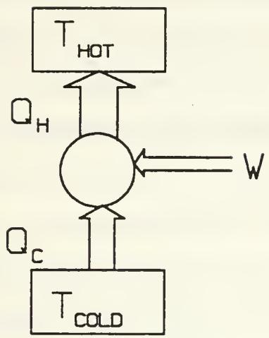  
(a)

$$
F l R S T L A V : G _ { H } = V + a _ { c }
$$

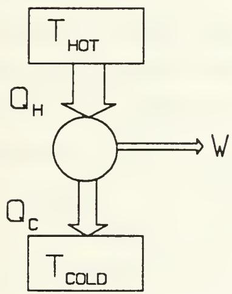  
(b)  
Figure I-1. The Thermodynamics of (a) Prime Movers and (b) Refrigerators.

SECOND LAV: $\frac { a _ { 1 } } { T _ { M } } \geq \frac { a _ { c } } { T _ { c } }$

COEFFICIENT OF PERFORMANCE:

$$
\cos \theta = \frac { a _ { c } } { v } \leq \frac { T _ { c } } { T _ { H } - T _ { c } }
$$

$$
F l R S T L A W : G _ { H } = V + a _ { c }
$$

SECOND LAW: $\frac { a _ { 1 } } { T _ { H } } \leq \frac { a _ { c } } { T _ { c } }$

EFFICIENCY:

$$
n = \frac { v } { a _ { n } } \leq 1 - \frac { T _ { c } } { T _ { H } }
$$

the heat flow from the cold reservoir plus the work done to

the system. The second law for this case is:

$$
\Delta S _ { H } \cong \Delta S _ { C } \quad \mathrm { o r } \quad \mathcal { Q } _ { H } / \mathbb { T } _ { H } \quad \cong \quad \mathcal { Q } _ { C } / \mathbb { T } _ { C } .\tag{I-5}
$$

The efficiency parameter for the refrigerator is called the

coefficient of performance (CoP). It is defined as the ratio

of the heat flow from the cold reservoir to the work input

to the refrigerator, or:

$$
\cos P = \theta _ { e } / W = \theta _ { e } / ( \theta _ { H } - \theta _ { O } ) \leq \frac { 1 } { 2 } \sin ( \pi _ { H } - \pi _ { C } ) .\tag{I-6}
$$

The limit is known as the Carnot coefficient of performance.

The work in this thesis deals solely with reirigera-

tors. Even though prime movers are mentioned from time to

time. the primary focus of the rest of our discussion will

be refrigerators.

3. Overall Efficiency

According to Hofler (1986), the early thermoacoustic

work at Los Alamos focused on experimental refrigerating

engines. The performance of these engines fell short of

expectations, leading to simple experiments on basic thermo-

acoustic effects and a proof-of-principle experiment on

thermoacoustic refrigeration. Hofler then applied the Rott

theory to the experimental systems and solved the resulting

equations numerically. For his doctoral dissertation from

the University of California, San Diego, Hofler designed and

constructed a completely functional thermoacoustic refriger-

ator. He also made accurate measurements of its thermody-

namic efficiency, and used this efficiency to make compari-

sons to the Rott theory. After receiving his doctorate,

Hofler came to the Naval Postgraduate School (NPS) as à

post-doctoral fellow, and brought his prototype refrigerator

with him.

The purpose of this thesis, in conjunction with the

work of several other students, is to modify Hofler's re-

frigerator design in order to improve its overall efficien-

cy and make it suitable for space cryocooler applications.

The basic design of the thermoacoustic refrigerator is shown

schematically in Figure I-2. The driver (A), which produces

the sound waves, is coupled via bolts to the resonator (D)

via a reducer cone (B) and bellows (C). Inside the resonator

is a stack of plastic plates (E) and their heat exchangers

(F) which allow the heat to be removed from the hot end ard

absorbed by the cold end. It is the interaction between the

sound waves and the plastic plates that produces a tempera-

ture difference across the plates and/or pumps heat from the

cold heat exchanger to the hot heat exchanger. A brief

description of efficiency would be useful here. Figure I-3

shows a diagram of the chain of energy transformations which

occurs in a thermoacoustic refrigerator. There are three

conjugate variable pairs (V and I; P and U; and ΔT and Qc),

and two transformations (electrical-to-acoustical and acous-

tical-to-thermal).

We start with electrical input power to the driver,

which can be calculated (using r.m.s. values) with:

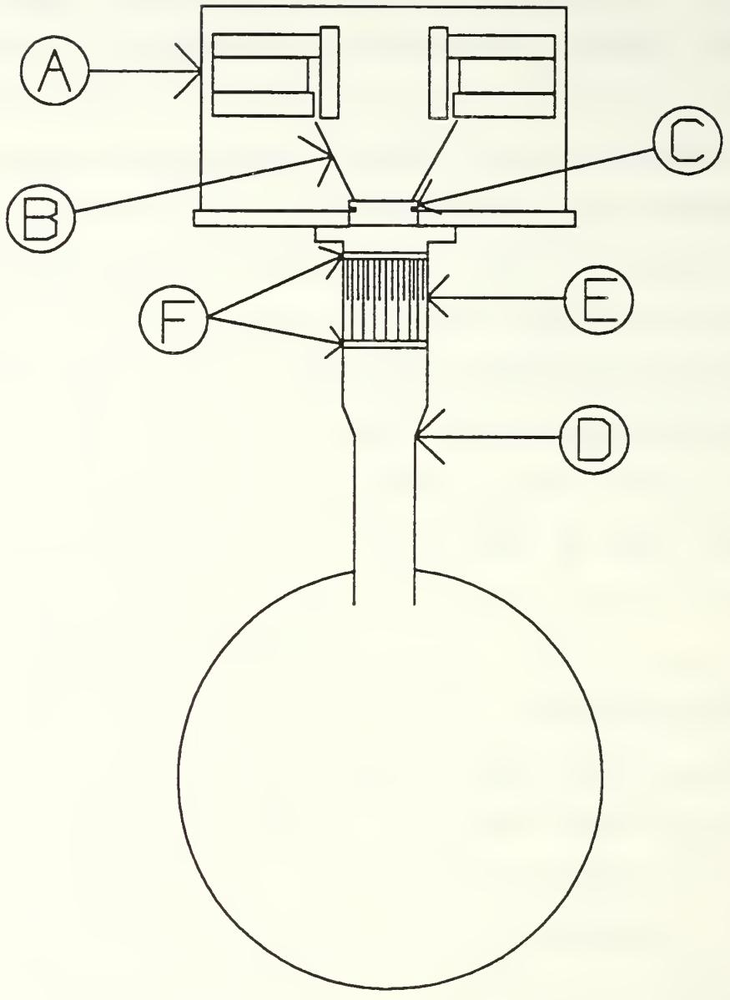  
Figure I-2. Basic Thermoacoustic Refrigerator Showing (A) Driver, (B) Reducer Cone, (C) Bellows, (D) Resonator, (E) Stack, and (F) Heat Exchangers.

DRIVER REFRIGERATOR

$$
\begin{array} { r } { \overbrace { \underbrace { \boldsymbol { \nabla } \boldsymbol { \cdot } \mathrm {  ~ \nabla ~ } \boldsymbol { \mathrm { I } } } _ { \mathrm { \texttt { { s l u s e } } } } } ^ { \substack { \sum \mathrm { L E C T R I C } } } } \\ { \overbrace { \underbrace { \boldsymbol { \nabla } \boldsymbol { \mathrm { I } } } _ { \mathrm { \texttt { { s l u s e } } } } } ^ { \substack { \sum \mathrm { { I } } } } = \underbrace { \overbrace { \boldsymbol { \mathrm { F } } \boldsymbol { \mathrm { I } } \boldsymbol { \mathrm { E } } \boldsymbol { \Gamma } \boldsymbol { \mathrm { R } } \boldsymbol { \mathrm { I } } \boldsymbol { \mathrm { C } } } ^ { \substack { \mathrm { F C O U S T I C } } } } _ { \substack { \mathrm { T 0 } \cdot \mathrm { \texttt { V } } } } \left[ \begin{array} { l } { \texttt { N C O U S T I C } } \\ { \texttt { P . U } } \\ { \texttt { V } } \\ { \texttt { P l e o s e } } \end{array} \right] \underbrace { \texttt { N C D I C I S T I C } } _ { \substack { \mathrm { T + E R M L } } } \left[ \begin{array} { l } { \boldsymbol { \mathsf { T } } \boldsymbol { \mathsf { H } } \boldsymbol { \mathrm { E } } \boldsymbol { \mathrm { R } } \boldsymbol { \mathrm { A } } \boldsymbol { \mathrm { L } } } \\ { \texttt { D } \boldsymbol { \bar { \cdot } } \boldsymbol { \mathrm { \texttt { G } } } } \\ { \texttt { T } \boldsymbol { \mathsf { H } } \boldsymbol { \mathsf { E } } \boldsymbol { \mathrm { R } } \boldsymbol { \mathsf { I } } } \end{array} \right] } \end{array}
$$

ELECTROACOUSTIC

REFRIGERATOR

EFFICIENCY

COEFFICIENT OF

PERFORMANCE

$$
n _ { E A } = \frac { V } { P _ { = 1 0 0 } }
$$

$$
C O P = \frac { O _ { c } } { v }
$$

OVERALL THERMOACOUSTIC EFFICIENCY

$$
n _ { _ { T A } } = \frac { \theta _ { 0 } } { \rho _ { _ { \_ { \ / \infty } } } } = n _ { _ { E A } } \cdot \mathsf { C O P }
$$

Figure I-3. Chain of Energy Transformations in a Thermoacoustic Refrigerator.

$$
\mathsf { P } _ { \bullet ^ { 1 } \bullet \bullet } = \texttt { I V } \mathsf { c o s } \ \sharp ,\tag{I-7}
$$

where I is the current into the electroacoustic driver, V is

the voltage across the driver terminals,  is the phase

angle between I and V, and cos θ is known as the "power

factor." An electrodynamic driver converts the electrical

power to acoustic power (the first transformation). Analo-

gous with the previous definition of the electrical input

power, the acoustic power is given by:

$$
\vec { \mathbb { W } } = \texttt { P U } \cos \texttt { \Rightarrow } ,\tag{I-8}
$$

where P is the acoustic pressure. U is the volumetric velo-

city which equals the product of particle velocity and

resonator cross-sectional area, and  is the phase angle

between them. The efficiency of this electroacoustic trans-

formation is given by:

$$
\begin{array} { r c l } { { \bar { \Psi } \equiv \mathsf { a } } } & { { = } } & { { \bar { \mathsf { W } } / \mathsf { P } _ { \Xi \iota _ { \mathsf { L E C } } . } } } \end{array}\tag{I-9}
$$

In the second transformation, the refrigerator con-

verts the acoustic power to a temperature gradient (zT) and

heat flow (Q). As discussed previously, the efficiency for

this transition is given as the coefficient of performance:

$$
{ \mathsf { C O P } } ~ = ~ { \mathsf { O } } _ { \mathsf { C } } / { \mathsf { A } } .\tag{I-10}
$$

The overall thermoacoustic efficiency is therefore the pro-

duct of the efficiencies for the two transformations:

$$
\Pi _ { \tau } \varphi _ { \Delta } = \Pi _ { \tau \in \pmb { \mathcal { \Theta } } } \varphi _ { \Delta } \in \mathfrak { O } \mathbb { P } = \mathfrak { O } _ { \mathbb { C } } / \mathfrak { P } _ { \in \cup _ { \tau \in \pmb { \mathcal { \Theta } } } } .\tag{I-11}
$$

Improvements in the overall refrigerator efficiency

can thus be divided into two distinct. though interrelated.

efforts. The first is the subject of this thesis: modifica-

tions to the driver to optimize the electroacoustic

efficiency. The second effort involves the optimization of

the coefficient of performance and is addressed by LT

Michael P. Susalla, USN, in his master's thesis.

## B. SPACE THERMOACOUSTIC REFRIGERATOR (STAR)

## 1. Motivation

In addition to improving overall efficiency, our

experimental refrigerator will be designed and built with

the intention of flying it on the Space Shuttle as part of

the National Aeronautics and Space Administration's (NASA)

Get Away Special (GAS) program. As of 3 February 1988, there

is a Memorandum of Agreement between the Naval Postgraduate

School (NPS) and the Air Force which provides funding for

the space flight and which assigns the NASA payload. number

G-337 to this project. The reason for testing the thermo-

acoustic refrigerator in space is that the immediate appli-

cations of the STAR are expected to be the cooling of elec-

tronics, high Te superconductors, and infrared detectors in

space.

There are currently two primary methods for cooling

satellite systems in space:(1) evaporation of expendable

cryogens(liquid helium, nitrogen, ammonia-methane, and

solid hydrogen. etc.), and (2) closed cycle refrigerators

(Stirling cycle, Vuilleumier cycle, etc.), which involve

large reciprocating piston masses operating at low

frequency. [Walker (1983) and Smith, et al. (1984)] The

disadvantages of these current cooling methods are their

short lifetimes (expendable cryogens) and high vibration

levels and low reliability (closed cycle refrigerators). The

advantages of the thermoacoustic refrigerator over these and

other systems lies in its simplicity and reliability. The

STAR has no sliding seals, efficient performance, low vibra-

tion levels, and (hopefully) a longer life span.

The thermoacoustic refrigerator needs to be surroun-

ded by a vacuum and insulation material to minimize heat

loss due to thermal conduction and radiation. The vacuum of

space will provide the best insulation to determine the

refrigerator's ultimate efficiency. The absence of gravity

removes the possibility of thermal convection as an addi-

tional nuisance heat transport mechanism.

2. Get Away Special (GAS) Program

NASA's GAS program allows small, self-contained

payloads to fly on the Space Shuttle in GAS canisters for

relatively low cost(\$10,000)(Get Away Special Team, 1984).

The GAS can is five cubic feet in volume and can house a

payload of up to 20o pounds. Each payload must contain its

own electrical power, control, data acquisition and storage

facilities, etc. The Shuttle's astronauts will turn a switch

on or off at designated times during the flight, but are

otherwise not involved with the experiment.

3. Shared Subsystems from NASA G-313

Another group of NPS students and faculty (Boyd,

et al., 1987) have taken advantage of the GAS program to

measure the resonant acoustic modes of the shuttle payload

bay and the ambient acoustic environment produced as a

result of main engine and booster operation during launch.

This experiment is titled "The Space Shuttle Cargo Bay

Vibroacoustics Experiment" and is designated by NASA as

payload G-313. Several subsystems that were developed for

NASA G-313 will be used by NASA G-337 (STAR). A schematic of

the STAR in its GAS can is shown in Figure I-4. One of the

systems borrowed from NASA G-313 is the electronics system

used to run the experiment and record the data. The recorder

system consists of the INTEL model BPK 5V75 magnetic bubble

memory module and an NSC 8oo microprocessor-based control-

ler. Two other NPS students, LT Charles B. Cameron, USN and

CPT Ronald Byrnes, USA, will be designing the analog elec-

tronics and software to integrate these systems into the

STAR experiment for their master's thesis. A block diagram

of the electronics is shown in Figure I-5.

Another borrowed system is the power supply, which

consists of Gates brand lead acid battery cells (five

ampere-hour, two volts each). These gelled electrolyte bat-

teries are ideal for the STAR due to their high power den-

sity, low cost, and the absence of outgassing during dis-

charge cycles. NASA G-313 used a one layer battery of 68

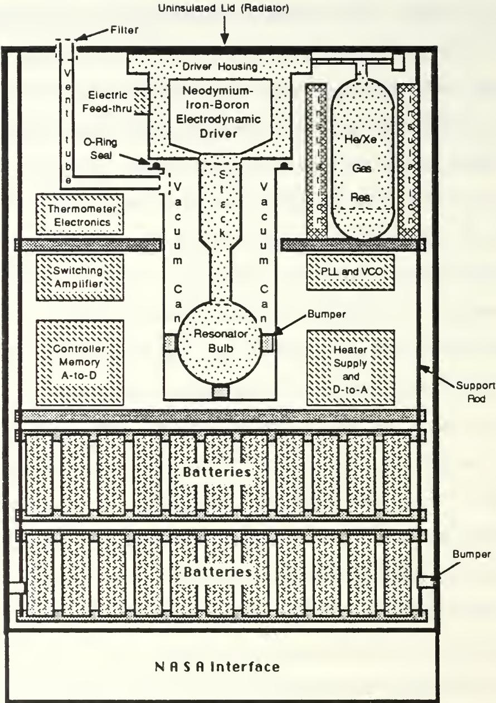  
Figure I-4. Schematic of the Space Thermoacoustic Refrigerator in its Get Away Special Cannister.

Acoustic Refrigerator Control and Thermometry  
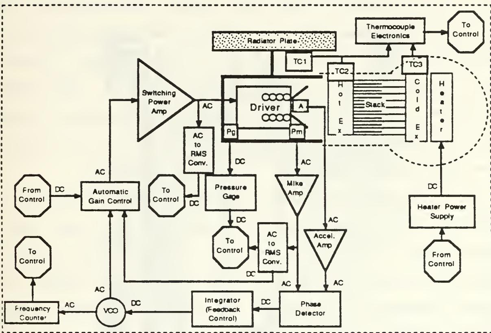

Computer/Controller  
DC Power  
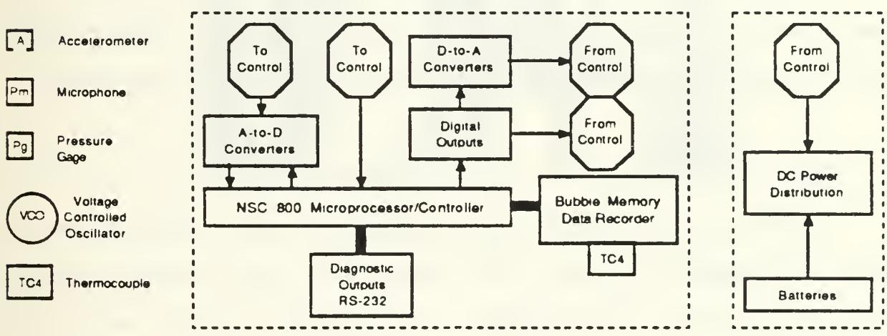  
Figure I-5. Block Diagram of the Electronics for the Space Thermoacoustic Refrigerator.

cells providing 680 watt-hours of energy and weighing about

80 pounds (including the cells' support structure). We will

be using two battery layers with as many cells as we can, up

to 136. This will give us a minimum of 680 watt-hours and a

maximum of 1,360 watt-hours of available electrical energy,

and a battery weight between 80 and 160 pounds. The number

of battery cells we can use will depend on the total weight

of the driver-resonator assembly and its auxiliary equipment

(vacuum can, gas reservoir, etc.) and electronics.

The use of the GAS can imposes certain restrictions.

Since we are using batteries to supply the power, the refri-

gerator has to be energy efficient.Also, the GAS can setup

requires the STAR to be compact and lightweight. Figure I-6

shows a photograph of Hofler's prototype refrigerator. This

setup is approximately six feet high.In comparison, the

maximum payload height for the GAS can is 28.25 inches, or

less than 2.5 feet. These considerations played a major role

in the choice of equipment for and the design of the STAR.

## C. SCOPE

Chapter II discusses basic acoustical and thermodynamic

theory as applied to STAR. The results of this theory deter-

mine the driver requirements. The theory of the selected

electrodynamic driver is given next. Following the driver

theory is a presentation and discussion of a computer

program that models the coupled system, which consists of

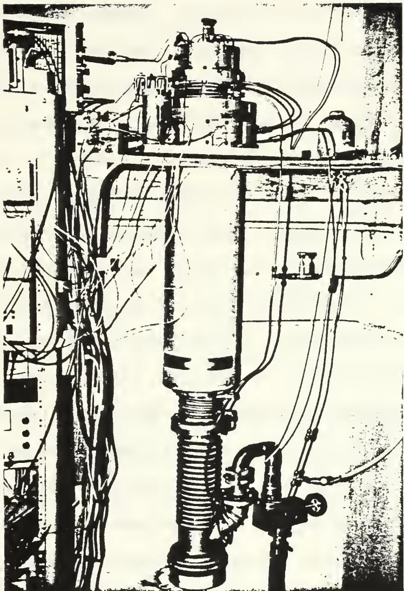  
Figure I-6. Photograph of Hofler's (1986) Prototype Refrigerator.

the electrodynamic driver and the resonator containing the

gas mixture and stack.

Chapter III describes the technique for measuring the

electrodynamic driver parameters. These parameters are used

as input for the driver design, the computer model, and the

efficiency calculations. This measurement technique was

developed using an Altec 290-16K electrodynamic driver and

was applied to the final driver.

Chapter IV describes the measurement of the STAR driver

parameters. The driver chosen for STAR is a custom unit.

built by Harmon-JBL!(tm). which uses neodimium-iron-boron

(NIB) magnets. The STAR driver is a minor modification of a

new line of compression drivers using NIB magnets and has

characteristics similar to the JBL 2450J.

Chapter V discusses the construction of the STAR driver,

including the housing and accessories (reducer, stiffener.

bellows, accelerometer, microphone, electrical feed-

throughs, etc.) necessary to integrate it with the resonator

and the GAS cannister system. Dimensional shop drawings for

the parts are included in Appendix C.

Chapter VI gives conclusions and recommendations for

further development.

## II. THEORY

A. THERMOACOUSTIC THEORY

Thermoacoustic theory has been developed in detail by

Rott (1969, 1974, 1975 and 1980) and adapted to the thermo-

acoustic refrigerator by Wheatley et al. (1982, 1983a.

1983b, 1985 and 1986), Wheatley and Cox (1985), Hofler

(1986) and Swift (1989).

The space thermoacoustic refrigerator (STAR) basically

consists of an acoustic driver producing sound waves in a

resonant tube (see Figure I-2). This resonator is filled

with a mixture of helium-xenon gas (12.5% xenon) pressurized

to ten atmospheres, and contains a stack of plastic plates.

This Chapter will present a qualitative model for the ther-

moacoustic heat pumping process followed by a quantitative

development for heat and work flow at a plate. The Chapter

concludes with the efficiency of a stack of plates that are

very much shorter than one quarter of a wavelength.

1. Qualitative Picture

Consider a parcel of gas that moves back and forth

along one of the plates at the acoustic frequency (see

Figure II-1). As it moves, the gas parcel will experience

changes in temperature and volume. Part of the temperature

changes come from the adiabatic compression and expansion of

the gas by the sound pressure, and part as a consequence of

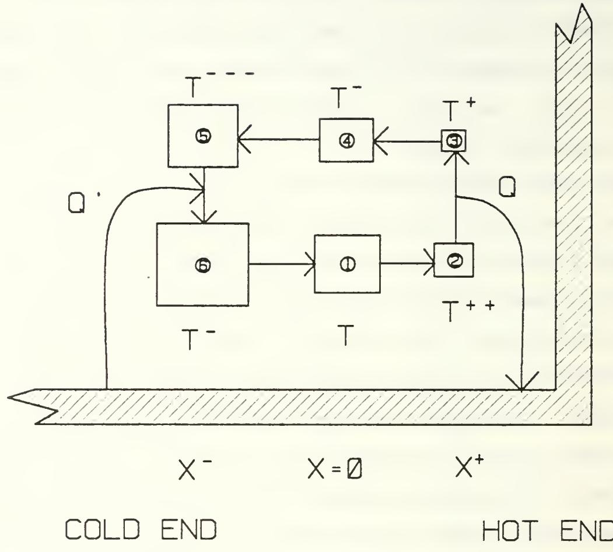  
PLATE  
Figure II-1. Gas Parcel Diagram. (Note: Displacement in the Vertical Direction is Shown for Clarity--Parcel Moves in Horizontal Direction Only.)

the local temperature of the plate itself. A temperature

gradient may develop along the plate as a result of the

operation of the refrigerator. The temperature and volume

changes can be described by six separate steps (the changes

in volume are indicated by the change in size of the square

parcel in the figure).

Assume the plate is at a uniform temperature, T. The

parcel starts at position 1 (X = 0) with a temperature of T.

The sound wave moves the parcel to the right to position 2.

The parcel has undergone adiabatic compression and its tem-

perature is now T++. Since the temperature of the gas is

higher than that of the plate, heat (Q) will flow from the

gas parcel to the plate. The parcel's volume is decreased

and its temperature lowered to T+. This heat flow also

causes the plate's temperature to increase at the position

x+. Parcel position 3 is actually in the same location as

position 2, but it is displaced vertically in the figure for

clarity. The parcel now moves to position 4 and expands

adiabatically to a new temperature of T-. A repeat of this

process puts the parcel in position 5 with a temperature of

T---. Now the temperature of the gas is lower than that of

the plate and heat (Q') flows from the plate to the gas

parcel, expanding the parcel and raising its temperature to

T--. This flow causes the plate's temperature to decrease at

position X-. The parcel moves to the right again under

adiabatic compression and we are back where we started in

position 1 with temperature T (adapted from Wheatley, et

al., 1985).

This gas parcel cycle is repeated at the resonator's

operating frequency. For the STAR this frequency is between

approximately 250 and 600 cycles per second, depending on

the gas mixture (specifically the speed of sound in the gas

mixture) and the length and shape of the resonator.

Notice that the temperature of the gas parcel at

position X = 0 is different depending on which direction the

gas parcel is moving. It is this phase shift in temperature

relative to motion that produces the thermoacoustic effect,

as we will show in the calculations that follow.

It is also important to note that in order for heat

to flow between the gas parcel and the plate, the parcel

must be vertically located within about a thermal penetra-

tion depth of the plate. The thermal penetration depth (sk)

is the distance that heat can diffuse through the fluid

during a time 1/, where w is the acoustic angular

frequency.

Wheatley et al. (1986) describe thermoacoustic en-

gines as consisting of long trains of these gas parcels, all

about a thermal penetration depth from the plate. The par-

cels draw heat from the plate at one extreme of their oscil-

latory motion and deposit heat at the other extreme. Adja-

cent heat flows cancel except at the ends. The net result is

that an amount of heat Q is passed from one end of the plate

to the other.

## 2. Single Plate

Swift (1989) illustrated the basic principles of the

thermoacoustic engine by examining a simple example of a

single plate in a gas-filled tube such as we described

above. In this example the acoustic and thermodynamic ef-

fects are nearly distinct. In the absence of the plastic

plate, the plane standing wave sustained in the tube has

well-known acoustic properties. It's pressure and x-direc-

tion velocity (along the length of the tube) are given as

(using peak values):

$$
\begin{array} { r l r } { \mathsf { P } _ { \textrm { \bf 1 } } } & { { } = } & { \mathsf { p } _ { \pm } \mathsf { s i n } \left( \mathsf { x } / \mathsf { \hat { A } } \right) } \end{array}\tag{II-1}
$$

and

$$
u _ { 1 } = i ( p _ { \bf a } / p _ { \bf m } a ) \cos ( x / \lambda )\tag{II-2}
$$

where $\mathsf { P } _ { \bullet }$ is the pressure amplitude at the pressure antinode.

the reduced wavelength $\textsf { A } = \lambda / 2 \pi = \lambda / \omega$ λ is the wavelength.

a is the speed of sound in the gas, ω is the angular fre-

quency, and Pm is the mean density of the gas. The subscript

1 indicates the first order time oscillation, and the sub-

script m indicates the mean value. The total pressure can be

given as

$$
\begin{array} { r } { \texttt { P } = \texttt { P } _ { \texttt { m } } + \texttt { p } _ { 1 } \in ^ { \texttt { i w t } } . } \end{array}\tag{II-3}
$$

A similar expression represents the total velocity. Follow-

ing Swift, we will assume that the first order in the acous-

tic amplitude is sufficient for all acoustic and thermo-

dynamic variables (pressure, velocity, temperature, density,

and entropy).

The sound wave is adiabatic and has an oscillatory

temperature given by:

$$
\begin{array} { r l r } {  { \mathrm { ~  ~ \cal ~ T ~ } } _ { 1 } } & { { } = } & { (  { \mathrm { ~  ~ \cal ~ T ~ } } _ { m } \beta / \bar {  { \mathrm { ~  ~ \cal ~ p ~ } } } _ { m }  { \mathrm { ~  ~ \cal ~ C ~ } } _ { 0 } ) \quad  { \mathrm { ~  ~ \cal ~ p ~ } } _ { 1 } \ , } \end{array}\tag{II-4}
$$

where β = - (dp/dT)p/pm is the isobaric thermal expansion

coefficient and c is the isobaric (constant pressure) heat

capacity per unit mass. Note that T₁ and pi are in phase.

For ideal gases, thermodynamics tells us that

$$
\begin{array} { r l r } { \mathrm { T } _ { \mathbf { m } } \hat { \mathsf { P } } / \mathsf { P } _ { \mathbf { m } } \mathsf { C } _ { \mathsf { E } } = } & { { } \left( \begin{array} { l } { \forall - 1 } \end{array} \right) \mathrm { T } _ { \mathbf { m } } / \forall \mathsf { P } _ { \mathbf { m } } , } \end{array}\tag{II-5}
$$

where  = the ratio of isobaric to isochoric specific heats

(5/3 for monatomic gases, smaller, but greater than one. for

other gases). Combining Equations II-4 and II-5 gives us:

$$
\begin{array} { r c l } { \mathbb { T } _ { 1 } / \mathbb { T } _ { m } } & { = } & { \left[ \mathbf { \Psi } ( \mathbf { \Psi } _ { 2 } ^ { \prime } - 1 \mathbf { \Psi } ) / \mathbf { \Psi } _ { 3 } ^ { \prime } \right] \mathbb { P } _ { 1 } / \mathbb { P } _ { m } . } \end{array}\tag{II-6}
$$

The introduction of the plastic plate into the

standing wave modifies the original, unperturbed temperature

oscillations. This modification is due to the heat flow

between the gas and the plate, as described previously. The

temperature is modified in both magnitude and phase for gas

about a thermal penetration depth away from the plate.

According to Swift, this results in two important effects:

1) a time-average heat flow near the surface of the plate.

along the direction of acoustic vibration, and 2) the

generation or absorption of real acoustic power near the

surface of the plate. In refrigerators the effect is an

absorption of acoustic power. In prime movers the acoustic

power is generated by the temperature gradient present in

the plate.

simplify calculations, again following Swift. We assume that

the plate is short enough compared to a reduced wavelength

(Δx 《 λ) and far enough from both velocity and pressure

nodes that Pr and u₁ can be considered uniform over the

entire plate. We assume the gas has zero viscosity, so that

ui does not depend on y (we had already made this assumption

by looking at u₁ in the x-direction only). We assume that

the plate has a large enough heat capacity per unit area

that its temperature does not change appreciably at the

acoustic frequency. We assume that the plate has a mean

temperature gradient in the x-direction ∇Tm. Finally, we

neglect the plate's and gas' thermal conductivity in the x-

direction.

Applying these assumptions, we see that the mean

fluid temperature (Tm(x)) is the same as that of the plate.

Swift calculated the oscillating fluid temperature using

the general equation of heat transfer. He kept only first-

order terms, neglected thermal conduction along x, and

applied the boundary condition T₁(0)=0 imposed by the plate.

The resulting equation is:

$$
\textrm  T \_ ( y ) = [ ( T _ { e m } \ni / e _ { m } C _ { e m } ) \setminus p _ { 1 } - ( \nabla ^ { \top } m / \textcircled { \ni } ) u _ { 1 } ] [ 1 - \in \times \triangleright \times \left[ - ( 1 + \mathtt { i } ) \lor / \ S \right] ] \_ ( \nabla \times \left[ \textrm { I } - \nabla \right] ] \cdot \nabla \times \left[ - ( 1 + \mathtt { i } ) \lor / \beta \right] \cdot \left[ - ( 1 + \mathtt { i } ) \lor / \beta \right] \cdot \left[ - ( 1 + \mathtt { i } ) \lor / \beta \right] \cdot \left[ - ( 1 + \mathtt { i } ) \lor / \beta \right] \cdot \left[ - ( 1 + \mathtt { i } ) \lor / \beta \right] \cdot \left[ - ( 1 + \mathtt { i } ) \lor / \beta \right]
$$

To interpret this equation, we look at it in the limit that

the gas is far enough from the plate (y》ok) to make negli-

gible thermal contact with the plate. This gives:

$$
{ \mathbb { T } _ { \textbf { 1 } } } (  { \boldsymbol { \gamma } } ) \vec { + } [ \mathrm { \nabla } (  { \mathbb { T } } _ { m } \hat {  { \mathbb { B } } } /  { \boldsymbol { \rho } } _ { m }  { \mathbb { C } } _ { m } )  { \mathbb { P } } _ { \mathbf { 1 } } - (  { \boldsymbol { \tau } }  { \mathbb { T } } _ { m } /  { \boldsymbol { \omega } } )  { \mathbb { U } } _ { \mathbf { 2 } } ]\tag{II-8}
$$

Thefirst term in Equation II-8 is thetemperature

oscillation due to the adiabatic compressions and expansions

of the gas (see Equation II-4). The second term comes from

the mean temperature gradient in the gas.As the gas

oscillates along x with displacement amplitude ui/ω,the

temperature at a given point in space oscillates by an

amount zTm u₁/ even if the temperature or a given piece of

fluid remains constant. The actual temperature oscillations

are a linear superposition of these two effects.

The y dependent part of equation II-7 is complex. It

approaches 1 for y » &x, as given previously. It approaches

zero for y 《 δk, where the plate imposes the condition

T₁ = O. Most importantly, for y ≈ δx, its magnitude is still

of the order of 1. but it has a substantial imaginary part.

This phase shift in the oscillating temperature of the

standing wave at y ≈ 8k, due to the thermal presence of the

plate, is an important result because it leads directly to

the time-averaged heat flow in the x-direction. It is the

same phase shift we emphasized in the description of the gas

parcel motion.

a. Heat Flow

Swift argues that since we are neglecting ordi-

nary thermal conductivity in the x direction, the only way

heat can be transported along x is by the hydrodynamic

transport of entropy, carried by the oscillatory velocity

U₁:

$$
\begin{array} { r l r l r l r l r l r l } { \mathfrak { G } _ {  } } & { { } } & { = } & { \mathbb { T } _ { \ b { m } } } & { \vec { \nu } _ { \mathbf { \nu } \mathbf { m } } } & { \mathbb { S } \mathbf { \bar { \nu } } \boxed { \mathbf { 1 } } } & { = } & { 1 / 2 } & { \vec { \nu } _ { \mathbf { \nu } \mathbf { m } } \subset _ { \mathbf { m } } } & { \mathrm { ~ I ~ m ~ } } & { [ \mathrm { ~ T ~ \mathbf { 1 } ~ } ] } & { \mathrm { ~ U ~ \mathbf { 1 } ~ } . } \end{array}\tag{II-9}
$$

The line above the quantity siui indicates the time-average

of the first-order entropy and velocity product. The heat

flow is a second order quantity, signified by the subscript

2.

The total heat flow Qz along the plate, in the x-

direction, is found by integrating qz over the y-z plane:

$$
\begin{array}{c} \Theta _ { \Xi } = \{ \{ \begin{array} { r l r l } \end{array} \} \Re \equiv \langle \ P _ { \Xi } = \{ \Psi _ { \Xi } \} \Re \equiv \{ \Psi _ { \Xi } \}  \end{array}\tag{II-1O}
$$

where π is the perimeter of the plate in the y-z plane.

Substituting for T. and performing the integration gives:

$$
\begin{array} { r l r } { \odot _ { \Xi } } & { = } & { - 1 / 4 \quad \mathbb { \vec { H } } \hat { \Xi } \mapsto \left( \mathbb { \vec { T } } _ { m } \hat { \Xi } \right) \mathbb { P } _ { 1 } \cup _ { \bf { 1 } } \left( \mathbb { \vec { T } } - \mathbb { 1 } \right) } \end{array}\tag{II-11}
$$

where Isκ is the thermodynamically active area in a plane

perpendicular to the longitudinal acoustic motion, Tmβ is

the heat parameter of the gas, and r is defined as the ratio

of actual temperature gradient to the critial temperature

gradient(T/妥Terit). The critical temperature gradient

occurs when the temperature change along the plate just

matches the temperature change due to the adiabatic

compression of the gas, and no heat flows between the gas

and the plate. It is the boundary between the refrigerator

and prime mover functions of the thermoacoustic engines.

Equation II-11 shows that when r < 1, heat flows

up the temperature gradient from cold to hot and work

(acoustic power) is absorbed, as for a refrigerator. When

T = 1 there is no heat flow. When r > 1, heat flows down the

temperature gradient from hot to cold and acoustic power is

produced, as for a prime mover.

Note that the total heat flow is proportional to

the area ∏ox, and to Tmβ (=1 for ideal gases). It is also

proporticnal to the product Piui. and so equals zero if the

plate is at either a pressure node or a velocity node of the

standing wave. The maximum value of the product occurs

hai ay between the nodes. Finally. the heat flow is

proportional to the temperature gradient factor r-1. For

7Tm > 7Terit. F-1 > 0 and the heat flow is toward the pres-

sure node, while for yTm  gT=ris，f-1  0 and the heat flow

is away from the pressure node. If suitable heat exchangers

at temperatures T and Tc are installed at the ends of the

plate (with T - Trc = 7Tm Ax), this heat flow carries heat

from one exchanger to the cther.

The heat flow is small under crdinary

circumstances. However, in closed resonators it is possible

to achieve sound amplitudes many orders of magnitude higher

than those of ordinary conversation. Since Qz is

proportional to Paz, and since in practical acoustic engines

the entire cross section of the standing wave is filled with

plates(spaced roughly 4sκ apart), very high heat flows

and/or a large T - Tc may be achieved.

b. Work Flow

The work flow (i.e. acoustic power) is given by

the work per cycle times the rate at which that work occurs

(the acoustic frequency f). From thermodynamics, the average

acoustic power produced per unit volume is:

$$
\begin{array} { r l r l r l r } { \overleftrightarrow { \mathsf { w } } _ {  } } & { = } & { - ( \mathsf { \varpi } \middle / \mathsf { P } _ { \mathsf { e m } } ) } & { \overline { { \mathrm { \exists ~ } \mathsf { P } \mathrm { \mathtt { 1 } } \textsf { P 1 } } } } & { = } & { - } & { 1 / 2 } & { \overline { { \mathsf { a } } } \widehat { \mathsf { B } } } & { \mathsf { P 1 } } & { \overline { { \mathrm { I m } } } [ \mathsf { T } \mathrm { \mathtt { 1 } } ] . } \end{array}
$$

The gas about a thermal penetration depth away

from the plate "breathes," because of thermal expansion and

contraction, with the right time phase with respect to

oscillating pressure to do (or absorb) net work. This is

exactly the same gas that we have seen is responsible for

the heat flow. Gas elsewhere is ineffective in doing (or

absorbing) work. The density oscillations for y 《 sk and for

y » δk are in phase with the pressure oscillations, and

hence do (or absorb) no net work.

The total acoustic power Wz produced is found by

integrating wz over all space, as with the heat flow:

$$
\begin{array} { r l r } { \stackrel { \triangledown } { \scriptscriptstyle \{ \forall \} } _ {  } = } & { 1 / 4 \quad \Pi \ s \ s \kappa \quad ( \stackrel { \triangledown } { \scriptscriptstyle \{ \forall - 1 \} } ) \quad ( \mathtt { p } _ { 1 } \enot = / \varphi _ { m } \ni ) \quad ( \Gamma - 1 ) \quad \hat { \Delta } \times / \hat { \textsf { A } } , } \end{array}\tag{II-13}
$$

where all the terms have been defined previously.

The acoustic power is proportional to the volume

Iskx of fluid that is about a thermal penetration depth

from the plate. It is proportional to p₁², and so is quad-

ratic in the acoustic amplitude (as was the heat flow) and

vanishes at pressure nodes. Finally, Wz is proportional to

(r-1), the same temperature gradient factor as appeared in

Qz (Equation II-11). When ∇Tm = ∇T=rit, (T-1) = 0， and there

are no temperature oscillations in the fluid other than

those due to adiabatic processes, and no acoustic power is

absorbed or generated. For ∇Tm > Terit, 『 -1 > 0 and acous-

tic power is produced near the plate. Whether this power

increases the amplitude of the standing wave, is radiated

away to infinity. is simply absorbed, or flows through an

acoustic-to-electric  transducer to generate electric power

depends on details of the resonator, not on the plate itself

or on the standing wave near the plate. For ∇Tm < ∇Terit, T-

1 < 0 and acoustic power is absorbed near the plate. For a

tube without plates which has a diameter less than the

wavelength, at constant temperature (vT = 0), this work flow

is responsible for the ordinary thermal attenuation of a

sound wave (Kinsler, et al.. 1982).

## c. Efficiency

We combine Equations II-11 and II-13 to get the

efficiency of the plate with no viscous or longitudinal

conduction losses:

$$
\begin{array} { r c l c l } { \bar { n } } & { = } & { \bar { \boldsymbol { w } } _ { \ge } / \hat { \mathsf { Q } } _ { \ge } } & { = } & { \left( \begin{array} { c c } { \boxed { \forall } - 1 } \end{array} \right) / \left( \begin{array} { c c c } { \boxed { \mathsf { T } _ { \bullet } \bar { \mathsf { B } } } } & { \left( \varpi } & { \hat { \Delta } \times \mathsf {  ~ \Pi } _ { \mathsf { P } ^ { \mathtt { I } } } \right) / \left( \mathtt { P } _ { \mathsf { m } } \bar { \mathsf { a } } ^ { \ge } \mathsf { U } _ { \mathtt { I } } \right) } \end{array} \right) . } \end{array}\tag{II-14}
$$

Since u₁ = uo sin x/λ. and p₁ = pma uo cos x/λ,

$$
\begin{array} { r l r } { \Pi } & { { } = } & { \left( \Upsilon - 1 \ \right) / \left( \ \mathrm { T } _ { \bullet \bullet } \right) ( \ \Delta \mathrm { x } / \mathsf { A } \mathrm { t a n } \mathrm { x } / \mathsf { A } ) . } \end{array}\tag{II-1S}
$$

$$
\mathrm { F o r ~ { \bf ~ x } ~ } \langle \langle \mathrm { ~  ~ \hat { ~ } { ~ \sf ~ a ~ } ~ } , \mathrm { ~  ~ \hat { ~ } { ~ \sf ~ n ~ } ~ } = \mathrm { ~  ~ \left( ~ \frac ~ { \partial ~ } { ~ \partial ~ } - 1 ~ \right) ~ } / \left( \mathrm { ~  ~ T ~ } _ { \bf m } \hat { \sf \otimes } \right) \langle \hat { \Delta } \times / \times \mathrm {  ~ \hat { ~ } { ~ \sf ~ x ~ } ~ } \rangle\tag{II-16}
$$

$$
\begin{array} { r l r } { \hat { \mathbf { a } } \hat { \mathbf { n } } \dot { \mathbf { d } } \quad } & { { } \hat { \mathbf { n } } } & { = \ : \ : \eta _ { \pm \bullet r m 2 \pm } / \bar { \Gamma } } \end{array}\tag{II-17}
$$

$$
\mathtt { T h i s \_ e f f i c i e n c y \mathtt { a p p r o a c h e s } \mathtt { t h e } \mathtt { C a r n o t \_ s f f i c i e n c y } }
$$

as the power output and heat transfer rates approach zero.

$$
\begin{array} { r l r l r l r l } { \mathfrak { u } \in \mathrm { ~ \Gamma ~ } } & { { } \mathtt { c } \equiv \mathtt { r } \mathtt { i } } & { \mathtt { m } \equiv \mathtt { k } \in } & { } & { \mathtt { a } } & { \mathtt { s } \mathrm { i } \mathtt { m } \mathrm { i } \mathrm { 1 } \mathtt { a } \mathrm { r } } & { \mathtt { c } \mathtt { a } \mathrm { 1 } \mathtt { c } \mathrm { u } \mathrm { 1 } \mathtt { a } \mathtt { t } \mathrm { i } \mathtt { o } \mathrm { n } } & { \mathtt { f o r } } & { \mathtt { t h e } \mathtt { i } \mathtt { a } \mathtt { i } \mathtt { m } \mathtt { i } \mathtt { a } \mathtt { t } \mathrm { i } \mathtt { a } \mathtt { r } } \end{array}
$$

refrigerator mode of operation, where the relevant

efficiency is the coefficient of performance, COP = Qz/Wz.

We find that

$$
\mathrm { C O P } = \frac { 1 } { 1 } \mathrm { C O P } \tan \cot .
$$

(II-18)

## 3. Short Stack

After developing the basic principles of the thermo-

acoustic engine using a simplified example, Swift developed

a more realistic model by including viscosity, longitudinal

thermal conductivity, finite (instead of infinite) plate

heat capacity, and many plates. He still made the assump-

tions that the temperature spanned is much less than the

absolute temperature, that the length of the plates is much

shorter than the reduced wavelength,and that the spacing

between the plates is greater than a few penetration depths.

Using the equation of motion for the gas, the boun-

dary condition that the velocity at the gas-plate interface

is zero, the continuity equation of the gas, the heat flows

in the gas and plates, and basic thermodynamic properties,

Swift derived a wave equation for pressure Pi(x) in terms of

dTm/dx, material properties and geometry. Swift also derived

an equation for enthalpy flow along x in terms of pi(x).

Tm(x), geometry, and material properties (including Prandtl

number of the gas ī = cpu/k, where u is the viscosity, and K

is the thermal conductivity of the gas).

In the boundary layer approximation, for a short

(x 《 A) stack of plates, and neglecting viscosity, the heat

flux and acoustic power are given by expressions very simi-

lar to the simple results of the single plate example.

Practical engines can be expected to have all available

cross-sectional area filled with plates spaced about 4sk

apart. The only effect of longitudinal (i.e., along x)

thermal conductivity is to add to the heat flow in the x

direction by simple conduction. For gases this effect is

normally negligible.

The inclusion of viscosity adds considerable

algebraic complication, and a little conceptual difficulty

as now u₁ is a function of y.

Without viscosity, ∇Terit is the temperature

gradient for which the temperature oscillation at a given x-

location is zero. But in the presence of viscosity, T,

depends on x as well as y, so no well-defined vTerit exists.

To the lowest order in √σ (where σ is the fluid's

Prandtl number), the hydrodynamic heat flow is increased by

1/(1-vo). This factor arises because the mean velocity <u₁>

underestimates the velocity with which entropy is convected

along the stack. As we saw in the single plate calculations,

the convective entropy transport occurs mostly at a distance

δk from the plate. The velocity there is higher than the

mean velocity by 1/(1-√σ).

The lowest order effect of viscosity on the acoustic

power is the power dissipated by viscous shear in the fluid

within the boundary layer,a well-known fluid mechanical

result.

For accurate calculations, the full general equation

must be used; but for rough estimates, the results presented

here are good approximations, and are much simpler to

compute with. In addition, the results presented here are

fairly easy to interpret physically. The expressions for

arbitrary viscosity are complicated, but those to lowest

order in viscosity are simple. It is easy to see the single

plate expressions for heat flow and acoustic power about a

thermal penetration depth from the plates. modified as

longitudinal thermal conductance adds to the heat flow,as

viscous shear dissipates acoustic power, and as non-ideal

plate properties modify the thermal boundary condition at

the fluid-plate interface.

4. Design Considerations

One of the important considerations in the design of

a thermoacoustic refrigerator is the location of the stack

of plates with respect to the pressure and velocity nodes

and antinodes of the acoustic standing wave in the resonant

tube. Experiments performed by Wheatley, et al.(1986)

showed that the heat flow as a function of position fit a

simple sine curve whose spacial period is half the wave-

length of the acoustic standing wave. By noting how the sign

cf the temperature difference varied with respect to the

plate's location in the sound wave. they saw that heat

always flows in the direction of the closest pressure anti-

node. This effect is expected because a parcel of gas moving

in the direction of a pressure antinode is compressionally

warmed and will transfer heat to the plate. A parcel moving

toward a pressure node is cooled by expansion and will draw

heat from the plate. At both the pressure nodes (velocity

antinodes) and antinodes (velocity nodes) heat flow drops to

zero. Thus the acoustic heat flow depends on both the acous-

tic pressure and the fluid velocity.

As a plate or stack of plates is moved away from the

pressure antinode, the temperature gradient developed

becomes smaller. At a quarter of a wavelength, no gradient

forms (the critical temperature gradient equals zero). This

positioning effect is important in the design of a refriger-

ator, because, together with the length of the plates, it

places an upper limit on the maximum temperature drop

possible across the stack.

## B. DRIVER REQUIREMENTS

In order to drive the thermoacoustic refrigerator we

needed a device, a transducer. that would convert the elec-

trical energy of a battery pack to acoustic energy, as

discussed in Subsection I.A.3. We wanted as high a pressure

(or force) and volume velocity (or motion) as possible to

get the most acoustic power provided to the system. There

were several types of electroacoustic transducers to choose

from: electro-static, electret, electrodynamic, magneto-

strictive, electro-strictive, and piezoelectric. Only one of

these, the electrodynamic transducer, can provide our system

with both the large forces and velocities necessary. This

transducer will be described in the next section. The

remainder of this section describes the rest of the trans-

ducers and explains why each was not appropriate for use in

the thermoacoustic refrigerator.

The electrostatic transducer consists of a pair of

charged electrodes, or capacitor plates, one of which is

held stationary while the other,the diaphragm,moves in

response to electrical excitation. The electret is a kind of

electrostatic transducer that has a diaphragm of polarized

plastic, and therefore does not need an external voltage

supply to the diaphragm (Kinsler, et al, 1982, p. 350). If

an alternating voltage is applied across the plates,the

diaphragm moves, thereby radiating an acoustic wave.

Unfortunately there is very little force (or pressure) and

displacement associated with this motion. This type of

transducer may be useful as a microphone but is not an

appropriate choice to drive the thermoacoustic refrigerator.

In a magnetostrictive transducer a change in the

magnetic polarization in the material causes an elastic

strain (Wilson,  1985,  p. 3.). Although the forces are more

than adequate the strain produces too little motion to be

useful to us.

In electrostrictive and piezoelectric transducers an

externally applied electric field causes a change in the

dielectric polarization of the material,which in turn

causes an elastic strain (Wilson, 1985, p. 3). Once again

there is sufficient force but the displacement due to the

strain is too small to be useful.

Because these techniques have sufficient force, it would

be possible to overcome the displacement limitation using

mechanical  leverage or other forms of mechanical impedance

transformation, but this was not considered due to the

associated increase in device complexity.

C. ELECTRODYNAMIC THEORY

## 1. Physics

The electrodynamic driver is a moving coil

transducer which converts electrical energy to kinetic ener-

gy (motion). It consists of a diaphragm attached to a cylin-

drical coil of wire (voice coil) that is suspended in a

fixed magnetic field (see Figure II-2). If an alternating

current is supplied to the coil, the interaction of the

current and the magnetic field will induce a force on the

coil so that the diaphragm moves. The magnitude of the force

is F = BlI. where B is the magnitude of the magnetic induc-

tion, l is the length of the coil and I is the current. The

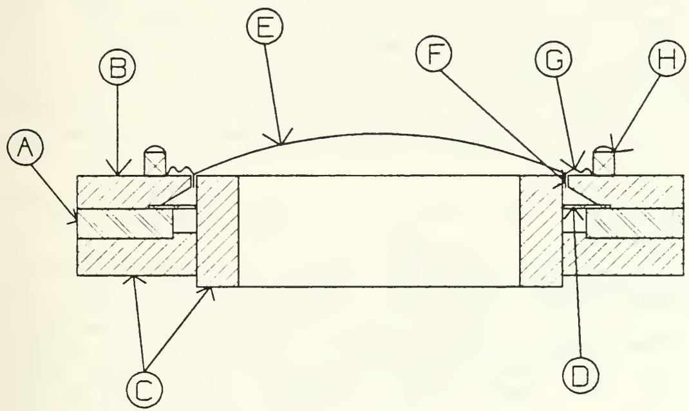

Figure II-2. Schematic of an Electrodynamic Transducer Showing (A) Magnet, (B) Back Plate, (C) Pole Piece, (D) Acoustic Seal, (E) Diaphragm, (F) Voice Coil, (G) Surround (Suspension), and (H) Electrical Lead Connection.

direction of the force. given by the cross product of the

current vector and the magnetic field (from Ampere's law E =

Il X B), is everywhere orthogonal to the current and the

radial magnetic field. The motion of the diaphragm produces

sound waves with a frequency equal to that of the alterna-

ting current. Another important property of the electrodyna-

mic transducer is that the motion of the voice coil  induces

an electromotive force (emf) which equals Bl times the

velocity of the voice coil (emf = Blv). This "back emf"

increases the electrical impedance of the driver and can be

used to monitor the driver motion as discussed in Section

III.B.

The driver is attached to the resonator via a

reducer and bellows. The reducer is a cone-shaped piece of

aluminum mechanically connecting the driver voice coil which

produces the force to the bellows. which in turn is in

contact with the gas in the resonator. The reducer is

designed to be lightweight, rigid, and strong for a direct

transfer of motion and energy from the moving coil to the

bellows. The bellows is a lightweight and flexible gastight

seal between the driver and the tube. An aluminum plate is

used as an interface between the reducer and the bellows to

keep the bellows face rigid. For the STAR driver the reducer

and plate are incorporated into a single unit machined from

aluminum bar stock.

Figure II-3 shows a mechanical model of the

electrodynamic transducer as a forced simple harmonic

oscillator (SHo), which consists of a moving mass (mo),

stiffness (k), mechanical damping or resistance (Rm), and

driving force  (F). Included in the moving mass are the

masses of the voice coil, reducer, stiffener, and bellows.

The stiffness includes the suspension stiffness of the voice

coil surround, the stiffness of the gas volume trapped

behind the diaphragm, and the stiffness of the bellows. The

equations governing the SHo can thus be used to determine

the moving mass and stiffness of the driver. The primary

relationship used is:

$$
\scriptstyle \mathfrak { w } _ { 0 } = \mathbf { \Psi } = \mathbf { \Psi } _ { \mathbf { k } } / \mathfrak { m } _ { \circ } ,
$$

(II-19)

or, the resonant angular frequency squared equals the

stiffness divided by the moving mass. The use of this and

other relationships will be discussed further in Chapter

III, Driver Parameter Measurements.

2. Equivalent Circuit

An electrical circuit can be drawn that is

equivalent to an electromechanical system if the values

given for Rm, Lm, and Cm in the circuit produce the same

electrical effects as the electromechanical system itself.

In the case of the electrodynamic driver, the equivalent

circuit is shown in Figure II-4 with the values given by

Kinsler, et al. (1982) as:

Mechanicol

Acousticol

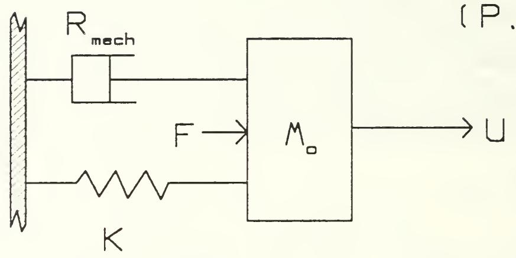

〔P.Q.U)

$$
M = M _ { \sf c o i l } + M _ { \sf b e l l o w s } + M _ { \sf r e d u c e r }
$$

$$
k = k _ { \_ { \_ \omega \_ } } + k _ { \_ { \_ \omega \_ } } + k _ { \_ { \_ \omega \_ } \_ } \downarrow ,
$$

Figure II-3. Electrodynamic Transducer--Forced Simple Harmonic Oscillator Model.

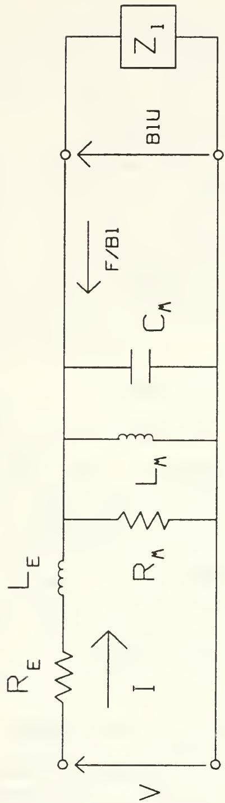  
Figure II-4. Equivalent Electrical Circuit for the Electrodynamic Transducer.

$$
\begin{array} { r c l } { { \sf R } _ { { \bf m } } } & { = } & { ( \mathrm { ~  ~ \sf ~ B ~ 1 ~ } ) \beth / \bar { \sf R } _ { { \bf m } } , } \end{array}\tag{II-20}
$$

$$
L _ { m } = ( { \sf B I } ) ^ { \sf z } / { \sf k } ,\tag{II-21}
$$

$$
C _ { m } = m _ { 0 } / ( 5 1 ) ^ { 2 } ,\tag{II-22}
$$

where Bl is the transduction coefficient, Rm is the

mechanical resistance, and k and m。 are the stiffness and

moving mass as described previously.

The properties of the equivalent circuit allow us to

evaluate the performance of the electrodynamic driver as if

it were an entirely electrical system. The amount of power

the driver generates w\_ll depend on the load it sees. Since

one of the primary purposes of this thesis is to maximize

the ratio of the acoutic power delivered to the electrical

power provided (the electroacoustic efficiency), it is

necessary to provide a load to the system in order to

evaluate driver performance. This load is originally

represented as a complex electrical impedence in the

equivalent circuit. The actual value of the load will depend

on the design of the resonator but can be characterized by

an acoustic impedance which can be transformed to an

equivalent electrical load impedance.

## 3. Losses

In our search for the highest electroacoustic

efficiency it is useful to understand where possible losses

may occur and do what can be done to minimize them. Losses

that are an intrinsic part of the electrical driver are eddy

current losses in the magnetic structure generated by the

$$
\mathtt { c u r r e n t \ i n \ i n \ i t h i e \ \ y c i c e \ \mathtt { c o i l } 1 } , \quad \mathtt { J o u l e \ \mathtt { h e } a t i n g \ \mathtt { h e } a s e s \ \mathtt { d u e } \ \mathtt { t o } \ \mathtt { t h e } e } \ \mathtt { t h e } \mathtt { i n } \mathtt { e a l } \mathtt { s i m a }
$$

$$
\mathtt { d r i v e \_ c u r r e n t \_ d i s s i s p a t e d } \mathtt { b y \_ t h e } \mathtt { v o i c e \_ s o i } \mathtt { e o i } \mathtt { i } \mathtt { e l e c t r i c a l } _ { \mathtt { e } } \mathtt { i } \mathtt { e a l } _ { \mathtt { i } } \mathtt { e } \mathtt { i } \mathtt { e } \mathtt { i } \mathtt { e } \mathtt { i } \mathtt { e } \mathtt { i } \mathtt { e } \mathtt { i } \mathtt { e } \mathtt { i } \mathtt { e } \mathtt { i } \mathtt { e } \mathtt { i } \mathtt { e } \mathtt { i } \mathtt { e } \mathtt { i } \mathtt { e } \mathtt { i } \mathtt { e } \mathtt { i } \mathtt { e } \mathtt { i } \mathtt { e } \mathtt { i } \mathtt { e } \mathtt { i } \mathtt { e } \mathtt { i } \mathtt { e } \mathtt { i } \mathtt { e } \mathtt { i } \mathtt { e } \mathtt { i } \mathtt { e } \mathtt { i } \mathtt { e } \mathtt { i } \mathtt { e } \mathtt { i } \mathtt { e } \mathtt { i } \mathtt { e } \mathtt { i } \mathtt { e } \mathtt { i } \mathtt { e } \mathtt { i } \mathtt { e } \mathtt { i } \mathtt { e } \mathtt { i } \mathtt { e } \mathtt { i } \mathtt { e } \mathtt { i } \mathtt { e } \mathtt { i } \mathtt { e } \mathtt { i } \mathtt { e } \mathtt { i } \mathtt { e } \mathtt { i } \mathtt { e } \mathtt { i } \mathtt { e } \mathtt { i } \mathtt { e } \mathtt { i } \mathtt { e } \mathtt { i } \mathtt { e } \mathtt { i } \mathtt { e } \mathtt { i } \mathtt { e } \mathtt { i } \mathtt { e } \mathtt { i } \mathtt { e } \mathtt { i } \mathtt { e } \mathtt { i } \mathtt { e } \mathtt { i } \mathtt { e } \mathtt { i } \mathtt { e } \mathtt { i } \mathtt { e } \mathtt { i } \mathtt { e } \mathtt { i } \mathtt { e } \mathtt { i } \mathtt { e } \mathtt { i } \mathtt { e } \mathtt { i } \mathtt { e } \mathtt { i } \mathtt { e } \mathtt { i } \mathtt { e \mathtt { i } } \mathtt { e } \mathtt { i } \mathtt { e } \mathtt { i } \mathtt { e \mathtt { i } } \mathtt { e } \mathtt { i } \mathtt { e \mathtt { i } } \mathtt { e } \mathtt { i } \mathtt { e } \mathtt { i } \mathtt { e } 
$$

resistance, and mechanical losses due to the internal fric-

tion of the surround and the viscosity of the gas in the

"gap." These losses need to be taken into account. Very

little can be done about the eddy current losses and the

viscosity of the gas which is necessary to improve heat

removal from the voice coil. The losses due to surround

(suspension) mechanical resistance can be controlled by

choice of the materials and removal of extraneous suspension

material (see Section III.H).

## D. COUPLED SYSTEM

## 1. Computer Model

Any discussion of the driver section of the

thermoacoustic refrigerator is incomplete without some

understanding of how the driver parameters are coupled to

the resonator(acoustic load).The equivalent electro-

mechanical circuit for the coupled system is the same as

that shown in Figure II-4 with the acoustic load impedance:

$$
\begin{array} { r l r } { \ Z _ { 1 } } & { { } = } & { - \bar { \bf e } _ { \infty } \subset { \bf S } \dot { \textbf { j } } \left[ \begin{array} { l } { \left( 1 + \dot { \bf j } \propto / \mathrm { k } \right) / \left( 1 + \left( \propto / \mathrm { k } \right) \right) } \end{array} \right] } \end{array} ,\tag{II-23}
$$

$$
\begin{array}{c} \begin{array} { r } { \mathrm { ( \cos \left( \mathrm { \sc ~ k L } \right) \sin \left( \mathrm { \ k L } \right) \mathrm { \cot ~ + ~ \dot { \ j } ~ \sin \left( \mathrm { \sc ~ \alpha ~ \wedge ~ } \right) \cos \left( \mathrm { \sc ~ \alpha ~ \wedge ~ } \right) \dot { \mathrm { \iota } } } } } \end{array} \dot { \ z }  \end{array} \mathrm { \ , }
$$

$$
\begin{array} { r }  \mathrm { ( \thinspace s \thinspace i n \mathbf { z } \mathrm { ~ ( \thinspace k L \mathrm { ~ ) } \thinspace c o s h ^ { \mathbf { z } } ( \alpha \mathbf { L } \mathrm { ~ ) } ~ + ~ \thinspace c o s ^ { \mathbf { z } } ( \kappa \mathbf { k } L \mathrm { ~ ) } \thinspace s i n h ^ { \mathbf { z } } ( \alpha \mathbf { \alpha } ( \mathbf { a } L \mathrm { ~ ) } \mathrm { ~ ) } \mathrm { ~ ) } \mathrm { ~ ] ~ } , } } \end{array}
$$

where po is the density of the gas, c is the speed of sound

(labeled "a" in previous discussions), s is the cross-

sectional area of the resonator, k is the wave number

(= ω/c), x = wo/(2Qc), Q is the quality factor of the reso-

nator, and L is the effective length of the resonator

(Kinsler, et al., 1982). This circuit combines the equiva-

lent circuit of the electrodynamic transducer with the com-

plex impedance load representing the resonator. One way to

examine this coupling is through computer modeling.

LT Michael P. Susalla, USN, developed a computer

program which models the thermoacoustic refrigerator as the

equivalent electrical circuit. The program models each of

the mechanical and acoustical components as equivalent

electrical  components, as discussed above.Using the

electrical equation from the combined circuit we determine

the system performance as different parameters are varied.

a. Input

There are two sets of input parameters needed

for the model: (1) driver parameters and (2) resonator

parameters. The driver electrical parameters include the

voice coil inductance (LE) and resistance (RE), and the

current (I) supplied to the voice coil (which is held at one

ampere for all test cases). The driver mechanical parameters

used in the model are the same equivalent resistance, induc-

tance, and capacitance as those developed for the equivalent

circuit. Therefore the parameter values needed for input are

the transduction coefficient (BL), the mechanical resistance

(RM), the moving mass (M), the suspension stiffness (SSUP),

the volume of the gas behind the diaphragm (VoL), and the

cross-sectional area of this volume (A).

The resonator parameters needed include the tube

quality factor (Q), the speed of sound (C), the resonance

frequency (Fo), the density of the gas in the tube (RHo).

the resonator cross-sectional area (S), and the equivalent

length of the resonator (L). For this model the piston area

is set equal to the resonator cross-section (S). For the

tests reported here they were nearly equal but could differ

sustantially in other designs.

b. Output

Four output plots are generated by the graph

program that accompanies the model:(1) voltage across the

driver vs. frequency (since we put unit current into the

driver, this graph can also be read as the input electrical

impedance), (2) piston velocity vs. frequency, (3) acoustic

power delivered to the load (resonator) vs. frequency, and

(4) electroacoustic efficiency vs. frequency. Each of these

plots should produce peaks at both the driver and the tube

resonant frequencies.

The model uses the electrical equation for the

coupled equivalent circuit to calculate voltage directly

(holding the current constant at one ampere) for the first

output plot. It also directly calculates the force on the

moving mass, F = BlI. From this force, the piston velocity

for the second plot is found by dividing the force by the

mechanical impedence (Zmen). Pressure is calculated as tube

impedence times volume velocity, and acoustic power is

pressure times volume velocity times the cosine of their

phase difference (Equation I-8) for the third plot. For the

final plot the electrical power is calculated as voltage

times current times the cosine of their phase difference

(Equation I-7), and the model takes a ratio of the electri-

cal to the acoustical powers for the electroacoustic effi-

ciency. Since the components of these powers are complex and

have phase differences, the actual powers are calculated as

one half the real part of [current times complex conjugate

of voltage], and one half the real part of [pressure times

the complex conjugate of volume velocity]. Each of the above

mentioned plots is the discussed output parameter versus

frequency.

2. Assumed Typical Parameters

Table II-1 lists the input parameters with sample

values for the Altec 290-16K driver in air with a long

straight resonant tube attached (see Chapter III). Sample

outputs of the four plots using these input values are given

in Figures II-5 through II-8.

Figure II-5 plots the driver voltage as a function

of frequency. Since the current is held constant at one

ampere, this plot actually gives us information on driver

electrical input impedance vs. frequency. Notice that there

are two peaks in this curve. The first peak occurs at a

<table><tr><td>Symbol</td><td>Meaning</td><td>Units</td><td>Value</td></tr><tr><td>RM</td><td>Mechanical resistance</td><td>kg/s</td><td>1.33</td></tr><tr><td>M</td><td>Moving mass</td><td>kg</td><td>0.0151</td></tr><tr><td>SSUP</td><td>Spring constant</td><td>N/m</td><td>9.2X103</td></tr><tr><td>RHO</td><td>Density of gas</td><td>kg/m³</td><td>1.2</td></tr><tr><td>C</td><td>Sound speed</td><td>m/s</td><td>342.0</td></tr><tr><td>S</td><td>Resonator X-sec. area</td><td>m²</td><td>9.35X10-4</td></tr><tr><td>BL</td><td>Driver transduction factor</td><td>N/A</td><td>21.5</td></tr><tr><td>O</td><td>Resonator quality factor</td><td></td><td>60.0</td></tr><tr><td>FO</td><td>Resonator resonance freq.</td><td>HZ</td><td>240.0</td></tr><tr><td>で</td><td>Back volume X-sec. area</td><td>Mz</td><td>7.92X10-4</td></tr><tr><td>VOL</td><td>Back volume</td><td>m³</td><td>1.0X10-2</td></tr><tr><td>LE</td><td>Voice coil inductance</td><td>H</td><td>1.0X10-4</td></tr><tr><td>RE</td><td>Voice coil DC resistance</td><td>3</td><td>10.6</td></tr><tr><td>H</td><td>Driver current</td><td>A</td><td>1.0</td></tr><tr><td>L</td><td>Resonator length</td><td>m</td><td>0.712</td></tr></table>

VOGE  FNCY  
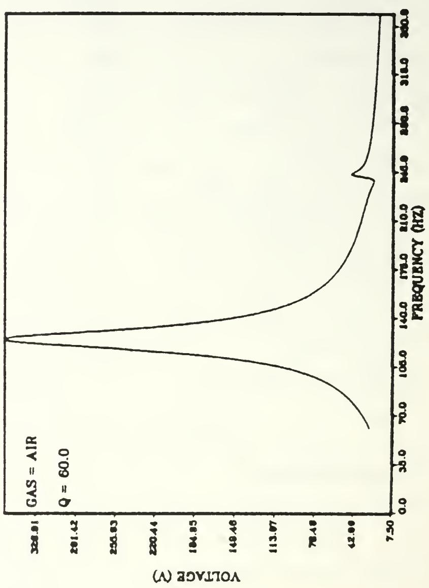  
Figure II-5. Computer Model Sample Output--Driver Voltage vs. Frequency for One Ampere Current into Driver.

PISY  VY VOCY  
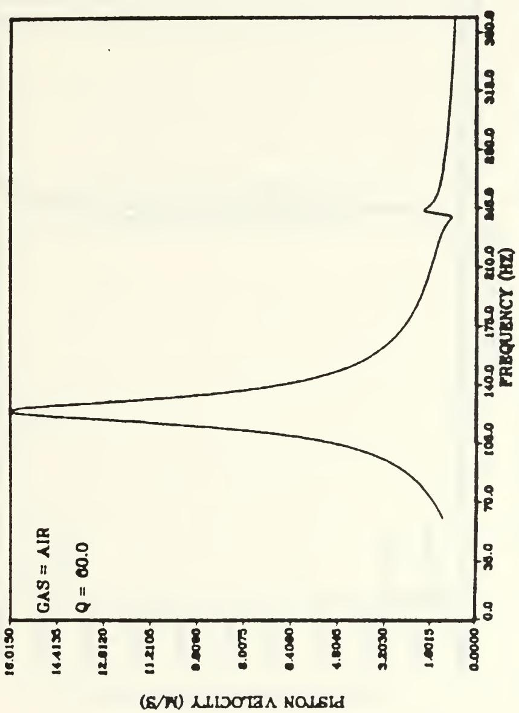  
Figure II-6. Computer Model Sample Output--Piston Velocity vs. Frequency for One Ampere into Driver.

ACOC PC PROUC PNCY  
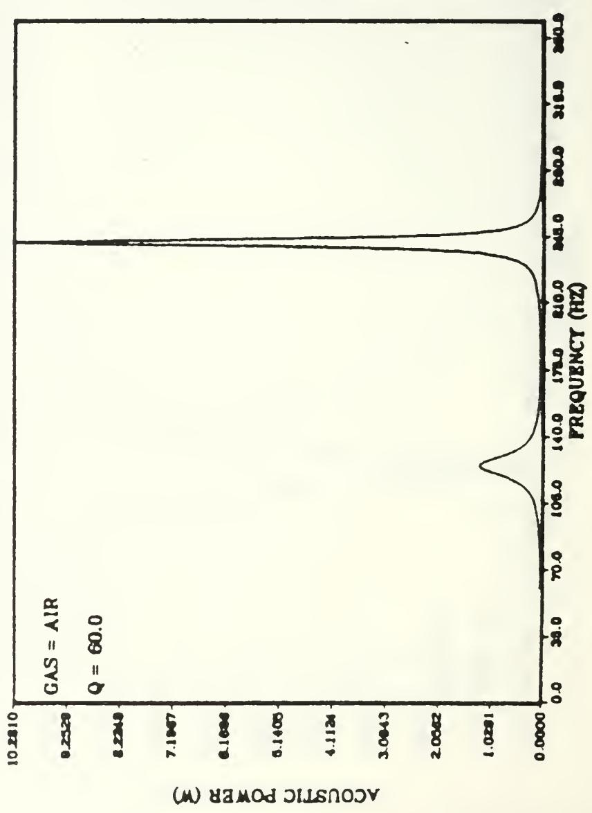  
Figure II-7. Computer Model Sample Output--Acoustic Power vs. Frequency for One Ampere.

ELCYC C ECC ECY  
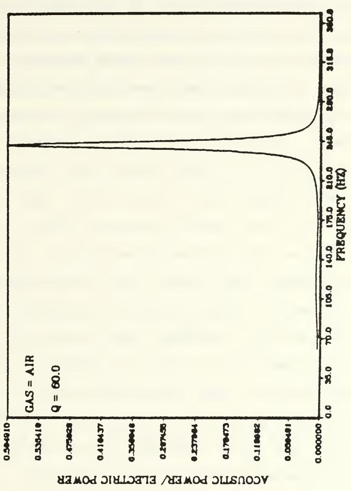  
Figure II-8. Computer Model Sample Output-- Electroacoustic Efficiency vs. Frequency.

lower frequency and has a much higher amplitude than the

second.This higher amplitude peak occurs near the driver

resonant frequency(f。 = (1/2π)[k/m]¹/z = 124 Hz).It

dominates the curve because it is the driver impedance that

we are plotting, and the voice coil motion, and consequently

the "back emf," is the largest at that frequency. The fact

that there is a second peak near the tube resonance (Fo =

240 Hz) shows the effect of the coupling of the two parts of

the system.

In the plot of piston velocity vs. frequency (Figure

II-6), the dominant peak again occurs near the driver

resonance for the reasons presented above. The smaller

coupled peak at the tube resonance is due to the change in

the load impedance which occurs near the tube resonance.

Figure II-7 shows the plot of the acoustic power vs.

frequency. Now the dominant peak occurs at the tube

resonance because acoustic power is primarily a function of

the tube parameters. Here the secondary peak at the driver

resonance is a consequence of the greatly increased piston

velocity at the driver resonance putting energy into the

smaller non-resonant acoustic load of the tube.

In the plot of electroacoustic efficiency vs.

frequency, Figure II-8, the primary peak at the tube

resonance is sharp and the secondary peak at the driver

resonance is small but visible. It is important to note that

the electroacoustic efficiency peaks at a value of nearly

60% even though the two individual resonances are separated

by nearly an octave in freguency. The peak acoustic power

for one amp as shown in Figure II-7 is 10.3 W. The losses

(40%) are due primarily to Joule heating in the voice coil

DC resistance (Pr = 1/2 (IZRdc) = 5.3 W). This accounts for

34%.·The remaining loss can probably be attributed to

mechanical resistance losses in the suspension.

Appendix A contains a printout of the calculation

program. Appendix B contains a printout of the graph

program.

# III. DRIVER PARAMETER MEASUREMENTS

## A. INTRODUCTION

In Sections II.B and II.C we discussed the choice of the

electrodynamic transducer to drive the thermoacoustic refri-

gerator. Given this choice, we needed to develop a system

for measuring the mechanical parameters of this type of

driver to be used in determining the electroacoustic effi-

ciency. The relevant parameters (as discussed in Section

II.D) are:(1) moving mass,(2) suspension stiffness.(3)

transduction coefficient (Bl), and (4) mechanical resis-

tance.

The driver we selected for the preliminary measurements

is the Altec model 290-16K moving-coil loudspeaker. There

are several pieces of equipment needed to interface the

driver with the resonator. Three of these parts--the reducer

cone,stiffener,and dynamic bellows--become an integral

part of the driver, and their effects on the driver parame-

ters must be taken into account. We first measured the

parameters of the driver alone, then added the other parts

and determined the new parameters for the entire system. The

driver-bellows combination was then fitted to one end of a

resonant tube. The actual resonator used in the thermo-

acoustic refrigerator will be a complex structure that is

not easily modeled. For the purposes of the driver parameter

measurements we used a resonant tube of uniform cross-

section to allow easy comparison of experimental values to

theory. The non-driver end of the closed tube housed several

microphones. The electroacoustic efficiency of the system at

resonance was determined from measurements of electric power

delivered to the driver and the acoustic pressure at the

microphone. The acoustic power dissipation was determined

from the quality factor of the tube at resonance and the

microphone sensitivity (the relationship between the pres-

sure that the microphone senses and its voltage output).

## B. IMPEDANCE ANALYZER

The primary instrument used in the testing and evalua-

tion of the electrodynamic driver was the Hewlett Packard

Model 4192A LF Impedance Analyzer. According to the manufac-

turers Operation and Service Manual, the 4192A is a fully

automatic, high performance test instrument designed to

measure a wide range of impedance parameters as well as

gain, phase, and group delay. Its two measurement display

sections provide direct readout of the selected measurement

parameters with 4.5 digit resolution along with the appro-

priate units. In normal mode operation, the 4192A performs

approximately five measurements per second. It also provides

an average measurement mode (one measurement per second) for

higher resolution and noise rejection. A high speed mode can

perform ten measurements per second.

The 4192A can provide measuring frequency, OSC voltage

level,and DC bias voltage (impedance measurements only)

equivalent to actual operating conditions. The sweep capa-

bility of the built-in frequency synthesizer and DC bias

source permits quick, convenient, and accurate measurements.

Measuring frequency or DC bias voltage can be automatically

or manually swept in either direction. OsC level can be

manually swept in either direction in imV increments. Actual

test voltage across or test signal current through the

device under test is also measured.

In amplitude/phase measurements, the 4192A can measure

four transmission parameters - gain/loss, level, phase, and

group delay.In impedance measurements,the 4192A can

measure eleven impedance parameters - absolute value of

impedance, absolute value of admittance, phase angle, resis-

tance, reactance,conductance,susceptance,inductance,

capacitance, dissipation factor, and quality factor. All

impedence measurements have a basic accuracy of 0.1% and a

resolution of 4.5 digits. Also, the circuitry of the 4192A

provides direct and accurate impedance measurements of both

grounded and floated devices.

C. MECHANICAL PARAMETERS

The most important parameters for a moving coil trans-

ducer are the moving mass, suspension stiffness, and the Bl

(transduction) coefficient. The moving mass of the driver

includes the mass of the voice coil, the diaphragm, and the

hydrodynamic mass of the air being pushed by the diaphragm.

The masses of the reducer and stiffener are also important.

as are the moving mass and suspension stiffness of the

bellows. The moving mass and stiffness of the combined

driver-reducer-bellows system is also important. The values

for the combined system should equal the sum of the values

of the individual parts. The stiffness, mass, and Bl coeffi-

cient give us the information we need to construct the

equivalent electrical circuit, as discussed in Subsection

II.C.2. Also, we have to insure that the stiffness of the

driver system is just large enough to produce a mechanical

resonance at the tube resonant frequency, at which point the

driver piston looks like a soft (or open) tube end. This may

appear to be contradictory to having a velocity node of the

standing wave at the piston, but it is not. It is how we get

high efficiency.

The important design parameters of the tube are its

resonance frequency and quality factor. The length of the

tube and the speed of sound in the contained gas determine

the resonance frequency.

1. Dynamic Mass Loading of Driver

We used the driver's similarity to a simple harmonic

oscillator to find the moving mass and suspension stiffness

of the driver by taking advantage of the fact that the

resonance frequency squared equals the stiffness divided by

the mass. If we add mass to the driver, it should linearly

change the inverse of the frequency (or period) squared:

$$
\begin{array} { r c l c r } { { \texttt { T a } } } & { { = } } & { { \texttt { 1 / f } \Xi } } & { { = } } & { { \mathit { 4 } } { \texttt { f } } ^ { \Xi } ( \mathtt { m _ { \infty } } { \texttt { + } } { \texttt { m } } ) / { \texttt { k } } , } \end{array}
$$

(III-1)

where m. is the moving mass, m is the added mass,  and k is

the suspension stiffness. The instrument we used for this

measurement was the HP 4192A Low Frequency Impedance

Analyzer, described in section B. We added various masses of

putty (one to nine grams) to the diaphragm and found the

resonance frequency of the driver for each mass. The putty

mass was measured on the Sartorius model 2403 mass balance

(serial number 1287). This balance has an accuracy of ±

0.o0oo5 g. However, the putty could be expected to gain or

lose more mass than that due to handling. Based on mass

measurements of the putty after use, we expect an

experimental accuracy of ± 0.0o5 g for the masses. A more

significant uncertainty involving the masses arises from the

inability to place the masses evenly on the voice coil or to

produce a perfectly rigid coupling between the masses and

the voice coil. It is not possible to assign a specific

numerical percentage error to this uncertainty, but we must

take it into account when evaluating the data associated

with mass loading. A typical plot of the period squared vs.

added mass in air is shown in Figure III-1. We used the

least squares method to fit a straight line through the

data. We determined the suspension stiffness (k = 4π²/slope)

to be:

ALTEC 290-16K MASS LOADING  
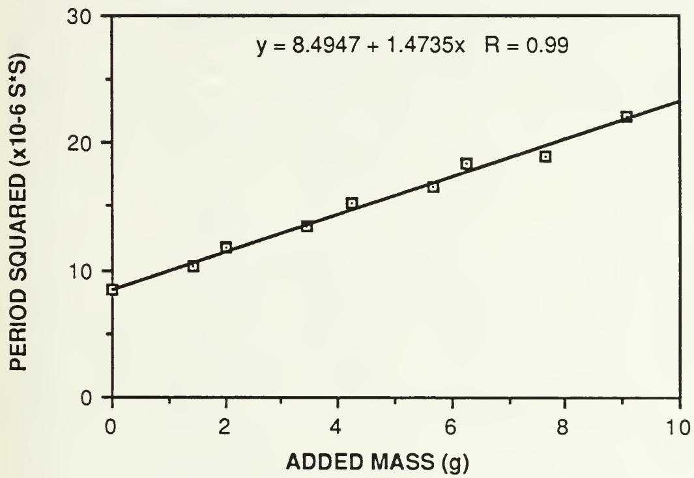

$$
k = 2 . 7 \div 0 . 1 \times 1 0 ^ { 4 } N / \pi ,\tag{III-2}
$$

and the moving mass (m. = intercept/slope):

$$
\mathfrak { m } _ { \circ } \ = \ \mathsf { S } \ . \otimes \ \pm \ 0 \ . 1 \ \ \mathsf { g } \ ,\tag{III-3}
$$

for this driver in air.

The moving mass of the driver in vacuum is expected

to be less than the value in air because in vacuum the

driver is not pushing a hydrodynamic mass. However, we did

not take any measurements of this driver in vacuum.

2. Bellows Parameters

The Servometer custom-designed dynamic bellows

(shown in Figure III-2 with test stand) is used to provide a

flexible gas seal between the driver and the resonator.

The stiffness of the bellows was measured using two

independent methods - static and dynamic. For the static

method we used Hooke's law: k = -F/x. The force was deter-

mined by pulling a partial vacuum on the bellows and multi-

plying the vacuum pressure (read on a manometer) by the

surface area of the bellows (A = 1.1 ± 0.1 X 10-3 mz). We

used a G. L. Collins Corporation model LMS-119V22-01 Linear

Variable Differential Transformer (LvDT)(serial 274674)

connected to an EG&G 128A Lock-in Analyzer to determine the

displacement of the bellows under a partial vacuum. Figure

III-3 shows the LVDT in its calibration stand. The calibra-

tion curve for the LVDT is shown in Figure III-4. The least

squares fit slope of this curve gives us the calibration

constant for the LVDT:

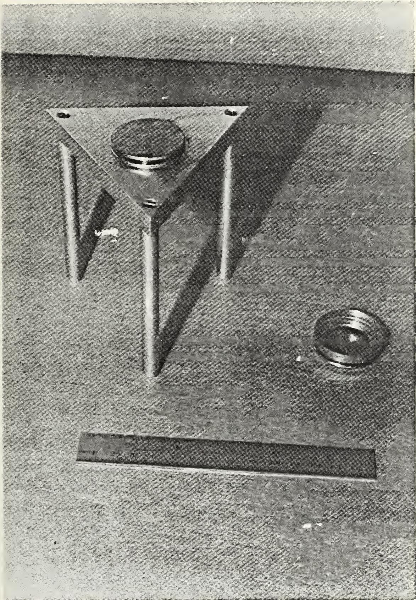  
Figure III-2.Photograph of Servometer Custom-Designed Dynamic Bellows--With and Without Test Stand.

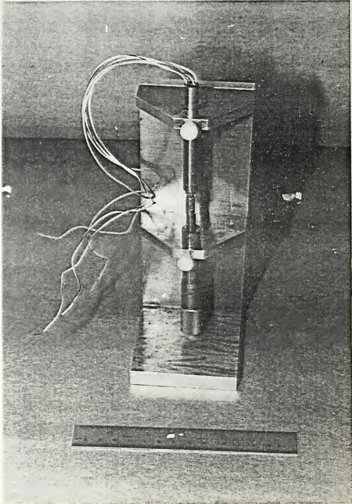  
Figure III-3. Photograph of Linear Variable Differential Transformer (LVDT) in its Calibration Stand.

LVDT CALIBRATION  
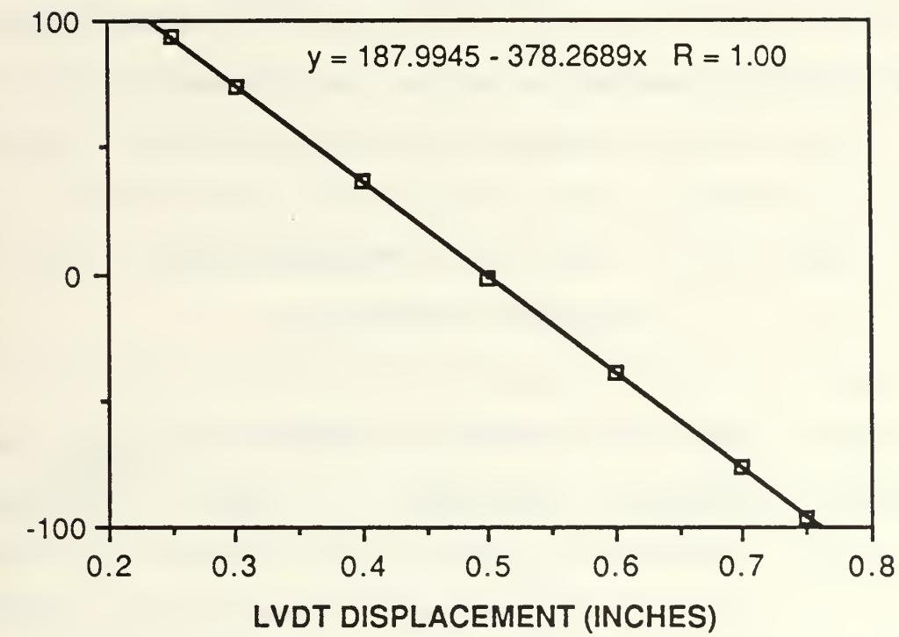

Figure III-4. Calibration Data for LVDT Voltage Output vs. Displacement.  
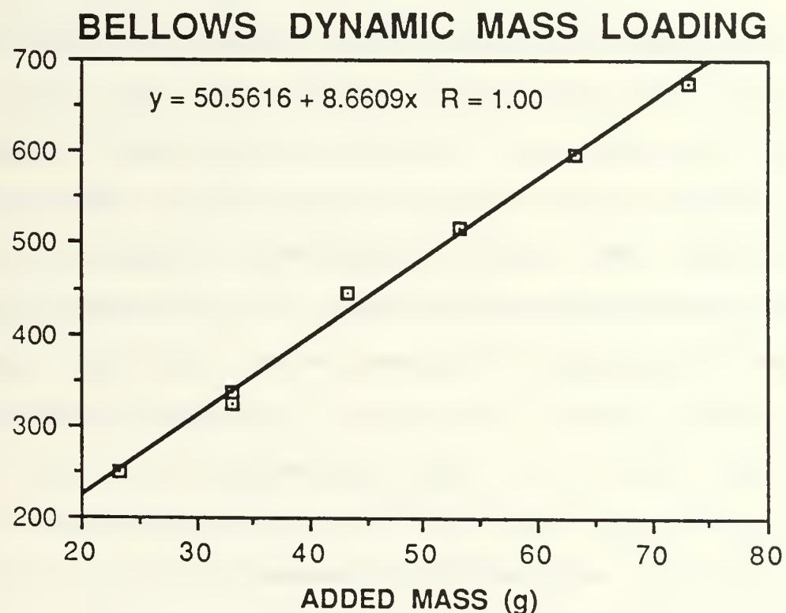  
Figure III-5. Least Squares Fit of Period Squared vs. Added Mass for Dynamic Loading of Bellows.

$$
\begin{array} { r c l c r c l } { { \Phi \backslash \mathcal { V } \mathcal { A } \} \ : \ : = } & { \displaystyle - 0 . 3 7 \mathfrak { S } \ : \ : \pm \ : \ : 0 . 0 0 0 5 \ : \ : \ : \ : \forall / \ : \mathbf { i } \ : \mathfrak { n } } & { \displaystyle = } & { \displaystyle - 1 4 . \mathfrak { S } \ : \ : \pm \ : 0 . 0 2 \ : \ : \ : \ : \forall / \mathfrak { n } . } & { \ : \ : } & { \ : \ : ( \mathrm { \scriptsize ~ I ~ I ~ I ~ - 4 ~ } ) \ : \ : \ : \ : } } \end{array}
$$

$$
\mathtt { T a S l e } \mathtt { S I e } \mathtt { I } \mathtt { I } \mathtt { I } \mathtt { I } - \mathtt { 1 } \mathtt { \Pi } \mathtt { g i } \mathtt  v e s \ t h e \mathtt { S } \mathtt { t a t a t i } \mathtt  c \mathtt  t e s t \ d a t a \ t o \mathtt { f } \mathtt { d } \mathtt { a } \mathtt { t a } \mathtt { f } \mathtt { a } \mathtt { f } \mathtt { e r } \mathtt { t h } \mathtt { e } \mathtt { s t a } \mathtt { s t i } \mathtt { f } \mathtt { f } \mathtt { n } \mathtt { e \le s a } \mathtt { s a } \mathtt { s a } \mathtt { s a } \mathtt { s a } \mathtt { s a } \mathtt { s a } \mathtt { s a } \mathtt { s a } \mathtt { s a } \mathtt { s a } \mathtt { s a } \mathtt { s a } \mathtt { s a } \mathtt { s a } \mathtt { s a } \mathtt { s a } \mathtt { s a } \mathtt { s a } \mathtt { s a } \mathtt { s a } \mathtt { s a } \mathtt { s a } \mathtt { s a } \mathtt { s a } \mathtt { s a } \mathtt { s a } \mathtt { s a } \mathtt { s a } \mathtt { s a } \mathtt { s a } \mathtt { s a } \mathtt { s a } \mathtt { s a } \mathtt { s a } \mathtt { s a } \mathtt { s a } \mathtt { s a } \mathtt { s a } \mathtt { s a } \mathtt { s a } \mathtt { s a } \mathtt { s a } \mathtt { s a } \mathtt { s a } \mathtt { s a } \mathtt { s a } \mathtt { s a } \mathtt { s a } \mathtt { s a } \mathtt { s a } \mathtt { s a } \mathtt { s a } \mathtt { s a } \mathtt { s a } \mathtt { s a } \mathtt { s a } \mathtt { s a } \mathtt { s a } \mathtt { s a } \mathtt { s a } \mathtt { s a } \mathtt { s a } \mathtt { s a } \mathtt { s a } \mathtt { s a } \mathtt { s a } \mathtt { s a } \mathtt { s a } \mathtt { s a } \mathtt { s a } \mathtt { s a } \mathtt { s a } \mathtt { s a } \mathtt { s a } \mathtt { s a } \mathtt { s a } \mathtt { s a } \mathtt { s a } \mathtt { s a } \mathtt { s a } \mathtt { s a } \mathtt { s a } \mathtt { s a } \mathtt { s a } \mathtt { s a } \mathtt { s a } \mathtt { s a } \mathtt { s a } \mathtt { s a } \mathtt { s a } \mathtt { s a } \mathtt { s a } \mathtt { s a } \mathtt { s a } \mathtt { s a } \mathtt { s a } \mathtt 
$$

measurement. By averaging the values we obtained:

$$
k = 4 . 3 \pm 0 . 2 \times 1 0 0 \ N / \mathrm { m } .
$$

(III-5)

## TABLE III-1. BELLOWS STIFFNESS--STATIC

## MEASUREMENT RESULTS

<table><tr><td>LVDT Voltage</td><td>Pressure</td><td>Pressure</td><td>Force (=P.A)</td><td>Stiffness</td></tr><tr><td>(mV)</td><td>(cm Hg)</td><td>(X10=Pa)</td><td>(N)</td><td>(X10=N/m)</td></tr><tr><td>14.84</td><td>2.9</td><td>3.87</td><td>4.39</td><td>4.40</td></tr><tr><td>15.62</td><td>3.1</td><td>4.13</td><td>4.69</td><td>4.47</td></tr><tr><td>12.89</td><td>2.3</td><td>3.07</td><td>3.48</td><td>4.02</td></tr></table>

The dynamic measurement was a mass loading technique

similar to that used for the driver. In this case. we

measured the period as a function of added mass using an

Endevco model 2225M2 accelerometer (serial FA80) and a

Nicolet model 3091 digital storage oscilloscope to record

the free decay of the bellows after it had been disturbed by

the blunt wooden end of a cotton swab. We then plotted

period squared versus added mass and found the stiffness and

moving mass from the slope and intercept of the least

squares fitted line (see Figure III-5) as discussed in the

previous Section. This gave us values of:

$$
\times = 4 . 5 6 \pm 0 . 0 5 \times 1 0 ^ { \circ } \mathrm { N } / \mathrm { m }\tag{III-6}
$$

$$
a _ { n } d \mu _ { 0 } = 5 . 8 4 \pm 0 . 0 5 \geq 8 .\tag{III-7}
$$

This value for moving mass includes the accelerometer cable

and is not representative of the actual moving mass of the

bellows. Subtracting the weight of the accelerometer gives

us a value of approximately:

$$
\mathfrak { m } _ { \mathbf { o } } = \begin{array} { l } { 1 . 5 \ \pm \ \varnothing . 1 \ \ : \ : \ : \ : \ : \ : \ : \ : \ : \ : \ : \ : } \end{array}\tag{III-8}
$$

for the bellows. We know the moving mass has to be less than

2.3 g, since that is the bellows' total mass--moving and

static. The values obtained for bellows stiffness using the

two different methods were within experimental error. We

therefore felt confident using a value of ks = 4.5 ± 0.1 X

10³ N/m in our later calculations.

3. Combined System

After we glued the reducer (m = 4.8 g), stiffener

plate (m = 4.4 g) and bellows to the driver, we wanted to

find the stiffness and moving mass of the combined driver-

reducer-bellows system. We first tried a dynamic mass

loading measurement (same procedure as with the driver

alone), but found that the period squared versus added mass

plot (see Figure III-6) gave unrealistic results. So instead

we used the relationship:

$$
\begin{array} { r c l c r } { \texttt { F } } & { = } & { - \texttt k \texttt X } & { = } & { \texttt B 1 \texttt I } \end{array}\tag{III-9}
$$

$$
\begin{array} { r l r l r } { \mathsf { o r } \quad } & { { } } & { \mathsf { k } } & { = } & { - \mathsf { B I I } \mathsf { I } / \mathsf { X } \quad = \quad \mathsf { B I } \quad ( \mathrm { d i } / \mathrm { d V } ) \ ( \mathrm { d V } / \mathrm { d } \mathsf { x } ) } \end{array}\tag{III-1O}
$$

and made a static measurement using the LvDT. We expected

the additional equipment (reducer, stiffener, and bellows)

MASS LOADING DRIVER-CONE-BELLOWS  
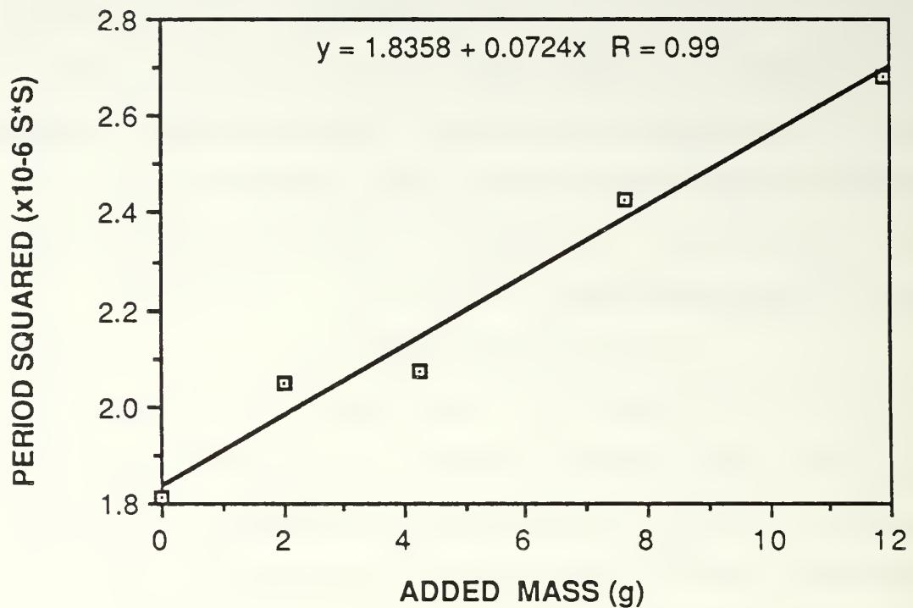  
Figure III-6. Least .Squares Fit of Period Squared vs. Added Mass for Combined Dri Reducer-Bellows System.

ALTEC 290-16K STATIC DISPLACEMENT  
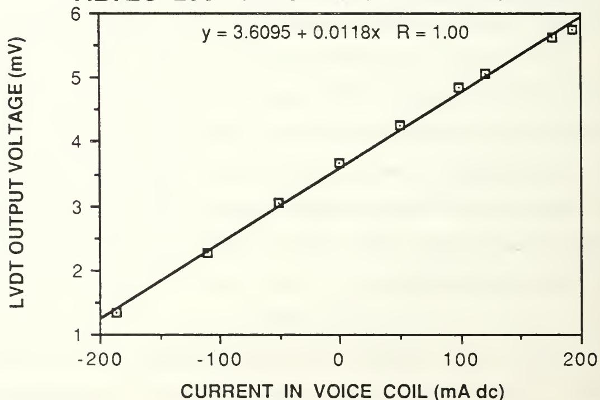  
Figure III-7. Driver Displacement vs. Voice Coil Current as Measured with LVDT/ Lock-in Analyzer.

to change the moving mass and suspension stiffness of the

system but not the transduction coefficient (Bl). We applied

a DC current to the driver and recorded the LVDT voltage

output, then changed the current and recorded the new vol-

tage. This process produced the values: ΔI = 283 ± 0.5 mA

and ΔV = 2.58 ± 0.005 mv. We substitute these values and the

value of Bl = 21.5 ± 0.5 N/A (experimental measurement of

this quantity is discussed in the next section) into Equa-

tion III-1O for a combined stiffness value of:

$$
\mathrm { ~  ~ k ~ } = 3 . 5 \pm 0 . 1 \mathrm { ~  ~ X ~ } 1 0 ^ { 4 } \mathrm { ~  ~ N / \mathrm { m } ~ } .
$$

(III-11)

If we add the stiffness values for the driver and bellows

together a total stiffness of k = 3.2 ± 0.1 X 10+ N/m for

the system is obtained. Thus the total experimental stiff-

ness for the combined system differs by about 10% from the

sum of the individual stiffnesses. Using the relationship

mo = k/(2πf)². and a measured resonance frequency of

235 ± 0.5 Hz, the combined moving mass is:

$$
\mathfrak { m } _ { \bullet } \ = \ \mathtt { 1 6 . 2 } \ \pm \ \mathtt { 0 . 5 } \ \mathtt { g } \ ,
$$

(III-12)

compared to m。 = 15.9 ± 0.5 g for the individual masses

added together. The two types of mass measurement agree

within 2%.

D. TRANSDUCTION COEFFICIENT (BL)

We determined the Bl coefficient of the driver using

three independent methods. The first method was to remove

the voice coil from the magnet and directly measure the

magnetic induction using a Dowdy RFL Industries model 912

$$
\mathtt { G u a s s m e t e r } \mathtt { \Gamma } \mathtt { ( s e r i a l ) } \mathtt { \Gamma } \mathtt { \{ s o g \} } \mathtt { u s i n g \mathtt { s \mathtt { d a } 1 } } \mathtt { e f f e c t } \mathtt { \mathtt { p r o b e } } \mathtt { \Gamma } \mathtt { m e d e l } \mathtt { h \mathtt { d a } 1 } \mathtt { e } \mathtt { m e t } \mathtt { a } \mathtt { m \mathtt { s \mathtt { d a } 1 } }
$$

$$
9 1 2 0 1 5 \quad \mathrm { ~ ( ~ s e r i a l ~ \pi ~ 2 1 1 2 2 ~ ) } \quad \mathrm { ~ ( ~ \mathsf { B } ~ = ~ 2 ~ . ~ 2 ~ \pm ~ \mu ~ 0 ~ . ~ 0 5 ~ ) ~ ~ \mathsf { T e s l a } ~ } ) \quad \mathrm { , ~ } \quad \mathsf { t h e n m a = 3 . }
$$

measured l (the length of the wire) by counting the number

of turns of wire in the coil (under a microscope) and

multiplying this number (44) by the circumference of the

$$
\mathtt { c o i l } \mathtt { \Gamma } \mathtt { \Gamma } \mathtt { \langle 1 \ = ~ 4 4 ~ \times ~ \alpha ~ \alpha ~ \alpha ~ \alpha ~ \alpha ~ \mathtt { X } ~ \mathtt { d i a n e t e r } ~ = ~ 9 . 9 8 ~ \pm ~ 0 . 0 0 5 ~ \alpha ~ \mathtt { m } ) } \mathtt { \cdot } \mathtt { \Gamma } \mathtt { C o m b i n i n g }
$$

these two measurements gave us the value:

$$
\mathrm { B } 1 \ = \ 2 2 . 0 \ { \stackrel { \div } { \ - \ 0 } } . 7 \mathrm { N } / \mathrm { A } .\tag{III-13}
$$

In the second method we used the relationship:

$$
\begin{array} { r l r l r l r l r l r } { \mathrm { ~ F ~ \ = ~ \ B 1 ~ I ~ \ = ~ \ - k x ~ } } & { \ \mathrm { ~ o r ~ } } & { \ \mathtt { B 1 } } & { \mathtt { = \_ - k x / \mathtt { I } } } & { \mathtt { = \_ - k x / \mathtt { I } } } & { \mathtt { = \_ - k ( \mathtt { d x / d y } ) ( \mathtt { d V / d I } ) \ . } } & { \ \mathrm { ( \mathtt { I f } \mathtt { I } \mathtt { I } \mathtt { I } \mathtt { - 1 } \mathtt { 4 } ) } } \end{array}
$$

We previously determined k for the driver alone (Equation

III-2), and now used the LVDT and lock-in analyzer to find

dx/di. The LVDT calibration was discussed in the previous

Section, with a calculated value of dV/dx = -14.9±0.05 V/m.

We then measured the diaphragm displacement as a function of

DC-current through the voice coil. This gave us a value of

$$
\begin{array}{c} \begin{array} { r l r } { \mathbb { d } \mathbb { V } / \mathbb { d } \mathbb { I } \quad } & { = } & { \texttt { 1 1 . 7 5 ~ \pm ~ 0 . 0 5 ~ \mathtt { m V } / A } \quad \mathtt { ( s e e ~ \mathbb { F } ~ i \underline { ~ { g } } u r e ~ \texttt { ~ \texttt { I I I - 7 } } ) } \end{array} , \quad \mathtt { U } \mathbb { s } \mathtt { i } \mathtt { n g } \quad \mathtt { t h e } \mathtt { m } \mathtt { s } \mathtt { e } \mathtt { m } , \mathtt { m } \mathtt { s } \mathtt { m } , \mathtt { i } \mathtt { n g } \mathtt { m } \mathtt { s } \mathtt { m } . } \end{array}
$$

relation in Equation III-14 we obtain the value:

$$
\mathrm { ~ \mathsf ~ { B } \vec { \imath } ~ { \Lambda } ~ } = \mathrm { ~ \mathsf ~ { ~ 2 } \vec { \imath } ~ { \Lambda } ~ } . \mathrm { ~ \mathsf ~ { ~ 2 ~ } ~ } \pm \mathrm { ~ \mathsf ~ { ~ 0 ~ } ~ } . \mathrm { ~ \mathsf { ~ 1 ~ } ~ } \mathrm { ~ N } / \mathrm { ~ A ~ } .\tag{III-15}
$$

In the third method we used the relationship:

$$
\begin{array} { r l r l r l r l } { \mathrm {  ~ F ~ } } & { = } & { \mathrm {  ~ B ~ } \mathrm {  ~ \bot ~ i ~ } } & { = } & { \mathfrak { m } \mathrm {  ~ \mathsf { g } ~ } \quad } & { \mathrm {  ~ o ~ r ~ } } & { } & { \mathrm {  ~ B ~ } \mathrm {  ~ \mathsf { \Omega } ~ } = } & { \mathfrak { m } \mathrm {  ~ \mathsf { g } ~ } / \mathrm {  ~ i ~ } . } \end{array}\tag{III-16}
$$

For this we measured the change in DC-current through the

coil as a function of added mass, using the LVDT as a

monitor to keep the displacement of the diaphragm constant.

Three different mass/current combinations (see Table III-2)

produced an average value of:

$$
\begin{array} { r l r } { \mathsf { B 1 } } & { { } = } & { 2 1 . 4 \ \pm \ 0 . 5 \ \mathsf { N } / \mathsf { A } . } \end{array}\tag{III-17}
$$

Averaging the results of these three methods gave us a

value of Bl = 21.5 ± 0.5 N/A with 2% deviation among the

three methods.

TABLE III-2. STATIC MEASUREMENT OF ALTEC 290-16K TRANSDUCTION COEFFICIENT (BL)
<table><tr><td>m (ε)</td><td>ΔI(mA)</td><td>Bl = mg/I I(N/A)</td></tr><tr><td>132.5</td><td>64.4</td><td>20.2</td></tr><tr><td>157.5</td><td>74.0</td><td></td></tr><tr><td></td><td></td><td>20.9</td></tr><tr><td>257.5</td><td>108.2</td><td>23.3</td></tr></table>

## E. MICROPHONE CALIBRATION

Microphone calibration is an important part of the

process leading to the measurement of the electroacoustic

efficiency. A microphone is used to measure the acoustic

pressure inside the resonator by converting the acoustic

pressure to an output voltage. The ratio of the open circuit

voltage to the pressure is called the open circuit

microphone sensitivity

We used three microphones for the calibration:(1) a

General Radio (GR) model 1962-9611 half-inch electret

condenser microphone (serial 11811) with GR preamplifier

model 1560-P42 (serial 4061);(2) an Endevco model 8510B-5

piezoresistive bridge microphone (serial 73MJ); and (3) an

1/8 inch B&K model 4138 microphone (serial 19683). We first

calibrated the GR using a GR type 1562-A sound-level cali-

brator (serial 19683, 114dB SPL, 250 Hz), and obtained a GR

sensitivity of Ma = 7.42 mV/Pa. This compares within about

1% of the calibration certificate provided by the manufac-

turer of 7.50 mV/Pa. Additional checks were made with a B&K

pistonphone calibrator which substantiated the GR calibra-

tion results.

To calibrate the other two microphones we attached the

resonator tube to the 290-16K driver. We used an HP 3325A

Synthesizer/Function Generator to excite the driver at 240

Hz, the resonant frequency of the tube. We recorded the

output voltages for all three microphones and used the

comparison relationship:

$$
\Theta _ { \mathbf { 1 } } / \nu _ { \mathbf { 1 } } = \mu _ { \mathbf { 2 } } / \nu _ { \mathbf { 2 } }
$$

(III-18)

to determine the sensitivities of the B&K and Endevcc. The

B&K sensitivity was determined to be Ms = 0.463 mV/Pa,

comparing within 2% of the manufacturer's specification

value of 0.470 mV/Pa (adjusted to include the capacitance of

the B&K model VA0160 1/8" to 1/4" adapter with an expected 4

dB "line loss"). The sensitivity of the Endevco microphone

was calculated to be 8.17 X 10-s V/Pa, comparing within 1%

of the manufacturer's specification of 8.09 X 10-s V/Pa. For

all three microphones we measured sensitivity values within

2% of the manufacturers' specifications.

## F. ELECTROACOUSTIC EFFICIENCY

The electroacoustic efficiency is the ratio of the

acoustic power dissipated in the resonator to the electric

power delivered to the driver. The electric power was

determined using the relationship:

$$
\bar { \mathsf { P } } _ { \bullet { \mathsf { 1 } } = \bullet } = \mathsf {  ~ V ~ } \bar { \mathsf { 1 } } \mathsf { c o s } \vec { \mathsf { 9 } } ,\tag{III-19}
$$

where V is the voltage across the driver terminals, I is the

current flowing in the driver, and e is the phase angle

between the voltage and the current. The values for voltage.

current and phase angle delivered to the driver were

obtained using the HP 4192A.

Calculation of the acoustic power was a little more

complex. We started with the basic relationship for the

quality factor of the tube:

$$
\textsf { Q } = 2 \pi \mathbb { E } _ { \Xi \tau } / \mathbb { E } _ { L } \varepsilon ,\tag{III-20}
$$

where Est is the energy stored in the tube and Elc is the

energy lost per cycle. The acoustic power generated in the

tube is the energy lost per cycle times the number of cycles

per second, or frequency:

$$
\begin{array} { r c l } { { \sf P _ { e c } } } & { { = } } & { { \sf E \bf { \underline { { { L } } } } \cdot \sf c { \bf \underline { { { f } } } } } } & { { = } } & { { 2 \pi \sf f { \sf \underline { { { E } } } } \cdot \sf s { \bf \underline { { { \tau } } } } / \sf { Q } \ . } } \end{array}\tag{III-21}
$$

Following Burmaster (1985) the energy stored in a plane

standing sound wave is equal to the energy density

integrated over the volume of gas in the tube (VOL):

$$
\begin{array} { r l r } { \Xi _ { \otimes \tau } } & { = } & { ( \mathsf { P } _ { r ^ { \prime } \mathsf { m } = } \mathsf { z } / 2 \mathsf { z } _ { \parallel } \mathsf { P } _ { \infty } ) \cdot \mathsf { V } \mathsf { O } \mathsf { L } , } \end{array}
$$

(III-22)

where Prmz is the root mean square acoustic pressure in the

tube, g is the ratio of the specific heats of the gas in the

tube (1.4 for air). and P。 is the ambient pressure (one

atmosphere or 1.013 X 10= Pa for these measurements). The

r.m.s. acoustic pressure is the r.m.s. microphone output

voltage divided its sensitivity (V/M) as discussed in the

previous Section. The expression for the acoustic power

becomes :

$$
\rho _ { a c } = \frac { 1 } { \pi } f ( \pi \angle V ) = \angle O L ) / ( O M \geq \gamma F _ { \infty } ) .\tag{III-23}
$$

The only remaining quantity in Equation III-23 that

needs to be calculated separately from the efficiency

measurement is the quality factor of the tube (Q). Tc

determine Q we removed the 290-16K driver from the resonator

and replaced it with an electret transducer to drive the

tube. This was necessary because there were losses due to

the 290-16k that made the tube Q appear to be lower than it

actually is (we discovered this problem while investgating

the reasons for the calculated efficiency to be greater than

one). We used the B&k microphone for the pressure (converted

to voltage) readings at the other end of the tube. We plot-

ted voltage as a function of frequency, and determined the

resonant frequency (f。) and frequencies of the half power

points (fu and fr). Using the relationship:

$$
\textsf { Q } = \textsf { f } _ { \mathbf { o } } / \left( \textsf { f } _ { \mathbf { \sigma } \mathbf { \cup } } - \textsf { f } _ { \mathbf { \sigma } \mathbf { 1 } } \right)
$$

(III-24)

we obtained a value of Q = 60 ± 1 for the tube.

To determine the electroacoustic efficiency we returned

the tube to the 290-16K driver (see Figure III-8) and drove

the tube at resonance. We recorded the voltage, current, and

phase angle for the driver and the B&K output voltage. The

electroacoustic efficiency was then calculated using:

$$
\Pi _ { \mathsf { E A } } ~ = ~ \mathsf { P } _ { \mathsf { A C } } / \mathsf { P } _ { = 1 = \mathsf { C } } .\tag{III-25}
$$

Table III-3 lists the electric power, acoustic power, and

efficiency for five test runs at driver currents ranging

from 3-38 mA (with corresponding voltages 0.15-1.43 V). The

electroacoustic efficiency ranged from 84.2 for the lowest

driver current to 75.9 for the highest.

TABLE III-3. ALTEC 29O-16K ELECTROACOUSTIC  
EFFICIENCY MEASUREMENTS
<table><tr><td>P=ies (mW)</td><td>PAc (mW)</td><td>nEA(%)</td></tr><tr><td>0.56</td><td>0.47</td><td>84.2</td></tr><tr><td>3.41</td><td>2.70</td><td>79.2</td></tr><tr><td>10.0</td><td>7.79</td><td>77.9</td></tr><tr><td>17.0</td><td>13.1</td><td>77.2</td></tr><tr><td>54.2</td><td>41.2</td><td>75.9</td></tr></table>

## G. COMPARISON TO COMPUTER MODEL

The final task in the evaluation procedure for the electrodynamic driver is to compare the measured electroacoustic efficiency to that predicted by the computer model

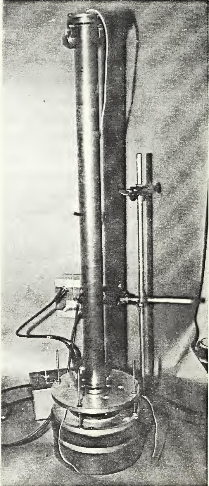  
Figure III-8. Photograph of Altec 290-16K Driver Assembly with Resonator Tube and Endevco Microphone.

discussed in Section II.D. We have already measured or

calculated all the input values for the model except for the

driver's mechanical resistance (Rm).

## 1. Mechanical Resistance

We can determine Rm by using the relationship:

$$
\begin{array} { r c l } { \bar { \mathsf { R } } _ { \bullet \bullet } } & { = } & { 2 \pi \mathsf { f } _ { \bullet \bullet } \mathsf { m } _ { \bullet } / \mathsf { Q } , } \end{array}\tag{III-26}
$$

where f。 is the resonant frequency, mo is the moving mass

and Q is the quality factor of the driver. There are several

methods available for determining the driver's quality

factor. One is to plot the magnitude of the modified driver

impedance vs. frequency and pick the half power points off

the graph. Then, as with the tube, Q is given by:

$$
\alpha = f _ { \infty } / \beta _ { 0 } - f _ { \mathrm { ~ \bf ~ l ~ } } \mathrm { ~  ~ \Gamma ~ } ) ,\tag{III-27}
$$

where fu and f. are the frequencies associated with the

upper and lower half power points (located at [Z]mex/vZ.

where [Z] is the magnitude of the driver impedance which is

modified by subtracting the direct current (DC) resistance

from the measured complex impadance).

Another method is to use the relationship [Hofler.

1986]：

$$
\textsf { Q } = \frac { 1 } { 2 } \textsf { f } _ { \circ } \mathsf { d } \theta / \mathsf { d } \mathsf { f } ,\tag{III-28}
$$

where  is the phase angle between driver resistance (R) and

reactance (X), the two components of modified impedance (Z =

R + iX. where R is the measured resistance minus the DC

(direct current) resistance). This modified impedance is

proportional to the voice coil velocity. The quantity de/df

is the slope of the phase angle versus frequency curve

evaluated at the resonant frequency (where the curve is a

straight line). We used the HP4192A to obtain the data for

these measurements.

Figure III-9 shows a plot of modified impedance vs.

frequency for the Altec 290-16K in air. From this graph we

find fo=235.2 Hz， fu=249.6 Hz and f₁=222.0 Hz. The Q for

these values is 8.52. Figure III-10 shows a plot of phase

angle vs. frequency for the same data set. Over this large

range of frequencies the phase angle curve approximates an

arctangent. At resonance, however, where de/df is evaluated.

the curve is linear (see Figure III-11). Equation III-28 is

the slope of the arctangent at resonance (fo). The slope of

the plotted data is 71.8Xi0-3 sec (de was converted from

degrees to radians). The Q calculated from this method is

8.44. These values for Q agree within 1%. From these values

we get Rm=2.77 kg/s.

We tried yet another method for determining driver

Q. This third method measures the decay constant, t. using a

digital storage oscilloscope to record the "ring down" of

the driver. This technique takes less time to run the exper-

iment and reduce the data using the relationship:

$$
 { \mathcal { Q } } _ { }  { \mathcal { Q } } _ { } { } =  { \mathfrak { w } }  { \mathbb { T } } { \ b { \mathcal { Q } } } _ { } { } \quad \mathrm { o r } \quad  { \mathfrak { T } } { } = 2  { \ Q / \mathfrak { w } } =  { \mathbb { T } } / \pi
$$

(III-29)

where  is the resonant angular frequency in radians/sec, T

is the period in seconds, and t is the free decay time

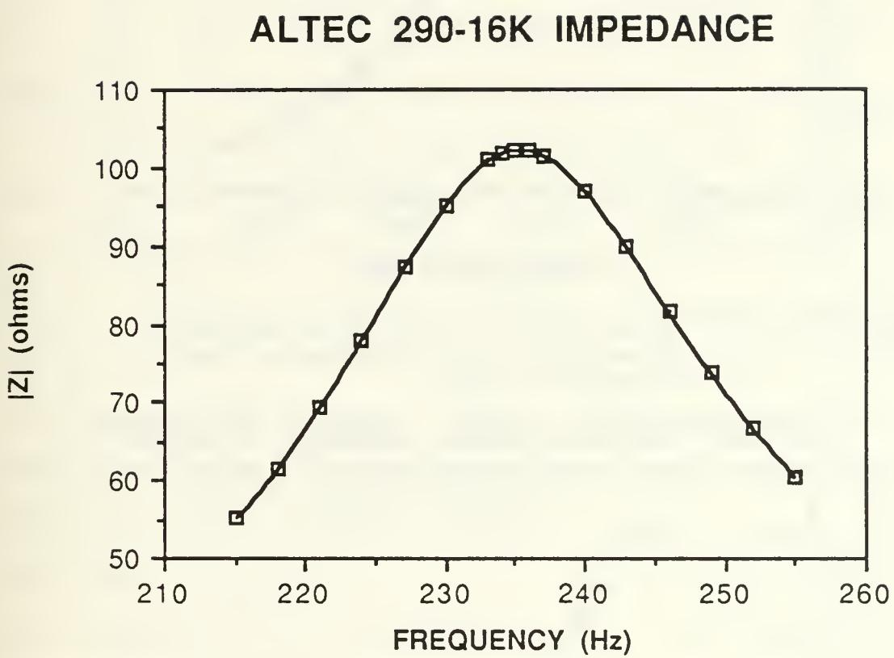  
Figure III-9. Altec 290-16K Modified Impedance Magnitude vs. Frequency.

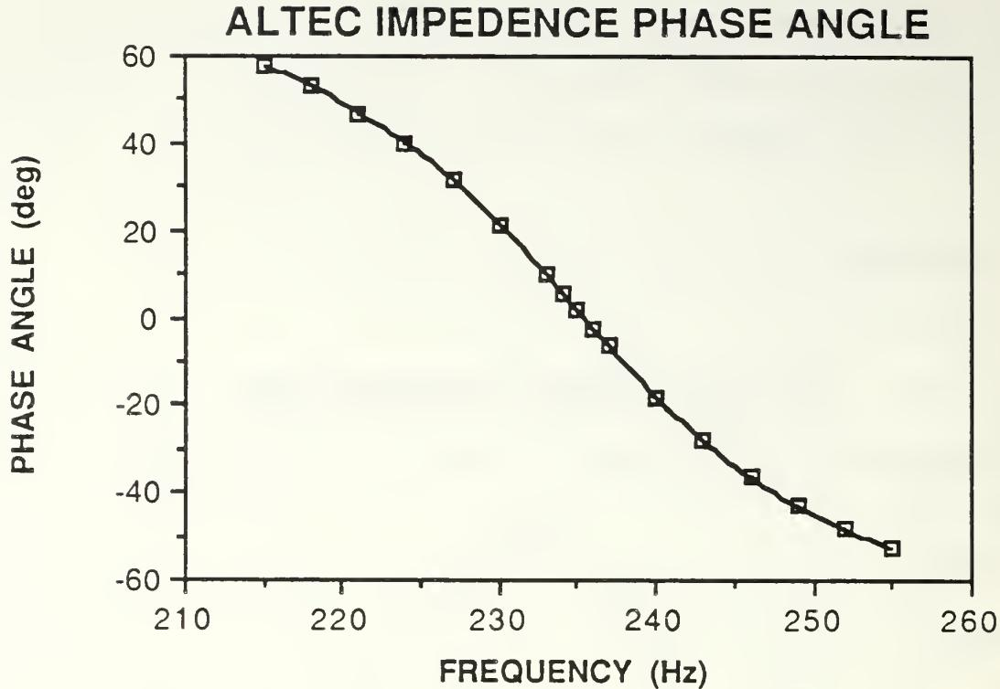  
Figure III-10. Altec 290-16K Modified Impedance Phase Angle vs. Frequency--Full Frequency Range.

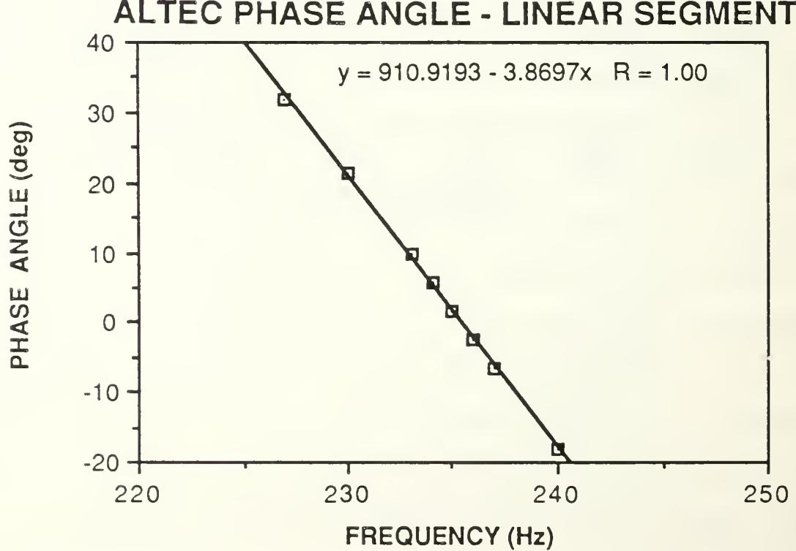  
Figure III-11. Least Squares Fit of Altec 290-16K Modified Impedance Phase Angle as a Function of Frequency Near Resonance.

constant in seconds. This method will be discussed in

greater detail in Chapter IV.

## 2. Model Results

for the Altec 290-16K. Figures III-12 through III-15 show

the output plots for these values as discussed in Section

II.D. In this case the resonance peaks are much closer

together, and the magnitude of the secondary peak is closer

in value to the primary peak. Once again the driver reso-

nance is at a lower frequency than the resonator resonance.

It is interesting to note that the modeled efficiency (about

60%) is 15-20% less than the measured efficiency reported in

the previous Section. We believe that this results from the

fact that for the computer model, a high tube Q means that

the driver losses, represented by Rm, play a more important

role in the efficiency calculation, and the results are very

sensitive to small errors in Rm. The primary ways for the

driver energy to be dissipated are: (1) Joule heating due to

DC resistance in voice coil and eddy currents induced in the

magnet structure due to the time-varying magnetic fields

generated by the AC voice coil current (small but not negli-

gible)：(2) mechanical resistance of driver (Rm);and(3)

energy transferred to acoustic load. Another possible reason

for the different efficiencies is that the efficiency is not

independent of current hence the real physical system has

some non-linearity, as Table III-3 clearly shows. The

<table><tr><td>Symbol</td><td>Meaning</td><td>Units</td><td>Altec</td></tr><tr><td>R.M</td><td>Mechanical resistance</td><td>kg/s</td><td>2.77</td></tr><tr><td>M</td><td>Moving mass</td><td>kg</td><td>0.0162</td></tr><tr><td>SSUP</td><td>Spring constant</td><td>N/m</td><td>3.52X104</td></tr><tr><td>RHO</td><td>Density of gas</td><td>kg/m³</td><td>1.2</td></tr><tr><td>U</td><td>Sound speed</td><td>m/s</td><td>342.0</td></tr><tr><td>s</td><td>Resonator X-sec. area</td><td>m²</td><td>9.35X10-4</td></tr><tr><td>BL</td><td>Driver trans. factor</td><td>N/A</td><td>21.5</td></tr><tr><td>Q</td><td>Resonator quality factor</td><td></td><td>60.0</td></tr><tr><td>FO</td><td>Resonator resonance freq.</td><td>Hz</td><td>240.0</td></tr><tr><td>A</td><td>Back volume X-sec. area</td><td>m²</td><td>4.13X10-3</td></tr><tr><td>VOL</td><td>Back volume</td><td>m³</td><td>2.8X10-4</td></tr><tr><td>LE</td><td>Voice coil inductance</td><td>H</td><td>1.0X10-3</td></tr><tr><td>RE</td><td>Voice coil DC resistance</td><td>à</td><td>10.6</td></tr><tr><td>I</td><td>Driver current</td><td>A</td><td>1.0</td></tr><tr><td>L</td><td>Resonator length</td><td>m</td><td>0.712</td></tr></table>

VOE E FNCY  
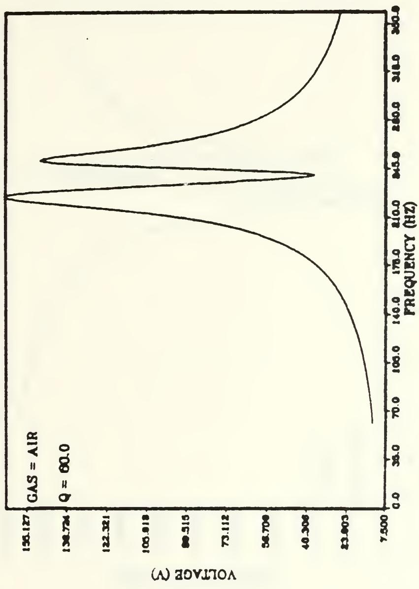

PISY VV V VOCY  
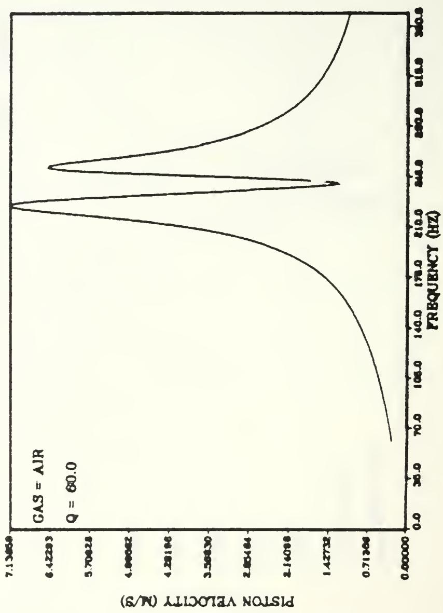  
Figure III-13. Computer Model Output for Altec 290-16K--Piston Velocity vs. Frequency for One Amp.

ACC C AROC PONCY  
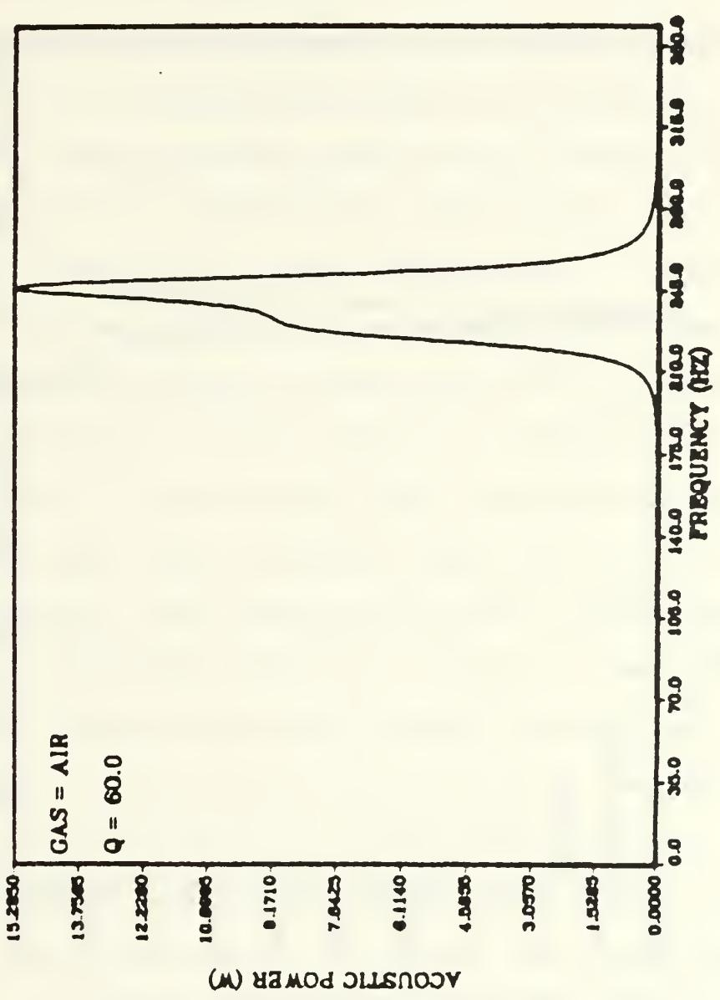

ELC C EFEC EFNCY  
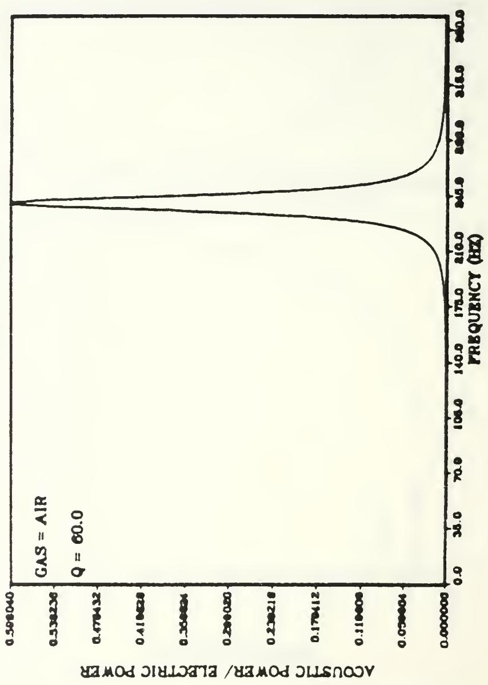  
Figure III-15. Computer Model Output for Altec 290-16K--Electroacoustic Efficiency vs. Frequency.

computer model is based on a linear theory and will have an

efficiency which is independent of drive current.

## H. DRIVER RESONANCE ALTERATION

The refrigerator must operate at the resonant frequency

of the resonator to obtain the highest electroacoustic effi-

ciency and to maintain stack position with respect to the

standing acoustic wave (discussed in Sub-section II.A.4). It

appears from the computer model results and our experiments

so far that the operating frequency should also be near the

driver's resonance to get the most power out of the driver.

The resonant frequency of the resonator is determined by the

effective length of the resonator and the speed of sound in

the contained gas. The effective length for a tube of uni-

form cross-section and closed end is the actual measured

length. For the STAR resonator, however, the effective

length is the length that would produce the measured reso-

nant frequency for the given sound speed if the resonator

were a uniform cross-section closed-ended tube (see Figure

I-2 for approximate shape of resonator). The sound speed can

be altered by changing the percentage of xenon in the

helium-xenon mixture, since the sound speed depends on the

density of the mixture, and the density depends on the

percentages of the individual gases present (see Equations

IV-24 and IV-26). The gas mixture and effective resonator

length will be chosen to maximize the coefficient of

performance of the refrigerator. Therefore if we want to

match the resonances, we will have to alter the resonance of

the driver once the resonant frequency of the resonator has

been determined.

The resonant frequency of the driver is proportional to

the square root of the stiffness divided by the moving mass.

If we want to raise the resonant frequency of the driver we

can either  increase the stiffness or  decrease  the mass.

Conversely. to lower the resonant frequency we can either

decrease the stiffness or increase the mass. Generally we

prefer to decrease stiffness and mass to get a larger

velocity. Reduction of stiffness usually also reduces the

mechanical resistance.

For the Altec 290-16K attached to the uniform cross-

section resonant tube in these preliminary experiments,the

frequencies were already well matched (note the closeness of

the peaks in Figures III-12 through III-14) and changing the

driver frequency was not required. However, we know that in

future applications we may need to alter, most probably

lower,the driver resonant frequency. We developed an

experimental procedure to do this.

Adding moving mass to the driver would appear to be the

easiest way to lower the driver resonance. Unfortunately the

added mass would also reduce the velocity by increasing the

mecahnical impedance above resonance. We therefore chose to

experiment with decreasing the driver stiffness. Recall that

the driver-reducer-bellows system stiffness includes the

stifffness of the bellows (4.5 X 10≥ N/m) and the suspension

stiffness of the driver phenolic surround (29 X 10≥ N/m).

The driver suspension was the obvious choice for

experimental alteration for two reasons: (1) it is over six

times as large as the bellows stiffness, and (2) it would be

very difficult for us to change the bellows stiffness

without affecting its performance.

Since the 290-16K voice coil surround is made of a

phenolic material, it was relatively easy to cut through it

with an ordinary scalpel. We made a series of successive

cuts in the surround material and ran measurements of the

driver resonant frequency after each cut. The results of

this experiment are given in Table III-5. We plotted the

phase angle between the driver's electromotive force  (emf)

and the voice coil displacement as a function of frequency.

For the emf we measured the voltage across the driver termi-

nals in channel A of the HP 4192A Impedance Analyzer and

assumed that the emf was in phase with the driver current

and hence force. We used the photonic sensor to measure the

displacement by connecting its voltage output to channel B.

The 4192A then displayed the phase angle between the two

voltages representing force and displacement. The driver is

at resonance when this phase angle equals 90 degrees. The

quality factor (Q) is equal to one-half the resonant fre-

quency times the slope of the phase angle vs.frequency

curve evaluated at resonance (see Equation III-28). Using

the previously determined values for moving mass (16 g) and

bellows stiffness, we calculated the suspension stiffness:

$$
k _ { \mathrm { ~ w ~ t ~ e ~ } } = k _ { \mathrm { ~ t ~ o ~ t ~ } } - k _ { \mathrm { ~ t ~ o ~ i ~ l ~ o ~ w ~ s ~ } }\tag{III-30}
$$

where ktot=4π²fo²mo. We calculated the mechanical

resistance (Rm) using equation III-26. We stopped cutting

the surround when its stiffness was approximately equal to

that of the bellows and therefore the total stiffness was no

longer suspension dominated.

## TABLE III-S. RESULTS OF

## DRIVER RESONANT FREQUENCY ALTERATION

<table><tr><td>Percent Surround</td><td>Resonant</td><td>Quality</td><td>Suspension</td><td>Mechanical</td></tr><tr><td>Remaining</td><td>Frequency</td><td>Factor</td><td>Stiffness</td><td>Resistance</td></tr><tr><td>(approx.)</td><td>(HZ)</td><td></td><td>(X10=N/m)</td><td>(kz/s)</td></tr><tr><td>100</td><td>241.0</td><td>8.55</td><td>32.2</td><td>2.83</td></tr><tr><td>100 (six slits)</td><td>229.5</td><td>8.09</td><td>28.8</td><td>2.85</td></tr><tr><td>80</td><td>213.5</td><td>5.17</td><td>24.3</td><td>4.15</td></tr><tr><td>50</td><td>183.5</td><td>8.65</td><td>16.8</td><td>2.13</td></tr><tr><td>20</td><td>119.5</td><td>8.56</td><td>4.52</td><td>1.40</td></tr></table>

Despite the anomoly at the 80% data point. we feel that

this experiment shows that partial removal of the surround

can reduce stiffness, resonant frequency, and mechanical

resistance. It appears from the above data that the flexing

of the phenolic surround is responsible for the majority of the mechanical losses in the driver.

## IV. STAR DRIVER PARAMETERS

## A. INTRODUCTION

This chapter discusses the selection of the electro-

dynamic driver, describes the parameter measurements on the

chosen driver, and estimates the electroacoustic efficiency

of the STAR using the computer model described in Section

II.D.

## 1. Interface with NASA GAS Cannister

In addition to the maximum weight of 200 pounds

discussed in Section I.B, restrictions due to the Get Away

Special (GAS) cannister dimensions give us a maximum payload

height (28.25 inches) and diameter (19.75 inches). In our

alloweu height we must fit two battery layers, the driver

with its housing, the resonator assembly, and its associated

vacuum space and thermal insulation. The battery layers are

each about four inches high. for a total battery height of

eight inches. This leaves about 20 inches for the driver and

resonator assemblies (see Figure I-4 for approximate

configuration). The electronics package and gas reservoir

should fit in the area radially surrounding the resonator,

and will therefore not add to the height. Although the

diameter of the cannister volume is 19.75 inches, the driver

housing must attach to the standard GAS can lid at a 9.5

inch diameter bolt circle, otherwise we would need a lid

specially designed for our project. As far as weight is

concerned, approximately every pound we save elsewhere

allows us to carry an extra battery cell, which results in

an extra ten watt-hours of available energy.

2. Maximizing Electroacoustic Efficiency

In addition to the space and weight restrictions, we

want to maximize the electroacoustic efficiency of the

driver. We can do this by obtaining the maximum value for

the combination of parameters Bl/Rmmo.A larger Bl will

give us a larger driving force (F=Bli), which in turn gives

us a larger acoustic volume velocity, one of the components

of acoustic power. For a given value of magnetic induction

(B), a longer voice coil (achieved by having a larger voice

coil diameter with the same number of turns. or the same

diameter and more turns) will result in a larger Bl. This

longerl would also result in a greater voice coil

electrical resistance, so the two effects cancel. We also

want to minimize the moving mass (mo) to allow greater

velocities and minimize the driver's mechanical resistance

(Rm) in order to minimize mechanical losses in the driver.

3. Driver Selection

We had two off-the-shelf drivers available for con-

sideration. The Altec 260-16K was discussed in Chapter III.

The other driver was a JBL 2445J. Both drivers were designed

for applications somewhat different from the STAR. Figure

IV-1 shows a side view of the 2445J driver. The hatched

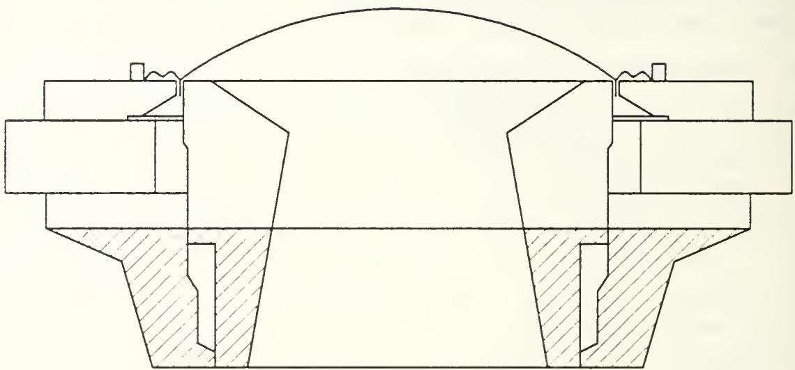  
Figure IV-1. Schematic Drawing of JBL 2445J Driver Hatched Area Shows Unnecessary Throat Section.

area, known as the throat of the driver. is considered

unnecessary for our application, and adds a lot of extra

weight to the driver. The Altec 290-16K has a similar excess

throat volume. We contacted JBL and asked if they would

custom-design a driver which would eliminate this excess

weight. Fortunately for our project, JBL was in the process

of designing a new driver, the 2450J, which uses neodymium-

iron-boron magnets instead of the traditional ceramic. They

agreed to custom-design a version of the 2450J for our use.

The resulting driver (hereafter referred to as NIB) is shown

in Figure IV-2. The NIB driver accepts the same voice coils

(four inch diameter, aluminum wire, and titanium suspen-

sion/diaphragm) as the 2445J(ceramic magnet) driver. JBL

claims that it should also have the same properties,

including Bl.

In the remainder of this chapter we describe the

parameter tests on the NIB driver. We then compare the NIB

driver to the 290-16K driver. The results of the 2445J

parameter measurements are given for comparison. Finally we

present results generated by the computer model for the NIB

driver given various acoustic load impedances.

B. NIB DRIVER PARAMETERS

For the measurement of the NIB driver parameters, we

used the techniques we developed in Chapter III for the

measurement of the 290-16K driver parameters.

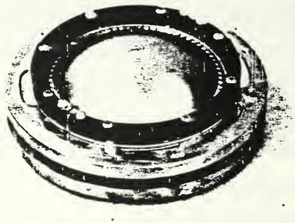

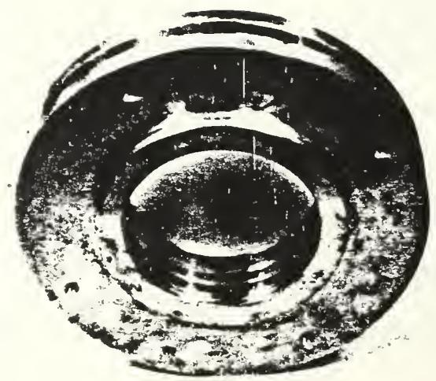  
Figure IV-2. Photographs of JBL Neodymium-Iron-Boron Driver.

1. Moving Mass and Suspension Stiffness

The moving mass and suspension stiffness were

calculated using the mass loading technique. We placed small

masses (0.5 to 3.5 grams) of black putty on top of the

voice coil in half-gram increments. For each added mass the

resonant frequency of the driver was found using the HP

4192A LP Impedance Analyzer (see Section III.B for a

description of this instrument). Figure IV-3 shows a sample

plot of period squared vs. added mass for the NIB driver in

air. The stiffness was found by calculating four pi squared

divided by the slope. The moving mass is equal to the

intercept divided by the slope. For the NIB in air these

values are:

$$
k = 9 . 8 \pm 0 . 1 \times 1 0 ^ { 4 } k g / s ^ { 2 }\tag{IV-1}
$$

$$
\begin{array} { r c l } { { \sf a n d } } & { { } } & { { { \sf m } _ { \bf > } = 7 . 8 \pm 0 . 1 \mathrm {  ~ \sf ~ g } , } } \end{array}\tag{IV-2}
$$

with a resonant frequency of 564 Hz. We repeated the

measurement in a vacuum chamber and found:

$$
\ k = \ 8 . 6 \pm 0 . 1 \times 1 0 ^ { 4 } \ k g / s ^ { 2 }\tag{IV-3}
$$

and

$$
\mathfrak { m } _ { \mathbf { o } } = \ 3 . 2 \ \pm \ 0 . 1 \ \mathrm  ~ \} \mathfrak { s } ,\tag{IV-4}
$$

with a resonant frequency of 833 Hz (see Figure Iv-4).

The moving mass is greater in air because of the

driver having to move the air itself. The discrepancy in the

stiffness is not as easy to explain. To determine the actual

value of k, we used the static mass loading method. This

gave us a value of:

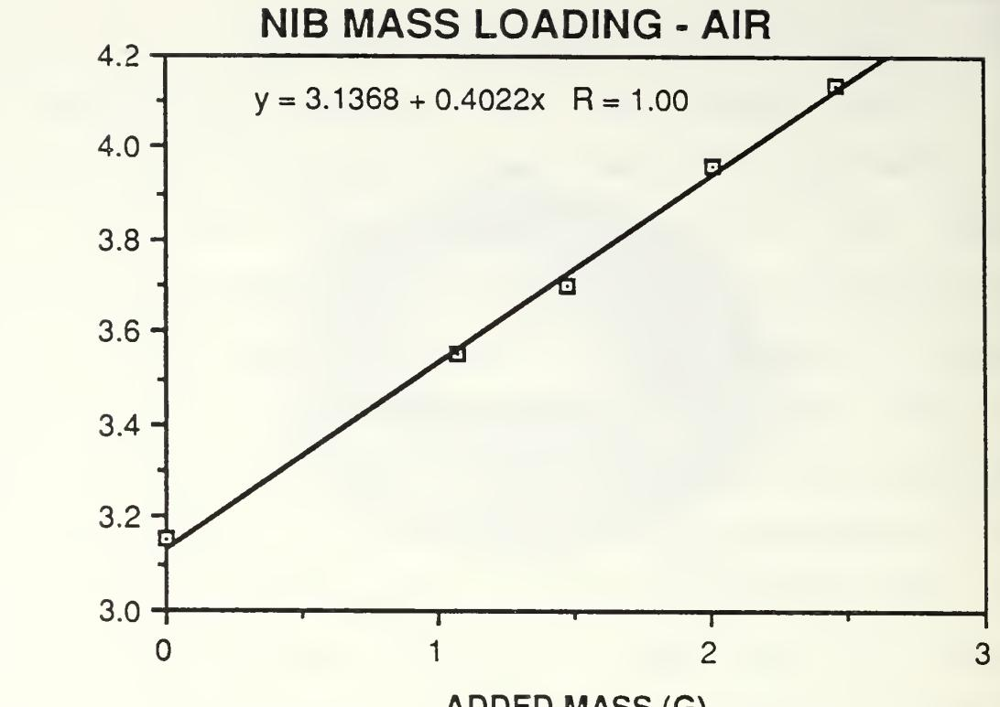  
ADDED MASS (G)

Figure IV-3. Least Squares Fit of Period Squared vs. Added Mass for NIB Driver in Air.  
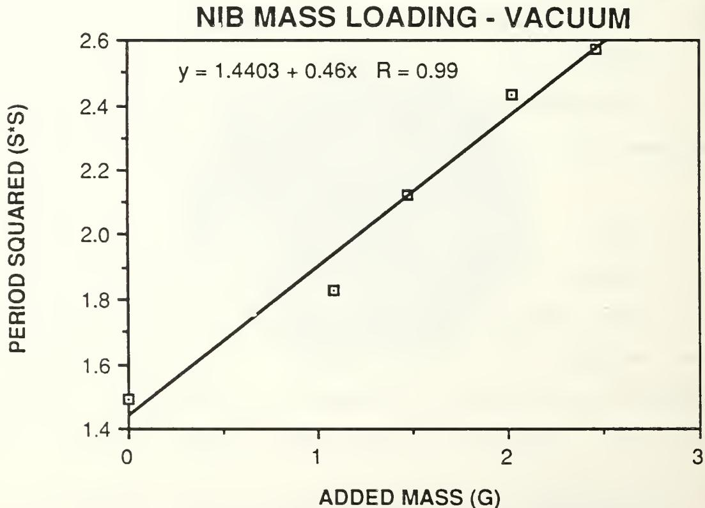  
Figure IV-4. Least Squares Fit of Period Squared vs. Added Mass for NIB Driver in Vacuum.

$$
k = 0 . 4 \pm 0 . 2 \times 1 0 ^ { 4 } k g / s ^ { 2 } .
$$

(IV-5)

(The static loading measurements will be discussed in the

next Sub-section.)

This last value for suspension stiffness differs by

about 40% from the first two. We did not have sufficient

time to test this driver until we were sure we had the

"correct" value for the stiffness. We recommend that the

follow-on students do so. Lacking the correct value, we ran

the computer model for two sets of data: one set represen-

ting the "high" k (9.0 X 10+ kg/sz) and one using the "low"

k(6.4X 10+kg/s≥).

2. Transduction Coefficient (Bl)

The transduction coefficient (Bl) was calculated

using two methods. The first method was to measure B (magne-

tic induction in the voice coil gap) and l (length of the

voice coil) directly. We measured B with the Dowty RFL

Industries model 912 Guassmeter (serial 808) using a Hall

effect probe model 912015(serial 21122). The maximum

reading using this probe was 18.7 kGauss = 1.87 Tesla (T).

This value differs by less than one percent from the value

stamped on the driver by the manufacturer: 1.858 T. We will

therfore use a value of B=1.86 ± 0.01 T for this driver. We

then counted the turns of aluminum wire on the voice coil (n

= 30 ± 1 turns) and calculated l using the relationship:

$$
\mathbb { 1 } = \texttt { \ " } \mathbb { d } \texttt { \ " } \mathbb { n } .
$$

(IV-6)

For the 9.98 ± 0.005 cm diameter coil we calculated a value

$$
\begin{array} { r l } { \Theta \mathbf { f } \quad } & { { } \bot \ = \ 9 . 4 \ \pm \ 0 \ . 3 \ \mathtt { m } . \quad \mathtt { M } \mathtt { M } \mathtt { L } \mathtt { i } \mathtt { p } \mathtt { l } \mathtt { y } \mathtt { i } \mathtt { n } \mathtt { g } \quad \mathtt { t h e s e } \ \mathtt { t } \mathtt { y } \mathtt { o } \ \mathtt { v } \mathtt { a } \mathtt { l } \mathtt { u } \mathtt { e } \mathtt { s } \quad \mathtt { t o } \mathtt { g } \mathtt { g } \mathtt { e } \mathtt { t } \mathtt { h } \mathtt { e } \mathtt { m } . } \end{array}
$$

gives us for the transduction coefficient:

$$
\mathrm { B 1 } \ = \ 1 7 . 5 \ \pm \ 0 . 6 \ N / \mathrm { A } .\tag{IV-7}
$$

The other method used to determine Bl used the

relationship:

$$
\begin{array} { r l r l r l r l } { \mathrm { \bf { F } } } & { = } & { \mathrm { \bf { B } } \mathrm { \bf { 1 } } \mathrm {  { ~ I ~ } } } & { = } & { - \bf { k } \bf { x } } & { \quad } & { \mathrm { o r } } & { \quad } & { \mathrm { \bf { B } } \mathrm { \bf { 1 } } } & { = } & { - \bf { k } \bf { x } / \mathrm {  { I ~ } } , } \end{array}\tag{IV-8}
$$

$$
\mathtt { w h e r e  { I i s } \mathtt { t h e } \mathtt { q i r e c t } \mathtt { c u r r e n t \mathtt { c u p p l i e d } \mathtt { t o } \mathtt { t h e } \mathtt { c o i l } , \mathtt { k i s } \mathtt { t h e } } }
$$

spring constant measured earlier, and x is the displacement

of the voice coil produced by the current. For this measure-

ment on the 290-16K driver we had used a Linear Variable

$$
\mathtt { D i f \_ f e r e n e r i a 1 } \mathtt { a } \mathtt { l } \mathtt { a } \mathtt { l } \mathtt { a } \mathtt { l } \mathtt { a } \mathtt { l } \mathtt { a } \mathtt { f } \mathtt { c o r m e r } \mathtt { \Pi } \mathtt { e m e r } \mathtt { \Pi } \mathtt { e m e r } \mathtt { \Pi } \mathtt { e m e r } \mathtt { t } \mathtt { h } \mathtt { e m e } \mathtt { N I B } \mathtt { \Pi } \mathtt { d } \mathtt { r i } \mathtt { v } \mathtt { e r } \mathtt { \Pi } \mathtt { d } \mathtt { r i } \mathtt { d } \mathtt { e r } \mathtt { d } \mathtt { r } \mathtt { d } \mathtt { e m } \mathtt { d } \mathtt { r } \mathtt { d } \mathtt { a } \mathtt { r } \mathtt { d } \mathtt { e m } \mathtt { d } \mathtt { r } \mathtt { d } \mathtt { e m } \mathtt { d } \mathtt { r } \mathtt { d } \mathtt { e m } \mathtt { d } \mathtt { r } \mathtt { d } \mathtt { e m } \mathtt { d } \mathtt { r } \mathtt { d } \mathtt { e m } \mathtt { d } \mathtt { r } \mathtt { d } \mathtt { a } \mathtt { r } \mathtt { d } \mathtt { a } \mathtt { r } \mathtt { d } \mathtt { a } \mathtt { r } \mathtt { d } \mathtt { a } \mathtt { r } \mathtt { d } \mathtt { a } \mathtt { r } \mathtt { d } \mathtt { a } \mathtt { r } \mathtt { d } \mathtt { a } \mathtt { r } \mathtt { d } \mathtt { a } \mathtt { r } \mathtt { d } \mathtt { a } \mathtt { r } \mathtt { d } \mathtt { a } \mathtt { r } \mathtt { d } \mathtt { a } \mathtt { r } \mathtt { d } \mathtt { a } \mathtt { r } \mathtt { d } \mathtt { a } \mathtt { r } \mathtt { d } \mathtt { a } \mathtt { r } \mathtt { d } \mathtt { a } \mathtt { r } \mathtt { d } \mathtt { a } \mathtt { r } \mathtt { d } \mathtt { a } \mathtt { r } \mathtt { d } \mathtt { a } \mathtt { r } \mathtt { d } \mathtt { a } \mathtt { r } \mathtt { d } \mathtt { a } \mathtt { r } \mathtt { d } \mathtt { a } \mathtt { r } \mathtt { d } \mathtt { a } \mathtt { r } \mathtt { d } \mathtt { a } \mathtt { r } \mathtt { d } \mathtt { a } \mathtt { r } \mathtt { d } \mathtt { a } \mathtt { r } \mathtt { d } 
$$

however, we used Mechanical Technology Incorporated's MTI-

$$
\begin{array} { r l r l r l r l r l } { { 1 } \odot \boldsymbol { 0 } 0 } & { } & & { \mathrm { p h o t \circ \circ r n i c } } & & { \mathsf { s e n s e r } } & & { ( \mathsf { s e r i a l } \quad \mathsf { \Omega } ^ { \beta } \otimes \mathsf { \Omega } \boldsymbol { 1 } \circ \mathsf { \Omega } \otimes \mathsf { \Omega } \boldsymbol { 1 } \otimes \mathsf { \Omega } \otimes \mathsf { \Omega } \boldsymbol { 1 } \otimes \mathsf { \Omega } \qquad } & & { \mathsf { u i t h } } & & { \mathsf { P \overset { . } { l } } \mathsf { u g - i n d } \mathsf { s e r } \ : \mathrm { f o r \ : I } \ : \left( \mathsf { I } \otimes \mathsf { I } ^ { \beta } \otimes \mathsf { I } ^ { \beta } \otimes \mathsf { I } ^ { \beta } \right) , } \end{array}
$$

cartridge model MTI-38i2 (serial 1366) and probe model 125R.

Figure IV-5 shows the photonic sensor with the NIB driver.

One major advantage of the photonic sensor over the LVDT is

that the photonic does not need to make physical contact

with the surface it's measuring (it uses light) whereas the

LVDT does. With the Altec 290-16K's rigid phenolic dia-

phragm, the contact with the LVDT probably did not affect

the measurement. The NIB diaphragm, however, is made of thin

titanium and is quite flexible. It would have been impos-

sible to get an accurate reading of the displacement of this

diaphragm using the LvDT. We calibrated the photonic sensor

$$
\begin{array} { r l r l r l } { \mathsf { u s \bot r n g } } &  { } \mathsf { c a l \bot b r r a t \bot o n } \mathsf { f i x \bot t u r e } \ : \ : \mathsf { K D \bot \mathrm { ~ C H \mathrm { ~ - ~ } C H \mathrm { ~ - ~ } I I \mathsf { ~ I ~ } } } & { \mathsf { A \bot } } & { \mathsf { T h e } } & { \mathsf { o u t p u t } } & { \mathsf { v o l \in \partial \mathbb { E } \bar { \partial } } } \end{array}
$$

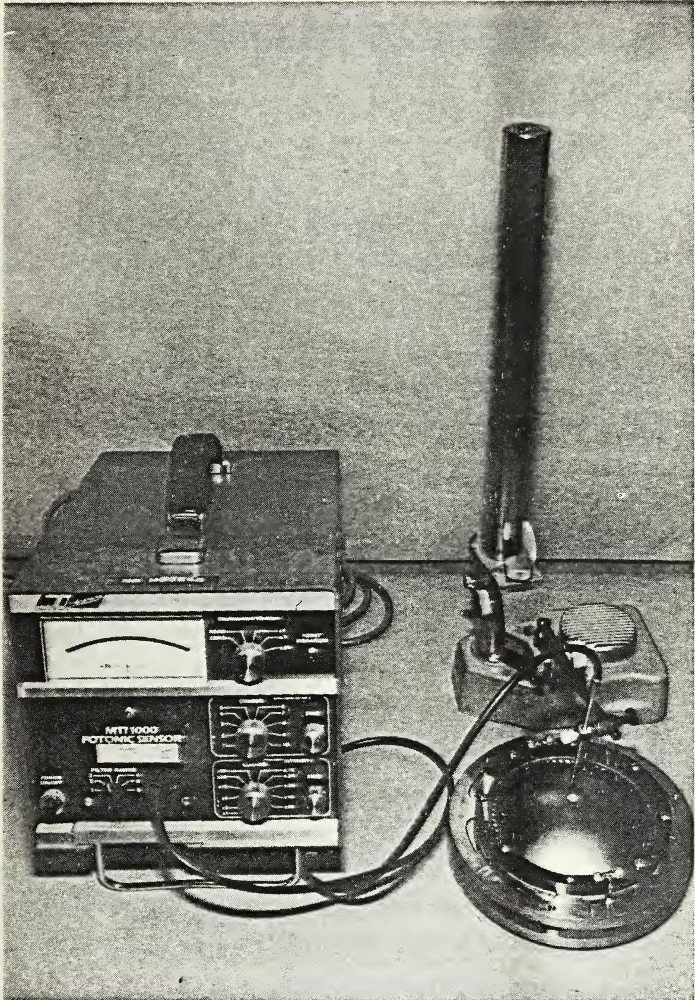  
Figure IV-5. MTI-100O Photonic Sensor with NIB Driver.

$$
\begin{array} { r l } { \mathtt { f r o m } \quad \mathtt { c h e } \quad \mathtt { s o r s o r ~ \mathtt { u } \beth \bumpeq \bumpeq \beth } \mathtt { e a d } \mathtt { o n } \mathtt { a } \mathtt { \Pi \bumpeq \beth } \mathtt { a } \mathtt { \ b i P } \mathtt { \Omega \bumpeq \beth } 4 7 \mathtt { e a d } \mathtt { m u l t i m e } \mathtt { t a } \mathtt { m e r i a l } \mathtt { a } \mathtt { m e r i a l } } \end{array}
$$

A110136). We then plotted DC voltage vs. displacement in

millimeters. The resulting graph is shown in Figure Iv-6.

The slope of this line gives us the calibration constant:

$$
\mathrm { d } \mathsf { V } / \mathrm { d } \mathsf { x } = - 2 . 0 8 6 \pm 0 . 0 0 1 \mathsf { V } / \mathsf { m m } .\tag{IV-9}
$$

This value is within two percent of the calibration value

provided by the manufacturer of dV/dx = 2.045 V/mm (back

slope).

The next step was to run DC current through the coil

and record the displacement of the diaphragm (via a voltage

reading from the photonic sensor). For the voltage supply we

used the HP 467A power amplifier (serial 444-00243). We

found the current by measuring the voltage (with the HP

3476A digital multimeter, serial 292162) across a ten ohm

(10n) resistor placed in series with the circuit. and

dividing the voltage by ten ohms. The resulting graph is

shown in Figure IV-7. The slope of the line gives us:

$$
\mathrm { d } \bar { \mathrm { ~ I ~ / d V ~ } } = \mathrm { ~ 2 ~ . ~ 1 0 ~ } \pm \mathrm { ~ 0 ~ . 0 0 5 ~ ~ A / V ~ } .\tag{IV-10}
$$

Combining the values in Equations IV-9 and IV-10 with the

previously calculated high end value for the suspension

$$
\mathtt  s t i f f r e s s \ \mathtt { k } \mathtt { e } \mathtt { s } \mathtt { s } \mathtt { s } \mathtt { s } \mathtt  \mathtt { d } \mathtt { \_ { d } } \mathtt  \mathtt { e } \mathtt { s } \mathtt { s } \mathtt { d } \mathtt { s } \mathtt { d } \mathtt { s } \mathtt { d } \mathtt { s } \mathtt { k } \mathtt { d } \mathtt { s } \mathtt { k } \mathtt { g } / \mathtt { s } \mathtt { e } \mathtt { s } \mathtt { s } \mathtt { s } \mathtt { s } \mathtt { d } \mathtt { s } \mathtt { s } \mathtt { s } \mathtt { d } \mathtt { s } \mathtt { s } \mathtt { d } \mathtt { s } \mathtt { s } \mathtt { s } \mathtt { d } \mathtt { s } \mathtt { s } \mathtt { d } \mathtt { s } \mathtt { s } \mathtt { d } \mathtt { s } \mathtt { s } \mathtt { d } \mathtt { s } \mathtt { s } \mathtt { d } \mathtt { s } \mathtt { d } \mathtt { s } \mathtt { d } \mathtt { s } \mathtt { d } \mathtt { s } \mathtt { d } \mathtt { s } \mathtt { d } \mathtt { s } \mathtt { d } \mathtt { s } \mathtt { d } \mathtt { s } \mathtt { d } \mathtt { s } \mathtt { d } \mathtt { s } \mathtt { d } \mathtt { s } \mathtt { d } \mathtt { s } \mathtt { d } \mathtt { s } \mathtt { d } \mathtt { s } \mathtt { d } \mathtt { s } \mathtt { d } \mathtt { s } \mathtt { d } \mathtt { s } \mathtt { d } \mathtt { s } \mathtt { d } \mathtt { s } \mathtt { d } \mathtt { s } \mathtt { d } \mathtt { s } \mathtt { d } \mathtt { s } \mathtt { d } \mathtt { s } \mathtt { d } \mathtt { s } \mathtt { d } \mathtt { s } \mathtt { d } \mathtt { s } \mathtt { d } \mathtt { s } \mathtt { d } \mathtt { s } \mathtt { d } \mathtt { s } \mathtt { d } \mathtt { s } \mathtt { d } \mathtt { s } \mathtt { d } \mathtt { s } \mathtt { d } \mathtt { s } \mathtt { d } \mathtt { s } \mathtt { d } \mathtt { s } \mathtt { s } \mathtt { d } \mathtt { s } \mathtt { d } \mathtt { s } \mathtt { d } \mathtt { s } \mathtt { s } \mathtt { d } \mathtt { s } \mathtt { d } \mathtt { s } \mathtt { s } \mathtt { d } \mathtt { s } \mathtt { s } \mathtt { d } \mathtt \mathtt { s } 
$$

$$
\begin{array} { r l r } { \mathsf { B } \mathtt { l } } & { = } & { \mathsf { K } \left( \mathtt { d } \mathsf { x } / \mathtt { d } \mathsf { V } \right) \left( \mathtt { d } \mathsf { V } / \mathtt { d } \mathtt { I } \right) = \mathsf { \Omega } 2 1 . 5 \ \pm \mathrm { \Large ~ \mathfrak ~ 1 } . \ 4 \mathrm { \normalfont ~ \mathtt { N } / \mathtt { A } } . } \end{array}\tag{IV-11}
$$

This 15% difference between the values of Bl using

the two independent methods is what prompted us to test for

Bl and k using the static loading method. Our primary

concern is that we would expect the direct measurements of B

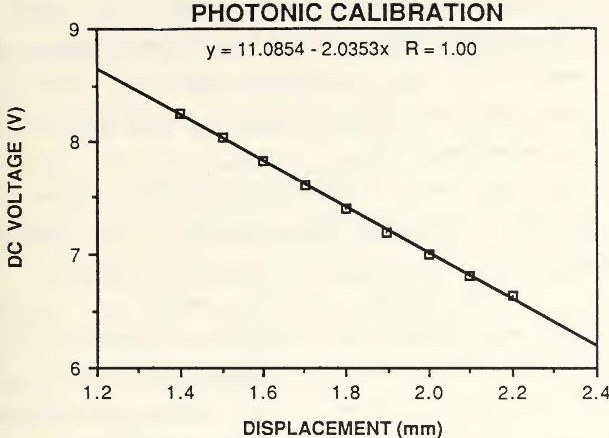  
Figure IV-6. Calibration Data for Photonic Sensor Voltage Output vs. Displacement.

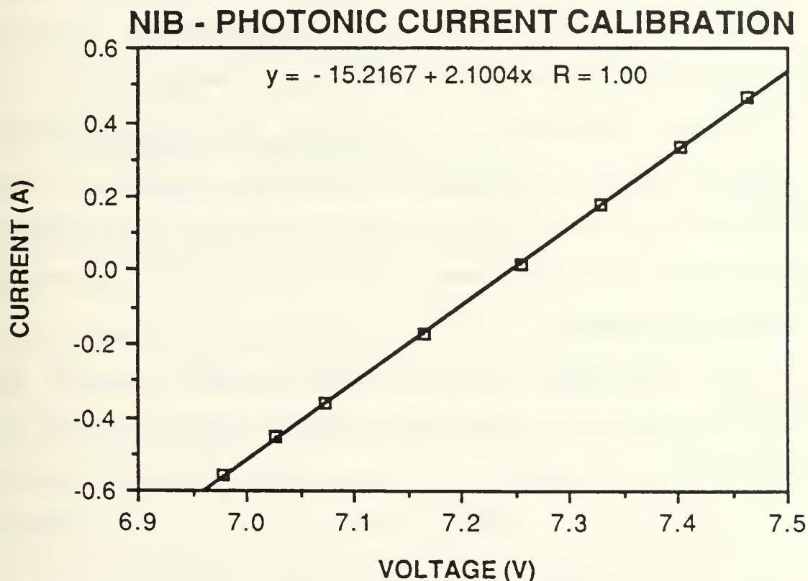  
Figure IV-7. Least Squares Fit of DC Current Through Voice Coil vs. Photonic Voltage Output.

and l to give us the highest possible value for Bl. This is

because the maximum magnetic field may not be acting on the

full length of the coil. We did not expect the value of Bl

calculated using the spring constant to be 15% higher than

the direct measurement value.

We were able to obtain static loading values for

both Bl and k using the same equipment setup and the

formulas:

$$
\begin{array} { r c l c r c l } { { \sf B 1 } } & { { = } } & { { \Delta \mathfrak { m } \mathfrak { s } / \Delta \mathfrak { I } \quad } } & { { \sf a n d } } & { { \sf k } } & { { = } } & { { - } } & { { \Delta \mathfrak { m } \mathfrak { s } / \Delta \mathfrak { x } } } \end{array}
$$

(IV-12)

For these measurements the voice coil is driven with a DC

current. We then add previously measured masses (putty and

soldering wire) to the voice coil, and measure the resulting

displacement of the diaphragm using the photonic sensor. To

measure Bl we determine how much current is needed to bring

the voice coil back to its null displacement (original

output voltage reading from the photonic sensor) after the

mass is added. We measure k by keeping the current constant

and measuring the difference in photonic output voltage

(multiplied by the calibration constant to get displacement)

resulting from the added mass. Table IV-1 lists the results

of these measurements.

The bracketed value in each k and Bl pair was

calculated using the measured value in the pair and the

relationship:

$$
\begin{array} { r l r } { { \sf B } 1 \bar { \sf { I } } } & { { } = } & { - { \sf k } { \sf x } . } \end{array}\tag{IV-13}
$$

From these measurements we get the value k = 6.4 ± 0.2 kg/sz as reported earlier, and the transduction coefficient:

$$
\mathsf { B } 1 \ = \ 1 5 . 0 \ \pm \ 0 . 2 \ \mathsf { N } / \mathsf { A } .\tag{IV-14}
$$

For the model runs we used a value of Bl = 19.0 for the high k and Bl = 15.0 for the low k.

TABLE IV-1. STATIC LOADING OF NIB DRIVER TO DETERMINE SUSPENSION STIFFNESS AND TRANSDUCTION COEFFICIENT
<table><tr><td>àm (g)</td><td>ΔI(mA) ΔV(V)</td><td>k (X10+ kg/s²)</td><td>B1 (N/A)</td></tr><tr><td>17.1</td><td>5.2 --</td><td>6.7</td><td>[15.3]</td></tr><tr><td>17.1</td><td>5.5 --</td><td>6.4</td><td>[14.6]</td></tr><tr><td>34.7</td><td>23.3 --</td><td>[6.4]</td><td>14.6</td></tr><tr><td>34.7</td><td>22.3 --</td><td>[6.7]</td><td>15.3</td></tr><tr><td>34.7</td><td>.288 --</td><td>6.1</td><td>--</td></tr><tr><td colspan="4">(front slope)</td></tr></table>

## 3. Mechanical Resistance

The next parameter we measured was the mechanical resistance $( \mathbb { R } _ { m } )$ using the relationship:

$$
\begin{array} { r } { { \sf R } _ { \pmb { m } } = 2 \pi \pmb { \mathrm { f } } _ { \pmb { \mathrm { o } } } \mathtt { m } _ { \pmb { \mathrm { o } } } / \mathsf { Q } . } \end{array}\tag{IV-15}
$$

We attempted to find the driver quality factor (Q) using the same modified impedance technique described in Section III.G. As can be seen in Figure IV-8, the graph of the modified impedance magnitude vs. frequency is not a smooth resonance curve, as it was for the 290-16k (see Figure III-9). In fact, it looks like the superposition of two different impedance curves, the first one shorter and fatter

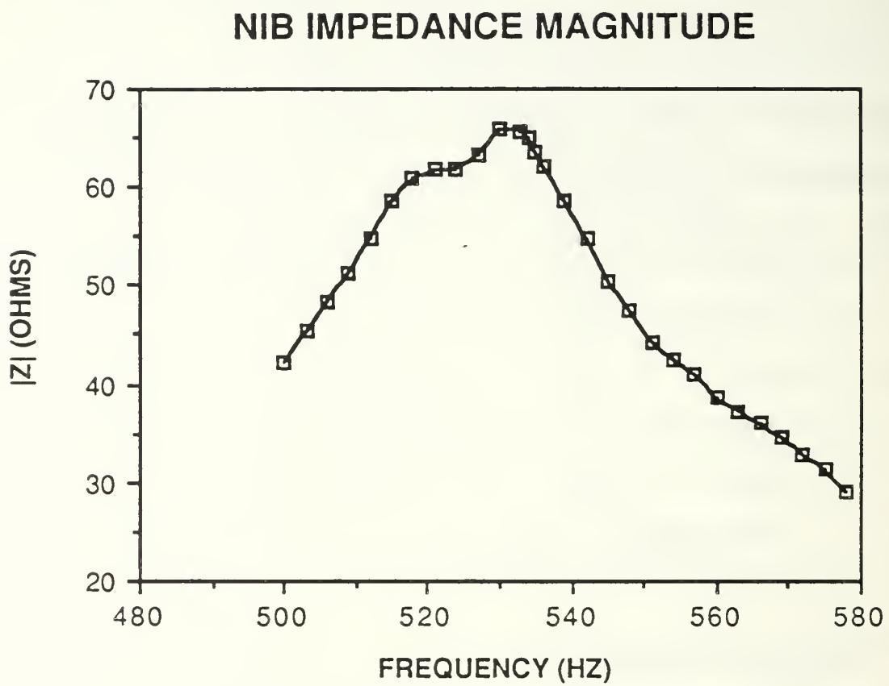  
Figure IV-8. NIB Modified Impedance Magnitude vs. Frequency.

and the second one taller and thinner. It was impossible to

accurately measure half-power points from this curve, so we

chose the phase angle method.(It is interesting to note

that the JBL 2445J (ceramic) driver did have a smooth modi-

fied impedance curve similar to that of the 290-16K.) Figure

Iv-9 shows the graph of phase angle vs. frequency over a

wide range of frequencies. Although this curve generally

approximates an arctangent, the segment of the line immedi-

ately adjacent to the resonant frequency (assumed to be the

frequency where θ=0, in this case 534.5 ± 0.5 Hz) is linear

(for a frequency range of about ten Hz). This segment is

plotted in Figure IV-i0. The slope of the line is de/df = -

42.0 ± 0.5 X 10-3s (after converting degrees to radians). As

in Section II.G, Q is given by:

$$
\begin{array} { r c l c r } { { \Theta } } & { { = } } & { { - \left( \mathrm { \bf ~ f } _ { \bullet } / 2 \right) \left( \mathrm { d } \oplus / \mathrm { d } \mathrm { f } \right) } } & { { = } } & { { { \bf 1 } { \bf 1 } . 2 \pm \mathrm { \bf ~ 0 } . 2 . } } \end{array}\tag{IV-16}
$$

This gives a value for Rm (using the moving mass in air

$$
\mathfrak { m } _ { \mathbf { o } } ~ = ~ 7 . \bar { \otimes } ~ \pm ~ 0 . 1 ~ \{ \mathfrak { g }  ) :
$$

$$
\begin{array} { l l l l } { { \mathrm { R } _ { m } } } & { { = } } & { { 2 \ : . 3 4 } } & { { \pm } } & { { 0 \ : . 0 5 \ : \ : \ : \mathrm { k g / s } \ : . } } \end{array}\tag{IV-17}
$$

We decided that a more accurate measurement of Q and

Rm could be found by making the Q measurement in vacuum. For

this we used the open circuit free decay method. This method

consists of sending a signal to the driver at resonance with

an HP 3314A function generator (serial A342044), then

simultaneously switching off the signal and triggering a

Nicolet model 310 storage oscilloscope (serial 88004641) to

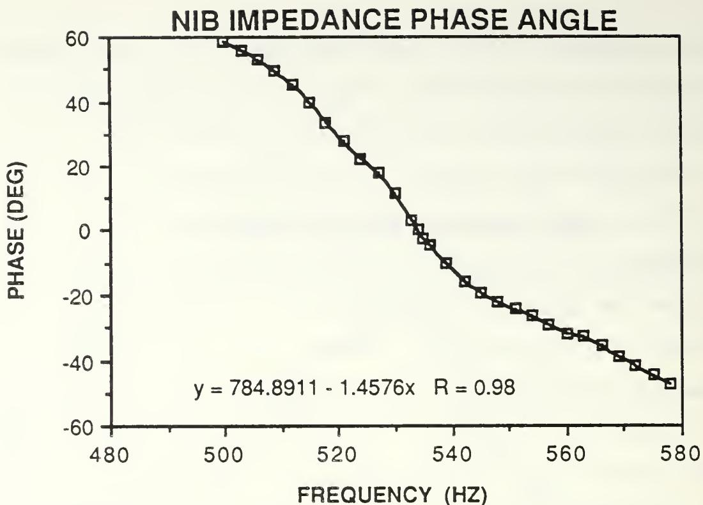  
Figure IV-9. NIB Modified Impedance Phase Angle as a Function of Frequency--Full Frequency Range.

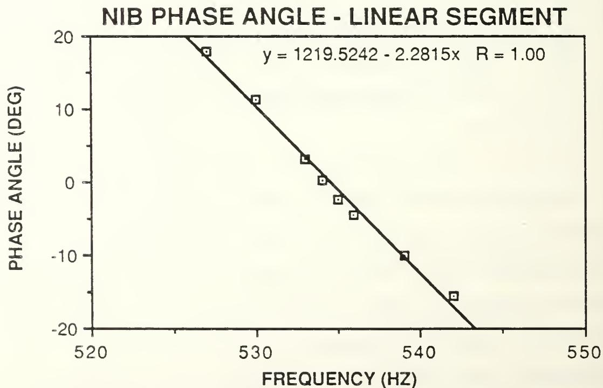  
Figure IV-10. NIB Modified Impedance Phase Angle as a Function of Frequency--Linear Segment Near Resonance.

record the free decay. A sample of the output from this

process is shown in Figure IV-11. The equation for a simple

harmonic oscillator experiencing free decay is:

$$
\begin{array} { r l r } { \hat { \bf A } \left( \dot { \mathrm {  ~ t ~ } } \right) } & { { } = } & { \hat { \bf A } _ { \infty } \Leftrightarrow { \bf x } _ { \mathrm { P } } \left( - \dot { \sf t } / \tau \right) \mathrm {  ~ \mathbb { \varepsilon } ~ } \varepsilon \dot { \bf a } \mathrm { n } \left( \varpi _ { \infty } \dot { \sf t } + \frac { \partial } { \partial \tau } \right) , } \end{array}\tag{IV-18}
$$

where A(t) is the amplitude as a function of time, A。 is the

initial (maximum) amplitude, t is the time (= nT, or the

number of periods times the period), t is the free decay

constant (= QT/π, see Equation III-29), w。 is the angular

resonant frequency, and  is the phase angle. We recorded

the peak amplitude as a function of period number, and

plotted the natural logarithm of the peak amplitude vs.

period number. The equation representing this line is:

$$
\ln \mathsf { A ( T ) } _ { \mathsf { p } \bullet = \mathsf { m } \mathsf { k } } = \ln \mathsf { A } _ { \mathsf { e } } - \mathsf { n } \mathsf { T } / \mathsf { \bar { c } } .
$$

(IV-19)

The slope of this line is t/t = nT/t = nx/Q. Therefore Q can

be found by dividing π by the slope of the line. Figure IV-

12 shows a semi-log plot for the NIB driver in air. The

value of Q for this plot is 21.5, which is almost twice the

value we found using the modified impedance phase angle

measurements (Q = 11.2). Obviously the air strongly affects

the measurements. The scattering of the data points in this

figure is probably due to the same phenomena that causes the

double peaks in the impedance curve. Figure IV-13 shows the

semi-log plot of the amplitude vs. period number for vacuum.

This curve is much smoother and, we assume, more reliable.

The Q for this data is:

$$
\begin{array} { l l l l } { \bar { \mathsf Q } } & { = } & { \mathfrak I / \mathsf s 1 \mathsf { o p e \ } = } & { \mathsf { 1 } \bar { \mathsf Q } . \mathsf { \otimes } \bar { \mathsf { \Sigma } } \pm } & { 0 . 0 5 . } \end{array}\tag{IV-20}
$$

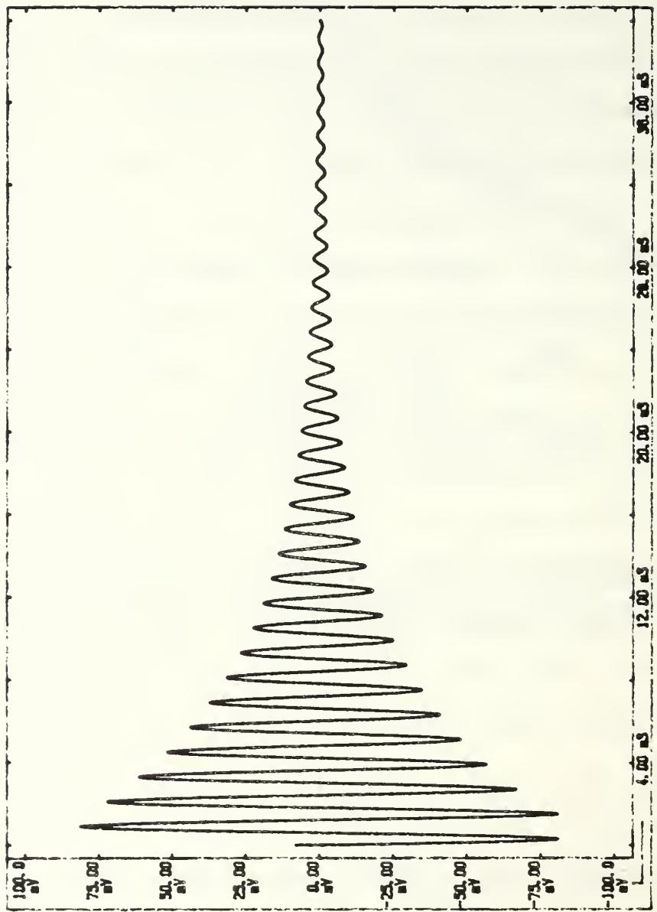

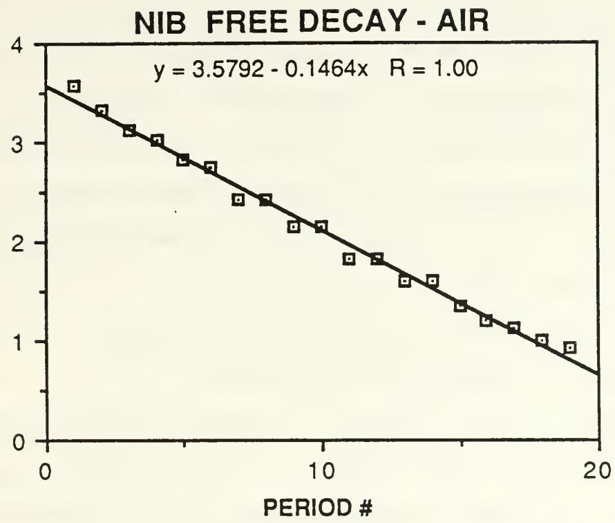  
Figure IV-12. Semi-log Plot of Amplitude vs. Period Number for NIB Free Decay in Air.

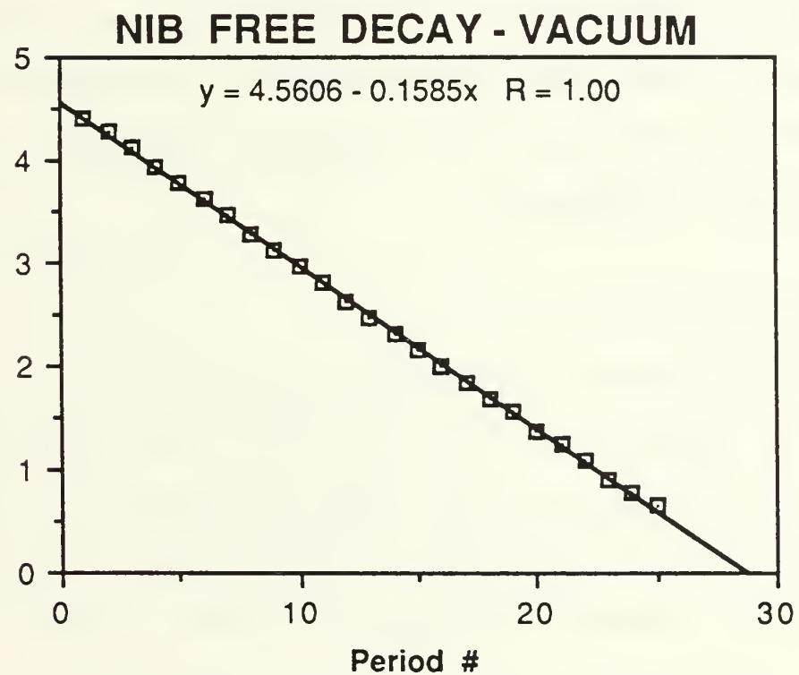  
Figure IV-13. Semi-log Plot of Amplitude vs. Period Number for NIB Free Decay in Vacuum.

We can also find the period from the free decay curve (and

thus the resonant frequency as the inverse of the period).

We use the oscilloscope to measure the time for ten cycles

and divide this number by ten. For the vacuum run the

resonant frequency was 839 ± 0.5 Hz. These values (and the

moving mass = 3.2 g in vacuum) give us the mechanical resis-

tance in vacuum:

$$
\begin{array} { r c l c r } { { \mathrm { R } _ { \bullet \bullet } } } & { { = } } & { { { \cal 2 } \pi \widehat { \sf f } _ { \circ } { \sf m } _ { \bullet } / { \sf G } = 0 . \widehat { \sf G } \ o 3 \pm 0 . 0 1 \mathrm { k g } / { \sf S } . } } \end{array}\tag{IV-21}
$$

This is the value we used for the model.

Table IV-2 gives a comparison of applicable

parameters for the three drivers. Notice that the parameter

Bl/Rmecmmo is almost three times greater for the NIB driver

than the 290-16K. This is the parameter that we said (Sub-

section IV.A.2) we wanted to maximize to get the highest

thermoacoustic efficiency. Thus the driver that gives us the

best height and weight characteristics (see photograph of

the three drivers in Figure IV-14) also gives us the best

electroacoustic efficiency.

## C. MODELED EFFICIENCY

In order to model the electroacoustic efficiency of the

driver, we need to know what acoustic load (impedance) it

will see. The final resonator and stack composition will not

have been determined by the time this thesis is completed.

We therefore assumed a range of possible values for the

TABLE IV-2. COMPARISON OF PARAMETERS FOR THE THREE DRIVERS
<table><tr><td>Property (units)</td><td>Altec 290</td><td>JBL 2445J</td><td>JBL NIB</td></tr><tr><td>Moving mass, m。 (kg)</td><td>0.0151</td><td>0.015</td><td>0.015</td></tr><tr><td>Spring constant (N/m)</td><td>3.52X10+</td><td>~8.5X104</td><td>~9.0X104</td></tr><tr><td>Magnetic Induction, B (Tesla)</td><td>2.1</td><td>1.97</td><td>1.87</td></tr><tr><td>Voice Coil Diameter (cm)</td><td></td><td></td><td></td></tr><tr><td>B1 (N/A)</td><td>7.22</td><td>9.98</td><td>9.98</td></tr><tr><td>Voice coil DC</td><td>21.5</td><td>18.5</td><td>17.5</td></tr><tr><td>resistance (R) Mechanical</td><td>10.6</td><td>7.1</td><td>7.6</td></tr><tr><td>resistance (kg/s)</td><td>2.77</td><td>~1.0</td><td>0.83</td></tr><tr><td>Voice coil inductance、(H) (at 20 kHz)</td><td>1.0X10-4</td><td>1.14X10-4</td><td>1.14X10-4</td></tr><tr><td>Mass (kg)</td><td>14.5</td><td>13.8</td><td>3.1</td></tr><tr><td>Height (in)</td><td>6.0</td><td>5.5</td><td>2.5</td></tr><tr><td>Magnetic energy</td><td></td><td></td><td></td></tr><tr><td>density (J/cm³)</td><td>~0.5</td><td>~0.5</td><td>3.2</td></tr><tr><td>Bl/Rmecnmo (m/Coul-kg)</td><td>510</td><td>1230</td><td>1410</td></tr></table>

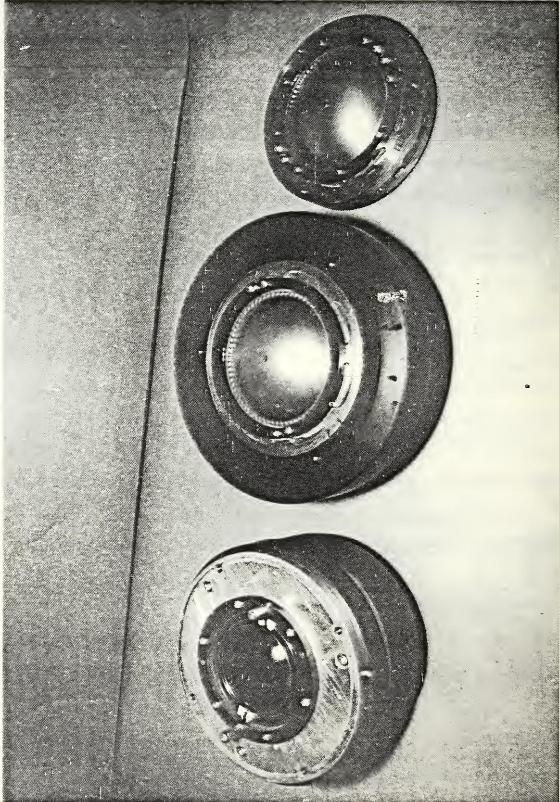  
Figure IV-14. Photographic Comparison of the Three Drivers--Altec 290-16K, JBL 2445J, and JBL NIB.

acoustic load based on the experimental data acquired to

date.

The model parameters that relate to the acoustic

load are the density of the gas (RHo), the speed of sound in

the gas (C), the resonator quality factor (Q), the resonator

resonant frequency (Fo), and the resonator length (L). The

model was designed for a closed-ended tude of uniform cross-

section. The STAR resonator has an open tube (with a bulb

attached) and nonuniform cross-section. The problem of

applying the existing computer model to the STAR resonator

was solved by scaling the STAR parameters to make it look

like a closed-ended uniform cross-section tube.

1. Input Values for Pure Helium

For pure helium, the experimental data available was

the range of resonator quality factor values (10-20), and

the speed of sound and gas density at room temperature

(about 300K) and ten atmospheres（crr=1024 m/s.

Frt = 1.618 kg/m³). Also available were four resonant fre-

quencies,two for a short resonator at warm (58o Hz) and

cold (520 Hz) temperatures, and two for a long resonator at

warm(520 Hz) and cold（470 Hz)temperatures.Using this

information, we first calculated the effective lengths of

the resonators at room temperature as if they were closed-

ended, uniform cross-section tubes. For this we used the

relationship:

$$
\lambda = 2 \mathsf { L } = \mathsf { C } / \mathsf { f } , \quad \mathsf { o r } \quad \mathsf { L } _ { \bullet \textsf { e r } } = \mathsf { c } / 2 \mathsf { f } ,
$$

(IV-22)

where λ is the wavelength. L is the length of the tube, c is

the speed of sound, and f is the resonant frequency. This

calculation gave us effective lengths for the resonators:

L. = 0.883m and L₁ = 0.985m. For the computer runs we use a

convenient value of L\_rr = 0.90m. We then calculated the

speed of sound for the operating temperature of approxi-

mately 250K using the relationship:

$$
\mathsf { C } \left( \mathrm { ~ T ~ } \right) \quad = \quad \mathsf { C } \mathsf { e } \tau \quad \left[ \mathrm { ~ T ~ } / \mathrm { T } \mathsf { e } \tau \right] ^ { \mathrm { ~ 1 ~ } / \mathrm { ~ 2 ~ } } .\tag{IV-23}
$$

This gives us a speed of sound czso = 935 m/s. If we use

this sound speed and the effective resonator lengths to

estimate the resonant frequencies for 250k, we get f. = S29

Hz and f₁ = 474 Hz, which agree with the measured values. We

calculated the gas density at the operating temperature

using the relationship:

$$
\rho = \arg \rho _ { C } = \texttt { 1 . 9 4 } \ k \ g / \pi ^ { 3 } ,\tag{IV-24}
$$

where  is the ratio of the specific heats (1.667 for

helium) and P is the pressure.

Table Iv-3 lists the input parameters for the pure

helium computer runs. Note that for the computer model. the

moving mass must take the mass of the reducer cone and

bellows into account (see Figure IV-15). The total moving

mass is expected to be approximately 15 g.

2. Input Values for Helium-Xenon

There was somewhat less data available for the

helium-xenon mixture (12.5% Xe). We had the sound speed at

300k and ten atmospheres (crr = 472 m/s). We also had

# TABLE IV-3. COMPUTER MODEL INPUT-- NIB DRIVER WITH HELIUM AT TEN ATMOSPHERES AND TEMPERATURE = 25OK

<table><tr><td>Symbol</td><td>Meaning</td><td>Units</td><td>NIB</td></tr><tr><td>RM</td><td>Mechanical resistance</td><td>kg/s</td><td>0.83</td></tr><tr><td>M</td><td>Moving mass</td><td>kg</td><td>0.015</td></tr><tr><td>SSUP</td><td>Spring constant</td><td>N/m</td><td>6.6, 9.0 X104</td></tr><tr><td>RHO</td><td>Density of gas</td><td>kg/m³</td><td>1.94</td></tr><tr><td>C</td><td>Sound speed</td><td>m/s</td><td>935.0</td></tr><tr><td>S</td><td>Resonator X-sec. area</td><td>m²</td><td>1.14X10-3</td></tr><tr><td>BL</td><td>Driver transduction factor</td><td>r N/A</td><td>15.0. 19.0</td></tr><tr><td>O</td><td>Resonator quality factor</td><td></td><td>10.15,20</td></tr><tr><td>FO</td><td>Resonator resonance freq.</td><td>Hz</td><td>519.4</td></tr><tr><td>A</td><td>Back volume X-sec. area</td><td>m2</td><td>4.42X10-3</td></tr><tr><td>VOL</td><td>Back volume</td><td>m³</td><td>3.28X10⁻4</td></tr><tr><td>LE</td><td>Voice coil inductance</td><td>H</td><td>1.14X10-4</td></tr><tr><td>RE</td><td>Voice coil DC resistance</td><td>ê</td><td>7.6</td></tr><tr><td>I</td><td>Driver current</td><td>A</td><td>1.0</td></tr><tr><td>L</td><td>Resonator length</td><td>m</td><td>0.90</td></tr></table>

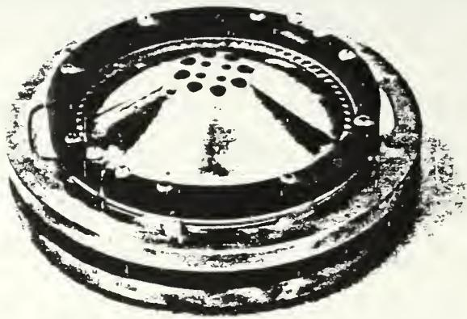

(a)  
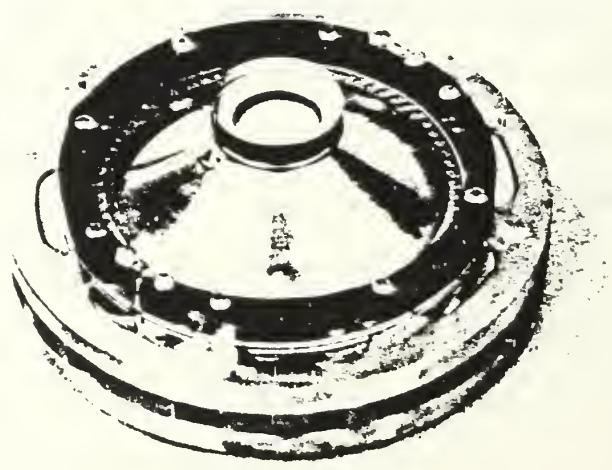  
(b)  
Figure IV-15. Photograph of JBL NIB Driver with (a) Reducer and (b) Bellows.

resonant frequencies for the same four conditions as for the

pure helium: short-warm (265 Hz), short-cold (230 Hz), long-

warm (235 Hz), and long-cold (215 Hz). We used Equation

Iv-22 to find the effective resonator lengths (L. = 0.891m

and L₁ = 1.004m). However, once again we used a convenient

effective length of 0.90 m for the computer runs. We used

Equation Iv-23 to find the sound speed for He-Xe at the

operating temperature, czso = 431 m/s. The estimated reso-

nant frequencies for the cold temperature were f\_=242 Hz and

f₁=215 Hz, once again comparing favorably with the measured

values. To find the density of the mixture at the operating

temperature we used a form of the ideal gas law:

$$
\begin{array} { r l r } { \bar { \bf \Xi } } & { { } = } & { \mathsf { P M } / \mathsf { R T } , } \end{array}
$$

(IV-25)

where M is the atomic mass of the mixture, R is the

universal gas constant, and P and T are the pressure and

temperature. We calculated the atomic mass of the mixture

using the equation:

$$
\begin{array} { r c c c c l } { { \sf M } _ { 1 \sf t + m - x + \infty } } & { { = } } & { { \sf M } _ { 1 \sf t + m } \ o { \mathrm { X } } _ { 1 \sf t + m } } & { { + } } & { { \sf M } _ { \sf x + m } \ o { \mathrm { X } } _ { 1 } ^ { \prime } \times = 0 } \end{array} ,\tag{IV-26}
$$

where the M's are atomic masses (4 for helium and 131.3 for

xenon) and the x's are percentages of the gases in the

mixtures. This equation gives us an atomic mass for the

12.5% Xe mixture of 19.9 g/mol, and a density of 9.70 kg/m³

at 250K and ten atmospheres. Table IV-4 lists the computer

input values for He-Xe, including a range of Q's from 5 to

30. (We are not sure what to expect for the actual value of

Q. since a new stack will also be used.)

TABLE IV-4. COMPUTER MODEL INPUT-- NIB DRIVER WITH HELIUM-XENON AT TEN ATMOSPHERES AND TEMPERATURE = 25OK

<table><tr><td>Symbol</td><td>Meaning</td><td>Units</td><td>NIB</td></tr><tr><td>RM</td><td>Mechanical resistance</td><td>kg/s</td><td>0.83</td></tr><tr><td>M</td><td>Moving mass</td><td>kg</td><td>0.015</td></tr><tr><td>SSUP</td><td>Spring constant</td><td>N/m</td><td>6.6. 9.0 X104</td></tr><tr><td>RHO</td><td>Density of gas</td><td>kg/m³</td><td>9.70</td></tr><tr><td>C</td><td>Sound speed</td><td>m/s</td><td>431.0</td></tr><tr><td>iS</td><td>Reso..or X-sec. area</td><td>m²</td><td>1.14X10-3</td></tr><tr><td>BL</td><td>Driver trans. factor</td><td>N/A</td><td>15.0. 19.0</td></tr><tr><td>O</td><td>Resonator quality factor</td><td></td><td>5,10.15,20,25,30</td></tr><tr><td>FO</td><td>Resonator resonance freq.</td><td>Hz</td><td>239.4</td></tr><tr><td>A</td><td>Back volume X-sec. area</td><td>m²</td><td>4.42X10-ª</td></tr><tr><td>VOL</td><td>Back volume</td><td>m³</td><td>3.28X10-4</td></tr><tr><td>LE</td><td>Voice coil inductance</td><td>H</td><td>1.14X10-4</td></tr><tr><td>RE</td><td>Voice coil DC resistance</td><td>☆</td><td>7.6</td></tr><tr><td></td><td>Driver current</td><td>A</td><td>1.0</td></tr><tr><td>L</td><td>Resonator length</td><td>m</td><td>0.90</td></tr></table>

3. Computer Model Results

Figures IV-16 through IV-19 are sample output plots

for pure helium with Bl = 15 N/A, k = 6.4 X10+ kg/sz, and

Q = 20. Notice that the peak values for the driver and

resonator are almost matched (the driver resonance is at the

lower frequency). The thermoacoustic efficiency for this set

of values is about 70.4%. Figures IV-20 through IV-23 show

the corresponding plots for the helium-xenon mixture. This

time the peaks are not matched (the driver peak is off the

scale) and the electroacoustic efficiency is about 16.6%.

The primary reason for the difference between the two gases

is the lower sound speed, and therefore lower resonant fre-

quency, in the He-Xe mixture.

Table IV-5 lists the maximum value of

electroacoustic efficiency for each of the test runs. The

consistently low efficiencies for the He-Xe emphasize the

importance of matching the two resonant peaks. We recommend

that the driver frequency be adjusted to match the resonator

operating frequency. This can best be done by reducing the

stiffness of the titanium surround (see Section III.H).

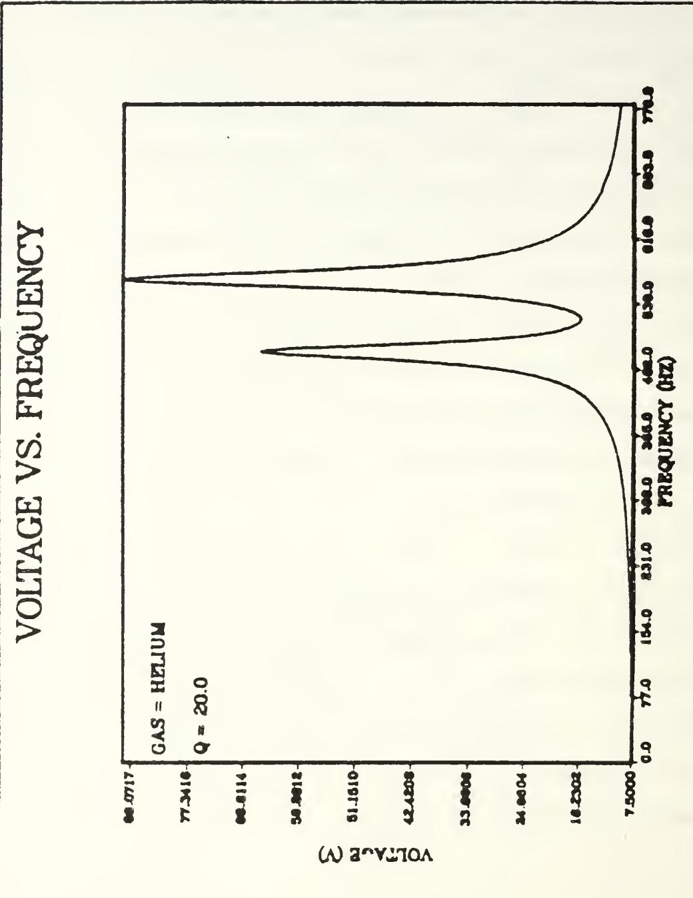  
Figure IV-16. Computer Model Output for NIB with Helium (Bl = 15, Q = 20)--Driver Voltage vs. Frequency for One Amp.

PISY VV V VOCY  
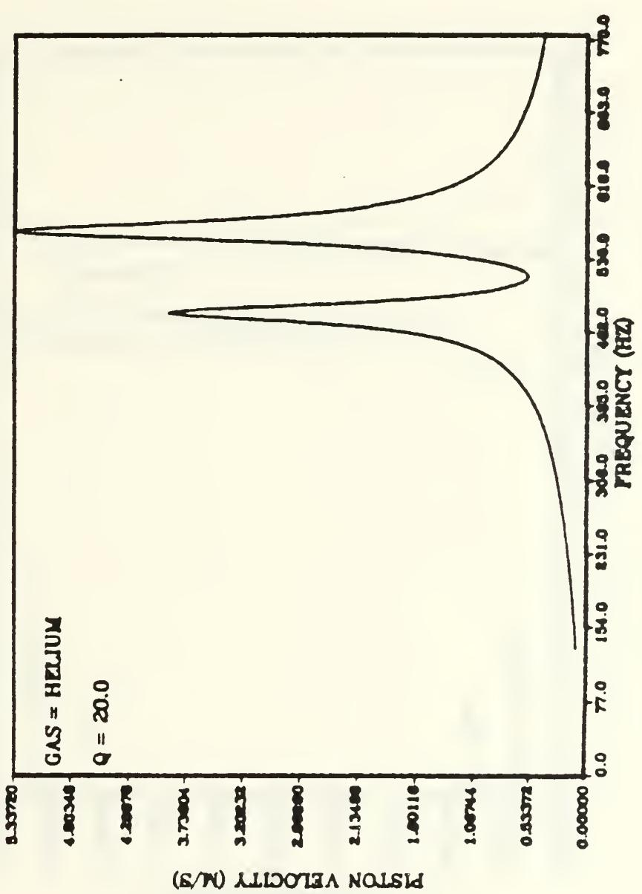  
Figure IV-17. Computer Model Output for NIB with Helium (Bl = 15, Q= 20)--Piston Velocity vs. Frequency for One Amp.

ACOC PC PROUEC PONCY  
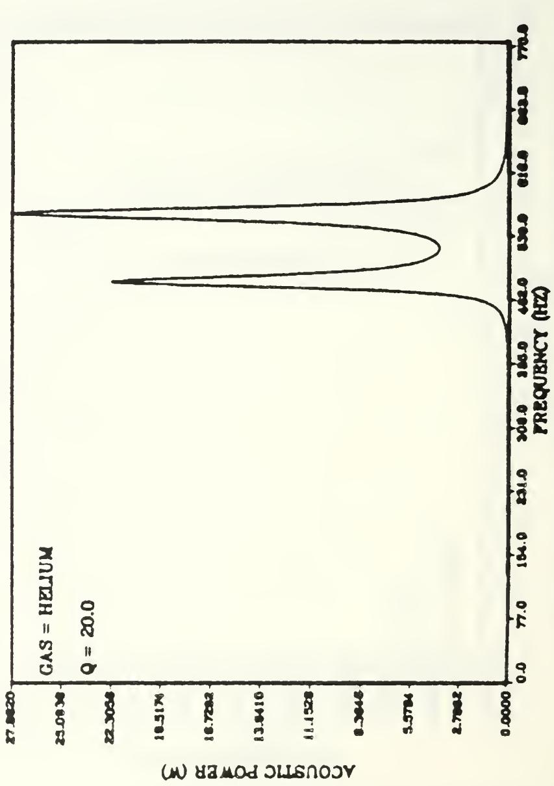  
Figure IV-18. Computer Model Output for NIB with Helium (B1 = 15, Q= 20)--Acoustic Power vs. Frequency for One Amp.

ELYC C NC FLNCY  
  
Figure IV-19. Computer Model Output for NIB with Helium (Bl = 15, Q = 20)--Electroacoustic Efficiency vs. Frequency.

VOTGE  FNCY  
  
Figure IV-20. Computer Model Output for NIB with Helium-Xenon (Bl = 15, Q = 20)--Driver voltage vs. Frequency for One Amp.

PISY V V VOCY  
  
Figure IV-21. Computer Model Output for NIB with Helium-Xenon (Bl = 15, Q = 20)--Piston Velocity vs. Frequency for One Amp.

ACOIC PC PROUC PONCY  
  
Figure IV-22. Computer Model Output for NIB with Helium-Xenon (Bl = 15, Q = 20)--Acoustic Power vs. Frequency for One Amp.

ELC EC FNCY  
  
Figure IV-23. Computer Model Output for NIB with Helium-Xenon (Bl = 15, Q = 20)--Electroacoustic Efficiency vs. Frequency.

TABLE IV-S. COMPUTER MODEL RESULTS FOR NIB DRIVER-- PEAK ELECTROACOUSTIC EFFICIENCY (%)
<table><tr><td>Q</td><td>He (Bl=15)</td><td>He (Bl=19)</td><td>He-Xe (Bl=15)</td><td>He-Xe (Bl=19)</td></tr><tr><td>5</td><td></td><td></td><td>5.1</td><td>5.9</td></tr><tr><td>10</td><td>71.3</td><td>70.4</td><td>9.2</td><td>10.7</td></tr><tr><td>15</td><td>71.6</td><td>74.3</td><td>13.1</td><td>15.1</td></tr><tr><td>20</td><td>70.4</td><td>76.2</td><td>16.6</td><td>19.1</td></tr><tr><td>25</td><td></td><td></td><td>19.6</td><td>22.7</td></tr><tr><td>30</td><td></td><td></td><td>22.8</td><td>26.0</td></tr></table>

A. INTRODUCTION

This chapter describes the construction of the STAR

driver. A large part of this thesis involved the design of

the parts necessary to integrate the NIB driver with the

resonator and GAS cannister, as illustrated in Figure I-4.

The major design work was for the driver housing. The

requirements for the driver housing are:

1 - lightweight,

2 - strong (pressurized to 210 psi),

3 - interface to GAS canister lid (12 10-32 bolt holes

centered at 9.5 inches diameter),

4 - interface with resonator (preferably interchangeable

with earlier test resonators),

5 - helium leak-tight feed-through ports for electrical

leads (driver electric power, accelerometer and

microphone outputs), and

6 - hold NIB magnet structure securely.

Figure V-1 shows a cross-sectional drawing of the driver

housing (not including any of the feed-through ports, which

will be discussed later). Distinction between parts is shown

by different hatching. Part A is the NIB magnet structure

which was discussed in Chapter IV. Part B is the main body

of the driver housing, machined out of 6061-T6 aluminum.


Figure V-1. Cross-sectional Schematic of the STAR Driver Housing Showing (A) NIB Driver, (B) Driver Housing Main Body, (C) Aluminum Pusher Plate (D) Pressure Lid, (E) Leak Test Lid, (F) Resonator Vacuum Housing, and (G) Bolt Holes for Interface with Resonator.

Part C is a 6061-T6 aluminum pusher plate used to hold the

magnet structure securely in the body using six 10/32 bolts.

Part D is the pressure lid, sealed a 1/16th inch diameter

lead o-ring and held in place with six 10/32 bolts. Part E

represents part of the leak test lid (see Figure C-1). When

completed this will be replaced by the GAS can lid provided

by NASA. The driver housing must match up with the GAS can

lid's 9.5 inch diameter 10-32 bolt circle. Part F is the

resonator section housing. The arrows labeled G point to the

bolt holes which form the driver-resonator interface.

B. DESIGN CONSIDERATIONS

The driver-resonator system will be pressurized to ten

atmospheres with a helium-xenon mixture (12.5% xenon).

NASA's regulations say that it must be pressure tested to

1.5 times the operating pressure (NASA, 1986a), or 15 atmo-

spheres (=1.52X106 Pa = 220 psi). An added complication of

working with helium (or helium mixtures) is that it diffuses

through almost all materials except metals. As a result, we

are not able to use rubber o-rings to seal metal parts

together, but must use lead o-rings instead.

1. Electrical Feed-Throughs

NASA's regulations prohibit us from leaking gases

into space. primarily to avoid contamination of other exper-

iments and for the safety of the Shuttle and astronauts.

This regulation is important not only for the major o-ring

seals, but also for the microphone and accelerometer outputs

to the frequency control electronics (see Figure I-5), and

connecting the audio amplifier to the driver. There are

three individual wires and three co-axial connectors that

must penetrate the driver housing without allowing leakage.

The other housing penetrations are a DC pressure gage for

the driver housing and a fill line from a helium-xenon

bottle which will stabilize the pressure in the system

against temperature changes in the environment and those

generated by the refrigerator.

Based on prior experience in other applications, we

decided that Emerson & Cuming's STYCAST<tm, 2850FT epoxy

(Canton, MA 02021) would be the best choice for providing

the electrically insulating seal for the wires in the

housing. STYCAST<tm, 2850FT is a quartz-filled epoxy formu-

lation with remarkably good over-all general properties. In

addition to having excellent electrical grade insulation

properties, good adhesion, and excellent resistance to chem-

icals and solvents, 2850FT has unusually high thermal con-

ductivity and low thermal expansion. This combination of

properties makes this epoxy valuable for applications where

electrical insulation and mechanical protection must be

maintained while coping with heat transfer considerations.

One definition for a sealed container is a helium

leak rate of less than 10-4 standard cc's per second (NAsA.

1986b). To test the epoxy we designed and built a test

fixture to be used with the Veeco MS-9 helium leak detector.

A cross-sectional diagram of the test fixture is shown in

Figure v-2. Part A is a copper tube with 1-1/8" outer diam-

eter to interface with the leak detector. Soldered to the

copper tube is a piece of solid brass stock about one inch

thick (B) with a 0.052 inch diameter hole bored through the

center. Epoxied into the hole is a 0.025 inch diameter bare

copper wire (C). This design is motivated by the desire to

provide as long a travel path and as small a cross-section

as possible for the helium gas molecules. Part D is a hollow

aluminum housing designed to hold pressurized helium. We

decided that a rubber o-ring should hold the helium suffi-

ciently well for a short term leak test. Part E is a 1/8"

NPT (National Pipe Thread) hole for connecting to a helium

fill line. A photograph of the test fixture with and without

the housing is shown in Figure V-3.

The copper tube and brass stock were soldered toge-

ther. We boiled the assembly to remove excess particulates

and rinsed it with alcohol. We then etched the hole in the

brass and the copper wire with nitric acid diluted with

distilled water (about 20% acid) to provide a clean, rough

surface for the epoxy. Before etching, cellophane tape was

placed on the portion of the brass stock where the o-ring

would be sealing (after making sure that the tape would not

dissolve in the acid). We then rinsed the assembly with

distilled water and dried it, mixed the epoxy, and inserted


Figure V-2. Cross-sectional Schematic of the Helium Leak Detector Test Fixture Showing (A) Copper Tube for Leak Detector Interface, (B) Solid Brass Stock, (C) Bare Copper Wire, (D) Aluminum Housing, and (E) Connection for Helium Fill Line.

  
Figure V-3. Photograph of the Helium Leak Detector Test Fixture.

the wire into the hole in the brass stock, making sure the

epoxy filled the gap.

The following procedure was used to run the leak

detector tests: first zero the meter, then do a test run on

the sensitivity calibrator. The sensitivity calibrator used

was a Veeco type SC-4 serial number 3179 with a leak rate of

6.5Xi0-e std cc/sec (standard cubic centimeters per second).

We would then remove the calibrator, recheck the meter for

zero, attach the test fixture, read the meter, remove the

fixture, and recheck for zero.

The test fixture was initially pressurized to 115

psi with helium. We tried to test it immediately but found

that the detector would not draw enough of a vacuum to check

for helium. We thought that there might be outgassing from

flux or something in the tube. So we pulled a vacuum on the

tube overnight and the next day it worked fine. We tested

the fixture on the first, third, and sixth days after it had

been pressurized. The numerical results are listed in Table

V-l. Even after we had waited six days for the helium to

diffuse through the epoxy, the fixture leakage rate was an

order of magnitude less than the calibrator. The leakage

rate was therefore four orders of magnitude less than that

allowed by NASA to be considered leak-tight(1X10-+ std

cc/sec). After the third leak test we checked the pressure

in the aluminum chamber and found it to be within a few

percent of the original pressure. We therefore concluded that the bare wire-epoxy method with a length/diameter ratio of about 20 could be used for the driver housing penetrating electrical feed-throughs.

## TABLE V-1. HELIUM LEAK DETECTOR TEST RESULTS ON COPPER WIRE-EPOXY FIXTURE.

<table><tr><td>Number days after</td><td>null meter</td><td>calibrator</td><td>copper wire feed</td></tr><tr><td>pressurization</td><td>reading</td><td>reading</td><td>-through reading</td></tr><tr><td>1</td><td>0</td><td>1.1</td><td>0.02</td></tr><tr><td>()</td><td>0</td><td>1.2</td><td>0.08</td></tr><tr><td>5</td><td>0</td><td>1.1</td><td>0.10</td></tr></table>

Figure V-4 shows a close-up of the feed-through plug

for the wire leads. It will house a total of five wires

(with space available for a sixth if necessary). Two of the

leads will be for the voltage supply to the voice coil.

These leads will consist of bare copper wires epoxied into

the small holes seen in the figure. Each wire will then be

soldered to a 6/32 phillip-head screw with a 1-72 blind-

tapped hole in it. The screw will be glued into an 8/32

hole, forming a mechanically stable, demountable, electrical

terminal. The accelerometer and microphone leads will also

have bare copper wire epoxied into the small hole. and will

then be connected to Microdottm) coaxial fittings (Malco


  
Figure V-4. Driver Housing Feed-Through Plug for the Electrical Leads.

part number 031-0001-0001, South Passadena, CA 91030).

Figure V-5 shows an example of each of these leads.

## 2. Measurement Devices

The microphone and accelerometer used by STAR are

similar to those used by Hofler (1986 and 1988). In fact.

the resonator end of the driver housing was designed to

accept Hofler's resonator, calibration volume, and instru-

mentation for testing. The microphone used to measure the

acoustic pressure in the resonator is a small quartz-crystal

(Valpey-Fisher, Hopkinton, MA 01748) or PZT dynamic pressure

transducer (Piezoelectric Products lot number 4-9-84.

FO13184, Metuchen, NJ). It is mounted in the driver housing

where the housing connects to the resonator flange. The

microphone will be calibrated by comparison to a standard

transducer, which will have been previously calibrated via a

reciprocity technique. The microphone will be connected to a

miniature FET follower circuit. The FET buffer (Eletec model

304 impedance converter, Daytona Beach, FL 32020) converts

the microphone's high impedance output signal to a low

impedance to reduce sensitivity to electrical noise and

maintain the output voltage and phase while driving the

cables necessary to reach the signal processing electronics.

The buffer's DC power supply and output cables are complete-

ly shielded through the driver housing to the buffer (see

Figures C-3 and C-7 for location of microphone and FET in

driver housing).


(a)  
  
(b)  
Figure V-5. Example of Wire Lead Connectors for Feed-Through Plug: (a) Single Wire and (b) Co-axial Cable.

The Endevco model 22 Picomin‘τm) a accelerometer is

attached to the side of the bellows stiffener facing the

driver. The integrated accelerometer signal will be used as

a measure of the bellows velocity, which will be calibrated

by driving a small cavity of calculable acoustic impedance.

Thus the product of the outputs from the microphone and

integrated accelerometer can be combined to yield the acous-

tic power and their relative phase can be used to keep the

driver frequency at the tube resonance. The operation of the

refrigerator at resonance is essential both to optimize the

acoustic pcwer delivered to the "stack" and to guarantee

that the "stack" is always located at the proper position in

the standing wave as discussed in Sub-section II.A.4.

The DC pressure transducer is an Omega(tm) PX-80

designed for high pressure applications requiring long-term

stability. Figure V-6 shows a drawing of the pressure trans-

ducer and its driver housing fitting.

The helium port in the housing is provided to

empty and fill the driver and resonator and so that a stable

pressure may be maintained in the driver  and resonator

through the ballast volume provided by the reservoir (see

Figure I-4).

There is a 1/32 inch diameter hole filled with a ten

thousandths inch inner diameter half inch long capillary in

the driver housing where it connects to the resonator. The

function of the capillary is to equilibriate the static

  
Figure V-6. DC Pressure Transducer and Driver Housing Plug Fitting.

pressure between the driver and resonator during filling and

non-operating times while maintaining a pressure seal at

acoustic operating frequencies.

A complete set of dimensioned drawings for the

driver housing and its auxiliary equipment is given in

Appendix C. A list of materials for the driver portion of

the STAR is given in Appendix D.

## VI. CONCLUSION AND RECOMMENDATIONS

The objective of the STAR project is to test and space

qualify a new continuous cycle cryogenic refrigeration

system for cooling of sensors and electronics which is based

upon the newly-discovered thermoacoustic heat pumping

effect. The new refrigerator has no sliding seals, a cycle

frequency of about 3oo Hz, and uses acoustic resonance to

enhance overall efficiency. This thesis is concerned speci-

fically with the design and testing of the electrodynamic

transducer  which  is responsible for  the  electro-acoustic

power conversion. A computer model of the driver/resonator

system was presented along with the techniques for measure-

ment of the electrical and mechanical parameters used as

input for the model.

A final driver design (including dimensional drawings)

utilizing à modified JBL 2450J neodymium-iron-boron

compression driver and associated leak-tight electrical

feed-throughs,microphone,accelerometer,pressure gage,

pressure housing, and resonator interface is provided.

Since we only received the NIB driver in late December

1987, there wasn't time to perform enoughparameter

measurements to obtain accurate values for  the suspension

stiffness (k) and transduction coefficient (Bl). The next

group of students should find these values for use in the

model and efficiency calculations.

The resonator experiments (not reported here) indicate

that Helium-Xenon may be the preferred gas mixture for the

STAR. If this is the case, the NIB driver resonant frequency

will have to be lowered for it to match the operating

(resonant) frequency of the resonator. This could be

accomplished by adding moving mass to the voice coil-

reducer-bellows assembly, but that would decrease the

velocity and lower the electroacoustic efficiency.The

preferred option for driver resonance adjustment is to

decrease the suspension stiffness by cutting away part of

the surround (see Section III.H). Since the NIB voice coil

has a titanium surround and diaphragm this operation will

have to be performed carefully.The titanium diaphragm

(dome) will also have to be removed. (The dome's function is

performed by the reducer and bellows.)

The task for the next group of students is to assemble

the NIB driver with its housing and accessories (feed-

throughs, microphone, accelerometer, etc.) and perform

efficiency measurements on the ground similar to those that

will be performed in space. This series of measurements will

closely resemble those performed on the Altec 290-16K driver

as described in Chapter III.

PROGRAM FRIDGE

C INTRODUCTION:

THE PURPOSE OF THIS PROGRAM WRITTEN BY LT. MICHAEL P.SUSALLA IS TO CALCULATE THE DATA POINTS AND PLOT THEPERFORMANCE CHARACTERISTICS OF A CONCEPTUAL MODEL OF ATHERMOACOUSTIC HEAT ENGINE. THE COMMENTS INCORPORATED INTOTHIS PROGRAM AND THE COMMENTS INCORPORATED IN THE PLOTTINGPROGRAM "GRAFRI FORTRAN A1", WILL ALLOW THE USER TO PRO-DUCE FOUR GRAPHICAL PLOTS WHICH WILL CLOSELY APPROXIMATETHE PERFORMANCE OF AN ACTUAL THERMOACOUSTIC HEAT ENGINE.THE GOAL OF THE PROGRAM/SIMULATION S TO ALLOW THEOPERATOR TO VARY DIFFERENT PARAMETERS TO ACHIEVE WHAT ISBELIEVED TO BE AN OPTIMUM CONDITION WHERE THE ENGINESDRIVER RESONANCE IS MATCHED WITH THE TUBE RESONANCE.

GENERAL INSTRUCTIONS:

THIS PROGRAM IS SET UP TO PROVIDE FOUR PLOTS: VOLTAGE VERSUS FREQUENCY, PISTON VELOCITY VERSUS FREQUENCY, ACOUS-TIC POWER VERSUS FREQUENCY, AND ELECTROACOUSTIC EFFICIENCY VERSUS FREQUENCY. IN GENERAL THE PROGRAM HAS HARD INPUT DATA SUCH THAT ALL YOU MUST DO TO GET A SET OF PLOTS IS COMPILE "GRAFRI FORTRAN A1" IN FORTVS AND THEN RUN "FRIDGE FORTRAN A1" IN WF77 FROM FLIST ON THE NPS MAINFRAME USING A TEKTRONICS 618 TERMINAL. THIS ACTION WILL GIVE YOU A SET OF PLOTS FOR THE INPUT DATA. TO TRY OTHER DATA YOU MUST GO TO XEDIT ON THE "FRIDGE FORTRAN A1" PROGRAM AND VARY THE INPUT DATA. AS LONG AS YOUR CHANGES ARE RESTRICTED TO THE "FRIDGE" PROGRAM THE ONLY ACTION NECESSARY TO PRODUCE NEW PLOTS IS TO RUN THE PROGRAM IN WF77. IF YOU FIND IT NECES-SARY TO CHANGE THE PLOTTING PROGRAM, "GRAFRI", FOR WHAT-EVER REASON, IT MUST BE RECOMPILED IN FORTVS PRIOR TO THE NEXT ATTEMPT TO PLOT OR THE CHANGES WILL NOT BE SEEN BY THE MACHINE.

## INPUT SECTION:

A. DEFINITION OF VARIABLES:

ALL OF THE VARIABLES HAVE BEEN ESTABLISHED AS REAL OR COMPLEX QUANTITIES BASED ON THE REQUIREMENTS OF THE ARITHMETIC ALGORITHOM OF THE CONCEPTUAL MODEL. EACH OF THE VARIABLES WILL NOW BE DEFINED.

LCOIL=THE IMAGINARY PART OF THE IMPEDANCE OF THE VOICE COIL OF THE DRIVER, AND IS CALCULATED TO BE W\*LE K=THE PROPAGATION CONSTANT OF THE WAVES IN THE TUBE AND IS GIVEN BY W/C.

C IMZM=THE IMAGINARY PART OF THE MECHANICAL IMPEDANCE OF   
C THE TUBE/DRIVER COMBINATION. IT IS GIVEN BY A RATHER LONG   
AND COMPLEX EQUATION IN THE CALCULATION SECTION OF THE   
C PROGRAM.   
0 MAGU=THE MAGNITUDE OF THE COMPLEX QUANTITY "U" IN   
C METERS/SEC.   
c c c c c IMZT=THE IMAGINARY PART OF THE TUBE MECHANICAL IMPE-  
DANCE AND IS GIVEN BY SUBTRACTING THE DRIVER PORTIONS FROM   
IMZM.   
M=THE MOVING MASS OF THE SYSTEM, AND IS THE SUM OF THE   
VOICE COIL AND THE DIAPHRAGM MASSES OF THE DRIVER, IN   
CCCCCCCC KILOGRAMS.   
L=THE LENGTH OF THE TUBE IN METERS.   
LE=THE INDUCTANCE OF THE VOICE COIL, IN HENRYS.   
I=THE INPUT CURRENT FROM THE SOURCE, IN AMPS.   
MAGV=THE MAGNITUDE OF THE COMPLEX QUANTITY "y" IN   
VOLTS.   
ZM=THE MECHANICAL IMPEDANCE OF THE TUBE/DRIVER SYSTEM,   
AND IT IS MADE UP OF THE REAL PART, REZM, AND THE IMAGI-  
U U NARY PART, IMZM.   
ZE=THE ELECTRICAL EQUIVALENT OF THE MECHANICAL IMPE   
C DANCE OF THE TUBE/DRIVER SYSTEM. IT IS GIVEN BY TRANSFOR   
C MING ZM ACROSS A TRANSFORMER USING THE BL COEFFICIENT OF   
C THE DRIVER.   
c c c c c c c c c c c c c c c c c c c c c c c c c c c c ZCOIL=THE COMPLEX ELECTRICAL IMPEDANCE OF THE VOICE   
COIL.   
ZTOT=THE TOTAL ELECTRICAL IMPEDANCE OF THE SYSTEM,   
COMPLEX.   
V=THE COMPLEX VOLTAGE OF THE SOURCE NECESSSARY TO   
PRODUCE THE SELECTED INPUT CURRENT.   
U=THE VELOCITY OF THE PISTON,(DIAPHRAGM), OF THE   
DRIVER IN M/S.   
ZTUBE=THE COMPLEX MECHANICAL IMPEDANCE OF THE TUBE   
ITSELF.   
P=THE COMPLEX PRESSURE OF THE SYSTEM, IN NEWTONS/M\*\*2   
PI=A CONSTANT FOR CONVERSIONS TO AND FROM ANGULAR   
UNITS.   
RM=THE MECHANICAL RESISTANCE OF THE MOVING MASS OF THE   
SYSTEM.   
SSUP=THE MECHANICAL STIFFNESS OF THE SYSTEM DUE TO THE   
DRIVER SUSPENSION   
RHO=THE DENSITY OF THE GAS IN THE TUBE AT A SPECIFIED   
MEAN TEMPERATURE.   
C=THE SPEED OF SOUND FOR THE SPECIFIED GAS AND   
TEMPERATURE   
S=THE CROSS SECTIONAL AREA OF THE TUBE.   
BL=A COEFFICIENT OF THE DRIVER THAT IS BASED ON THE   
STEADY AIR GAP FLUX DENSITY OF THE DRIVER AND THE LENGTH   
OF ITS VOICE COIL.   
Q=THE QUALITY FACTOR OF THE TUBE.   
FO=THE RESONANCE FREQUENCY OF THE TUBE.   
A=THE CROSS SECTIONAL AREA OF THE BACK VOLUME OF THE

```csv
REAL LCOIL.K,IMZM,MAGU,IMZT,M,L,LE,I,MAGV
COMPLEX ZM,ZE,ZCOIL,ZTOT,V,U,ZTUBE,P
PI=3.141592654
DATA RM,M,SSUP,RHO,C/3.53E-3,0.0045.2.6E4,1.68,1000/
DATA S,BL,Q,FO,A/1.521E-3,8.15,800,7.13E-5/
DATA VOL,RG,LE,RE,I,L/2.715E-6,0,O,8,1,0.625/
SVOL=(A*A*RHO*C*C)/VOL
WO=2*PI*FO
ALPHA=WO/(2*Q*C)
C CALCULATION SECTION:
C THE NEXT SIX LINES CREATE AN OUTPUT FILE FOR THE DATA
C THAT IS NECESSARY TO PRODUCE THE DESIRED PLOTS, AND PLACES
C HEADINGS ON THE DATA AS APPROPRIATE.
OPEN(UNIT=69,FILE='FRIDGE OUTPUT A1',IOSTAT=IOS)
WRITE(69,*)' MASS VOLUME
WRITE(69,1)M,VOL
WRITE(69,*)' FREQUENCY PIST VEL PRESS*PIST VEL PWR RATIC
VOLTAGE'
1 FORMAT(E13.4,E13.4)
C THE FOLLOWING DO LOOP PROVIDES FOR THE CALCULATION OF
C THREE HUNDRED DATA POINTS FOR EACH OF THE DESIRED PLOTS,
C USING A FREQUENCY RANGE OF ONE QUARTER TUBE RESONANCE TO
C THREE HALVES TUBE RESONANCE.
DO 10 J=1,300
F=(FO/4)+((J-1)*(FO/24O))
C THE NEXT THREE LINES CALCULATE VARIOUS QUANTITIES.
C EXPLAINED ABOVE, THAT ARE FUNCTIONS OF FREQUENCY, FOR USE
C IN FUTURE CALCULATIONS.
W=2*PI*F
K=W/C
LCOIL=W*LE
C THE NEXT NINE LINES CALCULATE THE REAL AND IMAGINARY
C PARTS OF THE TUBE/DRIVER MECHANICAL IMPEDANCE AND COMBINE
C THEM INTO A COMPLEX QUANTITY, ZM.
REZM=RM+(((RHO*C*S*ALPHA*COS(K*L)*SIN(K*L))+(K*RHO*C*S
*SINH(ALPHA*L)*COSH(ALPHA*L)))/(K*(1+(ALPHA/K)**2)*((((
```

```prolog
SIN(K*L))**2)*( (COSH(ALPHA*L))**2))+( ( (COS(K*L))**2)*((
SINH(ALPHA*L))**2)))))
IMZM=(W*M)-(SSUP/W)-(SVOL/W)+(((RHO*C*S*ALPHA*SINH(ALPHA
*COSH(ALPHA*L))-(K*RHO*C*S*COS(K*L)*SIN(K*L)))/(K*(1+(ALF
/K)**2)*( ( ( (SIN(K*L))**2)*( (COSH(ALPHA*L))**2))+( ( (COS(K
**2)*((SINH(ALPHA*L))**2)))))
ZM=CMPLX(REZM,IMZM)
C THE NEXT THREE LINES CONVERT ZM TO AN ELECTRICAL
C QUANTITY AND THEN COMBINE ALL OF THE ELECTRICAL IMPEDANCES
C TO GET A TOTAL IMPEDANCE.
ZE=(BL**2)/ZM
ZCOIL=CMPLX(RE,LCOIL)
ZTOT=RG+ZCOIL+ZE
THE NEXT SIXTEEN LINES CALCULATE THE VALUES TO BE
PLOTTED, AND PUT THEM IN THE OUTPUT FILE, AND THEN CLOSE
C THE FILE.
V=I*ZTOT
FORCE=BL*I
U=FORCE/ZM
MAGU=CABS(U)
REZT=REZM-RM
IMZT=IMZM-(W*M)+(SSUP/W)+(SVOL/W)
ZTUBE=CMPLX(REZT,IMZT)
P=(ZTUBE*U)/S
PU=O.5*(REAL(P*CONJG(U))*S)
PWR=O.5*(REAL(I*CONJG(V)))
PUPWR=PU/PWR
MAGV=CABS(V)
WRITE(69,100)F,MAGU,PU,PUPWR,MAGV
100 FORMAT(E13.5,E13.5,E13.5,E13.5,E13.5)
10 CONTINUE
CLOSE(69)
C PLOTTING SECTION:
UU THE NEXT TWO LINES INTERFACE WITH MY PLOTTING PROGRAM,
"GRAFRI FROTRAN A1", AND THE DISSPLA ROUTINE TO PLOT THE
C DATA.
PAUSE 'PRESS ENTER TO START PLOTTING ROUTINE'
CALL EXCMS('EXEC DISSPLA GRAFRI')
STOP
END
```

## PROGRAM GRAFRI

C THIS IS LT. MICHAEL P. SUSALLA'S PLOTTING PROGRAM FOR C USE IN CONJUNCTION WITH "FRIDGE FORTRAN A1" IN "THE THER-C MOACOUSTIC HEAT ENGINE SIMULALTION". THIS PROGRAM MUST BE C COMPILED IN FORTVS PRIOR TO RUNNING "FRIDGE FORTRAN A1" IN C WF77.THIS PROGRAM IS FOR USE IN DISSPLA AND CALLS VARIOUS C DISSPLA  SUBROUTINES. THESE VARIOUS SUBROUTINES ARE USED C MORE THAN ONCE IN THE PROGRAM BUT WILL ONLY BE DESCRIBED C ONCE EACH. IN ORDER TO USE DISSPLA YOU MUST HAVE ARRAYS C OF DATA POINTS TO BE PLOTTED. MY ARRAYS ARE ALL DIMEN-C SIONED TO 3OO POINTS SINCE THAT IS THE NUMBER CALCULATED C BY "FRIDGE FORTRAN A1" YOU SHOULD BE AWARE THAT IF YOU C CHANGE THE NUMBER OF POINTS TO BE CALCULATED, AND THE C NUMBER IS GREATER THAN 30O, YOU MUST REDIMENSION THE C ARRAYS. TWO CHARACTER STRINGS ARE USED IN THIS PROGRAM. C NEW1\$ IS USED IN RENAMING FILES TO THE FORMAT NECESSARY C FOR DISSPLA, AND DUMMY\$ IS USED TO READ THE HEADINGS OUT C OF THE DATA FILE. ALL OF THE DATA TO BE PLOTTED IS IN THE C FORM OF REAL NUMBERS, SO ALL OF THE VARIABLES ARE MADE C REAL. D IS USED FOR THE FREQUENCY DATA, G IS USED FOR THE C PISTON VELOCITY DATA, H IS USED FOR THE ACOUSTIC POWER C DATA, IS USED FOR THE ELECTROACOUSTIC EFFICIENCY DATA C AND, T IS USED FOR THE VOLTAGE DATA. THE XMAX AND YMAX C VARIABLES ARE INITIALIZED TO ZERO AND ARE USED TO CALCU-C LATE THE MAX VALUE OF EACH OF THE PARAMETERS AS THEY ARE C READ INTO THE ARRAYS. THIS COMPLETES THE INTRODUCTION AND C EXPLAINS THE FIRST FIVE LINES OF THE PROGRAM.

DIMENSION D(300),G(300),H(300),O(300),T(300)   
CHARACTER\*80 NEW1\$,DUMMY\$   
REAL D,G,H,O,T,M   
DATA XMAX,YMAX1,YMAX2,YMAX3,YMAX4/0.,0.,0.,0.,0./

C U THE NEXT SEVEN LINES OF THE PROGRAM RENAME MY DATAFILE TO THE FORMAT NECESSARY FOR USE IN DISSPLA, OPEN THEC FILE READ THE MASS AND VOLUME OUT OF THE FILE AND, READC THE HEADINGS OUT OF THE FILE

```csv
READ (69,1)M,VOL
READ (69,'(A80)') DUMMY$
1 FORMAT (E13.4,E13.4)
U U THE FOLLOWING DO LOOP READS THE PLOTTING DATA INTO THE
ABOVE SPECIFIED ARRAYS FOR USE IN THE DISSPLA SUBROUTINES.
C AND ALSO CALCULATES THE MAXIMUM VALUE OF EACH OF THE
C C C C C ARRAYS FOR SETTING UP THE SCALES OF THE PLOT AXES. THEN
THE DATA FILE IS CLOSED. THESE VALUES ARE LEFT AS REAL
NUMBERS VICE INTEGERS BECAUSE THE DATA FROM THE PROGRAM
CAN VARY SIGNIFICANTLY WITH DIFFERENT INPUT VALUES, AND IF
THE MAX VALUE IS LESS THAN 1O AN INTEGER REQUIREMENT GIVES
C A PLOTTING ERROR.
DO 20 J=1,300
READ (69,15,END=21)D(J),G(J),H(J),O(T:,T(J)
15 FORMAT(E13.5,E13.5,E13.5,E13.5,E13.5)
IF(D(J).GT.XMAX)THEN
XMAX=D(J)
ENDIF
IF(G(J).GT.YMAX1)THEN
YMAX1=G(J)
ENDIF
IF(H(J).GT.YMAX2)THEN
YMAX2=H(J)
ENDIF
IF(O(J).GT.YMAX3)THEN
YMAX3=O(J)
ENDIF
IF(T(J).GT.YMAX4)THEN
YMAX4=T(J)
ENDIF
20 CONTINUE
21 CLOSE(69)
CCCCCCC THE NEXT THREE LINES TAKE CARE OF ANOTHER ODDITY OF
THE DATA, IN THE CASE OF THE VOLTAGE PLOT. DEPENDING ON
THE INPUT DATA THE VOLTAGE WILL LOCK IN AT 8 VOLTS, AS
EXPECTED, BUT THIS IS ALSO THE MAX VALUE, SO YOU GET A
STRAIGHT LINE AT THE TOP OF THE PLOT MARGIN. THE NEXT
THREE LINES INCREASE THE MAX VALUE TO 9 VOLTS TO MAKE THIS
PLOTTING CASE MORE CLEAR.
IF(YMAX4.LE.9.O)THEN
YMAX4=9.0
ENDIF
```

U U THE NEXT EIGHT LINES CALCULATE THE INCREMENTAL STEPS   
FOR EACH AXIS OF THE VARIOUS PLOTS. THE X AXIS IS THE   
C SAME FOR ALL AND IS LEFT IN INTEGER FORMAT FOR CLARITY.   
C EACH AXIS IS SET UP FOR TEN INCREMENTS. THE DATA FILE IS   
C THEN RENAMED TO THE DESIRED FORMAT FOR MY STORAGE.

INC=INT(XMAX/1O.)  
YINC1=YMAX1/1O.  
YINC2=YMAX2/10.  
YINC3=YMAX3/10.  
YINC4=YMAX4/10.  
MAX=INT(XMAX)  
NEW1\$='RENAME '//' FILE XYZ1 A1'//' FRIDGE OUTPUT A1  
CALL EXCMS(NEW1\$)

C THIS IS THE FIRST PLOTTING SECTION. IT DOES THE   
C INITIAL SET UP OF ALL OF THE CALLS THAT CAN BE COMMON AND   
C PLOTS THE VOLTAGE VERSUS FREQUENCY PLOT. CALL TEK618 SETS   
C UP THE REQUIRED MACHINE FOR THE PLOTTING AND LINKS YOU TO   
C THE PLOTTER. CALL BLOWUP IS USED TO MAGNIFY THE PLOT FOR   
C A BETTER PICTURE. CALL YAXANG PUTS THE AXIS NUMBERS   
C PERPINDICULAR TO THE PLOT AXIS TO PREVENT RUNNING INTO   
C EACH OTHER. CALL PAGE SETS UP THE PAGE SIZE IN INCHES.   
C CALL AREA2D SETS UP A TWO DIMENSIONAL PLOT AREA OF THE   
C SPECIFIED SIZE IN INCHES. CALL SCMPLX SELECTS THE LET-  
C TERING TYPE FOR THE HEADING. CALL MESSAG AND CALL REALNO   
C ALLOW ME TO PLACE A MESSAGE IN THE PLOT AREA AT A SPECIFIC   
C POINT SPECIFIED IN INCHES IN THE CALL. CALL XNAME AND   
C YNAME ALLOW ME TO LABEL THE AXES. CALL HEADIN ALLOWS ME   
C TO PLACE A TITLE ON THE PLOT. CALL THKFRM AND FRAME ALLOW   
C ME TO PUT FRAMES AROUND THE PLOT AREA AND THE WHOLE PLOT   
C OF A SET THICKNESS. CALL GRAF SETS UP THE PHYSICAL ORIGINS   
C AND MAX VALUES AND THE INCREMENTS FOR EACH AXIS. CALL   
C CURVE TELLS THE MACHINE TO PLOT THE DESIRED ARRAYS OF DATA   
C POINTS. CALL ENDPL ENDS THAT SPECIFIC PLOT AND GIVES A   
C NEW PAGE FOR THE NEXT PLOT.

CALL TEK618   
CALL BLOWUP(1.5)   
CALL YAXANG(O)   
CALL PAGE(11,8.5)   
CALL AREA2D(8.,6.)   
CALL SCMPLX   
CALL MESSAG( 'MASS=\$',100,0.1,5.5)   
CALL REALNO(M,-2,'ABUT','ABUT')   
CALL MESSAG('KG\$',1OO,'ABUT','ABUT')   
CALL MESSAG('VOLUME=\$',100,0.1,5.)   
CALL REALNO(VOL,-2,'ABUT','ABUT')   
CALL MESSAG('M\*\*3\$,10O,'ABUT','ABUT')

```csv
CALL XNAME('FREQUENCY(IN HERTZ)$',1OO)
CALL YNAME('VOLTAGE (IN VOLTS)$',1OO)
CALL HEADIN('VOLTAGE VS. FREQUENCY$',1OO,2.,1)
CALL THKFRM(.02)
CALL FRAME
CALL GRAF(0.0,INC,MAX,7.5,YINC4,YMAX4)
CALL CURVE(D,T,30O,O)
CALL ENDPL(O)
C THIS SECTION PLOTS PISTON VELOCITY VERSUS FREQUENCY.
CALL AREA2D(8.,6.)
CALL MESSAG('MASS=$',100,0.1,5.5)
CALL REALNO(M,-2,'ABUT','ABUT')
CALL MESSAG('KG$',1OO,'ABUT','ABUT')
CALL MESSAG('VOLUME=$,100,0.1,5.)
CALL REALNO(VOL,-2,'ABUT','ABUT')
CALL MESSAG('M**3$',100, 'ABUT', 'ABUT')
CALL XNAME('FREQUENCY(IN HERTZ)$',1OO)
CALL YNAME('PISTON VELOCITY(IN METERS/SEC)$',1OO)
CALL HEADIN('PISTON VELOCITY VS. FREQUENCY$',1OO,2.,1
CALL THKFRM(.02)
CALL FRAME
CALL GRAF(O.O,INC,MAX,O.O,YINC1.YMAX1)
CALL CURVE(D,G,3OO,O)
CALL ENDPL(O)
C THIS SECTION PLOTS ACOUSTIC POWER VERSUS FREQUENCY.
CALL AREA2D(8.,6.)
CALL MESSAG('MASS=$',100,0.1,5.5)
CALL REALNO(M,-2.'ABUT'.'ABUT')
CALL MESSAG('KG$',1OO,'ABUT'.'ABUT')
CALL MESSAG('VOLUME=$'.100,0.1,5.)
CALL REALNO(VOL.-2,'ABUT','ABUT')
CALL MESSAG('M**3$',10O,'ABUT','ABUT')
CALL XNAME('FREQUENCY(IN HERTZ)$',1OO)
CALL YNAME('ACOUSTIC POWER (IN N-M/S)$',1OO)
CALL HEADIN('ACOUSTIC POWER VS. FREQUENCY$',1OO,2.,1)
CALL THKFRM(.02)
CALL FRAME
CALL GRAF(O.O,INC,MAX,O.O,YINC2,YMAX2)
CALL CURVE(D,H,30O,O)
CALL ENDPL(O)
C THIS SECTION PLOTS POWER RATIO VERSUS FREQUENCY.
```

CALL AREA2D(8.,6.)   
CALL MESSAG('MASS=\$',100,0.1,5.5)   
CALL REALNO(M,-2,'ABUT','ABUT')   
CALL MESSAG('KG\$',1OO,'ABUT','ABUT')   
CALL MESSAG('VOLUME=\$',100,0.1,5.)   
CALL REALNO(VOL,-2,'ABUT','ABUT')   
CALL MESSAG( 'M\*\*3\$',1OO,'ABUT','ABUT')   
CALL XNAME('FREQUENCY(IN HERTZ)\$',1OO)   
CALL YNAME('ACOUSTIC PWR/ ELECTRIC PWR\$',1OO)   
CALL HEADIN('POWER RATIO VS. FREQUENCY\$',1OO,2.,1)   
CALL THKFRM(.02)   
CALL FRAME   
CALL GRAF(O.O,INC,MAX,O.O,YINC3,YMAX3)   
CALL CURVE(D,O,300,0)   
CALL ENDPL(O)   
CALL DONEPL ENDS THE PLOTTING SEQUENCE AND SENDS YOU   
BACK TO CMS.   
CALL DONEPL   
STOP   
END

  
Figure C-1. Assembly Drawing of NIB Driver with all Housing Parts and Test Lid.

  
Figure C-2. Driver Housing--Resonator View.

1701 .  
  
DO   - OI NA  
Figure C-3. Driver Housing--Side View Section AA Showing Electrical Leads, Bolt Holes, Microphone Penetration, and FET Follower Housing.

  
Figure C-4. Feed-Through for Electrical Leads Shown in Figure V-5.

wni[apuo a6o ajnssad)  
  
G MI I-IS IB  
Figure C-5. Driver Housing--Side View Section BB Showing Pressure Gage and Helium Fill Ports.

  
DC PRESSURE TRANSDUCER (Dimensions in inches)  
Figure C-6. DC Pressure Gage Feed-Through Plug Details.

  
DRIVER HOUSING - LID VIEW

Figure C-7. Driver Housing--Lid View Showing Capillary, Microphone, and Follower and Bolt Circles for Resonator Attachment, Pusher Plate, Pressure Lid and GAS Can Lid.

  
Figure C-8. Aluminum Pusher Plate.


(Note: 0-ring groove 0.018· wide and .036\* deep: lid is l/2- wide)

PRESSURE LID （LID VIEW）

（Dimenslons in Inches}

Figure C-9. Pressure Lid with Lead O-ring Groove.

  
Figure C-10. Pressure and Helium Leak Test Lid.

  
Figure C-11. Reducer Cone.

# APPENDIX D. STAR DRIVER LIST OF MATERIALS

The driver consists of a modified JBL model 2450J neo-

dymium-iron-boron magnet with iron pole pieces on either

side. The diaphragm is titanium and the voice coil is

aluminum.

The housing, pusher plate, pressure lid, and reducer

cone will all be machined from 6061-T6 aluminum. All open-

ings in the driver housing will be sealed with 1/16" or

1/32" diameter lead o-rings. The electrical feed-throughs

will be sealed with Emerson & Cuming's STYCASTtm, 2850FT

epoxy. All wire leads are copper. The steel bolts connectine

the resonator to the driver are size 1/4-20. All other steel

bolts are size 10-32.

Boyd, A. W., Kosinski, B. P., and Weston, R. L., "Autonomous Measurement of Space Shuttle Payload Bay Acoustics During Launch," Naval Research Reviews, vol. 39 (1), p. 9, 1987.

Burmaster, C. L. Reciprocity Calibration in a Plane Wave Resonator, Ph.D. Dissertation, Naval Postgraduate School, Monterey, CA, p. 73, December 1985.

Ceperley, P. H., "A Pistonless Stirling Engine - The Traveling Wave Heat Engine."\_Journal of the Acoustical Society of America. vol. 66, p. 1508, 1979.

Get Away Special Team, Get Away Special (GAS) Small Selfcontained Payloads--Experimenter Book, National Aeronautics and Space Administration. Goddard Space Flight Center, Special Payloads Divi.ion, Greenbelt, MD. July 1984.

Gifford, W. E. and Longsworth. R. C., "Surface Heat Pumping," International Advances in Cryogenic Engineering. vol. 11, p. 171, Plenum, NY, 1966.

Gray, D. E., American Institute of Physics Handbook, Third Edition, P. 5-165, MacGraw-Hill. 1972.

Faraday. M., Quarterly Journal of Science, vol. 5, p. 274. 1818.

Hofler, T. Thermoacoustic Refrigeration Design and Performance Ph.D. Dissertation, University of California. San Diego, CA, 1986.

Hofler, T. J., "Accurate Acoustic Power Measurements with a High-intensity Driver." Journal of the Acoustical Society of America, vol. 83 (2). p. 777, 1988.

Kempton, A. J., "Heat Diffusion as a Source of Aerodynamic Sound," Journal of Fluid Mechanics, vol. 78. p. 1, 1976.

Kinsler, L. E., Frey, A. R., Coppens, A. B., and Sanders, J. V., Fundamentals of Acoustics, Third Edition, John Wiley & Sons, Inc., New York, NY, 1982.

Merkli, P. and Thomann, H., "Thermoacoustic Effects in a Resonant Tube," Journal of Fluid Mechanics, vol. 70. p. 161. 1975.

NASA George C. Marshall Space Flight Center, Materials Selection List for Space Hardware Systems, Report No. MSFC-HDBK-527 Rev E, p. 12, NASA MSFC, AL. November, 1986a.

NASA Goddard Space Flight Center, Get Away Special Payloads Safety Manual. p. 151."Greenbelt, MD. May 1986b.

Rayleigh, Lord, Proceedings of the Royal Society, vol. VIII. p. 536; Nature. vol. XVIII, p. 319. 1878.

Rayleigh, Lord, Theory of Sound, Second Edition, Volume II. Section 322i, Dover, New York, 1945.

Rijke, P. L.. Annals of Physics (Leipzig), vol. 107, P. 339. 1859.

Rott, N., "Damped and Thermally Driven Acoustic Oscillations in Wide and Narrow Tubes." Journal of Applied Mathematics and Physics (ZAMP), vol. 20, 1969.

Rott, N., "The Heating Effect Connected with Non-linear Osciilations in a Resonant Tube." Journal of Applied Mathematics and Physics (ZAMP), vol. 25. 1974.

Rott, N., "Thermally Driven Acoustic Oscillations, Part III: Second-Order Heat Flux." Journal of Applied Mathematics and Physics (ZAMP), vol. 26, 1975.

Rott, N., "Thermoacoustics." Advances in Applied Mechanics. vol. 20, 1980.

Sears, F. W. and Salinger, G. L.. Thermodynamics. Kinetic Theory and Statistical Thermodynamics. Third Edition, pp. 113-115, Addison-Wesley, 1975.

Smith, J. L. Jr., Robinson, G. Y. Jr., and Iwasa, Y., Survey of the.State-of-the-Art of Miniature Cryocoolers for Superconductive Devices, Naval Research Laboratory. Washington, D. C., 1984.

Sondhauss. C.. Annals of Physics and Chemistry, Volume 79. (1), 1850.

Swift. G. W., untitled article to be published in the Journal of the Acoustical Society of America, circa 1989.

Swift, G. W., Migliori, A., Garrett, S. L., and Wheatley, J. C.， "Two Methods for Absolute Calibration of Dynamic Pressure Transducers," Review of Scientific Instruments. vo1. 53 (1). p. 1906. 1982.

Taconis. K. W.. Beenakker. J. J. M.. Nier. A. O. C., and Aldrich, L. T.. "Measurements Concerning the Vapour-Liquid Equilibrium of Solutions of Hea in He Below 2.19-k," Physica. vol. 15. p. 733, 1949.

Walker, G.. "Cryocoolers. Parts 1 and 2," International Cryogenics Monograph Series, Plenum Press, NY, 1983.

Wheatley. J. C. and Cox, A.. "Natural Engines," Physics Today, August, 1985.

Wheatley, J. C., Hofler, T. J., Swift, G. W., and Migliori, A., "Experiments with an Intrinsically Irreversible Acoustic Heat Engine," Physical Review Letters, vol. 50 (7), p. 499, February 1983a.

Wheatley, J. C., Hofler, T. J., Swift, G. W., and Migliori. A., "An Intrinsically Irreversible Thermoacoustic Heat Engine," Journal of the Acoustical Society of America, vol. 74(1), p. 153, JuIy 1983b.

Wheatley, J. C., Hofler, T. J., Swift, G. W., and Migliori, A., "Understanding Some Simple Phenomena in Thermoacoustics with Applications to Acoustical Heat Engines," American Journal of Physics, vol. 53 (2), p. 147, February 1985.

Wheatley, J. C.. Swift, G. W., and Migliori, A.. "The Natural Heat Engine," Los Alamos Science, Number 14， Fall 1986.

Wilson. 0. B.. An Introduction to the Theory and Design of Sonar Transducers, Naval Postgraduate School. Monterey. CA. 1985.

Yazaki, T., Tominaga, A., and Narahara, Y., Journal of Low Temperature Physics, vol. 41, p. 45, 1980.

Defense Technical Information Center 2   
Cameron Station   
Alexandria, VA 22304-6145   
2. Library, Code O142 2   
Naval Postgraduate School   
Monterey, CA 93943-5002   
3. COMMANDANT (G-PTE-1) 2   
U. S. Coast Guard Headquarters   
2100 Second Street, S. W.   
Washington. D. C. 20593   
4. Professor Richard Crissman 2   
Physics Department   
U. S. Coast Guard Academy   
New London, CT 06320   
5. Professor S. L. Garrett, Code 61GX E   
Naval Postgraduate School   
Monterey, CA 93943-5000   
6. Dr. T. Hofler, Code 61HF 3   
Naval Postgraduate School   
Monterey, CA 93943-5000   
7. Professor A. Atchley, Code 61AY 1   
Naval Postgraduate School   
Monterey, CA 93943-5000   
8. Dr. L. E. Hargrove   
Office of Naval Research   
Physics Division - Code 1112   
800 N. Quincy Street   
Arlington, VA 22217   
9. Professor I. Rubnick   
UCLA--Physics Dept.   
405 Hilgard Ave.   
Los Angeles, CA 90024   
10. Commanding Officer   
Office of Naval Technology   
ATTN: Dr. Philip Selwyn (Code 20) 1   
CAPT R. S. Fitch (Code 23D)   
800 N. Quincy Street   
Arlington, VA 22217   
11. Commanding Officer   
Naval Air Development Center   
ATTN: Dr. T. Gabrielson   
Warminster, PA  18974   
12. Commanding Officer   
Naval Research Laboratory   
ATTN: T. G. Giallorenzi   
F. Hellrich   
4555 Overlook Avenue   
Washington, D. C. 20375-5000   
13. Professor A. H. Fuhs, Code 67Fu   
Naval Postgraduate School   
Monterey, CA 93943-5000   
14. Professor R. Panholtzer, Code 62Pz   
Naval Postgraduate School   
Monterey, CA 93943-5000   
15. D. Rigmaiden, Code 72   
Naval Postgraduate School   
Monterey, CA 93943-5000   
16. LT Scott Palmer   
Space and Naval Warfare Systems Command   
PDW 106/72A   
Washington. D. C. 20363-5100   
17. Ms. Carol Tanner   
Mail Station N4/910   
Aerospace Corporation   
P. O. Box 92957   
Los Angeles, CA 90009   
18. Commodore Truly   
Commander Naval Space Command   
Dahlgren, VA 22448-5170   
19. Mr. Frank Deithrick   
Space and Naval Warfare Systems Command   
Washington, D. C. 20363-5100   
20. The University of Texas at Austin   
ATTN: Prof. I. Busch-Vishniac (Mech. Eng.)   
Prof. W. D. McCormick (Physics) 1   
Austin, TX 78713-8029   
Los Alamos National Laboratories   
Condensed Matter and Thermal Physics (Group P-i0)   
ATTN: Dr. G. W. Swift   
Dr. A Migliori   
P. O. Box 1663/MS 764   
Lcs Alamos, NM 87545   
22. Commanding Officer   
Naval Weapons Center   
Office of Counsel - Code 023   
ATTN: W. Thomas Skeer   
China Lake, CA 93555   
22. LCDR Allen Hansen   
Navy Space System Activity   
P. O. Box 92960 WWP   
Los Angeles, CA 90009   
24. LT Mary Cox   
Dept. of the Air Force   
Space Test Program Office (SD/CLTPC)   
HQ Space Division   
P. 0. Box 92960   
Los Angeles, CA 90009-2960   
25. Mr. Fancher Murray 3   
JBL Incorporated   
800 Balboa Boulevard   
Northridge, CA 91329   
26. Dr. S. F. Watanabe   
Director, Technology Assessment   
McDonnell Douglas Corporation   
1550 Wilson Blvd., Suite 550   
Arlington, VA 22209   
27. The Aerospace Corporation   
ATTN: Dr. Bruce C. Edgar (M1/120)   
Julie D. White (M1/122)   
P. O. Box 92957   
Los Angeles, CA 90009-2957   
28. Cox Hobbies Inc   
ATTN: W. H. Selzer, President   
1525 East Warner Ave.   
Santa Ana, CA 92705   
29. Endevco   
ATTN: W. H. Cooley 1   
1500 16th St., Suite 200   
San Francisco, CA 94103   
30. LT Michele Fitzpatrick 6   
1634 W. Norwegian St.   
Pottsville, PA 17901   
31. LT Michael Susalla   
Code 33, WN63   
Naval Postgraduate School   
Monterey, CA 93943   
32. LT R. Volkhert   
Code 33, UX   
Naval Postgraduate School   
Monterey, CA 93943   
33. CPT D. Harris   
Code 33, UX   
Naval Postgraduate School   
Monterey, CA 93943   
34. National Center for Physical Acoustics   
ATTN: Librarian   
P. O. Box 847   
Fraternity Row   
University, MS 38677

Thesis   
F48355 Fitzpatrick   
c.1 Electrodynamic driver for the space thermoacoustic refrigerator (STAR).   
Thesis   
F48355 Fitzpatrick   
c.1 Electrodynamic driver for the space thermoacoustic refrigerator (STAR).


thesF48355

Electrodynamic driver for the space ther


3 2768 000 78235 3 DUDLEY KNOX LIBRARY