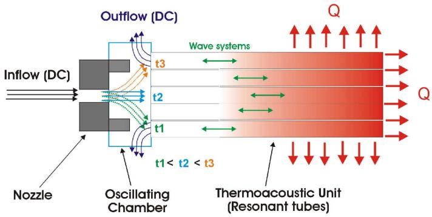
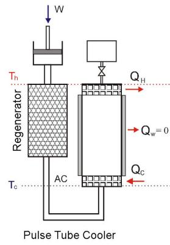
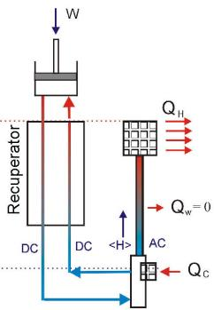
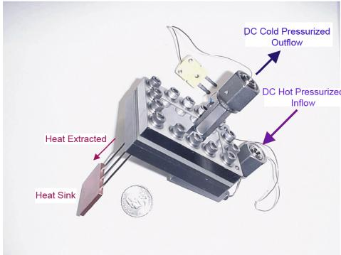
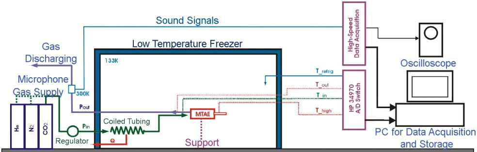
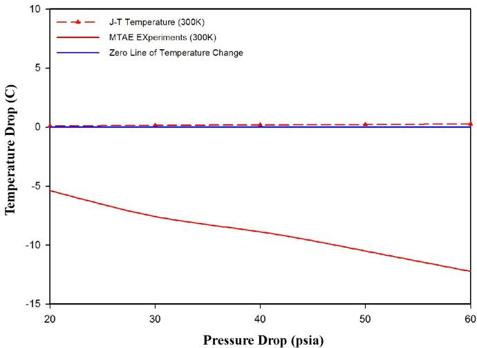
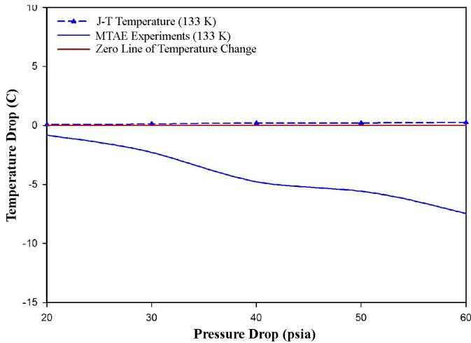
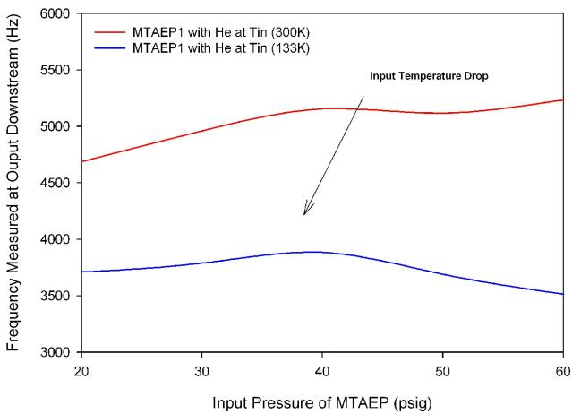

# Cooling Performance of Miniaturized Thermoacoustic Expanders Operated at 133 K

Zhimin Hu

CryoWave Advanced Technology, Inc

Pawtucket, RI 02860

## ABSTRACT

This paper reports progress in developing a Miniaturized Thermoacoustic Expander (MTAE) for low-cooling power recuperative coolers. In this effort, thermoacoustic expanders are sized to the scale handling a flow rate of hundreds of milligrams per second and tested at cryogenic temperatures to examine the feasibility of this technology for a miniature recuperative cryocooler systems. The experiments of the MTAE prototype exhibited significant cooling performance as compared to Joule-Thomson expanders. It proves that MTAE is free of the limit of operating temperature required by Joule-Thomson expanders and removes heat directly from the expansion of the cold-stage without sacrificing reliability and simplicity. The MTAE was also tested over a broad temperature range to simulate the variable operating conditions encountered in recuperative systems. The stable and impressive cooling performance over a temperature ratio range of 2.26 was observed. The initial approach to MTAE demonstrated its feasibility as a cryogenic expansion device and the potential for a miniature recuperative cryocooler systems.

## INTRODUCTION

Lifetime, reliability, and power consumption are three challenges encountered in the development of space-qualified cryocoolers. In past decades, efforts have been made in developing cryocooler systems that have less or no moving parts at the cold stage to meet the restrictive requirements on vibration free, reliability, efficiency of operation, and delivering cooling power over distance for long term mission targets.1,2,3,4 Recuperative cryocoolers are able to meet the challenges due to the separation of the cold-stage from the compressor unit, and depend on the expander efficiency at the cold end of the recuperative heat exchangers.5,6,7,8,9,10 Unfortunately, the isenthalpic type of expanders, including the Joule-Thomson (J-T) valve, capillary tubes, and porous plugs, become the only choice for uses in miniaturized recuperative coolers (<1 W) because of its simply structure, no moving mechanical parts, and scale feasibility. Offering high-reliability in operations and handling specified flow rates in miniature recuperative cryocoolers, isenthalpic expanders also provide maximum inefficiency due to the intrinsic thermodynamic-irreversibility. Obviously an expander that has a simply structure with no moving mechanical parts and scale feasibility like the J-T expanders, and enables the extraction of work from the expansion as to reduce thermodynamicirreversibility like turbo-expanders, will provide a new solution for miniaturized recuperative coolers future used in space-borne telescopes and infrared instruments.

The successful development of a MTAE potentially brings direct benefits for space missions because the technology is applicable over a wide temperature range allowing its use in Short Wavelength Infrared (SWIR), Mid Wavelength Infrared (MWIR), and Long Wavelength Infrared (LWIR) surveillance and interceptor systems. The use of an MTAE in conjunction with a space-qualified compressor also allows for efficient integration of a low mass cold heads with a remote objects to be cooled. This is possible because the gas input to the cooling stage is a D.C. flow . Only a minor parasitic load penalty is paid for the remote location of the cold head. When integrated in this way, the very small gas lines also act as a vibration isolator. Important examples of the efficient integration potential in space applications are multiple telescope or focal plane architectures, or multiple miniature interceptors on a single host. In the case of the interceptors use of this technology, it would allow these devices to be launched with the seeker operating at launch and at the same time carrying minimum mass for the cooler

CryoWave Advanced Technology has been developing thermoacoustic expansion technology to recover energy from pressure expansion processes since 1997. In 2005, the development of miniature scale approaches to this technology was started. The recent success of the MTAE cryogenic test gives a green-light for this technology as applied to a variety of low cooling power recuperative cryocooler systems in future space missions. The feasibility and operability of MTAEs at cryogenic temperature were examined in this work. The MTAE that thermoacoustically extracted work from D.C. working fluid flows to create about 4 W cooling output at the temperature of 133 K and exhibited heat rejecting capability to a 400K heat sink was demonstrated. The current research has also successfully explored the significant cooling performance of a MTAE outside of normal J-T expander operational limits.

## MTAE OPERATING MECHANISM

In principle, a MTAE uses a high-intensity acoustic wave system created at the cold-stage expansion to extract heat directly from the D.C. flow at the cold stage and accomplishes a quasiisentropic expansion without any mechanical moving part. The operation and structure features of an MTAE makes it the preferable expansion device, replacing a J-T expander in a recuperative cryocooler system. It features the ability to reduce the power input and increase cooling power without sacrificing the reliability or simplicity of the system. Basically, a MTAE consists of a nozzle, an oscillating chamber, and a thermoacoustic unit (bundle of resonant tubes).

The schematic of MTAE operations with five resonant tubes in a thermoacoustic unit is illustrated in Figure 1. As cryogen gases flow into a MTAE, dc-pressurized streams first generate a high speed jet through a nozzle, and rushes into a oscillation chamber where it encounters a thermoacoustic unit at its downstream. Provided that the MTAE operation begins at the moment marked by t1 in Figure 1, freezing the moving cold-jet in the oscillation chamber as it meets to the resonant tube located on the bottom wall of the chamber. When the cold-jet impinges with open-end of resonant tube (RT) on the bottom-wall, the following flow phenomena take place in sequence (by steps) inside that RT. These processes trigger and maintain a self-sustained jet oscillation in the chamber, and carry out a steady energy transportation from the cold-jet to the hot-end of the thermoacoustic unit by periodic motion of gases columns.

  
Figure 1. Illustration of MTAE Operation and Structure

• Step 1: The cold-jet compresses the quiescent gas-column resided at the opened-end of RT.

Step 2: The injected gas together with the quiescent gas-column close to the RT open-end immediately creates the pressure elevation within the narrow region, and forms a pressure pulse (PP). This PP transports heat to the rest of quiescent gas-column at the RT dead-end.

Step 3: The sudden gas injection increases local enthalpy simultaneously, and forms an interface (flow state discontinuity) which separates the injected gas and the rest of quiescent gascolumn into different entropy and temperature region. This interface moves at a slow speed (gas parcel motion) into the RT dead-end.

Step 4: The PP reflects when it hits the RT dead-end and forms a reflected PP (RPP). This RPP travels to the RT opened-end, passes the interface to induce the back flow of the injected gas (reverse flow), and travels to the upstream of the cold-jet.

Step 5: At the cold-jet upstream, the RPP changes the flow state (static pressure in shear layer) at the nozzle exit which results in the cold-jet instability.

Step 6: As the RPP passes through the injected gas region and induced the reverse flow, the gas begins to return to the RT open end and discharges to the exit of oscillation chamber.

Step 7: As the cold jet is fully pushed to the neighboring resonant tube as illustrated in Figure 1 (t2), the gas fully outflows from the open end into the exit with a low temperature, and pressure.

In a stable operation of MTAEs, the cold-jet continuously meets and interacts with the downstream resonant tubes in turn, iterates the seven-step operations in sequence in the neighboring RTs as illustrated in Figure 1 by the t1, t2, and t3, and drives the periodic acoustic waves that are analogous to mechanical pistons to compress or expand periodically the quiescent gas-column inside the thermoacoustic unit. The generations of the acoustic waves by the jet oscillation (flapping), allow the MTAE to extract heat from a D.C. expansion flow and eliminate any moving mechanical part.

The miniaturized thermoacoustic expansion cooler system (MTAEC) that integrates a MTAE with a recuperative heat exchanger and a compressor, is illustrated in Figure 2 (left). Figure 2 also shows the schematic of MTAEC cooling power and heat rejection flow compared to the state of the art of regenerative pulse tube coolers (PTC) which run in the same temperature range. The heat removal capacity and cooling efficiency in both devices intrinsically rely on the intensity of each PP (amplitude) and average acoustic streaming power in a unit-time interval (frequency). To better understand the MTAE heat rejection limit, the fundamental characteristics of thermoacoustic wave systems driven in both devices are addressed below:

In a PTC, a PP is driven by a reciprocally moving mechanical part (piston) at the high-temperature end $( T _ { h } )$ of the thermodynamic cycle. Such a PP must go through a high-flow-friction porosity passage (regenerator) with a considerable temperature gradient before it reaches low temperature region $( \hat { T } _ { c } )$ where heat is picked up.

  
Figure 2. MTAE Cooler vs. Pulse Tube Cooler

  
Thermoacoustic Expansion Cooler Cycle

• In the MTAEC system, a PP is directly driven by a periodically moving cold-jet at a low temperature region $( T _ { C } )$ of the thermodynamic cycle. The acoustic power of the PP depends upon the flowing state of cold-jet after isentropic expansion.

If PPs are categorized by the temperature level benchmarked from which it is originally driven, the PP in a MTAECs is a cold PP (CPP), and the PP created in PTCs is a hot PP (HPP). The following features are identified between CPPs and HPPs;

A CPP always originates and travels from low temperature region $( T _ { c } )$ to high temperature region $( T _ { h } )$ along the RT (pulse tube) over a positive temperature gradient, and undergoes a local concentration of acoustic power intensity due to the increase of amplitude and reduction of local density as it moves in the hot region. The CPPs in MTAECs are used to directly pump heat from the D.C. flowing at low temperature region $( T _ { c } ) _ { }$ , and reject heat to the hot-end $( T _ { h } )$ of multiple-miniature RTs without intrinsic penalty of acoustic power intensity as it travels to high temperature region $( T _ { h } )$ The temperature $( T _ { h } )$ at the hot end of the MTAEC system has less of a contribution to the CP generation if the $\ddot { T } _ { c }$ is fixed and heat losses over recuperative heat exchanger and RTs are ignored.

To the contrary, a HPP intrinsically undergoes a dilution of acoustic power intensity before it arrives at the low temperature region $( T _ { c } )$ where heat is picked up from the payload due to a reduction in its amplitude and increase in the local density as it travels toward the cold region. The temperature level $( T _ { h } )$ at the hot end of the PTC system has a strong impact on the HPP generation and the capability to pick up heat at $T _ { c }$ due to the dilution effect of acoustic power intensity over the temperature gap from $T _ { h }$ to $T _ { c }$ if the cold-stage temperature $T _ { c }$ is fixed and heat losses on the regenerative heat exchanger and pulse tube are ignored.

The merits of CPP generation and oscillation mechanism in MTAEs make this technology feasibly at low temperature ranges without degrading its cooling efficiency and remain an effective energy transportation to the variations of cold-stage temperature, and reject heat either to the inlet of compressors or a higher temperature sink available in MTAEC systems.

## PRINCIPLE DESIGN OF MTAE PROTOTYPE

Several MTAEs were designed and fabricated with the geometric scale specified in handling with small flow volume equivalent to capillary tubes with the interior diameter between 0.25 and 0.5 mm. The MTAE prototype used in the cryogenic tests is exhibited in Figure 3. The testing conditions are specified and tabulated in Table 1, where $P _ { i n }$ and $P _ { o u t }$ are defined as the absolute inlet and outlet pressures, and $T _ { i n \ H }$ is the absolute inlet temperature condition tested in ambient, and $T _ { i n \ C }$ is the absolute inlet temperāture condition tested under cryogenic environment.

In Table 1, the parameter $\varepsilon _ { p }$ gives the pressure drop ratio through testing devices. $\varepsilon _ { T }$ is the temperature ratio between the high-temperature and cryogenic temperature tests under the selected pressure states, which presented the operability of MTAEs over the temperature range.

The challenges exist for the lack of information on fluid parameters inside the device and the method to obtain the interior flowing information in MTAE from the experiments. The MTAE was designed and fabricated in a way to easily change the interior dimension of flow channels and with the simplicity to perform the experiments in different environments between 293 K and 133 K. Table 2 provides the design specifications for the MTAE.

According to the flow parameters specified for the MTAE, the preliminary geometries of the device components including the nozzle, the oscillation chamber, and the thermoacoustic unit (TU) are designed based on the estimation on the cold-jet flowing states and the experimental data from previous tests in large-scale of thermoacoustic expanders. There is no detailed information on the internal flow and wave system behavior obtained experimentally due to the miniature-scales of flowing channels. Thus the theoretical calculation of cold-jet states under the given pressure drop and temperature conditions become the preliminary base to predict the dimensions of the MTAE components. The states of the cold-jet (pressure and temperature) driven in helium within MTAE are presented in Table 3.

The cooling power of a MTAE is proportion to the mass flow rate if the energy efficient and operating conditions are known. Since the inlet pressure conditions of the MTAE varies in a range, the mass flow rates in terms of the cooling power through the MTAE devices are changed with gas type and inlet temperature. The variations of mass flow rate through the MTAE under the testing conditions with helium gases are estimated. These estimations of mass flow rate outline the cooling capacities of the MTAEs corresponding to the inlet pressure and temperature under testing conditions.

Table 1. The Specified Testing Conditions of MTAE
<table><tr><td rowspan=1 colspan=1> $P _ { i n }$  $( P _ { a } )$ </td><td rowspan=1 colspan=1> $P _ { o u t }$  $( P _ { a } )$ </td><td rowspan=1 colspan=1> $\varepsilon _ { p } = \frac { P _ { i n } } { P _ { o u t } }$ </td><td rowspan=1 colspan=1> $T _ { i n \_ H }$  $( K )$ </td><td rowspan=1 colspan=1> $T _ { i n \_ C }$  $( K )$ </td><td rowspan=1 colspan=1> $\varepsilon _ { _ T } = \frac { T _ { i n \_ H } } { T _ { i n \_ C } }$ </td></tr><tr><td rowspan=1 colspan=1> $5 . 1 5 \mathrm { x } 1 0 ^ { 5 }$ </td><td rowspan=1 colspan=1> $1 . 0 1 3 5 \mathrm { x } 1 0 ^ { 5 }$ </td><td rowspan=1 colspan=1>5.08</td><td rowspan=1 colspan=1>293 K</td><td rowspan=1 colspan=1>133 K</td><td rowspan=1 colspan=1>2.2</td></tr><tr><td rowspan=1 colspan=1> $4 . 4 6 \mathrm { x } 1 0 ^ { 5 }$ </td><td rowspan=1 colspan=1> $1 . 0 1 3 5 \mathrm { x } 1 0 ^ { 5 }$ </td><td rowspan=1 colspan=1>4.40</td><td rowspan=1 colspan=1>293 K</td><td rowspan=1 colspan=1>133 K</td><td rowspan=1 colspan=1>2.2</td></tr><tr><td rowspan=1 colspan=1> $3 . 7 7 \mathrm { x } 1 0 ^ { 5 }$ </td><td rowspan=1 colspan=1> $1 . 0 1 3 5 \mathrm { x } 1 0 ^ { 5 }$ </td><td rowspan=1 colspan=1>3.72</td><td rowspan=1 colspan=1>293 K</td><td rowspan=1 colspan=1>133 K</td><td rowspan=1 colspan=1>2.2</td></tr><tr><td rowspan=1 colspan=1> $3 . 0 8 \mathrm { x } 1 0 ^ { 5 }$ </td><td rowspan=1 colspan=1> $1 . 0 1 3 5 \mathrm { x } 1 0 ^ { 5 }$ </td><td rowspan=1 colspan=1>3.04</td><td rowspan=1 colspan=1>293 K</td><td rowspan=1 colspan=1>133 K</td><td rowspan=1 colspan=1>2.2</td></tr><tr><td rowspan=1 colspan=1> $2 . 3 9 \mathrm { x } 1 0 ^ { 5 }$ </td><td rowspan=1 colspan=1> $1 . 0 1 3 5 \mathrm { x } 1 0 ^ { 5 }$ </td><td rowspan=1 colspan=1>2.36</td><td rowspan=1 colspan=1>293 K</td><td rowspan=1 colspan=1>133 K</td><td rowspan=1 colspan=1>2.2</td></tr></table>

  
Figure 3. MTAE Prototype Used in Cryogenic Tests

## EXPERIMENTAL SETUP

The schematic of the cryogenic simulative test system (CSTS) is illustrated in Figure 4. The CSTS consists of a pressure gas-supply, a cryogenic freezer (133 K), a tubing heat-exchanger, and a data acquisition system. The CSTS functions are addressed as below:

A gas-supply provides the pressurized gases for cryogenic simulative experiments of the MTAE. The input-pressure condition of the MTAE is controlled by a regulator that links to a helium cylinder that is outside of the cryogenic freezer chamber.

A cryogenic freezer that embodies the MTAE creates a precooling environment at a cryogenic temperature (133K). A copper tubing coil is installed inside the freezer chamber to precool input helium gas before entering the MTAE.

The data acquisition system is set up to gather the temperature and pressure wave information during the test. The data acquisition system is comprised of a HP 34970 data switch unit, several K-type thermocouples, a sound level meter, a high-speed A/D board (1 MHz), a storage oscilloscope (LA 345), and a GPIB interface connected to two PCs. Several thermocouples were led into the freezer chamber to monitor temperature of freezer chamber and measure pressurized helium temperature before and after MTAE device.

Table 2. Design Specifications of MTAEs
<table><tr><td rowspan=1 colspan=1>Mass Flow Rate</td><td rowspan=1 colspan=1>120 mg/s (He)</td></tr><tr><td rowspan=1 colspan=1>Expansion Ratio</td><td rowspan=1 colspan=1>5:1 to 2:1</td></tr><tr><td rowspan=1 colspan=1>Inlet Temperature</td><td rowspan=1 colspan=1>293K to 133K</td></tr><tr><td rowspan=1 colspan=1>Discharging Pressure</td><td rowspan=1 colspan=1> $1 . 0 1 3 5 { \bf x } 1 0 ^ { 5 } \left( P a \right)$ </td></tr></table>

Table 3. Pressure & Temperature States of Cold-Jet in MTAEP $( H _ { e } )$
<table><tr><td rowspan=1 colspan=1>Gas</td><td rowspan=1 colspan=1> $T _ { i n }$  $( K )$ </td><td rowspan=1 colspan=1> $P _ { i n }$  $( p s i a )$ </td><td rowspan=1 colspan=1> $P _ { c }$  $( p s i a )$ </td><td rowspan=1 colspan=1> $T _ { c }$  $( K )$ </td><td rowspan=1 colspan=1> $T _ { i n }$  $( K )$ </td><td rowspan=1 colspan=1> $P _ { i n }$  $( p s i a )$ </td><td rowspan=1 colspan=1> $P _ { c }$  $( p s i a )$ </td><td rowspan=1 colspan=1> $T _ { c }$ (K)</td></tr><tr><td rowspan=1 colspan=1> $H _ { e }$ </td><td rowspan=1 colspan=1>293</td><td rowspan=1 colspan=1>74.7</td><td rowspan=1 colspan=1>36.39</td><td rowspan=1 colspan=1>219.79</td><td rowspan=1 colspan=1>133</td><td rowspan=1 colspan=1>74.7</td><td rowspan=1 colspan=1>36.39</td><td rowspan=1 colspan=1>99.77</td></tr><tr><td rowspan=1 colspan=1> $H _ { e }$ </td><td rowspan=1 colspan=1>293</td><td rowspan=1 colspan=1>64.7</td><td rowspan=1 colspan=1>31.52</td><td rowspan=1 colspan=1>219.79</td><td rowspan=1 colspan=1>133</td><td rowspan=1 colspan=1>64.7</td><td rowspan=1 colspan=1>31.52</td><td rowspan=1 colspan=1>99.77</td></tr><tr><td rowspan=1 colspan=1> $H _ { e }$ </td><td rowspan=1 colspan=1>293</td><td rowspan=1 colspan=1>54.7</td><td rowspan=1 colspan=1>26.65</td><td rowspan=1 colspan=1>219.79</td><td rowspan=1 colspan=1>133</td><td rowspan=1 colspan=1>54.7</td><td rowspan=1 colspan=1>26.65</td><td rowspan=1 colspan=1>99.77</td></tr><tr><td rowspan=1 colspan=1> $H _ { e }$ </td><td rowspan=1 colspan=1>293</td><td rowspan=1 colspan=1>44.7</td><td rowspan=1 colspan=1>21.78</td><td rowspan=1 colspan=1>219.79</td><td rowspan=1 colspan=1>133</td><td rowspan=1 colspan=1>44.7</td><td rowspan=1 colspan=1>21.78</td><td rowspan=1 colspan=1>99.77</td></tr><tr><td rowspan=1 colspan=1> $H _ { e }$ </td><td rowspan=1 colspan=1>293</td><td rowspan=1 colspan=1>34.7</td><td rowspan=1 colspan=1>16.91</td><td rowspan=1 colspan=1>219.79</td><td rowspan=1 colspan=1>133</td><td rowspan=1 colspan=1>34.7</td><td rowspan=1 colspan=1>16.91</td><td rowspan=1 colspan=1>99.77</td></tr></table>

The MTAE is installed after the coiled tubing heat exchanger. The outlet of the MTAE is connected to the discharging duct.

The CSTS is implemented for ambient and cryogenic temperature tests in one configuration. The cryogenic experiments are performed after the ambient test succeeded. As the temperature of freezer chamber reached the testing temperature (133 K), the helium cylinder was regulated to the specified pressures. The results of the MTAE cooling performance under ambient (300 K) and cryogenic temperature (133 K) are obtained by adjusting the inlet temperature of device. At ambient temperature (300 K), the MTAE is tuned before the CSTS is powered. The lowest temperature achieved with the CSTS is 133K which is the precooling temperature provided to the MTAE inlet. Helium gas is used as a working fluid.

## EXPERIMENTAL RESULTS

The cooling performances of the MTAE under ambient temperature (300 K) with helium is given in Figure 5. The temperature drops created by the MTAE under the cryogenic temperature of 133 K is shown in Figure 6 in comparison to cooling performance of J-T expanders (theoretical calculated value which is the maximum temperature drop obtained from a J-T expander without regard to heat losses in expansion) under the identical operating conditions. The testing data, as shown in Table 4, indicates that the MTAE delivered significant temperature drop vs. a J-T expander. Worth noting is that the MTAE created impressive cooling power with helium gas in the temperature region where the J-T expander undergoes a temperature rise after expansion.

At the designed condition (DP=60 psi, 120 mg/s, at 133 K), approximately 4.0 watts of cooling power is produced by the MTAE in this test if the heat losses in a recuperator is neglected, compared to a J-T expander that has zero or negative cooling power output from the expansion of helium gases. The results from the same device tested in ambient, as given in Figure 5, shows the more cooling power at the higher inlet temperature under the same pressure drop. As a matter of fact, the cooling power produced from expansion is proportional to useful work released from the pressurized gases under the testing condition. The useful work released is depended upon the thermal states and property of the working gases before and after expansion. The inlet temperature drop of MTAE from 300 K to 133 K results in a significant loss of gas enthalpy which is removed by precooling the heat exchanger in the CSTS. It is the main reason to lead the cooling power diminishing in 133K. It is evident that the MTAE produced a lower temperature (125.8 K) below the temperature of cryogenic freezer chamber after helium expansion from 60 psi.

  
Figure 4. Schematics of Cryogenic Simulative Test System Setup

The simulative heat rejection tests also were performed by using a electric heater to heat the thermoacoustic unit up to 500K and isolated it inside the CSTS. The stable temperature drop between inlet and outlet of the MTAE device were observed that roughly identified the heat rejection capacity of a thermoacoustic unit over a temperature ratio 3.7, if the heat losses inside freezer chamber were ignored. The existence of the thermoacoustic wave system driven in miniature-resonant-tubes of the MTAE and the capability to convert pressure energy into heat in the miniature geometry scale were examined in the experiments as well. However, the acoustic wave systems were indirectly detected from the discharging duct downstream of the testing devices due to the challenges of the miniature flow channel scale.

The frequency measurement explored roughly the characteristics of acoustic wave systems varying with the temperature conditions and gas types. The frequency characteristics of the MTAE operation with helium gas under the ambient (300K) and cryogenic temperature (133 K) were plotted in Figure 7. The frequency band variations of the MTAE driven by helium under 133 K is plotted in comparison to the ones under 300 K. It is evident that as inlet temperature drops from 300 K to 133 K, the MTAE operating frequency dropped by almost 30 % (from 5000 Hz to 3700 Hz). This frequency band shift reflects the sound speed effect as the operating temperature drops in the thermoacoustic unit.

Figure 5. MTAE Cooling Performance with 300 K Inlet Temperature (Gas: He)  
  
Figure 6. MTAE Cooling Performance with 133K Inlet Temperature (Gas: He)

Table 4. MTAE Cooling Performance Testing Data (Gas: Helium)
<table><tr><td rowspan=1 colspan=1>∆P(psi)</td><td rowspan=1 colspan=1>Tin_ JT(K)</td><td rowspan=1 colspan=1>Tout_JT(K)</td><td rowspan=1 colspan=1>∆T_JT(K)</td><td rowspan=1 colspan=1>Tin_MTAE(K)</td><td rowspan=1 colspan=1>Tout_MTAE(K)</td><td rowspan=1 colspan=1>∆T MTAE(K)</td></tr><tr><td rowspan=1 colspan=1>60</td><td rowspan=1 colspan=1>133</td><td rowspan=1 colspan=1>133.25</td><td rowspan=1 colspan=1>0.25</td><td rowspan=1 colspan=1>133.30</td><td rowspan=1 colspan=1>125.82</td><td rowspan=1 colspan=1>-7.48</td></tr><tr><td rowspan=1 colspan=1>50</td><td rowspan=1 colspan=1>133</td><td rowspan=1 colspan=1>133.21</td><td rowspan=1 colspan=1>0.21</td><td rowspan=1 colspan=1>131.75</td><td rowspan=1 colspan=1>126.17</td><td rowspan=1 colspan=1>-5.57</td></tr><tr><td rowspan=1 colspan=1>40</td><td rowspan=1 colspan=1>133</td><td rowspan=1 colspan=1>133.20</td><td rowspan=1 colspan=1>0.2</td><td rowspan=1 colspan=1>133.04</td><td rowspan=1 colspan=1>128.27</td><td rowspan=1 colspan=1>-4.77</td></tr><tr><td rowspan=1 colspan=1>30</td><td rowspan=1 colspan=1>133</td><td rowspan=1 colspan=1>133.12</td><td rowspan=1 colspan=1>0.12</td><td rowspan=1 colspan=1>132.37</td><td rowspan=1 colspan=1>130.09</td><td rowspan=1 colspan=1>-2.28</td></tr><tr><td rowspan=1 colspan=1>20</td><td rowspan=1 colspan=1>133</td><td rowspan=1 colspan=1>133.08</td><td rowspan=1 colspan=1>0.08</td><td rowspan=1 colspan=1>132.04</td><td rowspan=1 colspan=1>131.22</td><td rowspan=1 colspan=1>-0.82</td></tr></table>

These results show very clearly in Figure 7 that the operating frequency of thermoacoustic unit in the experiments considerably shifted over the pressure drop range with the same trend of input temperature drop. With a temperature drop ratio of 2.26 and the frequency shifting around 30%, the core part, the thermoacoustic unit in the MTAE, still performed stably and the cooling performance of the device is not seriously affected by such factors in the whole tested pressure range.

## CONCLUSIONS

The preliminary experimental investigations of an MTAE was performed at both ambient (300 K) and cryogenic temperature (133 K). The testing prototype was designed and fabricated ton handle a flow rate of 120 mg/s (60 psi and 133 K). Based on preliminary testing results of the MTAE, the following conclusions can be drawn:

• Operability of the MTAE at cryogenic temperature (133 K) has been proven;

Existence of thermoacoustic mechanism in micron-scale channels of the MTAE at the cryogenic temperature (133 K) has been examined and verified;

Heat rejection capability of MTAE with a temperature ratio of 3.7 has been roughly demonstrated.

A temperature elevation on the MTAE body was observed as it tested initially in cryogenic high vacuum chamber. The TAU structure of MTAE design needs to improve in the future study.

  
Figure 7. Variation of Operating Frequency with Pressure and Temperature in MTAE (Gas: Helium)

The initiative research has successfully demonstrated the feasibility of MTAE in miniature cryocooler applications and the potential to be further scaled down and run at temperatures below 77 K.

## ACKNOWLEDGMENT

This project was funded by DoD SBIR program under the contract with MDA. The authors would like to thank Dr. Tom Roberts of Space Cryogenic Technology Laboratory for his assistance in providing valuable discussions and suggestions on the experiments, and for serving as a mentor and the technical manger for this project. A special acknowledgment is made to Mr. Michael Petach, Mr. Jeff Raab, and Dr. E. Tward from NGST for their valuable advice in technology applications and supporting on initiative MTAE cryogenic tests in NGST facility.

## REFERENCES

1. F. Roush and T. Roberts, "AFRL Space Cryogenic Technology Research Initiatives," Cryocoolers 14, ICC Press, Boulder, CO (2007), pp. 11-20.

2. R. Ross and R. Boyle, “An Overview of NASA Space Cryocooler Program-2006," Cryocoolers 14, ICC Press, Boulder, CO (2007), pp.1-10.

3. D. Durand, R. Colbert, C. Jao and M. Michaelian, "NGST Advanced Cryocooler Technology Development Program (ACTDP) Cooler System," Cryocoolers 14, ICC Press, Boulder, CO (2007), pp 21-25.

4. T. Nast, J. Olson, E.Roth, and B. Evtimov, "Development of Remote Cooling System for Low-Temperature, Space-Borne Systems," Cryocoolers 14, ICC Press, Boulder, CO (2007), pp 33-40.

5. M.V. Zagarola, W.L. Swift, H. Sixsmith, J.A. McCormick and M.G. Izenson, "Development of a Turbo-Brayton Cooler for 6K Space Applications," Cryocoolers 12, Kluwer Academic/Plenum Publishers, New York (2003), p. 571-578.

6. G.F. Nellis, F. Dolan, J.McCormick, W. Swift, H. Sixsmith, J. Gibbon, and S. Castles, "Reveres Brayton cryocooler for NICMOS," Cryocoolers 10, Plenum Publishing Corp., New York (1999), pp. 431-438.

7. C. Knokel and W. Bradley, "Design and Qualification of Flight Electronics for the HST NICMOS Reverse Brayton Crycooler," Cryocoolers 10, Plenum Publishing Corp., New York (1999), p. 439-448.

8. Z. Hu, "Thermoacoustic Expansion Valve: A New Type of Expander to Enhance Performance of Recuperative Cryocooler Systems," Cryocoolers 14, ICC Press, Boulder, CO (2007), pp 429-436.

9. J. A. McCormick, G. F. Nellis, W.L. Swift and H. Sixmith, "Design and Test of Low Capacity Reverse Brayton Cryocooler for Refrigeration at 35 K and 60 K", Cryocoolers 10, Plenum Publishing Corp., New York (1999), p. 421-429.

10. G.F. Nellis, J.R.Maddocks, A.Kashani, J.H.Baik, and J.M. Pfotenhauer, "A First Order Model of a Hybrid Pulse Tube/Reverse-Brayton Crycooler", Cryocoolers 12, Kluwer Academic/Plenum Publishers, New York (2003), p. 349-359.