Chen, G., Tang, L., Mace, B. and Yu, Z. (2021) Multi-physics coupling in thermoacoustic devices: a review. Renewable and Sustainable Energy Reviews, 146, 111170.

(doi: 10.1016/j.rser.2021.111170)

This is the Author Accepted Manuscript.

There may be differences between this version and the published version. You are advised to consult the publisher’s version if you wish to cite from it.

https://eprints.gla.ac.uk/240394/

Deposited on: 29 April 2021

Enlighten – Research publications by members of the University of Glasgow http://eprints.gla.ac.uk

# MXlWi-Sh\VicV coXSling in WheUmoacoXVWic deYiceV: A UeYieZ

Geng Chen1, 2, \*, Lihua Tang2, Brian Mace2, Zhibin Yu3

1. National Engineering Research Center of Turbo-Generator Vibration, School of Energy and Environment, Southeast University, Nanjing 210096, China

2. Department of Mechanical Engineering, University of Auckland, Auckland 1010, New Zealand

3. James Watt School of Engineering, University of Glasgow, Glasgow G12 8QQ, UK

Correspondence: chengeng@seu.edu.cn

## ABSTRACT

Latest developments in thermoacoustic devices have demonstrated comparable power output and efficiency, but higher reliability and lower cost when compared to conventional low-grade heat recovery technologies. A good coupling between multiple physical fields plays a pivotal role in realizing these potentials. This article provides a comprehensive review of the multi-physics coupling effects, namely, thermal-acoustic coupling, acoustic-mechanical coupling and mechanical-electric coupling, inside thermoacoustic devices including thermoacoustic engines, thermoacoustic electric generators, thermoacoustically-driven refrigerators, etc. The basic principles, operating characteristics, design strategies and future prospects are discussed individually for each coupling effect. System-level design techniques and synthetic optimization methodologies in consideration of the multi-physics coupling effects are presented. This review work gives insights into the underlying mechanisms of various coupling effects in thermoacoustic devices and provides guidelines for improvements of modern thermoacoustic technologies for low-grade thermal energy recovery, refrigeration and electric power generation purposes.

Keywords: Multi-physics coupling; Thermoacoustic engine; Thermoacoustic electric generator;   
Thermoacoustic refrigerator; Thermal energy recovery; Electric power generation;

Word Count: 21,896

## Contents

1. Introduction................... ........ 3 2. General review ........................ 2.1 Classification of thermoacoustic devices ... .... 4 2.2 Classification of multi-physics coupling. .. 6

3. Thermal-acoustic coupling...   
3.1 Basic principles.   
3.2 Linear thermoacoustics 9   
3.2.1 Linear thermoacoustic equations .. 9   
3.2.2 Linear thermoacoustic instability .12   
3.3 Nonlinear thermoacoustics. .14   
3.3.1 Nonlinear acoustic phenomena .14   
3.3.2 Nonlinear hydrodynamic phenomena .17   
3.3.3 Nonlinear dynamic responses .19   
3.3.4 Nonlinear thermoacoustic amplification. .20   
3.4 Discussion ... .22   
3.4.1 Multi-stage design. .22   
3.4.2 Phase-change design . .23   
3.5 Summary and outlook 24   
4. Acoustic-mechanical coupling.. .25   
4.1 Passive control approaches .25   
4.1.1 Standing-wave thermoacoustic systems. .25   
4.1.2 Travelling-wave thermoacoustic systems .27   
4.2 Active control approaches. .29   
4.2.1 Standing-wave thermoacoustic systems.. .29   
4.2.2 Travelling-wave thermoacoustic systems .31   
4.3 Discussion . .32   
4.3.1 Mode selection and transition .32   
4.3.2 Push-pull or double-acting concept. .34   
4.4 Summary and outlook .35   
5. Mechanical-electric coupling .. ... 35   
5.1 Transduction mechanisms .36   
5.2 Electric circuit design .39   
5.3 Summary and outlook .40   
6. System design and synthetic optimization . .. 40   
6.1 System-level design techniques .41   
6.2 Optimization methodologies .. 41   
7. Conclusions.. .42   
Acknowledgements . 43   
Appendix. List of thermoacoustic devices. 43   
References......

## 1. Introduction

Thermoacoustics, as the name suggests, is an interdisciplinary science that encompasses the fields of thermodynamics and acoustics. It is a fascinating subject that studies the thermoacoustic effect arising from the interaction between a compressible fluid and a solid material. On one hand, an appreciable temperature gradient along the solid material can induce spontaneous oscillations of the compressible fluid (i.e., acoustic waves) in the vicinity of the fluid-solid interfaces [1]. On the other hand, an acoustic wave in the compressible fluid propagating along the solid material can contribute to hydrodynamic heat pumping effects, establishing a temperature gradient within the solid material in the direction of wave propagation [2]. The above two aspects of the thermoacoustic effect lay the foundation for thermoacoustic engines (or prime movers) and thermoacoustic refrigerators (or heat pumps).

The thermoacoustic effect was first observed by glassblowers who found loud sounds emitted from a tube that was connected to a hot bulb in the 18th century [3]. Similar loud noises were discovered by Byron Higgins [4], who placed a hydrogen flame inside an organ-pipe which then was given the name of the ³singing flame´. These interesting early observations then led to systematic experimental studies on the ³Sondhauss tube´ [5], ³Rijke tubes´ [6] and ³Taconis tube´ [7], which can be viewed as the ancestors of the modern sciences of thermoacoustic systems [8], combustion thermoacoustics [9] and thermoacoustic cold energy recovery [10]. Spontaneous acoustic oscillations in Sondhauss, Rijke and Taconis tubes are primitive demonstrations of thermoacoustics and seemly have no practical use. An important breakthrough in modern thermoacoustics is the invention of the ³stack´ by Carter [3] in 1962 and ³regenerator´ by Ceperley [11-13] in 1979. The stack and regenerator are a piece of porous material that significantly increases the effective fluid-solid contact area and therewith the acoustic intensity, turning the device into an ³engine´ with a usable level of acoustic power output. Since then, research on thermoacoustic engines (TAEs) has attracted much attention and experienced rapid progress. In 1975, Merkli and Thomann [14] observed a cooling effect around the velocity antinode of a cylindrical tube driven by an oscillating piston, and presented an accurate theory for the cooling effect. Thereafter, numerous efforts were undertaken to develop thermoacoustic refrigerators (TARs) as a novel cooling technology without using any environmentally harmful refrigerants. In the 1990s, Wheatley and Swift [8] from Los Alamos National Laboratory conducted a series of pioneering works on TAEs and TARs that paved the way for industrial applications of thermoacoustic technologies.

TAEs and TARs are attractive due to their lack of moving components (such as the crank and flywheels in Stirling engines) and relatively benign environmental impact (using noble and inert gases). These devices provide reliable and cost-effective alternatives to make use of significant amounts of untapped low-grade thermal energy such as geothermal energy, industrial waste heat and solar thermal energy. The performance of thermoacoustic devices improved significantly after many years research efforts. Currently, as shown in the Appendix, the TAE could have an onset temperature as low as 29 ℃ [15] and a thermal-to-acoustic efficiency as high as 35.6% [16]. When coupled with a transducer, the TAE could produce a thermal-to-electric efficiency up to 19.8% [17] and an electric power up to 4.69 kW [18]. For the TAR, the lowest cooling temperature of -254.9 ℃ (or 18.1 K) [19], the highest coefficient of performance (COP) of 4.78 [20] and the highest cooling power of 3.8 kW [21] have been realized. Notwithstanding their many advantages and outstanding performances, the design and fabrication of a simple-structured, efficient and robust thermoacoustic device is a challenging task since it involves complicated coupling between multiple physical fields (see Table 1 in Section 2.2 for a detailed description of multi-physics coupling). During the coupling processes, energy is converted from one form to another or transferred from one component to another. A good coupling will facilitate the power generation while a poor coupling will deteriorate the energy conversion or, in the worst case, cause the system to malfunction [22]. Therefore, the study of multi-physics coupling is critical to the successful operation of a thermoacoustic device. It is imperative to have an in-depth knowledge of the multiphysics coupling effects to understand how the system performance is influenced by each coupling effect and the accompanying issues to be addressed in future research.

Although there are a few review papers on the subject of thermoacoustic technologies [23-30], they are focused on specific topics, such as advances in practical implementations, options of transducers and optimization of thermoacoustic refrigerators. There is a lack of a comprehensive review focusing on the multi-physics coupling effects involved in thermoacoustic devices of all kinds. Therefore, in this paper, we review and summarize the existing thermoacoustic research activities from a multi-physics coupling perspective. In this manner, researchers could have a clear overview of different coupling effects/characteristics in the design process, and develop sophisticated thermoacoustic devices based on their needs. The rest of this paper is organized as follows. Classifications of thermoacoustic devices and multi-physics coupling are first introduced in Section 2. Detailed descriptions of each coupling effect are presented in Sections 3 to 5, followed by a review of system design and synthetic optimization techniques in Section 6. Finally, the main conclusions in this work are summarized in Section 7.

## 2. General review

## 2.1 Classification of thermoacoustic devices

Thermoacoustic (TA) devices can be categorised into several different types according to Figure 1. Based on the acoustic field inside the waveguides, TA devices can be classified into standing-wave and travelling-wave TA systems. The phasing between pressure and velocity oscillations is ʌ/2 in an acoustic standing wave but zero in a travelling wave. The acoustic field is determined by the acoustic boundary conditions, such as rigid/soft walls, an acoustic loop, or a T-joint, imposed on the acoustic waveguide. Based on the thermodynamic cycle (engine cycle or refrigeration cycle) in the thermoacoustic core (stack or regenerator), TA systems can be classified into thermoacoustic engines (TAEs) and thermoacoustic refrigerators (TARs). The working gas undergoes engine cycles in TAEs but refrigeration cycles in TARs. TAEs can be further classified into TAEs with and without external loads. In the literature, the external load could be in the form of acoustic radiation [31], mechanical-toelectric transducers [28], liquid pistons [32] or solid displacers [33]. TARs can be further classified into electrically-driven and thermoacoustically-driven types. Electrically-driven TARs utilize forced acoustic oscillations (e.g. by a loudspeaker) whilst thermoacoustically-driven TARs make use of selfexcited acoustic oscillations from a TAE. This review work only discusses thermoacoustic devices where acoustic oscillations are self-excited.

In thermoacoustic devices, the thermoacoustic core (stack or regenerator) is a piece of porous material, which provides the required interface for heat transfer between working gas and solid material. The major difference between a stack and a regenerator is the hydraulic radius $r _ { h }$ with $r _ { h } \ge \delta _ { k } \left( \delta _ { k } \right.$ being the thermal penetration depth) in the stack whilst $r _ { h } < \delta _ { k }$ in the regenerator. Figure 2 shows examples of a loaded standing-wave TAE employing a stack and a loaded travelling-wave TAE employing a regenerator. The acoustic waveguide in Figure 2(a) is an acoustic resonator closed by a rigid wall at the left end and an external load at the right end. Inside the resonator is a parallel-plate thermoacoustic stack, sandwiched between a hot heat exchanger (HHE) and an ambient heat exchanger (AHE). Spontaneous acoustic oscillations induced in the resonator when the temperature gradient along the stack reaches an onset value are used to drive an external load. The acoustic waveguide in Figure 2(b) is a looped tube inside which a thermoacoustic regenerator is sandwiched by a pair of hot and ambient heat exchangers. Acoustic power is generated in the regenerator in the presence of a large temperature gradient and extracted by an external load connected somewhere to the loop.

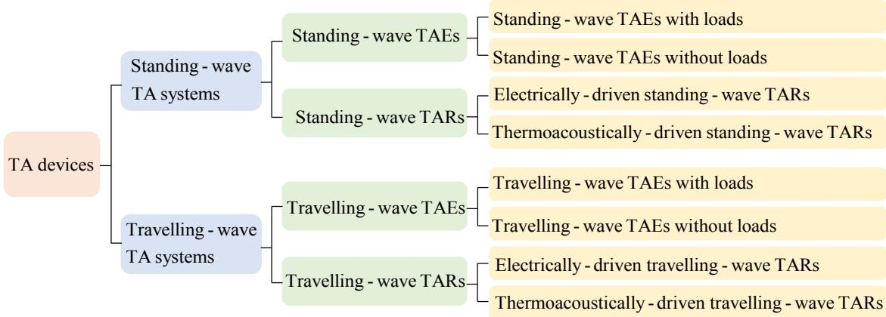  
Figure 1. Classification of thermoacoustic devices. TA, TAE and TAR stand for thermoacoustic, thermoacoustic engine and thermoacoustic refrigerator, respectively.

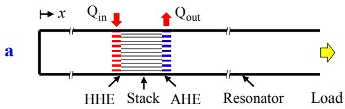

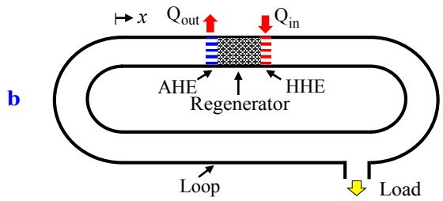  
Figure 2. Examples of thermoacoustic devices. (a) A loaded standing-wave thermoacoustic engine employing a stack. (b) A loaded travelling-wave thermoacoustic engine employing a regenerator. HHE and AHE are the hot heat exchanger and the ambient heat exchanger.

## 2.2 Classification of multi-physics coupling

Generally, three distinctively different types of multi-physics coupling exist in thermoacoustic devices: thermal-acoustic coupling, acoustic-mechanical coupling and mechanical-electric coupling.

As seen in Table 1, thermal-acoustic coupling, also known as the ³thermoacoustic effect´ in the literature [3], concerns the coupling between temperature and acoustic fields in thermoacoustic cores. In this process, heat is converted into sound or vice versa depending on the magnitude of the temperature gradient and the local acoustic field. Acoustic-mechanical coupling deals with the coupling between TAEs and external loads, which converts the high-amplitude acoustic waves inside TAEs into mechanical vibration of external loads. Mechanical-electric coupling in thermoacoustic devices relates to energy conversion from mechanical vibration to electricity. Appropriate mechanical-electric transduction mechanisms and external electric circuits are exploited in this process.

Table 1. Multi-physics coupling in thermoacoustic devices.
<table><tr><td>Multi-physics coupling</td><td>Fields</td><td>Energy forms</td><td>Occasions</td></tr><tr><td>Thermal-acoustic coupling</td><td>Temperature and acoustic</td><td>Heat to sound or sound pumps heat</td><td>TAEs</td></tr><tr><td>Acoustic-mechanical coupling</td><td>Acoustic and mechanical</td><td>Sound to mechanical vibration</td><td>TAEs and loads</td></tr><tr><td>Mechanical-electric coupling</td><td>Mechanical and electric</td><td>Mechanical vibration to electricity</td><td>Transducers</td></tr></table>

## 3. Thermal-acoustic coupling

This section first discusses the principles of thermal-acoustic coupling in standing-wave and travellingwave TAEs. Following that, linear theory is introduced to quantify this coupling effect. Subsequently, nonlinear phenomena in thermoacoustic devices are presented. Thereafter, methods to improve the TAE performance from a thermal-acoustic coupling viewpoint are introduced.

## 3.1 Basic principles

From a thermodynamic perspective, TAEs rely on engine cycles to generate sound from heat. Different from traditional heat engines, such as Stirling engines, the time interval of each engine cycle in TAEs is decided by the natural frequency of the system itself, and the thermodynamic processes in each engine cycle are affected by the thermoacoustic core and local acoustic field.

Figure 3 illustrates the principle of sound generation in a thermoacoustic stack in a standing wave. Attention is focused on a particular gas parcel that exchanges heat with the solid in the vicinity and does work on the adjacent gas parcel as it moves. Assume the gas parcel oscillates in the longitudinal direction $x$ between the stack plates which have a temperature gradient $\nabla T _ { s o l i d }$ . Suppose the acoustic boundary conditions at the resonator ends impose a standing wave in the resonator as shown in Figure $3 ( \mathrm { a } )$ , where the pressure $p$ and displacement x are in opposite phase whereas displacement x leads the velocity u by $9 0 ^ { \circ }$ . Figure 3(b) shows the variations of gas parcel temperature $T _ { g a s }$ (red line) considering heat conduction, oscillating temperature $T _ { i s e n }$ during an isentropic process, and adjacent solid surface temperature $T _ { s o l i d }$ due to motion of the gas parcel in an acoustic cycle. Since the heat transfer between the gas parcel and solid is imperfect $( \mathrm { i } . \mathrm { e } . , r _ { h } \geq \delta _ { k } )$ , the peaks of $T _ { g a s }$ (highlighted dots) lag behind those of $T _ { s o l i d . }$ As a result, as shown in Figure 3(c), $T _ { g a s }$ increases as x (the location of the gas parcel along the x axis) first decreases, reaching a peak value shortly after x becomes minimum. Similarly, $T _ { g a s }$ decreases as x first increases, reaching another peak value shortly after x reaches maximum. As a result, $T _ { g a s }$ varies in a clock-wise direction and forms an ellipse after the gas parcel finishes one thermodynamic cycle. In the $p { - } \nu$ (v being the specific volume) diagram in Figure 3(d), dashed lines represent isentropic lines at different temperatures. $T _ { g a s }$ increases as $p$ first increases, peaking at $T _ { g a s , \operatorname* { m a x } }$ shortly after $p$ becomes maximum. Likewise, $T _ { g a s }$ decreases as $p$ first decreases, peaking at $T _ { g a s , \mathrm { { m i n } } }$ shortly after $p$ becomes minimum. The area of the ellipse in the $p { - } \nu$ diagram denotes the net work done on the adjacent gas parcel. In the $T { - } s$ (s being the specific entropy) diagram in Figure 3(e), dashed lines represent isobaric lines at different pressures. Consistent with Figure 3(d), $T _ { g a s }$ reaches a maximum shortly after p becomes maximum and reaches a minimum shortly after p becomes minimum. The area of the ellipse in the $T { - } s$ diagram denotes the net heat absorbed from the solid. Its value should be equal to the net work in the $p { - } \nu$ diagram according to the first law of thermodynamics.

Figure 4 illustrates the principle of sound generation in a thermoacoustic regenerator in a travelling wave. Consider a travelling wave propagating to the right in the longitudinal direction through a regenerator with a temperature gradient $\nabla T _ { s o l i d }$ . The viscosity of the working gas is neglected. As shown in Figure $4 ( \mathrm { a } ) _ { \cdot }$ , in a travelling wave, pressure $p$ and velocity u are in phase whereas displacement x leads pressure $p$ by $9 0 ^ { \circ }$ . Unlike the stack, the regenerator has a much smaller hydraulic radius, ensuring near-perfect heat transfer between the gas and solid material. As a result, $T _ { g a s }$ is always nearly the same as $T _ { s o l i d }$ . When $\nabla T _ { s o l i d } > 0 , T _ { g a s }$ has the same trend as x as shown in Figure 4(b). In the

Cartesian coordinate in Figure 4(c), $T _ { g a s }$ is identical to $T _ { s o l i d }$ in response to the travelling wave due to perfect heat transfer $( \mathrm { i } . \mathsf { e } . , r _ { h } < \delta _ { k } )$ . It is interesting to notice from Figure 4(a) and Figure 4(b) that, in the first half period, $T _ { g a s }$ increases while $p$ first increases then decreases; in the second half period, $T _ { g a s }$ decreases while p first decreases then increases. Such variations are consistent with the $p { - } \nu$ and T-s diagrams shown in Figure 4(d) and Figure 4(e), respectively. The clock-wise trajectories in both $p { - } \nu$ and T-s diagrams indicate that the gas parcel is working in an engine mode, absorbing net heat from the regenerator and doing net work on the gas parcel next to it.

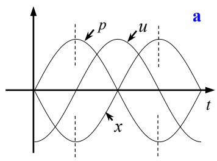

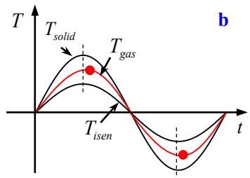

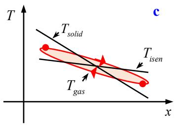

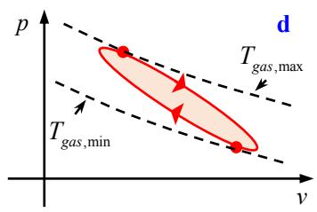

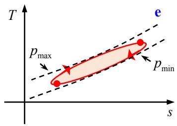  
Figure 3. Principle of sound generation in a thermoacoustic stack in a standing wave. (a) Features of a standing wave. (b) Temperature oscillations versus time. (c) Temperature oscillations versus x. (d) p-v diagram. (e) $T { - } s$ diagram.

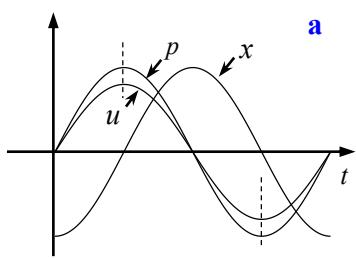

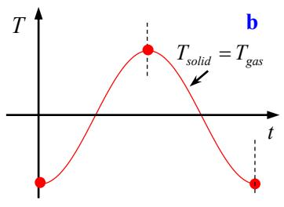

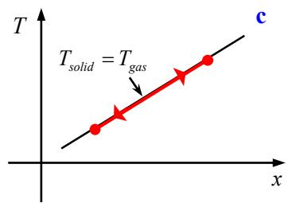

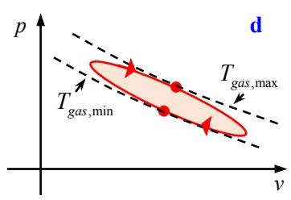

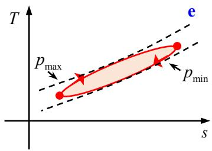  
Figure 4. Principle of sound generation in a thermoacoustic regenerator in a right-running travelling wave. (a) Features of a travelling wave. (b) Temperature oscillations versus time. (c) Temperature oscillations versus x. (d) p-v diagram. (e) T-s diagram.

## 3.2 Linear thermoacoustics

Linear thermoacoustics is often referred to as the linear theory. In 1896, Rayleigh [1] first gave a qualitative explanation of the thermoacoustic effect: thermoacoustic oscillations are maintained when the phase between pressure oscillations and heat release is appropriate. Ra\leigh¶s criterion still holds as the basic principle of self-excited thermoacoustic oscillations in engine and combustion systems [34- 36]. In the 1970s, Rott conducted a series of pioneering works on the stability limit of thermally-induced acoustic oscillations by quantifying the energy flows within the boundary layers [37-42]. The linear theory developed in his studies is applicable to basic experiments with both thermoacoustic engines and refrigerators. Inspired by the work of Rott, Swift [8] from the Los Alamos National Laboratory derived another total-power equation and incorporated it into the linear theory. The theoretical work of Rott and Swift forms the linear thermoacoustic theory we use today.

## 3.2.1 Linear thermoacoustic equations

The key outcome of linear thermoacoustic theory is the derivation of two types of equations. One is the inhomogeneous wave equation for acoustic pressure in the presence of a temperature gradient, viscosity and heat conduction. The other type involves energy equations that describe the energy flows arising from the coupling between temperature and acoustic fields.

The derivation of the thermoacoustic wave equation starts from Rott¶s acoustic appro[imation [43], where every oscillating variable can be expressed as a combination of the mean and time-dependent fluctuating values, so that

$$
\begin{array} { r l } & { \left\{ p ( x , t ) = p _ { _ m } + \Re [ p _ { 1 } ( x ) e ^ { j \omega t } ] \right. } \\ & { \left. \begin{array} { r } { u ( x , y , t ) = \Re [ u _ { 1 } ( x , y ) e ^ { j \omega t } ] } \\ { T ( x , y , t ) = T _ { _ m } ( x ) + \Re [ T _ { 1 } ( x , y ) e ^ { j \omega t } ] } \\ { \rho , s , T _ { s o l i d } = \mathrm { s i m i l a r } \mathrm { t o } T } \end{array} \right. } \end{array}\tag{1}
$$

where subscripts m and 1 denote the mean value and first-order fluctuation. $\rho$ is the fluid density. ƒ[ ] represents the real part of a complex quantity and $e ^ { j { \omega } t }$ denotes harmonic time dependence at angular frequency $\omega .$ Substituting these variables into the nonlinear governing equations of fluid mechanics in Eulerian coordinates, Swift [8] derived the perturbed, linearized form of continuity and momentum equations, i.e.,

$$
\begin{array} { l } { \displaystyle \frac { d U _ { 1 } } { d x } = - \Bigg ( 1 + \frac { \gamma - 1 } { 1 + \varepsilon _ { s } } f _ { k } \Bigg ) \frac { j \omega A } { \gamma p _ { m } } p _ { 1 } + \frac { f _ { k } - f _ { \nu } } { ( 1 - \sigma ) \left( 1 + \varepsilon _ { s } \right) \left( 1 - f _ { \nu } \right) } \frac { 1 } { T _ { m } } \frac { d T _ { m } } { d x } U _ { 1 } } \\ { \displaystyle \qquad = - \Bigg ( j \omega c + \frac { 1 } { r _ { k } } \Bigg ) p _ { 1 } + g U _ { 1 } } \end{array}\tag{2}
$$

$$
\frac { d p _ { 1 } } { d x } = - \frac { j \omega \rho _ { m } } { ( 1 - f _ { \nu } ) A } U _ { 1 } = - \big ( j \omega l + r _ { \nu } \big ) U _ { 1 }\tag{3}
$$

where

$$
\begin{array}{c} \{ l = \frac { \rho _ { m } } { A } \frac { 1 - \Re [ f _ { \mathrm { v } } ] } { | 1 - f _ { \mathrm { v } } | ^ { 2 } } ; \ r _ { \mathrm { v } } = \frac { \omega \rho _ { m } } { A } \frac { \Im [ - f _ { \mathrm { v } } ] } { | 1 - f _ { \mathrm { v } } | ^ { 2 } }   \\ { c = \frac { A } { \gamma p _ { m } } \big ( 1 + \big ( \gamma - 1 \big ) \Re \Big [ f _ { \mathrm { k } } / ( 1 + \varepsilon _ { s } ) \Big ] \big ) ; \ \frac { 1 } { r _ { k } } = \frac { \gamma - 1 } { \gamma } \frac { \omega A \Im \Big [ - f _ { \mathrm { k } } / ( 1 + \varepsilon _ { s } ) \Big ] } { p _ { m } } } \\ { g = \frac { f _ { \mathrm { k } } - f _ { \mathrm { v } } } { \big ( 1 - f _ { \mathrm { v } } \big ) \big ( 1 - \sigma \big ) \big ( 1 + \varepsilon _ { s } \big ) } \frac { 1 } { T _ { m } } \frac { d T _ { m } } { d x } } \end{array}\tag{4}
$$

In the above, $U _ { 1 }$ is the volume velocity, A is the cross-sectional area, Ȗ and $\sigma$ denote the specific heat ratio and Prandtl number, and $\varepsilon _ { s }$ is a quantity describing the effect of heat capacity of the solid on the heat transfer at the fluid-solid interfaces [3]. fv andfk are the thermo-viscous functions [44] implying the effect of viscosity and heat conduction on the working fluid. $l , r _ { \nu } , c , 1 / r _ { k }$ and g represent the acoustic inertance per unit length, viscous resistance per unit length, acoustic compliance per unit length, thermal-relaxation resistance per unit length and complex gain/attenuation constant due to a non-zero temperature gradient, respectively. ‚[ ] represents the imaginary part of a complex quantity. Combining Equations (2) and (3) and eliminating $U _ { 1 ; }$ , yields the second-order differential equation:

$$
\left( 1 + \frac { \gamma - 1 } { 1 + \varepsilon _ { s } } f _ { k } \right) p _ { 1 } + \frac { \gamma p _ { m } } { \omega ^ { 2 } } \frac { d } { d x } \left( \frac { 1 - f _ { \nu } } { \rho _ { m } } \frac { d p _ { 1 } } { d x } \right) - \frac { a ^ { 2 } } { \omega ^ { 2 } } \frac { f _ { k } - f _ { \nu } } { \left( 1 - \sigma \right) \left( 1 + \varepsilon _ { s } \right) } \frac { 1 } { T _ { m } } \frac { d T _ { m } } { d x } \frac { d p _ { 1 } } { d x } = 0\tag{5}
$$

where a is the speed of sound. Equation (5) is the inhomogeneous wave equation in thermoacoustics. It is strictly a Helmholtz equation, the solution of which lays the foundation for next-step numerical computations, such as the eigenvalue calculations in Section 3.2.2.

The derivation of the thermoacoustic energy equations begins with time averaging the nonlinear energy conservation equation in fluid mechanics, i.e.,

$$
0 = \overline { { \frac { \hat { \sigma } } { \partial t } \Bigg ( \rho \bigg ( e + \frac { 1 } { 2 } u _ { j } u _ { j } \bigg ) \Bigg ) } } = - \frac { \hat { \sigma } } { \hat { \sigma } x _ { i } } \overline { { \Bigg ( \rho u _ { i } \bigg ( h + \frac { 1 } { 2 } u _ { j } u _ { j } \bigg ) - u _ { j } \tau _ { i j } - \kappa \frac { \hat { \sigma } T } { \hat { \sigma } x _ { i } } \Bigg ) } } = \frac { \hat { \sigma } \overline { { \hat { \mathbf { e } } _ { i } } } } { \hat { \sigma } x _ { i } }\tag{6}
$$

where the overbar $^ { c c } - ^ { , s , }$ stands for time averaging, e is the specific internal energy, $h = e + p \ d s / \rho$ is the specific enthalpy, $\tau _ { i j }$ is the viscous stress tensor and ț is the thermal conductivity of the fluid. $\dot { \mathbf { e } } _ { i } = \rho u _ { i } \left( h + u _ { j } u _ { j } \mathbf { \nabla } / \ 2 \right) - u _ { j } \tau _ { i j } - \kappa \hat { \mathbf { \nabla } } T \operatorname { / } \hat { \partial } x _ { i }$ denotes the total energy flux. An order-of-magnitude analysis [8] indicates that the time-averaged total energy flux in the x direction is dominated by the enthalpy term (ȡuih), while in the y direction, the heat conduction term $\left( - \kappa \hat { o } T / \hat { o } x _ { i } \right)$ prevails. Hence,

$$
\left\{ \begin{array} { l l } { \displaystyle { \overline { { \dot { e } } } _ { x } \approx \rho _ { m } \int h ( t ) u ( t ) d t } } \\ { \displaystyle { \overline { { \dot { e } } } _ { y } \approx - \kappa \frac { \partial T _ { m } } { \partial y } \Bigg | _ { \mathrm { i n t e r f a c e } } } } \end{array} \right.\tag{7}
$$

By integrating $\overline { { \dot { e } } } _ { x }$ over the cross-section and taking $d h = T d s + d p / \rho$ , the total power $H _ { x }$ in the x direction can be written as

$$
H _ { x } = \frac { 1 } { 2 } \rho _ { m } \Re [ h _ { 1 } \tilde { U _ { 1 } } ] = \frac { 1 } { 2 } \Re [ p _ { 1 } \tilde { U _ { 1 } } ] + \frac { 1 } { 2 } \rho _ { m } T _ { m } \Re [ s _ { 1 } \tilde { U _ { 1 } } ] = W _ { x } + Q _ { x }\tag{8}
$$

where the tilde $\sim$ stands for the comple[ conjugate. $W _ { x }$ and $Q _ { x }$ are the time-averaged work flow and heat flow in the x direction. The expressions for $H _ { x }$ and $W _ { x }$ as a function of $\dot { p } _ { 1 }$ and $U _ { 1 }$ are further derived by Swift [8] and written as

$$
H _ { x } = \frac { 1 } { 2 } \Re { \left[ p _ { 1 } \tilde { U } _ { 1 } \left( 1 - \frac { f _ { k } - \tilde { f } _ { \nu } } { \big ( 1 + \sigma \big ) \big ( 1 - \tilde { f } _ { \nu } \big ) } \right) \right] } + \frac { \rho _ { m } c _ { p } \left| U _ { 1 } \right| ^ { 2 } } { 2 \varDelta \omega \big ( 1 - \sigma ^ { 2 } \big ) \left| 1 - f _ { \nu } \right| ^ { 2 } } \Im \Big [ f _ { k } + \sigma \tilde { f } _ { \nu } \Big ] \frac { d T _ { m } } { d x } = 0 ,\tag{9}
$$

$$
{ \cal W } _ { x } = \int \Biggl ( { - \frac { r _ { \nu } } { 2 } { \left| U _ { 1 } \right| } ^ { 2 } - \frac { 1 } { 2 r _ { k } } { \left| p _ { 1 } \right| } ^ { 2 } + \frac { 1 } { 2 } \Re [ g \tilde { p } _ { 1 } U _ { 1 } ] } \Biggr ) d x\tag{10}
$$

where $c _ { p }$ is the specific heat at constant pressure. Equations (8)-(10) are the energy equations in thermoacoustics. They can be used to calculate the energy flows in thermoacoustic components, such as ducts, heat exchangers, stack and regenerator.

For example, Figure 5 illustrates the hypothetical energy flows across a thermoacoustic stack in a standing wave and a regenerator in a right-running travelling wave in the linear regime. Note that the temperature difference between the fluid (mean) temperature $T _ { m , g a s }$ and solid temperature $T _ { s o l i d }$ in the heat exchangers, stack, and parts of the ducts (adjoining the heat exchangers) is taken into account. Suppose the acoustic variables $( p _ { 1 } , U _ { 1 } , T _ { m } , { \mathrm { e t c . } } )$ are continuous at the interfaces between two adjacent thermoacoustic components: any ³discontinuit\´ [45] of order of the gas displacement is neglected. The heat exchangers are assumed to be in contact (no gas gaps) with the stack or regenerator.

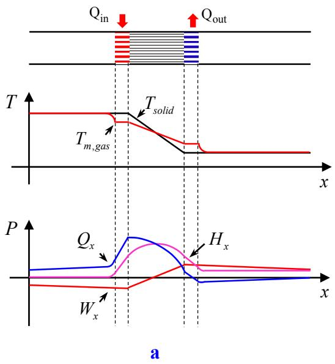

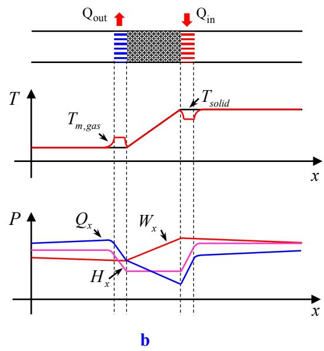  
Figure 5. Energy flows across (a) a thermoacoustic stack in a standing wave and (b) a thermoacoustic regenerator in a right-running travelling wave.

## 3.2.2 Linear thermoacoustic instability

The linear theor\ in Rott and Swift¶s framework provides a useful tool to analyse the stability of thermoacoustic devices. Thermoacoustic instability occurs when the temperature difference across the thermoacoustic core exceeds a critical value. The stability analysis is important since it predicts the onset temperature at which the system becomes unstable, and thereby the category of heat source a thermoacoustic device can utilize. Generally, the onset temperature can be obtained theoretically in two different ways which are summarized as follows.

First introduced is the energy-based approach by means of the quality factor Q [46-51], which is defined by

$$
1 / Q = E / \omega E _ { s T }\tag{11}
$$

where

$$
\left\{ \begin{array} { l l } { \displaystyle E = - W _ { _ { x } } = - \int \Biggl ( - \frac { r _ { _ \nu } } { 2 } \bigl \vert U _ { 1 } \bigr \vert ^ { 2 } - \frac { 1 } { 2 r _ { _ k } } \bigl \vert p _ { 1 } \bigr \vert ^ { 2 } + \frac { 1 } { 2 } \Re \bigl [ g \tilde { p } _ { 1 } U _ { _ { 1 } } \bigr ] \Biggr ) d x } \\ { \displaystyle E _ { _ { S T } } = \int \Biggl ( \frac { p ^ { 2 } } { 4 \rho _ { _ m } a ^ { 2 } } + \frac { \rho _ { _ m } u ^ { 2 } } { 4 } \Biggr ) d V } \end{array} \right.\tag{12}
$$

are the net acoustic power output and acoustic energy stored in the entire system. As the temperature ratio increases, the positive acoustic power produced in the stack starts to balance the negative acoustic power dissipated in the rest of the system. As a consequence, $1 / Q$ changes from positive to negative as shown in Figure 6(a) in Ref.[46]. The onset temperature difference is determined when $1 / Q = 0$

The second approach is to solve an eigenvalue problem through network topology. The basic idea is to discretize the thermoacoustic components into segments along the axis of the device, assuming uniform thermophysical properties in each segment. Based on the network topology, the acoustic pressure $p _ { 1 }$ and volume velocity $U _ { 1 }$ at two ends of the waveguide can be related by a total transfer matrix $\mathbf { R } _ { \mathrm { T } }$ , i.e.,

$$
\left[ { \begin{array} { c } { p _ { \mathrm { 1 } } ( L ) } \\ { U _ { \mathrm { 1 } } ( L ) } \end{array} } \right] = \mathbf { R } _ { \mathrm { T } } \left[ { \begin{array} { c } { p _ { \mathrm { 1 } } ( 0 ) } \\ { U _ { \mathrm { 1 } } ( 0 ) } \end{array} } \right]\tag{13}
$$

$\mathbf { R } _ { \mathrm { T } }$ is the product of the transfer matrices of the segments and can be derived by finding solutions for $p _ { 1 }$ and $U _ { 1 }$ from the wave and momentum equations [52-56]. By imposing the relevant acoustic boundary conditions at these two positions, one finds the characteristic equations

$$
\left\{ \begin{array} { l } { { \displaystyle Z _ { L } = \frac { R _ { T 1 1 } Z _ { 0 } + R _ { T 1 2 } } { R _ { T 2 1 } Z _ { 0 } + R _ { T 2 2 } } , ~ \mathrm { A c o u s t i c } \mathrm { r e s o n a t o r } } } \\ { { \displaystyle \mathrm { d e t } \big [ { \bf R } _ { \mathrm { T } } - { \bf I } \big ] = 0 , ~ \mathrm { L o o p e d } \mathrm { t u b e } } } \end{array} \right.\tag{14}
$$

where $Z _ { L }$ and $Z _ { 0 }$ are acoustic impedances at the ends. $R _ { T 1 1 } , R _ { T 1 2 } , R _ { T 2 1 }$ and $R _ { T 2 2 }$ are the four elements of the $2 \times 2$ matrix $\mathbf { R } _ { \mathbf { T } }$ . det[ ] stands for the determinant of a matrix and I is the identity matrix. Solving the characteristic equations yields the complex frequency $\omega = \omega _ { R } + j \omega _ { I }$ as a function of $T _ { h }$ as shown in Figure 6(b) in Ref. [52], where $\omega _ { R }$ is the oscillation frequency while $\omega _ { I }$ denotes the growth/attenuation rate. The onset temperature and frequency are obtained when $\omega _ { I }$ is zero.

Apart from the transfer matrix method, the root locus method [57, 58] and Nyquist stability criterion [59-61], rooted in control theory, have also proved to be useful in obtaining the eigenfrequencies from the characteristic equations. In the root locus method [58], the loci of the roots of the characteristic equation are plotted for different temperature ratios in the complex s-plane. Onset values of frequency and temperature ratio are obtained when the loci cross the imaginary axis. In the Nyquist stability analysis [60], the µµN\quist plot´ of the open-loop transfer function (OLTF) is inspected: the real axis of the s-plane is mapped by the OLTF to the G(s)-plane. For every eigenfrequency $\omega _ { n } .$ , the critical point is when $G ( s ) = - 1$

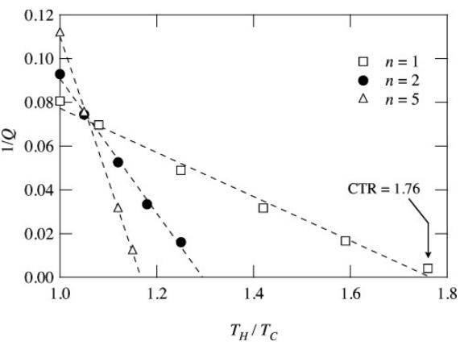  
a

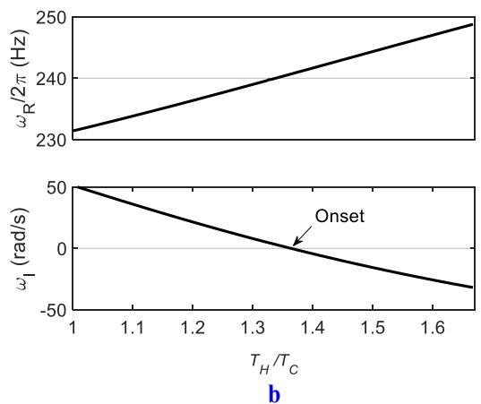  
Figure 6. Stability analysis. (a) 1/Q versus temperature ratio [50]. (b) Complex frequency versus temperature ratio [52].

## 3.3 Nonlinear thermoacoustics

Linear thermoacoustic theory is in essence a frequency-domain analytical tool useful for studying thermal-acoustic coupling in the linear regime. As the pressure amplitude increases, nonlinearity arises. Substantial deviations may occur when the thermoacoustic devices fall into the high-amplitude regime where the acoustic pressure amplitude is greater than 10% of the mean pressure according to Swift [62]. This section discusses the rich nonlinear phenomena that are frequently encountered in thermoacoustic devices.

## 3.3.1 Nonlinear acoustic phenomena

Limit cycling: the most obvious nonlinear effect in a thermoacoustic device is the existence of limit cycles. Limit cycling occurs since nonlinearity enhances dissipation at large amplitudes. As seen in Figure 7(a), the evolution of acoustic pressure after onset can be divided into three stages: (i) initial build-up, (ii) saturation and (iii) limit cycles [63]. The relationship between the generation and dissipation of acoustic power is depicted in Figure 7(b). The amplitude of limit-cycle oscillations is important since it determines the magnitude of the acoustic power generated. Efforts made to predict limit-cycle amplitudes in the literature are summarized into two categories: simplified nonlinear modelling (SNM) and computational fluid dynamics (CFD). Simplified nonlinear modelling (SNM) begins by simplifying the nonlinear governing equations in fluid mechanics correct to second or higher orders in the perturbation variables. Combined with specified initial and boundary conditions, the simplified governing equations are closed and solved by suitable numerical schemes. Theoretical studies of limit cycling in TAEs using SNM were reported by Prosperetti [64-68]. Computation fluid dynamics (CFD) is another effective method of studying the nonlinear saturation process. Numerical simulations of limit cycling in TAEs using CFD techniques have been reported in the literature [69-74].

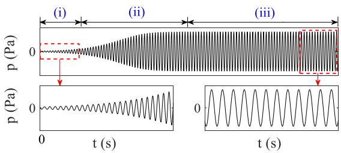

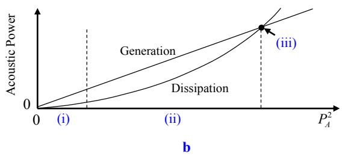  
Figure 7. Self-excited pressure oscillations above onset [63]. (a) Evolution of acoustic pressure into limit cycles. (b) Relationship between the generation and dissipation of acoustic power.

Harmonics: harmonic components in the frequency domain are often observed when the TAE is operating with high pressure amplitudes. As shown in Figure 8, distortion of sinusoidal waves in the time domain occurs as a result of nonlinear excitation of harmonic modes. In such a case, acoustic energy cascades from the fundamental mode to higher resonant modes. Swift [62] noticed in experiments that the pressure amplitude at twice the fundamental frequency was 1/3 of the amplitude of the fundamental at the highest powers in a large standing-wave TAE. The harmonic component carried a significant amount of heat along the stack, making the device less efficient. Apart from harmonic distortions in pressure waves, Gusev [75] and Marx [76] also observed the generation of thermal wave harmonics in the hydrodynamic heat transport. It was found that the amplitude of the second harmonic of the temperature oscillations was comparable to that of the fundamental frequency. At small amplitudes, the higher harmonic component contributes fourth-order corrections to the secondorder power and its influence is negligible. However, at extremely high amplitudes, the harmonic oscillations can produce higher thermal/viscous losses than the fundamental mode and limit the amplitude of the fundamental. Methods to suppression harmonics include putting specially constructed inserts near the velocity antinodes of the harmonic mode [77] and using anharmonic tubes such as tapered resonators [78, 79].

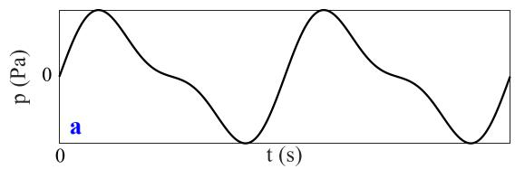

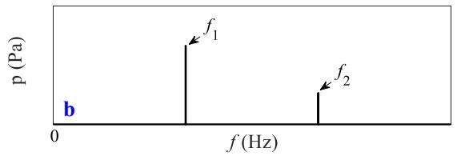  
Figure 8. Example of harmonic distortion in acoustic pressure. (a) Time history. (b) FFT analysis.

Shock waves: periodic shock waves show up when harmonics are not suppressed, but instead grow and interact with each other. Biwa [80-82] provided experimental evidences of thermoacoustic shock waves in both standing- and travelling-wave TAEs. As shown in Figure 9, inside a looped-type TAE employing a stack at a temperature gradient of 12,650 K/m, shock fronts with discontinuities of about 2 kPa were evident and propagated around the loop at the speed of sound (340 m/s) [81]. The authors further noticed that shock waves were more easily excited in a looped tube than an acoustic resonator. Use of a resonator with a non-uniform cross-section and the addition of side-branch Helmholtz resonators were thought to be useful methods to prevent shock formation. Following Biwa¶s studies, Oliver [83], Gupta [84] and Qu [85] undertook theoretical and numerical work on the wave steepening process leading to shock wave formation. Their research deepened understanding of the nonlinear energy cascade process inside TAEs when steep temperature gradients are applied.

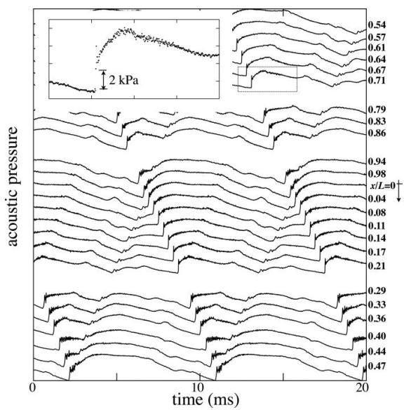  
Figure 9. Spatial and temporal evolution of shock-wave formation in a looped-type TAE [81].

## 3.3.2 Nonlinear hydrodynamic phenomena

Minor losses: among many nonlinear effects in the oscillating flow field, minor losses [86] due to abrupt changes in the cross-section or unions of waveguides (e.g., T-junctions) are most frequently encountered and investigated. As shown in Figure 10, the sudden decrease of cross-sectional area in the stack region in a standing-wave TAE can induce vortex shedding at the stack ends [87-90]. These vortices carry away momentum of the oscillatory flow and dissipate into small eddies. What¶s more, it is found that the secondary flow caused by vortex shedding leads to nonlinear heat leaks at the stack ends [91, 92]. In most cases, abrupt changes in the cross section bring about major viscous and thermal losses at high amplitudes and should be avoided. However, under some circumstances, they could be beneficial. For instance, jet pumps [93-95] take advantage of the pressure drop that arises from minor losses to eliminate the harmful Gedeon streaming in looped-type TAEs.

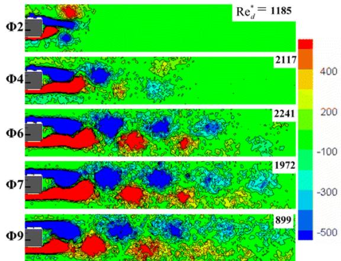  
Figure 10. Vortex shedding at the stack ends [87].

Mass streaming: at large amplitudes, there exists time-averaged, second-order, nonzero mass flow superimposed on the first-order oscillations in TAEs, a phenomenon usually called mass streaming in thermoacoustics [96]. The main types of mass streaming are illustrated in Figure 11. As seen Figure 11(a), Gedeon streaming [97] often happens in looped-type TAEs, removing heat from the hot heat exchangers into the thermal buffer tube, thus reducing the achievable temperature gradient. Since Gedeon streaming is generally unfavourable in TAEs, efforts have been made to suppress such mean circulation. Apart from jet pumps, membranes [98] and tapered tubes [99] have been adopted to achieve this purpose. Rayleigh streaming in Figure 11(b) is a near-wall mean circulation confined within the viscous and thermal boundary layers in which the gas parcel will experience a different displacement during its upward and downward motions. After a full cycle, a net drift that contributes to nonzero mass flux is formed. The jet-driven streaming [96] in Figure 11(c) arises from the blowing and suction processes of oscillatory flow through, for example, an orifice in a tube where the cross-section contracts or expands suddenly. Mass streaming within a regenerator or stack in Figure 11(d) occurs due to the inhomogeneity caused by the temperature gradient. It has rarely been reported but is considered harmful for the operation of thermoacoustic devices [100].

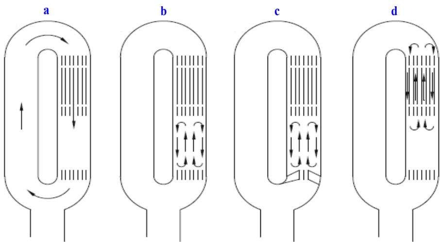  
Figure 11. Types of mass streaming in TAEs [8]. (a) Gedeon streaming. (b) Rayleigh streaming. (c) Jet-driven streaming. (d) Streaming within a regenerator or stack.

Onset of turbulence: transition from laminar flow to turbulence in a circular pipe takes place when the velocity of the oscillatory flow inside is large enough. The onset of turbulence is undesirable in TAEs since it dissipates acoustic power into useless heat at the wall surfaces. Merkli and Iguchi [101, 102] observed the transition to turbulent flow when the local Reynolds number $R e _ { \delta }$ was around 400. To deepen the understanding of the onset process, Feldmann [103] performed direct numerical simulations of fully-developed turbulent oscillatory flows in a circular pipe when $R e _ { \delta }$ is 623. Figure 12(a) presents the time series of the axial velocity at four different radial locations, one located near the pipe centreline at $r = 0 . 0 1$ , one located close to the pipe wall at $r = 0 . 4 9$ and two others in between. The flow is laminar when the velocity reaches a maximum. During the deceleration phase after the velocity peak, fluctuations occur, being strongest close to the wall and weakest near the pipe centreline. These fluctuations correspond to turbulence bursts as depicted by the complicated near-wall structures at time instants $t _ { 2 }$ and t3 in Figures 12(b) and (c).

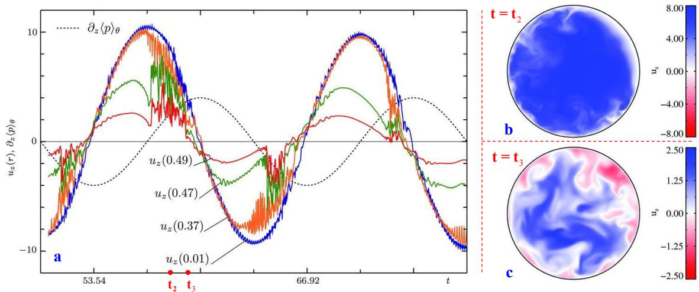  
Figure 12. Onset of turbulence in a circular pipe [103]. (a) Time series of axial velocity at different radial locations. (b) Axial velocity contour at t2. (c) Axial velocity contour at $t _ { 3 } .$

## 3.3.3 Nonlinear dynamic responses

Bistability and triggering: like many nonlinear dynamical systems, TAEs exhibits nonlinearities in the dynamic response to a specific control parameter. Qiu et al. [104] reported a so-called ³hysteresis loop´ in the steady-state response of a travelling-wave TAE as a function of the heating temperature in their experimental study. As shown in Figure 13, in the forward path, the heating temperature increases. Acoustic oscillations are initiated from a static steady state (quiescence) to a dynamic steady state (limit cycles) as the heating temperature reaches the onset value (around $2 2 0 ~ ^ { \circ } \mathrm { C }$ in the figure). In the reverse path, the heating temperature decreases. Surprisingly, the dynamic steady state can still be maintained when the heating temperature is decreased from above onset to slightly below onset, until the so-called ³damping temperature´ (around $1 7 0 ~ ^ { \circ } \mathrm { C }$ in the figure) is reached. Thus, the TAE is ³bistable´ between the damping and onset temperatures [105-109]. They also noticed that, at a temperature between the onset and damping temperatures, an external pressure disturbance can initiate thermoacoustic oscillations. Thus, it is possible to widen the operational temperature range of a TAE through ³triggering´ at the cost of an external pressure disturbance. The triggering phenomenon was also observed in other thermoacoustic systems, such as Rijke tubes [110-112].

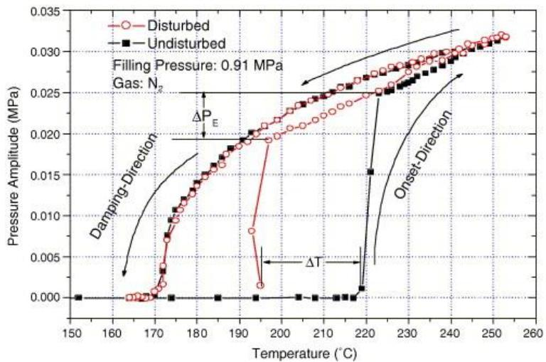  
Figure 13. Bistability and triggering in a travelling-wave TAE [104].

Onset of chaos: another type of nonlinear dynamic behaviour reported in the literature is the onset of chaos [113-115]. Yazaki [114] first observed chaotic dynamics in spontaneous oscillations produced by steep temperature gradients in standing-wave TAEs. Figure 14 displays the pattern of deterministic chaos in his study and its power spectrum. It is found that clearly defined stable modes with incommensurate frequencies were excited simultaneously, and the competition between them resulted in chaotic motion near the overlapping regions of the stability curves. The experimental data was further analysed by theories of nonlinear dynamics. Fundamental quantities of indicators such as Lyapunov exponents, Kolmogorov entropy and the fractal dimension of the attractor were evaluated to characterize the chaotic behaviour.

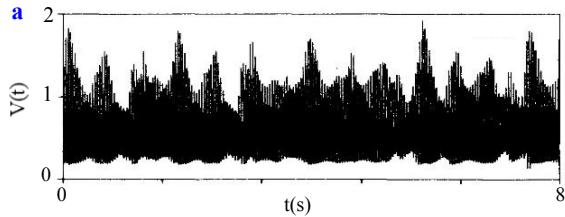

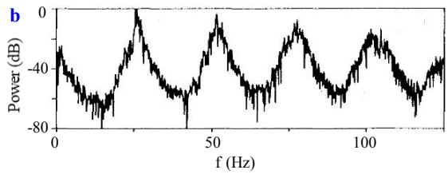  
Figure 14. Chaotic oscillations observed by Yazaki [114]. (a) Time series. (b) Power spectrum.

## 3.3.4 Nonlinear thermoacoustic amplification

Overshoot: when the TAE is heated at a fixed heat input, the pressure amplitude exhibits an overshoot after exponential growth and stabilizes thereafter. Figure 15(a) displays the pressure amplitude amplification processes in an annular TAE when different heat inputs are supplied [116]. The overshoot is more distinguishable at larger heat inputs.

Double-threshold effect: Penelet [117] observed the ³double-threshold´ effect in an annular TAE operating at a temperature difference above onset. As shown in Figure 15(b), a first exponential growth of acoustic oscillations is followed by an intermediate quasi-stabilization regime (with amplitude slowly growing in time), which is followed by another exponential growth. The double-threshold effect becomes less distinguishable when the temperature difference increases.

Period surging and quenching: under certain circumstances, the pressure amplitude in a travelling-wave TAE experiences a sudden increase followed by a gradual decay and a sudden extinction, as shown in Figure 15(c). This behaviour repeats, leading to ³periodic surging and quenching´ [118]. Similar behaviour was reported in other experiments [119-121].

Fishbone instability: Yu [119] reported the ³fishbone instabilit\´ in a travelling-wave TAE as shown in Figure 15(d). The pressure amplitude grows and decays periodically, forming a fishbone pattern. Compared with periodic surging and quenching, there is no sudden increase/extinction of pressure oscillations in the fishbone instability phenomenon.

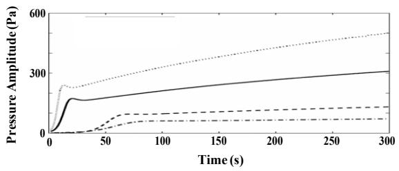  
a

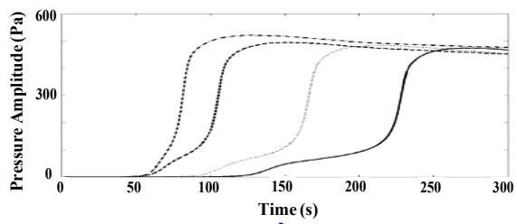

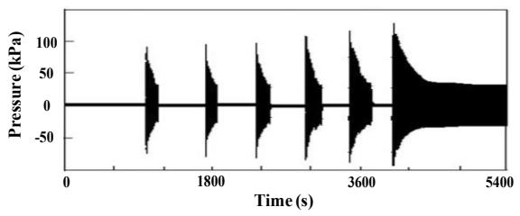  
c

b  
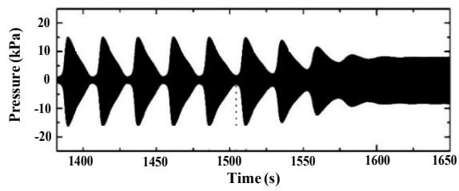  
d  
Figure 15. Nonlinear thermoacoustic amplifications in TAEs. (a) Overshoot of amplitude growth [116]. (b) Double-threshold effect [117]. (c) Periodic surging and quenching [118]. (d) Fishbone instability [119].

In summary, although the above-mentioned nonlinear thermoacoustic amplifications have been observed in many experiments, theoretical/numerical explanations of these phenomena are still lacking at present. The underlying physics behind nonlinear amplification is complicated. Acoustically enhanced heat transport (AEHT) at large pressure amplitudes is believed to be the main contributor since it alters the temperature profile across the thermoacoustic core [119]. In addition, mass streaming that transports heat within the thermoacoustic core is thought to be the second factor affecting the amplification process [117].

## 3.4 Discussion

This section discusses recent advances in TAEs that possess a superior performance from a thermalacoustic coupling perspective.

## 3.4.1 Multi-stage design

The multi-stage design that appears in many studies, is a useful strategy to enhance the TAE performance. Equation (12) indicates that the onset of instability occurs when the acoustic power produced in the thermoacoustic core overcomes the losses in the rest of the TAE. Thereby, inserting multiple thermoacoustic cores into one looped tube or acoustic resonator can reduce the acoustic power required in each core, and thus decrease the onset temperature.

Figure 16 gives two examples of multi-stage design in thermoacoustic devices. The multi-stage concept in standing-wave thermoacoustic systems was first tested by Swift [122] and later by Hariharan [123- 125]. In their studies, a two-stage standing-wave TAE was used to drive an orifice pulse-tube refrigerator. The onset temperature of the two-stage standing-wave TAE was smaller than that of the single stage. The multi-stage concept in travelling-wave thermoacoustic systems was first tested by de Blok [126, 127] in 2010. In his study, a novel four-stage travelling-wave TAE was proposed and obtained an onset temperature as low as $4 5 ^ { \circ } \mathrm { C } .$ Recently, Jin [15] performed experiments on multi-stage looped TAEs with asymmetric configuration. The lowest onset temperature difference obtained in the experiments was onl\ $1 7 ^ { \circ } \mathrm { C }$ (the corresponding heating temperature was $2 9 ^ { \circ } \mathrm { C } )$ , which can be achieved in both three-stage and four-stage looped TAEs, with $\mathrm { C O } _ { 2 }$ at a pressure of 1ௗMPa or 1.5ௗMPa as the working fluid. The low temperature difference shows promising prospects for utilizing industrial waste heat and solar energy.

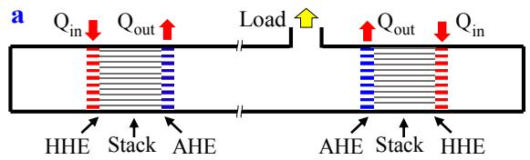

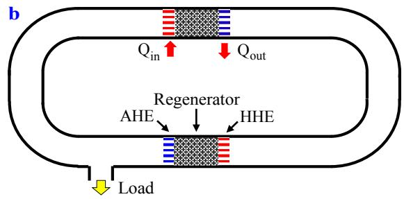  
Figure 16. Multi-stage design. (a) A two-stage standing-wave thermoacoustic system. (b) A two-stage travelling-wave thermoacoustic system.

## 3.4.2 Phase-change design

Another strategy to improve the TAE performance is to add phase-change materials such as water or ethanol to the solid surfaces of the thermoacoustic core(s). In classical thermoacoustics, heat is transferred between the working gas and solid material through conduction. In the phase-change design, most heat is transferred via phase change in the form of latent heat rather than heat conduction. In this manner, the amount of heat exchanged is effectively enhanced and the onset temperature is significantly reduced.

Research on TAEs with phase-change designs has been quite active in the last 20 years. Raspet et al. [128, 129] first carried out theoretical and experimental studies on a standing-wave TAE with a ³wet stack´. Results show that the solid-gas heat exchange is significantly increased by the vapor diffusion process, and the onset temperature difference is reduced from 280 K in a dry (classical) stack to 80 K in a wet stack. Tsuda [130] and Noda [131] conducted similar experiments and reached similar conclusions. The performance of phase-change travelling-wave TAEs was examined experimentally by Ueda [132] and Yang [133], who demonstrated much lower onset temperature differences and higher thermal efficiencies than the dry equivalents. Recently, Ramon et al. [134-136] generalised the theory of thermoacoustics with mass exchange between the solid and a binary mixture comprising an inert (e.g., air) and a ³reactive´ component (e.g., water) in a thermod\namic c\cle. As shown in Figure 17, heat transfer between the gas mixture and solid is accompanied by mass transfer (gain or loss) due to phase change in the evaporation and condensation processes. The phase-change material after evaporation is transported from the hot side to the cold side in the expansion process. After condensation, the phase-change material travels back within the stack walls by capillary action or gravity [135]. Ramon¶s work reveals the fact that phase-change TAEs offer great potential for harvesting energy from low-temperature heat sources.

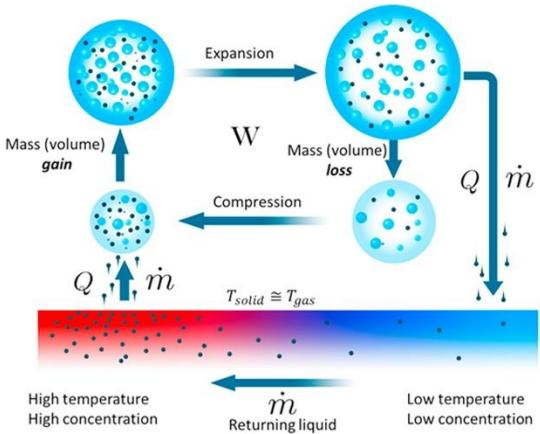  
Figure 17. Conceptualized mechanism of phase-change TAEs [135].

## 3.5 Summary and outlook

The thermoacoustic effect is still primarily in the laboratory research stage and far from widespread industrial application. The work reviewed in Sections 3.1 to 3.3 not only gives a clearer picture of thermal-acoustic coupling but also lays the foundation for future optimization of thermoacoustic devices from a thermal-acoustic coupling point of view.

As reviewed in Section 3.4, apart from a travelling-wave time phasing, the multi-stage and phasechange designs are two effective methodologies capable of reducing the onset temperature and improving the thermal efficiency simultaneously. Other novel design strategies that can significantly enhance the overall performance should be explored in future studies. A good example is the concept of solid thermoacoustics put forward by Hao et al. [137-140]. Figure 18 illustrates a standing-wave solid-state TAE where a large thermal inertia or ³stage´ is used to create a temperature gradient on a small portion of the rod. In contrast to gas oscillations, the solid vibrations would dramatically improve the output power density. If this concept is reliable in practical demonstrations, it will open the door for developing highly reliable solid-state thermoacoustic energy conversion systems.

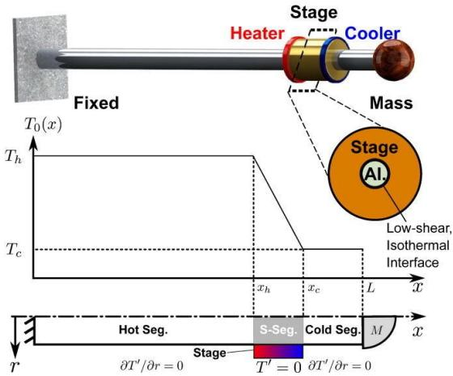  
Figure 18. A solid-state thermoacoustic engine [137].

Apart from onset temperature, thermal efficiency and power density, other factors such as construction cost, flexibility (in terms of heat source), reliability and durability are of equal importance. Compromises have to be made between these factors in the design process. For example, for the design of TAEs driven by industrial waste heat, the emphasis is to pursue large acoustic/electric power output with higher thermal efficiencies. For this reason, large-scale kW-level traveling-wave TAEGs, as illustrated in Figure 19(a), using pressurized helium as the working gas with thermal-to-electric efficiencies between 15% and 20% have been developed by a few researchers [141, 142]. As seen in Figure 19(b), it is also possible to utilize miniaturized thermoacoustic energy harvesters for recovering e[cess heat (up to $1 0 0 ^ { \circ } \mathrm { C } )$ in electronic devices, and providing power for microelectronic devices such as sensors [143]. In this scenario, the actual efficiency becomes a secondary issue while lowering the onset temperature is more important. One can also build solar-powered or stove-cooking-powered thermoacoustic electric generators [144-151], as shown in Figures 19(c), for specific occasions where the solar heat is abundant or electric grids are not accessible (e.g., in rural areas). The main driver herein would be the manufacturing cost. Atmospheric air and inexpensive hardware are recommended to construct these devices.

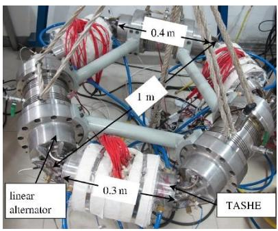  
a

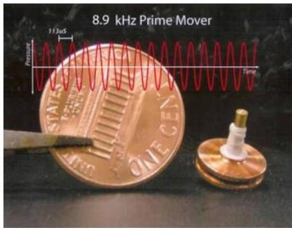  
b

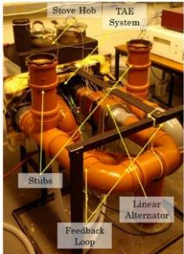  
c  
Figure 19. Applications of the thermoacoustic technology. (a) A 3 kW thermoacoustic Stirling electric generator [141]. (b) An ultrasonic thermoacoustic engine [143]. (c) A stove-cooking-powered thermoacoustic system [149].

## 4. Acoustic-mechanical coupling

Acoustic-mechanical coupling occurs when an external load is integrated with a TAE. In fact, the addition of an external load imposes an acoustic boundary condition to the TAE, changing the acoustic field and acoustic power generation/dissipation inside the TAE. This section first reviews passive and active control strategies adopted in the literature for optimal acoustic-mechanical coupling conditions. Then, some interesting phenomena and novel concepts related to this coupling effect are discussed.

## 4.1 Passive control approaches

Passive control in thermoacoustics refers to adjusting the parameters of the TAE or external load independently so as to achieve a better performance of the entire system. Two objectives need to be realized via passive control: (1) optimize the performance of the TAE, such as a lower onset temperature and a higher thermal efficiency; (2) maximize the acoustic power extraction by the external load.

## 4.1.1 Standing-wave thermoacoustic systems

In standing-wave thermoacoustic systems, the stack is the energy source generating acoustic power while the rest of the waveguides and external load absorb acoustic power. Although extensive research has been undertaken to investigate the effect of geometrical parameters and thermophysical properties of the TAE without an external load, most of conclusions made are still applicable for the optimization of the TAE coupled with an external load. For example, it is suggested by Swift [3] that the area of the acoustic resonator should be decreased at the velocity antinode to reduce viscous losses but enlarged at the pressure antinode to reduce the pressure amplitude and thereby thermal-relaxation losses. This explains why the diameter of the tube is small in the middle but large at the ends in the standing-wave TAEs with two closed ends [152-156]. Swift also pointed out that the optimal position of the stack is between the nodes of pressure and velocity. This conclusion is consistent with the findings in studies [157-160]. As to the geometry of the stack, it is found that the pin array configuration outperforms the parallel-plate or circular-pore ones [161-164], and the optimal pore size is when $r _ { h } / \delta _ { k }$ is between 1.0 and 1.5 [165-167]. Regarding the working gas, research has found that the mean pressure has an optimal value since it affects $r _ { h } / \delta _ { k } [ 1 6 8 - 1 7 0 ]$ . Working media possessing a low Prandtl number $\sigma , \mathrm { e . g . }$ helium, are beneficial for reducing the viscous losses as well as improving the power density [171-173].

Passive control of the external load in standing-wave thermoacoustic systems has been reported in many studies. In practice, as illustrated in Figure 20, the external load could be coupled either at one end of the acoustic resonator or on the sidewall. If coupled on the sidewall, the load ought to be near the ambient heat exchanger where the pressure and velocity amplitudes are relatively high. In fact, no matter where the external load is coupled, its equivalent mass, stiffness and damping coefficient will inevitably affect the resonance frequency of the system, acoustic power generation inside the TAE and acoustic power extraction by the load. In 1995, Olson [174] conducted measurements and analysis on the performance of a two-stage TAE that drove a load consisting of a resistive porous metal plug and a compliant volume of gas. It was found that the load increased both the engine¶s hot temperature and the constant of proportionality relating input heating power to the square of the pressure amplitude. Later, Luo et al. [175-179] investigated the performance of orifice pulse tube cryocoolers (PTCs) driven by standing-wave TAEs. In their systems, an acoustic pressure amplifier tube (APAT) was used to couple the TAE with the PTC. The length and diameter of the APAT were adjusted to amplify the pressure ratio at the blocked end. Results show that the pressure ratio is highest when the imaginary part of the load impedance becomes zero. In 2012, Smoker [180] designed a standing-wave thermoacousticpiezoelectric energy harvester (TAPEH) by placing a piezoelectric diaphragm at the end of the resonator. The natural frequency of the piezoelectric diaphragm was tuned to resonate with the acoustic cavity. Following Smoker¶s stud\, Nouh [181-183] adopted an auxiliary elastic structure in the form of a simple spring±mass system to amplify the strain experienced by the piezoelectric element, as displayed in Figure 21. He referred to the auxiliary structure as a ³dynamic magnifier´ and optimized its parameters to maximize the deflection of the vibrating diaphragm. As compared with conventional TAPEHs, the TAPEH with a magnifier could significantly improve the electric power harnessed from piezoelectric membranes.

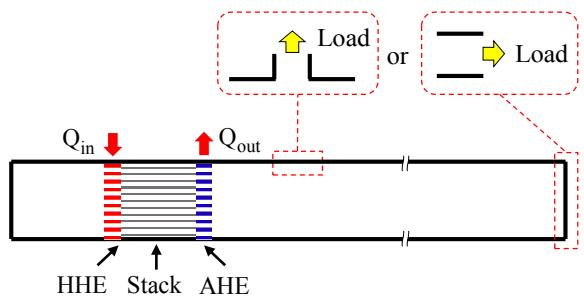  
Figure 20. Positions of acoustic-mechanical coupling in standing-wave thermoacoustic systems.

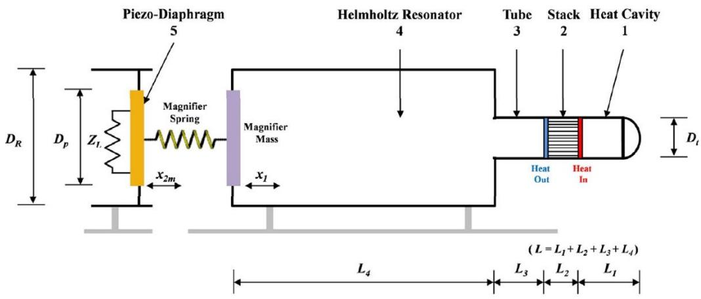  
Figure 21. An example of passive control in a standing-wave thermoacoustic engine [181].

## 4.1.2 Travelling-wave thermoacoustic systems

In travelling-wave thermoacoustic systems, the regenerator generates acoustic power while the rest of the waveguides and external load absorb acoustic power. Strictly speaking, there are no pure travelling waves inside the travelling-wave thermoacoustic systems. Three reasons may account for this. Firstly, phase modulation occurs within the viscous and thermal boundary layers due to the thermoacoustic effect [184-186], in particular in the regenerator region that is heterogeneously heated. Secondly, the abrupt change of cross-sectional area, for example, at the regenerator, reflects the acoustic waves, resulting in standing-wave components. Thirdly, the addition of an external load alters the acoustic impedance at the coupling interface, leading to wave reflections. Thereby, the definition of a travellingwave thermoacoustic system merely means that the acoustic field is dominated by travelling-wave components. Due to the reasons above, on the one hand, the acoustic field inside the regenerator should be tuned to approximate a travelling-wave phasing to maximize acoustic power generation [187-189]. On the other hand, a high acoustic impedance (normally 15-30 times $\rho _ { m } a _ { ; }$ , where $\rho _ { m }$ is the mean density of the gas and a is the sound speed) should be localized in the regenerator to suppress significant viscous dissipation (caused by $r _ { h } < \delta _ { k }$ to ensure perfect heat conduction) [11-13].

As shown in Figure 22, the external load in travelling-wave thermoacoustic systems could be connected to the bulky branch resonator [190], or directly coupled with the looped tube [191, 192]. The parameters of the external load could be adjusted for optimal performance. Backhaus and Swift [193] employed an acoustic LC load $( \mathrm { i . e . , }$ an inertance tube combined with a compliance volume) in the thermoacoustic-Stirling engine to obtain an in-phase condition within the regenerator. The acoustic LC load was also adopted by Gardner [194] to tune the acoustic field inside a cascade TAE. Likewise, an acoustic RC load (i.e., a resistance valve combined with a compliance volume) was used by Rao [195], Luo [196], Tang [197] and Yang [198] in experiments to investigate the effect of load impedance on the engine performance. Recently, Wang [199, 200] presented an effective acoustic matching method to optimize the coupling between the TAE and the load (linear alternator). It was concluded that, to ensure a good coupling performance, the imaginary part of the load acoustic impedance should be near zero.

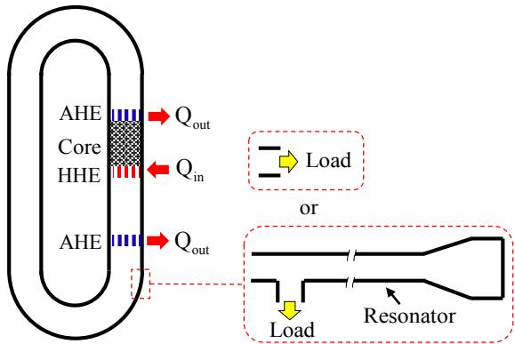  
Figure 22. Positions of acoustic-mechanical coupling in travelling-wave thermoacoustic systems.

Efforts have also been made to adjust the parameters of the TAE for optimal performance. Yu [201, 202] investigated the effect of regenerator pore size on the onset characteristics. They found that the optimal value of $\delta _ { k } / r _ { h }$ for obtaining the lowest onset temperatures falls within 2 - 3 and depends on the local acoustic impedance. De Blok [126, 127] observed that the system could onset at a lower temperature difference by employing a larger cross-sectional area in the regenerator region as compared with the rest of the looped tube. It was found by Xu [203-207] that enlargement of cross-sectional area in the regenerator results in a larger local acoustic impedance and smaller viscous losses. As to the working medium, pressurized gas with low Prandtl number has often been chosen to increase the power density [208-210]. Recent studies show that the acoustic field in the TAE can also be adjusted through modification of the looped waveguide. As shown in Figures 23(a) and 23(b), pipes with larger or smaller diameters could be inserted into the loop for adjusting the phase and acoustic impedance in the regenerator. These pipes were called ³phase adjusters´ b\ Sakamoto [211-213] and Liu [214, 215], but ³compliance/inertance tubes´ b\ Jin [187]. Another method is the use of a ³stub´, a sub-branch tube in Figure 23(c), first introduced by Yu [216] and later investigated by Kruse [217-219]. The stub can be viewed as a mass-spring oscillator that alters the acoustic field inside the loop through changing the diameter and length. The analogy to a mass-spring oscillator is also applicable to the side-branched, adjustable Helmholtz resonator adopted in another study [220] which functioned similarly to a stub. The last method is the use of a ³heat phase adjuster´ in Figure 23(d) by locally heating the working fluid inside the looped tube as proposed by Sakamoto [221]. It is believed that the inhomogeneity (in local speed of sound) caused by the rise of the mean temperature will affect the wave propagation within the heat phase adjuster and redistribute the acoustic field inside the loop.

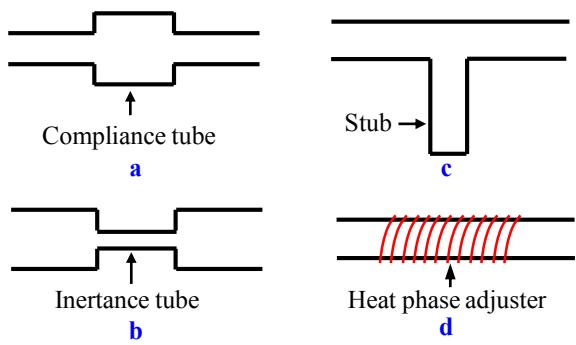  
Figure 23. Modifications on the looped waveguide. (a) Compliance tube [187]. (b) Inertance tube [187]. (c) Stub [217]. (d) Heat phase adjuster [221].

## 4.2 Active control approaches

Active control in thermoacoustics refers to adjusting the acoustic field inside the system using an external excitation device (e.g., loudspeaker). In this case, the whole system has two kinds of ³active´ source: the thermoacoustic regenerator/stack and external excitation. Active control can be further divided into open-loop and closed-loop types depending on how the external source is controlled. In the open-loop control, the input signals (e.g., amplitude and frequency) of the external excitation are fixed during the operation whilst in the closed-loop control, the input signals are adjusted in accordance with the instantaneous feedback from another device (e.g., microphone) via a feedback control algorithm.

## 4.2.1 Standing-wave thermoacoustic systems

Open-loop control in standing-wave thermoacoustic systems aims to ³activel\´ increase the travellingwave proportion of acoustic waves inside the thermoacoustic core so as to generate more acoustic power for the ³passive´ load. Zhang et al. [222, 223] built a compact thermoacoustic system where two linear motors acted as the external source to provide acoustic work that was amplified by the thermoacoustic core, and two other linear motors served as alternators to consume acoustic work. Experimental results showed that positive net acoustic work was produced in the thermoacoustic core and the maximum efficiency increased as the heating temperature arose. It should be mentioned that the amplitude and frequency of the external excitation in Zhang¶s studies were fixed at specified values. It is not always possible to obtain a positive net acoustic power as the external excitation changes. In particular, under certain circumstances, synchronization between the TAE and external source happens, leading to diverse nonlinear dynamic behaviours [224-230]. Penelet and Biwa [227] investigated the synchronization of a loudspeaker-driven TAE. In their study, they measured the dynamic response of the autonomous oscillator to the external source by varying driven frequency f and amplitude $U _ { \mathrm { r m s } } .$

Figure 24 displays the synchronization regions (or Arnold tongues) when the loudspeaker is placed 1 mm away from the open end of a standing-wave TAE having a natural frequency $f _ { 0 }$ of around 171.3 Hz. PS stands for ³perfect s\nchroni]ation´: $f _ { 0 }$ is locked to the frequency of the external source. QP corresponds to ³quasi-periodicit\´: s\nchroni]ation is lost. IPL represents ³imperfect phase locking´ for which the signal looks quasi-periodic but the phase difference stays bounded. BD represents ³beating death´ for which the spontaneous oscillations are suppressed to silence.

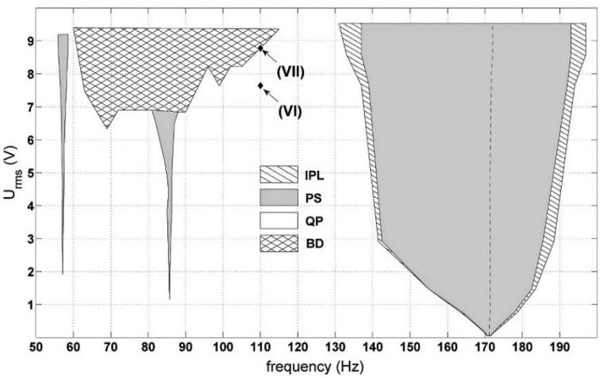  
Figure 24. Arnold tongues measured in the experiment conducted by Penelet and Biwa [227]. PS stands for ³perfect s\nchroni]ation´. QP corresponds to ³quasi-periodicit\´. IPL represents ³imperfect phase locking´. BD represents ³beating death´.

Closed-loop control in standing-wave thermoacoustic systems was demonstrated recently by Callanan [231] where a piezoelectric actuator and transducer pair located at both ends of the cavity was deployed as shown in Figure 25. The transducer collected acoustic power inside the cavity which meanwhile sent the signal being measured directly to the actuator. A time delay was executed by the controller on the actuator to transform the standing-wave dominant acoustic field into a hybrid standing-travelling one. It was shown that at a relatively small cost of power pumped into the system, the controlled thermoacoustic system outperformed a conventional one of the same size and configuration by virtue of the increased acoustic power output.

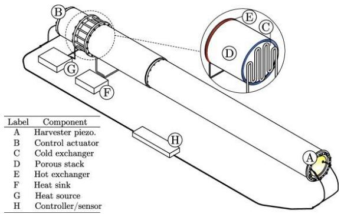  
Figure 25. Closed-loop control in a standing-wave thermoacoustic engine [231].

## 4.2.2 Travelling-wave thermoacoustic systems

Open-loop control in travelling-wave thermoacoustic systems has rarely been reported. It is anticipated that the external sound source(s) can replace the lossy passive elements such as phase adjusters and stubs used in passive control. Desjouy [232] used two auxiliary sound sources (loudspeakers) to control thermoacoustic amplification in an annular travelling-wave TAE as shown in Figure 26. When the device was operating above the onset temperature, appropriate tuning of the amplitude, frequency and phase difference of the two auxiliary sources led to a remarkable increase of acoustic power inside the engine as compared to that without active control. Besides, the increase of acoustic power was significantly larger than the electric power supplied to the loudspeakers. The overall efficiency was increased dramatically.

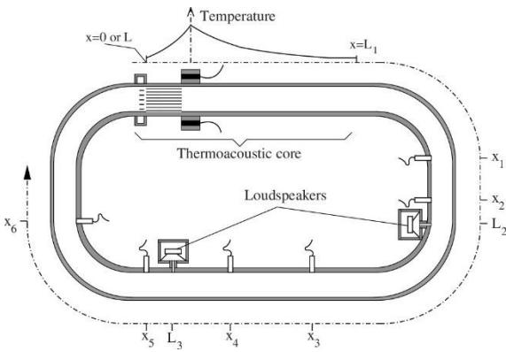  
Figure 26. Open-loop control in a travelling-wave thermoacoustic engine [232].

Closed-loop control in travelling-wave thermoacoustic systems was reported by Olivier [233] and Poignand [234]. In Olivier¶s study [233], an auxiliary sound source is added to the looped tube, connected through a phase-shifter to a reference microphone located at another position on the loop as shown in Figure 27. An alternator is placed inside the branch resonator to collect acoustic power produced by the regenerator in the looped tube. The effect of phase shift $\varphi$ on the energy conversion efficiency Ș was studied and compared with the value $\eta _ { 0 }$ without active control. It was found that $\eta / \eta _ { 0 }$ $< 1$ when $\varphi \in [ 0 ^ { \circ }$ , 180°] while $\eta / \eta _ { 0 } > 1$ when $\varphi \in [ 1 8 0 ^ { \circ } , 3 6 0 ^ { \circ } ]$ . Interestingly, there appeared a phaseshift domain $\varphi \in [ 5 0 ^ { \circ } , ~ 6 0 ^ { \circ } ]$ where the external forcing caused amplitude death (quenching) of thermoacoustic oscillations: the engine returned to silence. These results demonstrate that there is a competition between forced oscillations from the auxiliary sound source and self-excited thermoacoustic oscillations from the thermoacoustic regenerator/stack. Inappropriate tuning of the external force may lead to suppression (even death) of thermoacoustic instability.

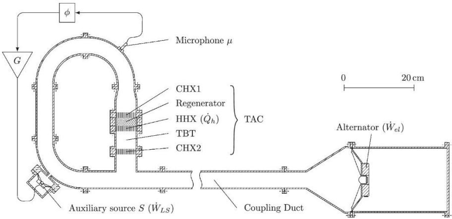  
Figure 27. Closed-loop control in a travelling-wave thermoacoustic engine [233].

## 4.3 Discussion

This section discusses the mode selection/transition processes and push-pull/double-acting concept in thermoacoustic devices from an acoustic-mechanical coupling perspective.

## 4.3.1 Mode selection and transition

Mode selection is responsible for some unusual phenomena in thermoacoustic devices. Thermoacoustic devices are often expected to be working at the fundamental frequency, exhibiting limit-cycle responses. However, in some experiments, beating [235] or quasi-periodic oscillations [236, 237] occur. To address these phenomena, Chen et al. [63] first established a lumped element model of a simple standing-wave TAE integrated with an external load at one end, and conducted acoustic mode analysis of the coupled system. As shown in Figure $2 8 ( \mathrm { a } )$ , the natural frequencies $( f _ { 1 } , f _ { 2 }$ and $f _ { 3 } )$ of the first three acoustic modes of the coupled system are dependent on those $( f _ { \mathrm { T A E l } }$ and $f _ { \mathrm { T A E 2 } } )$ of the TAE without a load and that $( f _ { \mathrm { M } } )$ of the external load. $K _ { M } / K _ { b }$ is the stiffness ratio with $K _ { M }$ and $K _ { b }$ being the load stiffness and the baseline stiffness, respectively. At $K _ { M } / K _ { b } = 4 . 5$ and 18, the curves of natural frequencies veer away and diverge instead of crossing. This weakly coupled behaviour is called ³veering´ [238]. Subsequently, the stability curves of each acoustic mode were derived using a network model based on linear thermoacoustic theory. Results show that multiple acoustic modes can be excited simultaneously. When the difference between $f _ { 1 }$ and $f _ { 2 }$ is large, e.g., when $K _ { M } / K _ { b } = 1$ , simultaneous excitation of them will lead to quasi-periodicity, as shown in Figure 28(b). When $f _ { 1 }$ and $f _ { 2 }$ are close, e.g., when $K _ { M } / K _ { b } = 4 . 5 ,$ simultaneous excitation of them will induce beating, as shown in Figure $2 8 ( \mathrm { c ) }$ . The authors also find that the acoustic mode at $f _ { 1 }$ possesses a lower onset temperature. Meanwhile, the external-load acoustic power extraction is larger when the frequency of the acoustic mode is close to $f _ { \mathrm { M } } .$ This suggests the use of ultra-compliant external loads to achieve lower onset temperatures and higher acoustic power extraction [216].

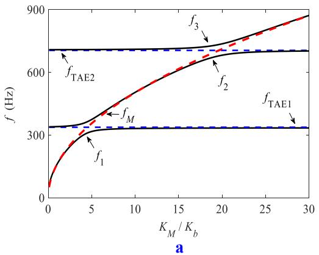

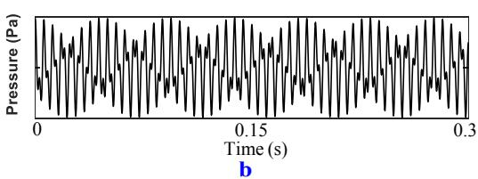

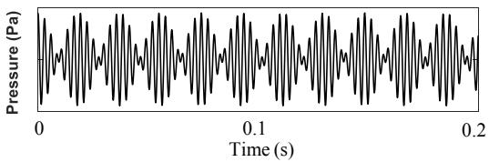  
c  
Figure 28. Mode selection in a standing-wave thermoacoustic system [63]. (a) Veering effect. (b) Quasi-periodic oscillations. (c) Beating oscillations.

Mode transition was observed in thermoacoustic-Stirling engines consisting of a looped-type TAE (weakly) coupled with an acoustic resonator. The natural frequency of the looped tube is normally much higher than that ofthe acoustic resonator. Judging from the conclusions made by Chen [63], the acoustic mode oscillating at a frequency close to that of the acoustic resonator is more prone to instability. This is true in most experiments where the entire engine oscillated at a single frequency determined by the acoustic resonator. In 2002, Biwa [239] observed that, when the temperature difference across the stack inside the looped tube was increased, the acoustic oscillations inside the engine would transit from a low frequency (determined by the resonator) to a high frequency (determined by the looped tube). In between, quasi-periodic oscillations containing both frequencies occurred but disappeared quickly. In 2003, similar mode transition behaviour was recorded by Yu [240], however, the transition trend was opposite. As shown in Figure 29(b), the TAE first stayed at a high-frequency mode (determined by the looped tube) in region I and transited to a low-frequency mode (determined by the resonator) in region III. In region II, quasi-periodicity occurred. Figure 29(a) plots the temperatures monitored along the regenerator, and Figures 29(c) and 29(d) displays the high-frequency and low-frequency components after filtering, respectively. Up till now, little theoretical work has been undertaken to interpret the mode transition phenomena reported above. What mechanism lies behind the mode transition? Why are the transition trends opposite in Biwa¶s and Yu¶s studies? Can the quasi-periodic oscillations last for a long time? These questions need to be addressed in future research.

  
Figure 29. Mode transition in a travelling-wave TAE [240]. (a) Temperatures along the regenerator.  
(b) Acoustic pressure. (c) High-frequency component. (d) Low-frequency component.

## 4.3.2 Push-pull or double-acting concept

Traditional side-branch arrangements of external loads such as loudspeakers and linear alternators receive acoustic power from one side while the other side is enclosed by a cavity that adds a ³passive´ back volume to the device. B\ adding another thermoacoustic source into the cavit\, the ³passive´ back volume becomes ³active´. The double ³active´ volumes then drive the external load in a push-pull fashion, in which higher levels of mechanical vibrations can be induced.

In the literature, the push-pull or double-acting concept was often used in conjunction with the multistage design. In 2010, Jensen and Raspet [241] designed a thermoacoustic-piezoelectric energy harvester where a piezoelectric transducer was placed in the middle of a two-stage standing-wave TAE. 10% of Carnot efficiency was expected from the push-pull design which is competitive with currently available thermoelectric generators. The push-pull or double-acting concept in travelling-wave thermoacoustic systems has been successfully tested by Jaworski [242, 243]. Figure 30 gives an example of a three-cylinder double-acting thermoacoustic electric generator where the linear alternator works in a push-pull mode [141]. The symmetric configuration leads to an ideal acoustic field in each engine unit. The phase angles between the compression and expansion pistons are 120°. Replacing the linear alternator with a liquid piston in a U-shaped tube or a solid displacer transforms the system into travelling-wave TAEs with liquid pistons or solid displacers [244-248]. The benefit of using a liquid piston or a solid displacer is to get rid of the bulky branch resonators for compactness while maintaining a high-pressure amplitude. However, acoustic power transmission is difficult at the gas-liquid or gassolid interfaces due to the large impedance difference. Besides, for the travelling-wave liquid-piston TAE, the gas-liquid interface will become unstable when the acceleration amplitude of the working liquid is large. A recent study by Biwa [249] shows that the liquid surface instability can be effectively suppressed by enlarging the area of liquid surface or using submerged floats.

  
Figure 30. A double-acting travelling-wave electric generator [141].

## 4.4 Summary and outlook

Research on acoustic-mechanical coupling has been focused on adjusting the acoustic field to optimize the performance of the TAE, or to maximize the acoustic power extraction by the external load, or both. As reviewed in Sections 4.1 and 4.2, although active control approaches demonstrate promising prospects in improving the overall performance, they complicate the design and introduce extra moving parts into the system, counteracting simplicity - the most-mentioned advantage of thermoacoustic systems. An in-depth bifurcation analysis needs to be performed in the future to shed light on the synchronization phenomena reviewed above. Passive control approaches seem to be more reliable, however, the underlying mechanisms are still not fully understood yet. Broadband power extraction [250-252] via nonlinear treatments of the external load, for example, by introducing nonlinear load stiffness, is still absent at present.

Mode selection and transition are two interesting research topics that have received little attention. Chen [63] conducted preliminary studies on mode selection and impedance matching in a standing-wave thermoacoustic device. The lumped element model and network method in his study may provide useful guidelines to explain mode transition and impedance matching in travelling-wave thermoacoustic devices. The push-pull or double-acting design can significantly improve the acoustic power extraction. Turning the linear alternator into an ³active´ operating mode by imposing an electric current would motivate the study of push-pull thermoacoustic refrigerators or push-pull (active) control of thermoacoustic oscillations in the future.

## 5. Mechanical-electric coupling

Mechanical-electric coupling in thermoacoustics relates to choosing proper mechanical-to-electric transducers for converting high-amplitude acoustic waves into electricity. The design of electric circuit connected to the transducer also plays an important role in electricity generation.

## 5.1 Transduction mechanisms

In general, there are three main mechanical-to-electric transduction mechanisms able to realize energy conversion from mechanical vibration into electricity, namely, electromagnetism, piezoelectricity and electrostatics, as displayed in Figure 31. Other competing mechanical-to-electric technologies include magnetohydrodynamic transducers, bidirectional turbines, triboelectric nanogenerators, etc. Here we review the performance and feasibility of major mechanical-to-electric devices in the field of thermoacoustics, and discuss the challenging matters that should be overcome for more successful applications.

  
Figure 31. Classification of mechanical-to-electric energy conversion devices.

Up to now, most thermoacoustic devices adopt electromagnetic apparatuses to convert acoustic power into electricity. This is realized either by using a commercial loudspeaker at a relatively cheap price or a more expensive but dedicated linear alternator. Electromagnetic devices make use of magnets, coils and iron as the main components for electromagnetic induction. Mechanical movement of one component relative to the other two is initiated by acoustic oscillations, thereby inducing an electric current inside the coil [253]. Figure 32 displays a simplified model of the moving-magnet linear alternator and its equivalent circuit in the study [254]. The moving mass, mechanical stiffness, and mechanical resistance of the linear alternator are denoted as $M , K$ and $R _ { m } .$ The electric load has a winding resistance $\displaystyle r _ { e , \mathrm { ~ } }$ a winding inductance $L _ { e , }$ a load resistance Rl and a capacitance Ce. The force factor is $B l$ and the back volume is $V _ { b } .$ Linear alternators generally have a large stiffness: a large force produces a small displacement, making them ³non-compliant´ and suitable for high impedance regions inside the TAE. The high-impedance working environment renders a high power-transduction efficiency, usually in the range of 65% -75% in the literature [141, 142]. To date, linear alternators in TAEs can reach an electric power output at the kW level. Further increasing the output capacity requires more dedicated alternators which significantly increases cost. Since linear alternators are expensive compared to other easy-to-build hardware in the system, commercially-available loudspeakers were often adopted to reduce the price [255-258]. Another merit of loudspeakers is the flat response over a wide range of frequencies, making it easier to couple with TAEs. The loudspeakers generally have a small stiffness: a small force produces a large displacement, making them ³ultra-compliant´ and suitable for low impedance regions inside the TAE. However, the low-impedance working environment and fragile paper cone limit them to relatively low efficiencies and power output. In the literature, the efficiency of loudspeakers was within the range of 35%-60%, and the electric power output was around 10-100 W.

  
Figure 32. Electromagnetic transduction [254]. (a) A simplified model of moving-magnet linear alternator. (b) Equivalent circuit model.

Piezoelectric devices relies on piezoelectric elements, such as certain ceramics and crystals, to generate a voltage difference, producing electricity through an electrical circuit during mechanical deformation caused by incident acoustic waves [259]. The state-of-the-art progress in piezoelectricity has witnessed extensive research on energy harvesting from various environmental sources [260-264]. Figure 33 displays the simplified model of a piezoelectric transducer and its equivalent circuit in the study [157]. $C _ { s } , M _ { s } , \phi$ and $C _ { b }$ denote the effective short-circuit acoustic compliance, acoustic mass, transformer turning ratio and blocked electric capacitance, respectively. Piezoelectric transducers are normally stiff and have small mass: the resonance frequency is high and ideal for small-scale, compact system designs. The electric power output of piezoelectric transducers is limited because of their small inertia, usually in the order of mW. The efficiency of piezoelectric devices has also been found to be relatively low from previous experimental works [265-270].

  
Figure 33. Piezoelectric transduction [157]. (a) A simplified model of the piezoelectric transducer. (b) Equivalent circuit model.

The use of electrostatic devices to convert vibrational energy into electricity has a long history. Unfortunately, this transduction approach was not found in thermoacoustics applications until recently Chen et al. [271] built an electret-based electrostatic transducer to extract acoustic power from a standing-wave TAE. Electrostatic devices can be divided into two categories: electret-based and electret-free. Electret-based electrostatic converters use electrets, a dielectric material that is in a quasipermanent electric polarization state (electric charges or dipole polarization), giving them the ability to directly convert mechanical power into electricity [272-277]. Figure 34 illustrates the schematic of the electret-based electrostatic transducer and its equivalent circuit in Chen¶s stud\ [271]. $Q _ { 1 }$ and $Q _ { 2 }$ are positive charges on the base and counter electrodes, $C _ { e q }$ represents the equivalent series capacitance of the electret and air gap, $V _ { S }$ denotes the surface potential of the electret induced by the negative charges $Q _ { E }$ (constant in amount) implanted electrostatically in the electret and $C _ { p }$ stands for the parasitic capacitance. Motion of the counter electrode changes the capacitance between the electrodes and thereby renders the migration of charge (or current) between the electrodes. In operation, the electret is contact-free from the counter electrode, enabling it to have more flexibility in working temperature as compared with other transducers, such as triboelectric generators which rely on contact to induce electrification [278]. The electret-based thermoacoustic-electrostatic power generator in the study produced electricity of the order of $\mu \mathrm { W } ,$ showing great potential to suppl\ power for microelectronic devices which usually require ultralow power consumption. Electret-free electrostatic converters make use of conversion cycles that consist of charge and discharge of the capacitor [279]. An active electronic circuit is required to apply the charge cycle on the structure and must be synchronized with the capacitance variation. To date, there have been no reports of electret-free electrostatic converters in thermoacoustic devices.

  
Figure 34. Electrostatic transduction [271]. (a) Schematic of an electret-based electrostatic transducer. (b) Equivalent circuit model.

Magnetohydrodynamic (MHD) devices rely on the oscillation of a liquid fluid that is electrically conductive in a magnetic field to induce electricity [280]. The MHD converters can be classified into inductive and conductive types. Figure 35 illustrates an inductive MHD converter [28]. The working fluid driven by acoustic waves oscillates horizontally in the perpendicular magnetic field applied by the ferromagnetic yoke, inducing an alternating current in the surrounding coil. Swift et al. [281-283] carried out a series of experimental work on MHD generators using liquid sodium as the working fluid in the 1990s. The experimental results were very promising: the highest acoustic-to-electric efficiency was 45% corresponding to an electric power of 300 W [282]. Despite these outcomes, the high-pressure oscillations in Swift¶s stud\ raised severe safety concerns. In 2006, Castrejón-Pita [284] proposed a simple thermoacoustic-MHD energy generator in which the conducting fluid in a U-shaped tube was driven by thermally-induced acoustic oscillations. Since then, MHD generators in thermoacoustic systems have been very infrequently reported.

  
Figure 35. An inductive magnetohydrodynamic converter [28].

Inspired by impulse turbines for wave energy conversion [285], De Blok [286] put forward the concept of an axial bidirectional air impulse turbine (or bidirectional turbine) for harvesting acoustic power in 2014. Figure 36 schematically depicts a bidirectional turbine, where bidirectional air flows in the tube are guided by the guide vanes and impinge on the rotor in the middle [287, 288]. The symmetric design enables the rotor to rotate in one direction regardless of the direction of the incoming air flow. Then, the mechanical work of the rotator is converted into electricity via a generator placed inside the nose cone. Experimental measurements indicated that, when driven by a loudspeaker with increasing acoustic power up to 30 W and varying frequencies between 20 to 50 Hz, the bidirectional turbine could produce an acoustic-to-electric efficiency ranging between 25% and 35%. Since the bidirectional turbine is a new technology in thermoacoustics, few reports are found in the literature. Work is under progress to optimize the configuration of vane channels and rotor blades for better aerodynamic performance [289, 290].

  
Figure 36. Schematic of a bidirectional impulse turbine [287].

## 5.2 Electric circuit design

Given the mechanical-electric coupling, the electrical components (inductance, capacity and resistance) will inevitably alter the equivalent impedance of the entire transducer. Then, the imaginary part of the equivalent impedance is decided by the mechanical mass, mechanical stiffness, electrical inductance and electrical capacitance, while the real part is determined by the mechanical and electrical resistances. A good mechanical-electric coupling can be obtained by ensuring that the imaginary part of the equivalent impedance is small compared to the real part.

Sun [254] studied the performance of a linear alternator with a variable electric RC load (i.e., an electrical resistance in series with an electrical capacitance). Both theoretical calculations and experimental tests indicated that, by carefully tuning the adjustable electrical capacitance, the linear alternator achieved a resonant state and had larger electric power output and mechanical-to-electric efficiency. The electrical resistance also showed some influence on the electric power output, however no optimal value was reported. Recently, Yang et al. [291-294] carried out a series of experimental studies on multi-stage travelling-wave thermoacoustic electric generators. Their results demonstrated the existence of optimal values of electric capacitance and resistance in terms of electric power output and mechanical-to-electric efficiency. The optimal values also showed dependence on other factors such as the number of stages, hot-end temperatures, etc.

## 5.3 Summary and outlook

The review of different mechanical-to-electric methods in Section 5.1 provides useful guidelines for the selection of appropriate transducers in different thermoacoustic devices. Each transduction method has its pros and cons. A trade-off has to be made between many factors including electric power output/efficiency, flexibility (in terms of working temperature and frequency), durability (less fatigue, fewer fragile materials), manufacturing cost and so on. At present, linear alternators have the highest electric power output and efficiency, but in the meantime, are bulky and expensive. Loudspeakers make up for these shortcomings at the cost of reduced electric power output and efficiency. One should consider the local acoustic impedance of the TAE when choosing a linear alternator or a loudspeaker. Piezoelectric and electrostatic transducers offer the possibility of small-scale, miniaturized thermoacoustic electric generators. The electric power output and efficiency are low at present and need improving in future work. Although the magnetohydrodynamic converters and bidirectional turbines are less frequently reported, they showed competitive metrics compared with linear alternators, and deserve more attention in the future.

The design of the electric circuit connected to the transducers is of great importance for performance enhancement. Both theoretical and experimental results indicate that, by adjusting the electrical components in the circuit, the transducer can be tuned to (or close to) a resonant state. Prospective research on boosting the mechanical-to-electric efficiency may involve nonlinear treatments of electric circuits by using, for example, SCE (synchronized charge extraction) [295-297] and SSHI (synchronized switch harvesting on inductor) [298] techniques.

## 6. System design and synthetic optimization

Sections 3-5 discuss each multi-physics coupling effect individually. The issue of system design and optimization arises when two or three coupling effects co-exist and interact with each other in one thermoacoustic system. Instead of analysing each subsystem independently, a system-level investigation of the multi-physics coupling in the coupled system is required. In addition, a synthetic optimization procedure is required to ensure all subsystems work synergistically in optimal conditions.

## 6.1 System-level design techniques

System-level design of a thermoacoustic system could be realized by means of theoretical, numerical and experimental techniques.

The dynamic behaviour of a thermoacoustic system has often been predicted theoretically via equivalent circuit modelling. This method is based on the analogy between the acoustic, mechanical and electric networks, which enables the multi-physics coupling of different fields to be represented in one equivalent circuit. A unifying perspective of the underlying mechanisms of equivalent circuit modelling is given in Swift¶s book [8]. The transfer matrix method [52-56] and the network method [299-301] reported in the literature are both rooted in equivalent-circuit analogy.

Numerical studies of thermoacoustic systems concern the use of sophisticated simulation tools/software. DeltaEC (Design Environment for Low-amplitude ThermoAcoustic Energy Conversion) developed by Swift et al. [302] is the most popular software used by researchers studying thermoacoustics. Based on classical linear theory, this software derives the acoustic variables along the thermoacoustic components through numerical integration. A shooting method is introduced to match the targets and guesses set by the user. Since DeltaEC is not suitable for large-amplitude predictions due to its basis on linear thoery, nonlinear CFD (computational fluid dynamics) simulations on thermoacoustic oscillations prevail. The simulation tools reported in the literature include CFX [72], Fluent [303], COMSOL [304], OpenFOAM [305], STAR-CD [306], FLOW3D [307], etc. Note that, to account for the acoustic-mechanical coupling, a time-domain impedance boundary condition needs to be incorporated into the CFD codes [308]. Compared with DeltaEC, the greatest shortcoming of CFD simulations is high computational cost due to a wide range of time and length scales. One may resort to HPC (high performance computing) to accomplish high-fidelity simulation tasks. In addition to DeltaEC and CFD packages, SAGE developed by Gedeon [309], and SPICE [310] (an open-source analogy electronic circuit simulator) also prove useful in studying multi-physics coupling effects in thermoacoustic devices.

Experimental verification is indispensable following theoretical predictions and numerical simulations. It is often easier to measure the acoustic pressures at different positions along the device through pressure sensors/microphones. Then, a two-sensor method [311-313] can be used to calculate the acoustic power along the duct. The velocity field in thermoacoustic devices can be measured by HWA (hot wire anemometry) [314], LDA (laser doppler anemometry) [315] and PIV (particle image velocimetry) [316] while the temperature field can be measured by thermocouples, PLIF (planar laserinduced fluorescence) [316] and infrared imaging [317].

## 6.2 Optimization methodologies

The most common optimization approach utilized in thermoacoustic devices is through parametric studies: a single parameter of interest is varied while the others are fixed. These parametric studies are unable to capture the inherent interactions between multiple variables and can only guarantee locally optimal solutions. Hence, an optimization algorithm is needed to maximize or minimize an objective function, such as acoustic power, onset temperature, etc., by systematically choosing a set of input variables, such as geometrical parameters of the TAE and thermophysical properties of the working fluid. This process is called ³single-objective optimization´ in optimization theory. If two or more objective functions (conflicting against each other) are to be optimized simultaneously, a trade-off must be created according to selected weights. This process is called ³multi-objective optimi]ation´ or ³Pareto optimi]ation´. There usually exist multiple Pareto optimal solutions for multi-objective optimization problems.

Existing methods for single-objective optimization in thermoacoustics include particle swarm optimization [318], genetic algorithms [319], reinforcement learning [320] and fruit fly optimization algorithm [321]. Methods for multi-objective optimization in the literature include response surface methodology (RSM) [322], GAMS (General Algebraic Modelling System) [323], teaching-learningbased optimization algorithm [324], self-adaptive Jaya algorithm [325], etc. Most of the optimization algorithms mentioned above are based on metaheuristics [326]. So far, the systems investigated in these studies are simple-structured TAEs or TARs that only involve the thermal-acoustic coupling effect. Reports on mathematical optimization of more complicated thermoacoustic electric generators are still lacking. Moreover, there is a shortage of optimization studies involving manufacturing cost as one of the objective functions. Providing such information would not only familiarize designers with what the lowest price is per unit of power output, but also highlight the low-capital advantage of thermoacoustic devices to compete with other power generation technologies.

## 7. Conclusions

A comprehensive review of the multi-physics coupling effects, namely, thermal-acoustic coupling, acoustic-mechanical coupling and mechanical-electric coupling, in thermoacoustic devices including thermoacoustic engines, thermoacoustic electric generators, thermoacoustically-driven refrigerators, etc., has been presented. For each coupling effect, the basic principles, operating characteristics, design strategies and future prospects were discussed individually. System-level design techniques and optimization methodologies when multi-physics coupling effects co-exist were presented. Several conclusions can be drawn and are summarized below.

(1) Thermal-acoustic coupling deals with the coupling between temperature and acoustic fields at the solid/fluid interfaces. The linear theory can be used to predict the wave propagation/energy conversion inside inhomogeneous waveguides, as well as the stability limit of the entire system. Study of nonlinear thermoacoustics at high amplitudes becomes necessary as nonlinear phenomena encountered in acoustics, hydrodynamics and nonlinear dynamics occur. Apart from a travellingwave phasing, the multi-stage design and phase-change design are effective methodologies capable of improving the TAE performance significantly. Compromises have to be made between onset temperature, thermal efficiency, power density, construction cost, flexibility, etc., during the design process.

(2) Acoustic-mechanical coupling concerns the coupling between TAEs and external loads. Both passive and active control approaches have been adopted to optimize the performance of the TAE, or to maximize the acoustic power extraction by the external load, or both. An in-depth bifurcation analysis on the synchronization phenomena should be performed in the future for a better understanding of active control methodologies. An acoustic analysis of the eigenvalue problem, together with a stability analysis on the acoustic modes may facilitate the comprehension of passive control in thermoacoustic systems.

(3) Mechanical-electric coupling involves the coupling between mechanical and electric fields in mechanical-to-electric transducers. The strengths and weaknesses of each transduction mechanism including electromagnetism, piezoelectricity, electrostatics, etc., were analysed. When choosing an appropriate mechanical-to-electric transducer, a trade-off has to be made between electric power output, mechanical-to-electric efficiency, manufacturing cost, flexibility and so on. Besides, the electric circuit should be adjusted carefully to ensure that the transducer is working in resonance with the TAE.

(4) The joint influence of multiple coupling effects requires a system-level investigation on the coupled system by means of theoretical, numerical and/or experimental techniques. Advanced single/multiple-objective optimization algorithms can generate optimal solutions of objective functions with optimized values of input variables, providing good directions for future improvements of the present thermoacoustic systems.

In summary, thermoacoustic technology offers great promise for the future due to its ability to exploit low-grade heat or to produce refrigeration using low-cost, reliable devices with no/few moving components and environmentally friendly working fluids. Although much progress has been achieved, more work needs to be conducted in the system design and optimization of thermoacoustic components and associated transduction systems. Besides, it is indispensable for researchers to explore novel design strategies (other than the multi-stage and phase-change designs) that can significantly enhance the overall performance. All these remaining issues will ensure that the study of thermoacoustics remains a fruitful and active field of research for many decades.

## Acknowledgements

The authors are grateful for the Universitas 21 Doctoral Student Mobility Scholarship. Financial support from China Scholarship Council is acknowledged (no. 201608630046).

## Appendix. List of thermoacoustic devices

Table 2 lists the thermoacoustic devices with outstanding performances reported in the literature.

Table 2. Thermoacoustic devices with outstanding performances reported in the literature. $p _ { m }$ is the mean pressure, $T _ { h }$ is the hot-end temperature, $T _ { c }$ is the cold-end temperature, f is the working frequency, $T _ { h , o n s e t }$ is the onset temperature, $\eta _ { t 2 a }$ is the thermal-to-acoustic efficiency, $\eta _ { t 2 e }$ is the thermalto-electric efficiency, $P _ { e }$ is the electric power, COP is the coefficient of performance, and $P _ { c }$ is the cooling power. A notation of n/a means the data could not be found in the paper.
<table><tr><td>Type</td><td>Merits</td><td>Gas type</td><td> $p _ { m } \left( \mathbf { M P a } \right)$ </td><td> $T _ { h } ( ^ { \circ } \mathbb { O }$ </td><td> $T _ { c } ( ^ { \circ } \mathbb { Q }$ </td><td> $f ( \mathbf { H } \mathbf { z } )$ </td><td>References</td></tr><tr><td>TAEs</td><td> $\overline { { T _ { h , o n s e t } = 2 9 ^ { \circ } C } }$ </td><td>CO2</td><td>1</td><td>29</td><td>12</td><td>n/a</td><td>Jin et al. [15]</td></tr><tr><td></td><td> $\eta _ { t 2 a } = 3 5 . 6 \%$ </td><td>Helium</td><td>4</td><td>650</td><td>20</td><td>80</td><td>Wu et al. [16]</td></tr><tr><td></td><td> $\eta _ { t 2 e } = 1 9 . 8 \%$ </td><td>Helium/Argon</td><td>4</td><td>650</td><td>15</td><td>64</td><td>Wu et al. [17]</td></tr><tr><td></td><td> $P _ { e } = 4 . 6 9 \mathrm { k W }$ </td><td>Helium</td><td>6</td><td>650</td><td>25</td><td>70</td><td>Bi et al. [18]</td></tr><tr><td>TARs</td><td> $\overline { { T _ { c } = - 2 5 4 . 9 ~ ^ { \circ } C } }$ </td><td>Helium</td><td>2.7</td><td>n/a</td><td>-254.9</td><td>23.5</td><td>Hu et al. [19]</td></tr><tr><td></td><td> $\mathrm { C O P } = 4 . 7 8$ </td><td>Helium</td><td>5</td><td>100</td><td>60</td><td>80</td><td>Tijani et al. [20]</td></tr><tr><td></td><td> $P _ { c } = 3 . 8 \mathrm { k W }$ </td><td>Helium</td><td>3</td><td>n/a</td><td>-123</td><td>40</td><td>Arman et al. [21]</td></tr></table>

## References

[1] Rayleigh JWSB. The theory of sound: Macmillan; 1896.

[2] Wheatley J, Hofler T, Swift G, Migliori A. Experiments with an intrinsically irreversible acoustic heat engine. Physical Review Letters. 1983;50:499.

[3] Swift GW. Thermoacoustic engines. The Journal of the Acoustical Society of America. 1988;84:1145-80.

[4] Higgins B. On the sound produced by a current of hydrogen gas passing through a tube. Journal of natural philosophy, chemistry and the arts. 1802;1:2.

[5] Feldman K. Review of the literature on Sondhauss thermoacoustic phenomena. Journal of Sound and Vibration. 1968;7:71-82.

[6] Feldman K. Review of the literature on Rijke thermoacoustic phenomena. Journal of Sound and Vibration. 1968;7:83-9.

[7] Taconis K, Beenakker J, Nier A, Aldrich L. Measurements concerning the vapour-liquid equilibrum of solutions of He3 in He4 below 2.19 K. Physica. 1949;15:733-9.

[8] Swift GW. Thermoacoustics: A unifying perspective for some engines and refrigerators: Springer; 2017.

[9] Zhao D, Gutmark E, de Goey P. A review of cavity-based trapped vortex, ultra-compact, high-g, inter-turbine combustors. Progress in Energy and Combustion Science. 2018;66:42-82.

[10] Wang K, Dubey S, Choo FH, Duan F. Thermoacoustic Stirling power generation from LNG cold energy and low-temperature waste heat. Energy. 2017;127:280-90.

[11] Ceperley PH. A pistonless Stirling engine²The traveling wave heat engine. The Journal of the Acoustical Society of America. 1979;66:1508-13.

[12] Ceperley PH. Gain and efficiency of a traveling wave heat engine. The Journal of the Acoustical Society of America. 1982;72:1688-94.

[13] Ceperley PH. Gain and efficiency of a short traveling wave heat engine. The Journal of the Acoustical Society of America. 1985;77:1239-44.

[14] Merkli P, Thomann H. Thermoacoustic effects in a resonance tube. Journal of Fluid Mechanics. 1975;70:161-77.

[15] Jin T, Yang R, Wang Y, Feng Y, Tang K. Low temperature difference thermoacoustic prime mover with asymmetric multi-stage loop configuration. Scientific reports. 2017;7:7665.

[16] Wu Z, Chen Y, Dai W, Luo E, Li D. Investigation on the thermoacoustic conversion characteristic of regenerator. Applied Energy. 2015;152:156-61.

[17] Wu Z, Zhang L, Dai W, Luo E. Investigation on a 1kW traveling-wave thermoacoustic electrical generator. Applied Energy. 2014;124:140-7.

[18] Bi T, Wu Z, Zhang L, Yu G, Luo E, Dai W. Development of a 5kW traveling-wave thermoacoustic electric generator. Applied Energy. 2015.

[19] Hu J, Luo E, Li S, Yu B, Dai W. Heat-driven thermoacoustic cryocooler operating at liquid hydrogen temperature with a unique coupler. Journal of Applied physics. 2008;103:104906.

[20] Tijani M, Lycklama a Nijeholt J, Spoelstra S. Development of a thermoacoustic heat pump for distillation column. Policy Studies. 2016;2015:2013.

[21] Arman B, Wollan J, Kotsubo V, Backhaus S, Swift G. Operation of thermoacoustic Stirling heat engine driven large multiple pulse tube refrigerators. Cryocoolers. 2005:181-8.

[22] Wang K, Zhang J, Zhang N, Sun D, Luo K, Zou J, et al. Acoustic matching of a traveling-wave thermoacoustic electric generator. Applied Thermal Engineering. 2016;102:272-82.

[23] Jin T, Huang J, Feng Y, Yang R, Tang K, Radebaugh R. Thermoacoustic prime movers and refrigerators: Thermally powered engines without moving components. Energy. 2015;93:828-53.

[24] Avent A, Bowen C. Principles of thermoacoustic energy harvesting. The European Physical Journal Special Topics. 2015;224:2967-92.

[25] Zolpakar NA, Mohd-Ghazali N, El-Fawal MH. Performance analysis of the standing wave thermoacoustic refrigerator: A review. Renewable and sustainable energy reviews. 2016;54:626-34.

[26] Raut AS, Wankhede US. Review of investigations in eco-friendly thermoacoustic refrigeration system. Thermal Science. 2017;21:1335-47.

[27] Babu KA, Sherjin P. A Critical Review on Thermoacoustic Refrigeration and its Significance. International Journal of ChemTech Research. 2017;10:540-52.

[28] Timmer MA, de Blok K, van der Meer TH. Review on the conversion of thermoacoustic power into electricity. The Journal of the Acoustical Society of America. 2018;143:841-57.

[29] Iniesta C, Olazagoitia JL, Vinolas J, Aranceta J. Review of travelling-wave thermoacoustic electric-generator technology. Proceedings of the Institution of Mechanical Engineers, Part A: Journal of Power and Energy. 2018;232:940-57.

[30] Tartibu L. Developing more efficient travelling-wave thermo-acoustic refrigerators: A review. Sustainable Energy Technologies and Assessments. 2019;31:102-14.

[31] Chen G, Tang L, Mace BR. Theoretical and experimental investigation of the dynamic behaviour of a standing-wave thermoacoustic engine with various boundary conditions. International Journal of Heat and Mass Transfer. 2018;123:367-81.

[32] Tang K, Lei T, Jin T, Lin X, Xu Z. A standing-wave thermoacoustic engine with gas-liquid coupling oscillation. Applied Physics Letters. 2009;94:254101.

[33] Sugita H, Matsubara Y, Kushino A, Ohnishi T, Kobayashi H, Dai W. Experimental study on thermally actuated pressure wave generator for space cryocooler. Cryogenics. 2004;44:431-7.

[34] Sun Y, Rao Z, Zhao D, Wang B, Sun D, Sun X. Characterizing nonlinear dynamic features of selfsustained thermoacoustic oscillations in a premixed swirling combustor. Applied Energy. 2020;264:114698.

[35] Sun Y, Zhao D, Ni S, David T, Zhang Y. Entropy and flame transfer function analysis of a hydrogen-fueled diffusion flame in a longitudinal combustor. Energy. 2020;194:116870.

[36] Wu G, Jin X, Li Q, Zhao H, Ahmed I, Fu J. Experimental and numerical definition of the extreme heater locations in a closed-open standing wave thermoacoustic system. Applied Energy. 2016;182:320-30.

[37] Rott N. Damped and thermally driven acoustic oscillations in wide and narrow tubes. Zeitschrift für angewandte Mathematik und Physik ZAMP. 1969;20:230-43.

[38] Rott N. Thermally driven acoustic oscillations. Part II: Stability limit for helium. Zeitschrift für angewandte Mathematik und Physik ZAMP. 1973;24:54-72.

[39] Rott N. Thermally driven acoustic oscillations, Part III: Second-order heat flux. Zeitschrift für angewandte Mathematik und Physik ZAMP. 1975;26:43-9.

[40] Rott N, Zouzoulas G. Thermally driven acoustic oscillations, part IV: tubes with variable crosssection. Zeitschrift für angewandte Mathematik und Physik ZAMP. 1976;27:197-224.

[41] Zouzoulas G, Rott N. Thermally driven acoustic oscillations, part V: Gas-liquid oscillations. Zeitschrift für angewandte Mathematik und Physik ZAMP. 1976;27:325-34.

[42] Müller UA, Rott N. Thermally driven acoustic oscillations, Part VI: Excitation and power. Zeitschrift für angewandte Mathematik und Physik ZAMP. 1983;34:609-26.

[43] Rott N. Thermoacoustics. Advances in applied mechanics. 1980;20:135-75.

[44] Arnott WP, Bass HE, Raspet R. General formulation of thermoacoustics for stacks having arbitrarily shaped pore cross sections. The Journal of the Acoustical Society of America. 1991;90:3228- 37.

[45] Matveev KI, Swift GW, Backhaus S. Temperatures near the interface between an ideal heat exchanger and a thermal buffer tube or pulse tube. International journal of heat and mass transfer. 2006;49:868-78.

[46] Atchley AA. Standing wave analysis of a thermoacoustic prime mover below onset of selfoscillation. The Journal of the Acoustical Society of America. 1992;92:2907-14.

[47] Atchley AA, Bass HE, Hofler TJ, Lin HT. Study of a thermoacoustic prime mover below onset of self‐oscillation. The Journal of the Acoustical Society of America. 1992;91:734-43.

[48] Atchley AA. Analysis of the initial buildup of oscillations in a thermoacoustic prime mover. The Journal of the Acoustical Society of America. 1994;95:1661-4.

[49] Raspet R, Brewster J, Bass HE. A new approximation method for thermoacoustic calculations. The Journal of the Acoustical Society of America. 1998;103:2395-402.

[50] Biwa T, Hasegawa D, Yazaki T. Low temperature differential thermoacoustic Stirling engine. Applied physics letters. 2010;97:034102.

[51] Wang K, Sun DM, Zhang J, Zou J, Wu K, Qiu LM, et al. Numerical simulation on onset characteristics of traveling-wave thermoacoustic engines based on a time-domain network model. International Journal of Thermal Sciences. 2015;94:61-71.

[52] Chen G, Krishan G, Yang Y, Tang L, Mace B. Numerical investigation of synthetic jets driven by thermoacoustic standing waves. International Journal of Heat and Mass Transfer. 2020;146:118859.

[53] Ueda Y, Kato C. Stability analysis of thermally induced spontaneous gas oscillations in straight and looped tubes. The Journal of the Acoustical Society of America. 2008;124:851-8.

[54] Guedra M, Penelet G. On the use of a complex frequency for the description of thermoacoustic engines. Acta Acustica united with Acustica. 2012;98:232-41.

[55] Scalo C, Lele SK, Hesselink L. Linear and nonlinear modelling of a theoretical travelling-wave thermoacoustic heat engine. Journal of Fluid Mechanics. 2015;766:368-404.

[56] Hyodo H, Muraoka K, Biwa T. Stability Analysis of Thermoacoustic Gas Oscillations through Temperature Ratio Dependence of the Complex Frequency. Journal of the Physical Society of Japan. 2017;86:104401.

[57] Nouh M, Aldraihem O, Baz A. Transient characteristics and stability analysis of standing wave thermoacoustic-piezoelectric harvesters. The Journal of the Acoustical Society of America. 2014;135:669-78.

[58] Aldraihem O, Baz A. Onset of self-excited oscillations of traveling wave thermo-acousticpiezoelectric energy harvester using root-locus analysis. Journal of Vibration and Acoustics. 2012;134:011003.

[59] Hu X, Zhang X, Wang H, Shu S. Two-port network model and startup criteria for thermoacoustic oscillators. Chinese Science Bulletin. 2009;54:335-43.

[60] Kopitz J, Polifke W. CFD-based application of the Nyquist criterion to thermo-acoustic instabilities. Journal of Computational Physics. 2008;227:6754-78.

[61] Kobayashi Y, Shinoda S, Nakata T, Yamada N. A unified stability analysis method for spontaneous oscillation condition s in thermoacoustic systems via measured frequency response data with application to standing-and traveling-wave engines. Journal of Sound and Vibration. 2019;456:86-103.

[62] Swift G. Analysis and performance of a large thermoacoustic engine. The Journal of the Acoustical Society of America. 1992;92:1551-63.

[63] Chen G, Tang L, Yu Z. Underlying physics of limit-cycle, beating and quasi-periodic oscillations in thermoacoustic devices. Journal of Physics D: Applied Physics. 2020;53:215502.

[64] Watanabe M, Prosperetti A, Yuan H. A simplified model for linear and nonlinear processes in thermoacoustic prime movers. Part I. Model and linear theory. The Journal of the Acoustical Society of America. 1997;102:3484-96.

[65] Yuan H, Karpov S, Prosperetti A. A simplified model for linear and nonlinear processes in thermoacoustic prime movers. Part II. Nonlinear oscillations. The Journal of the Acoustical Society of America. 1997;102:3497-506.

[66] Karpov S, Prosperetti A. Linear thermoacoustic instability in the time domain. The Journal of the Acoustical Society of America. 1998;103:3309-17.

[67] Karpov S, Prosperetti A. Nonlinear saturation of the thermoacoustic instability. The Journal of the Acoustical Society of America. 2000;107:3130-47.

[68] Karpov S, Prosperetti A. A nonlinear model of thermoacoustic devices. The Journal of the Acoustical Society of America. 2002;112:1431-44.

[69] Lycklama à Nijeholt J, Tijani M, Spoelstra S. Simulation of a traveling-wave thermoacoustic engine using computational fluid dynamics. The Journal of the Acoustical Society of America. 2005;118:2265-70.

[70] Yu G, Luo E, Dai W, Hu J. Study of nonlinear processes of a large experimental thermoacoustic-Stirling heat engine by using computational fluid dynamics. Journal of Applied Physics. 2007;102:074901.

[71] Zink F, Vipperman J, Schaefer L. CFD simulation of thermoacoustic cooling. International journal of heat and mass transfer. 2010;53:3940-6.

[72] Nowak I, Rulik S, Wróblewski W, Nowak G, Szwedowicz J. Analytical and numerical approach in the simple modelling of thermoacoustic engines. International Journal of Heat and Mass Transfer. 2014;77:369-76.

[73] Liu L, Yang P, Liu Y. Comprehensive performance improvement of standing wave thermoacoustic engine with converging stack: Thermodynamic analysis and optimization. Applied Thermal Engineering. 2019;160:114096.

[74] Chen G, Wang Y, Tang L, Wang K, Yu Z. Large eddy simulation of thermally induced oscillatory flow in a thermoacoustic engine. Applied Energy. 2020;276:115458.

[75] Gusev V, Lotton P, Bailliet H, Job S, Bruneau M. Thermal wave harmonics generation in the hydrodynamical heat transport in thermoacoustics. The Journal of the Acoustical Society of America. 2001;109:84-90.

[76] Marx D, Blanc-Benon P. Computation of the temperature distortion in the stack of a standing-wave thermoacoustic refrigerator. The Journal of the Acoustical Society of America. 2005;118:2993-9.

[77] Gusev VE, Bailliet H, Lotton P, Job S, Bruneau M. Enhancement of the Q of a nonlinear acoustic resonator by active suppression of harmonics. The Journal of the Acoustical Society of America. 1998;103:3717-20.

[78] Luo E, Ling H, Dai W, Zhnag Y. A high pressure-ratio, energy-focused thermoacoustic heat engine with a tapered resonator. Chinese Science Bulletin. 2005;50:284-6.

[79] Hamilton MF, Ilinskii YA, Zabolotskaya EA. Nonlinear two-dimensional model for thermoacoustic engines. The Journal of the Acoustical Society of America. 2002;111:2076-86.

[80] Biwa T, Yazaki T. Observation of energy cascade creating periodic shock waves in a resonator. The Journal of the Acoustical Society of America. 2010;127:1189-92.

[81] Biwa T, Takahashi T, Yazaki T. Observation of traveling thermoacoustic shock waves (L). The Journal of the Acoustical Society of America. 2011;130:3558-61.

[82] Biwa T, Sobata K, Otake S, Yazaki T. Observation of thermoacoustic shock waves in a resonance tube. The Journal of the Acoustical Society of America. 2014;136:965-8.

[83] Olivier C, Penelet G, Poignand G, Gilbert J, Lotton P. Weakly nonlinear propagation in thermoacoustic engines: a numerical study of higher harmonics generation up to the appearance of shock waves. Acta Acustica united with Acustica. 2015;101:941-9.

[84] Gupta P, Lodato G, Scalo C. Spectral energy cascade in thermoacoustic shock waves. Journal of Fluid Mechanics. 2017;831:358-93.

[85] Qu C, Zhang X, Feng H. Simulating energy cascade of shock wave formation process in a resonator by gas kinetic scheme. Journal of Applied Physics. 2017;122:234904.

[86] Morris PJ, Boluriaan S, Shieh CM. Numerical simulation of minor losses due to a sudden contraction and expansion in high amplitude acoustic resonators. Acta Acustica united with Acustica. 2004;90:393-409.

[87] Mao X, Yu Z, Jaworski AJ, Marx D. PIV studies of coherent structures generated at the end of a stack of parallel plates in a standing wave acoustic field. Experiments in Fluids. 2008;45:833-46.

[88] Berson A, Michard M, Blanc-Benon P. Measurement of acoustic velocity in the stack of a thermoacoustic refrigerator using particle image velocimetry. Heat and Mass Transfer. 2008;44:1015- 23.

[89] Saat FAZM, Mustaffa SHA, Anuar FS. Numerical and experimental investigations of the oscillatory flow inside standing wave thermoacoustic system at two different flow frequencies. CFD Letters. 2019;11:1-15.

[90] Rogo]iĔski K, Nowak I, Nowak G. Modeling the operation of a thermoacoustic engine. Energ\. 2017;138:249-56.

[91] Kuzuu K, Hasegawa S. Numerical investigation of heated gas flow in a thermoacoustic device. Applied Thermal Engineering. 2017;110:1283-93.

[92] Kuzuu K, Hasegawa S. Effect of non-linear flow behavior on heat transfer in a thermoacoustic engine core. International Journal of Heat and Mass Transfer. 2017;108:1591-601.

[93] Backhaus S, Swift GW. One‐dimensional acoustic streaming instabilities in traveling‐wave thermoacoustic devices employing jet pumps. The Journal of the Acoustical Society of America. 2001;110:2678-.

[94] Oosterhuis JP, Bühler S, van der Meer TH, Wilcox D. A numerical investigation on the vortex formation and flow separation of the oscillatory flow in jet pumps. The Journal of the Acoustical Society of America. 2015;137:1722-31.

[95] Feng Y, Tang K, Jin T, Zhang K, Yang R. Performance comparison of jet pumps with round and sharp edge of small opening in oscillatory flow. Applied Thermal Engineering. 2018;139:562-8.

[96] Boluriaan S, Morris PJ. Acoustic streaming: from Rayleigh to today. International Journal of aeroacoustics. 2003;2:255-92.

[97] Gedeon D. DC gas flows in Stirling and pulse-tube cryocoolers. Cryocoolers. 1997;9:385-92.

[98] Tijani M, Spoelstra S. A high performance thermoacoustic engine. Journal of Applied Physics. 2011;110:093519.

[99] Olson J, Swift G. Acoustic streaming in pulse tube refrigerators: tapered pulse tubes. Cryogenics. 1997;37:769-76.

[100] Kirkconnell C. Experimental investigation of a unique pulse tube expander design. Cryocoolers 10: Springer; 2002. p. 239-47.

[101] Merkli P, Thomann H. Transition to turbulence in oscillating pipe flow. Journal of Fluid Mechanics. 1975;68:567-76.

[102] OHMI M, Iguchi M. Critical Reynolds number in an oscillating pipe flow. Bulletin of JSME. 1982;25:165-72.

[103] Feldmann D, Wagner C. Direct numerical simulation of fully developed turbulent and oscillatory pipe flows at. Journal of Turbulence. 2012:N32.

[104] Qiu L, Sun D, Tan Y, Yan W, Chen P, Zhao L, et al. Effect of pressure disturbance on onset processes in thermoacoustic engine. Energy conversion and management. 2006;47:1383-90.

[105] Chen G, Tang L, Mace BR. Bistability and triggering in a thermoacoustic engine: A numerical study. International Journal of Heat and Mass Transfer. 2020;157:119951.

[106] Tan J, Wei J, Jin T. Onset and damping characteristics of a closed two-phase thermoacoustic engine. Applied Thermal Engineering. 2019;160:114086.

[107] Jin T, Yang R, Liu Y, Tang K. Thermodynamic characteristics during the onset and damping processes in a looped thermoacoustic prime mover. Applied Thermal Engineering. 2016;100:1169-72.

[108] He Y-L, Ke H-B, Cui F-Q, Tao W-Q. Explanations on the onset and damping behaviors in a standing-wave thermoacoustic engine. Applied Thermal Engineering. 2013;58:298-304.

[109] Chen G, Jin T. Experimental investigation on the onset and damping behavior of the oscillation in a thermoacoustic prime mover. Cryogenics. 1999;39:843-6.

[110] Balasubramanian K, Sujith R. Non-normality and nonlinearity in combustion±acoustic interaction in diffusion flames. Journal of Fluid Mechanics. 2008;594:29-57.

[111] Juniper MP. Triggering in the horizontal Rijke tube: non-normality, transient growth and bypass transition. Journal of Fluid Mechanics. 2011;667:272-308.

[112] Zhao D. Transient growth of flow disturbances in triggering a Rijke tube combustion instability. Combustion and Flame. 2012;159:2126-37.

[113] Yazaki T, Takashima S, Mizutani F. Complex quasiperiodic and chaotic states observed in thermally induced oscillations of gas columns. Physical review letters. 1987;58:1108.

[114] Yazaki T. Experimental observation of thermoacoustic turbulence and universal properties at the quasiperiodic transition to chaos. Physical Review E. 1993;48:1806.

[115] Delage R, Takayama Y, Biwa T. On±off intermittency in coupled chaotic thermoacoustic oscillations. Chaos: An Interdisciplinary Journal of Nonlinear Science. 2017;27:043111.

[116] Penelet G, Gusev V, Lotton P, Bruneau M. Experimental and theoretical study of processes leading to steady-state sound in annular thermoacoustic engines. Physical Review E. 2005;72:016625.

[117] Penelet G, Gaviot E, Gusev V, Lotton P, Bruneau M. Experimental investigation of transient nonlinear phenomena in an annular thermoacoustic prime-mover: observation of a double-threshold effect. Cryogenics. 2002;42:527-32.

[118] Chen M, Ju Y. Experimental study of quasi-periodic on-off phenomena in a small-scale traveling wave thermoacoustic heat engine. Cryogenics. 2017;85:23-9.

[119] Yu Z, Jaworski AJ, Abduljalil AS. Fishbone-like instability in a looped-tube thermoacoustic engine. The Journal of the Acoustical Society of America. 2010;128:EL188-EL94.

[120] Guedra M, Penelet G, Lotton P. Experimental and theoretical study of the dynamics of selfsustained oscillations in a standing wave thermoacoustic engine. Journal of Applied Physics. 2014;115:024504.

[121] Rivera-Alvarez A, Chejne F. Non-linear phenomena in thermoacoustic engines. Journal of Non-Equilibrium Thermodynamics. 2004;29:209-20.

[122] Godshalk K, Jin C, Kwong Y, Hershberg E, Swift G, Radebaugh R. Characterization of 350 Hz thermoacoustic driven orifice pulse tube refrigerator with measurements of the phase of the mass flow and pressure. Advances in cryogenic engineering: Springer; 1996. p. 1411-8.

[123] Hariharan N, Sivashanmugam P, Kasthurirengan S. Experimental investigation of a thermoacoustic refrigerator driven by a standing wave twin thermoacoustic prime mover. international journal of refrigeration. 2013;36:2420-5.

[124] Hariharan N, Sivashanmugam P, Kasthurirengan S. Effect of resonator length and working fluid on the performance of twin thermoacoustic heat engine±Experimental and simulation studies. Computers & Fluids. 2013;75:51-5.

[125] Hariharan N, Sivashanmugam P, Kasthurirengan S. Influence of operational and geometrical parameters on the performance of twin thermoacoustic prime mover. International Journal of Heat and Mass Transfer. 2013;64:1183-8.

[126] de Blok K. Novel 4-stage traveling wave thermoacoustic power generator. ASME 2010 3rd Joint US-European Fluids Engineering Summer Meeting collocated with 8th International Conference on Nanochannels, Microchannels, and Minichannels: American Society of Mechanical Engineers; 2010. p. 73-9.

[127] de Blok K, Systemen AT. Multi-stage traveling wave thermoacoustics in practice. 19th Int Congress Sound Vibration, Vilnius2012.

[128] Raspet R, Slaton WV, Hickey CJ, Hiller RA. Theory of inert gas-condensing vapor thermoacoustics: Propagation equation. The Journal of the Acoustical Society of America. 2002;112:1414-22.

[129] Slaton WV, Raspet R, Hickey CJ, Hiller RA. Theory of inert gas-condensing vapor thermoacoustics: Transport equations. The Journal of the Acoustical Society of America. 2002;112:1423-30.

[130] Tsuda K, Ueda Y. Abrupt reduction of the critical temperature difference of a thermoacoustic engine by adding water. AIP Advances. 2015;5:097173.

[131] Noda D, Ueda Y. A thermoacoustic oscillator powered by vaporized water and ethanol. American Journal of Physics. 2013;81:124-6.

[132] Tsuda K, Ueda Y. Critical temperature of traveling-and standing-wave thermoacoustic engines using a wet regenerator. Applied energy. 2017;196:62-7.

[133] Yang R, Offner A, Meir A, Ramon GZ. Performance analysis of a looped travelling-wave thermoacoustic engine with phase-change. The Journal of the Acoustical Society of America. 2019;145:1924-.

[134] Weltsch O, Offner A, Liberzon D, Ramon GZ. Adsorption-mediated mass streaming in a standing acoustic wave. Physical review letters. 2017;118:244301.

[135] Meir A, Offner A, Ramon GZ. Low-temperature energy conversion using a phase-change acoustic heat engine. Applied Energy. 2018;231:372-9.

[136] Offner A, Yang R, Felman D, Elkayam N, Agnon Y, Ramon GZ. Acoustic oscillations driven by boundary mass exchange. Journal of Fluid Mechanics. 2019;866:316-49.

[137] Hao H, Scalo C, Sen M, Semperlotti F. Thermoacoustics of solids: A pathway to solid state engines and refrigerators. Journal of Applied Physics. 2018;123:024903.

[138] Hao H, Scalo C, Semperlotti F. Traveling and standing thermoacoustic waves in solid media. Journal of Sound and Vibration. 2019;449:30-42.

[139] Hao H, Scalo C, Semperlotti F. Axial-mode solid-state thermoacoustic instability: An analytical parametric study. Journal of Sound and Vibration. 2020;470:115159.

[140] Hao H, Scalo C, Semperlotti F. Flexural-mode solid-state thermoacoustics. Mechanical Systems and Signal Processing. 2021;148:107143.

[141] Wu Z, Yu G, Zhang L, Dai W, Luo E. Development of a 3kW double-acting thermoacoustic Stirling electric generator. Applied Energy. 2014;136:866-72.

[142] Wu Z, Man M, Luo E, Dai W, Zhou Y. Experimental investigation of a 500 W traveling-wave thermoacoustic electricity generator. Chinese Science Bulletin. 2011;56:1975-7.

[143] Flitcroft M, Symko OG. Ultrasonic thermoacoustic energy converter. Ultrasonics. 2013;53:672- 6.

[144] Adeff JA, Hofler TJ. Design and construction of a solar-powdered, thermoacoustically driven, thermoacoustic refrigerator. The Journal of the Acoustical Society of America. 2000;107:L37-L42.

[145] Shen C, He Y, Li Y, Ke H, Zhang D, Liu Y. Performance of solar powered thermoacoustic engine at different tilted angles. Applied Thermal Engineering. 2009;29:2745-56.

[146] Wu Z, Dai W, Man M, Luo E. A solar-powered traveling-wave thermoacoustic electricity generator. Solar Energy. 2012;86:2376-82.

[147] Hong B-S, Lin T-Y. System identification and resonant control of thermoacoustic engines for robust solar power. Energies. 2015;8:4138-59.

[148] Shen C, Li H-X, Zhang D-W, Yu P, Pan N, Wang S-F. Study on the heat transfer characteristic of solar powered thermoacoustic prime mover at different tilted angles. Applied Thermal Engineering. 2016;103:1126-34.

[149] Chen B, Yousif AA, Riley PH, Hann DB. Development and assessment of thermoacoustic generators operating by waste heat from cooking stove. 2012.

[150] Jaworski AJ, Mao X. Development of thermoacoustic devices for power generation and refrigeration. Proceedings of the Institution of Mechanical Engineers, Part A: Journal of Power and Energy. 2013;227:762-82.

[151] Abdoulla-Latiwish KO, Mao X, Jaworski AJ. Thermoacoustic micro-electricity generator for rural dwellings in developing countries driven by waste heat from cooking activities. Energy. 2017;134:1107-20.

[152] Yu G, Dai W, Luo E. CFD simulation of a 300Hz thermoacoustic standing wave engine. Cryogenics. 2010;50:615-22.

[153] Qiu L, Lai B, Li Y, Sun D. Numerical simulation of the onset characteristics in a standing wave thermoacoustic engine based on thermodynamic analysis. International Journal of Heat and Mass Transfer. 2012;55:2200-3.

[154] Boroujerdi A, Ziabasharhagh M. Investigation of a high frequency pulse tube cryocooler driven by a standing wave thermoacoustic engine. Energy Conversion and Management. 2014;86:194-203.

[155] Nakamura K, Ueda Y. Design and construction of a standing-wave thermoacoustic engine with heat sources having a given temperature ratio. Journal of Thermal Science and Technology. 2011;6:416- 23.

[156] Sun D, Wang K, Qiu L, Lai B, Li Y, Zhang X. Theoretical and experimental investigation of onset characteristics of standing-wave thermoacoustic engines based on thermodynamic analysis. Applied Acoustics. 2014;81:50-7.

[157] Chen G, Tang L, Mace BR. Modelling and analysis of a thermoacoustic-piezoelectric energy harvester. Applied Thermal Engineering. 2019;150:532-44.

[158] Agarwal H, Unni VR, Akhil K, Ravi N, Iqbal SM, Sujith R, et al. Compact standing wave thermoacoustic generator for power conversion applications. Applied Acoustics. 2016;110:110-8.

[159] Boroujerdi A, Ziabasharhagh M. Analytical determination of oscillating frequencies and onset temperatures of standing wave thermoacoustic heat engines. International Journal of Heat and Mass Transfer. 2016;98:401-14.

[160] Piccolo A. Design issues and performance analysis of a two-stage standing wave thermoacoustic electricity generator. Sustainable Energy Technologies and Assessments. 2016.

[161] Swift G, Keolian R. Thermoacoustics in pin‐array stacks. The Journal of the Acoustical Society of America. 1993;94:941-3.

[162] Hayden M, Swift G. Thermoacoustic relaxation in a pin-array stack. The Journal of the Acoustical Society of America. 1997;102:2714-22.

[163] Hariharan N, Sivashanmugam P, Kasthurirengan S. Influence of stack geometry and resonator length on the performance of thermoacoustic engine. Applied Acoustics. 2012;73:1052-8.

[164] Auriemma F, Giulio ED, Napolitano M, Dragonetti R. Porous Cores in Small Thermoacoustic Devices for Building Applications. Energies. 2020;13:2941.

[165] Tijani M, Zeegers J, De Waele A. The optimal stack spacing for thermoacoustic refrigeration. The Journal of the Acoustical Society of America. 2002;112:128-33.

[166] Yu Z, Jaworski A. Optimization of thermoacoustic stacks for low onset temperature engines. Proceedings of the Institution of Mechanical Engineers, Part A: Journal of Power and Energy. 2010;224:329-37.

[167] Farikhah I, Ueda Y. Numerical Calculation of the Performance of a Thermoacoustic System with Engine and Cooler Stacks in a Looped Tube. Applied Sciences. 2017;7:672.

[168] Yu Z, Li Q, Chen X, Guo F, Xie X. Experimental investigation on a thermoacoustic engine having a looped tube and resonator. Cryogenics. 2005;45:566-71.

[169] Hao X, Ju Y, Behera U, Kasthurirengan S. Influence of working fluid on the performance of a standing-wave thermoacoustic prime mover. Cryogenics. 2011;51:559-61.

[170] Farikhah I. The effect of mean pressure on the performance of a single-stage heat-driven thermoacoustic cooler. International Journal of Low-Carbon Technologies. 2020.

[171] Ke H, He Y, Liu Y, Cui F. Mixture working gases in thermoacoustic engines for different applications. International Journal of Thermophysics. 2012;33:1143-63.

[172] Skaria M, Rasheed KA, Shafi K, Kasthurirengan S, Behera U. Simulation studies on the performance of thermoacoustic prime movers and refrigerator. Computers & Fluids. 2015;111:127-36.

[173] Alcock A, Tartibu $\mathrm { L , }$ Jen T. Experimental investigation of an adjustable standing wave thermoacoustic engine. Heat and Mass Transfer. 2018:1-14.

[174] Olson J, Swift G. A loaded thermoacoustic engine. The Journal of the Acoustical Society of America. 1995;98:2690-3.

[175] Zhu S, Yu G, Zhang X, Dai W, Luo E, Zhou Y. A 300 Hz high frequency thermoacoustically driven pulse tube cooler. Chinese Science Bulletin. 2008;53:1270-1.

[176] Wang X, Yu G, Dai W, Luo E, Zhou Y. Influence of acoustic pressure amplifier tube on a 300 Hz thermoacoustically driven pulse tube cooler. Journal of Applied Physics. 2010;108:074905.

[177] Yu G, Wang X, Dai W, Luo E. Study on cold head structure of a 300Hz thermoacoustically driven pulse tube cryocooler. Cryogenics. 2012;52:212-5.

[178] Zhu S, Yu G, Dai W, Luo E, Wu Z, Zhang X. Characterization of a 300Hz thermoacousticallydriven pulse tube cooler. Cryogenics. 2009;49:51-4.

[179] Yu G, Luo E, Dai W. Advances in a 300Hz thermoacoustic cooler system working within liquid nitrogen temperature range. Cryogenics. 2010;50:472-5.

[180] Smoker J, Nouh M, Aldraihem O, Baz A. Energy harvesting from a standing wave thermoacoustic-piezoelectric resonator. Journal of Applied Physics. 2012;111:104901.

[181] Nouh M, Aldraihem O, Baz A. Theoretical modeling and experimental realization of dynamically magnified thermoacoustic-piezoelectric energy harvesters. Journal of Sound and Vibration. 2014;333:3138-52.

[182] Nouh M, Aldraihem O, Baz A. Optimum design of thermoacoustic-piezoelectric systems with dynamic magnifiers. Engineering Optimization. 2014;46:543-61.

[183] Nouh M, Aldraihem O, Baz A. Piezo-driven thermoacoustic refrigerators with dynamic magnifiers. Applied Acoustics. 2014;83:86-99.

[184] Sugimoto N. Thermoacoustic-wave equations for gas in a channel and a tube subject to temperature gradient. Journal of Fluid Mechanics. 2010;658:89-116.

[185] Sugimoto N, Hyodo H. Effects of heat conduction in a wall on thermoacoustic-wave propagation. Journal of Fluid Mechanics. 2012;697:60-91.

[186] Sugimoto N, Tsujimoto K. Amplification of energy flux of nonlinear acoustic waves in a gasfilled tube under an axial temperature gradient. Journal of Fluid Mechanics. 2002;456:377-409.

[187] Jin T, Yang R, Wang Y, Liu Y, Feng Y. Phase adjustment analysis and performance of a looped thermoacoustic prime mover with compliance/resistance tube. Applied Energy. 2016;183:290-8.

[188] Jin T, Yang R, Wang Y, Feng Y, Tang K. Acoustic field characteristics and performance analysis of a looped travelling-wave thermoacoustic refrigerator. Energy Conversion and Management. 2016;123:243-51.

[189] Wang K, Qiu L. Numerical analysis on a four-stage looped thermoacoustic Stirling power generator for low temperature waste heat. Energy Conversion and Management. 2017;150:830-7.

[190] Backhaus S, Swift G. A thermoacoustic Stirling heat engine. Nature. 1999;399:335-8.

[191] Backhaus S, Tward E, Petach M. Traveling-wave thermoacoustic electric generator. Applied Physics Letters. 2004;85:1085-7.

[192] Wang Y, Li Z, Li Q. A novel method for improving the performance of thermoacoustic electric generator without resonator. Energy Conversion and Management. 2016;110:135-41.

[193] Backhaus S, Swift GW. A thermoacoustic-Stirling heat engine: Detailed study. The Journal of the Acoustical Society of America. 2000;107:3148-66.

[194] Gardner DL, Swift G. A cascade thermoacoustic engine. The Journal of the Acoustical Society of America. 2003;114:1905-19.

[195] Bao R, Chen G, Tang K, Jia Z, Cao W. Effect of RC load on performance of thermoacoustic engine. Cryogenics. 2006;46:666-71.

[196] Luo E, Ling H, Dai W, Yu G. Experimental study of the influence of different resonators on thermoacoustic conversion performance of a thermoacoustic-Stirling heat engine. Ultrasonics. 2006;44:e1507-e9.

[197] Tang K, Huang Z, Jin T, Chen G. Influence of acoustic pressure amplifier dimensions on the performance of a standing-wave thermoacoustic system. Applied thermal engineering. 2009;29:950-6.

[198] Yang R, Wang Y, Feng Y, Jin T, Tang K. Performance of a looped thermoacoustic engine with multiple loads capable of utilizing heat source below 200° C. Applied Thermal Engineering. 2019;148:516-23.

[199] Wang K, Sun D, Zhang J, Xu Y, Zou J, Wu K, et al. Operating characteristics and performance improvements of a 500W traveling-wave thermoacoustic electric generator. Applied Energy. 2015;160:853-62.

[200] Wang K, Sun D, Zhang J, Xu Y, Luo K, Zhang N, et al. An acoustically matched traveling-wave thermoacoustic generator achieving 750 W electric power. Energy. 2016;103:313-21.

[201] Yu Z, Jaworski AJ. Impact of acoustic impedance and flow resistance on the power output capacity of the regenerators in travelling-wave thermoacoustic engines. Energy Conversion and Management. 2010;51:350-9.

[202] Abduljalil AS, Yu Z, Jaworski AJ. Selection and experimental evaluation of low-cost porous materials for regenerator applications in thermoacoustic engines. Materials & Design. 2011;32:217-28.

[203] Xu J, Hu J, Zhang L, Dai W, Luo E. Effect of coupling position on a looped three-stage thermoacoustically-driven pulse tube cryocooler. Energy. 2015;93:994-8.

[204] Xu J, Yu G, Zhang L, Dai W, Wu Z, Luo E. Numerical investigation on a 300Hz pulse tube cryocooler driven by a three-stage traveling-wave thermoacoustic heat engine. Cryogenics. 2015;71:68- 75.

[205] Xu J, Hu J, Zhang L, Luo E. A looped three-stage cascade traveling-wave thermoacousticallydriven cryocooler. Energy. 2016;112:804-9.

[206] Xu J, Zhang L, Hu J, Wu Z, Bi T, Dai W, et al. An efficient looped multiple-stage thermoacoustically-driven cryocooler for liquefaction and recondensation of natural gas. Energy. 2016;101:427-33.

[207] Xu J, Yu G, Zhang L, Dai W, Luo E. Theoretical analysis of two coupling modes of a 300-Hz three-stage thermoacoustically driven cryocooler system at liquid nitrogen temperature range. Applied Energy. 2017;185:2134-41.

[208] Sun D, Qiu L, Wang B, Xiao Y. Transmission characteristics of acoustic amplifier in thermoacoustic engine. Energy Conversion and Management. 2008;49:913-8.

[209] Zhou G, Li Q, Li ZY, Li Q. A miniature thermoacoustic stirling engine. Energy Conversion and Management. 2008;49:1785-92.

[210] Tan J, Luo J, Wang Y, Wei J, Jin T. Performance of an air‐cooled looped thermoacoustic engine capable of recovering low‐grade thermal energy. International Journal of Energy Research. 2020.

[211] Sakamoto S-i, Nishikawa M, Ishino T, Watanabe Y, Senda J. Effect of inner diameter change of phase adjuster on heat-to-sound energy conversion efficiency in loop-tube-type thermoacoustic prime mover. Japanese Journal of Applied Physics. 2008;47:4223.

[212] Sakamoto S-i, Watanabe Y. Reduction in temperature difference of prime mover stack in looptube-type thermoacoustic cooling system by applying phase adjuster. Japanese Journal of Applied Physics. 2008;47:3776.

[213] Sakamoto S-i, Imamura Y, Watanabe Y. Improvement of cooling effect of loop-tube-type thermoacoustic cooling system applying phase adjuster. Japanese Journal of Applied Physics. 2007;46:4951.

[214] Liu Y-W, Yang P. Influence of inner diameter and position of phase adjuster on the performance of the thermo-acoustic Stirling engine. Applied thermal engineering. 2014;73:1141-50.

[215] Yang P, Liu Y-W. Computation of the influence of a phase adjuster on thermo-acoustic Stirling heat engine. Proceedings of the Institution of Mechanical Engineers, Part A: Journal of Power and Energy. 2015;229:73-87.

[216] Yu Z, Jaworski AJ, Backhaus S. Travelling-wave thermoacoustic electricity generator using an ultra-compliant alternator for utilization of low-grade thermal energy. Applied Energy. 2012;99:135- 45.

[217] Kruse A, Schmiel T, Tajmar M. Experimental validation of a looped-tube thermoacoustic engine with a stub for tuning acoustic conditions. Energy Conversion and Management. 2018;177:292-305.

[218] Kruse A, Ru]iewic] A, NemĞ A, Tajmar M. Numerical analysis of competing methods for acoustic field adjustment in a looped-tube thermoacoustic engine with a single stage. Energy conversion and management. 2019;181:26-35.

[219] Kruse A, Ruziewicz A, Tajmar M, Gnutek Z. A numerical study of a looped-tube thermoacoustic engine with a single-stage for utilization of low-grade heat. Energy Conversion and Management. 2017;149:206-18.

[220] Al-Kayiem A, Yu Z. Using a side-branched volume to tune the acoustic field in a looped-tube travelling-wave thermoacoustic engine with a RC load. Energy Conversion and Management. 2017;150:814-21.

[221] Kido A, Sakamoto S-i, Taga K, Watanabe Y. Control of self-excitation mode in thermoacoustic system using heat phase adjuster. Japanese Journal of Applied Physics. 2016;55:07KE14.

[222] Zhang S, Wu Z, Zhao R, Dai W, Luo E. Numerical investigation on a thermoacoustic heat engine unit with a displacer. Energy Conversion and Management. 2014;85:793-9.

[223] Zhang S, Wu Z, Zhao R, Yu G, Dai W, Luo E. Study on a basic unit of a double-acting thermoacoustic heat engine used for dish solar power. Energy Conversion and Management. 2014;85:718-26.

[224] Spoor P, Swift G. The Huygens entrainment phenomenon and thermoacoustic engines. The Journal of the Acoustical Society of America. 2000;108:588-99.

[225] Chun W, Oh SJ, Lee YJ, Lim SH, Surathu R, Chen K. Acoustic waves generated by a TA (ThermoAcoustic) laser pair. Energy. 2012;45:541-5.

[226] Chen K, Oh SJ, Lee YJ, Oh WJ, Kim KH, Chun W. Acoustic energy output and coupling effect of a pair of thermoacoustic lasers. International Journal of Energy Research. 2012;36:477-85.

[227] Penelet G, Biwa T. Synchronization of a thermoacoustic oscillator by an external sound source. American Journal of Physics. 2013;81:290-7.

[228] Yoshida T, Yazaki T, Ueda Y, Biwa T. Forced synchronization of periodic oscillations in a gas column: Where is the power source? Journal of the Physical Society of Japan. 2013;82:103001.

[229] Biwa T, Tozuka S, Yazaki T. Amplitude death in coupled thermoacoustic oscillators. Physical Review Applied. 2015;3:034006.

[230] Hyodo H, Biwa T. Phase-Locking and Suppression States Observed in Forced Synchronization of Thermoacoustic Oscillator. Journal of the Physical Society of Japan. 2018;87:034402.

[231] Callanan J, Nouh M. Optimal thermoacoustic energy extraction via temporal phase control and traveling wave generation. Applied energy. 2019;241:599-612.

[232] Desjouy C, Penelet G, Lotton P. Active control of thermoacoustic amplification in an annular engine. Journal of Applied Physics. 2010;108:114904.

[233] Olivier C, Penelet G, Poignand G, Lotton P. Active control of thermoacoustic amplification in a thermo-acousto-electric engine. Journal of Applied Physics. 2014;115:174905.

[234] Poignand G, Olivier C, Penelet G, Lotton P. Hysteretic behavior induced by an electroacoustic feedback loop in a thermo-acousto-electric generator. Applied Acoustics. 2016;105:110-5.

[235] Wang K, Sun D, Zhang J, Zhang N, Luo K, Qiu L. Beating effect between a thermoacoustic source and its mechanical partner. Journal of Applied Physics. 2015;118:244907.

[236] Atchley AA, Kuo Fm. Stability curves for a thermoacoustic prime mover. The Journal of the Acoustical Society of America. 1994;95:1401-4.

[237] Unni VR, Prasaad YM, Ravi N, Iqbal SM, Pesala B, Sujith R. Experimental investigation of bifurcations in a thermoacoustic engine. International Journal of Spray and Combustion Dynamics. 2015;7:113-29.

[238] Mace BR, Manconi E. Wave motion and dispersion phenomena: Veering, locking and strong coupling effects. The Journal of the Acoustical Society of America. 2012;131:1015-28.

[239] Biwa T, Ueda Y, Yazaki T, Mizutani U. Thermodynamical mode selection rule observed in thermoacoustic oscillations. EPL (Europhysics Letters). 2002;60:363.

[240] Yu Z, Li Q, Chen X, Guo F, Xie X, Wu J. Investigation on the oscillation modes in a thermoacoustic Stirling prime mover: mode stability and mode transition. Cryogenics. 2003;43:687-91.

[241] Jensen C, Raspet R. Thermoacoustic power conversion using a piezoelectric transducer a. The Journal of the Acoustical Society of America. 2010;128:98-103.

[242] Hamood A, Jaworski AJ, Mao X, Simpson K. Design and construction of a two-stage thermoacoustic electricity generator with push-pull linear alternator. Energy. 2018;144:61-72.

[243] Hamood A, Jaworski AJ, Mao X. Development and Assessment of Two-Stage Thermoacoustic Electricity Generator. Energies. 2019;12:1790.

[244] Li DH, Zhang LM, Wu ZH, Luo EC. Numerical simulation and experimental investigation of a gas‐liquid, double‐acting traveling‐wave thermoacoustic heat engine. International Journal of Energy Research. 2013;37:1963-70.

[245] Li D-H, Chen Y-Y, Luo E-C, Wu Z-H. Study of a liquid-piston traveling-wave thermoacoustic heat engine with different working gases. Energy. 2014;74:158-63.

[246] Zhang S, Luo E. The Thermodynamic Performance of a Double-Acting Traveling-Wave Thermoacoustic Engine with Liquid-Water Piston. International journal of green energy. 2015;12:198- 206.

[247] Hou M, Wu Z, Yu G, Hu J, Luo E. A thermoacoustic Stirling electrical generator for cold exergy recovery of liquefied nature gas. Applied Energy. 2018;226:389-96.

[248] Hu J, Luo E, Zhang L, Chen Y, Wu Z, Gao B. Analysis of a displacer-coupled multi-stage thermoacoustic-Stirling engine. Energy. 2018;145:507-14.

[249] Murti P, Hyodo H, Biwa T. Suppression of liquid surface instability induced by finite-amplitude oscillation in liquid piston Stirling engine. Journal of Applied Physics. 2020;127:154901.

[250] Daqaq MF, Masana R, Erturk A, Dane Quinn D. On the role of nonlinearities in vibratory energy harvesting: a critical review and discussion. Applied Mechanics Reviews. 2014;66.

[251] Xu J, Tang J. Multi-directional energy harvesting by piezoelectric cantilever-pendulum with internal resonance. Applied Physics Letters. 2015;107:213902.

[252] Xu J, Tang J. Modeling and analysis of piezoelectric cantilever-pendulum system for multidirectional energy harvesting. Journal of Intelligent Material Systems and Structures. 2017;28:323-38.

[253] Boldea I, Nasar SA. Linear electric actuators and generators. IEEE Transactions on Energy Conversion. 1999;14:712-7.

[254] Sun D, Wang K, Zhang X, Guo Y, Xu Y, Qiu L. A traveling-wave thermoacoustic electric generator with a variable electric RC load. Applied energy. 2013;106:377-82.

[255] Yu Z, Saechan P, Jaworski AJ. A method of characterising performance of audio loudspeakers for linear alternator applications in low-cost thermoacoustic electricity generators. Applied acoustics. 2011;72:260-7.

[256] Yu Z, Jaworski AJ, Backhaus S. A low-cost electricity generator for rural areas using a travellingwave looped-tube thermoacoustic engine. Proceedings of the Institution of Mechanical Engineers, Part A: Journal of Power and Energy. 2010;224:787-95.

[257] Kang H, Cheng P, Yu Z, Zheng H. A two-stage traveling-wave thermoacoustic electric generator with loudspeakers as alternators. Applied Energy. 2015;137:9-17.

[258] Saha CR, Riley PH, Paul J, Yu Z, Jaworski A, Johnson C. Halbach array linear alternator for thermo-acoustic engine. Sensors and Actuators A: Physical. 2012;178:179-87.

[259] Mason WP. Piezoelectricity, its history and applications. The Journal of the Acoustical Society of America. 1981;70:1561-6.

[260] Tang L, Yang Y, Soh CK. Toward broadband vibration-based energy harvesting. Journal of intelligent material systems and structures. 2010;21:1867-97.

[261] Wang J, Geng L, Ding L, Zhu H, Yurchenko D. The state-of-the-art review on energy harvesting from flow-induced vibrations. Applied Energy. 2020;267:114902.

[262] Wang J, Zhou S, Zhang Z, Yurchenko D. High-performance piezoelectric wind energy harvester with Y-shaped attachments. Energy conversion and management. 2019;181:645-52.

[263] Wang J, Gu S, Zhang C, Hu G, Chen G, Yang K, et al. Hybrid wind energy scavenging by coupling vortex-induced vibrations and galloping. Energy Conversion and Management. 2020;213:112835.

[264] Wang J, Tang L, Zhao L, Zhang Z. Efficiency investigation on energy harvesting from airflows in HVAC system based on galloping of isosceles triangle sectioned bluff bodies. Energy. 2019;172:1066-78.

[265] Aldraihem O, Baz A. Onset of Self-Excited Oscillations of Traveling Wave Thermo-Acoustic-Piezoelectric Energy Harvester. ASME 2010 Conference on Smart Materials, Adaptive Structures and Intelligent Systems: American Society of Mechanical Engineers; 2010. p. 637-45.

[266] Lallart M, Guyomar D, Richard C, Petit L. Nonlinear optimization of acoustic energy harvesting using piezoelectric devices. The Journal of the Acoustical Society of America. 2010;128:2739-48.

[267] Kim HS, Kim J-H, Kim J. A review of piezoelectric energy harvesting based on vibration. International journal of precision engineering and manufacturing. 2011;12:1129-41.

[268] Wekin A, Richards C, Matveev K, Anderson M. Characterization of Piezoelectric Materials for Thermoacoustic Power Transduction. ASME 2008 International Mechanical Engineering Congress and Exposition: American Society of Mechanical Engineers; 2008. p. 375-9.

[269] Zhao D. Waste thermal energy harvesting from a convection-driven Rijke±Zhao thermo-acousticpiezo system. Energy Conversion and Management. 2013;66:87-97.

[270] Keolian RM, Backhaus S. Energy conversion through thermoacoustics and piezoelectricity. The Journal of the Acoustical Society of America. 2011;130:2504-.

[271] Chen G, Tang L, Yang Z, Tao K, Yu Z. An electret‐based thermoacoustic‐electrostatic power generator. International Journal of Energy Research. 2020;44:2298-305.

[272] Perez M, Boisseau S, Gasnier P, Willemin J, Reboud J. An electret-based aeroelastic flutter energy harvester. Smart materials and structures. 2015;24:035004.

[273] Suzuki Y. Recent progress in MEMS electret generator for energy harvesting. IEEJ Transactions on Electrical and Electronic Engineering. 2011;6:101-11.

[274] Hillenbrand J, Pondrom P, Sessler G. Electret transducer for vibration-based energy harvesting. Applied Physics Letters. 2015;106:183902.

[275] Yang Z, Tang L, Tao K, Aw K. A broadband electret-based vibrational energy harvester using soft magneto-sensitive elastomer with asymmetrical frequency response profile. Smart Materials and Structures. 2019;28:10LT02.

[276] Yang Z, Tang L, Tao K, Aw KC. Modelling and Validation of Electret-Based Vibration Energy Harvesters in View of Charge Migration. International Journal of Precision Engineering and Manufacturing-Green Technology. 2019:1-11.

[277] Yang Z, Tang L, Yu L, Tao K, Aw K. Modelling and analysis of an out-of-plane electret-based vibration energy harvester with AC and DC circuits. Mechanical Systems and Signal Processing. 2020;140:106660.

[278] Zhu S, Yu A, Yu G, Liu Y, Zhai J, Dai W, et al. Thermoacoustically driven triboelectric nanogenerator: Combining thermoacoustics and nanoscience. Applied Physics Letters. 2017;111:153901.

[279] Boisseau S, Despesse G, Seddik BA. Electrostatic conversion for vibration energy harvesting. Small-Scale Energy Harvesting. 2012:1-39.

[280] Rosa RJ. Magnetohydrodynamic energy conversion. 1987.

[281] Swift G, Migliori A, Hofler T, Wheatley J. Theory and calculations for an intrinsically irreversible acoustic prime mover using liquid sodium as primary working fluid. The Journal of the Acoustical Society of America. 1985;78:767-81.

[282] Swift G. A liquid ‐ metal magnetohydrodynamic acoustic transducer. The Journal of the Acoustical Society of America. 1988;83:350-61.

[283] Migliori A, Swift G. Liquid ‐ sodium thermoacoustic engine. Applied Physics Letters. 1988;53:355-7.

[284] Castrejón-Pita A, Huelsz G. Heat-to-electricity thermoacoustic-magnetohydrodynamic conversion. Applied physics letters. 2007;90:174110.

[285] Setoguchi T, Santhakumar S, Maeda H, Takao M, Kaneko K. A review of impulse turbines for wave energy conversion. Renewable energy. 2001;23:261-92.

[286] De Blok K, Owczarek P, François M-X. Bi-directional turbines for converting acoustic wave power into electricity. 9th PAMIR International Conference on Fundamental Applied MHD2014. p. 433-8.

[287] Timmer MA, van der Meer TH. Characterization of bidirectional impulse turbines for thermoacoustic engines. The Journal of the Acoustical Society of America. 2019;146:3524-35.

[288] Timmer MA, van der Meer TH. Optimizing bidirectional impulse turbines for thermoacoustic engines. The Journal of the Acoustical Society of America. 2020;147:2348-56.

[289] Kaneuchi K, Nishimura K. Evaluation of bi-directional turbines using the two-sensor method. 2015.

[290] Liu D, Chen Y, Dai W, Luo E. Design and Numeric Simulation of a Thermoacoustic Bi-Directional Turbine Test Rig. Turbo Expo: Power for Land, Sea, and Air: American Society of Mechanical Engineers; 2019. p. V02CT41A039.

[291] Yang R, Wang Y, Jin T, Feng Y, Tang K. Development of a three-stage looped thermoacoustic electric generator capable of utilizing heat source below 120 C. Energy Conversion and Management. 2018;155:161-8.

[292] Yang R, Wang Y, Feng Y, Jin T, Tang K. Performance of a looped thermoacoustic engine with multiple loads capable of utilizing heat source below 200° C. Applied Thermal Engineering. 2018.

[293] Yang R, Wang Y, Tan J, Luo J, Jin T. Numerical and experimental study of a looped travellingwave thermoacoustic electric generator for low‐grade heat recovery. International Journal of Energy Research. 2019;43:5735-46.

[294] Yang R, Wang Y, Luo J, Tan J, Jin T. Performance comparison of looped thermoacoustic electric generators with various thermoacoustic stages. International Journal of Energy Research. 2019.

[295] Tang L, Yang Y. Analysis of synchronized charge extraction for piezoelectric energy harvesting. Smart Materials and Structures. 2011;20:085022.

[296] Li Z, Xiong L, Tang L, Liu K, Mace B. Vibration energy harvesting based on a piezoelectric nonlinear energy sink with synchronized charge extraction interface circuit. Journal of Physics D: Applied Physics. 2020;53:505502.

[297] Li Z, Xiong L, Tang L, Yang W, Liu K, Mace B. Modeling and harmonic analysis of energy extracting performance of a piezoelectric nonlinear energy sink system with AC and DC interface circuits. Mechanical Systems and Signal Processing. 2021;155:107609.

[298] Lien I, Shu Y, Wu W, Shiu S, Lin H. Revisit of series-SSHI with comparisons to other interfacing circuits in piezoelectric energy harvesting. Smart Materials and Structures. 2010;19:125009.

[299] Tan J, Wei J, Jin T. Electrical-analogy network model of a modified two-phase thermofluidic oscillator with regenerator for low-grade heat recovery. Applied Energy. 2020;262:114539.

[300] Huang B, Chuang M. System design of orifice pulse-tube refrigerator using linear flow network analysis. Cryogenics. 1996;36:889-902.

[301] Tu Q, Li Q, Wu F, Guo FZ. Network model approach for calculating oscillating frequency of thermoacoustic prime mover. Cryogenics. 2003;43:351-7.

[302] Ward B, Clark J, Swift G. Design Environment for Low (amplitude Thermoacoustic Energy Conversion DeltaEC Version 6.3 b11 Users Guide. Los Alamos national laboratory. 2012.

[303] Yang P, Chen H, Liu Y. Numerical investigation on nonlinear effect and vortex formation of oscillatory flow throughout a short tube in a thermoacoustic Stirling engine. Journal of Applied Physics. 2017;121:214902.

[304] Rahpeima R, Ebrahimi R. Numerical investigation of the effect of stack geometrical parameters and thermo-physical properties on performance of a standing wave thermoacoustic refrigerator. Applied Thermal Engineering. 2019;149:1203-14.

[305] Namdar A, Kianifar A, Roohi E. Numerical investigation of thermoacoustic refrigerator at weak and large amplitudes considering cooling effect. Cryogenics. 2015;67:36-44.

[306] Tasnim SH, Fraser RA. Computation of the flow and thermal fields in a thermoacoustic refrigerator. International Communications in Heat and Mass Transfer. 2010;37:748-55.

[307] Entezam B, Moorhem WKV, Majdalani J. Two-dimensional numerical verification of the unsteady thermoacoustic field inside a Rijke-type pulse combustor. Numerical Heat Transfer: Part A: Applications. 2002;41:245-62.

[308] Fung K-Y, Ju H. Time-domain impedance boundary conditions for computational acoustics and aeroacoustics. International Journal of Computational Fluid Dynamics. 2004;18:503-11.

[309] Gedeon D. Sage: object-oriented software for cryocooler design. Cryocoolers 8: Springer; 1995. p. 281-92.

[310] Nouh M, Aldraihem O, Baz A. Onset of Oscillations in Traveling Wave Thermo-Acoustic-Piezo-Electric Harvesters Using Circuit Analogy and SPICE Modeling. Journal of Dynamic Systems, Measurement, and Control. 2014;136:061005.

[311] Biwa T, Tashiro Y, Nomura H, Ueda Y, Yazaki T. Experimental verification of a two-sensor acoustic intensity measurement in lossy ducts. The Journal of the Acoustical Society of America. 2008;124:1584-90.

[312] Fusco AM, Ward WC, Swift GW. Two‐sensor power measurements in lossy ducts. The Journal of the Acoustical Society of America. 1992;91:2229-35.

[313] Biwa T, Tashiro Y, Nomura H, Ueda Y, Yazaki T. Acoustic intensity measurement in a narrow duct by a two-sensor method. Review of scientific instruments. 2007;78:086110.

[314] Jerbi FJ, Huelsz G, Kouidri S. Acoustic velocity measurements in resonators of thermoacoustic systems using hot-wire anemometry. Flow Measurement and Instrumentation. 2013;32:41-50.

[315] Thompson MW, Atchley AA. Simultaneous measurement of acoustic and streaming velocities in a standing wave using laser Doppler anemometry. The Journal of the Acoustical Society of America. 2005;117:1828-38.

[316] Shi L, Yu Z, Jaworski AJ. Application of laser-based instrumentation for measurement of timeresolved temperature and velocity fields in the thermoacoustic system. International Journal of Thermal Sciences. 2010;49:1688-701.

[317] Wang B, Qiu L, Wang K, Sun D, Zhang X, Yang W, et al. Infrared imaging as a means of visually characterizing the thermoacoustic onset process influenced by a Helmholtz resonator. Applied Acoustics. 2012;73:508-13.

[318] Chaitou H, Nika P. Exergetic optimization of a thermoacoustic engine using the particle swarm optimization method. Energy conversion and management. 2012;55:71-80.

[319] Zolpakar NA, Mohd-Ghazali N, Ahmad R. Single-objective optimization of a thermoacoustic refrigerator. Applied Mechanics and Materials: Trans Tech Publ; 2016. p. 88-93.

[320] Mumith J-A, Karayiannis T, Makatsoris C. Design and optimization of a thermoacoustic heat engine using reinforcement learning. International Journal of Low-Carbon Technologies. 2016;11:431- 9.

[321] Rahman AA, Zhang X. Single-objective optimization for stack unit of standing wave thermoacoustic refrigerator through fruit fly optimization algorithm. International Journal of Refrigeration. 2019;98:35-41.

[322] Hariharan N, Sivashanmugam P, Kasthurirengan S. Optimization of thermoacoustic primemover using response surface methodology. HVAC&R Research. 2012;18:890-903.

[323] Tartibu L, Sun B, Kaunda M. Multi-objective optimization of the stack of a thermoacoustic engine using GAMS. Applied Soft Computing. 2015;28:30-43.

[324] Rao RV, More KC, Taler J, OcáoĔ P. Multi-objective optimization of thermo-acoustic devices using teaching-learning-based optimization algorithm. Science and Technology for the Built Environment. 2017;23:1244-52.

[325] Rao R, More K, Coelho L, Mariani V. Multi-objective optimization of the Stirling heat engine through self-adaptive Jaya algorithm. Journal of Renewable and Sustainable Energy. 2017;9:033703.

[326] Talbi E-G. Metaheuristics: from design to implementation: John Wiley & Sons; 2009.
