# Review of Computational Stirling Analysis Methods

Rodger W. Dyson Glenn Research Center, Cleveland, Ohio

Scott D. Wilson Sest, Inc., Middleburg Heights, Ohio

Roy C. Tew Glenn Research Center, Cleveland, Ohio

Since its founding, NASA has been dedicated to the advancement of aeronautics and space science. The NASA Scientific and Technical Information (STI) Program Office plays a key part in helping NASA maintain this important role.

The NASA STI Program Office is operated by Langley Research Center, the Lead Center for NASA’s scientific and technical information. The NASA STI Program Office provides access to the NASA STI Database, the largest collection of aeronautical and space science STI in the world. The Program Office is also NASA’s institutional mechanism for disseminating the results of its research and development activities. These results are published by NASA in the NASA STI Report Series, which includes the following report types:

TECHNICAL PUBLICATION. Reports of completed research or a major significant phase of research that present the results of NASA programs and include extensive data or theoretical analysis. Includes compilations of significant scientific and technical data and information deemed to be of continuing reference value. NASA’s counterpart of peerreviewed formal professional papers but has less stringent limitations on manuscript length and extent of graphic presentations.

TECHNICAL MEMORANDUM. Scientific and technical findings that are preliminary or of specialized interest, e.g., quick release reports, working papers, and bibliographies that contain minimal annotation. Does not contain extensive analysis.

• CONTRACTOR REPORT. Scientific and technical findings by NASA-sponsored contractors and grantees.

CONFERENCE PUBLICATION. Collected papers from scientific and technical conferences, symposia, seminars, or other meetings sponsored or cosponsored by NASA.

SPECIAL PUBLICATION. Scientific, technical, or historical information from NASA programs, projects, and missions, often concerned with subjects having substantial public interest.

TECHNICAL TRANSLATION. Englishlanguage translations of foreign scientific and technical material pertinent to NASA’s mission.

Specialized services that complement the STI Program Office’s diverse offerings include creating custom thesauri, building customized databases, organizing and publishing research results . . . even providing videos.

For more information about the NASA STI Program Office, see the following:

• Access the NASA STI Program Home Page at http://www.sti.nasa.gov

• E-mail your question via the Internet to help@sti.nasa.gov

Fax your question to the NASA Access Help Desk at 301–621–0134

Telephone the NASA Access Help Desk at 301–621–0390

Write to:   
NASA Access Help Desk   
NASA Center for AeroSpace Information   
7121 Standard Drive   
Hanover, MD 21076

# Review of Computational Stirling Analysis Methods

Rodger W. Dyson Glenn Research Center, Cleveland, Ohio

Scott D. Wilson Sest, Inc., Middleburg Heights, Ohio

Roy C. Tew Glenn Research Center, Cleveland, Ohio

Prepared for the   
Second International Energy Conversion Engineering Conference   
sponsored by the American Institute of Aeronautics and Astronautics   
Providence, Rhode Island, August 16–19, 2004

National Aeronautics and Space Administration

Glenn Research Center

## Acknowledgments

This work was performed for NASA Headquarters, Office of Space Science (Code S), under Project Prometheus, the Nuclear Systems Program.

Trade names or manufacturers’ names are used in this report for identification only. This usage does not constitute an official endorsement, either expressed or implied, by the National Aeronautics and Space Administration.

Available from

# Review of Computational Stirling Analysis Methods

Rodger W. Dyson National Aeronautics and Space Administration Glenn Research Center Cleveland, Ohio 44135

Scott d. Wilson Sest, Inc. Middleburg Heights, Ohio 44130

Roy C. Tew National Aeronautics and Space Administration Glenn Research Center Cleveland, Ohio 44135

Nuclear thermal to electric power conversion carries the promise of longer duration missions and higher scientific data transmission rates back to Earth for a range of missions, including both Mars rovers and deep space missions. A free-piston Stirling convertor is a candidate technology that is considered an eficient and reliable power conversion device for such purposes. While already very eficient, it is believed that better Stirling engines can be developed if the losses inherent in current designs could be better understood. However, they are dificult to instrument and so eforts are underway to simulate a complete Stirling engine numerically. This has only recently been attempted and a review of the methods leading up to and including such computational analysis is presented. And finally it is proposed that the quality and depth of Stirling loss understanding may be improved by utilizing the higher fidelity and eficiency of recently developed numerical methods. One such method, the Ultra HI-FI technique is presented in detail.

## I. Introduction

ower conversion with free-piston Stirling engines1, 2 has the potential to deliver high eficiency, low mass solutions for longer and more varied space missions.3, 4 NASA’s goal of achieving 35% system eficiency (approximately 45% convertor eficiency) will require increasing the percentage of Carnot eficiency that is achievable to 55%. In addition to using advanced high-temperature materials to increase the Carnot temperature ratio, it is anticipated that advanced computational fluid dynamics (CFD) will help to identify the following losses6, 7, 8 (also shown in figure I):

1. Ineficient heat exchange and pressure loss in the regenerator, heater and cooler,

2. Gas spring and working space loss due to hysterisis and turbulence,

3. Appendix gap losses due to pumping and shuttle efects,

4. Mixing gas losses from nonuniform temperature and flow distributions perpendicular to primary engine flow axis,

5. Conduction losses from the hot to cold regions

6. Losses due to combined radiation, conduction and convection in hollow spaces

7. And in general, inaccurate loss representations due to use of 1-D flow design codes to account for flow and heat transfer through area changes (between components) where phenomena such as flow separation and jetting from tube into regenerator may occur.

In addition, the following artificial numerical losses must be considered when computational simulations are performed (also shown in figure I):1

1. Moving/deforming mesh losses from repeated low order flow field interpolations,

2. Transient/Unsteady heat transfer and flow loss from inconsistent and inaccurate time discretization,

3. Flow loss from low order approaches resulting in efectively adding artificial dissipation terms along sliding interfaces, at structured/unstructured grid interfaces, and within interior.

Minimizing those artificial losses is best accomplished through higher order approaches.9 While this approach is common in aeroacoustics, computational electromagnetics, and exterior flow problems, high order techniques have not yet been applied to simulating a Stirling device. Moreover, the following dificulties are often encountered when using high-order approaches:

1. Generation of high-order, smooth, body-fitted grids around complex configurations can be dificult.10

2. High-order formulations can lack nonlinear robustness.10

3. The general usefulness of high-order methods is limited by first order accurate shock capturing.11

Fortunately, with the exception of the possibly random geometry in the regenerator, the free-piston design is essentially smooth and admits curvilinear structured grids. The issue of nonlinear robustness is an open issue, but a proposed approach is detailed later. And finally, the working gas is subsonic and shockless throughout the entire region.12 For these reasons, a high-order approach should be investigated for ”whole engine” Stirling analysis.

This paper will highlight the past and present Stirling analysis techniques and discuss their relative merits.

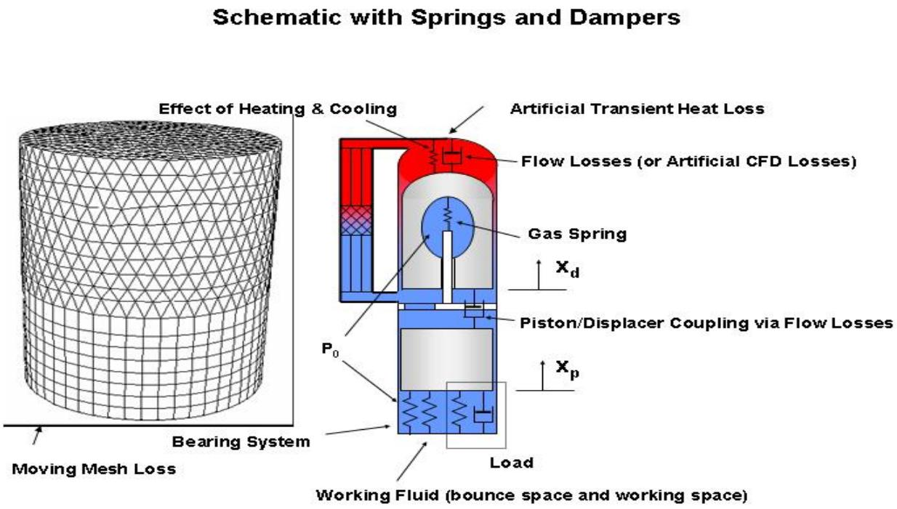  
Figure 1. Schematic of Actual and Artificial Numerical Losses in a Free-Piston Convertor

## II. Description of the Problem

The dual opposed configuration shown in figure 2 13, 17, 18 is being developed for multimission use (i.e., for use in atmospheres and space), including providing electric power for potential missions such as unmanned Mars rovers and deep space missions.19

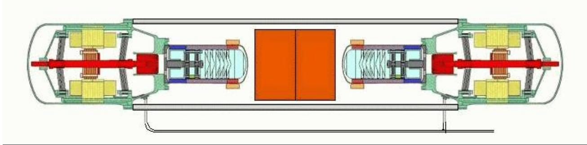  
Figure 2. Dual Opposed Stirling Convertors Reduce Vibration (Schreiber)

An example of the desired full Stirling engine simulation is shown in Fig. 3.16 The pseudo design is presented to avoid export control issues. It is anticipated that full 3D simulations will provide a level of geometric and flow detail necessary for further design improvements. For example, hardware experiments have shown that large performance gains can be made by varying manifolds and heat exchanger designs to improve flow distributions in the heat exchangers.13, 14, 15

The kinds of flow and geometry that occur in a Stirling engine for which a modeling technique must address are as follows:8, 7

1. Oscillating flow which changes the efective conduction, flow friction coeficients and heat difusion.20

2. Low mach number flow (no shocks),

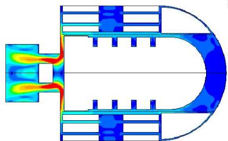

3. Compressible flow due to enclosed varying volumes and heat transfer efects,

4. Laminar, Transitional, and Turbulent flow with Reynolds numbers from 100 to 10000 (based on various length scales pertinent to the flow region),

Figure 3. Example Transient Simulation of Pseudo Stirling Convertor-Colored by Velocity Magnitude

5. Conjugate heat transfer, thermal dispersion and local thermal nonequilibrium in the porous media regenerator,

6. Micron to Millimeter scale geometry21

7. Sliding Interfaces in the appendix gap

8. Deforming Flow Regions Due to Compression and Expansion

## III. Stirling Cycle Analysis Approaches

The techniques of analysis for Stirling engines can be categorized with Martini’s22, 23 nomenclature as follows:

## A. Zeroth Order Analysis

William Beale observed24 that most modern engines operate under similar conditions of the parametric ratios: dead volume ratio, temperature ratio, swept volume ratio, displacer-piston phase angle advance. Thus correlating the experimental data available on various engines, he found that one could represent the engine performance as:

$$
P _ { 0 } = 0 . 0 1 5 p _ { m e a n } V _ { s w } f\tag{1}
$$

## B. First Order Analysis

The first analysis of Stirling engines was done in 1871 by Gustav Schmidt in which he obtained closed-form solutions for the special case of sinusoidal volume variations and isothermal hot and cold spaces.25 In Fig. B (a), the model equations from the isothermal assumption shown in Fig. 4 is shown. These can be integrated with a computer but a closed form solution is available in which sinusoidal motion is assumed.

The relative volume changes can be calculated using the phasor diagram and schematic in Figs. 5 (b and c). This analysis is loss-free and a correction factor is normally applied in practical designs to account for the losses.

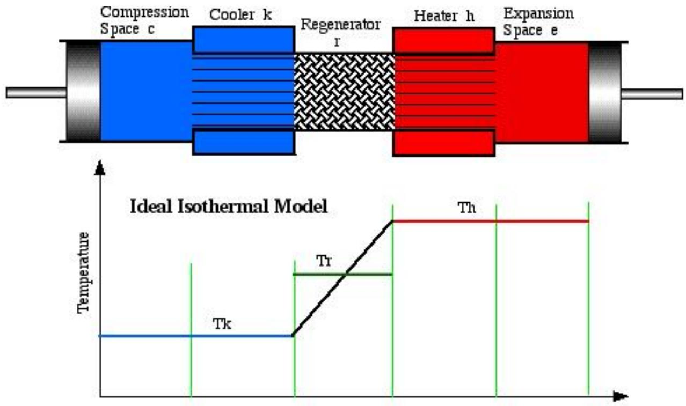

Figure 4. Ideal Isothermal Model (Urieli)  
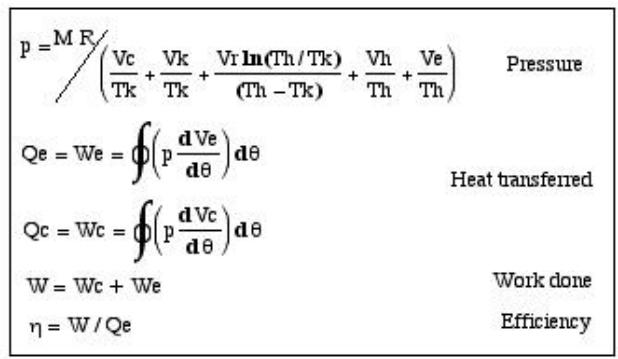  
(a) Ideal Isothermal model set of equations

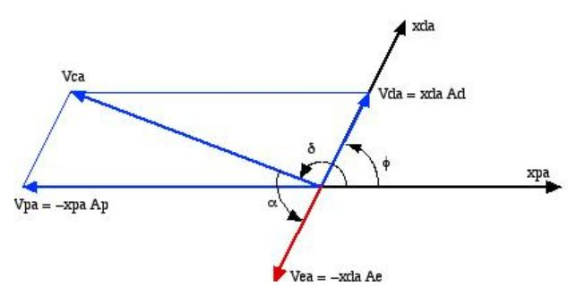  
(b) Volume Vector Diagram  
Figure 5. Closed Form Solution Process (Urieli)

## C. Second Order Analysis

This level of analysis may be based on an adiabatic analysis that subtracts losses caused by heat transfer and flow power losses. It relies on a modified Schmidt analysis (Schmidt analysis normally implies isothermal hot and cold spaces) and requires nonlinear time integration of the model equations. It assumes adiabatic expansion and compression regions as shown in Fig. 6(a).

## 1. Heat Transfer Losses

Heat transfer loss occurs throughout the system but notably in the appendix gap region (space between displacer and heat exchangers) through the following processes:24

• Shuttle heat transfer in which a conduction loss down the displacer or piston and associated cylinder is enhanced by one wall’s oscillatory motion27

• Gas enthalpy transfer (pumping) which is the net enthalpy transport down the gap by virtue of the working gas motion, pressure and temperature.

• Hysteresis heat transfer which is the net heat transfer from the gas to the cylinder due to temperature gradients set up by the pressure variations in the expansion space.

In addition, conduction losses through the wall and displacer must be accounted for.

## 2. Flow Power Losses

Flow power loss occurs mostly in the regenerator region due to pressure drop across the matrix (which may be enhanced by non-uniform flow). The viscosity of the working gas and gas spring hysteresis losses must also be accounted for.

## 3. Berchowitz Dynamic and Thermondynamic Closed Form

A closed form expression (Fig. 7) which included masses for dynamic as well as thermodynamic analysis was derived by Berchowitz.26

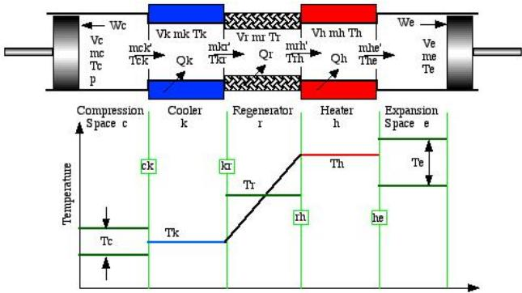  
(a) Ideal Adiabatic Model

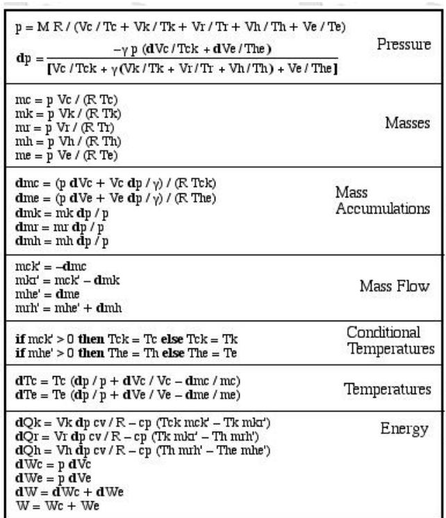  
(b) Ideal Adiabatic Model Equations  
Figure 6. Adiabatic Solution Process (Urieli)

## D. Third Order Analysis

Third order analysis uses control volumes or nodes to directly solve one-dimensional governing equations. Some of the first analysis at this level of fidelity was by Finkelstein,28 Urieli,29 and Berchowitz.30

The codes by David Gedeon referred to as GLIMPS31, 32 and Sage33, 34, 35 are onedimensional and solve the governing equations implicitly in space and time. The grid includes all time because a periodic solution is assumed/forced. Therefore, it is not possible to model transient startup behavior.

The linearized harmonic analysis code referred to as HFAST36 solved a steady-state periodic problem in the frequency domain. Again, transient behavior is not modeled.

The code by Martini engineering37 was never validated but claimed transient modeling capability. It is not clear the governing equations are being solved since it appears many simplifications based on experimental correlations are used.

Another unvalidated but interesting code by Renfroe38 attempted a one-dimensional analysis using explicit Runge-Kutta time stepping and a Newton solver to solve the nonlinear equations.

Free-Piston Stirling Dynamic Equations (Berchowitz, 1980's)

Closed form solution linear model, models thermodynamics and dynamics

Frequency of Operation

$$
\cos ^ { 2 } = \frac { \cos \theta _ { \mathrm { d } } + \cos \theta _ { \mathrm { p } } - 2 \pi ( \mathsf { D } _ { \mathrm { d p } } / \mathsf { m } _ { \mathrm { d } } ) ( \mathbf { a } _ { \mathrm { f } } / \mathsf { m } _ { \mathrm { p } } ) \mathsf { Q } _ { \mathrm { d } } \mathsf { Q } _ { \mathrm { p } } / ( \mathsf { m } _ { \mathrm { d } } \mathsf { Q } _ { \mathrm { p } } ) } { \mathsf { Q } _ { \mathrm { d } } / \mathsf { m } _ { \mathrm { d } } + \mathsf { Q } _ { \mathrm { p } } / \mathsf { m } _ { \mathrm { p } } }
$$

Stroke Ratio

$$
\left| \frac { x \mathsf { d } } { x \mathsf { p } } \right| = \frac { ( a _ { \mathrm { p } } ^ { 2 } + \varpi _ { \mathrm { 0 } } ^ { 2 } D _ { \Phi } ^ { 2 } ) ^ { 1 / 2 } } { \mathsf { K } _ { \mathrm { d } } } \left[ \left\{ 1 - \left( \frac { \mathsf { \Omega } \mathsf { \Omega } _ { \mathrm { 0 } } } { \mathsf { \Omega } _ { \mathrm { 0 } } } \right) ^ { 2 } \right\} ^ { 2 } + \left\{ \frac { \varpi _ { \mathrm { 0 } } } { \mathsf { \Omega } _ { \mathrm { 0 } } } \frac { 1 } { 2 \pi \mathsf { Q } _ { \mathrm { d } } } \right\} \right]
$$

Displacer to Piston Phase Angle

$$
\phi = \tan \uparrow \left[ \frac { - \underline { { \mathbf { o } } } _ { 0 } \mathsf { \Pi } \mathsf { D } _ { \mathrm { d p } } \left\{ 1 - \left( \frac { \underline { { \mathbf { o } } } _ { 0 } } { \underline { { \mathbf { o } } } _ { \mathrm { d } } } \right) \right\} + \frac { \underline { { \mathbf { o } } } _ { 0 } } { \underline { { \mathbf { \Pi } } } _ { \mathrm { d } } } \frac { 1 } { 2 \mathbf { \pi } \mathsf { 0 } _ { \mathrm { d } } } } { \sqrt { \uparrow } \left( \frac { - \underline { { \mathbf { o } } } _ { 0 } } { \overline { { \mathbf { o } } } _ { \mathrm { d } } } \right) ^ { 2 } \ - \underline { { \mathbf { o } } } _ { \mathrm { d } } \ \frac { \mathsf { \Pi } _ { \mathrm { o } } } { \underline { { \mathbf { o } } } _ { \mathrm { p } } } \ 2 \mathbf { \Pi } \mathsf { \Pi } _ { \mathrm { \overline { { \mathbf { \Pi } } } } } ^ { 1 } } \right]
$$

Power

$$
P = \frac { 0 . ( p ) \sqrt { 1 - ( 2 / S ) ^ { 2 } } } { 2 } \frac { R ^ { 2 } } { S } ( 1 - \frac { R _ { R } } { R } ) ( 1 - \frac { T _ { k } } { T _ { n } } - \frac { R _ { R } } { A } ) \times _ { d } | | x _ { p } | \sin \phi
$$

Figure 7. Closed Form Adiabatic Solution (Schreiber)

Finally, the Stirling dynamic model (SDM),39 uses a one-dimensional analogy of an entire Stirling convertor by linking together representative elements within the Simplorer(TM) commercial software package by Ansoft Corp. This tool enables approximate whole convertor dynamic analysis. Recent work attempts to incorporate thermodynamics via David Gedeon’s Sage code described earlier.

## E. Fourth Order (Multi-Dimensional) Analysis

At this level of analysis, relatively little has been completed because the third order analysis is faster and for the most part has been an adequate engineering tool. However, to improve eficiency further (to understand and reduce losses) it will likely require a better understanding of the actual flow features and heat transfer throughout the engine.

## 1. Modified Computer Aided Simulation of Turbulence (CAST)

The modified CAST code40 is based upon the Semi-Implicit Method for Pressure-Linked Equations SIM-PLE41 method but is restricted to two dimensions.42 It was modified to include oscillatory boundary conditions and conjugate heat transfer. It has been used to model Stirling components but has not been extended to a whole engine simulation tool.

A pressure-splitting technique was added43 to reduce the computational requirements. It was based on separating the thermodynamic and hydrodynamic pressures so that these widely varying scales could be solved with less round-of error and better eficiency.

## 2. CFD-ACE

This commercial code has been used to model a two-dimensional representative Stirling engine.44, 45 It is also based upon the SIMPLE technique. The regenerator is not currently modeled correctly since thermal equilibrium is assumed between the gas and solid. The code does not currently support sliding interfaces on parallel computers which is critical for modeling the appendix gap region.

This finite volume code can utilize both structured and unstructured grids.

## 3. Fluent

This commercial code is also based upon the SIMPLE method (and PISO method for high speed flows). It currently has similar regenerator modeling limitations in that it is designed for non-oscillating flows. It does however have a sliding interface that could be used for appendix gap modeling on parallel computers. It is being used by several commercial manufacturers for this purpose (references are proprietary). It is also finite volume based and can utilize both structured and unstructured grids.

## 4. STAR-CD

The Simulation of Turbulent Flow in Arbitrary Regions (STAR)46 code also uses SIMPLE and PISO methods. Its companion product (STAR-HPC) is the parallel computer version. It also has sliding interfaces and deforming mesh capability. It has been used in the related field of internal combustion engine piston modeling, and some Stirling engines have been modeled with it.47

## 5. CFX

This code also used SIMPLE and PISO methods on unstructured grids. It also has sliding interfaces implemented, but no stirling engine modeling with this software has been publicly published.48

## 6. Others

While there are other in-house codes, they are usually limited to modeling only specific regions of the Stirling engine such as the regenerator, or the displacer.

## IV. Whole Engine Modeling

The use of two-dimensional CFD models can significantly extend the capabilities, compared to third-order analysis, for the more detailed analysis of the complex heat transfer and gas dynamical processes which occur in the internal gas circuit.52 A standard κ −  turbulence model has been used for such two-dimensional simulations, but the flow is constantly transitioning from laminar to turbulent and back. A better numerical model would be large eddy simulation due to the transient nature of the flow. More recently, full 3-D calculations have been performed with a commercial code.53 The temperature results are similar to the second order method results.54 The multidimensionally computed power, however, was about half of the second order prediction. Moreover, along the axis of the compression space it was found the change of the temperature of the working gas was quite diferent from harmonic in time. Third order modeling eforts can resolve higher harmonics of periodic time functions and therefore if enough grid points are available in time they can achieve similar results. However, turbulence is inherently a-periodic and it is not clear if third order modeling eforts which assume periodic solutions can fully capture this.

## V. Regenerator Modeling

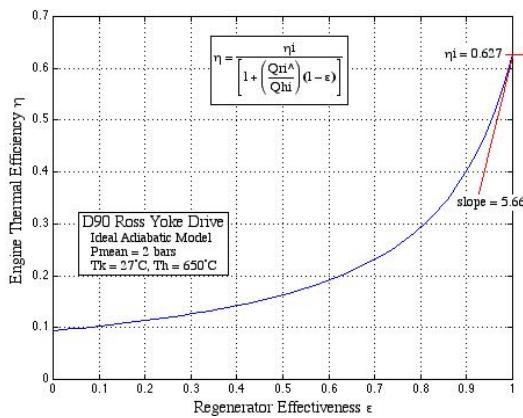  
Figure 8. Importance of Properly Modeling the Regenerator for System Studies (Urieli)

A very important specific area of modeling dificulty is the regenerator. As shown in Fig. 8, since the regenerator (depending upon one’s definition of efective) has roughly 3 to 40 times more efective heat transfer than the heater,55 any ineficiency of the regenerator represents a significant loss for the entire Stirling engine. Hence, any numerical losses in this region will disproportionately influence the entire Stirling simulation. A new low loss numerical method will be proposed later to address this.

## A. Manifest

The code referred to as Manifest21 solved the porous medium model equations shown below:

$$
\begin{array} { r l } & { \frac { \partial M } { \partial \tau } + \frac { J } { \beta } \frac { \partial } { \partial y _ { k } } \left( \frac { G ^ { k } } { J } \right) = 0 } \\ & { \frac { \partial G ^ { n } } { \partial \tau } + \left( J \frac { \partial } { \partial y _ { k } } \left( \frac { G ^ { k } } { J } u _ { j } - \frac { \beta } { J } \tau _ { e i j } \frac { \partial y _ { k } } { \partial x _ { i } } \right) + \beta J \frac { \partial } { \partial y _ { k } } \left( \frac { P } { J } \frac { \partial y _ { k } } { \partial x _ { j } } \right) + \beta \psi _ { j k } u _ { k } \right) \frac { \partial y _ { n } } { \partial x _ { j } } = 0 } \\ & { \frac { \partial E } { \partial \tau } + \frac { J } { \beta } \frac { \partial } { \partial y _ { k } } \left( \frac { E } { J } \beta u ^ { k } + \frac { 1 } { J } ( P \beta V ) ^ { k } - \frac { 1 } { J } ( \tau _ { e } - \beta V ) ^ { k } + \frac { \beta } { J } q _ { e } ^ { k } \right) - Q = 0 } \\ & { \frac { \partial } { \partial \tau } ( \lambda T _ { s } ) + Q = 0 } \end{array}\tag{2}
$$

where $M = \rho , G = \beta \rho V , E = \rho e$ , using the Beam and Warm-$\mathrm { i n g ^ { 5 6 } }$ implicit time stepping approach. This code was written

in curvilinear coordinates and seemed to perform well for low Reynolds number jets impinging the matrix.   
It was not developed further because of excessive computational time.

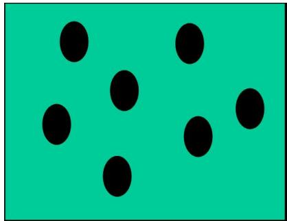  
(a) Idealized Geomertry

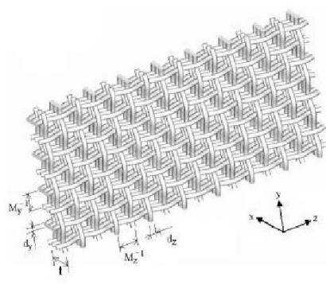  
(b) Regularized Geometry

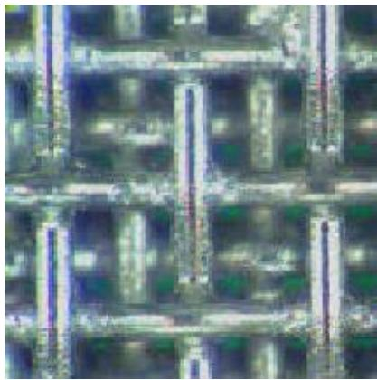  
(c) Photographed Geometry  
Figure 9. Regenerator Geometry

Another important issue is the geometrical shape of the matrix in the regenerator. As shown in Fig. 9, most regenerator models don’t assume a precise geometrical shape for the elements of the regenerator. However, as reported in Park,49 a simple-to-fabricate woven mesh, consisting of bonded laminates of twodimensional plain-weave conductive screens can be manufactured to have a wide range of porosity and a highly anisotropic thermal conductivity vector. In addition to providing superior performance in many cases,50 the regular geometry greatly simplifies the analysis. However, those mesh sheets are not woven wire screens formed by etching used in regenerators which may in practice not be as precisely formed as mesh sheets.

## VI. Numerical Error and Eficiency

The critical issues in simulating a Stirling engine are:

1. The artificial numerical losses should be a small percentage of the actual losses

2. The simulation must complete in a reasonable amount of time.

The first issue is a problem with many commercial codes that utilize low order methods. For example, this problem can be observed with a simple first order approximation of the first derivative:

$$
{ \frac { d F ( t ) } { d t } } \approx { \frac { \Delta F } { \Delta t } } = { \frac { F ( t + \Delta t ) - F ( t ) } { \Delta t } }\tag{3}
$$

We may assume we are computing the derivative of a simple harmonic function, $F ( t ) = e ^ { i \omega t }$ . We find the first order derivative approximation in Eq. (3) results in the solution:

$$
\begin{array} { r l } { \frac { \Delta F } { \Delta t } = \frac { e ^ { i \omega t } \left( e ^ { i \omega \Delta t } - 1 \right) } { \Delta t } = } & { i \omega e ^ { i \omega t } \left( \frac { e ^ { i \omega \frac { \Delta t } { 2 } } - e ^ { - i \omega \frac { \Delta t } { 2 } } } { 2 i } \right) \left( \frac { e ^ { i \omega \frac { \Delta t } { 2 } } } { \omega \frac { \Delta t } { 2 } } \right) } \\ & { = i \omega e ^ { i \omega t } \left( \frac { \sin \left( \frac { \omega \Delta t } { 2 } \right) } { \omega \frac { \Delta t } { 2 } } \right) e ^ { i \omega \frac { \Delta t } { 2 } } } \\ & { = \frac { d F ( t ) } { d t } \underbrace { \left( \frac { \sin \left( \frac { \omega \Delta t } { 2 } \right) } { \frac { \omega \Delta t } { 2 } } \right) } _ { D i s s i p a t i o n } \underbrace { e ^ { i \omega \frac { \Delta t } { 2 } } } _ { D i s p e r s i o n } } \end{array}\tag{4}
$$

Higher order approximations of the derivative introduce similar errors, but their relative efect is less.

## A. Time Advance Error

In addition to the spatial and temporal discretizations which produce the dispersive and dissipative errors as discussed, another form of error which is important for oscillating flows is improperly modeled multi dimensionsal boundary conditions.

As an example, consider the pressure near the displacer wall. The numerical approach can be expanded as a Taylor series in time:

$$
p ( x , y , t + \Delta t ) = p ( x , y , t ) + \Delta t \frac { \partial p } { \partial t } + \frac { \Delta t ^ { 2 } } { 2 ! } \frac { \partial ^ { 2 } p } { \partial t ^ { 2 } } + . . .\tag{5}
$$

If the time derivatives are written as space derivatives (for simplicity consider 2D Euler flows):

$$
\frac { \partial p } { \partial t } = - \left( u \frac { \partial p } { \partial x } + v \frac { \partial p } { \partial y } + \gamma p \left( \frac { \partial u } { \partial x } + \frac { \partial v } { \partial y } \right) \right)\tag{6}
$$

Then clearly these spatial derivatives must be properly defined at a surface for the time derivative to be correct. Unfortunately, most commercial codes only impose the no-flow condition and these spatial derivative terms are not properly posed at the boundary.51 This error represents the wrong time-accurate physics near walls. If the walls are moving (such as in a displacer) this error is more pronounced.

Higher time derivatives have many more terms in them that are generally incorrectly modeled at surfaces. For example in Fig. 10, the colored terms represent commonly improperly posed terms. The pink represents first order or dispersive error, the green represents difusive error, and the blue represents an error in the entropy terms. In an oscillating flow loss study, these terms can become significant as time accumulates.

## B. Description of the SIMPLE method commonly used

The Semi-Implicit Method for Pressure-Linked Equations (SIMPLE) is used in most of the commercial codes today. An understanding of its efect on Stirling simulations is important for interpreting the losses found from present computational analysis.

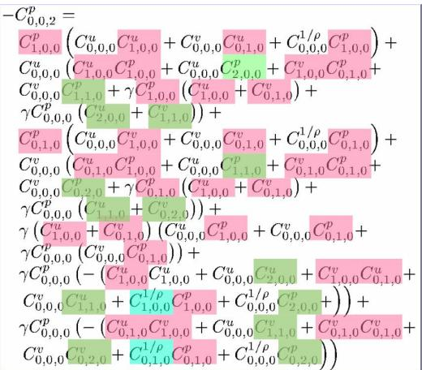  
Figure 10. Second Time Derivative

## C. Improving Eficiency

One of the primary limitations of using commercial codes today for three-dimensional analysis of Stirling cycle engines is the

time it takes for second order accurate analysis. A recent trend which improves this situation is relatively low-cost parallel computers (pictured in Fig. 11(a)). The trend is for more processors on a single board and for higher speed communications linking many boards together. Many commercial codes using the SIMPLE method can now utilize parallel computing, however, there still seems to be a practical limit due to the implicit nature of the method. Further improvement in performance can be expected by utilizing high order methods as shown in Fig. 11(b). The higher order methods in conjuction with parallel computing ofer the promise of design speed analysis. An explicit method with these properties is presented in the next section.

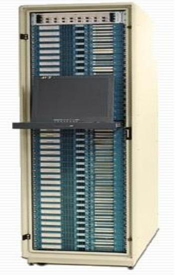  
(a) Cluster Computing

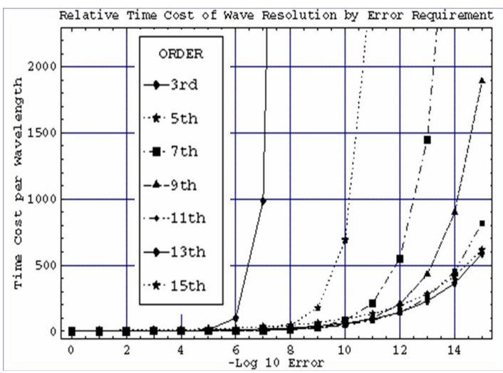  
(b) Eficiency Chart  
Figure 11. Enhancing Simulation Performance

## VII. Proposed Computational Stirling Analysis Numerical Approach

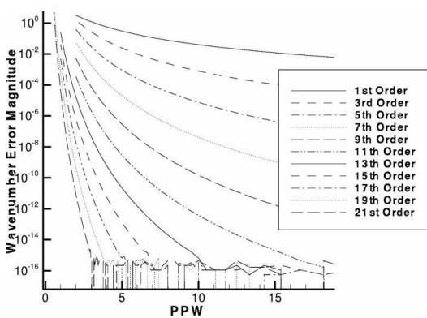  
Figure 12. Points Per Wavelength Comparison

Computational Stirling Analysis (CSA) requires eficient, high-resolution simulation tools. Most current CSA techniques utilize low order finite-volume approaches because high order accuracy is considered too dificult or expensive to achieve and hopefully unnecessary for some problems. As shown in Fig. 12, these low order techniques require a relatively dense grid compared to the high order approaches. Two notable exceptions are the finite-volume WENO and finite element Discontinuos Galerkin Methods (DGM).57 However, they tend to be inefficient computationally due to their use of unstructured grids and complicated mathematics.

Although finite diference techniques have been developed which maintain low losses over time, they have great dificulty insuring flow conservation in crucial locations (i.e. appendix gap, moving geometry). Moreover, the finite diference form produces grid singularities at block corners of a multiblock curvilinear grid. In three dimensions, grid singularities become lines of only first order accuracy which swirling turbulent flow will force convected disturbances through.

It’s accepted common practice to use low-order finite volume techniques in computational fluid dynamics58 precisely because of the drawbacks of finite-diference techniques in complex geometry. CSA has focused on low order finite-volume techniques because it is not currently clear how to extend finite-volume techniques to very high order. Only recently have modest improvements in the accuracy been achieved. For example, Agarwal59 has developed a fourth order finite volume technique for the Euler equations on unstructured grids. And, Wang60 developed a fourth order optimized structured/curvilinear finite-volume technique. And, Rezgui61 has developed a third-order finite-volume Euler solver. A low dispersion finite volume technique by Nance62 used Tam’s dispersion relationship preservation on the interpolated flux to improve spatial resolution. And most recently, Z.J. Wang63 developed a spectral volume method in which more degrees of freedom are made available by using subcells within a cell. As shown in Figs. 13 and 14, the third order method produced better results while using exactly the same number of degrees of freedom.

These recent developments demonstrate the feasibility and importance of high order low dissipation low dispersion finite-volume techniques. But their basic approaches severely limit their potential for very highorder extensions which are known to produce significant performance improvements51 without the need for special optimizations.

Building upon previously established Hermitian finite-diference approaches,51 this work utilizes the spatial derivatives of the convective fluxes to insure exceptionally high resolution and eficiency in complex geometries. The technique can be used to model a complete Stirling engine.

## VIII. Numerical Approach

For pedagogical simplicity, the two-dimensional Euler equations will be shown, but the extension to fully viscous flows is straight-forward. The finite-volume form of the Euler equations is normally solved in physical

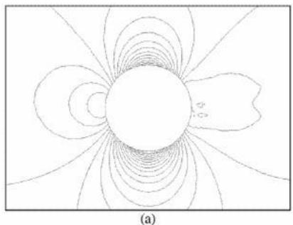  
(a) 2nd Order Faceted

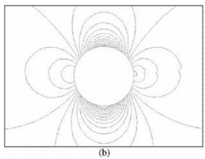  
(b) 2nd Order Curved

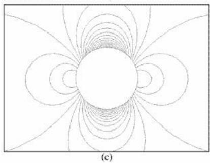  
(c) 3rd Order

Figure 13. Density Contour-Comparing faceted geometry (a), curved geometry (b), and curved geomtry higher order (c)  
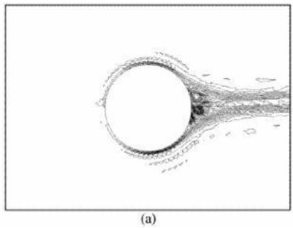  
(a) 2nd Order Faceted

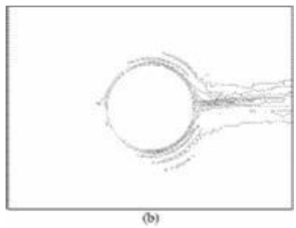  
(b) 2nd Order Curved

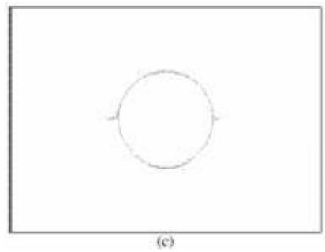  
(c) 3rd Order  
Figure 14. Entropy Production-Comparing faceted geometry (a), curved geometry (b), and curved geomtry higher order (c)

coordinates and can be written as:58

$$
\begin{array} { r } { \vec { W } = \left[ \begin{array} { c } { \rho } \\ { \rho } \\ { \rho u } \\ { \rho v } \\ { \rho E } \end{array} \right] , \vec { F } _ { c } = \left[ \begin{array} { c } { \rho _ { 0 } } \\ { \rho v } \\ { \rho v } \\ { \rho H V } \end{array} \right] , V \equiv \vec { v } \cdot \vec { n } = n _ { x } u + n _ { y } v } \\ { p = ( \gamma - 1 ) \rho \left[ E - \frac { u ^ { 2 } + v ^ { 2 } } { 2 } \right] , H = E + \frac { p } { \rho } } \end{array}\tag{7}
$$

However, recently structured multiblock grid generators have become available that can generate a very smooth curvilinear grid. Therefore, the following finite-volume form of the Euler equations can be used with many advantages over the traditional physical coordinate system finite volume (used in commercial packages) and the curvilinear multiblock finite diference methodologies.67, 68

$$
\begin{array} { r l r } { \int _ { \Omega } \left( \frac { \partial \vec { W } _ { 1 } } { \partial t } \right) d \xi d \eta } & { = } & { - \int _ { \Omega } \left( \frac { \partial \vec { F } _ { 1 } } { \partial \xi } + \frac { \partial \vec { G } _ { 1 } } { \partial \eta } \right) d \xi d \eta } \\ & { = } & { - \oint _ { \partial \Omega } \left( \vec { F } _ { 1 } d \eta - \vec { G } _ { 1 } d \xi \right) } \end{array}\tag{8}
$$

where

$$
\begin{array} { r c l } { \vec { W } _ { 1 } } & { = } & { J \vec { W } } \\ { \vec { F } _ { 1 } } & { = } & { J \vec { F } \frac { \partial \xi } { \partial x } + J \vec { G } \frac { \partial \xi } { \partial y } = \vec { F } \frac { \partial y } { \partial \eta } - \vec { G } \frac { \partial x } { \partial \eta } } \\ { \vec { G } _ { 1 } } & { = } & { J \vec { F } \frac { \partial \eta } { \partial x } + J \vec { G } \frac { \partial \eta } { \partial y } = - \vec { F } \frac { \partial y } { \partial \xi } - \vec { G } \frac { \partial x } { \partial \xi } } \end{array}\tag{9}
$$

The jacobian determinant, J, is defined by:

$$
\begin{array} { r } { J \equiv \frac { \partial ( x , y ) } { \partial ( \xi , \eta ) } \equiv \left| \begin{array} { l l } { \frac { \partial x } { \partial \xi } } & { \frac { \partial y } { \partial \xi } } \\ { \frac { \partial x } { \partial \eta } } & { \frac { \partial y } { \partial \eta } } \end{array} \right| } \end{array}\tag{10}
$$

And the original Cartesian solution and flux vectors are:

$$
\vec { W } = \left\{ \begin{array} { c } { \rho } \\ { \rho u } \\ { \rho v } \\ { \rho E } \end{array} \right\} \mathrm { ~ , ~ } \vec { F } = \left\{ \begin{array} { c } { \rho u } \\ { \rho u ^ { 2 } + p } \\ { \rho u v } \\ { \rho u E + p u } \end{array} \right\} \mathrm { ~ , ~ } \vec { G } = \left\{ \begin{array} { c } { \rho v } \\ { \rho u v } \\ { \rho v ^ { 2 } + p } \\ { \rho v E + p v } \end{array} \right\}\tag{11}
$$

E is total energy (internal energy plus kinetic energy) per unit mass, $\begin{array} { r } { E = e + \frac { V ^ { 2 } } { 2 } } \end{array}$

The surface integrals can be simply performed in the computational space since all cells have unit spacing. Since derivatives of the solution are also available one can assume a polynomial shape function69 and the integrals become:

$$
\begin{array} { r c l } { \int _ { 0 } ^ { 1 } \vec { F } _ { 1 } ( \xi , \eta ) d \eta } & { = } & { \int ( \vec { a } _ { 0 0 } + \vec { a } _ { 1 0 } \xi + \vec { a } _ { 0 1 } \eta + \vec { a } _ { 1 1 } \xi \eta ) d \eta } \\ & { = } & { \vec { a } _ { 0 0 } \Delta \eta + \vec { a } _ { 1 0 } \xi \Delta \eta + \vec { a } _ { 0 1 } \frac { 1 } { 2 } ( \Delta \eta ) ^ { 2 } + \vec { a } _ { 1 1 } \frac { 1 } { 2 } \xi ( \Delta \eta ) ^ { 2 } } \\ { \int _ { 0 } ^ { 1 } \vec { G } _ { 1 } ( \xi , \eta ) d \xi } & { = } & { \int ( \vec { a } _ { 0 0 } + \vec { a } _ { 1 0 } \xi + \vec { a } _ { 0 1 } \eta + \vec { a } _ { 1 1 } \xi \eta ) d \xi } \\ & { = } & { \vec { a } _ { 0 0 } \Delta \xi + \vec { a } _ { 1 0 } \frac { 1 } { 2 } ( \Delta \xi ) ^ { 2 } + \vec { a } _ { 0 1 } ( \Delta \xi ) \eta + \vec { a } _ { 1 1 } \frac { 1 } { 2 } ( \Delta \xi ) ^ { 2 } \eta } \end{array}\tag{12}
$$

where $\Delta \xi = \Delta \eta = 1$ . The $a _ { i , j }$ coeficients can be found using Hermitian divided diferences51 As was done by Agarwal59 and similar to Goodrich70 the governing equations may be diferentiated as follows in curvilinear coordinates:

$$
\begin{array} { r l r } { \int _ { \Omega } \left( \frac { \partial ^ { m + n + 1 } \vec { W } _ { 1 } } { \partial \xi ^ { m } \partial \eta ^ { n } \partial t } \right) d \xi d \eta } & { = } & { - \oint _ { \partial \Omega } \left( \frac { \partial ^ { m + n } \vec { F } _ { 1 } } { \partial \xi ^ { m } \eta ^ { n } } d \eta - \frac { \partial ^ { m + n } \vec { G } _ { 1 } } { \partial \xi ^ { m } \eta ^ { n } } d \xi \right) } \end{array}\tag{13}
$$

The fluxes may be calculated either using Jameson71 style centered, but high order flux diferences or by using a pseudo one-dimensional Riemann solution between the left and right states as follows:59

$$
\vec { F _ { 1 m , n } } = \frac { 1 } { 2 } \left[ \underbrace { \vec { F _ { 1 m , n } } } _ { R i g h t } + \underbrace { \vec { F _ { 1 m , n } } } _ { L e f t } - S | \Delta | \Delta ^ { - 1 } S ^ { - 1 } ( \underbrace { \vec { F _ { 1 m , n } } } _ { R i g h t } - \underbrace { \vec { F _ { 1 m , n } } } _ { L e f t } ) \right]\tag{14}
$$

where S is the similarity matrix for diagonilizing the Jacobian $\partial \vec { F _ { 1 m , n } } / \partial W _ { m , n } , \Delta$ is the eigenvalue diagonal matrix, and |∆| refers to the spectral radius of $\Delta$

With these developments many arbitrary accuracy finite volume schemes can be implemented to arbitrary order accuracy in space. The time advancement may be implemented with Runge-Kutta schemes for low frequency Stirling simulations that contain high wavenumber requirements (steep flow gradients). Or the recursive time advance technique51 could be used to achieve arbitrary accuracy in time as well.

## IX. Curvilinear Grid Issues

One of the primary advantages of this finite-volume formulation over the common finite diference approach is in resolving grid singularity issues as shown in Fig. 15.

For the following reasons, a structured curvilinear multiblock arbitrary accuracy finite volume CSA code should be developed:

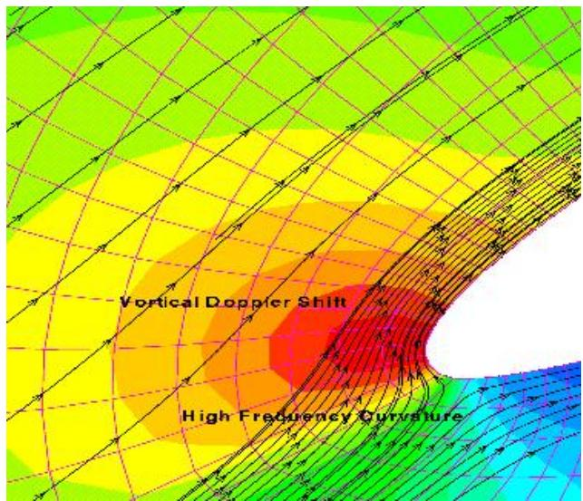  
(a) Metric Term Gradient Distribution

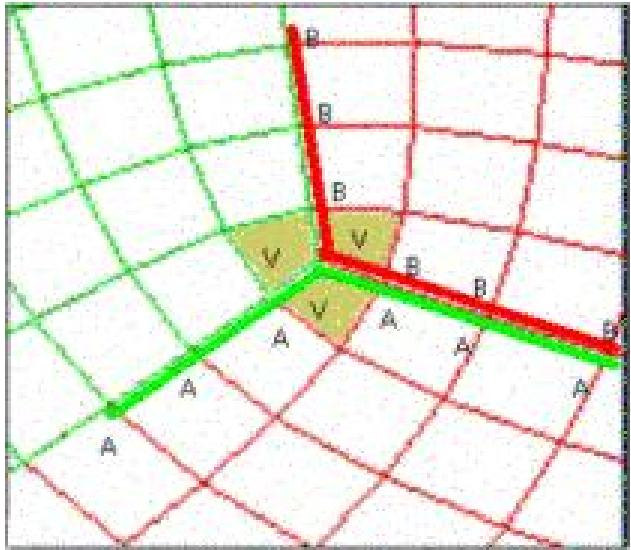  
(b) Grid Singularity Avoided With Finite Volume  
Figure 15. Grid singularities are unavoidable in complex geometries and act as a source of 1st order noise for finite diference methods. For example, calculating a derivative with a 7-point stencil (marked with ”A” or ”B”) is indeterminate. A finite volume (with volumes ”V”) method communicates through faces and hence this grid poses no problems for it.

• Calculating spatial derivatives is reduced to 1st order accuracy at grid singularities with a finitediference method. However, a finite-volume method communicates through cell faces only and for the grid singularity shown all faces are uniquely defined.

• In three-dimensions this advantage is significant because grid singularities become lines of first order error. The swirling turbulent flow in the expansion and compression spaces will cause all convected disturbances to travel through this region with many undesirable side efects.

• In addition to enabling high accuracy everywhere this formulation will resolve high curvature without requiring as many grid points when the fluxes are written in strong conservation form.

• Parallel implementation is direct as well and does not require changing the wave propagation speeds that converting from an implicit compact to an explicit centered scheme does.

• Flat plates are easily solved and therefore code validation can be performed on standard oscillating flow flat plate heat exchanger before trying more complex problems.

## X. Time-Stepping Options

One significant diference with time-stepping finite-volume cells relative to finite-diference and finiteelement cells is the time derivatives are actually cell averages. So it is possible to contain physical shocks within a cell and its cell average derivatives still are defined. Thanks to the property that integration ignores singularities, it seems plausible to have both high order accuracy and shocks without sacrificing either.

Standard Runge-Kutta time-stepping can be used, but it’s not recommended because fidelity and stability is sacrificed since currently available methods efectively widen the stencil because they do not properly account for the presence of spatial derivative information on the grid.

## A. Arbitrary Time Accuracy

If higher operating frequencies in Stirling devices are encountered then a recursive51 technique of timestepping can be used on each cell. Again, since the mixed space-time derivatives are actually cell averages, they are still defined even in shocked flow.

## XI. Flux Interpolation

It is necessary to convert the spatially-averaged cell quantities to a form for interpolating the fluxes at the cell edges. The spatially averaged flow variables can be used as constraints as done by Lomax.72 This requires solving a matrix system for a polynomial that when volume integrated matches the spatially-averaged cell quantity. If Hermite data is on the grid, then for example, a single cell interpolation with $f , f _ { x } , f _ { x x }$ produces a fourth order technique if the left and right interpolated fluxes are averaged. However, by using data from two neighboring cells we can get $6 ^ { t h }$ order accuracy.

If we have up to s derivatives in each cell, as shown in the figure 16,

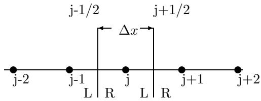  
Figure 16. Control volume in one dimension

we can assume that the polynomial interpolating the flow variables looks like for cells j and $j + 1 \colon$

$$
u ( \xi ) = \sum _ { i = 0 } ^ { 2 s + 1 } a _ { i } \xi ^ { i }\tag{15}
$$

The following constraints are applied to find the coeficients $a _ { i } \cdot$

$$
\begin{array} { r } { \frac { 1 } { \Delta x } \int _ { - \Delta x / 2 } ^ { \Delta x / 2 } \frac { \partial ^ { m } u ( \xi ) } { \partial x ^ { m } } d \xi = \frac { \partial ^ { m } \bar { u _ { j } } } { \partial x ^ { m } } } \\ { \frac { 1 } { \Delta x } \int _ { \Delta x / 2 } ^ { 3 \Delta x / 2 } \frac { \partial ^ { m } u ( \xi ) } { \partial x ^ { m } } d \xi = \frac { \partial ^ { m } u _ { \bar { j } + 1 } ^ { - } } { \partial x ^ { m } } } \end{array}\tag{16}
$$

with m=0 up to s.

The flux can then be calculated at the cell faces using the high order interpolant.

A $4 1 ^ { s t }$ order method using two cells would require inverting a 41 × 41 matrix which gets expensive. The problem is worse in multiple dimensions. Instead, we can use the extended divided diferences51 and a process known as reconstruction via the primitive function64 or RP (see Colella and Woodward.73

Steps are for all m=0 up to s:

Step 1 Find $F _ { m } ( x _ { - 1 / 2 } ) = 0 , F _ { m } ( x _ { 1 / 2 } ) = \Delta x \bar { f } _ { m _ { j } } F _ { m } ( x _ { 3 / 2 } ) = \Delta x \bar { f } _ { m _ { j } } + \Delta x \bar { f } _ { j + 1 }$

Step 2 Use Hermitian divided diferences on the data in Step 1 to create an interpolation polynomial. Choose a local coordinate system with $\xi = 0$ somewhere in the two cells. The coeficients of $P ( \xi ) = b _ { 0 } + b _ { 1 } \xi +$ ${ \frac { 1 } { 2 } } b _ { 2 } \xi ^ { 2 } + \ldots$ . can be found. This function is also easily diferentiated.

Step 3 And then, since the sample function $\begin{array} { r } { f ( \xi ) = \frac { \partial F } { \partial x } } \end{array}$ and $F ( x ) \approx P ( x )$ , a function approximating $\operatorname { f } ( \mathbf { x } )$ is $\textstyle p ( x ) = { \frac { d P ( x ) } { d x } }$

For constant $\Delta x$ can use reconstruction via deconvolution.

With these developments high order finite volume integration is possible. The spatial accuracy is high via the previous step. Now we can time advance by converting higher order cell averaged time derivatives to first order cell averaged time derivatives using the Cauchy-Kowalewski approach.

So we time advance the averages (using the fluxes and their derivatives). We get new cell-averaged quantities at the next time level. We repeat the reconstruction to get new flux interpolants.

## XII. Conclusion

A review of the techniques used for analyzing the Stirling cycle has been presented. As the fidelity of this analysis has improved, so has the eficiency of the cycle in realized designs. Recent attempts at modeling a full Stirling engine have utilized commercial codes which have recently enhanced their ability to simulate moving, deforming, and sliding meshes. Further improvements in the analysis will require additional research in the key areas of regenerator modeling and higher fidelity numerical approaches.

The regenerator is perhaps at the same time the most dificult and important region to model. A combination of direct numerical simulation, better theoretical representations, and high eficiency numerical methods on parallel computers will be required. Some of the more recent higher fidelity simulations of porous media were presented and appeared to indicate a trend towards modeling with higher order methods.

Also, a review of the advantages of recently developed high fidelity finite volume methods was presented and a novel numerical approach for achieving extraordinary levels of fidelity in Stirling engine simulations was described. And, for completeness, the bibliography contains additional references that expand upon the review presented but due to the constraints of space and time have not been specifically commented on here.

1Beale, W.T.:”Free Piston Stirling Engines - Some Model Tests and Simulations”, [Preliminary investigation of free-piston Stirling engines.], SAE International Automtive Engineering Conference, Jan. 1969

2: Wood, J.G. : ”Status of Free-Piston Stirling Technology at Sunpower, Inc.”, 1st IECEC, AIAA 2003-6056, Aug. 2003

3Thieme, L.G.; Schreiber, J.G. : ”NASA GRC Stirling Technology Development Overview”, NASA/TM-2003-212454, Aug. 2003

4Oleson, S., Benson, S., Gefert, L., Patterson, M., Schreiber, J. : ”Radioisotope Electric Propulsion for Fast Outer Planetary Orbiters”, NASA/TM-2002-211893, Sept. 2002

5Cengel, Y.A.; Boles, M.A. : ”Thermodynamics: An Engineering Approach”, McGraw-Hill, 1989

6Tew, R.C., Thieme, L.G., Dudenhoefer, J.E. : ”Recent Stirling Engine Loss-Understanding Results”, 25th IECEC, NASA TM 103122, 1990

7Hirata, K., Kagawa, N., Takeuchi, M., Yamashita, I., Isshiki, N., Hamaguchi, K. : ”Test Results of Applicative 100 W Stirling Engine”, 96204.

8Ibrahim, M.B., Tew, R.C., Zhang, Z., Gedeon, D. Simon, T. : ”CFD Modeling of Free-Piston Stirling Engines”, NASA/TM-2001-211132, IECEC2001-CT-38, Sept. 2001.

9Dyson, R.W., ”Technique For Very High Order Nonlinear Simulation and Validation”, J. Comp. Acoustics, Vol. 10, No. 2, pp. 211-229, 2002.

10Carpenter, M.H., Nordstrom, J., Gottlieb, D. ”A Stable andConservative Interface Treatment of Arbitrary Spatial Accuracy”, Institute for Computer Applications in Science and Engineering (ICASE) Report No. 98-12, 1998.

11Carpeneter, M.H., Casper, J.H. ”The Accuracy of Shock Capturing in Two Spatial Dimensions”, AIAA 97-2107, July 1997.

12Tew, R.C., Ibrahim, M.B. : ”Two-dimensional Compressible Non-Acoustic Modeling of Stirling Machine-Type Components”, J. of Prop. and Power, Vol. 19, No. 5, Sept.-Oct. 2003

13Thieme, L.G., Schreiber, J.G., Mason, L.S. : ”Stirling Technology Development at NASA GRC”, NASA/TM-2001- 211315/REV1, Jan. 2002

14Tew, R.C., Cairelli, J.E., Ibrahim, M., Simon, T.W., Gedeon, D.: ”Overview of NASA Multi-Dimensional Stirling Convertor Code Development and Validation Efort”, NASA/TM-2002-211997, Dec. 2002.

15Tew, R., Ibrahim, M., Simon, T., Mantell, S., Gedeon, D., Qui, S., Wood, G.: ”Overview 2003 of NASA Multi-D Stirling Convertor Code Development and DOE & NASA Stirling Regenerator R & D Eforts”, NASA TM-2004-212908, Space Technology Applications Int. Forum 2004.

16Widmann, J.F. : Developed while author at Fluent training in Lebanon, N.H., 2004

17Schreiber, J. : ”Tutorial on Free-Piston Stirling Power Conversion Technology (How Does it Work?), Space Technology and Applications International Forum, Feb. 2001

18Schreiber, J.G., Thieme, L.G., Mason, L.S.: ”Status of Free-piston Stirling Power Conversion in the United States Space Program”, 10th International Stirling Engine Conference, Osnabruk, Germany, Sept. 2001.

19Furlong, R., Shaltens, R. : ”Technology Assessment of DOE’s 55-We Stirling Technology Demonstrator Convertor (TDC)”, NASA/TM-2000-210509, Oct. 2000

20Kaviany, M. : ”Performance of a Heat Exchanger Based on Enhanced Heat Difusion in Fluids by Oscillation: Analysis”, J. of Heat Transfer, Vol. 112 (49), Feb. 1990

21Gedeon, D. : ”Manifest: A Computer Program for 2-D Flow Modeling in Stirling Machines”, NASA CR-182290, 1989

22Martini, W.R.: ”Stirling Engine Design Manual, 2nd Ed.”, NASA CR-168088, Jan. 1983

23West, C.D. : ”Principles and Applications of Stirling Engines”, Van Nostrand Reinhold Company, New York, 1986.

24Urieli, I., Berchowitz, D.M. : ”Stirling Cycle Engine Analysis”, Adam Hilger Ltd., Bristol, 1984.

25Schmidt, G. : ”The Theory of Lehmann’s Calorimetric Machine Z. Ver. Dtsch Ing.”, Vol. 15, Part 1, 1871

26Berchowitz, D.M. : ”Stirling Cycle Engine Design and Optimization”, Aug. 1986

27Zimmerman, F.J. and Longsworth, R.C. : ”Shuttle Heat Transfer”, Cryogenic Engineering Conference paper H-5 Boulder, CO.

28Finkelstein, T. :”Computer Analysis of Stirling Engines”, Proc. 10th IECEC, Aug. 1975.

29Urieli, I., Rallis, C.J., Berchowitz, D.O.M.: ”Computer Simulation of Stirling Cycle Machines”, Proc. 12th IECEC, Aug. 1977.

30Berchowitz, D.M. : ”A Computer and Experimental Simulation of Stirling Cycle Machines”, Master’s Thesis, University of Witwatersrand, March 1978.

31Gedeon, D. : ”GLIMPS Version 4: User’s Manual”, Gedeon Associates, July 1992.

32: Geng, S.M., Tew, R.C. : ”Comparison of GLIMPS and HFAST Stirling Engine Code Predictions with Experimental Data”, NASA TM-105549, 27th IECEC, Aug. 1992

33Gedeon, D. : ”Sage - Object-oriented software for Stirling machine design”, AIAA Paper 94-4106. 1994

34Gedeon, D. : ”Sage:Stirling-Cycle Model-Class Reference Guide, Third Ed.”, Gedeon Assocatiates, 1999

35Gedeon, D. : ”Sage:User’s Guide, Third Edition” Gedeon Assocatiates, 1999

36Huang, S.C. : ”HFAST Version 2.00: User Manual”, Mechanical Technology, Inc., NASA Contract NAS3-25330, Jan. 1993.

37Martini, W.R. : ”A Computer Simulation of the Transient Response of a 4 Cylinder Stirling Engine with Burner and Air Preheater in a Vehicle”, Martini Engineering, DOE/NASA/0226-1, NASA CR-165262, March 1981

38Renfroe, D.A. : ”A Computer Model of a Stirling Engine Using a Two-Phase Two-Component Working Fluid”, Ph.D. Dissertation, Texas A&M University, May, 1981.

39: Regan, T.F., Gerber, S.S., Roth, M.E. : ”Development of a Dynamic, End-to-End Free Piston Stirling Convertor Model”, NASA/TM-2004-212941

40Peric, M., Scheuerer, G.: ”CAST - A Finite Volume Method for Predicting Two-dimensional Flow and Heat Transfer Phenomena”, GRS-Technische Notiz, SSR-89-01, Sept. 1989.

41Patankar, S.V., Spalding, D.B. : ”A Calculation Procedure for Heat, Mass, and Momentum Transfer in Three-Dimensional Parabolic Flows”, Int. J. Heat Mass Transfer, Vol. 15, p. 1787, 1972

42Ibrahim, M., Kannapareddy, M. : ”Computational Heat Transfer Analysis for Oscillatory Channel Flows”, NASA-CR-199238, 1992

43Guo, G., Kurzweg, U.H. : ”2D Numerical Simulation of Heat Transfer in a Stirling Microrefrigerator Model”, AIAA Paper 96-1807, 31st AIAA Thermophysics Conference, New Orleans, LA, June, 1996

44Ibrahim, M., Mittal, M.: To be presented at AIAA IECEC conference, Rhode Island, 2004.

45Wilson, S.D., Dyson, R.W., Tew, R.C. : ”Multi-D CFD Modeling of Free-Piston Stirling Convertor at NASA GRC”, 2nd AIAA IECEC, Aug. 2004.

46Star CD, ”Methology”,Computational Dynamics Limited, 2002 http://www.fnb.maschinenbau.tudarmstadt.de/de/software/starcd/manuals/method/star method.pdf

47Zhang, Z. Posted on the web at http://www.cfdreview.com/jobs.pl?op=view res&rid=264, No specific details since proprietary, 2003

48Computational Fluids Dynamics Company website at http://www-waterloo.ansys.com/cfx.

49Park, J., Ruch, D., and Wirtz, R.A. : ”Thermal/Fluid Characteristics of Isotropic Plain-weave Screen Laminates as Heat Exchange Surfaces”, AIAA 2002-0208, 2002.

50Kitahama, D., Takizawa, H., Kagawa, N., Matsuguchi, A., Tsuruno, S.L: ”Performance of New Mesh Sheet for Stirling Engine Regenerator”, 1st IECEC, Portsmouth, VA, Aug. 2003

51Dyson, R.W. : ”Towards Arbitrary Accuracy Inviscid Surface Boundary Conditions”, AIAA Paper 2002-2438, June 2002

52Makhkamov, K., Ingham, D.B. : ”Theoretical Investigations on the Stirling Engine Working Process”, A00-37715, AIAA-2000-2815, 2000

53Makhkamov, K., Djumanov, D. : ”Three-dimensional CFD modeling of a Stirling engine”, ST TA1 15, 11th Int. Stirling Engine Conf., Rome, Italy, Nov. 2003

54Mahkamov, K., Djumanov, D., Orunov, B., Korobkov, A. : ”A γ - Type Stirling Engine: Some Results of Second-Order Numerical Simulations and Experimentals Tests”, 1st Int. Energy Conversion Eng. Conf., AIAA 2003-5933, Aug. 2003

55Gedeon, D., Tew, R. : Personal Communication, 2004

56Beam, R.M., Warming, R.F. : ”An Implicit Finite-Diference Algorithm For Hyperbolic Systems in Conservation Law Form”, J. Comp. Phys., Vol. 22, No. 1, pp. 87-110, 1976

57Shu, C., ”High-order Finite Diference and Finite Volume WENO Schemes and Discontinuous Galerkin Methods for CFD”, Int. Journal of Comp. FluidDynamics, Vol. 17, No. 2, pp. 107-118, 2003

58Blazek, J., ”Computational Fluid Dynamics: Principles and Applications”, Elsevier, New York, 2001

59Agarwal, R.K. and Halt, D.W., ”A Compact High-Order Unstructured Grids Method for the Solution of Euler equations”, Int. Journal For Numerical Methods in Fluids, Vol. 31, pp. 121-147, 1999

60Wang, G. and Sankar, L.N., ”Prediction of Rotorcraft Noise with aLow-Dispersion Finite Volume Scheme”, Vol. 38, No. 3, March 2000

61Rezgui, A., Cinnella, P., Lerat, A., ”Third-order Accurate Finite Volume Schemes for Euler Computations on curvilinear meshes”, Computers & Fluids, Vol. 30, pp. 875-901, 2001

62Nance, D.V., Viswanathan, K., Sankar, L.N., ”Low-Dispersion Finite Volume Scheme for Aeroacoustic Applications”, AIAA J., Vol. 35, No. 2, Feb. 1997

63Wang, Z.J. : ”The spectral-volume method for the Euler equations with high-order boundary representations”, Computational Fluid and Solid Mechanics, K.J. Bathe (Editor), 2003

64Laney, C. B., ”Computational Gasdynamics”, Cambridge University Press, New York, 1998

65Stanescu, D., Habashi, W.G., ”2N-Storage Low Dissipation and Dispersion Runge-Kutta Schemes for Computational Acoustics”, Journal of Computational Physics, Vol 143, no. 2, 1998, pp. 674.

66Ralston, A., Rabinowitz, P., ”A First Course in Numerical Analysis”, McGraw-Hill Book Company, New York, 1978.

67Anderson, J.D., ”Computational Fluid Dynamics: the Basics with Applications”, McGraw-Hill, 1995

68Hofman, K.A., Chiang, S.T., ”Computational Fluid Dynamics ForEngineers – Volume II”, Engineering Education System, Wichita, Kansas, 1993

69Ferziger, J.H., Peric, M., ”Computational Methods for Fluid Dynamics”, Springer-Verlag, 1999

70Goodrich, J.W., ”Accurate finite diference algorithms for computational aeroacoustics, ” in Computational Fluid Dynamics Review 1998, ed. M.M. Hafez and K. Oshima (World Scientific, Singapore, 1998).

71Jameson, A.; Schmidt, W.; Turkel, E.: ”Numerical Solutions of the Euler Equations by Finite Volume Methods Using Runge-Kutta Time-Stepping Schemes. AIAA Paper 81-1259, 1981.

72H. Lomax, T.H. Pulliam, D.W. Zingg, ”Fundamentals of Computational Fluid Dynamics”, Springer-Verlag, 2001

73Collela, P., and Woodward, P.R. 1984. ”The Piecewise Parabolic Method (PPM) for Gas-Dynamical Simulations”, Journal of Comp. Physics,54: 174-201.

74Daniele, C.J., Lorenzo, C.F. A Four-Cylinder Stirling Engine Computer Program with Dynamic Energy Equation, NASA-TM-83053, May, 1983

75Lorenzo, C.F. and Daniele, C.J. A Four-Cylinder Stirling Engine Controls Model, NASA-TM-81648, Automotive Technol. Develop. Contractor Coordination Meeting, Dearborn, MI, Nov. 1980

76Daniele, C.J., Lorenzo, C.F. Preliminary results from a Four-Working Space, Double-Acting Piston, Stirling Engine Controls Model NASA-TM-81569, Intersoc. Energy Conversion Eng. Conf., Aug. 1980

77Daniele, C.J., Lorenzo, C.F. Energy-state Formulation of Lumped Volume Dynamic Equations with Application to a Simplified Free Piston Stirling Engine International Conference on Energy and the Environment, Pittsburgh, PA, May 1979

78Chen, N.C.J., and Grifin, F.P. A Review of Stirling Engine Mathematical Models, ORNL/CON-135, August, 1983.

79Weisend, J.G. : ”Handbook of Cryogenic Engineering”, Taylor & Francis, 1998

80Muskat, M. : ”The Flow of Homogeneous Fluids Through Porous MEdia”, McGraw-Hill, 1937

81Spanos, T.J.T. : ”The Thermophysics of Porous Media”, Chapman & Hall/CRC, 2002

82Cortis, A. : ”Dynamic Acoustic Parameters of Porous Media; a theoretical, Numerical, and Experimental Investigation”, Delft University Press, 2002.

83Ingham, D.B. : ”Transport Phenomena in Porous Media II”, Pergamon, 2002.

84Organ, A.J. : ”The Regenerator and the Stirling Engine”, Mechanical Engineering Publications Limited, 1997.

85Rizzo, J.G. : ”Modelling Stirling and Hot Air Engines”, Patrick Stephens, Wellingborough, 1985.

86Dragutinovic, G.D. and Baclic, B.S.: ”Operation of Counterflow Regenerators”, Volume 4, Computational Mechanics Publications, Boston, 1998

87D. Y. Goswami, Kreith, F., Kreider, J.F. : ”Principles of Solar Engineering, 2nd Ed.”, Taylor & Francis, 2000

88Bauwens, L. : ”Numerical Modeling of Stirling Crycoolers”, AIAA 94-0130, 32nd Aerospace Sciences Meeting & Exhibit, Jan., 1994.

89Hargreaves, C.M. : ”The Philips Stirling Engine”, Elsevier, New York, 1991.

90Organ, A.J. : ”Thermodynamics and Gas Dynamics of the Stirling Cycle Machine”, Cambridge University Press, 1992

91Bastian, P. : ”Higher Order Discontinuous Galerkin Methods for Flow and Transport in Porous Media”, 2003

92Simon, T.W. and J.R. Seume : ”A Survey of Oscillating Flow in Stirling Engine Heat Exchangers”, NASA-CR-182108, Mar. 1988.

93Gedeon, D. : ”Computational Techniques for the two-dimensional Gasdynamic Equations in Stirling Engine Regenerators and Associated Manifolds”, 1985.

94Niu, Y., Ibrahim, M., Tew, R., Gedeon, D. : ”Measurements of Unsteady Convective Heat Transfer Rates Within a Stirling Regenerator Matrix Subjected to Oscillatory Flow”, AIAA, 2003

95Niu, Y., Ibrahim, M., Tew, R., Gedeon, D. : ”Jet Penetration into a Stirling Engine Regenerator Matrix with Various Regenerator-to-Cooler Spacings”, AIAA, 2003

96Adolfson, D.A., Simon, T.W., Ibrahim, M.B., Gedeon, D.: ”Unsteady Fluid Dynamics Simulation of a Stirling Engine Heater Head”, AIAA, 1st Int. Energy Conversion Engineering Conference, Aug. 2003

97Bartolotta, P.A., Bowman, R.R., Krause, D.L., and Halford, G.R. : ”Long-term Durability Analysis of a 100,000+ HR Stirling Power Convertor Heater Head”, AIAA, A00-37736, 2000

98Yuan, S.W.K. and Spradley, I.E. : ”A Third Order Computer Model for Stirling Refrigerators”, Advanced in Cryogenic Engineering, Vol. 37, Part B, Plenum Press, New York, 1992

99Chung T.J.: ”Computational Fluid Dynamics”, Cambridge University Press, 2003

100Daniele, C.J., Lorenzo, C.F. : ”Preliminary Results from a Four-Working Space, Double-Acting Piston, Stirling Engine Controls Model”, 15th IECEC, Aug., 1980.

101Taylor, D.R. : ”The method of characteristics applied to Stirling engines”, 19th IECEC, Aug. 1984

102Simon, T.W., Niu, Y., Sun, L. : ”Some Comments on Dynamic Similitude as Applied to Our Physical Simulations of Stirling Engines”, Memorandum, Sept. 2003.

103Bauwens, L. : ”Pressure Gradients in Stirling Engines”, AIAA Paper 94-3956, 29th IECEC, 1994.

104Gogineni, S.P., Joslin, R.D., Gaitonde, D.V. : ”Fluid Dynamics”, Aerospace America, Dec. 2003.

105Guidry, D.J., Parker, J.T., McCandless, A.B., Motakef, S., Kelly, K.W. : ”X-Ray Lithography Fabricated Microchannel Regenerators for Cryocoolers”, International Mezzo Technologies Report.

106: Tomlinson, B.J. : ”Parametric Cryocooler Performance Prediction Modeling”, AIAA 99-4626, Sept. 1999

107: Qui, S., Peterson, A.A. : ”Linear Dynamic Modeling and Numerical Simulation of an STC Stirling Convertor”, 1st Int. Energy Conv. Eng. Conf., Aug. 2003

108: Regan, T. : ”Free-Piston Stirling Convertor Controller Development at NASA Glenn Research Center”, 1st IECEC, AIAA Paper 2003-5931, Aug. 2003

109: Guo, G., Kurzweg, U.H. : ”2D numerical simulation of heat transfer in a Stirling microrefrigerator model”, AIAA, Thermophysics Conference, June, 1996.

110Ibrahim, M.B., Tew, R.C., Dudenhoefer, J.E. : ”Two-Dimensional Numerical Simulation of a Stirling Engine Heat Exchanger”, NASA TM-102057, 24th IECEC, Aug. 1989.

111Allen, D.J., Cairelli, J.E. : ”Test Results of a 40-kW Stirling Engine and Comparison with the NASA Lewis Computer Code Predictions”, NASA TM-87050, 20th IECEC, Aug. 1985.

112Oseid, K.L. : ”Numerical Prediction of Turbulent Oscillating Flow and Heat Transfer in Pipes with Various End Geometries”, NASA CR 198416, Oct. 1995

113Koehler, W.J., Patankar, S.V., Ibele, W.E. : ”Numerical Prediction of Turbulent Oscillating Flow and Associated Heat Transfer”, NASA CR 187177, Aug. 1991.

114Morgan, P.E., Visbal, M.R., Sadayappan, P. : ”Development and Application of a Parallel Implicit Solver for Unsteady Viscous Flows”, Int. J. of Comp. Fluid. Dyn., 2002, Vol. 16(1), pp. 21-36

115Yonglin, J., Jiang, Y., Zhou, Y. : ”Experimental study of the oscillating flow Characteristics for a Regenerator in a Pulse Tube Cryocooler”, Elsevier, Cryogenics, Vol. 38, pp. 649-656, 1998

116Gedeon, D. : ”Numerical advection errors in Stirling cycle nodal analyses”, IECEC, Aug. 1984.

117Walker, G., Senft, J.R. : ”Free Piston Stirling Engines”, Stirling Machine World, Springer-Verlag, 1985.

<table><tr><td rowspan=1 colspan=5>REPORT DOCUMENTATION PAGE</td><td rowspan=1 colspan=2>Form ApprovedOMB No. 0704-0188</td></tr><tr><td rowspan=1 colspan=7>Public reporting burden for this collection of information is estimated to average 1 hour per response, including the time for reviewing instructions, searching existing data sources,gathering and maintaining the data needed, and completing and reviewing the collection of information. Send comments regarding this burden estimate or any other aspect of thiscollection of information, including suggestions for reducing this burden, to Washington Headquarters Services, Directorate for Information Operations and Reports, 1215 JeffersonDavis Highway, Suite 1204, Arlington, VA 22202-4302, and to the Office of Management and Budget, Paperwork Reduction Project (0704-0188), Washington, DC 20503.</td></tr><tr><td rowspan=1 colspan=2>1. AGENCY USE ONLY (Leave blank)</td><td rowspan=1 colspan=2>2. REPORT DATEOctober 2004</td><td rowspan=1 colspan=3>3. REPORT TYPE AND DATES COVEREDTechnical Memorandum</td></tr><tr><td rowspan=1 colspan=5>4. TITLE AND SUBTITLEReview of Computational Stirling Analysis Methods</td><td rowspan=2 colspan=2>5. FUNDING NUMBERSWBS-22-972-30-01</td></tr><tr><td rowspan=1 colspan=5>6. AUTHOR(S)Rodger W. Dyson, Scott D. Wilson, and Roy C. Tew</td></tr><tr><td rowspan=1 colspan=5>7. PERFORMING ORGANIZATION NAME(S) AND ADDRESS(ES)National Aeronautics and Space AdministrationJohn H. Glenn Research Center at Lewis FieldCleveland, Ohio 44135–3191</td><td rowspan=1 colspan=2>8. PERFORMING ORGANIZATIONREPORT NUMBERE-14747</td></tr><tr><td rowspan=1 colspan=5>9. SPONSORING/MONITORING AGENCY NAME(S) AND ADDRESS(ES)National Aeronautics and Space AdministrationWashington, DC 20546–0001</td><td rowspan=1 colspan=2>10.SPONSORING/MONITORINGAGENCY REPORT NUMBERNASA TM—2004-213300AIAA-2004-5582</td></tr><tr><td rowspan=1 colspan=7>11. SUPPLEMENTARY NOTESPrepared for the Second International Energy Conversion Engineering Conference sponsored by the American Instituteof Aeronautics and Astronautics, Providence, Rhode Island, August 16–19, 2004. Rodger W. Dyson and Roy C. Tew,NASA Glenn Research Center; Scott D. Wilson, Sest, Inc., 18000 Jefferson Park, Suite 104, Middleburg Heights,Ohio 44130. Responsible person, Rodger W. Dyson, organization code 5490, 216–433–9083.</td></tr><tr><td rowspan=1 colspan=5>12a. DISTRIBUTION/AVAILABILITY STATEMENTUnclassified - UnlimitedSubject Categories: 20, 64, and 91                    Distribution: NonstandardAvailable electronically at http://gltrs.grc.nasa.govThis publication is available from the NASA Center for AeroSpace Information, 301–621–0390.</td><td rowspan=1 colspan=2>12b. DISTRIBUTION CODE</td></tr><tr><td rowspan=1 colspan=7>13.ABSTRACT (Maximum 200 words)Nuclear thermal to electric power conversion carries the promise of longer duration missions and higher scientific datatransmission rates back to Earth for both Mars rovers and deep space missions. A free-piston Stirling convertor is acandidate technology that is considered an efficient and reliable power conversion device for such purposes. Whilealready very efficient, it is believed that better Stirling engines can be developed if the losses inherent its current designscould be better understood. However, they are difficult to instrument and so efforts are underway to simulate a completeStirling engine numerically. This has only recently been attempted and a review of the methods leading up to andincluding such computational analysis is presented. And finally it is proposed that the quality and depth of Stirling lossunderstanding may be improved by utilizing the higher fidelity and efficiency of recently developed numerical methods.One such method, the Ultra HI-Fl technique is presented in detail.</td></tr><tr><td rowspan=2 colspan=6>14. SUBJECT TERMSHigh resolution; Efficient radioisotope; Prometheus</td><td rowspan=1 colspan=1>15. NUMBER OF PAGES27</td></tr><tr><td rowspan=1 colspan=1>16. PRICE CODE</td></tr><tr><td rowspan=1 colspan=1>17.SECURITY CLASSIFICATIONOF REPORTUnclassified</td><td rowspan=1 colspan=2>18.SECURITY CLASSIFICATIONOF THIS PAGEUnclassified</td><td rowspan=1 colspan=3>19. SECURITY CLASSIFICATIONOF ABSTRACTUnclassified</td><td rowspan=1 colspan=1>20. LIMITATION OF ABSTRACT</td></tr><tr><td rowspan=1 colspan=7>NSN 7540-01-280-5500                                                                                  Standard Eorm 298 (Rey, 2-89)</td></tr></table>

NSN 7540-01-280-5500
