NASA-TM-87224   
19860009793

# Overview of Free-Piston Stirling SP-100 Activities at the NASA Lewis Research Center

Jack G. Slaby   
National Aeronautics and Space Administration   
Lewis Research Center

LIBRARY COPY

JUL21 1800

LANGLEY RESEARCH CENTERLIBRARY, NASAHAMPTON, VIRGINIA

Work performed for   
U.S. DEPARTMENT OF ENERGY   
Conservation and Renewable Energy   
Division of Building and Community Systems

NF01500

## DISCLAIMER

This report was prepared as an account of work sponsored by an agency of the United States Government. Neither the United States Government nor any agency thereof, nor any of their employees, makes any warranty, express or implied, or assumes any legal liability or responsibility for the accuracy, completeness, or usefulness of any information, apparatus, product, or process disciosed, or represents that its use would not infringe privately owned rights. Reference herein to any specific commercial product, process, or service by trade name, trademark, manufacturer, or otherwise, does not necessarily constitute or imply its endorsement, recommendation, or favoring by the United States Government or any agency thereof. The views and opinions of authors expressed herein do not necessarily state or reflect those of the United States Government or any agency thereof.

Printed in the United States of America

Available from

National Technical Information Service

U.S. Department of Commerce

5285 Port Royal Road

Springfield, VA 22161

NTIS price codes1

Printed copy: A02

Microfiche copy: A01

1Codes are used for pricing all publications. The code is determined by the number of pages in the publication. Information pertaining to the pricing codes can be found in the current issues of the following publications, which are generally available in most libraries: Energy Research Abstracts (ERA); Government Reports Announcements and Index (GRA and I); Scientific and Technical Abstract Reports (STAR); and publication, NTIS-PR-360 available from NTIS at the above address.

# Overview of Free-Piston Stirling SP-100 Activities at the NASA Lewis Research Center

Jack G. Slaby

National Aeronautics and Space Administration

Lewis Research Center

Cleveland, Ohio 44135

Work performed for

U.S. DEPARTMENT OF ENERGY

Conservation and Renewable Energy

Division of Building and Community Systems

Washington, D.C. 20545

Under Interagency Agreement DE-AI05-82OR1005

Prepared for

Third International Stirling Engine Conference

sponsored jointly by Dipartimento di Meccanica e Aeronautica, Universita

Rome, Italy, June 23–27, 1986

# OVERVIEW OF FREE-PISTON STIRLING SP-1OO ACTIVITIES AT THE

NASA LEWIS RESEARCH CENTER

Jack G. Slaby National Aeronautics and Space Administration Lewis Research Center Cleveland, Ohio 44135

## SUMMARY

An overview of the National Aeronautics and Space Administration (NASA) Lewis Research Center (LeRC) SP-l00 free-piston Stirling engine activities is presented. These activities are being conducted in support of the Department of Defense (DOD), Department of Energy (DOE), and NASA. The space-power technology effort, under SP-100, addresses the status of the 25 kwe Space Power Demonstrator Engine (SPDE). Another facet of the SP-100 project covers the status of an endurance test. Dynamic balancing of the SPDE engine will be discussed along with a summary covering the parametric results of a study showing the relationship between power-converter specific weight and efficiency both as a function of Stirling engine heater to cooler temperature ratio. Design parameters and conceptual design features will be presented for a 25 kWe, single-cylinder free-piston Stirling space-power converter. And finally, a description of a hydrodynamic gas bearing concept will be presented.

## INTRODUCTION

Free-piston Stirling technology was started with the work of William Beale at Ohio University around 1962. This early work resulted in small-scale fractional-horsepower engines which demonstrated basic engine operating principles. The potential advantages (hermetically sealed, high efficiency, and simplicity) of this type of engine became more widely recognized in the early 1970's. This recognition resulted in larger companies taking an interest in its development for heat pumps and solar applications.

Shortly thereafter, the Department of Energy (DOE) took an interest in heat pump development. One area of specific interest to the DOE is the freepiston Stirling engine-driven heat pump. Coincidentally, NASA Lewis was conducting research on free-piston Stirling engines as one of several.candidates for potential space-power systems. Although both applications, residential heat pumps and space power, appear quite different, their requirements complement each other. These requirements include high efficiency, the potential for long life and high reliability, low vibration, and hermetically sealed. These common requirements became the basis for a cooperative interagency agreement between DOE/Oak Ridge National Laboratory (ORNL) and NASA Lewis signed September 1982. The research resulting from this IAA covers generic free-piston Stirling technology applicable to both space power and terrestrial heat pump application. This generic technology effort will not be addressed further as part of this paper due to a length restriction. However, this work is very important to better understand the fundamentals of free-piston Stirling technology. A brief review of this work is presented in reference 1.

In 1983 the SP-100 program was established through a memorandum of agreement between the Department of Defense (DOD), the National Aeronautics and Space Administration and the Department of Energy to jointly develop the technology necessary for space nuclear-reactor power systems for military and civil applications. One major element under the SP-l00 project organization is the Aerospace Technology element. The critical technologies to be developed under this element include static and dynamic energy conversion subsystems. One such subsystem is the Stirling engine power conversion unit. The free-piston Stirling technology work conducted at .or managed by NASA Lewis in support of the SP-100 program is discussed in this report.

In addition to the SP-lO0 and DOE/ORNL-NASA/Lewis projects, there is currently under negotiations an IAA between DOE/Sandia National Laboratory and NASA/Lewis to utilize Stirling space technology for solar thermal terrestrial application for generating solar derived electrical power.

Although this report primarily addresses free-piston Stirling engine activities under the SP-1OO program, NASA, under both DOE and NASA funding, has (a) conducted studies and research in generic kinematic Stirling technology; (b) provided technical support for a DOE/Jet Propulsion Laboratory (JPL) Stirling Solar Thermal Project; and (c) managed the Automotive Stirling Engine (ASE) development project. Reference 2 provides an overview of the DOE/NASA ASE program. References 3 to 15 list a series of reports which summarize both NASA directed and NASA conducted kinematic and free-piston Stirling work.

## SP-1OO FREE-PISTON STIRLING BACKGROUND

The free-piston Stirling system was one of four concepts considered for the power conversion unit for the SP-l00 program. After an extensive concept review, covering about an 18 month period, the thermoelectric system was chosen for the baseline five year Phase II Ground Engineering System (GES) program with the Stirling concept continuing under the NASA SP-l00 Advanced Technology program.

Phase I of the SP-100 program was a three year Concept Definition Phase which included development of power system conceptual designs as well as demonstrations of technical feasibility of each concept. The Phase II GES program will demonstrate the technology readiness to proceed into the Phase III Flight program. This third phase is also a five year program entailing the flight systems qualification, fabrication, and assembly, and culminating in a mid-90's initial launch. NASA, in coordination with the overall SP-l00 development program, will initiate an SP-l00 Advanced Technology program. The objectives of the Advanced Technology program are to augment the GES engineering development and. ground testing of major subsystems and to provide significant component and subsystem options for increased efficiency, survivability, and growth, at reduced weight and high reliability. Thus, enhancing the chances of success for the overall SP-100 power system development.

These goals will be obtained through the key elements of the broadly based program which include: systems analysis to guide the overall effort and advanced technology development in the areas of Energy Conversion, Thermal Conversion Power Conditioning and Control, Space Power Materials and Structures, and Spacecraft Environmental Effects. Building upon the technology advancements accomplished in Phase I of the SP-l00 program, the advanced

Stirling technology conversion project is one important element of the program and is the basis of this report. The key Stirling technology areas needed for this broadly based program are listed in figure 1.

The Stirling free-piston system has many attractive attributes, several of which are tabulated in figure 2. Specifically, the Stirling cycle is the most efficient thermodynamic heat engine cycle that exists. Of the four concepts considered for SP-l00 selection, the Stirling cycle has the highest efficiency for the same given heat input and heat rejection temperatures. Because the Stirling system employs the gas bearing - either hydrodynamic or hydrostatic - there is the potential for long life and high reliability.

A system composed of a Stirling engine/linear alternator has only two moving parts per cylinder - that is the displacer and the power piston/ alternator plunger. The result is a relatively simple configuration. An opposed-piston engine with reciprocating components along the same axis - such as the Space Power Demonstrator Engine which will be discussed later in this report - is an inherently balanced power module. A single-cylinder engine can be balanced either actively or passively using a spring-mass combination. A passive system is good for only a narrow frequency range; and an active system which has a variable spring rate, provides a wide range over which the vibration can be significantly reduced.

Free-piston Stirling engines contain no sliding rod seals such as those present in the kinematic concepts. The energy conserved by not having to over come the losses in the frictional rod seals is not totally free. The freepiston Stirling concept utilizes gas springs which have hysteresis losses. At the present time, it is not known whether the free-piston concept or the kinematic concept is the most efficient, but it is felt that there should not be much difference between the efficiencies of the two concepts. The fact that there is no oil inside the engine makes the free-piston a strong candidate for long life. There is no chance of getting oil contamination into the regenerator and degrading engine performance. The free-piston is relatively quiet, and the power output is very flexible in that not only is a linear alternator possible, but so are other concepts. These concepts include the hydraulic output with hydraulic motor/pump and a conventional rotating alternator; and a hydraulic drive/gas compressor output which can provide gas turbine power to a conventional or high speed alternator.

## FUTURE SPACE POWER PROJECTIONS

Over the next several decades, the amount of electric power required in space is expected to grow immensely. Today's larger satellites require almost 10 kWe of power. Most of these satellites are powered by solar arrays with storage batteries. Tomorrow's space platforms will continuously require hundreds of kilowatts; and some will periodically consume many megawatt-hours. These space platforms will include manned space stations, communication stations, surveillance platforms, and defensive weapons. These large power systems will be quite different from today's solar arrays.

Projections of space power growth tend to show broad trends as shown in figure 3. These broad trends are a direct result of uncertainties in future mission capabilities and needs. It is, however, clear that future space power needs may be several orders of magnitude greater than anything that has been accomplished to date. The challenge for the space power planner is formidable - to select power technologies that can meet the projected trends and adapt to multiple users. One potential solution is the use of dynamic power conversion units - either solar or nuclear.

Figure 4 is an artist's conception of an SP-100 Stirling engine system. The concept uses a nuclear reactor and shield along with both fixed and deployed radiator panels. Thermoelectric electromagnetic pumps are employed to transport the hot liquid from the reactor to the Stirling engines.

## ENDURANCE TEST ENGINE

Reference 16 describes a l000-hr endurance test including duty cycles and 250 dry start-stop cycles on an MTI free-piston Stirling linear alternator engine. This engine was then refurbished and is now running on externally pressurized gas bearings. Refurbishment included replacing displacer rod, displacer, flange and post, power piston, and cylinder. These changes were incorporated to facilitate conduction of a l0 000-hr projected lifetime test to augment the results being obtained from the Space Power Demonstrator Engine (SPDE). The engine currently has accumulated over 5500 hr (after engine refurbishment) of operation without any down time attributed to space-related operation (such as gas bearing, alternator, heater, regenerator, or cooler failures.) The engine is currently operating at full stroke with an output of about 2 kWe. The frequency is 60 Hz, with helium as the working fluid at 62 bar mean pressure. The heater temperature is maintained at 973 K. The engine is shown in figure 5. Engine operation is almost completely automated. The targeted utilization rate has been set at 20 hr for every 24-hr day. This has been achieved from around September 1984 with the exception of the holiday season.

The engine operating conditions are tabulated in figure 6. The funding was provided by the Gas Research Institute, the SP-100 program and Mechanical Technology Inc. At present, the testing has come to a halt due to a shortage of funding.

## THE SPACE POWER DEMONSTRATOR ENGINE (SPDE)

The SPDE was designed and fabricated by Mechanical Technology Inc. (MTI) of Latham, NY. The engine is currently under test at this facility. Initial successful operation of the engine occurred in less than 16 months from start of work - a significant achievement. The nominal design was 25 kWe from the two opposed-piston Stirling engine - linear alternator system. The engine is shown in figure 7. It is about l-1/4 m in length and about 1/3 m in diameter. The engine is suspended from the ceiling by four vertical straps. This flexible suspension was the test configuration and no discernible vibration was observed during operation. Accelerometers mounted on the engine housing indicated maximum amplitudes (peak-to-peak) of <0.01 mm which corresponds to a "g" of <0.2. A general description of the engine is given in reference 17. Nevertheless, a few of the engine and facility features are as follows: Molten salt is used to heat the heater of the opposed-piston engine. The SPDE power module consists of two identical 12.5 kwe submodules (one of which is shown in fig. 8). The submodule configuration is an opposed (heater head-to-heater head) in-line arrangement. Each submodule consists of a linear free-piston

Stirling engine (FPSE) and a linear coil permanent-magnet alternator. The engine heater and cooler are annular tube-in-shell units, with the engine working fluid passing through the tubes. The regenerator is an annular set of stacked screens sandwiched between the heater and cooler. The permanent-magnet alternator is a moving magnet design in which the magnets are carried on a lightweight, nonmagnetic, cylindrical carrier. The magnet carrier operates between an inner and outer laminated Hyperco stator. The output coils of the submodules are connected in series. The electrical output of the module is rectified to DC and dissipated through a resistive load. The salt facility can deliver up to 150 kW of heat to the nitrate/nitrite salt; and can circulate 50 gal/min of hot salt. The use of molten salt helps keep the heater at a more uniform temperature than a gas-fired combustor.

Because the operating frequency of the engine has been extended to l05 Hz from heretofore 60 Hz engines; and due to the high power to weight ratio desired, beryllium was chosen for the moving parts. Beryllium possesses low density, high specific strength, and high specific modulus. You will note that both heater and cooler heat exchangers consist of many short tubes. This configuration presented a challenge in fabrication. A design such as this would not be used for space-rated reliability but was selected based upon the very tight demonstration schedule. Figure 9 shows a technician assembling one of the two heater heads. There are l600 tubes in each heater and 1900 tubes in each cooler. Each tube was about 2.5 mm o.d. A gold-based braze was used in a high-vacuum furnace for joining. The tubes were first plated with a thin coat of nickel prior to brazing. Figure l0 shows a completed heater head after the tubes were brazed. Also shown in the foreground is the molten salt entrance to the heat exchanger.

Figure ll is a photo of one of the two linear alternator plungers. Note the four circumferential rings of samarium cobalt magnets. The location of the plunger relative to other engine components can best be seen by referring to figure 8. Another important part of the engine is the displacer assembly shown in figure 12. The post and flange is supported by a tripod mounting stand. The displacer dome is fabricated from inconel and the pinned skirt is made from beryllium. The displacer gas-spring piston is also fabricated from beryllium and is shown below the mounting stand.

The SPDE is a development engine and, as such, is not a final space configuration. However, with straight-forward material substitutions and replacing bolts and flanges with welds, the SPDE specific mass is reduced to 7.2 kg/kWe from the laboratory specific mass of 12.7 kg/kWe. Material substitutions are shown in figure 13.

Because of the tight schedule to design, fabricate, and test the engine within a 16 month period, the maximum engine temperature for initial testing was chosen as 650 K. The cost of a liquid metal facility (necessary for higher temperature operation) was also a factor in selecting 650 K as the heater temperature. The cold or cooler temperature was maintained at 325 K in order to operate the engine at a temperature ratio of 2. The temperature ratio of 2 was chosen for a minimum weight system (including reactor and radiator).

Figure 14 highlights some of the state-of-the-art technology that has been extended in the design and fabrication of SPDE. The pressure level for conventional free-piston Stirling engines of 60 bar was increased by a factor of 2.5 to 150 bar - a level currently used for kinematic Automotive Stirling engines.

The frequency was increased to 105 Hz from the usual 60 Hz engine. Both the pressure and frequency were increased to increase the engine power density. Figure 15 compares design goals to achieved performance. Keep in mind that early testing was conducted at low pressure test conditions in order to check out the engine, internal instrumentation, and the data acquisition system. At the half pressure condition (75 bar), the maximum power that the system developed was 6.5 kWe and the code predicted 6.7 kWe. The half-pressure experimental power results were generally within ten percent of the power predictions. System efficiency at the low pressure low power output is about 18 to 20 percent (electrical power divided by heat into the heater). More uncertainty is associated with the efficiency values at the present time because of the small differences measured in heater and cooler inlet and outlet temperatures. As the output power is increased, the effect of temperature measurement errors become less important.

## HYDRODYNAMIC GAS BEARINGS

The SPDE engine was designed with hydrostatic gas bearings, for expediency rather than as the preferred space-power design. Hydrodynamic bearings for free-piston Stirling engines provide the potential of simplicity in design accompanied by improved efficiency as well as reducing the size and mass of the engine system when compared to hydrostatic systems.

The following statements hold for hydrodynamic gas bearings: (a) the pressure amplitude of the piston gas spring can be reduced considerably accompanied with a corresponding reduction in hysteresis loss in the gas spring. This reduction in pressure amplitude can be made because the supply pressure for the bearing is no longer taken from the piston gas spring; (b) standard engineering practice indicates that the same degree of bearing stiffness can be achieved by a design combination of rotating speed of the piston and piston/ cylinder clearance; and (c) seal losses in both systems can be about equal.

Sunpower, as an SP-100 contractor, has demonstrated a spin-lubricated hydrodynamic gas bearing concept. This was performed on a Sunpower 1 kW free-piston Stirling engine which was modified for this test. Even though the Sunpower test engine is a smaller engine than the SPDE engine, similarity laws governing the design of gas bearings are used such that the test results are directly applicable to full-scale engines. For example, even though the pressure in the SPDE engine is ten times greater than that of the test bed engine, the bearing clearances differ by a factor less than two.

Also, lower test pressure should be more prone to instability and thus may be a more severe test. Very similar are gas-spring lengths, gas-spring diameters, bearing span, and gas-spring gaps. The dimensionless numbers governing the design are identical. The test engine displacer was retrofitted with a simple impulse turbine which intercepted the cooler-port gas flow a small fraction of each cycle. A schematic of the spin bearing concept is shown in figure 16.

Figure 17 shows the turbine buckets attached to the displacer base on the right of the photograph. Both components comprise the displacer. The displacer dome is shown on the left.

The displacer is the only piston to be evaluated for a spin bearing at this time. Instrumentation has been installed to measure the bearing gaps and to observe any whirl or cocking. Additional instrumentation records axial displacer position, frequency, and displacer angular velocity. The Sunpower test engine can be driven at 60 Hz by connecting line power to the alternator or it can be operated as an engine. For the proof-of-concept test the engine was driven by putting power into the alternator. The displacer lifted off and remained stable and centered. The displacer spun at about 25 Hz.

The test rig acts as a refrigerator when motored. Thus, the cold temperature becomes a problem in terms of available test time before the instrument stability is affected. A heater is being fabricated to limit the range of these temperature variations. The engine test stand is such as to accommodate operation of the engine axis at any angle to the gravity field thereby enabling the affect of the gravity field on the bearing load to be measured.

## PARAMETRIC INVESTIGATION

The design of Stirling engines for space application is far different from previous Stirling engine design considerations for terrestrial uses such as heat pumps or automotive applications. Space systems will either be powered by nuclear reactors (with associated shielding) or solar collectors and receivers with radiators to reject heat. Thus, the weight of the overall system must be minimized, which dictates that the radiator temperature be relatively high. For terrestrial application the temperature ratio is around 3.3. Space application requires temperature ratios around 2.0 to 2.5. This is an area in which heretofore very little hardware has been needed or built. Consequently Sunpower Inc., under NASA Lewis contract, used their scaling code and experience to investigate how the percent Carnot cycle efficiency and specific weight were affected by the engine temperature ratio. The results of this investigation are shown in figure l8. It is evident that specific mass and performance fall off as temperature ratios are decreased from 2.0 to 1.5, and that in all cases there is a specific mass barrier beyond which the fall-off in performance becomes extremely fast.

## 25 KWe SINGLE CYLINDER CONCEPT

Using the information from the parametric investigation above, a 25 kWe single-cylinder power module was designed by Sunpower to operate for 70 000 hr at a temperature ratio of 2.0 and at an average hot end metal temperature of 1075 K. The resulting design cross-section is shown in figure 19 and its operating conditions are listed in figure 20. The specific mass and percent of Carnot cycle efficiency are shown in figure 18 at the design conditions. The basic power module is a simple single-piston displacer design using an adaptive dynamic balance unit to minimize forces transmitted to the support structure. Other than the dynamic balance unit itself, the heat exchanger assembly and use of the hydrodynamic bearing concept represent the only departure from conventional FPSE technology. Rather than employing the conventional shell and tube concept, as used in the SPDE engine, the power module uses 178 individual assemblies. Each assembly consists of a heater, regenerator, and cooler enclosed in a single tubular structure. This concept evolved from a wide ranging review. The review emphasized the best possible match between the helium and liquid metal heat transfer characteristics as well as an attempt to reduce the number of high-temperature pressure joints required.

The final design and materials selection will be selected by a team consisting of personnel from Sunpower, Mechanical Technology Inc., and NASA Lewis.

## CONCLUDING REMARKS

A 2 kWe free-piston Stirling endurance engine with a linear alternator has been run by MTI for over 5500 hr. No failures of space-related components have been detected. Even though externally-pumped hydrostatic gas bearings have been used, in lieu of internally pumped bearings, the engine and bearings performed well. A 25 kWe SPDE engine has been designed, fabricated, installed, and tested at reduced pressure levels. Performance codes predicted 6.7 kWe under conditions at which the engine-alternator generated 6.5 kWe. The engine was tested at 75 bar pressure and 73 Hz. Nonconventional materials such as beryllium and gold brazes have been used. With proper material substitution and replacing bolts and flanges with welds, the specific mass of the engine/ alternator is reduced to 7.2 kg/kWe. Power per piston has been scaled up by a factor of 4 in the SPDE design. This is the first free-piston Stirling designed for space application that incorporates molten salt in the heater and is also designed for the low temperature ratio of 2. Low-power data obtained at half design pressure show that the experimental results are about 90 percent of the predicted results. The overall system efficiency is about 18 to 20 percent. The SPDE has demonstrated that a dynamic power conversion system can, with proper design, be balanced. The SPDE is a development tool with sophisticated instrumentation and a data acquisition system that can and will be used to evaluate all components and losses within the engine and, in addition, evaluate the interface with the system DC bus/power conditioning. Testing of the SPDE will continue its steady development and will provide a test bed to evaluate new components/technologies.

Hydrostatic gas bearings have been demonstrated on the endurance engine as well as on the current SPDE engine. The hydrodynamic spin-lubricated (impulse turbine) gas bearing concept has been successfully demonstrated on the displacer of an operating 1 kWe engine.

A parametric representation has been developed relating the percent of Carnot cycle efficiency as a function of FPSE specific mass for different temperature ratios. A preliminary 25 kWe single-cylinder FPSE with a linear alternator and active dynamic balancing has been conceptually designed for further assessment.

In conclusion, we feel that the free-piston Stirling engines are just starting to achieve the attention and credibility that they deserse for spacepower application. Free-piston Stirling systems can easily be used with both solar and nuclear powered systems and offer the potential for high efficiency, long life, and high reliability.

1. Slaby, J.G.: Overview of Free-Piston Stirling Technology at the NASA Lewis Research Center. NASA TM-87156, 21000 Brookpark Rd., Cleveland, OH 44135, 1985.

2. Beremand, D.G.: DOE/NASA Automotive Stirling Engine Project Overview '83. IECEC '83; Proceedings of the 18th Intersociety Energy Conversion Engineering Conference, Vol. 2, American Institute of Chemical Engineers, New York, 1983, pp. 681-688.

3. Slaby, J.G.: Overview of the 1985 NASA Lewis Research Center SP-100 Free-Piston Stirling Engine Activities. NASA TM-87028, 21000 Brookpark Rd., Cleveland, OH \~44135, 1985.

4. Slaby, J.G.: "Overview of the NASA Lewis Research Center Free-Piston Stirling Engine Activities. IECEC '84; Proceedings of the 19th Intersociety Energy Conversion Engineering Conference, Vol. 3, American Nuclear Society, La Grange, IL, 1984, pp. 1994-2008.

5. Automotive Stirling Reference Engine Design Report. (MTI-81-ASE-164DR-2, Mechanical Technology, Inc.; NASA Contract DEN3-32) NASA CR-165381, 21000 Brookpark Rd., Cleveland, OH 44135, 1981.

6. Automotive Stirling Engine Mod I Design Review. Vol. 1, (MTI-8l-ASE-142DR-1, Mechanical Technology, Inc.; NASA Contract DEN3-32) NASA CR-167935, 21000 Brookpark Rd., Cleveland, OH 44135, 1982.

7. Nightingale, N., et al.: Automotive Stirling Engine Development Program. (MTI-83-ASE-334SA-4, Mechanical Technology, Inc.; NASA Contract DEN3-32) NASA CR-168205, 21000 Brookpark Rd., Cleveland, OH 44135, 1983.

8. Teagan, W.P.; Cunningham, D.R.: Stirling Engine Application Study. NASA CR-168087, 21000 Brookpark Rd., Cleveland, OH 44135, 1983.

9. White, M.A.: Conceptual Design and Cost Analysis of Hydraulic Output Unit for 15 kW Free-Piston Stirling Engine. NASA CR-165543, 21000 Brookpark Rd., Cleveland, OH 44135, 1982.

10. Holgersson, S.; Percival, W.H.: 4-95 Solar Stirling Engine: A Progress Report. Proceedings of the Twentieth Automotive Technology Development Contractors' Coordination Meeting, Society of Automotive Engineers, Warrendale, PA, 1983, pp. 7-31.

11. Slaby, J.G.: Overview of a Stirling Engine Test Project. NASA TM-81442, 21000 Brookpark Rd., Cleveland, OH 44135, 1980.

12. Kelm, G.G.; Cairelli, J.E.; and Walter, R.J.: Test Results and Facility Description for a 40-kW Stirling Engine. NASA TM-82620, 21000 Brookpark Rd., Cleveland, OH 44135, 1981.

13. Johnson, D.C., et al.: Jet Impingement Heat Transfer Enhancement for the GPU-3 Stirling Engine. NASA TM-82727, 21000 Brookpark Rd., Cleveland, OH 44135, 1981.

14. Miejer,R.J.; and Ziph, B.: Evaluation of the Potential of the Stirling Engine for Heavy Duty Application. NASA CR-165473, 21000 Brookpark Rd., Cleveland, OH 44135, 1981.

15. Schreiber, J.: Testing and Performance Characteristics of a 1 kW Free-Piston Stirling Engine. NASA TM-82999, 21000 Brookpark Rd., Cleveland, OH 44135, 1983.

16. Dochat, G.; Rauch, J.; and Antonelli, G.: Free-Piston Stirling Engine Endurance Test Program. Proceedings of the Twenty-first Automotive Technology Development Contractors Coordination Meeting, Society of Automotive Engineers, Warrendale, PA, 1983, pp. 83-92.

17. Dochat, G.: Free-Piston Stirling Engines for Space Power. Proceedings of the Twenty-second Automotive Technology Development Contractors' Coordination Meeting, Dearborn, MI (1984).

IS A LONG RANGE BROADLY BASED PROGRAM

SUPPORTS KEY STIRLING TECHNOLOGY AREAS NEEDED FOR:

GAS BEARINGS

LINEAR ALTERNATORS

HEAT EXCHANGERS

MATERIALS

POWER CONDITIONING INTERFACE

OSCILLATING FLOW

PERFORMANCE PREDICTIONS

Figure 1. - NASA SP-100 advanced technology program.

0 HIGH EFFICIENCY (RELATIVE TO OTHER SYSTEMS)

POTENTIAL FOR LONG LIFE AND HIGH RELIABILITY

NON-CONTACTING GAS BEARINGS

TWO MOVING PARTS

DYNAMICALLY BALANCED

NO ROD SEALS

NO OIL INSIDE ENGINE

QUIET

POWER OUTPUT FLEXIBILITY

Figure 2. - Why free-piston Stirling?

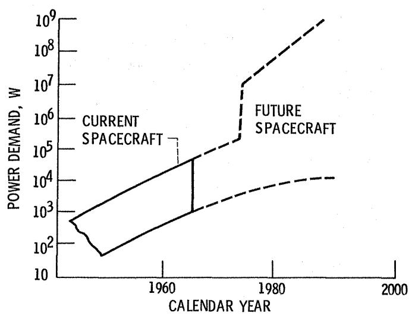  
Figure 3. - Planned space power programs address spacecraft growth.

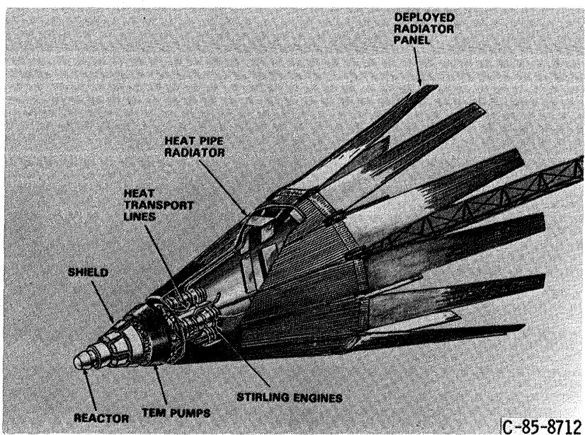  
Figure 4. - Artist's conception of SP-100 Stirling system.

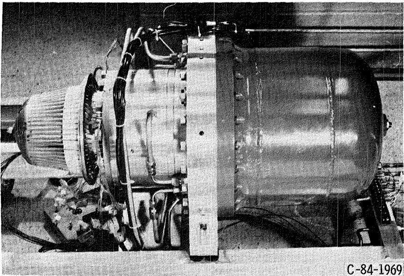  
Figure 5. - Free-piston Stirling / linear alternator endurance engine at Mechanical Technology Inc.

0 HEATER HEAD TEMPERATURE 9730 K

FREQUENCY

60 HZ

MEAN PRESSURE

62 BAR

PISTON STROKE

20 mm

ELECTRICAL OUTPUT POWER

1.5 - 2.5 kWe

DUTY CYCLE

FULL STROKE CONTINUOUS

GAS BEARINGS

EXTERNALLY PUMPED HYDROSTATIC

OPERATING TIME

-- 5500 hr

Figure 6. - 10000 hr endurance test conditions with existing 2 kW MTI engineering model engine.

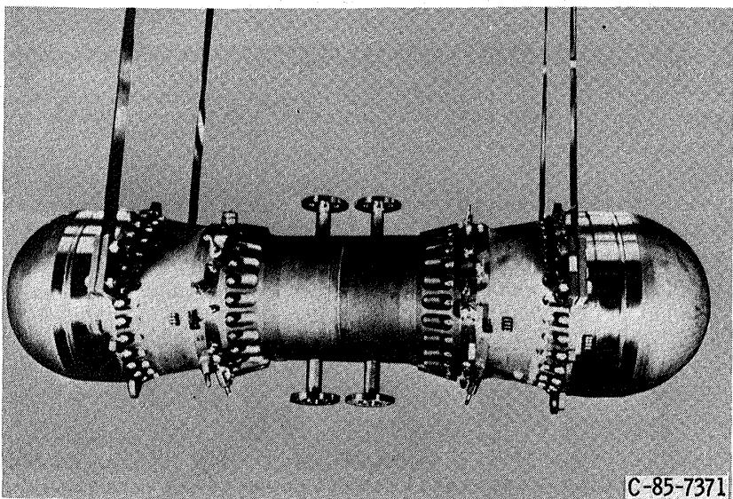  
Figure 7. - 25 kWe Space Power Demonstrator Engine (SPDE) at Mechanical Technology Inc.

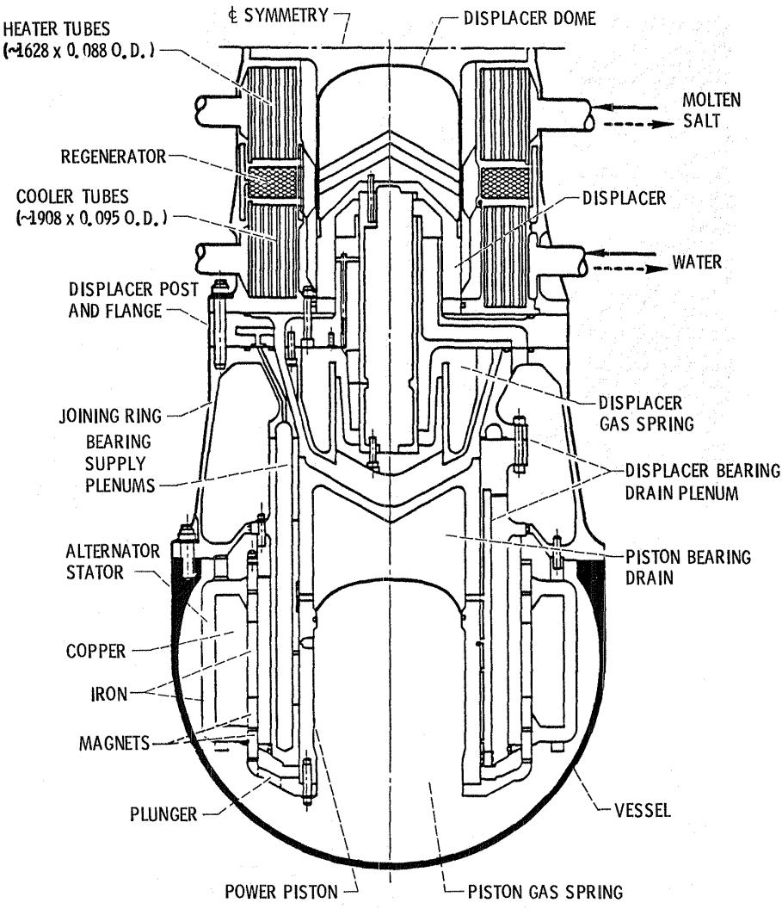  
Figure 8. - SPDE engine configuration (1/2 of power module).

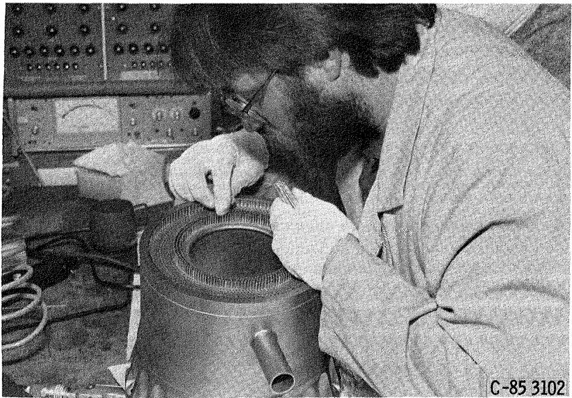  
Figure 9. - Assembly of SPDE molten salt heat exchanger.

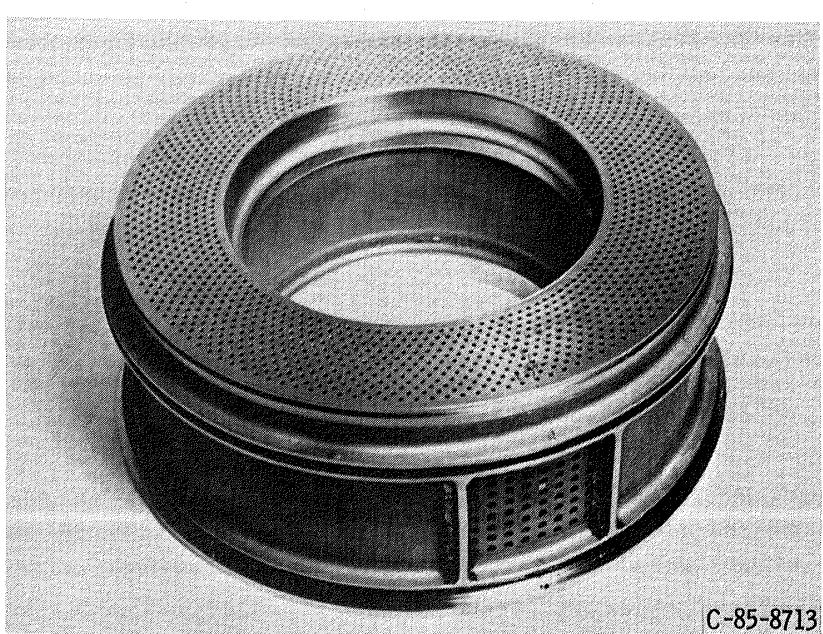  
Figure 10. - Completed heater head assembly.

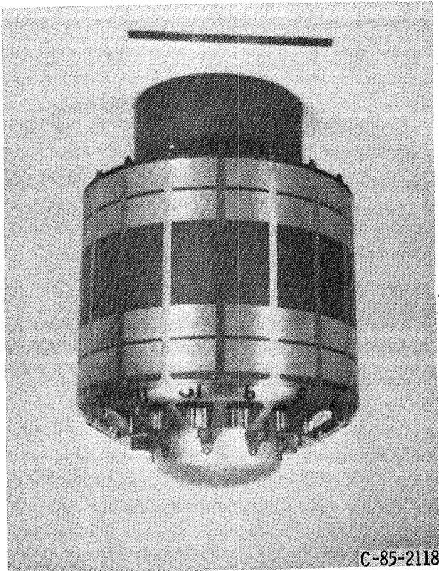  
Figure 11. - SPDE alternator-plungerassembly.

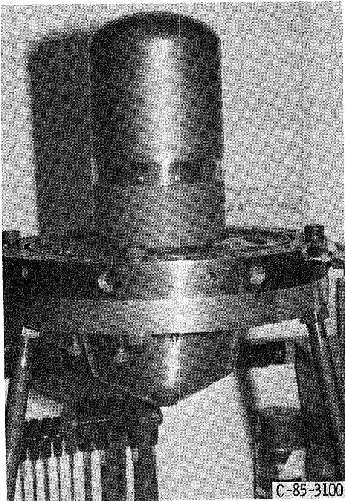  
Figure 12. - Displacer assembly.

<table><tr><td rowspan=3 colspan=1>POST AND FLANGES /DISPLACERSPOWER PISTONS/CYLINDERSPRESSURE VESSELS /JOININGRINGS /COOLING JACKETSTOTAL VESSELS /INTERNALSALTERNATORS /PLUNGERSHEAT EXCHANGERSTOTALSPECIFIC WEIGHT @25.0 kW(kg/kW)</td><td rowspan=1 colspan=4>REDUCTIONS FOR</td></tr><tr><td rowspan=1 colspan=1>ACTUALWEIGHT,kg</td><td rowspan=1 colspan=1>FLANGESAND XSMATERIAL,kg</td><td rowspan=1 colspan=1>STEELTO BE,kg</td><td rowspan=1 colspan=1>ADJUSTEDWEIGHT,kg</td></tr><tr><td rowspan=1 colspan=1>41.043.496.4180.877.859.0318.012.7</td><td rowspan=1 colspan=1>49.649.618.4</td><td rowspan=1 colspan=1>28.828.212.869.8</td><td rowspan=1 colspan=1>12.215.234.061.477.8*40.6180.07.2</td></tr></table>

"NOT OPTIMIZED

Figure 13. - SPDE weight breakdown.

PRESSURE-UP FACTOR OF 2.5

FREQUENCY-UP FACTOR OF 1.75

PISTON AREA-UP FACTOR OF 1.6

TEMPERATURE RATIO-DOWN FACTOR OF 1.5

BERYLLIUM COATED COMPONENTS

GAS BEARINGS

DYNAMICALLY BALANCED

PISTON POWER SCALE UP-FACTOR OF 4

ENGINE POWER SCALE UP-FACTOR OF 8

MOLTEN SALT HEAT INPUT

14,000 BRAZE JOINTS

Figure 14. - Free-piston state-of-the-art SPDE technology extension.

<table><tr><td></td><td>GOAL PERFORMANCE 25</td></tr><tr><td>OUTPUT POWER, kWe EFFICIENCY, %</td><td>6.5 18-20</td></tr><tr><td>TEMPERATURE RATIO</td><td>25 2.0 2.0</td></tr><tr><td> $T _ { h } { \cdot } K$ </td><td>650 650</td></tr><tr><td>SPECIFIC WEIGHT @25 kWe</td><td>8.0 12.7(7.2)*</td></tr><tr><td>(kg/kWe) DYNAMIC BALANCE</td><td>.076 .010</td></tr><tr><td>(CASING AMPLITUDE) mm GAS BEARING</td><td>INTERNALLY PUMPED EXTERNALLY PUMPED</td></tr><tr><td></td><td>HYDROSTATIC HYDROSTATIC</td></tr><tr><td>FREQUENCY, Hz</td><td>105  $( \log 1 ) ^ { \mathfrak { s o s } }$ </td></tr><tr><td>MEAN PRESSURE, BAR</td><td>150  $\left( 1 5 0 \right) ^ { \ast \ast \ast }$ </td></tr><tr><td>DISPLACER-POWER PISTON</td><td>75 75</td></tr><tr><td>PHASE ANGLE, deg</td><td></td></tr><tr><td></td><td>20 20</td></tr></table>

\*WITH MATERIAL SUBSTITUTION AND REPLACING BOLTS AND FLANGES WITH WELDS  
\*FULL STROKE NOT ACHIEVED AT DESIGN FREQUENCY AND PRESSURE  
Figure 15. - Comparison of SPDE design goals to demonstrated performance.

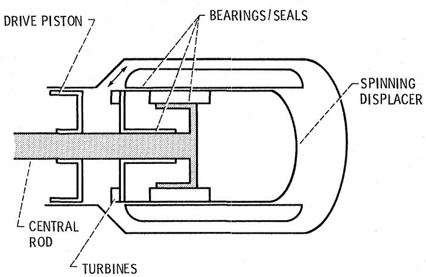  
Figure 16. - Spin bearing test rig schematic.

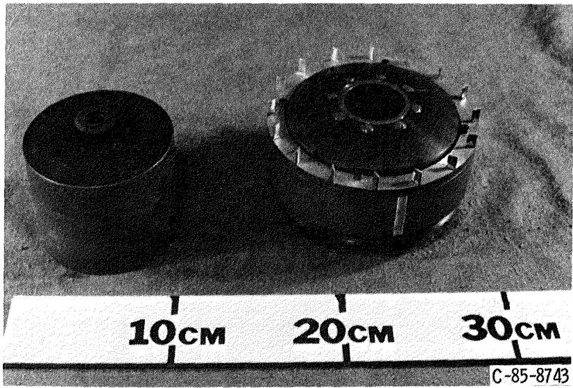  
Figure 17. - Spin bearing displacer assembly.

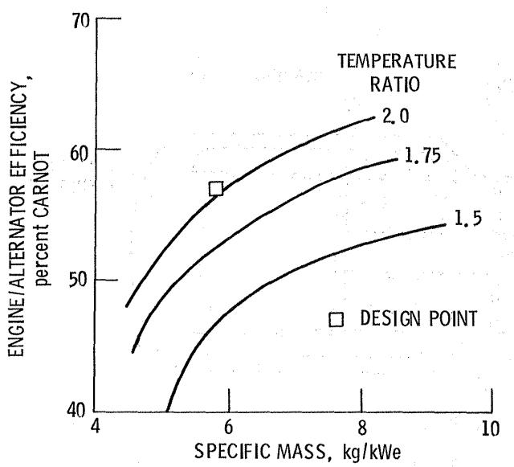  
Figure 18. - Percent Carnot cycle efficiency versus specific mass as a function of temperature ratio.

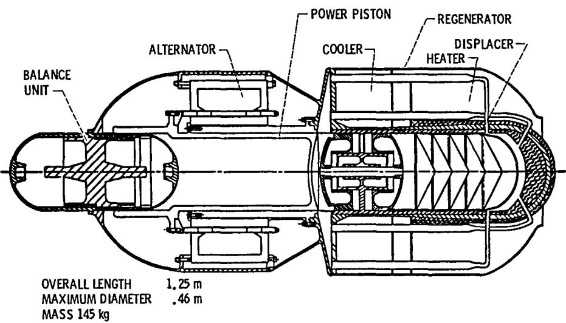  
Figure 19. - Space power module.

<table><tr><td>MEAN PRESSURE 176 BAR PISTON AMPLITUDE 15 mm</td></tr><tr><td>DISPLACER AMPLITUDE 11 mm</td></tr><tr><td>OPERATING FREQUENCY 95 Hz</td></tr><tr><td>ENGINE EFFICIENCY 30.8%</td></tr><tr><td>ALTERNATOR EFFICIENCY 93%</td></tr><tr><td>PERCENT CARNOT CYCLE EFFICIENCY 57%</td></tr><tr><td>POWER MODULE EFFICIENCY AT  $\Pi _ { \mathsf { H } } ^ { } / \mathsf { T } _ { \mathsf { C } } ^ { } ) = 2 . 0$  28.5%</td></tr><tr><td>MODULE SPECIFIC MASS 5.8 kg/kW</td></tr><tr><td>TRANSMITTED FORCE 80 N</td></tr><tr><td>OVERALL LENGTH 1.25M</td></tr><tr><td></td></tr><tr><td>MAXIMUM DIAMETER .45M</td></tr><tr><td></td></tr><tr><td></td></tr></table>

Figure 20. - 25 kWe single-cylinder design parameters.

<table><tr><td></td><td rowspan=1 colspan=2>1. Report No.NASA TM-87224</td><td rowspan=1 colspan=2>2. Government Accession No.</td><td rowspan=1 colspan=3>3. Recipient&#x27;s Catalog No.</td></tr><tr><td></td><td rowspan=2 colspan=4>4. Title and SubtitleOverview of Free-Piston Stirling SP-100 Activitiesat the NASA Lewis Research Center</td><td rowspan=1 colspan=3>5. Report Date</td></tr><tr><td></td><td rowspan=1 colspan=3>6. Performing Organization Code506-41-3B</td></tr><tr><td></td><td rowspan=2 colspan=4>7. Author(s)Jack G. Slaby</td><td rowspan=1 colspan=3>8. Performing Organization Report No.E-2834</td></tr><tr><td></td><td rowspan=2 colspan=3>10. Work Unit No.</td></tr><tr><td></td><td rowspan=3 colspan=4>9. Performing Organization Name and AddressNational Aeronautics and Space AdministrationLewis Research CenterCleveland, Ohio 44135</td></tr><tr><td></td><td rowspan=1 colspan=3>11. Contract or Grant No.</td></tr><tr><td></td><td rowspan=2 colspan=3>13. Type of Report and Period CoveredTechnical Memorandum</td></tr><tr><td></td><td rowspan=2 colspan=4>12. Sponsoring Agency Name and AddressU.S. Department of EnergyOffice of Vehicle and Engine R&amp;DWashington, D.C. 20545</td></tr><tr><td></td><td rowspan=1 colspan=3>14. Sponsoring Agency-CodReport No.DOE/NASA/1005-8</td></tr><tr><td></td><td rowspan=1 colspan=7>15. Supplementary NotesPrepared under Interagency Agreement DE-AI05-820R1005. Prepared for ThirdInternational Stirling Engine Conference, Rome, Italy, June 23-27, 1986.</td></tr><tr><td rowspan=1 colspan=8>16. AbstractAn overview of the National Aeronautics and Space Administration (NASA) LewisResearch Center (LeRC) SP-l00 free-piston Stirling engine activities is pre-sented. These activities are being conducted in support of the Department ofDefense (DOD), Department of Energy (DOE), and NASA. The space-power technologyeffort, under SP-100, addresses the status of the 25 kWe Space Power DemonstratorEngine (SPDE). Another facet of the SP-100 project covers the status of anendurance test. Dynamic balancing of the SPDE engine will be discussed alongwith a summary covering the parametric results of a study showing the relation-ship between power-converter specific weight and efficiency both as a functionof Stirling engine heater to cooler temperature ratio. Design parameters andconceptual design features will be presented for a 25 kWe, single-cylinder free-piston Stirling space-power converter. And finally, a description of a hydro-dynamic gas bearing concept will be presented.</td></tr><tr><td rowspan=1 colspan=4>17. Key Words (Suggested by Author(s))Stirling engine; Free-piston;Space power</td><td rowspan=1 colspan=4>18. Distribution StatementUnclassified - unlimitedSTAR Category 85DOE Category UC-96</td></tr><tr><td rowspan=1 colspan=2>19. Security Classif. (of this report)Unclassified</td><td rowspan=1 colspan=4>20. Security Classif. (of this page)Unclassified</td><td rowspan=1 colspan=1>21. No. of pages</td><td rowspan=1 colspan=1>22. Price*A02</td></tr></table>

\*For sale by the National Technical Information Service, Springfield, Virginia 22161

End of Document