https://doi.org/10.32604/fhmt.2026.076127

ARTICLE

# Numerical Investigation of $\mathbf { C O } _ { 2 }$ Contaminant Transport and Deposition in an In-Line Pulse Tube Cryocooler

Hao Zhu1,2, Xi Chen1,2,\*, Pengcheng Qu1,2, Yifan Zhu1,2, Haoyi Wang1,2 and Yingxia Qi1,2

1School of Energy and Power Engineering, University of Shanghai for Science and Technology, 516 Jungong Road, Shanghai, China 2Shanghai Key Laboratory of Multiphase Flow and Heat Transfer in Power Engineering, University of Shanghai for Science and Technology, 516 Jungong Road, Shanghai, China

\*Corresponding Author: Xi Chen. Email: chenxistudy@163.com

Received: 14 November 2025; Accepted: 06 January 2026; Published: 28 February 2026

ABSTRACT: Pulse tube cryocoolers are widely employed in cryogenic systems, where gas contamination has become a critical factor limiting both performance and service life. To further investigate the condensation behavior of contaminants, this study develops a two-dimensional axisymmetric model of a linear-type cryocooler to simulate the transport and deposition processes of trace $\mathrm { C O } _ { 2 } ,$ evaluating the impact of contamination on system pressure drop under various operating conditions. Results indicate that $\mathrm { C O } _ { 2 }$ difusion is primarily driven by concentration gradients. The $\mathrm { C O } _ { 2 }$ deposition rate increases markedly at low temperatures and high concentrations, with over 90% of deposition occurring in the cold-end heat exchanger. Under diferent concentration distributions, dry ice predominantly accumulates in the cold-end heat exchanger; however, notable diferences emerge in the pulse tube. In the uniform distribution case, CO tends to deposit along the inner wall ofthe pulse tube, whereas in the gradual release scenario, deposition mainly occurs on the cold-end flow straightening mesh screen. Dry ice deposition significantly increases the pressure drop across the system and decreases the pressure wave amplitude, resulting in a degradation of cooling capacity. This study lays a foundation for further investigation into the thermal properties of contaminant layers and provides theoretical guidance for optimizing cold-end components to improve contamination resilience.

KEYWORDS: Pulse tube cryocoolers; carbon dioxide; dry ice deposition; CFD

## 1 Introduction

Due to their compact structure, low vibration, low operating temperature, and environmental friendliness [1–3], regenerative cryocoolers are widely used in advanced applications such as aerospace [4–6], cryogenic medicine [7], precision instrument cooling [8], and low-temperature preservation [9]. For aerospace cryocoolers, service life and reliability are critical performance indicators [10]. Performance degradation is primarily caused by four factors: (1) spring fatigue failure, (2) piston–cylinder assembly wear, (3) working fluid leakage, and (4) gas contamination [11]. While technological advances—including gas bearings, gap seals, and surface coatings—have efectively mitigated the first three failure mechanisms, gas contamination remains a significant challenge that continues to limit the service life and reliability of pulse tube cryocoolers (PTC) [12].

Current research on gas contamination in cryocoolers predominantly focuses on two critical aspects: service life prediction and the release-condensation behavior of contaminants. Significant investigations have been conducted concerning outgassing mechanisms of internal materials, contaminant migration from compressor to cold finger, and accelerated life testing techniques [13–16]. Contaminants are broadly categorized into two main types: free gas contaminants and bound gas contaminants. Hall’s foundational research utilized mass spectrometry to detect significant alterations in gas composition following the operation of a 60 K cryocooler, reporting markedly increased concentrations of water vapor, nitrogen, and carbon dioxide. Subsequent identification of hydrogen and methane was ascribed to thermal degradation of organic materials under high-temperature operating conditions [17]. Yuan’s investigation demonstrates that elevated temperature baking efectively suppresses contaminant liberation, though the requirement of sustained $1 0 0 ^ { \circ } \mathrm { C }$ heating for seven days presents substantial challenges for large-scale applications due to extended processing durations [18]. Getmanits established an accelerated life-testing protocol specifically designed for contamination-related failure analysis [19]. Ma experimentally investigated the influence of 50–150 ppm nitrogen contamination on a 40 K pulse tube cryocooler, revealing a two-stage performance degradation mechanism and establishing a correlation between temperature instabilities and recurring phase transition processes [20].

Due to the sealed steel enclosure of cryocoolers, direct observation of contaminant phase transitions via conventional experimental methods remains challenging. These transitions are often accompanied by complex oscillatory flow and heat transfer phenomena, making numerical modeling essential. To address this, extensive research has been conducted on flow mechanisms and structural optimization. Muralidhar and Suzuki developed an anisotropic porous media model for regenerators in PTC, laying a theoretical foundation for simulating porous flow under thermal non-equilibrium conditions [21]. Ju and de Waele proposed a hybrid Euler–Lagrange model to provide further insight into oscillatory flow in low-temperature cryocoolers, while Flake and Razani employed commercial CFD tools to reveal two-dimensional flow features [22,23]. Furthermore, eforts to improve prediction accuracy and eficiency have included Rezaei and Atrey examination of real gas efects, Yan et al.’s investigation of tapered pulse tubes to improve flow uniformity, and Duan’s structural optimization ofa displacer-type PTC using moving mesh models [24–26].

Numerical Studies on Contaminant Transport and Deposition In contrast to general performance simulations, research specifically targeting contaminant behaviors remains limited. He et al. studied water vapor contamination in Stirling cryocoolers, evaluating the efects of frost morphology on flow resistance and highlighting the critical role of contaminant distribution [27]. Feng simulated nitrogen frosting under varying partial pressures, revealing that temperature fluctuations near the phase-change point are driven by repeated condensation and sublimation cycles [28]. Most recently, Ma et al. performed two-dimensional CFD simulations of a coaxial PTC to analyze ethylene contamination distribution, showing that condensation occurs primarily near the pulse tube ends [29].

However, it should be noted that while numerical modeling has been extensively applied to optimize cryocooler structures, the simulation of contaminant phase-change behavior remains relatively limited. Currently, most researchers primarily focus on coaxial pulse tube cryocoolers or investigate specific contaminants such as nitrogen and water vapor. The previous investigations have indicated that, under identical operating conditions, in-line PTCs exhibit superior cooling performance compared to their coaxial counterparts [30]. Meanwhile, $\mathrm { C O } _ { 2 }$ as a major byproduct of organic material outgassing and thermal degradation, will continuously release into the cryocooler during long-term operation. The temperature region of 120–160 K is a critical operating range for this study, which aligns with the saturation temperature of trace $\mathrm { C O } _ { 2 }$ . In summary, there is a lack of suficient research on the deposition patterns and transport mechanisms of $\mathrm { C O } _ { 2 }$ in such in-line configurations, which is extremely important for ensuring reliability and developing contamination-resilient components.

In this paper, a two-dimensional axisymmetric model of an in-line PTC has been established. The transport and deposition behaviors of $\mathrm { C O } _ { 2 }$ under various concentrations have been simulated. The deposition distribution patterns under diferent initial conditions have been studied, and the impact of the resulting blockage on system pressure drop and cooling capacity has been further analyzed.

## 2 Simulation of the Deposition Process of $\mathbf { C O } _ { 2 }$

## 2.1 Cooling Mechanism of PTC

According to the enthalpy flow phase modulation theory, the cooling efect of a PTC is primarily driven by the net enthalpy flow induced by oscillatory gas motion [31]. By introducing an appropriate phase diference between the pressure wave and the mass flow, the system enables continuous heat absorption at the cold end and heat rejection at the warm end. The core of this mechanism lies in the directional transport of the time-averaged enthalpy flow. The net cooling power can be defined as:

$$
Q _ { c } = \frac { 1 } { \tau } \int _ { 0 } ^ { \tau } \dot { m } h d t = \frac { c _ { p } } { R _ { g } \tau } \int _ { 0 } ^ { \tau } \dot { p } \dot { U } d t\tag{1}
$$

where $Q _ { c }$ is the cooling power, τ is the period, m˙ is the instantaneous mass flow rate, h is the specific enthalpy, t is the time, $c _ { p }$ is the specific heat at constant pressure, $R _ { g }$ is the universal gas constant, p is the pressure of gas, U˙ is the volumetric flow rate.

As a critical component of PTC, the regenerator operates under oscillating flow conditions, which can generally be divided into two phases: the hot-blow phase and the cold-blow phase. In the hot-blow phase, high-pressure, high-temperature gas enters the regenerator from the inlet and flows through the wire mesh. During this process, heat is transferred from the gas to the regenerator matrix, resulting in a decrease in gas temperature. In the subsequent cold-blow phase, low-temperature gas flows in the reverse direction through the regenerator, absorbing heat from the matrix. As a result, the gas temperature increases while the matrix temperature decreases. This oscillating process enables the regenerator to eficiently regulate gas temperature in each cycle, thereby ensuring the stable operation of PTC.

## 2.2 Physical Model and Meshing

In this study, the two-dimensional axisymmetric model was strictly established based on the geometry of an experimental in-line PTC prototype developed in our laboratory. The system primarily consists of three major components: the compressor, the cold finger, and the phase shifter. The cold finger includes the aftercooler (AC), regenerator (REG), cold-end heat exchanger (CHX), pulse tube (PT), and hot-end heat exchanger (HHX). Both ends of the pulse tube are equipped with a flow straightening mesh screen (FS), which serves to enhance heat transfer, suppress turbulence, and reduce flow resistance. The REG and the FS are filled with 150# stainless mesh and 60# copper mesh, respectively. Since contaminant deposition occurs primarily between the REG and the PT, the numerical model focuses exclusively on this section, as illustrated in Fig. 1. The key geometric parameters of the model components are summarized in Table 1.

To accurately simulate the deposition process of contaminant gas in PTC, the mesh design in this study was carefully optimized. Since phase change predominantly occurs between the REG and the PT, this region requires refined meshes. Such refinement enables more precise resolution of the subtle transitions from the gaseous to the solid phase and enhances the overall stability of the numerical simulation. To ensure the reliability of the numerical results, a grid independence study was conducted by monitoring the total volume fraction of dry ice under typical operating conditions. As illustrated in Fig. 2, the mesh quantity was gradually increased from $3 . 5 \times 1 0 ^ { 4 }$ to $6 . 0 \times 1 0 ^ { 4 }$ . The results indicate that the solution becomes grid-independent when the cell count exceeds 4.4 $\times 1 0 ^ { 4 }$ . Specifically, the relative deviation in the predicted dry ice volume between the mesh with $4 . 4 \times 1 0 ^ { 4 }$ cells and the finer mesh with $5 . 5 \times 1 0 ^ { 4 }$ cells is less than 0.5%.

Considering both computational accuracy and eficiency, the grid system with $4 . 4 \times 1 0 ^ { 4 }$ cells was selected for all subsequent simulations.

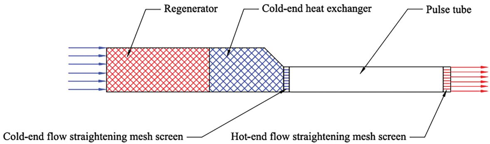\
Figure 1: 2D axisymmetric model of the PTC

Table 1: Parameters of the 2D CFD model
<table><tr><td>Components</td><td>Length (mm)</td><td>Diameter (mm)</td><td>Porosity</td></tr><tr><td>REG</td><td>55.5</td><td>23.8</td><td>0.75</td></tr><tr><td>CHX</td><td>39.9</td><td>23.8/13.6</td><td>0.12</td></tr><tr><td>FSC</td><td>3.0</td><td>13.6</td><td>0.72</td></tr><tr><td>PT</td><td>113.0</td><td>13.6</td><td>1.00</td></tr><tr><td>FSH</td><td>4.0</td><td>13.6</td><td>0.72</td></tr></table>

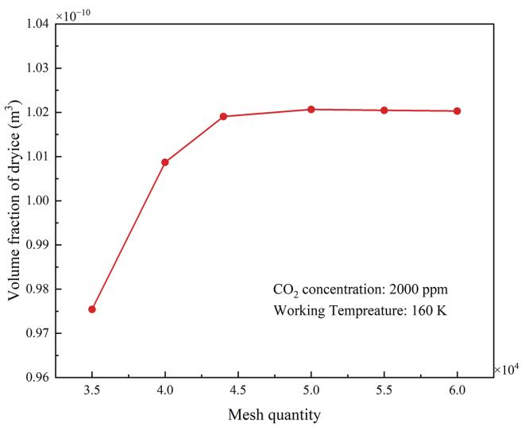\
Figure 2: Results of grid independence verification

## 2.3 Boundary Conditions and Initial Conditions

Due to the frequent oscillations of the gas within the system, its velocity varies nearly sinusoidally over time. When the velocity is positive, the working fluid flows in the forward direction; conversely, when the velocity is negative, reverse flow occurs. The pressure variation follows a similar trend. As illustrated in Fig. 3.

The inlet velocity of the hot end of the regenerator is:

$$
\nu _ { i n } = \nu _ { a } \sin ( 2 \pi f t + \theta )\tag{2}
$$

The outlet pressure at the hot end of the pulse tube is:

$$
\displaystyle p _ { o u t } = p _ { 0 } + p _ { a } \sin ( 2 \pi f t )\tag{3}
$$

where $\nu _ { i n }$ is the inlet velocity, $\nu _ { a }$ is the velocity amplitude, f is the frequency, θ is the phase diference between pressure waves and velocity waves, $\phi _ { o u t }$ is the outlet pressure, $ { p _ { 0 } }$ is the charge pressure of the machine, $ { { \cal P } } a$ is the pressure amplitude.

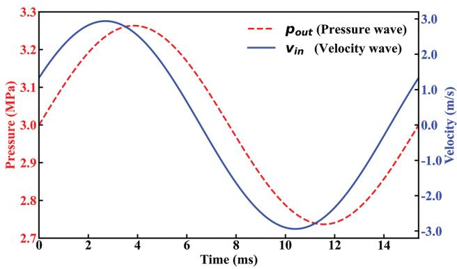\
Figure 3: Pressure waves and velocity waves

Both functions are time-dependent and are imported via UDF. The operating parameters were selected to match the optimal experimental conditions of the physical prototype. Specifically, 65 Hz was chosen as the operating frequency because experimental results indicated that the system achieves optimal acoustic impedance matching and maximum cooling eficiency at this point [32].

Under ideal conditions, the inlet efect of the regenerator is neglected, and it is assumed that the temperatures of both the regenerator and the pulse tube have reached a steady state. To accelerate the convergence of the numerical model, the initial temperature field of the REG and PT is initialized with a linear gradient. To ensure eficient heat exchange, a no-slip boundary condition is applied to the regenerator wall, while the temperature follows an adiabatic boundary condition. Furthermore, the wall temperature of the cold end heat exchanger is set to be constant at 160, 140, and 120 K. The initial temperature distribution is shown in Fig. 4.

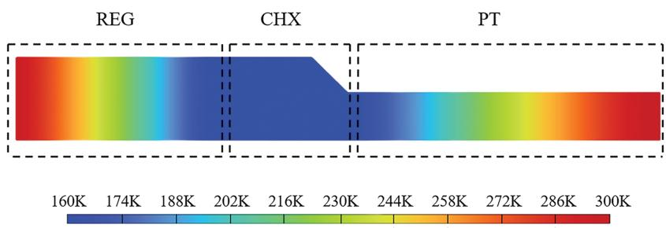\
Figure 4: Initial temperature distribution

In this study, Helium is used as the working fluid in the PTC, and $\mathrm { C O } _ { 2 }$ is selected as the research object of contaminant to investigate the sublimation process. In PTC, $\mathrm { C O } _ { 2 }$ generally exists in a gas–solid twophase state. Owing to its relatively high deposition point, $\mathrm { C O } _ { 2 }$ undergoes a phase change at 194.7 K under atmospheric pressure, which is significantly higher than the typical operating temperatures of PTC. As a result, $\mathrm { C O } _ { 2 }$ tends to exist in the form ofsolid dry ice within the system. In severe cases, it can accumulate and obstruct porous screens or slit-type heat exchangers, thereby degrading the cooling performance. Moreover, due to significant variations in temperature within the system, the thermophysical properties of the gas, particularly dynamic viscosity and thermal conductivity, are strongly temperature-dependent. To accurately account for these variations, these properties were obtained through polynomial curve fitting based on data from the NIST database and were incorporated into the numerical model via UDF. This implementation allows for the dynamic update of transport properties in each computational cell, ensuring precise calculation of flow resistance in the porous media. According to Dalton’s law of partial pressure, the ratio of partial pressures is equal to the ratio of volumes. The saturation temperatures of $\mathrm { C O } _ { 2 }$ under diferent pressures are listed in Table 2.

Table 2: Saturation temperature of $\mathrm { C O } _ { 2 }$
<table><tr><td>Concentration (ppm)</td><td></td><td>Saturation pressure (Pa) Saturation temperature (K)</td></tr><tr><td>2000</td><td>6000</td><td>165.4</td></tr><tr><td>1000</td><td>3000</td><td>159.6</td></tr><tr><td>500</td><td>1500</td><td>154.2</td></tr></table>

The initial $\mathrm { C O } _ { 2 }$ concentration in PTC is set under two conditions to simulate diferent operational states: one with zero initial concentration, representing the scenario where trace $\mathrm { C O } _ { 2 }$ is gradually released from the compressor’s back-pressure chamber into the pure helium working fluid; the other with a non-zero initial concentration, simulating the scenario where $\mathrm { C O } _ { 2 }$ has already difused uniformly throughout the system after prolonged operation, followed by its subsequent difusion from the back-pressure cavity and phase adjuster into the pipeline as the concentration decreases in the condensing section. The detailed simulation cases are summarized in Table 3.

Table 3: Simulation schemes
<table><tr><td>Case number</td><td>1</td><td>2</td><td>3</td><td>4</td><td>5</td><td>6</td></tr><tr><td>Concentration (ppm)</td><td>2000</td><td>2000</td><td>2000</td><td>1000</td><td>500</td><td>2000</td></tr><tr><td>Temperature of cold end (K)</td><td>160</td><td>140</td><td>120</td><td>160</td><td>160</td><td>160</td></tr><tr><td>Initial  $\mathbf { C O } _ { 2 }$  distribution (ppm)</td><td>0</td><td>0</td><td>0</td><td>0</td><td>0</td><td>2000</td></tr></table>

CFD solvers employ the coupled algorithm to handle the interactions between multiple physical fields. This approach difers from traditional distributed algorithms, as it solves multiple equations simultaneously, updating both the pressure and velocity fields in a single solution step. This method eliminates the delays and numerical instability associated with distributed processing. The time step size is set to 0.1 ms, with a maximum of 40 iteration steps allowed for each time step.

## 2.4 Governing Equations

In this study, the Euler–VOF model is employed to simulate the distribution of gas and liquid phases. The VOF method tracks the volume fraction of each fluid within individual control volumes, enabling accurate capture of gas–liquid interface dynamics. The phase change process is modeled using the Lee model, in which mass and energy source terms are introduced to describe the phase transition of the gas. These source terms dynamically adjust the phase change behavior by regulating the phase change rate and the interactions between phases.

Since the REG, CHX, FSC, and FSH can all be treated as porous media, the Darcy–Forchheimer model is adopted to characterize the flow resistance within these regions. To simultaneously simulate the mixing and difusion of $\mathrm { C O } _ { 2 }$ in helium, a multi-component species transport equation is employed. This equation accounts for the mass fraction and difusion coeficient of each species to model gas transport behavior in diferent regions of the system.

The governing equations used in the simulation include the continuity equation, momentum equation, energy equation, and multi-component species transport equation, as follows:

$$
\frac { \partial \rho } { \partial t } + \nabla \cdot \left( \rho \vec { u } \right) = S _ { m a s s }\tag{4}
$$

where $\rho$ and u⃗ are the density and velocity of the phase, $S _ { m a s s }$ is the mass source term, which describes the increase or decrease of the phase during the phase transition process.

$$
\frac { \partial ( \rho \vec { u } ) } { \partial t } + \nabla \cdot \left( \rho \vec { u } \vec { u } \right) = - \nabla p + \nabla \sigma + F _ { p o } + F _ { p c }\tag{5}
$$

where σ is the stress tensor, $F _ { p o }$ is the flow resistance term within the porous media, $F _ { p c }$ is the additional force induced by phase change.

$$
F _ { p o } = - \big ( \frac { \mu } { \alpha } + \frac { C _ { 2 } } { 2 } \rho \left| \vec { u } \right| \big ) \vec { u }\tag{6}
$$

where $\mu , \alpha , C _ { 2 }$ are the dynamic viscosity of fluid, the permeability of porous medium, the inertial resistance coeficient, which can be calculated by:

$$
\alpha = \frac { { d _ { h } } ^ { 2 } } { 6 }\tag{7}
$$

$$
C _ { 2 } = \frac { 2 . 9 1 } { d _ { h } } { R e _ { h } } ^ { - 0 . 1 0 3 }\tag{8}
$$

$$
R e _ { h } = \frac { \rho u _ { m a x } d _ { h } } { \mu }\tag{9}
$$

where $R e _ { h }$ is the Reynolds number based on the hydraulic diameter, and $d _ { h }$ is the hydraulic diameter.

$$
\frac { \partial \big ( \rho \mathrm { E } \big ) } { \partial \ t } + \nabla \cdot \big ( \vec { \mathrm { u } } \big ( \rho \mathrm { E } + \mathrm { p } \big ) \big ) = \nabla \cdot \big ( \mathrm { k } \nabla \mathrm { T } \big ) + \mathrm { S } _ { \mathrm { p h } } + \mathrm { S } _ { \mathrm { p o } }\tag{10}
$$

where E is the total energy, k is the thermal conductivity, $\mathrm S _ { \mathrm { { p h } } }$ represents the energy source term due to phase change heat absorption, and $\mathrm { S _ { p o } }$ denotes the energy source term due to porous media.

$$
\frac { { \partial \left( \rho Y \right) } } { { \partial t } } + \nabla \cdot \left( \rho { \vec { \bf u } Y } \right) = \nabla \cdot \left( \Gamma \nabla Y \right) + S _ { m a s s }\tag{11}
$$

where Y is the mass fraction and Γ is the difusion coeficient.

## 2.5 Verification ofNumerical Model

Fig. 5 compares the cooling capacity results obtained from CFD simulation and existing experimental measurements under an input power of 500 W at a frequency of 65 Hz. It is observed that the simulation results efectively reproduce the experimental trend of cooling capacity variation with refrigeration temperature. The deviations observed are primarily due to the ideal gas assumption and irreversible losses. The resulting maximum relative error is 10.2%. This level of agreement is satisfactory and verifies the model’s reliability.

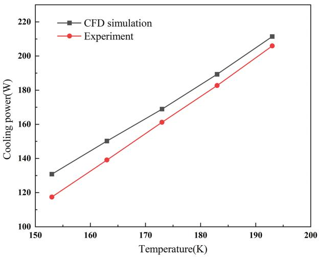\
Figure 5: Experimental and simulated values of PTC cooling capacity

## 3 Analysis of Simulation Results

## 3.1 The Difusion $\pmb { o f C O } _ { 2 }$ in PTC

To investigate the deposition behavior of contaminants in PTC, it is essential to first develop a thorough understanding of the difusion mechanism of $\mathrm { C O } _ { 2 }$ . In PTC, the transport of $\mathrm { C O } _ { 2 }$ molecules is primarily governed by difusion, which is driven by concentration gradients. The difusion coeficient of $\mathrm { C O } _ { 2 }$ is influenced by multiple factors, including temperature, pressure, and the composition of the gas mixture. Therefore, these variable parameters must be taken into account when simulating the difusion behavior of $\mathrm { C O } _ { 2 }$

In addition to molecular difusion, convective transport also plays a significant role in $\mathrm { C O } _ { 2 }$ migration, particularly under the high-frequency oscillations characteristic of $\mathrm { P T C }$ operation. These oscillations induce periodic volumetric flow within the system, superimposing convective efects on the difusion process and thereby enhancing the overall transport of contaminants.

Meanwhile, the phase change process can locally alter the concentration of $\mathrm { C O } _ { 2 }$ in the gas phase, thereby modifying the concentration gradient and indirectly influencing its transport within the system. In summary, the transport of $\mathrm { C O } _ { 2 }$ in PTC is a complex process governed by the combined efects of molecular difusion, convection, and phase change. The governing convection–difusion equation for gas species transport is expressed as follows:

$$
M = - D { \frac { \partial C } { \partial x } } + \rho u C\tag{12}
$$

where M is the mass flux of $\mathrm { C O } _ { 2 } , D$ is the difusion coeficient, $\frac { \partial C } { \partial x }$ denotes the concentration gradient of $\mathrm { C O } _ { 2 } .$ , and C is the $\mathrm { C O } _ { 2 }$ concentration. The first term represents the contribution of molecular difusion to $\mathrm { C O } _ { 2 }$ transport, while the second term accounts for convective transport driven by fluid motion.

Fig. 6 illustrates the axial temperature distribution ofthe fluid within the cold finger. As evidenced by the data, while the fluid temperature in the cold-end heat exchanger remains stable at 160 K, both the regenerator and pulse tube exhibit distinct linear temperature gradients. The minimum temperature of 143 K occurs near the cold end of the pulse tube. This good agreement with the prior results of Zheng et al. provides validation for the present model [32].

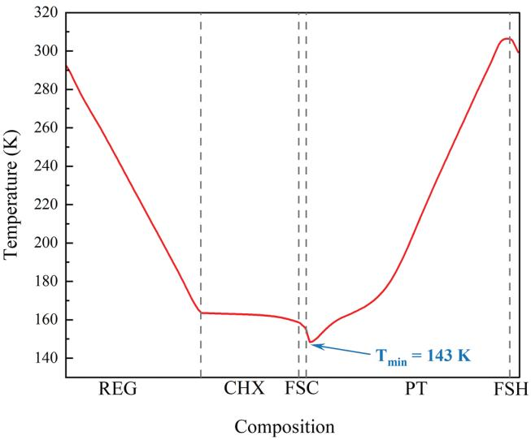\
Figure 6: Axial temperature profile of the cold finger

Fig. 7 shows the variation process of the difusion behavior of $\mathrm { C O } _ { 2 }$ in the system over time. At 0.5 s, high concentration of $\mathrm { C O } _ { 2 }$ is primarily located near the compressor side of the regenerator, as indicated by the red region. As time progresses, $\mathrm { C O } _ { 2 }$ gradually difuses from the high-concentration zone toward the pulse tube region, and the overall concentration gradient becomes more uniform. When $\mathrm { C O } _ { 2 }$ reaches the cold end, where the local temperature falls below its saturation point, phase change occurs and $\mathrm { C O } _ { 2 }$ deposits onto the wire screen or heat exchanger surfaces in solid form. This phase transition leads to a sudden local drop in $\mathrm { C O } _ { 2 }$ concentration, which in turn enhances the local concentration gradient and drives further migration of surrounding $\mathrm { C O } _ { 2 }$ toward the cold region.

Fig. 8 further analyzes the temporal evolution ofthe $\mathrm { C O } _ { 2 }$ volume fraction in diferent regions ofthe PTC (REG, CHX, PT). A pronounced spatial non-uniformity in $\mathrm { C O } _ { 2 }$ distribution can be observed throughout the simulation. Among the three regions, the REG consistently exhibits the highest $\mathrm { C O } _ { 2 }$ enrichment, followed by the CHX and PT. Notably, during the initial stage $\left( t < 0 . 5 ~ s \right)$ , the mole fraction in the REG increases rapidly, indicating that the majority of the released contaminants initially accumulate within the REG. This phenomenon is primarily attributed to the REG’s high porosity and relatively large flow resistance, which collectively render it a “bufer zone” during contaminant transport. As time progresses, $\mathrm { C O } _ { 2 }$ gradually difuses into the CHX and PT regions, but the transport rate remains relatively slow.

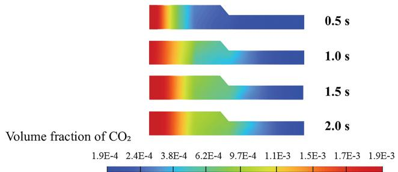\
Figure 7: $\mathrm { C O } _ { 2 }$ difusion with time in the cold finger (Simulation Scheme: Case 1)

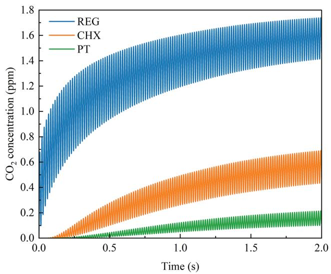\
Figure 8: $\mathrm { C O } _ { 2 }$ concentration changes with time in diferent regions (Simulation Scheme: Case 1)

Fig. 9 highlights the variation in $\mathrm { C O } _ { 2 }$ concentration within the CHX region under diferent initial temperatures and contaminant concentrations. Overall, the difusion process of $\mathrm { C O } _ { 2 }$ exhibits a “fast-then-$\mathsf { s l o w } ^ { \flat }$ pattern, primarily attributed to the initially large concentration gradients, which provide strong difusion driving forces. With the ongoing difusion process, the system is expected to ultimately reach an equilibrium concentration. As the system approaches equilibrium, the gradient weakens and the difusion rate correspondingly decreases. At a concentration of2000 ppm, higher initial temperatures result in a faster cumulative difusion rate of $\mathrm { C O } _ { 2 } .$ Further analysis under various concentration conditions reveals that the mole fraction of $\mathrm { C O } _ { 2 }$ in the CHX region is significantly higher at elevated concentrations, indicating that the concentration gradient is a key factor governing the strength of contaminant transport. Notably, the inset in Fig. 9 displays a periodic oscillation in the $\mathrm { C O } _ { 2 }$ mole fraction, with amplitudes gradually increasing over successive cycles. This “amplitude-growing” oscillatory behavior results from a progressive increase in the mass of $\mathrm { C O } _ { 2 }$ being deposited and sublimated in each successive cycle.

## 3.2 The Deposition of $\mathbf { C O } _ { 2 }$ in PTC

In the present simulation, the system is first evacuated to remove residual gases, thereby ensuring that the release and difusion of the contaminant are not influenced by the presence of other gas species.

After the vacuum environment is established, $\mathrm { C O } _ { 2 }$ is gradually released from the back-pressure chamber and progressively difuses into the system. Fig. 10 illustrates the time evolution of $\mathrm { C O } _ { 2 }$ deposition within the system. After being released from the hot end of the REG, $\mathrm { C O } _ { 2 }$ initially deposits at the cold-end wire mesh of the REG, where it adheres to the surface of the porous structure in solid form. As time progresses, $\mathrm { C O } _ { 2 }$ continues to difuse along the concentration gradient and eventually reaches the CHX. Due to the porosity in this region being only about one-sixth that of the REG, its internal structure exhibits a stronger retention capacity for contaminants. As a result, $\mathrm { C O } _ { 2 }$ begins to undergo deposition within the narrow slits of the CHX and gradually accumulates, which is manifested as red regions with high volume fractions.

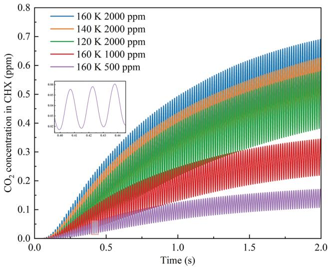\
Figure 9: $\mathrm { C O } _ { 2 }$ concentration in CHX under diferent working conditions

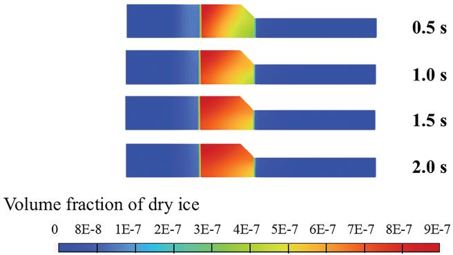\
Figure 10: $\mathrm { C O } _ { 2 }$ deposition with time in the cold finger

Under the combined efects of difusion and convection, the deposition zone continues to expand, eventually leading to the deposition of a small amount of dry ice on the laminar flow wire screen at the cold end of the PT. Overall, the spatial distribution of dry ice exhibits a gradual migration trend, progressing from the cold end of the REG to the cold heat CHX, and eventually extending into the PT.

Fig. 11 further presents the proportion of $\mathrm { C O } _ { 2 }$ deposition in diferent regions of the system under various operating conditions. It is evident that while the distribution of deposition ratios across regions remains relatively stable under diferent conditions, the overall deposition eficiency increases under lower temperature or higher concentration scenarios. Across all cases, the CHX consistently serves as the main deposition zone, accounting for more than 90% of the total deposition mass. From a structural design perspective, the dominant deposition in the CHX is physically attributed to its extremely low porosity (0.12) and small hydraulic diameter. According to the porous media resistance model (Eqs. (7)–(9)), flow resistance is inversely proportional to the square of the hydraulic diameter. Consequently, the narrow channels in the CHX are highly susceptible to clogging by solid dry ice. In contrast, the REG exhibits an appropriate deposition proportion, primarily localized near its cold end. The PT region shows the lowest deposition share (below 2%), with solid $\mathrm { C O } _ { 2 }$ mainly adhering to the flow-straightening wire screen.

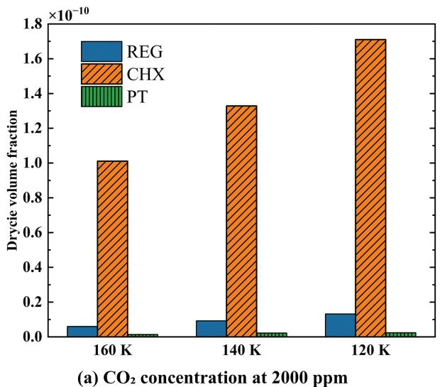

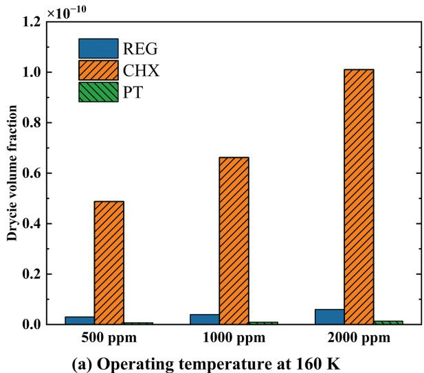\
Figure 11: $\mathrm { C O } _ { 2 }$ deposition in PTC under diferent working conditions

## 3.3 Efect of Initial $\mathbf { C O } _ { 2 }$ Concentration Distributions

Since the cryocooler does not operate continuously, the system temperature gradually rises to ambient conditions once it is shut down. As a result, previous contaminants undergo sublimation and become uniformly redistributed throughout the system. When the cryocooler is restarted, the initial distribution of the contaminant gas approximates a uniform state. In this scenario, due to the absence of a significant concentration gradient, the deposition behavior ofthe contaminant is primarily governed by the temperature gradient. This leads to notable diferences in both the location and rate of deposition compared to the case of gradual release from the back-pressure chamber. Therefore, it is necessary to conduct a dedicated analysis of the uniform initial distribution condition.

Fig. 12 shows the variation law of concentration with time under the uniform distribution of $\mathrm { C O } _ { 2 }$ . The results show that $\mathrm { C O } _ { 2 }$ concentration decreases simultaneously across all regions of the system. In the PT region, the absence of a wire screen leads to the most rapid decline in concentration, accompanied by the largest amplitude of fluctuations. In contrast, due to its porous structure, the concentration of REG decreases at the slowest rate. The rate of $\mathrm { C O } _ { 2 }$ concentration change in the CHX is observed to be intermediate between that ofthe PT and the REG. This can be attributed to the CHX’s transitional characteristics: its flow resistance is higher than the open volume of the PT but lower than the densely packed REG.

Fig. 13 presents the distribution of dry ice accumulation ratios across diferent regions under two distinct initial $\mathrm { C O } _ { 2 }$ concentration conditions. It can be observed that, regardless of whether the initial $\mathrm { C O } _ { 2 }$ concentration is uniformly distributed or gradually released from the back-pressure chamber, deposition predominantly occurs in the CHX, accounting for 94% and 93% of the total deposition mass, respectively. However, significant diferences are observed in the deposition behavior within the PT region. In the case of uniform initial concentration, approximately 76% of the dry ice in the PT region is deposited on the inner wall of the PT. In contrast, under the gradual release condition, around 76% of the dry ice accumulates on the flow-straightening wire screen. This discrepancy arises mainly from the diferent initial contact regions of $\mathrm { C O } _ { 2 }$ . For the gradual release case, $\mathrm { C O } _ { 2 }$ first encounters the wire screen, which leads to a reduction in flow velocity and hinders downstream transport into the PT, resulting in only minor deposition on the PT inner wall. Conversely, in the uniform distribution case, $\mathrm { C O } _ { 2 }$ is already present throughout the PT, and deposition occurs directly on the low-temperature wall surfaces, significantly increasing the accumulation of dry ice on the PT inner wall.

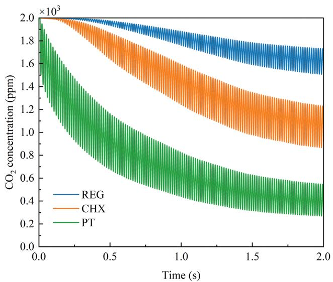\
Figure 12: $\mathrm { C O } _ { 2 }$ concentration changes under the condition of uniform distribution

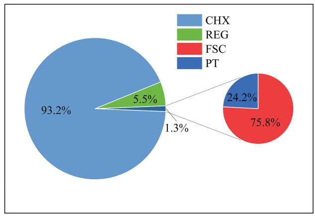\
(a) Uniform distribution

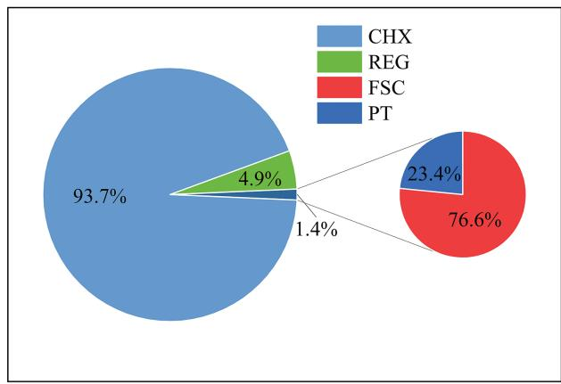\
(a) Gradual release\
Figure 13: Dry ice distribution under two initial conditions

## 3.4 Pressure Drop and Cooling Capacity

In PTC, the deposition of $\mathrm { C O } _ { 2 }$ changes the channel characteristics of each regional structure, which leads to the rise of pressure drop and the decrease in the amplitude of pressure waves, ultimately reducing the cooling capacity. Therefore, it is necessary to systematically analyze the change rule of pressure drop and amplitude of the pressure wave under diferent working conditions. To eliminate transient interference during system initialization, this study establishes the flow time t is equal to 2 s as the reference analysis point, where fully developed periodic stability is achieved in pressure oscillations. As shown in Fig. 14, with increasing $\mathrm { C O } _ { 2 }$ contamination levels, a progressive attenuation of the pressure wave amplitude was observed. Quantitative analysis revealed amplitude reductions of 4%, 7%, and 12% corresponding to contamination levels of 500, 1000, and 2000 ppm, respectively. Fig. 15 shows the pressure drop changes and cooling capacity in each part of the system (REG, CHX, PT) under diferent concentrations. Working conditions have a pronounced impact on the system’s pressure drop. As the $\mathrm { C O } _ { 2 }$ concentration increases from 500 to 2000 ppm, there is a significant trend of pressure drop in the REG and CHX regions, increasing by 10.3%, indicating that contaminant deposition significantly impedes the flow of the working gas. As a result, due to the reduction in the amplitude of the pressure wave and the rise in pressure drop, the cooling capacity of the system eventually decreases. The refrigeration capacity decreased from 148.2 W to a minimum of133.2 W, representing an 10.1% reduction in cooling performance.

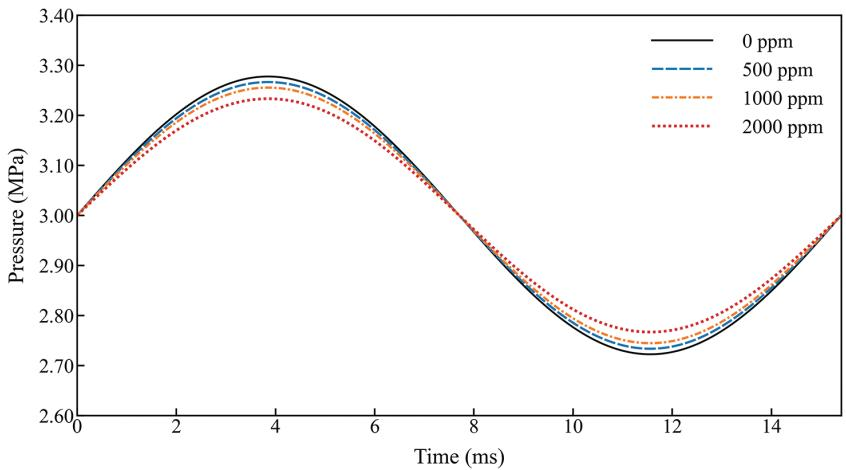\
Figure 14: Amplitude of the pressure wave under diferent conditions

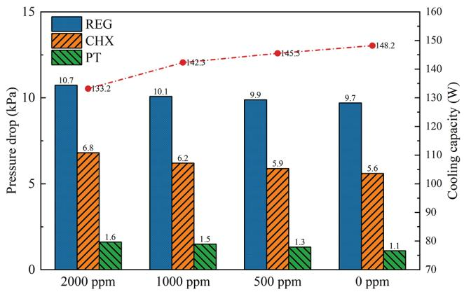\
Figure 15: Pressure drop and cooling capacity under diferent $\mathrm { C O } _ { 2 }$ concentrations at the temperature of 160 K

The REG consistently exhibits the highest pressure drop among all regions, which can be attributed to the following three factors. First, although the REG has a higher porosity compared to the CHX, it is significantly longer in length, resulting in greater overall flow resistance. Second, the temperature within the REG varies approximately linearly along the axial direction, leading to substantial changes in gas viscosity between the hot and cold ends, thereby further increasing flow resistance. Third, during the initial stages, $\mathrm { C O } _ { 2 }$ is primarily concentrated in the REG. Its deposition within the porous structure reduces the efective flow area and lowers the equivalent porosity, causing a sharp rise in pressure drop. The CHX exhibits an appropriate pressure drop. Although it has a lower porosity than the REG, its flow passages are more unobstructed, which helps reduce flow resistance. The PT region experiences the lowest pressure drop, primarily due to the presence of a flow-straightening wire screen that efectively suppresses vortex formation and promotes laminar flow development.

## 4 Conclusions

In this study, a two-dimensional numerical simulation was conducted to systematically analyze the difusion and deposition behaviors of $\mathrm { C O } _ { 2 }$ in an in-line PTC. The efects of diferent initial concentration distributions and operating conditions on regional deposition characteristics and system pressure drop were investigated. The main conclusions are as follows:

1. The difusion of $\mathrm { C O } _ { 2 }$ within the PTC is primarily driven by concentration gradients, with transport eficiency significantly enhanced by high-frequency oscillatory flow. The spatial distribution of $\mathrm { C O } _ { 2 }$ deposition is highly non-uniform. Crucially, the CHX consistently exhibits the highest deposition ratio, accounting for over 93% of the total dry ice mass (93.7% under gradual release and 93.2% under uniform distribution). This quantitative finding confirms that low-porosity structures play a decisive role in the accumulation of contaminants.

2. A comparative analysis between two initial $\mathrm { C O } _ { 2 }$ concentration conditions reveals that regardless of the initial state, the CHX remains the primary deposition zone. However, the initial distribution significantly alters the deposition behavior in PT. Under uniform distribution, $\mathrm { C O } _ { 2 }$ tends to deposit on the cold-end inner wall of the PT (76% of PT deposition). In contrast, in the gradual release scenario, deposition preferentially occurs on the FSC (76% ofPT deposition), as the screen intercepts the contaminant before it enters the tube.

3. $\mathrm { C O } _ { 2 }$ deposition exerts a pronounced negative impact on the system’s thermodynamics. Under the condition of 2000 ppm contamination, the pressure drop across the REG and CHX increases by 10.3%, while the pressure wave amplitude decreases by 12%. Consequently, the cooling capacity degrades from 148.2 to 133.2 W, representing a 10.1% reduction in system performance. The REG exhibits the highest absolute pressure drop due to its extended length and complex matrix, which is further exacerbated by contaminant accumulation.

Acknowledgement: We would like to thank the School of Energy and Power Engineering of the University of Shanghai for Science and Technology for their support to the research of this paper.

Funding Statement: This work was supported by the National Natural Science Foundation of China (No. 52376012) and the Aeronautical Science Foundation of China (20230024047001).

Author Contributions: The authors confirm contribution to the paper as follows: study conception and design: Hao Zhu and Xi Chen; methodology: Xi Chen and Yifan Zhu; software: Hao Zhu and Pengcheng Qu; data collection: Yingxia Qi and Haoyi Wang; analysis and interpretation of results: Hao Zhu and Xi Chen; draft manuscript preparation: Hao Zhu; writing—review and editing: Xi Chen. All authors reviewed and approved the final version of the manuscript.

Availability of Data and Materials: Data available on request from the authors.

Ethics Approval: Not applicable.

Conflicts of Interest: The authors declare no conflicts of interest.

## Nomenclature

C Concentration\
$C _ { 2 }$ Inertial resistance coeficient\
$c _ { p }$ Specific heat at constant pressure $\left( \mathrm { J } / ( \mathrm { k g } { \cdot } \mathrm { K } ) \right)$\
$D$ Difusion coeficient $( \mathrm { m } ^ { 2 } / s )$\
$d _ { h }$ Hydraulic diameter (m)\
$E$ Total energy (J/kg)\
$f$ Frequency (Hz)\
$F _ { p c }$ Additional force induced by phase change $\left( { \mathrm { N } } / { \mathrm { m } } ^ { 3 } \right)$\
$F _ { p o }$ Flow resistance term within the porous media $\left( { \mathrm { N } } / { \mathrm { m } } ^ { 3 } \right)$\
$h$ Specific enthalpy (J/kg)\
$k$ Thermal conductivity (W/(m⋅K))\
$M$ Mass flux $( \mathrm { k g } / ( \mathrm { m } ^ { 2 } { \cdot } s ) )$\
$\dot { m }$ Mass flow rate $( \mathrm { k g } / \mathrm { s } )$\
$\boldsymbol { p }$ Instantaneous pressure (Pa)\
$\ b { p _ { a } }$ Pressure amplitude (Pa)\
$\mathit { p _ { o } }$ Charge pressure (Pa)\
$\phi _ { o u t }$ Output pressure (Pa)\
$Q _ { c }$ Cooling capacity (W)\
$R g$ Gas constant (J/(kg⋅K))\
$R e _ { h }$ Reynolds number (porous media)\
$S _ { m a s s }$ Mass source term $( \mathrm { k g } / ( \mathrm { m } ^ { 3 } { \cdot } s ) )$\
$S _ { p h }$ Phase change source term $\left( \mathrm { J } / ( \mathrm { m } ^ { 3 } { \cdot } s ) \right)$\
$S _ { p o }$ Porous media source term $\left( \mathrm { J } / ( \mathrm { m } ^ { 3 } { \cdot } s ) \right)$\
$T$ Temperature (K)\
$t$ Time (s)\
$\dot { U }$ Volume flow rate $( \mathrm { m } ^ { 3 } / \mathrm { s } )$\
$u _ { m a x }$ Maximum velocity (m/s)\
$\vec { u }$ Velocity vector (m/s)\
$\nu _ { a }$ Velocity amplitude (m/s)\
$\nu _ { i n }$ Input velocity (m/s)\
$Y$ Mass fraction\
Greek Symbols\
α Permeability (m2)\
Γ Difusion coeficient $( \mathrm { m } ^ { 2 } / s )$\
$\tau$ Period (s)\
$\mu$ Dynamic viscosity (Pa⋅s)\
$\rho$ Density $( \mathrm { k g } / \mathrm { m } ^ { 3 } )$\
$\sigma$ Stress tensor (Pa)\
$\theta$ Phase angle (rad)\
Abbreviations\
AC Aftercooler\
CHX Cold-end heat exchanger\
FS Flow straightening mesh screen\
FSC Cold-end flow straightening mesh screen\
FSH Hot-end flow straightening mesh screen\
HHX Hot-end heat exchanger\
PT Pulse tube

## References

1. Zheng P, Wang L, Ji Y, Zeng Y, Chen X. Back-propagation neural network modeling for a pulse tube refrigerator with passive displacer. Appl Therm Eng. 2022;211(9):118464. doi:10.1016/j.applthermaleng.2022.118464.

2. Wang B, Chao Y, Zhao Q, Wang H, Wang Y, Gan Z. A high eficiency stirling-type pulse tube refrigerator for cooling above 200 K. Energy. 2021;215(3):119120. doi:10.1016/j.energy.2020.119120.

3. Gao Z, Yang B, Fan X, Chen L, Wang J. Thermal performance of a 4 K high-frequency pulse tube cryocooler with diferent working fluids. J Therm Sci. 2024;33(4):1468–79. doi:10.1007/s11630-024-1991-3.

4. Zhi X, Li G, Teng Y, Wang K, Qiu L. Study on the regenerative performance of pressed stainless-steel wire screens used in a pulse tube refrigerator working around 20 K. Appl Therm Eng. 2023;224(12):120043. doi:10.1016/ j.applthermaleng.2023.120043.

5. Wang K, Dubey S, Choo FH, Duan F. Modelling of pulse tube refrigerators with inertance tube and mass-spring feedback mechanism. Appl Energy. 2016;171(6):172–83. doi:10.1016/j.apenergy.2016.03.002.

6. Chen Z, Cui X, Liu S, Wu Y, Jiang Z, Ding L. Temperature fluctuation of a closed-cycle helium joule-Thomson cryocooler with two-stage precooling. J Therm Sci. 2023;32(4):1501–11. doi:10.1007/s11630-023-1819-6.

7. Lin Q, Zhao Q, Lev B. Cold chain transportation decision in the vaccine supply chain. Eur J Oper Res. 2020;283(1):182–95. doi:10.1016/j.ejor.2019.11.005.

8. Deng W, Liu S, Jiang Z, Ding L, Wu Y. Development of a spaceborne pulse tube cooler operating at 170 K. Int J Refrig. 2020;115(4):1–8. doi:10.1016/j.ijrefrig.2020.02.028.

9. Liu S, Jiang Z, Ding L, Zhu H, Huang Q, Wu Y. Impact of operating parameters on 80 K pulse tube cryocoolers for space applications. Int J Refrig. 2019;99(5):226–33. doi:10.1016/j.ijrefrig.2018.12.026.

10. Berchowitz DM, Kwon Y. Environmental profiles of stirling-cooled and cascade-cooled ultra-low temperature freezers. Sustainability. 2012;4(11):2838–51. doi:10.3390/su4112838.

11. Yuan SWK, Kuo DT. Cryocooler contamination study: temperature dependence of outgassing. In: Cryocoolers 11. Boston, MA, USA: Springer; 2002. p. 659–64. doi:10.1007/0-306-47112-4\_81.

12. Sato Y, Tanaka K, Shinozaki K. Demonstration test of gas contaminants adsorbent for space stirling cooler. Cryogenics. 2024;141:103884. doi:10.1016/j.cryogenics.2024.103884.

13. Getmanets VF, Zhun’ GG. Cryocooler working medium influence on outgassing rate. In: Cryocoolers 10. Boston, MA, USA: Springer; 2002. p. 733–41. doi:10.1007/0-306-47090-x\_86.

14. Getmanets VF, Zhun GG, Stears H. Accelerated cryocooler life tests for cryodeposit failures. In: Cryocoolers 10. Boston, MA, USA: Springer; 2002. p. 743–51. doi:10.1007/0-306-47090-x\_87.

15. Liu XG, Wu YN, Yang SH, Zhang XM, Lu GH, Zhang L. Performance degradation of space Stirling cryocoolers due to gas contamination. In: International Symposium on Photoelectronic Detection and Imaging 2011: Advances in Infrared Imaging and Applications; 2021 May 24–26; Beijing, China. p. 133–41.

16. Rezaei M, Jafarian A, Kardgar A. Numerical investigation of real gas efects on a two-stage pulse tube cryocooler performance. Int J Refrig. 2017;82(4):106–18. doi:10.1016/j.ijrefrig.2017.06.021.

17. Hall JL, Ross RG Jr. Gas contamination efects on pulse tube performance. In: Cryocoolers 10. Boston, MA, USA: Springer; 2002. p. 343–50. doi:10.1007/0-306-47090-x\_41.

18. Yuan SWK, Kuo DT, Loc AS. Cryocooler contamination study. Adv Cryog Eng. 1999;45A:275.

19. Getmanits V. Methodology of accelerated life-time tests for Stirling-type Bae-Co-made cryocoolers against displacer-blockage by cryo-pollutant deposits. Natl Acad Sci Ukr. 2000.

20. Ma J, Hui H, Jiang Z, Qu P, Zhou X, Liu S, et al. Experimental study on the efect of trace nitrogen on pulse tube cryocooler in 40 K temperature range. Appl Therm Eng. 2025;275(1):126778. doi:10.1016/j.applthermaleng.2025. 126778.

21. Muralidhar K, Suzuki K. Analysis of flow and heat transfer in a regenerator mesh using a non-Darcy thermally non-equilibrium model. Int J Heat Mass Transf. 2001;44(13):2493–504. doi:10.1016/S0017-9310(00)00285-4.

22. Ju YL, de Waele ATAM. A computational model for two-stage 4K-pulse tube cooler: part I. theoretical model and numerical method. J Therm Sci. 2001;10(4):342–7. doi:10.1007/s11630-001-0042-5.

23. Flake B. Modeling pulse tube cryocoolers with CFD. AIP Conf Proc. 2004;710(1):1493–9. doi:10.1063/1.1774843.

24. Rezaei M, Atrey MD. Numerical investigation of real gas efects on a two-stage pulse tube cryocooler performance. Appl Therm Eng. 2017;123:1025–33. doi:10.1016/j.applthermaleng.2017.05.082.

25. Yan C, Zhang Y, Qiu J, Chen Y, Wang X, Dai W, et al. Numerical and experimental study of partly tapered pulse tube in a pulse tube cryocooler. Int J Refrig. 2020;120:474–80. doi:10.1016/j.ijrefrig.2020.09.013.

26. Duan W, Zheng P, Wu Y, Zhan J, Chen X. Numerical investigation of a displacer-type pulse tube refrigerator with work recovery. Sci Technol Built Environ. 2022;28(10):1341–54. doi:10.1080/23744731.2022.2111143.

27. He YL, Zhang DW, Yang WW, Gao F. Numerical analysis on performance and contaminated failures of the miniature split Stirling cryocooler. Cryogenics. 2014;59(11):12–22. doi:10.1016/j.cryogenics.2013.11.003.

28. Feng TS, Chen HL, Liu XT, Xun YQ, Liang JT. Efect of nitrogen contamination on the performance of pulse tube cryocoolers. Appl Therm Eng. 2022;201:117810. doi:10.1016/j.applthermaleng.2021.117810.

29. Ma J, Shao B, Zhao P, Jiang Z, Liu S, Dong D. CFD simulation analysis and visualization experimental study of gas contamination condensation distribution in coaxial pulse tube cryocooler. Int J Refrig. 2025;174(39):333–42. doi:10.1016/j.ijrefrig.2025.03.016.

30. Zhao P, Liu Y, Zhang Y. Comparative analysis of in-line and coaxial pulse tube cryocoolers at 90 K. J Infrared Millim Waves. 2021;40(1):54–60. doi:10.11972/j.issn.1001-9014.2021.01.010.

31. Radebaugh R, Huang Y, O’Gallagher A, Gary J, Collaboration N, Weisend JG. Optimization calculations for a 30 Hz, 4 K regenerator with helium-3 working fluid. AIP Conf Proc. 2010;1218(1):1581–92. doi:10.1063/1.3422340.

32. Zheng P, Chen X, Wu Y, Ye T, Zhang H. Investigation of an eficient high cooling-capacity stirling-type pulse tube refrigerator with passive rod displacer operating at 173 K. Appl Therm Eng. 2024;248:123142. doi:10.1016/j. applthermaleng.2024.123142.