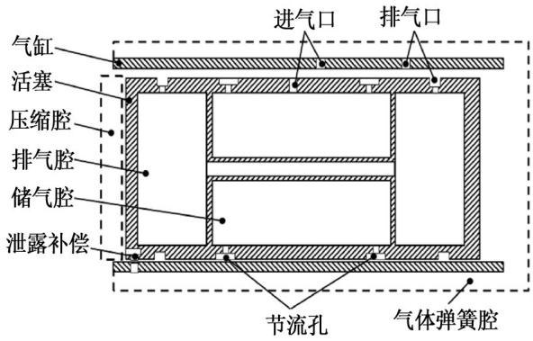
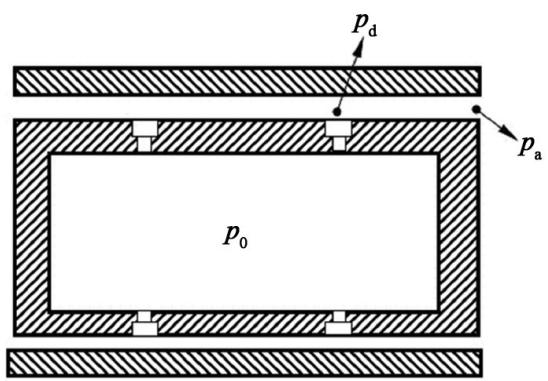
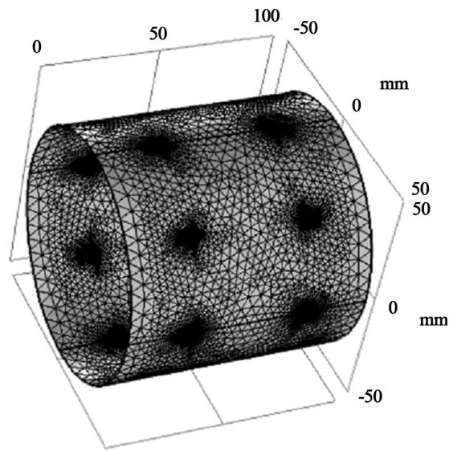
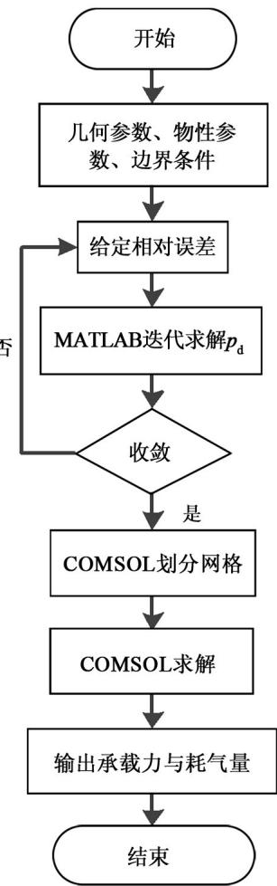
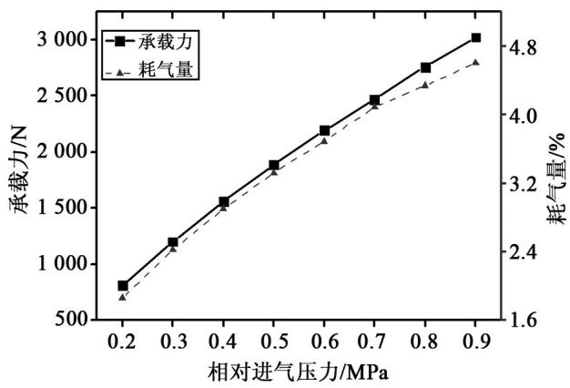
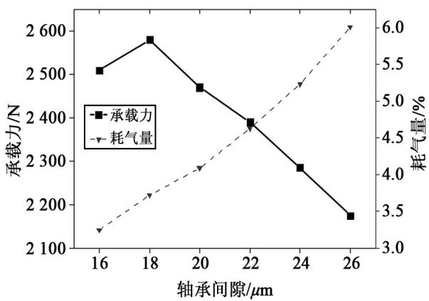
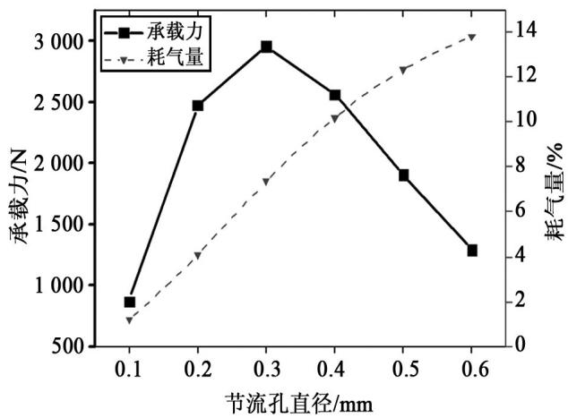
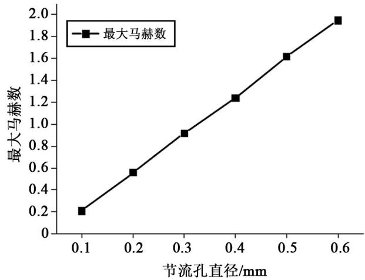
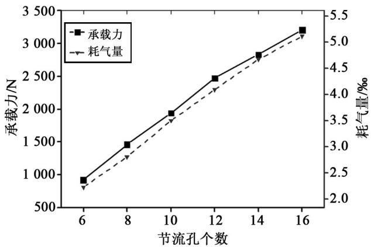
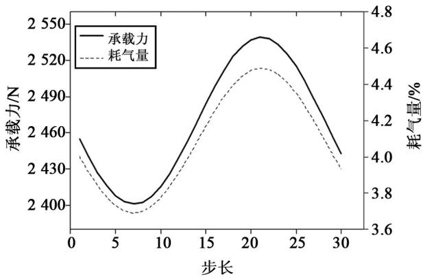

# 基于 COMSOL&MATLAB 平台静压气体轴承性能的分析

庄昌佩，王小军，闫春杰，王振霖

（兰州空间技术物理研究所 真空技术与物理重点实验室，兰州 730000）

摘要：静压气体轴承主要为自由活塞式斯特林发电机的活塞提供径向支撑，是其亟待突破的关键技术。在介绍了自由活塞式斯特林发电机用静压气体轴承原理和基本结构的基础上，结合COMOSLMultiphysics与MATLAB软件，分析了相对进气压力、轴承几何参数以及活塞轴向运动等因素对轴承性能的影响。结果表明，相对进气压力、节流孔个数与轴承的承载力正相关；随着密封间隙与节流孔直径的增大，耗气量增加，承载力呈现出先增大后减小的趋势；此外，活塞轴向运动对静压气体轴承性能也存在一定的影响。

关键词：自由活塞；静压气体轴承；薄膜流动

中图分类号：TB65

文献标志码：A

文章编号：1006-7086（2018）06-0405-05

DOI：10.3969/j.issn.1006-7086.2018.06.008

# Performance Analysis of Aerostatic Bearing Based on COMSOL&MATLAB Platform

ZHUANG Changpei，WANG Xiaojun，YAN Chunjie，WANG Zhenlin （Science and Technology on Vacuum Technology and Physics Laboratory， Lanzhou Institute of Physics，Lanzhou 730000，China）

Abstract：Hydrostatic gas bearing mainly provides radial support for pistons of Free-piston Stirling generators，which is a key technology needed to be broken. Based on the introduction of the principle and basic structure of gas bearing，combined with COMOSL Multiphysics and MATLAB software，the effects of relative intake pressure，bearing geometry and axial movement of the piston on bearing performance were analyzed. The results showed that the relative intake pressure and the number of orifices are positively correlated with the capacity of the bearing；With the increase of the seal gap and the diameter of the orifices，the load capacity increases firstly and then decreases. In addition，the axial movement of the piston also has a certain influence on the performance of hydrostatic gas bearing.

Key words：free piston；hydrostatic gas bearing；film flow

## 0 引言

自由活塞式斯特林发电机（Free-piston StirlingGenerator，FPSG）具有效率高、功率发展潜力大等突出优点，是一种极具竞争力的空间用动态热电转换装置[1-2]。传统FPSG的间隙密封保持与轴向复位可由板弹簧同时完成[3-4]，但随着功率增大，活塞质量与运动频率均明显增加，板弹簧技术显得力不从心。研究表明，对于大功率FPSG而言，为活塞提供足够承载刚度（轴向与径向）的板弹簧质量，会达到活塞质量的8\~15倍[5-6]，这个质量对于空间应用场合是无法接受的。因此从上世纪80年代中期，NASA等机构就开始积极尝试使用其他承载方式，提高整机比功率。其中，应用最为成功的技术方案是静压气体轴承与轴向复位技术（气体弹簧、磁弹簧等）的组合结构[7-8]。

目前，FPSG用静压气体轴承的计算方法均借鉴于普通静压气体轴承，主要利用计算流体力学（Computational Fluid Dynamics，CFD）全局模拟或雷诺方程求解[9-13]。第一种方法需要在气膜厚度方向划分网格，由于气膜厚度与气膜长度、宽度相比非常小（数量级相差约10-3\~10-4），因此操作难度大、计算费时；另一种方法假设气体压力在气膜厚度方向无变化，使得数学模型简化为雷诺方程（二维），此方程的求解一般需要自主编程。

利用MATLAB强大的数学计算能力与COM⁃SOL Multiphysics软件中的“薄膜流体”模块，分析了各因素对静压气体轴承性能的影响。

## 1 静压气体轴承结构与原理

FPSG用静压气体轴承属于内供压型径向轴承[14]。以动力活塞为例，当活塞偏离轴向平衡位置向右移动时，气体弹簧腔压力升高，位于活塞壁与气缸上的进气口在某一时刻对齐打开，为供气腔充气，然后关闭；反之，当活塞偏离平衡位置向左移动时，气体弹簧腔压力降低，位于活塞壁与气缸上的排气口对齐，轴承排气腔开始排气。一个完整循环内，轴承系统供、排气均两次。该结构巧妙地利用了气体弹簧腔的压力波动规律，在高压时供气、低压排气，使得气体弹簧腔压力维持在较低水平，有效降低了腔内气体黏滞损失，结构如图1所示。

  
图1 某FPSG动力活塞结构图  
Fig. 1 The structure diagram of FPSG power piston

## 2 物理模型与计算流程

假设轴承进气口对承载气体压力分布影响不大（进气口面积仅占气膜表面积的2‰），排气槽气体流通顺畅，静压气体轴承计算模型可简化为图2。

  
图2 静压气体轴承计算模型图  
Fig. 2 Calculation model of hydrostatic gas bearing

计算的关键在于求解节流孔后压力 $p _ { \mathrm { d } }$ ，等温条件下， ${ , p _ { \mathrm { d } } }$ 与排气压力 $p _ { \mathrm { a } }$ 存在关系[15]：

$$
p _ { \mathrm { d } } ^ { 2 } - p _ { a } ^ { 2 } = { \frac { 2 4 \mu m n R T l } { \pi D h ^ { 3 } } }\tag{1}
$$

式中 $: \mu$ 为气体黏度； $; m$ 为质量流量； $; n$ 为单排节流孔个数；R为气体常数；T为轴承工作温度；l为节流孔到排气区的距离；D为轴承内直径（即活塞直径） $; h$ 为气膜间隙。

对于单个节流孔，绝热条件下[15]：

$$
m = \left\{ \begin{array} { l l } { { \displaystyle C _ { \upsilon } A \rho _ { \upsilon } ( 2 R T _ { \upsilon } ) ^ { \frac { 1 } { 2 } } \Biggl \{ \frac { \gamma } { 2 } \Biggl [ \Biggl ( \frac { 2 } { \gamma + 1 } \Biggr ) ^ { \frac { \gamma + 1 } { \gamma - 1 } } \Biggr ] \Biggr \} ^ { \frac { 1 } { 2 } } } } & { { \displaystyle \frac { p _ { d } } { p _ { 0 } } \leqslant \beta } } \\ { { \displaystyle C _ { \upsilon } A \rho _ { \upsilon } ( 2 R T _ { 0 } ) ^ { \frac { 1 } { 2 } } \Biggl \{ \frac { \gamma } { \gamma - 1 } \Biggl [ \Biggl ( \frac { p _ { d } } { p _ { 0 } } \Biggr ) ^ { \frac { 2 } { \gamma } } - \Biggl ( \frac { p _ { d } } { p _ { 0 } } \Biggr ) ^ { \frac { \gamma + 1 } { \gamma } } \Biggr ] \Biggr \} ^ { \frac { 1 } { 2 } } } } & { { \displaystyle \frac { p _ { d } } { p _ { 0 } } > \beta } } \end{array} \right.\tag{2}
$$

$$
\beta = \frac { p _ { d } } { p _ { 0 } } = \left[ \left( \frac { 2 } { \gamma + 1 } \right) ^ { \frac { \gamma } { \gamma - 1 } } \right]\tag{3}
$$

式中： $C _ { \mathrm { D } }$ 为流量系数； $\mathord {  } A$ 为节流面积； $; \rho _ { 0 }$ 和 $T _ { 0 }$ 分别是供气区气体密度和温度 $; \gamma .$ 为气体比热比。

联合式（1）、式（2），求得 $p _ { \mathrm { d } }$ ，再以 $p _ { \mathrm { d } }$ 为入口压力，$p _ { \mathrm { a } }$ 为出口压力，使用COMSOL“薄膜流动”模块中修正雷诺方程对气膜压力分布进行求解。相比于三维全局模型，COMSOL“薄膜流动”模块忽略了气膜厚度方向上压力的变化，体网格简化为面网格，网格划分十分简便，可直接由软件自动生成，图3是划分完成的气膜网格。

  
图3 气模网格划分图  
Fig. 3 Gas film mesh generation

需要说明的是，该方法先假定节流孔至气膜出口的压力呈抛物线分布，然后求得 $p _ { \mathrm { d } }$ ，再次使用雷诺方程将通过节流孔的质量流分布于二维气膜中，属于准二维方法，突出优点是在较高计算精度与小代价条件下，对静压气体轴承进行静态及动态分析，并得到气膜压力场与速度场，适合工程计算。图4为计算流程图。

  
图4 计算流程图  
Fig.4 The process of calculation

## 3 轴承静态特性影响因素分析

表1是某FPSG相关参数，为了更加清晰地了解静压气体轴承耗气量对FPSG性能的影响，可采用静压气体轴承在一个完整循环中的耗气量占FPSG扫气容积的比值来表示轴承耗气量。扫气容积计算公式为 $V = 2 \pi { \left( D / 2 \right) } ^ { 2 } l _ { 0 }$

## 3.1 相对进气压力对轴承静态特性的影响

相对进气压力是指静压气体轴承进气压力与排气压力的算术差值。已经提到过，FPSG用静压气体轴承属于内供压形式，轴承稳定运行的必要条件是轴承供气腔在气体弹簧腔高压时充气，轴承排气腔在气体弹簧腔低压时向其排气，提高进气压力或降低排气压力都对活塞行程提出过高要求，这样将使在怠速工况以及出现其他一些降低活塞行程的非理想状态后，静压气体轴承失效。因此，需控制进排气压力幅值均不过分偏离整机平均压力，取进气压力 8.10\~8.45 MPa，排气压力 7.90\~7.55 MPa，两者均按0.05 MPa压差变化，节流孔定为两排，每排12个，孔径定为0.2 mm，名义间隙20 μm，偏心率（活塞中心线偏离气缸中心线的距离与名义间隙的比值）设置为0.3。由图5可以看出，相对进气压力增高，轴承承载力与耗气量增大，这是由于节流孔后压力与排气压力差不断增大，气膜厚处流动速度加快，排气通畅，进一步提高了轴承上下两侧压差，从而使得轴承承载力与耗气量均增大。

表1 某FPSG相关参数  
Table1 Related parameters of FPSG
<table><tr><td>项目</td><td>参数</td></tr><tr><td>工质</td><td>氦气</td></tr><tr><td>频率  $f / \mathrm { H z }$ </td><td>70</td></tr><tr><td>平均压力  $p _ { \mathrm { { m } } } / \mathrm { { M P a } }$ </td><td>8</td></tr><tr><td>轴向动力活塞行程  $l _ { 0 } / \mathrm { m m }$ </td><td>14</td></tr><tr><td>动力活塞直径  $D / \mathrm { m m }$ </td><td>160</td></tr><tr><td>轴承长度  $L / \mathrm { m m }$ </td><td>160</td></tr></table>

  
图5 相对进气压力对气体轴承的影响曲线  
Fig.5 The influence of relative intake pressure on aerostatic bearing

## 3.2 密封间隙对轴承静特性的影响

根据FPSG热力学计算，理论密封间隙定为20 μm，实际情况下，总存在加工误差、材料热变形、磨损等因素，轴承间隙将会发生变化。设定相对进气压力0.7 MPa（进气绝对压力8.35 MPa，排气绝对压力7.65 MPa），节流孔直径0.2 mm，计算气膜间隙对轴承静特性的影响。

从图6看出，承载力在间隙为18 μm时达到最大值，之后不断下降，轴承耗气量随着轴承间隙不断增大。因此应在保证加工与装配精度的同时，充分考虑材料泊松比以及膨胀系数热变形等因素，使得静压气体轴承的实际间隙控制在18～24 μm之间。

  
图6 密封间隙厚度对气体轴承的影响曲线  
Fig.6 The influence of sealing gap on aerostatic bearing

## 3.3 节流孔直径对轴承静特性的影响

选取简单孔节流器进行分析，其节流效应完全取决于节流孔直径。设定相对进气压力为0.7 MPa（进气绝对压力 8.35 MPa，排气绝对压力 7.65MPa），节流孔直径0.1～0.6 mm，其他参数不变。

从图7可以看出，随着节流孔直径增大，耗气量增大，承载力并没有不断增大，而是在节流孔直径为0.3 mm时出现峰值，之后随着节流孔直径增大而减小。

  
图7 节流孔直径对气体轴承的影响曲线  
Fig.7 The effect of orifice diameter on aerostatic bearing

为了解释这种现象发生的原因，对气膜内最大马赫数进行计算，如图8所示气膜内最大马赫数随着节流孔直径增大不断增大，当马赫数大于1时，轴承承载力开始下降。因此在设计过程中应避免出现超音速流动现象。

  
图8 节流孔直径对气膜最大马赫数的影响曲线  
Fig.8 The effect of orifice diameter on the maximum Mach number of gas film

## 3.4 节流孔个数对轴承静特性的影响

节流孔个数直接决定了进入气膜内的气体流量，对静压气体轴承的性能存在重大影响。从图9看出，随着单排节流孔个数增加，轴承承载力与耗气量均明显增大。此外，由于计算中未考虑轴承节流孔偏置角问题（如仅考虑重力，偏置角指距竖直方向最近的节流孔中心与竖直方向的夹角），实际情况下，如果节流孔数量较少，轻微的活塞轴向转动就可能导致承载力发生变化。

  
图9 节流孔个数对气体轴承的影响曲线  
Fig.9 The effect of the number of orifices on aerostatic bearing

## 4 活塞轴向运动对轴承动态性能的影响

FPSG活塞在轴线方向上做往复直线运动，这种现象是否对静压气体轴承性能造成不利影响，相关资料对其探究较少[16]。热力学计算得到活塞位移函数为 $X _ { \mathrm { p i s } } { = } 0 . 0 1 4 \mathrm { c o s } 4 3 9 . 6 t$ ，发电机频率70 Hz，一个周期约为 0.014 4 s，定义时间步长 0.000 48 s，计算30个时间步数，即可得到一个完整周期内气体轴承的动态变化。由图10可以看出，活塞轴向运动对轴承动态性能产生了一定影响，在一个周期内，最大（最小）承载力偏离静态承载力约3%，最大（最小）耗气量偏离静态耗气量约10%，因此活塞轴向运动对耗气量的影响不可忽视，在进排气口设计中，应关注轴承动态耗气量。

  
图10 气体轴承性能随活塞轴向运动的变化曲线  
Fig. 10 The performance of areostatic bearing changes with axial movement of the piston

## 5 结论

静压气体轴承是自由活塞式斯特林发电机的关键技术之一，该技术的突破不仅可以提高整机比功率，而且可以大幅提高整机工作寿命。文中使用的计算方法，可以方便地分析几何参数与活塞轴向运动对静压气体轴承性能的影响，对静压气体轴承设计有一定的指导作用。从以上分析得到，随着相对进气压力增大，或节流孔个数增多，静压气体轴承的承载力增大十分明显，而密封间隙与节流孔直径存在最优。因此当承载力不足时，应优先考虑改变密封间隙与节流孔直径，如果最优值出现后，承载力仍不满足需求，则应考虑改变相对进气压力与节流孔个数；最后，活塞轴向运动对静压气体轴承的耗气量有较大影响，在详细设计过程中应给予足够关注。

## 参考文献：

[1] Penswick L B，Beale W T，Wood J G. Free-piston Stirling Engine Conceptual Design and Technologies for Space Power， Phase 1. Final Report[R]. Sunpower ，Inc，Athens，OH，1999.

[2]霍英杰，董亮，王丽红，等.空间斯特林发电技术的发展[C]//中国宇航学会深空探测技术业委员会学术年会，2012.

[3] 贾红书. 100 W自由活塞斯特林发电机整机研制及性能分析[D].北京：中国科学院大学，2011.

[4]陈国邦，汤珂.小型低温制冷机原理[M].北京：科学出版社，2010：97-163.

[5] Chapman P，Walter T，Brandhorst H，et al. Design and Fabrication of a 5 kWe Free-Piston Stirling Power Conversion System[C]//6th International Energy Conversion Engineering Conference（IECEC），2008：5658.

[6]周文杰，王龙一，甘智华，等.3种不同形式的板弹簧性能分析[J]. 南京航空航天大学学报，2011，43（1）:79-85.

[7] Chapman P A，Walter T，Brandhorst H，et al. Design and Fabrication of a 5 kWe Free-Piston Stirling Power Conversion System[C]//International Energy Conversion Engineering Conference，2013：663.

[8] Schreiber J G. Assessment of the free-piston Stirling convertor as a long life power convertor for space[C]// Energy Conversion Engineering Conference and Exhibit，2013：1239-1247.

[9]张晓青，汪伟伟.直线压缩机气体轴承的性能分析[J].华中科技大学学报（自然科学版），2012，40（1）:108-112.

[10]刘京.自由活塞热气机用气体轴承的性能计算与设计[D].上海：中国舰船研究院（上海船用柴油机研究所），2004.

[11]于贺春，马文琦，王祖温，等.基于FLUENT的径向静压气体轴承的静态特性研究[J].润滑与密封，2009，34（12）:77-81.

[12] 刘暾. 静压气体润滑[M]. 哈尔滨：哈尔滨工业大学出版社，1990.

[13]张君安.高刚度空气静压轴承研究[D].西安：西北工业大学，2006.

[14] Hail C U. Design of an internally pressurized aerostatic journal bearing for thermoacoustic engines[J]. Tribology International，2016，99:151-158.

[15] Powell J W. 空气静压轴承设计[M]. 北京：国防工业出版社，1978：24-33.

[16]郭良斌.静压气体轴承静态特性的理论研究综述[J].武汉科技大学学报:自然科学版，2006，29（1）:37-40.