Wuhan Institute of Technology

# 硕士学位论文

## 对置激振式热声制冷机的相位研究

学科专业：工程热物理

研究生：肖邦彦

指导教师：李宏顺教授

鄂青副教授

培养单位：光电信息与能源工程学院

二零 二五 年 三月

分类号：TK11

学校代号：10490

学号：22210010024

密 级：

# 武汉工程大学硕士学位论文

# 对置激振式热声制冷机的相位研究

作者姓名：肖邦彦

指导教师姓名：李宏顺教授

申请学位类别：学术硕士学位

论文提交日期：2025年3月20日

鄂青副教授

学科专业名称：工程热物理

论文答辩日期：2025年5月5日

学位授予单位：武汉工程大学

学位授予日期：2025年6月19日

答辩委员会主席：吕伟（教授级高工）

中国知网https://www.cnki.net

# Phase Study of Opposed Excitation Thermoacoustic Refrigerator

A Thesis Submitted for the Degree of Master

Major: Engineering Thermophysics

Candidate: Xiao Bangyan

Supervisor: Li Hongshun

E Qing

Wuhan Institute of Technology

Wuhan, Hubei 430073, P. R. China

## 摘要

热声技术是一种比较高效的能量转换技术，其利用热声效应实现热能和声能的相互转化。热声制冷机具有非常良好的环境友好性和高度的可靠性，具有极高的研究价值。对置激振式热声制冷机作为热声制冷机的一种重要结构形式，其两端声源间的相位差对于制冷机的制冷效果影响显著。

本文首先利用COMSOL建立了对置激振式驻波热声制冷机模型，通过模拟声源间处于不同相位差条件下的谐振管内部声场的分布情况，确定了在两端声波相位差为 $9 0 ^ { \circ }$ 时，驻波热声制冷机内可获得最佳声场条件。其次，在保证谐振管声场达到最优状态的前提下，模拟分析了板叠处于谐振管内不同位置时制冷机制冷效果的变化情况，发现存在一个板叠的最优位置点使得驻波热声制冷机制冷效果最好，并且可通过模拟结果确定板叠的长度。然后，研究了驻波热声制冷机在最佳声场以及最佳板叠位置的前提下，工质种类、工作频率以及压力驱动比等系统参数的改变对其制冷效果的影响，重点在于驻波热声制冷机的频率分析。模拟结果显示，在气体工质选取为氦气时的制冷效果明显优于空气与氮气；有较大驱动比的情况下，驻波热声制冷效果较好；对于频率来说，在低于截止频率的情况下，频率越大越有利于对置激振式驻波热声制冷机的制冷。最后，为实现对声源间相位差的主动控制，设计并调试了一个电路调相装置，运用调相电路可实现对两个声源各自驱动电信号间相位差的调控，从而实现对热声谐振管两端声源各自产生声波信号间的相位差的控制，最终满足对置激励式驻波热声制冷机的相位需求。

关键词：热声制冷机；双声源；相位差；调相电路

## Abstract

Thermoacoustic technology is a relatively efficient energy conversion technique that utilizes the thermoacoustic effect to achieve the mutual conversion of thermal energy and sound energy. Thermoacoustic refrigeration machines have excellent environmental friendliness and high reliability, and have extremely high research value. As an important structural form of thermoacoustic refrigeration, the phase difference between the sound sources at both ends of the opposed vibration thermoacoustic refrigeration machine has a significant impact on the refrigeration effect of the refrigeration machine.

This article first establishes a model of an opposed excitation standing wave thermoacoustic refrigeration machine using COMSOL. By simulating the distribution of the sound field inside the resonant tube under different phase difference conditions between the sound sources, it is determined that the optimal sound field conditions can be obtained inside the standing wave thermoacoustic refrigeration machine when the phase difference between the sound waves at both ends is $9 0 ~ ^ { \circ } .$ Secondly, under the premise of ensuring the optimal sound field of the resonant tube, the variation of the cooling effect of the refrigeration mechanism when the plate stack is located at different positions inside the resonant tube was simulated and analyzed. It was found that there is an optimal position point of the plate stack that makes the standing wave thermoacoustic refrigeration mechanism have the best cooling effect, and the length of the plate stack can be determined through simulation results. Then, the influence of changes in system parameters such as working fluid type, operating frequency, and pressure drive ratio on the refrigeration effect of standing wave thermoacoustic refrigeration machine under the premise of optimal sound field and optimal plate stack position was studied, with a focus on frequency analysis of the standing wave thermoacoustic refrigeration machine. The simulation results show that the refrigeration effect is significantly better when helium is selected as the gas working fluid than air and nitrogen; When there is a large driving ratio, the standing wave

thermoacoustic cooling effect is better; For frequency, below the cutoff frequency, the higher the frequency, the more advantageous it is for the refrigeration of the opposed excitation standing wave thermoacoustic refrigeration machine. Finally, in order to achieve active control of the phase difference between sound sources, a circuit phase modulation device was designed and debugged. The phase modulation circuit can be used to regulate the phase difference between the driving electrical signals of two sound sources, thereby controlling the phase difference between the sound signals generated by the sound sources at both ends of the thermoacoustic resonant tube, and ultimately meeting the phase requirements of the opposed excitation standing wave thermoacoustic refrigeration machine.

Keywords: Thermoacoustic refrigeration machine; Dual sound source; Phase difference; Phase modulation circuit

## 主要符号表

<table><tr><td>A</td><td>振幅</td><td>U</td><td>电压</td></tr><tr><td>a</td><td>热扩散率</td><td>V</td><td>体积</td></tr><tr><td>B</td><td>孔隙度</td><td>u</td><td>速度</td></tr><tr><td>C</td><td>电容</td><td>3</td><td>角速度</td></tr><tr><td>C</td><td>声速</td><td>μ</td><td>动力黏度</td></tr><tr><td>e</td><td>内能</td><td> $f _ { e x t }$ </td><td>单位表面力</td></tr><tr><td>E</td><td>能量</td><td> $f _ { s u r f }$ </td><td>表面力</td></tr><tr><td>h</td><td>体积分布函数</td><td> $f _ { v o l }$ </td><td>体积力</td></tr><tr><td>I</td><td>电流</td><td> $L _ { S }$ </td><td>回热器长度</td></tr><tr><td>J</td><td>流率</td><td> $Q _ { h }$ </td><td>高温热源功率</td></tr><tr><td>k</td><td>导热率</td><td> $Q _ { c }$ </td><td>低温热源功率</td></tr><tr><td>1</td><td>板叠厚度</td><td> $\delta _ { \mathrm { v } }$ </td><td>热渗透深度</td></tr><tr><td>L</td><td>长度</td><td> $\delta _ { \mathrm { k } }$ </td><td>黏性渗透深度</td></tr><tr><td>m</td><td>质量</td><td> $C _ { P }$ </td><td>定压比热容</td></tr><tr><td>M</td><td>马赫数</td><td> $\mathrm { P r }$ </td><td>普朗特数</td></tr><tr><td>P</td><td>压力</td><td>div</td><td>散度</td></tr><tr><td>q</td><td>热量分量</td><td></td><td></td></tr><tr><td>Q</td><td>热功率</td><td></td><td></td></tr><tr><td>R</td><td>电阻</td><td></td><td></td></tr><tr><td>T</td><td>温度</td><td></td><td></td></tr><tr><td>t</td><td>时间</td><td></td><td></td></tr></table>

## 目 录

第一章 绪论..  
1.1 研究背景和意义.  
1.2 热声现象..... .2  
1.3 基于热声原理的热声热机 .9  
1.4 声驱动热声热机的相位研究. ..14  
1.5 本文工作安排. .16  
第二章 基本热声原理及模拟原理. ..18  
2.1 基本热声理论... ...18  
2.2 气体微团的热力学过程. ..28  
2.3 线性热声方程.. ..30  
2.4 模拟原理简介.. ..32  
2.5 本章小结... ..34  
第三章 驻波热声制冷机的声场模拟与相位分析.. ..35  
3.1 谐振管的声场分析.. ...35  
3.2 声波叠加原理 ..44  
3.3 声场的调节... ..44  
3.4 1/4 波长声场的有限元分析 ..45  
3.5 本章小节.. ..49  
第四章 驻波热声制冷机板叠位置的选取 ..51  
4.1 双声源驻波热声制冷机结构简介.. ...52  
4.2 板叠参数的选定.... ..53  
4.3 板叠在谐振管中的位置对制冷效果的影响. ..54  
4.4 板叠在谐振管中位置的模拟. ..56  
4.5 本章小结.... ..61  
第五章 驻波热声制冷机的制冷效果优化. ..62  
5.1 工质种类对驻波热声制冷机制冷效果的影响. ...62  
5.2 压力驱动比对驻波热声制冷机制冷效果的影响 ..64  
5.3 频率对驻波热声制冷机制冷效果的影响. ..65  
5.4 本章小结. ..67  
第六章驻波热声制冷机调相电路设计与实验. ..68  
6.1 调相电路的基本原理 ..68  
6.2 调相电路的实验设计. ...72  
6.3 实验结果说明. ..76  
6.4 本章小结... ..77  
第七章 全文总结.. ...78  
7.1 全文总结... .....78  
7.2 未来展望.... ....79  
参考文献.... ....80

## 第一章绪论

## 1.1 研究背景和意义

在1999年的2月，美国权威学术组织对于20世纪许许多多的伟大工程发明做了一个排名，热机汽车与空调及制冷设备赫然位于榜单的前10名之内。在如今社会，制冷技术已经成熟的运用于人类生活与工业生产中，但是传统制冷工艺通常伴随着对环境的污染与破坏，所以如何高效且环保的完成制冷过程，成为了值得深思的重要问题。

在全球变暖加剧和化石燃料逐渐枯竭的今天，开发清洁能源的需求日益增加。太阳能、风能、废热能等可再生能源技术不断兴起，对21 世纪人类的发展起到了举足轻重的作用。

热声制冷技术作为一种新型制冷技术，具有良好的环境友好性和高度可靠性，在全球各国大力发展清洁能源与可持续发展技术的背景下蓬勃发展。在过去的二到三十年里，研究者们在发掘一种全新的热声机械，它能够减小制冷设备对环境的污染以及提升其制冷效率。与其他需要大量机械运动的制冷装置不同，热声制冷装置中吸收或者产生声能的设备相比，不仅构造简单而且不存在机械运动的损耗，我们可以期待在未来的某天，热声制冷装置会得到普及。

虽然热声制冷机在军工领域、天然气等行业中也展现出一些应用前景。但是到目前为止，绝大部份仍旧止步于实验室研发阶段，规模化的量产可能尚需一些时间。

就目前而言，相对于传统的制冷机械装置，热声制冷的优势在于[1]：（1）热声热机装置内的工质气体一般为化学性质稳定的常见气体，相对其他制冷设备较为环保；（2）传统制冷机依赖压缩机、阀门等机械部件，易磨损、需频繁维护。热声制冷机核心为声学谐振管和换热器，无复杂运动部件，寿命更长。（3）热声制冷机可通过废热、太阳能等低品位热源驱动（如温差发电或热声发动机耦合），提升能源利用效率。（4）在高温或大温差工况下，热声制冷机的性能系数（COP）可能优于传统制冷机。

综上所述，热声制冷装置与传统制冷装置比较，在能源利用与能量转换等方面存在一系列明显优点。近年来，大量关于热声原理的研究发现不断发表；大量关于热声设备的革新不断进行。侧面说明了关于热声制冷方向的研究的勃勃生机与其良好前景，这项技术正处于工程热物理与热科学的研究前沿[2]。基于现如今热声制冷如火如荼的研究背景，本文对热声制冷装置中的双声源驻波热声制冷机展开研究。从理论、实验、仿真等方面对于双声源驻波热声制冷机的制冷效果展开探讨，希望能够对双声源驻波热声制冷机的制冷效果有更深刻的认识，并借此更好的完善驻波热声制冷机的制冷机理，促进热声理论的发展，让热声装置能够在日后的研究与工程实践中有更好的应用。

## 1.2 热声现象

通常我们把热与声之间的相互作用定义为热声现象。如果从物理学上来描述，热声现象是热与声之间的一种能量转化。对于一般的热过程来说，可能会伴随有声现象的产生，继而产生声能，而逆过程则利用声能，转而产生一定的热能。具体而言，声场中的声波振荡在声场固体表面形成一定距离的周期性热交换，从而形成的热流。由于热声现象的发现过程比较偶然，所以在很长一段时间内科研工作者没有对热声现象进行深入的研究。

人类首次发现热声现象是18 世纪。1777年，Byron Higgins[3]通过实验观察到：将火焰置于垂直玻璃管的开口端附近时，管内气体因热胀冷缩引发自激振荡，产生较为明显的声震荡，火焰随之发出“歌声”。这是人类有记录的首次发现热声现象，如图1-1。

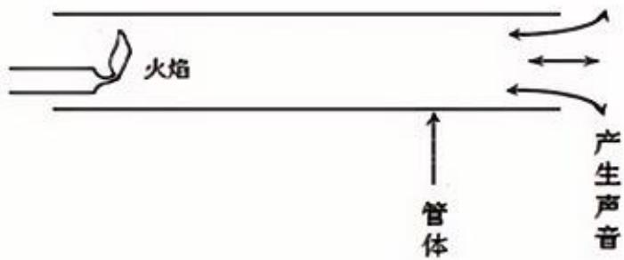  
图 1-1 Higgins 管图

针对这个现象，在1859年Rijke[4]有着更加明确和具体的描述，将一段加热的金属丝网（或灼热多孔材料）置于水平玻璃管下半部，当空气流经被加热的区域时，玻璃管会发出强烈的声波（类似“呼啸声”)。当铁丝网位于管1/4处时，振荡最剧烈，如图1-2。

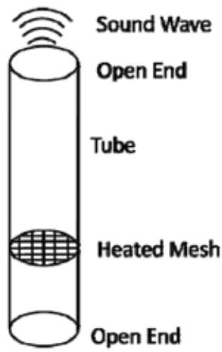

图 1-2 Ri jke 管图

1850年 Sondhauss[⁵]的研究最接近如今科研普遍定义的热声振荡。他研究的热声现象也正是基于玻璃吹制工发现的一个特殊现象：在一端封闭的细长玻璃管中，如果对玻璃管封闭端进行局部加热，管内气体因温度梯度引发周期性膨胀与收缩，从而产生稳定的声波振荡。1887 年，对于 Sondhauss 发现，英国物理学家 Lord Rayleigh[6]给出了概念性的诠释，而且给出了任意类型热声振荡发生的普适性条件：振荡产生的关键在于气体遇冷压缩凝结时，引入热量；气体受热膨胀稀疏时，导出热量。如图1-3。

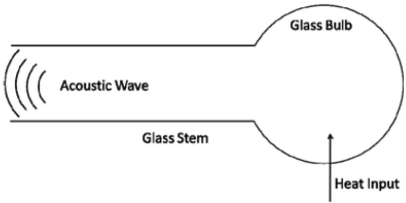  
图 1-3 Sondhauss 管图

Rayleigh的结论与Taconis在研究自发声振荡时的结论不谋而合，将室温下充满气体的管子靠近低温端时，会产生较大振幅的振荡，这就是“Taconis 振荡”[7]。

此后的科学家不断热声领域探索，Rott在定量解释热声现象方面取得了巨大的进展，如今适用于不同管径的时均域的动量方程、连续性方程和能量流方程全部出自于他的推导。Yazaki 和 Wheatley等后来者也通过大量的实验证明了Rott理论的正确性[8]。

不仅如此，Swift用来设计和预测热声设备性能的理论也建立Rott的发现之上。Swift完成的主要工作包括：热声概念及热声热机中的板叠、换热器和谐振管等部件的工作原理展开了理论阐述。此外，Swift还对脉冲管制冷机和斯特林机进行了大量的研究，下面会详细展开。同时，Wheatley等人也在与热声机械相关的热力学解释方面开展了许多工作，进行了许多关于单级热声设备的实验[9]。

上个世纪60年代，无运动部件的低温制冷机在低温电子学的推动下有了一定的发展。到了20世纪80年代，Rott[10]通过经典热声方程在热声稳定性上获得了突破性进展，这一经典的热声理论很快就被用来发展制冷机。

上个世纪 80年代，美国著名实验室 Los Alamos实验室进行了一系列对于热声热机实用性方面的考察。

一台由热声发动机驱动的小孔脉管制冷机由Swift等人[11]在1990年成功研制，整机结构无运动部件成为它最突出的优点，能够很好的完成从室温到低温的制冷全过程。它是世界上第一台无运动部件的制冷设备，工作频率为27Hz，当外加压力与脉管内净压比大致为1:1时，整机获得最佳制冷效果，最大温度的降低可以到达90K。

Swift[12]又在1992年第一次研发出一台驻波热声发动机。在气体工质为氮气的情况下获得了630w的声功，热端与冷端回热器的温差达到了350℃，净压为1.3Mpa，热能与声功的转化效率为9%。同时验证了：若热声系统具有较优秀的适用性应在振幅较小的工况下，其振幅最大偏差值为10%，同时存在6%的频率偏差和3%的声速偏差。相对于在小振幅下的优良表现，在大振幅、高压力比的工质情况下，热声线性理论模型和实际的实验结果就存在较大的误差了。

到了1999年，该团队[13]又重新研制出一台新型的斯特林行波热声制冷机。这台制冷机的在室温为 $1 2 \mathrm { { } ^ { \circ } C }$ ，在23Hz的工作频率下，能够让温度到达193.15K。

进入21世纪后，热声设备的发展依旧在持续。在2008年，荷兰在热声制冷机的研究上取得重大突破。同轴性的驻波热声制冷机在荷兰能源研究中心诞生，Tijani[14]等人利用这台机器得到了219.15K的制冷温度，它的卡诺相对制冷系数十分高效，可以达到0.25。

2011年，一台线性电机驱动的行波热声制冷机被东京大学团队[15]成功研发。行波热声制冷机中的传统组件包括回热器、环形管以及谐振管等组件都被他们进行了一定程度的优化，在最佳工况下获得的温度可以达到232K。

2017年，为了进一步确定行波热声制冷机回热器的相位差及其他工况，Kruse[16]在他的行波环路热声机中引入调相支管这一装置。这一装置的介入大大改善了这一装置相位差调校准度较差的现状，让该装置获得了比较良好的声场工况，可将温度调整到150℃以下，卡诺效率在50%以上。

2021年，随着气液相变回热器的出现，Senga 和 Hasegawa[17]验证了这一装置相对于传统回热器的优势，并且他们在基本热声原理的基础上推导出了局部能量转化率的公式。

在20世纪80年代末，Rott的理论引起了中国科学院低温中心的肖家华的关注，他也展开了这方面的研究。Rott的基本热声理论被他推广到了一般声场，他的研究包括了等温及绝热热声效应。并根据固体壁面与外热源接触的不同情况将热声效应加以区分，构建了适用于回热器多孔介质的扰动方程及波动方程。在此基础之上，他还解释了回热式制冷机的工作过程，指出脉冲管主要利用其中的驻波分量，而回热器部分主要利用行波声场[18]。

中科院理化所的罗二仓等基于物理原理上比较直观的拉格朗日法，将热力学循环理论应用于交变流动的声场之上。分析了热声制冷机的关键部件回热器内气体微团的热力学过程，指出回热器内不同的气体微团可以被当作一个个的微型热机，这些气体微团通过接力作用实现功热的转换和热量的传递[19]。

如今，热声热机工作机理分析、性能预测及热声系统设计等方面已离不开线性热声理论。其在小振幅、低频率的热声系统分析中也有着举足轻重的作用。

但随着对热声热机研究的不断深入，热声系统中起振、跳频和声流等非线性问题大量涌现，线性热声理论的局限性也逐渐突显。所以在20世纪90年代，非线性热声理论获得了前所未有的发展。

1997年，非线性热声理论获得突破性进展。Watanabe 和 Yuan等[20]建立了适用于驻波热机的准一维近似简化模型，其与线性热声方程对比后发现了用于时域模型交换项的声学方程。在此基础之上，Karpov等修正了该声学方程的能量和动量交换项，得到了更为完善的非线性的解析结果。

1998年，浙江大学开始了对于热声制冷机的探索。对于热声制冷机做了全面系统的讨论与研发。到2000年，浙江大学团队对于驱动方式为热声发动机的驻波热声制冷机进行了全面而又细致的优化。在工质为稀有气体氦的情况下，获得了138K的最低温度[21]。2001年，浙江大学团队在保持驻波热声制冷机的驱动方式的不变的前提下，将气体工质转变为氦氩混合气体，驻波热声制冷机获得了119.7K的最低温度[22]。这一结果使驻波热声制冷机能应用在液化天然气的方向上提供了切实的理论依据。到2004年，浙江大学团队利用斯特林热声发动机驱动脉冲制冷机进行了有效的讨论。团队中成员利用驱动了一台U型脉冲制冷机，在25Hz的工况下能够到达153.7K的低温[23]。

2005年，CFD软件等仿真被引入了热声热机的研究。Nijeholt等开始利用一些流体仿真软件对行波热声热机自激振荡过程的模拟进行解构，计算结果显示了高振幅下的非线性效应，观察到了直流和喷射流[24]。

Nijeholt的数值模拟方法引起了国内学者的注意。余国瑶等[25]采用流体仿真软件对行波热声发动机进行了模拟，为了限制了直流，设置了风机的简易模型，获得了与行波热声发动机的实验结果相同的工况，该模型在行波热声发动机的压力振幅与起振温度上的预测较为精准。张晓青教授等人利用了格子气模型模拟了不同的热源温度热声振荡全过程，研究了热机板叠两端的温度随时间的变化全过程。

Haydock等利用格子玻尔兹曼法研究了由驻波产生的 Raylaigh声流现象，并将其结果与理论结果相对比，表明了格子-玻尔兹曼法可用于模拟交变流所产生的声直流[26]。

2024年，北京理工大学的孙宏权张浩[27等人发现了燃烧时的热声不稳定性。主要原因在于燃烧产生的热脉动与工况声场相互耦合的高幅度的自激振荡对系统产生的影响，该团队通过数值模拟的方法，发现了轴向热源的宽度以及热源的位置对于该不稳定性的影响，发现在谐振管中0.3个管长处的热声振荡最为明显。

同样在2024年，哈尔滨工程大学的景晓东[28]将热声换热器引入水声测距领域。他先通过多物理场仿真验证该理论的可行性，随后他成功研制了一台碳纳米管材料的热声换能器，常态下该装置声源等级为60.34dB，在特定情况下，声源等级可达133.9dB。

## 1.3 基于热声原理的热声热机

目前，一般的热声装置包含谐振管、热端换热器、冷端换热器、回热器等装置，本文仅研究有回热器的热机。基于以上的基本论述，对有回热器的热声热机进行一个简单的分类，分类主要基于声场形成的机理与工作声场的不同进行。

## 1.3.1 声场形成的机理

回热器的主要功能是促使声波（压力波）与热的能量转化，热声热机的整机系统给热声热机中的回热器提供了开始热声转化的前提条件。热声热机最重要的功能是让温度波动与流体振荡耦合，这一主要功能主要通过调节声场的相位来控制。整机系统的结构主要是为了给声场提供较为合理的相位，所以，根据声振荡产生的不同方式，热声热机可分为平衡振荡热声热机、声驱动热声热机、热驱动热声热机[29]。

## 1.3.2 平衡振荡热声热机

当系统中的气体热力学参数关系与经典热力学平衡方程完全吻合时，可称为平衡振荡。斯特林制冷机与脉管类制冷机就属于此类热声热机，系统中的声场完全取决于活塞的位移。

在红外技术和微电子学高速发展的今天，斯特林制冷机已经发展成为一个比较热门的课题，他的制冷范围已经从开始的77-10K[30]，到了现在的4.2K。其主要应用于微型应用领域，其最大的特点在于能够在温差很小的冷热源条件下完成热量与机械功的转化。分置式斯特林制冷机起步于上世纪70年代，其后世界各国争相发展。整体式的斯特林制冷机在1954年正式的开发，主要的应用在军事方面，其主要问题在于结构容易损坏。到了上个世纪80年代，整机式斯特林制冷机发展也相当有限，不仅有较大噪音以至于15-60米的范围内都可以听见，而且寿命也仅仅1000小时，难以适应现在高速发展的微电子技术。

## 1.3.3 声驱动热声热机

本文主要的研究对象，通常在谐振管的一端或者两端放上声源(可以是激振器或者常规振动声源下文统称为膜)，膜通过振动在谐振管中产生声场，通过振动谐振管中气体密度变化形成声波，并向谐振管的另一端传播，形成一个声学振荡系统[31]。

当膜振动产生纵向的声波通过回热器时，将会使回热器两端产生温度差，从而产生横向的熵波。这一过程将使热声系统中的声振荡变成非等熵的振荡。等熵振荡存在一定趋势，趋向于开始时的平衡状态(无源振荡)，而非等熵振荡却有一定可能实现一个全新的平衡态(有源振荡）。这一般表明，在非保守系统中，耗散将会使非等熵振荡衰减直到趋近于消失（系统趋于平衡），但却不一定能使非等熵振荡消失，非等熵振荡消失与否取决于熵波所提供给声波的能量（调制波）能否补偿耗散系统达到新的稳定态。所以，在声驱动热声热机中，声场除了取决膜的振动以外，还取决于声波在谐振管中的非等熵传播。

## 1.3.4 热驱动热声热机

区别于上述两类通过外部加入振荡的热声热机，热驱动的热声热机不用外加振动，靠加在回热器两端的温差来造成振荡，此时，热机循环一般可以看做自激振荡，它的非线性特征通常来自工质的一种特定振荡（非等熵)。在此做一个简单的说明：假定存在一个理想热机，它的气体工质为理想气体且处于等熵环境，那么它的压力 $p$ 与密度 $\overset { \cdot } { \rho }$ 之间是线性关系，可以用一个常见的热力学方程表示：

$$
\frac { \mathrm { d } P } { \mathrm { d } \rho } { = } \mathrm { C }\tag{1-1}
$$

c为常数。由基本的函数知识可知， $p { - } \rho$ 图上为一根直线，那么 $p { - } \nu$ 图也应为一条直线，说明热机的循环过程没有产生功热转换。那么在非等熵的条件下，除了密度之外，压力还取决于熵，写作：

$$
P = P \big ( \rho , s \big )\tag{1-2}
$$

将式（1-2）两边微分：

$$
\mathrm { d } P = \left( \frac { \partial P } { \partial s } \right) _ { \rho } \mathrm { d } s + \left( \frac { \partial P } { \partial \rho } \right) _ { s } \mathrm { d } \rho\tag{1-3}
$$

式（1-3）中，前一项等价于因压缩而产生压力速度变化的大小与方向，正熵流将使这一过程加速，反熵流则会使这一过程减速。于是熵变化时振荡在 $P { \cdot } \rho$ 图上可做出一个封闭的曲线，表明了这一过程存在功量与热量的转换。对于这个热力循环过程来说，它是一个明显的非线性过程，它主要取决于循环中工质本身的性质，而不存在外界的激励因素，则是自激振荡这一非线性现象的主要特征[32]。

关于非线性环节与正反馈，这种关系来自于环境能量转换，可以直接对振荡体做功的振荡能，如图1-4所示。根据前文的描述，可以得到结论，热力学循环是一种周期循环的振荡，热源为热机提供热量，而热机将它转化为振荡能，其具有变化稳定的周期、振幅、相位。通常被定义为一个非保守的非线性系统中的自激振荡。

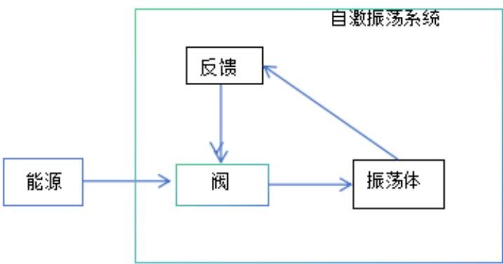  
图 1-4 热机循环实质

上述这种非线性系统自组织作用造成的振荡，就是热驱动热声热机的基本热力循环过程。它是一种自治的系统，具有稳定的周期振荡，与初始条件无关。在控制科学上称为极限环，极限环的左侧或者右侧存在初始条件，当系统从某一初始条件开始运行时，其运行的振幅与频率将会自行锁定，当系统在振荡中获取的能量与系统损耗的能量相等时，系统平衡[33]。

## 1.3.5 工作声场特征

目前，热声热机按工作声场分类一般分为行波热声热机和驻波热声热机。对于驻波与行波这种分类是基于概念上的，实际上纯粹的驻波或者行波热声热机并不存在。

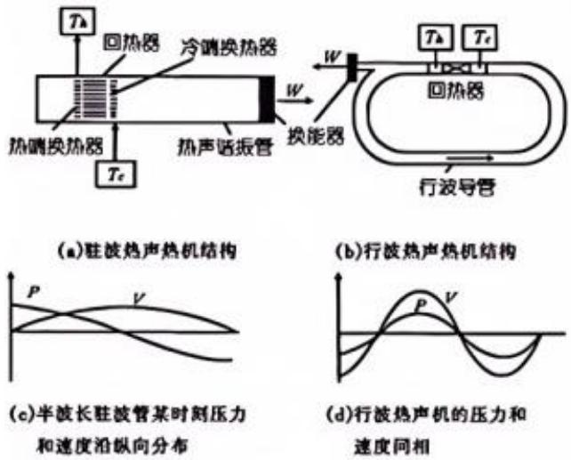  
图1-5热声热机结构及其压力与速度分布图

行波热声热机和驻波热声热机是热声热机中最主要的两类。从图1-5 可以明显看到两类热声热机在声场和结构均存在差别。图1-5(a)是驻波热声热机的基本构造，反射波和入射波叠加形成驻波，构成了驻波热声热机的声场，它的速度相位和压力相位相差 $9 0 ^ { \circ }$ ，如图1-5(c)所示。图1-5(b)是行波热声热机的基本构造，行波导管的长度等于一个波长，声波在行波导管里移动构成行波声场。它是由一个闭合的行波导管、回热器和换热器组成，行波热机与驻波热机的回热器和换热器的结构相同。行波热机内的声场是行波，声波的速度相位和压力相位基本同相，如图1-5(d)所示。

一个完整的热声热机应由两部分组成：一部分是能量输入以及对外输出的装置，即换能器。其中的一部分是热能与声能相互转换装置。如图1-5所示。高温热源 $T _ { h }$ 、低温热源 $T _ { c }$ 和一个回热器组成了热声转换装置。三个主要部分一般被放置在一个驻波谐振管构成的热声转换场中。高温热源和低温热源分别与回热器两端换热器有着比较良好的热接触，所以回热器得两端会形成一个比较稳定的温度差。当温度差超过某个临界值时回热器就会开始将热能转化成声能，这时的回热器就可以看作一个振动的声源。热端换热器从高温热源得到的热功率表示为 $Q _ { h }$ ,冷端换热器则从低温热源释放出的热功率 $Q _ { c }$ ，由热力学第一定律可知，这台热声热机的功率可以表达成 $W { = } Q _ { h } { - } Q _ { c }$ 。据热力学第二定律[34]，它的热效率为 $W / Q _ { h }$

## 1.4 声驱动热声热机的相位研究

谐振管中声场的调节和回热器的制冷效果控制在驻波热声制冷机研究中占有极为重要的地位。

在2017年，内蒙古科技大学对于驻波热声制冷机板叠的温度分布进行了分析。描述了驻波热声制冷机板叠中高温低温交替呈现的温度梯度[35]。

在2022年，内蒙古科技大学对于提高驻波热声制冷机声场强度进行了分析。描述了不同工况对于驻波热声制冷机板叠制冷效果的影响，并且提出了用气柱的活塞模态振动代替驻波振动的模拟思想，并且验证了其在基频驱动下能够获得比驻波振动更加良好的制冷效率[36]。

2020年，华中科技大学对于驻波热声制冷机分层回热器的温度特性做了具体分析。通过数值模拟，对于不同类型的回热器在不同压力和不同频率的情况下做出了具体的分析，得出了回热器的热流量与回热器的孔隙度密切相关的结论[37]。

2023年，中国科学院低温工程学重点实验室对室温温区的驻波热声制冷机进行了研究。通过测试谐振腔和空腔组成的调相机构对于整机系统的影响发现，在室温50℃的情况下，可获得整机5.8kw的制冷量[38]。

相对于传统的单侧声源驻波热声制冷机，双声源驻波热声制冷机作为热声制冷机的一种新的结构形式，在声场调节和回热器温度控制上具有更加便捷的优势，许多机构对他进行了细致的研究。

2012年，中国科学院低温工程学重点实验室对双声源驱动的热声系统声场调制进行了相应的研究。通过对双声源的调制，得到较为合适的声场，对实际工作有一定的指导作用[39]。

2016年，中国科学院低温工程学重点实验室对电机调相式热声制冷机进行了相应的研究。通过电机对热声制冷机的调相，优化匹配出口阻抗，并且回收出口处的膨胀功转化为电能。在3Mpa的平均压力和 55Hz 工作频率下，获得110K制冷量158.3W,对实际工作有一定的指导作用[40]。

2017年，长春理工大学针对双侧激励源的相位差与谐振管长度的匹配问题进行了研究。研究发现谐振管的双侧激励(若谐振腔长度为 170 mm 受到的双侧激励是同相的激励，假如谐振腔长度为 340mm，则受到的双侧激励变为反相的激励）谐振腔内产生的平面驻波声场更加稳定、单色性好、声压幅值是单侧激励的1.78倍(半波长谐振腔)，甚至1.81倍(一个波长谐振腔)，均接近于2倍关系[41]。

2024年，学的孙铭阳[42]，系统的探讨了单声源驻波热声制冷机的工况、起振方式、回热器结构以及换热器结构对于单声源驻波热声制冷机制冷效果的影响。

由以上文献可知，21纪以来驻波热声制冷机已经成能量领域的重点研究对象。又由于它特殊产能方式，相位对于该机器的影响十分明显。相较于改变其他工况，通过调相相位来优化驻波热声制冷机的制冷效果较为容易，但前人的研究多倾向于对单声源进行相位调相。通过基本的声学可知，声波存在叠加的性质，而且在两个声源同时作用的情况明显更容易控制声波的波形以及所需要声场强度。

## 1.5 本文工作安排

驻波热声制冷机中的回热器两端温差是制冷效果一个较为明显的指标，但已有的研究却很少提及谐振管两端声源间相位差对它的影响。本文主要基于的热声学基本原理，通过改变双端声源的相位差来使得驻波热声制冷机取得最佳的声场分布；再根据热力学原理进一步探究此声场中回热器两端产生最大温差时所对应的回热器位置；继而通过不同的工质、压力驱动比以及工作频率对于制冷效果影响的比较优化双声源驻波热声制冷机的运行参数；最后，设计并验证了一个可嵌入热声制冷机驱动系统的调相电路。具体步骤如下：

1 基于商用仿真软件COMSOL构建驻波热声制冷机模型，通过改变两端声源相位确定驻波热声制冷机的最佳运行声场。

2 在驻波热声制冷机最佳运行声场的前提下在管内寻找回热器的最佳布置位置。

3通过改变工质、管长、工作频率、驱动比等参数来改善驻波热声制冷机的制冷效果，实现参数优化。

4通过电调相实验验证本文的调相理论，为将调相电路嵌入到热声制冷机中实现双声源间的相位控制打下基础。

## 第二章基本热声原理及模拟原理

驻波热声制冷机涉及较多的物理原理，一般包括但不限于控制原理、流体力学、声学原理以及基本的热力学知识。驻波热声制冷机中流体工质通过声源的作用，流过板叠使回热器两端形成温度梯度，所以驻波热声制冷机也可以看做是一个流动系统。当这个流动系统与外界发生热交换后，这个系统将变为受热的流动系统。但一般不称其为热流体，因为热流体一般只体现了热量对流体温度的影响。通过基本的热力学关系可知，热量的直接作用效果是让流体的焓值上升，但在工程实践中，温度仅仅是热量对流体系统的一个方面的影响。

本章主要通过基本的热声原理、受热系统稳定性以及工质微团的热力学过程，介绍描述驻波热声制冷机的基本方法以及驻波热声制冷机的基本工作原理。

## 2.1 基本热声理论

## 2.1.1 声学原理

通过上一节的介绍可知，基本热声理论成形于20世纪80年代，主要揭示了有序的声振荡与热量之间的耦合、作用与相互转化。本文主要基于拉格朗日体系下的热声微循环体系，定性描述驻波热声制冷机的热声微循环过程。

为了说明驻波热声制冷机的运行原理，通过最基本的二分之一波长热声制冷机说明同类型热声制冷机的制冷原理：如图2-1。本文涉及的驻波热声制冷机类型主要是声驱动的驻波热声制冷机，图中虚线表示了压强与气体的体积流速的基本相位关系。基于纯驻波无法传递能量的原因，声源即声驱动器需要不断的补偿系统中被吸收的能量，并且存在一定的小型行波的叠加。根据声学的基本知识，波幅最小处称为波节，波幅最大处称为反向节点。

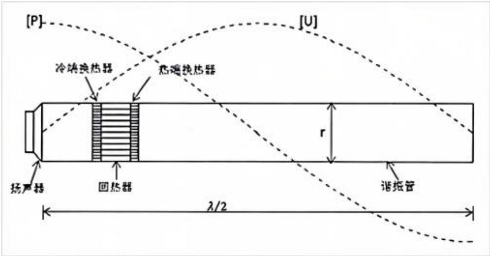  
图 2-1 热声制冷机的简易示意图

由于当前步骤主要用于探究驻波热声制冷机的声波特性，所以不考虑换热器与板叠对于声场的影响。通过基本声学知识，可得管内声压：

$$
P ( x , t ) = P _ { 1 } ( x ) \sin \omega t\tag{2-1}
$$

$$
P _ { 1 } ( x ) = P _ { o } \cos { k x }\tag{2-2}
$$

其中， $P _ { o }$ 是驻波在反向节点的声压振幅，ω为驻波的角频率，k是驻波的波数，通过基本的流体力学原理与牛顿第二定律可知：

$$
\rho \frac { \partial u } { \partial t } { = } - \frac { \partial { \cal P } } { \partial x }\tag{2-3}
$$

通过式（2-3）可以推导出气体微团的速度u:

$$
u \left( x , t \right) = u _ { 1 } \cos \omega t\tag{2-4}
$$

$$
u _ { 1 } \left( x \right) = \frac { P _ { o } } { \rho _ { m } c } \mathrm { s i n } k x\tag{2-5}
$$

c表示声波在某一介质中的声速。通过基本的三角函数知识可知，压力最大时，速度为最小，即压力与速度的相位差为 $9 0 ^ { \circ }$

对于半波长的谐振管来说，谐振管端口速度为0时，压力振幅最大，因为有纵向速度为0的边界条件，有：

$$
\sin { k L } = 0\tag{2-6}
$$

因为：

$$
k = \frac { 2 \pi } { \lambda }\tag{2-7}
$$

所以：

$$
\lambda = \frac { 2 L } { n } , n = \left( 1 , 2 , 3 . . . . . . \right)\tag{2-8}
$$

由上述推导可知谐振管长L的选取规则：对于一般热声装置常取 $n { = } 1$ ，所以 $\scriptstyle { l = { \frac { \lambda } { 2 } } }$ ，对于四分之一波长驻波热声制冷机，如果要求压力节点在开口端，则：

$$
\cos { k l } = 0 , \lambda = 4 l / \left( 2 n - 1 \right)\tag{2-9}
$$

取 $\scriptstyle { l = \frac { \lambda } { 4 } }$

## 2.1.2 受热流动气体的基本方程

声现象的本质是质点振动引起气体的流动，当环境与流动系统存在热量交换时，它就被定义为流动受热系统。为了叙述的方便，称其为热流体，它主要体现了流体的温度与外界热量交换之间的关系。大量的热力学过程告诉我们，热量的变化会引起焓值的变化。但是在实际的热力学过程中，伴随着热量的变化，往往流动系统的变化也并非都体现在焓值上。对于传统的传热传质学来说，受热面与受热流体是分开讨论的，并非在同一系统里。在传热传质学中用四类边界条件来描述流体与受热面之间的关系。在大多数的情况中，流动系统中的热平衡是传统传热传质学讨论的重点。但关于热量对流动稳定性的影响却没有定论，下面引入流体方程与热力学定律，对驻波热声制冷机的热力学过程与系统稳定性做简单诠释[43]。

## 1 经典守恒方程

对于经典流体力学的概念本文不过多叙述，将驻波热声制冷机中的气体工质视作连续的流体，下面写出单位体积的流体质量、动量于能量方程：

$$
\begin{array} { r l r l } & { \displaystyle { \operatorname* { l i m } _ { \mathbf { A } } \boldsymbol { \varXi } \operatorname* { l i m } _ { \mathbf { A } } \mathcal { \bar { Z } } \mathcal { \bar { H } } \mathcal { \bar { H } } : } \quad } & & { \qquad \frac { \partial \rho } { \partial t } = - \mathbf { d i v } \mathbf { \nabla } ( \rho \boldsymbol { u } ) } \end{array}\tag{2-10}
$$

$$
\vec { \ziiint } \boxed { \Xi } \begin{array} { c } { \boxed { \boxed { \ d } } \frac { \boxplus } { \boxplus } \mathcal { \hat { H } } \mathcal { \ne } \end{array} } \qquad \begin{array} { c } { \frac { \mathcal { O } \rho u } { \partial t } = - \mathbf { d i v } ( \rho u u + \sigma _ { \alpha \beta } ) } \end{array}\tag{2-11}
$$

式中，冲量张度密度 $( \rho u u + \sigma _ { \alpha \beta } )$ 中的 $\sigma _ { \alpha \beta }$ 是由两项组成，即：

$$
\sigma _ { \alpha \beta } = - P \delta _ { \alpha \beta } + { \sigma _ { \alpha \beta } } ^ { \prime }\tag{2-12}
$$

式中， $\delta _ { \alpha \beta }$ 表示单位张量，它表示在法线上有 $\beta$ 个单位表面积受到α方向上的力；P在此处就可以看做这个力，它代表了系统中的热力学压力； $\sigma { _ { \alpha \beta } } ^ { ' }$ 表示了相同的受力面与相同的方向上受到的黏性应力张度，当 $\alpha = \beta$ ，则 $\delta _ { \alpha \beta } = 0$ ；若 $\alpha \neq \beta$ ，那么 $\delta _ { \alpha \beta } = 1$ 。下面将系统中的热力学参数与流体的应力联立，现在定义切向黏度与流体黏度 $\overset { \cdot } { \mu }$ 、 $\mu _ { v }$ ，且这两项为常数，因为存在如下关系：

$$
\frac { \hat { \sigma } { \sigma _ { \alpha \beta } } ^ { \prime } } { \hat { \sigma } \alpha } = \mu \frac { \hat { \sigma } ^ { 2 } u } { \hat { \sigma } \beta ^ { 2 } } + \bigg ( \mu _ { \nu } + \frac { \mu } { 3 } \bigg ) \frac { \hat { \sigma } } { \hat { \sigma } \alpha } \frac { \hat { \sigma } u _ { r } } { \hat { \sigma } r }\tag{2-13}
$$

$$
\operatorname { d i v } \left( \rho u u \right) = u \operatorname { d i v } \left( \rho u \right) + \rho \left( u \operatorname { g r a d } \right) u\tag{2-14}
$$

将（2-13）与（2-14）两式带入质量守恒方程，有：

$$
\frac { \partial } { \partial t } \big ( \rho { u } \big ) = \rho \frac { \partial { u } } { \partial t } - { u } \mathrm { d i v } \big ( \rho { u } \big )\tag{2-15}
$$

写成常见形式：

$$
\rho \frac { \widehat { \alpha } u } { \widehat { \alpha } t } + \rho \big ( u \mathrm { g r a d } \big ) u = - \mathrm { g r a d } P + \mu \mathrm { d i v g r a d } u + \left( \mu _ { \nu } + \frac { \mu } { 3 } \right) \mathrm { g r a d d i v } u\tag{2-16}
$$

定义驻波热声制冷机中气体工质为不可压缩流体，将式（2-16）写成 N-S(Navier-Stokes)方程:

$$
\frac { \hat { o } u } { \hat { o } t } + \big ( u \mathrm { g r a d } \big ) u = - \frac { 1 } { \rho } \mathrm { g r a d } P + u \mathrm { d i v g r a d } u\tag{2-17}
$$

下面描述驻波热声制冷机中的气体工质的能量守恒：即单位体积流体的动量与内能、黏性应力的耗散与分子扩散造成的外界换热三者之间的平衡，如下式：

$$
\frac { \hat { \sigma } } { \partial t } \left( \frac { \rho u ^ { 2 } } { 2 } + \rho \mathrm { { e } } \right) = - { \mathrm { g r a d } } \left[ \rho u \left( \frac { u ^ { 2 } } { 2 } + e \right) + \rho u - { \sigma _ { \alpha \beta } } ^ { ' } u + q \right]\tag{2-18}
$$

式中 $q$ 表示热量，于是推出下式：

$$
\frac { \partial } { \partial t } \Bigg ( \frac { \rho { u } ^ { 2 } } { 2 } \Bigg ) = \frac { u ^ { 2 } } { 2 } . \frac { \partial \rho } { \partial t } + \rho u \frac { \partial u } { \partial t }\tag{2-19}
$$

## 2 热动力学描述

## 1）空间描述

对空间做简单描述，宏观系统的复杂性是客观存在的，当需要通过某些模型对它进行描述时，通常的做法是提出前提条件，当然此处不会例外：对于任意给定的空间（几何空间或者相空间），通用的数学描述的方法习惯于约定这个空间是平均连续的。通过一些已有的连续性公理，可以了解到通常定义的热力学空间是在宏观空间基础上的一种热力学平衡的延伸。它表示了对于一个不均匀的系统，若空间尺度的条件下通过空间尺度的放大，则可以将它变为一个均匀的宏观系统。本文用一个集X表征这个系统的状态，这个集X表示τ时刻以一个面S为表面的区域D中的X量，数学描述为：

$$
X { \big ( } t { \big ) } = \int _ { D } \lambda _ { x } ( x , y , z , t ) { \mathrm { d } } x { \mathrm { d } } y { \mathrm { d } } z\tag{2-20}
$$

对于式(2-20)，定义 $\lambda _ { x }$ 为单位体积密度，实质上就是将空间中的这一点定义为质点，即点 $N \ ( x , \ y , \ z )$ 附近的一个体积微元。

$$
\scriptstyle \mathrm { d } \nu = \mathrm { d } x \mathrm { d } y \mathrm { d } z\tag{2-21}
$$

基于式（2-21）的数学的描述，这个体积微元是无限小的；但在微观系统中却是很大的，在这个微元体积内，密度是均匀的，有下式：

$$
\mathrm { d } X { = } \lambda _ { x } \mathrm { d } \nu\tag{2-22}
$$

对于这个体积微元，它遵守所有热力学关系，这个写法旨在表示$\lambda _ { x }$ 的热力学波动可以忽略不记，它是一个确定的量。

## 2）运动描述

现在定义一个广延物理量B来总体的描述能量、质量与动量。在通常的驻波热声制冷机流动工质系统中，在单位体积流体B中的热平衡与力学平衡写作：

$$
\frac {  { \partial } B } {  { \partial } t } =  { \int _ { \nu } } B  { \mathrm { d } } \nu -  { \mathrm { d i v } } J _ { { B } }\tag{2-23}
$$

$J _ { \scriptscriptstyle B }$ 表示流密度，在上式中表示输出的流密度，通过高斯定理可知，divJ等于自包围该体积沿法相方向外流的 $J _ { n }$ 的面积分，写作：

$$
\frac { \partial } { \partial t } ( \int _ { \nu } B \mathrm { d } \nu ) \ = \int _ { \nu } B \mathrm { d } \nu - \int _ { \sum } J _ { \mathrm { n } } B \mathrm { d } \sum\tag{2-24}
$$

式中，B包含了两项变化：第一项是它的体积分，他表示了是全系统中B的变化率；第二项是它的面积分，它表示系统表面的流率，改写微分形式：

$$
{ \frac { { \hat { \sigma } } \rho _ { B } } { { \hat { \sigma } } t } } + \mathbf { d i v } J _ { B } = \sum B\tag{2-25}
$$

式（2-25）就是流一散度定理 $\rho _ { B }$ 表示B中的密度。这种写法的前提是系统中存在局部平衡，则单位体积中：

$$
B \big ( t \big ) = \int _ { \nu } \rho _ { B } \big ( x , y , z , t \big ) \mathrm { d } x \mathrm { d } y \mathrm { d } z\tag{2-26}
$$

$J _ { B }$ 由对流传输项与扩散传输项组成的，对流传输项：

$$
J _ { B , c o n \nu } = \rho _ { _ B } u\tag{2-27}
$$

扩散传输项： $J _ { B , d i f f }$ ，所以 $J _ { B }$ 可以写成：

$$
J _ { B } = \rho _ { B } u + J _ { \ B . d i f f }\tag{2-28}
$$

改写上面的流-散度定理：

$$
\rho _ { B } \frac { \partial u } { \partial t } + \mathbf { d i v } J _ { \mathbf { \Gamma } _ { B . d i f f } } = \sum X\tag{2-29}
$$

由于空间中D区域内的源或汇的作用，X中的物理量通过S进入D。 $\Sigma$ X是源或者汇的密度，而 $J _ { X }$ 则表征穿过S的X量，n则是S的外法线向量，于是有平衡方程：

$$
{ \frac { \mathrm { d } } { \mathrm { d } t } } \int _ { \nu } \rho _ { X } \mathrm { d } \nu + \int _ { S } J _ { _ { X } } n \mathrm { d } s = \int _ { \nu } \sum X \mathrm { d } \nu\tag{2-30}
$$

它是流-散度理论的积分描述，其微分描述为：

$$
{ \frac { \partial \rho _ { X } } { \partial t } } + \nabla J _ { X } = \sum X\tag{2-31}
$$

## 3 运动学方程

上述所有的推导与描述都建立在驻波热声制冷机中气体工质微团存在局部平衡，关于其运动学的推论也建立在局部平衡的基础上，可

直接使用牛顿运动定理推导出气体工质流体的动量方程。对于动量 $p$ 来说，有：

$$
\boldsymbol { J } _ { p } = 0\tag{2-32}
$$

单位体积流体：

$$
\rho \frac { \mathrm { d } u } { \mathrm { d } t } = f _ { \mathrm { e x t } }\tag{2-33}
$$

$f _ { \mathrm { e x t } }$ 表示单位体积力，下标“ext”表示外力。通过流体的基本性质可知：

$$
f _ { \mathrm { e x t } } = f _ { \mathrm { s u r f } } + f _ { \mathrm { v o l } }\tag{2-34}
$$

式中的后两项分别表示表面力与体积力，表面力的确定取决于系统的约束条件，约束条件又取决于二阶张量 $\sigma$ ，以 $\sigma _ { \alpha \beta }$ 来描述作用在法线向量为 $| \beta \rrangle$ 的表面上的表面力在 $\alpha$ 方向上的分量，于是流-散度定义表示为：

$$
\rho \frac { \mathrm { d } u _ { \alpha } } { \mathrm { d } t } = \sum _ { \beta } \frac { \partial \sigma _ { \alpha \beta } } { \partial \beta } + f _ { \alpha , \mathrm { \ v o l } }\tag{2-35}
$$

质量流 $J _ { m }$ 在流体力学中的定义为：

$$
J _ { \mathrm { { m } } } = \rho u\tag{2-36}
$$

将式（2-36）带入式（2-35），得：

$$
\frac { \partial \rho } { \partial t } + \mathrm { d i v } \rho u = 0\tag{2-37}
$$

这就是常见的质量守恒方程。

## 4 受热流体能量方程

驻波热声制冷机的气体工质中的流体微团能量平衡如下：

$$
\rho E = \frac { 1 } { 2 } \rho u ^ { 2 } + \rho V + \rho e\tag{2-38}
$$

流体微团的总能包括动能、势能以及内能，通过上面的推导，体积力可以通过体积的变化来表示：

$$
f _ { \mathrm { v o l } } = - \nabla V\tag{2-39}
$$

由能量守恒可知：

$$
\rho { \frac { \mathrm { d } E } { \mathrm { d } t } } + \mathrm { d i v } J _ { E } = 0\tag{2-40}
$$

区别于内能，流体微团的动能与势能是没有扩散项的，所以上述公式中的 $J _ { \mathit { \Pi } _ { E } }$ 实际上是内能流，而动能的变化需要跟上面推导的动力学方程联系：

$$
\rho \frac { \mathrm { d } } { \mathrm { d } t } \bigg ( \frac { 1 } { 2 } u ^ { 2 } \bigg ) = \rho \sum _ { \alpha } u _ { \alpha } \frac { \mathrm { d } u _ { \alpha } } { \mathrm { d } t } = \sum _ { \alpha } \sum _ { \beta } u _ { \alpha } \frac { \sigma _ { \alpha \beta } } { \hat { \sigma } \beta } + \sum _ { \alpha } u _ { \alpha } f _ { \alpha , \mathrm { \ v o l } }\tag{2-41}
$$

式中，右侧最后一项是体积力做的功，它与势能相互转化相互平衡：

$$
u . f _ { \mathrm { v o l } } = \rho \bigl ( - u . \nabla V \bigr ) = - \rho \frac { \mathrm { d } V } { \mathrm { d } t }\tag{2-42}
$$

因为：

$$
\frac { \mathrm { d } V } { \mathrm { d } t } { = } \frac { \partial V } { \partial t } { + } u . \mathrm { g r a d } V\tag{2-43}
$$

驻波热声制冷机气体工质流体微团处于局部平衡下，所以 $\begin{array} { r } { \cdot \frac { \partial V } { \partial t } = 0 } \end{array}$ ,则有：

$$
\rho \frac { \mathrm { d } } { \mathrm { d } t } \bigg ( \frac { 1 } { 2 } u ^ { 2 } + V \bigg ) = - \sum _ { \alpha \beta } \sigma _ { \alpha \beta } \frac { \partial u _ { \alpha } } { \partial \beta } + \sum _ { \beta } \frac { \partial \bigg ( \sum _ { \alpha } u _ { \alpha } \sigma _ { \alpha \beta } \bigg ) } { \partial \beta }\tag{2-44}
$$

将式（2-44）代入总能量守恒式中，可得到内能平衡方程：

$$
\rho \frac { \mathrm { d } \mathbf { e } } { \mathrm { d } t } + \mathrm { d i v } J _ { e } = - \sum _ { \alpha \beta } \sigma _ { \alpha \beta } \frac { \partial u _ { \alpha } } { \partial \beta } - \sum _ { \beta } \frac { \partial \bigg ( \sum _ { \alpha } u _ { \alpha } \sigma _ { \alpha \beta } \bigg ) } { \partial \beta }\tag{2-45}
$$

$\sum _ { \alpha } u _ { \alpha } \sigma _ { \alpha \beta }$ 表示流体微团处于运动状态下受到的机械功流在 $\alpha$ 方向上的分量，写作 $- J _ { w }$ ，则可以求出传递给外界的热量：

$$
J _ { \varrho } = J _ { e } - J _ { w }\tag{2-46}
$$

热力学状态参数与应力张量的关系如下：

$$
\sigma _ { \alpha \beta } = - P \delta _ { \alpha \beta } + { \sigma _ { \alpha \beta } } ^ { \prime }\tag{2-47}
$$

$$
\sum _ { \alpha \beta } { \sigma _ { \alpha \beta } } \frac { \hat { \partial } { u _ { \alpha } } } { \hat { \partial } \beta } = - P \sum _ { \alpha } \frac { \hat { \partial } { u _ { \alpha } } } { \hat { \partial } \alpha } + \sum _ { \alpha \beta } { \sigma _ { \alpha \beta } } ^ { \prime } \frac { \hat { \partial } { u _ { \alpha } } } { \hat { \partial } \beta } = - P \mathrm { d i v } u + \sum _ { \alpha \beta } { \sigma _ { \alpha \beta } } ^ { \prime } \frac { \hat { \partial } { u _ { \alpha } } } { \hat { \partial } \beta }\tag{2-48}
$$

最后对熵进行讨论，将熵流对流定理表示为：

$$
\rho { \frac { \mathrm { d } s } { \mathrm { d } t } } + \mathrm { d i v } J _ { s } = \sum S\tag{2-49}
$$

热力学第二定理告诉我们，在不可逆过程中，式（2-49）的右侧应该为正值，那么对接近静态的热力学过程，有：

$$
\mathbf { d } Q = T \mathbf { d } s\tag{2-50}
$$

同样的，在局部平衡的条件下：

$$
T { \frac { \mathrm { d } s } { \mathrm { d } t } } = { \frac { \mathrm { d } e } { \mathrm { d } t } } + P { \frac { \mathrm { d } V } { \mathrm { d } t } }\tag{2-51}
$$

通过上面推导的内能方程可知：

$$
\rho \frac { \mathrm { d } s } { \mathrm { d } t } { + \frac { 1 } { T } \mathrm { d i v } J _ { \varrho } } = \frac { 1 } { T } { \sum _ { \alpha \beta } \sigma _ { \alpha \beta } } ^ { \prime } \frac { \partial u _ { \alpha } } { \partial \beta }\tag{2-52}
$$

利用已知关系式：

$$
\mathbf { d i v } \Bigg ( \frac { J _ { Q } } { T } \Bigg ) { = } \Bigg ( \frac { 1 } { T } \Bigg ) \mathbf { d i v } J _ { \varrho } + J _ { \varrho } { . } \mathbf { g r a d } \Bigg ( \frac { 1 } { T } \Bigg )\tag{2-53}
$$

可知：

$$
\rho { \frac { \mathrm { d } s } { \mathrm { d } t } } + \mathrm { d i v } \left( { \frac { J _ { Q } } { T } } \right) = J _ { Q } . \mathrm { g r a d } \left( { \frac { 1 } { T } } \right) + { \frac { 1 } { T } } \sum _ { \alpha \beta } { \sigma _ { \alpha \beta } } ^ { \prime } { \frac { \partial u _ { \alpha } } { \partial \beta } }\tag{2-54}
$$

对比熵流方程：

$$
J _ { s } = { \frac { J _ { Q } } { T } }\tag{2-55}
$$

$$
\sum s = J _ { \varrho } . \mathbf { g r a d } \bigg ( \frac { 1 } { T } \bigg ) + \frac { 1 } { T } \sum _ { \alpha \beta } { \sigma _ { \alpha \beta } } ^ { \prime } \frac { \hat { \sigma } u _ { \alpha } } { \hat { \sigma } \beta } = - \rho \bigg ( P \frac { \mathrm { d } \nu } { \mathrm { d } t } \bigg ) + \sum _ { \alpha \beta } { \sigma _ { \alpha \beta } } ^ { \prime } \frac { \hat { \sigma } u _ { \alpha } } { \hat { \sigma } \beta }\tag{2-56}
$$

式（2-56）右侧第一项是引入质量守恒的结果，回到内能方程上，可得：

$$
\rho \frac { \mathrm { d } e } { \mathrm { d } t } = - \mathrm { d i v } J _ { \varrho } - P \frac { \mathrm { d } \nu } { \mathrm { d } t } + \sum _ { \alpha \beta } { \sigma _ { \alpha \beta } } ^ { \prime } \frac { \hat { \partial } u _ { \alpha } } { \partial \beta }\tag{2-57}
$$

改写式（2-57）有：

$$
\frac { \mathrm { d } e } { \mathrm { d } t } = \mathrm { d } q ^ { } \int _ { \mathrm { d } t } - P \frac { \mathrm { d } \nu } { \mathrm { d } t } + \sum _ { \alpha \beta } { \sigma _ { \alpha \beta } } ^ { \prime } \frac { \partial u _ { \alpha } } { \partial \beta }\tag{2-58}
$$

与热力学第一定理相比，多出了第3项，它是黏性造成的耗散。

相比传统的热力学原理，经典描述通过流体力学场论的方法来描述不可耗散的过程，但是没有将其与不可逆熵联系起来。而本文在不可逆热力学流定理这样一个框架的基础上对质量、动量与能量的守恒进行了重新的说明，把受热流动的基本方程建立在了普适的热力学基础上。

## 2.2 气体微团的热力学过程

热声相互作用作为热声制冷的基本原理，压力的波动会引起温度的变化，然后在板叠的加强后，得到制冷效果。

一般来说，板叠内部存在温度梯度，气体微团的流动一般跟随温度梯度，为了分析板叠内部放热吸热的过程，选取板叠中的其中一块，分析板叠附近的气体微团的运动以及板叠的放热过程。

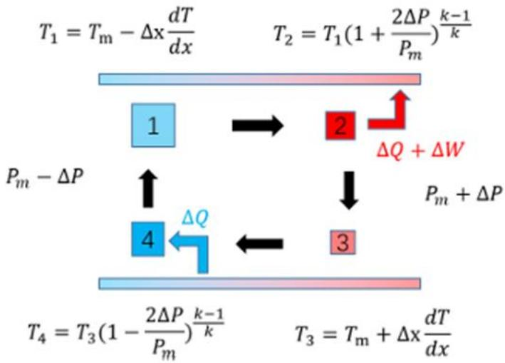  
图2-2 热声制冷机板叠间气体微团热力学过程图

1、2、3、4分别表示某一气体微团所处的四种不同热力学状态。$T _ { 1 }$ $T _ { 2 }$ $T _ { 3 }$ 、 $T _ { 4 }$ 分别表示气体微团处在这四个状态下的温度。 $T _ { m }$ $P _ { m }$ 分别表示平均温度与压力，借助图2-2通过气体微团编号顺序来介绍其热力学过程：

1-2：气团会向右运动，温度会在这个过程中升高，并开始绝热压缩过程。

2-3：绝热压缩后，则会等压向板叠放热，最后达到温度平衡。气团微团温度升高到超过板叠。

3-4：气团会向左运动，温度会在这个过程中下降，并开始绝热膨胀过程

4-1：绝热膨胀后，则会有等压向板叠吸热，气体微团温度降到到低于板叠，最后达到温度平衡，完成一个热力循环过程。

如此，无数微团沿板叠方向进行微热力循环接力，从而完成制冷[44]。

## 2.3 线性热声方程

热声制冷机中回热器两端存在温差，所以回热器中气体为非等温流体。为了模拟热声制冷机谐振管中流体所处的声场及温度场情况，假设其满足线性热声理论的理想条件：（1）微小量扰动，二阶量忽略不计；（2）热声设备中的固体为理想刚体；（3）板叠长度比波长小的多，几乎可以忽略。热声系统回热器中的气体介质可被视为是由一系列往复运动的气体微团首尾相连组成的，应满足质量守恒、能量守恒和动量守恒，上述守恒关系可以写为欧拉坐标系下的表达式：

$$
\frac { \partial P } { \partial t } + \nabla ( \rho u ) = 0\tag{2-59}
$$

$$
\rho \frac { \partial P } { \partial t } = \rho h - \nabla P + \mu \nabla ^ { 2 } u\tag{2-60}
$$

$$
\rho C _ { P } \bigg ( \frac { \partial T } { \partial t } { + u \nabla T } \bigg ) { - \bigg ( \frac { \partial P } { \partial t } { + u \nabla P } \bigg ) } { = k \nabla ^ { 2 } T }\tag{2-61}
$$

式中， $\rho$ 为密度，u为速度，t为时间， $\mu$ 为动力黏度，h为体积力分布函数， $C _ { p }$ 为定压比热容，k为热导率，P为压力，∇为拉格朗日算子，T为温度。

气体状态方程为：

$$
\rho { = } \rho \left( P , \begin{array} { r l } \end{array} \right)\tag{2-62}
$$

联立式（2-59）\~式（2-62）可解出u、T、 $\rho$ 、 $P _ { \circ }$ 由于工质处于振动状态，故可将u、T、ρ、P写成扰动加上平均值的形式：

$$
P { = } P _ { m } + \mathrm { R e } [ P _ { 1 } ~ ( x \mathcal { ) } ~ e ^ { i \omega t } ]\tag{2-63}
$$

$$
u = \mathrm { R e } [ u _ { 1 } ~ ( x \mathcal { ) ~ } e ^ { i \omega t } ]\tag{2-64}
$$

$$
T \mathcal { = } T _ { m } + \mathrm { R e } [ T _ { 1 } ( x , y , z ) e ^ { i \omega t } ]\tag{2-65}
$$

$$
\rho { = } \rho _ { m } + \mathrm { R e } [ \rho _ { 1 } ~ ( x , y , ~ z ) ~ e ^ { i \omega t } ]\tag{2-66}
$$

式中， $P _ { m }$ $T _ { m }$ 、 $\rho _ { m }$ 分别表示压力、温度、密度的平均值；以下物理量 $P _ { 1 }$ 、 $u _ { 1 }$ 、 $T _ { 1 }$ 、 $\rho _ { 1 }$ 分别表示压力、速度、温度、密度的一阶波动幅值；x、y、z为直角坐标， $\omega$ 为角速度。

将式（2-63）-（2-66）代入式（2-59）\~式（2-62）得：

$$
\mathrm { i } \omega \rho _ { \mathrm { 1 } } + \rho _ { \mathrm { m } } \frac { \mathrm { d } u _ { \mathrm { 1 } } } { \mathrm { d } x } = 0\tag{2-67}
$$

$$
\mathrm { i } \omega \rho _ { \mathrm { m } } u _ { 1 } = - \frac { \mathrm { d } u _ { 1 } } { \mathrm { d } x } + \mu ( \frac {  { \hat { o } } ^ { 2 } u _ { 1 } } {  { \hat { o } } y ^ { 2 } } + \frac {  { \hat { o } } ^ { 2 } u _ { 1 } } {  { \hat { o } } z ^ { 2 } } )\tag{2-68}
$$

$$
\rho _ { \mathrm { { m } } } C _ { P } ( \mathrm { { i } } \omega T _ { 1 } + u _ { 1 } \frac { \mathrm { { d } } T _ { \mathrm { { m } } } } { \mathrm { { d } } x } ) { \mathrm { i } } \omega P _ { 1 } = k ( \frac { \partial ^ { 2 } T _ { 1 } } { \partial y ^ { 2 } } + \frac { \partial ^ { 2 } T _ { 1 } } { \partial z ^ { 2 } } )\tag{2-69}
$$

$$
\rho _ { \mathrm { _ { l } } } = { \frac { \rho _ { \mathrm { _ { m } } } } { p _ { \mathrm { _ { m } } } } } P _ { \mathrm { _ { l } } } - { \frac { \rho _ { \mathrm { _ { m } } } } { T _ { \mathrm { _ { m } } } } } T _ { \mathrm { _ { l } } }\tag{2-70}
$$

通过上述热声学关系的描述可知，气体微团在回热器中振荡时，压力和密度的波动会导致温度的波动。由热力学第二定律有：

$$
T \mathrm { d } s = \mathrm { d } e + P \mathrm { d } \nu\tag{2-71}
$$

式中： $s$ 为熵； $e$ 为内能，ν为体积。对热力学状态方程求偏微商得体膨胀系数：

$$
\beta = \frac { 1 } { v } ( \frac { \hat { \alpha } \nu } { \hat { \sigma } T } )  { \textit { P } } = - \frac { 1 } { \rho } ( \frac { \hat { \sigma } \rho } { \hat { \sigma } T } )  { \textit { P } }\tag{2-72}
$$

代入热力学第二定理：

$$
T \mathrm { d } s = C _ { _ P } \mathrm { d } T - T \nu \beta \mathrm { d } P\tag{2-73}
$$

$$
\mathrm { d } s = \frac { C _ { _ P } \mathrm { d } T } { T } - ( \frac { \partial \nu } { \partial T } ) _ { _ p } \mathrm { d } P\tag{2-74}
$$

由式（2-73）与（2-75）可知：

$$
\mathrm { d } s = ( \frac { \hat { o } s } { \hat { o } T } ) _ { _ P } \mathrm { d } T + ( \frac { \hat { o } s } { \hat { o } p } ) _ { _ T } \mathrm { d } P\tag{2-75}
$$

$$
T \frac { \mathrm { d } s } { \mathrm { d } t } = C _ { _ P } \frac { \mathrm { d } T } { \mathrm { d } t } - \frac { \beta T } { \rho } \frac { \mathrm { d } P } { \mathrm { d } t }\tag{2-76}
$$

通过线性化可得到如下方程：

$$
s _ { _ { 1 } } = { \frac { C _ { _ { p } } } { T _ { _ { \mathrm { m } } } } } T _ { _ { 1 } } - { \frac { \beta } { \rho _ { _ { \mathrm { m } } } } } P _ { _ { 1 } }\tag{2-77}
$$

$$
\frac { T _ { _ 1 } } { T _ { _ m } } = \frac { \beta P _ { _ 1 } } { \rho _ { _ m } C _ { _ P } } + \frac { s _ { _ 1 } } { C _ { _ P } }\tag{2-78}
$$

其中， $s _ { 1 }$ 为一阶波动量。

## 2.4 模拟原理简介

## 2.4.1 COMSOL 压力声学模块简介

COMSOLMultiphysics是一款商用仿真软件，它的压力声学模块（Pressure Acoustics Module）专门用于模拟和分析声波在流体及固体介质中的传播、反射、散射、吸收等现象。该模块基于有限元法（Finiteelement method）和边界元法（boundary element method），结合频域和时域求解技术，广泛应用于声学工程设计、噪声控制、医学超声、声学材料开发等领域。压力声学模块的核心是求解声压波动方程(He1mholtz方程或时域波动方程)，支持多种声学场景建模。其在电声器件设计、建筑与环境声学、医学超声、航空航天与汽车工业、海洋声学等方面都得到了广泛应用。

## 2.4.2 压力声学端口模式的原理简介

本次模拟在谐振管两端选用端口输出模式边界条件，用于激励和吸收进入或离开声学模型中的波导结构（如小管道或通道）的声波。

多物理场仿真软件COMSOL中，给定的端口条件支持一种特定的传播模式。通常，只有平面波模式在需要热粘性表示的小结构中传播。与简单阻抗条件或能完美吸收反射声波的完全匹配层配置相比端口条件为波导提供了优越的无反射或辐射条件。此外，端口条件也支持散射参数（S参数）计算，因此本模拟选择两个平面波端口作为激励系统的声源。

$$
P = \sum _ { l \in h } A _ { \mathrm { i n } } \mathrm { e } ^ { \mathrm { i } \phi } ( S _ { z j } + \delta _ { z j } ) \ P _ { \mathrm { z } }\tag{2-79}
$$

式中：P为合成声压；z为端口总数； $j$ 为模式总数；在软件定义的边界条件h上， $S _ { z j }$ 为散射参数； $P _ { z }$ 为第 $z$ 个端口的模式形状（定义端口的物理量组成的物理量数组参数)； $A _ { i n }$ 为入射声源振幅； $\varnothing$ 为相位；$\delta _ { l j }$ 为模式对应系数。

不同散射参数对应不同的端口，端口扫描功能会根据不同的数字端口名称（即不同的l值和j值对应不同的给定散射模块）选择端口类型。根据端口扫描功能的选择，端口模式会显示不同的声源辐射形式。本次模拟选取平面波辐射声源对应的（0,0）模式，即 $S _ { z j } + \delta _ { z j } \mathrm { = } 1$ 的定频率的平面波辐射。

通过多物理场仿真软件COMSOL模拟双声源的驻波热声制冷机，初始条件为两边声源的振幅、频率均相同。来自左、右两端的声波 $P _ { \mathrm { a } }$ 1$P _ { \mathrm { b } }$ 的波动方程：

$$
P _ { \mathrm { { a } } } = A \cos ( \omega t - \varphi _ { \mathrm { { a } } } )\tag{2-80}
$$

$$
P _ { \mathrm { \Delta } } = A \cos ( \omega t - \varphi _ { \mathrm { \Delta } } )\tag{2-81}
$$

式中：A为单一声源输出压力幅值，φa、 $\varphi _ { a }$ $\varphi _ { b }$ 为各声波信号的相位。

根据声波的叠加定理，谐振管中任意位置处的合成声压为：

$$
P = P _ { \mathrm { a } } + P _ { \mathrm { b } } { = } P _ { \mathrm { c } } \cos ( \omega t { - } \varphi )\tag{2-82}
$$

$$
P _ { \mathrm { c } } ^ { 2 } = P _ { \mathrm { a } } ^ { 2 } + P _ { \mathrm { b } } ^ { 2 } + 2 P _ { \mathrm { a } } P _ { \mathrm { b } } \cos \left( \varphi _ { \mathrm { b } } - \varphi _ { \mathrm { a } } \right)\tag{2-83}
$$

$$
\varphi = \arctan { \frac { P _ { \mathrm { { a } } } \sin \varphi _ { \mathrm { { a } } } + P _ { \mathrm { { b } } } \sin \varphi _ { \mathrm { { b } } } } { P _ { \mathrm { { a } } } \cos \varphi _ { \mathrm { { a } } } + P _ { \mathrm { { b } } } \cos \varphi _ { \mathrm { { b } } } } }\tag{2-84}
$$

综上可知，合成声压的幅值与两列声波的相位差值有着密切关系。在仿真软件COMSOL中，通过调节两边声源的相位来获得使驻波热声制冷机的效果最佳的声场，然后带入热声学方程组求解其他物理量。

## 2.5 本章小结

本章主要通过双声源驻波热声制冷的声学原理、受热流动系统的基本原理，以及受热流动系统的热声过程全方位叙述了双声源驻波热声制冷机的热声系统，以及其完整的制冷过程，最后针对双声源驻波热声制冷机仿真所需使用的模拟软件COMSOL的压力声学模块做了一定的介绍，为后续研究工作的开展奠定了基础。

## 第三章驻波热声制冷机的声场模拟与相位分析

## 3.1 谐振管的声场分析

前一章中介绍了本次模拟的基本声学原理，前提是声波在管中沿一维方向传播的平面波。根据本文需求的实际环境，需要声波在一段给定的谐振管中运动，而广泛存在的声源在无界空间中辐射形式来说，一般为波阵面逐渐发散的球面波，如果现在将这种形式的声波定义在一段谐振管中，那么这根谐振管的形状、尺寸和材质都会对声波在其中的传播产生影响。本章将通过对于声波在两种基本形状的管中传播做出具体的分析，从而确定模拟所需的基本声场情况。

## 3.1.1 驻波的定义

谐振管是整个驻波热声制冷机声场的载体，在实际的驻波热声制冷机中，谐振管的声场分布一般来说都极其的复杂，为了方便模拟的需要，明确且简单的描述谐振管中的声场，本文进行如下的简化[45]：

①气体工质为理想气体且黏性忽略不计

②声场为线性小幅震荡声场

③声波为平面波辐射

④声波沿x轴方向传播

下面将声压表示为x，t 的函数即 $\textit { P } \left( x , \textit { t } \right)$ 。由于简化④的前提是 ${ \partial P } / { \partial y } \mathrm { { = } } 0  . \partial P / { \partial z } \mathrm { { = } } 0$ ，因此能够推导出下面的一维声波，如图3-1所示。

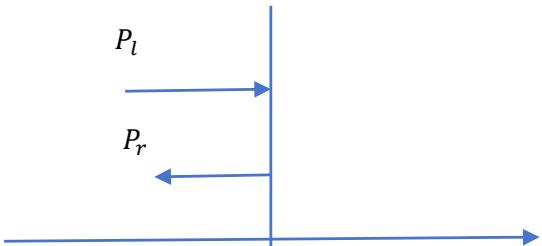  
图 3-1 声波反射一维简图

波动方程如下：

$$
( \hat { \sigma } ^ { 2 } P ) / ( \hat { \sigma } t ^ { 2 } ) = c _ { o } ( \hat { \sigma } ^ { 2 } P ) / ( \hat { \sigma } x ^ { 2 } )\tag{3-1}
$$

求解微分方程得：

$$
P = A _ { 1 } e ^ { j ( \omega t + k x ) } + A _ { 2 } e ^ { j ( \omega t + k x ) }\tag{3-2}
$$

式（3-2）中，波数可以表示为 $\textstyle k = { \frac { \omega } { c _ { o } } } = 2 \pi / \lambda$ ，λ为波长， $A _ { 1 }$ $A _ { 2 }$ 为上述方程中的待定常数。

由声学原理可知解的两项分别代表入射波 $P _ { l }$ ，反射波 $P _ { r }$ ，定义声波振幅为 $P _ { a }$ ，写作：

$$
P _ { l } = P _ { a 1 } e ^ { j \left( \omega t - k x \right) } , P _ { \mathrm { r } } = P _ { a 2 } e ^ { j \left( \omega t - k x \right) }\tag{3-3}
$$

$P _ { a 1 }$ 代表 $P _ { l }$ 的振幅， $P _ { a 2 }$ 代表 $P _ { r }$ 的振幅。

模拟过程不考虑反射波，假定声场为纯行波声场，则：

$$
P _ { 1 } \left( t , \ x \right) = P _ { a } e ^ { j \ \left( \omega t - k x \right) }\tag{3-4}
$$

此为行波的声压函数，将声压函数写作三角函数形式：

$$
P _ { 1 } ( t , \ x ) = P _ { a } \cos ( \omega t - k x )\tag{3-5}
$$

通过声学原理求谐振管内气团速度：

$$
u _ { \mathrm { 1 } } \left( t , \ x \right) = - \frac { \hat { \sigma } } { \hat { \sigma } x } \int \frac { P _ { \mathrm { { a } } } \cos \left( \omega t - k x \right) } { \rho _ { \mathrm { { o } } } } \mathrm { d } t = \frac { P _ { \mathrm { { a } } } } { \rho _ { \mathrm { { o } } } \mathfrak { c } _ { \mathrm { { o } } } } \cos \left( \omega t - k x \right)\tag{3-6}
$$

$\rho _ { o }$ 为无扰动的气体工质密度，气体微团运动位移的表达式为：

$$
X _ { _ { 1 } } \left( t , \textbf { \em x } \right) = \int u _ { _ { 1 } } \left( t , \textbf { \em x } \right) \mathrm { d } t = \frac { P _ { _ \mathrm { a } } } { \rho _ { _ \mathrm { o } } \mathsf { c } _ { _ 0 } \omega } \sin \left( \omega t - k x \right)\tag{3-7}
$$

根据热力学定义与状态方程得到气团温度变化规律：

$$
\mathrm { d } T = \frac { 1 } { \mathrm { n } R } \mathrm { d } P . \frac { V _ { \mathrm { { o } } } } { \rho _ { \mathrm { { o } } } \mathbf { c } _ { \mathrm { { o } } } ^ { 2 } } \mathrm { d } P\tag{3-8}
$$

式中可以看出，气团受到的压力与其温度变化成正相关。

下面定义驻波，合并入射反射方程：

$$
P = P _ { l } ~ + P _ { r } = 2 P _ { a } 2 c o s k x e ^ { j \omega t } + ( P _ { a 1 } - P _ { a 2 } ) ~ e ^ { j ^ { ( \omega t - k x ) } }\tag{3-9}
$$

式（3-9）中，前一项代各质点的振动相位相同，表示为驻波、振幅的大小随位置的改变而发生变化。后一项代表质点振幅在不同情况下是有所区别的，定义为行波。接下来，针对纯驻波型声场进行分析。

驻波声场内声压值表达式：

$$
P _ { 2 } ( t , x ) \ { = } P _ { \mathrm { a } } \left[ \cos ( \omega t { - } k x ) + \cos ( \omega t { + } k x ) \right] { = } 2 P _ { \mathrm { a } } \cos \omega t \cos k x\tag{3-10}
$$

驻波声场内气团速度表达式：

$$
u _ { _ { 2 } } \left( t , ~ x \right) = - \frac { \hat { \sigma } } { \hat { \sigma } x } \int _ { } ^ { P _ { \mathrm { { a } } } \cos \left( \omega t - k x \right) + P _ { \mathrm { { a } } } \cos \left( \omega t + k x \right) } \frac { } { \rho _ { \mathrm { { o } } } } \mathrm { d } t\tag{3-11}
$$

气团位移表达式：

$$
X _ { _ 2 } \left( t \right) = \int u _ { _ 2 } \left( t , \ \mathrm { ~ } x \right) \mathrm { d } t = \frac { 2 P _ { _ \mathrm { a } } } { \rho _ { \mathrm { o } } \mathrm { c } _ { _ 0 } \omega } \sin \omega t \cos k x\tag{3-12}
$$

综上可知，气体微团中，各个物理参数可以具体的描述谐振腔内的声场分布情况，而且它们之间的关系相当密切。由以上各参数表达式可知，随着声波在谐振腔内传播，行波型声场与驻波声场是存在一定的区别的。

各个位置上的气体微团在运动过程中，经历的压力波动幅值均相同就是行波声场的特点。换言之，在行波声场中，每个位置上气团的温度变化规律是相同的，即气体工质在该声场中与板叠进行热量交换时，板叠上气体微团温度最高的位置是不固定的，因此纯行波声场无法形成温度梯度。

驻波型声场中，随着声波向前传播，由于声压波动作用，气体微团温度因为位置的不同而产生变化，并且谐振腔轴向的固定位置上始终存在着温度的最大值与最小值。所以在理论上，只要将板叠放到谐振腔内适当的位置，板叠两端的换热器就能形成一定的温度梯度，从而实现制冷效果。因此接下来本章将重点对驻波型声场进行研究分析。

## 3.1.2 声波导管理论

设有图3-2所示的矩形管，这个矩形的高为 $b _ { x }$ ，宽为 $b _ { y }$ ，管长则使用z坐标表示，将管口定义为 $z { = } 0$ ，另一端将会延伸到无线远处。采用三维声压方程。

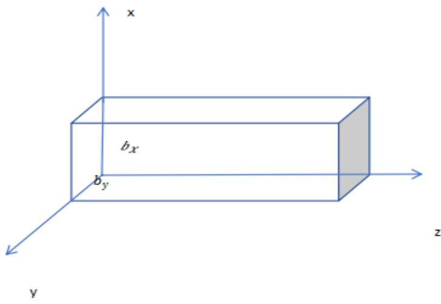  
图 3-2 矩形波导坐标示意图

三维声压方程如下：

$$
\left( { \hat { \sigma } } ^ { 2 } P \right) / \left( { \hat { \sigma } } x ^ { 2 } \right) + \left( { \hat { \sigma } } ^ { 2 } P \right) / \left( { \hat { \sigma } } y ^ { 2 } \right) + \left( { \hat { \sigma } } ^ { 2 } P \right) / \left( { \hat { \sigma } } z ^ { 2 } \right) = 1 / \left( c _ { o } ^ { 2 } \right) \left( { \hat { \sigma } } ^ { 2 } P \right) / \left( { \hat { \sigma } } t ^ { 2 } \right)\tag{3-13}
$$

令上述方程解为：

$$
P = P _ { \mathrm { a } } \left( x , \ y , \ z \right) \mathbf { e } ^ { \mathrm { j } \omega t }\tag{3-14}
$$

代入三维声压方程得：

$$
\frac { \hat { \sigma } ^ { 2 } P _ { \mathrm { a } } } { \hat { \sigma } \mathrm { x } ^ { 2 } } + \frac { \hat { \sigma } ^ { 2 } P _ { \mathrm { a } } } { \hat { \sigma } \mathrm { y } ^ { 2 } } + \frac { \hat { \sigma } ^ { 2 } P _ { \mathrm { a } } } { \hat { \sigma } \mathrm { z } ^ { 2 } } + k ^ { 2 } P _ { \mathrm { a } } = 0\tag{3-15}
$$

这里 $k { = } \frac { \omega } { c _ { o } }$ ，对上式做参变分离：

$$
P _ { \mathrm { a } } ( x ; \ y , \ z ) = X { \bigl ( } x { \bigr ) } Y { \bigl ( } y { \bigr ) } Z { \bigl ( } z { \bigr ) }\tag{3-16}
$$

进一步得到3个常微分方程组：

$$
\hat { \sigma } X \big ( x \big ) / \hat { \sigma } x ^ { 2 } + k _ { x } ^ { 2 } X \big ( x \big ) = 0\tag{3-17}
$$

$$
\hat { \sigma } Y \left( y \right) / \hat { \sigma } y ^ { 2 } + k _ { y } ^ { 2 } Y \left( y \right) = 0\tag{3-18}
$$

$$
\hat { \sigma } Z \left( z \right) / \hat { \sigma } z ^ { 2 } + k _ { z } ^ { 2 } Z \left( z \right) = 0\tag{3-19}
$$

其中 $k _ { x }$ 、 $k _ { y }$ 、 $k _ { z }$ 为3个待定常数，他们之间存在如下数量关系：

$$
k ^ { 2 } = k _ { x } ^ { 2 } + k _ { y } ^ { 2 } + k _ { z } ^ { 2 }\tag{3-20}
$$

由题设可知，x、y方向存在边界则会有驻波的产生，通过常微分方程组可知，x、y方向驻波方程可以写作如下形式：

$$
X { \big ( } x { \big ) } = A _ { x } \cos k _ { x } x + B _ { x } \sin k _ { x } x\tag{3-21}
$$

$$
Y { \left( y \right) } { = } A _ { y } \cos k _ { y } y { + } B _ { y } \sin k _ { y } y\tag{3-22}
$$

z方向上无边界，则有z方向上的行波方程：

$$
Z \left( z \right) = A _ { z } \mathbf { e } ^ { - \mathrm { j } k _ { z } z }\tag{3-23}
$$

通过对（3-21)、（3-22）、（3-23）三式求解x方向上的质点速度：

$$
\nu _ { x } = ( - 1 ) / ( \mathrm { i } \rho _ { \circ } \omega ) . \hat { c } p / \hat { c } x = ( - 1 ) / ( \mathrm { i } \rho _ { \circ } \omega ) . Y ( y ) Z ( z ) [ \hat { \alpha } X ( x ) / \hat { c } x ] e ^ { \mathrm { i } \omega t } = ( j k _ { x } ) / ( \rho _ { \circ } \omega ) . Y ( y ) Z ( z ) [ - \mathcal { A } _ { x } s i n k _ { x } x + \beta _ { x } c o s k _ { x } x ] e ^ { \mathrm { i } \omega t }
$$

(3-24)

同理，y方向上的速度方程为：

$$
\nu _ { \mathrm { y } } = \frac { j k _ { x } } { \rho _ { \circ } \omega } X ( x ) Z ( z ) [ - A _ { y } s i n k _ { y } y + B _ { y } c o s k _ { y } y ] e ^ { \mathrm { j } \omega t }\tag{3-25}
$$

根据刚性管壁条件可知：

$$
\nu _ { _ x } ( x = 0 , \ l _ { _ x } ) \ = \nu _ { _ y } \left( y = 0 , \ l _ { _ y } \right) = 0\tag{3-26}
$$

代入x、y方向上的速度方程可得：

$$
B _ { x } = 0 , ~ k _ { x } l _ { x } = n _ { x } \pi ( n _ { x } \pi = 0 , 1 , 2 . . . . . . )\tag{3-27}
$$

$$
B _ { y } = 0 , k _ { y } l _ { y } = n _ { y } \pi \big ( n _ { y } \pi = 0 , 1 , 2 . . . . . . \big )\tag{3-28}
$$

则 $P = P _ { a } ( x , y , z ) e ^ { j \omega t }$ 可以写作：

$$
p _ { ( n _ { x } n _ { y } ) } = A _ { ( n _ { x } n _ { y } ) } c o s k _ { x } c o s k _ { y } e ^ { j ( \omega t - k _ { z } z ) }\tag{3-29}
$$

式（3-29）中， $P _ { n _ { x } n _ { y } }$ 表示每一组参数 $( n _ { x } n _ { y } )$ 对应方程的一个特值解，它表示了声波导管中可能存在沿z方向传播的一种声波。这类声波的共同特征是圆频率可以表示为ω，传播速度表示为 $\begin{array} { r } { c _ { z } = \frac { \omega } { k _ { z } } } \end{array}$ 振幅则由 $A _ { n _ { x } n _ { y } } c o s k _ { x } c o s k _ { y }$ 决定[46]。

## 3.1.3 圆柱形声波导管

图3-3表示了本文模拟所需的驻波热声谐振管，暂时不考虑其内部常见的热声能量交换结构，仅将整个谐振腔简化成圆柱形波导管。为了方便的表示该圆柱形波导管的波动方程，这里选用柱坐标来表示该圆柱体的参数。取该管圆柱形管的半径为a，长度为b。设管的径向坐标为r，轴坐标为z，极角为θ，如图3-3所示。

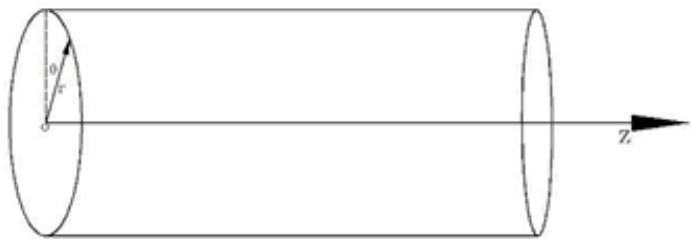  
图 3-3 圆柱形波导管

首先，求解圆柱形管内三维空间的波动方程，其中直角坐标系和柱坐标系之间的转化关系如下：

$$
\begin{array} { r } { x = r \cos \theta } \\ { y = r \sin \theta } \end{array}\tag{3-30}
$$

为得到在三维空间直角坐标系下的波动方程，假设圆柱内部是理想状态：

$$
{ \cfrac { { \hat { \sigma } } ^ { 2 } P } { { \hat { \sigma } } x ^ { 2 } } } + { \cfrac { { \hat { \sigma } } ^ { 2 } P } { { \hat { \sigma } } y ^ { 2 } } } + { \cfrac { { \hat { \sigma } } ^ { 2 } P } { { \hat { \sigma } } z ^ { 2 } } } = { \cfrac { 1 } { c _ { o } ^ { 2 } } } { \cfrac { { \hat { \sigma } } ^ { 2 } P } { { \hat { \sigma } } t ^ { 2 } } }\tag{3-31}
$$

坐标系的拉普拉斯算符可表示为：

$$
\nabla ^ { 2 } = \frac { 1 } { r } \frac { \partial } { \partial r } \bigg ( r \frac { \partial } { \partial r } \bigg ) + \frac { 1 } { r ^ { 2 } } \frac { \partial ^ { 2 } } { \partial \theta ^ { 2 } } + \frac { \partial ^ { 2 } } { \partial t ^ { 2 } }\tag{3-32}
$$

$$
\frac { 1 } { r } \frac { \partial } { \partial r } \bigg ( r \frac { \partial P } { \partial r } \bigg ) + \frac { 1 } { r ^ { 2 } } \frac { \partial ^ { 2 } P } { \partial \theta ^ { 2 } } + \frac { \partial ^ { 2 } P } { \partial z ^ { 2 } } = \frac { 1 } { c _ { o } ^ { 2 } } \frac { \partial ^ { 2 } P } { \partial t ^ { 2 } }\tag{3-33}
$$

令 $P = R ( r ) \Theta ( \theta ) Z ( z ) e ^ { j \omega t }$ ，代入式（3,31）得如下三个常微分方程：

$$
\begin{array} { l } { { \displaystyle { \frac { d ^ { 2 } Z } { d z ^ { 2 } } } + k _ { z } ^ { 2 } = 0 } } \\ { { \displaystyle { \frac { d ^ { 2 } \Theta } { d \theta ^ { 2 } } } + m ^ { 2 } \Theta = 0 } } \\ { { \displaystyle { \frac { d ^ { 2 } R } { d r ^ { 2 } } } + \frac { 1 } { r } \frac { d R } { d r } } + \Biggl ( k _ { r } ^ { 2 } - \frac { m ^ { 2 } } { r ^ { 2 } } \Biggr ) R = 0 }  \end{array}\tag{3-34}
$$

其中：

$$
\begin{array} { r } { k ^ { 2 } = \frac { \omega ^ { 2 } } { c _ { o } ^ { 2 } } = k _ { z } ^ { 2 } + k _ { r } ^ { 2 } } \end{array}\tag{3-35}
$$

下一步求解变量函数Z、0。

对 z的方程取驻波解为：

$$
Z \ \left( z \right) \ = A _ { _ z } \cos k _ { _ z } z \ + B _ { _ z } \sin k _ { _ z } z\tag{3-36}
$$

求得质点在 z 方向上的速度为：

$$
\nu _ { _ z } = \frac { - 1 } { \mathrm { j } \rho _ { o } \omega } \frac { \partial P } { \partial z } = \frac { \mathrm { j } k _ { _ z } } { \rho _ { o } \omega } \Theta \left( \theta \right) R \left( r \right) \left( - A _ { _ z } \sin k _ { _ z } + B _ { _ z } \cos k _ { _ z } \right) \mathrm { e } ^ { \mathrm { j } \omega t }\tag{3-37}
$$

边界条件为：

$$
z = 0 , z = l _ { _ z } ; \nu \big ( 0 \big ) = \nu \big ( l _ { _ z } \big ) = 0\tag{3-38}
$$

代入 $v _ { z }$ ，解得：

$$
B _ { _ z } = 0 , k _ { _ z } l _ { _ z } = n _ { _ z } \pi ( n _ { _ z } \mathcal { \tilde { H } } \bot \mp \frac { } { } \ast \mathcal { X } )\tag{3-39}
$$

0的解为：

$$
\Theta \left( \theta \right) = A _ { \theta } \left( m \theta - \varphi _ { m } \right)\tag{3-40}
$$

其中，m为正整数。

下面求解关于参数 R的方程，令 $k _ { \mathrm { r } } r = x$ ，方程变成：

$$
{ \frac { \mathrm { d } ^ { 2 } R } { \mathrm { d } x ^ { 2 } } } + { \frac { 1 } { x } } { \frac { \mathrm { d } R } { \mathrm { d } x } } + ( 1 - { \frac { m ^ { 2 } } { x ^ { 2 } } } ) \ R = 0\tag{3-41}
$$

m阶的柱贝塞尔方程与上式完全吻合，其一般解形式为：

$$
R ( k _ { \mathrm { r } } ) = A _ { \mathrm { r } } Q _ { \mathrm { m } } ( k _ { \mathrm { r } } ) \ + B _ { \mathrm { r } } S _ { \mathrm { m } } ( k _ { \mathrm { r } } )\tag{3-42}
$$

$Q _ { m } ( k _ { \mathrm { r } } \mathrm { r } )$ 与 $S _ { m } ( k _ { \mathrm { r } } \mathrm { r } )$ 表示了总量为 $\left( k _ { \mathrm { r } } \mathrm { r } \right)$ 的 m阶柱贝塞尔方程与柱诺依曼函数。按照两个公式的基本性质，上式 $B _ { r }$ 应为0，于是有：

$$
R ( k _ { \mathrm { r } } ) = A _ { \mathrm { r } } Q _ { \mathrm { m } } ( k _ { \mathrm { r } } )\tag{3-43}
$$

三个参数已经求解完毕，则波导中声压 $P _ { m }$ 为：

$$
P _ { _ m } { = } A _ { _ m } \mathcal { Q } _ { _ m } ( k \operatorname { r } _ { } \operatorname { r } _ { } ) \ \cos \ \left( m \theta - \varphi _ { _ m } \right) \ \mathrm { ~ e ~ } ^ { \operatorname { j _ { \mathbf { \alpha ( \omega t - } k _ { z } \operatorname { r } _ { } } } }\tag{3-44}
$$

对应的径向速度为：

$$
V _ { _ { r m } } = \frac { \mathrm { ~ j ~ } } { \rho _ { \mathrm { o } } \omega } \frac { \partial P _ { _ m } } { \partial r } = A _ { _ m } \frac { \mathrm { ~ j } k _ { \mathrm { r } } } { \rho _ { \mathrm { o } } \omega } \Bigg [ \frac { \mathrm { d } Q _ { _ m } ( k _ { \mathrm { r } } r ) } { \mathrm { ~ d ~ } \left( k _ { \mathrm { r } } r \right) } \Bigg ] \cos \left( m \theta - \varphi _ { _ m } \right) \mathrm { e } ^ { \mathrm { j } \left( \omega t - k _ { \mathrm { z } } z \right) }\tag{3-45}
$$

由上述的边界条件可知， $r = a$ 处有 $V _ { r } = 0$ ，由此条件可得：

$$
\left[ \frac { \mathrm { d } Q _ { m } ( k _ { \mathrm { r } } r ) } { \mathrm { ~ d ~ } \left( k _ { \mathrm { r } } r \right) } \right] _ { \left( r = a \right) } = 0\tag{3-46}
$$

按柱贝塞尔方程的递推关系，可得到下列关系：

$$
\mathcal { Q } _ { m - 1 } ( k _ { \mathrm { r } } \mathrm { a } ) = \mathcal { Q } _ { m + 1 } \mathopen { } \mathclose \bgroup \left( k _ { \mathrm { r } } \mathrm { a } \aftergroup \egroup \right)\tag{3-47}
$$

$$
Q _ { \mathrm { 1 } } ( k _ { \mathrm { r } } \mathrm { a } ) = 0\tag{3-48}
$$

该结果表明，在一定的边界条件， $k _ { r }$ 应有一系列的特值，特值用m与n表示，写作 $k _ { r } = k _ { m n }$ O

表3-1 声波方程特值的对应解
<table><tr><td> $k _ { r } = k _ { m n }$ </td><td> $m { = } 0$ </td><td>m=1</td><td> $\scriptstyle { m = 2 }$ </td></tr><tr><td>n=0</td><td>0</td><td>1.842</td><td>3,055</td></tr><tr><td> $n = 1$ </td><td>3.833</td><td>5.324</td><td>6.708</td></tr><tr><td>n=2</td><td>7.017</td><td>8.538</td><td>9.967</td></tr></table>

表3-1列出了一些 $k _ { m n }$ 的对应值的特值，如：m=0，n=1， $\begin{array} { r } { k _ { m n } = \frac { 3 . 8 3 2 } { \mathbf { a } } } \end{array}$ 则可将声压解写成如下形式：

$$
P _ { _ { m n } } = A _ { _ { m n } } \cos ( m \theta - \varphi _ { _ m } ) \ Q _ { _ m } ( K _ { _ { m n } } r ) \ \mathrm { e } ^ { ^ { \mathrm { i } \ ( \omega t - k _ { z } z ) } }\tag{3-49}
$$

$$
k _ { \mathrm { z } } = \sqrt { k ^ { 2 } - k _ { m n } ^ { 2 } }\tag{3-50}
$$

式（3-49）代表了圆柱体波导管中的（m，n）次简谐波。如，$m { = } 0$ $n { = } 0$ 时：

$$
f _ { \mathrm { c } } = f _ { 1 0 } = \mathrm { k _ { 1 0 } } \mathrm { a } { \frac { c _ { \mathrm { o } } } { 2 \pi \mathrm { a } } } = 1 . 8 4 1 { \frac { c _ { \mathrm { o } } } { 2 \pi \mathrm { a } } } = 4 0 8 7 . 0 2\tag{3-51}
$$

表示了沿z轴直线上传播的（0,0）次的平面波，其余表达为 $( m , n )$ 次的高次波。

## 3.2 声波叠加原理

通过多物理场仿真软件COMSOL模拟双声源的驻波热声制冷机，初始条件为两边声源的振幅、频率均相同。来自左、右两端的声波的波动方程见式（2-80）与（2-81），其主要过程如2.3节所述，这里不过多赘述。

综上可知，合成的声压幅值与两列声波的相位差值有关。在仿真软件COMSOL中，通过调节两边声源的相位，获得驻波热声制冷机制冷效果最佳的声场，然后带入热声学方程组求解其他物理量。

## 3.3 声场的调节

根据上述模拟分析以及热声基本关系可知，典型的热声热机由谐振管提供所需的声场。在不同波长的谐振管中，1/4波长最适用于微型热声制冷机，因为其损耗最小，且占空间小。

本次模拟中，选择工作频率为250Hz，工质为氮气，通过氮气中声速可知1/4波长为333mm，回热器材质为不锈钢，换热器材质为铜，以上材质均可在COMSOL内置材料模块中直接选用。

从上一节的描述中我们可知，COMSOL内置平面波辐射声源(0,0)模式与圆柱波导管的沿z轴直线传播的(0,0)次平面波相似，从前文的模拟条件中可知，由于模拟需要的声场最好满足1/4波长的条件，跟据已定的频率与管长，选取（0,0）模式最能贴近1/4波长的声场条件。

## 3.4 1/4 波长声场的有限元分析

由前面的推导可以知道，需要在双声源圆形波导中得到1/4波长的声场。因此，在具体的实际情况下，要在怎么的条件才能得到双声源驻波1/4波长声场是本节具体探究的重点[47]。本节主要采用有限元分析软件COMSOL对双声源驻波圆形波导进行模拟仿真，通过调节两端声源相位，得到理想的驻波声场波形。

## 3.4.1 谐振管实体模型建立

本文研究主要涉及声驱动的热声现象，其中广泛存在的流体工质与固体壁面的振荡而产生的热声现象，属于多物理场之间的相互耦合。而本文中所用的仿真软件COMSOL就是一款专业的多物理场商用仿真软件，COMSOL在多物理场之间相互耦合与计算中有其独到的优势。相对市面上的仿真软件存在明显优势，操作界面与耦合特性方面也突出了COMSOL简洁明了的特性。

在用COMSOL中进行本文所需要的物理仿真之前，首先明确本文以及模型主要需要面对的物理问题。本文涉及的物理过程主要为，两端声源发出声波，声波流过板叠导致热端换热器与冷端换热器形成温差。COMSOL中构建的物理模型主要的传热形式应当为对流换热，所以可以明确，本文所研究的热声制冷机模型主要的物理过程为流动与传热的耦合过程，需要在COMSOL中选择相应的接口，每个物理场接口都会有相应的微分方程与之对应。选择“多物理场”选项中的设置，这个选项表示了将多种不同物理场的微分方程联立，在指定的边界条件下得出相应的解。

通过上述的有关叙述，绘制出相关的物理模型，COMSOL中有可将物理模型划分为不同模块的功能，即将模型分为几个区域，几个区域相对独立，可以将区域中添加不同物理场与不同材质。然后分别给对应的区域添加对应的物理场。同样的，给不同的几何区域添加COMSOL自带的材料模块。点击“研究”选项，表示对微分方程的求解和各参数进行选择和设置。最后可以在“结果”选项中对于多物理场仿真的结论进行分析以及后处理。

模拟中的声驱动相对而言较小，所以流体在驻波热声制冷机中的流动过程可以看作层流，且文中多次强调的热声效应主要来自于声源振动工质产生的声振荡引起的温度与位移的振荡。声源振动产生声波的过程主要基于COMSOL中的热黏性声学模块，所以驻波热声制冷机模型需要将层流、流-固传热系统与热黏性声学三个模块进行多物理场耦合。在“多物理场”的接口选择流动与温度两个系统耦合，最后添加“热黏性声学频域”模块与前一过程耦合。

当然本章仅涉及驻波热声制冷机的声场调节，关于回热器材质以及其他细节将在后文中详细描述。

在研究谐振管内声场波形前，需要建立合适的1/4波长谐振管模型。由波长公式 $\lambda = c _ { o } / f$ 知，当声速一定的情况下，可以通过调节声波的评率来改变波长。

本次模拟中，选用上述提到的尺寸来确定谐振管的基本结构，工

质为氮气，通过氮气中声速可知1/4波长为333mm。

## 3.4.2 双声源驻波圆形波导有限元模型建立

运用有限元商用分析软件COMSOL，使用菜单组件中的网格，网格中的物理场控制网格，在热粘性声学的选项中选择“每个波长的单位网格数”输入“5”，管内的气体介质选择Nitrogen，声速输入333m/s，本体黏度输入0.0171pa.s，其他如动力黏度、密度、导热系数、比热容等量均选用COMSOL的Nitrogen内置系数。模型构建如图3-4:

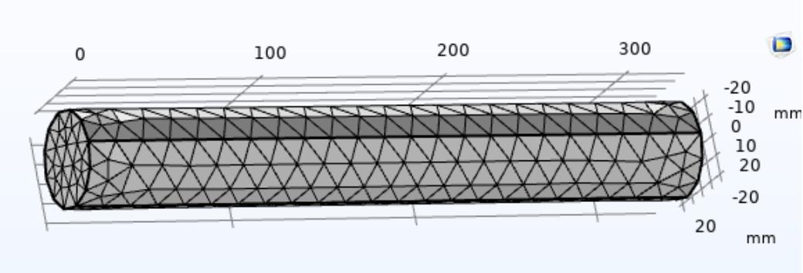  
图3-4 双声源驻波圆形波导网格模型  
通过上述条件生成网格，得到单位数为1804个，节点5432个。

## 3.4.3 仿真结果及分析

在模型两端入口上加入热粘性声学的端口模式，在两端加上两个（0，0）型的平面波辐射，通过调节两端平面波相位获得理想波形。如图3-5:

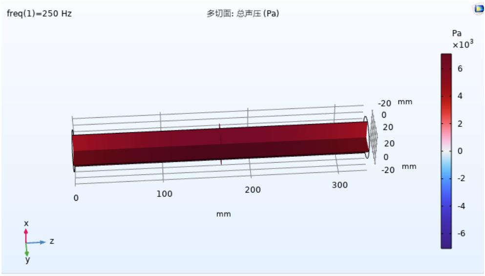

(a) 两端相位差为 $0 ^ { \circ }$  
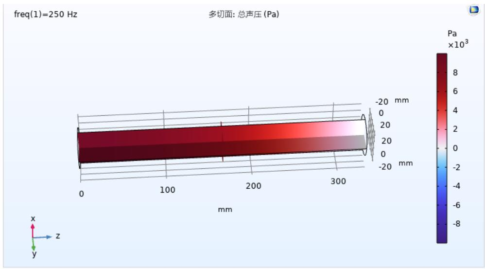  
(b)两端相位差为 $9 0 ^ { \circ }$

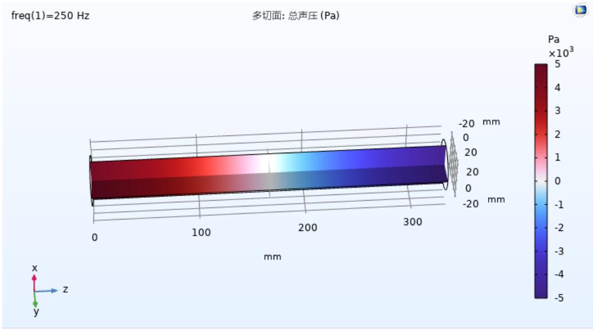  
(c)两端相位差为180°

图3-5 不同相位差双声源驻波圆形波导管声压分布图

上图分别为相位差分别为 $0 ^ { \circ } , ~ 9 0 ^ { \circ }$ $1 8 0 ^ { \circ }$ 时，双声源驻波圆形波导管内的声压分布。具体波形如图3-6：

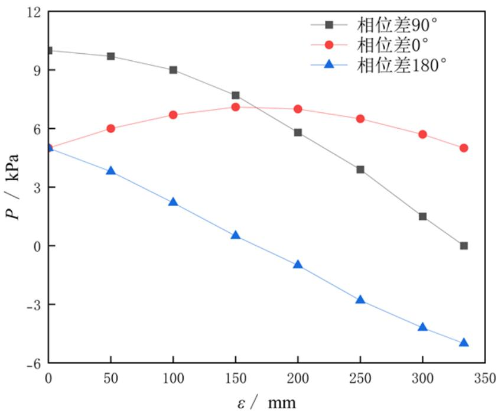  
图3-6 不同相位差双声源驻波圆形波导管声压波形图

纵轴代表压强P，横轴代表该压强对应的位置ε，。由图3-6可知，两端声源信号相位差为 $9 0 ^ { \circ } |$ 时，可在1/4波长的谐振管内产生最接近1/4波长的叠加波形，且此时的声压幅值达到最高，热声器件获得的声功也最高，可产生最优的声场条件。

## 3.5 本章小节

本章通过基本的声学定理与知识，对谐振管中的声场进行了一定的理论分析，简单描述了声波波导理论中的矩形波导导管与圆形波导导管。然后利用仿真软件COMSOL，通过改变谐振管两端声源信号间的相位差，找到了最适合四分之一波长双声源驻波热声制冷机的声场波形。在此基础上，验证了不同相位差对于谐振管中声场的影响，并找到了最适合四分之一波长双声源驻波热声制冷机的相位差，为后续分析优化提供了前提条件。

## 第四章驻波热声制冷机板叠位置的选取

回热器组件一般由驻波热声制冷机中的板叠与热端换热器和冷端换热器共同构成，它是驻波热声制冷机中最为核心的部分。板叠中进行的是气体微团的膨胀与压缩，而气体微团在膨胀与压缩后做功从而引起了板叠两端的温差，通过驻波热声制冷机中固体介质与工质间的周期性热交换，构建热声制冷循环，从而实现制冷效应。在这一过程中，回热器的性能表现与温度场分布受到多重关键因素影响：其孔隙结构的几何特性、流体-固体工质的热物性参数以及材料本身的传热特性均对能量转换效率产生决定性作用。

传统线性热声理论模型通常假设回热器轴向温度呈线性分布，但实际工况中，非线性温度分布才是驻波热声制冷机工作时的普遍现象。这种偏差在回热器轴向存在显著温差时尤为突出一一由于气体工质的粘性系数随温度变化呈现强烈非线性特征，若采用均质孔隙结构设计，将导致具有梯度特性的热物性参数与固定孔隙构造产生失配效应。这种物性-结构的协同失衡会引发局部涡流损耗加剧、相位协调偏离等问题，最终削弱回热器的热声转换效能。通过上一章，可以了解到最合适驻波热声制冷机的声场分布。并且，驻波热声制冷机中的声场是不断变化的，所以我们需要通过热力学原理、声学原理以及流体方程，在驻波热声制冷机获得最佳声场的情况下，确定板叠的最佳制冷位置，以及驻波热声制冷机的最佳制冷效果。

## 4.1 双声源驻波热声制冷机结构简介

一般的双声源驻波热声制冷机由声源、谐振管、热端换热器、冷端换热器、回热器组成，如图4-1。

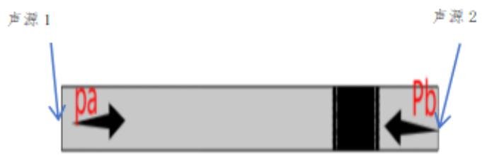

(a) 双声源驻波热声回热器截面图  
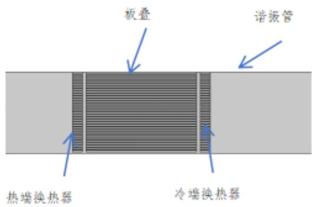  
(b) 板叠截面图  
图4-1 双声源驻波热声制冷机模型图

由图4-1可知，回热器组件由冷端换热器、热端换热器与板叠组成。作为双声源驻波热声制冷机的核心部件，板叠的作用相当于一个热泵，将冷端的热量源源不断地泵向热端，令板叠的两端存在稳定的温度梯度。换热器则是双声源驻波热声制冷机与外部进行热量交换的元件，左端的换热器将制冷机内部热量送出制冷机，温度较高，所以称为热端换热器；右端换热器吸收外界热量以维持周边的低温，所以称为冷端换热器。气体在回热器内部振动时存在泵热效果，两端振动的声源会提供这个过程消耗的声功。

## 4.2 板叠参数的选定

作为热声效应主要发生的场所，回热器中的气体在其中进行热声振荡，经历热力循环，且循环中存在气体工质与固体材料间的热量传递。回热器有多种结构，如平行板叠结构、金属丝网结构、针孔塑性结构等。由于气体工质在平行板叠式结构中运动时受到的空气阻力较小。所以本次模拟选取平行板叠式结构。

下面对于板叠的长度、宽度与孔隙度进行确定。根据swift的经典热声理论，可将平行板叠分为很多个短板叠结构，如图4-2所示。

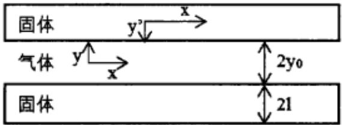  
图 4-2 短板叠结构示意图

图4-2中，板叠间距为 $2 \mathrm { y } _ { \mathbf { 0 } }$ ，板叠宽度为21。swift建议选取板叠间距为2-4倍的热渗透深度 $\ : \delta _ { k } = \sqrt { 2 k / \omega \rho _ { o } C _ { P } } \ : \ : ) \ :$ 。带入上一章中介绍的气体工质参数，通过计算可知 $\mathrm { 2 y _ { 0 } = 0 . 7 m m }$ 。根据经验，平行板叠的孔隙度0一般为0.3-0.95，由于材质原因，取宽度21为0.5mm，通过式(4-1):

$$
O = \mathrm { y _ { o } / \left( \mathrm { y _ { o } + l } \right) }\tag{4-1}
$$

求出0=0.416，符合其取值范围。

换热器的长度与气团的振荡幅值n有关。

$$
n = \frac { u } { \omega } = \frac { P _ { m } } { \omega c \rho _ { m } } \sin n\tag{4-2}
$$

其中，氮气的时均密度 $. \rho _ { m }$ 和氮气中声速c可查表得到，谐振管内静压 $P _ { m }$ 取3个标准大气压，ω为 $2 \pi f ,$ f为模拟选取的工作频率250Hz。

由式（4,2）可计算得到气团振幅为0.89mm。文献[48]指出最佳冷端换热器长度为2n，热端换热器长度为4n，为了方便计算，取冷端换热器长度2mm，热端换热器长度为4mm，厚度均为0.5mm，冷端换热器和热端换热器分别紧贴在回热器板叠的两端，充分换热。

## 4.3 板叠在谐振管中的位置对制冷效果的影响

回热器组件作为双声源驻波热声制冷机的核心部件，为热声效应的发生提供了场所。气体微团在声功作用下，从冷端壁面吸热并被泵送至热端后，向热端壁面放出热量。整个过程中，热量的传递方向是从回热器的冷端到热端，所以回热器的热端与冷端存在一个可以具体化的温度梯度dT/dx。通过传热学的基本知识可知，一定有热量会从回热器的热端传导到冷端形成热漏。由驻波热声制冷机的基本构造可知，广泛存在于整个装置中的换热形式为固体导热、气体导热及对流换热，且双声源驻波热声制冷机回热器两端的温度梯度不可能无限制的增大，只有当回热器导热（室温端传向低温端）与导热热流Q所传递的能量相平衡时，回热器有最大的温度梯度。当系统处在稳定状态时，通过热力学第一定律推导得到回热器沿x方向的时均能流方程[49]：

$$
E _ { { \scriptscriptstyle m } } = { \cal Q } _ { c m } + H _ { t m } + W _ { { \scriptscriptstyle m } } = 0\tag{4-3}
$$

式中， $E _ { m }$ 为回热器中的总能量流； $H _ { { \mathrm { { t } } } m }$ 为热声热流的时间均值； $W _ { m }$ 为声功流的时间均值。通过文献[50]可知，在此情况下的热声热流与声功流的时间均值，所以上式可化简为：

$$
\mathcal { Q } _ { c m } = \rho _ { m } c _ { P } \int T _ { 1 } u _ { 1 } \mathrm { d } A - \int P _ { 1 } u _ { 1 } \mathrm { d } A\tag{4-4}
$$

式（4-4）中，P、T、u、A分别表示压力、温度、沿x方向速度与工质流道的截面面积，一般假设回热器的比热容远大于工质的定压比热容 $C _ { P }$ ，下标“1”表示该量的一阶波动量。则有下列关于 $T _ { 1 }$ 、 $u _ { 1 }$ 的表达式[51]：

$$
T _ { 1 } = \frac { P _ { 1 } } { \rho _ { m } c _ { P } } \Bigg [ 1 - \frac { 1 } { 1 + \varepsilon _ { \mathrm { s } } } \Bigg ] - \frac { 1 } { \rho _ { m } c _ { P } } \frac { \mathrm { d } P _ { 1 } } { \mathrm { d } \mathrm { x } } \frac { \mathrm { d } T _ { \mathrm { m } } } { \mathrm { d } \mathrm { x } } \Bigg [ 1 - \frac { \mathrm { P r } } { \mathrm { P r } - 1 } h _ { \nu } \left( y \right) + \frac { h _ { k } \left( \mathrm { y } \right) \left( 1 + \varepsilon _ { \mathrm { s } } f _ { \nu } / f _ { k } \right) } { \left( \mathrm { P r } - 1 \right) \left( 1 + \varepsilon _ { \mathrm { s } } \right) } \Bigg ]\tag{4-5}
$$

$$
u _ { 1 } = \frac { i } { \omega \rho _ { _ m } \varphi } \big [ 1 - h _ { _ \nu } ( y , z ) \big ] \frac { \mathrm { d } P _ { _1 } } { \mathrm { d } \mathrm { x } }\tag{4-6}
$$

式中， $\mathrm { P r }$ 为普朗特数，板叠中心到左端声源长度为 $y$ ，其他量与板叠的物理参数有关，表达如下[52]：

$$
h _ { k } = \frac { \cosh \left[ ( 1 + i ) \mathbf { y } / \delta _ { k } \right] } { \cosh \left[ \left( 1 + i \right) \mathbf { y } _ { \mathrm { { o } } } / \delta _ { k } \right] }\tag{4-7}
$$

$$
h _ { \nu } = \frac { \cosh \bigl [ ( 1 + i ) \mathbf { y } / \delta _ { \nu } \bigr ] } { \cosh \bigl [ \bigl ( 1 + i \bigr ) \mathbf { y } _ { \mathrm { { o } } } / \delta _ { \nu } \bigr ] }\tag{4-8}
$$

$$
f _ { \nu } = \frac { \operatorname { t a n h } \left[ ( 1 + i ) \mathbf { y } / \delta _ { \nu } \right] } { \left[ \left( 1 + i \right) \mathbf { y } _ { \circ } / \delta _ { \nu } \right] }\tag{4-9}
$$

$$
f _ { k } = \frac { \operatorname { t a n h } \left[ ( 1 + i ) \mathbf { y } / \delta _ { k } \right] } { \left[ \left( 1 + i \right) \mathbf { y } _ { \mathrm { { o } } } / \delta _ { k } \right] }\tag{4-10}
$$

$$
\varepsilon _ { s } = \sqrt { \frac { K \rho _ { m } c _ { p } } { K _ { s } \rho _ { s } c _ { s } } } \frac { \operatorname { t a n h } \left[ ( 1 + i ) \mathbf { y } _ { o } \mathbf { \varepsilon } / \delta _ { k } \right] } { \operatorname { t a n h } \left[ \left( 1 + i \right) \mathbf { l } / \delta _ { k } \right] }\tag{4-11}
$$

带入（4-4）有：

$$
Q _ { c m } = \frac { \displaystyle { \prod _ { } ^ { } } \mathrm { y _ { o } ^ { } } } { 2 \varphi \omega \rho _ { m } } \mathrm { I m } { \left[ P _ { 1 } \frac { \mathrm { d } P _ { 1 } } { \mathrm { d x } } C _ { 1 } \right] } + \frac { \displaystyle { \prod _ { } ^ { } } \mathrm { y _ { o } ^ { } } c _ { P } } { 2 \varphi \omega ^ { 3 } \rho _ { m } } \frac { \mathrm { d } T _ { m } } { \mathrm { d x } } \frac { \mathrm { d } \tilde { P } _ { 1 } } { \mathrm { d x } } \frac { \mathrm { d } P _ { 1 } } { \mathrm { d x } } \mathrm { I m } { \left[ C _ { 2 } \right] }\tag{4-12}
$$

$$
C _ { 1 } = \frac { 1 } { 1 - \tilde { f } _ { \nu } } \Bigg [ 1 - \tilde { f } _ { \nu } - \frac { f _ { \nu } - \tilde { f } _ { \nu } } { \big ( 1 + \varepsilon _ { s } \big ) \big ( 1 + \mathrm { P r } \big ) } \Bigg ]\tag{4-13}
$$

$$
C _ { 2 } = \frac { 1 } { ( 1 - \tilde { f } _ { \nu } ) \big ( 1 - f _ { \nu } \big ) } \Bigg [ \tilde { f } _ { \nu } + \frac { ( f _ { k } - \tilde { f } _ { \nu } ) \big ( 1 + \varepsilon _ { s } f _ { \nu } / f _ { k } \big ) } { \big ( 1 + \varepsilon _ { s } \big ) \big ( 1 + \mathrm { P r } \big ) } \Bigg ]\tag{4-14}
$$

$f _ { v }$ $f _ { k }$ 、 $h _ { \nu }$ 、 $h _ { k }$ 为回热器的结构函数，推导上面已经给出，上带波浪线的量表示该量的共轭，式（4-13）与（4-14）为方程的两个解。

工质与回热器固体的导热的总合为导热热流：

$$
Q _ { \mathrm { c m } } - \prod ( \mathrm { k y } _ { \mathrm { o } } + \mathbf { k } _ { \mathrm { s } } \mathrm { l } ) \frac { \mathrm { d } T _ { \mathrm { m } } } { \mathrm { d } \mathbf { x } } = 0\tag{4-15}
$$

由上面推导可知：

$$
\frac { \mathrm { d } T _ { \mathrm { m } } } { \mathrm { d x } } = \frac { \displaystyle \frac { y _ { \mathrm { o } } } { 2 \varphi \omega \rho _ { \mathrm { m } } } \mathrm { I m } \left[ P _ { \mathrm { 1 } } \frac { \mathrm { d } \tilde { P } _ { \mathrm { 1 } } } { \mathrm { d x } } C _ { \mathrm { 1 } } \right] } { \mathrm { k y _ { \mathrm { o } } } + k _ { s } \mathrm { l } - \displaystyle \frac { \mathrm { y _ { \mathrm { o } } } c _ { p } } { 2 \varphi \omega ^ { 3 } \rho _ { \mathrm { m } } \left( 1 - \mathrm { P r } ^ { 2 } \right) } \frac { \mathrm { d } P _ { \mathrm { 1 } } } { \mathrm { d x } } \frac { \mathrm { d } \tilde { P } _ { \mathrm { 1 } } } { \mathrm { d x } } \mathrm { I m } \left[ C _ { 2 } \right] }\tag{4-16}
$$

跟据文献[53]可以将驻波声场写作：

$$
P _ { 1 } = P _ { \mathrm { _ { 4 } } } \cos ( k \mathrm { y } )\tag{4-17}
$$

k为波数，y为板叠位置， $L s$ 为回热器长度，于是有：

$$
\begin{array}{c} \frac { \mathrm { d } T _ { \mathrm { m } } } { \mathrm { d } \mathrm { x } } = \overbrace { 4 \varphi c \rho _ { \mathrm { m } } } ^ { \mathrm { ~ \mathrm { ~ \mathrm { ~ y ~ } _ { \mathrm { o ~ } } ~ } ~ } p _ { \mathrm { \scriptscriptstyle { \it ~ A } } } \sin \left( \mathrm { k y } \right) \mathrm { I m } \left[ C _ { \mathrm { l } } \right] } _ { \mathrm { ~ \mathrm { ~ \mathrm { ~ k ~ y ~ } _ { \mathrm { o ~ } } + \it k _ { s } \mathrm { l } - \underbrace { \mathrm { y _ { \mathrm { { \mathrm { ~ o } } ~ } \mathcal { C } _ { p } } p _ { A } ^ { \mathrm { { ~ \mathrm { 2 } } } } \left[ 1 - \cos \left( 2 \mathrm { k y } \right) \right] \mathrm { I m } \left[ C _ { \mathrm { 2 } } \right] } _ { 4 \varphi \omega \mathrm { c } ^ { 2 } \left( 1 - \mathrm { P r } ^ { 2 } \right) } } } } } \end{array}\tag{4-18}
$$

$$
\Delta T _ { m } = T _ { m } ( y + \frac { L s } { 2 } ) - T _ { m } ( y - \frac { L s } { 2 } )\tag{4-19}
$$

通过式（4-18）与式（4-19）可知，板叠两端温差与其在谐振管中的位置及其结构参数有密切关系。

## 4.4板叠在谐振管中位置的模拟

通过上一章的分析可知，双声源驻波热声制冷机在两端声源间相位差为 $9 0 ^ { \circ }$ 的情况下有最佳声场。谐振管两端分别具有可控声源，即声源1和声源2，管内静压取3个标准大气压，管内热端换热器温度为333K，管径为24mm。建立简易驻波热声机的三维(three dimension，3D）模型和回热器内部构造模型，如图4-1所示。

基于COMSOL建立其有限元模型，如图4-3，满足一个波长存在5个网格，单元数156938。

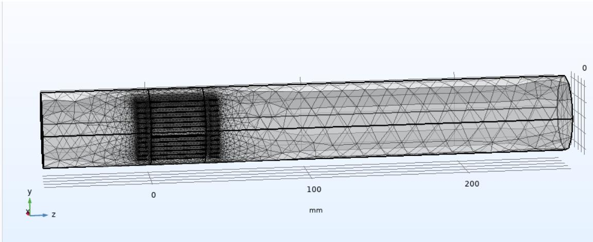  
图4-3 3D 双声源驻波热声制冷机有限元网格模型

将两端声源信号间相位差设置为 $9 0 ^ { \circ }$ 的条件下，在长度为333mm的谐振管内取6个等间距点，探究板叠的最佳制冷位置。当回热器处于谐振管内不同位置时，回热器两端的温降情况如图4-5所示。模拟结果如图4-6，横坐标表示谐振管的直径，纵坐标为谐振管管长。

工质参数见图4-4。
<table><tr><td rowspan=1 colspan=1>”属性</td><td rowspan=1 colspan=1>变量</td><td rowspan=1 colspan=1>表达式</td><td rowspan=1 colspan=1>单位</td><td rowspan=1 colspan=1>大小</td><td rowspan=1 colspan=1>信息</td></tr><tr><td rowspan=1 colspan=1>动力黏度</td><td rowspan=1 colspan=1>mu</td><td rowspan=1 colspan=1>eta(T)</td><td rowspan=1 colspan=1>Pa·s</td><td rowspan=1 colspan=1>1x1</td><td rowspan=1 colspan=1></td></tr><tr><td rowspan=1 colspan=1>比热率</td><td rowspan=1 colspan=1>gamma</td><td rowspan=1 colspan=1>1.4</td><td rowspan=1 colspan=1>1</td><td rowspan=1 colspan=1>1x1</td><td rowspan=1 colspan=1></td></tr><tr><td rowspan=1 colspan=1>恒压热容</td><td rowspan=1 colspan=1>Cp</td><td rowspan=1 colspan=1>Cp(T)</td><td rowspan=1 colspan=1>J/(kg·K)</td><td rowspan=1 colspan=1>1x1</td><td rowspan=1 colspan=1></td></tr><tr><td rowspan=1 colspan=1>密度</td><td rowspan=1 colspan=1>rho</td><td rowspan=1 colspan=1>rho(pA,T)</td><td rowspan=1 colspan=1> $\ k g / m ^ { 3 }$ </td><td rowspan=1 colspan=1>1x1</td><td rowspan=1 colspan=1></td></tr><tr><td rowspan=1 colspan=1>导热系数</td><td rowspan=1 colspan=1> $k _ { - } \mathrm { i } \ s \circ : \cdots$ </td><td rowspan=1 colspan=1>k(T)</td><td rowspan=1 colspan=1>W/(m·K)</td><td rowspan=1 colspan=1>3x3</td><td rowspan=1 colspan=1></td></tr><tr><td rowspan=1 colspan=1>本体黏度</td><td rowspan=1 colspan=1>muB</td><td rowspan=1 colspan=1>0.0171</td><td rowspan=1 colspan=1>Pa·s</td><td rowspan=1 colspan=1>1x1</td><td rowspan=1 colspan=1></td></tr><tr><td rowspan=1 colspan=1>声速</td><td rowspan=1 colspan=1>c</td><td rowspan=1 colspan=1>333</td><td rowspan=1 colspan=1>m/s</td><td rowspan=1 colspan=1>1x1</td><td rowspan=1 colspan=1></td></tr><tr><td rowspan=1 colspan=6></td></tr></table>

图4-4 3D 双声源驻波热声制冷机工质参数表

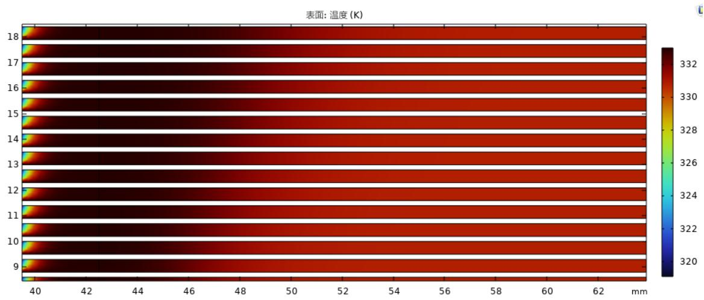  
图4-5 3D 双声源驻波热声板叠温降效果横截面图

图 4-6 为模拟板叠位置 y 从 53mm-303mm 处 6 个位置的不同制冷结果，横坐标表示谐振管中板叠位置，纵坐标为该位置对应的两端温差。

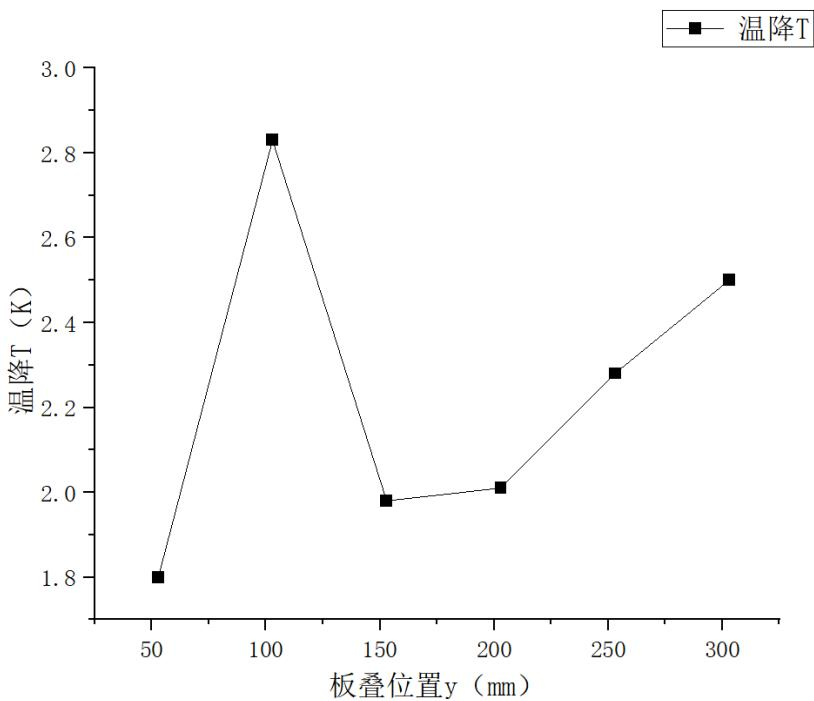  
图4-6 3D 双声源驻波热声板叠不同位置制冷效果图

由图4-6可知，当板叠中心到左侧声源的距离从303mm变化至253mm时，其两端温差有所下降，由于板叠处于y=303mm位置时已非常接近右侧声源，所以其可以粗略视为右侧最高温差位置；在板叠从 y=253mm 处左移至 y=153mm处期间，板叠两端温差持续下降；

此后，随着板叠继续左移，其两端温差在103mm达到峰值，所以板叠两端温差拐点出现在 $\mathrm { y } { = } 1 0 3 ~ \mathrm { m m }$ 左右的区域里。

鉴于图4-6中曲线的右端依旧有上升趋势，所以有必要继续右移板叠以探究是否存在更理想的制冷位置，但考虑到总管长只有333mm，通过声学原理的估算，且板叠组件自身长度有43mm，所以此处在303mm的位置处向右再移动10mm来检验制冷量的变化规律。

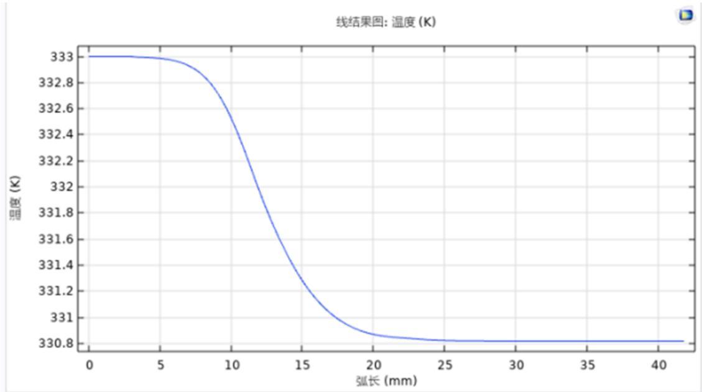  
图4-7 313mm 处回热器制冷效果示意图

图4-7中横轴弧长表示回热器的长度，纵轴表示该位置的温度，回热器两端温差为2.18K，并未超越 $\mathbf { y } { = } 1 0 3 \mathbf { m } \mathbf { m }$ 时的温差，故可得到结论：驻波热声制冷机中回热器组件的最佳位置在 $\mathbf { y } { = } 1 0 3 \mathbf { m } \mathbf { m }$ 附近。考虑到冷、热端换热器和板叠自身的长度，可在 $\mathbf { y } { = } 1 0 3 \mathbf { m } \mathbf { m }$ 的左右10mm范围内，继续搜寻能在板叠两端产生最大温降的板叠位置点，如图4-8所示。

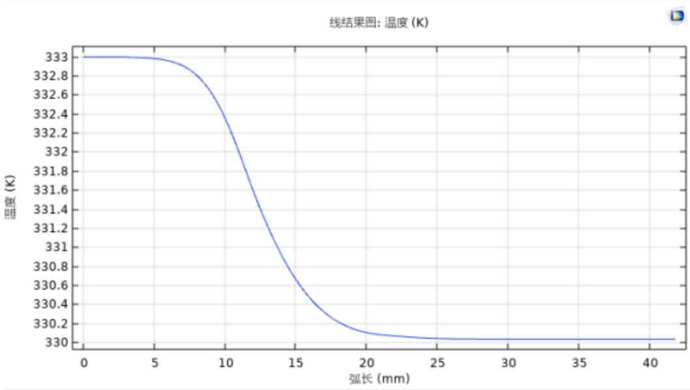  
(a)y=113mm 时回热器两端温差

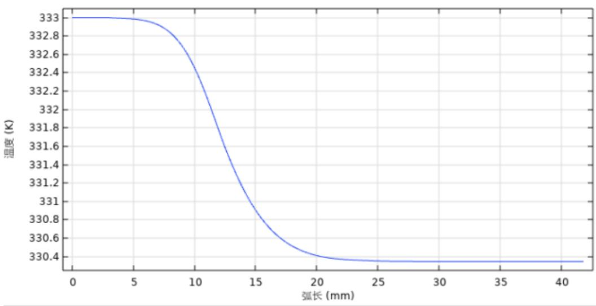  
(b)y=93mm 时回热器两端温差  
图4-83D 双声源驻波热声板叠在103mm 左右不同位置制冷效果图

由图4-6和图4-8可知， $\mathbf { y } { = } 1 1 3 \mathbf { m } \mathbf { m }$ 时，回热器两端温差为2.96K；$\mathrm { y } = 1 0 3 \mathrm { m m }$ 时，回热器两端温差为2.83K； $\mathbf { y } = 9 3 \mathbf { m } \mathbf { m }$ 时，回热器两端温差又回落为2.65K。可见，在给定工况条件下，当板叠的中心位置距离左侧声源113mm时，板叠两端间产生的温降最大，即热声制冷机能获得最佳的制冷效果。

由图4-8可知，板叠内部温度一般只在轴向25mm长度范围内有较明显变化，此后就趋于稳定了，所以在相同条件下的模拟或者实验研究中应该将板叠的长度优化为25mm-30mm，以减小材料的损耗与计算的成本，且能保证模拟或实验的准确性。

## 4.5 本章小结

本章通过基本的热力学与流体力学关系推导了板叠位置与驻波热声制冷机制冷效果之间的关系，并通过软件COMSOL进行了仿真验证，确定了双声源驻波热声制冷机中板叠的最佳制冷位置，为热声制冷机设计过程中板叠位置参数的选取提供了依据。

## 第五章驻波热声制冷机的制冷效果优化

上述几章的讨论中，探究了四分之一波长双声源驻波热声制冷机的声场与板叠位置，并得到了四分之一驻波热声制冷机最佳声场与板叠的最佳制冷位置。本章在前文的基础上，通过改变两端声源输入信号的频率、气体工质和驻波热声制冷机的压力驱动比来优化双声源驻波热声制冷机的制冷效果。

## 5.1 工质种类对驻波热声制冷机制冷效果的影响

驻波热声制冷机是基于热声效应工作的，其核心是通过声波的驻波场在谐振管内的传播，导致工质气体发生周期性的压缩和膨胀，从而实现热量的泵送。工质在这个过程中起到了传递能量、热力循环的作用。

常见的工质包括氦气、氮气、氩气，或者混合气体如氦-氩混合气等。不同的气体有不同的热物性参数，例如氦气的声速较高，而氩气的声速较低；氦气的导热系数较高，而氮气的导热系数较低。

考虑工质的选择对制冷效果的具体影响。比如，声速高的工质可能在驻波频率较高的情况下工作，这可能影响系统的谐振频率和结构设计；导热系数高的工质可能提高热交换效率，但也有可能导致更多的热损失；气体的比热容比（ $\scriptstyle \gamma = C p / C \nu )$ 会影响热力学循环的效率，因为γ值越大，绝热压缩和膨胀过程中的温度变化越显著，这有利于提高制冷效果。

另外，工质的粘性会影响声波传播过程中的能量耗散，粘性高的工质可能导致更多的能量损失，降低系统效率。此外，气体的分子量也会影响其声学特性，轻气体如氦气可能更适合高频应用，而重气体可能在低频下表现更好。

通过以上这些因素可知工质的物理性质，比如比热容、导热系数、声速、粘性等，都会影响整个系统的效率。下面选取一种混合气体(空气），一种稀有气体（氦气）以及一种普通气体工质（氮气），综合探究工质对驻波热声制冷机

通过上一章的讨论可知，回热器存在两个热力学参数，热渗透深度与黏性渗透深度，分别表示为 $\delta _ { \mathrm { k } }$ 与 $\delta _ { \mathrm { v } }$ 。在一般的热声过程中，板叠壁面附近产生热声效应的区域被定义为热渗透层，其厚度约等于一个振荡周期的时间 $1 / \omega$ 内热量穿过流体的扩散距离[54]：

$$
\delta _ { \mathrm { k } } = \left( { \frac { 2 k } { \rho _ { \mathrm { m } } C _ { P } \omega } } \right) ^ { \frac { 1 } { 2 } } = \left( { \frac { 2 a } { \omega } } \right) ^ { \frac { 1 } { 2 } }\tag{5-1}
$$

黏性渗透深度与动能损失有关，定义如下：

$$
\delta _ { \mathrm { v } } = \left( { \frac { 2 a } { \rho _ { \mathrm { m } } \omega } } \right) ^ { \frac { 1 } { 2 } }\tag{5-2}
$$

k、a、 $\mu$ 分别为导热系数、热扩散率和动力黏度，产生热声效应的基本条件为 $\frac { \delta _ { \mathrm { v } } } { \delta _ { \mathrm { k } } } { \leq } 1$ ，代入上述式（5-1）与（5-2）。

$$
\frac { \delta _ { \mathrm { v } } } { \delta _ { \mathrm { k } } } = \frac { \left( \displaystyle \frac { 2 \mu } { \rho _ { \mathrm { m } } \omega } \right) ^ { \frac { 1 } { 2 } } } { \left( \displaystyle \frac { 2 a } { \omega } \right) ^ { \frac { 1 } { 2 } } } = \left( \frac { \mu } { \rho _ { \mathrm { m } } a } \right) = \sqrt { \mathrm { P r } }\tag{5-3}
$$

所以，Pr≤1，那么通过基本的化学知识可知，单原子的惰性气体分子可以满足以上的条件，基于上一章中的声场及其他条件，通过改变气体工质的如下制冷效果，图5-1分别为氦气、氮气与空气的制冷模拟结果。

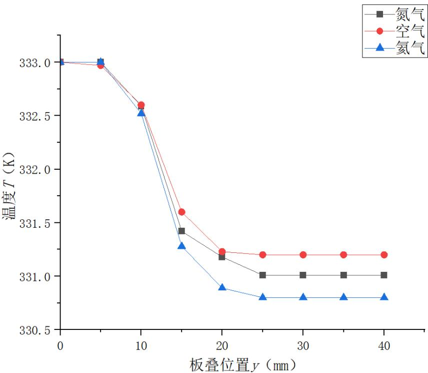  
图5-1 不同气体工质双声源驻波热声制冷机的制冷效果图

由图5-1可知，在相同结构和运行参数条件下，即符合第三章中最佳声场的条件下以及第四章最佳板叠位置的情况下，空气的温降为1.8K，氮气的温降为1.99K，氦气的温降为2.20k。采用氦气为工质的热声制冷机能在板叠两端获得最大的温降，即有最好的制冷效果，符合前文叙述的理论推导。

## 5.2 压力驱动比对驻波热声制冷机制冷效果的影响

理论上声源压力幅值 $P _ { m }$ 越大，输入声功强度越高，系统获得的冷量就会越大。但另一方面，压力波幅越大，热声系统中的各个部位承受的负荷就越大[55]，不利于系统的稳定。通过查阅文献可知，热声

系统中存在称为马赫数M的物理量：

$$
M = { \frac { P } { \rho _ { \mathrm { m } } a ^ { 2 } } }\tag{5-4}
$$

当 ${ \mathrm { M } } { \mathrm { < } } 0 . 1$ ，热声系统整体趋于稳定。通过在此范围内增加双声源驻波热声制冷机的压力驱动比 $D = \%$ ，效果如图5-2所示，压力驱动比分别为2.3%、2.6%、3%。

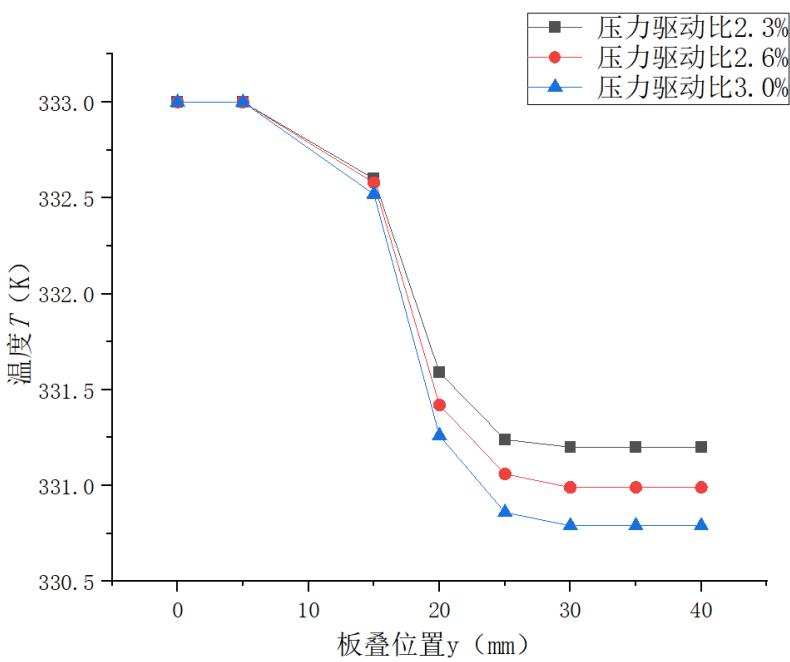  
图5-2 不同压力驱动比对双声源驻波热声制冷机的制冷效果图

由图5-2可知，在符合第三章中最佳声场的条件下以及第四章最佳板叠位置的情况下，压力驱动比为2.3%时温降为1.75K，压力驱动比为2.6%时温降为2.03K，压力驱动比为3.0%时温降为2.15K，可知随着压力驱动比的增加，制冷效果有明显的提升，符合现有的文献[56]与基本热声理论。

## 5.3 频率对驻波热声制冷机制冷效果的影响

通过3.1节的推导可知：

$$
P _ { 0 0 } = A _ { 0 0 } \mathbf { e } ^ { \mathrm { j } \mathrm { ~ ( } \omega t - k z \mathrm { ) } }\tag{5-5}
$$

$$
\mathbf { k } _ { \mathrm { z } } = \sqrt { \mathbf { k } ^ { 2 } - \mathbf { k } _ { \mathrm { m n } } ^ { 2 } }\tag{5-6}
$$

根据圆形波导结构确定，z轴的波导简谐振动频率为：

$$
f _ { \mathrm { c } } = f _ { 1 0 } = \mathbf { k } _ { 1 0 } a \frac { c _ { \mathrm { o } } } { 2 \pi a } = 1 . 8 4 1 \frac { c _ { \mathrm { o } } } { 2 \pi a } = 4 0 8 7 . 0 2\tag{5-7}
$$

由基础的声学知识可知，双声源驻波热声制冷机谐振管的固有频率为4087.02Hz。换言之，只有双声源驻波热声制冷机的工作频率低于4087.02Hz时，谐振管中才会产生沿z轴方向的平面波，高于4087.02Hz则谐振管中会产生高次谐波，使谐振管中的声场变的复杂。由于本文不讨论单纯的声学问题，所以在本文中，简单验证了热声制冷机中低于4087.02Hz的频率变化范围内频率以及温度的关系，其他基本参数保持与前面章节一致。通过在5个不同工作频率下的驻波热声制冷机的制冷效果，获取频率对温降的影响规律。如图5-3所示。这里，工作频率取值分别为1000Hz、2000Hz、3000Hz、4000Hz和5000Hz。

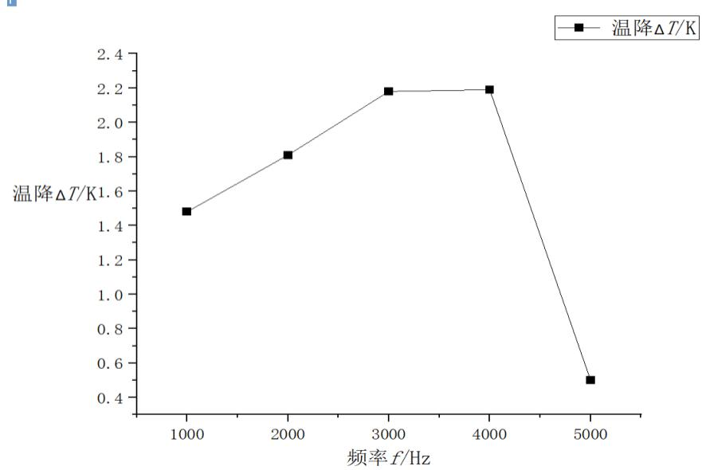  
图5-3 不同频率对双声源驻波热声制冷机的制冷效果图

由图5-3可知，随着工作频率的增加，回热器两端的温差逐渐增加，一旦超过截止频率4087.02Hz，温降会急剧下降，结论符合基本热声理论。

## 5.4 本章小结

本章分析了双声源驻波热声制冷机机在不同工况条件下的制冷效果。通过在不同的工质、压力驱动比与频率条件下双声源驻波热声制冷机的温降情况，得出以下结论：

在第三章、第四章的前提下，当工质为单原子惰性气体时，双声源驻波热声制冷机有更良好的制冷效果；当压力驱动比增大时，双声源驻波热声制冷机有更良好的制冷效果。

当双声源驻波热声制冷机的频率低于截止频率时，其制冷效果随频率的增大而增大，当超过截止频率时，双声源驻波热声制冷机的制冷效果会急剧下降。

## 第六章驻波热声制冷机调相电路设计与实验

本文的核心工作在于对驻波热声制冷机进行调相，其实现的重要手段之一就是通过调整双声源各自的输入电信号间的相位差实现对各声源所产生的声波信号间的相位差的控制。前文中已经使用多物理场仿真软件COMSOL模拟了驻波热声制冷机的两路声波信号间相位差对于其中声场的影响。本章将通过基础电路知识设计一个可实现的调相电路，用来为两个声源提供满足相位差要求的驱动信号，进而保证声源能在谐振管内产生满足相位差要求的声波信号。

## 6.1 调相电路的基本原理

电容和电感都是被动元件，在电路中起储存能量的作用，但方式不同。电容的作用是储存电场能，而电感的作用是储存磁场能。电容用于滤波、储能、耦合;电感用于滤波、储能、变压器等。调相是指相位调制，也就是通过改变信号的相位来传递信息的一种调制方式。电容和电感作为基本的电子元件，是调相主要参与元件。在调相电路中，电容或电感作为可变元件，通过改变它们的值来调整相位。比如使用变容二极管，其电容值随电压变化，从而改变电路的相位特性。或者使用可变电感器，但可变电感可能不太常见，所以可能更多是用电容的方式。例如在调相器的使用中，将调制信号加在变容的二极管上，使调相器的电容值随着调制信号一起变化。变容二极管作为振荡电路的一个组成部分，当电容发生变化时，振荡器的相位同样也会产生相应的变化，从而实现相位调制。但在一般的调相工作中，使用

LC、RC、RL谐振回路情况更为常见，当改变电容或电感值时，谐振频率会变化，从而导致相位响应的变化。同样的对于RC或RL电路来说，通过改变电阻、电容或电感的值来调整相移量。比如，如果有一个移相网络，其相移量由电容或电感控制，而调制信号控制这些元件的值，那么输出的相位就会被调制。

本文基于RLC谐振回路的移相特性展开研究，重点探讨电容与电感在交流电路中的相位调控机制。电容与电感作为储能元件，分别通过电场能和磁场能的动态转换实现相位偏移：电容两端的电压相位滞后电流 $9 0 ^ { \circ }$ ，而电感两端的电压相位超前电流 $9 0 ^ { \circ }$ 二者共同构成谐振回路的相位调控基础。具体而言，电容的移相过程表现为通电瞬间充电电流最大而端电压趋近于零，随着电荷累积，电流逐渐衰减至零，电压则升至电源最大值，形成完整的充电周期；若以电容电压为输出信号，则其滞后电流相差90°。反之，电感因自感电动势的阻碍效应呈现反向特性一一电路接通时端电压最大而电流趋近于零，随着磁场能量逐步积累，电流增长至峰值时电压降至最小值，最终输出超前电流90°的移相电压。这种相位互补特性是RLC谐振系统实现频率选择与能量振荡的核心物理机制。积分电路原理：

$$
U _ { _ i } = U _ { _ m } \sin \omega t\tag{6-1}
$$

$$
U _ { \mathrm { o } } = { \cfrac { 1 } { R C } } \int U _ { m } \sin \omega t \mathrm { d } t = { \cfrac { U _ { m } } { \omega R C } } \cos \omega t\tag{6-2}
$$

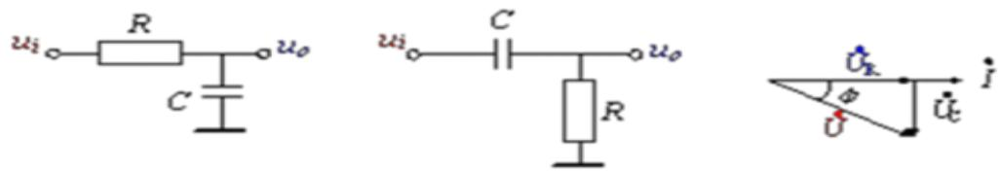  
图 6-1 RC的移相电路示意图

图6-1中与式（6-1）与（6-2）中的下标电压，表示图中各电位对应的电压， $U _ { m }$ 为交流电压的峰值，分别列出图 6-1 双图的节点电压方程：

$$
U _ { \mathrm { o } } = \frac { \displaystyle \frac { 1 } { \mathrm { j } \omega C } } { R + \displaystyle \frac { 1 } { \mathrm { j } \omega C } } U _ { i } = \frac { U _ { i } } { \sqrt { 1 + \left( \omega R C \right) ^ { 2 } } } \mathscr { L } - \tan ^ { - 1 } \omega R C\tag{6-3}
$$

$$
U _ { \mathrm { o } } = { \frac { \displaystyle { \frac { 1 } { \mathrm { j } \omega C } } } { R + { \frac { 1 } { \mathrm { j } \omega C } } } } U _ { i } = { \frac { U _ { i } } { \displaystyle { \sqrt { 1 + \left( { \frac { 1 } { \omega R C } } \right) ^ { 2 } } } } } { \mathcal { L } } - \tan ^ { - 1 } { \frac { 1 } { \omega R C } }\tag{6-4}
$$

由交流电压的向量算法可知，当R的大小改变角度φ会随之改变，由交流电的性质可知，若要使此电路具有调相功能，需要使输入电压与输出电压的有效值相等，则需要使用如图6-2电路：

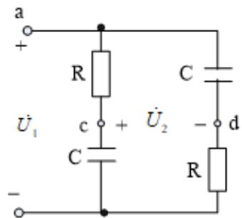  
图 6-2 幅值调节电路示意图

$$
U _ { 2 } = U _ { \mathrm { { c b } } } - U _ { \mathrm { { d b } } } = { \frac { \displaystyle { \frac { 1 } { \mathrm { j } \omega C } } } { R + { \frac { 1 } { \mathrm { j } \omega C } } } } U _ { 1 } - { \frac { R } { R + { \frac { 1 } { \mathrm { j } \omega C } } } } U _ { 1 } = { \frac { 1 - \mathrm { j } \omega R C } { 1 + \mathrm { j } \omega R C } } U _ { 1 }\tag{6-5}
$$

$$
= \frac { \sqrt { 1 + { \left( \omega R C \right) } ^ { 2 } } } { \sqrt { 1 + { \left( \omega R C \right) } ^ { 2 } } } U _ { 1 } \angle - 2 \mathrm { a c r } \tan \omega R C\tag{6-6}
$$

式（6-6）中：

$$
U _ { _ { 2 } } = \frac { \sqrt { 1 + \left( \omega R C \right) ^ { 2 } } } { \sqrt { 1 + \left( \omega R C \right) ^ { 2 } } } U _ { _ { 1 } }\tag{6-7}
$$

将上述RC电路与运算放大电路组成有源的移相电路如图6-3：

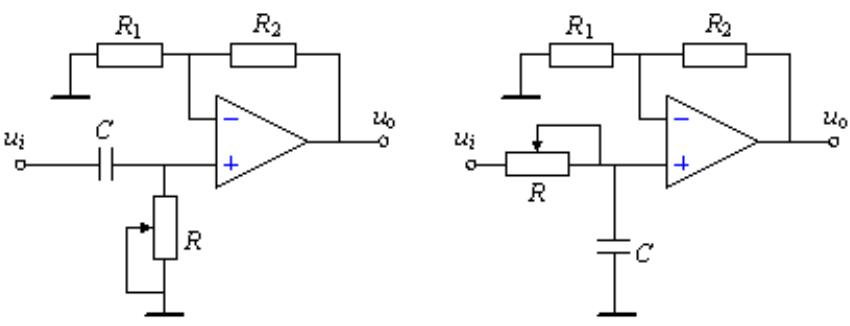  
图6-3 一般运算放大电路示意图

原理推导如下：

$$
U _ { _ { + } } = \frac { \mathrm { j } \omega R C } { 1 + \mathrm { j } \omega R C } U _ { i }\tag{6-8}
$$

$$
U _ { _ { - } } = \mathrm { k } U _ { _ { 0 } }\tag{6-9}
$$

$$
U _ { _ { - } } = U _ { _ { + } }\tag{6-10}
$$

$$
H { \bigl ( } { \mathrm { j } } \omega { \bigr ) } = { \frac { U _ { \circ } } { U _ { i } } } = { \frac { \omega ^ { 2 } R ^ { 2 } C ^ { 2 } + { \mathrm { j } } \omega R C } { { \mathrm { k } } { \bigl ( } 1 + \omega ^ { 2 } R ^ { 2 } C ^ { 2 } { \bigr ) } } }\tag{6-11}
$$

U、 $U _ { \mathrm { + } }$ 为运放正负端电压， $H ( \mathrm { j } \omega )$ 为该电路的传递函数。k为放大倍数。

以上电路级联，用电路仿真软件multisim仿真，得到电路如图6-4:

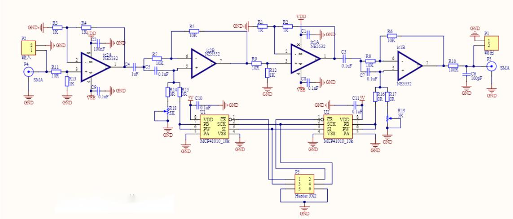  
图 6-4 基于 multisim 的移相电路仿真示意图

## 6.2 调相电路的实验设计

## 6.2.1 移项电路简介及设备参数介绍

移相电路是能够对信号波的相位进行移动的一种装置，本文设计的移相模块通过手动调模拟电位器可实现相位连续调节。模块集成两级移相电路，在一定频率下可以实现0°\~360°信号移相。默认配置下，2k\~10kHz可调移相范围为300度。模块默认每级放大2倍，两级总共放大4倍。为了检查所设计电路的移相效果，有必要对其进行一定实验验证。

在前述的对驻波双声源热声制冷机模拟仿真的气体工质条件下，通过上一章的相位差需求描述设计了图6-5所示的移相电路板。

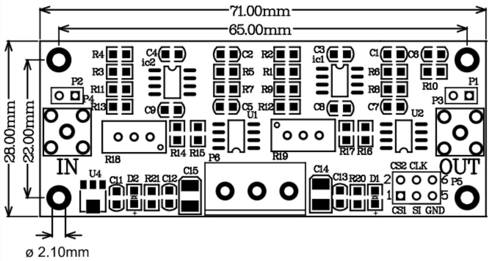  
图6-5移相电路板的结构与尺寸示意图

对于如上的移相电路板，它的模块供电为±5v-±9v，一般设置为±5v，模块工作电流为±8mA，模块的带宽为 20HZ-500KHz，调节方式主要为电位与程控调节，相位调节的范围为 $0 { - } 3 6 0 ^ { \circ }$ (具体范围根据模块的带宽有所不同)，其他参数及实物尺寸如图6-5。

调相范围与频率的关系如表6-1所示：  
表 6-1 移相电路范围
<table><tr><td>测试频率</td><td>输入幅值</td><td>始末相位</td><td>移相范围</td></tr><tr><td>20</td><td>1</td><td>290°-300°</td><td>10°</td></tr><tr><td>100</td><td>1</td><td>343°-50°</td><td>67°</td></tr><tr><td>500</td><td>1</td><td>230°-356°</td><td>234°</td></tr><tr><td>1000</td><td>1</td><td>0°-290°</td><td>290°</td></tr><tr><td>2000</td><td>1</td><td>0°-324°</td><td>324°</td></tr></table>

## 6.2.2 移项电路板接口说明

移项电路板实物如图6-6所示。

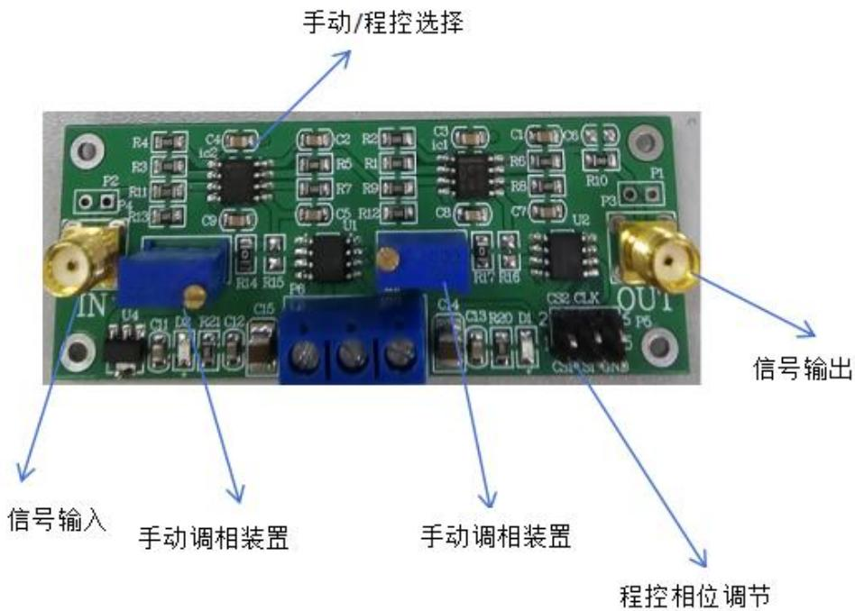  
图 6-6 移相电路接线图

此电路板存在两种模式，当需要手动电位器调节相位，需将R14，R16 电阻处焊接0Ω 电阻且R15,R16 电阻处无焊接。当需要程序控制调节相位时，需要将 R15,R16 电阻处焊接 0Ω 电阻且 R14,R1 电阻处无焊接。本次试验仅针对手动调节方式展开。

## 6.2.3 实验设备搭建

移相电路验证装置，主要由电源、引线、移项电路板、信号发生器与示波器组成，如图6-7。

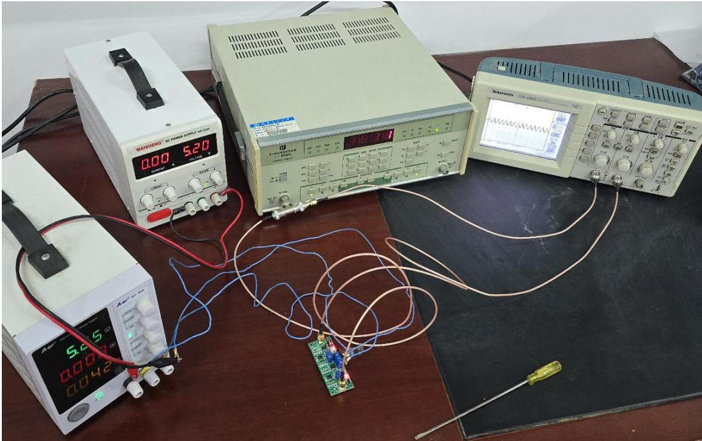  
图6-7 移相电路实物搭建示意图

使用直流电源供电，电压±5V，模块两个电源指示灯都正确点亮。使用 SMA 转 BNC 的线缆，用函数信号发生器输出频率 1KHz 幅度1Vpp的正弦波信号。该信号分作两路：一路作为参考信号直接接示波器通道一CH1，并将示波器信号源选择为CH1；另一路接移相模块输入接口，移相模块输出接入示波器通道二CH2。调节模块上的蓝色电位器即可改变输出信号的相位。

下面简单讨论实验装置中电源的连接方法。

在电子系统中，模块的正负电源供电机制本质上是基于参考电位（即"零电平"）的电压基准设定。正负5V电源的命名源于其相对于参考地的电势差，而参考地的定义具有灵活性一一既可以是物理接地的地球电位，也可根据电路设计要求人为设定为任意基准点。以直流电源为例，其通过正负极间0\~12V的可调电势差为电路提供能量，本文设计的移相电路采用5V直流电源时，通常将负极作为参考地(零电平)，此时正极相对于地的+5V构成正电源。若需获得负电源，可通过串联两个同规格5V电源并在中间连接点设定零电平，使得顶端输出+5V而底端形成-5V的负电源架构。这种双电源供电模式对特定功能电路至关重要，例如双电源运算放大器需同时接入±5v以支持其差分信号处理能力。此外，在需要生成以零电位为对称中心的正弦波信号时，正负电源可确保信号在正负半周实现对称摆动，避免单电源供电导致的直流偏置问题。该设计原理突显了参考地电位在电源系统设计中的核心调控作用。

只有两极输出的叫单电源，一个电瓶就是一个单电源，两个电瓶可以接成双电源，接法是：将一个电瓶的正极跟另一个电瓶的负极连接做地线(GND)，两个电瓶的另外两极做正负，组合成"正极-地线一负极"双电源，可以给需要双电源供电的功放或其它电器使用，如图6-8。

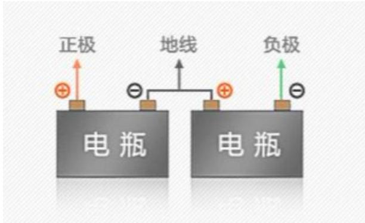  
图 6-8 双电源供电接线示意图

## 6.3 实验结果说明

在具体驻波热声制冷机双声源调相实验中，两端声源一般应用电起振的起振方式，即通过电信号的输入带动两端声源振动，形成两个驻波声波发生器。为了验证模拟中调相功能具有可操作性，以及进一步实验步骤的可行性，以前文的调相电路理论为基础，设计出一个与模拟过程中，调相过程作用相同的调相电路。通过示波器的显示结果佐证声波的调相的可操作性，以及后续研究工作的合理性。

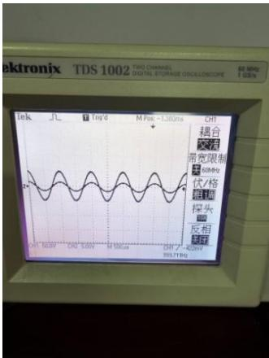  
(a)相位差为0度

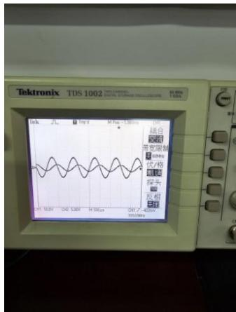  
(b)相位差为 90 度

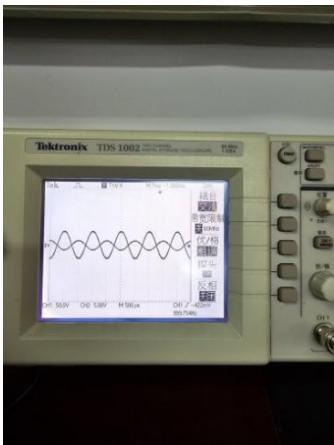  
(c) 相位差为 180 度  
图6-9 移相电路相位变化示意图

图6-9中，为了区分左右两声源发出声波（即信号波)，实验中对左右两列声波做了不同峰值的区分。从左到右分别为相位差从 $0 ^ { \circ }$ 到 $1 8 0 ^ { \circ }$ ，(a)图中两列声波的相差为 $0 ^ { \circ }$ ，波峰波谷基本重合，到（c）图可明显发现两列声波的波形相差 $1 8 0 ^ { \circ }$ 。基本符合前文中双声源驻波热声制冷机的调相范围。进一步论证了模拟结果的可行性。

## 6.4 本章小结

为了验证模拟的双声源驻波热声制冷机声场调相的可行性，本章设计了一个相关的实验调相电路，实现了信号波的调相工作。验证驻波热声制冷调相步骤的合理性，该调相电路的实现为后续进一步实验验证双声源驻波热声制冷机的调相性能提供一定的实验依据。

## 第七章 全文总结

## 7.1 全文总结

在今天，热声热机蓬勃发展，微电子、军工以及其他高端制冷行业都在逐步接受这一理论与技术。为了进一步了解这种易于集成、结构简单、损耗较小的制冷技术，本文对热声热机中的重要分支驻波热声制冷机中的双声源驻波热声制冷机的声场调相理论做了充分的阐述，也研究了关于双声源驻波热声制冷机在最佳声场中制冷效果的进一步优化。具体如下：

1、利用COMSOL建立了双声源驻波热声制冷机的模型，研究了双声源驻波热声制冷机在两端声源相位不同情况下的谐振管内声场分布，得到最适合双声源驻波热声制冷机的声场分布与波形。结果证实了当两端声波相位差为 $9 0 ^ { \circ } |$ 时，能够得到最适合1/4波长驻波热声制冷机的声场波形。

2、通过基本的热力学知识推导出双声源驻波热声制冷机中板叠位置与其制冷效果的关系，并通过仿真模拟得到了双声源驻波热声制冷机中最佳的板叠位置，进一步优化了在最佳声场条件下双声源驻波热声制冷机的制冷效果。

3、在前面的研究基础上，通过改变双声源驻波热声制冷机的气体工质与压力驱动比进一步探究双声源驻波热声制冷机的制冷效果优化，结果表明：在单原子惰性气体工质（例如：氦气）以及较大的压力驱动比的情况下，双声源驻波热声制冷机的制冷效果更好。

4、通过扫频分析得到在截止频率以内增大频率可以提升驻波热声制冷机的制冷效果，一旦超过截止频率则驻波热声制冷机的制冷效果会急剧下降的结果。

5、设计并搭建了信号波调相装置，验证了模拟结果中调相步骤的可操作性，为后续的工作开展提供了一定的事实依据。

## 7.2 未来展望

本文的主要目的在于讨论双声源驻波热声制冷机的双驱动源间相位差对于其中声场的影响，并在此基础上对制冷效果的优化展开了仿真研究。虽取得一定的成果，仍有以下不足：

1、对于双声源驻波热声制冷机中谐振管与板叠的形状及材料没有过多研究。事实上，板叠的类型多种多样，它的形状和材质都对制冷效果都有较大影响。

2、本文仅仅借助温差来表示双声源驻波热声制冷的制冷效果，缺少对于制冷速度与性能系数COP的分析。

因此，未来的研究工作可以从以上两方面入手，完善研究内容、弥补不足。

## 参考文献

[1]饶伟.热声热机设计及实验研究[D].广州：华南理工大学,2017.

[2]陈浩.双声源热声制冷机的理论与实验研究[D].武汉：武汉工程大学,2016.

[3] Putnam A A ,Dennis W R. A study of burner oscillations of the organ-pipe type[J]. Trans ASME,1953,75(1):15-28.

[4] P.L.Rijke. Notiz ǚber eine neuc Art, die in einer an beiden Enden offenen Rǒhre enthaltene Luft in Schwingungen zu versetzen Ann Phys(Leipzig) [J].annalender physic, 1859,107:339.

[5] Sondhauss C . Ueber das Tönen erhitzter Röhren und die Schwingungen der Luft in Pfeifen von verschiedener Gestalt[J]. Annalen Der Physik,1870,216(5):53-76.

[6] Rayleigh Lord. The theory of sound ∥ 2nd edition [M]. NewYork:Dover Press,1945.

[7] K.W.Taconis, J.J.M. Beenakker, A.O.C.Nier, L.T.Aldrich Measurements concerning the vapour-liquid equilibrum of solutions of He³ in He⁴ below 2.19° C[J].Physica 1949, 15(8) :733-739.

[8] Ward W C, Swift G W. Design environment for low-amplitude thermoacoustic engines[J]. Journal of the Acoustical Society of America,1993,95(6):3671-3672.

[9] Wheatley J, Hofler T, Swift G W, et al. Understanding some simple phenomena in thermoacoustics with applications to acoustical heat engines[J]. American Journal of Physics, 1985,53(2) :147-162.

[10] Rott N. Damped and thermally driven acoustic oscillations in wide and narrow tubes. [J] Z. Angew. Math. Phys. 1969 (20) : 230-243.

[11] Radebaugh R . A review of pulse tube refrigeration[M] Springer US : Advances in Cryogenic Engineering,1990.

[12]Swift G W. Analysis and performance of a large thermoacoustic engine[J]. Journal of the Acoustical Society of America, 1992, 92(3):1551-1563.

[13]Swift G W, Gardner D L, Backhaus S. Acoustic recovery of lost power in pulse tube refrigerators[J]. Journal of the Acoustical Society of America, 1999, 105(2): 711-724.

[14]Tijani M E H , Spoelstra S . Study of a coaxial thermoacoustic-Stirling cooler[J]. Cryogenics, 2008, 48(1-2) :77-82.

[15]Bassem M M , Ueda Y , Akisawa A . Design and construction of a traveling wave thermoacoustic refrigerator[J]. International Journal of Refrigeration, 2011, 34(4):1125-1131.

[16]Kruse A, Ruziewicz A, Tajmar M, Gnutek Z. A numerical study of a looped-tube thermoacoustic engine with a single-stage for utilization of low-grade heat[J].Energy Conversion and Managemnegt,2017,149:206-218.

[17]Senga M,Hasegawa S.Energy conversion of thermoacoustic engine with evaporation and condensation[J].International Journal of Heat and Mass 2021, 165: 120-385.

[16]Xiao J H. Thermoacoustic theory for cyclic flow regenerators. Part I: fundamentals[J]. Cryogenics, 1992, 32(10):895-901.

[19]罗二仓，戴维，吴张华，等．交变流动热机的介观热力循环理论第一部分:制冷机回热器的介观热力循环模型及分析[J]． 低温工程,2004,137:1-11.

[20] Watanabe M, Prosperetti A, Yuan H. A simplified model for linear and nonlinear processes in thermoacoustic prime movers. Part I. Model and linear theory[J]. Journal of the Acoustical Society of America, 1997,102(6):3484-3496.

[21]邱利民．热声驱动脉管制冷机的实验研究[J].低温工程,2000(6):1-6.

[22]Jin T ,Chen G B ,Shen Y.A thermoacoustically driven pulse tube refrigerator capable of working below 120 K[J]. Cryogenics, 2001, 41(8):595-601.

[23]Sun D,Qiu L,Zhang W,et al.Investigation on traveling wave thermoacoustic heat engine with high pressure amplitude[J]. Energy Conversion and Management,2005,46(2):281-291.

[24]J.A.Lycklama à Nijeholt,M.E.H.Tijani.Simulation of a traveling-wave thermoacoustic engine using computational fluid dynamics[J].Journal of the Acoustical Society of America,2005,118(4) :2265-2270.

[25]Yu G Y, Luo E C, Dai W, et al. Study of nonlinear processes of a large experimental thermoacoustic-Stirling heat engine by using computational fluid dynamics[J]. Journal of Applied Physics,2007,102(7):074901-074901-7.

[26]田世城.谐振管几何参数对双级行波热声热机性能影响的模拟与实验研究[D].广州：华南理工大学,2017.

[27]孙宏权，张浩，李新艳，等.轴向分布热源激励下的Rijke型热声不稳定性的仿真研究[J].火箭推进,2025,51(01):168-176.

[28]景晓东.碳纳米管热声换能器研究[D].哈尔滨：哈尔滨工程大学,2024.

[29]Gyarmati I.Nonequilibrium Thermodynamics[M].New York:Verlag, 1970.

[30]房颐，宋峰.热声热机[J].现代物理知识,2021,33(01):50-52.

[31]Ingard K U.Fundamentals of Wave and Oscillations [M].Cambridge:MIT Press,1989.

[32]Sole R V.Spiral Waves,chaos and Multiple Attractors in Lattice Models of Interacting Populations. [J] Phys.Lett, 1992, A166.

[33]诺.维纳.控制论[M].北京:科技出版社，1978.

[34]董凯军，罗运文．热声热机及其应用[J].热能动力工程,2000,(02):100-103+193.

[35]汪建新，李东，阚小美，等.驻波型热声制冷机板叠温度分布的研究[J].流体机械,2018,46(3):68-71.

[36]王佳微.提高微型制冷机谐振腔内声场强度的实验研究[D].呼和浩特：内蒙古科技大学，2022.

[37]古小玲，肖星，张晓青.驻波热声制冷机分层回热器的特性研究[J].低温工程,2020(1):13-18.

[38]李萍，吴张华，张丽敏，等.室温温区热驱动热声制冷机研究[J].工程热物理学报,2023,44(9):2369 -2375.

[39]周立华，谢秀娟，李雷，等.双声源驱动热声系统声场调制研究[J].工程热物理学报,2012,33(1):27-31.

[40]李林玉，吴张华，徐静远，等.电机调相式热声制冷机研究[J].工程热物理学报,2016,37(03):459-465.

[41]于文鑫，丁艳春，汪建新.双侧激励源对热声制冷谐振腔内声场分布的影响[J].科学技术与工程,2017,17(20):134-138.

[42]孙铭阳.行驻波热声制冷系统的实验与模拟研究[D].北京：华北电力大学(北京),2024.

[43]郭方中，李青.热动力学[M].武汉:华中科技大学出版社,2007.

[44]肖星.声波散热机理研究[M].武汉:华中科技大学,2022.

[45]许肖梅．声学基础[M]．科学出版社,2003.

[46]王晓莲.热声制冷机谐振腔内声场分布规律的研究与应用[D].呼和浩特：内蒙古科技大学，2019.

[47]舒安庆． 热声机理及双声源热声制冷机的研究[D].武汉:武汉理工大学,2019.

[48]丁琦．5000Hz级热声制冷样机的研究与设计[D].南京:东南大学,2017.

[49]高岗，谢秀娟，李青，等.驻波型热声制冷机回热器的结构优化[J].北京理工大学学报,2011,31(12):1391-1395.

[50]RAYLEIGH. The Theory Of Sound[M]. London:Cambridge University Press,1929.

[51]Swift G W.Thermoacoustics:a unifying perspective for some engines and refrigerators[M]. New York: wiley,2002.

[52]Swift G W.Thermoacoustics engines[J].J Acoust Soc Am, 1988,84:1145-1180.

[53]ROTT. N. ZOUZOULAS G.Thermally driven acoustic oscillations.Part IV:Tubes with Variable cross Section[J].Zeitschrift Fur Angewendte Mathematik and Physik, 1976,27:197-224.

[54]ROTT.N.Thermoacoustics[J].Advances in Applied

Mechanics,1980,20:135-175.

[55]Swift G W. Analysis and performance of a large thermoacoustic engine[J]. The Journal of the Acoustical Society of America.1992,92(3): 1551-1563.

[56]Swift G W.Garrett S L.Thermoacoustics: A Unifying Perspective for Some Engines and Refrigerators. [J] The Journal of the Acoustical Society of America,2003,113(5):2379.