分类号： TB61密级： 公开

U DC : 学校代码： 10127

# 硕士学位论文

## 论文题目：提高微型制冷机谐振腔内声场强度的实验研究

## 英文题目： Experimental Research on Improving the Sound FieldIntensity in the Resonant Cavity of a Micro-refrigerator

学位类别： 工学硕士学位

研究生姓名：王佳微学号：2019023100

学科(领域)名称： 机械工程

指导教师：汪建新职称： 教授

2022年6月10日

## 摘 要

热声制冷机是一种绿色环保、结构简单的新型制冷装置，符合新能源多元化的发展趋势，是未来微电子元器件、微型医疗器械等装置散热、冷却的研究热点。热声制冷机是基于热声效应原理实现热量搬移的制冷设备，但目前主要存在制冷效率低、制冷量不足等问题，已有的研究表明，声场强度（声压）越高、质点位移越大，制冷效率越高，制冷效果越好，要提高热声制冷机制冷效率，就需要有强烈的气体交变流动，而以往的声驱动器存在振幅过小，驱动力不足等问题，提供的声能无法满足工质气体强烈的交变流动，进而不能满足制冷机对温降的需求。因此，针对这一问题，本文进行了以下研究工作：

（1）提出用气柱的活塞模态振动代替驻波振动这一思想，用气柱的活塞模态振动代替驻波振动可以提高谐振腔内气柱的纵向振幅，进而提高谐振腔内工质气体交变流动的强度，而气柱的活塞模态振动具有与驻波相同的性质，都是纵向振动有稳定的速度节点与压力节点，和其他声驱动器热声制冷机一样，只要有相同的气体工质，把板叠放到适当的压力波腹与与速度波腹之间就可以实现热量搬移，进而实现更高效的制冷效率。

（3）运用仿真软件ANSYS对长600mm，直径100mm，壁厚5mm谐振腔内的气柱进行了自由模态分析，找出最佳激励频率，使谐振谐振腔内的声压幅值增大，提高热声转换效率，为后续的实验研究提供了基础。

（4）对制冷机中一些关键热声元件进行了优化设计，并搭建了热声制冷机实验装置。根据仿真结果对热声制冷机谐振腔内的声场强度、制冷效果进行了实验研究。包括不同工况下对谐振腔轴向各个位置的声压值影响，以及不同条件对热声堆两端的温差的影响，实验结果验证了用气柱的活塞模态振动代替驻波振动在基频的驱动下的确可以提高制冷机谐振腔内的声场强度，有利于提高制冷机的制冷效果。

关键词：热声制冷机；声驱动器；声场强度；活塞模态振动

## Abstract

Thermoacoustic refrigerator is a new type of refrigeration device with green environmental protection and simple structure, which is in line with the development trend of new energy diversification. Thermoacoustic refrigerators are refrigeration equipment that realizes heat transfer based on the principle of thermoacoustic effect. However, at present, there are mainly problems such as low refrigeration efficiency and insufficient refrigeration capacity. Existing studies have shown that the higher the sound field intensity (sound pressure), the larger the particle displacement. The higher the cooling efficiency, the better the cooling effect. To improve the cooling efficiency of the thermoacoustic refrigerator, a strong alternating flow of gas is required, and the previous acoustic drivers have problems such as too small amplitude and insufficient driving force. The strong alternating flow of the working medium gas cannot be met, and thus the temperature drop requirement of the refrigerator cannot be met. Therefore, in response to this problem, the following research work is carried out in this paper:

(1) The idea of replacing standing wave vibration with piston modal vibration of gas column is proposed. Using piston modal vibration of gas column instead of standing wave vibration can improve the longitudinal amplitude of the gas column in the resonant cavity, and then improve the working medium gas in the resonant cavity. The strength of the alternating flow, and the modal vibration of the piston of the gas column has the same properties as the standing wave, both of which are longitudinal vibrations with stable velocity nodes and pressure nodes, like other acoustic drive thermoacoustic refrigerators, as long as there is the same gas The heat transfer can be achieved by stacking the plates between the appropriate pressure anti-node and velocity anti-node, thereby achieving more efficient cooling efficiency.

(2) This paper uses the high-speed motor to drive the crank-slider mechanism to push the vibrating thin plate to realize high-frequency and large-amplitude vibration, and then realize the idea of strong alternating flow of the working medium gas in the thermoacoustic refrigerator. The large-amplitude piston-type acoustic driver meets the needs of a

thermoacoustic refrigerator for a powerful sound source.

(3) Using the simulation software ANSYS, the free modal analysis was carried out on the air column in the resonant cavity with a length of 600mm, a diameter of 100mm and a wall thickness of 5mm, and the optimal excitation frequency was found to increase the amplitude of the sound pressure in the resonant cavity and improve the thermoacoustic conversion efficiency. It provides a basis for subsequent experimental research.

(4) The optimized design of some key thermoacoustic components in the refrigerator is carried out, and the experimental device of the thermoacoustic refrigerator is built. According to the simulation results, the sound field strength and cooling effect in the resonant cavity of the thermoacoustic refrigerator are experimentally studied. Including the influence of the sound pressure value on each position of the resonator axial direction under different working conditions. As well as the influence of different conditions on the temperature difference between the two ends of the thermoacoustic reactor, the experimental results verify that the use of the piston modal vibration of the gas column instead of the standing wave vibration can indeed improve the sound field strength in the refrigerator resonant cavity under the driving of the fundamental frequency, which is beneficial to improve the The cooling effect of the refrigerator.

Key words: Thermoacoustic refrigerator; Sound driver; The intensity of sound field; Piston modal vibration

## 目 录

摘要....  
Abstract ... , II  
1 绪论....  
1.1 课题研究背景及意义...  
1.2 热声机理的理论探索..  
1.2.1 热声效应的发现.. ..2  
1.2.2 热声理论的研究与进展.  
1.3 热声制冷技术的国内外研究进展..  
1.3.1 国外热声制冷技术的研究进展..  
1.3.2 国内热声制冷技术的研究进展... ...8  
1.4 热声制冷装置工程化发展面临的的问题... ...10  
1.5 本文主要研究工作. ...11  
2 热声制冷效应的理论基础.. ....12  
2.1 热声制冷效应的声学理论基础. ....12  
2.1.1 热声效应中的基本声学量.. ....12  
2.1.2 基本热声方程.... ....3  
2.1.3 声场中的能量关系. ....4  
2.1.4 热声装置中的声波特性. ....5  
2.2 热声制冷效应中的热力学基础.. .....6  
2.3 热声制冷机的工作原理与基本性能参数... ....18  
2.3.1 热声制冷机的工作原理... ...18  
2.3.2 热声制冷机的基本性能参数.. ....20  
2.4 圆形平面活塞辐射特性分析.. ....211  
2.4.1 圆形活塞辐射器的辐射阻抗. ....21  
2.4.2 圆形活塞辐射器近场特性分析.. ....3  
2.5 本章小结..... ....24  
3 一种大振幅活塞式声驱动器的设计与研究. ..25  
3.1 活塞式声驱动器基本要求与设计思想. ...25  
3.2 活塞式声驱动器的工作原理与运动学分析... ...5  
3.2.1 活塞式声驱动器的工作原理... ..25  
3.2.2 活塞式声驱动器的运动学分析.... ...26  
3.3 影响惯性力的因素和降低惯性力的对策.. ...28  
3.3.1 驱动机构惯性力的分析... ...8  
3.3.2 驱动机构惯性力的降低.. ..29  
3.4 声驱动器各零部件的设计. ....1  
3.4.1 曲轴的设计.... ...32  
3.4.2 轴承座的设计... ...3  
3.4.3 连杆的设计... ...33  
3.4.4 柔性铰链的设计.. ...4  
3.4.5 活塞振动薄板的设计... ...5  
3.5 本章小结.... ...7  
4 热声制冷装置的搭建与谐振腔内气柱的模态分析... ...38  
4.1 工质气体工况参数的选择.... ...8  
4.2 板叠的设计… ..9  
4.3 谐振管尺寸调节装置的设计.. ...41  
4.4 谐振腔内气柱的模态分析.. ...43  
4.4.1 模型的建立... ...43  
4.4.2 计算结果及分析... ..44  
4.5 本章小结.. ...45  
5 大振幅热声制冷机的实验研究.. ...47  
5.1 实验采集系统.... ....47  
5.2 实验注意事项... ..49  
5.3 谐振腔内声压值的测量... ..49  
5.3.1 声压测点的分布.... ...49  
5.3.2 实验结果与分析. ....50  
5.4 制冷效果的实验研究... .....57  
5.4.1 温度数据采集及分析... .....558  
5.5 本章总结.. ....60  
6 结论与展望.... .……61  
6.1 结论.. …..61  
6.2 展望... .……61  
参考文献... .....62  
在学研究成果.... ....67  
致谢... .....68

## 1 绪论

## 1.1 课题研究背景及意义

热声制冷技术是当今制冷研究的一个重要领域，它是利用热声效应原理来实现制冷的。如今随着医疗技术、生物科技、航空航天、红外遥感技术、信息科技电子技术的迅速发展，各种应用场合对制冷机的体积、稳定性、寿命、制冷效率等方面提出了很高的要求，而传统的制冷设备如热管、热沉、空调以及风扇等已经不能满足这些需求，所以发展一种绿色环保、结构简单、效率高、体积小、寿命长的新型冷却器，成为了制冷行业当下一项重要的任务。多年来，研究者们在新型制冷设备的研发与制冷设备关键部件的优化方面做出了很多努力，也取得了很大的成果，比如吉福特一麦克马洪循环制冷机（G一M）和斯特林循环制冷机（Stirling）在空间技术和现代工业中的广泛应用[1\~3]，长寿命分置式斯特林制冷机和脉冲管制冷机等新型制冷技术取得的重要成果。上述制冷机都存在结构部件多、部件磨损大、稳定性低、寿命短等缺点，而基于热声效应的热声制冷机却能够很好地适应这一发展要求，与传统制冷设备相比，热声制冷机具备许多独有的优点，主要体现在：（1）结构简单，几乎无运动部件，避免了有运动部件带来的磨损与维修问题，使其运行稳定，增加了使用寿命；（2）绿色环保无污染，采用氮气、氦气等惰性气体作为工质，避免了传统制冷设备中的有害工质对环境的污染与破坏；（3）节省能源，如果利用太阳能、生物能（沼气）、地热能等为热声发动机提供热源，获得声功来驱动制冷机，可以有效的减少对矿物能源的使用；（4）体积小、制作成本低，通过增大热声制冷装置的工作频率，就能够实现制冷装置的小型化其至微型化，有利于微电子元器件、半导体芯片的冷却[4\~6]。

热声制冷机的声驱动器各式各样，主要有热声发动机、换能器、扬声器等，但这些声驱动器均不同程度地存在动力不足和辐射效率偏低等情况，比如传统的商用扬声器电声转化效率不高、振幅过小，导致谐振腔内介质运动远远达不到强烈交变流动的效果，而磁致伸缩换能器虽然可以同时满足高频率和大振幅的要求，但磁致伸缩换能器的核心元件磁致伸缩棒会在高频状态产生涡流效应导致磁致伸缩棒发热影响其性能[7\~9]，而且在超高频状态下工作，激发出的声波会出现非线性效应并且伴随着高次谐波的产生，导致的交变流动不在纯粹，不利于热声效应的产生[10,11]，而利用气柱的活塞模态振动代替驻波振动可以避免这些问题，首先气柱的活塞模态振动具有与驻波相同的性质，都是纵向振动有稳定的速度节点与压力节点，与其他声驱动器驱动的热声制冷机一样，只要有相同的气体工质，把板叠放到适当的压力波腹与与速度波腹之间，就可以实现热量搬移，其次气柱的活塞模态振动相比驻波位移更大，制冷效果会更好。因此，针对这一想法，开发出一种不但能够满足高频率、大振幅且廉价且性能稳定的声驱动器具有重要意义。

## 1.2 热声机理的理论探索

## 1.2.1 热声效应的发现

热声效应是指处于声场的可压缩性流体与固体介质之间发生的时均能流效应，被广泛应用在热声发动机和热声制冷机两大领域。

1777年，Higgins[12]将可燃性气体氢气产生的火焰放置于两端开口的空管下方时，管子中会激发出类似风琴的声音，这就是著名的“歌焰现象”，这也是人类第一次发现热声效应。

1850年，Sondhauss致力于研究一端封闭而另一端开口的管子发声这一现象，发现管长与音调规律的关系，后来将热声振荡管称之为“Sondhauss”管[13]，如图1.1所示，Sondhauss管可以说是驻波型热声发动机的雏形。

1859年，Rijke在他的实验研究中发现：将加热丝网放置于两端开口的空管时，空管会有激烈的声振荡，而将加热丝网放置在距离管末端四分之一管长的部分时，声振荡最为激烈，但不是纯音。如图1.2所示[14]。

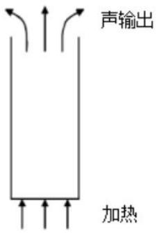  
图 1.1 Sondhauss 管

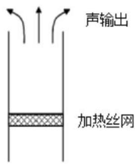  
图 1.2 Rijke 管

1949年，Taconis[15]将一根管子封闭的一端置于室温中，开口的一端接触低温液体表面，发现管中会产生声振荡现象，后被称之为低温界的Taconis振荡，如图1.3所示，该发现对如何预防低温系统中振荡现象具有极大的意义。Taconis振荡正式开

启了热声效应的研究之旅。

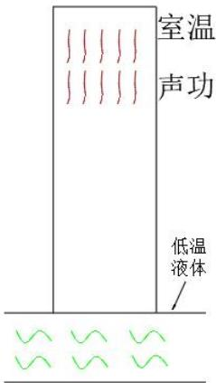  
图 1.3 Taconis 振荡

声制冷效应的发现相比于热致声效应的发现晚一点，在1975年，P.Merkli和H.Thomann第一次发现：在一端有活塞振动激励的驻波谐振管中，会出现管的两端温度较高，中间温度较低的现象，这一发现是声制冷效应的开端[16]。

## 1.2.2 热声理论的研究与进展

## （1）Rayleigh 准则

Rayleigh首次定性的解释了热声振荡现象，阐述了热能与声能之间的相互转换条件。Rayleigh准则可简单的描述为如果对可压缩性振荡工质周期性的供热和吸热时，当热声系统内气体工质受到最大压缩（最稠密）时向其进行加热，或气体工质受到最大膨胀（最稀疏）时向其降温，声振动就会增强，而热声系统内气体工质受到最大压缩时向其进行降温，最大膨胀时向其加热，声振动就会被削弱。换句话说，外界需向气体工质持续提供热量且热量波动与气体压力波动之间存在合适的相位差，就可以使得管内气体工质完成一种周期性的热力循环，进而激发出管中有规律、稳定的的声振荡[1]。

Rayleigh准则判断的数学阐述：如果以 $\tilde { \varrho }$ 表示热量波动， $\widetilde P$ 表示压力波动，当它们之间相位差为锐角时，即 $\left| \theta _ { \widetilde { Q } } - \theta _ { \widetilde { P } } \right| < \frac { \pi } { 2 }$ ，供热使声振荡加强；若为钝角时，既$\frac { \pi } { 2 } < \left| \theta _ { \widetilde { Q } } - \theta _ { \widetilde { P } } \right| < \pi$ ，则供热使声振荡减弱[17,18]。

## (2） 交变流动理论

在声波的扰动下，谐振腔内的气体微团在回热器中是交变流动的，导致气团的压力与流速互相影响。1973年，Kim虽然在他的实验报告中给出了气体工质压力差与体积流速之间存在相位关系，但没有给出具体的解释[12]。

## （3）Ceperley的回热器相移模型

Ceperley是第一位考虑将热声现象引入回热器的研究者，回热器相移模型是指振荡的气体工质在回热器中调制出的声波与热波之间存在相位差。他通过实验建立了Ceperley的相移理论[19]，将扬声器激发出的声波作为能量源，回热器出、入口两端的声功率比作为目标函数，并在两端建立起了温差，则输出声功可用出、入口两端的温度和输入声功率表示为：

$$
\mathrm { W _ { o u t } = \frac { T _ { o u t } } { T _ { i n } } \cdot W _ { i n } }\tag{式1.1}
$$

式中， $\mathrm { W _ { o u t } }$ 回热器出口端的声功率， $\mathrm { W _ { i n } }$ 是回热器入口端的声功率， $\mathrm { T _ { i n } }$ 为回热器入口处的温度， $\mathrm { T _ { o u t } }$ 为回热器出口处的温度。Ceperley的实验结论表明了回热器是热声效应原理中热能与声能相互转换的一个转换元件，通过实现热能与声能的互相转换可形成热声制冷机和热声发动机两种不同的热声系统，但Ceperley的相移理论具有局限性，不能分析不同填料对于回热器性能的影响[20,21]。

## （4）N.Rott的线性热声理论

N.Rott建立了理想工质下的驻波型声场数学模型，阐述了热声效应中热能与声能之间的互换关系，进而形成了基本的线性热声理论，并给出Rott波动方程：

$$
\begin{array} { r } { \left( 1 + \frac { ( \gamma - 1 ) \mathrm { f } _ { \mathrm { k } } } { 1 + \varepsilon _ { \delta } } \right) \mathsf { p } _ { 1 } + \frac { \mathsf { \rho } _ { \mathrm { m } } a ^ { 2 } } { \omega ^ { 2 } } \frac { \mathrm { d } } { \mathrm { d } \chi } \left( \frac { 1 - \mathrm { f } _ { \mathrm { v } } } { \mathsf { \rho } _ { \mathrm { m } } } \frac { \mathrm { d } \mathsf { p } _ { 1 } } { \mathrm { d } \chi } \right) - \mathsf { \beta } \frac { a ^ { 2 } } { \omega ^ { 2 } } \frac { \mathrm { f } _ { \mathrm { k } } - \mathrm { f } _ { \mathrm { v } } } { ( 1 - \alpha ) ( 1 + \varepsilon _ { \delta } ) } \frac { \mathrm { d } \mathrm { T } _ { \mathrm { m } } } { \mathrm { d } \chi } \frac { \mathrm { d } \mathsf { p } _ { 1 } } { \mathrm { d } \chi } = 0 } \end{array}\tag{式1.2}
$$

式中， $\mathrm { { T } _ { m } }$ 为平均温度， $\mathsf { P } _ { 1 }$ 为压力振幅，γ为定压比热和定容比热之比，a为声速， $\sigma$ 为普朗特数， $\omega$ 为角频率， $\rho _ { \mathrm { m } }$ 为工质平均密度， $\mathrm { f _ { v } }$ 为粘滞函数， $\mathrm { f _ { k } }$ 为热函数。Rott的线性热声数学模型第一次定量的描述了热声现象，对热声理论发展具有重要意义，可以说是热声理论发展的里程碑[22]。

国内对热声理论的研究始于20世纪80年代后期，中国科学院的肖家华教授首先展开其探索，他根据N.Rott的线性热声理论模型，将热声效应分为一般、等温以及绝热三种情形，并把热声理论建立在回热器的多孔介质上，推理出等温与绝热情况下热声效应的波动方程[23\~25]。肖家华一般声场理论，进一步丰富、发展了N.Rott的线性热声理论。

华中科技大学的郭方中教授应用热动力学知识继续对回热器深入研究，探索热声转换的本质，对回热器填充物内提出阻、感、容、源等概念，提出热声理论与网络模型相结合的方法，建立起回热器有源热声网络模型，该网络模型对热声系统的理论计算以及回热器的优化设计具有很重要的意义。同期，华中科技大学低温室的张晓青教授还开发出一种集总参数热声热机系统的热声网络模拟软件TAnetwork，可以对热声系统中基本性能参数做出预测[26\~28]。

中国科院理化所研究中心一直致力于气体工质交变流动的研究与探索，其中罗二仓教授带领的团队提出了热声交变流动理论，用于研究热声系统内部工作机理，并对热声驱动脉管制冷机的机理和性能做出了详细研究[29]。

武汉工程大学吴锋等人在辛对称的基础上将传输矩阵转化为阻抗矩阵，利用瑞利商式分析了热声系统各部件的最小本征阻抗。

华中理工大学邓晓辉通过对热声理论以及有源热声网络模型的分析，考虑了回热器多孔流道的影响，建立了回热式不等温回热器的网络模型，推动了回热式回热器在实际工程中应用[30,31]。

## 1.3 热声制冷技术的国内外研究进展

## 1.3.1 国外热声制冷技术的研究进展

1986年，Hofler设计出一台四分之一波长的驻波型热声制冷样机[32]，由动圈式扬声器作为动力源，选择氦气与其它惰性混合气体作为工质，在环境温度为 $2 0 ^ { \circ } \mathrm { C } .$ ，工作压力为一个标准大气压，驱动压比为0.03，输入功率为10W，激励频率为500Hz的环境下，可获得193K的制冷温度。

1990年，G.w.swift与他们的团队成功研制出真正意义上无任何运动部件的小孔型脉管制冷机，该制冷机由热效率0.3的热声发动机驱动，如图1.4所示。当热声发动机可激发出频率27Hz、压比1.1的声波时，可获得最大制冷温度为-183.15℃[33]，极具有开创性的一项成果。

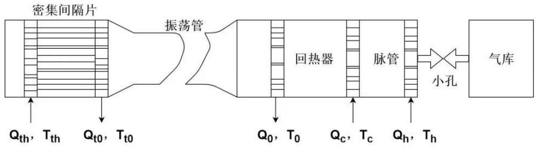  
图1.4 无运动部件的小孔型脉管制冷机

1992年，S.Garrett等人[34]研发出一部1/4波长热声制冷机（STAR），被应用于太空“发现号”的航天飞机上，如图1.5所示，选择的工质为97%氦和3%氙组成的混合气体，在标准气压、驱动频率为400Hz的工况下，产生将近80K的温差，3W的制冷量，相对卡诺效率COPR达到了16%，这也是热声制冷机首次被应用于太空领域。

1995年，S.Garrett教授所在的热声研究团队又成功地研发出一台双声源驱动的半波长热声制冷机（SETAC），该制冷机具有两个回热器，四个换热器，被应用于海军舰船上电子系统的冷却[20,35]，如图1.6所示，该制冷机的制冷能力要远超他们之前研究的 STAR型制冷机，制冷效率大约是先前 STAR型制冷机的100倍，该制冷机以94%的氦气和6%的氩气的混合气体作为工质，在工作频率为320Hz，工作压力为标准大气压两倍的工况下，可获得的最大制冷功率为419W。

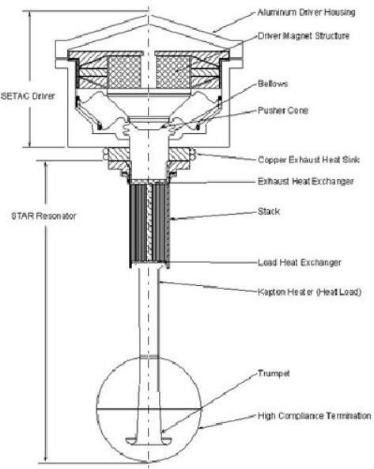  
图 1.5 STAR 型号热声制冷机

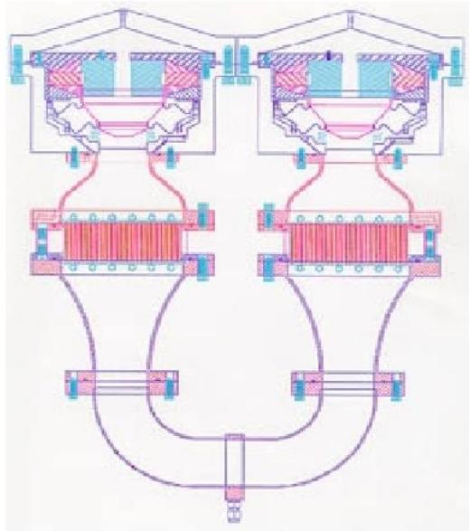  
图 1.6 SETAC 型号热声制冷机

美国海军研究院的J.A.Adeff和 T.Hofler 研制出一台太阳能为热源驱动的热声制冷机，如图1.7所示。该制冷机的太阳能聚集镜直径为457mm，焦距610mm，可以向热声发动机提供100W的热能，而制冷机可获得2.5W的制冷量，冷端温降为 $5 \%$ 制冷温差为 $1 8 ^ { \circ } \mathrm { C } ^ { [ 3 6 ] }$ 。在2001\~2003年期间，该研究所又致力于提高热流密度的研究，以热声谐振系统为出发点，设计了一套新型制冷机，冷端温降可达 $7 ^ { \circ } \mathrm { C } .$ 左右。

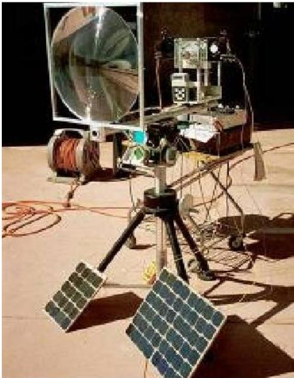  
图1.7 太阳能为热源驱动的热声制冷机

2004年，美国宾州大学制冷团队设计出一台同轴行波型热声制冷机，由电动扬声器驱动，被应用于实际生活中，这台制冷机可达到 $- 2 4 . 5 ^ { \circ } \mathrm { C }$ 的最低制冷温度，并能产生100多瓦的制冷量，相对卡诺效率达到81%，成为了Ben&Jerry公司冷藏冰激凌的新型制冷设备[37]。

2004年，美国Utah大学物理系团队研制出了一台大小约4cm，频率4.5kHz的高频热声制冷样机[38]，压电扬声器为驱动器，选择以空气作为工质气体，在常温、常压的环境下，制冷温差可达到 $1 1 ^ { \circ } \mathrm { C }$

2000年，荷兰埃因霍温科技大学设计的由电声驱动的热声制冷机可产生将近 $7 0 \%$ 的温降。2008年，荷兰能源研究中心的Tijani等人研发的的线性电机驱动热声制冷机[39]，制冷温度为219K左右，制冷性能系数可达25%。

2011年，日本研究者Ueda与M.M.Bassem等人在对制冷系统内丝网状回热器优化设计的基础上，设计了一台直线电机驱动的行波型热声制冷机，当驱动频率50Hz、充气压力0.5Mpa的工况下，可产生 $- 4 1 . 5 ^ { \circ } \mathrm { C }$ 最低制冷温度[40]。

## 1.3.2 国内热声制冷技术的研究进展

从20世纪90年代初，国内浙江大学低温研究所开始着力于热声制冷机的研究与设计。2000年，研究小组利用热声发动机去驱动制冷机，选择氦气作为气体工质，可获得138K的最低温度[41]。2001年，该团队继续使用原来的热声发动机来驱动，分别选择纯氦和氦氩混合气体作为制冷机的工质气体进行实验研究，发现分别可产生119.7K、117.6K的制冷温度[42,43]。2004年，浙江大学孙大明利用斯特林型热声发动机驱动一台U型脉冲管制冷机，当驱动频率25Hz时，可获得153.7K的制冷温度[44]。2005年，邱利民等人对上述U型脉冲管制冷机的共振管进行了优化设计，在充其压力为2.6MPa、工质气体为氦气的条件下，获的制冷温度可达80.9K[45]。2008年，陈国邦教授设计一款双向进气型脉管制冷机，该制冷系统装有压力放大器，在加热功率达到2KW，室温环境下，制冷系统的压比可达22%，并可获得41.2K的最低制冷温度，结构示意图如图1.8所示。

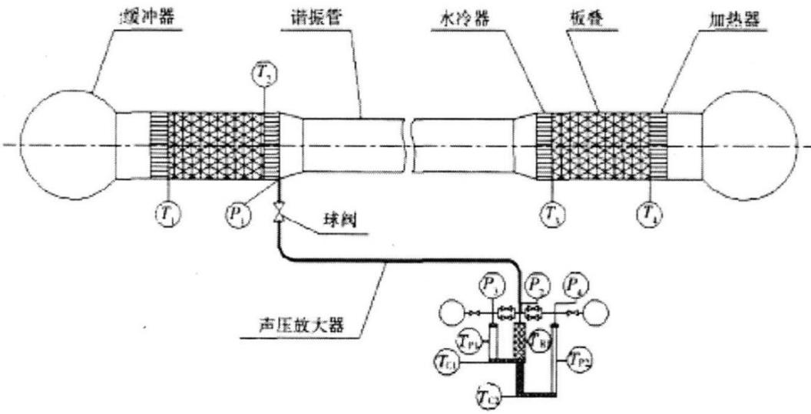  
图1.8 双向进气型脉管制冷机

20世纪90年代末，中国科学研究所对声驱动的热声制冷机展开探索之路。在2001年，罗二仓教授带领他的研究小组设计研制出一台斯特林型热声发动机驱动的脉管制冷机，可以达到218K的最低制冷温度[20]。2006年，戴巍设计出一台聚能型热声发动机驱动的脉冲管制冷机，可获得将近18.7K的制冷温度，这是首次由行波型热声发动机驱动的脉冲管制冷机的制冷温度进入液氢温区。在2007年，中国科学院理化研究所与深圳市中科力函科技有限公司合作，经过长期的探索与研究，成功研制出了型号TC4177和TC5580的制冷机，推动了制冷机工程化的应用，该制冷机具有性能稳定、噪音低、结构紧凑、寿命长的特点，如图1.9、图1.10所示[46\~48]。

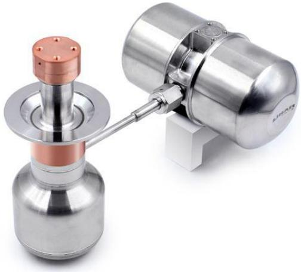  
图 1.9 TC4177 型号微型制冷机

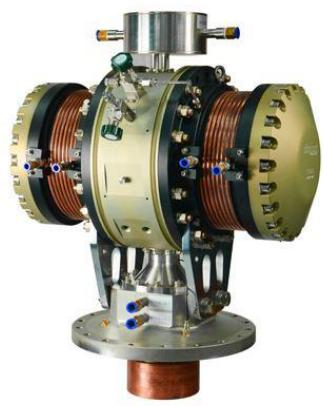  
图 1.10 TC5580 型号大冷量制冷机 TC5580

2007年，中国科学研究所胡鹏博士考虑了热声系统在超高频状态下，声场匹配困难、系统粘滞损耗等问题，在谐振管激励端部引入渐缩管，提高了谐振管内的声压振幅，并研发出一部PZT换能器驱动的热声制冷机，结构示意图如图1.11所示。该制冷系统在充气压力为2.1MPa下，谐振管内的声压峰值最高达到0.3MPa，且冷热端温差可达 $3 1 ^ { \circ } \mathrm { C } ^ { [ 1 ] } .$

2008年，中科院理化所李山峰所在的研究小组分析研究了行波型热声发动机机与热声制冷机两者匹配的问题与难点，然后通过数值模拟与实验研究减少了制冷机负载阻抗，进而增大热声发动机的输出声功，达成两者的相互耦合，研发出一台新型同轴行波型热声制冷机，如图1.12所示[49]。

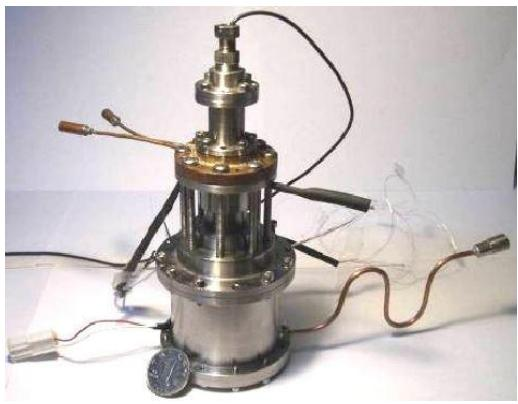  
图 1.11 PZT 声驱动器热声制冷机

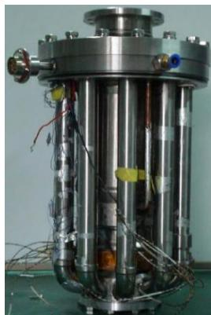  
图1.12 同轴行波型热声制冷机

除上述外，2005年，中国科学院理化研究所李青所带领的科研团队研制出一台尺寸700mm长的热声发动机驱动的热声制冷机，当制冷机工作频率在280Hz左右时，该制冷机冷端温度可达到147.3K。后期，该科研团队在前期的基础上又设计出一台高频联型热声发动机驱动的热声制冷机，当热声发动机加热功率在190W，工作频率460Hz时，可获得0.21MPa的声压，冷端温降为 $1 2 ^ { \circ } \mathrm { C } ^ { [ 5 0 ] }$ o

华中科技大学低温制冷研究中心致力于热声系统回热器填充物、结构的研究，对针束型回热器进行了优化改良，并分析研究了多孔玻璃、玻璃纤维、蜂窝陶瓷、聚酯薄膜等不同材料的回热器在热声系统中的应用成效[51\~52]。

2016年，东南大学的丁琦搭建了一台基频为5000Hz的热声制冷机[53]，整机尺寸只有35mm左右，如图1.9所示。通过实验研究得出，当制冷系统在充气压力为0.1MPa，运行频率为5012.5Hz，实验环境温度 $1 5 \mathrm { ^ \circ C \mathbb { H } }$ 寸，可获得冷热端最大温差为 $2 5 \mathrm { ^ \circ C }$ ，冷端温降约为1.5K，这一成果为热声制冷机实现微型化的发展奠定了坚实的基础。

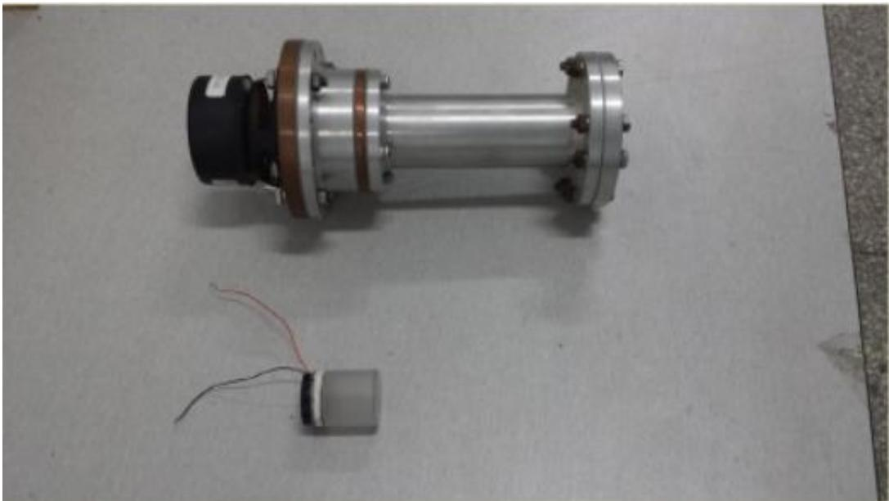  
图 1.13 5000Hz 的热声制冷机

## 1.4 热声制冷装置工程化发展面临的的问题

虽然国内外在热声制冷领域的研究取得了突破性的进展，但热声制冷装置工程化发展与应用依旧是当前的热点、难点问题，制约热声制冷机的工程化发展主要有两个问题。

## （1）制冷装置的微型化

制冷机的尺寸与制冷机的运行频率有关，运行频率越大，制冷机尺寸越小，但是制冷机运行频率越高也会导致很多问题，比如，热声制冷系统中气体工质在板叠上流动的粘性损耗、声场匹配困难、换热效率与制冷效率匹配等问题，这给热声制冷机实现微型化带来了很大的困难。

## (2）制冷效率低

热声制冷机制冷效率低主要是由于缺乏一个合适、稳定的大压力幅值振荡系统，而实际声驱动器均不同程度地存在动力不足和辐射效率偏低等情况，无法满足热声制冷装置对强声源声场的需求，限制了热声制冷机的制冷效率。

## 1.5 本文主要研究工作

目前，市面上的声驱动器以不能够满足热声制冷装置对强声源的需求，如果能很好的解决了这一需求，将对提高制冷机制冷效率具有很重要的意义。本文以能产生高声压振幅的谐振系统出发，设计了一种高频、大振幅的声驱动器，搭建了热声制冷机实验装置并进行了相应的实验研究，文章主要工作如下：

（1）气柱的活塞模态振动具有与驻波相同的性质，都是纵向振动有稳定的速度节点与压力节点，和其他声驱动器热声制冷机一样，只要有相同的气体工质，把板叠放到适当的压力波腹与与速度波腹之间就可以实现热量搬移，实现更高效的制冷效率，在此思想上研制设计了一款大压力振幅的声驱动器。

（2）优化设计了制冷机中的一些关键元件，并搭建了热声制冷机实验平台。通过 Ansys仿真软件对采用非对称法对直径100mm，壁厚5mm谐振腔内气柱进行了自由模态分析，找出最佳激励频率，使谐振谐振腔内的声压幅值增大，为后续的实验提供了基础。

（3）根据仿真结果对制冷机谐振腔内的声场强度、以及制冷效果进行了实验研究，研究了热声堆的位置、以及驱动器的激励频率对热声堆两端温度的影响，并测量了不同工况下谐振腔轴向各个位置声压值，验证了用气柱的活塞模态振动代替驻波振动的确可以提高谐振腔内声场强度。

（4）对文中实验研究结论进行了总结，并指出了有欠缺的地方，分析了其原因，对后续进一步工作提出了建议。

## 2 热声制冷效应的理论基础

热声学是一门多学科混合的学科，它涵盖了传热学、声学、流体力学等多门学科领域，而传热学和声学又是热声制冷机理论基础的两大支柱。声学主要研究声波的物理特性，处理介质受迫振动涉及到的动力学问题，如工质的体积、压强、速度和相位等，而热力学则是主要处理热声制冷机制冷过程中的一些传热问题，如能量转换、制冷效率、温度梯度等。

## 2.1 热声制冷效应的声学理论基础

## 2.1.1 热声效应中的基本声学量

声波传播的场所称为声场，为了描述谐振腔内所产生声波的各种性质，就需要确定谐振腔内微团体积元的压强、温度、密度以及质点速度等物理变化量来描述声波传播过程。

## （1）声压

由于声波扰动的作用，介质的疏密程度就会受到影响，进而在原有大气压的基础上产生一个随声波周期性变化的压力，即： $P = P _ { 1 } - P _ { 0 }$ 。当声波在媒质传播时，声场中每一点的声压是随时间和空间发生变化的，对于沿x轴方向传播的平面声波，声场中的声压表达式可以整理为：

$$
p = p ( x , t ) = p _ { m } e ^ { j \left( \omega t - k x \right) }\tag{式2.1}
$$

式中， $P _ { m }$ 为声压幅值， $\omega$ 为角频率，k为波数。

## （2） 振速

在声波的扰动下，声压必然引起介质质点的周期性往复振动，假设介质质点离开平衡位置的位移为 $\xi$ ，则介质质点的振动速度 $u = \partial { \xi } / \partial t$ 。介质质点的振速也随时间和空间发生变化，且不同位置质点振速方向也不同，在平面波声场中振速可以整理为：

$$
u = { \frac { p _ { m } } { \rho _ { 0 } c _ { 0 } } } e ^ { j \left( \omega t - k x \right) } = u _ { m } e ^ { j \left( \omega t - k x \right) }\tag{式2.2}
$$

式中， $u _ { m }$ 为速度幅值， $\rho _ { 0 }$ 为无声波扰动时的工质的密度， $c _ { 0 }$ 为声波初始速度，k为波数，ω为角频率。

## (3）压缩量

在声场中介质产生的压力变化与介质的可压缩性有关，所以也和介质的密度变化有关。设没有声波扰动时介质的静态密度为 $\rho _ { 0 } ( x , y , z )$ ，声波扰动时介质的密度为$\rho ( x , y , z , t )$ ，定义介质的密度相对变化量为 $\mathbf { s } ( x , y , z , t )$ ，称其为压缩量[54\~58]：

$$
\mathrm { s } ( x , y , z , t ) = \frac { \rho ( x , y , z , t ) - \rho _ { 0 } ( x , y , z ) } { \rho _ { 0 } ( x , y , z ) }\tag{式2.3}
$$

## 2.1.2 基本热声方程

声振动是一种宏观的物理现象，在对制冷机谐振腔内的声场特性分析时需要满足牛顿第二定律，质量守恒定律，热力学定律，以及描述压强、温度与体积等的状态方程，通过这些基本定律便可推理出声压、振速、密度之间的关系方程，线性热声理论是以单频、稳定和小幅振荡的低幅热声近似为基础的，为使声波传播问题简化，下面对介质与声波过程假设作具体概括[59]：

（1）介质为理想流体，没有黏滞性，即热声系统中没有能量损耗，温度不受粘滞性的影响。

（2）介质具有连续性，不考虑质点的单独运动。

（3）介质不受声波影响时，介质是静止均匀的。

（4）介质中传播的声波是低幅的。

（5）声传播时，介质压缩和膨胀的过程是绝热的，即声波传播时介质不会发生热转换。

运动方程（声压与速度的关系）：

$$
- \boldsymbol { \nabla } p = \rho _ { 0 } \frac { \partial \boldsymbol { u } } { \partial t }\tag{式2.4}
$$

连续性方程（密度与速度的关系）：

$$
\frac { \partial \rho } { \partial t } = - \rho _ { 0 } \nabla u\tag{式2.5}
$$

状态方程（声压与密度的关系）：

$$
{ \frac { d p } { d t } } = c ^ { 2 } { \frac { d \rho ^ { \prime } } { d t } }\tag{式2.6}
$$

式中， $\nabla _ { \cdot }$ 为梯度算符，由上述三个方程便可得到小振幅声波在理想、均匀、静止流体中的波动方程：

$$
{ \frac { { \hat { \sigma } } ^ { 2 } p } { { \hat { \sigma } } t ^ { 2 } } } = c ^ { 2 } \nabla ^ { 2 } p\tag{式2.7}
$$

上述式中， $c$ 为声波的传播速度， $p$ 为声压， $\rho _ { 0 }$ 为无声扰动时的密度， $\rho _ { \mathrm { . } }$ 为密度，u为速度， $\nabla ^ { 2 }$ 拉普拉斯算子。

## 2.1.3 声场中的能量关系

声波传播的过程实际上就是声能量传播的过程，要提高热声制冷机的制冷效率，热声制冷机谐振腔内就需要一个高声强声场，因此，声场中的声强、声功率等物理参数就很重要。

声场中任意一点的声强为单位时间内通过声传播方向上声能流密度，声强高低取决于声压幅值、振速幅值、以及他们之间相位差，可表示为[54,59]：

$$
I = \frac { 1 } { T } \int _ { 0 } ^ { T } R _ { e } ( p ) R _ { e } ( u ) d t = \frac { 1 } { 2 } p _ { m } u _ { m } \cos \varphi\tag{式2.8}
$$

而单位时间内通过垂直于声波传播方向面积S上的为声能流密度为平均声功率，既对声强取面积S积分，对于截面均匀的平面声波：

$$
W _ { a } = \int \int \limits _ { s } I d S = { \frac { 1 } { 2 } } p u S \cos \varphi = { \frac { 1 } { 2 } } p U \cos \varphi\tag{式2.9}
$$

上述式中， $R _ { e }$ 表示取实部， $p _ { m }$ $u _ { m }$ 为声场中某点的声压幅值和振速幅值， $\varphi$ 为声压和振速之间的相位差，U为体积流率是流速与截面积的乘积。从式2.9中可以看出，声功率的大小与声压、振速和它们之间的相位差有关系，当它们之间的相差为 $9 0 ^ { \circ }$ 时，声场为单纯驻波，显然声功率为零，但不是没有声能量，因为声场中定存在小量的行波，当它们之间的相位差为零时，声场为纯行波，声功率为声压和振速幅值的一半。当 $\left| \varphi \right| < 9 0 ^ { \circ }$ 时，声功沿x轴正向传播，当 $9 0 ^ { \circ } < \left| \phi \right| < 1 8 0 ^ { \circ }$ 时，声功沿x轴负向传播[60\~62]。

## 2.1.4 热声装置中的声波特性

当声波在管中向前传播时，遇到刚性反射面时会发生反射，反射回来的波与相反方向行进的波相互叠加时会产生于涉现象，形成驻波。一个驻波可以看作是和驻波同频率，幅值为驻波幅值1/2、运动速度相同、方向相反的两列行波叠加而成的。驻波的波腹和波节的位置是固定的，即驻波不沿x方向运动，波形随时间发生变化，相当于一个滞留在固定位置不断上下振动的正弦波，而行波在传播过程中，其波腹和波节的位置是随时间变化的，即行波在传播的过程中沿x方向运动。如图2.1为行波、驻波沿x轴方向示意图。

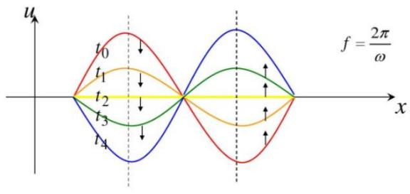  
(a)驻波

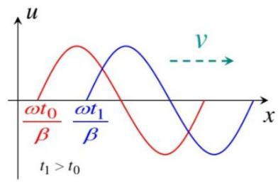  
(b）行波  
图 2.1 行波、驻波沿x轴方向示意图

如图2.2所示，是一个半波长驻波型热声制冷机简易模型，谐振管中充满了工质气体，谐振管一端封闭，另一端由声驱动器驱动。声驱动器是通过消耗其它能激发出热声效应所需要的声波，维持气体工质周期性的振荡，实现与板叠之间换热，板叠是制冷机中的关键性元件，是热声效应发生的主要场所，冷端换热器是热量输出装置，热端换热器是热量输入装置，换热器与板叠位置应该安装在速度节点与声压节点之间适当的位置。图中虚线是沿谐振管轴向方向上声压与速度的曲线分布，由于纯驻波是没有能量传输的，因此定会有小量的行波叠加在驻波之上[63]。

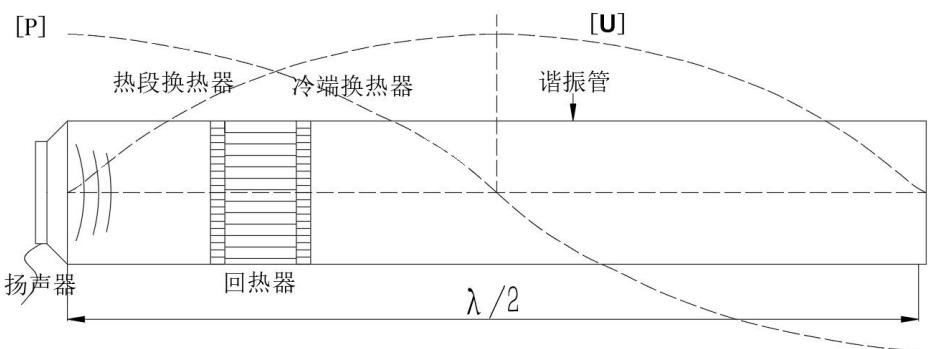  
图2.2 二分之一波长驻波型热声制冷机模型图

如图2.2中的热声制冷机模型，假设谐振腔内的冷、热端换热器与回热器不影响管内声场分布，则谐振管内声压可表示为：

$$
p ( x , t ) = p _ { 1 } ( x ) \sin \omega t\tag{式2.10}
$$

式中， $p _ { 1 } ( x ) = p _ { m } \cos \mathrm { k x }$ 是驻波的声压振幅， $k = \omega / a$ 是波数， $\omega$ 为声波的角频率，对式2.10近似牛顿第二定律 $\rho \frac { \partial u } { \partial t } = - \frac { \partial p } { \partial x }$ 积分，便能得出气体微团的速度：

$$
u ( x , t ) = u _ { 1 } ( x ) \cos \omega t \ , u _ { 1 } ( x ) = { \frac { p _ { \mathrm { m } } } { \mathrm { c } _ { 0 } \rho _ { 0 } } } \sin \mathrm { k } x\tag{式2.11}
$$

式中， $c _ { 0 }$ 为声速， $\rho _ { 0 }$ 为气体密度，当coskx最大时，sinkx等于零，因此可以看出：压力和速度在空间上相位差总是为 $9 0 ^ { \circ }$ o

如果驻波型热声制冷机谐振管长度取二分之一波长，则谐振管两端封闭，此时两端气体微团速度为0，声压幅值达到最大。设边界条件：sinkL=0，因为 ${ \mathrm { k } } = 2 \pi / \lambda$ ，所以 $\lambda = 2 \mathrm { L } / n \ , \quad \mathfrak { n } = ( 1 , 2 , 3 \cdots )$ ，当取n=1时， $\mathrm { L } = \lambda / 2 ^ { [ 1 ] }$

取谐振管的长度为四分之一波长时，谐振管可等效为激励端开口，管末端封闭，压力节点在谐振管的末端，因此[61]：coskL=0， $\lambda = 4 \mathrm { L } / ( 2 n - 1 )$ $\mathbf { n } = ( 1 , 2 , 3 \cdots )$ ，当取 $\mathbf { n } = 1$ 时， $\mathrm { L } = \lambda / 4$ O

## 2.2 热声制冷效应中的热力学基础

热声热机中的工质一般是有一定压力的可压缩性惰性气体，气体多变过程关系式是研究热声系统中工质气体周期性热交换的基础，工质气体在理想状态下，多变过程关系式可表达为： $p { \nu } ^ { n } = c o n s t$ 。其中，指数n为多变指数，当n取不同值时，多变过程呈现出定压、定温、绝热和定容等四种基本热力学过程，属于多变过程的一种[45,64]。

取 $n = 0$ 时，多变过程为等压过程；

取 $n = 1$ 时，多变过程为等温过程；

取 $n = k$ 时，多变过程为绝热过程；

取 $n = \pm \infty$ 时，多变过程等定容过程。

热声系统的热力学循环过程涉及到热力学第一定律和热力学第二定律。热力学第一定律适用于一切宏观以及微观系统，可表述为：能量从一种形式转化为另一种形式，从一个物体传递到另一物体时，能量总值不变，即不能被创造也不能消失。对于闭系，热力学第一定律的数学关系式可表述为：

$$
d { \boldsymbol { \varepsilon } } = d Q - d W\tag{式2.12}
$$

式中， $d \varepsilon$ 是系统的能量变化， $d Q$ 是所获得的热量， $d \boldsymbol { W }$ 是系统作的功。对于开系，热力学第一定律的数学关系式可表述为：

$$
d \varepsilon = d Q - d W + \left( h + \frac { \left| \nu \right| ^ { 2 } } { 2 } \right) d M\tag{式2.13}
$$

式中，M为质量，h是单位质量流体的焓，ν是速度，其他符号与上述一致。

热力学第二定律又称为熵增定律，既一个孤立系统可逆过程熵是不变的，在不可逆过程中墒是增加的，不会出现熵减的情况。熵是系统的一个状态量，既 $d S = d Q / T$ 对于闭系，热力学第二定律数学关系式可表述为：

$$
d S = { \frac { \delta Q } { T } } \ l + \left( d S \right) _ { g e n } , ( d S ) _ { g e n } \geq 0\tag{式 2.14}
$$

对于开系，热力学第二定律数学关系式可表述为：

$$
d S = \frac { \delta Q } { T } + s d M + \left( d S \right) _ { g e n } , \left( d S \right) _ { g e n } \geq 0\tag{式2.15}
$$

式中， $\frac { \delta Q } { T }$ 是系统与外界发生热交换过程中引起的熵流， $\left( d S \right) _ { g e n }$ 为熵增，M为质量，S是单位质量流体的熵[65]。

从热力学的角度对热声效应进行分析，其实质就是热能与声能之间的相互转化，而热声发动机与热声制冷机是热声效应原理应用的主要实际装置，热声发动机是从高温热源处吸收总热量 $Q _ { h }$ ，然后将其中一部分热量 $Q _ { c }$ 传递到低温热源处，剩余的一部分则转换成声功，由热力学第一定律可得 $\mathcal { Q } _ { L } = \mathcal { Q } _ { C } + W$ ，如图2.3所示。热声制冷机宏观上也是热能与声能相互转换的关系，热声制冷机主要是利用外界供给的声能W，从低温热源处吸收热量 $Q _ { c }$ ，然后向高温热源处释放热量 $Q _ { h }$ ，在板叠两端形成温度梯度，最终实现制冷，由热力学第一定律可得 $U = \mathcal { Q } _ { C } - \mathcal { Q } _ { h } + W$ ，其中U为系统的内能，如图2.4所示。

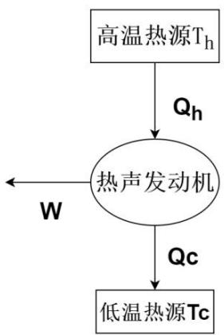  
图2.3 热声发动机能量转换示意图

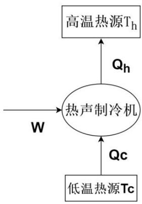  
图2.4 热声制冷机能量转换示意图

## 2.3 热声制冷机的工作原理与基本性能参数

## 2.3.1 热声制冷机的工作原理

热声制冷机是将热声效应原理应用到实际中的装置，结构简单，包括声驱动器、换热器、板叠、谐振管，如图2.5所示。声驱动器主要通过消耗其它能源来激发出声波为谐振腔内工质气体换热与系统损耗提供声能，板叠是制冷系统中的重要部分，气体微团与板叠间的换热，以及气体微团的换热循环都是在板叠上完成的，由于板叠是由许多规则的流道组成，增加了谐振腔内气体工质与板叠的热交换，大大的提高了制冷机的热声转换效率，热端换热器和冷端换热器是与外界实现换热的装置，谐振管的作用就是在管内形成稳定的压力波。

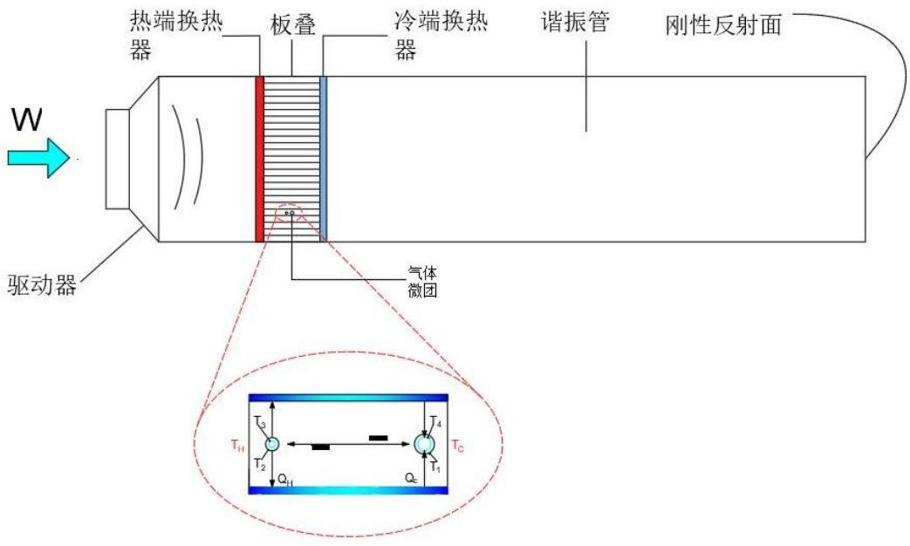  
图 2.5 热声制冷机结构图

热声效应是振荡气体工质与固体边界(平行板叠)相互作用产生的时均能量效应。热声效应可分为两种，一种是利用热能激发出声能，另一种是声能实现热能的转移。声波在介质中传播时会引起气体微团压力及位移的波动，导致气体微团周期性的压缩和膨胀，而声波所引起的压力、位移及温度的波动与板叠相互作用时，就会发生声能与热能之间的转换，可通过一个充满气体工质谐振管演示，当谐振管一端是个刚性封闭面，另一端有声驱动器激励时，用一个气体微团沿板叠附近的往复振动，来理解整个热声循环。

（1）设气体微团初始温度 $T _ { 1 }$ ，初始体积 $V _ { 1 }$ ，在声波的作用下，气体微团向声压最大处运动，这个过程微团自身绝热压缩，体积减小到 $V _ { 2 }$ ，温度升高到 $T _ { 2 }$ o

（2）此时气体微团温度 $T _ { 2 }$ 高于相邻固体表面的温度，微气团的热量不可逆的，传递到固体上，致使气团被压缩，体积进一步减小到 $V _ { 3 }$ ，温度为 $T _ { 3 }$ o

（3）接下来气体微团随着声波反方向运动，气体微团绝热膨胀对外做功，体积增大到 $V _ { 4 }$ ，温度降低到 $T _ { 4 }$ o

（4）此时气团温度低于相邻固体表面温度，气体微团从相邻固体表面吸收热量，

气体微团膨胀，体积恢复到 $V _ { 1 }$ ，温度恢复到 $T _ { 1 }$ ，从而完成一次热力学循环。

整个过程就是气体微团在声波的作用下从板叠的低温端吸收热量，在板叠的高温端释放热量，而板叠流道内有大量类似的气体微团，同样在声波的作用下不停地往复循环运动，最终实现冷端的热量泵送到热端，进而在冷、热端建立起温度梯度[65,66]。

## 2.3.2 热声制冷机的基本性能参数

## （1）气体平均压力

根据热动力学理论可知，热声系统内的声能密度与平均充气压力成正比，因而高的平均充气压力可以增加系统制冷量，有利于提升热声制冷机的制冷效果，但是气体平均压力也不能任意提高，受以下因素影响：提高平均充气压力对热声制冷装置的强度有着更苛刻的要求；平均充气压力增大热渗透深度会减小，导致板叠之间距离减小，不利于板叠的制作；气体工质的普朗特数会随平均充气压力的增大而增大，而普朗特数的增大会降低热声转换效率，不利于热声系统的制冷效果。

## (2) 运行频率

热声制冷机的声驱动器运行频率越高，则谐振管内声场强度也会越高，且声波频率越高，声波波长就会越短，越有利于制冷机微型化。因此，要实现制冷量的提升以及制冷装置微型化理论上应该选用较高声波频率，但声波频率太高，热声系统内会有声波非线性效应的产生，且运行频率也要和谐振管的固有频率、气柱的固有频率相匹配，使之发生共振，激发出更高的声场强度。

## （3）压力驱动比

根据线性热声理论，压力驱动比RPA是振荡压力幅值与平均压力的比值，如式2.16。提高压力驱动比，可以很大程度上提高热流密度，提高制冷系统的制冷量，从理论上来讲压力驱动压比越大，对制冷越有利，但驱动压比不能任意增大，由于压比增大会使的气体微团振速变大，则热声系统内会出现紊流状态，造成声功极大损失。为避免非线性因素的影响，要选择合适的压力驱动比[11,67]。

$$
\begin{array} { r } { R P A = \frac { | P _ { 1 } | } { P _ { \mathrm { m } } } \times 1 0 0 \% } \end{array}\tag{式 2.16}
$$

## （4）相对卡诺效率

驱动器提供工质周期性振荡和其他部分所消耗的声功，制冷装置性能系数越高，

所消耗的声功会越少、制冷效率会越高。热声制冷装置的性能常用COP，COPC，COPR等系数来描述，制冷机的卡诺性能系数 $C O P$ 的定义为[68]：

$$
C O P = { \frac { Q _ { c } } { W } }\tag{式 2.17}
$$

式中， $\mathrm { Q _ { c } }$ 制冷量，W为产生的制冷量所需要的声功。

$$
\begin{array} { r } { C O P C = \frac { \mathrm { T _ { c } } } { \mathrm { T } _ { h } - \mathrm { T _ { c } } } } \end{array}\tag{式2.18}
$$

式中，COPC为逆卡诺性能系数，是制冷机所能达到的最大性能系数， $\mathrm { T _ { c } }$ 为低温端温度， $\mathrm { T } _ { h }$ 为高温端温度。

为比较卡诺性能系数与逆卡诺性能系数的接近程度，定义相对性能系数COPR：

$$
C O P R = { \frac { C O P } { C O P C } }\tag{式2.19}
$$

## 2.4 圆形平面活塞辐射特性分析

当结构在介质中振动时，会向周围介质中辐射声能量[69]，由于本文所设计一款高频、大振幅的活塞式声驱动器，因此，圆形平面活塞辐射特性分析对圆形振动薄板设计有非常重要的参考价值。

## 2.4.1 圆形活塞辐射器的辐射阻抗

假设一半径为a的一圆形刚性半面活塞做谐和振动，由于活塞表面各点振动都是一样的，如图2.6所示，面元 $\mathrm { d } s = \sigma \mathrm { d } \sigma \mathrm { d } \varphi$ ，在距离面元 $\mathrm { d } s \not \to \mathsf { y } r _ { 1 }$ 的 $| p .$ 点的声压为：

$$
\begin{array} { r } { \mathrm { d } p = \frac { \mathrm { j } \rho _ { 0 } \mathrm { c } _ { 0 } k } { 2 \pi r _ { 1 } } \mathbf { u } _ { 0 \mathrm { m } } \mathrm { d } s \mathrm { e } ^ { \mathrm { j } \left( \omega \mathrm { t } - \mathrm { k r } _ { 1 } \right) } } \end{array}\tag{式2.20}
$$

为求得圆形活塞的辐射阻抗，令 $_ p$ 点刚好在与面元 ds距离r的辐射表面 ${ \mathrm { d } } s ^ { ' }$ 上，则圆形振动板上所有的 ds在 ${ \mathrm { d } } s ^ { ' }$ 附近产生的声压 $\dot { } \boldsymbol { p }$ 为：

$$
p = { \frac { \mathrm { j } \rho _ { 0 } c _ { 0 } k u _ { 0 m } } { 2 \pi } } e ^ { \mathrm { j } \omega t } { \displaystyle \iint _ { s } { \frac { \mathrm { d } { s } } { r e ^ { \mathrm { j } \mathrm { k } r } } } }\tag{式2.21}
$$

而整个活塞表面平衡介质的作用力为：

$$
F = \int \int _ { s } p \mathrm { d } s ^ { ' } = \frac { \mathrm { j } \rho _ { 0 } c _ { 0 } k } { 2 \pi } u _ { 0 m } e ^ { \mathrm { j } \omega t } \iint _ { s } d s ^ { ' } \iint _ { { r } } \frac { e ^ { - \mathrm { j } \mathrm { k r } } } { r } d { \bf s }\tag{式2.22}
$$

因此，辐射阻抗为：

$$
Z _ { s } = \frac { F } { u } = \frac { \mathrm { i } \rho _ { 0 } c _ { 0 } k } { 2 \pi } \iint \mathrm { d } s ^ { ' } \iint \frac { e ^ { - \mathrm { j } k r } } { r } \mathrm { d } s\tag{式2.23}
$$

上述式中， $\rho _ { 0 }$ 为介质初始密度， $\omega$ 为角频率，a为振动薄板的半径，r为 $\mathrm { d s }$ 到 $\mathrm { d } \mathrm { s } ^ { ' }$ 的距离， $c _ { 0 }$ 为声速，k为波数，u为振速， $u _ { 0 \mathrm { m } }$ 为振速幅值。单对式2.23积分是比较困难的，而在式2.23中每一对面元都出现了两次力的相互作用，且两次相互作用的力大小一样，因此，如果只考虑面元相互作用力中的一个，然后扩大两倍，便可得到式2.23的计算结果。

$$
\begin{array} { l } { { \displaystyle Z _ { \mathrm { s } } = \rho _ { 0 } c _ { 0 } s \Bigg [ 1 - \frac { \mathrm { J _ { 1 } } ( 2 k { \mathrm { a } } ) } { k a } \Bigg ] + \mathrm { j } \frac { \pi \rho _ { 0 } c _ { 0 } } { 2 k ^ { 2 } } \mathrm { K } _ { 1 } ( 2 k { \mathrm { a } } ) } } \\ { ~ = r _ { s } + \mathrm { j } x _ { s } } \end{array}\tag{式2.24}
$$

式中， $\mathrm { J } _ { 1 } ( x )$ 是一阶柱贝塞尔函数， $\mathrm { K } _ { 1 } ( x )$ 是一阶修正贝塞尔函数，r,为辐射阻，x，为 $r _ { s }$ $x _ { s }$ 辐射抗，当 $k \mathsf { a } \ll 1$ （低频时）时，辐射阻抗 $\mathcal { Z } _ { s }$ ，如式2.25，辐射声功率 $W _ { a L }$ 如式2.26。

$$
Z _ { \mathrm { s } } \cong \rho _ { 0 } \mathrm { c } _ { 0 } s \Bigg [ \frac { 1 } { 2 } \big ( k \mathrm { a } \big ) ^ { 2 } + \frac { \mathrm { j } 8 } { 3 \pi } k \mathrm { a } \Bigg ]\tag{式2.25}
$$

$$
W _ { \mathrm { a } L } = { \frac { \rho _ { 0 } c _ { 0 } k ^ { 2 } } { 4 \pi } } ( \pi \mathbf { a } ^ { 2 } ) \ u ^ { 2 } _ { 0 \mathrm { m } }\tag{式 2.26}
$$

当ka>>1（高频时）时，辐射阻抗 $\mathbf { \mathcal { Z } } _ { s }$ 如式2.27，辐射声功率 ${ \cal W } _ { a \mathrm { H } }$ 如式2.28。

$$
Z _ { s } \cong \rho _ { 0 } c _ { 0 } s + \frac { 2 \mathrm { j } } { \pi k \mathrm { a } } \rho _ { 0 } c _ { 0 } s\tag{式2.27}
$$

$$
W _ { \mathrm { a H } } = \frac { 1 } { 2 } \rho _ { 0 } c _ { 0 } \pi \mathrm { } ^ { 2 } u ^ { 2 } \mathrm { 0 m }\tag{式2.28}
$$

由式2.26可看出可以看出辐射声功率正比于圆板面积 $s ^ { 2 }$ ，增加声源面积可以明显增加低频辐射，由式2.28可以看出辐射声功率与频率无关。

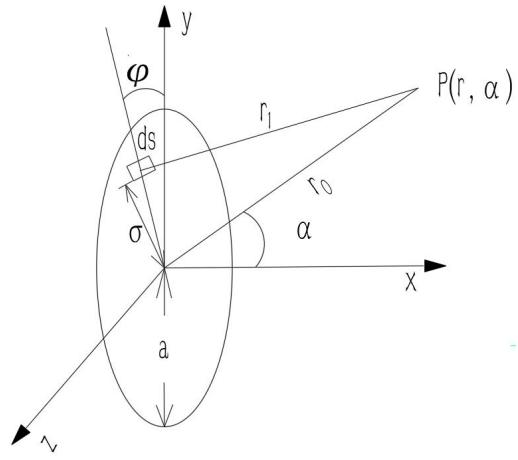  
图 2.6 面圆 ds 在 P 点产生的声压

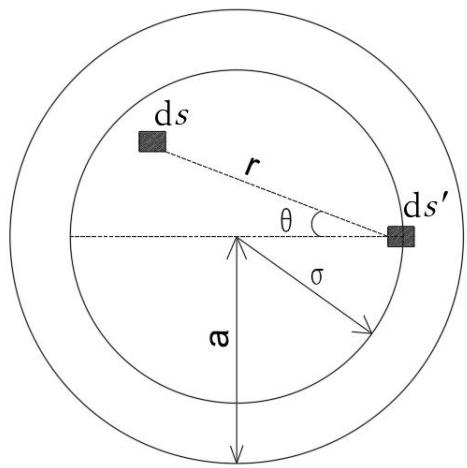  
图 2.7 ds 在 ds'产生的声压

## 2.4.2 圆形活塞辐射器近场特性分析

如图 2.8 所示，假设圆环面 ds = 2πodσ在圆环轴线 A 点产生的声压为 dp，ds 到 A的距离为 $\mathrm { r } ^ { \prime } = \sqrt { ( \mathrm { r } ^ { 2 } + \sigma ^ { 2 } ) }$ ，其中r是圆心到A的距离，σ是ds到圆心的距离，因此：

$$
\begin{array} { r } { \mathrm { d } \mathbf { p } = \frac { \mathrm { j } \rho _ { 0 } c _ { 0 } k } { 2 \pi \mathrm { r } ^ { * } } \mathbf { u } _ { 0 \mathrm { m } } \mathrm { e } ^ { \mathrm { j } \left( \omega \mathrm { t - k r } ^ { * } \right) } \mathrm { d } s } \end{array}\tag{式2.24}
$$

整个圆面在A产生的声压为：

$$
\begin{array} { r l } & { \mathrm { p } = \frac { \mathrm { j } \rho _ { 0 } \mathrm { c } _ { 0 } \mathrm { k } } { 2 \pi } \mathrm { u } _ { 0 \mathrm { m } } \mathrm { e } ^ { \mathrm { j } \omega \mathrm { t } } \int _ { 0 } ^ { \mathrm { a } } \left[ \frac { \mathrm { e } ^ { - \mathrm { j } \mathrm { k } \sqrt { \mathrm { r } ^ { 2 } + \sigma ^ { 2 } } } } { \sqrt { \mathrm { r } ^ { 2 } + \sigma ^ { 2 } } } \right] \cdot 2 \pi \mathrm { o d } \sigma } \\ & { \quad = - \ 2 \rho _ { 0 } \mathrm { c } _ { 0 } \mathrm { u } _ { 0 \mathrm { m } } \mathrm { s i n } \frac { k a ^ { 2 } } { 4 r } \mathrm { s i n } \left( \omega t - k r - \frac { k a ^ { 2 } } { 4 r } \right) } \end{array}\tag{式 2.25}
$$

而声强为：

$$
\begin{array} { r } { \mathrm { I _ { 0 } } = \frac { 1 } { 2 } \frac { \mathrm { p } _ { m } ^ { 2 } } { \rho _ { 0 } c _ { 0 } } = 2 \rho _ { 0 } c _ { 0 } u _ { 0 m } ^ { 2 } s i n ^ { 2 } \left( \frac { \pi a ^ { 2 } } { 2 \lambda r } \right) } \end{array}\tag{式 2.26}
$$

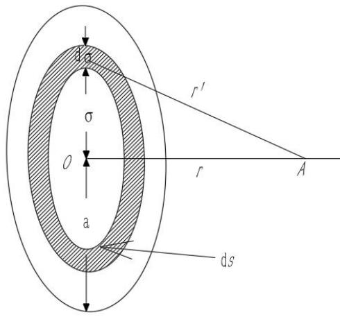  
图2.8 圆形活塞近场声场分析图

式中， $\rho _ { 0 }$ 为介质密度，k为波数，λ为波长， $c _ { 0 }$ 为声速， $\omega$ 为角频率，a为振动薄板的半径，r为 ds到A的距离， $u _ { 0 \mathrm { { m } } }$ 为振速幅值。从式2.25与2.26中可以看到，当 $\begin{array} { r } { \mathrm { r } < \mathrm { r } _ { \mathrm { c } } = \frac { \mathrm { a } ^ { 2 } } { \lambda } } \end{array}$ 时， $\begin{array} { r } { 0 < \sin \left( \frac { \pi \mathrm { a } ^ { 2 } } { 2 \lambda \mathrm { r } } \right) < 1 } \end{array}$ ，当 $\frac { \pi \mathrm { a } ^ { 2 } } { 2 \lambda \mathrm { r } } = \mathrm { n } \pi$ ，既 $\mathrm { r } = { \frac { 1 } { 2 \mathrm { n } } } \mathrm { r } _ { \mathrm { { \odot } } }$ 时，产生声压和声强最小值； $\frac { \pi \mathsf { a } ^ { 2 } } { 2 \lambda \mathrm { r } } = ( 2 \mathrm { n } -$ 1) 元 $\begin{array} { r } { \mathbf { r } = \frac { 1 } { ( 2 \mathrm { n } - 1 ) } \mathbf { r } _ { \mathrm { c } } } \end{array}$ 时，声压，声强出现了最大值。

## 2.5 本章小结

本章介绍了热声制冷机中所涉及到的一些基础理论知识，主要包括声学、和传热学知识，详细阐述制冷机整个换热过程、以及热声装置工作中涉及到的热力学换算公式和一些性能参数，并对圆形平面活塞辐射器特性进行了详细分析与阐述，包括圆形平面活塞辐射器的辐射阻抗与近场特性，对后文活塞式声驱动器振动薄板的设计提供一定的理论指导。

## 3 一种大振幅活塞式声驱动器的设计与研究

在以往的研究中，换能器、扬声器常作为热声制冷机的驱动源。这些驱动器通常由一个通电系统和一个机械系统组成，当驱动器通电后，引起内部电场和磁场的变化，进而给予机械系统一个推动力，实现机械部分往复振动，进而导致整个附近的工质也跟着发生相应的振动，但是目前很多驱动器都存在驱动力不足、振幅过小，核心元件发热等问题，比如传统的商用扬声器电声转化效率低、振幅过小，磁致伸缩换能器的核心元件磁致伸缩棒高频状态产生涡流效应导致磁致伸缩棒发热，不能够长时间稳定的使用。

已有研究表明声场强度（声压）越高、质点位移越大，制冷效果越好。而用气柱的活塞模态振动代替驻波振动，可以实现气柱的位移增大，产生强烈的气体交变流动，进而提高热声制冷机的制冷效率。基于高速电机可以带动曲柄滑块机构实现往复振动板的大振幅振动这种思想，设计了一种能够满足高频率、大振幅振动且廉价的声驱动器。

## 3.1 活塞式声驱动器基本要求与设计思想

## （1）基本要求

声驱动器中的振动薄板需实现直线运动且无冲击；驱动器与谐振腔的连接处需保证密封性；驱动机构各零部件质量需要轻质以减小惯性力；驱动器的振幅可调；驱动机构需结构简单、运动平稳、寿命长。

## (2) 设计思想

采用对心式曲柄滑块机构，可实现声驱动器中活塞振动薄板的往复直线运动，且构件之间都以面接触，承载能力高，耐磨损，结构简单易于制造，成本低。曲柄滑块机构是以正余弦的方式运动，运动时无冲击且平稳。通过改变曲柄的偏心距可以实现驱动器振幅可调，通过喇叭橡皮圈和固定密封圈与振动薄板的配合使用，保证驱动器与谐振腔的连接处的密封性，通过简化驱动器中各零部件结构与零部件连接方式、以及对零部件采用一些低密度、高强度材质，以减小声驱动器运转时的惯性力。

## 3.2 活塞式声驱动器的工作原理与运动学分析

## 3.2.1 活塞式声驱动器的工作原理

如图3.1所示为该驱动器的基本结构图，主要由高速电机1、电机固定座2、曲轴3、弹性梅花联轴器4、轴承座5、固定橡胶密封圈6、柔性铰链7、连杆8、活塞振动薄板9、喇叭橡皮圈10等组成。

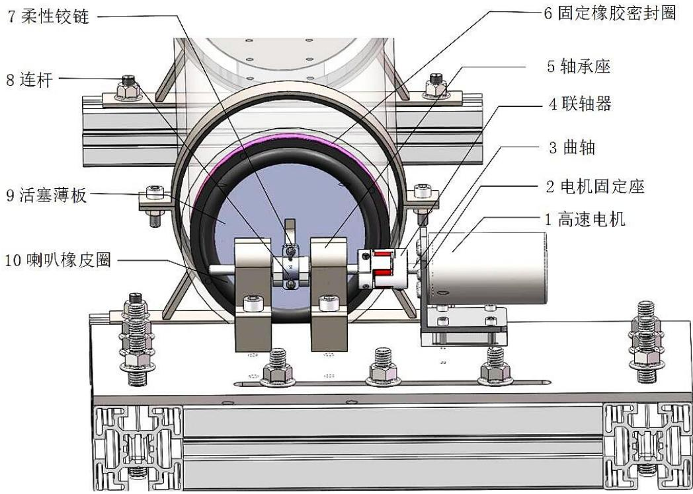  
图3.1 活塞式声驱动器实验装置三维结构图

该声驱动器由一种高速无刷直流电机驱动，工作时启动电机，调节直流电源电压的数值大小，对应的调节脉冲信号发生器就会有一个该电压下对应的电机最大转速。电机转速与电压关系 $n = 1 7 5 0 \mathrm { u }$ ，其中n为任意电压下电机对应的极限转速，常量1750为该电机的伏特数，u为任意电压。电机在高速转动时带动着曲轴做同样转速（频率）的旋转运动，带动连杆做复合运动，进而通过柔性铰链推动活塞振动薄板做往复振动，活塞振动薄板往复振动的频率与曲柄滑块机构频率一样，驱动器对外做功，强迫谐振管里的气柱做活塞模态振动，进而实现能量的转换。

## 3.2.2 活塞式声驱动器的运动学分析

该活塞式声驱动器的运动机构主要采用了单向对心式曲柄滑块机构，在高速无刷直流电机的驱动下，通过曲柄滑块机构实现活塞振动薄板往复振动。活塞振动薄板的位移、速度、和加速度可通过曲柄滑块机构的几何关系和运动关系中确定，如图3.2所示。

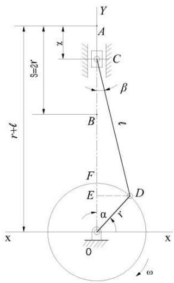  
图3.2 曲柄连杆机构运动学模型示意图

其中l为连杆的长度，r为曲轴偏心距， $\beta$ 为连杆摆角，λ为曲轴偏心距与连杆长度之比。振动薄圆板中心离旋转中心最远的位置为外止点，即A点，振动薄圆板中心离旋转中心最近的位置为内止点，即B点。任一曲轴转角α下活塞振动薄板的位移x为：

$$
x = r \bigg [ \big ( 1 - \cos \alpha \big ) + \frac { \lambda } { 4 } \big ( 1 - \cos 2 \alpha \big ) \bigg ]\tag{式3.1}
$$

将式3.1对时间t微分后则得到活塞振动薄板的运动速度c；在对式进行时间t的微分得到活塞振动薄板的加速度a。

$$
c = r \omega \bigg ( \sin \alpha + \frac { \lambda } { 2 } \sin 2 \alpha \bigg )\tag{式3.2}
$$

$$
a = r \omega ^ { 2 } \big ( \cos \alpha + \lambda \cos 2 \alpha \big )\tag{式3.3}
$$

式中，ω为角频率，其它如上述所介绍，从上述中可以看出，振动薄板的位移、速度、加速度都与驱动器的振幅有关，速度和加速度还与驱动器的频率有关，都是以正余弦的方式进行的，能实现驱动器运转时运动平稳，且无冲击。

## 3.3 影响惯性力的因素和降低惯性力的对策

## 3.3.1 驱动机构惯性力的分析

在以往的研究中，由直线电机驱动活塞薄板的往复振动也曾作为热声制冷机的激励源，但是由于驱动机构在高频、大振幅的运转过程中惯性力太大，难以降低，一直制约了它的应用。本文在设计声驱动器之前，首先需要降低驱动机构运转时的惯性力，活塞式声驱动器的旋转惯性力（离心力） $I _ { r }$ 由曲轴上不平衡旋转质量引起的，力的大小、方向随旋转运动做周期性变化，一般旋转惯性力的平衡，只需要在曲柄相反的方向上加上大小相等的平衡块，平衡块的质量 $m _ { w r }$ 取决于不平衡旋转质量 $m _ { r }$ ，以及平衡块质心到曲轴中心的距离 $\dot { \boldsymbol \rho }$ o

$$
I _ { r } = m _ { r } r \omega ^ { 2 }\tag{式3.4}
$$

$$
m _ { \omega r } = m _ { r } r / \rho\tag{式3.5}
$$

而对于往复惯性力也限于对一阶和二阶的惯性力降低，往复质量 $m _ { p }$ 在复合运动中产生的往复惯性力为：

$$
\begin{array} { r } { I = m _ { p } a = m _ { p } r \omega ^ { 2 } \big ( \cos \alpha + \lambda \cos 2 \alpha \big ) } \end{array}\tag{式3.6}
$$

往复惯性力可看作一阶惯性力与二阶惯性力两者之和，即：

$$
\begin{array} { l } { { I = I ^ { \prime } + I ^ { \prime \prime } } } \\ { { \ = m _ { p } r \omega ^ { 2 } \cos \alpha + m _ { p } r \omega ^ { 2 } \lambda \cos 2 \alpha } } \end{array}\tag{式3.7}
$$

式中， $\omega _ { \mathrm { \ell } }$ 为旋转角频率， $m _ { p }$ 为往复质量，r为曲轴偏心距，I'为一阶往复惯性力，$I ^ { \prime \prime }$ 为二阶往复惯性力。从式中可以看出，一阶往复惯性力的变化周期为二阶往复惯性力变化周期的2倍，一阶往复惯性力的最大值是二阶往复惯性力的最大值 $1 / \lambda$ 倍，即：

$$
I _ { \mathrm { m a x } } ^ { \prime } = { \frac { 1 } { \lambda } } I _ { \mathrm { m a x } } ^ { \prime \prime }\tag{式3.8}
$$

如果1/λ很大，一阶往复惯性力对驱动器的影响最大，可以忽略二阶往复惯性力，往复惯性力沿着谐振管的中心线作用，带来的冲击性对驱动器振动薄圆板有很大的影响[70,71]。

## 3.3.2 驱动机构惯性力的降低

由式3.4与式3.7可以看出，在曲柄滑块机构中无论往复惯性力还是旋转旋转惯性力值的大小与质量m，角频率ω(转速)，以及偏心距r有关。因此，想把惯性力降低，就要在不影响驱动器对频率、振幅的要求下，降低驱动装置的往复质量与旋转质量，从而降低驱动器高频、大振幅情况下的惯性力。

为了确定惯性力，将声驱动器驱动机构的未平衡质量分成两部分：由喇叭橡皮圈、活塞振动薄板、和连杆组的小部分质量组成的往复运动质量；由曲柄销、连杆组大部分质量组成的旋转运动质量，而驱动器各构件按照运动特性又可以分为三组：活塞组、曲轴组、连杆组。通过三维制图软件SolidWorks设置好各个零部件的材料属性，便可求得驱动器各零部件的质量。

活塞组：喇叭橡皮圈，大小规格4寸，质量0.27g，活塞振动薄板，材质65Mn弹簧钢，直径74mm，厚度0.1mm，质量2.32g。

曲轴组：由于曲轴在没加平衡质量时，曲柄臂是一个与主轴同心的圆柱体，所以它只有曲柄销的质量，材质304不锈钢，直径8mm，长度8mm，质量3.2g。

连杆组：它的质量用 $m _ { L }$ 表示，结构示意图如图3.3所示，包括柔性铰链，材质弹簧钢，厚度0.2mm，宽度5mm，质量0.32g，柔性铰链压板，材质弹簧钢，厚度0.3mm，质量0.076g，连杆体，材质7075铝合金，质量轻；质地硬；耐磨松；屈服强度大。

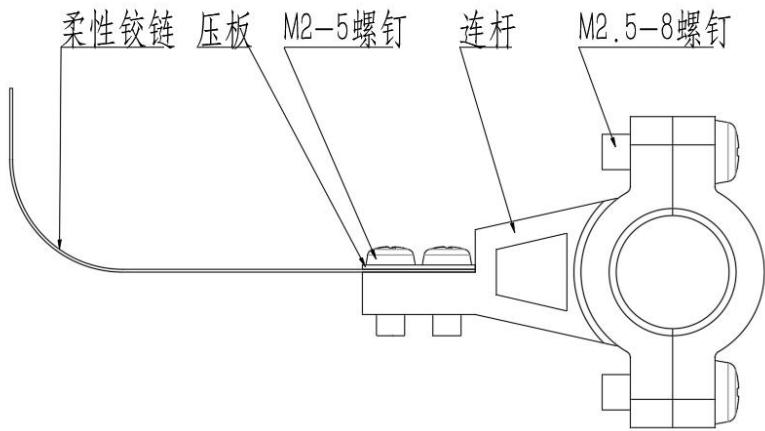  
图3.3 连杆装配体结构示意图

连杆组总质量为5.051g，而连杆组总质量根据质量守恒和质心守恒原理又可分为两部分，一部分随活塞组作往复运动的当量质量 $m _ { 1 }$ ，另一部分随曲轴作旋转运动的当量质量 $\mathbf { m } _ { 2 }$ ，如图3.4所示。

则连杆组质量 $m _ { L } = m _ { 1 } + m _ { 2 }$ ，作往复运动的当量质量 $\begin{array} { r } { m _ { 1 } = \frac { l _ { 2 } } { l } m _ { L } } \end{array}$ ，作旋转运动的当量质量 $\begin{array} { r } { m _ { 2 } = \frac { l _ { 1 } } { l } m _ { L } } \end{array}$ o

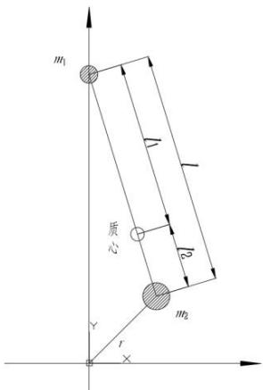  
图3.4 连杆大小头当量质量换算示意图

$m _ { 1 }$ 、 $m _ { 2 }$ 计算的关键是找出连杆组质心的位置，利用三维制图软件SolidWorks可方便找出结构的质心位置，经编辑求得： $l _ { 1 } { = } 4 1 . 4 4 \mathrm { m m } , l _ { 2 } { = } 5 . 5 6 \mathrm { m m }$ ，进而可知： $m _ { 1 } \approx 0 . 6 \mathrm { g }$ $m _ { 2 } \approx 4 . 4 5 \mathrm { g }$

活塞振动薄板的振幅分别为0.5mm、1mm、1.5mm，远小于连杆的长度，由式3.8可知，一阶往复惯性力的最大值是二阶惯性力的最大值 $1 / \lambda$ 倍，当 $1 / \lambda$ 很大时，可以不计二阶往复惯性力的大小。因此，往复惯性力的最大值可以近似等于一阶惯性力的最大值，即：

$$
I _ { \mathrm { m a x } } = I _ { \mathrm { m a x } } ^ { \prime } + I _ { \mathrm { m a x } } ^ { \prime \prime } \approx I _ { \mathrm { m a x } } ^ { \prime } \approx m _ { p } \omega ^ { 2 } r\tag{式3.9}
$$

而往复运动质量 $m _ { p }$ 是活塞组质量 $m _ { s }$ 与连杆组作往复运动的一部分质量 $m _ { 1 }$ 之和，即： $m _ { p } = m _ { s } + m _ { 1 } = 2 . 5 9 + 0 . 6 = 3 . 2 8$ ，将质量、振幅带入式3.9中，得出不同振幅、频率下活塞式声驱动器往复惯性力最大值如表3.1所示。

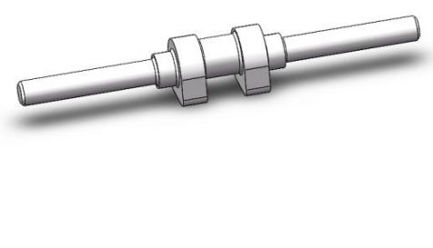

表3.1 不同频率、振幅下往复惯性力最大值
<table><tr><td>转速</td><td>50000r/min</td><td> $4 0 0 0 0 \mathrm { r / m i n }$ </td><td> $3 0 0 0 0 \mathrm { r / m i n }$ </td><td> $2 0 0 0 0 \mathrm { r / m i n }$ </td><td>10000r/min</td></tr><tr><td>活塞振幅</td><td>(833Hz)</td><td>(666Hz)</td><td>(500Hz)</td><td>(333Hz)</td><td>(166Hz)</td></tr><tr><td>1mm</td><td>43.82N</td><td>28.04N</td><td>15.78N</td><td>7.01N</td><td>1.75N</td></tr><tr><td>2mm</td><td>87.62N</td><td>56.08N</td><td>31.55N</td><td>14.02N</td><td>3.50N</td></tr><tr><td>3mm</td><td>131.44N</td><td>84.1N</td><td>47.33N</td><td>21.03N</td><td>5.25N</td></tr></table>

由表3.1可以看出，通过简化驱动器中各零部件结构与零部件连接方式、以及对零部件采用一些低密度、高强度材质，可以减小声驱动器运转时的惯性力，降低了声驱动器驱动机构在高频、大振幅运转时惯性力带来的影响。

## 3.4 声驱动器各零部件的设计

现分别就声驱动器中各主要零部件的结构和制作工艺进行详细地讨论，图3.5为主要零部件的三维结构图。

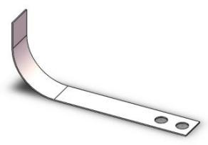  
（a）柔性铰链

  
（b）铝活塞薄板

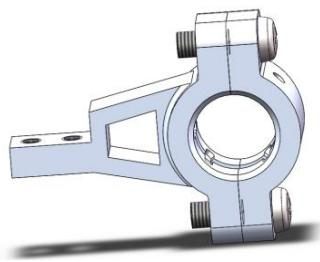  
(c) 连杆

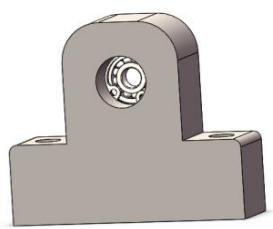  
（d) 轴承座  
(e) 曲轴  
图3.5 各零部件三维结构图

该活塞式声驱动器由一种高速无刷直流电机驱动，搭配60A无刷电调与多功能数字信号发生器一起使用，电机需要一种大功率电源供电，电机转速最高可达50000r/min，供电电压需高于电机的额定电压，电流也需高于电机额定电流，电源选择鼎麒DQ可调电源，电压最大值30V，功率可达3000W，电机的转速值可通过改变电压值进行粗调和调节电调信号发生器进行细调，其性能参数如表3.2所示。

表3.2 驱动电机性能参数
<table><tr><td>金刚3660直流无刷直流电机</td></tr><tr><td>伏特数1750</td></tr><tr><td>功率 1200W</td></tr><tr><td>最大电压&lt;28V</td></tr><tr><td>最大电流43A</td></tr><tr><td>转子级数4</td></tr><tr><td>最大转速50000r/min</td></tr><tr><td>电机轴尺寸φ5 l17mm</td></tr></table>

## 3.4.1 曲轴的设计

曲轴采用304不锈钢材质，耐磨性好，屈服强度大，光洁度高。曲轴总长82mm，连杆轴径直径8mm，长8mm，主轴径5mm，粗糙度做到0.8，这样保证其光洁度高，减小运转过程中的摩擦，结构示意图如图3.6所示。曲轴与电机轴通过弹性联轴器连接，该联轴器主要特点是质地轻，极限转速高，性能参数如表3.3所示。

表3.3 弹性梅花联轴器性能参数表
<table><tr><td>ALD20弹性梅花联轴器</td></tr><tr><td>材质 7075 铝合金</td></tr><tr><td>内孔径5mm外径25mm</td></tr><tr><td>额定扭矩2.16N·m</td></tr><tr><td>最大扭矩4.32N·m</td></tr><tr><td>极限转速45000r/min</td></tr><tr><td>惯性力矩  $1 . 9 \times 1 0 ^ { - 7 } { \mathrm { k g } } \cdot { \mathrm { m } } ^ { 2 }$ </td></tr></table>

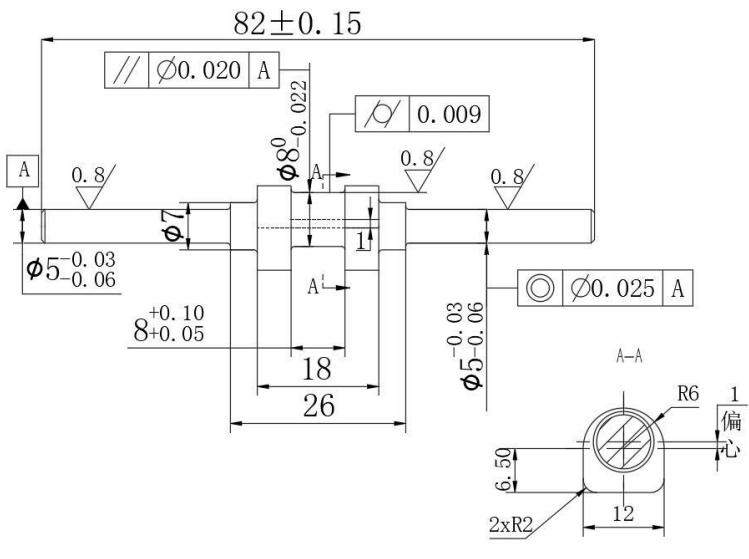  
(a) 尺寸结构图

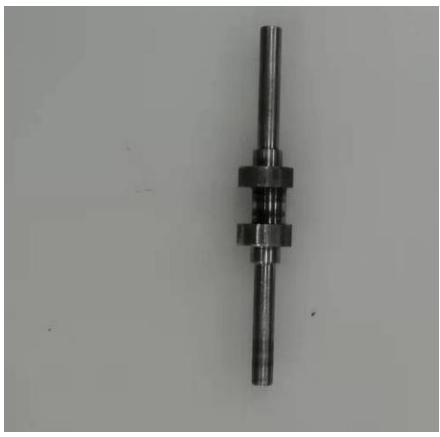  
（b）实物图  
图 3.6 曲轴结构示意图

## 3.4.2 轴承座的设计

曲轴两端用轴承座支撑，尺寸结构示意图3.7所示。轴承座里装配有日本进口微型NSK深沟球轴承，型号619/5-ZZ，材质进口轴承钢，噪音小、转速高、寿命长，在声驱动器高速运转的情况下能够起到减小曲轴摩擦、支撑曲轴的作用，通过孔用卡簧将其卡死在轴承座里，防止其轴向移动。

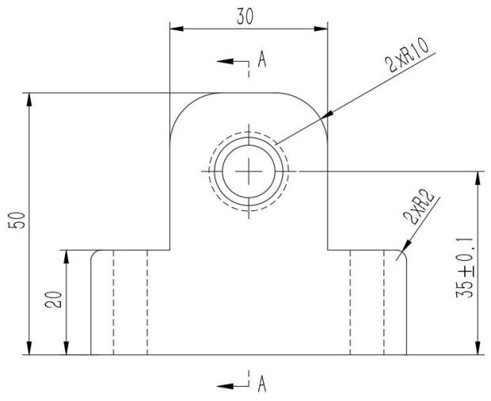  
(a) 主视图  
图 3.7 轴承座结构示意图

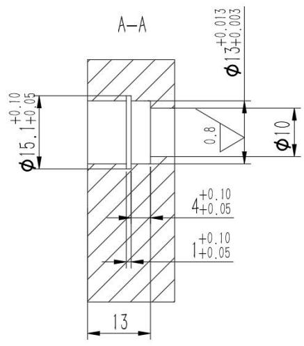  
（b）剖视图

## 3.4.3 连杆的设计

连杆材质采用7075铝合金，屈服强度大、质地硬、耐磨性高、相应的密度要比其他金属材料小很多，大大的减小了结构质量，粗糙度值做到0.8，使其表面光洁，减小与曲轴之间的摩擦。连杆端盖与连杆体内孔上设有油槽，省去轴瓦结构，减小了连杆质量且起到储油润滑的作用，尺寸结构示意图如图3.8所示。连杆端盖与连杆体通过M2.5-8小螺钉锁紧到偏心轴上。

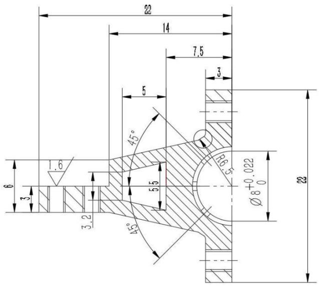  
（a）正面刨视图

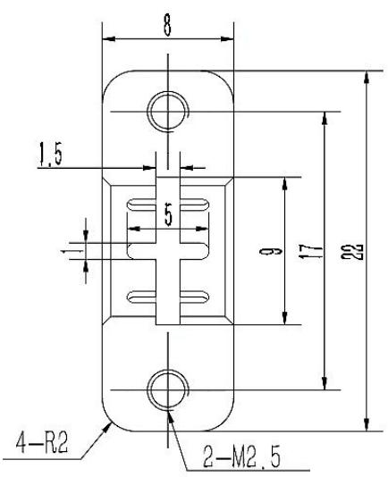  
（b）侧视图  
图 3.8 连杆尺寸结构示意图

## 3.4.4 柔性铰链的设计

柔性铰链在一定受力情况下有弹性变形的特性，可以代替原有连杆小头，简化连杆结构，降低连杆的质量，使得机构在超高速运转的轻况下大大减小驱动机构往复惯性力。柔性铰链，材质弹簧钢，厚度0.2mm，宽度5mm，一端开两个直径2.2mm的通孔，通过M2-5小螺钉禁固在连杆尾部，另一端通过强力金属粘接剂固定在振动薄板中心处，结构示意图如图3.9所示。

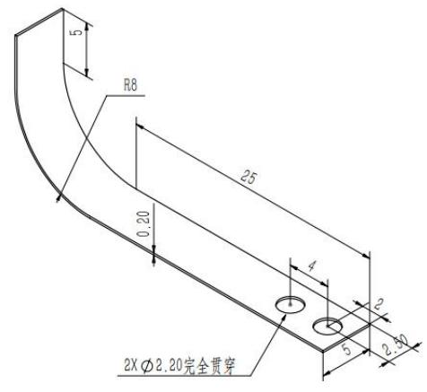  
(a) 尺寸结构图

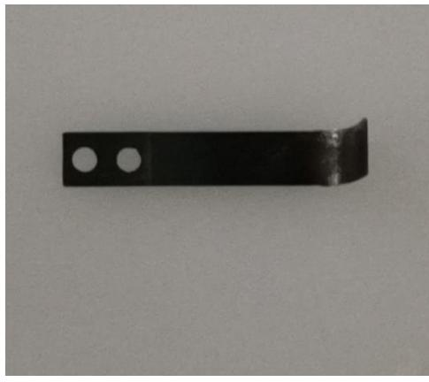  
（b）实物图  
图3.9 柔性铰链结构示意图

## 3.4.5 活塞振动薄板的设计

振动薄圆板是该声驱动器的核心部件，结合第二章圆形平面活塞辐射特性分析对于该声驱动器振动薄圆板的设计一般应该考虑以下几个问题：

（1）功率，理论分析和实验表明，当辐射板的直径一定、声传播的介质一定，激励频率一定时，驱动器以一阶振动形式振动时输出功率最大，由于此时驱动器振动板上所有点都作同相运动，振幅值达到最大，所以在设计声驱动器时，应该一阶固有频率设计到与工作频率相等，达到大功率和高效率的能量转换。

（2）要有良好的幅频特性。

（3）振动薄圆板的形状、直径、材质、厚度、振幅等影响声场强度、声辐射角、指向性等声场分布参数。

（4）在高频、大振幅的冲击下振动薄圆板要有一定的刚度。

（5）驱动器振动薄板材质除满足外界环境条件外，其弹性模量E、密度ρ等影响其自身固有频率。

振动薄圆板振动时辐射出的声功率与其阻抗有关，高频工作时辐射阻起主要作用，辐射声功率由式3.10确定[72]。

$$
\mathsf { W } = 0 . 5 \rho \mathrm { C } \mathrm { S v } ^ { 2 }\tag{式3.10}
$$

式中，W辐射声功率， $\rho \mathrm { . }$ 是介质密度，S是薄圆板面积，v是薄圆板振动速度，C

为声速。当声功率、频率为定值时，由式3.10便可确定出振动薄圆板的面积及其直径[9]。

对于模型为圆形的振动薄板，其活塞振动时固有频率可表述为：

$$
\mathrm { p } = \lambda ^ { 2 } \mathrm { h } \sqrt { \mathrm { E } / 3 \rho ( 1 - \mu ^ { 2 } ) } / 4 \pi \mathrm { a } ^ { 2 }\tag{式 3.11}
$$

式中， $\boldsymbol { \mathrm { p } }$ 为薄圆板的固有频率，h为薄圆板的厚度，λ为边界条件系数，周边固定并出现活塞振动时可取3.196， $\mu { _ { - } }$ 为泊松比， $\rho .$ 为板材料密度， $\mathbf { a }$ 为半径，E为薄圆板的弹性模量。

当运行频率与振动薄圆板的半径确定时，可由式3.11确定板的厚度，总之声驱动器的振动薄圆板的固有频率由其弹性模量、规格尺寸、工作频率等确定。除此之外，在设计振动薄圆板时还要考虑板要有一定的抗冲击性，最终对于振动薄圆板采用的是0.1mm厚的65Mn淬火弹簧钢，直径74mm，这种材质具有很高的韧性符合作为驱动器的振动板。

振动薄板通过金属粘接剂与柔性铰链粘接固定，粘合强度大，可承受住往复惯性力冲击带来的损坏。粘接固定方式简便省去了传统复杂的机械固定方式，大大减小了往复质量。振动薄板通过强力胶水粘接到喇叭橡皮边圈内边缘上，喇叭橡皮边圈外边缘与固定橡胶密封圈粘接，固定橡胶密封圈外圆周边涂抹胶水粘接到谐振管适合位置振动薄板与喇叭橡皮圈、橡胶密封圈装配结构示意图如图3.10所示。

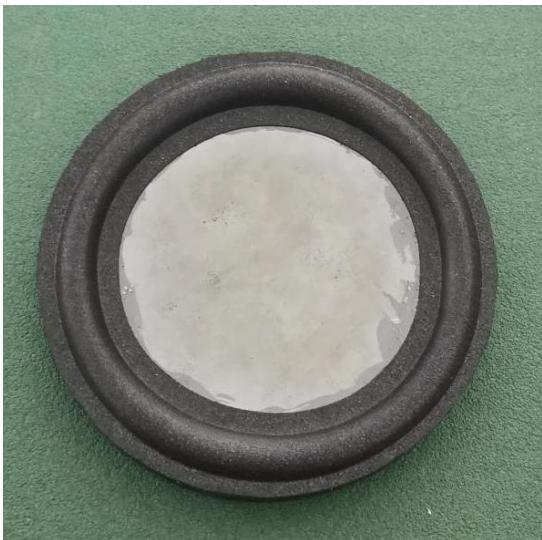  
图3.10 振动板装配体结构示意图

## 3.5 本章小结

本章主要介绍了用气柱的活塞模态振动代替驻波振动的可行性以及原因，而后在此基础上自行设计了一款高频、大振幅的活塞式声驱动器，驱动器的振幅、频率可调，具有单位体积能量密度大、大振幅的特点，可提供较大的声功率输出，实现谐振腔内气体工质强烈的交变流动。在设计过程中包括阐述了基本要求与设计思想，以及分析了影响驱动机构运转时惯性力的因素，并降低了惯性力，最后对声驱动器中各个零部件的详细设计与制作工艺进行了详细阐述。

## 4 热声制冷装置的搭建与谐振腔内气柱的模态分析

为了实现谐振管里工质的大幅交变流动，提高热声制冷机的制冷效果，在热声理论的基础上，相继搭建了热声制冷机实验装置，主要由声驱动器、谐振管、热声堆、换热器、谐振管调节装置、实验平台等组成，如图4.1所示。

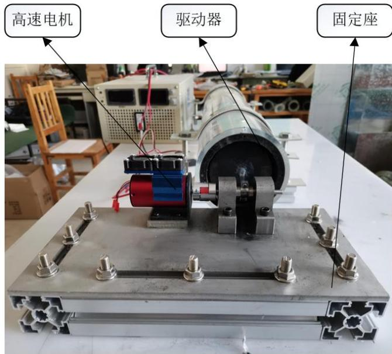  
（a） 主视图

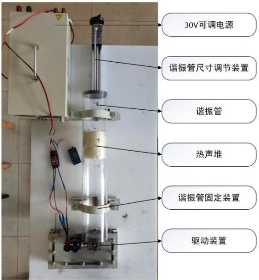  
（b）俯视图  
图4.1 热声制冷机实验装置

## 4.1 工质气体工况参数的选择

## （1）工质气体的选择

热渗透深度 $\delta _ { \mathrm { k } }$ 与粘性渗透深度 ${ \delta _ { \mathrm { v } } }$ 是选择工质气体时需要考虑的因素。由于热渗透深度越大，固体板叠与气体之间的热量交换也越大，热声转换效率越高，而粘性渗透深度越大，则板叠与工质气体之间的摩擦会越大，导致声功损耗增加，降低了热声转换效率。理想的气体应该同时具有大的 $\delta _ { \mathrm { k } }$ 与小的 $\delta _ { \mathrm { v } }$ ， $\delta _ { \mathrm { k } }$ 与 $\delta _ { \mathrm { v } }$ 之间的关系为[73,74]：

$$
\delta _ { \kappa } = \delta _ { \nu } / \sqrt { \sigma }\tag{式4.1}
$$

式中， $\sigma$ 为普朗特数，气体σ越小热声转换效率越高。本实验选取空气作为气体工质，空气在温度300K，标准大气压下的热物性参数如表4.1。

表4.1 常温常压下空气的物理性能参数
<table><tr><td>物理性能参数</td></tr><tr><td>声速  $a ( \mathrm { m } / s )$  347.21</td></tr><tr><td>密度  $\rho ( \mathrm { k g } / \mathrm { m } ^ { 3 } )$  1.177</td></tr><tr><td>比定压热容  $\mathrm { { C } _ { p } ( J / k g \cdot k ) }$  1005</td></tr><tr><td>热传导系数  $\operatorname { K } ( \mathrm { W / m } \cdot \mathrm { k } )$  2.564</td></tr><tr><td>普朗特数σ 0.707</td></tr><tr><td>压缩比γ 1.40</td></tr></table>

## （2）谐振腔内充气压力选择

谐振腔内充气压力增大，其内部声能密度也会增大，有利于提高热声制冷机的制冷效率，但谐振腔内的充气压力不能太大，还需考虑谐振腔本身的密封性与抗压能力，除此之外，充气压力越大，气体工质的普朗特数越大，致使工质气体与板叠之间的换热不彻底，从而降低了热声转换效率，本实验选择一个标准大气压。

## （3）工作频率以及谐振腔长度的选择

热声制冷机的工作频率的选取不但要考虑热声制冷机总长度，而且也要考虑谐振腔内的热渗透深度和粘性渗透深度。由公式 $\lambda = c _ { 0 } / f$ 可知，制冷机的工作频率越高，声波波长越小，越有利于实现制冷机微型化，但是随着工作频率的提高，热渗透深度就会减小，相应的板叠间距减小，这样不仅导致了板叠制作加工困难，还增加气体工质换热时的粘性损耗，本热声制冷实验装置中初设定谐振管长度为600mm。

## 4.2 板叠的设计

## （1）板叠的间距选择

热声效应发生在距离板叠一个热渗透深度范围内，板叠的间距不能太大，间距太大，气体与板叠之间热交换不完全，热声转换效率会降低；间距也不能太小，这样会导致工质气体之间粘性损耗，也会降低热声转换效率，设计时应尽量减小粘性损耗的影响，根据以往研究一般建议取板叠间距为 $2 \sim 5 \delta _ { \mathrm { k } }$ O

## （2）板叠长度的选择

板叠长度也是板叠设计中一个重要的参数指标，板叠的长度不宜太长，因为会导

致温度梯度减小，降低热声转换效率，但板叠长度也不宜太短，板叠长度太短，工质气体热转换不充分，不利于热声效应的发生，所以板叠的长度要有一个适宜的长度，可通过板叠的无量纲长度来确定板叠的长度。

$$
\begin{array} { r } { L _ { s n } = \frac { 2 \pi \cdot \Delta x } { \lambda } = \frac { 2 \pi f \cdot \Delta x } { c _ { 0 } } } \end{array}\tag{式4.2}
$$

式中， $c _ { 0 }$ 是无声扰动时的声速，f为工作频率， $\Delta x$ 为板叠的实际长度， $L _ { s n }$ 为板叠无量纲长度，一般取0.26，计算得出 $\Delta x = 9 7 m m$ o

## （3）板叠位置的选择

驻波型热声制冷机谐振腔内压力与速度的相位差为 $9 0 ^ { \circ [ 7 5 ] }$ ，在考虑板叠在谐振腔的位置时，要考虑到板叠的位置应避开压力波腹点与速度波腹点，当板叠放置在压力波腹处时，此时微气团气振荡最激烈，并伴随着最大的温度振荡，但是微气团的速度为零，微气团不在运动，热量无法进行传输。若把板叠放置在速度最大处，此时微气团不在振荡，无法产生温度振荡，因此也没有热量的传输，所以板叠应选择放置在压力波腹与速度波腹之间，根据以往的研究板叠的位置应距离压力波腹点 $\lambda / 8$ 处，既 $0 <$ $X _ { n } < 0 . 3 \mathrm { m }$ o

根据以上板叠的设计参数和对前期研究者成果的参考，初步考虑使用一种蜂窝状热声堆作为热声制冷装置中的板叠，与丝网状板叠相比流体通道更顺畅，减小了声功损耗，且制作工艺流程简单，能够很好地起到板叠的作用。选择蜂窝孔径1mm，相邻孔距1mm，长度100mm，如图4.2所示，分别为不锈钢，黄铜，毛细玻璃三种材质的热声堆。

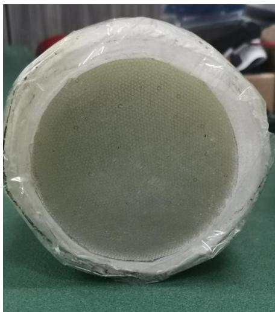  
（a）毛细玻璃材质多孔热声堆

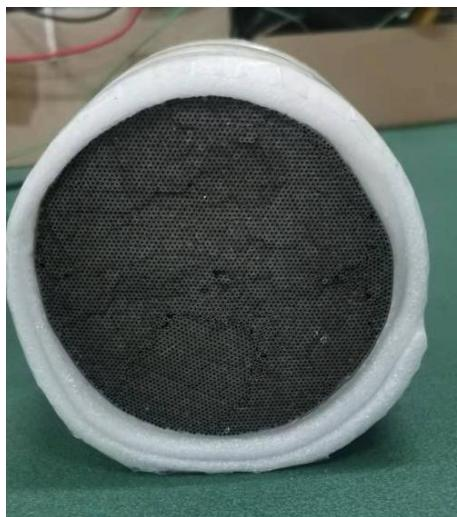  
（b）不锈钢材质孔热声堆

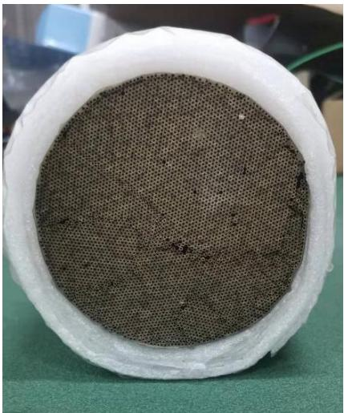  
（c）黄铜材质热声堆

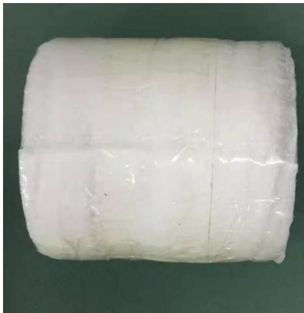  
（d）热声堆侧视图  
图4.2 不同材质热声堆结构示意图

## 4.3 谐振管尺寸调节装置的设计

热声制冷机谐振腔的长度一般都设计成四分之一波长或者二分之一波长，由公式$\lambda = { \mathrm { c } } _ { 0 } / { \mathrm { f } }$ 可知，谐振管的长度影响着激励频率，或者也可以说激励频率影响谐振管的长度。为了便于热声制冷机谐振腔的尺寸调节，使与制冷系统相匹配，在整个系统中产生谐振声场，设计了一种谐振腔长度可调节的装置，主要由手动滚珠丝杠、推杆角件、直轴、密封圈、尺寸调节板等组成，结构示意图如图4.3所示。

（b）侧视图  
(a) 主视图  
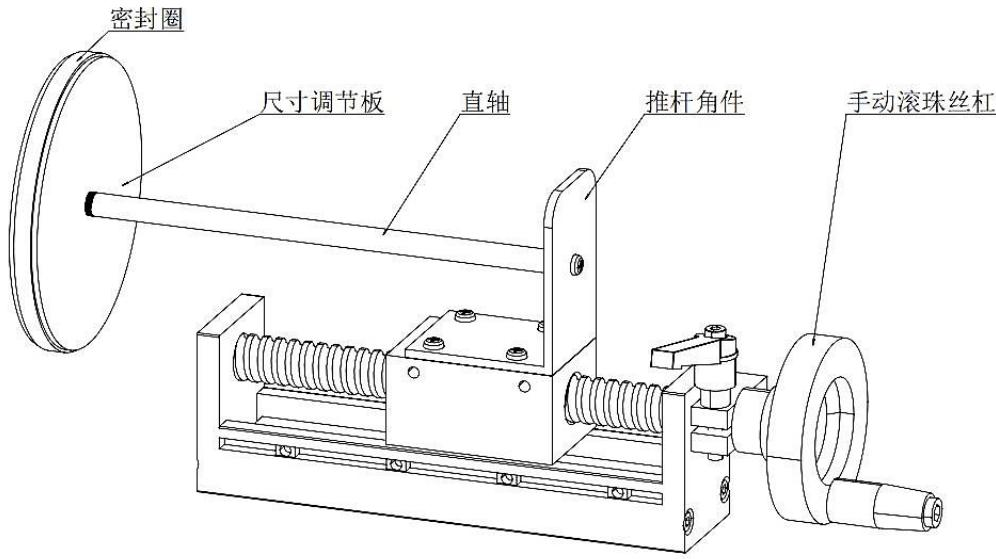  
图4.3 谐振管尺寸调节装置结构示意图

将尺寸调节圆板装置于热声制冷机谐振管内，通过手动滚珠丝杠推动调节圆板在谐振管内向前移动，进而改变合适的谐振管长度，尺寸调节圆板厚度10mm，圆板中心位置设有M8-8的内螺纹孔，沿圆板周向位置铣出宽度8mm，深度5mm的沟槽，装有密封条，并防止密封圈滑脱，尺寸结构示意图如图4.4所示。直轴直径8mm，一端车出M8-15的外螺纹，另一端开有一个M-5的内螺纹，便于与尺寸调节板和推杆角件相连接。

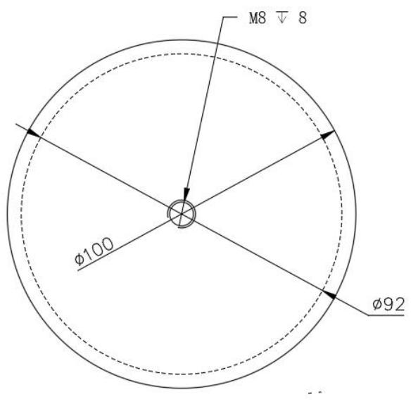

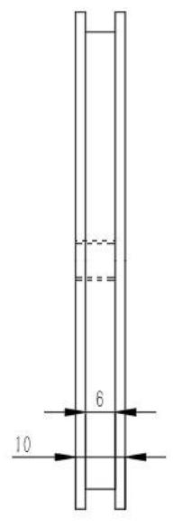  
图4.4 调节圆板尺寸结构示意图

## 4.4 谐振腔内气柱的模态分析

模态是结构的固有属性，结构的任意阶模态都有自己特定的固有频率、振型、以及阻尼比。模态分析法包括有限元模态分析和实验模态分析两种，有限元模拟分析法是从理论计算出发得出结构的固有特性参数，需要知道结构的密度、弹性模量、几何形状等物理参数。

热声制冷机谐振腔内气柱模态分析是研究谐振管内气柱振动的基础，谐振腔内的气柱是一个有质量的弹性振动系统，它有自己的一系列固有频率。谐振腔一端振动薄板周期性振动时，会引起气柱相应的振动，当振动薄板的固有频率与气柱的固有频率相等时，会发生共振，此时气柱的位移增大，会激发出更强烈的声场，对谐振腔内气柱进行模态分析，可求出气柱振动时的一阶固有频率，进而研究不同工况下谐振腔内声场分布的实验研究。

## 4.4.1 模型的建立

通过仿真软件ANSYS 创建一个直径为100mm，长度为600mm，壁厚为5mm的谐振腔内气柱模型，并对其进行自由模态分析。选择“ANSYSFLUID”分析类型，设置单元类型为“3Dacoustic30”（既三维声学单元），设置环境温度为 $2 6 \mathrm { { ^ \circ C } }$ ，结构密度为 $1 . 2 0 5 \mathrm { k g } / \mathrm { m } ^ { 3 }$ ，声速为 $3 4 6 \mathrm { m } / s$ ，对边界进行约束，闭口的一端设置 $\upsilon = 0$ 开口的一端设置 $\mathfrak { p } = 0$ ，设置模型网格密度为0.01m，网格划分示意图如图4.5所示。

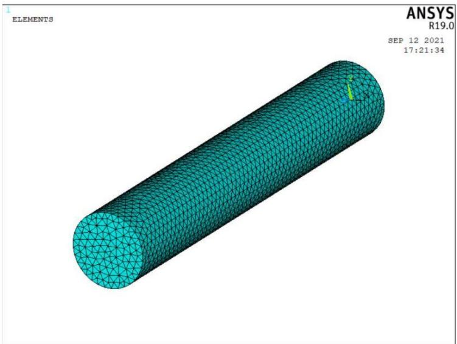  
图4.5 管道气柱网格划分示意图

## 4.4.2 计算结果及分析

使用非对称法对谐振管内气柱进行自由模态分析，计算出气柱前60阶固有频率，取前10阶气柱固有频率的结果列入表4.2中，图4.6、图4.7为气柱的各阶振型图。

表 4.2 600mm 谐振管前 10 阶气柱固有频率
<table><tr><td>阶次</td><td>1</td><td>2</td><td>3</td><td>4</td><td>5</td><td>6</td><td>7</td><td>8</td><td>9</td><td>10</td></tr><tr><td>f/Hz</td><td>145</td><td>432</td><td>721</td><td>1010</td><td>1300</td><td>1590</td><td>1882</td><td>2045</td><td>2046</td><td>2086</td></tr></table>

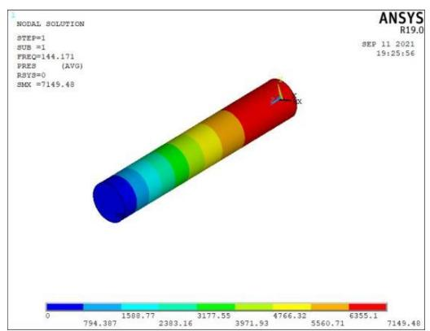  
（a)第1阶f=145Hz

  
（b）第2阶f=432Hz

  
（c）第3阶f=721Hz

  
（d）第7阶f=1882Hz  
图4.6 轴向对称分布振型

  
（a）第8阶f=2045Hz

  
（b）第9阶f=2086Hz

  
（c）第15阶f=2281Hz

  
（d）第 60阶 f=4325Hz  
图4.7 非轴向对称分布振型

从上述模态分析可以得知谐振腔内气柱活塞模态振动时的一阶固有频率为145Hz，刚好在驱动器的激励频率范围内（0\~833Hz），并且从振型图上可以得出，不同阶气柱振型分布是不同的，前7阶谐振腔内气柱的振型沿着轴向对称分布，7阶到60阶气柱的振型分布不呈现轴向对称分布，且频率越高，振动形态越复杂，有了高次谐波的出现。可根据仿真结果进行相应的实验研究，探索驱动器激励频率等于基频时对制冷机谐振腔内的声场强度的影响。

## 4.5 本章小结

本章设计搭建了热声制冷机实验装置，包括实验平台座的设计、板叠的设计、谐振管尺寸调节装置的设计，以及气体工质工况参数的选择等。应用仿真软件Ansys采用非对称法对直径100mm，壁厚0.5mm谐振腔内气柱进行了自由模态分析，得到谐振管内的气柱活塞模态振动时基频为145Hz，且前7阶谐振腔内气柱振型沿着轴向对称分布，而7阶到60阶气柱的振型分布不呈现轴向对称分布，有了高次谐波的出现，为后续的实验研究提供了基础。

## 5 大振幅热声制冷机的实验研究

为研究气柱的活塞模态振动代替驻波振动对提高制冷机谐振内声场强度的可行性，以及在激励频率为基频时对谐振腔内声压幅值的影响，本章将根据上一章谐振腔内气柱自由模态分析的结果，进行了实验研究与分析，主要有以下几个方面：

（1）通过调节声驱动器的激励频率，测量活塞式声驱动器驱动的热声制冷实验装置的谐振腔内的声压值，研究了气柱在一阶模态下对谐振腔内声场分布的影响。

（2）激励频率为基频时，调节驱动器振幅，研究不同振幅对谐振腔内声压值的影响。

（3）谐振腔内有无板叠对声压值的影响。

（4）通过改变声驱动器的激励频率与振幅，研究热声制冷装置的制冷效果。

（5）改变板叠在谐振腔内的位置，研究板叠的位置对热声堆两端的温度的影响。

## 5.1 实验采集系统

实验数据采集系统是将传感器输出的模拟信号转换成计算机可以识别的数字信号，传输到计算机，然后通过数据处理环节达到了解掌握被研究对象的实际过程。实验数据采集系统包括：采集对象、声压传感器、计算机、信号采集卡、数据采集处理软件。实验数据采集系统如图5.1所示。

  
图5.1 实验数据采集系统实物图

## （1）采集软件

本实验所用的数据采集处理的软件是一种名为DEWESoft7软件，DEWEsoft是奥地利德纬创公司设计的一款测试平台，具有简便的编程方式，类型丰富的分析和表达等功能，是一个完整的、集成的、基于测试的工程解决方案，有数据采集和后处理功能，基于DEWEsoft的这些特点，选择其作为本次声压数据采集的软件系统。

## (2）采集硬件

硬件采集卡选用的是DT9837便携式动态信号采集器，常用于振动、噪声、速度信号的采集测量，设计精致小巧、USB直接供、4通道同步、每通道52kHz/100kHz、同步采集 24 位、Delta-SigmaA/D 转换、支持IEPE(ICP©)输入、提供 4mA 电流、AC 或 DC耦合，适用高精度测量广泛应用外场和实验室测试。

## （3）声压传感器

型号为MPA461传声器作为本实验谐振腔内声压信号采集所用的传感器，该传感器具有精度性能高、结构简单、使用方便、价格低、体积小的特点，表5.1为MPA461传声器性能参数。

表 5.1 MPA461 传声器性能参数
<table><tr><td>规格型号</td><td>频率响应 /(Hz)</td><td>供电方式 输出阻抗</td><td></td><td>灵敏度</td><td>输出信号 形式</td><td>长度 /(mm)</td></tr><tr><td>MPA461 传声器</td><td>20~20k</td><td>直接USB 供电</td><td>&lt;110Ω</td><td>51.3mV/Pa</td><td>交流电压</td><td>61</td></tr></table>

## （4）温度采集仪

温度的测量使用的是斯派克数字温度测量仪搭配k型热电偶测温线，k型热电偶由镍铬合金制成，测量接头有体积小、热容小、反应灵敏、测量速度快等特点。温度测量仪性能参数如表5.2所示。

表5.2 数字温度测量仪性能参数
<table><tr><td>规格型号</td><td>测量范围</td><td>测量介质</td><td>感应器</td><td>分辨率</td><td>输入</td></tr><tr><td>DT1320</td><td>-5℃~204℃</td><td>液体、气体、固 体</td><td>K型热电 偶</td><td>0.1℃</td><td>双通道</td></tr></table>

## 5.2 实验注意事项

（1）检漏，对于热声制冷实验，需要保证制冷机谐振腔与驱动器、尾部调节装置连接处的密封问题，避免因为漏气影响实验效果。

（2）系统检漏测试后，向谐振腔充满工质气体，调整到实验所需的压力。

（3）检查测量系统各个测量元件电路系统是否正常，供电方式是否安全。

（4）接通电源，对所设计的声驱动器与以及传感器进行预备测试。

（5）设置调节好数据采集软件参数，调节制冷系统实验所需的参数。

（6）结束实验，关闭采集软件、各个传感器与电源。

（7）分析处理实验数据。

## 5.3 谐振腔内声压值的测量

对于热声系统，压力信号的采集尤为重要，它是反映谐振腔内声场强度的关键参数。谐振腔内声压值越大，声场强度越大，越有利于制冷机的制冷效果。

## 5.3.1 声压测点的分布

分别沿谐振腔轴向方向布置声压测点的位置，距离激励端50mm作为第一测点、距离激励端250mm作为第二测点、距离激励端350mm作为第三测点、距离激励端500mm作为第四测点，声压的测点分布示意图如图5.2所示。

  
图 5.2 声压测点分布示意图

## 5.3.2 实验结果与分析

## （1）同频率、不同振幅谐振腔内的声压

依据模拟仿真结果，首先在激励频率145Hz，驱动器振幅0.5mm，空气作为工作介质，充气压力为 $1 . 0 \times 1 0 ^ { 5 } \mathrm { P a }$ ，常温、常压环境的工况下运行，设置采集软件采样频率为10000Hz，调节好传感器的灵敏度，以及输出信号形式。将声压传感器布置在谐振腔内采集一段时间，记录并保存数据，实验数据采集结果如图5.3所示。

（a）第一个测点声压值随时间的分布曲线  

（b）第二个测点声压值随时间的分布曲线  
  
（c）第三个测点声压值随时间的分布曲线

  
（d）第四个测点声压值随时间的分布曲线  
图5.3 频率145Hz、振幅0.5mm 谐振腔内各个位置的声压曲线图

从图5.3可以看出在激励频率为145Hz，驱动器振幅为0.5mm时，在平均充气压力1MP的工况下，谐振腔内声压可最大可达到接近130.26dB，且谐振腔内声压值沿谐振管轴向方向逐渐增大，在管末端出现声压最大值，在激励端出现声压最小值。

同样选取激励频率为145Hz，空气作为工作介质，充气压力为 $1 . 0 \times 1 0 ^ { 5 } \mathrm { P a }$ ，驱动器振幅分别为1mm、1.5mm的工况下运行，调节好传感器的灵敏度，以及输出信号形式声压数据测量结果分别如图5.4、图5.5所示。

  
（a）第一个测点声压值随时间的分布曲线

  
（b）第二个测点声压值随时间的分布曲线

（c）第三个测点声压值随时间的分布曲线  
  
（d）第四个测点声压值随时间的分布曲线

图5.4 频率145Hz、振幅1mm谐振腔内各个位置声压曲线图  

（a）第一个测点声压值随时间的分布曲线  
  
（b）第二个测点声压值随时间的分布曲线

（c）第三个测点声压值随时间的分布曲线  
  
（d）第四个测点声压值随时间的分布曲线  
图5.5 频率145Hz、振幅1.5mm谐振腔内各个位置声压曲线图

分别将图5.4、图5.5与图5.3做比较发现，当激励频率都为145Hz（基频）时，活塞式驱动器振幅越大，谐振腔轴向各个位置的声压值越高。驱动动器振幅1mm、1.5mm时谐振管内的声压值可达132dB，可以看出当驱动器振幅增大时，声压值也随着增大。有利于提高制冷机谐振内的声场强度。

## （2）同振幅、不同激励频率下谐振内的声压

为了研究激励频率不同频率对谐振腔内声压幅值的影响，又分别在激励频率为73Hz、290Hz，驱动器振幅0.5mm的情况下进行了实验研究。选取空气为工作介质，充气压力为 $1 . 0 \times 1 0 ^ { 5 } \mathrm { P a }$ ，谐振腔长度600mm，常温、常压环境下采集沿轴向谐振腔内各个位置的声压，实验数据采集结果如图5.6所示、5.7所示。

（a）第一个测点声压值随时间的分布曲线  

（b）第二个测点声压值随时间的分布曲线  

（c）第三个测点声压值随时间的分布曲线  
  
（d）第四个测点声压值随时间的分布曲线  
图 5.6 频率290Hz、振幅0.5mm 谐振腔内各个位置声压曲线图

（a）第一个测点声压值随时间的分布曲线  

（b）第二个测点声压值随时间的分布曲线  

（c）第三个测点声压值随时间的分布曲线  
  
（d）第四个测点声压值随时间的分布曲线  
图5.7 频率73Hz、振幅0.5mm谐振腔内各个位置声压曲线图

通过与图5.3所比较发现，当激励频率为73Hz、290Hz，振幅0.5mm时谐振腔内的声压值最大分别为54Pa，63Pa，而在基频145Hz，振幅0.5mm时时谐振腔内的声压最大值66Pa，表明当激励频率等于基频时，谐振腔内的气柱振动位移更大，更有利于谐振腔内声场强度的提高。

## （3）板叠对谐振腔内声压值的影响

同样在常温、常压环境下工作，选取空气作为工作介质，充气压力为 $1 . 0 \times 1 0 ^ { 5 } \mathrm { P a }$ 激励频率为145Hz，驱动振幅为0.5mm，把热声堆放入到谐振腔内适当的位置，沿谐振腔轴向对其中两个位置的声压采集，测量结果如图5.8所示。

（a）第一个测点声压值随时间的分布曲线  
  
（a）第二个测点声压值随时间的分布曲线  
图5.8 频率145Hz、振幅0.5mm有板叠时谐振腔内声压曲线图

通过对比图5.3可以发现，当在谐振内适当位置放入热声堆时要比谐振腔内没有热声堆时声压值更大，没有板叠时谐振内声压值分别为43pa、55pa，而有热声堆时谐振内声压值为46pa、64pa，说明了谐振腔内适当位置放入热声堆会提高谐振腔内的声压值，有利于谐振腔内声场强度的提高。

上述是不同因素对热声制冷机谐振腔内声场强度影响的实验研究，在基频145Hz，驱动器振幅1.5mm时，管内声压值可达132dB左右，证明了用气柱的活塞模态振动代替驻波振动可以提高制冷机谐振腔内的声场强度。通过对近年来各大高校文献的阅读，总结了各大高校不同驱动源的热声制系统谐振腔内声压幅值研究情况，如表5.3所示。

表5.3国内各高校热声制系统谐振腔内声场强度的研究进展
<table><tr><td>研究单位</td><td>驱动源</td><td>运行工况</td><td>声压幅值</td></tr><tr><td>本文所设计</td><td>活塞式声驱动器</td><td>激励频率  $1 4 5 \mathrm { H z } ,$  活塞 振幅1.5mm</td><td>132dB</td></tr><tr><td>华中科技大学</td><td>压电驱动器</td><td>谐振频率 5539Hz</td><td>130dB 左右</td></tr><tr><td>东南大学</td><td>扬声器</td><td>基频928Hz、二倍频 1969Hz</td><td>93dB、96dB</td></tr><tr><td>北京航天航空大学</td><td>能源与动力工程学扬声器（8Ω、80W）</td><td>驱动频率 315Hz</td><td>106dB</td></tr><tr><td>院</td><td></td><td>激励频率 6000Hz 辐</td><td></td></tr><tr><td>内蒙古科技大学</td><td>磁致伸缩换能器 扬声器</td><td>射板位  $6 . 7 4 1 \times 1 0 ^ { - 7 } \mathrm { m }$  工作频率 745Hz</td><td>108dB 118dB 左右</td></tr><tr><td>华南理工大学</td><td>热声斯特林发动机</td><td>内部工质气体压力</td><td>&lt; 0.2Pa</td></tr><tr><td>北京工商大学</td><td>加热热声源</td><td>1.0MPa 和 1.5MPa 热源功率 600W</td><td>&lt; 115dB</td></tr></table>

## 5.4 制冷效果的实验研究

将热声堆置于谐振腔内适当的位置，研究不同因素对制冷装置的制冷效果影响，本次实验热声堆两端温度的测量使用的是斯派克数字温度测量仪搭配k型热电偶测温线，温度测量仪如图5.9所示。

  
图 5.9 温度测量仪

## 5.4.1 温度数据采集及分析

## （1）不同激励频率对制冷效果的影响

为探究活塞式声驱动器不同激励频率下制冷机的制冷效果，选择驱动器振幅0.5mm工质气体为空气，充气压力为1.1MP，取谐振管长度为600mm，将毛细玻璃材质的热声堆放置于距离尾部100mm处，并把热电偶式温度测量仪接到热声堆两端，然后打开供电装置，调节电源电压与脉冲信号发生器，使其激励频率分别为145Hz（基频）、290Hz、433Hz，运行10分钟观察并记录冷端的温度 $T _ { 1 }$ ，热端的温度 $T _ { 2 }$ 以及温差 $T _ { 1 } - T _ { 2 }$ 。然后在通过谐振腔尾部推动板调节谐振腔尺寸为500mm，450mm，独立运行10分钟，记录热声堆两端的温度以及温差实验结果如表5.4所示。

表5.4 热声堆冷热端温度
<table><tr><td>谐振管长度 /mm</td><td>供电电压、脉 冲数</td><td>激励频率 /Hz</td><td>热端  $\mathrm { T } _ { 1 } / { } ^ { \circ } \mathrm { C }$ </td><td>冷端  $\mathrm { T } _ { 2 } / { } ^ { \circ } \mathrm { C }$ </td><td> $\mathrm { T } _ { 1 } - \mathrm { T } _ { 2 } / ^ { \circ } \mathrm { C }$ </td></tr><tr><td>500</td><td>12V1945</td><td>173</td><td>19.2</td><td>16.0</td><td>3.2</td></tr><tr><td>450</td><td>12V1954</td><td>158</td><td>18.0</td><td>15.0</td><td>3.0</td></tr><tr><td rowspan="3">600</td><td>10V 1953</td><td>145</td><td>18.5</td><td>13.5</td><td>5</td></tr><tr><td>10 V 2186</td><td>290</td><td>19.6</td><td>15.8</td><td>3.8</td></tr><tr><td>15V 1860</td><td>433</td><td>19.2</td><td>14.9</td><td>4.3</td></tr></table>

从表5.4中可以看出驱动器激励频率越大，热声堆两端温差越大，但在基频状态下热声堆两端的温降最为明显，这是因为基频状态发生了共振，气柱的位移增大，谐振腔里声场强度也增大，导致制冷效果更好。

## （2）热声堆位置对制冷效果的影响

本次实验还针对热声堆在谐振腔位置进行了实验研究，选取谐振管长度600mm，在激励频率为145Hz和290Hz，驱动器振幅0.5mm的情况下，将热声堆分别放置于谐振腔末端150mm处，靠近中部位置以及激励端50mm处，然后运行10分钟，记录实验结果如表5.5所示。

表5.5 热声堆不同位置时冷热两端温差
<table><tr><td>激励频率/Hz</td><td>热声堆位置</td><td>温差/℃</td></tr><tr><td rowspan="3">290</td><td>谐振管尾部150mm处</td><td>2.5</td></tr><tr><td>谐振管中间</td><td>2.8</td></tr><tr><td>激励端50mm处</td><td>4.8</td></tr><tr><td rowspan="3">145</td><td>谐振管尾部150mm处</td><td>3.2</td></tr><tr><td>谐振管中间</td><td>3.1</td></tr><tr><td>激励端50mm处</td><td>6.0</td></tr></table>

从表5.5中我们可以明显的发现在把热声堆靠近激励端处温差有很大的变化，且在实验的过程当中发现温度的变化速率要比热声堆在其他位置是变化的快，表明热声堆的位置影响制冷机的制冷效果，越靠近谐振管激励端温差效果会越好。

通过对制冷机制冷效果的实验研究发现，改进后热声制冷机实验结果与预期结果有一定的差距，分析其原因主要有以下两个方面：由于系统本身在密封性上做的不够严谨，尤其在驱动端与谐振腔的连接处没能做到完全密封，这可能对制冷效果产生一定的影响，从而影响冷端温度的降低；另外一个就是由于热声堆没能够严格的按照理论要求制作，这就可能影响了热声堆内气体流道形状，进而影响了板叠内的热声转换效率。针对这些原因，下一步需要对系统进行加强制冷系统的密封措施，减少工质气体的外漏，寻求更佳的热声堆制作方法，以保证其流道规则不变形，减少对系统制冷性能的影响，同时也会从其他方面去考虑是什么影响系统的制冷效果，比如工质气体的选择、谐振腔内的充气压力、实验环境等等。

## 5.5 本章总结

本章主要介绍了由本文所设计的活塞式声驱动器驱动的热声制冷机谐振腔内声压与制冷效果的实验研究，第一部分是不同工况对谐振腔内声场强度的影响，得出驱动器振幅越大，谐振腔内的声压值越高，声场强度越大；驱动器的激励频率与基频相等时谐振腔内的声场强度最大：谐振腔内板叠会影响制冷机的声场强度，谐振腔内有板叠时比无板叠时声压值更大。第二部分是对制冷机制冷效果的实验研究，得出驱动器激励频率越大，热声堆两端温差越大，但在基频状态下热声堆两端的温降最为明显；板叠越靠近激励端口温降变化越明显，且温降变化速率快。

## 6 结论与展望

## 6.1 结论

为了满足当代热声制冷机声驱动器对高声强声源的需求，解决热声制冷机声驱动器驱动力不足的问题，本文以热声效应理论为基础，对目前所存在的问题进行了分析与研究，提出用气柱的活塞模态振动代替驻波振动这一思想，设计了一种活塞式的大振幅声驱动器，频率可达800多Hz，振幅可达1.5mm。通过仿真计算出了气柱自由模态振动时固有频率，根据仿真结果对该声驱动器驱动的热声制冷机进行了声压采集和制冷效果的实验研究，得出的结论如下：

（1）通过对不同工况下制冷机谐振腔内声场分布的实验研究发现：①驱动器的振幅越大，制冷机谐振腔内声压幅值越高，声场强度越大。②在驱动器工作频率与气柱的基频相等时，谐振腔内声压幅值要高于其他激励频率下的声压幅值，表明制冷机驱动频率与基频相等时，气柱振幅增大，有利于制冷机声场强度的提高。③制冷机板叠的存在会影响谐振腔内的声压，制冷机中有板叠的情况下声压值更高。

（2）在对制冷机制冷效果的实验研究时发现：①驱动器激励频率越大，热声堆两端温差越大，但在基频状态下热声堆两端的温降最为明显，表明制冷机运行频率与基频相等时，谐振腔内声场强度更高，气柱交变流动更强，制冷效果更好。②热声堆在谐振腔内的位置对制冷机制冷效果有一定的影响，热声堆越靠近激励端时，热声堆两端的温度差越大，制冷效果越明显。

(3)在基频145Hz、驱动器振幅1.5mm时，所设计的声驱动器声压幅值可达132dB， 较以往研究很大程度地提高了制冷机谐振腔内的声压幅值，表明了用气柱的活塞模态振 动代替驻波振动的确可以提高制冷机谐振腔内的声场强度。

## 6.2 展望

（1）由于热声制冷装置密封性、热声堆结构、实验环境等原因，得到的谐振腔内热声堆两端的温差不太理想与预期温降有一定的差距，后期课题组还需要结合多方面因素继续改进与完善。

（2）在对制冷机热声堆两端的温度采集时，发现热声堆靠近激励端时温降变化速率快，后续可以针对温度变化速率这一现象继续进一步深入探讨与研究。

## 参考文献

[1] 胡鹏.高频微型声驱动热声制冷机的理论探索与实验研究[D].中国科学院研究生院（理化技术研究所）,2007.

[2] 胡鹏举.热声制冷机制冷机制数值模拟研究[D].内蒙古科技大学,2012

[3] 欧阳录春.扬声器驱动热声制冷机的理论和实验研究[D].浙江大学,2004.

[4] Symko O G, Abdel-Rahman E, Kwon Y S, et al. Design and development of high-frequency thermoacoustic engines for thermal management in microelectronics[J]. Microelectronics Journal, 2004, 35(2): 185-191.

[5] 刘益才,武瞳,方莹,雷斌义.热声热机的研究进展[J].真空与低温,2014,20(01):1-8.

[6]汪建新,王晓莲,李东,李萌.超高频热声制冷机谐振腔内声场分析[J].低温工程,2019(04):38-41+47.

[7] 孟楠.提高热声制冷机内声场强度和热量搬移效率的方法[D]. 内蒙古:内蒙古科技大学,2018.

[8] 胡鹏,李青,李正宇,李强.微型热声制冷机的试验研究[J].低温工程,2007(03):25-28.

[9]汪建新,任翀,高耀东.一种磁致伸缩微位移器机械结构设计探讨[J].声学技术,2007(03):528-533.

[10]高凡,刘迎文,何雅玲,等.热声制冷机声场中非线性效应[J]. 工程热物理学报,2008,29(12):1990-1992.

[11]欧阳录春,邱利民,汤珂,蒋珍华,俞卫刚.扬声器驱动热声制冷机设计研究[J].低温与超导,2003(04):59-64.DOI:10.16711/j.1001-7100.2003.04.016.

[12]涂虬,陈正军,张晓青,郭方中.热声理论的研究进展及其应用[J].真空与低温,2004(03):3-9.

[13]Sondhauss C. Ueber das Tönen erhitzter Röhren und die Schwingungen der Luft in Pfeifen von verschiedener Gestalt[J]. Annalen der Physik, 1870, 216(5): 53-76.

[14]Rijke P L. Notiz über eine neue Art, die in einer an beiden Enden offenen Röhre enthaltene Luft in Schwingungen zu versetzen[J]. Annalen der Physik, 1859, 183(6): 339-343.

[15]Taconis K W, Beenakker J J M, Nier A O C, et al. Measurements concerning the vapour-liquid equilibrum of solutions of He3 in He4 below 2.19 K[J]. Physica, 1949, 15(8-9): 733-739.

[16]Merkli P, Thomann H. Thermoacoustic effects in a resonance tube[J]. Journal of fluid mechanics, 1975, 70(1): 161-177.

[17]李照龙. 扬声器驱动热声制冷机结构优化与实验研究[D].中南大学,2013.

[18]Rott N. Thermoacoustics[J]. Advances in applied mechanics, 1980, 20: 135-175.

[19]Ceperley P H. Gain and efficiency of a short traveling wave heat engine[J]. The Journal of the Acoustical Society of America, 1985, 77(3): 1239-1244.

[20]康慧芳．高频行驻波型热驱动热声制冷机的理论及实验研究[D].中国科学院研究生院（理化技术研究所）,2009.

[21]蒋珍华． 热声发动机及热声制冷机的理论与实验研究[D].浙江大学,2005.

[22]李晓明． 热声理论及热声驱动脉冲管制冷机实验研究[D].浙江大学,2005.

[23]谢秀娟，李青，禹智斌．热声系统中的回热器声学特性的理论及实验研究[J]. 低温工程，2004(6)：33-37.

[24]Xiao J H. Thermoacoustic heat transportation and energy transformation Part 1: Formulation of the problem[J]. Cryogenics, 1995, 35(1): 15-19.

[25]Xiao J H. Thermoacoustic heat transportation and energy transformation Part 2: Isothermal wall thermoacoustic effects[J]. Cryogenics, 1995, 35(1): 21-26.

[26]刘益才,郭方中.双驱动热声热机谐振管中声波的传播特性研究[J].华中科技大学学报(自然科学版),2006(01):24-26.DOI:10.13245/j.hust.2006.01.008.

[27]吴锋,李青,郭方中,舒安庆.热声理论的研究进展[J].武汉工程大学学报,2012,34(01):1-6+73.

[28]罗二仓,戴巍,RADEBAUGH Ray.交变流动回热器的热声功能和回热功能[J].工程热物理学报,2006(01):1-4.

[29]邓晓辉,胡晓,郭方中.回热器的热声网络模型[J].低温工程,1996(02):6-13.

[30]张晓青,郭方中,董凯军,伍继浩.热声热机的网络模型与仿真研究[J].低温工程,2000(05):25-30.

[31]张晓青，郭方中.热声热机中回热器的数值计算与分析[J].华中科技大学学报,2001(03):87-89.DOI:10.13245/j.hust.2001.03.030.

[32]金诚明． 基于弱非线性理论的热声制冷机建模与优化设计研究[D].湖南科技大学,2017.

[33]Swift G W, Gardner D L, Backhaus S. Acoustic recovery of lost power in pulse tube refrigerators

[34]Garrett S L, Adeff J A, Hofler T J. Thermoacoustic refrigerator for space appli cations[J]. Journal of thermophysics and heat transfer, 1993, 7(4): 595-599.

[35]Poese M E, Garrett S L. Performance measurements on a thermoacoustic refrigerator driven at high amplitudes[J]. The Journal of the Acoustical Society of America, 2000, 107(5): 2480-2486.

[36]Adeff J A, Hofler T J. Design and construction of a solar-powdered, thermoaco ustically driven, thermoacoustic refrigerator[J]. The journal of the acoustical soci ety of America, 2000, 107(6): L37-L42.

[37]Poese M E, Smith R W M, Garrett S L, et al. Thermoacoustic refrigeration for ice cream sales[C]//Proceedings of 6th IIR Gustav Lorentzen Conference. 2004.

[38]周立,张建润,孙庆鸿.热声制冷技术综述及其发展趋势[J].流体机械,2005(11):83-87.

[39]Tijani M E H, Spoelstra S. Study of a coaxial thermoacoustic-Stirling cooler[J] Cryogenics, 2008, 48(1-2): 77-82.

[40]Bassem M M, Ueda Y, Akisawa A. Design and construction of a traveling wave thermoacoustic refrigerator[J]. International journal of refrigeration, 2011, 34(4): 1125-1131.

[41]邱利民,蒋宁,蒋彦龙,余建平,陈国邦.热声驱动脉管制冷机的实验研究[J].低温工程,2000(03):1-6+11.

[42]王慧志,张丽敏,胡剑英,余国瑶,吴张华,罗二仓.直连型热驱动室温热声制冷机性能分析[J].工程热物理学报,2019,40(07):1453-1457.

[43]汤珂． 热声驱动脉管制冷特性的理论与实验研究[D].浙江大学,2005.

[44]孙大明,邱利民,严伟林,陈萍,甘智华,陈国邦.行波热声发动机驱动的脉管制冷机研究[J].低温工程,2005(01):30-34

[45]蒋珍华. 热声发动机及热声制冷机的理论与实验研究[D].浙江大学,2005.

[46]周远,罗二仓. 热声热机技术的研究进展[J]. 机械工程学报,2009,45(3):14-26. DOI:10.3901/JME.2009.03.014.

[47]刘浩．热声热机循环的分析及热声发动机的实验研究[D]. 北京:中国科学院理化技术研究所,2002.

[48]李东． 提高热声制冷机制冷效果研究[D]. 内蒙古科技大学,2018. DOI:10.7666/d.D01522987.

[49]魏显军.高频热声发动机驱动制冷机实验研究[D]. 华中科技大学,2015. DOI:10.76

66/d.D732617.

[50]李山峰．行波热声发动机、制冷机及其耦合规律研究[D]. 北京:中国科学院理化技术研究所,2009.

[51]阚绪献,吴锋,张晓青,郭方中,杨志春.热声制冷机回热器的构形优化[J].工程热物理学报,2010,31(01):11-14

[52]涂虬． 热声器件的寻优及其与热声热机系统的匹配[D].华中科技大学,2004.

[53]丁琦.5000Hz级热声制冷样机的研究与设计[D].东南大学,2016.

[54]许肖梅编著.声学基础[M].北京：科学出版社,2003.

[55]张世红，汪寅鹏，严琪琪.驻波型热声制冷机的搭建及理论验证[J].大学物 理,2019,38(05):48-52.DOI:10.16854/j.cnki.1000-0712.180543.

[56]郭峰． 高频微型驻波热声制冷机基础问题研究[D].内蒙古科技大学,2015.

[57]于文鑫,丁艳春,汪建新．双侧激励源对热声制冷谐振腔内声场分布的影响[J]. 科 学技术与工程,2017,17(20):134-138. DOI:10.3969/j.issn.1671-1815.2017.20.023.

[58]马大猷著.现代声学理论基础[M].北京：科学出版社,2004.

[59]袁园,王龙一,宋豫京,甘智华,吴亦农.百赫兹气动斯特林制冷机设计与初步实验研究[J].低温工程,2013(02):1-8.

[60]A B DESAI,K P DESAI,H B NAIK,M D ATREY. Experimental study and analysis of a thermoacoustically driven thermoacoustic refrigerator[J]. Sādhanā: Published by the Indian Academy of Sciences,2020,45(1):

[61]朱保宇． 驻波热声发动机理论和实验研究[D].合肥工业大学,2018.

[62]Mahmood Oday S.,Karim Abdul Mun'em A.,Yahya Samir Gh.,Azzawi Itimad D. J.. Miniaturized Traveling-Wave Thermoacoustic Refrigerator Driven by Loudspe aker: Numerical Design[J]. International Journal of Air-Conditioning and Refriger ation,2020,28(04):

[63]于波． 高频热声驱动室温热声制冷工作机理的研究[D]. 中国科学院大学,2010.

[64]张晓燕．基于热声效应数值模拟的热声制冷机设计研究[D]. 内蒙古:内蒙古科技大学,2011. DOI:10.7666/d.D292153.

[65]高波．热声系统中的能量转换及振荡传热机制研究[D]. 北京:中国科学院理化技术研究所,2008.

[66]Tijani M E H. Loudspeaker-driven thermo-acoustic refrigeration[M]. Eindhoven, Netherlands: Technische Universiteit Eindhoven, 2001.

[67]沈国清,于岩,杨永钊. 热声热机的热力学分析[J]. 节能,2006(1). DOI:10.3969/j.iss n.1004-7948.2006.01.006.

[68]Abd El-Rahman A I, Abdelfattah W A, Abdelwahed K S, et al. A compact standing-wave thermoacoustic refrigerator driven by a rotary drive mechanism[J]. Case Studies in Thermal Engineering, 2020, 21: 100708.

[69]曹辉,张吉伟,白钧元.圆环形活塞声源的辐射阻抗[J].西北大学学报(自然科学版),2014,44(01):37-40.DOI:10.16152/j.cnki.xdxbzr.2014.01.011.

[70]袁兆成主编.内燃机设计[M].北京；机械工业出版社,2019.

[71]徐文琴,孙英达.曲柄滑块机构平衡的新探讨[J].机械设计,2004(04):42-44

[72]李林凌，黄其柏，乔宇锋．薄板在不同媒质中振动及声辐射特性研究[J]. 华中科技大学学报：自然科学版,2007,35(3): 67-69.

[73]晋康．提高面向热声效应的磁致伸缩换能器声场声压的方法研究[D]. 内蒙古:内蒙古科技大学,2017.DOI:10.7666/d.D01250119.

[74]张晓青,陈宇,董凯军,蒋华,柳玉林,陈谦.高频微型热声制冷机的样机设计与性能预测[J].低温工程,2005(02):45-50

[75]汪建新,李东,阚小美,孟楠.驻波型热声制冷机板叠温度分布的研究[J].流体机械,2018,46(03):68-71.

## 在学研究成果

## 一、在学期间所获得的奖励

2019、2020、2021年获得学业奖学金

## 二、在学期间发表的论文

汪建新,王佳微,王晓明,刘向斌,李锁.一种新型热声制冷机声驱动器的设计与实验研究[J].低温工程,2022(02):65-70.

## 致 谢

时光飞逝，在内蒙古科技大学的硕士研究生学习即将接近尾声，虽然短暂，但很充实，在此期间，我学会了许多专业知识，也懂得了许多做人的道理，这对我将来的人生非常受益。

在这里特别感激我的导师汪建新教授，汪老师知识渊博、为人正直、平易近人，在为人、治学方面都是我学习的楷模。汪老师从我入学得到课题方向到毕业整个过程中，一直跟进着我，时时刻刻关心我的课题进度，从自己设计、搭建实验平台到做实验这个过程中遇到过很多问题，自己手足无措的时候，第一时间想到的是老师，每次老师都会鼓励我，并耐心的帮助我分析问题，直到最后解决掉。总之，汪老师对我的栽培中花费了大量的经历，也给与了我很多关心。

同时真心地感激这三年期间里对我论文做出指导的各位老师，是他们一直陪伴着我，从论文的开题到论文答辩，每次在答辩期间他们总是以一种严谨、负责的态度对我的论文做出指导与纠正，但平日里他们又以一种和蔼的态度与我相处，在他们身上我收获了很多。

其次感谢课题组的每一位同学，在这三年期间内我们培养了深厚的感情，谢谢他们在我生活、学习中遇到困难时对我的帮助，正是因为有了他们与我一同前行，才使得我的研究生活不在枯燥，少了孤独，多了很多快乐。

特别感谢自己的父母，在我求学道路上不仅给与了我物质上的帮助，更多的给予了我精神上的鼓励，回想起这三年父母给我打了数不清的电话，电话那头总是絮叨不完的关心，一遍又一遍的安顿，是你们的关心与鼓励成就了今天的我，能成为你们儿子我倍感骄傲。

最后，在毕业即将完成之际，感谢内蒙古科技大学对我的培养，感谢各位老师和专家点评论文和参加我的毕业答辩，谢谢！