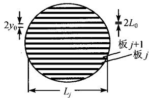
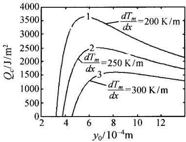
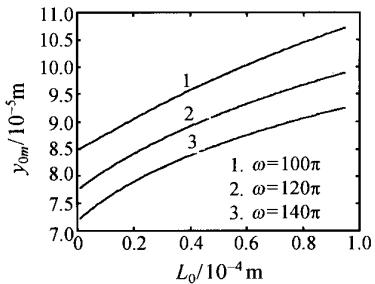
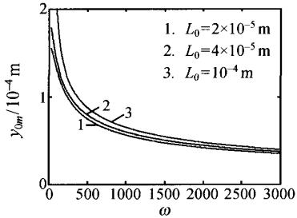
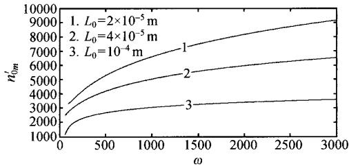

# 热声制冷机回热器的构形优化

阚绪献1,2 吴 锋1,2 张晓青3 郭方中3 杨志春1,2

(1. 海军工程大学研究生院，湖北 武汉 430033;

2. 武汉工程大学理学院，湖北 武汉 430073;

3. 华中科技大学能源与动力学院，湖北 武汉 430074)

摘 要用构形理论对热声制冷机平板型回热器进行了优化，导出了最优平板间距及最优平板数的解析式，讨论了运行频率、温度梯度、以及平板厚度对最优平板间距的影响，所得结论对实际热声制冷机的设计工作具有一定的理论指导意义。

关键词热声制冷机；平行板叠；制冷量；构形理论

中图分类号：TK12

文献标识码： A

文章编号：0253-231X(2010)01-0011-04

# A CONSTRUCTAL OPTIMIZATION OF A STACK IN A

THERMOACOUSTIC COOLER

KAN Xu-Xian1,2 WU Feng1,2 ZHANG Xiao-Qing3 GUO Fang-Zhong3 YANG Zhi-Chun1,2

(1. Graduate School, Naval University of Engineering, Wuhan 430033, China;

2. School of Science, Wuhan Institute of Technology, Wuhan 430073, China;

3. Institute of Energy & Power, Huazhong University of Science and Technology, Wuhan 430074, China)

Abstract An optimization for a stack consisting of an array of parallel plates in a thermo-acoustic cooler is investigated in this paper by using the constructal principle. The optimal structure of the stack is analyzed and the analytical formulas of the optimal plate spacing or the channel size and the optimal plate number are derived in this paper. The effects of angular frequency, temperature gradient and the thickness of the plate of the optimal plate spacing are studied by numerical examples. The results obtained herein can provide some theoretical guidance for the design of practical thermoacoustic coolers.

Key words thermo-acoustic cooler; parallel plates; cooling load; constructal theory

## 0引言

热声热机（发动机和制冷机)[1\~3]是一种完全新型的热机，它工作于热声效应机理。和传统的热机相比，它具有无污染，无运动部件，结构简单，可靠性高，寿命长等优点。热声热机在航天、国防、天然气液化、微电子系统等领域有着十分诱人的前景。

热声制冷机主要由四大部件组成：声发生器，冷热端换热器，谐振管和热声回热器或热声叠。在热声制冷机中，工作流体在板叠或回热器中往复运动，由于声通道中纵向压力的振荡，工作流体的温度也以相同频率ω振荡，从而导致了热声现象。

板叠或回热器正是热声制冷所必须的部件，它直接影响热声制冷机的效率。因此，对热声回热器进行优化是热声制冷机设计中的重要环节。

美国 Duke 大学 Bejan 教授提出的构形理论[4,5]来源于自然界中的各种系统和组织(包括生命和非生命系统)，对于分析各类生命和非生命系统，指导实际工程装置，研究各种广义热力学过程均具有重大意义。众多学者对构形理论表现出了浓厚的兴趣，进行了大量的研究，取得了丰硕的成果。该理论涉及的领域包括传热传质、流体流动、电、磁、交通运输、管道网络、风化干燥、经济决策、气候预测、生命体组织和器官研究等，由理论分析和计算得到了许多符合实际的最优结构。

本文利用构形理论对热声制冷机平板型回热器进行了优化，导出了最优平板间距及最优平板数的解析式，通过数值算例得到了最优平板间距与其他参数的关系，所得结论对于热声制冷机回热器的优化设计有一定的理论指导意义。

## 1 热声制冷机的制冷量

本文研究的热声回热器由一系列平行板叠构成。图1是平板型热声回热器的剖面图，其面积为 $\pi R ^ { 2 }$ 定义平板之间的间距为 $2 y _ { 0 }$ ，第j块平板的宽度和厚度分别为 $L _ { j }$ 和 $2 L _ { 0 }$ 。平板的放置方式如图所示。

  
图1 热声回热器的横截面剖面图  
Fig. 1 A schematic diagram of the stack with finite cross-sectional area

平板的数目为：

$$
n = 2 R / ( 2 L _ { 0 } + 2 y _ { 0 } ) = R / ( L _ { 0 } + y _ { 0 } )\tag{1}
$$

首先考虑第 $j$ 块平板和 $j + 1$ 块平板之间的声通道中的制冷量，其表达式可写为[6]：

$$
\dot { Q } _ { 2 j } = \dot { Q } _ { \mathrm { c o n d } } + \dot { Q } _ { \mathrm { d y n } } + \dot { Q } _ { \mathrm { p r } } + \dot { Q } _ { \mathrm { s t } }\tag{2}
$$

其中热流的行波分量 $\dot { Q } _ { \mathrm { p r } }$ 和驻波分量 $\dot { Q } _ { \mathrm { s t } }$ 与压力波有关，而导热分量 $\dot { Q } _ { \mathrm { c o n d } }$ 和对流分量 $\dot { Q } _ { \mathrm { d y n } }$ 与温度梯度成正比，只与具有温度梯度的元件如板叠或回热器相关，反映了热声系统的热声本质，是伴随热声系统正常工作而产生的热流。其热流的基本方程如下

$$
\begin{array} { r l } & { \hat { Q } _ { \mathrm { c o u t } } - \Lambda _ { c } , \Lambda _ { 4 } , \frac { d T _ { \mathrm { c } } } { d \lambda } } \\ & { \hat { Q } _ { \mathrm { d o m } } ( z ) = \rho _ { \mathrm { c o u t } } \frac { \rho _ { 1 } } { 1 - \hat { \rho } _ { c } ^ { 2 } } \frac { \rho _ { 1 } } { ( 1 - \hat { \rho } _ { c } ^ { 2 } ) ^ { 2 } } \frac { \| T _ { \mathrm { c } } \| _ { 2 } ^ { 2 } \hat { \| } _ { \mathcal { D } _ { c } } ^ { 2 } } { 2 \hat { \rho } _ { c } ^ { 2 } \hat { \lambda } _ { d } ^ { 2 } } } \\ &  \hat { Q } _ { \mathrm { i n c e } } - \rho _ { \mathrm { r o n } } \mathbb { E } [ \phi _ { c } \phi _ { i } ^ { 2 } ] \frac { \| T _ { \mathrm { c } } \| _ { 2 } ^ { 2 } \hat { \| } _ { \mathcal { D } _ { c } } \hat { \| } _ { \mathcal { D } _ { c } } \hat { \| } _ { \mathcal { D } _ { c } } \hat { \| } _ { \mathcal { D } _ { c } } \hat { \| } _ { \mathcal { D } _ { c } } \hat { \| } _ { \mathcal { D } _ { c } } } \\ &  \hat { Q } _ { \mathrm { a m } } = - \rho _ { \mathrm { r o n } , \mathrm { m } } [ \phi _ { c } \phi _ { i } ^ { 2 } ] \frac { \| T _ { \mathrm { c } } \| _ { 2 } ^ { 2 } \hat { \| } _ { \mathcal { D } _ { c } } \| _ { \mathcal { D } _ { c } } \hat { \| } _ { \mathcal { D } _ { c } } \hat { \| } _ { \mathcal { D } _ { c } } \hat { \| } _ { \mathcal { D } _ { c } } } { 2 \hat { \| } _ { \mathcal { D } _ { c } } \hat { \| } _ { \mathcal { D } _ { c } } \hat { \| } _ { \mathcal { D } _ { c } } \hat { \| } _ { \mathcal { D } _ { c } } }  \end{array}
$$

## 万方数据

$$
\begin{array} { l } { f _ { \nu } = \displaystyle \frac { \operatorname { t a n h } [ ( 1 + i ) y _ { 0 } / \delta _ { \nu } ] } { ( 1 + i ) y _ { 0 } / \delta _ { \nu } } } \\ { F _ { s } = \displaystyle \frac { 1 } { 1 + \varepsilon f _ { k } } } \end{array}
$$

其中， $\sigma$ 为普朗特常数， $K _ { s }$ 为固体导热系数， $\varepsilon =$ $c _ { p f } / c _ { p s }$ 为流体热容和固体热容的比，可近似为0. $\delta _ { k } \ : = \ : \sqrt { 2 K / \rho _ { m } c _ { p } \omega }$ 和 $\delta _ { \nu } = \sqrt { 2 \mu / \rho _ { m } \omega } = \sqrt { \sigma } \delta _ { k }$ 分别为热渗透深度和黏性渗透深度， $K , \mu$ 和 $\omega$ 分别为流体的热导率，动力黏性系数和角频率， $f _ { k }$ 和 $f _ { \nu }$ 分别为截面平均的热驰豫函数和截面平均的黏性函数。 $\rho _ { m } , T _ { m } ,$ β和 $c _ { p }$ 分别为平均密度，平均温度，热膨胀系数和绝热热容， $\left| p _ { 1 } \right|$ 和 $\left| u _ { 1 } \right|$ 分别为压力振荡和速度振荡的振幅。θ是压力振荡与速度振荡之间的相位差， $\scriptstyle \mathrm { R e } ( \ )$ 和Im(）表示求复数的实部和虚部，上标 $" + "$ 表示共轭复数，x为声波的振荡位移。

本文利用边界层近似，同时考虑实际应用情况，限制 $y _ { 0 } / \delta _ { k }$ 的范围： $1 { \leqslant } y _ { 0 } / \delta _ { k } { \leqslant } 2$ ，在这种情况下， $f _ { \nu }$ 和 $f _ { k }$ 可近似写为[1]：

$$
f _ { \nu } \approx \frac { ( 1 - i ) \delta _ { \nu } } { 2 y _ { 0 } } , \quad f _ { k } \approx \frac { ( 1 - i ) \delta _ { k } } { 2 y _ { 0 } }\tag{3}
$$

把式(3), $F _ { s } = 1$ $A _ { f } = 2 y _ { 0 } L _ { 0 }$ 和 $A _ { s } = 2 L _ { 0 } L _ { j }$ 代入式 (2) 中可得

$$
\begin{array} { l } { { \dot { Q } _ { 2 j } = - 2 K _ { s } \cdot L _ { j } L _ { 0 } \cdot \frac { d T _ { m } } { d x } + \frac { L _ { j } y _ { 0 } } { 2 y _ { 0 } ^ { 2 } + \delta _ { \nu } ^ { 2 } - 2 y _ { 0 } \delta _ { \nu } } } } \\ { { \qquad \quad \Bigg \{ \frac { \rho _ { m } c _ { p } y _ { 0 } ( \sigma \delta _ { \nu } - \delta _ { k } ) u _ { 1 } ^ { 2 } } { \omega ( 1 - \sigma ^ { 2 } ) } \frac { d T _ { m } } { d x } - } } \\ { { \qquad \quad \frac { \beta T _ { m } [ \delta _ { \nu } \delta _ { k } - y _ { 0 } ( \delta _ { \nu } + \delta _ { k } ) ] | p _ { 1 } | | u _ { 1 } | \sin \theta } { ( 1 + \sigma ) } - } } \\ { { \qquad \quad \frac { \beta T _ { m } [ \delta _ { \nu } ^ { 2 } + y _ { 0 } ( \delta _ { k } - \delta _ { \nu } ) ] | p _ { 1 } | | u _ { 1 } | \cos \theta } { ( 1 + \sigma ) } \Bigg \} } } \end{array}\tag{4}
$$

从式(4)可以得到热声回热器的总制冷量为

$$
{ \dot { Q } } _ { c } = \sum _ { j = 1 } ^ { n } { \dot { Q } } _ { 2 j } = \frac { { \dot { Q } } _ { 2 j } } { L _ { j } } \sum _ { j = 1 } ^ { n } L _ { j } = \frac { { \dot { Q } } _ { 2 j } } { L _ { j } } ( \bar { L } \cdot n )\tag{5}
$$

其中, L 是 $L _ { j }$ 的平均值，L可以表示为

$$
\bar { L } = \frac { 2 } { R } \int _ { 0 } ^ { R } \sqrt { R ^ { 2 } - y ^ { 2 } } d y = \frac { \pi } { 2 } R\tag{6}
$$

把式(6)和式(1)代入到式(5)可得：

$$
\begin{array} { c } { { \dot { Q } _ { c } = - K _ { s } \cdot \frac { \pi R ^ { 2 } L _ { 0 } } { y _ { 0 } + L _ { 0 } } \cdot \frac { d T _ { m } } { d x } + } } \\ { { \frac { \pi R ^ { 2 } ( A y _ { 0 } ^ { 2 } + B y _ { 0 } ) } { 2 ( y _ { 0 } + L _ { 0 } ) ( 2 y _ { 0 } ^ { 2 } + \delta _ { \nu } ^ { 2 } - 2 y _ { 0 } \delta _ { \nu } ) } } } \end{array}\tag{7}
$$

其中

$$
\begin{array} { c } { { A = \displaystyle \frac { \rho _ { m } c _ { p } ( \sigma \delta _ { \nu } - \delta _ { \kappa } ) \omega \left| \xi _ { 1 } \right| ^ { 2 } } { 1 - \sigma ^ { 2 } } \frac { d T _ { m } } { d x } + } } \\ { { \displaystyle \frac { \beta T _ { m } ( \delta _ { \nu } + \delta _ { k } ) \omega \left| \rho _ { 1 } \right| \left| \xi _ { 1 } \right| \sin \theta } { 1 + \sigma } - } } \\ { { \displaystyle \frac { \beta T _ { m } ( \delta _ { k } - \delta _ { \nu } ) \omega \left| \rho _ { 1 } \right| \left| \xi _ { 1 } \right| \cos \theta } { 1 + \sigma } } } \\ { { B = - \displaystyle \frac { \beta T _ { m } \delta _ { \nu } \delta _ { k } \omega \left| \rho _ { 1 } \right| \left| \xi _ { 1 } \right| \sin \theta } { 1 + \sigma } - } } \\ { { \displaystyle \frac { \beta T _ { m } \delta _ { \nu } ^ { 2 } \omega \left| \rho _ { 1 } \right| \left| \xi _ { \downarrow } \right| \cos \theta } { 1 + \sigma } } } \end{array}
$$

$| \xi _ { 1 } | = | u _ { 1 } | / \omega$ 为位移振荡的振幅。

## 2 热声回热器的优化设计

从式(7)可以看到，当其他参数给定时热声制冷机的总制冷量 $\dot { Q } _ { c }$ 是热声回热器平行板间距的函数，令 $d \dot { Q } _ { c } / d y _ { 0 } = 0$ ，可以得到：

$$
\begin{array} { r l } & { ( 8 D - 2 A ) y _ { 0 } ^ { 4 } + ( - 1 6 D \delta _ { \nu } - 4 B ) y _ { 0 } ^ { 3 } + } \\ & { \qquad ( 1 6 D \delta _ { \nu } ^ { 2 } + A \delta _ { \nu } ^ { 2 } - 2 A L _ { 0 } \delta _ { \nu } + 2 B \delta _ { \nu } - } \\ & { \qquad 2 B L 0 ) y _ { 0 } ^ { 2 } - ( - 8 D \delta _ { \nu } ^ { 3 } + 2 A L _ { 0 } \delta _ { \nu } ^ { 2 } ) y _ { 0 } + } \\ & { \qquad 2 D \delta _ { \nu } ^ { 4 } + L _ { 0 } B \delta _ { \nu } ^ { 2 } = 0 } \end{array}\tag{8}
$$

其中， $D = K _ { s } \cdot L _ { 0 } \cdot \frac { d T _ { m } } { d x }$

方程(8) 的解为

$$
\begin{array} { c } { { y _ { 0 m } = \displaystyle - \frac { 1 } { 4 } ( b - \sqrt { 8 y + b ^ { 2 } - 4 c } ) - \frac { 1 } { 2 } } } \\ { { { } } } \\ { { \displaystyle \left[ \frac { 1 } { 4 } ( b - \sqrt { 8 y + b ^ { 2 } - 4 c } ) ^ { 2 } - \right. } } \\ { { { } } } \\ { { \displaystyle \left. 4 \bigg ( y - \frac { b y - d } { \sqrt { 8 y + b ^ { 2 } - 4 c } } \bigg ) \right] ^ { 0 . 5 } } } \end{array}\tag{9}
$$

其中

$$
\begin{array} { r l } { \mathrm {  ~ \lambda ~ } _ { y } ^ { ( 1 ) } = \{ - \frac { q } { 2 } + [ ( \frac { q } { 2 } ) ^ { 2 } + ( \frac { p } { 3 } ) ^ { 3 } ] ^ { 1 0 - y } \} ^ { - 3 q } } & { } \\ & { + ( - \frac { q } { 2 } - [ ( \frac { q } { 2 } ) ^ { 2 } + ( \frac { p } { 3 } ) ^ { 3 } ] ^ { 1 0 - y } ) ^ { 1 / 3 } + \frac { c } { 6 } } \\ & { - ( - \frac { q } { 2 } - [ ( \frac { q } { 2 } ) ^ { 2 } + ( \frac { p } { 3 } ) ^ { 3 } ] \phantom { x } ) ^ { 1 / 3 } + \frac { c } { 6 } } \\ & { \phantom { - } b = ( - \delta D i \delta _ { i \mathrm { e } } - 2 B ) / ( 4 D - A ) } \\ & { c = ( 1 6 I D \delta _ { i } ^ { 2 } + A \delta _ { i \mathrm { e } } ^ { 2 } - 2 A I _ { 0 } \delta _ { i \mathrm { e } } + } \\ & { 2 B \delta _ { i \mathrm { e } } - 2 B L _ { 0 } ) / ( 8 D - 2 A ) } \\ & { \phantom { - } 2 B \delta _ { i \mathrm { e } } - 2 B L _ { 0 } ) / ( 8 D - 2 A ) } \\ & { \phantom { - } d = ( - 4 D \delta _ { i \mathrm { e } } ^ { 3 } + A L _ { 0 } \delta _ { i \mathrm { e } } ^ { 6 } ) / ( 1 0 - A ) } \\ & { c = ( 2 D \delta _ { i \mathrm { e } } ^ { 4 } + L _ { 0 } B \delta _ { i \mathrm { e } } ^ { 2 } ) / ( 8 D - 2 A ) } \\ & { p = ( - c \delta ^ { 2 } ) / 1 2 + b d / ( 4 - c } \end{array}
$$

## 万方数据

$$
q = - c ^ { 3 } / 1 0 8 - 1 / 8 \left( 4 c e - e b ^ { 2 } \right) + c / 6 \left( b d / 4 - e \right)
$$

式(9) 给出了最优平板间距和 $\omega , d T _ { m } / d x$ 及 $L _ { 0 }$ 等参数之间的关系，这是本文的主要结果。

把式(9)代入到式（1）得到最优的平板型热声回热器的平板数目：

$$
{ { n } _ { 0 m } } = R / ( { { L } _ { 0 } } + y _ { 0 m } )\tag{10}
$$

## 3 数值算例

从式(7)可以看出，热声制冷机的总制冷量 $\dot { Q } _ { c }$ 是参数 $y _ { 0 } , \ d T _ { m } / d x , \ \omega , \ \vert \xi _ { 1 } \vert , \ \vert p _ { 1 } \vert , \ L _ { 0 } , \ \sigma , \ \mu , \ K _ { s } \ , \ \theta$ 和K的函数。当参数 $y _ { 0 } , ~ d T _ { m } / d x , ~ \omega , ~ | \xi _ { 1 } | , ~ | p _ { 1 } | , ~ \sigma$ $\mu , \ K _ { s } , \ \theta$ 和K给定时，制冷量 $\dot { Q } _ { c }$ 随 $L _ { 0 }$ 的降低而升高，但是当 $L _ { 0 } < \delta _ { s } ( \delta _ { s }$ 是板叠的热渗透深度)时，流体与板叠的热交换将不充分，从而影响热声制冷机的效率。所以在式(7)中，我们假定 $L _ { 0 } > \delta _ { s }$ 。计算中取 $T _ { m } \beta = 1 , \omega = 1 0 0 \pi , \delta _ { k } = 0 . 2 9 \mathrm { m m } , \delta _ { \nu } = 0 . 2 4$ $\mathrm { m m } , p _ { m } = 1 0 \times 1 0 ^ { 5 } ~ \mathrm { P a } , \xi _ { m } = 5 ~ \mathrm { m m } , p _ { 1 } = 0 . 0 3 p _ { m }$ $c _ { p } = 5 2 0 0 \mathrm { J } / ( \mathrm { k g } \mathrm { { \cdot } K } ) , \rho _ { m } = 1 . 9 \mathrm { k g } / \mathrm { m } ^ { 2 } , K _ { s } = 3 6 . 2$ $\mathrm { W } / ( \mathrm { m } { \cdot } \mathrm { K } )$ 和 $\theta = 6 0 ^ { \circ }$ 。图 2 给出了 $\dot { Q ^ { \prime } } _ { c }$ 和 $y _ { 0 }$ 的关系曲线，这里 $\dot { Q } _ { c } ^ { \prime } = \dot { Q } _ { c } / \left( \pi R ^ { 2 } \right)$ 为单位横截面积的制冷量，从图中可以看出单位横截面积制冷量 $\dot { Q } _ { \ c } ^ { \prime }$ 随着热声回热器温度梯度 $d T _ { m } / d x$ 的增大而减小，且单位面积制冷量 $\dot { Q } _ { \ c } ^ { \prime }$ 和平板间距 $y _ { 0 }$ 的关系曲线呈抛物线型，当 $y _ { 0 }$ 取最优值 $y _ { 0 m }$ 时， $\dot { Q } _ { \mathrm { ~ c ~ } } ^ { \prime }$ 达到最大值。例如，当 $d T _ { m } / d x = 1 0 0 ~ \mathrm { K } / \mathrm { m } , 1 5 0 ~ \mathrm { K } / \mathrm { m } , 2 0 0 ~ \mathrm { K } / \mathrm { m }$ 时，对应于 $y _ { 0 }$ 的最优值 $y _ { 0 m } = 0 . 4 4 2 ~ \mathrm { m m } , 0 . 4 9 2 ~ \mathrm { m m } , 0 . 5 6 2$ mm，单位面积制冷量 $\dot { Q ^ { \prime } } _ { c }$ 分别取到最大值6631.2$\mathrm { J } / \mathrm { m } ^ { 2 }$ , 5013.9 $\mathrm { J } / \mathrm { m } ^ { 2 }$ $3 6 4 0 . 2 \ \mathrm { J / m ^ { 2 } }$

图3、图4分别给出了当参数 $T _ { m } \beta \ = \ 1$ $d T _ { m } / d x = 2 0 0 \mathrm { \ K } / \mathrm { m } , \ p _ { m } = 1 0 \times 1 0 ^ { 5 } \ \mathrm { P a } , \ \xi _ { m } = 5$ mr ${ \mathrm { n } , ~ } p _ { 1 } ~ = ~ 0 . 0 3 p _ { m } , ~ c _ { p } ~ = ~ 5 2 0 0 ~ \mathrm { J / ( k g { \cdot } K ) } , ~ \rho _ { m } ~ = ~ 1 . 9$ $\mathrm { k g / m ^ { 2 } } , K _ { s } = 3 6 . 2 \mathrm { W / ( m { \cdot } K ) }$ 和 $\theta = 6 0 ^ { \circ }$ 时，平行板叠厚度 $L _ { 0 }$ 和角频率ω对最优平板间距 $y _ { 0 m }$ 的影响。从图中可以看出， $y _ { 0 m }$ 与 $L _ { 0 }$ 呈单调上升关系，而 $y _ { 0 m }$ 与 $L _ { 0 }$ 呈单调下降关系。

  
图2 单位面积制冷量 $\dot { Q } _ { c } ^ { \prime }$ 和平板间距 yo 的关系  
Fig. 2 The cooling load versus the plate spacing characteristics

  
图 3 最优平板间距 ${ \mathbf { 3 0 } } m$ 和板的厚度 $\scriptstyle L _ { 0 }$ 的关系  
Fig. 3 The optimal plate spacing or the channel size versus the thickness of the plate characteristics

  
图4 最优平板间距和角频率的关系  
Fig. 4 The optimal plate spacing or the channel size versus the angular frequency characteristics

图 5 给出了角频率 $\omega$ 和平行板叠厚度 $L _ { 0 }$ 对单位长度横截面上最优平板数 $\begin{array} { r l } { n _ { 0 m } ^ { \prime } ( n _ { 0 m } ^ { \prime } } & { { } = } \end{array}$ $n _ { 0 m } / 2 \left( L _ { 0 } + y _ { 0 m } \right) )$ 的影响关系，从图中可以看出$n _ { 0 m } ^ { \prime }$ 随着角频率 $\omega$ 增大而增大，而随着 $L _ { 0 }$ 增大而降低。

  
图 5 最优平板数 ${ n } _ { 0 m } ^ { \prime }$ 和角频率 $\omega$ 的关系  
Fig. 5 The optimal plate-number per unit Length versus the angular frequency characteristics

## 4 结论

本文给定热声制冷机中平板型回热器的横截面积，利用构形理论对最优平板间距进行了优化设计，导出了最优平板间距及最优平板数的解析式，通过数值算例得到了最优平板间距和最优平板数与平板厚度和角频率等参数的关系，所得结论对于热声制冷机回热器的优化设计有一定的理论指导意义。

## 参考文献

[1] Swift G W. Thermoacoustic Engines [J]. J. Acoust. Soc. Am., 1988, 84(4): 1145–1165

[2] Back S, Swift G W. A Thermoacoustic Stirling Wave Heat Engine [J]. Nature, 1999, 399: 335–338

[3] ZHOU G, LI Q, LI Z Y, et al. A Miniature Thermoacoustic Stirling Engine [J]. Energy Conversion and Management, 2008, 49(6): 1785–1792

[4] Bejan A. Street Network Theory of Organization in Nature [J]. J. Advanced Transportation, 1996, 30(2): 85–107

[5] Bejan A. Shape and Structure, from Engineering to Nature [M]. Cambridge, UK: Cambridge University Press, 2000

[6] Tominaga A. Thermodynamic Aspects of Thermoacoustic Theory [J]. Cryogenics, 1995, 35(7): 427–440
