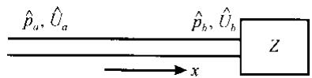
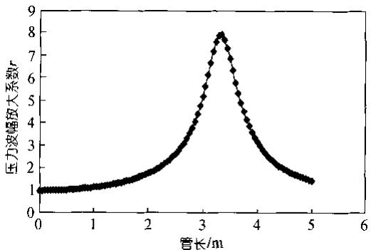
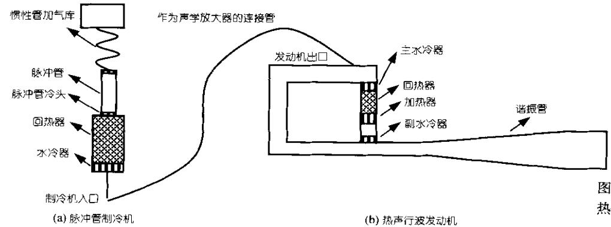

# 用于热声驱动脉冲管制冷机的新耦合机制：声学放大器

戴巍① 罗二仓① 胡剑英①② 陈燕燕①②

(① 中国科学院理化技术研究所，北京 100080;②中国科学院研究生院，北京 100049. E-mail: dwpeng@yahoo.com)

摘要 提出了声学放大器的概念，有意识地用一根长管来连接热声发动机与脉冲管制冷机.理论计算表明，合适的管长及管径可以大幅度地放大来自热声发动机的压力波动，脉冲管制冷机从而可以获得更大的驱动压比.在理论分析的基础上，初步的研究也证实了压力波动的放大效果.在平均压力2.46MPa，工作频率69Hz时，一根内径8mm，长2.8m的紫铜管把来自热声发动机的压力波动幅值平均放大为2.5倍以上.特别地，使用1.67kW的加热功率，发动机的压比为1.11，脉冲管制冷机入口的压比到达了1.32，进而在脉冲管制冷机的冷头获得了65.7K的温度

关键词热声脉冲管制冷机声学放大器

最近热声驱动的脉冲管制冷机首次突破了液氮温度77K，标志着热声制冷技术的一个较为重要的进展[1]. 这一结果一方面建立在对发动机谐振管的重要改进基础之上，另一方面也由于对脉冲管热端调相机构的改造．在以前的热声驱动脉冲管制冷机系统中，一根尽可能短的连接管用来把热声发动机与脉冲管制冷机连接起来，这样热声发动机所能提供的最高压比也就是脉冲管制冷机所能获得的压比[1,2].通常高频脉冲管制冷机为了获得70K以下的低温需要1.2以上的压比，为了达到这一压比，需要对热声发动机作非常精心的设计.与此同时在发动机中维持大的压比也意味着在谐振管及其他部件中的耗散非常巨大，必须提供相当可观的加热量，使得整个系统的效率很低．为了改变这一状况，必须考虑对热声发动机与脉冲管制冷机的耦合方式进行改进.

实际上，在一个一端开口，一端封闭的1/4波长的管道中，压力波的幅值从开口端到封闭端是逐渐增加的．理想情况下，这一放大的比例趋近无穷大.那么在一端开口，另外一端接有声学负载的情况下(图1)，能不能同样实现放大呢？为了回答这一问题，我们借助于热声理论来分析.

  
图1 一端开口一端接有声学负载 Z长管示意图

根据线性热声理论，管道中的复频域控制方程为[3]:

$$
\frac { \mathrm { d } \hat { U } } { \mathrm { d } x } + R _ { 1 } \hat { p } = 0 , R _ { 1 } = \frac { i \omega A [ 1 + ( \gamma - 1 ) f _ { k } ] } { \gamma P _ { 0 } } ;\tag{1}
$$

$$
\frac { \mathrm { d } \hat { p } } { \mathrm { d } x } { + R _ { 2 } \hat { U } } = 0 , R _ { 2 } = \frac { i \omega \rho _ { 0 } } { A ( 1 - f _ { \mu } ) } .\tag{2}
$$

β , Û, ω, A, γ, $P _ { 0 } , \rho _ { 0 }$ 分别为波动压力复幅值、波动体积流复幅值、角频率、流道横截面积、比热比、平均压力和平均密度. $f _ { \mu } , f _ { k }$ 是与流道形状、尺寸及流体物性相关的函数，求解这一方程得到压力波幅放大系数r:

$$
r = \ { \frac { \left| { \hat { p } } _ { b } \right| } { \left| { \hat { p } } _ { a } \right| } } = \ { \frac { 1 } { - \ B _ { 1 } / Z + \ B _ { 2 } } } \Bigg | ,\tag{3}
$$

其中 $B _ { 1 } = - \sqrt { \frac { R _ { 2 } } { R _ { 1 } } } \sinh \left( \sqrt { R _ { 1 } R _ { 2 } } \cdot L \right) , B _ { 2 } = \cosh ( \sqrt { R _ { 1 } R _ { 2 } } \cdot L )$

L为管长．根据我们采用的高频脉冲管制冷机的模拟计算结果，在平均压力 2.46 MPa，频率 69 Hz，脉冲管制冷机冷头到达70 K时，高频脉冲管制冷机的入口声学阻抗Z为：

$$
Z = \frac { \hat { p } _ { b } } { \hat { U } _ { b } } = ( 3 . 8 7 - 5 . 1 2 \mathrm { i } ) \times 1 0 ^ { 8 } .
$$

把这一阻抗代入公式(3)，计算得到管内径为8mm时压力波放大系数r随管长的变化情况，如图2所示.可以看到在 5 m 的长度范围内均可以实现压力波放大的效果，而且放大系数随管长的变化呈现强烈的共振特性，在3.35m时放大系数能够达到7.9左右，因此我们把这一长管称为声学放大器.

根据上述计算结果，我们初步选择了2.8m长，8mm内径紫铜管作为声学放大器，图3显示了实验系统的构造，其中发动机回路主要由内径 80 mm 圆管组成，周长约2m，谐振管总长约5m；脉冲管制冷机回热器内径15 mm，脉冲管内径6mm，脉冲管热端调相机构由惯性管加气库构成，对这一系统的详细描述参见文献[1,4]. 表 1 给出在平均压力 2.46 MPa,工作频率 69 Hz，不同加热功率时的实验结果． 实验证明，该8mm内径紫铜管确实起到了显著的压力波放大效果． 以加热功率为1.67kW的工况为例，通过声学放大器后，制冷机入口压比可以达到1.32，对应的发动机出口压比为1.11. 而如果不采用声学放大器，在相近加热量的情况下，制冷机只能获得1.15 左右的压比.正是因为这一放大效果，本实验中脉冲管制冷机的最低温度达到了65.7K. 这表明通过使用声学放大器，热声驱动脉冲管制冷机的整机效率有了一个大幅提升，推动了热声技术走向低温下的应用．进一步的实验表明，当管长进一步向图2显示的最佳长度逼近时，由于系统复杂的动力学特性甚至会导致无法起振工作，这表明有必要对包括发动机和脉冲管制冷机在内的整机系统进行模拟，以揭示其中的规律和指导优化设计.

热声行波发动机示意图  
  
图2 内径8mm管压力波幅放大系数随管长变化关系

另一方面，理论计算结果给出2.8m管的放大系数为 3.77(图 2)，而实验测得的实际放大系数如表1所示，可以看到在0.62kW加热功率时，两者符合得相当好．当加热功率逐渐加大时，理论计算值和实验值偏差越来越大，这主要是因为随着加热功率的增加，声波的强度也逐渐增加，非线性效应越来越明显，线性热声理论已经不再适用了．我们将进一步通过数值手段来进行更加准确的定量研究.

表1 平均压力 2.46 MPa，工作频率 69 Hz，不同加热功率时的压力波幅放大结果及对应制冷机冷头温度
<table><tr><td>加热功率/W</td><td>发动机出口 压力波幅值/MPa</td><td>制冷机入口 压力波幅值/MPa</td><td>实际压力波 放大系数r</td><td>制冷机入口压比</td><td>脉冲管冷头 温度/K</td></tr><tr><td>620</td><td>0.061</td><td>0.202</td><td>3.31</td><td>1.18</td><td>76.6</td></tr><tr><td>1020</td><td>0.091</td><td>0.265</td><td>2.91</td><td>1.24</td><td>68.2</td></tr><tr><td>1330</td><td>0.11</td><td>0.302</td><td>2.74</td><td>1.28</td><td>66.2</td></tr><tr><td>1670</td><td>0.13</td><td>0.336</td><td>2.58</td><td>1.32</td><td>65.7</td></tr></table>

致谢本工作受中国科学院知识创新工程重要方向性项目资助(批准号: KJCX2-SW-W12-1).

1 戴巍，罗二仓，凌虹，等．突破液氮温度的完全无运动部件热声制冷机. 科学通报,2005,50(5):498\~499

图 3 脉冲管制冷机及

2 Tang K, Chen G, Jin T, et al. Influence of resonance tube length on performance of thermoacoustically driven pulse tube refrigerator. Cryogenics, 2005, 45(3): 185\~191

3 Swift G. Thermoacoustics: A unifying perspective for some engines and refrigerators. Acoustical Society of America Publications, Sewickley, PA, 2002

4 罗二仓，凌虹，戴巍，等.采用锥形谐振管的高压比聚能型热声发动机. 科学通报,2005,50(6):605\~607

(2005-03-31 收稿，2005-08-03 收修改稿)
