# 高频热声制冷机中的压电驱动器

张晓青12，陈 宇1

(1. 清华大学物理系，北京 100084；2. 华中科技大学 能源与动力工程学院，武汉 430074)

摘要：为了研究压电驱动器与热声谐振腔间的耦合特性，建立了压电驱动系统的网络模拟模型。根据压电片的简支和固定两种边界条件，对压电驱动器及(热)声谐振腔声负荷系统的频率和电压特性进行了模拟计算。研究结果显示在高频时系统元件间的耦合特性较低频时好，具有简支边界的压电片产生的声压级比固定边界的要大得多，声压级随输入电压的变化特性计算与实验是相一致的。该模型可用于热声制冷机中压电驱动系统的特性分析。

关键词：热声制冷；高频；压电驱动器；网络模型；耦合特性

中图分类号：TK 04

文章编号：1000-0054(2006)12-2032-05

文献标识码：A

# Piezoelectric drivers in high-frequency thermoacoustic refrigerators

ZHANG Xiaoqing1,2, CHEN Yu1

(1. Department of Physics, Tsinghua University, Beijing 100084, China;

2. School of Energy and Power Engineering, Huazhong University of Science and Technology, Wuhan 430074, China)

Abstract: A network model was developed to analyze a piezoelectric source driving a resonantor to investigate the coupling of the piezoelectric loudspeaker with a thermoacoustic resonantor. The frequency and voltage characteristics of the piezoelectrically driven system were calculated numerically from the two boundary conditions for the piezoelectric plate. The results show that the coupling between the system components is better at high frequencies than at low frequencies. The sound pressure produced by a simply supported piezoelectric plate is much larger than for a clamped plate. The predicted change in the acoustic pressure with input voltage to the piezoelectric driver agrees well with measured results. Therefore, the network model can be used to analyze the characteristics of piezoelectric drive systems in thermoacoustic refrigerators.

Key words: thermoacoustic refrigerators; high-frequency; piezoelectric driver; network model; coupling characteristic

微型热声制冷机结构简单、无复杂可动部件、环

## 万方数据

保，适于与微电子芯片和系统界面相结合等独特，在微电子电路和系统的热量管理中具有较好的应用前景，成为国内外研究开发的热点[1]。

为研究压电喇叭与热声谐振腔间的耦合特性，使声驱动器输出最大的声功率、制冷过程发生最大的声能转换，以及提高整个装置系统的性能，本文对压电喇叭及其驱动的热声谐振腔系统的阻抗特性和电压响应特性进行了网络模拟和实验研究，为微型热声制冷装置的开发提供分析模型和实验数据。

## 1 压电声源驱动的热声制冷系统的模拟模型

## 1.1 压电声源的振动模拟方程

图1显示了压电陶瓷(PZT)-金属构成的复合圆板振子的物理模型。两压电陶瓷片极化方向相同，电的连接是并联的，即一个PZT圆片的正极和另一PZT圆片的负极分别粘在金属圆片的两侧，形成夹心结构。当在压电振子上施加信号电压增加时，由于压电效应，在径向一个PZT片收缩，另一个膨胀，结果压电陶瓷振子作为整体产生弯曲振动，为喇叭或其它需要声波的装置提供声致动器[2,3]。

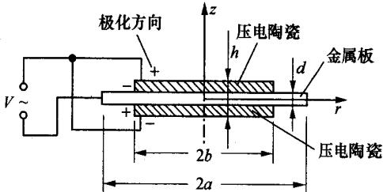  
图1 压电陶瓷-金属复合薄圆板振子

金属板和压电陶瓷的直径分别为2a和2b，金属板的厚度为 $^ { d }$ ，振子的总厚度为h表示。假设振子很薄，在z方向和r方向上是对称的，原点置于两方向的中心，如图1所示。

假设横向剪切力与弯矩相比可以忽略。

为计算的方便，将整个压电振子分为两个区域，即 $r { < } b$ 的区域1(盘)，它是由两层压电层和一层夹心金属层组成的三层复合圆盘；另一个是 $b { < } r { < } a$ 的区域2(环)，它是金属圆环。对这两个区域，将分别给出二维 $( r , \theta )$ 的方程。

在实际应用中，常有两种不同的边界条件，即金属的周边是简支和固定支撑，在模拟中会考虑这两种边界条件。

在本研究中用来驱动压电振子的是正弦电信号，受迫振动的位移也应是与电信号具有相同频率的正弦函数，考虑热声制冷的应用，声驱动器需要与声谐振腔相连，以驱动谐振腔及内置热声元件。因此压电振子实际是直接受均匀压力声场负荷的作用。

本文不推导压电振子的振动方程和求解其通解的过程，而是直接给出通解的近似公式，即将通解中的位移和其导数进行Taylor展开，只取低阶的前几项，利用连续和边界条件，求出近似解的具体表达式。利用文[4]中的近似公式进行模拟计算，并考虑两种边界条件。

## 1）夹持固定的边界条件

在区域1和区域2内，压电振子位移幅值的近似表达式分别为[4]：

$$
\begin{array} { c } { { W _ { 1 } ( r ) = \displaystyle \frac { B _ { 3 1 } V } { D _ { 0 } } \bigg [ \mathrm { l n } \bigg ( \frac { a } { b } \bigg ) + \left( \frac { 1 } { a ^ { 2 } } - \frac { 1 } { b ^ { 2 } } \right) \frac { r ^ { 2 } } { 2 } \bigg ] , } } \\ { { r < b ; } } \\ { { W _ { 2 } ( r ) = \displaystyle \frac { B _ { 3 1 } V } { D _ { 0 } } \bigg [ \mathrm { l n } \bigg ( \frac { a } { r } \bigg ) - \frac { 1 } { 2 } + \frac { 1 } { 2 } \bigg ( \frac { r } { a } \bigg ) ^ { 2 } \bigg ] , } } \\ { { b < r < a . } } \end{array}\tag{1}
$$

(2)

式中： $B _ { 3 1 }$ 为取决于压电应变常数 $d _ { 3 1 }$ 的压电转换参数， $D _ { 0 }$ 为取决于类似波数 $\gamma _ { _ d }$ 和辐射阻的参数，V为驱动电压。

将式(1)通过积分平均，可求得压电振子表面平均振动位移的幅值表达式为

$$
W _ { \mathrm { a v } } = \frac { 1 } { 4 } \Big [ 1 - \Big ( \frac { b } { a } \Big ) ^ { 2 } \Big ] \frac { B _ { 3 1 } V } { D _ { \circ } } ,\tag{3}
$$

因而可得到压电驱动器声辐射所提供的平均容积速率幅值

$$
U _ { \mathrm { p } } = \mathrm { i } \omega W _ { a v } A _ { 0 } .\tag{4}
$$

式中： $A _ { 0 } = \pi a ^ { 2 }$ ，是压电振子声辐射的横截面积；ω是声波的驱动角频率。

## 万方数据

## 2）简支的边界条件

对简支的边界条件，其近似的振动位移幅值为：

$$
\begin{array} { r l } & { W _ { 1 } ( r ) = } \\ & { \frac { b ^ { 2 } B _ { 3 1 } V } { D _ { 0 } ^ { \prime } } \Big \{ \frac { \mu _ { n } } { \mu _ { \mathtt { m } } } + 1 \Big [ \ln \Big ( \frac { a } { b } \Big ) + \frac { 1 } { 2 } \Big ] - } \\ & { \frac { 1 } { 2 } + \frac { 1 } { 2 } \Big ( \frac { r } { b } \Big ) ^ { 2 } \Big [ \Big \{ \frac { b } { a } \Big \} ^ { 2 } - \frac { \mu _ { \mathtt { m } } } { \mu _ { \mathtt { m } } - 1 } \Big ] \Big \} , } \\ & { W _ { 2 } ( r ) = } \\ & { \frac { b ^ { 2 } B _ { 3 1 } V } { D _ { 0 } ^ { \prime } } \Big [ \Big ( \frac { \mu _ { \mathtt { m } } } { \mu _ { \mathtt { m } } } + 1 \Big ) \ln \Big ( \frac { a } { r } \Big ) - \frac { 1 } { 2 } + \frac { 1 } { 2 } \Big ( \frac { r } { a } \Big ) ^ { 2 } \Big ] . } \end{array}\tag{5}
$$

(6)

式中： $\pmb { \mu } _ { \pmb { \mathrm { m } } }$ 是金属基材料的 Poisson比， $D _ { \circ } ^ { \prime }$ 是取决压电材料和压电膜片几何的参数 $\cdot ^ { [ 4 ] }$ 。压电振子声辐射面上平均的振动位移为

$$
\begin{array} { r l r } & { } & { \overrightarrow { W } = } \\ & { } & { \frac { B _ { 3 1 } V } { D _ { 0 } ^ { \prime } } \frac { b ^ { 2 } } { 2 } \Big \{ \frac { \mu _ { \mathrm { m } } + 1 } { \mu _ { \mathrm { m } } - 1 } \Big [ 1 - \frac { 1 } { 2 } \Big ( \frac { b } { a } \Big ) ^ { 2 } \Big ] - \frac { 1 } { 2 } \Big \} . } \end{array}\tag{7}
$$

同样利用式(4)可获得 $U _ { \mathfrak { p } }$

## 1.2 压电声源驱动的热声制冷系统的网络模型

图2显示了热声制冷机的原理图及温度分布与长度尺寸。系统在长度方向上的温度分布如图2a所示。将热声系统在长度方向上划分成N等分，每等分长 $\Delta x$ ，在本研究中，取 $\Delta x = 0 . 0 1 ~ \mathrm { m m }$ 。从有源流体网络的角度，单位长度的流体可用流体的阻抗$z ( x )$ 、导纳 $y ( x )$ 和流源 $e ( x )$ 组成的四端网络来表示，如图2b所示。

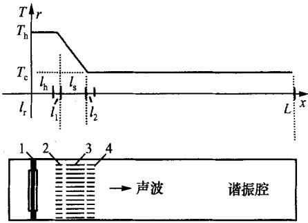  
1-压电喇叭；2-热端换热器；3-板叠；4-冷端换热器

(a) 热声制冷机及温度分布  
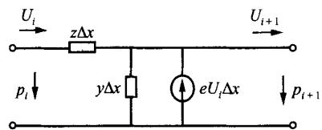  
(b)微元长度上热声制冷系统的等效网络  
图2 喇叭驱动的热声制冷机及等效网络

图2的热声系统有如下的网络微分传输方程[5.6]：

$$
\frac { \mathrm { d } \phi _ { 1 } } { \mathrm { d } x } = - \ z ( x ) U _ { 1 } ,
$$

$$
{ \frac { \mathrm { d } U _ { 1 } } { \mathrm { d } x } } = - \ y ( x ) { \hat { p } } _ { 1 } + e ( x ) { \dot { U } } _ { 1 } .
$$

其中： $\scriptstyle { \mathbf { \mathit { \phi } } } _ { 1 }$ 是声压； $U _ { \imath }$ 是容积流率 $\bullet z , y , e$ 分别是的单位长度的阻抗、导纳和源参数，它们是取决于工质热物性及流道几何的分布参数[6]。将以上微分形式的网络方程式用矩阵表示成差分网络传输方程，即

$$
\stackrel { \left[ \begin{array} { l } { \dot { P } _ { j } } \\ { U _ { j } } \end{array} \right] } { = } H _ { j } \stackrel { \left[ \begin{array} { l } { \dot { P } _ { j - 1 } } \\ { U _ { j - 1 } } \end{array} \right] } { = } \Psi _ { j - 1 } \stackrel { \left[ \begin{array} { l l } { \dot { V } _ { j } } & { } \\ { \dot { V } _ { j - 1 } } & { } \end{array} \right] } { = }
$$

式中传输矩阵

$$
H _ { j } = \big [ \begin{array} { c c } { 1 } & { - z \Delta x } \\ { - y \Delta x } & { 1 + e \Delta x } \end{array} \big ] .
$$

用矩阵表示的整个热声系统的网络传输方程为

$$
\begin{array} { r } { \left[ \begin{array} { l } { \phi _ { N } } \\ { U _ { N } } \end{array} \right] = H _ { t } \left[ \begin{array} { l } { \phi _ { 0 } } \\ { U _ { 0 } } \end{array} \right] , } \end{array}
$$

其中系统总传输矩阵

$$
H _ { t } = { \left[ \begin{array} { l l } { H _ { 1 1 } } & { H _ { 1 2 } } \\ { H _ { 2 1 } } & { H _ { 2 2 } } \end{array} \right] } .
$$

图2所示的系统，其边界条件为：

$$
\begin{array} { r } { \mathbf { \nabla } ^ { \cdot } U _ { 0 } = i U _ { \mathsf { p } } , \quad U _ { N } = 0 . } \end{array}
$$

可得谐振腔介质的声辐射阻抗为

$$
Z _ { \mathrm { i n } } = \frac { \dot { p } _ { \circ } } { U _ { \circ } } = \frac { H _ { \mathrm { 1 1 } } \dot { p } _ { N } + H _ { \mathrm { 1 2 } } U _ { N } } { H _ { \mathrm { 2 1 } } \dot { p } _ { N } + H _ { \mathrm { 2 2 } } U _ { N } } .
$$

对负荷端为封闭边界的系统，如图2所示，其中：$\phi _ { N } / U _ { N } = Z _ { L } = \infty$ ，此时系统的输入阻抗为； $Z _ { \mathrm { i n } } =$ $H _ { \mathrm { 1 1 } } / H _ { \mathrm { 2 1 } } , Z _ { \mathrm { i n } }$ 即是压电振子前声场的辐射阻抗。压电振子一般有后腔，则后腔的声辐射阻为 $Z _ { \mathrm { r } }$ ，与后腔容的大小相关，主要是容抗，即

$$
Z _ { \mathrm { r } } = 1 / ( \mathrm { i } \omega C _ { \mathrm { r } } ) , C _ { \mathrm { r } } = A _ { \mathrm { r } } l _ { \mathrm { r } } / ( \rho _ { 0 } c _ { 0 } ^ { 2 } ) ,
$$

其中 $A _ { \mathfrak { r } }$ 和 $l _ { \mathrm { r } }$ 是后腔的横截面积和长度，压电驱动器的声场总辐射阻抗为

$$
Z _ { \mathrm { e } } = Z _ { \mathrm { i n } } + 1 / ( \mathrm { i } \omega C _ { \mathrm { r } } ) .
$$

至此，给出了压电振子驱动的热声系统模拟中需要的声辐射阻抗。

## 2 压电驱动系统的网络模拟

本研究中设计了一台压电声源驱动的高频热声制冷机样机和实验测试系统，样机设计参数为：谐振腔长 $L { = } 3 4 ~ \mathrm { m m }$ ，谐振腔内径 $D { = } 3 2 \ \mathrm { m m }$ ，板叠间隙 $S { = } 0 . 1 1 ~ \mathrm { m m }$ ，板厚 $t { = } 0 , 0 5 4 ~ \mathrm { m m }$ ，空隙率 $\varphi =$ $0 . 6 7$ ，板叠的长度 $l _ { \mathrm { s } } = 5 \ \mathrm { m m }$ ，热端换热器的厚度$l _ { \mathrm { h } } { = } 0 . 5 ~ \mathrm { m m }$ ，冷端换热器的厚度 $l _ { \mathrm { c } } { = } 0 . 3 ~ \mathrm { m m }$ ，其他工况条件为：空气工质，平均工作压强 $ { p _ { \mathrm { m } } } = 1 0 0$ $\mathbf { k P a }$ ，平均温度 $T _ { \mathrm { m } } { = } 3 0 0 ~ \mathrm { K }$ 。利用前面建立的网络模型，对该样机进行了模拟计算和实验比较。模拟计算中压电驱动器材料的参数在表1中给出。其中： $\dot { \mathbf { \sigma } } _ { s _ { 1 1 } } ^ { \mathbf { D } }$ 为弹性柔顺常数， $\not { R } _ { \mathrm { p } }$ 为平面机电耦合因数。

表1 模拟计算中压电声驱动的器的参数
<table><tr><td>材料</td><td> $\pmb { \rho } / ( \mathbf { k } \pmb { g } \cdot \mathbf { d } \mathbf { m } ^ { - 3 } )$ </td><td> $s _ { 1 1 } ^ { \mathbf { D } } / ( \mu \mathbf { m } ^ { 2 } { \cdot } \mathbf { N } ^ { - 1 } )$ </td><td> $\pmb { \cal E } / \mathbf { G P a }$ </td><td>η</td><td> $\pmb { \sigma }$ </td><td> $k _ { \mathfrak { p } }$ </td><td> $a / \mathrm { m m }$ </td><td> $\scriptstyle { b / \mathbf { m m } }$ </td><td> $d / \mathrm { { m m } }$ </td><td> $h / \mathrm { m m }$ </td></tr><tr><td> $\mathbf { P Z T _ { 4 } }$ </td><td>8.290</td><td>13.12</td><td>0.667</td><td>0.01</td><td>0.498</td><td>0.58</td><td>一</td><td>16.7</td><td>一</td><td>0.26</td></tr><tr><td>黄铜</td><td>8.500</td><td></td><td>1.100</td><td>0.01</td><td>0.374</td><td></td><td>19</td><td></td><td>0.21</td><td>0.26</td></tr></table>

## 2.1 频率响应特性

对无板叠组件的谐振腔和有板叠的制冷机声负荷，在压电片固定边界和简支边界条件下分别进行了模拟计算，图3显示了在10V驱动电压条件下，压电驱动器产生的声压级随频率的变化特性。谐振腔系统的谐振频率为5.1kHz左右，谐振腔中置有热声板叠组件后使谐振频率有所改变，提高了3.8%，声幅也略有降低。这是因为板叠组件减少了谐振腔的容积且阻抗增大。同时从图3看出，两种边界条件中，简支条件比固定条件下产生的声压级要大得多。在实际的设计中，可改善压电喇叭的支撑条件，利用简支边界提高其声压级。

## 2.2 电压响应特性

图4显示了声压级 $\pmb { \phi }$ 和压电振动位移 $W _ { \mathrm { a v } }$ 随驱

## 万方数据

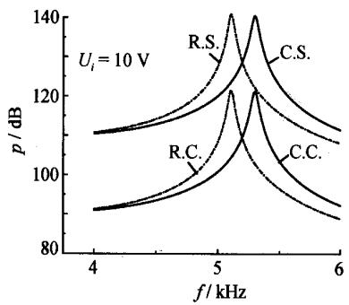  
R.S.—简支边界的谐振腔；C.S.—简支边界的制冷机；  
R.C.—固定边界的谐振腔；C.C.—固定边界的制冷机  
图3 声压随驱动频率的变化

动电压的变化。从图4知，对压电驱动负荷———谐振腔和制冷机，其声压级与振动位移随电压的变化是相近的，由于声损耗，所驱动的制冷机系统的值略小

与谐振腔系统的相应值。

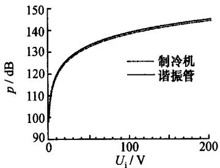  
(a) 声压级与输入电压

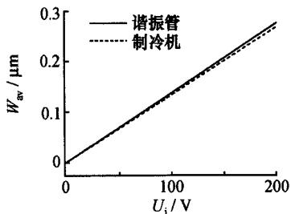  
(b) 振动幅值与输入电压  
图 4 电压响应特性

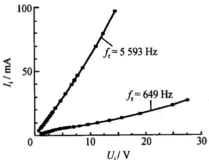  
(a) 输入电流与输入电压

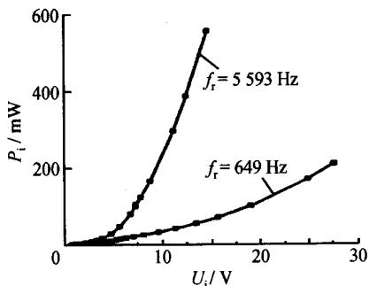  
(b) 输入功率与输入电压

## 3 压电驱动系统的实验

## 3.1 压电喇叭驱动的谐振腔系统

图5显示了高频热声制冷机样机测试系统。

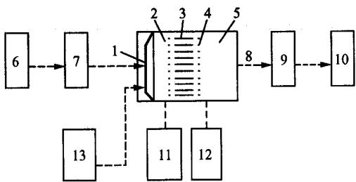  
1—压电喇叭：2—热端换热器；3—板叠；4—冷端换热器；5—谐 振腔；6—信号发生器；7一功率放大器；8—压力传感器；9—电容 放大器；10—示波器；11、12—数字温度计；13一数字功率计  
图 5 高频热声制冷机测试系统

本文对喇叭在低频与高频谐振条件下的电压特性进行了实验研究。结果见图6。

图7显示了在谐振频率5539Hz下，实验与模拟计算的比较。如前面的计算结论，具有简支边界条件的压电片产生的声压级较固定边界的大得多，而实际实验中的喇叭，其压电片是近似简支的条件，但压电片中心位置处粘接的纸锥边界是固定的，整个喇叭的实际边界条件大约是介于简支和固定条件之间。声压级随驱动电压的变化，计算与实验是比较一致的。这说明本文中的模拟模型可用于高频热声系统的模拟与性能预测。

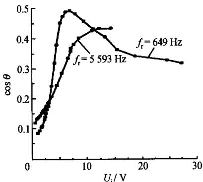  
(c) 输入功率因素与输入电压

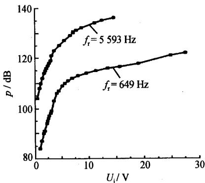  
(d) 声压级与输入电压  
图6 压电喇叭驱动系统的电压特性

## 3.2 压电喇叭驱动的热声制冷实验样机

压电喇叭驱动的热声制冷实验样机的热声回热器使用玻璃棉材料，冷热端换热器采用铜丝网，实验

## 万方数据

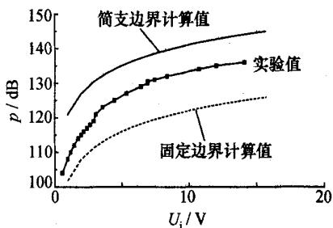  
图 7 计算与实验的比较

是在高频谐振频率5.539kHz下进行的。从图8可以看出回热器冷热端温度随时间和声压级是增加的。达到的最大温差是 $5 { \sim } 6 \ \mathrm { \ ' }$ 。说明用于高频热声制冷的回热器材料是合适的，能维持一定的温差，但冷端温度是上升的。这主要是因为实验中发现，压电喇叭的发热较大。压电陶瓷的材料使用发热较大的PZT5材料。

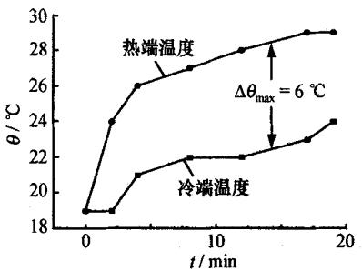  
(a) 温度与时间

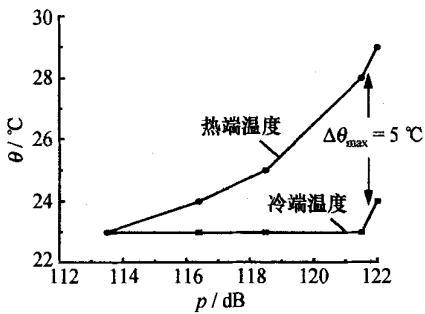  
(b) 温度与声压级  
图8 回热器冷热端温度随时间和声压级的变化

在今后喇叭和装置系统的设计中，需要考虑使用发热较小的PZT4或PZT8的压电陶瓷材料，喇叭端也需要设计散热器。要使系统达到预期的制冷效果和性能[2]，还有许多改善的空间。从前面的研究知，改善装置系统的电学匹配和声学匹配也是提高声幅和改善装置性能的有效措施。

此外，改进谐振腔形状的设计，如采用变截面谐振腔、提高工作压力、使用Pr数小的工质或混合工质，这些也都将改善制冷装置的性能。

## 4 结论

本文建立了压电声源驱动的高频热声制冷机的网络模拟模型，考虑了压电片的简支和固定两种边界条件，对压电驱动器及所驱动的(热)声谐振腔的频率和电压响应特性，进行了模拟计算和实验研究。模拟结果显示，具有简支边界的压电片产生的声压级比固定边界的要大得多，计算与实验结果是一致的，模型可用于压电声源驱动的高频热声制冷装置的模拟与性能预测。研究结果表明在驱动电源与压电喇叭间需要电学匹配。对制冷装置的初步实验显示，玻璃棉回热器能维持一定的温差，喇叭的压电材料发热大，需要设计散热器或改善压电材料。

## 参考文献(References)

[1] Symko I O G, Abdel-Rahman E, Kwon Y S, et al. Design and development of high-frequency thermoacoustic engines for thermal management in microelectronics [J]. Microelectronics J, 2004, 35: 185 – 191.

[2] 林书玉.超声换能器的原理及设计[M]. 北京：科学出版社，2004.LIN Shuyu. Principle and Design of Ultrasonic Transducer[M]. Beijing: Science Press, 2004.

[3]穆延荣.压电陶瓷和金属构成的复合薄圆板的强迫振动 ——A电压策动[J]. 声学学报，1983，8(5)：300-309. MU Yanrong. Forced vibrations of metal-piezoceramic thin composite circular plate excited with voltage [J]. Acta Acustica, 1983, 8(5): 300 - 309. (in Chinese)

[4] Lihoreau B, Lotton P, Brunean M, et al. Piezoelectric source exciting thermoacoustic resonator: Analytical modeling and experimental [J]. Acta Acustica Uunited with Acustica, 2002, 88: 986-997.

[5] Zhang X Q, Li Q, Guo F Z. Numerical analysis on thermoacoustic engine using network method [J]. Chinese Journal of Acoustics, 2003, 22: 166 -175.

[6] 张晓青. 热声热机系统的仿真与优化研究[D]. 武汉：华中 科技大学，2001. ZHANG Xiaoqing. Investigation on Modeling and Optimization of Thermoacoustic Engine Systems [D]. Wuhan; Huazhong University of Science and Technology, 2001. (in Chinese)

[7] Swift G W. Thermoacoustic engines [J]. J Acoust Soc Am, 1988,84:1145-1180.

[8] Swift G W. Thermoacoustics: A Unifying Perspective for Some Engines and Refrigerators [M]. Melville, NY: Acoustical Society of America, 2002.
