# Study on a Heat-Driven Thermoacoustic Refrigerator for Low-Grade Heat Recovery

Jingyuan Xua,b,\*, Ercang Luob,\*, Simone Hochgreba,\*,

a. Department of Engineering, University of Cambridge, Cambridge CB2 1PZ, United Kingdom b. CAS Key Laboratory of Cryogenics, Technical Institute of Physics and Chemistry, Chinese Academy of Sciences, Beijing 100190, China

## Abstract

Recovering low-grade heat from renewable energy sources and waste heat is crucial for improving energy utilizing efficiency as well as reducing $\mathrm { C O } _ { 2 }$ emissions. Conventional thermoacoustically-driven refrigerators have a high onset temperature and low cooling efficiency, which significant limit their capacity for low-grade heat utilization. This paper investigates a novel thermoacoustically-driven refrigerator with gas-liquid resonators which enable a lower onset temperature and better cooling performance for harvesting low-grade heat. Theoretical analyses were performed on multi-stage systems to explore the onset characteristics and steady performance. Onset characteristics analysis was conducted by using a transfer matrix method. The effects of mean pressure, liquid volume ratio and the expected liquid mechanical damping coefficient on the onset temperature difference and working frequency were studied for systems with different numbers of stages. A comparison of system onset performance was made with conventional systems containing a gas-only resonator. The research illustrated that for a mean pressure of 1 MPa, the proposed system can significantly reduce the onset temperature difference from 144.1 K to below 35.5 K. In addition, an analysis was then conducted to study the parametric sensitivity of the thermodynamic performance. Calculation results show that the proposed system can achieve a baseline cooling power of 2.7 kW and a thermal-to-cooling efficiency of 0.67 at a heating temperature of 420 K and a cooling temperature of 270 K. This represents significant increases by a factor of 5.6 in cooling power and 1.5 in efficiency from a gas-only to a gas-liquid resonator.

## Keywords

Thermoacoustic; Waste heat; Stirling; Refrigeration; Renewable energy

## Nomenclature

Symbols   
a acoustic speed, m/s   
A area, $\mathrm { m } ^ { 2 }$   
b continuum between parallel plates and   
rectangular channels   
C acoustic compliance, m3/Pa   
dh hydraulic diameter, m   
D diameter, m   
e mass-specific total gas energy, J/kg   
E values associated with the total minor   
losses in the U-shaped tube   
f frequency, Hz   
fD Darcy friction factor   
F viscous pressure gradient   
g acceleration of gravity, m/s2   
i ${ \sqrt { - 1 } } ,$ , imaginary unit   
k complex wavenumber   
$k _ { g }$ thermal conductivity of gas, W/(m·K)   
K spring constant, N/m   
$K _ { l o s }$ total local loss coefficient   
l length, m   
L inertance, kg/m4   
n stage number   
$N u$ Nusselt number   
$N _ { k }$ enhanced gas conduction coefficient   
$P _ { 1 }$ pressure amplitude, Pa   
$P r$ Prandtl number   
$P _ { r a }$ pressure ratio   
$P e$ Peclet number   
q instantaneous axial heat flux, W/m2   
$\mathcal { Q } _ { w }$ film heat transfer, W   
Q rate at which heat is transferred, W   
$r _ { h }$ hydraulic radius, m   
r acoustic power loss ratio   
$r _ { t }$ tube radius, m   
$R _ { m }$ mechanical damping coefficient, N·s/m   
$R _ { \nu }$ viscous damping coefficient, N·s/m   
$R _ { k }$ kinetic damping coefficient, N·s/m   
$R e$ Reynolds number   
$S _ { x }$ wetted perimeter, m   
T temperature, K   
u mean-flow velocity, m/s

U1 volume flow rate, m3/s

V volume, m3

Xl liquid displacement, m

Z acoustic impedance, Pa·s $/ \mathrm { m } ^ { 3 }$

y0 half of the plate spacing, m

ρ density, kg/m3

γ specific heats ratio

ω angular frequency, 1/s

χv spatial averaged viscous function

χκ spatial averaged thermal function

κ thermal diffusivity, m2/s

v kinematic viscosity, m2/s

δ penetration depth, m

μ dynamic viscosity, kg/(m·s)

μg,0 gas dynamic viscosity at ambient

$\phi$ porosity

τ ratio of absolute temperatures at the

ε average height of surface irregularities

ηC relative Carnot efficiency

θ phase angle, °

| | magnitude of complex number;

determinant of the matrix

## Abbreviations

AHX ambient-temperature heat exchanger

CHX low-temperature heat exchanger

COP coefficient of performance

HX heat exchanger

HHX high-temperature heat exchanger

PT pulse tube

REG regenerator

TBT thermal buffer tube

## Subscripts

0 ambient

1 first order

c cold

col cooler

com compression

CI cooler inlet

CO cooler outlet

exp expansion

eng engine   
EI engine inlet   
EO engine outlet   
g gas   
GR gas resonator   
GLR gas-liquid resonator   
h hot   
l liquid   
m mean   
tot total   
sub subunit   
κ thermal   
v viscous

## 1 Introduction

The utilization of low-grade heat from renewable energy sources (solar and geothermal) [1-2] and the waste heat from industrial processes [3-4] continues to be important for global energy efficiency. For example, the US Department of Energy estimates that between 20% and 50% of industrial energy input is lost to the environment as waste heat [5]. Recovering such low-grade heat enables higher overall system efficiency and lower energy demand, emissions and costs. The ability to use low-grade heat for cooling purposes would be attractive for numerous applications in buildings, the preservation of perishable food, medicine and electronics.

Thermoacoustic is an emerging energy-conversion technology that can be applied for heating [6], cooling [7,8] or power generation [9,10]. Cooling based on a thermoacoustic wave driven thermodynamic cycle promises a new type of sustainable heat-driven cooling technology that involves no harmful ozone-depleting gases, no mechanical moving parts and no electrical power. A thermoacoustically-driven refrigerator consists of a thermoacoustic engine and a thermoacoustic cooler, and works by converting thermal energy into acoustic work necessary to pump heat from lower to higher temperatures.

In an appropriately designed thermoacoustic engine, when the onset temperature difference at two ends of the regenerator exceeds a critical value, acoustic gain overcomes losses, and spontaneous gas oscillation occurs. Therefore, for the utilization of low-grade heat, it is necessary to decrease the required onset temperature in the thermoacoustic engine. The development of a looped multi-stage thermoacoustic engine [11] has significantly boosted the possibilities. Compared with conventional standing-wave [12,13] or Stirling-type thermoacoustic engines [14,15], the looped multi-stage thermoacoustic engine is characterized by compact size, large power density, high potential efficiency and a lower onset temperature difference. In 2010, de Blok developed a looped four-stage thermoacoustic engine [11], which experimentally achieved the onset temperature difference of 26 K. Jin et al. conducted experimental studies of looped multi-stage thermoacoustic engines [16,17], and the results showed that the onset temperature difference can be as low as 17 K [16]. Developments in lowgrade-heat, thermoacoustically-driven systems were accelerated by the development of the looped multi-stage thermoacoustic engine. In 2012, de Blok developed a looped thermoacoustically-driven refrigerator [18]. At a heating temperature of 442 K, the system achieved a cooling power of 78.2 W and an overall relative Carnot efficiency of 9.3% at a cooling temperature of 239.3 K. Later, Yu et al. developed a thermoacoustic electricity generator by employing a looped two-stage thermoacoustic engine for the utilization of low-grade thermal energy [19]. The experimental result depicted an onset temperature difference of about 120 K. Zhao et al. numerically studied a looped threestage thermoacoustically-driven refrigerator for recovering industrial waste heat [20]. The theoretical simulations were performed at varied waste heat temperatures between 313 and 343 K and different hot-end temperatures between 393 and 423 K, with a system relative Carnot efficiency of over 50%. Wang et al. numerically analyzed a looped four-stage thermoacoustic electricity generator [21] for waste heat at a temperature of 573 K, and their results demonstrated that the system was able to provide a maximum electric power of 1223 W with a highest relative Carnot efficiency of around 20%. Yang et al. theoretically investigated a looped four-stage phase-change thermoacoustic engine [22], and system exhibited a thermal-to-acoustic efficiency over 40% when working at a temperature difference below 50 K.

In addition to these promising results, current thermoacoustic systems using gas as a phase-matching element have still been shown to achieve relatively high onset temperatures and low cooling efficiencies. A gas-liquid resonator provides an effective solution for the problem. The gas-liquid resonator was first proposed by West et al. to replace the conventional solid pistons in a free-piston Stirling engine [23]. Extensions of this resonator to thermoacoustic engines have been recently developed by Tang et al [24,25], Li et al. [26,27], Langdon-Arms et al. [28] and Hyodo et al. [29]. The results of these studies show that the gas-liquid resonator can significantly reduce the onset temperature difference and achieve better cooling performance.

In the present paper, we explore the use of the gas-liquid resonator in a thermoacoustically-driven refrigerator for the first time. The research aims to resolve two key issues to enable thermoacoustic cooling systems to be successfully implemented for low-grade heat recovery: (i) improving efficiency and cooling power density, and (ii) extending the lowest possible heating temperature required. This paper presents the onset features, steady thermodynamic performance and parameter sensitivity for systems with different stage configurations.

## 2 Configuration

Figure 1 presents the schematics of a looped multi-stage thermoacousticallydriven refrigerator with gas-liquid resonators for low-grade heat recovery. Multiple identical energy-conversion subunits, each of which consists of an engine unit, a cooler unit and a gas-liquid resonator unit, are incorporated in a loop. The engine unit consists of an ambient-temperature heat exchanger (AHX), a regenerator (REG), a hightemperature heat exchanger (HHX) and a thermal buffer tube (TBT). The cooler unit consists of an ambient-temperature heat exchanger, a regenerator, a low-temperature heat exchanger (CHX) and a pulse tube (PT). The working principle of the proposed system is as follows: each high-temperature heat exchanger is heated by a low-grade heat source and the ambient-temperature heat exchanger is cooled by ambient cooling water, which results in a temperature gradient across the engine regenerator. When the axial temperature gradient exceeds a critical value, self-excited thermoacoustic oscillation begins. The amplified acoustic power is consumed by the cooler, and the remaining acoustic power is recovered by the next-stage subunit. The cycle is then repeated. Table 1 shows the main geometric dimensions of the system.

The first novel aspect of the present system setup lies in the elimination of the phase shifter between the engine and cooler because the simulation results show that such a phase shifter is not necessary when the cooling temperature is near room temperature. A second innovation is the use of a gas-liquid resonator in a U-type tube consisting of a gas expansion column, a liquid column and a gas compressor column, which is used to provide suitable acoustic fields for the system. Whereas a piston can be used for phase matching, a liquid-filled tube serves a similar purpose with higher pressure wave amplitudes and simpler assemblies.

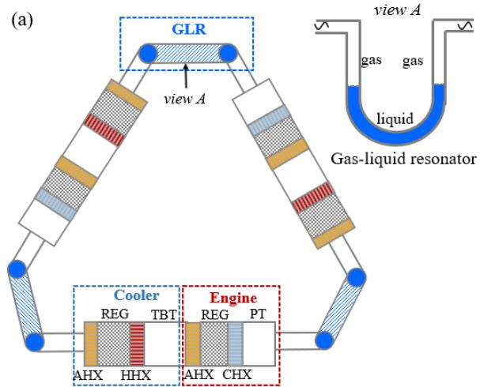

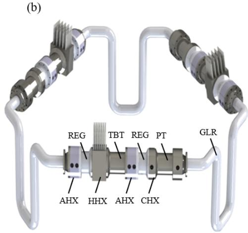  
Fig.1. Schematics of a looped multi-stage thermoacoustically-driven refrigerator using gas-liquid resonators for recovering low-grade heat (taking 3-stage as an example): (a) 2D sketch; (b) 3D drawing. AHX is the ambient-temperature heat exchanger, REG is the regenerator, HHX is the hightemperature heat exchanger, TBT is the thermal buffer tube, CHX is the low-temperature heat exchanger, PT is the pulse tube, and GLR is the gas-liquid resonator.

Table 1. Main geometric dimensions of the components in each subunit.
<table><tr><td>Unit</td><td>Parts</td><td>Diameter</td><td>Length (mm)</td></tr><tr><td></td><td>(mm)</td><td></td></tr></table>

<table><tr><td rowspan="5">Engine</td><td>AHX</td><td rowspan="5"></td><td>30</td><td>plate-fin type, 20% in porosity, 0.4 mm in hydraulic diameter</td></tr><tr><td>REG</td><td>20 100</td><td>90% in porosity, 38 μm in wire diameter</td></tr><tr><td>HHX</td><td>25</td><td>plate-fin type, 20% in porosity, 0.2 mm in</td></tr><tr><td>TBT</td><td>80</td><td>hydraulic diameter</td></tr><tr><td></td><td></td><td>5 mm in wall thickness</td></tr><tr><td rowspan="5">Cooler</td><td>AHX</td><td rowspan="5">100</td><td>30</td><td>plate-fin type, 20% in porosity, 0.2 mm in hydraulic diameter</td></tr><tr><td>REG</td><td>18</td><td>90% in porosity, 20 μm in wire diameter</td></tr><tr><td>CHX</td><td>30</td><td>plate-fin type, 20% in porosity, 0.2 mm in hydraulic diameter</td></tr><tr><td>PT</td><td>60</td><td>2.2 mm in wall thickness</td></tr><tr><td>/</td><td>1200</td><td>U tube type</td></tr></table>

The difference between the proposed gas-liquid resonator and the conventional gas resonator can be qualitatively analyzed as outlined here. The two key factors leading to better cooling performance in a thermoacoustically-driven refrigerator are highpressure wave amplitudes, which provide enhanced driving force, and low working frequency, which produces lower power loss with a regenerator. The lower acoustic inertance in the gas resonator (Figure 2a) arises due to the lower gas density compared to a liquid. From the simple perspective of an electro-acoustic analogy, the working angular frequency is equal to $\sqrt { 1 / L C }$ and the pressure amplitude is proportional to ${ \sqrt { L / C } } .$ , where L is the total acoustic inertance and C is the total acoustic compliance. Therefore, the lower acoustic inertance of the gas resonator results in higher working frequency and lower pressure amplitude, which counters the system performance. In contrast, in the gas-liquid resonator (Figure 2b), the higher density of the liquid relative to the gas leads to a larger acoustic inertance and further results in higher pressure amplitudes and lower working frequencies. These factors help achieve better cooling performance and a lower onset temperature difference.

(a)  
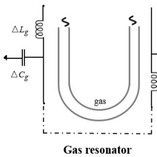

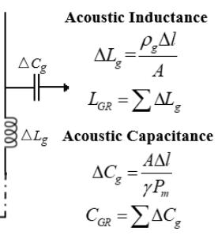

(b)  
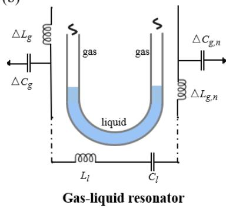

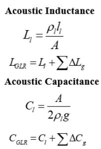  
Fig.2. A schematic and electro-acoustic analogy of two resonators: (a) gas resonator (b) gas-liquid resonator. L is the acoustic inertance, C is the acoustic compliance, $\rho$ is the density, l is the length,

A is the tube area, $P _ { \mathrm { { m } } }$ is the mean pressure, γ is the ratio of specific heats, and $^ g$ is the acceleration due to gravity. The subscripts g, l, GR and GLR represent the gas, liquid, gas resonator and gasliquid resonator, respectively.

## 3 Onset Characteristics Analysis

## 3.1 Model description

In this section, we use the transfer matrix method to calculate the onset characteristics of the system. This calculation method is based on linear thermoacoustic theory [30] developed for small-amplitude gas oscillations. The governing equations are transformed into ordinary differential equations in terms of oscillation pressure and volume flow rate. For working gas regions, the linearized momentum and mass conservation equations are

$$
\frac { d P _ { 1 } } { d x } = - \frac { 1 } { A } \frac { i \omega \rho _ { m } } { 1 - \chi _ { \nu } } U _ { 1 }\tag{1}
$$

$$
\frac { d U _ { 1 } } { d x } = - \frac { i \omega A [ 1 + ( \gamma - 1 ) \chi _ { \kappa } ] } { \gamma P _ { m } } P _ { 1 } + \frac { \chi _ { \kappa } - \chi _ { \nu } } { ( 1 - \chi _ { \nu } ) ( 1 - P r ) } \frac { 1 } { T _ { m } } \frac { d T _ { m } } { d x } U _ { 1 }\tag{2}
$$

respectively, where $P _ { 1 }$ and $U _ { 1 }$ are the first-order pressure wave and volume flow rate; $i ,$ ω and A denote the imaginary number, angular frequency and cross-sectional area of the working gas, respectively; $T _ { m } , \rho _ { m } , P _ { m } , P r$ and $\gamma$ are the mean temperature, mean gas density, mean pressure, Prandtl number, and specific heat ratio, respectively; and $\chi _ { \nu }$ and $\chi _ { \kappa }$ are the viscous and thermal functions that allow us to describe the three-dimensional phenomena in the channel using one-dimensional equations.

Eqs. (1) and (2) can be written in matrix form as

$$
{ \frac { d } { d x } } { \binom { P _ { 1 } ( x ) } { U _ { 1 } ( x ) } } = \mathbf { Z } { \binom { P _ { 1 } ( x ) } { U _ { 1 } ( x ) } }\tag{3}
$$

$$
\mathbf { Z } = \left( \begin{array} { c c } { 0 } & { - \frac { 1 } { A } \frac { i \omega \rho _ { m } } { 1 - \chi _ { \nu } } } \\ { - \frac { i \omega A [ 1 + ( \gamma - 1 ) \chi _ { \kappa } ] } { \gamma P _ { m } } } & { \frac { \chi _ { \kappa } - \chi _ { \nu } } { ( 1 - \chi _ { \nu } ) ( 1 - \sigma ) } \frac { 1 } { T _ { m } } \frac { d T _ { m } } { d x } } \end{array} \right)\tag{4}
$$

The general transfer matrix M for the component of length l is

$$
{ \binom { P _ { 1 } ( x _ { 1 } + l ) } { U _ { 1 } ( x _ { 1 } + l ) } } = \mathbf { M } { \binom { P _ { 1 } ( x _ { 1 } ) } { U _ { 1 } ( x _ { 1 } ) } }\tag{5}
$$

In the heat exchanger, $\frac { d T _ { m } } { d x } = 0$ , Eq. (3) and (4) can be solved. The transmission matrix of the heat exchanger $\mathbf { M } _ { \mathbf { H } \mathbf { X } }$ can be expressed as

$$
\mathbf { M } _ { \mathrm { H X } } = \left( \begin{array} { c c } { \cos ( k l ) } & { - \frac { i \omega \rho _ { m } \sin ( k l ) } { A k ( 1 - \chi _ { \nu } ) \sin ( k l ) } } \\ { \frac { i \omega \rho _ { m } } { i \omega \rho _ { m } } } & { \cos ( k l ) } \end{array} \right)\tag{6}
$$

where $k$ is the complex wavenumber expressed as

$$
k = \frac { \omega } { a } \sqrt { \frac { 1 + ( \gamma - 1 ) \chi _ { \kappa } } { 1 - \chi _ { \nu } } }\tag{7}
$$

a is the speed of sound. For a plate-fin type heat exchanger employed in the system,

$$
\chi _ { j } = \frac { \operatorname { t a n h } [ ( 1 + i ) y _ { 0 } / \delta _ { j } ] } { ( 1 + i ) y _ { 0 } / \delta _ { j } } , j = \kappa , \nu\tag{8}
$$

$$
\delta _ { \kappa } { = } \sqrt { 2 \kappa / \omega } , \delta _ { \nu } { = } \sqrt { 2 \nu / \omega }\tag{9}
$$

$\delta _ { \kappa }$ and $\delta _ { \nu }$ are the thermal and viscous penetration depths, respectively; $y _ { 0 } , \kappa ,$ and ν denote half of the plate spacing, thermal diffusivity and kinematic viscosity of the working gas, respectively.

For a pulse tube or thermal buffer tube, the correction terms $\chi _ { \nu }$ and $\chi _ { \kappa }$ are very small because of the large diameter, so the (2,2) element of $\mathbf { Z } \left( Z _ { 2 2 } \right)$ in Eq. (4) is close to zero, even though $\frac { d T _ { m } } { d x } \neq 0$ [30]. The transfer matrix ofa pulse tube or thermal buffer tube MPT/TBT is expressed as

$$
\mathbf { M } _ { \mathrm { { P T / T B T } } } = { \left( \begin{array} { l l } { 1 } & { 0 } \\ { - { \frac { i \omega V } { \gamma P _ { m } } } } & { 1 } \end{array} \right) }\tag{10}
$$

where V denotes the volume of the component.

In the regenerator, ${ \frac { d T _ { m } } { d x } } \neq 0 .$ . Solving the transfer matrix of the regenerator becomes complex because the volumetric-velocity gain occurs in a distributed manner. A distributed model is therefore used to obtain the transfer matrix of the regenerator MREG as derived in [15]

$$
\mathbf { M } _ { \scriptscriptstyle \mathrm { R E G } } = \left( \begin{array} { l l } { 1 + \displaystyle \frac { i \omega C _ { 0 } R _ { 0 } } { 2 } g ( \tau , P r ) } & { - \displaystyle \frac { R _ { 0 } ( \tau + 1 ) } { 2 } f ( \tau , P r ) } \\ { - i \displaystyle \frac { \omega C _ { 0 } \tau } { \tau - 1 } \mathrm { I n } \tau } & { \tau } \end{array} \right)\tag{11}
$$

where

$$
R _ { 0 } { = } \frac { 6 { \mu } _ { g , 0 } l } { A { r _ { h } } ^ { 2 } }\tag{12}
$$

$$
C _ { 0 } { = } \frac { \phi A l } { P _ { m } }\tag{13}
$$

$$
f ( \tau , P r ) { = } \frac { 2 } { P r + 2 } [ \frac { \tau ^ { P r + 2 } - 1 } { \tau ^ { 2 } - 1 } ]\tag{14}
$$

$$
g ( \tau , P r ) = \frac { 2 } { P r + 2 } [ \frac { \tau ^ { P r + 2 } \mathrm { I n } \tau - ( \tau ^ { P r + 2 } - 1 ) / ( P r + 2 ) } { ( \tau - 1 ) ^ { 2 } } ]\tag{15}
$$

where $\mu _ { g , 0 }$ is the gas viscosity at ambient temperature, and $r _ { h }$ and $\phi$ are the hydraulic radius and volume porosity of the regenerator, respectively. τ is the ratio of absolute temperatures at the two ends of the regenerator: for the engine regenerator, τ is the ratio of heating temperature to ambient temperature; for the cooler regenerator, τ equals 1 at the system onset condition, so $g ( \tau , P r )$ and $f ( \tau , P r )$ are both equal to 1.

The transfer matrix of a gas resonator MGR is presented as follows:

$$
{ \bf M _ { \mathrm { G R } } } = \left( \begin{array} { c c } { { \displaystyle \cos ( \frac { \omega l } { a } ) } } & { { \displaystyle - \frac { a \rho _ { m } \sin ( \frac { \omega l } { a } ) } { { \cal A } } i } } \\ { { \displaystyle - \frac { { \cal A } \sin ( \frac { \omega l } { a } ) } { a \rho _ { m } } i } } & { { \displaystyle \cos ( \frac { \omega l } { a } ) } } \end{array} \right)\tag{16}
$$

For the gas-liquid resonator, the overall transfer matrix consists of an expansion gas matrix, liquid matrix and compression gas matrix. The transfer matrix for the shortlength gas column is simplified as Eq. (10). To obtain the transfer matrix of the liquid, we take the continuity equation for an incompressible fluid and consider the contribution of the gravitational acceleration to the momentum equation. The overall transfer matrix of a gas-liquid resonator $\mathbf { M } _ { \mathbf { G L R } }$ becomes,

$$
\mathbf { M _ { \mathrm { G L R } } } = \left( \begin{array} { c c } { 1 } & { 0 } \\ { - i \omega V _ { \mathrm { e x p } } } & { 1 } \\ { - \frac { i \omega V _ { \mathrm { c o m } } } { \gamma P _ { m } } } & { 1 } \end{array} \right) \left( \begin{array} { c c } { 1 } & { - \frac { 1 } { A ^ { 2 } } [ R _ { m } + i ( \omega \rho _ { l } V _ { l } - \frac { 2 \rho _ { l } A g } { \omega } ) ] } \\ { 0 } & { 1 } \end{array} \right) \left( \begin{array} { c c } { 1 } & { 0 } \\ { - \frac { i \omega V _ { \mathrm { c o m } } } { \gamma P _ { m } } } & { 1 } \end{array} \right)\tag{17}
$$

where $V _ { e x p } , V _ { c o m } .$ , Vl are the expansion gas volume, compression gas volume and liquid volume respectively. $R _ { m }$ is the mechanical damping coefficient.

Using the transfer matrix for each component, the overall transfer matrix for an energy-conversion subunit, $\mathbf { M _ { a l l } } .$ , is given by

$$
\mathbf { M } _ { \mathrm { a l l } } = \mathbf { M } _ { \mathrm { e n g , A H X } } \mathbf { M } _ { \mathrm { e n g , R E G } } \mathbf { M } _ { \mathrm { H H X } } \mathbf { M } _ { \mathrm { T B T } } \mathbf { M } _ { \mathrm { c o l , A H X } } \mathbf { M } _ { \mathrm { c o l , R E G } } \mathbf { M } _ { \mathrm { C H X } } \mathbf { M } _ { \mathrm { P T } } \mathbf { M } _ { \mathrm { G L R } } \mathbf { M } _ { \mathrm { X X } } \mathbf { M } _ { \mathrm { X X } } ,\tag{18}
$$

Due to the symmetric configuration, the transfer matrix for an energy-conversion subunit in the n-stage system can also be expressed as,

$$
{ \bf M _ { \mathrm { \tiny ~ s u b } } } = \left( \begin{array} { c c } { { \cos ( { \frac { 2 \pi } { n } } ) - i \sin ( { \frac { 2 \pi } { n } } ) } } & { { 0 } } \\ { { 0 } } & { { \cos ( { \frac { 2 \pi } { n } } ) - i \sin ( { \frac { 2 \pi } { n } } ) } } \end{array} \right)\tag{19}
$$

where n is the number of stages. For an energy-conversion subunit, we therefore have

$$
\begin{array} { r } { \bigg ( { P } _ { 1 } ( x _ { o u t } ) } \\ { U _ { 1 } ( x _ { o u t } ) \bigg ) = \mathbf { M } _ { \mathrm { a l l } } \bigg ( { P } _ { 1 } ( x _ { i n } ) } \\ { U _ { 1 } ( x _ { o u t } ) \bigg ) = \mathbf { M } _ { \mathrm { s u b } } \bigg ( { P } _ { 1 } ( x _ { i n } ) \bigg ) } \end{array}\tag{20}
$$

The solution $( P _ { 1 } ( x _ { i n } ) , U _ { 1 } ( x _ { i n } ) )$ to Eq. (20) is nonzero if the determinant of the matrix $\bf ( M _ { a l l }  – M _ { s u b } )$ is zero, i.e., if

$$
\begin{array}{c} \begin{array} { c c } { { | m _ { a l l , 1 1 } - m _ { s u b , 1 1 }  } } & { { m _ { a l l , 1 2 } } } \\ { {  m _ { a l l , 2 1 }  } } & { { m _ { a l l , 2 2 } - m _ { s u b , 2 2 } } } \end{array} | = 0 \  \end{array}\tag{21}
$$

The solution to Eq. (21) allows ω and τ to be obtained.

A 3-stage looped thermoacoustic heat engine with a gas-liquid resonator [27] has been used to validate the calculation model. This system includes the main components of the heat exchanger, regenerator, thermal buffer tube and gas-liquid resonator, which allows validation of the components required for the present model. Figure 3 shows the calculation and experiment results of the onset temperature difference and working frequency for different mean pressures. The calculation results show quantitative agreement with the experiments. The largest deviation in the onset temperature difference lies below 7%. This verification illustrates that similar experimental results can be effectively predicted by the calculation model.

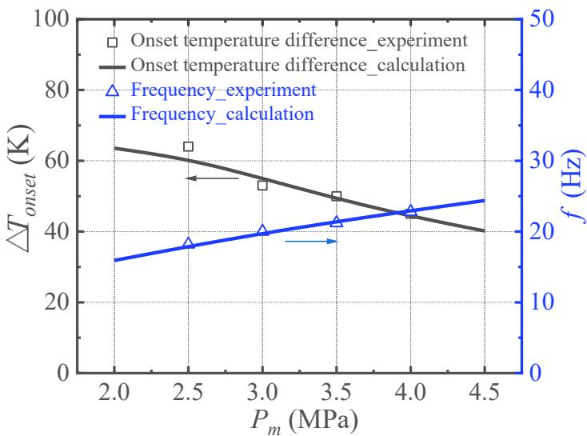  
Fig.3. Comparison of experimental and simulated results for the onset temperature difference and frequency in a thermoacoustic heat engine with gas-liquid resonators. The experimental results are from Ref. [27].

## 3.2 Onset characteristics of the thermoacoustic refrigerator with gas-liquid resonator

In this section, the onset performance of the looped thermoacoustically-driven refrigerator with gas-liquid resonators is investigated. The effects of key parameters – the liquid mechanical damping coefficient, mean pressure and liquid volume ratio – on the onset temperature difference and working frequency are presented for systems with different numbers of stages. In the calculation, the working gas is helium and the liquid is water. The subunit dimensions are the same for different-stage systems.

## 3.2.1 Effect of the liquid damping coefficient in systems with different stage numbers

In the steady-state process, the acoustic energy transferred to the liquid is partly lost to viscous damping, whose coefficients can be approximately calculated from Eqs. (29) to (31). However, it is somewhat difficult to obtain the liquid damping coefficient for the onset process, because its damping behavior may deviate from that of the steadystate case. Therefore, we study an estimated range of the liquid damping coefficient for the onset process to allow for this deviation. Figure 4 shows the influence of liquid damping coefficients on the system onset performance. The results show that the damping coefficient has a significant effect on onset temperature difference but has a negligible impact on the working frequency. For instance, in a 4-stage system, the onset temperature difference increases from 32.1 K to 54.1 K when the onset damping coefficient changes from 0.9 N·s/m to 4 N·s/m. In addition, systems with different stage numbers display close onset temperature differences. Within the estimated range of the liquid damping coefficient, most of the systems are expected to start oscillating at temperature differences below 50 K.

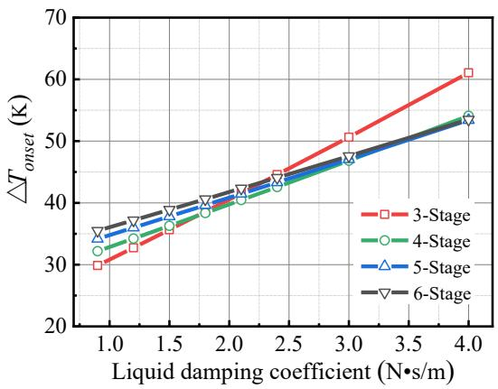  
(a)

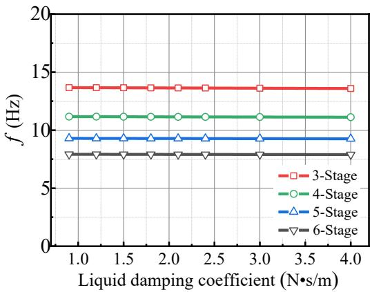  
(b)  
Fig.4. Effect of the liquid mechanical damping coefficient on (a) onset temperature difference (b) working frequency under different stage numbers. $P _ { m }$ is 1 MPa, T0 is 293 K and the liquid volume ratio is 0.4.

## 3.2.2 Effect of mean pressure in systems with different stage numbers

The mean pressure has an immediate impact on the transfer matrix as well as the gas thermal properties (density and penetration depths), which plays a crucial role in determining the system onset performance. Calculations were therefore conducted to study the effect of mean pressure on the onset temperature difference and working frequency in systems with different numbers of stages. In the calculations, the liquid volume ratio and mechanical damping coefficient were fixed at 0.4 and 1.5 N·s/m. The calculation results are shown in Figure 5. An increase in mean pressure was found to favorably affect the onset temperature difference up to about 1.5 MPa. Significantly, for pressures above 1 MPa, the system becomes active for temperature differences in the order of 30 K. A 6-stage system offers the lowest onset temperature difference of 21.5 K at the highest pressures of 4.5 MPa. Increases in mean pressure result in higher working frequency, which scales approximately with the square of mean density and thus mean pressure.

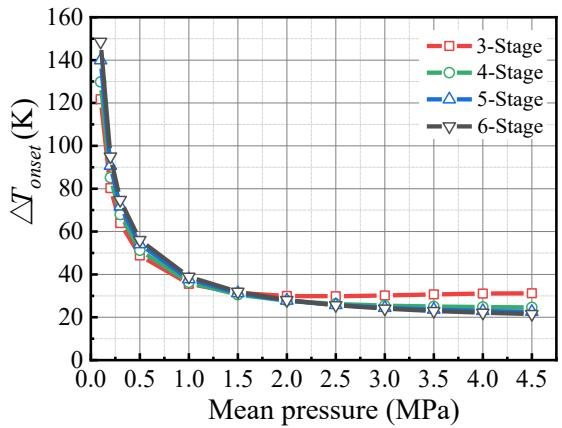  
(a)

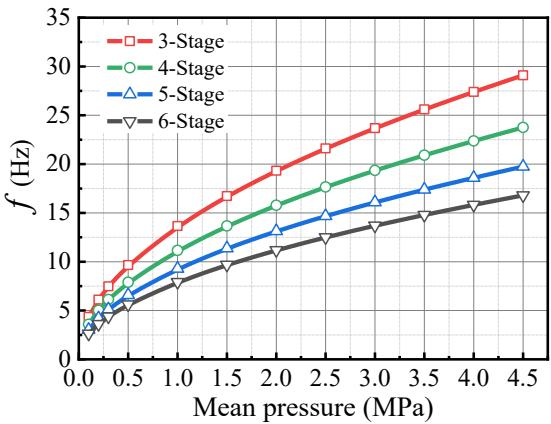  
(b)  
Fig.5. Effect of mean pressure on (a) onset temperature difference (b) working frequency under different stage numbers. The liquid volume ratio is 0.4, T0 is 293 K and the liquid mechanical damping coefficient is 1.5 N·s/m.

## 3.2.3 Effect of liquid volume ratio in systems with different stage numbers

The liquid volume can be changed. For a fixed total resonator volume, the change in liquid volume leads to changes in the transfer matrix of the gas-liquid resonator via Eq. (17). We consider how the system performs with different liquid volumes, by defining the ratio of liquid volume to total resonator volume. Figure 6 shows the influence of the liquid volume ratio on the system onset performance. Larger values of liquid volume ratio significantly decrease the onset temperature difference. Increases in liquid volume ratio also decrease the working frequency for low values of liquid volume ratio, but the effect eventually tapers off. When the liquid volume ratio is lower than 0.5, lower numbers of stages are favorable for the reduction of the onset temperature difference, while the reverse applies when the liquid volume ratio is higher than 0.5.

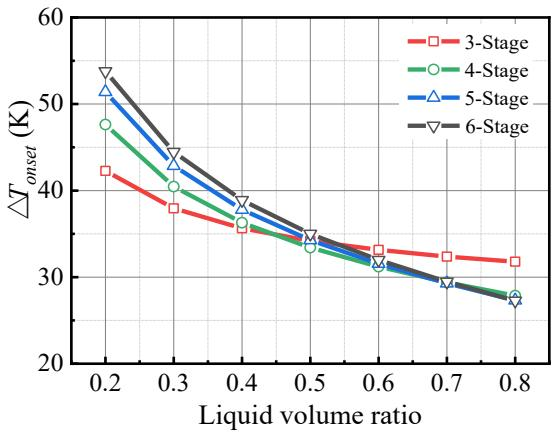  
(a)

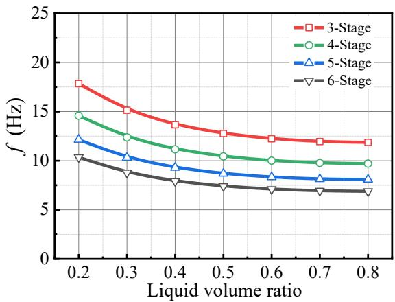  
(b)  
Fig.6. Effect of liquid volume ratio on (a) onset temperature difference (b) working frequency under different stage numbers. $P _ { m }$ is 1 MPa, $T _ { 0 }$ is 293 K and liquid mechanical damping coefficient is 1.5 $\mathrm { N } \cdot \mathrm { s } / \mathrm { m }$

## 3.3 Comparison of the conventional system with the gas resonator

Here we compare looped thermoacoustically-driven refrigerators using the gas resonator to systems using the gas-liquid resonator. In the comparison, the geometric dimensions of the engine and the cooler remain the same, as seen in Table 1, but the dimensions of two resonators are optimized in terms of efficiency: the diameter and length of the the gas-liquid resonator are 60 mm and 1.2 m respectively, while the diameter and length of the gas resonator are 29 mm and 3.25 m respectively. Figure 7 shows a comparison of the calculated performance of the two systems. The gas-liquid resonator system can reduce the onset temperature difference below 50 K, which is significantly lower than that of the gas resonator system. For a mean pressure of 1 MPa, the onset temperature difference of the gas-liquid resonator system is reduced from 144.1 K to 35.5 K compared to the gas resonator system. Therefore, the gas-liquid resonator system is especially attractive for utilizing low-grade heat at low mean pressures. In addition, the gas-liquid resonator can also significantly contribute to lower working frequencies.

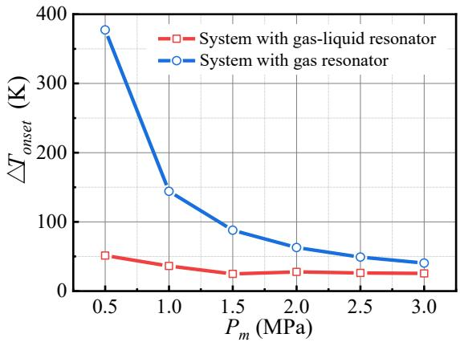  
(a)

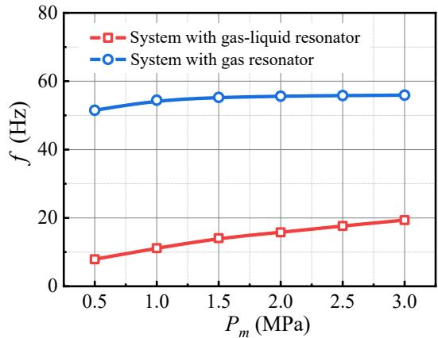  
(b)  
Fig.7. Comparison of (a) onset temperature difference (b) working frequency between thermoacoustically-driven refrigerators with gas-only resonators and gas-liquid resonators, under different mean pressures. Simulations are for a 4-stage system.

## 4 Steady Characteristics Analysis

## 4.1 Model description

While the aforementioned simulations show the onset characteristics of the system, the present section focuses on the steady-state characteristics of the system. Here, numerical investigations are implemented using the Sage program [31]. The program supports simulation and optimization of an underlying model class via a graphical interface. Sage consists of three model classes, i.e. Stirling-cycle, pulse-tube, and lowtemperature cooler, and is widely used for modeling thermoacoustic devices [32,33], pulse tube coolers [34,35], and free-piston Stirling machines [36,37]. A model instance, which is a collection of component building blocks with data values, is connected and assembled to form an overall system. Sage operates in the frequency domain and solves all conservation equations for each model instance. The corresponding mass, momentum and energy equations for the gas domain are [38],

$$
\frac { \partial \rho A } { \partial t } + \frac { \partial \rho u A } { \partial x } = 0\tag{22}
$$

$$
\frac { \partial \rho u A } { \partial t } + \frac { \partial u \rho u A } { \partial x } + \frac { \partial P _ { 1 } } { \partial x } A - F A = 0\tag{23}
$$

$$
\frac { \partial \rho e A } { \partial t } + P _ { 1 } \frac { \partial A } { \partial t } + \frac { \partial } { \partial x } ( u \rho e A + u P _ { 1 } A + q ) - Q _ { w } = 0\tag{24}
$$

The term $F$ in the momentum equations takes the place of the viscous terms in the Stokes stress tensor, which cannot be resolved directly in a one-dimensional model. The term $\mathcal { Q } _ { w }$ in the energy equation is the heat flow per unit length due to film heat transfer.

Term $q$ in the energy equation is the instantaneous axial heat flux. The terms $F , Q _ { w } ,$ , and $q$ are formulated as

$$
F = - ( f _ { D } / d _ { h } + K _ { l o s } / l ) \rho u | u | / 2\tag{25}
$$

$$
Q _ { w } = N u ( k / d _ { h } ) S _ { x } ( T _ { w } - T )\tag{26}
$$

$$
q = - N _ { k } k _ { g } \frac { \partial T } { \partial x } A\tag{27}
$$

where $f _ { D } , d _ { h }$ and $K _ { l o s }$ are the Darcy friction factor, hydraulic diameter and total local loss coefficient respectively. $N u$ $k _ { g } , \ S _ { x }$ and $( T _ { w } – T )$ are the Nusselt number, gas conductivity, wetted perimeter and temperature difference between the negative $z$ surface and section-average respectively. $N _ { k }$ is an axial-conductivity enhancement ratio that is represented as a ratio of the effective gas conductivity to the molecular conductivity. Empirical terms $f _ { D } ,$ Nu and $N _ { k }$ for typical components in the Sage program are presented in Table 2.

The gas dynamic equations serve to formulate the dependent variables $P$ and T as functions of independent variables $\rho , \rho u A .$ , and $\rho e$ —specifically as $P \left( \rho , T \right)$ and $T ( \rho , \rho e$ $\rho u A )$ . The solution method is as follows: the equations are discretized over a grid of point $( x _ { i } , t _ { j } )$ uniformly spaced throughout the domain over the cycle period. Upon this grid, variables $\rho ,$ , ρuA, and $\rho e ,$ are solved implicitly or interpolated explicitly according to the logic of a staggered-grid formulation [38]. This avoids instability when producing the global conservation of mass, momentum and energy.

Table 2. Empirical terms $f _ { D } ,$ Nu and $N _ { k }$ for typical types of heat exchangers and regenerators in the Sage program [38]. $R e ,$ $P r$ and $P e$ are the Reynolds number, Prandtl number and Peclet number, respectively. Other symbols are defined in the nomenclature section.
<table><tr><td>Component</td><td>Type</td><td colspan="2"> $f _ { D }$ </td><td> $N u$ </td><td> $N _ { k }$ </td></tr><tr><td rowspan="8">Heat</td><td rowspan="8">Shell</td><td rowspan="8"> $f _ { \scriptscriptstyle D } = \frac { 1 6 S _ { \scriptscriptstyle r } } { R e }$  Laminar steady flow:</td><td></td><td></td><td>Laminar:</td></tr><tr><td> $S _ { r } = \left\{ \begin{array} { l l } { { 4 } } & { { \mathrm { i f } V _ { a } \leq 3 2 } } \\ { { \sqrt { V _ { a } / 2 } } } & { { \mathrm { i f } V _ { a } \geq 3 2 } } \end{array} \right.$ </td><td>Laminar steady flow:</td><td></td></tr><tr><td></td><td> $N u = 6$ </td><td> $N _ { k } = 1$ </td></tr><tr><td> $V _ { a } { = } \rho \omega \mathbf { d } _ { h } ^ { 2 } ~ / 4 \mu _ { g }$ </td><td>Turbulent:</td><td>Turbulent:</td></tr><tr><td> $f _ { D } = 0 . 1 1 ( \varepsilon / d _ { h } + 6 8 / R e ) ^ { 0 . 2 5 }$ </td><td> $N u = 0 . 0 3 6 R e ^ { 0 . 8 } ( l / d _ { h } ) ^ { - 0 . 0 5 5 } P r ^ { 0 . 3 3 }$ </td><td> $N _ { k } = 0 . 0 2 2 R e ^ { 0 . 7 5 } P r$ </td></tr><tr><td></td><td></td><td>Turbulent:</td></tr><tr><td> $f _ { \scriptscriptstyle D } = \frac { 1 6 S _ { \scriptscriptstyle r } } { R e }$  Laminar steady flow:</td><td> $N u = 0 . 0 3 5 R e ^ { 0 . 7 5 } P r ^ { 0 . 3 3 }$ </td><td>Laminar:</td></tr><tr><td></td><td></td><td></td></tr></table>

$$
S _ { r } = \left\{ \begin{array} { l l } { 4 b } & { \mathrm { ~ i f ~ } V _ { a } \leq 3 2 b ^ { 2 } } \\ { \sqrt { V _ { a } / 2 } } & { \mathrm { ~ i f ~ } V _ { a } \geq 3 2 b ^ { 2 } } \end{array} \right.
$$

$$
N _ { k } = 1
$$

$$
V _ { a } { = } \rho \omega d _ { h } ^ { \ 2 } \ / 4 \mu _ { g }
$$

Turbulent:

$$
N _ { k } = 0 . 0 2 2 R e ^ { 0 . 7 5 } P r
$$

Turbulent: $f _ { D } = 0 . 1 1 ( \varepsilon / d _ { h } + 6 8 / R e ) ^ { 0 . 2 5 }$

<table><tr><td rowspan="5">Regenerator</td><td>Screen mesh</td><td> $f _ { \scriptscriptstyle D } = 1 2 9 / R e + 2 . 9 1 R e ^ { - 0 . 1 0 3 }$ </td><td> $N u = ( 1 + 0 . 9 9 P e ^ { 0 . 6 6 } ) \phi ^ { 1 . 7 9 }$ </td><td> $N _ { k } = 1 + 0 . 5 P e ^ { 0 . 6 6 } \phi ^ { - 2 . 9 1 }$ </td></tr><tr><td></td><td> $f _ { D } = a _ { 1 } / R e + a _ { 2 } R e ^ { a _ { 3 } }$ </td><td></td><td></td></tr><tr><td>Random</td><td> $( a _ { 1 } = 2 5 . 7 ( \frac { \phi } { 1 - \phi } ) + 7 9 . 8 ,$ </td><td> $N u = 1 + b _ { 1 } P e ^ { b 2 }$ </td><td></td></tr><tr><td>fiber</td><td> $a _ { 2 } = 0 . 1 4 6 ( \frac { \phi } { 1 - \phi } ) + 3 . 7 6 ,$ </td><td> $( \ b _ { 1 } { = } 0 . 1 8 6 ( \frac { \phi } { 1 - \phi } ) ,$ </td><td> $N _ { k } = 1 \mathrm { + } P e ^ { 0 . 5 5 }$ </td></tr><tr><td></td><td> $a _ { 3 } = - 0 . 0 0 2 8 3 ( \frac { \phi } { 1 - \phi } ) - 0 . 0 7 4 8 )$ </td><td>b2=0.55)</td><td></td></tr></table>

In the simulations, the liquid column of the gas-liquid resonator is simulated as a solid free piston in series with a damper with the mechanical damping coefficient $R _ { m }$ and spring constant K. The spring constant is associated with gravity, and the mechanical damping coefficient is associated with the total viscous and kinetic damping losses of the liquid. The spring constant K, viscous damping coefficient $R _ { \nu } ,$ and kinetic damping coefficient $R _ { k }$ can be analytically deduced from a force balance equation and energy losses of the liquid. $K , R _ { \nu } , R _ { k }$ , and $R _ { m }$ are [39]

$$
K = { \frac { \rho g \pi D ^ { 2 } } { 2 } }\tag{28}
$$

$$
R _ { \nu } = \pi ^ { 1 . 5 } D l \sqrt { \rho _ { l } \mu _ { l } f }\tag{29}
$$

$$
R _ { k } = 0 . 8 4 \pi ^ { 2 } \rho _ { l } f X _ { l } r _ { t } ^ { 2 } E\tag{30}
$$

$$
R _ { \mathnormal { m } } = R _ { \mathnormal { v } } + R _ { \mathnormal { k } }\tag{31}
$$

where D and l are the diameter and length of the liquid column respectively; and $\rho _ { l } , \mu _ { l }$ and $X _ { l }$ are the density, viscosity and displacement of the liquid, respectively. E values associated with the total minor losses in the U-shaped tube are estimated to be 0.25. In the model, $R _ { m }$ is recast as a user-defined expression involving dependent variables of frequency $f$ and $X _ { l } .$ This means the liquid damping coefficient can automatically vary with corresponding changes to the dependent variables.

## 4.2 Thermodynamic performance analysis

The thermodynamic performance of different-stage systems is shown in Table 3. The coefficient of performance (COP) is calculated as $Q _ { c } / Q _ { h } ;$ the relative Carnot efficiency $\eta _ { \mathrm { C } }$ is calculated as $Q _ { c } ( T _ { 0 } / T _ { c } - 1 ) / Q _ { h } / ( 1 - T _ { 0 } / T _ { h } ) ; ~ R _ { \mathrm { m } }$ is calculated according to Eqs. (29) to (31); rGLR is calculated as the ratio of acoustic power loss to the input acoustic power in the gas-liquid resonator; the pressure ratio $P _ { r a }$ is defined as $( P _ { m } { + } P _ { 1 } ) / ( P _ { m } { - } P _ { 1 } )$ , where $P _ { m }$ and $P _ { 1 }$ are the mean and fluctuation pressures respectively; and Z is the acoustic impedance which is expressed as $Z _ { \theta } / | Z |$ , where ${ \cal Z } _ { \theta } { = } \theta ( P ) { - } \theta ( U )$ , and $\theta$ is the corresponding phase, $\scriptstyle | Z | = A | P _ { 1 } | / ( a \rho _ { m } | U _ { 1 } | )$ .The inlet and outlet of the units are defined according to the direction of the acoustic power flow.

According to the calculation results, significantly higher cooling powers are obtained with increasing numbers of stages in a loop. When increasing the stage number from 3 to 6, the total cooling power is improved by a factor of 3.91 along with a lower working frequency and larger liquid displacements. The acoustic power loss ratios of the gas-liquid resonator are below $6 \%$ , indicating that liquid volume is highly efficient in power transmission. The engine and cooler are dominated by a traveling wave according to the resulting phase of the acoustic impedance. This helps improve energy conversion in the regenerator, whereby the high acoustic impedance is used to suppress acoustic loss. The different-stage systems display high relative Carnot efficiencies above 20%. For example, for a five-stage system, the total cooling power of 2.46 kW and a relative Carnot efficiency of 21.32 % are obtained at a cooling temperature of 270 K. These results indicate that the system with gas-liquid resonators possesses superior features in low-grade heat utilization compared to the system with gas-only resonators.

Table 3. Calculated thermodynamic performance of a looped thermoacoustically-driven refrigerator with gas-liquid resonators. Mean pressure $P _ { m }$ is 1 MPa, heating temperature $T _ { h }$ is 400 K, cooling temperature $T _ { c }$ is 270 K, ambient temperature $T _ { 0 }$ is 293 K, liquid volume ratio is 0.4.
<table><tr><td></td><td>Descriptions</td><td>3 Stage</td><td>4 Stage</td><td>5 Stage</td><td>6 Stage</td></tr><tr><td> $f$ </td><td>working frequency, Hz</td><td>13.71</td><td>12.12</td><td>10.31</td><td>8.91</td></tr><tr><td> $\mathcal { Q } _ { h , t o t }$ </td><td>total heating power, kW</td><td>1.10</td><td>2.51</td><td>3.68</td><td>4.71</td></tr><tr><td> $\boldsymbol { \mathcal { Q } } _ { c , t o t }$ </td><td>total cooling power, kW</td><td>0.77</td><td>1.70</td><td>2.46</td><td>3.01</td></tr><tr><td> $\mathrm { C O P }$ </td><td>coefficient of performance</td><td>0.70</td><td>0.68</td><td>0.66</td><td>0.64</td></tr><tr><td> $\eta _ { C }$ </td><td>relative Carnot efficiency,%</td><td>22.31</td><td>21.81</td><td>21.32</td><td>20.51</td></tr><tr><td> $X _ { l }$ </td><td>liquid displacement, m</td><td>0.046</td><td>0.055</td><td>0.064</td><td>0.072</td></tr><tr><td> $R _ { \mathrm { m } }$ </td><td>damping coefficient, N.s/m</td><td>1.48</td><td>1.49</td><td>1.45</td><td>1.38</td></tr><tr><td> $r _ { G L R }$ </td><td>power loss ratio of gas-liquid resonators, %</td><td>5.91</td><td>3.72</td><td>3.05</td><td>2.74</td></tr><tr><td> $P _ { r a }$ </td><td>pressure ratio at the engine inlet</td><td>1.21</td><td>1.24</td><td>1.25</td><td>1.25</td></tr><tr><td> $Z _ { E I }$ </td><td>impedance at the engine inlet</td><td>-34.32°/72.13</td><td>-32.12°/56.35</td><td>-27.61°/52.94</td><td>-24.73°/51.84</td></tr><tr><td> $Z _ { E O }$ </td><td>impedance at the engine outlet</td><td>-26.33°/67.12</td><td>-26.94°/51.12</td><td>-23.33°/47.32</td><td>-21.12°/45.83</td></tr><tr><td> $Z _ { C I }$ </td><td>impedance at the cooler inlet</td><td>-2.46°/68.76</td><td>-8.61°/52.13</td><td>-9.32°/46.66</td><td>-9.63°/44.68</td></tr><tr><td> $Z _ { C O }$ </td><td>impedance at the cooler outlet</td><td>11.54°/69.24</td><td>-2.55°/54.48</td><td>-4.75°/48.74</td><td>-5.88°/46.56</td></tr></table>

## 4.3 Parameter sensitivity analysis

The above-mentioned simulation results show the system performance according to a given set of geometries and operating conditions. In this section, simulations investigate the effects of mean pressure, operating temperatures, and liquid volume ratio on system steady-state performance.

The power density in a thermoacoustic refrigerator is proportional to the mean pressure. However, high mean pressure leads to higher costs associated with the containers and results in low thermal penetration distances that pose high requirements for the regenerator. Here, we study the influence of mean pressure on the cooling performance for multi-stage systems, and the results are shown in Figure 8. Increasing the mean pressure enables a significant increase in cooling power, with a slight effect on COP which remains within the range of 0.6 to 0.7. When the mean pressure is low, the systems can still achieve kW-class cooling power at high efficiency. As a compromise between the costs and cooling performance, the mean pressure is selected within the range from 1 MPa to 2 MPa.

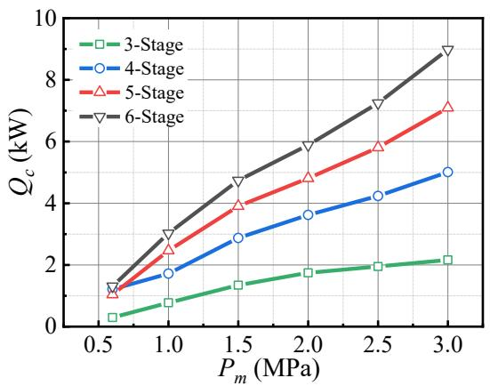  
(a)

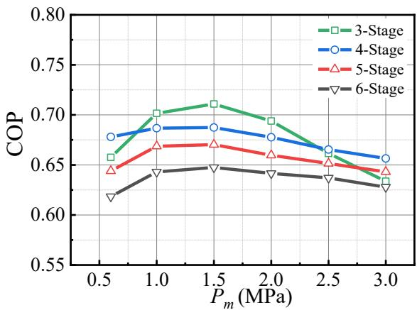  
(b)  
Fig.8. System performance at different mean pressures for multi-stage systems: (a) total cooling power (b) COP. The liquid volume ratio is 0.4, $T _ { h }$ is 400 K, $T _ { c }$ is 270 K, T0 is 293 K.

A large amount of low-grade waste heat between 300 K and 523 K is available in process industries [40], e.g., chemical, petroleum, pulp and power, food and drink, manufacturing, iron and steel, and cement industries. For the given temperature ranges, it is useful to consider the performance of a practical thermoacoustic system. Figure 9 shows system performance at different heating and cooling temperatures. Here, results are presented for a 4-stage system as a compromise between large cooling power and high efficiency. For a given cooling temperature, the total cooling output increases almost linearly with the hot end temperature. A further increase in heating temperature leads to a slight decrease in COP. The COP is a mild function of the hot end temperature, and it is highest near the lower end of the temperatures. The results show that the systems can be used with the low-grade heat of temperatures below 400 K. For example, the cooling power of 1.4 kW and a COP of 0.75 is obtained with a relatively low heating temperature of 380 K.

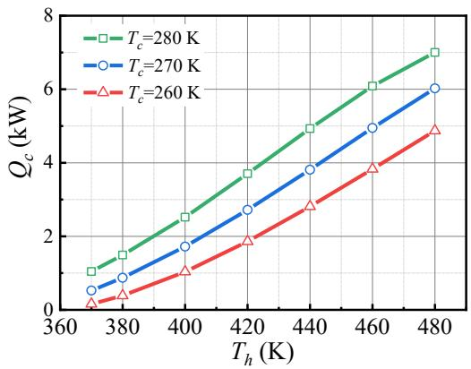  
(a)

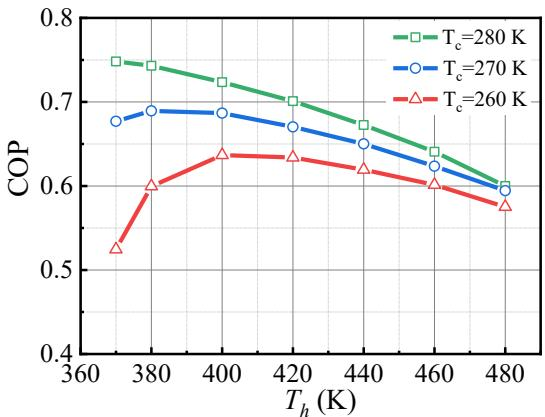  
(b)  
Fig.9. System performance at different heating and cooling temperatures for a 4-stage system: (a) total cooling power (b) COP. The liquid volume ratio is $0 . 4 , P _ { m }$ is 1 MPa, T0 is 293 K.

Figure 10 shows the effect of the liquid volume ratio on system performance. The calculated results show that the liquid volume ratio should be larger than 0.2 for higher cooling power and efficiency. The optimal value of liquid volume ratio for this set of parameters is within the range of 0.3 to 0.5 as a compromise between large cooling power and high efficiency. Power loss ratios of the gas-liquid resonator are below 6 % when the liquid volume flow rate is above 0.2, indicating that the gas-liquid resonator is highly effective for power transmission. The liquid volume ratio cannot be larger than 0.9 because enough space should remain for liquid displacement.

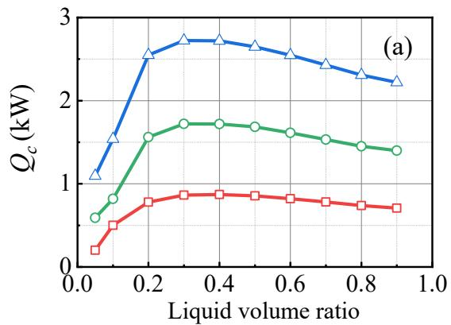

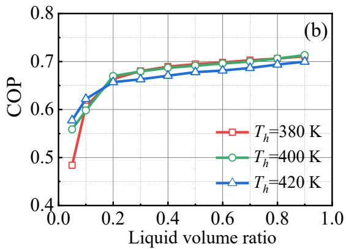

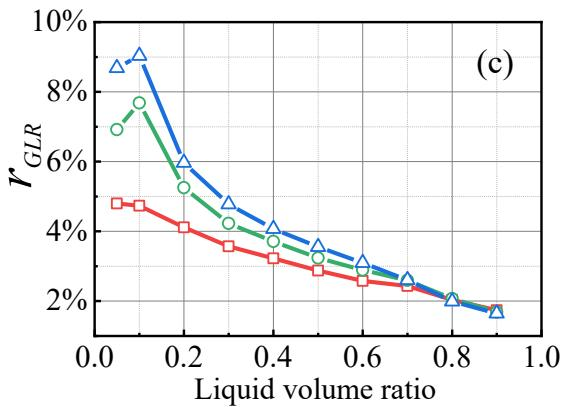

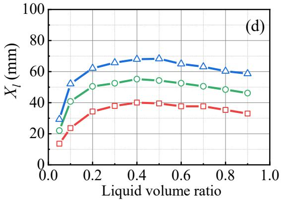  
Fig.10. Effect of liquid volume ratio on the (a) cooling power, (b) COP, (c) acoustic power loss ratio of gas-liquid resonator, and (d) displacement of the liquid, at different heating temperatures for a 4- stage system. $P _ { m }$ is 1 MPa, $T _ { \mathrm { c } }$ is 270 K, $T _ { 0 }$ is 293 K.

## 4.4 Comparison with conventional gas resonator system

Further comparisons are drawn between a system with gas-liquid resonators and a baseline system with gas resonators, both with identical working conditions and general dimensions. The geometry of the two types of resonators is allowed to be optimized in terms of cooling performance. Figure 11 shows the calculated comparison results. The system with gas-liquid resonators achieves significantly better performance than the system with gas resonators: the cooling power and COP are increased by a factor of 5.6 and 1.5 at a heating temperature of 420 K. In particular, the gas-liquid resonator system outperforms the gas resonator system at low temperatures, which shows a promising prospect for low-grade heat utilization.

The superior performance of the gas-liquid resonator system is illustrated by the values listed in Table 4, which show the detailed thermodynamic performance of two systems at a heating temperature of 420 K and a cooling temperature of 270 K. Compared to the conventional gas resonator, the gas-liquid resonator can improve the pressure ratio from 1.06 to 1.32 and reduce the working frequency from 53.31 Hz to 12.32 Hz, which helps achieve enhanced driving force and lower power losses respectively. Furthermore, the gas-liquid resonator system also induces lower power losses and larger impedance, which translates into lower frictional flow losses in the regenerator.

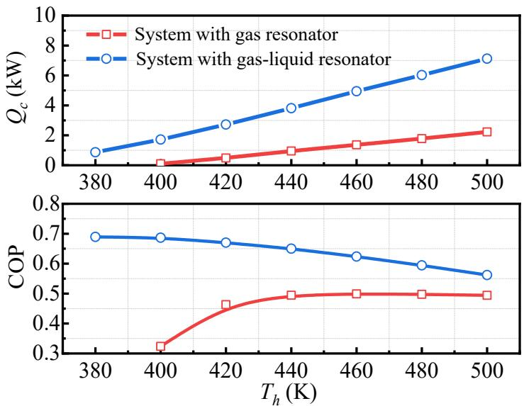

Fig.11. Calculated performance of systems with the gas resonator and with the gas-liquid resonator. $P _ { m }$ is 1 MPa, $T _ { c }$ is 270 K, $T _ { 0 }$ is 293 K, where the calculation is conducted for a 4 stage system.  
Table 4. Thermodynamic performance of the systems with gas resonator and with gas-liquid resonator at $T _ { h }$ of 420 K and $T _ { c }$ of 270 K. The parametric descriptions are presented in Table 3.
<table><tr><td>Parameters</td><td>A system with gas resonator</td><td>A system with gas-liquid resonator</td></tr><tr><td>f/Hz</td><td>53.31</td><td>12.32</td></tr><tr><td> $P _ { r a } / -$ </td><td>1.06</td><td>1.32</td></tr><tr><td> $r _ { G L R } / \%$ </td><td>5.81</td><td>4.07</td></tr><tr><td> $Q _ { h , t o t } / \mathrm { k W }$ </td><td>1.05</td><td>4.05</td></tr><tr><td> $Q _ { c , t o t } / \mathrm { k W }$ </td><td>0.49</td><td>2.72</td></tr><tr><td> $C O P / \mathrm { { - } }$ </td><td>0.45</td><td>0.67</td></tr><tr><td> $\eta _ { C } / \%$ </td><td>13.12</td><td>18.92</td></tr><tr><td> $Z _ { E I } / -$ </td><td>-20.91°/8.92</td><td>-32.12°/56.91</td></tr><tr><td> $Z _ { E O } / -$ </td><td>-15.72°/7.91</td><td>-27.83°/49.94</td></tr><tr><td> $Z _ { C I } / -$ </td><td>-1.25%/6.45</td><td>-10.16°/51.55</td></tr><tr><td> $Z _ { C O } / -$ </td><td>3.16°/5.86</td><td>-3.98°/54.46</td></tr></table>

There are two limitations to the Sage program. Firstly, Sage is a one-dimensional model that averages radial variations. In particular, the program cannot capture the details of temperature changes across the heat exchanger and instead must rely on previously obtained corrections for heat transfer under given mean conditions. Secondly, Sage uses semi-empirical terms for the friction factor, Nusselt number and axial conductivity ratio, which may deviate from actual practical conditions. Developing improved two-dimensional models and correcting empirical terms for different cases are further steps which could improve the current model.

## 5 Conclusions

This paper provides a theoretical analysis of a proposed looped, thermoacousticallydriven refrigerator for low-grade heat utilization. The research investigated the system onset characteristics by using a matrix transfer method and explored steady-state performance through simulations using the Sage program. Comparisons were made with a conventional thermoacoustically-driven refrigerator. The following conclusions can be drawn from the results:

(1) A thermoacoustic refrigerator with gas-liquid resonators significantly outperforms a conventional system with gas resonators in terms of both onset and steady performance. When employing a gas-liquid resonator to replace a gas resonator, the onset heating temperature difference is reduced from 144.1 K to 35.5 K, and the cooling power and efficiency are improved by a factor of 5.6 and 1.5, respectively. The higher pressure amplitudes and lower working frequencies induced by the gas-liquid resonator contribute to performance improvement.

(2) The system cooling steady-state performance is affected primarily by the number of stages as well as the liquid volume ratio. An increased number of stages leads to higher cooling power but does not affect cooling efficiency significantly. The optimum value of the liquid volume ratio falls within a range of 0.3 to 0.5 in terms of both cooling power and cooling efficiency.

(3) The system onset temperature difference is related to the liquid damping coefficient, mean pressure and liquid volume ratio. Most systems considered in this research started to oscillate at onset temperature differences below 50 K.

## Acknowledgments

This work was supported by National Key Research and Development Program of China (Contract No. 2016YFB0901403), National Natural Science Foundation of China (Contract No. 51906250), Beijing Natural Science Foundation (Contract No. 3194061), International Postdoctoral Exchange Fellowship Program (Grant No.

20180012) from China Postdoctoral Council.

## References

[1] A.B. Kristiansen, T. Ma, R.Z. Wang. Perspectives on industrialized transportable solar powered zero energy buildings. Renewable and Sustainable Energy Reviews 2019; 108: 112–124.

[2] G. Huang, S.R. Curt, K. Wang, C.N. Markides. Challenges and opportunities for nanomaterials in spectral splitting for high-performance hybrid solar photovoltaicthermal applications: A review. Nano Materials Science 2020; https://doi.org/10.1016/j.nanoms.2020.03.008

[3] M.A. Emadi, N. Chitgar, O. A. Oyewunmi, C.N. Markides. Working-fluid selection and thermoeconomic optimisation of a combined cycle cogeneration dual-loop organic Rankine cycle (ORC) system for solid oxide fuel cell (SOFC) waste-heat recovery. Applied Energy 2020; 114384.

[4] A.M. Pantaleo, J. Fordham, O.A. Oyewunmi, P. D. Palma, C.N. Markides. Integrating cogeneration and intermittent waste-heat recovery in food processing: Microturbines vs. ORC systems in the coffee roasting industry. Applied Energy 2018; 225: 782–796.

[5] I. Johnson, W.T. Choate, and A. Davidson. Waste Heat Recovery: Technology and Opportunities in U.S. Industry. OSTI.GOV report, 2008. Available at: http://www.osti.gov/scitech/biblio/1218716/ (Accessed:15th March 2020).

[6] A. Widyaparaga, T. Koshimizu, E. Noda, N. Sakoda, M. Kohno, Y. Takata. The frequency dependent regenerator cold section and hot section positional reversal in a coaxial type thermoacoustic Stirling heat pump. Cryogenics 2011; 591–597.

[7] J.Y. Xu, G.Y. Yu, L.M. Zhang, W. Dai, E.C. Luo. Theoretical analysis of two coupling modes of a 300-Hz three-stage thermoacoustically driven cryocooler system at liquid nitrogen temperature range. Applied Energy 2017; 185: 2134– 2141.

[8] J.Y. Xu, L.M. Zhang, J.Y. Hu, Z.H. Wu, T.J. Bi, W. Dai, et al. An efficient looped multiple-stage thermoacoustically-driven cryocooler for liquefaction and recondensation of natural gas. Energy 2016; 101, 427–433.

[9] T.J. Bi, Z.H. Wu, L.M. Zhang, G.Y. Yu, E.C. Luo, W. Dai. Development of a 5 kW traveling wave thermoacoustic electric generator. Applied Energy 2017; 185:1355– 1361.

[10]G. Chen, L. Tang, B. R. Mace. Modelling and analysis of a thermoacousticpiezoelectric energy harvester. Applied Thermal Engineering 2019; 150: 532–544.

[11]K. de Blok. Novel 4-stage traveling wave thermoacoustic power generator. ASME 2010 3rd Joint US-European fluid engineering summer meeting collocated with 8th international conference on nanochannels, microchannels, and minichannels. American Society of Mechanical Engineers 2010; 7: 73–79.

[12]G.W. Swift. Analysis and performance of a large thermoacoustic engine. The Journal of the Acoustical Society of America, 1992, 92(3): 1551–1563.

[13]J. Olson, G.W. Swift. A loaded thermoacoustic engine. The Journal of the Acoustical Society of America, 1995, 98(5): 2690–2693.

[14]L.M. Qiu, D.M. Sun, Y.X. Tan, W.L. Yan, P. Chen, L. Zhao, et al. Effect of pressure disturbance on onset processes in thermoacoustic engine. Energy Conversion and Management 2006; 47: 11–12.

[15]S. Backhaus, G.W. Swift. A thermoacoustic-Stirling heat engine: Detailed study. The Journal of the Acoustical Society of America, 2000, 107(6): 3148–3166.

[16]T. Jin, R. Yang, Y. Wang, Y. Feng, K. Tang. Low temperature difference thermoacoustic prime mover with asymmetric multi-stage loop configuration. Scientific Reports 2017; 7: 7665.

[17]T. Jin, R. Yang, Y. Wang, Y.L. Liu, Y. Feng. Phase adjustment analysis and performance of a looped thermoacoustic prime mover with compliance/resistance tube. Applied Energy 2016; 183: 290–298.

[18]K. de Blok. Multi-stage travelling wave thermoacoustic in practice. In 19th International Congress on Sound and Vibration Vilnius, Lithuania: International Institute of Acoustics and Vibration (IIAV) and Vilnius University, 2012: 1–8.

[19]Z.B. Yu, A.J. Jaworski, S. Backhaus. Travelling wave thermoacoustic electricity generator using an ultra-compliant alternator for utilization of low-grade thermal energy. Applied Energy 2012; 99: 135–145.

[20]Y. Zhao, Z. Yang, E.C. Luo, Y. Zhou. Travelling-wave thermoacoustic hightemperature heat pump for industrial waste heat recovery. Energy 2014; 77: 397– 402.

[21]K. Wang, L.M. Qiu. Numerical analysis on a four-stage looped thermoacoustic Stirling power generator for low temperature waste heat. Energy Conversion and Management 2017; 150: 830–837.

[22]R. Yang, A. Meir, G. Z. Ramon. Theoretical performance characteristics of a travelling-wave phase-change thermoacoustic engine for low-grade heat recovery. Applied Energy 2020; 261:114377.

[23]C.D. West. Liquid piston Stirling engines. Van Nostrand Reinhold; New York, 1983.

[24]K. Tang. T. Lei, T. Jin, X.G. Lin and Z.Z. Xu. A standing-wave thermoacoustic engine with gas-liquid coupling oscillation. Applied Physics Letters 2009; 94:

254101.

[25]K. Tang. T. Lei, X.G. Lin, T. Jin, Y. Zhang. Lumped parameter model for resonant frequency estimation of a thermoacoustic engine with gas-liquid coupling oscillation. Journal of Zhejiang University-SCIENCE A 2011; 12(3): 232–237.

[26]D.H. Li, L.M. Zhang, Z.H. Wu, E.C. Luo. Numerical simulation and experimental investigation of a gas-liquid, double-acting traveling-wave thermoacoustic heat engine. International Journal of Energy Research 2013; 37(15):1963–1970.

[27]D.H. Li, Y.Y. Chen, E.C. Luo and Z.H. Wu. Study of a liquid-piston traveling-wave thermoacoustic heat engine with different working gases. Energy 2014; 74: 158– 163.

[28]S. Langdon-Arms, M. Gschwendtner and M. Neumaier. A novel solar-powered liquid piston Stirling refrigerator. Applied Energy 2018; 229: 603–613.

[29]H. Hyodo, S. Tamura, T. Biwa. A looped-tube traveling-wave engine with liquid pistons. Journal of Applied Physics 2017; 122: 114902.

[30]G.W. Swift. Thermoacoustics: a unifying perspective for some engines and refrigerators. Acoustical Society of America 2002.

[31]D. Gedeon. SAGE: object-oriented software for cryocooler design. Cryocooler 8 1995; 281–292.

[32]J.Y. Xu, J.Y. Hu, E.C. Luo, L.M. Zhang, W. Dai. A cascade-looped thermoacoustic driven cryocooler with different-diameter resonance tubes. Part I: Theoretical analysis of thermodynamic performance and characteristics. Energy 2019; 181: 943–953.

[33]J.Y. Xu, J.Y. Hu, L.M. Zhang, E.C. Luo. A looped three-stage cascade travelingwave thermoacoustically-driven cryocooler. Energy 2016; 112, 804–809.

[34]M. Dietrich, L.W. Yang, G. Thummes. High-power Stirling-type pulse tube cryocooler: Observation and reduction of regenerator temperatureinhomogeneities. Cryogenics 2007; 47: 306–314.

[35]K. Kim, X.Q. Zhi, L.M. Qiu, H.L. Nie, J.J. Wang. Numerical analysis of different valve effects on the cooling performance of a two-stage GM type pulse tube cryocooler. International Journal of Refrigeration 2017; 77: 1–10.

[36] X.W. Li, B. Liu, G.Y. Yu, W. Dai, J.Y. Hu, E.C. Luo, et al. Experimental validation and numeric optimization of a resonance tube-coupled duplex Stirling cooler. Applied Energy 2017; 207: 604–612.

[37]J.Y. Hu, E.C. Luo, W. Dai and L.M. Zhang. Parameter sensitivity analysis of duplex Stirling coolers. Applied Energy 2017; 190: 1039–1046.

[38]D. Gedeon. Sage User’s Guide, 11th Edition. Gedeon Associate: Athens, Ohio, USA, 2016.

[39]S. Langdon-Arms. Feasibility study of a heat-powered liquid piston Stirling cooler. PhD dissertations, Auckland University of Technology, 2017.

[40]A. Kapil, I. Bulatov, R. Smith, J. Kim. Advanced Process Integration for Low Grade Heat Recovery. Available at: https://research.ncl.ac.uk/protem/components/pdfs/EPSRC\_Thermal\_Management\_CPI\_Interim\_Report\_16Fe b.pdf (Accessed:15th March 2020).
