RESEARCH ARTICLE | APRIL 10 2024

# Multimode thermoacoustic system for heating and cooling 

Yiwei Hu ; Benlei Wang ; Zhanghua Wu ; Jianying Hu; Ercang Luo  ; Jingyuan Xu 

Check for updates

Appl. Phys. Lett. 124, 153902 (2024)

https://doi.org/10.1063/5.0196770

# Multimode thermoacoustic system for heating and cooling

Cite as: Appl. Phys. Lett. 124, 153902 (2024); doi: 10.1063/5.0196770 Submitted: 9 January 2024 . Accepted: 2 April 2024 . Published Online: 10 April 2024

Yiwei Hu,1,2 Benlei Wang,1,2 Zhanghua Wu,1 Jianying Hu,1 Ercang Luo,1,2,a) and Jingyuan Xu3,a)

AFFILIATIONS

1Key Laboratory of Cryogenic Science and Technology, Technical Institute of Physics and Chemistry, Chinese Academy of Sciences, Beijing 100190, China

2University of Chinese Academy of Sciences, Beijing 100049, China

3Institute of Microstructure Technology, Karlsruhe Institute of Technology, Karlsruhe 76344, Germany

a)Authors to whom correspondence should be addressed: ecluo@mail.ipc.ac.cn. Tel./Fax: 86 010 82543750; and jingyuan.xu@kit.edu. Tel./Fax: 49 721 608-22752

## ABSTRACT

Thermoacoustic technology emerges as a sustainable and low-carbon method for energy conversion, leveraging environmentally friendly working mediums and independence from electricity. This study presents the development of a multimode heat-driven thermoacoustic system designed to utilize medium/low-grade heat sources for room-temperature cooling and heating. We constructed both a simulation model and an experimental prototype for a single-unit direct-coupled thermoacoustic system, exploring its performance in heating-only, cooling-only, and hybrid heating and cooling modes. Internal characteristic analysis including an examination of internal exergy loss and a distribution analysis of key parameters was first conducted in the hybrid cooling and heating mode. The results indicated a positive-focused traveling-wave-dominant acoustic field within the thermoacoustic core unit, enhancing energy conversion efficiency. The output system performance was subsequently tested under different working conditions in the heating-only and cooling-only modes. A maximum output heating power of 2.3 kW and a maximum COP of 1.41 were observed in the heating-only mode. Meanwhile, a cooling power of 748 W and a $\mathrm { C O P _ { c } }$ of 0.4 were obtained in the typical cooling condition at $7 ^ { \circ } \mathrm { C }$ when operating in cooling-only mode. These findings underscore the promising potential of thermoacoustic systems for efficiently utilizing medium/low-grade heat sources for cooling and/or heating applications in the future.

Published under an exclusive license by AIP Publishing. https://doi.org/10.1063/5.0196770

Amidst the global energy crisis and escalating concerns over carbon emissions,1 the heat-driven thermoacoustic system emerges as a compelling alternative to address the pressing demand for newly developed, eco-friendly energy conversion technologies.2 The adoption of pollution-free working gases, such as helium, nitrogen, argon, etc., renders it a completely carbon-free and environmentally friendly techheating.1,5,6 Current research on heat-driven thermoacoustic coolers and heat pumps predominantly centers around looped travelling-wave systems.3,7,8 Numerous numerical and experimental endeavors underscore the promising potential of thermoacoustic coolers and heat pumps in efficiently harnessing thermal energy, offering environmental benefits. In 2020, Wang et al. tested a three-unit heat-driven thermoacoustic refrigerator for room-temperature cooling,7 achieving a maximum cooling power of 4 kW and a maximum cooling Coefficient of Performance [COP , defined as Eq. (3)] of 0.28 at a cooling temperature of 10 -C. In 2022, Chi et al. reduced the core unit number to 2, and a COPc of 0.41 was obtained.9 In the same year, Yang et al. reported the experimental results from a heat-driven combined cooling and heating system based on a similar two-unit thermoacoustic structure,5 achieving a cooling COPc of 0.3 and a heating Coefficient of Performance $[ \mathrm { C O P _ { h } } ,$ defined as Eq. (2)] of 1.24. Our recent numerical analysis focused on a single-unit thermoacoustic heat pump designed for domestic building heating,9 achieving a heating COP of 1.4. A case study conducted in Finland demonstrated the potential for an annual emission reduction of 4143 kgCO . There are some similar studies on heat-driven thermoacoustic systems, which incorporate loop structure as well.10–13 Furthermore, the application of thermoacoustic theory extends into the domain of medical imaging, as evidenced by existing literature.14,15

Extant studies predominantly focus on delineating the performance of thermoacoustic systems solely in the capacities of refrigeration or heat pumping, thus overlooking the advantageous temperature adapt ability inherent in thermoacoustic systems, which enables effective operation across multiple modes. Moreover, the evolutionary trajectory of heat-driven looped thermoacoustic systems evidences a shift from multi-unit to single-unit configurations, aimed at streamlining overall system complexity.11 However, existing experimental research notably overlooks the exploration of single-unit thermoacoustic systems. Addressing these discernible lacunae, this paper introduces a pioneering multimode thermoacoustic system tailored specifically for roomtemperature cooling and/or heating applications. This study presents a comprehensive performance analysis of a thermoacoustic system operating across multiple modes, encompassing cooling-only, heating-only, and hybrid cooling and heating modes, leveraging both simulation and experimental evaluation methodologies. The proposed system endeavors to bridge the existing experimental void within the realm of single-unit heat-driven thermoacoustic systems.

The configuration of the proposed single-unit multimode thermoacoustic system and the core unit is shown in Figs. 1(a)–1(c). The key components include regenerator (REG), medium-temperature heat exchanger (MHX), high-temperature heat exchanger (HHX), cooling temperature heat exchanger (CHX), thermal buffer tube (TBT), tapered reducer tube (TRT), resonant tube (RT), and cavity (CT). Notably, the CT is a relatively new phase-modulation structure compared to the conventional resonant tubes. Both our simulation and experimental findings corroborate that in the absence of CT, the system fails to initiate self excited thermoacoustic oscillation within the considered operational parameters. Prior theoretical investigations have similarly underscored the criticality of CT structures for single-unit systems.12 Figure 1(d) depicts the self-made MHXs (MHXe and $\mathrm { M H X _ { c / h p } ) _ { : } }$ , characterized by shell-tube type heat exchangers facilitating heat transfer between the working medium and thermal fluid via dedicated heat exchange pipes. Figure 1(e) shows the self-made HHX and CHX, featuring plate-fin type heat exchangers with precision-machined fins accomplished through wire cutting techniques. Electric heating rods are utilized to impart heat for achieving the desired temperatures. Figure 1(f) clarifies the potential application scenarios for the proposed thermoacoustic system for household cooling and heating. In the hybrid heating and cooling mode, the HHX of the thermoacoustic engine (e) unit is heated by the input power such as solar or geothermal energy, triggering self-excited thermoacoustic oscillation once the temperature gradient in the REG surpasses a critical threshold. The temperature of MHX and $\mathrm { M H X _ { c / h p } }$ is regulated by circulating water at output heating temperature $( T _ { \mathrm { o } } ) ,$ enabling the system to output heat for heating purposes. The thermoacoustic system transforms and amplifies thermal energy into acoustic power, which is then utilized in the cooler/heat pump (c/hp) unit. This process results in cooling effect at cooling temperature (T ) in the $\mathrm { C H X } _ { \mathrm { c / h p } } .$ In the heating-only mode, the temperature of $\mathrm { C H X } _ { \mathrm { c / h p } }$ is adjusted to match the ambient temperature (T ). While in the coolingonly mode, the temperature of $\mathrm { M H X _ { e } }$ and $\mathrm { C H X } _ { \mathrm { c / h p } }$ is aligned with $T _ { \mathbf { a } }$ and $T _ { \mathrm { { c } } }$ respectively.

In the experiment, a static pressure sensor (Collihigh model JYB-KO-HVG) was used to monitor the system’s mean pressure, and T-type thermocouples measured the temperatures of the heat exchangers. Pressure signals and temperature data were collected and processed using dynamic signal acquisition cards (model PXI-3342) and a thermal couple card (model PXI-3281), respectively. The dimensions of the system are presented in Table I. About 1 kW of heating power is initially supplied to the HHX to steadily increase the temperature difference across the HHX. The system undergoes a sequence of onset oscillation and unsteady thermoacoustic oscillations and finally reaches a steady state. Thereafter, the temperature is controlled by adjusting the power of each heat exchanger, and parameters such as power, temperature, and pressure wave at stabilization are recorded.

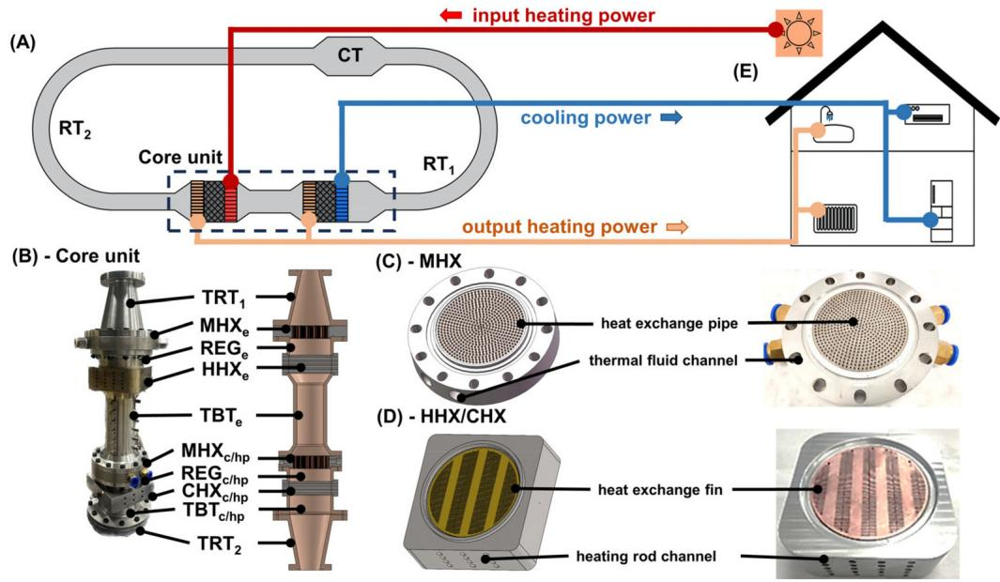  
FIG. 1. (a) Schematic of the multimode thermoacoustic system in the hybrid heating and cooling mode, (b) prototype photo and section schematic of the core unit, (c) schematic and prototype photo of the medium-temperature heat exchanger (MHX), (d) schematic and prototype photo of the high-temperature heat exchanger (HHX) and cooling temperature heat exchanger (CHX), and (e) envisioned configuration of the multimode thermoacoustic system for the household heating and cooling application utilizing solar energy. The subscript e means engine, c means cooler, and hp means heat pump.

TABLE I. Structural dimensions of each component.
<table><tr><td>Subunit</td><td>Parts</td><td>Diameter (mm)</td><td>Length (mm)</td><td>Other dimensions</td></tr><tr><td>Engine (e)</td><td> $\mathrm { M H X _ { e } }$ </td><td>110</td><td>35</td><td>Shell-tube type, 11% in porosity, 1.5 mm in tube diameter</td></tr><tr><td></td><td> $\mathrm { R E G } _ { \mathrm { e } }$ </td><td>110</td><td>45</td><td>80% in porosity, 50 µm in wire diameter</td></tr><tr><td></td><td> $\mathrm { H H X _ { e } }$ </td><td>110</td><td>50</td><td>Plate-fin type, 20% in porosity</td></tr><tr><td></td><td> $\mathrm { T B T _ { e } }$ </td><td>110-70</td><td>30</td><td></td></tr><tr><td></td><td></td><td>70</td><td>162</td><td>5 mm in wall thickness</td></tr><tr><td></td><td></td><td>70-110</td><td>30</td><td></td></tr><tr><td>Cooler/heat pump (c/hp)</td><td> $\mathrm { M H X _ { c / h p } }$ </td><td>110</td><td>35</td><td>Shell-tube type, 11% in porosity, 1.5 mm in tube diameter</td></tr><tr><td></td><td> $\mathrm { R E G } _ { \mathrm { c / h p } }$ </td><td>110</td><td>35</td><td>80% in porosity, 50 µm in wire diameter</td></tr><tr><td></td><td> $\mathrm { C H X _ { c / h p } }$ </td><td>110</td><td>35</td><td>Plate-fin type, 20% in porosity</td></tr><tr><td></td><td> $\mathrm { T B T _ { c / h p } }$ </td><td>110</td><td>50</td><td>5 mm in wall thickness</td></tr><tr><td>Phase-modulating unit</td><td> $\mathrm { T R T _ { 1 } }$ </td><td>110-52</td><td>150</td><td></td></tr><tr><td></td><td> $\mathrm { R T _ { 1 } }$ </td><td>52</td><td>3057</td><td>2.5 mm in wall thickness</td></tr><tr><td></td><td> $\mathrm { C T }$ </td><td>110</td><td>270</td><td></td></tr><tr><td></td><td> $\mathrm { R T } _ { 2 }$ </td><td>44</td><td>8996</td><td>2 mm in wall thickness</td></tr><tr><td></td><td> $\mathrm { T R T } _ { 2 }$ </td><td>44-110</td><td>150</td><td></td></tr></table>

The hybrid heating/cooling Coefficient of Performance $\left( \mathrm { C O P _ { h c } } \right)$ , heating Coefficient of Performance $\scriptstyle ( \mathrm { C O P _ { h } } ) ,$ , and cooling Coefficient of Performance (COP ) are defined by the input heating power $( Q _ { \mathrm { h } } )$ , output heating power $( Q _ { \mathrm { o } } )$ , and cooling power (Q ), respectively,

$$
C O P _ { h c } = \frac { Q _ { o } + Q _ { c } } { Q _ { h } } ,\tag{1}
$$

$$
C O P _ { h } = { \frac { Q _ { o } } { Q _ { h } } } ,\tag{2}
$$

$$
C O P _ { c } = { \frac { Q _ { c } } { Q _ { h } } } .\tag{3}
$$

The exergy efficiency in hybrid heating and cooling mode can be expressed as

$$
\eta _ { h c } = \frac { C O P _ { h c } } { \displaystyle \frac { T _ { o } } { T _ { h } } + \frac { T _ { h } - T _ { o } } { T _ { h } } \times \frac { T _ { o } } { T _ { o } - T _ { c } } } ,\tag{4}
$$

where $T _ { \mathrm { h } } , T _ { \mathrm { o } } ,$ and $T _ { \mathrm { c } }$ are the high temperature of HHX , output heating temperature of MHX and $\mathrm { M H X } _ { \mathrm { c / h p } } ,$ and cooling temperature of $\mathrm { C H X } _ { \mathrm { c / h p } } ,$ respectively.

The exergy efficiency in the heating-only mode can be expressed as

$$
\eta _ { h } = \frac { C O P _ { h } } { \displaystyle \frac { T _ { o } } { T _ { h } } + \frac { T _ { h } - T _ { o } } { T _ { h } } \times \frac { T _ { o } } { T _ { o } - T _ { a } } } ,\tag{5}
$$

where $T _ { \mathbf { a } }$ is the ambient temperature of $\mathrm { C H X } _ { \mathrm { c / h p } }$

The exergy efficiency in cooling-only mode can be expressed as

$$
\eta _ { c } = \frac { C O P _ { c } } { \displaystyle { \frac { T _ { h } - T _ { a } } { T _ { h } } } \times \frac { T _ { a } } { T _ { a } - T _ { c } } } ,\tag{6}
$$

where $T _ { \mathrm { a } }$ is the ambient temperature of $\mathrm { M H X _ { e } }$ and $\mathrm { M H X } _ { \mathrm { c / h p } } .$

Figure 2 illustrates a simulation of the multimode thermoacoustic system operating in hybrid heating and cooling mode, utilizing Sage program.16–18 F igure 2(b) illustrates that the output heating power and cooling power increase as the increasing input high temperature under different output heating temperatures. For the specific working condition, the input high temperature $( T _ { \mathrm { h } } )$ is $3 0 0 ^ { \circ } \dot { \mathrm { C } }$ as the typical medium/low-grade heat sources. The output heating temperature is $5 0 ^ { \circ } \mathrm { C } ,$ representing a typical household heating target.9,19 The cooling temperature is $7 ^ { \circ } \mathrm { C } ,$ known as the typical air-conditioning cooling condition. $^ { 1 9 , 2 0 }$ The proposed multimode thermoacoustic system can obtain an output heating power of 1.73 kW and an output cooling power of 0.39 kW. Figure 2(c) provides insight into system’s exergy loss, delineating notable losses, including the along-haul frictional resistance loss $( A E _ { \mathrm { f r i c } } )$ , undesirable heat exchange loss $( A E _ { \mathrm { Q w } } ) _ { : }$ , fluid axial flow loss $( A E _ { \mathrm { Q x } } ) ,$ and loss tolerance $( A E _ { \mathrm { d i s } } ) . ^ { \mathfrak { g } }$ Results indicate that the predominant loss stems from $\mathrm { R E G } _ { \mathrm { e } }$ constituting 46.5% of all losses, with $A E _ { \mathrm { Q w } }$ and $A E _ { \mathrm { Q x } } ,$ in particular, accounting significantly. This observation is primarily attributable to REGe’s pivotal role in energy conversion, characterized by large temperature gradient and complex flow and heat transfer dynamics, resulting in substantial losses. Other significant losses occur in $\mathrm { R E G } _ { \mathrm { c / h p } }$ and $\mathrm { R T s } ,$ contributing 13.6% and 21.8%, respectively. However, the predominant losses are attributed to heat transfer and heat exchange, with minimal impact on the lifespan of system components due to negligible physical wear and tear. Addressing losses in these components is crucial for enhancing overall system efficiency. Figure 2(e) offers insight into the axial distribution of crucial parameters. The amplitude distribution of the pressure wave and volume flow rate reveals that the core unit occupies a position of high acoustic impedance with low flow rates ( P ranges

(E)

(A)  
(B)  
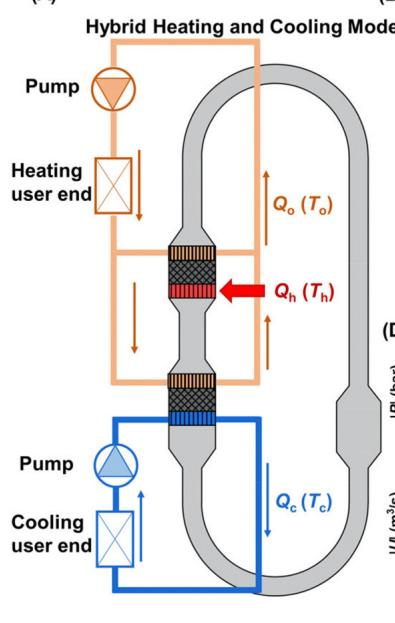

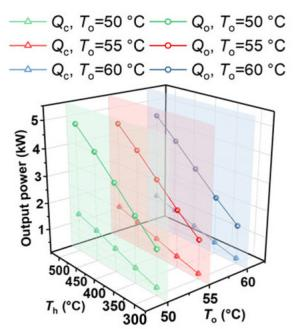  
(C)

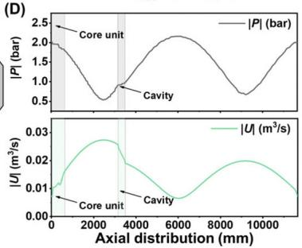

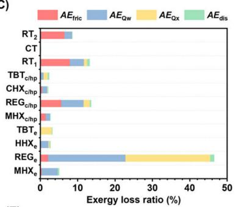

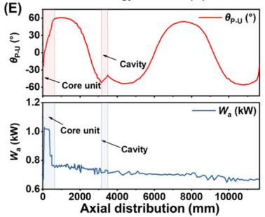  
FIG. 2. (a) Schematic of the multimode thermoacoustic system in the hybrid heating and cooling mode; simulation results: (b) effect of input high temperature $( T _ { \mathfrak { h } } )$ on the output heating (Q ) and cooling power (Q ) under different output heating temperatures (T ); (c) exergy loss ratio analysis of the system under specific working conditions; (d) axial distribution of the amplitude of pressure wave $( | P | )$ and volume flow rate ( U ); and (e) axial distribution of the phase difference between pressure wave and volume flow rate (h $\mathsf { u }$ and acoustic power (W ) under specific working condition (specific working conditions: $T _ { \mathsf { h } } = 3 0 0 ^ { \circ } \mathsf { C } , T _ { \mathsf { o } } = \dot { 5 } 0 ^ { \circ } \mathsf { C } , T _ { \mathsf { c } } = 7 ^ { \circ } \mathsf { C } )$

from 2.0 to 1.8 bars and U ranges from 0.007 to 0.016 $\mathrm { m } ^ { 3 } / \mathrm { s } )$ , thereby aiding in mitigating flow losses within the regenerators. The analysis of phase relationships indicates efficient thermoacoustic conversion, attributed to the prevalence of traveling-wave-dominant acoustic fields within the regenerators of the thermoacoustic core unit $( \theta _ { \mathrm { P - U } } = - 2 3 . 9 ^ { \circ } - 3 9 . 5 ^ { \circ } )$ . Conversely, the phase relationship variation within the CT significantly differs from conventional resonant tubes, showcasing an indispensable phase-modulation effect for the singleunit thermoacoustic system. Notably, significant standing-wave components present in $\mathrm { R T _ { 1 } }$ and RT2’s acoustic fields may contribute to heightened losses. Regarding acoustic power distribution, the engine unit amplifies 347 W of acoustic power, while the heat pump/cooler unit consumes 185 W, with approximately 668 W being circulated through the loop.

To operate in the heating-only mode, the temperature of $\mathrm { C H X _ { c / h p } }$ is adjusted to align with the ambient temperature $\left( T _ { \mathrm { a } } \right)$ while simultaneously ensuring the maintenance of the output heating temperature $( T _ { \mathrm { o } } )$ at MHXs. Experimental testing and numerical simulation of the heating performance in heating-only mode are presented in Fig. 3. Comparative results reveal an overall discrepancy of less than 10%, affirming the accuracy of the Sage program in modeling the system. The disparities might come from (1) Sage operates as a 1D heat transfer model, thereby relying on heat transfer corrections within given average conditions for detailing temperature variations in the heat exchangers. The employment of empirical formulas, albeit expedient, may introduce deviations from actual conditions; (2) Inherent heat leakage can introduce errors in determining the requisite heat load for sustaining temperatures across each heat exchanger in the experimental setup; and (3) Acoustic streaming, characterized by steady mass flow of density or velocity, encompasses phenomena, such as Rayleigh flow, jet flow, and Gedeon flow. While SAGE adequately considers Gedeon flow, it may not fully account for Rayleigh flow and jet flow dynamics.21 The fixed input high temperature is set at $3 0 0 ^ { \circ } \mathrm { C }$ as a simulation input of medium/low-grade thermal energy such as solar and geothermal energy, and the output heating temperature $( T _ { \mathrm { o } } )$ is established at $5 0 { } ^ { \circ } \dot { \mathrm { C } } .$ The findings reveal a correlation between the output heating power, $\mathrm { C O P _ { h } , }$ and various parameters such as pressure and temperature differences within the heat pump $( \Delta T _ { \mathrm { p } } = T _ { \mathrm { o } } - T _ { \mathrm { a } } )$ . Specifically, the output heating power and COPh demonstrate an upward trend with increasing pressures and decreasing temperature differences of the heat pump, $\Delta T _ { \mathrm { p } } .$ Conversely, higher exergy efficiencies are observed with larger temperature differences, suggesting the potential for enhanced thermodynamic optimization, particularly in scenarios characterized by significant temperature disparities in heat pump operations for thermoacoustic systems. Moreover, higher charging pressures prove advantageous in augmenting the power magnitude of the system, possibly attributable to the generation of larger pressure wave amplitudes. Notably, a peak output heating power of 2321 W and a maximum COPh of 1.41 are achieved when the system pressure $( P _ { s } )$ is set at 8 MPa, with $\Delta T _ { \mathrm { p } }$ at $2 6 ^ { \circ } \mathrm { C }$ . These results underscore the significance of careful parameter selection and optimization in maximizing system performance within thermoacoustic applications.

In the cooling-only mode, the temperature of MHXe and $\mathrm { M H X _ { c / h p } }$ is synchronized with the ambient temperature while maintaining the cooling temperature at $\mathrm { C H X } _ { \mathrm { c / h p } } ,$ thus increasing the temperature gradient within the engine stage and enhancing the thermoacoustic conversion efficiency. The performance of the system within the room-temperature cooling range is presented in ${ \mathrm { F i g . ~ 4 . } }$ The fixed input high temperature is maintained at $3 0 0 ^ { \circ } \mathrm { C } ,$ and the charging pressure is set at 8 MPa. Experimental findings demonstrate that elevating cooling temperatures and reducing ambient temperatures result in heightened cooling power and COPc. Specifically, under typical room-temperature cooling conditions characterized by an ambient temperature of $3 5 ^ { \circ } \mathrm { C }$ and a cooling temperature of $7 ^ { \circ } \mathrm { C } ,$ a cooling power of 748 W and a COPc of 0.4 are recorded. It is noteworthy that an adverse effect on cooling power and COPc is observed with an escalation in the temperature difference between the two ends of the cooler’s regenerator $( \mathrm { R E G } _ { \mathrm { c } } )$ . Moreover, the exergy efficiency generally exhibits an increasing and then decreasing trend with the cooling temperature. The maximum exergy efficiency achievable for the system is around 9% to 10% at the fixed input high temperature of $3 0 0 ^ { \circ } \mathrm { C }$ and various ambient temperatures. This maximum value corresponds to almost the same temperature difference $\left( T _ { \mathrm { a } } - T _ { \mathrm { c } } \right)$ , approximately $4 0 ^ { \circ } \mathrm { C } .$

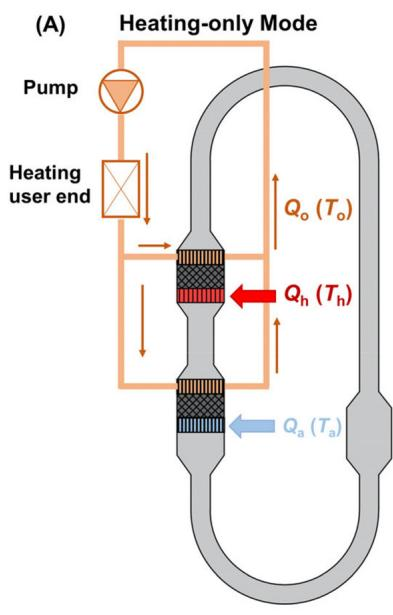

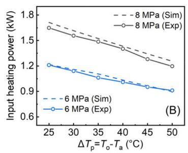

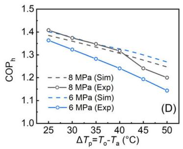

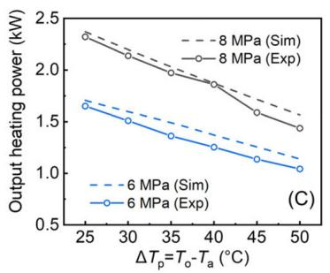

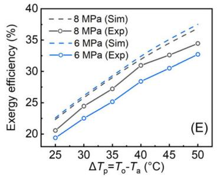  
FIG. 3. (a) Schematic of the multimode thermoacoustic system in heating-only mode. Experimental and simulation results of the proposed system in heating-only mode including (b) input heating power (Q ), (c) output heating power (Q ), (d) heating Coefficient of Performance (COP ), and (e) exergy efficiency. $\dot { \Delta \bar { T } _ { \mathfrak { p } } }$ is the temperature difference of the heat pump subunit. $T _ { \mathrm { h } } { = } 3 0 0 ^ { \circ } \dot { \mathsf { C } } , T _ { \circ } { = } 5 0 ^ { \circ } \mathsf { C }$

(A)Cooling-only Mode  
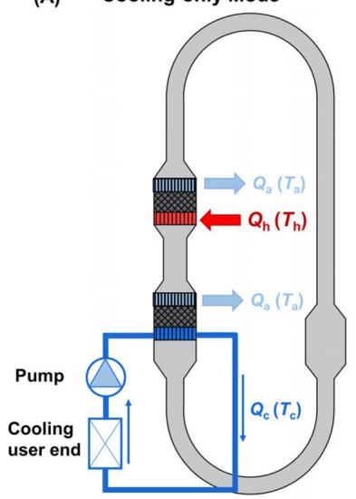

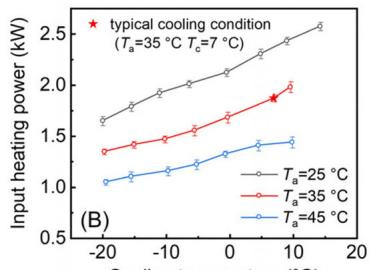

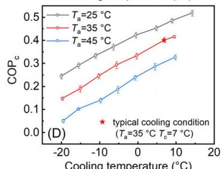

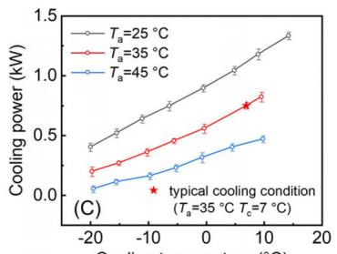

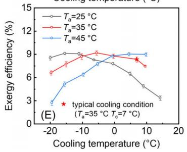  
FIG. 4. (a) Schematic of the thermoacoustic system in the cooling-only mode. Experimental results of the proposed system in the cooling-only mode including (b) input heating power (Qh), (c) cooling power (Qc), (d) cooling Coefficient of Performance (COPc), and (e) exergy efficiency. $\dot { T } _ { \mathfrak { h } } = 3 0 0 ^ { \circ } \mathsf C , P _ { \mathsf s } = 8 \mathsf M \mathsf P \mathsf a$

TABLE II. Summary of the system performance $^ { 0 \dag }$ the multimode thermoacoustic system in typical working conditions.
<table><tr><td></td><td>Hybrid heating and cooling Heating-only Cooling-only</td><td></td><td></td></tr><tr><td>Result type</td><td>Simulation</td><td>Experiment</td><td>Experiment</td></tr><tr><td>Input heating</td><td>300</td><td>300</td><td>300</td></tr><tr><td>temperature  $\mathsf { \bar { ( } } T _ { \mathrm { h } } ) , \mathsf {  { \circ } } _ { \mathrm { C } }$  System pressure  $( P _ { \mathrm { c h } } ) ,$ </td><td>10</td><td>8</td><td>8</td></tr><tr><td>MPa Ambient temperature</td><td></td><td>7</td><td>35</td></tr><tr><td> $( T _ { \mathrm { a } } ) , { } ^ { \circ } \mathrm { C }$  Output heating</td><td>50</td><td>50</td><td></td></tr><tr><td>temperature  $( \bar { T } _ { \mathrm { o } } ) , { } ^ { \circ } \mathrm { C }$  Cooling temperature</td><td>7</td><td></td><td>7</td></tr><tr><td> $( T _ { \mathrm { c } } ) , { } ^ { \circ } \bar { \mathrm { C } }$  Input heating power</td><td>1.39</td><td>1.33</td><td>1.87</td></tr><tr><td> $( Q _ { \mathrm { h } } ) , \mathrm { k W }$  Output heating power</td><td>1.73</td><td>1.7</td><td></td></tr><tr><td> $( Q _ { \mathrm { o } } ) , \mathrm { k W }$  Cooling power  $( Q _ { \mathrm { c } } ) , \mathrm { k W }$ </td><td>0.39</td><td></td><td>0.75</td></tr><tr><td>Coefficient of</td><td>1.52</td><td>1.27</td><td>0.4</td></tr><tr><td>performance Exergy efficiency, %</td><td>39.6</td><td>31.9</td><td>8.3</td></tr></table>

In summary, this study represents a significant advancement in the development of a heat-driven multimode thermoacoustic system tailored for heating and/or cooling applications. Compared to previous thermoacoustic systems with multiple units and used only for heating or cooling, this paper presents a single-unit thermoacoustic system. Investigation encompassed three distinct operational modes: heatingonly, cooling-only, and hybrid mode, combining heating and cooling functionalities. A comprehensive system model was crafted, facilitating exploration of output performance in the hybrid heating and cooling mode as well as internal characteristics under specific working condi tions. Efficient thermoacoustic conversion within the core unit was evidenced by the presence of a favorably behaving traveling-wave acoustic field. Concurrently, achieving an output heating power of 1.73 kW and a cooling power of 0.39 kW underscores the system’s versatility. Subsequently, an experimental prototype was constructed based on the simulation model. Comparative analysis between experi mental and simulation results revealed an overall error within 10%, showcasing favorable agreement between the model and the experimental prototype. The experimental setup employed an input heating temperature of $3 0 0 ^ { \circ } \mathrm { C }$ to emulate the utilization of medium/low-grade heat sources. The system demonstrated a maximum output heating power of 2.3 kW and a COPh of 1.41 in the heating-only mode, along with a cooling power of 748 W and a COP of 0.4 in the cooling-only mode. Further details regarding system performance under typical working conditions in each mode are summarized in Table II.

These findings underscore the potential of thermoacoustic systems in effectively leveraging medium/low-grade heat sources, especially the solar or geothermal energy, for practical cooling and heating applications. Nevertheless, an area warranting further exploration pertains to the system’s operation in hybrid heating and cooling mode, where the ratio between output heating power and cooling power exhibits limited adjustability. Addressing this challenge will necessitate the development of control schemes to ensure the system operates in accordance with actual cooling and heating demands, thereby enhancing its practical applicability.

This research was financially supported by the Key Laboratory of Cryogenic Science and Technology (No. CRYO20230103).

## AUTHOR DECLARATIONS

## Conflict of Interest

The authors have no conflicts to disclose.

## Author Contributions

Yiwei Hu: Formal analysis (equal); Investigation (equal); Methodology (equal); Software (equal); Validation (equal); Visualization (equal); Writing – original draft (equal). Benlei Wang: Formal analysis (equal); Investigation (equal); Software (equal); Validation (equal). Zhanghua Wu: Conceptualization (equal); Formal analysis (equal); Funding acquisition (equal); Writing – review & editing (equal). Jianying Hu: Funding acquisition (equal); Writing – review & editing (equal). Ercang Luo: Conceptualization (equal); Funding acquisition (equal); Investigation (equal); Project administration (equal); Supervision (equal); Writing – review & editing (equal). Jingyuan Xu: Conceptualization (equal); Investigation (equal); Supervision (equal); Visualization (equal); Writing – review & editing (equal).

## DATA AVAILABILITY

The data that support the findings of this study are available from the corresponding authors upon reasonable request.

## REFERENCES

1H. Al Baroudi, A. Awoyomi, K. Patchigolla, K. Jonnalagadda, and E. J. Anthony, Appl. Energy 287, 116510 (2021).

2J. Chi, L. Xiao, Z. Wu, J. Xu, Y. Yang, Y. Hu, L. Zhang, J. Hu, and E. Luo, Int. J. Refrig. 155, 296 (2023).

3G. Chen, L. Tang, B. Mace, and Z. Yu, Renewable Sustainable Energy Rev. 146, 111170 (2021).

4J. Huang, R. Yang, Y. Yang, Q. Zhou, and E. Luo, Appl. Energy 347, 121447 (2023).

5R. Yang, N. Blanc, and G. Z. Ramon, Energy Convers. Manage. 254, 115202 (2022).

6X. Wang, Z. Wu, L. Zhang, J. Hu, and E. Luo, Int. J. Refrig. 120, 90 (2020).

7H. Wang, L. Zhang, J. Hu, G. Yu, Z. Wu, W. Dai, and E. Luo, Int. J. Refrig. 123, 180 (2021).

8Y. Hu, K. Luo, D. Zhao, Z. Wu, Y. Yang, E. Luo, and J. Xu, Energy Built Environ. 5(4), 628 (2024).

9J. Chi, Y. Yang, Z. Wu, R. Yang, P. Li, J. Xu, L. Zhang, J. Hu, and E. Luo, Appl. Therm. Eng. 218, 119330 (2023).

10X. Ding, Z. Chen, H. Kang, and L. Zhang, Sustainable Energy Technol. Assess. 55, 102971 (2023).

11Y. Hu, J. Xu, D. Zhao, R. Yang, J. Hu, and E. Luo, Appl. Energy 361, 122958 (2024).

12T. Jin, R. Yang, Y. Wang, Y. Liu, and Y. Feng, Appl. Energy 183, 290 (2016).

13P. Saechan and A. J. Jaworski, Therm. Sci. Eng. Prog. 8, 31 (2018).

14J. Lv, Y. Xu, L. Xu, and L. Nie, Radiology 300(1), 89 (2021).

15L. Nie, D. Xing, and S. Yang, Med. Phys. 36(8), 3429 (2009).

16D. Gedeon, paper presented at the 8th International Cryocooler Conference (Cryocoolers 8), Vail, CO, 1994.

17Y. Hu, X. Wang, Z. Wu, L. Zhang, G. Chen, J. Xu, and E. Luo, Appl. Phys. Lett. 121, 203905 (2022).

18J. Wang, L. Zhang, K. Luo, E. Luo, J. Hu, Z. Wu, and R. Yang, Appl. Therm. Eng. 229, 120566 (2023).

19W. Tang, X. Zhang, X. Bai, L. Zhang, M. Yuan, B. Li, and R. Liang, J. Build. Eng. 65, 105714 (2023).

20O. Aljolani, F. Heberle, and D. Bruggemann, € Appl. Therm. Eng. 234, 121273 (2023).

21J. Xu, J. Hu, Y. Sun, H. Wang, Z. Wu, J. Hu, S. Hochgreb, and E. Luo, Energy 207, 118232 (2020).