## Article

## A highly efficient heat-driven thermoacoustic cooling system

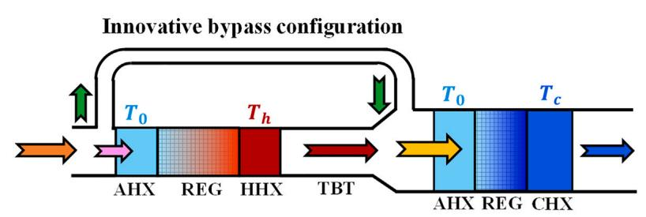

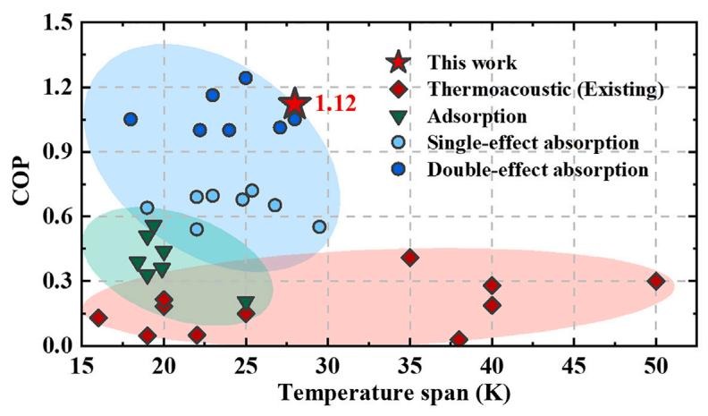

Xiao et al. propose and construct an innovative heat-driven thermoacoustic refrigerator. The system exhibits a much-higher coefficient of performance than many existing thermoacoustic refrigerators and is even competitive with absorption refrigerators.

Lei Xiao, Kaiqi Luo, Zhanghua Wu, ..., Limin Zhang, Jianying Hu, Ercang Luo

zhhwoo@mail.ipc.ac.cn (Z.W.) ecluo@mail.ipc.ac.cn (E.L.)

Highlights   
A highly efficient heat-driven thermoacoustic refrigerator is developed

The highest COP of 1.12 is experimentally achieved

The proposed system shows competitive COP with absorption refrigerators

Article

# A highly efficient heat-driven thermoacoustic cooling system

Lei Xiao,1,2 Kaiqi Luo,3 Zhanghua Wu,1,\* Jiaxin Chi,1,2 Jingyuan Xu,4 Limin Zhang,1 Jianying Hu,1 and Ercang Luo1,2,5,\*

## SUMMARY

Thermoacoustic engines and refrigerators operate based on complex interactions and physical effects between working gas and a nearby solid. As an emerging cooling technology, the heat-driven thermoacoustic refrigerator (HDTR) is a promising avenue for its superiorities of eco-friendly working substances and no mechanical moving components. We report a HDTR with bypass configuration, simultaneously synergizing acoustic and energy-flow fields, thus significantly improving the efficiency. We achieve the highest experimental coefficient of performance (COP) of 1.12, along with a cooling power of 2.53 kW at the heating, ambient, and cooling temperatures of 723, 308, and 280 K, respectively. This COP is 2.7 times that of the previously reported best result for HDTRs, to the best of our knowledge, surpassing adsorption refrigerators and competing with absorption refrigerators. These findings highlight the commercial potential ofHDTRs in air-conditioning applications and provide guidance for other cooling applications such as the liquification of natural gas and hydrogen.

## INTRODUCTION

At present, refrigeration plays an indispensable role in contemporary life, including in various domains such as air conditioning,1 the preservation of food,2 the cooling of electronics,3 medicinal applications,4 and space exploration,5 among others. As per their primary power source, cooling technologies can be predominantly classified into electric-driven refrigeration and heat-driven refrigeration. Electric-driven vapor-compression refrigeration technologies dominate owing to their mature manufacturing processes and superior performance. However, it is noteworthy that hydrofluorocarbons, serving as refrigerants in vapor-compression systems, carry the potential for substantial harm to the ozone layer and impart significant greenhouse effects (with global warming potential ranging from hundreds to thousands of times that of CO ). Consequently, there has been a gradual reduction and even prohibition of their usage. Notwithstanding, the comprehensive prerequisites of environmental sustainability, exceptional performance, and increased safety render the procurement of ideal refrigerants an arduous endeavor at present.6 Besides, emerging electric-driven cooling technologies such as electrocaloric cooling,7,8 magnetocaloric cooling,9,10 and elastocaloric cooling11,12 systems are in development, with improved performance.

Recently, due to the imperative of environmental conservation and energy efficiency,13 heat-driven refrigeration has emerged as a promising avenue. This is attributed to the utilization of comparatively eco-friendly working substances and the capacity to directly harness thermal energy sources, such as solar energy, fuel, and waste heat. In heat-driven refrigeration, three primary categories exist: adsorption refrigeration, absorption refrigeration, and thermoacoustic refrigeration. Adsorption refrigeration, functioning through the adsorption phenomenon between distinct working pairs (e.g., silica gel-water, carbon-ammonia, zeolite-water, etc.), offers the capability to use waste heat for cooling purposes.14 However, a notable drawback lies in the propensity for adsorbent degradation, posing a significant hurdle to commercialization.15 Regarding the absorption refrigeration, predominantly employing lithium bromide-water or ammonia-water as working pairs has successfully attained commercial viability through the deployment of single-effect and double-effect systems.16 In the context of air conditioning, single-effect systems17 have the potential to attain a coefficient of performance (COP; defined as the ratio of output cooling power to input heating power; see Equation S1) of 0.7. Moreover, double-effect systems18 achieve an even higher COP, exceeding 1, albeit with more intricate configurations. Nevertheless, the efficient utilization of high-temperature thermal energy remains a challenge, primarily due to the intrinsic characteristics of working pairs and thermodynamic cycles.

Thermoacoustic refrigeration represents an emerging technology that has undergone rapid development in recent decades. Relying on thermoacoustic effects,19–22 heatdriven thermoacoustic refrigerators (HDTRs) utilize environmentally benign working substances, such as helium and nitrogen, to harness thermal energy for cooling, devoid of any mechanical moving components. Consequently, they are recognized as a promising cooling technology and have garnered increasing attention from the research community, having potential in the applications of air conditioning,23 medical storage,24 gas liquification,25 etc. HDTR systems can be broadly classified into two categories based on the acoustic field: incipient standing-wave and subsequent traveling-wave systems.26 The latter, characterized by superior performance attributes such as higher power density and elevated COP, owes its prowess to a more favorable acoustic field.27 In the realm of air-conditioning applications, standing-wave systems28,29 typically yield COP values below 0.15 due to the constraining effects of the standing-wave acoustic field within the stack, which impedes efficient thermal-to-acoustic conversion. Subsequently, the classical thermoacoustic Stirling engine, pioneered by Swift,30 has been employed to construct traveling-wave HDTRs, thus establishing a traveling-wave acoustic field within the engine’s regenerator (REG). This innovation31 has enabled the enhancement of COP to levels exceeding 0.2. Subsequent iterations of traveling-wave HDTRs, particularly those adopting looped topologies, have succeeded in creating appropriate acoustic fields within the REGs of both the engine and cooler units. Notably, advanced directcoupling configurations have emerged,32,33 achieving COP values of approximately 0.4 within the context of air-conditioning applications.34 However, it is pertinent to mention that, overall, the COP values of HDTRs remain relatively lower compared to adsorption and absorption refrigerators, which hinders the commercialization of HDTRs.

In pursuit of attaining a higher COP in the domain of HDTR, it is natural to contemplate the provision of elevated heating temperatures. Such a strategy is appealing, as it capitalizes on a larger portion of available energy, aligning with the principles expounded by the second law of thermodynamics.35 Nevertheless, an intriguing observation emerges: in advanced direct-coupling systems, an unexpected decline in COP accompanies rising heating temperatures. This intriguing phenomenon implies the existence of a critical matching mechanism beyond the realm of acoustic field, one that significantly impacts system performance. In view of the low COP values of existing HDTRs, revealing the new matching mechanism and then enhancing the COP of HDTRs represent a pivotal stride toward their commercialization, as well as supply a deeper insight into the efficient energy conversion mechanism in these systems.

## Cell Reports Physical Science Article

The present work elucidates the temperature-matching mechanism, herein termed the matching law, which delineates the interplay among heating, ambient, and cooling temperatures. This mechanism accounts for the counterintuitive phenomenon of declining ${ \mathsf { C O P } }$ with increasing heating temperature in advanced direct-coupling systems. Significantly, this study introduces an innovative HDTR featuring a bypass configuration, marking the first of its kind. In addition to an appropriate acoustic field, this system overcomes the constraints of heating temperature, realizing good matching between the acoustic power generation in the engine unit and consumption in the cooler unit, thereby synergizing energy-flow field. Consequently, this innovation engenders a remarkable several-fold enhancement in COP due to efficiently harnessing high-temperature thermal energy. This advancement expands the operational domain of HDTRs and holds the promise of realizing their commercialization.

## RESULTS

## Thermoacoustic effects in HDTRs

HDTRs work based on thermoacoustic effects, including thermal-to-acoustic effect in thermoacoustic engines and acoustic-to-cooling effect in thermoacoustic coolers, as illustrated in Figure 1. In the REG, the oscillating flow of working gas and axial temperature gradient allows periodic heat transfer between gas and solid, thus contributing to thermodynamic cycle and thermoacoustic conversion. For a differential gas element in the REG of the engine, it absorbs heat from a high-temperature heat source and releases heat to a low-temperature heat source, thus generating net power. Innumerable differential gas elements contribute to macroscopic acoustic power (W\_ ) generated by the engine, which can be expressed as

$$
\dot { W } = \frac { 1 } { 2 } | p _ { 1 } | | U _ { 1 } | { \cos \theta } ,\tag{Equation 1}
$$

where $p _ { 1 }$ and $U _ { \mathcal { 1 } }$ are the first-order oscillating pressure and volume flow rate in frequency domain, respectively, and q denotes the phase difference between $p _ { 1 }$ and U . Equation 1 implies the significance of acoustic field, which determines the q. A traveling-wave acoustic field $\left( \theta \ : = \ : \ : 0 ^ { \circ } \right)$ enhances the acoustic power transmission and improves performance. Conversely, the acoustic power is consumed by a differential gas element in the REG of the thermoacoustic cooler, contributing to the cooling effect. Massive differential gas elements lead to macroscopic cooling power. Classical thermoacoustic theory36 yields the uniform expression of acoustic power generation, consumption, and dissipation as follows:

$$
\frac { d \dot { W } } { d x } = - \frac { r _ { v } } { 2 } | U _ { 1 } | ^ { 2 } - \frac { 1 } { 2 r _ { k } } \big | p _ { 1 } \big | ^ { 2 } + \frac { 1 } { 2 } \mathsf { R e } \big [ \alpha \tilde { p } _ { 1 } U _ { 1 } \big ] ,\tag{Equation 2}
$$

where x denotes the axial direction. $\boldsymbol { r } _ { v }$ and $r _ { k }$ are the viscous and thermal resistance per unit length, respectively; thus, the first and second terms on the right of Equation 2 represent the viscous and thermal losses, respectively, while the third term, $\scriptstyle \frac { 1 } { 2 } \mathsf { R e } [ \alpha \tilde { p } _ { 1 } U _ { 1 } ]$ , is recognized as the acoustic power generation or consumption, where the superscript denotes the conjugate, and a is the acoustic power generation gain, defined as

$$
\alpha = \frac { ( f _ { \kappa } - f _ { \nu } ) } { ( 1 - f _ { \nu } ) ( 1 - P r ) } \frac { 1 } { T _ { m } } \frac { d T _ { m } } { d x } ,\tag{Equation 3}
$$

where $P r$ denotes the Prandtl number and $f _ { \nu }$ and $f _ { \kappa }$ (see Equations S19 and S20) are the spatially averaged viscous and thermal functions reflecting the flow and heat transfer, respectively, which are determined by the geometric structure of the flow channel as well as the viscous and thermal penetration depths of the gas (see Equations S21 and S22). $T _ { m }$ and $\frac { d T _ { m } } { d x }$ represent the local mean temperature and axial temperature gradient, respectively. For the REG of an engine with positive temperature gradient, $\alpha > 0 ,$ thus generating acoustic power; regarding the REG of a cooler characterized by negative $\frac { d T _ { m } } { d x }$ and a, the acoustic power is consumed, contributing to cooling power. The complex interactions and abundant physical effects between the gas and solid realize thermal-to-acoustic and acoustic-to-cooling effects in the HDTRs.

A Thermal-to-acoustic effect in the regenerator of thermoacoustic engine  
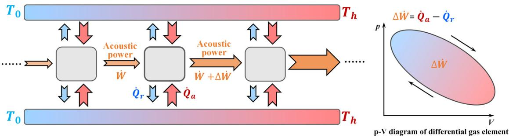

B Acoustic-to-cooling effect in the regenerator of thermoacoustic cooler  
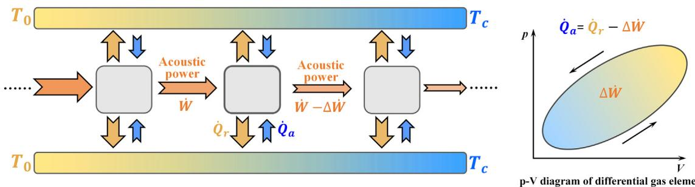  
(A) Diagram of thermal-to-acoustic effect in the REG of thermoacoustic engine. The differential gas elements absorb heat (Q\_ ) from a high-temperature heat source and release heat (Q\_r) to a low-temperature heat source, generating acoustic power $\Delta \dot { W } = \dot { Q } _ { a } - \dot { Q } _ { r }$ (B) Diagram of acoustic-to-cooling effect in thermoacoustic cooler. The differential gas elements consume acoustic power $( \Delta \dot { W } ) .$ , thus absorbing heat $( { \dot { Q } } _ { a } )$ from a low-temperature heat source and releasing heat (Q\_r) to a high-temperature heat source, contributing to a cooling power of $\dot { \cal O } _ { a } = \dot { \cal O } _ { r } - \Delta \dot { W } .$ From a thermodynamic viewpoint, the differential gas elements undergo a clockwise cycle (shown in pressure-volume diagram, i.e., p-V diagram) for a thermal-to-acoustic effect, whereas they undergo an anticlockwise cycle for an acoustic-to-cooling effect. ${ T _ { 0 } , \tau _ { h } , }$ and $T _ { c }$ denote the ambient, heating, and cooling temperatures, respectively.

## Bypass configuration and energy-flow field synergy

As an advanced thermoacoustic cooling technology with relatively low loss, the direct-coupling HDTR comprises a thermoacoustic engine and cooler, which are interconnected via a thermal buffer tube (TBT), as depicted in Figure 2A. The engine includes an ambient heat exchanger (AHX), a REG, and a hot heat exchanger (HHX), while the cooler comprises an AHX, a REG, and a cooling heat exchanger (CHX). The gas absorbs heat in the HHX from a high-temperature heat and then generates acoustic power in the REG, which is subsequently consumed by the cooler, finally contributing to the cooling effect in the CHX. For an ideal REG with no viscous or thermal losses, thermoacoustic the $\mathsf { o r y } ^ { 3 7 }$ reveals that the output acoustic power $( \dot { W } _ { e , o u t } )$ of the engine is proportional to the temperature ratio times the input acoustic power $( \dot { W } _ { e , i n } )$ , i.e.,

$$
\dot { W } _ { e , o u t } = \frac { T _ { h } } { T _ { 0 } } \dot { W } _ { e , i n } ,\tag{Equation 4}
$$

A  
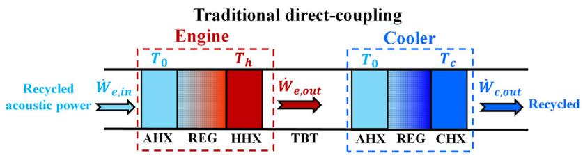

B  
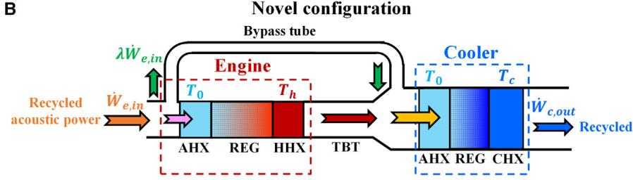

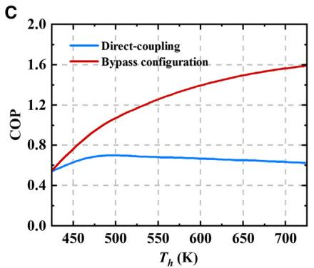

D  
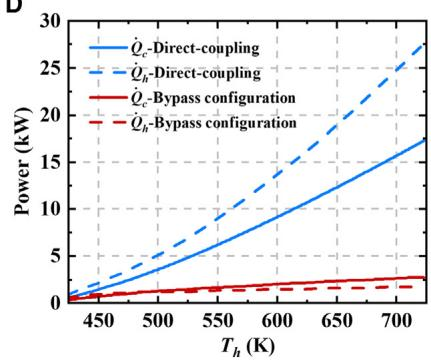  
Figure 2. Schematic and performance of the traditional direct-coupling system and novel system with bypass configuration

(A) Schematic of the traditional direct-coupling system, comprising the direct connection between a thermoacoustic engine and a thermoacoustic cooler.

(B) Schematic of the novel system with bypass configuration, with a bypass tube connecting the inlets of the engine and the cooler to facilitate energy flow matching between them, consequently achieving energy-flow field synergy.

(C) Simulation results comparing COP between the traditional direct-coupling and novel bypass configuration systems.

(D) Simulation results comparing power (cooling power [Q\_c] and heating power $[ \dot { \mathcal { O } } _ { h } ] )$ between the traditional direct-coupling and novel bypass configuration systems. Operating conditions: 5 MPa pressurized helium as working gas; the ambient temperature and cooling temperature are 308 and 280 K, respectively. The latter exhibits significantly higher COP at high heating temperatures due to energy-flow field synergy.

where $T _ { h }$ and $T _ { 0 }$ represent the mean heating and ambient temperatures, respectively. Similarly, for the cooler, the corresponding relationship is given by

$$
\dot { W } _ { c , o u t } = \frac { T _ { c } } { T _ { 0 } } { \dot { W } } _ { c , i n } ,\tag{Equation 5}
$$

where $T _ { c }$ denotes the mean cooling temperature, and $\dot { W } _ { c , i n } \simeq \dot { W } _ { e , o u t }$ is a reasonable approximation by neglecting losses in the ${ \mathsf { T B T } } . ^ { 3 8 }$ In the coupling of an engine and a cooler, the ideal scenario involves the acoustic power at the cooler outlet approximately matching that at the engine inlet, i.e., $\dot { W } _ { e , i n } \simeq \dot { W } _ { c , o u t }$ , which implies the complete recovery of acoustic power without losses. Using these relationships and combining Equations 4 and 5, we can obtain

$$
T _ { h } = \frac { { T _ { 0 } } ^ { 2 } } { T _ { c } } .\tag{Equation 6}
$$

Equation 6 elucidates the principle of matching heating temperature, ambient temperature, and cooling temperature in the direct-coupling system. Under constant ambient and cooling temperatures (e.g., for standard air-conditioning cooling operating conditions, $T _ { 0 } = 3 0 8 ~ \mathsf { K }$ and $T _ { c } = 2 8 0 ~ \mathsf { K }$ , elevating the heating temperature above the threshold defined in Equation 6 can disrupt the matching principle, thereby adversely affecting performance. This is exemplified by the blue curve in Figure $2 { \mathsf { C } } ,$ obtained through simulation (given in the supplemental experimental procedures, Equations ${ \mathsf { S } } 9 { \mathrm { - } } { \mathsf { S } } 1 6 ,$ and Table S3), where the ${ \mathsf { C O P } }$ declines as the heating temperature increases beyond 473 K. The deterioration in performance can be ascribed to the lack of synergy in energy-flow field, resulting from the violation of the temperature-matching principle. Specifically, acoustic power generation in the engine surpasses the consumption of the cooler, leading to increased losses and reduced energy conversion efficiency.

Considering the constraints imposed by the heating temperature and the performance limitations inherent in the direct-coupling system, we have put forth a novel bypass configuration, visually represented in Figure 2B. This bypass configuration involves the introduction of a bypass tube connecting the engine inlet and the cooler inlet, facilitating the diversion of a portion of the acoustic power away from the engine and directly into the cooler. Let l signify the bypass proportion of the acoustic power, defined as the ratio of acoustic power entering the bypass tube to the total acoustic power. Using the previously mentioned acoustic power relationships, we derive the expression for l as follows:

$$
\dot { W } _ { c , o u t } \simeq \frac { T _ { c } } { T _ { 0 } } \left[ \left( 1 ~ - ~ \lambda \right) \frac { T _ { h } } { T _ { 0 } } \dot { W } _ { e , i n } ~ + ~ \lambda \dot { W } _ { e , i n } \right] \simeq \dot { W } _ { e , i n } .\tag{Equation 7}
$$

Equation 7 yields the expression of $\lambda$ as

$$
\lambda \ = \ \frac { T _ { h } T _ { c } \ - \ T _ { 0 } ^ { 2 } } { T _ { c } ( T _ { h } \ - \ T _ { 0 } ) } .\tag{Equation 8}
$$

The implementation of the bypass configuration, along with the adjustment of the $\lambda ,$ eliminates the constraint posed by the heating temperature outlined in Equation 6. This implies that an effective coupling of the engine and cooler can be achieved even at elevated heating temperatures, thereby enhancing the synergy within the system’s energy-flow field. To validate the superior performance of the bypass configuration system, we conducted simulations to compare its performance with that of the direct-coupling system, as illustrated in Figure 2C. Identical geometric parameters are set for the two systems, as shown in Table S1. The contrast between the red and blue curves highlights the significantly higher COP of the bypass configuration system, particularly at elevated heating temperatures. However, a lower cooling power $( \dot { \mathcal { O } } _ { c } )$ is observed because of the bypass of acoustic power. Encouraged by these promising outcomes, we have designed and constructed a kilowatt-scale innovative HDTR system featuring the bypass configuration, aiming to achieve superlative performance.

## Design of the innovative system

From the standpoint of energy-flow field synergy, an innovative HDTR with bypass configuration is devised, as illustrated in Figure 3 (see details in Figures S1 and S2 and Tables S1 and S2). The system comprises a looped structure with three identical subunits interconnected by connection tubes. The looped topology, coupled with appropriate geometric dimensions, configures a traveling-wave thermoacoustic system, contributing to an adequate acoustic field. Each subunit primarily contains an engine, a cooler, two TBTs (TBT1 and TBT2), a bypass configuration, a liquid resonator, a connection tube, and two expansion chambers. The bypass configuration includes a bypass tube and a ball valve, with the valve serving to adjust the bypass proportion (ideally dependent on the heating temperature, as described in Equation 8) to optimize performance under varying heating temperatures. The liquid resonator, characterized by a U-shaped tube filled with water, is employed to recycle the remaining acoustic power and adjust the acoustic field, using its much-higher density compared to gas to significantly lower the operating frequency and mitigate system losses.38 The engine, TBT , and bypass tube form a compact looped topol-$( \dot { M } _ { 2 } )$ 39 ogy, resulting in a non-zero time-averaged mass flow rate , known as DC flow, estimated $\mathsf { b y } ^ { 3 6 }$

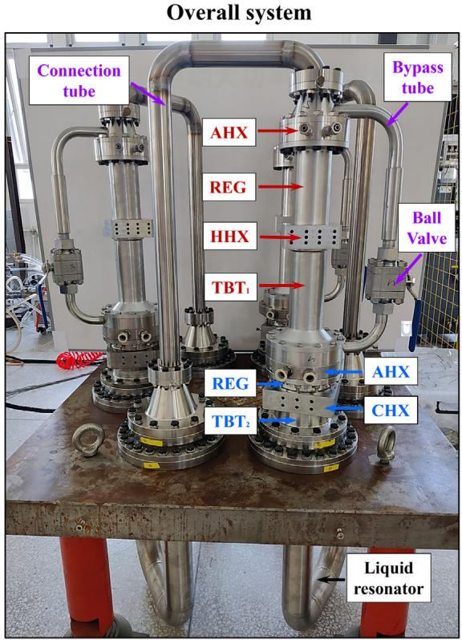

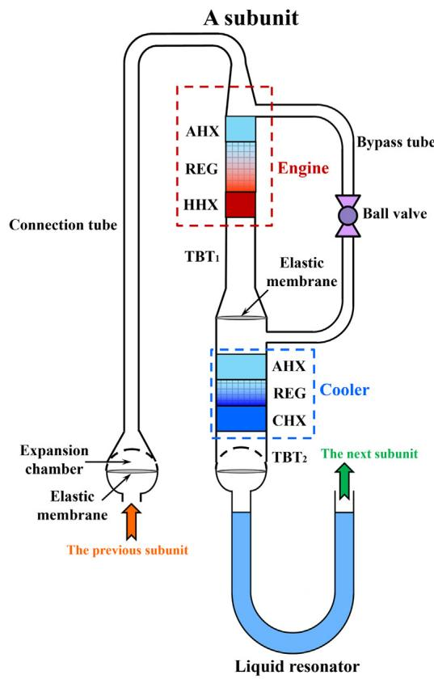  
Figure 3. Experimental configuration of the present heat-driven thermoacoustic refrigerator  
The system contains three identical subunits connected by connection tubes, constituting a loop. Each subunit mainly consists of a thermoacoustic engine, a thermoacoustic cooler, a bypass configuration (comprising a bypass tube and a ball valve), two thermal buffer tubes (TBTs), and a liquid resonator. The engine comprises an ambient heat exchanger (AHX), a REG, and a hot heat exchanger (HHX), while the cooler incorporates an AHX, a REG, and a cooling heat exchanger (CHX). Elastic membranes are installed at two key positions: one placed between the engine and the cooler to suppress DC flow and prevent its detrimental impact on performance and the other in the expansion cavities to mitigate liquid surface instability.

$$
\dot { M } _ { 2 } = \frac { 1 } { 2 } \mathsf { R e } [ \tilde { \rho } _ { 1 } U _ { 1 } ] + \rho _ { m } U _ { 2 , m } ,\tag{Equation 9}
$$

where $\rho _ { \uparrow }$ and $\rho _ { m }$ denote the first-order density and mean density of the gas, respectively, and $U _ { 2 , m }$ is the second-order mean volume flow rate. The time-averaged total energy flow $( \dot { H } _ { 2 } )$ in the REG considering the DC flow can be expressed as36

$$
\dot { H } _ { 2 } = \dot { W } + \dot { \cal { O } } _ { f } + \dot { M } _ { 2 } c _ { p } T _ { m } \simeq 0 ,\tag{Equation 10}
$$

where $\dot { Q } _ { f }$ and $c _ { p }$ denote the heat flow and isobaric specific heat of gas, respectively. Despite the small magnitude of DC flow, it can result in prominent deterioration of system performance.40 To address this, an elastic membrane is positioned in front of the AHX of the cooler to eliminate the looped structure and suppress DC flow completely. Additionally, the powerful oscillating pressure can induce liquid surface instability, potentially leading to liquid flow into the cooler and a decline in system performance. Consequently, an elastic membrane is also situated in the expansion chambers to mitigate these issues. All geometric parameters of the system’s components are optimized (see Table S1) based on the simulation method (shown in supplemental experimental procedures). Notably, the engine is designed with a smaller cross-sectional area and greater length than the cooler to attain an adequate bypass proportion, owing to the substantial viscous resistance of the engine, and to reduce heat conduction losses at high heating temperatures.

## Performance of the system

The system employs helium as the working gas, charged to a pressure of 5 MPa. In the experiments, the opening angle (4) of the ball valve is regulated to adjust the bypass proportion for investigating system performance. In this context, a 0 valve opening angle indicates complete valve closure (i.e., representing the traditional directcoupling system), while a larger opening angle implies a greater bypass proportion. Under standard air-conditioning cooling conditions, where the ambient temperature and cooling temperature are 308 (i.e., $3 5 ^ { \circ } \mathsf { C } )$ and 280 K $( \mathsf { i } . { \mathsf { e } } . , 7 ^ { \circ } \mathsf { C } ) ,$ respectively, Figure 4 illustrates the system’s operational performance. The operating frequency (f), as shown in Figure 4A, remains consistently low, at approximately 18 Hz, due to the presence of the liquid resonator. This frequency is significantly lower than systems employing gas resonators, resulting in reduced losses and higher efficiency. The cooling power (Q\_c) holds in the range of several kilowatts and increases with rising heating temperature, aligning with the typical behavior of thermoacoustic systems. At a constant heating temperature, a larger valve opening angle indicates a higher proportion of acoustic power bypassed, reducing power generated in the engine and, consequently, lowering energy flow and cooling power. This allows for the regulation of cooling power based on practical demands: within the cooling capacity range, the system can output varying cooling power by adjusting the valve opening angle at a given heating temperature. Furthermore, under varying heating temperatures, the cooling power can be maintained at a desired level by regulating the valve opening angle. This capability to adjust cooling power under varying operating conditions represents an advantage over direct-coupling systems, which exhibit output characteristics directly tied to heating temperature that are challenging to adjust.

Efficiency stands as a critical evaluation metric for energy conversion systems, particularly for refrigerators, where efficiency is typically assessed using the COP (see COP calculation of this study in Equations S1–S6 and Figure S3). For the proposed bypass configuration system, the condition of a $0 ^ { \circ }$ valve opening angle (completely closed) actually transforms it into a direct-coupling system. In this case, the blue line in Figure 4C illustrates that the observed upward-downward trend aligns with the theoretical constraint imposed by heating temperature, as described in Equation 6. Furthermore, there exists an optimum valve opening angle for a given heating temperature. This relationship demonstrates a positive correlation, as depicted in Figure 4D, supporting Equation 8 and the analysis of bypass. Moreover, a larger valve opening angle indicates a greater potential for harnessing thermal energy at higher heating temperatures, proven by a higher COP. At a heating temperature of 723 K (i.e., $4 5 0 ^ { \circ } \mathrm { C } )$ , a valve opening angle of 45 yields a maximum COP of 1.12 and a cooling power of 2.53 kW, significantly surpassing previous HDTRs and commercialized single-effect absorption refrigerators while remaining competitive with double-effect absorption refrigerators. In terms of relative Carnot efficiency, defined as the ratio of the actual COP to the COP of the ideal Carnot cycle (see Equation S7), the value of 19.5% signifies a notable level of performance.41,42 These promising results indicate significant potential in the field of air conditioning.

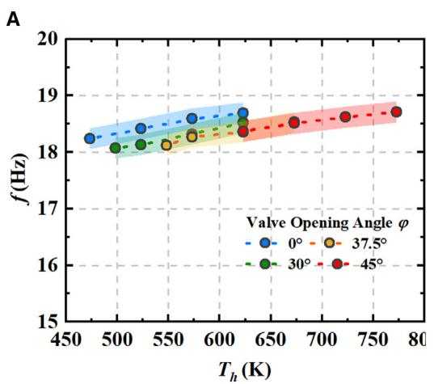

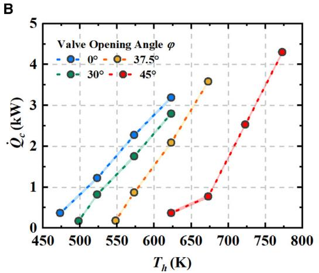

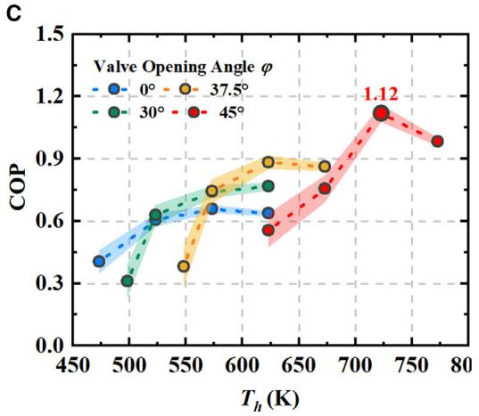

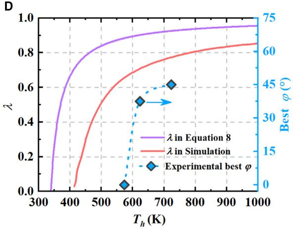  
Figure 4. Performance of the present heat-driven thermoacoustic refrigerator under different heating temperatures (Th) (A) Operating frequency (f).  
(B) Cooling power (Q\_ c).  
(C) COP.  
(D) Theoretical and simulated bypass proportion (l; the ratio of acoustic power into the bypass tube to the total at the engine inlet) and experimental best valve opening angle (4). The system is charged with 5 MPa pressurized helium under standard air-conditioning cooling operating conditions, with the ambient temperature and cooling temperature set at 308 and 280 K, respectively. The colored shaded area represents the error bar.

## DISCUSSION

Given the enormous significance of heat-driven refrigeration for environmental protection and the noteworthy attributes of our innovative HDTR, we conduct a comprehensive comparison between our proposed system and previous studies of mainstream heat-driven refrigerators for air-conditioning applications. These comparisons considered a range of ambient temperatures (approximately 308– 323 K) and cooling temperatures (273–288 K), including absorption refrigerators, adsorption refrigerators, and thermoacoustic refrigerators, as displayed in Figure 5 (see details in Tables 1, 2, and 3). Observations reveal that absorption refrigerators exhibit a high COP ranging from 0.5 to 1.2. Among these, single-effect configurations demonstrate COP values within the range of 0.5–0.8, while doubleeffect systems achieve even higher levels exceeding 1, owing to more efficient heat utilization, albeit at the cost of increased complexity. Regarding the adsorption refrigerators, they are capable of achieving a COP within the range of 0.2–0.6, primarily suited for low heating temperatures (<373 K). The performance of adsorption refrigerators is notably influenced by the working substance and the characteristics of the adsorption bed. Turning our attention to existing thermoacoustic refrigerators, we find that they exhibit relatively low COP values in the range of 0.05–0.41, with the most advanced 2-stage looped direct-coupling HDTR achieving a maximum COP of 0.41. However, as heating temperatures increase, the COP tends to decline, presenting a bottleneck for existing direct-coupling HDTRs.

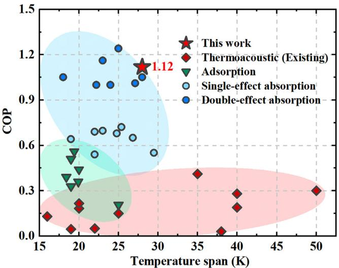  
Figure 5. Comparison between this work and heat-driven refrigerators (absorption refrigerators, adsorption refrigerators, and thermoacoustic refrigerators) reported in the last few decades for air-conditioning applications on COP  
The temperature span is the difference between the ambient temperature and cooling temperature, which is 28 K in this work (ambient temperature of 308 K and cooling temperature of 280 K, recognized as standard air-conditioning cooling operating conditions). In these studies, ambient temperatures range from 308 to 323 K, and cooling temperatures vary from 273 to 288 K. See also Tables 1, 2, and 3.

Table 1. Performance of the reported absorption refrigerators
<table><tr><td>Year</td><td>COP</td><td>Temperature span (K)</td><td>Reference</td></tr><tr><td>1998 (single effect)</td><td>0.696</td><td>23</td><td>Aphornratana and Eames 43</td></tr><tr><td>2007 (single effect)</td><td>0.678</td><td>24.8</td><td>Aphornratana and Sriveerakul⁴4</td></tr><tr><td>2009 (double effect)</td><td>1</td><td>24</td><td>Torrella et al. 45</td></tr><tr><td>2010 (double effect)</td><td>1.16</td><td>23</td><td>Bermejo et al.46</td></tr><tr><td>2010 (double effect)</td><td>1.24</td><td>25</td><td>Shu et al. 47</td></tr><tr><td>2011 (single effect)</td><td>0.65</td><td>26.8</td><td>González Gil48</td></tr><tr><td>2011 (double effect)</td><td>1.01</td><td>27.1</td><td>González Gil48</td></tr><tr><td>2011 (single effect)</td><td>0.64</td><td>19</td><td>González-Gil et al.49</td></tr><tr><td>2012 (single effect)</td><td>0.54</td><td>22</td><td>Le Lostec et al. 50</td></tr><tr><td>2012 (single effect)</td><td>0.69</td><td>22</td><td>Darkwa et al.51</td></tr><tr><td>2012 (double effect)</td><td>1.05</td><td>28</td><td>Izquierdo et al.52</td></tr><tr><td>2015 (single effect)</td><td>0.72</td><td>25.4</td><td>Xu et al.17</td></tr><tr><td>2017 (single effect)</td><td>0.55</td><td>29.5</td><td>Goyal et al.53</td></tr><tr><td>2020 (double effect)</td><td>1</td><td>22.2</td><td>Alhamid et al.54</td></tr><tr><td>2022 (double effect)</td><td>1.05</td><td>18</td><td>Dadpour et al.18</td></tr></table>

Table 2. Performance of the reported adsorption refrigerators
<table><tr><td>Year</td><td>COP</td><td>Temperature span (K)</td><td>Reference</td></tr><tr><td>2007</td><td>0.33</td><td>19</td><td>Chang et al.5 55</td></tr><tr><td>2009</td><td>0.39</td><td>18.4</td><td>Xia et al.5 56</td></tr><tr><td>2013</td><td>0.36</td><td>19.9</td><td>Lu et al.5 57</td></tr><tr><td>2014</td><td>0.21</td><td>25</td><td>Pan et al.58</td></tr><tr><td>2016</td><td>0.51</td><td>19</td><td>Pan et al. 59</td></tr><tr><td>2019</td><td>0.56</td><td>19.4</td><td>Lattieff et al.60</td></tr><tr><td>2023</td><td>0.44</td><td>20</td><td>Cai et al.61</td></tr></table>

Our work presents a practical approach to significantly enhance the performance of HDTRs, achieving a remarkable several-fold improvement in COP (1.12 under standard air-conditioning cooling operating conditions). This COP surpasses that of reported adsorption and single-effect absorption refrigerators and competes favorably with double-effect absorption refrigerators. By harnessing energy-flow field synergy, we surmount the barrier to effectively utilizing high-temperature thermal energy for HDTRs. Moreover, the system offers accessible regulation of cooling power, enhancing practicality without significant structural complexity. Furthermore, the cost can be controlled at a low level because of the lack of mechanical moving components such as compressor and piston, which require precision machining. The findings of this study strongly support the potential of HDTRs as a promising technology for air-conditioning applications, particularly in efficiently harnessing high-temperature thermal energy sources such as natural gas.

Given the attainable high combustion temperatures (higher than 1,000 K) of natural gas or concentrated solar energy, it is foreseeable that the novel system can achieve a higher COP performance at a practical higher heating temperature. Importantly, in addition to the applications in air-conditioning cooling, the proposed idea and methodology demonstrated in the novel HDTR provide inspiring guidance for other broad applications such as heat pumping, natural gas liquefaction, and hydrogen liquification.

## EXPERIMENTAL PROCEDURES

## Resource availability

## Lead contact

Further information and requests for resources should be directed to and will be fulfilled by the lead contact, Ercang Luo (ecluo@mail.ipc.ac.cn).

## Materials availability

This study did not generate new materials.

Table 3. Performance of the reported heat-driven thermoacoustic refrigerators
<table><tr><td>Year</td><td>COP</td><td>Temperature span (K)</td><td>Reference</td></tr><tr><td>1997</td><td>0.15</td><td>25</td><td>Hofler and Adeff28</td></tr><tr><td>2004</td><td>0.05</td><td>22</td><td>Ueda et al. 62</td></tr><tr><td>2006</td><td>0.184</td><td>20</td><td>Luo et al.63</td></tr><tr><td>2010</td><td>0.046</td><td>28</td><td>Nakamura et al.64</td></tr><tr><td>2010</td><td>0.13</td><td>16</td><td>Kang et al. 65</td></tr><tr><td>2011</td><td>0.216</td><td>20</td><td>Yu et al.31</td></tr><tr><td>2018</td><td>0.046</td><td>19</td><td>Saechan and Jaworski66</td></tr><tr><td>2019</td><td>0.19</td><td>40</td><td>Wang et al.3 32</td></tr><tr><td>2021</td><td>0.28</td><td>40</td><td>Wang et al.42</td></tr><tr><td>2022</td><td>0.3</td><td>50</td><td>Yang et al.33</td></tr><tr><td>2023</td><td>0.41</td><td>35</td><td>Chi et al.34</td></tr></table>

Data and code availability

Data reported in this paper is available from the lead contact upon reasonable request.

## SUPPLEMENTAL INFORMATION

Supplemental information can be found online at https://doi.org/10.1016/j.xcrp.   
2024.101815.

## ACKNOWLEDGMENTS

The authors thank Mr. Bin Liu, Mr. Ruifeng An, Mr. Jianmin Fang, Mr. Zhiqiang Quan, and other engineers of their group for technical support during the experiments. Particularly, special acknowledgment is given to Mr. Dong Zhao for his tremendous assistance. This work was financially supported by the Key Laboratory of Cryogenic Science and Technology (CRYO20230103), the National Natural Science Foundation of China (grant no. 51976230), the National Key Research and Development Program of China (2016YFB0901403), and the Key Program of the Natural Science Foundation of Beijing (grant no. 3181002).

## AUTHOR CONTRIBUTIONS

L.X. investigated the methodology and background, designed and constructed the HDTR system, performed the experiments and simulations, analyzed the data, and wrote the manuscript. K.L. analyzed the data. Z.W. investigated the methodology and background, helped with the HDTR system design and construction, analyzed the data, and supervised the research. J.C. and J.X. investigated the background. L.Z. and J.H. helped with the HDTR system design. E.L. initiated the project, planned the experiments, investigated the methodology and background, analyzed the data, and supervised the research.

## DECLARATION OF INTERESTS

The authors declare no competing interests.

Received: November 9, 2023

Revised: December 12, 2023

Accepted: January 12, 2024

Published: February 1, 2024; corrected online: February 16, 2024

## REFERENCES

1. Baskaran, A., Manikandan, N., Jule, L., Nagaprasad, N., Saka, A., Badassa, B., Ramaswamy, K., and Seenivasan, V. (2022). Influence of capillary tube length on the performance of domestic refrigerator with ecofriendly refrigerant R152a. Sci. Rep. 12, 14460.

2. Rech, S., Finco, E., and Lazzaretto, A. (2020). A multicriteria approach to choose the best renewable refrigeration system for food preservation. Renew. Energy 154, 368–384.

3. van Erp, R., Soleimanzadeh, R., Nela, L., Kampitsis, G., and Matioli, E. (2020). Codesigning electronics with microfluidics for more sustainable cooling. Nature 585, 211–216.

4. Lee, C., Lee, Y., Jung, W.H., Kim, T.Y., Kim, T., Kim, D.N., and Ahn, D.J. (2022). Peptide-DNA origami as a cryoprotectant for cell preservation. Sci. Adv. 8, eadd0185.

5. Plachta, D., Stephens, J., Johnson, W., and Zagarola, M. (2018). NASA cryocooler technology developments and goals to achieve zero boil-off and to liquefy cryogenic propellants for space exploration. Cryogenics 94, 95–102.

6. McLinden, M.O., Seeton, C.J., and Pearson, A. (2020). New refrigerants and system configurations for vapor-compression refrigeration. Science 370, 791–796.

7. Wang, Y., Zhang, Z., Usui, T., Benedict, M., Hirose, S., Lee, J., Kalb, J., and Schwartz, D. (2020). A high-performance solid-state electrocaloric cooling system. Science 370, 129–133.

8. Meng, Y., Zhang, Z., Wu, H., Wu, R., Wu, J., Wang, H., and Pei, Q. (2020). A cascade electrocaloric cooling device for large temperature lift. Nat. Energy 5, 996–1002.

9. Liu, J., Gottschall, T., Skokov, K.P., Moore, J.D., and Gutfleisch, O. (2012). Giant magnetocaloric effect driven by structural transitions. Nat. Mater. 11, 620–626.

10. Jang, D., Gruner, T., Steppke, A., Mitsumoto, K., Geibel, C., and Brando, M. (2015). Large magnetocaloric effect and adiabatic demagnetization refrigeration with YbPt2Sn. Nat. Commun. 6, 8680.

11. Ossmer, H., and Kohl, M. (2016). Elastocaloric cooling: Stretch to actively cool. Nat. Energy 1, 16159.

12. Qian, S., Catalini, D., Muehlbauer, J., Liu, B., Mevada, H., Hou, H., Hwang, Y., Radermacher, R., and Takeuchi, I. (2023). High-performance multimode elastocaloric cooling system. Science 380, 722–727.

13. Ren, M., Huang, C., Wu, Y., Deppermann, A., Frank, S., Havlı´k, P., Zhu, Y., Fang, C., Ma, X., Liu, Y., et al. (2023). Enhanced food system efficiency is the key to China’s 2060 carbon neutrality target. Nat. Food 4, 552–564.

14. Chauhan, P.R., Kaushik, S.C., and Tyagi, S.K. (2022). Current status and technological advancements in adsorption refrigeration systems: A review. Renew. Sustain. Energy Rev. 154, 111808.

15. Wang, D., Li, Y., Li, D., Xia, Y., and Zhang, J. (2010). A review on adsorption refrigeration technology and adsorption deterioration in physical adsorption systems. Renew. Sustain. Energy Rev. 14, 344–353.

16. Srikhirin, P., Aphornratana, S., and Chungpaibulpatana, S. (2001). A review of absorption refrigeration technologies. Renew. Sustain. Energy Rev. 5, 343–372.

17. Xu, Z., Wang, R., and Wang, H. (2015). Experimental evaluation of a variable effect LiBr–water absorption chiller designed for high-efficient solar cooling system. Int. J. Refrig. 59, 135–143.

18. Dadpour, D., Deymi-Dashtebayaz, M., Hoseini-Modaghegh, A., Abbaszadeh-Bajgiran, M., Soltaniyan, S., and Tayyeban, E. (2022). Proposing a new method for waste heat recovery from the internal combustion engine for the double-effect direct-fired absorption chiller. Appl. Therm. Eng. 216, 119114.

19. Swift, G.W. (1988). Thermoacoustic engines. J. Acoust. Soc. Am. 84, 1145–1180.

20. Rott, N. (1980). Thermoacoustics. In Advances in Applied Mechanics, C. Yih, ed. (Elsevier), pp. 135–175.

21. Chen, G., Krishan, G., Yang, Y., Tang, L., and Mace, B. (2020). Numerical investigation of synthetic jets driven by thermoacoustic standing waves. Int. J. Heat Mass Transf. 146, 118859.

22. Guo, L., Zhao, D., Xu, J., Tokhi, M.O., and Karimi, H.R. (2023). Predicting unsteady heat fluid interaction features and nonlinear acoustic behaviors in standing-wave thermoacoustic engines using unsteady RANS, LES and hybrid URANS/LES methods. Int. Commun. Heat Mass Transf. 142, 106617.

23. Xiao, L., Luo, K., Chi, J., Chen, G., Wu, Z., Luo, E., and Xu, J. (2023). Study on a direct-coupling thermoacoustic refrigerator using time-domain acoustic-electrical analogy method. Appl. Energy 339, 120972.

24. Saechan, P., and Jaworski, A.J. (2018). Thermoacoustic cooler to meet medical storage needs of rural communities in developing countries. Therm. Sci. Eng. Progr. 7, 164–175.

25. Xu, J., Hu, J., Sun, Y., Wang, H., Wu, Z., Hu, J., Hochgreb, S., and Luo, E. (2020). A cascadelooped thermoacoustic driven cryocooler with different-diameter resonance tubes. Part II: Experimental study and comparison. Energy 207, 118232.

26. Chen, G., Tang, L., Mace, B., and Yu, Z. (2021). Multi-physics coupling in thermoacoustic devices: A review. Renew. Sustain. Energy Rev. 146, 111170.

27. Xiao, L., Luo, K., Luo, E., and Xu, J. (2023). A Summary: Dynamic and thermodynamic analysis of thermoacoustic and Stirling systems based on time-domain acoustic-electrical analogy. Appl. Energy 347, 121377.

28. Hofler, T.J., and Adeff, J.A. (1997). Improvements in an experimental thermoacoustically driven thermoacoustic refrigerator. J. Acoust. Soc. Am. 102, 3071.

29. Adeff, J.A., and Hofler, T.J. (2000). Design and construction of a solar-powered, thermoacoustically driven, thermoacoustic refrigerator. J. Acoust. Soc. Am. 107, L37–L42.

30. Backhaus, S., and Swift, G.W. (1999). A thermoacoustic Stirling heat engine. Nature 399, 335–338.

31. Yu, B., Luo, E., Li, S., Dai, W., and Wu, Z. (2011). Experimental study of a thermoacousticallydriven traveling wave thermoacoustic refrigerator. Cryogenics 51, 49–54.

32. Wang, H., Zhang, L., Yu, G., Hu, J., Luo, E., Ma, Y., Jiang, C., and Liu, X. (2019). A looped heatdriven thermoacoustic refrigeration system with direct-coupling configuration for room temperature cooling. Sci. Bull. 64, 8–10.

33. Yang, Y., Chi, J., Wu, Z., Yang, R., Xu, J., Zhang, L., Hu, J., and Luo, E. (2022). A heat-driven combined cooling and heating system based on thermoacoustic technology. Appl. Phys. Lett. 120, 223902.

34. Chi, J., Yang, Y., Wu, Z., Yang, R., Li, P., Xu, J., Zhang, L., Hu, J., and Luo, E. (2023). Numerical and experimental investigation on a novel heat-driven thermoacoustic refrigerator for room-temperature cooling. Appl. Therm. Eng. 218, 119330.

35. Bejan, A. (2016). Advanced Engineering Thermodynamics (John Wiley & Sons).

36. Swift, G.W. (2017). Thermoacoustics: A Unifying Perspective for Some Engines and Refrigerators (Springer).

37. Backhaus, S., and Swift, G.W. (2000). A thermoacoustic-Stirling heat engine: Detailed study. J. Acoust. Soc. Am. 107, 3148–3166.

38. Xu, J., Luo, E., and Hochgreb, S. (2020). Study on a heat-driven thermoacoustic refrigerator for low-grade heat recovery. Appl. Energy 271, 115167.

39. Gedeon, D. (1997). DC gas flows in Stirling and pulse tube cryocoolers. In Cryocoolers 9, R.G. Ross, ed. (Springer), pp. 385–392.

40. Wang, C., Thummes, G., and Heiden, C. (1998). Effects of DC gas flow on performance of twostage 4 K pulse tube coolers. Cryogenics 38, 689–695.

41. May, S.E., Boukholda, I., and Bellagi, A. (2011). Energetic and exergetic analysis of a commercial ammonia- water absorption chiller. Int. J. Exergy 8, 33–50.

42. Wang, H., Zhang, L., Hu, J., Yu, G., Wu, Z., Dai, W., and Luo, E. (2021). Study on a novel looped heat-driven thermoacoustic refrigerator with direct-coupling configuration for room temperature cooling. Int. J. Refrig. 123, 180–188.

43. Aphornratana, S., and Eames, I.W. (1998). Experimental investigation of a combined

ejector-absorption refrigerator. Int. J. Energy Res. 22, 195–207.

44. Aphornratana, S., and Sriveerakul, T. (2007). Experimental studies of a single-effect absorption refrigerator using aqueous lithium– bromide: Effect of operating condition to system performance. Exp. Therm. Fluid Sci. 32, 658–669.

45. Torrella, E., Sa´ nchez, D., Cabello, R., Larumbe, J.A., and Llopis, R. (2009). On-site real-time evaluation of an air-conditioning direct-fired double-effect absorption chiller. Appl. Energy 86, 968–975.

46. Bermejo, P., Pino, F.J., and Rosa, F. (2010). Solar absorption cooling plant in Seville. Sol. Energy 84, 1503–1512.

47. Shu, H., Duanmu, L., Zhang, C., and Zhu, Y. (2010). Study on the decision-making of district cooling and heating systems by means of value engineering. Renew. Energy 35, 1929–1939.

48. Gonza´lez Gil, A. (2011). Novel Single-Double-Effect LiBr-H₂O Absorption Prototype with a Highly Efficient Direct Air-Cooled Adiabatic Absorber: Characterization, Simulation and Experimental Results (Universidad Carlos III de Madrid)). http://hdl.handle.net/10016/13434.

49. Gonza´ lez-Gil, A., Izquierdo, M., Marcos, J.D., and Palacios, E. (2011). Experimental evaluation of a direct air-cooled lithium bromide–water absorption prototype for solar air conditioning. Appl. Therm. Eng. 31, 3358–3368.

50. Le Lostec, B., Galanis, N., and Millette, J. (2012). Experimental study of an ammoniawater absorption chiller. Int. J. Refrig. 35, 2275–2286.

51. Darkwa, J., Fraser, S., and Chow, D.H.C. (2012). Theoretical and practical analysis of an integrated solar hot water-powered absorption cooling system. Energy 39, 395–402.

52. Izquierdo, M., Marcos, J.D., Palacios, M.E., and Gonza´lez-Gil, A. (2012). Experimental evaluation of a low-power direct air-cooled double-effect LiBr–H2O absorption prototype. Energy 37, 737–748.

53. Goyal, A., Staedter, M.A., Hoysall, D.C., Ponkala, M.J., and Garimella, S. (2017). Experimental evaluation of a small-capacity, waste-heat driven ammonia-water absorption chiller. Int. J. Refrig. 79, 89–100.

54. Alhamid, M.I., Coronas, A., Lubis, A., Ayou, D.S., Nasruddin, Saito, K., and Yabase, H. (2020). Operation strategy of a solar-gas fired single/double effect absorption chiller for space cooling in Indonesia. Appl. Therm. Eng. 178, 115524.

55. Chang, W.S., Wang, C.C., and Shieh, C.C. (2007). Experimental study of a solid adsorption cooling system using flat-tube heat exchangers as adsorption bed. Appl. Therm. Eng. 27, 2195–2199.

56. Xia, Z., Wang, R., Wang, D., Liu, Y., Wu, J., and Chen, C. (2009). Development and comparison of two-bed silica gel–water adsorption chillers driven by low-grade heat source. Int. J. Therm. Sci. 48, 1017–1025.

57. Lu, Z., Wang, R., and Xia, Z. (2013). Experimental analysis of an adsorption air conditioning with micro-porous silica gel– water. Appl. Therm. Eng. 50, 1015–1020.

58. Pan, Q., Wang, R., Lu, Z., and Wang, L. (2014). Experimental investigation of an adsorption refrigeration prototype with the working pair of composite adsorbent-ammonia. Appl. Therm. Eng. 72, 275–282.

59. Pan, Q., Wang, R., Wang, L., and Liu, D. (2016). Design and experimental study of a silica gel-water adsorption chiller with modular adsorbers. Int. J. Refrig. 67, 336–344.

60. Lattieff, F.A., Atiya, M.A., and Al-Hemiri, A.A. (2019). Test of solar adsorption air-conditioning

powered by evacuated tube collectors under the climatic conditions of Iraq. Renew. Energy 142, 20–29.

61. Cai, S., Hua, Z., Dai, M., Li, S., Luo, X., and Tu, Z. (2023). Performance analysis of adsorption refrigeration using a composite adsorbent with improved heat and mass transfer. Int. J. Heat Mass Transf. 216, 124523.

62. Ueda, Y., Biwa, T., Mizutani, U., and Yazaki, T. (2004). Experimental studies of a thermoacoustic Stirling prime mover and its application to a cooler. J. Acoust. Soc. Am. 115, 1134–1141.

63. Luo, E., Dai, W., Zhang, Y., and Ling, H. (2006). Experimental investigation of a thermoacoustic-Stirling refrigerator driven by a

thermoacoustic-Stirling heat engine. Ultrasonics 44, e1531–e1533.

64. Nakamura, K., Ueda, Y., and Akisawa, A. (2010). Design of Heat driven Thermoacoustic Cooler. In The Proceedings of the National Symposium on Power and Energy Systems (Japan Mechanical Society)), pp. 421–422.

65. Kang, H., Zhou, G., and Li, Q. (2010). Heat driven thermoacoustic cooler based on traveling–standing wave. Energy Convers. Manag. 51, 2103–2108.

66. Saechan, P., and Jaworski, A.J. (2018). Thermoacoustic cooler to meet medical storage needs of rural communities in developing countries–High pressure system. Therm. Sci. Eng. Prog. 8, 31–46.

## 独立补充材料

[[Xiao_2024_CellReports_Supplement_mmc1.pdf|出版社独立补充材料]] · [[Xiao_2024_CellReports_Supplement_mmc1_MinerU全文|补充材料MinerU全文]]

原件11页。补充式S2位于PDF第5页（补充页4），S6位于PDF第6页（补充页5）；机器解析供检索，公式使用仍须回原页核对。

[出版社来源](https://ars.els-cdn.com/content/image/1-s2.0-S2666386424000407-mmc1.pdf)
