ARTI-21CR/610-10040-01

# EVALUATING THE PERFORMANCE OF THERMOACOUSTIC COOLING

Final Report 2/1/2000 - 5/31/2001

September 2001

J.E. Braun, L. Mongeau, B. Minner, A. Alexander, I. Paek

PURDUE UNIVERSITY Ray W. Herrick Laboratories West Lafayette, IN 47907

Prepared for the AIR-CONDITIONING AND REFRIGERATION TECHNOLOGY INSTITUTE 4301 N. Fairfax Drive, Suite 425, Arlington, Virginia 22203

Distribution A – Approved for public release; further dissemination unlimited

## DISCLAIMER

This report was prepared as an account of work sponsored by the Air-Conditioning and Refrigeration Technology Institute (ARTI) under its “HVAC&R Research for the $2 1 ^ { \mathrm { s t } }$ Century" (21-CR) program. Neither ARTI, the financial supporters of the 21-CR program, or any agency thereof, nor any of their employees, contractors, subcontractors or employees thereof - makes any warranty, expressed or implied; assumes any legal liability or responsibility for the accuracy, completeness, any third party's use of, or the results of such use of any information, apparatus, product, or process disclosed in this report; or represents that its use would not infringe privately owned rights. Reference herein to any specific commercial product, process, or service by trade name, trademark, manufacturer, or otherwise, does not necessarily constitute nor imply its endorsement, recommendation, or favoring by ARTI, its sponsors, or any agency thereof or their contractors or subcontractors. The views and opinions of authors expressed herein do not necessarily state or reflect those of ARTI, the 21-CR program sponsors, or any agency thereof.

Funding for the 21-CR program provided by (listed in order of support magnitude):

\- U.S. Department of Energy (DOE Cooperative Agreement No. DE-FC05-99OR22674)

\- Air-Conditioning & Refrigeration Institute (ARI)

\- Copper Development Association (CDA)

\- New York State Energy Research and Development Authority (NYSERDA)

\- Refrigeration Service Engineers Society (RSES)

\- Heating, Refrigeration Air-Conditioning Institute of Canada (HRAI)

Available to the public from

U.S. Department of Commerce

National Technical Information Service

5285 Port Royal Road

Springfield, VA 22161

(703) 487-4650

Available to U.S. Department of Energy and its contractors in paper from

U.S. Department of Energy

Office of Scientific and Technical Information

P.O. Box 62

Oak Ridge, TN 37831

(423) 576-8401

ARTI-21CR/610-10040-01

# EVALUATING THE PERFORMANCE OF THERMOACOUSTIC COOLING

Final Report

September 2001

J.E. Braun L. Mongeau B. Minner A. Alexander I. Paek

Prepared for the AIR-CONDITIONING AND REFRIGERATION TECHNOLOGY INSTITUTE Under ARTI 21-CR Program Contract Number 610-10040

## Table of Contents

List of Figures .iii   
List of Tables..   
Nomenclature .vi   
Executive Summary . ix   
1. Introduction.   
2. System Design and Experimental Setup ..5   
3. Component Characterizations ..11   
3.1 Driver. .11   
3.2 Heat Exchangers. .19   
3.2.1 Experimental Testing ..22   
3.2.2 Estimation of Heat Transfer Coefficients ..25   
3.2.3 Steady-Flow Results. ..28   
3.2.4 Oscillating Flow Data. ..29   
4. Prototype Performance Evaluation ..33   
4.1 Performance Trends ..38   
4.2 Comparisons With Linear Acoustic Model Predictions. ..41   
5. Application Studies . ..44   
5.1 Methodology. ..44   
5.1.1 Design Parameters. ..47   
5.1.1.1 Fixed Parameters ..47   
5.1.1.2 Variable Design Parameters ..48   
5.2 Results ..48   
6. Conclusions ...52   
7. References. ...54

## LIST OF FIGURES

Figure 1: Schematic of the Thermoacoustic Prototype. .6   
Figure 2: Picture of the Thermoacoustic Cooler. .6   
Figure 3: Schematic of B-300 driver .11   
Figure 4: Picture of the Moving-Magnet Driver, Leaf Springs, and Enclosure. .12   
Figure 5: Circuit Representation of the Coupled Electro-Mechano-Acoustic Systems. ..13   
Figure 6: Electrical Circuit with Transformed Mechanical and Acoustical Elements. ..14   
Figure 7: Electro-Dynamic Efficiency vs. Frequency. .16   
Figure 8: Drawing of Fin-tube Heat Exchanger. .20   
Figure 9: Picture of Installed Fin-Tube Heat Exchanger .20   
Figure 10: Drawing of Microchannel Heat Exchanger .21   
Figure 11: Picture of Installed Microchannel Heat Exchanger .22   
Figure 12: Schematic of the Wind Tunnel used for the Steady Flow Measurements. .23   
Figure 13: Picture of the Wind Tunnel used for the Steady Flow Measurements. .23   
Figure 14. Steady Flow j-Colburn vs. Reynolds Number, .29   
Figure 15: j-Colburn vs. Acoustic Reynolds Number for Periodic Flow. ..30   
Figure 16: j-Colburn vs. Acoustic Reynolds Number for Periodic Flow; Comparison with   
Boundary Layer Approximation. ..32   
Figure 17: j-Colburn vs. Acoustic Reynolds Number; Stack End Temperatures Computed from   
Radial Thermocouple Array Data. .32   
Figure 18: Energy Imbalance as a Function of Time for Four Tests. ..35   
Figure 19: Cooling Capacity vs. Acoustic Power Input. ..38   
Figure 20: COPr vs. Stack Temperature Difference. ..40   
Figure 21: Resonant Frequency vs. Helium Concentration. .41   
Figure 22: The Basic Device Configuration for the Application Study.. .45   
Figure 23: Second Law Efficiency as a Function of Temperature Lift.. .50

## LIST OF TABLES

Table 1: Key Dimensions of Prototype. .7   
Table 2: Measured Equivalent Parameters of the Linear Actuator. .15   
Table 3: Summary of Experimental Results .37   
Table 4: Comparison between Experimental Data and Model Predictions. .42   
Table 5: Design and Operating Variables as a Function of Temperature Lift. ..51

## NOMENCLATURE

English Symbols

Bl= electro-mechanical transduction coefficient

$$
C O P = { \mathrm { c o e f f i c i e n t ~ o f ~ p e r f o r m a n c e } } , C O P = { \frac { Q _ { c } } { Q _ { a c } } }
$$

$$
{ C O P _ { c } } = \mathrm { C a r n o t } \mathrm { C O P } , { C O P c } = \frac { T _ { c } } { T _ { h } - T _ { c } }
$$

$$
C O P _ { r } = 2 ^ { \mathrm { n d } } \mathrm { l a w } \mathrm { e f f i c i e n c y , } C O P _ { r } = C O P / C O P _ { c }
$$

$$
D _ { h } = \mathrm { h y d r a u l i c ~ d i a m e t e r , ( m ) }
$$

$$
h = \mathrm { h e a t ~ t r a n s f e r ~ c o e f f i c i e n t , ( W / m ^ { 2 } { \cdot } K ) }
$$

j = j-Colburn factor, dimensionless heat transfer coefficient, $\mathrm { j } = \mathrm { S } t \mathrm { P r } ^ { 2 / 3 }$

$$
K = \mathrm { s t i f f n e s s , ( k N / m ) }
$$

$$
k = \mathrm { t h e r m a l \ c o n d u c t i v i t y , ( W / m - K ) }
$$

$$
L _ { e } = \mathrm { c o i l \ i n d u c t a n c e } , ( \mathrm { m H } )
$$

LMTD = log-mean temperature difference, (K)

$$
M _ { m } = \mathrm { { m e c h a n i c a l \ m a s s , ( k g ) } }
$$

$$
\mathrm { N u = N u s s e l t ~ n u m b e r , ~ N u = \frac { \ h D } { k } }
$$

$$
\mathrm { P r } = \mathrm { P r a n d t l ~ n u m b e r } , \ \mathrm { P r } = \frac { \mathrm { c _ { p } \mu } } { \mathrm { k } }
$$

$$
\mathcal { Q } _ { a c } = \mathrm { a c o u s t i c  p o w e r , ( W ) }
$$

$$
Q _ { c } = \mathrm { c o o l i n g \ c a p a c i t y , ( W ) }
$$

$$
\underbrace { O _ { h } = \mathrm { h e a t r e j e c t i o n , ( W ) } }
$$

$$
{ \mathrm { R e } } = { \mathrm { R e y n o l d s ~ n u m b e r , ~ R e } } = { \frac { \mathrm { u L p } } { \mu } }
$$

$$
R _ { e } = \mathrm { c o i l r e s i s t a n c e } , ( \Omega )
$$

$$
R _ { m } = \mathrm { { m e c h a n i c a l r e s i s t a n c e } , ( N { \cdot } s / m ) }
$$

$$
S = \mathrm { p i s t o n ~ a r e a } , ( \mathbf { m } ^ { 2 } )
$$

$$
\mathrm { S t } = \mathrm { S t a n t o n ~ n u m b e r , ~ } S t = \frac { N u } { \mathrm { R e } \mathrm { P r } }
$$

$$
T = \mathrm { t e m p e r a t u r e } , ( \mathrm { K } )
$$

UA = overall heat transfer conductance, (W/K)

Greek Symbols

$$
\alpha = \mathrm { t h e r m a l ~ d i f f u s i v i t y } = \frac { k } { \rho c _ { p } } , ( \mathrm { m ^ { 2 } / s } )
$$

δ = thermal penetration depth, (m)

η = driver efficiency, ratio of acoustic power output to electrical power input, $\frac { Q _ { a c } } { W _ { e } }$

$$
\mu { = } \mathrm { d y n a m i c ~ v i s c o s i t y } , ( N \cdot s / m ^ { 2 } )
$$

$$
\omega = { \mathrm { f r e q u e n c y } } , { \mathrm { H z } } .
$$

Subcripts

ac=acoustic

e =electrical, or equivalent

$$
h = { \mathrm { h o t } }
$$

$$
c = \mathrm { c o l d }
$$

m or M= mechanical

$$
r = \mathrm { r a t i o }
$$

tw = tube wall

sf = secondary fluid

s = surface

## Executive Summary

Experimental investigations of an electro-dynamically thermoacoustic cooler prototype were performed. The prototype was designed to provide 130 W (443.6 Btu/hr) cooling for cold air temperatures around $1 6 ^ { \circ } \mathrm { C } \left( 6 0 ^ { \circ } \mathrm { F } \right)$ and hot air temperatures varying between $2 4 ^ { \circ } \mathrm { C }$ and $3 8 ^ { \circ } \mathrm { C } \ : ( 7 5 ^ { \circ } \mathrm { F }$ and 100°F). The device is approximately one half-wavelength long, and was designed for operation in a 75% helium-25% xenon mixture, at 2.07 MPa (300 psi) and 150 Hz. However, the working fluids used in experimental work have been various mixtures of helium and argon, at operating frequencies near 170 Hz. The prototype used a tuned "moving magnet" electromechanical actuator. The thermal performance of the complete system was measured over a range of operating conditions, for varying gas mixtures. Detailed sound pressure and temperature measurements provided information from which the overall efficiency, capacity, and temperature lift of the cooling system were estimated, in addition to the heat exchange coefficients and performance of the heat exchangers.

Net acoustic power inputs of up to 120 W (409.4 Btu/hr) were achieved, with an electroacoustic transduction efficiency varying between 20% and 50%, reaching values as high as 60% in a few cases. In comparison, the theoretical maximum driver efficiency was estimated to be 67%. The measured cooling capacity varied greatly, and peaked at around 130 W (443.6 Btu/hr) for a temperature lift of $6 . 7 ^ { \circ } \mathrm { C }$ (12°F). The acoustic pressure amplitudes were near 3% of the mean pressure in the stack region, and the heat rejected to a secondary fluid reached values up to 250 W (853 Btu/hr). The best relative coefficient of performance achieved was less than 3% of Carnot, based on the net input acoustic power. The best overall efficiency achieved was thus

1.2% of Carnot. The acoustic power level exceeded the target value for the desired cooling load and the target temperature lifts and efficiencies were not achieved. This was generally attributed to “nuisance" heat loads, acoustic streaming effects, and migration of species within the inhomogeneous mixture. The non-dimensional heat exchanger performance in the thermoacoustic system was found to be only slightly less than that in a steady uniform flow when the root-mean-square particle velocity is used for a velocity scale, and the stack end temperature is used in the calculation of the temperature lift. It was also found that this performance value is better than that predicted by linearized boundary layer models often used in linear acoustic models.

Although the simulation model did not provide very good performance predictions for the Purdue prototype, it is useful for predicting the upper limit to performance in the absence of nonlinear effects such as streaming and for comparing alternative designs and operating conditions. In this study, the simulation model was combined with optimization tools in order to identify the most suitable operating temperatures for thermoacoustic cooling and to target applications for further research and development. The optimum operating range for thermoacoustics seems to be for temperature lifts between about $3 7 . 8 ^ { \circ } \mathrm { C }$ and $6 5 . 6 ^ { \circ } \mathrm { C }$ $1 0 0 ^ { \circ } \mathrm { F }$ and 150°F). This could correspond to refrigerator/freezer applications. Thermoacoustic cooling does not seem appropriate for air conditioning applications where temperature lifts are small and could not be readily used for cryogenic cooling.

Future work is needed before a definitive assessment of the potential of thermoacoustic cooling technologies can be made. The discrepancies between the linear thermoacoustic models and experimental data need to be explained. Computational fluid dynamic methods may be used to obtain predictions that account for non-linear effects such as streaming. Experimental

procedures must be refined to improve the accuracy of measured heat capacity estimates. This can be done by installing a driver cooling system, and improve the thermal insulation between different system components. Finally, additional data documenting the effects of unexplored system parameters such as the resonance frequency would be useful. The addition of a tunable resonator attached to the cold end of the current prototype would provide the means to vary the operating frequency while maintaining the system at resonance.

## 1. Introduction

Thermoacoustic cooling cycles are a class of pulsatile gas cycles. They make use of acoustic power and sustained standing waves in the gas within a contained vessel to pump heat. Observations of naturally occurring thermoacoustic effects were first recorded over 150 years ago, when it was observed that a cool glass tube would often sing when a hot bulb was attached to it. This is an example of what is now called a thermoacoustic prime mover, a device that converts heat into acoustic power (Swift, 1988). Most of the theoretical basis for the understanding of thermoacoustic systems was developed in the 1960's. Theoretical models, which rely on many simplifying assumptions, yield a system of linear coupled differential equations which can be solved to estimate the heat and power fluxes in thermoacoustic cooling devices (see Swift (1988)).

The application of thermoacoustics for cooling is relatively new. The first carefully documented cooling system was that of Hofler (1986). Since then, several prototypes have been built, including the first device that could function as a domestic refrigerator (Garrett, 1991). Early efforts focused primarily on prototypes providing low temperature (approximately -80 °C) and low capacity cooling (Garrett et al., 1993), and large thermoacoustic engines, making use of heat to generate sound power (Swift, 1992). Successes in these areas have led researchers to combine these ideas, developing thermoacoustic generators that drive thermoacoustic or Stirling (pulse-tube) coolers, with no moving piston (Swift, 1991). Other advances in thermoacoustic cooling include the use of novel resonator geometries (Grant, 1992; Arnott et al., 1996), stack geometries (Swift and Keolian, 1993; Adeff et al., 1998; Bösel et al., 1999) that reduce viscous losses and/or reduce the overall size for a given cooling capacity. The largest reported capacity for a thermoacoustic cooler was around 400 W, for a $1 2 ~ \mathrm { { ^ \circ C } }$ temperature lift (Ballister and McKelvey, 1995). A low capacity demonstration system has been described by Wakeland

(1998), and illustrated the problems associated with the presence of nuisance heat loads in lowcapacity devices.

Thermoacoustic coolers have been or are being investigated for applications including cooling of medical supplies, tropical fruit cargo containers (Garrett et al, 1993), seismic instruments in the earth's crust (Bennett, 1992), and natural gas liquefaction (Swift, 1997). Development of thermoacoustics has accelerated since a software tool, called Deltae (Ward and Swift, 1993), became available, enabling an increase of participation in the field by newcomers. Deltae solves the differential equations that describe the acoustic and thermal behavior of thermoacoustic systems. Some prototypes have been used to show the validity of the models for a variety of operating conditions (Hofler, 1996; Swift, 1992, Poese and Garrett, 1998, 2000). A comprehensive review of the history and the basic principles of thermoacoustic cooling has recently been made available (Swift, 1999).

The efficiencies of thermoacoustic cooler prototypes that have been built are below those of conventional technologies. However, the prototype development has mostly been the result of an intuitive, trial and error approach. Recent work (Minner et al.,1997; Minner, 1996) demonstrated the importance of design optimization. In this study, a simulation of the Hofler (1986) prototype was developed and validated using experimental results. An optimization tool was then applied to the model of this prototype and a twofold increase in COP was predicted through the variation of component dimensions alone. Furthermore, a threefold improvement was estimated when the working fluid mixture was changed and the mean fluid pressure was increased. Devices with a similar configuration were optimized for operating requirements representative of a home refrigerator. The results suggest that it may be possible to achieve COPs of about 2.0, which is similar to current vapor compression equipment for this application.

Thermoacoustic cooling systems offer some advantages as compared with conventional systems. These systems use environmentally friendly working fluids, few moving mechanical parts (none in some cases), no sliding seals or lubrication, no valving, are potentially quiet, enable low-cost continuous capacity control, have low pressure ratios (compared with a compressor), and have relatively simple construction. The most costly component is the electrodynamic driver, which is actually simpler than a refrigerant compressor because it uses similar materials and requires no valves, sliding seals, or tight tolerances.

Thermoacoustic systems do have one important disadvantage relative to vapor compression systems: they typically require the use of secondary loop systems (a second set of heat exchangers) between the primary working fluid and air for both heat addition (cooling) and heat rejection. The use of the additional exchangers and associated equipment (e.g., pumps) adds complexity and cost and reduces performance. Furthermore, the heat exchangers within a thermoacoustic cooler must be very compact, with very thin and tightly spaced fins. This may cause structural problems in large systems. Another potential disadvantage is that thermoacoustic systems will likely occupy about two times the volume of a conventional compressor, which they more or less replace. The size can be reduced through operation with higher acoustic pressure amplitudes at the expense of efficiency and possibly driver costs

Despite rather optimistic performance predictions, very few experimental studies have been carried out for evaluating the actual performance potential for thermoacoustic coolers. Hofler (1986) has done detailed comparisons between measured and simulated performance. However, the prototype that was tested was designed for very low temperatures and cooling capacities. Recent studies (Poese and Garrett, 2000) report comparisons for higher capacities (up to 30 W) but they are incomplete and based on temperatures inferred from heat transfer models rather than

measured directly. There is a shortage of detailed cooler experimental data for model validation in the thermoacoustics literature.

One of primary goals of the study described in this report was to compare performance predictions with measurements for a prototype designed for air conditioning operating conditions. A functional thermoacoustic cooler prototype, designed and constructed at Purdue University, was used for this study. The resulting measurements and model results for this prototype were meant to provide an assessment of thermoacoustic cooling for air conditioning applications. A second goal was to characterize the performance of individual components of the thermoacoustic cooler in order to understand deficiencies in the current modeling approaches and identify improved models. The third goal was to use the current modeling tools in order to investigate the most appropriate applications for thermoacoustic cooling in terms of performance.

The remainder of this report is divided into four major sections. The first section describes the design of the prototype and the experimental procedures. The second section presents results of the component characterizations for the driver and heat exchangers. The third section gives results of the system measurements and comparisons with model predictions. The fourth section presents the results of a simulation study where the operating temperatures were varied and thermoacoustic designs were optimized with respect to efficiency.

## 2. System Design and Experimental Setup

Design optimization tools (Minner et al., 1997) were used to determine design parameters for the thermoacoustic cooler prototype. The prototype, originally intended to be a low capacity airconditioning system, was designed and optimized to provide approximately 130 W (443.6 Btu/hr) cooling for cold air temperatures around $1 6 \mathrm { { } ^ { \circ } C }$ (60°F) and hot air temperatures varying between $2 4 ^ { \circ } \mathrm { C }$ and $3 8 ^ { \circ } \mathrm { C }$ (75°F and 100°F). Several constraints were employed in the optimization, including one that restricted the overall volume of the working gas to be less than 28 L (1 ft³). The constraints had a significant impact on the final design. In addition, several compromises were made during fabrication in order to achieve cost and schedule targets. The compromises resulted in penalties to predicted and measured performance as compared with the original optimized design. At the design conditions, the predicted COP is about 1.4, which is less than half of the value obtained with the design optimization.

A schematic of the prototype is shown in Figure 1 and a picture is given in Figure 2. The device is approximately one half-wavelength long, and was designed for operation in a 75% helium-25% xenon mixture, at 2.07 MPa (300 psi) and 150 Hz. The working fluids used in experimental work have been various mixtures of helium and argon (Belcher et al., 1999), at operating frequencies near 170 Hz. The system is comprised of a linear actuator (driver), two heat exchangers, the heat pumping element (stack), and the resonator system, in addition to the working fluid.

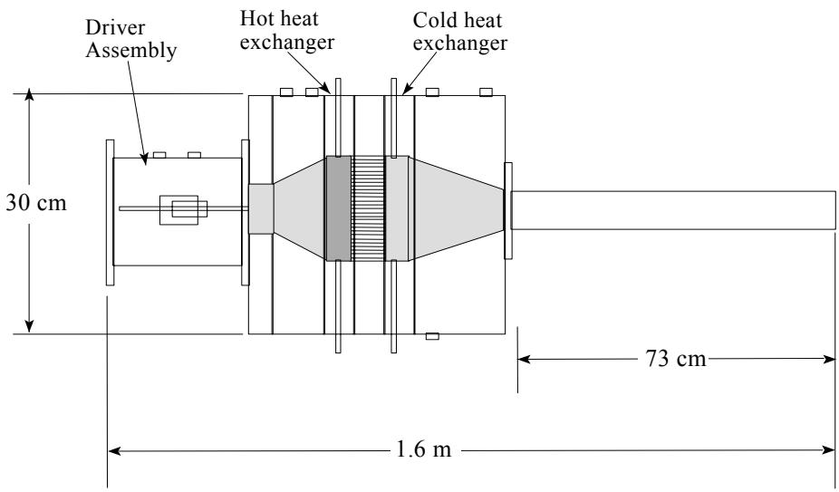  
Figure 1: Schematic of the Thermoacoustic Prototype.

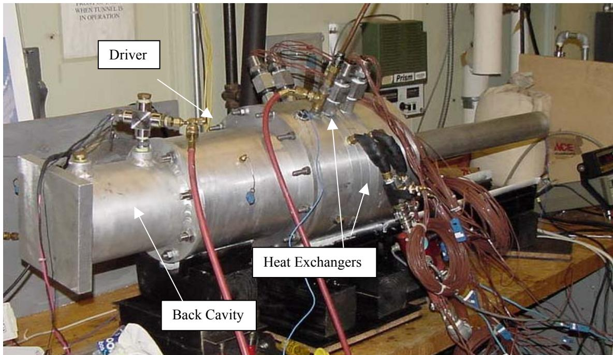  
Figure 2: Picture of the Thermoacoustic Cooler.

The vessel was entirely constructed from aluminum. Several access ports were made for pressure transducers, wire feed-throughs, and charging of the working fluid. The system was made of modular sections connected using long bolts. The main sections included, from left to right in Figure 1 and Figure 2, are the back cavity section, the driver section, the area contraction section, the hot heat exchanger section, the stack section, the cold heat exchanger section, the area contraction section, and finally the resonator section. Key dimensions of the inside crosssection of the vessel are listed in Table 1. O-ring seals prevented leakage between each section. All sections with the exception of the driver/back cavity and the resonator were sandwiched together and maintained using the aforementioned bolts.

Table 1: Key Dimensions of Prototype, in cm (in).
<table><tr><td rowspan=1 colspan=1>Section</td><td rowspan=1 colspan=1>Upstream Diameter</td><td rowspan=1 colspan=1>Downstream Diameter</td><td rowspan=1 colspan=1>Length</td></tr><tr><td rowspan=1 colspan=1>Back Cavity</td><td rowspan=1 colspan=1>16.84(6.630)</td><td rowspan=1 colspan=1>16.84(6.630)</td><td rowspan=1 colspan=1>20.32(8.000)</td></tr><tr><td rowspan=1 colspan=1>Driver Housing</td><td rowspan=1 colspan=1>8.89(3.500)</td><td rowspan=1 colspan=1>11.43(4.500)</td><td rowspan=1 colspan=1>18.42(7.250)</td></tr><tr><td rowspan=1 colspan=1>Conical Enlargement</td><td rowspan=1 colspan=1>9.30(3.660)</td><td rowspan=1 colspan=1>15.24(6.000)</td><td rowspan=1 colspan=1>8.46(3.330)</td></tr><tr><td rowspan=1 colspan=1>Hot Heat Exchanger</td><td rowspan=1 colspan=1>15.24(6.000)</td><td rowspan=1 colspan=1>16.07(6.326)</td><td rowspan=1 colspan=1>2.54(1.000)</td></tr><tr><td rowspan=1 colspan=1>Stack</td><td rowspan=1 colspan=1>16.07(6.326)</td><td rowspan=1 colspan=1>16.07(6.326)</td><td rowspan=1 colspan=1>2.54(1.000)</td></tr><tr><td rowspan=1 colspan=1>Cold Heat Exchanger</td><td rowspan=1 colspan=1>16.07(6.326)</td><td rowspan=1 colspan=1>15.24(6.000)</td><td rowspan=1 colspan=1>2.54(1.000)</td></tr><tr><td rowspan=1 colspan=1>Conical Reduction</td><td rowspan=1 colspan=1>15.24(6.000)</td><td rowspan=1 colspan=1>6.73(2.650)</td><td rowspan=1 colspan=1>13.56(5.340)</td></tr><tr><td rowspan=1 colspan=1>Resonator Tube</td><td rowspan=1 colspan=1>6.73(2.650)</td><td rowspan=1 colspan=1>6.73(2.650)</td><td rowspan=1 colspan=1>74.27(29.240)</td></tr></table>

The system was driven by a moving-magnet CFIC Model B-300 electro-mechanical transducer. The driver was designed to deliver 300 W acoustic power at 33 Hz, with a rated electro-acoustic transduction efficiency of 70% and a maximum displacement of 6 mm. The power to driver was provided by an amplifier. A single-frequency sinusoidal signal was fed to a power amplifier (TECHRON Model 5530) using a signal generator. Since the power amplifier itself could not supply the required current (up to 20 A-rms), a transformer was installed between the amplifier and the coil. Two TALEMA UR0500 500-VA transformers connected in parallel were used, each with a 1:5 winding ratio. The resulting maximum loading condition was 21 Arms at 24 V-rms. A capacitor was connected in series with the coil to improve the power factor of the device. The frequency of the input signal was varied in order to determine the sensitivity of the system and of the driver performance, and to find the frequencies of maximum driver efficiency and of maximum COP.

The stack was constructed from 76 μm (0.003 in) thick polyester film and 254 μm (0.010 in) thick nylon wire. The wire was adhered to the film crosswise and the 2.54 cm (1 in) wide film was then rolled up, resulting in thousands of small parallel channels in which the gas oscillates The cross sectional area of the stack section was $0 . 0 2 \mathrm { m } ^ { 2 }$ (0.22 ft2).

Two different heat exchangers were investigated. A conventional fin-tube heat exchanger was used for preliminary studies and to develop accurate measurement procedures. A microchannel heat exchanger, designed and built specifically for this project, was also evaluated. Here a microchannel heat exchanger is defined as a heat exchanger with small primary fluid pore spacing and thin (normal to the flow direction) secondary fluid tubing. Water flows through the heat exchangers and through secondary loops. The temperatures and flow rates of the water entering each heat exchanger were controllable using a water heater and chiller setup.

Temperature, differential temperature, flow, pressure, and acceleration measurements were used in the prototype to evaluate acoustic power and heat exchange rates. Within the gas, near the location of the heat exchangers, type T thermocouple junctions were positioned to capture gas temperatures near the ends of the stack and outside the exchangers. Within the secondary flow loop, type T thermocouple probes were employed as a reference for the ten-junction differential type T thermopiles that measure the difference in voltage generated by the temperature change of the water between inlet and outlet of each exchanger. A dynamic quartz ICP (integrated circuit piezoelectric) pressure sensor resided in a port near the piston, and a quartz ICP accelerometer was mounted to the carriage of the linear motor. The cross-spectrum of the resulting pressure and integrated accelerometer signal (velocity) was used to determine the input acoustic power. The

coil voltage was measured with a voltage divider, and the coil current was measured using a HP 1146A current probe. For the heat exchanger systems, secondary flow loops were used, with precision axial paddle wheel turbine type flow meters in conjunction with the differential thermopiles, to evaluate the heat delivery to the gas in the cold exchanger and the heat rejection from the gas in the hot exchanger.

The uncertainties of the various quantities calculated from measured data were estimated from known transducer accuracies. For the secondary system, the uncertainty in the water flow rate was 1%, and the maximum error in the differential temperature was 0.039°C (0.07°F). The calculated heat transfer uncertainties were thus about 15%. The uncertainties in the acoustic power delivered and other variables in the primary system were deemed less than 10%.

The heat exchangers were imperfectly insulated against what are commonly referred to as “nuisance" loads. These included: 1) source and sink coupling through gas and solid between exchangers; 2) heat transfer with or along walls; 3) heat transfer to and from the exchanger supply and the exit tubing outside the heat pumping envelope but inside the differential temperature sensor locations; 4) heat transfer from the linear motor. The uncertainties related to the presence of these un-quantified nuisance loads were much greater than those associated with sensor accuracy or processing errors. The power delivered by the piston typically did not balance the net heat transfer in the exchangers. These problems were magnified due to the relatively poor performance of the prototype. The main cause of imbalance was eventually identified to be driver heating. The problem was solved by operating for very short time periods, and allowing the driver to cool for several minutes between tests. The driver temperature was indirectly monitored using a thermocouple measuring metal temperature within the vessel, in close proximity to the driver. Improvements in performance through tuning and component

developments such as driver cooling loops should reduce the adverse impact of these nuisance loads. All data for which the energy imbalance exceeded 25% were ignored in the final analysis.

## 3. Component Characterizations

## 3.1 Driver

The driver depicted in Figure 3 (Yarr and Corey, 1995) was designed to deliver 300 W acoustic power at 33 Hz, with a rated electro-acoustic transduction efficiency of 70% and a maximum displacement of 6 mm. The alternator was comprised of radially extending neodymium magnet arms mounted to a central plunger (the moving element) and copper wound laminated iron pole pieces (the stationary element), which extend inward from the outer periphery. The outward-directed magnet fingers (each comprised of two magnets in contact) were thus separated by gaps, which were filled by the inward-directed laminated iron fingers. The magnetic flux pathlines in such devices go circumferentially through a magnet finger and a pole piece, radially up through the coil to the outer periphery, circumferentially to the other pole piece adjacent to the magnet finger, radially down through the coil and back to the magnet finger. Each pole piece then supports two flux paths, one for each adjacent magnet finger. The alternating current causes a fluctuating force that moves the magnet-mounted plunger axially back and forth.

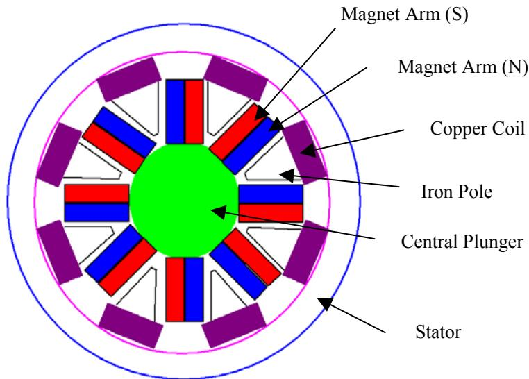  
Figure 3: Schematic of B-300 driver

The plunger-mounted piston was mounted within a bore, with tight clearance seals extending over a length many times the piston displacement. This minimized “blow down," or gas leakage between the rear and front cavities. The plunger was balanced and self-centering, and supported by a single flexure. Leaf springs were added to increase the resonance frequency of the driver invacuo to 154 Hz. The driver was fully enclosed, and the static pressure equalized across the piston. The objective was to tune the mechanical resonance of the driver such that the combined resonance of the acoustic and mechanical systems occurred at the desired operating frequency. Figure 4 shows a picture of the driver, leaf springs, and enclosure.

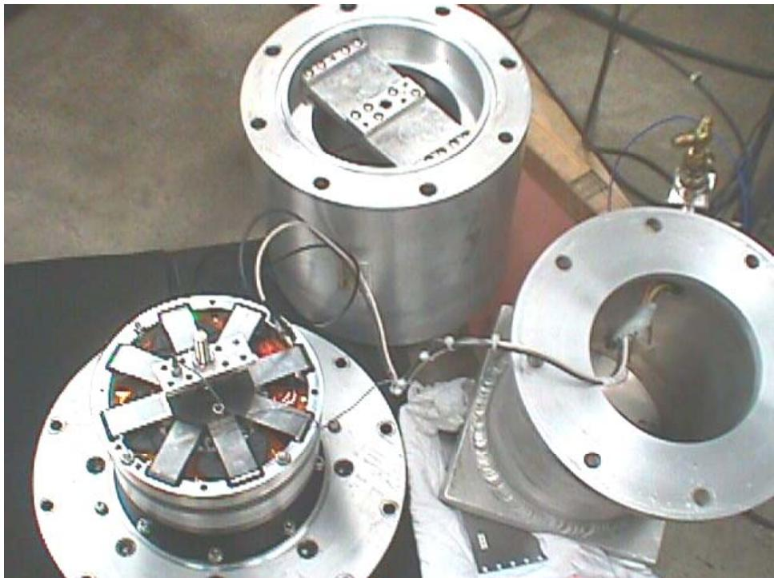  
Figure 4: Picture of the Moving-Magnet Driver, Leaf Springs, and Enclosure.

In order to tune the mechanical resonance of the driver, the stiffness of the springs was changed and additional mass was added. To determine the appropriate values, a model of the driver-suspension system was used. Figure 5 shows a circuit representation of the coupled impedance and mobility analogs for the electro-mechano-acoustic system. The parameters used in modeling the system are $R _ { e } ,$ the electrical resistance; $L _ { e } ,$ the inductance of the coil; $M _ { m } ,$ the moving mass (mechanical); $C _ { m } ,$ the mechanical compliance; $R _ { m }$ the mechanical resistance (friction, viscous damping); $R _ { a } ,$ the acoustic resistance; $M _ { a } ,$ the effective acoustic mass; and $C _ { a } .$ the effective acoustic compliance (Wakeland, 2000).

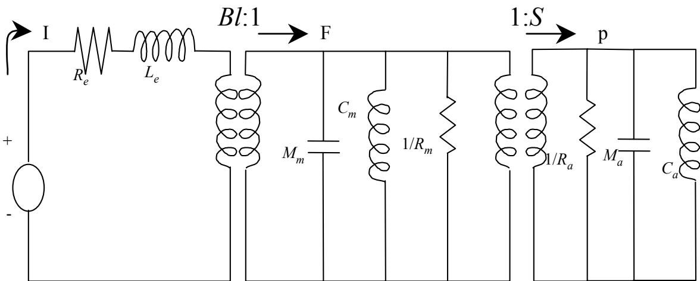  
Figure 5: Circuit Representation of the Coupled Electro-Mechano-Acoustic Systems

The mechanical and electrical circuits can be transformed into the electrical domain and represented as shown in Figure $^ { 6 , }$ where $Z _ { e , M }$ is the equivalent electrical impedance of the mechanical components and $Z _ { e , a }$ is the equivalent electrical impedance due to the acoustic loading.

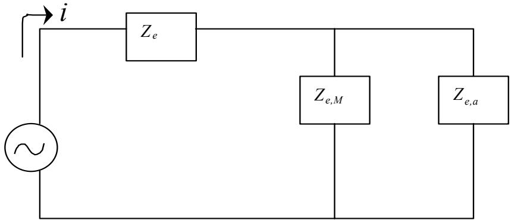  
Figure 6: Electrical Circuit with Transformed Mechanical and Acoustical Elements.

The mechanical and acoustic impedances are given by

$$
Z _ { e , M } = \frac { B l ^ { 2 } } { R _ { m } + j \big ( \omega M _ { m } - 1 / \omega C _ { m } \big ) }
$$

$$
Z _ { e , a } = \frac { B l ^ { 2 } } { S } \frac { u } { P }
$$

where $B l$ is the force constant (transduction coefficient), ω is frequency, S is piston area, $P$ is pressure at the piston face and u is the piston velocity u. The mechanical compliance is related to the suspension stiffness according to:

$$
K = \big \succ _ { C _ { m } }
$$

With this basic system model and careful measurements, linear parameters can be identified at least over limited operating ranges. The linear parameters of the driver were measured following a number of procedures such as transfer function measurements, added mass tests, for both transient and steady state input signals (see for example Beranek, 1996) and are given in Table 2.

Table 2: Measured Equivalent Parameters of the Linear Actuator.
<table><tr><td rowspan=1 colspan=1>Parameter</td><td rowspan=1 colspan=1>Notation</td><td rowspan=1 colspan=1>Value</td><td rowspan=1 colspan=1>Unit</td></tr><tr><td rowspan=1 colspan=1>Force constant</td><td rowspan=1 colspan=1>Bl</td><td rowspan=1 colspan=1>9</td><td rowspan=1 colspan=1>N/A</td></tr><tr><td rowspan=1 colspan=1>Stiffness</td><td rowspan=1 colspan=1>K</td><td rowspan=1 colspan=1>74</td><td rowspan=1 colspan=1>kN/m</td></tr><tr><td rowspan=1 colspan=1>Mech. Resistance</td><td rowspan=1 colspan=1> $R _ { m }$ </td><td rowspan=1 colspan=1>25</td><td rowspan=1 colspan=1>N·s/m</td></tr><tr><td rowspan=1 colspan=1>Mass</td><td rowspan=1 colspan=1> $M _ { m }$ </td><td rowspan=1 colspan=1>1.63</td><td rowspan=1 colspan=1>kg</td></tr><tr><td rowspan=1 colspan=1>Piston Area</td><td rowspan=1 colspan=1> $S$ </td><td rowspan=1 colspan=1>0.0068</td><td rowspan=1 colspan=1> $\overline { { { \bf m } ^ { 2 } } }$ </td></tr><tr><td rowspan=1 colspan=1>Coil resistance (DC)</td><td rowspan=1 colspan=1> $R _ { e }$ </td><td rowspan=1 colspan=1>0.11</td><td rowspan=1 colspan=1>Ω</td></tr><tr><td rowspan=1 colspan=1>Coil inductance</td><td rowspan=1 colspan=1> $L _ { e }$ </td><td rowspan=1 colspan=1>0.9</td><td rowspan=1 colspan=1>mH</td></tr></table>

The values listed in Table 2 are only approximations valid over a narrow range of piston displacements. The coil resistance was found to increase with frequency, due presumably to eddy current effects in the relatively large diameter coil wire. In addition, the effective damping, or mechanical resistance, increased with decreasing piston displacement amplitude. The higher operating frequency, the smaller displacement, and the friction added by the suspension system increased the losses within the driver. The mechanical resonance frequency of the driver was also found to vary with piston displacement. Such nonlinear behavior not only degrades performance, but also makes precise tuning difficult. However, the model was used to help select the springs and added mass for the driver system that would maximize driver efficiency.

The predicted and measured electro-acoustic efficiency responses of the thermoacoustic system operating with a 55% helium-45% argon mixture at 2 MPa are shown in Figure 7. The measured input acoustic impedance and driver parameters were used for the predictions. The maximum efficiency is found within a narrow frequency range near the overall system resonance frequency, at which the electrical input reactance is zero. This resonance varies for different static pressures and different cooling loads. For example, the resonance frequency increases from about 173 Hz to 178 Hz for an increase in mean pressure from 0.5 to 2 MPa.

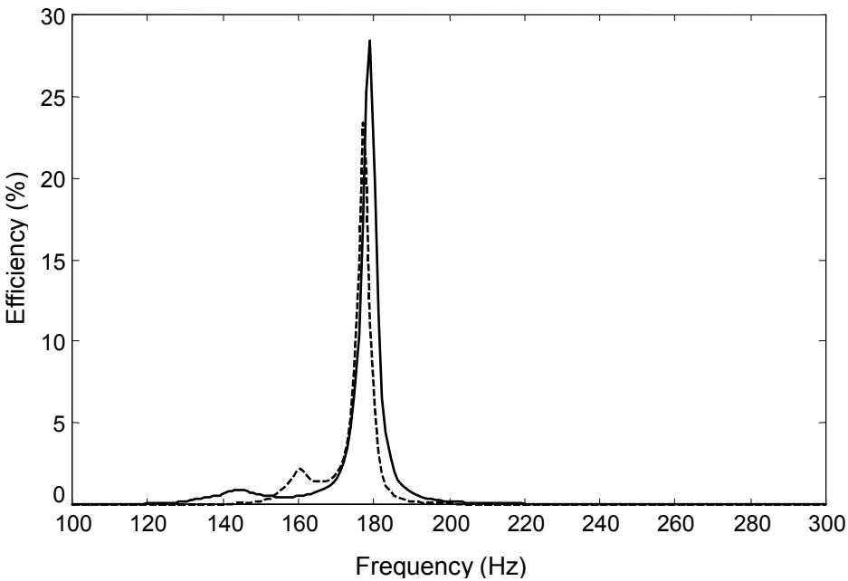  
Figure 7: Electro-Dynamic Efficiency vs. Frequency. — Measured; ---·Predicted.

The discrepancies are due to amplitude and frequency dependence of the linear driver parameters, as well as measurement errors in the load impedance. The accuracy of the driver parameters was deemed satisfactory. They are accurate enough to design the flexure and tune the system. The errors did not impact the system performance measurements, which were done directly and did not rely on driver models.

The parameters of Table 2 can be used to estimate the maximum possible efficiency for this driver. The driver efficiency is defined as the ratio of the time average value of the acoustic power output from the driver to the time average value of the electric power input to the driver. The driver efficiency using the simplified impedance circuit (Wakeland 1999) can be estimated as

$$
\frac { 1 } { \eta } = \frac { R _ { e } R _ { m } } { \left( B l \right) ^ { 2 } } \frac { R _ { m } } { R _ { a } } \left( 1 + \frac { R _ { a } } { R _ { m } } \right) ^ { 2 } + \left( 1 + \frac { R _ { m } } { R _ { a } } \right) + \frac { R _ { e } R _ { m } } { \left( B l \right) ^ { 2 } } \frac { X ^ { 2 } } { R _ { m } R _ { a } }
$$

where η is the driver efficiency, Bl is the force factor, $R _ { m }$ is the mechanical resistance, $R _ { e }$ is the electrical resistance of the coil, $R _ { a }$ is the real part of the acoustic impedance at the driver piston and X is the combined mechanical and electrical reactance (imaginary part of the combined impedance). X is also given by

$$
X = X _ { m } + X _ { a }
$$

where $X _ { m }$ is the mechanical reactance and $X _ { a }$ is the imaginary part of the acoustic impedance at the driver. The maximum driver efficiency is obtained when $1 / \eta$ is small, that is when the combined mechanical and acoustic reactance term, X is zero. The zero value of the acoustic reactance can be obtained by operating the driver at its resonance frequency. The mechanical impedance of the driver is again given by

$$
Z _ { e , M } = \frac { B l ^ { 2 } } { R _ { m } + j \big ( \omega M _ { m } - 1 / \omega C _ { m } \big ) }
$$

If the mechanical compliance of the driver is chosen to satisfy the following relation, the mechanical reactance is removed and the maximum driver efficiency can be obtained.

$$
\frac { 1 } { C _ { m } } = \omega ^ { 2 } M _ { m }
$$

Based upon the driver parameters of Table 2, the maximum expected driver efficiency was estimated to be 67%.

## 3.2 Heat Exchangers

The heat exchanger model used in Deltae (Ward and Swift, 1993) assumes conduction across a laminar boundary layer in order to predict heat transfer between the heat exchanger surfaces and the thermoacoustic fluid. This is a conservative approximation that has never been validated experimentally for realistic heat exchanger geometries. One of the goals of the current study was to develop a better model for heat transfer between the surface and thermoacoustic fluid. One approach that has been proposed is to use steady-flow correlations with the Reynolds number evaluated at the root-mean-square (rms) velocity, which is termed the acoustic Reynolds number. This approach was evaluated in this study and compared with the boundary-layer approximation (Mozurkewich, 1995, 1998a, 1998b; Brewster et al., 1997).

Another goal of this study was to compare the performance of two different heat exchangers: a conventional fin-tube heat exchanger and a microchannel heat exchanger. In the context of this study, a microchannel heat exchanger is defined as a heat exchanger with small primary fluid pore spacing and thin (normal to the flow direction) secondary fluid tubing.

The straight plate fin-tube heat exchangers were built by a commercial manufacturer and are depicted in Figure 8 and Figure 9 along with relevant dimensions. Due to manufacturing constraints, it was necessary to make several compromises in the design. In particular, the stream wise depth was several times larger than the acoustic particle displacement associated with the thermoacoustic prototype. It has been reported that depths on the order of the particle displacement length are preferable (Swift, 1999). Furthermore, the width and spacing of the fins were not optimal according to guidelines established in previous design optimization studies (Minner, 1996).

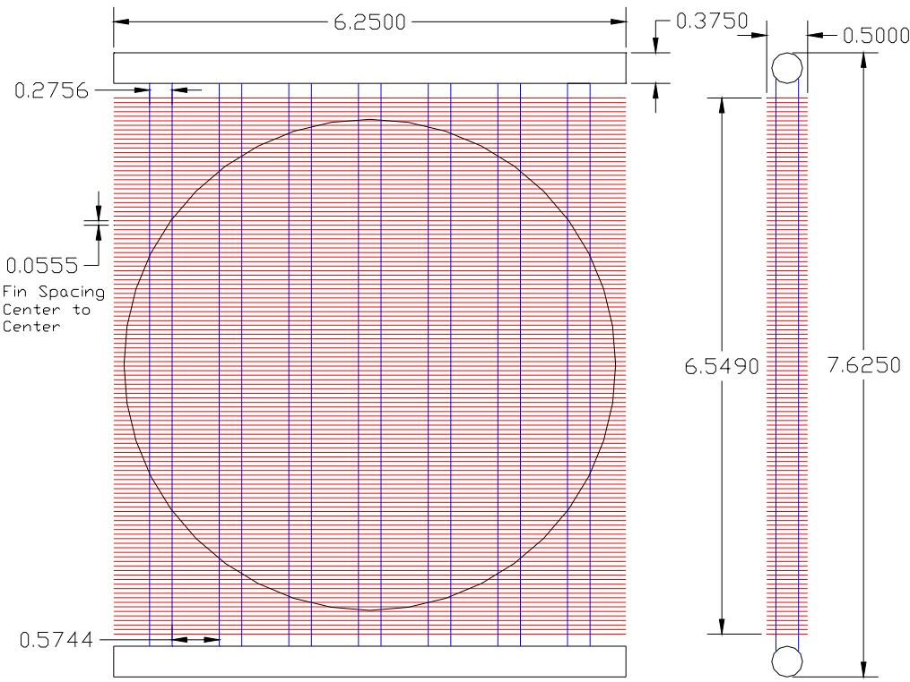

Figure 8: Drawing of Fin-tube Heat Exchanger (dimensions in inches)  
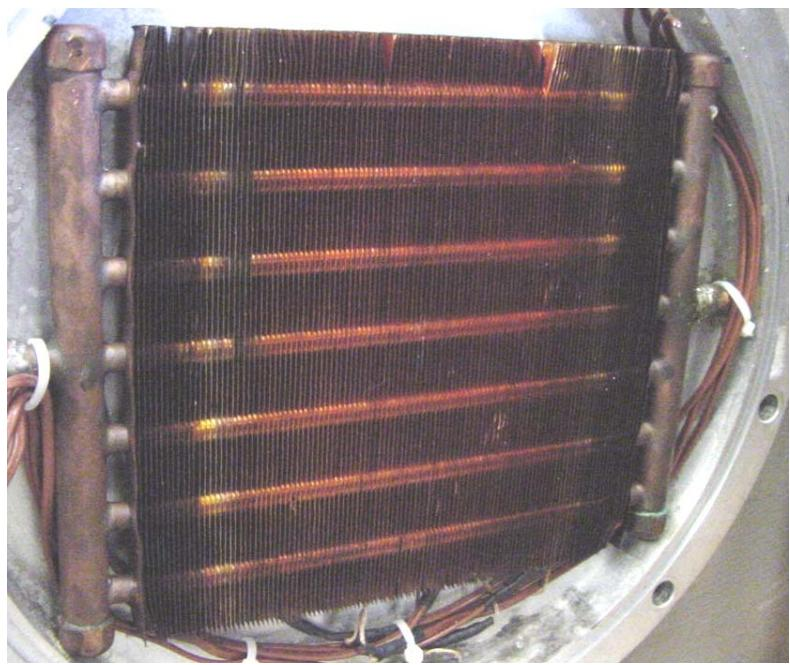  
Figure 9: Picture of Installed Fin-Tube Heat Exchanger

Figure 10 and Figure 11 depict the microchannel heat exchanger. Several advantageous features distinguish this design from that of the conventional fin-tube design shown in Figure 8.

Firstly, the use of small rectangular flow channels for the secondary fluid presents a smaller obstruction to the flow of the primary thermoacoustic working fluid for a given tube surface area. Secondly, the use of the microchannel and two-pass secondary flow geometry leads to higher secondary fluid heat transfer coefficients. Thirdly, the microchannel design incorporates outer fins having a smaller depth, tighter spacing, and larger overall surface area.

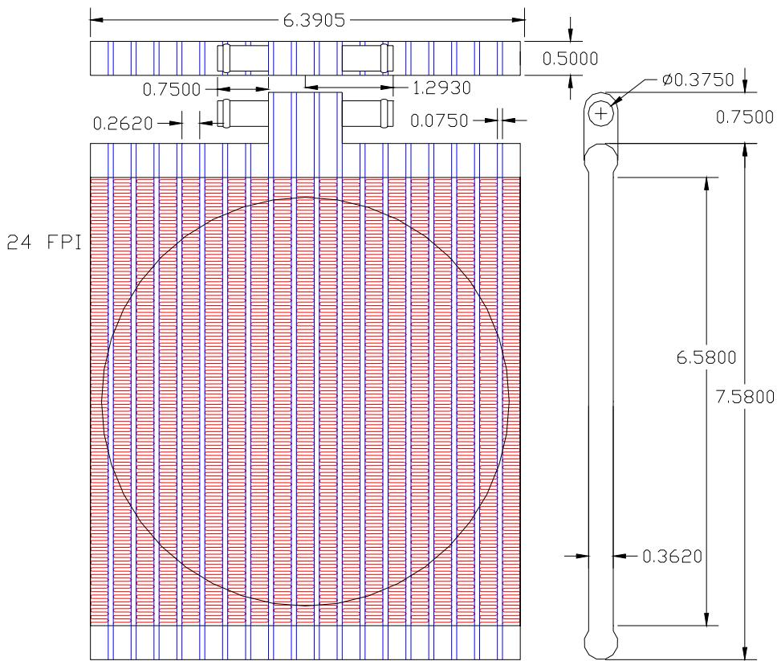  
Figure 10: Drawing of Microchannel Heat Exchanger (dimensions in inches)

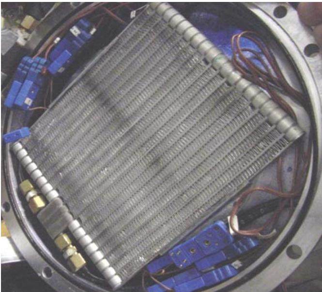  
Figure 11: Picture of Installed Microchannel Heat Exchanger

## 3.2.1 Experimental Testing

Both steady-flow and oscillating flow heat exchanger testing was performed. There were several reasons for performing steady flow tests, including: 1) establishing procedures for estimating heat transfer coefficients from measurements and for correlating heat transfer coefficients with dimensionless parameters, 2) providing baseline data for comparing the performance of the different heat exchangers under identical flow conditions, and 3) determining steady-flow heat transfer coefficient correlations that could be adapted for use in estimating heat transfer coefficients for oscillating flow environments.

A small-scale wind tunnel was designed and built to perform measurements necessary for estimating gas-side heat transfer coefficients for steady flow. The heat exchangers were operated at steady state in a steady flow with water flowing through the tubes. The wind tunnel, shown in Figure 12 and Figure 13, consisted of a centrifugal fan powered by a Baldor Electric Motor (Model M3115) and a 15 cm (6 in) diameter PVC pipe. A flow straightener was used to minimize inflow swirl and transverse flow motion. An inlet bell mouth and a plenum settling

chamber downstream of the heat exchangers were utilized to improve the flow velocity profile uniformity across the duct. The heat exchanger was mounted between two sections of PVC pipe. A pitot tube, in conjunction with a probe traversing mechanism and a Dwyer inclined manometer (Model number 115-AV), was used to measure the airflow velocity distribution across the pipe at one stream wise location. The velocity distribution was used to determine the air mass flow rate. Hot water flow rates through the heat exchanger were measured using an axial paddle wheel turbine type flow meter (JLC International IR-Opflow Type 4) at the water outlet.

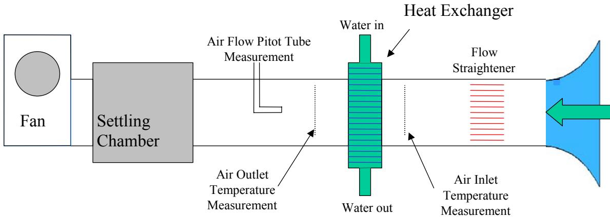

Figure 12: Schematic of the Wind Tunnel used for the Steady Flow Measurements.  
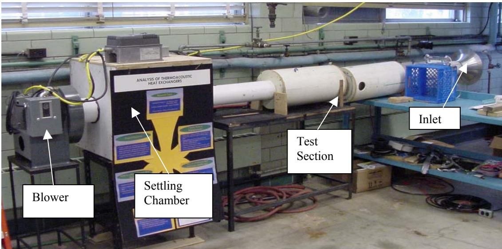  
Figure 13: Picture of the Wind Tunnel used for the Steady Flow Measurements.

A differential temperature transducer (Delta-T Company, Model number 75X) was used to measure the water temperature difference. At the inlet and the outlet of the wind tunnel, arrays of type T thermocouples (N=9) were installed, at the locations shown in Figure 12 to measure air temperatures. The rate of heat transfer was calculated from the measured flow rates and temperatures for both the gas-side and the water-side of the exchanger.

The steady flow tests were designed to conform to the ARI Standard 410 for Forced Circulation Air-Cooling and Air-Heating Coils. This standard establishes the proper flow conditions of the primary and secondary loops, and outlines procedures for varying the flow conditions.

The data were gathered using a Hewlett Packard 75000 Series B data acquisition system with inputs from the two thermocouple arrays, the differential temperature transducer, the water flow meter, and eight thermocouples distributed over the heat exchanger. Hewlett Packard's visual design environment HPVEE was used to control the data acquisition. Each data point was marked with a time reference and was stored in a text file associated with a particular data set. The data were then post-processed using an Excel spreadsheet.

Unsteady heat exchanger performance measurements were made within the prototype thermoacoustic cooler. The device was operated with two heat exchangers and a stack producing a temperature difference between the circulating water stream and the thermoacoustic working fluid at each heat exchanger. The heat transfer rate was estimated from an energy balance on the water stream using measurements obtained with the same instrumentation described in the previous section. The temperatures at the end of the stack adjacent to each heat exchanger were measured with thermocouples located near the centerline.

Data acquisition procedures in the thermoacoustic environment were similar to those followed in the steady flow environment. The heat transfer rate was calculated from an energy balance and water side temperature data. It was necessary to use measured dynamic pressure and piston velocity data to determine the particle velocity in the heat exchangers as discussed later.

## 3.2.2 Estimation of Heat Transfer Coefficients

For heat transfer in steady flow, a local heat transfer coefficient is defined as the ratio of the heat transfer per unit area to the temperature difference between the surface and “bulk" fluid adjacent to the surface. However, in practice, a global heat transfer coefficient is utilized that is derived from a lumped analysis of the heat exchanger (UA-LMTD or effectiveness-NTU methods). Generally, a global heat transfer coefficient is estimated from an overall heat exchanger conductance (UA) determined from measurements, using existing correlations for secondary fluid heat transfer coefficient and overall fin efficiency. The UA of the heat exchanger is estimated from the measurements as the ratio of heat transfer rate to a log-mean temperature difference between the primary and secondary fluids. The overall heat transfer rate is estimated from primary or secondary fluid temperature differences and flow rate measurements. The heat transfer coefficient data are often non-dimensionalized using the j-Colburn factor. This nondimensional presentation allows extrapolation to different gases and operating conditions. The j-Colburn factor data are usually correlated in terms of the Reynolds number.

For the purpose of modeling heat exchangers within a thermoacoustic device, it is more convenient to define a local heat transfer coefficient as the ratio of the heat transfer per unit surface area to the temperature difference between the heat exchanger surface and the timeaverage thermoacoustic fluid temperature at the end of the stack adjacent to the heat exchanger. Previous researchers have estimated heat transfer coefficients for thermoacoustic heat exchangers by assuming conduction across a laminar boundary layer (Minner, 1996). However, results from these calculations have never been compared with measured values.

In the current study, global thermoacoustic fluid heat transfer coefficients were estimated from overall heat exchanger conductances (UA) determined from measurements, using existing correlations for secondary fluid heat transfer coefficient and overall fin efficiency. This global heat transfer coefficient is consistent with a lumped analysis of the heat exchanger that includes the effects of temperature variations within the fins and secondary fluid. The UA of the heat exchanger was estimated from the measurements as the ratio of heat transfer rate to a log-mean temperature difference between the secondary fluid and the time-averaged thermoacoustic fluid temperature near the stack. The overall heat transfer rate was estimated from secondary fluid temperature and flow rate measurements. The heat transfer coefficient data were nondimensionalized using the j-Colburn factor. In this case, the j-Colburn factor data were correlated in terms of an acoustic Reynolds, defined using a root-mean-square (rms) velocity within the heat exchanger. The rms velocities at the heat exchangers were estimated from linearacoustic theory using dynamic pressure and velocity measurements at the driver face of the thermoacoustic device.

In order to non-dimensionalize the data for various gases and to facilitate comparison with theoretical calculations, the experimental outer heat transfer coefficients are converted into the j-Colburn factor defined as:

$$
j = S t \operatorname* { P r } ^ { 2 / 3 } = \frac { N u } { \operatorname { R e } \operatorname { P r } ^ { 1 / 3 } }
$$

where St, Pr, Nu, and Re are the Stanton, Prantl, Nusselt, and Reynolds numbers, respectively.

The boundary-layer approximation used in Deltae (Ward and Swift, 1993) is based upon the general definition for local heat transfer coefficient for a surface in contact with a fluid in internal flow, given as

$$
h = \frac { - k \hat { \sigma } T / \hat { \sigma } y \big | _ { y = 0 } } { T _ { s } - T _ { m } }
$$

where k is the thermal conductivity of the fluid, $T _ { s }$ is the surface temperature and $T _ { m }$ is the mean temperature of the fluid over the surface of the heat exchanger. The boundary-layer approximation involves approximating ${ \hat { \sigma } } \mathrm { T } { \Big / } { \hat { \sigma } } \mathrm { y } { \Big | } _ { \mathrm { y = 0 } }$ as the temperature difference between the surface and the time-averaged stack end fluid temperature divided by the thermal boundary layer thickness, $\varDelta { y } _ { k }$ (Minner, 1996). The boundary layer thickness is assumed to be the minimum of the half plate spacing of the heat exchanger $( y _ { 0 } )$ and the thermal penetration depth (δ) where

$$
\delta _ { t } = { \sqrt { \frac { 2 \alpha } { \omega } } }
$$

and

$$
\alpha = \frac { k } { \rho c _ { p } }
$$

With these approximations, the local heat transfer coefficient reduces to

$$
h = \frac { k } { \operatorname* { m i n } \left( y _ { o } , \delta _ { t } \right) }
$$

For an ideal thermoacoustic heat exchanger, only the surface area within one particle displacement of the stack can participate in the heat transfer. Therefore, a global heat transfer coefficient that accounts for the “dead’ surface area of the heat exchanger is estimated as

$$
h = \frac { k } { \operatorname* { m i n } \left( \boldsymbol { y } _ { o } , \boldsymbol { \delta } _ { t } \right) } \cdot \frac { \boldsymbol { x } _ { p } } { \boldsymbol { x } _ { h x } }
$$

where $x _ { p }$ is the distance associated with a particle displacement at the heat exchanger and $x _ { h x }$ is the width of the heat exchanger in the direction of thermoacoustic flow (Minner, 1996).

## 3.2.3 Steady-Flow Results

Figure 14 is a graph of the j-Colburn factor versus the Reynolds number derived from the steady-flow data obtained for both heat exchangers. In each case, the heat transfer coefficients were calculated using heat transfer results determined from gas-side and water-side measurements. For each gas flow rate, several different water flow rates were used in order to verify consistency. The differences between the gas-side and water-side results are an indication of experimental errors. Generally, the gas-side and water-side results were within about 20%. The gas-side heat transfer coefficients for the micro-channel heat exchanger are significantly higher than for the fin-tube heat exchanger. The large differences are probably due to the fact that the fin-tube heat exchanger uses smooth fins whereas the micro-channel heat exchanger fins are enhanced.

Figure 14 also gives correlations for j-Colburn factor as a function of Reynolds number. For the fin-tube heat exchanger, a correlation from the literature (Gray and Webb, 1986) was used for comparison. This correlation is appropriate for heat exchangers employing smooth plain fins and the test results compare very well with the correlation. No analogous correlation could be found for the micro-channel heat exchanger. In this case, the water-side data were used to determine a correlation for steady flow.

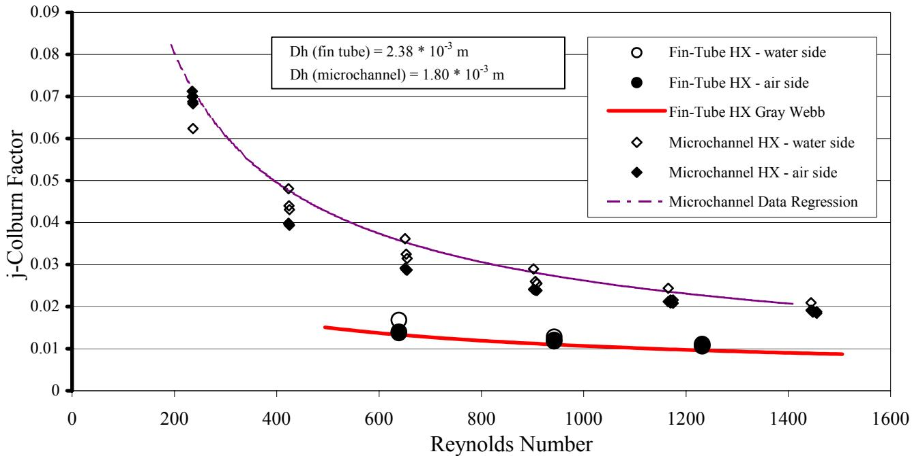  
Figure 14. Steady Flow j-Colburn vs. Reynolds Number

## 3.2.4 Oscillating Flow Data

Oscillating flow results for the two heat exchangers are shown in Figure 15, where the j-Colburn factor is plotted versus acoustic Reynolds number. For the fin-tube heat exchanger, heat gains originating from the driver biased much of the early data and only a very small subset of the original data was useable (i.e., had energy imbalance errors of less than 25%). Nevertheless, the data clearly show that the micro-channel heat exchanger has much higher thermoacoustic

fluid heat transfer coefficients than the fin-tube heat exchanger. It also appears that the steadyflow correlations for j-Colburn factor provide reasonable estimates for oscillating flow when the acoustic Reynolds number is employed. However, there is significant scatter in the data and there is a bias between results for the hot and cold heat exchangers indicating that the uncertainties are quite large.

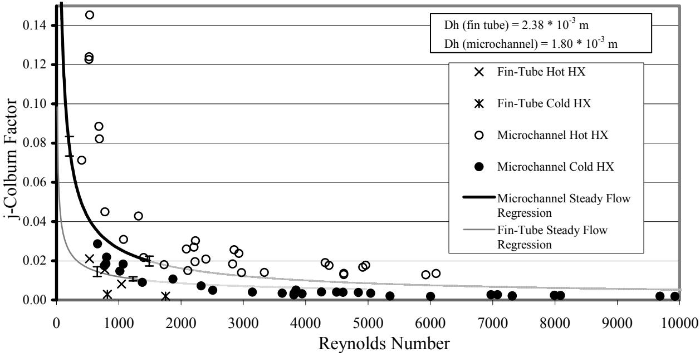  
Figure 15: j-Colburn vs. Acoustic Reynolds Number for Periodic Flow (dotted line denotes extrapolation of experimental data).

Figure 16 gives comparisons of the results for the micro-channel heat exchanger with the boundary layer approximation. It is obvious that the measured heat exchanger performance at low Reynolds numbers is much greater than that predicted using the boundary layer calculation commonly used in thermoacoustics. As mentioned earlier, these models assume that the heat transfer coefficient is a result of conduction across the thermal boundary layer. It appears that this approach works better at high Reynolds numbers, but significantly underpredicts the j-

Colburn factor at low Reynolds numbers. This could have a significant impact on the prediction and the design optimization of the performance of thermoacoustic systems.

It is believed that the differences between the heat transfer coefficients determined for the hot and cold heat exchangers are due to an inaccurate characterization of the stack-end temperatures. In order to investigate this further, a radial array of thermocouples was installed at the stack ends. This array revealed that there is an obvious dependence of stack temperature upon radial position. It has been postulated that this is due to the influence of the container's aluminum walls and it obviously implies that using one temperature probe to calculate the log-mean temperature difference is misleading since it does not properly take into account the temperature distribution. Using data from the thermocouple array, a spatially averaged temperature distribution was calculated and used to calculate a new j-Colburn factor. The results appear in Figure 17 for a limited number of data points. It can be seen that this new approach yields closer agreement between the hot and cold heat exchanger heat transfer coefficient relationships. However, in this case, the steady-flow correlation tends to over predict the heat transfer coefficients. Streaming recirculating flows, discussed later, may have affected the heat exchanger performance as well as the aforementioned nuisance loads. Further work is thus needed to accurately characterize the performance of heat exchangers in an acoustic field.

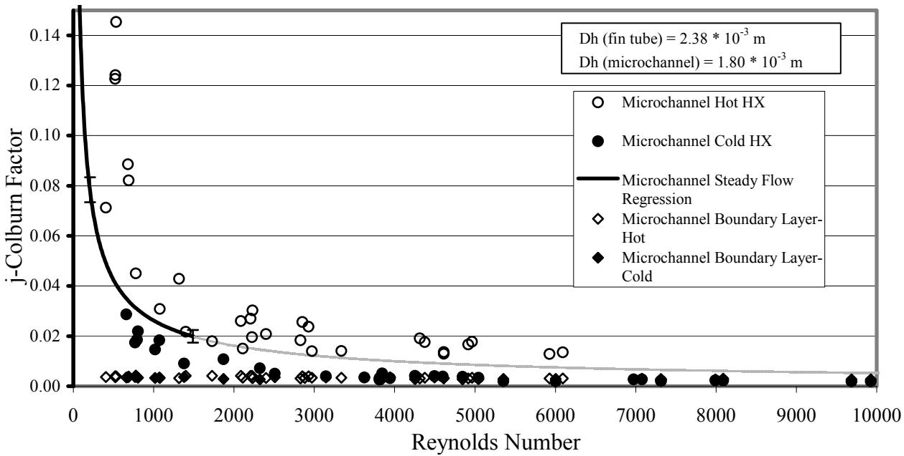

Figure 16: j-Colburn vs. Acoustic Reynolds Number for Periodic Flow; Comparison with Boundary Layer Approximation (dotted line denotes extrapolation of experimental data).  
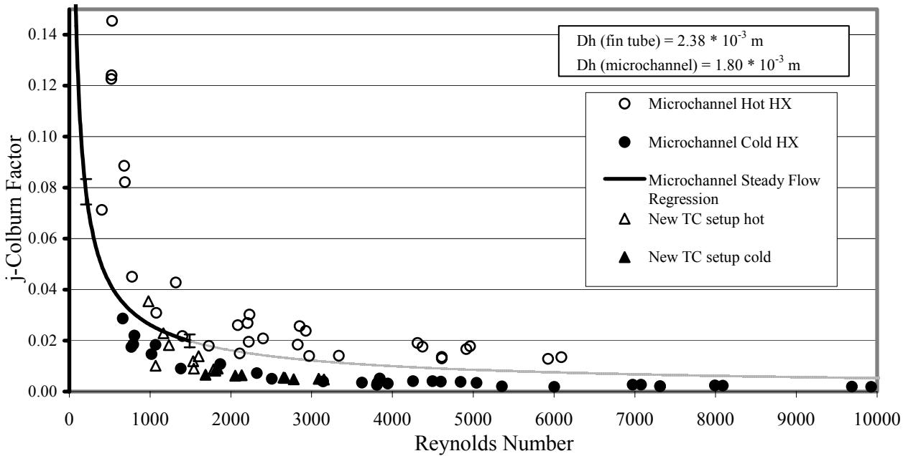  
Figure 17: j-Colburn vs. Acoustic Reynolds Number; Stack End Temperatures Computed from Radial Thermocouple Array Data (dotted line denotes extrapolation of experimental data).

## 4. Prototype Performance Evaluation

One of the primary goals of this study was to measure the performance of a thermoacoustic prototype and compare the measurements with model predictions. There were a number of difficulties in achieving this goal. Firstly, the driver originally used had very poor efficiencies (conversion of electrical to acoustic power) and therefore the power delivered to the thermoacoustic working fluid was quite low. At the beginning of this project, a new driver was installed, tuned, and evaluated. In addition, the original heat exchangers were replaced with improved designs that were expected to provide better heat transfer and reduced frictional losses. Once these changes were in place, testing began in earnest. However, additional problems were encountered. In particular, the system has been very prone to leaking, especially through the fittings used to feed electrical and sensor wiring to the shell. Helium molecules are quite small and the system was designed with many ports and flange seals between sections and operates at relatively high pressures. Eventually these leak problems were solved sufficiently to allow testing. However, the system still performed in an inconsistent manner and results were not always reproducible. The leaf springs became loose and regularly failed. Secondly, it was found that heat loss from the driver would cause a heat gain to the thermoacoustic working fluid across the piston leading to degradation in performance. Test procedures were developed for reducing these effects, and ultimately testing was performed for a range of conditions.

Figure 18 depicts the effect of gas heating caused by the driver. This figure shows the percent imbalance in energy flows as a function of time, where the imbalance is defined as

$$
\% \mathrm { I m b a l a n c e } = \frac { Q _ { a c } + Q _ { c } - Q _ { h } } { Q _ { a c } + Q _ { c } } x 1 0 0
$$

and where $\mathcal { Q } _ { a c }$ is the acoustic power input to the thermoacoustic working fluid, $\mathcal { Q } _ { c }$ is the thermoacoustic cooling rate, and $\mathcal { Q } _ { h }$ is heat rejection rate from the hot heat exchanger. It is clear from Figure 18 that the energy imbalance grows over time as the unit operates. Apparently, gas at the hot end of the stack is warmed due to heat transfer from the driver casing. The casing warms significantly over time when the unit is operated continuously. Much of this heat gain is ultimately rejected through the hot heat exchanger in addition to the heat transfer due to heat pumping up the stack. This effect has a detrimental effect on performance. The results of Figure 18 were obtained with the driver providing a relatively large acoustic power input for a sustained period of the time. In order to reduce the heating effect, the system was only operated for relatively short periods of time at high acoustic power conditions. Adjustments in operating conditions were performed at very low power inputs before the power input was increased and data were taken. The thermoacoustic cooler achieves a quasi steady-state condition in about a minute, whereas driver heating effects require at least 30 minutes of operation at high acoustic powers. Only data with an energy imbalance of less than 25% were utilized.

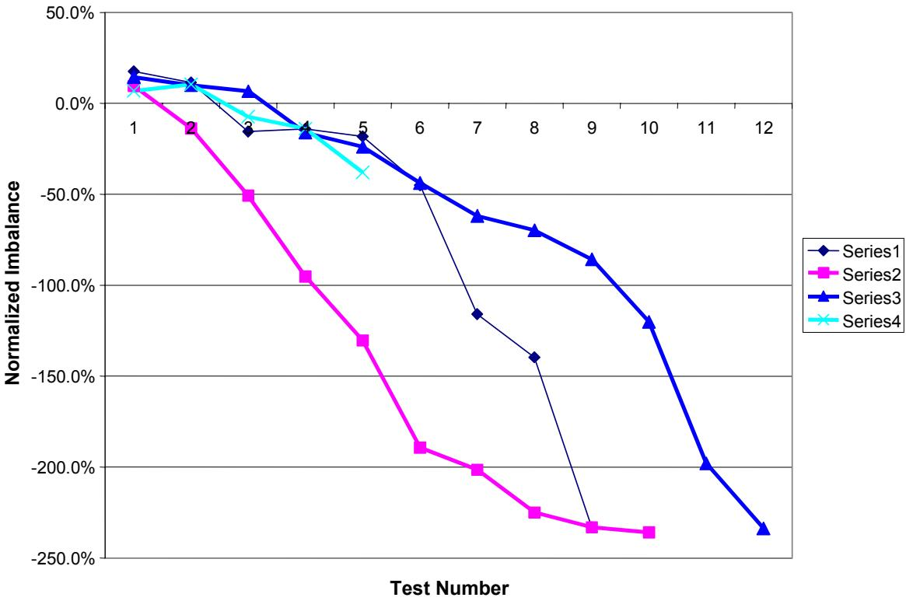  
Figure 18: Energy Imbalance as a Function of Time for Four Tests.

Table 3 lists all of the steady-state data obtained for the prototype. The first four columns give mean pressure, percent helium in the mixture, resonant frequency, and driver efficiency. A range of different mean pressures and helium-argon mixtures were considered. For each case, the resonant frequency was adjusted through trial and error to achieve the maximum driver efficiency.

In an earlier set of tests, different springs and additional masses were added to the driver system to obtain good efficiencies. For the results presented in Table 3, the driver efficiency varied between about 13% and 60%. The driver efficiency depends upon the gas mixture and pressure as well as on the driver amplitude. The low values of driver efficiency are most likely associated with tests where the springs were failing and the stiffness of the driver were decreased dramatically. In all cases, the driver efficiency was lower than the maximum achievable driver efficiency, which was estimated to be around 67% (see section 3.1)

Columns four through seven give acoustic power, heat rejection rate, cooling rate, and energy imbalance for the tests. The acoustic power input was varied between 20 W (68.2 Btu/hr) and 126 W (429.9 Btu/hr), while the corresponding cooling rate changed between 39 W (133.1 Btu/hr) and 135 W (460.6 Btu/hr). The energy imbalance was at worst 23.5% and generally less than 15%.

Columns eight, nine, and ten give the temperature difference between the hot and cold ends of the stack, the COP based upon acoustic power, and the COP relative to Carnot COP. The largest stack temperature difference was $7 . 6 \mathrm { ‰}$ (13.6°F), while the best COP was 2.08. The COPs are quite low for these operating conditions and are only about 2-3% of Carnot.

Table 3: Summary of Experimental Results
<table><tr><td rowspan=1 colspan=1>P(MPa)</td><td rowspan=1 colspan=1>% He</td><td rowspan=1 colspan=1>f(Hz)</td><td rowspan=1 colspan=1>η (%)</td><td rowspan=1 colspan=1> $\underline { { \sf Q _ { a c } ( W ) } }$ </td><td rowspan=1 colspan=1>Qh(W)</td><td rowspan=1 colspan=1>Qc(W)</td><td rowspan=1 colspan=1>Imbalance(%)</td><td rowspan=1 colspan=1>∆T (C)</td><td rowspan=1 colspan=1>COP</td><td rowspan=1 colspan=1>COPr(%)</td></tr><tr><td rowspan=1 colspan=1>2.07</td><td rowspan=1 colspan=1>55.00</td><td rowspan=1 colspan=1>173.25</td><td rowspan=1 colspan=1>49.4</td><td rowspan=1 colspan=1>126.0</td><td rowspan=1 colspan=1>227.0</td><td rowspan=1 colspan=1>106.0</td><td rowspan=1 colspan=1>2.2</td><td rowspan=1 colspan=1>6.8</td><td rowspan=1 colspan=1>0.84</td><td rowspan=1 colspan=1>1.94</td></tr><tr><td rowspan=1 colspan=1>2.07</td><td rowspan=1 colspan=1>55.00</td><td rowspan=1 colspan=1>173.25</td><td rowspan=1 colspan=1>50.0</td><td rowspan=1 colspan=1>104.0</td><td rowspan=1 colspan=1>198.0</td><td rowspan=1 colspan=1>94.0</td><td rowspan=1 colspan=1>0.0</td><td rowspan=1 colspan=1>6.2</td><td rowspan=1 colspan=1>0.90</td><td rowspan=1 colspan=1>1.88</td></tr><tr><td rowspan=1 colspan=1>2.07</td><td rowspan=1 colspan=1>55.00</td><td rowspan=1 colspan=1>173.25</td><td rowspan=1 colspan=1>50.2</td><td rowspan=1 colspan=1>62.0</td><td rowspan=1 colspan=1>133.0</td><td rowspan=1 colspan=1>68.0</td><td rowspan=1 colspan=1>-2.3</td><td rowspan=1 colspan=1>4.6</td><td rowspan=1 colspan=1>1.10</td><td rowspan=1 colspan=1>1.69</td></tr><tr><td rowspan=1 colspan=1>2.07</td><td rowspan=1 colspan=1>55.00</td><td rowspan=1 colspan=1>171.75</td><td rowspan=1 colspan=1>13.1</td><td rowspan=1 colspan=1>47.5</td><td rowspan=1 colspan=1>97.0</td><td rowspan=1 colspan=1>50.0</td><td rowspan=1 colspan=1>0.5</td><td rowspan=1 colspan=1>3.2</td><td rowspan=1 colspan=1>1.05</td><td rowspan=1 colspan=1>1.15</td></tr><tr><td rowspan=1 colspan=1>1.38</td><td rowspan=1 colspan=1>55.00</td><td rowspan=1 colspan=1>172.08</td><td rowspan=1 colspan=1>41.6</td><td rowspan=1 colspan=1>118.5</td><td rowspan=1 colspan=1>232.5</td><td rowspan=1 colspan=1>135.0</td><td rowspan=1 colspan=1>8.3</td><td rowspan=1 colspan=1>7.4</td><td rowspan=1 colspan=1>1.14</td><td rowspan=1 colspan=1>2.86</td></tr><tr><td rowspan=1 colspan=1>1.38</td><td rowspan=1 colspan=1>55.00</td><td rowspan=1 colspan=1>172.10</td><td rowspan=1 colspan=1>41.3</td><td rowspan=1 colspan=1>110.0</td><td rowspan=1 colspan=1>214.4</td><td rowspan=1 colspan=1>128.2</td><td rowspan=1 colspan=1>10.0</td><td rowspan=1 colspan=1>7.1</td><td rowspan=1 colspan=1>1.17</td><td rowspan=1 colspan=1>2.78</td></tr><tr><td rowspan=1 colspan=1>1.38</td><td rowspan=1 colspan=1>55.00</td><td rowspan=1 colspan=1>172.10</td><td rowspan=1 colspan=1>41.0</td><td rowspan=1 colspan=1>89.0</td><td rowspan=1 colspan=1>175.0</td><td rowspan=1 colspan=1>116.0</td><td rowspan=1 colspan=1>14.6</td><td rowspan=1 colspan=1>6.3</td><td rowspan=1 colspan=1>1.30</td><td rowspan=1 colspan=1>2.76</td></tr><tr><td rowspan=1 colspan=1>1.38</td><td rowspan=1 colspan=1>55.00</td><td rowspan=1 colspan=1>169.70</td><td rowspan=1 colspan=1>30.0</td><td rowspan=1 colspan=1>72.0</td><td rowspan=1 colspan=1>198.0</td><td rowspan=1 colspan=1>97.0</td><td rowspan=1 colspan=1>-17.2</td><td rowspan=1 colspan=1>6.1</td><td rowspan=1 colspan=1>1.35</td><td rowspan=1 colspan=1>2.76</td></tr><tr><td rowspan=1 colspan=1>1.38</td><td rowspan=1 colspan=1>55.00</td><td rowspan=1 colspan=1>169.70</td><td rowspan=1 colspan=1>34.0</td><td rowspan=1 colspan=1>80.0</td><td rowspan=1 colspan=1>204.0</td><td rowspan=1 colspan=1>103.0</td><td rowspan=1 colspan=1>-11.5</td><td rowspan=1 colspan=1>6.1</td><td rowspan=1 colspan=1>1.29</td><td rowspan=1 colspan=1>2.66</td></tr><tr><td rowspan=1 colspan=1>1.38</td><td rowspan=1 colspan=1>55.00</td><td rowspan=1 colspan=1>172.10</td><td rowspan=1 colspan=1>42.0</td><td rowspan=1 colspan=1>66.0</td><td rowspan=1 colspan=1>146.5</td><td rowspan=1 colspan=1>97.0</td><td rowspan=1 colspan=1>10.1</td><td rowspan=1 colspan=1>5.3</td><td rowspan=1 colspan=1>1.47</td><td rowspan=1 colspan=1>2.62</td></tr><tr><td rowspan=1 colspan=1>1.38</td><td rowspan=1 colspan=1>55.00</td><td rowspan=1 colspan=1>169.70</td><td rowspan=1 colspan=1>36.0</td><td rowspan=1 colspan=1>86.5</td><td rowspan=1 colspan=1>169.0</td><td rowspan=1 colspan=1>112.0</td><td rowspan=1 colspan=1>14.9</td><td rowspan=1 colspan=1>5.9</td><td rowspan=1 colspan=1>1.29</td><td rowspan=1 colspan=1>2.58</td></tr><tr><td rowspan=1 colspan=1>1.38</td><td rowspan=1 colspan=1>55.00</td><td rowspan=1 colspan=1>169.70</td><td rowspan=1 colspan=1>38.0</td><td rowspan=1 colspan=1>86.5</td><td rowspan=1 colspan=1>201.0</td><td rowspan=1 colspan=1>105.0</td><td rowspan=1 colspan=1>-5.0</td><td rowspan=1 colspan=1>6.1</td><td rowspan=1 colspan=1>1.21</td><td rowspan=1 colspan=1>2.51</td></tr><tr><td rowspan=1 colspan=1>1.38</td><td rowspan=1 colspan=1>55.00</td><td rowspan=1 colspan=1>172.00</td><td rowspan=1 colspan=1>44.1</td><td rowspan=1 colspan=1>54.8</td><td rowspan=1 colspan=1>131.2</td><td rowspan=1 colspan=1>85.5</td><td rowspan=1 colspan=1>6.5</td><td rowspan=1 colspan=1>4.7</td><td rowspan=1 colspan=1>1.56</td><td rowspan=1 colspan=1>2.46</td></tr><tr><td rowspan=1 colspan=1>1.38</td><td rowspan=1 colspan=1>55.00</td><td rowspan=1 colspan=1>169.70</td><td rowspan=1 colspan=1>30.0</td><td rowspan=1 colspan=1>70.0</td><td rowspan=1 colspan=1>183.0</td><td rowspan=1 colspan=1>93.0</td><td rowspan=1 colspan=1>-12.3</td><td rowspan=1 colspan=1>5.4</td><td rowspan=1 colspan=1>1.33</td><td rowspan=1 colspan=1>2.44</td></tr><tr><td rowspan=1 colspan=1>1.38</td><td rowspan=1 colspan=1>55.00</td><td rowspan=1 colspan=1>169.70</td><td rowspan=1 colspan=1>33.0</td><td rowspan=1 colspan=1>75.0</td><td rowspan=1 colspan=1>153.0</td><td rowspan=1 colspan=1>95.0</td><td rowspan=1 colspan=1>10.0</td><td rowspan=1 colspan=1>5.6</td><td rowspan=1 colspan=1>1.27</td><td rowspan=1 colspan=1>2.38</td></tr><tr><td rowspan=1 colspan=1>1.38</td><td rowspan=1 colspan=1>55.00</td><td rowspan=1 colspan=1>169.70</td><td rowspan=1 colspan=1>34.0</td><td rowspan=1 colspan=1>92.5</td><td rowspan=1 colspan=1>168.0</td><td rowspan=1 colspan=1>111.0</td><td rowspan=1 colspan=1>17.4</td><td rowspan=1 colspan=1>5.8</td><td rowspan=1 colspan=1>1.20</td><td rowspan=1 colspan=1>2.36</td></tr><tr><td rowspan=1 colspan=1>1.38</td><td rowspan=1 colspan=1>55.00</td><td rowspan=1 colspan=1>169.70</td><td rowspan=1 colspan=1>32.0</td><td rowspan=1 colspan=1>76.0</td><td rowspan=1 colspan=1>178.0</td><td rowspan=1 colspan=1>95.0</td><td rowspan=1 colspan=1>-4.1</td><td rowspan=1 colspan=1>5.6</td><td rowspan=1 colspan=1>1.25</td><td rowspan=1 colspan=1>2.35</td></tr><tr><td rowspan=1 colspan=1>1.38</td><td rowspan=1 colspan=1>55.00</td><td rowspan=1 colspan=1>169.70</td><td rowspan=1 colspan=1>36.0</td><td rowspan=1 colspan=1>37.0</td><td rowspan=1 colspan=1>103.0</td><td rowspan=1 colspan=1>77.0</td><td rowspan=1 colspan=1>9.6</td><td rowspan=1 colspan=1>3.1</td><td rowspan=1 colspan=1>2.08</td><td rowspan=1 colspan=1>2.15</td></tr><tr><td rowspan=1 colspan=1>1.38</td><td rowspan=1 colspan=1>55.00</td><td rowspan=1 colspan=1>172.10</td><td rowspan=1 colspan=1>41.5</td><td rowspan=1 colspan=1>37.0</td><td rowspan=1 colspan=1>96.0</td><td rowspan=1 colspan=1>66.0</td><td rowspan=1 colspan=1>6.8</td><td rowspan=1 colspan=1>3.5</td><td rowspan=1 colspan=1>1.78</td><td rowspan=1 colspan=1>2.11</td></tr><tr><td rowspan=1 colspan=1>1.38</td><td rowspan=1 colspan=1>55.00</td><td rowspan=1 colspan=1>169.70</td><td rowspan=1 colspan=1>38.0</td><td rowspan=1 colspan=1>18.5</td><td rowspan=1 colspan=1>44.0</td><td rowspan=1 colspan=1>39.0</td><td rowspan=1 colspan=1>23.5</td><td rowspan=1 colspan=1>1.3</td><td rowspan=1 colspan=1>2.11</td><td rowspan=1 colspan=1>0.91</td></tr><tr><td rowspan=1 colspan=1>1.38</td><td rowspan=1 colspan=1>55.00</td><td rowspan=1 colspan=1>168.40</td><td rowspan=1 colspan=1>37.6</td><td rowspan=1 colspan=1>110.2</td><td rowspan=1 colspan=1>250.5</td><td rowspan=1 colspan=1>119.0</td><td rowspan=1 colspan=1>9.3</td><td rowspan=1 colspan=1>7.1</td><td rowspan=1 colspan=1>1.08</td><td rowspan=1 colspan=1>2.59</td></tr><tr><td rowspan=1 colspan=1>1.38</td><td rowspan=1 colspan=1>55.00</td><td rowspan=1 colspan=1>168.50</td><td rowspan=1 colspan=1>39.7</td><td rowspan=1 colspan=1>103.5</td><td rowspan=1 colspan=1>235.0</td><td rowspan=1 colspan=1>113.0</td><td rowspan=1 colspan=1>-8.5</td><td rowspan=1 colspan=1>6.9</td><td rowspan=1 colspan=1>1.09</td><td rowspan=1 colspan=1>2.54</td></tr><tr><td rowspan=1 colspan=1>1.38</td><td rowspan=1 colspan=1>55.00</td><td rowspan=1 colspan=1>168.50</td><td rowspan=1 colspan=1>39.5</td><td rowspan=1 colspan=1>70.3</td><td rowspan=1 colspan=1>178.3</td><td rowspan=1 colspan=1>85.3</td><td rowspan=1 colspan=1>-14.6</td><td rowspan=1 colspan=1>5.3</td><td rowspan=1 colspan=1>1.21</td><td rowspan=1 colspan=1>2.19</td></tr><tr><td rowspan=1 colspan=1>2.07</td><td rowspan=1 colspan=1>34.50</td><td rowspan=1 colspan=1>144.10</td><td rowspan=1 colspan=1>52.0</td><td rowspan=1 colspan=1>119.0</td><td rowspan=1 colspan=1>230.0</td><td rowspan=1 colspan=1>104.0</td><td rowspan=1 colspan=1>-3.1</td><td rowspan=1 colspan=1>6.9</td><td rowspan=1 colspan=1>0.87</td><td rowspan=1 colspan=1>2.05</td></tr><tr><td rowspan=1 colspan=1>2.07</td><td rowspan=1 colspan=1>34.50</td><td rowspan=1 colspan=1>143.90</td><td rowspan=1 colspan=1>54.0</td><td rowspan=1 colspan=1>84.0</td><td rowspan=1 colspan=1>183.0</td><td rowspan=1 colspan=1>88.0</td><td rowspan=1 colspan=1>-6.4</td><td rowspan=1 colspan=1>5.7</td><td rowspan=1 colspan=1>1.05</td><td rowspan=1 colspan=1>2.02</td></tr><tr><td rowspan=1 colspan=1>2.07</td><td rowspan=1 colspan=1>34.50</td><td rowspan=1 colspan=1>143.90</td><td rowspan=1 colspan=1>58.0</td><td rowspan=1 colspan=1>40.0</td><td rowspan=1 colspan=1>110.0</td><td rowspan=1 colspan=1>56.0</td><td rowspan=1 colspan=1>-14.6</td><td rowspan=1 colspan=1>3.6</td><td rowspan=1 colspan=1>1.40</td><td rowspan=1 colspan=1>1.71</td></tr><tr><td rowspan=1 colspan=1>2.07</td><td rowspan=1 colspan=1>34.50</td><td rowspan=1 colspan=1>142.60</td><td rowspan=1 colspan=1>16.9</td><td rowspan=1 colspan=1>40.5</td><td rowspan=1 colspan=1>100.0</td><td rowspan=1 colspan=1>61.0</td><td rowspan=1 colspan=1>1.5</td><td rowspan=1 colspan=1>3.1</td><td rowspan=1 colspan=1>1.51</td><td rowspan=1 colspan=1>1.58</td></tr><tr><td rowspan=1 colspan=1>2.07</td><td rowspan=1 colspan=1>34.50</td><td rowspan=1 colspan=1>145.00</td><td rowspan=1 colspan=1>29.0</td><td rowspan=1 colspan=1>75.5</td><td rowspan=1 colspan=1>158.0</td><td rowspan=1 colspan=1>69.0</td><td rowspan=1 colspan=1>-9.3</td><td rowspan=1 colspan=1>4.8</td><td rowspan=1 colspan=1>0.91</td><td rowspan=1 colspan=1>1.47</td></tr><tr><td rowspan=1 colspan=1>1.38</td><td rowspan=1 colspan=1>34.50</td><td rowspan=1 colspan=1>144.25</td><td rowspan=1 colspan=1>50.3</td><td rowspan=1 colspan=1>114.0</td><td rowspan=1 colspan=1>248.7</td><td rowspan=1 colspan=1>123.0</td><td rowspan=1 colspan=1>-4.9</td><td rowspan=1 colspan=1>7.6</td><td rowspan=1 colspan=1>1.08</td><td rowspan=1 colspan=1>2.75</td></tr><tr><td rowspan=1 colspan=1>1.38</td><td rowspan=1 colspan=1>34.50</td><td rowspan=1 colspan=1>144.00</td><td rowspan=1 colspan=1>55.0</td><td rowspan=1 colspan=1>76.5</td><td rowspan=1 colspan=1>190.0</td><td rowspan=1 colspan=1>101.0</td><td rowspan=1 colspan=1>-7.0</td><td rowspan=1 colspan=1>5.9</td><td rowspan=1 colspan=1>1.32</td><td rowspan=1 colspan=1>2.63</td></tr><tr><td rowspan=1 colspan=1>1.38</td><td rowspan=1 colspan=1>34.50</td><td rowspan=1 colspan=1>143.40</td><td rowspan=1 colspan=1>50.0</td><td rowspan=1 colspan=1>67.0</td><td rowspan=1 colspan=1>170.2</td><td rowspan=1 colspan=1>93.0</td><td rowspan=1 colspan=1>-6.4</td><td rowspan=1 colspan=1>5.6</td><td rowspan=1 colspan=1>1.39</td><td rowspan=1 colspan=1>2.6</td></tr><tr><td rowspan=1 colspan=1>1.38</td><td rowspan=1 colspan=1>34.50</td><td rowspan=1 colspan=1>143.40</td><td rowspan=1 colspan=1>57.2</td><td rowspan=1 colspan=1>40.0</td><td rowspan=1 colspan=1>119.0</td><td rowspan=1 colspan=1>66.2</td><td rowspan=1 colspan=1>-12.1</td><td rowspan=1 colspan=1>3.9</td><td rowspan=1 colspan=1>1.66</td><td rowspan=1 colspan=1>2.19</td></tr><tr><td rowspan=1 colspan=1>1.38</td><td rowspan=1 colspan=1>34.50</td><td rowspan=1 colspan=1>143.40</td><td rowspan=1 colspan=1>60.0</td><td rowspan=1 colspan=1>26.7</td><td rowspan=1 colspan=1>89.6</td><td rowspan=1 colspan=1>49.0</td><td rowspan=1 colspan=1>-18.4</td><td rowspan=1 colspan=1>3.0</td><td rowspan=1 colspan=1>1.84</td><td rowspan=1 colspan=1>1.86</td></tr><tr><td rowspan=1 colspan=1>1.38</td><td rowspan=1 colspan=1>34.50</td><td rowspan=1 colspan=1>143.40</td><td rowspan=1 colspan=1>60.2</td><td rowspan=1 colspan=1>20.0</td><td rowspan=1 colspan=1>72.1</td><td rowspan=1 colspan=1>39.0</td><td rowspan=1 colspan=1>-22.2</td><td rowspan=1 colspan=1>2.4</td><td rowspan=1 colspan=1>1.95</td><td rowspan=1 colspan=1>1.61</td></tr><tr><td rowspan=1 colspan=1>2.07</td><td rowspan=1 colspan=1>21.25</td><td rowspan=1 colspan=1>133.85</td><td rowspan=1 colspan=1>45.3</td><td rowspan=1 colspan=1>116.8</td><td rowspan=1 colspan=1>215.6</td><td rowspan=1 colspan=1>87.8</td><td rowspan=1 colspan=1>-5.4</td><td rowspan=1 colspan=1>6.4</td><td rowspan=1 colspan=1>0.75</td><td rowspan=1 colspan=1>1.62</td></tr><tr><td rowspan=1 colspan=1>2.07</td><td rowspan=1 colspan=1>21.25</td><td rowspan=1 colspan=1>133.80</td><td rowspan=1 colspan=1>44.0</td><td rowspan=1 colspan=1>121.0</td><td rowspan=1 colspan=1>225.0</td><td rowspan=1 colspan=1>89.1</td><td rowspan=1 colspan=1>-7.1</td><td rowspan=1 colspan=1>6.5</td><td rowspan=1 colspan=1>0.74</td><td rowspan=1 colspan=1>1.62</td></tr><tr><td rowspan=1 colspan=1>2.07</td><td rowspan=1 colspan=1>21.25</td><td rowspan=1 colspan=1>133.80</td><td rowspan=1 colspan=1>48.9</td><td rowspan=1 colspan=1>80.0</td><td rowspan=1 colspan=1>166.0</td><td rowspan=1 colspan=1>71.3</td><td rowspan=1 colspan=1>-9.7</td><td rowspan=1 colspan=1>5.1</td><td rowspan=1 colspan=1>0.89</td><td rowspan=1 colspan=1>1.54</td></tr><tr><td rowspan=1 colspan=1>2.07</td><td rowspan=1 colspan=1>21.25</td><td rowspan=1 colspan=1>133.70</td><td rowspan=1 colspan=1>50.8</td><td rowspan=1 colspan=1>62.9</td><td rowspan=1 colspan=1>138.0</td><td rowspan=1 colspan=1>60.7</td><td rowspan=1 colspan=1>-11.7</td><td rowspan=1 colspan=1>4.4</td><td rowspan=1 colspan=1>0.97</td><td rowspan=1 colspan=1>1.43</td></tr><tr><td rowspan=1 colspan=1>2.07</td><td rowspan=1 colspan=1>21.25</td><td rowspan=1 colspan=1>133.60</td><td rowspan=1 colspan=1>22.0</td><td rowspan=1 colspan=1>54.0</td><td rowspan=1 colspan=1>131.5</td><td rowspan=1 colspan=1>64.3</td><td rowspan=1 colspan=1>-11.2</td><td rowspan=1 colspan=1>3.6</td><td rowspan=1 colspan=1>1.19</td><td rowspan=1 colspan=1>1.43</td></tr><tr><td rowspan=1 colspan=1>2.07</td><td rowspan=1 colspan=1>21.25</td><td rowspan=1 colspan=1>133.40</td><td rowspan=1 colspan=1>52.0</td><td rowspan=1 colspan=1>41.0</td><td rowspan=1 colspan=1>108.6</td><td rowspan=1 colspan=1>47.0</td><td rowspan=1 colspan=1>-23.4</td><td rowspan=1 colspan=1>3.5</td><td rowspan=1 colspan=1>1.15</td><td rowspan=1 colspan=1>1.35</td></tr><tr><td rowspan=1 colspan=1>2.07</td><td rowspan=1 colspan=1>21.25</td><td rowspan=1 colspan=1>133.50</td><td rowspan=1 colspan=1>24.4</td><td rowspan=1 colspan=1>44.4</td><td rowspan=1 colspan=1>116.4</td><td rowspan=1 colspan=1>56.8</td><td rowspan=1 colspan=1>-15.0</td><td rowspan=1 colspan=1>3.1</td><td rowspan=1 colspan=1>1.28</td><td rowspan=1 colspan=1>1.34</td></tr><tr><td rowspan=1 colspan=1>2.07</td><td rowspan=1 colspan=1>21.25</td><td rowspan=1 colspan=1>134.70</td><td rowspan=1 colspan=1>38.2</td><td rowspan=1 colspan=1>97.1</td><td rowspan=1 colspan=1>174.4</td><td rowspan=1 colspan=1>66.5</td><td rowspan=1 colspan=1>-6.6</td><td rowspan=1 colspan=1>5.1</td><td rowspan=1 colspan=1>0.68</td><td rowspan=1 colspan=1>1.17</td></tr><tr><td rowspan=1 colspan=1>1.72</td><td rowspan=1 colspan=1>21.25</td><td rowspan=1 colspan=1>133.90</td><td rowspan=1 colspan=1>42.4</td><td rowspan=1 colspan=1>115.0</td><td rowspan=1 colspan=1>228.0</td><td rowspan=1 colspan=1>98.0</td><td rowspan=1 colspan=1>-7.0</td><td rowspan=1 colspan=1>6.7</td><td rowspan=1 colspan=1>0.85</td><td rowspan=1 colspan=1>1.92</td></tr><tr><td rowspan=1 colspan=1>1.72</td><td rowspan=1 colspan=1>21.25</td><td rowspan=1 colspan=1>133.80</td><td rowspan=1 colspan=1>42.2</td><td rowspan=1 colspan=1>109.8</td><td rowspan=1 colspan=1>218.7</td><td rowspan=1 colspan=1>96.2</td><td rowspan=1 colspan=1>-6.2</td><td rowspan=1 colspan=1>6.5</td><td rowspan=1 colspan=1>0.88</td><td rowspan=1 colspan=1>1.92</td></tr><tr><td rowspan=1 colspan=1>1.72</td><td rowspan=1 colspan=1>21.25</td><td rowspan=1 colspan=1>133.70</td><td rowspan=1 colspan=1>44.0</td><td rowspan=1 colspan=1>89.0</td><td rowspan=1 colspan=1>189.0</td><td rowspan=1 colspan=1>86.6</td><td rowspan=1 colspan=1>-7.6</td><td rowspan=1 colspan=1>5.7</td><td rowspan=1 colspan=1>0.97</td><td rowspan=1 colspan=1>1.88</td></tr><tr><td rowspan=1 colspan=1>1.72</td><td rowspan=1 colspan=1>21.25</td><td rowspan=1 colspan=1>133.60</td><td rowspan=1 colspan=1>47.5</td><td rowspan=1 colspan=1>63.8</td><td rowspan=1 colspan=1>154.0</td><td rowspan=1 colspan=1>70.7</td><td rowspan=1 colspan=1>-14.5</td><td rowspan=1 colspan=1>4.7</td><td rowspan=1 colspan=1>1.11</td><td rowspan=1 colspan=1>1.75</td></tr><tr><td rowspan=1 colspan=1>1.72</td><td rowspan=1 colspan=1>21.25</td><td rowspan=1 colspan=1>133.50</td><td rowspan=1 colspan=1>51.0</td><td rowspan=1 colspan=1>42.3</td><td rowspan=1 colspan=1>113.7</td><td rowspan=1 colspan=1>53.4</td><td rowspan=1 colspan=1>-18.8</td><td rowspan=1 colspan=1>3.7</td><td rowspan=1 colspan=1>1.26</td><td rowspan=1 colspan=1>1.56</td></tr><tr><td rowspan=1 colspan=1>1.38</td><td rowspan=1 colspan=1>21.25</td><td rowspan=1 colspan=1>133.50</td><td rowspan=1 colspan=1>45.0</td><td rowspan=1 colspan=1>56.6</td><td rowspan=1 colspan=1>150.0</td><td rowspan=1 colspan=1>70.7</td><td rowspan=1 colspan=1>-17.8</td><td rowspan=1 colspan=1>4.7</td><td rowspan=1 colspan=1>1.25</td><td rowspan=1 colspan=1>1.97</td></tr><tr><td rowspan=1 colspan=1>1.38</td><td rowspan=1 colspan=1>21.25</td><td rowspan=1 colspan=1>133.50</td><td rowspan=1 colspan=1>47.6</td><td rowspan=1 colspan=1>43.9</td><td rowspan=1 colspan=1>124.0</td><td rowspan=1 colspan=1>57.0</td><td rowspan=1 colspan=1>-22.9</td><td rowspan=1 colspan=1>3.9</td><td rowspan=1 colspan=1>1.30</td><td rowspan=1 colspan=1>1.71</td></tr></table>

## 4.1 Performance Trends

There are some interesting trends that can be extracted from the data of Table 3. The measured cooling capacity, $\mathcal { Q } _ { c } ,$ is shown as a function of the acoustic power input in Figure 19. In this figure, the data are grouped according to the mixture and the mean pressure. It's no surprise that the cooling capacity increases with the acoustic power input. However, cooling capacity also has a strong dependence on mean pressure of the working fluid, increasing with decreasing mean pressure for the range considered. It also appears that the effect of the helium concentration on cooling capacity is relatively small. These last two results are surprising, since the simulation models predict that performance should increase with mean pressure and helium concentration in the range considered.

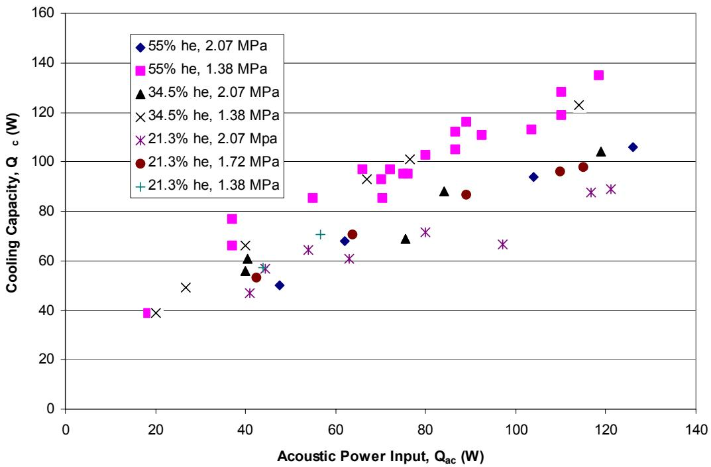  
Figure 19: Cooling Capacity vs. Acoustic Power Input.

In linear acoustic models, the relative coefficient of performance, COPr, is known to be directly proportional to T, the ratio of the actual temperature gradient and the critical temperature gradient (Swift, 1988). The critical temperature gradient is inversely proportional to the mean pressure. It also depends on mean temperature, isentropic exponent, frequency, and on the position of the stack in the standing wave. None of these parameters are significantly affected by a pressure increase at constant temperature. Since the resonance frequency does not change much with the mean pressure (as discussed later and shown in Figure 20), the input acoustic impedance (and of course the termination impedance) is nearly constant regardless of the increase of the mean pressure, which means that the position of the stack in the standing wave field is nearly the same. Therefore, the second law efficiency(COPr) should increase proportionally with the mean pressure, given the mixture, mean temperature, and temperature gradients are held constant because the increase in the mean pressure decreases the critical temperature gradient.

The coefficient of performance relative to Carnot, COPr, is shown in as a function of stack temperature difference. In general, COPr increases with the temperature difference. The irreversibilities related to the heat exchangers become a more significant fraction of the total power input as the temperature differences get smaller. In the limit, when the temperature difference goes to zero, Carnot would predict no work input requirement whereas the real system still requires work because of temperature differences across the heat exchangers. It also appears that the second law efficiency improves as the mean pressure is decreased and has a small dependence on mixture concentration for the ranges considered. The highest COPr achieved was 2.86 at 1.38 MPa (200 psi) for the 55% He-45% Ar mixture.

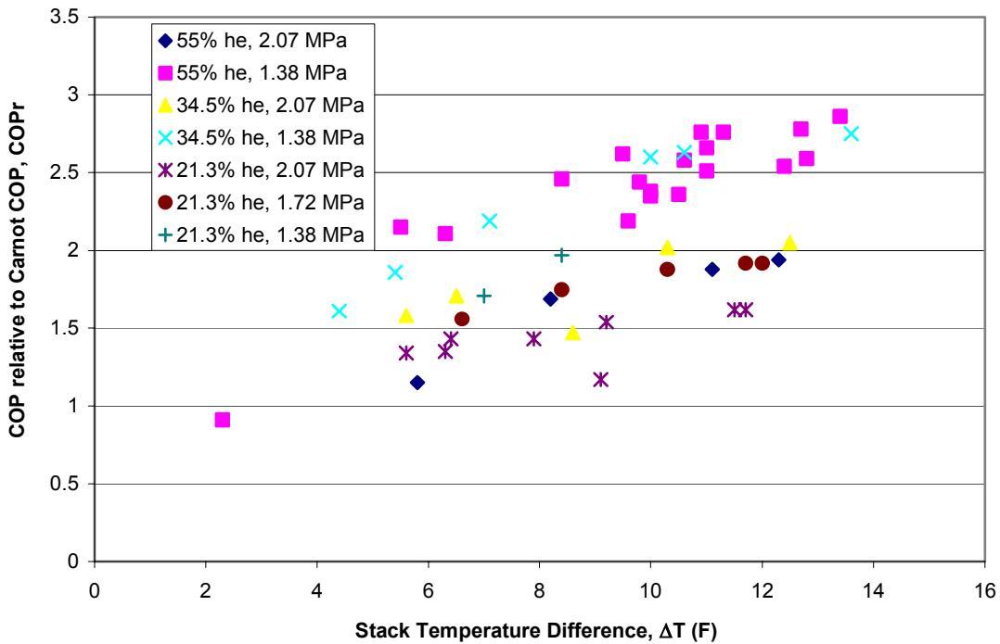  
Figure 20: COPr vs. Stack Temperature Difference.

The resonance frequency as a function of the concentration of helium in the mixture is shown in Figure 21. The resonance frequency (for a fixed geometry) depends on the speed of sound, the density and the bulk modulus of the working gas. The resonance frequency increases as the density of the gas mixture is reduced. Helium is much lighter than argon. Therefore adding helium in the gas mixture yields an increase in the resonance frequency. The resonance frequency did not vary significantly with the mean pressure. It is well known that the speed of sound in a gas is a function of temperature only, and it is independent of the mean pressure. The mean temperature of the gas in the system varied during operation, which explains the slight variations in the tuned frequency in Figure 21.

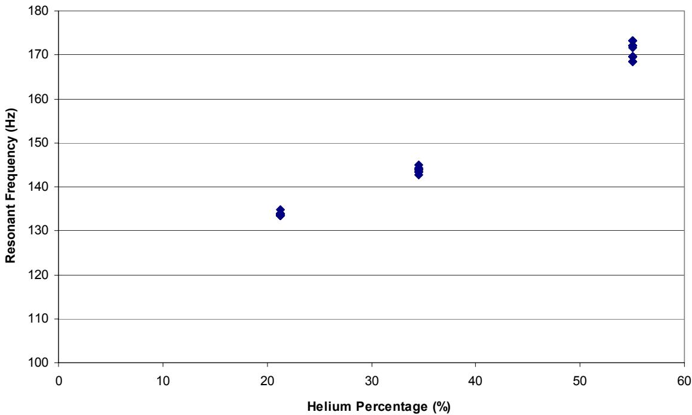  
Figure 21: Resonant Frequency vs. Helium Concentration.

## 4.2 Comparisons With Linear Acoustic Model Predictions

Efforts were made to compare the experimental results with Deltae (Ward and Swift, 1993) predictions. Because the numerical computer model uses a shooting method, there is a limit to the number of measured values that can be used as inputs and constraints in the model, and there are a multitude of combinations possible. The results of one such combination are shown Table 4. The experimental data are shown in the first row and the model predictions in the second row. The agreement is poor. The model underestimates the cooling capacity by nearly a factor of 2 and overestimates the required acoustic power by about a factor of 2. The predicted COP would be about 3.4, whereas the actual COP (based upon acoustic power) is only about 0.9 at these conditions. Clearly, the measured prototype performance is far lower than that predicted. The same conclusion was reached regardless of the combination of inputs and targets used.

Table 4: Comparison between Experimental Data and Model Predictions.
<table><tr><td></td><td>Resonance Frequency (Hz)</td><td>Acoustic Power (W)</td><td>Piston Pressure (kPa)</td><td>Piston Velocity (m/s)</td><td>Heat Rejected (w)</td><td>Cooling Power (W)</td><td>Stack Delta T (°C)</td><td>Tube end Pressure (kPa)</td></tr><tr><td>Measured</td><td>172.1</td><td>118</td><td>45.02</td><td>1.23</td><td>-233</td><td>135</td><td>7.5</td><td>127.2</td></tr><tr><td>Predicted</td><td>183.9</td><td>64</td><td>45.02</td><td>1.23</td><td>-280</td><td>217</td><td>7.5</td><td>100.2</td></tr></table>

From the results of the previous section, the heat exchangers perform as well as or even better than predicted in the Deltae models. Other factors must therefore be responsible for the lack of agreement between the experimental data and the models. These factors could include “nuisance" heat loads, acoustic streaming effects, and migration of species within the inhomogeneous mixture.

Streaming effects are steady recirculating flows induced in the working gas by time-averaged stresses produced by high-order, non-linear terms in the momentum and continuity equations. These effects are well known, and have been reported in the literature (Gopinath et al., 1998; Gusev et al., 2000; Waxler, 2001). Methods to suppress or reduce streaming include the use of diaphragms. Streaming effects are sensitive to the geometry of the vessel. It is possible that such steady recirculating flows may give rise to significant convective heat transfer within the system (Starr, 2001). Numerical investigations of streaming are currently under way to assess their impact on system performance. Streaming flows have been investigated in systems operated at atmospheric conditions. But the measurement of flow velocities in a pressurized vessel poses significant challenges, and requires additional access ports. Work is under way to perform hotwire measurements within the working prototype.

It has recently been reported that significant migration of species may occur when high amplitude standing waves are produced in mixtures of light and heavy perfect gasses (Geller and

Swift, 2001). Inhomogeneous composition within boundary layers on the stack walls may perhaps explain why the predicted performance was not achieved.

Finally, there are many poorly understood heat transfer phenomena that occur within the system which cause an energy imbalance, as previously discussed. These nuisance loads, which should have only little impact for systems with better performance, become significant here because the coefficients of performance and the cooling capacities are low.

## 5. Application Studies

Although the simulation model did not provide very good performance predictions for the Purdue prototype, it is the best available modeling tool for thermoacoustics and provides a prediction of the upper limit to performance in the absence of non-linear effects such as streaming. In particular, it is a useful tool for comparing the performance of alternative systems and operating ranges. In the application studies described in this section, simulations were used to identify the most suitable operating temperatures for thermoacoustic cooling in order to target applications for further research and development.

## 5.1 Methodology

Figure 22 shows a schematic of the prototype system with some of the relevant design dimensions. This same configuration was used for the application studies. Although better configurations are possible, the goal was only to identify the most appropriate range of operating conditions for application of thermoacoustic cooling and not to determine the best absolute performance. The performance indice used to compare performance at different operating conditions was the ratio of the COP (Coefficient of Performance) to the COP associated with a Carnot cooling cycle. This is the $2 ^ { \mathrm { n d } }$ Law efficiency and it is a good measure of the relative performance of a particular cooling system that applies regardless of the operating temperatures A well-developed technology will typically have $2 ^ { \mathrm { n d } }$ Law efficiencies of between about 40% and 50%.

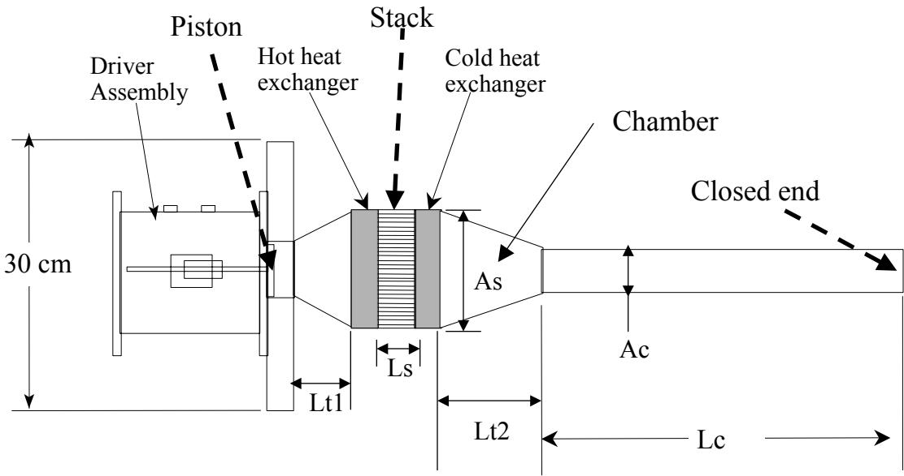  
Figure 22: The Basic Device Configuration for the Application Study; Labeled Dimensions are Variable Design Variables

In this study, the cooling capacity was held constant at 130 W (443.6 Btu/hr), while the cold and hot heat exchanger temperatures were varied. The mean surface temperature of the hot heat exchanger was varied over a fairly small range between about $3 2 . 2 ^ { \circ } \mathrm { C } \ : ( 9 0 ^ { \circ } \mathrm { F } )$ and $4 3 . 3 ^ { \circ } \mathrm { C } \left( 1 1 0 ^ { \circ } \mathrm { F } \right)$ The mean surface temperature of the cold heat exchanger was varied over a wide range of conditions from around - $- 9 5 . 5 ^ { \circ } \mathrm { C }$ (-140°℉) to $2 1 . 1 ^ { \circ } \mathrm { C }$ (70°F). The $2 ^ { \mathrm { n d } }$ Law efficiency is presented as a function of the temperature difference between the hot and cold heat exchanger surfaces, termed the temperature lift.

The design necessary to achieve a particular cooling capacity depends strongly on the desired temperature lift. For instance, a low temperature (large lift) application would require a longer stack and larger pressure amplitudes. In order to determine appropriate designs as a function of operating condition, a simplex optimization algorithm was combined with Deltae (Ward and

Swift, 1993). The objective function for the optimization was maximum Coefficient of Performance (COP) for specified operating temperatures and a cooling capacity.

The optimization tool provides a consistent approach for specifying the necessary designs for different operating temperatures. This procedure was described in some detail by Minner (1996) and summarized by Minner et al (1997). The Deltae model, which employs a Runge-Kutta marching algorithm in the solution of coupled ordinary differential equations, made use of guess and target vectors of dimension four, where the marching takes place from the cavity behind the driver, through the driver, heat exchanger, stack and duct sections, to the rigid end termination. Typically, a guess vector was comprised of: 1) operating frequency, 2) “input" pressure amplitude (the pressure amplitude in the cavity behind the driver), 3) heat rejected by the first (hot) heat exchanger, and 4) the voltage or phase of voltage associated with the driver. The reference phase was that of pressure and velocity in the input section (back cavity), which were both set to zero. The target vector was comprised of: 1) real part of the termination impedance, 2) imaginary part of the termination impedance, 3) cooling power, and 4) the temperature in the second exchanger. The model did employ an actuator (power input device or driver) segment, but the actuator characteristics had no impact on the design process (the actuator design was fixed), and was only used in the model as a placeholder for more general optimization capability.

The objective function was chosen to be the ratio of cooling power to acoustic power delivered to the system, and it was maximized. Given that the cooling power was fixed for all cases, this has the same effect as would the minimization of the acoustic power delivered to the system. Driver losses and auxiliary (e.g., fan and pump) power consumption were not considered in this analysis.

## 5.1.1 Design Parameters

The system configuration was fixed, and several of the dimensions within that configuration were fixed as well. A reduced set of parameters with the greatest influence on performance was determined, and those parameters were used as design variables in the optimization, while the other parameters were largely fixed (with the exception of the free, or “guess" variables in the solution method). Changes in the fixed parameter values result in changes in the optimal design variables as well. However, these changes have little effect on the value of the objective function.

## 5.1.1.1 Fixed Parameters

The fixed design parameters were: 1) stack material spacing and porosity, 2) gas mixture and mean pressure, 3) heat exchanger dimensions, 4) back cavity dimensions, and 5) piston size. Sensitivity studies indicated that optimal spacing and porosity decline slightly for increasing temperature lift applications, but the COP impact is not significant (a 15% reduction in spacing yields a 4% COP improvement at most). This is likely due in large measure to the compensation mechanism afforded by the complementing system dimensions and operating frequencies, which were permitted to vary.

For this study, a mixture comprised of 50% helium, 50% argon (by volume), was chosen which has been found to be nearly optimal. A mean pressure of 3Mpa (435 psi) was chosen and used for all the optimizations, due to practical considerations. Increasing the pressure may enable some predicted performance improvement, particularly in terms of power density, if the stack porosity and spacing characteristics were permitted to vary.

The heat exchanger designs were fixed due mainly to practical considerations with respect to both manufacturability and model limitations. Allowed to vary as a design variable without constraint, the ideal heat exchanger would become extremely small in the direction of gas

oscillatory motion (the system axial direction). This would be problematic because of manufacturability and because the linear model does not consider the complicated exchange or flow processes well that would result from the turbulent, jetting gas flows that would be required for heat transfer coefficients sufficient to compensate for the reduced area. In the linear model, the shorter exchanger reduces the frictional loss experienced in the exchangers. While constraints could have been employed, the result would have been constrained, which is the same as a fixed design. It was decided that a practical/manufacturable design would be used.

The back cavity is a lumped acoustic element, which has little impact on the performance of the system, particularly when its compliance is much greater than that of the driver suspension system.

The piston size has some impact on optimal driver performance, but its impact on optimal thermoacoustic performance is limited when parameters such as transition duct (the conical section between the piston bore and the heat exchanger) length are optimized around it. For this study, optimal driver performance was not an objective.

## 5.1.1.2 Variable Design Parameters

The design parameters are labeled in Figure 22 and include the: 1) first transition duct length, 2) first transition duct final diameter, 3) stack length, 4) second transition duct length, 5) second transition duct final diameter, and 6) small duct length.

## 5.2 Results

Figure 23 shows the $2 ^ { \mathrm { n d } }$ Law efficiency as a function of lift determined using the optimization tool. There is some scatter in the data due to numerical noise and the fact that the $2 ^ { \mathrm { n d } }$ Law efficiency doesn't correlate perfectly with temperature lift alone. However, it is clear that there is an optimum operating lift associated with thermoacoustic cooling. At low temperature lifts, irreversibilities associated with heat transfer in the heat exchangers become a large fraction of the power input leading to relatively low $2 ^ { \mathrm { n d } }$ Law efficiencies. This is typical of gas cycles where the working fluid temperatures must vary significantly in the heat exchangers to provide the necessary heat transfer. As the temperature lift increases, the heat exchanger irreversibilities become a smaller fraction of the power. In order to achieve higher temperature lifts, it is necessary to utilize longer stacks and higher oscillating pressure amplitudes. As a result, frictional losses in the stack and other elements increase significantly with temperature lift eventually leading to a reduction in the 2"ª Law efficiency. These tradeoffs are such that the $2 ^ { \mathrm { n d } }$ optimum operating range for thermoacoustics seems to be for temperature lifts between about $3 7 . 8 ^ { \circ } \mathrm { C } \left( 1 0 0 ^ { \circ } \mathrm { F } \right)$ and $6 5 . 6 ^ { \circ } \mathrm { C } ( 1 5 0 ^ { \circ } \mathrm { F } )$ ). This could correspond to refrigerator/freezer applications. However, thermoacoustic cooling does not seem appropriate for air conditioning applications where temperature lifts are small and could not be readily used for cryogenic cooling. Better configurations and additional design parameter variations could increase the absolute values for $2 ^ { \mathrm { n d } }$ Law efficiency above those presented in Figure 23. However, it is expected that the trends would not change.

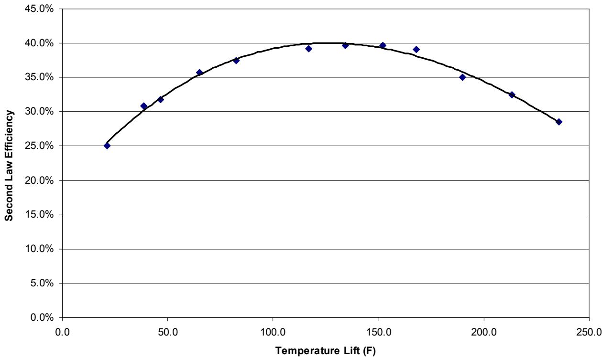  
Figure 23: Second Law Efficiency as a Function of Temperature Lift.

Table 5 gives values of optimized design and operating variables for the simulation test cases. As expected, the length of the stack (Ls) increases significantly with the temperature lift requirements. Within the stack, fluid particles that oscillate back and forth only undergo a relatively small portion of the temperature changes required as they execute a thermodynamic cycle. It is the cascading of adjacent thermodynamic cycles that allows a thermoacoustic system to achieve large temperature lifts with moderate pressure amplitudes. The larger the lift requirements, the longer the stack must be for a given fluid particle displacement and pressure amplitude.

As the temperature lift increases, the optimal design also moves towards higher pressure amplitudes with smaller cross-sectional stack areas, lower resonant frequencies, and reduced distance between stack and driver. These design changes are partly a result of changes in

working fluid properties and stack length requirements. For instance, since longer stacks are required for greater temperature lifts, smaller stack areas offset some of the greater frictional losses associated with the greater lengths. However, in order to achieve a fixed cooling capacity, the pressure amplitudes must increase as the stack area decreases.

There appear to be some anomalies in the results. For instance, the frequency does not decrease and the stack length does not increase over the entire range of increase in temperature lift. This is probably the result of a relatively flat objective function near the optimum and the resolution of the numerical scheme.

It should also be noted that the very short second transition (Lt2), combined with the large area change, would not be practical. Given the sharp taper angle of the walls in this section, flow separation and turbulence would be significant. The modeling tool does not consider these effects.

Table 5: Design and Operating Variables as a Function of Temperature Lift (see Figure 22 for Nomenclature)
<table><tr><td rowspan=1 colspan=1>Temperature Lift (C)</td><td rowspan=1 colspan=1>11.8</td><td rowspan=1 colspan=1>21.5</td><td rowspan=1 colspan=1>25.8</td><td rowspan=1 colspan=1>36.1</td><td rowspan=1 colspan=1>45.7</td><td rowspan=1 colspan=1>64.9</td><td rowspan=1 colspan=1>74.7</td><td rowspan=1 colspan=1>84.4</td><td rowspan=1 colspan=1>93.4</td><td rowspan=1 colspan=1>105.6</td><td rowspan=1 colspan=1>118.5</td><td rowspan=1 colspan=1>130.9</td></tr><tr><td rowspan=1 colspan=1>Cold Temp. (C)</td><td rowspan=1 colspan=1>23.2</td><td rowspan=1 colspan=1>23.1</td><td rowspan=1 colspan=1>18.3</td><td rowspan=1 colspan=1>8.0</td><td rowspan=1 colspan=1>-2.0</td><td rowspan=1 colspan=1>-22.1</td><td rowspan=1 colspan=1>-32.2</td><td rowspan=1 colspan=1>-42.3</td><td rowspan=1 colspan=1>-52.3</td><td rowspan=1 colspan=1>-67.3</td><td rowspan=1 colspan=1>-82.4</td><td rowspan=1 colspan=1>-97.4</td></tr><tr><td rowspan=1 colspan=1>Hot Temp. (C)</td><td rowspan=1 colspan=1>34.9</td><td rowspan=1 colspan=1>44.6</td><td rowspan=1 colspan=1>44.1</td><td rowspan=1 colspan=1>44.1</td><td rowspan=1 colspan=1>43.8</td><td rowspan=1 colspan=1>42.8</td><td rowspan=1 colspan=1>42.5</td><td rowspan=1 colspan=1>42.2</td><td rowspan=1 colspan=1>41.1</td><td rowspan=1 colspan=1>38.3</td><td rowspan=1 colspan=1>36.1</td><td rowspan=1 colspan=1>33.5</td></tr><tr><td rowspan=1 colspan=1>Lt1 (cm)</td><td rowspan=1 colspan=1>11.6</td><td rowspan=1 colspan=1>10.4</td><td rowspan=1 colspan=1>10.9</td><td rowspan=1 colspan=1>9.0</td><td rowspan=1 colspan=1>8.7</td><td rowspan=1 colspan=1>8.3</td><td rowspan=1 colspan=1>7.7</td><td rowspan=1 colspan=1>7.8</td><td rowspan=1 colspan=1>6.8</td><td rowspan=1 colspan=1>8.2</td><td rowspan=1 colspan=1>8.1</td><td rowspan=1 colspan=1>8.2</td></tr><tr><td rowspan=1 colspan=1>As (cm2)</td><td rowspan=1 colspan=1>535</td><td rowspan=1 colspan=1>476</td><td rowspan=1 colspan=1>382</td><td rowspan=1 colspan=1>490</td><td rowspan=1 colspan=1>438</td><td rowspan=1 colspan=1>404</td><td rowspan=1 colspan=1>454</td><td rowspan=1 colspan=1>444</td><td rowspan=1 colspan=1>428</td><td rowspan=1 colspan=1>417</td><td rowspan=1 colspan=1>441</td><td rowspan=1 colspan=1>438</td></tr><tr><td rowspan=1 colspan=1>Ls (cm)</td><td rowspan=1 colspan=1>1.4</td><td rowspan=1 colspan=1>2.0</td><td rowspan=1 colspan=1>2.3</td><td rowspan=1 colspan=1>3.0</td><td rowspan=1 colspan=1>3.4</td><td rowspan=1 colspan=1>4.2</td><td rowspan=1 colspan=1>4.5</td><td rowspan=1 colspan=1>4.9</td><td rowspan=1 colspan=1>5.3</td><td rowspan=1 colspan=1>4.4</td><td rowspan=1 colspan=1>4.6</td><td rowspan=1 colspan=1>4.8</td></tr><tr><td rowspan=1 colspan=1>Lt2 (cm)</td><td rowspan=1 colspan=1>0.15</td><td rowspan=1 colspan=1>0.43</td><td rowspan=1 colspan=1>0.46</td><td rowspan=1 colspan=1>0.39</td><td rowspan=1 colspan=1>0.46</td><td rowspan=1 colspan=1>0.47</td><td rowspan=1 colspan=1>0.46</td><td rowspan=1 colspan=1>0.44</td><td rowspan=1 colspan=1>0.45</td><td rowspan=1 colspan=1>0.47</td><td rowspan=1 colspan=1>0.47</td><td rowspan=1 colspan=1>0.48</td></tr><tr><td rowspan=1 colspan=1>Ac (cm2)</td><td rowspan=1 colspan=1>107.6</td><td rowspan=1 colspan=1>92.8</td><td rowspan=1 colspan=1>77.6</td><td rowspan=1 colspan=1>89.1</td><td rowspan=1 colspan=1>81.4</td><td rowspan=1 colspan=1>70.7</td><td rowspan=1 colspan=1>73.0</td><td rowspan=1 colspan=1>75.5</td><td rowspan=1 colspan=1>81.6</td><td rowspan=1 colspan=1>70.7</td><td rowspan=1 colspan=1>79.5</td><td rowspan=1 colspan=1>87.9</td></tr><tr><td rowspan=1 colspan=1>Lc (cm)</td><td rowspan=1 colspan=1>110.4</td><td rowspan=1 colspan=1>113.2</td><td rowspan=1 colspan=1>122.4</td><td rowspan=1 colspan=1>116.7</td><td rowspan=1 colspan=1>120.0</td><td rowspan=1 colspan=1>121.6</td><td rowspan=1 colspan=1>119.4</td><td rowspan=1 colspan=1>119.5</td><td rowspan=1 colspan=1>117.9</td><td rowspan=1 colspan=1>122.9</td><td rowspan=1 colspan=1>115.9</td><td rowspan=1 colspan=1>113.3</td></tr><tr><td rowspan=1 colspan=1>Frequency (Hz)</td><td rowspan=1 colspan=1>151.8</td><td rowspan=1 colspan=1>147.1</td><td rowspan=1 colspan=1>138.4</td><td rowspan=1 colspan=1>138.5</td><td rowspan=1 colspan=1>134.0</td><td rowspan=1 colspan=1>126.7</td><td rowspan=1 colspan=1>124.9</td><td rowspan=1 colspan=1>123.2</td><td rowspan=1 colspan=1>124.3</td><td rowspan=1 colspan=1>118.4</td><td rowspan=1 colspan=1>121.5</td><td rowspan=1 colspan=1>121.0</td></tr><tr><td rowspan=1 colspan=1>Drive Ratio</td><td rowspan=1 colspan=1>1.6%</td><td rowspan=1 colspan=1>1.9%</td><td rowspan=1 colspan=1>2.3%</td><td rowspan=1 colspan=1>2.1%</td><td rowspan=1 colspan=1>2.4%</td><td rowspan=1 colspan=1>3.0%</td><td rowspan=1 colspan=1>3.0%</td><td rowspan=1 colspan=1>3.4%</td><td rowspan=1 colspan=1>3.6%</td><td rowspan=1 colspan=1>4.7%</td><td rowspan=1 colspan=1>5.1%</td><td rowspan=1 colspan=1>6.1%</td></tr><tr><td rowspan=1 colspan=1>COP</td><td rowspan=1 colspan=1>6.3</td><td rowspan=1 colspan=1>4.3</td><td rowspan=1 colspan=1>3.6</td><td rowspan=1 colspan=1>2.8</td><td rowspan=1 colspan=1>2.2</td><td rowspan=1 colspan=1>1.5</td><td rowspan=1 colspan=1>1.3</td><td rowspan=1 colspan=1>1.1</td><td rowspan=1 colspan=1>0.9</td><td rowspan=1 colspan=1>0.7</td><td rowspan=1 colspan=1>0.5</td><td rowspan=1 colspan=1>0.4</td></tr></table>

## 6. Conclusions

Experimental investigations of an electro-dynamically thermoacoustic cooler prototype were performed. The thermal performance of the system was measured over a range of operating conditions, for varying gas mixtures. Detailed sound pressure and temperature measurements provided information from which the overall efficiency, capacity, and temperature lift of the cooling system were estimated, in addition to the heat exchange coefficient and performance of the heat exchangers. Net acoustic power inputs of up to 120 W (409.4 Btu/hr) were achieved, with an electro-acoustic transduction efficiency varying between 20% and 50%, reaching values as high as 60% in a few cases. The measured cooling capacity varied greatly, and peaked at around 130 W (443.6 Btu/hr) for a temperature lift of about $6 . 7 \mathrm { { } ^ { \circ } C }$ (12°F). The acoustic pressure amplitudes were near 3% of the mean pressure in the stack region, and the heat rejected to a secondary fluid reached values up to 250 W (853 Btu/hr). The best relative coefficient of performance achieved was about 3% of Carnot, based on the net input acoustic power. The best overall efficiency achieved was thus 1.2% of Carnot. The acoustic power level exceeded the target value for the desired cooling load and the target temperature lifts and efficiencies were not achieved. This was generally attributed to “nuisance" heat loads, acoustic streaming effects, and migration of species within the inhomogeneous mixture. The non-dimensional heat exchanger performance in the thermoacoustic system was found to be only slightly less than that in a steady uniform flow when the root-mean-square particle velocity is used for a velocity scale, and the stack end temperature is used in the calculation of the temperature lift. It was also found that the heat transfer coefficients are better than those predicted by linearized boundary layer models often used in linear acoustic models.

The simulation tool was used to evaluate the best potential applications for thermoacoustic cooling. The optimum operating range for thermoacoustics seems to be for temperature lifts between about $3 7 . 8 ^ { \circ } \mathrm { C }$ (100°F) and $6 5 . 6 ^ { \circ } \mathrm { C } \left( 1 5 0 ^ { \circ } \mathrm { F } \right)$ . This could correspond to refrigerator/freezer applications. However, thermoacoustic cooling does not seem appropriate for air conditioning applications where temperature lifts are small and could not be readily used for cryogenic cooling.

## 7. References

Adeff, J.A., Hofler, T.J., and Atchley, A.A. 1998. "Measurements with Reticulated Vitreous Carbon Stacks in Thermoacoustic Prime Movers and Refrigerators,"J. Acoust. Soc. Am. Vol. 104, No. 1, pp. 32-38.

ARI, 1991. “Forced Circulation Air-Cooling and Air-Heating Coils," Standard 410. Air-Conditioning and Refrigeration Institute, Arlington.

Arnott, W.P., Lightfoot, J., Raspet, R., and Moosmuller, H. 1996. “Radial Wave Thermoacoustic Engines: Theory and Examples for Refrigerators and High-Gain Narrow-Bandwidth Photoacoustic Spectrometers," J. Acoust. Soc. Am. Vol. 99, No. 2, pp. 734-745.

Backhaus, S., and Swift, G.W. 2000. “A Thermoacoustic-Stirling Heat Engine: Detailed Study," J. Acoust. Soc. Am.,Vol. 107, No. 6, pp. 3148-3166.

Ballister, S.C., and McKelvey, D.J. 1995. “Shipboard Electronics Thermoacoustic Cooler," M.S. Thesis, Naval Postgraduate School, Monterey, CA.

Belcher, J.R., Slaton, W.V., Raspet, R., Bass, H.E., and Lightfoot, J. 1999. "Working Gases in Thermoacoustic Engines," J. Acoust. Soc. Am.,Vol. 105, No. 5, pp. 2677-2684.

Bennett, G.A. 1992. “Compact Acoustic Refrigerator," US Patent 5,165,243.

Beranek, L. L. 1996. Acoustics. The Acoustic Society of America.

Bösel J., Trepp, Ch., and Fourie, J.G. 1999. “An Alternative Stack Arrangement for Thermoacoustic Heat Pumps and Refrigerators," J. Acoust. Soc. Am. Vol. 106, No. 2, pp. 707-715.

Brewster, J., Raspet, R., and Bass, H. 1997. “Temperature Discontinuities Between Elements Of Thermoacoustic Devices," J. Acoust. Soc. Am., Vol. 102, No. 6, pp. 3355- 3360.

Garrett, S.L. 1999. "Reinventing the Engine," Nature, Vol. 399, May 27, pp. 303-305.

Garrett, S., Perkins, D, and Gopinath, A. 1994. “Thermoacousitc refrigerator heat exchangers: Design, analysis, and fabrication." Proceedings of the 10th International Heat Transfer Conference. Taylor & Francis, San Francisco, Vol. 4, pp.375-380.

Garrett, S.L., Adeff J.A., Hofler, T.J. 1993. "Thermoacoustic Refrigerator for Space Applications," AAIA J. Thermophys. Heat Trans., Vol. 7, pp. 595-599.

Garrett, S.L., Hofler, T.J., and Perkins, D.K. 1993. "Thermoacoustic Refrigeration," The Greenpeace Ozone-Safe Cooling Conference, October 1993, Washington, D.C.

Garrett, S.L., and Hofler, T.J. 1992. "Thermoacoustic Refrigeration," ASHRAE Journal, December 1992, pp. 28-36.

Garrett, S.L. 1991. "ThermoAcoustic Life Sciences Refrigerator, " NASA Technical Report No. LS-10114, Johnson Space Center, Space and Life Sciences Directorate, Houston, TX.

Geller, D.A. and Swift, G.W. 2001. “Saturation of Boundary-Layer Thermoacoustic Mixture Separation," Loas Alamos National Laboratory, Personnal Communication.

Gopinath, A., Tait, N.L., and Garrett, S.L. 1998. "Thermoacoustic Streaming in a Resonant Channel: The Time-Averaged Temperature Distribution," J. Acoust. Soc. Am., Vol. 103, No. 3, pp. 1388-1405.

Grant, L.A. (1992). “An Investigation of the Physical Characteristics of a Mass Element Resonator," Master's Thesis, Physics Dept., Naval Postgraduate School, Monterey, CA; Defense Technical Information Center Report No. AD-A251 792.

Gray, D.L. and Webb, R.L. 1986. “Heat Transfer and Friction Correlations for Plate Finned-Tube Heat Exchangers Having Plain Fins." Proceedings of the 8th International Heat Transfer Conference. Taylor & Francis, London, San Francisco, pp. 2745-2750.

Gusev, V., Job, S., Baillet, H., Lotton, P., and Bruneau, M. 2000. “Acoustic Streaming in Annular Thermoacoustic Prime-Movers," J. Acoust. Soc. Am., Vol. 108, pp. 934-945.

Hofler, T.J. 1986. "Thermoacoustic Refrigerator Design and Performance," Doctoral Dissertation, Physics Department, University of California, San Diego, CA.

Incropera, F. and Dewitt, D. 1996. Fundamentals of Heat and Mass Transfer. New York. Wiley and Sons.

Minner, B.L., Mongeau, L., Braun, J.E., 2000. “Experimental Investigation of a thermoacoustic cooler prototype." Proceedings of the 4th IIR-Gustav Lorentzen Conference on Natural Working Fluids at Purdue. Purdue University, West Lafayette, pp. 447-456.

Minner, B.L.; Braun, J.E.; and Mongeau, L. 1997."Theoretical Evaluation of the Optimal Performance of a Thermoacoustic Refrigerator," ASHRAE Transactions, Vol. 103, No. 1, pp. 873-887.

Minner, B.L., 1996. “Design Optimization for Thermoacoustic Cooling Systems," Masters Thesis, School of Mechanical Engineering, Purdue University.

Mozurkewich, G. 1998a. “Time-Average Temperature Distribution in a Thermoacoustic Stack," J. Acoust. Soc. Am., Vol. 103, No. 1, pp. 380-388, and Vol 105, No 1, pp. 567.

Mozurkewich, G. 1998b. “A Model for Transverse Heat Transfer in Thermoacoustics."J. Acoust. Soc. Am., Vol. 103, No. 6, pp. 3318-3326.

Mozurkewich, G. 1995. “Heat Transfer From a Cylinder in an Acoustic Standing Wave,"J. Acoust. Soc. Am., Vol. 98, No. 4, pp. 2209-2216.

Olson, J.R., and Swift, G.W. 1997. “Acoustic Streaming in Pulse-Tube Refrigerators: Tapered Pulse Tubes," Cryogenics, Vol. 37, pp. 769-776.

Poese, M.E. and Garrett, S.L. 2000. “Performance Measurements on a Thermoacoustic Refrigerator Driven at High Amplitudes," J. Acoust. Soc. Am., Vol. 107, No. 5, pp. 2480- 2486.

Poese, M.E. & Garrett, S.L. 1998. “Performance Measurements on a Thermoacoustic Refrigerator Driven at High Amplitudes," The Pennsylvania State University, Technical Report Number TR 98- 003.

Reid, R.S., and Swift, G.W. 2000. “Experiments With a Flow-Through Thermoacoustic Refrigerator,"J. Acoust. Soc. Am., Vol. 108, No 6, pp. 2835-2842.

Rich, D.G. 1976. “The Effect of Fin Spacing on the Heat Transfer and Friction Performance of Multi-Row, Smooth Plate Fin-and-Tube Heat Exchangers."ASHRAE Transactions, Vol. 70 pt. 2 pp. 137-145.

Starr, R.A., Jones, R., Mace, B., and Deans, J. 2001. “The Effect of Streaming on Thermoacoustic Systems," The University of Aukland, New Zealand, personnal communication.

Swift, G.W., 1999. “Thermoacoustics: A Unifying Perspective for some Engines and Refrigerators." Condensed Matter and Thermal Physics Group Los Alamos National Laboratory. LA-UR 99-895. Available at www.lanl.gov/thermoacoustics.

Swift, G.W. 1997. “Thermoacoustic Natural Gas Liquefier," US DOE Natural Gas Conference Proceedings, March 24-27, 1997, Houston TX; DOE/FETC-97/1043. (http://lib-www.lanl.gov/la-pubs/00412750.pdf

Swift, G.W. 1992. "Analysis and Performance of Large Thermoacoustic Engine," J. Acoust. Soc. Am., Vol. 92, No 3, pp. 1151-1163.

Swift, G.W. 1991. "Development of a Thermoacoustically Driven Orifice Pulse Tube Refrigerator," Los Alamos National Laboratory Report No. CP-91-118.

Swift, G.W. 1988. "Thermoacoustic Engines," J. Acoust. Soc. Am., Vol 84, pp. 1145-1180.

Swift G.W. and Keolian, R.M. 1993. “Thermoacoustics in Pin-Array Stacks," J. Acoust. Soc. Am., Vol. 94, No. 2, pp. 941-943.

Wakeland, R.S. 2000. "Use of Electrodynamic Drivers in Thermoacoustic Refrigerators,"J. Acoust. Soc. Am., Vol. 107, No 2, pp. 827-832.

Wakeland, R.S. and Garrett, S.L. 1998. "Lessons from a Thermoacoustic Refrigeration Demonstration Device," M.S. Thesis and Technical Report TR 98-005, Applied Research Laboratory, Pennsylvania State University.

Wang, C-C., Lee, C-J,, Chang, C-T., and Lin, S-P. 1998. “Heat transfer and Friction Correlation for Compact Louvered Fin-and-Tube Heat Exchangers."International Journal of Heat and Mass Transfer, Vol. 42, pp. 1945-1956.

Ward, W.C., and Swift G. W. 1994. "Design Environment for Low-Amplitude Thermoacoustic Engines," J. Acoust. Soc. Am., Vol. 95, pp. 3671-3672. http://www.lanl.gov/thermoacoustics/

Waxler, R. 2001. “Stationary Velocity and Pressure Gradients in a Thermoacoustic Stack," J. Acoust. Soc. Am., Vol. 109, No. 6, pp. 2739-2750.

Wetzel, M., Herman, C. 1999. “Experimental Study of Thermoacoustic Effects on a Single Plate Part II: Heat Transfer." International Journal of Heat and Mass Transfer, Vol. 35, pp. 433-441.

Wetzel, M., Herman, C. 2000. “Experimental Study of Thermoacoustic Effects on a Single Plate Part I: Temperature Fields." International Journal of Heat and Mass Transfer, Vol. 36, pp. 7-20.

Wheatley, J., Hofler, T., Swift, G.W., and Migliori, A. 1983. “An Intrinsically Irreversible Thermoacoustic Heat Engine," J. Acoust. Soc. Am., Vol. 74, No. 1, pp. 153-170.

Yarr, G. A. and Corey J. A. Linear Electrodynamic Machine. US Patent No. 5389844. Feb. 14, 1995.