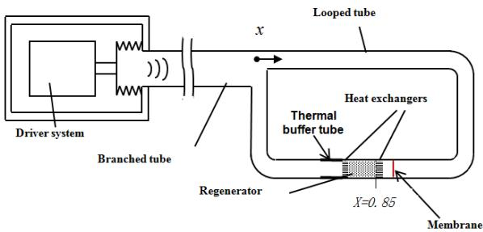
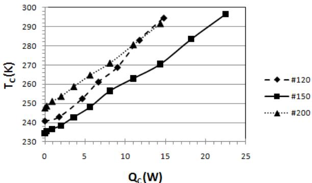
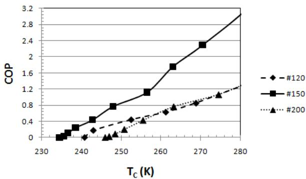

# Design and performance of a traveling-wave thermoacoustic refrigerator

Mohamed Mehdi Bassem, Yuki Ueda and Atsushi Akisawa

Graduate School of Bio-Applications and Systems Engineering, Tokyo University of Agriculture and Technology (2-24-26 Koganeishi, Naka-cho, Tokyo 184-8588, Japan)

PACS: 43.35.Ud

## ABSTRACT

A thermoacoustic refrigerator using a traveling acoustic wave for heat pumping was designed and constructed. It is composed of a linear motor, a branched tube, and a looped tube. The refrigerator is filled with 0.5 MPa Nitrogen. In the looped tube, a regenerator having many narrow flow channels is placed. From the linear motor, an acoustic wave is supplied and then, the heat pumping occurs along the regenerator. The regenerator's radius is experimentally optimized. The optimized regenerator's radius is found to be equal to 0.05mm. The constructed refrigerator with optimized regenerator's radius achieved a minimum temperature of -41 °C and a COP of 1.75 at -10 °C.

## INTRODUCTION

An acoustic wave in gases is considered as a combination of pressure and motion oscillations. The pressure oscillations can generate heat exchange between the gas and the tube wall while the motion oscillation can transfer heat along a tube's axis. Therefore, the propagation of an acoustic wave can create heat pumping. This heat pumping device using acoustic waves is called thermoacoustic refrigerator. This refrigerator needs no environmentally harmful working gas and it has only one moving part. Thus, a thermoacoustic refrigerator has an environmentally friendliness and a high reliability.

A thermoacoustic refrigerator is typically composed of an acoustic driver, an acoustic resonator and a structure with narrow flow channels called regenerator. Acoustic power is supplied to the resonator by the driver and is converted into heat flow in the regenerator through the heat exchange between the gas and the solid material composing the regenerator.

The conventionally used acoustic resonator consists on a straight tube with two closed ends [1]. Thus, the acoustic wave excited in the refrigerator is a standing wave. Such a refrigerator,calledstandingwavethermoacoustic refrigerator, has an intrinsically irreversibility since it works through the thermal imperfect contact between the working gas and the regenerator. Therefore, in principle a standing wave thermoacoustic refrigerator cannot achieve Carnot's coefficient of performance (COP).

Swift et al. proposed and constructed a thermoacoustic refrigerator having a looped tube as a part of the resonator [2]. The looped tube allows the excitation of a traveling acoustic wave in the refrigerator without essentially any dissipation. It is recognized that when a traveling acoustic wave propagates in a tube, the acoustically induced heat pumping can operate on the thermodynamic cycle similar to the Stirling cycle [3]. Therefore, their thermoacoustic refrigerator has a potential to achieve Carnot's COP.

Since then, many researchers focused on the looped tube configuration revealed by Swift et al.. Poese et al. constructed a traveling wave thermoacoustic refrigerator for ice cream sales achieving a COP relative to Carnot COP equal to 19% [4]. Tijani et al. built a traveling wave Thermoacoustic refrigerator using a coaxial geometry instead the looped one used by Swift et al. [5]. They reached a measured COP relative to Carnot's COP of 25%. Yazaki et al., Luo et al., and Miwa et al. interested on the heat driven traveling wave thermoacoustic refrigerator by changing the acoustic driver by a thermoacoustic Stirling engine [6-8].

Recently, Ueda et al. [9] optimized the regenerator's radius and position in a travelling wave thermoacoustic refrigerator and underlined the importance of the effect of these two parameters on COP. In this study, a traveling wave thermoacoustic refrigerator is designed and constructed. The regenerator's radius is experimentally optimized and the performance of the refrigerator using the optimized regenerator's radius is measured.

## EXPERIMENTAL SET UP

The constructed experimental device is schematically illustrated in Figure 1. The refrigerator is composed of a linear motor, a branched tube, and a looped tube. The linear motor produces an acoustic wave at a driving frequency of 50 Hz. The branched tube is 2.7 m long and has an inner diameter of 57.2 mm. The looped tube is 1.5 m long and has an inner diameter of 40.5 mm. Both tubes are made of stainless steel.

The regenerator, which is composed of stainless steel meshes, is placed inside the looped tube at a position of 0.85 m from the origin of x axis. X=0 corresponds to the junction between branched and looped tube as shown in Figure 1.

  
Figure 1. Schematic illustration of the constructed experimental apparatus

Three types of meshes will be used to optimize the regenerator's radius. The different meshes parameters are summarized in table 1.

Table 1. Mesh characteristics
<table><tr><td>Mesh #</td><td>#120</td><td>#150</td><td>#200</td></tr><tr><td> $\underline { { \mathbf { r } _ { \mathrm { r e g e } } ( \mathrm { m m } ) } }$ </td><td>0.06</td><td>0.05</td><td>0.04</td></tr></table>

The radius of the regenerator is calculated using equation (1) developed by Ueda et al. [10].

$$
r _ { r e g e } = \sqrt { \left( H D / 2 \right) * \left( d / 2 \right) }\tag{1}
$$

HD is the hydraulic diameter and d is the wire diameter of the stainless steel mesh.

The regenerator, having 50mm length, is sandwiched between ambient and cold heat exchangers. Thermocouples are mounted on both heat exchangers to measure their temperatures. The ambient heat exchanger is kept at the ambient temperature by circulating water at 300 K. Both heat exchangers are made from brass material. An electrical heater is bounded around the cold heat exchanger to measure the cooling power. A membrane is placed inside the tube near the ambient heat exchanger to reduce Gedeon streaming [2].

The measured parameters are temperatures, cooling power, and input acoustic power.

## EXPERIMENTAL RESULTS

Figure 2 shows the cold heat exchanger temperature as a function of the cooling power for the three types of meshes.

As we can see from this figure, when no heat load is supplied to the cold heat exchanger, the lowest cold temperature is obtained by the #150 mesh and is equal to 232 K. When the cooling power $\mathrm { Q _ { c } }$ is supplied to the cold heat exchanger, the cold temperature increases. At a given value of $\mathrm { Q _ { c } } ,$ the #150 mesh-regenerator provide the lowest cooling temperature.

Let's focus now on the COP dependency on the cold heat exchanger temperature which is shown in figure 3. It is shown that for any value of cold heat exchanger temperature, the highest COP is obtained by the #150 mesh. At 263 K, the COP of our constructed traveling wave thermoacoustic refrigerator using #150 meshes is equal to 1.75 which is equal corresponding to 23% of Carnot's COP.

Figure 2 and figure 3 show that the optimized mesh number is #150 corresponding to a radius of 0.05 mm.

  
Figure 2. Cooling Temperature as a function of cooling power for the three types of meshes.

  
Figure 3. COP as a function of cooling temperature for the three types of meshes.

## CONCLUSION

A thermoacoustic traveling wave thermoacoustic refrigerator was constructed and the regenerator's radius was experimentally optimized. The minimum temperature reached by the refrigerator using the optimized regenerator's radius was equal to 232K. The measured COP at 263K was found to be equal to 1.75 which is corresponding to 23 % of Carnot's COP.

## REFERENCES

1.  J. WHEATLEY, T. HOFLER, G. W. SWIFT and A. MIGLIORI,“Anintrinsicallyirreversible thermoacoustic heat engine" J. Acoust. Soc. Am. 74, 153 (1983)

2. G. W. SWIFT, D. L. GARDNER and S. BACKHAUS, “Acoustic recovery of lost power in pulse tube refrigerators" J. Acoust. Soc. Am. 105, 711 (1999)

3. P. CEPERLEY, "A pistonless Stirling engine – The traveling wave heat engine" J. Acoust. Soc. Am. 65, 1508 (1979)

4. M. E. POESE, R. SMITH and S. GARRETT, “Regenerator-based thermoacoustic refrigerator for ice cream storage applications" J. Acoust. Soc. Am. 114, 2328 (2003)

5. M. E. H. TIJANI and S. SPOELSTRA, "Study of a coaxial thermoacoustic-Stirling cooler"Cryogenics 48, 77 (2008)

6. T. YAZAKI, T. BIWA and A. TOMINAGA, “A pistonless Stirling cooler" Appl. Phys. Lett. 80, 157 (2002)

7. E. LUO, W. DAI, Y. ZHANG and H. LING, "Thermoacoustically driven refrigerator with double thermoacoustic-Stirling cycles" Appl. Phys. Lett. 88, 074102 (2006)

8. M. MIWA, T. SUMI, T. BIWA, Y. UEDA and T. YAZAKI."Measurement of acoustic output power in a traveling wave engine" Ultrasonics 44, e1527 (2006)

9. Y. Ueda, Bassem M. M., K. Tsuji and A. Akisawa, "Optimization of the regenerator of a traveling wave thermoacoustic refrigerator" J. Appl. Phys. 107,034901 (2010)

10. Y. Ueda, T. Kato and C. Kato, “Experimental evaluation of the acoustic properties of stacked-screen regenerators" J. Acoust. Soc. Am. 125 (2), (2009)