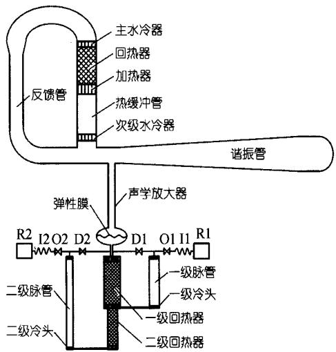
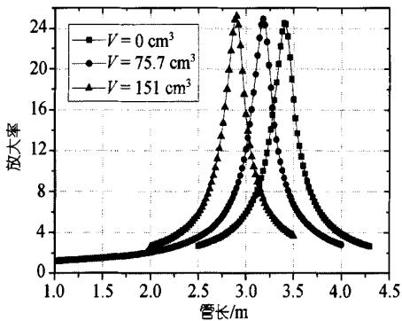
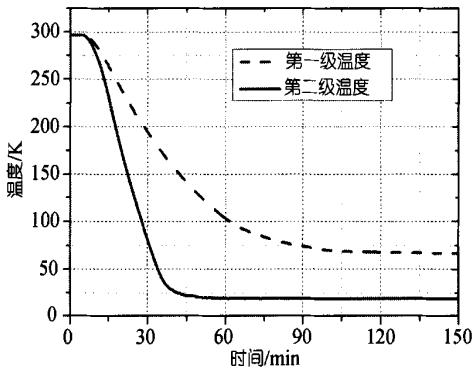

# 突破液氢温度的热驱动热声制冷机

胡剑英①②罗二仓①\*戴巍①周远①

(① 中国科学院理化技术研究所，北京 100080;②中国科学院研究生院，北京 100049.\*联系人,E-mail: ecluo@cl.cryo.ac.cn)

摘要提出了一种“二介质耦合声学放大器”作为热声发动机与低温脉冲管制冷机的新型耦合机构，使其继续保持压力幅值放大的功能，且能够在热声发动机和脉冲管制冷机之间安装弹性膜．利用此新型耦合机构，可以使热声发动机以氮气为工作介质获得较低的工作频率，而脉冲管制冷机则可采用氦气为工作介质使其优良的低温制冷性能得到保证．采用聚能型行波热声发动机驱动，最终使一台两级脉冲管制冷机获得了18.7K的无负荷温度，使热驱动的热声制冷机突破了液氢温度.

关键词 热声驱动 热声制冷机 声学放大器 弹性膜

热声发动机和脉冲管制冷机是热声现象的两个重要应用．在热声发动机中，热能被转化为声功；在脉冲管制冷机中，声功则被用来产生制冷效应，这两种技术的结合产生了一种新的制冷机—热驱动热声制冷机[1]. 热驱动热声制冷机最初由 Radebaugh等人[2]提出，获得了90 K 左右的最低温度，并被用来液化天然气.在2004年，这一最低温度被刷新到了80.9K[3].最近我们提出了一种聚能型的高压比热声发动机[4]，用其驱动的脉管制冷机首次突破液氮温度并到达了68.8K的最低温度[5].在此基础上，我们进一步对热声发动机和脉管制冷机的耦合方式进行了研究[6,7]，使得热驱动脉管制冷机的最低温度达到了41 K[8]. 为了使热驱动的热声制冷机可以进一步应用于氢气液化，我们希望其最低制冷温度能够到达20K以下.

图1为我们的热驱动热声制冷机流程示意图．它主要由三部分组成：聚能型行波热声发动机，两级脉冲管制冷机以及连接二者的“二介质耦合声学放大器”.行波热声发动机环路的尺寸与文献[4]相同，但是为了使环路跟谐振管之间达到一个更好的匹配关系，我们采用了一个锥度更大的谐振管．该谐振管由一段锥管和一段直管组成，锥管长 5 m，其两端横截面直径分别为8和30cm;直管长度为1m，直径为30 cm.两级脉冲管制冷机为气耦合型，采用U型结构，其主要部件尺寸参数见表1. 为了使制冷机获得合适的压力和体积流相位关系，我们采用惯性管、小孔阀以及带有直流消除的双向进气阀进行联合调相.

  
图1 热驱动热声制冷机实验系统结构简图  
R1,R2,I1,I2,O1,O2,D1,D2分别为一二级气库、惯性管、小孔阀和双向进气阀

表1 该两级脉管制冷机主要结构参数(单位: mm)
<table><tr><td></td><td>回热器(内径×壁厚×长度)</td><td>脉管(内径×壁厚×长度)</td></tr><tr><td>第一级</td><td>30×0.2×80 (400#不锈钢丝网)</td><td>12×0.15×100</td></tr><tr><td>第二级</td><td>12×0.15×80 (500#不锈钢丝网)</td><td>8×0.15×160</td></tr></table>

我们在文献[6\~8]中提出的“声学放大器”是由一接近四分之一波长的长管构成，本文中我们对声学放大器进行了改进，在长管的末端增加了一个椭球腔体(气库). 利用线性热声理论的基本方程，我们可以获得放大率(气库内压力幅值与长管入口压力幅值之比)与管长以及椭球腔体容积之间的关系. 如图2,当长管尺寸和气库容积满足一定的关系时，压力波的幅值可以获得数倍的放大(该计算结果只适用于小振幅情况). 相对于文献[6\~8]中的声学放大器，该改进型声学放大器长度可以大为缩短，并且理论计算的结果还表明，在增加了气库后，声学放大器可以获得更高的放大率．对声学放大器的改进也为下一步在热声发动机和脉管制冷机之间安装弹性膜(将在下文中说明)提供了很大的方便.由于该新型耦合机构仍然具有压力波放大的功能，且可以在椭球腔体中间位置安装一个弹性膜用于热声发动机和制冷机采用不同工作介质，因此，这里将其称之为“二介质耦合声学放大器”.

  
图2 放大率与管长和气库容积关系的计算结果长管直径 17 mm， 平均压力 2.7 MPa， 工作频率 23.5 Hz， 气库所接负载阻抗为(9.6-8.2i)×10⁸Pa·s/m³，该阻抗为两级脉管制冷机的计算阻抗

在我们的实验系统中，声学放大器的长管入口连接在热声发动机与锥形谐振管相连的三通处，脉冲管制冷机跟声学放大器的气库相连．这样，热声发动机产生的压力波先通过声学放大器进行幅值放大.再通过弹性膜将声功输入脉管制冷机.考虑到发动机的声功输出能力，以在脉管入口获得最大压力幅值为优化目标，我们选择直径17mm、长度为1.4m的铜管作为声学放大器的长管，选用容积为 $7 5 \ \mathrm { c m } ^ { 3 }$ 的椭球形空腔作为气库.

氦气的声速非常大，热声发动机采用氦气作为工质要想获得较低的频率，需要有非常长的谐振管.但是如果采用声速较低的氮气作为工质，谐振管的长度可以减小到原来的三分之一左右，而脉冲管制冷机由于工作在液氢温度，必须采用氦气作为工质.因此我们在热声发动机和脉冲管制冷机之间安装一弹性膜，该弹性膜可以让声功顺利传递，而不会让其两侧的气体发生混合．这样发动机便可以采用氮气作为工质获得更低的工作频率，而脉管制冷机仍然可用氦气作为工质，保持其良好的低温制冷性能．弹性膜片安装在声学放大器气库的中间19]，此处横截面积较大，气体位移量小，膜片的弹性变形量也会相应较小，有利于提高其使用寿命.

实验中让系统压力保持在2.5MPa左右，加热功率保持为2730W，当加热器温度上升到约130℃时，以氮气为工质的发动机开始以 23.4 Hz 的频率起振，同时脉冲管制冷机开始降温(图3 为脉冲管制冷机的一组典型降温曲线). 大约在150min后，发动机温度稳定在650℃左右，制冷机的第一级冷头温度到达 66.6 K，而第二级冷头温度则达到18.7K，已经突破了液氢温度.

  
图3 热驱动热声制冷机的典型降温曲线

在系统达到稳定时，热声发动机与声学放大器连接处的压力幅值为0.198MPa，而在脉管制冷机入口处的压力幅值则达到了0.3MPa，这充分说明了该声学放大器对压力波幅值的放大作用．同时发现如果在发动机内充入氦气，系统的工作频率则升高到67.5Hz，约为目前频率的三倍，这也充分说明，采用该二介质耦合声学放大器让发动机以氮气为工质，可以让系统工作在更低的频率.

致谢本工作受国家自然科学基金重点项目(批准号：50536040)和面上项目(批准号：50506031)资助.

## 参 考 文 献

1 Swift G W. Thermoacoustics: A Unifying Perspective for Some Engines and Refrigerators. Sewickley, PA: Acoustical Society of America Publications, 2002. 69—150

2 Radebaugh R, McDermott K M, Swift G W, et al. Development of a thermoacoustically driven orifice pulse tube refrigerator. In: Proceedings of 4th Interagency Meeting on Cryocoolers, Plymouth, MA. David Taylor Research Center, Navy Report DTRC91/003, 1991, 205—220

3 Qiu L M, Sun D M, Yan W L, et al. Investigation on a thermoacoustically driven pulse tube working at 80 K. Cryogenics, 2005,45:380385

4 罗二仓，凌虹，戴巍，等.采用锥形谐振管的高压比聚能型热声发动机. 科学通报,2005,50(6): 605—607

5 Dai W, Luo E C, Hu J Y, et al. The first heat-driven thermoacoustic cooler capable of reaching liquid nitrogen temperature. Appl Phys Lett, 2005, 86: 224103

6 罗二仓，胡剑英，戴巍，等.一种大幅度提高热声发动机压比的“声学泵”.科学通报，2005,50(17):1926—1928

7 戴巍，罗二仓，胡剑英，等.用于热声驱动脉冲管制冷机的新耦合机制：声学放大器.科学通报，2005,50(19):2178—2179

8 Hu J Y, Dai W, Luo E C. Thermoacoustically driven pulse tube coolers with acoustic amplifiers. Adv Cryo Eng, 2006, 51(B): 1564—1571

9 Hu J Y, Luo E C, Dai W. An innovative configuration for thermoacoustically-driven pulse tube coolers. Cryogenics, 2004, 45: 523—527

(2006-08-28收稿，2006-10-17接受)
