# 室温温区热驱动热声制冷机研究

李 萍1,2 吴张华1 张丽敏1 王慧志1,2 王 欣1,2 胡剑英1 罗二仓1,2

(1. 中国科学院低温工程学重点实验室，北京 100190;2. 中国科学院大学，北京 100049)

摘要 本文提出一种可利用低品位热能的热驱动直连型热声制冷机，它包含二个相同的基本单元，每个单元由直接相连的热声发动机、热声制冷机、谐振管和空腔连接。谐振管和空腔可以实现单元之间的相位调节。本文重点考察了谐振管与空腔组成的调相机构对发动机和制冷机的回热器进出口相位角、声功以及制冷系数的影响规律，以期指导将来实验装置的设计。计算结果表明：在环境温度 $^ \mathrm { 5 0 ^ { \circ } C , }$ 热端温度300°C，制冷温度 $1 0 ^ { \circ } \mathrm { C }$ 的条件下，整机可获得5.8kW的制冷量，制冷系数达到了0.48。

关键词室温制冷；热声制冷机；热声发动机；直连型；调相

中图分类号：TK123

文献标识码： A

文章编号：0253-231X(2023)09-2369-07

# Study on Heat-driven Thermoacoustic Refrigerator for Room Temperature Cooling

LI Ping1,2 WU Zhanghua1 ZHANG Limin1 WANG Huizhi1,2 WANG Xin1,2

HU Jianying1 LUO Ercang1,2

(1. Key Laboratory of Cryogenics, Chinese Academy of Sciences, Beijing 100190, China; 2. University of Chinese Academy of Sciences, Beijing 100049, China)

Abstract A novel direct-coupling thermoacoustic refrigerator for low-grade thermal energy application is proposed in this paper. The direct-coupling thermoacoustic refrigerator contains two identical core units, which consists of a thermoacoustic engine, a thermoacoustic refrigerator, resonance tubes and a capacitive cavity connected in sequence. The resonance tube and capacitive cavity can realize phase adjustment between the units. This paper focuses on the influence of the phase modulation capability of the resonance tube and capacitive cavity on the inlet and outlet phase angles, the acoustic work generation and consumption of the engine and refrigerator regenerators and coefficient of refrigeration, respectively. It is expected this work will guide the design of the experimental setup in the future. According to the simulation results, a total cooling capacity of 5.8 kW and a coefficient of performance of 0.48 can be obtained with an ambient temperature of $5 0 ^ { \circ } \mathrm { C } .$ a heating temperature of $3 0 0 ^ { \circ } \mathrm { C }$ and a cooling temperature of $1 0 ^ { \circ } \mathrm { C }$

Key words room temperature cooling; thermoacoustic refrigerator; thermoacoustic engine, directcoupling; phase adjustment

## 0引 言

热声热机是一种无运动部件、工质环保的新型热机，具有可靠性高和环境友好的优点1。热声热机可分为热声发动机和热声制冷机，前者利用热声效应将热能转化为声功，后者利用热声效应消耗声功实现制冷(或泵热)。热声发动机与热声制冷机耦合在一起可形成完全无运动部件的热驱动热声制冷机。按热声发动机的类型，热驱动热声制冷机可分为驻波型和行波型两大类。相比于驻波型热声发动机驱动热声制冷机，行波热声发动机驱动热声制冷机基于可逆的热力循环，可以实现更高的效率。热驱动热声制冷机可用于余热制冷、太阳能制冷等领域，对于节能减排有着重要意义，因此受到了国内外广泛重视。

近三十年来，许多研究学者在液氢、液氮、液化天然气以及室温等不同温区分别开展了热驱动热声制冷机的研究。1990年，Radebaugh等[2]首次提出了热驱动热声制冷机，在120K的制冷温度下实现了5 W的制冷量。之后 Swift 等[3]建立了一系列液化天然气温区千瓦级的热驱动热声制冷系统。2005年，他们提出并搭建了行波热声发动机驱动多级脉管制冷机系统，实验在150K的制冷温度下获得3.8kW的制冷量[4]。2007年，胡剑英采用聚能型行波热声发动机驱动脉管制冷机，首次突破液氮温区，达到 $6 8 . 6 ~ \mathrm { K ^ { [ 5 ] } }$ ，并在之后进行的热驱动低温制冷机实验中，突破了液氢温度[6]。针对室温温区，2005年黄云[7]搭建了驻波型热声发动机驱动的行波热声制冷机，最低温度达到 ${ \overline { { \int } } } \ - 4 7 ^ { \circ } \mathrm { C } ,$ ，并在$- 2 0 ^ { \circ } \mathrm { C }$ 时有80W的制冷量。以上工作都是采用单级热声发动机来驱动制冷机，系统体积较大、功率密度较低。2012 年，Kees de Blok 等[8] 搭建了环路多单元热声发动机驱动的热声制冷机，在 $- 4 5 ^ { \circ } \mathrm { C }$ 的制冷温度下获得了95W的制冷量。华中科技大学张小青[9] 和浙江大学金滔[10] 均模拟计算了该环路多级热声发动机驱动热声制冷机，并且分析了该结构的声场分布。2019年，王慧志等[11]提出直连型热驱动室温制冷机，采用三个相同的核心单元，核心单元间通过谐振管连接并构成环路。与以往热驱动热声制冷机不同，该流程每个核心单元均由行波热声发动机、热声制冷机直接连接构成，简化了结构、减少了损失。实验在环境 $5 0 \mathrm { { } ^ { \circ } C }$ ，热端温度$3 0 0 ^ { \circ } \mathrm { C }$ ，制冷温度 $1 0 ^ { \circ } \mathrm { C }$ 的条件下，整机获得了3.4kW的制冷量。然而，在实验中发现该流程存在结构不够紧凑、单元性能差别大等缺点，本文在该工作基础上开展了二个单元的直连型热驱动热声制冷机的研究。

在二单元热驱动热声制冷系统中，谐振管、声容声学部件组成的调相系统将本单元的声功经调相后反馈到下一个单元，因此对于系统运行起着至关重要的作用[12,13。本文将深入考察由谐振管和空腔组成的调相系统的结构尺寸对于发动机和制冷机进出口相位角、声功以及制冷系数等关键参数影响规律，以期指导将来实验装置的设计。

## 1 计算模型

如图1所示，二单元直连型热驱动热声制冷机由两个完全对称的基本单元组成，每个单元由行波热声发动机、热声制冷机、谐振管和空腔组成。核心单元示意图如图2所示。其中热声发动机又由室温换热器1、回热器1、热端换热器、热缓冲管1组成，热声制冷机由室温换热器2、回热器2、冷端换热器、热缓冲管2组成。基于模拟软件SAGE，本文优化计算了直连型热驱动室温热声制冷机调相系统的结构尺寸，核心单元主要尺寸表如表1所示，其中所有的换热器均为壳管式换热器，回热器由丝网填充而成。由于系统对称，取一个单元进行计算分析。计算中热端换热器固体壁面温度为 $3 0 0 ^ { \circ } \mathrm { C } .$ 、室温换热器固体壁面温度为 $5 0 ^ { \circ } \mathrm { C } ,$ 冷端换热器固体壁面温度为 $1 0 ^ { \circ } \mathrm { C }$ ，运行工质为氦气，系统平均压力为10$\mathrm { M P a }$ 。为评估系统性能，定义如下变量：声功 $W _ { \mathrm { a } }$ 声学阻抗 Z、制冷系数COP。声功 $W _ { \mathrm { a } }$ 定义为

$$
W _ { \mathrm { a } } = { \frac { 1 } { 2 } } \left| p \right| \left| U \right| \cos \theta\tag{1}
$$

其中， $p$ 代表波动压力，U代表体积流量，代表幅值，θ代表波动压力p超前体积流量U的相位差。

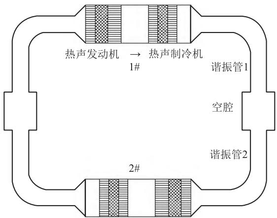  
图1 二单元直连型热驱动热声制冷机示意图

Fig. 1 Schematic of the two-unit direct-coupling heat-driven thermoacoustic refrigerator  
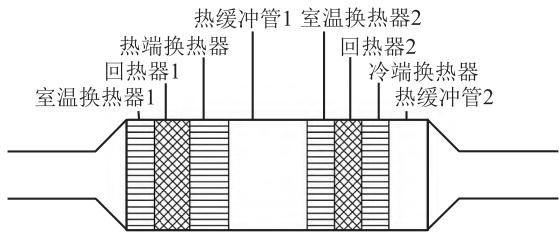  
图2 系统核心单元示意图  
Fig. 2 Schematic of the core of the system

表 1 系统主要尺寸  
Table 1 Main dimensions of the system
<table><tr><td></td><td>部件</td><td>D/mm</td><td>L/mm</td></tr><tr><td rowspan="4">发动机</td><td>室温换热器1</td><td>110</td><td>35</td></tr><tr><td>回热器1</td><td>110</td><td>45</td></tr><tr><td>热端换热器</td><td>110</td><td>50</td></tr><tr><td>热缓冲管1</td><td>110</td><td>100</td></tr><tr><td rowspan="4">制冷机</td><td>室温换热器2</td><td>110</td><td>35</td></tr><tr><td>回热器 2</td><td>110</td><td>35</td></tr><tr><td>冷端换热器</td><td>110</td><td>35</td></tr><tr><td>热缓冲管2</td><td>110</td><td>50</td></tr></table>

声学阻抗 Z 定义为

$$
Z = { \frac { p } { U } }\tag{2}
$$

制冷系数 COP 定义为

$$
\mathrm { C O P } = { \frac { Q _ { \mathrm { C } } } { Q _ { \mathrm { h } } } }\tag{3}
$$

其中， $Q _ { \mathrm { c } }$ 表示制冷机冷端换热器的制冷量， $Q _ { \mathrm { h } }$ 表示发动机热端换热器的加热量。

## 2 计算结果及讨论

## 2.1 关键量沿程分布

直连型热驱动制冷机的核心单元以及整机的声学阻抗Z、 $p U$ 相位差θ以及声功 $W _ { \mathrm { a } }$ 的沿程分布如图3、4所示。图3中0\~35mm为室温换热器1，35\~80 mm为回热器1,80\~130 mm为热端换热器，130\~230 mm 为热缓冲管 1，230\~265 mm 为室温换热器 2，265\~300 mm 为回热器 2，300\~335 mm为冷端换热器，335\~385 mm为热缓冲管2。从图3中可知，由另一单元传输来的2819W声功进入热声发动机室温换热器1，在回热器中被放大了1535W达到了4351 W，经过热端换热器及热缓冲管1被少量消耗。之后声功进入制冷机，在制冷机回热器2与冷端换热器中消耗了777 W后进入调相机构。发动机回热器1以及制冷机回热器2均处于各自较高的声学阻抗，且 $p U$ 相位差θ接近行波，从而保证了该直连型热驱动室温热声制冷机有较高的制冷效率。

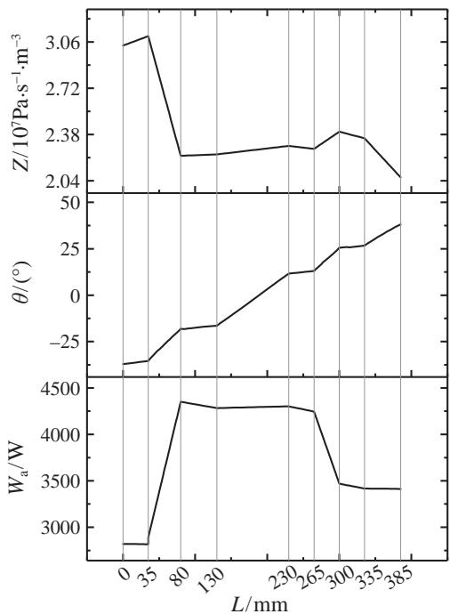  
图3 核心单元内声学阻抗 $Z ,$ p 超前 U 相位角及声功的沿程分布  
Fig. 3 Axial distributions of the dimensionless acoustic impedance, phase angle betweenp and U and acoustic power in the core

图 4 中 535\~7285 mm 为调相机构总长度，其中 385\~535 mm 为变径件，535\~3835 mm 为谐振管1，谐振管1长度3.3m，管径为45mm。3835\~4185mm为空腔，空腔长为 350 mm，管径为110 mm。4185\~7285 mm为谐振管 2，谐振管 2 长度为 3.1m，管径为42mm。从图中可以看出阻抗 Z在谐振管1中呈减小的变化，在空腔以及谐振管2中呈增大的变化。 $p U$ 相位差θ的变化范围为-61°～57°，在调相机构中被调节至入口相位。0.495kW声功在调相机构中被消耗，剩余2.85 kW声功进入到下一个单元。

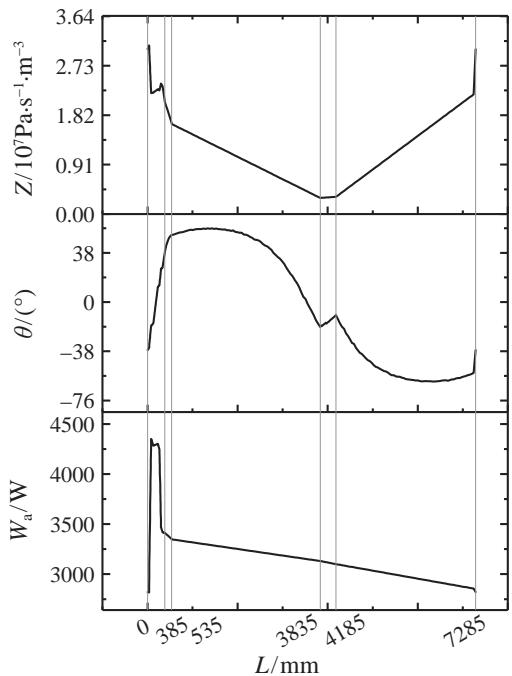  
图4 整机系统内声学阻抗 Z、 $p U$ 相位差及声功 $W _ { \mathbf { a } }$ 的沿程分布  
Fig. 4 Axial distributions of the acoustic impedance, phase angle between p and U and acoustic power of the system

## 2.2 调相系统结构影响

## 2.2.1 谐振管直径的影响

图5\~11考察了在固定谐振管长度、空腔的尺寸的条件下，分别改变谐振管1和2内径对系统运行频率、发动机和制冷机的回热器进出口pU相位差θ、发动机声功产出、制冷机声功消耗及制冷系数COP的影响。计算中，改变谐振1直径时，当谐振管2的直径为42mm；改变谐振管2直径时，谐振管1的直径为45mm。如图5所示，谐振管1、2管径变化引起频率在59\~61Hz内变化，总体来说管径的变化对运行频率的影响较小。通常回热器中的相位差接近于0时，更接近纯行波声场如图6所示，谐振管1管径增加导致发动机的回热器进出口相位差呈增加的趋势，制冷机相位呈减小的趋势。图7中，谐振管2管径增加导致发动机的回热器进出口相位呈减小的趋势，制冷机呈增大的趋势。如图8\~11所示，谐振管1、2管径变化对于发动机回热器声功产出和制冷机回热器声功消耗，以及制冷系数COP均存在最值。当谐振管1管径为47 mm(谐振管 2 管径固定为 42 mm) 发动机回热器声功的产出和制冷机回热器消耗声功最大值分别为 1.93 kW、1.08 kW。谐振管 2 管径 40 mm(谐振管1 固定为 45 mm）时发动机回热器声功的产出和制冷机回热器声功的消耗的最大值分别为1.92kW、1.07 kW。当谐振管1 管径为 45 mm、谐振管2 为 42 mm 时 COP 为最大值为 0.48。

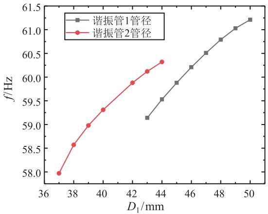  
图5 谐振管1、2管径变化对系统频率的影响  
Fig. 5 The influence of diameter of the resonance tube 1 and 2 on working frequency

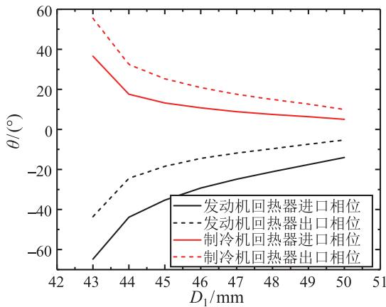  
图6 谐振管1 管径变化对发动机和制冷机的回热器进出口相位角的影响  
Fig. 6 The influence diameter of the resonance tube 1 on inlet and outlet phase angle of regenerators of engine and refrigerator

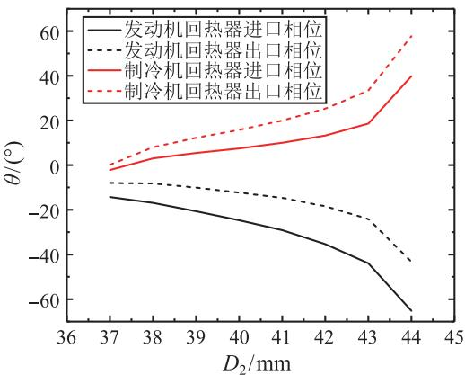  
图7 谐振管2管径变化对发动机和制冷机的回热器进出口相位角的影响

Fig. 7 The influence of diameter of the resonance tube 2 on inlet and outlet phase angle of regenerators of engine and refrigerator  
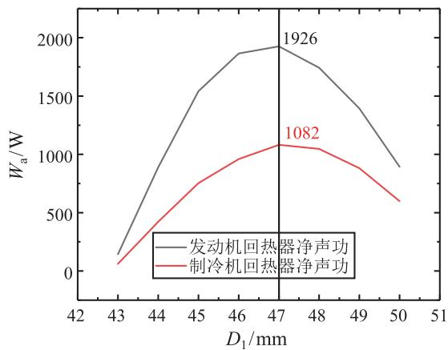  
图8 谐振管1 管径变化对发动机回热器声功产出和制冷机回热器声功消耗的影响

Fig. 8 The influence of resonant tube 1 diameter on acoustic power generation of engine regenerator and acoustic power consumption of refrigerator regenerator  
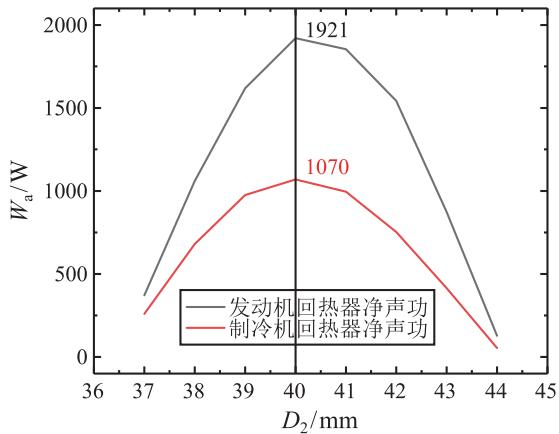  
图9 谐振管2管径变化对发动机回热器声功产出和制冷机回热器声功消耗的影响  
Fig. 9 The influence of resonant tube 2 diameter on acoustic power generation of engine regenerator and acoustic power consumption of refrigerator regenerator

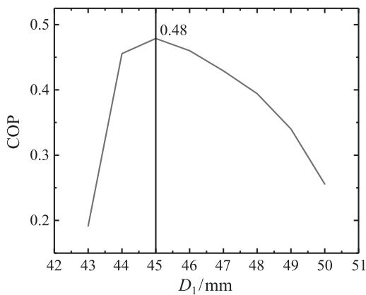  
图 10 谐振管 1 管径变化对制冷系数 COP 的影响

Fig. 10 The influence of resonance tube 1 diameter on coefficient of performance COP  
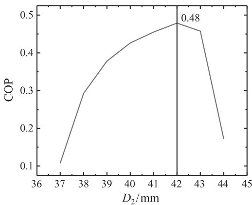  
图 11 谐振管 2 管径变化对制冷系数 COP 的影响  
Fig. 11 The influence of resonance tube 2 diameter on coefficient of performance COP

## 2.3 空腔的影响

图12\~14考察了空腔容积变化对于发动机和制冷机的回热器进出口相位差、发动机回热器声功产生及制冷机回热器声功消耗以及制冷系数COP的影响。此时谐振管1和2的管径分别为45 mm和42mm，长度分别为3.3m、3.1m。计算中系统运行频率在59.88\~60.06Hz之间变化，空腔容积改变对系统的运行频率较小。通常回热器中的相位差接近于0时，更接近纯行波声场，如图12所示，空腔容积的增大使得发动机和制冷机的回热器进出口相位都呈增大趋势。如图13所示，空腔容积的改变使得发动机和制冷机的回热器净声功出现了峰值，并在容积为 $0 . 0 3 6 \mathrm { m ^ { 3 } }$ 时取得最大值分别为1.59kW、0.78kW。如图14所示，制冷系数 COP在容积为 $\mathrm { 0 . 0 3 8 5 \ m ^ { 3 } }$ 时取到最大值0.48。

图15\~17还考察了空腔位置改变对于发动机和制冷机的回热器进出口相位差、发动机回热器声功产出和制冷机回热器声功消耗以及制冷系数

COP的影响。此时谐振管1和2的管径分别为45mm 和42 mm。计算中保持谐振管1、2 的总长6m不变，仅改变空腔位置，系统运行频率影响较小，在59.85～60.59Hz间变化。谐振管1的长度从2.5\~3.5 m，谐振管2 的长度相应的从 3.5\~2.5 m。图15考察了空腔位置对发动机和制冷机的回热器进出口相位角的影响，发动机进出口相位角呈减小的趋势，而制冷机回热器进出口相位角呈增大的趋势。如图16所示，考察了空腔位置对于发动机和制冷机回热器净声功的影响。从图中可以知道，发动机和制冷机净声功存在峰值，当谐振管1的长度增加到3.3m时，净声功减小。如图17所示，制冷系数 COP 也存在峰值，并在谐振管 1 为 3.1 m时，制冷系数COP取到最大值0.48。

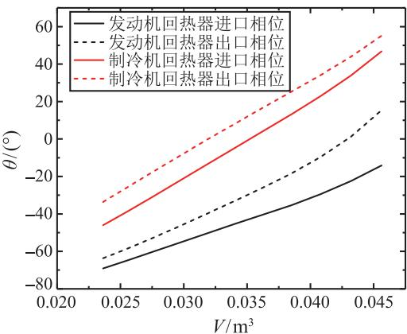  
图12 空腔容积改变对发动机和制冷机的回热器进出口相位角的影响

Fig. 12 The influence of volume of capacitive cavity on inlet and outlet phase angles of regenerators in the engine and the refrigerator  
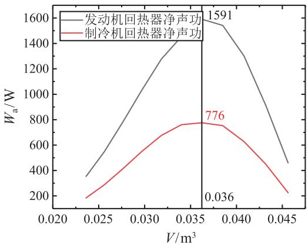  
图13 空腔容积改变对发动机回热器声功产出和制冷机回热器声功消耗的影响  
Fig. 13 The influence of volume of capacitive cavity on acoustic power generation of engine regenerator and acoustic power consumption of refrigerator regenerator

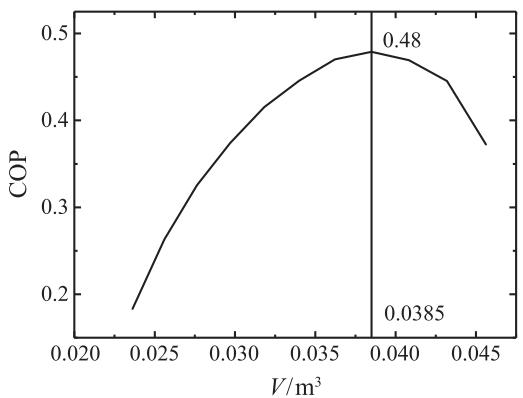  
图 14 空腔容积的改变对系统 COP 的影响  
Fig. 14 The influence of volume of capacitive cavity on coefficient of performance COP

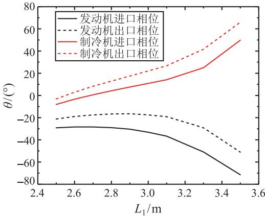  
图15 空腔位置改变对发动机和制冷机回热器进出口相位角的影响

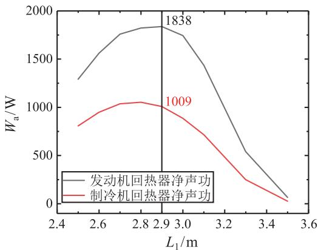  
Fig. 15 The influence of position of capacitive cavity variation on inlet and outlet phase angle of regenerator in engine and refrigerator  
图16 空腔位置改变对发动机回热器声功产出和制冷机回热器声功消耗的影响  
Fig. 16 The influence of position of capacitive cavity on acoustic power generation of engine regenerator and acoustic power consumption of refrigerator regenerator

图 17 空腔位置制冷系数 COP 的影响  
Fig. 17 The influence of position of capacitive cavity on coefficient of performance COP  
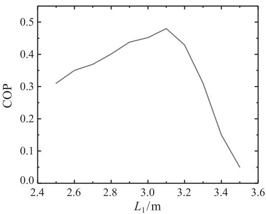

## 3 结论

本文研究了二单元直连型热驱动室温热声制冷机，通过数值模拟考察了调相机构尺寸变化对发动机和制冷机的回热器进出口相位角、发动机声功产生和制冷机声功消耗以及制冷系数COP的影响规律，得到了以下的结论：

谐振管管径、空腔的容积以及空腔的位置的改变对系统运行频率的影响较小，引起频率最大浮动在2Hz以内。对于发动机和制冷机的回热器进出口相位角变化，谐振管1管径增大使得相位角趋近于0°，更接近纯行波声场，而谐振管2则相反。空腔容积的增大使得相位角增大。通常回热器中的相位差接近于0时，更接近纯行波声场，空腔由中间靠上位置向中间靠下位置移动时，发动机和制冷机的回热器进出口相位角差值增大。谐振管管径、空腔容积以及位置的改变对于发动机声功产生和制冷机声功消耗以及制冷系数COP均存在峰值，且声功和制冷系数COP最大值处所对应的谐振管管径、空腔容积和位置是不同的，实际样机设计需要权衡取值。计算制冷系数COP达到的最大值为 0.48。

## 参考文献

[1] 徐烈，朱卫东，汤晓英. 低温绝热与贮运技术 [M]. 北京：机械 工业出版社，1995 XU Lie, ZHU Weidong, TANG Xiaoying. Low Temperature Extinction and Storage and Transprotain Technology [M]. Beijing, China Machine Press, 1995

[2] Swift G W, Martin R A, Radebaugh R, et al. First Measurements with a Thermoacoustic Driver for an Orificepulse-tube Refrigerator [J]. Journal of the Acoustical Society of AmErica, 1990, 88(S1): S95–S96

[3] Swift G W, Wollan J J. Thermoacoustic Natural Gas Liquefier [J]. Journal of the Acoustical Society of Amer-

ica,1999, 105(2): 1011–1018

[4] Arman B, Wollan J, Kotsubo V, et al. Operation of Thermoacoustic Stirling Heat Engine Driven Large Multiple Pulse Tube Refrigerators [M]. Cryocoolers 13, Boston, MA: Springer, 2005: 181–188

[5] DAI Wei, LUO Ercang, HU Jianying, et al. A Heat-driven Thermoacoustic Cooler Capable of Reaching Liquid Nitrogen Temperature [J]. Applied Physics Letters, 2005, 86: 224103

[6] 胡剑英. 液氮至液氢温区的热声驱动低温制冷机的研究 [D]. 北京：中国科学院理化技术研究所，2007 HU Jianying. Study on Thermoacoustic Driven Cryocooler From Liquid Nitrogen to Liquid Helium [D]. Beijing, Institute of physical and chemical technology, Chinese Academy of Sciences, 2007

[7] 黄云，罗二仓，戴巍，等．热驱动室温行波热声制冷机的实验研 究 [J]. 工程热物理学报 2005, 26(2):199–201 HUANG Yun, LUO Ercang, DAI Wei, et al. Experimental Study on a Thermally Driven Room Temperature Traveling Wave Thermoacoustic Refrigerator [J]. Journal of Engineering Thermophysics, 2005, 26(2): 199–201

[8] De Blok K. Multi-stage Traveling Wave Thermoacoustics in Practices [C]//19th International Congress on Sound and Vibration. Vilnius, Lithuania: International Institute of Acoustics and Vibration (IIAV) and Vilnius University, 2012: 1-8

[9] ZHANG Xiaoqing, CHANG Jinzhan, CAI Shanshan, et al. A Multi-stage Travelling Wave Thermoacoustic Engine

Driven Refrigerator and Operation Features for Utilizing Low Grade Energy [J]. Energy Conversion & Management, 2016, 114: 224–233

[10] JIN Tao, YANG Rui, WANG Yi, et al. Acoustic Field Characteristics and Performance Analysis of a Looped Travelling-wave Thermoacoustic Refrigerator [J]. Energy Conversion & Management, 2016, 123: 243–251

[11] WANG Huizhi, ZHANG Limin, YU Guoyao, et al. A Looped Heat-Driven Thermoacoustic Refrigeration System With Direct-Coupling Configuration for Room Temperature. Science Bulletin, 2019, 64(1): 8–10

[12] JIN Tao, YANG Rui, WAMG Yi, et al. Phase Adjustment Analysis and Performance of a Looped Thermoacoustic Prime Mover With Compliance/resistance Tube [J]. Applied Energy, 2016, 183: 290–298

[13] 李晓明，凌虹，戴巍，等.谐振管几何形状工作对热声发动机性 能的影响 [J]. 低温工程，2005(3):11-15 LI Xiaoming, LING Hong, DAI Wei, at all. Influence of Several Shapes of Resonance Tube on the Performance of Thermoacoustic Engine [J]. Low Temperature Engineering, 2005(3): 11–15

[14] 田世城.谐振管几何参数对双级行波热声热机性能影响的模拟 与实验研究 [D]. 广州：华南理工大学，2017 TIAN Shicheng. Simulation and Experimental Study on the Influence of the Geometrical Parameters of Resonant tube on the Performance of Double Traveling Wave Thermoacoustic Engine [D]. Guangzhou: South China University of Technology, 2017