# 直线压缩机驱动热声型低温热声制冷机研究

> 原文核对（2026-09-28）：依据 PDF 第4页（期刊第8页）将 PTC-20 的制冷量“213 W”更正为“21.3 W”；依据 PDF 第6页（期刊第24页）版面分界，移除误混入的 YBCO 超导薄膜论文正文与参考文献。原始 PDF 未改动。

李海冰¹，罗二仓¹²，胡剑英²，朱建¹，戴巍1²，王晓涛²

(1.深圳市中科力函热声技术工程研究中心，深圳518055;

2.中国科学院理化所低温工程学重点实验室，北京100190)

摘要：直线压缩机驱动的热声型低温热声制冷机是获得低温的一种重要制冷技术，它利用直线压缩机往复运动产生的声波驱动脉管产生热声制冷效应而工作。文中报道了由中国科学院理化所和深圳市中科力函热声技术工程研究中心联合研制的系列液氮温区低温热声制冷机，其效率达到22%，为目前国际上所有公开报道的各类热声制冷机中的最高效率。该系列低温热声制冷机在低温下无运动部件、可靠性高，在红外探测器、高温超导滤波器等低温电子器件冷却方面具有重要应用前景。此外，还将对下一步的研究进行简单的介绍。

关键词：高频；热声制冷机；高温超导滤波器

# Study on them oacoustic cryocoolers driven by linear com pressors

LiHaibing, Luo Ercang2, Hu Jianying2, Zhu Jian', DaiW el2, W ang Xiaotao

(1. Zhongke—L ihan Them oacoustic Engineering Research Cen ter Shenzhen 518055, Ch ina

2. Key Laboratory of Cryogen ics Techn ical Institute of Physics and Chem istry CAS Beijing 100190, Ch ina)

A bstract; Linear com pressor driven them oacoustic cryocooler is an im portant technology to ob tain tem peratures below 120 K. The pressure wave was produced in the com pressor by the oscillating piston and then was utilized to pump heat in the cold fin ger based on them oacoustic effect Th is paper introduced six them oacoustic cryocoolers and the relative Camot efficiency of one of them reached 22%, wh ich was the highest effic iency ever reported Due to the advan tages of no m oving low tem perature parts and high reliability th is k ind of cryocooler has great potential applications in the fields of infrared detector h igh temperature su perconductor and so on Besides this the next further study was also briefly in troduced in this paper

K eyw ord s H igh frequency Them oacoustic cryocooler H igh tem pera ture superconduc tor

## 1 引言

直线压缩机驱动的热声型低温热声制冷机是一种利用压缩机产生的压力波在热声制冷机内进行热量输运从而获得制冷效果的一种低温制冷机。直线压缩机因为采用简单的往复运动结构取代曲轴结构，所以不但电声转换效率非常高，而且使用寿命也大为延长。热声制冷机没有任何机械运动部件，并且在液氮温区其理论制冷效率接近于卡诺循环，因此二者的组合构成了一种高效、结构紧凑、长寿命的低温制冷机，在航空、军事、科学研究等方面有着非常广泛的应用前景。

直线压缩机驱动的热声制冷机的特殊用途要求其不断提高整机效率。2000年之前，直线压缩机驱动的热声制冷机的整机效率基本都在15%以下[1]。尽管当时Marquardt等人研制的氧气液化系统，热声制冷部分的相对卡诺效率已经达到了20%，但是因为压缩机和制冷机的匹配问题，整机相对卡诺效率只有13%左右[2]。随着压缩机性能的提高和对热声制冷机机理的深入认识，直线压缩机驱动的热声制冷机性能逐步提高。2002年，美国著名空间技术公司的Tward等人研制了一台制冷量为10W级(制冷温度 95K)的高效直线压缩机驱动的热声制冷机，在液氮温区整机相对卡诺效率达到了17%[3]。2007年，Praxair公司报道了其研制的大型热声制冷机，输入4.3千瓦输入电功在80K制冷温度可获得300W的制冷量，整机相对卡诺效率达到了19.2%[4]，近期其他线性压缩机驱动的热声制冷机的文献报道还未超过此效率[5-7]。本文将介绍4台频率为

50Hz的低温热声制冷机，如表1所示，其最高整机相对卡诺效率达到了22%。

表1 六台直线压缩机驱动的热声制冷机的主要参数  
Tab 1 The m ain param eters of six linear compressor driven them oacoustic cryocoolers
<table><tr><td>型号</td><td>冷指结构</td><td></td><td>频率/Hz 最大制冷量W</td><td></td><td>最低制冷温度/K 最高相对卡诺效率(电制冷)</td></tr><tr><td> $\mathrm { P T C } ^ { - 1 0 }$ </td><td>直线型</td><td>50</td><td>12.4</td><td>42.9</td><td>19.8%</td></tr><tr><td> $\mathrm { C P T C ^ { - } 1 0 }$ </td><td>同轴型</td><td>50</td><td>10.7</td><td>41.6</td><td>18.6%</td></tr><tr><td> $\mathrm { P T C } ^ { - 2 0 }$ </td><td>直线型</td><td>50</td><td>27.7</td><td>29</td><td>22.2%</td></tr><tr><td> $\mathrm { C P T C } ^ { - 2 0 }$ </td><td>同轴型</td><td>50</td><td>24</td><td>35</td><td>18.5%</td></tr><tr><td> $\mathrm { H P T C } - 1 0$ </td><td>直线型</td><td>100</td><td>12.4</td><td>31.9</td><td>18.9%</td></tr><tr><td> $\mathrm { H P T C ^ { - 0 . ~ 5 } }$ </td><td>直线型</td><td>100</td><td>2.36</td><td>45.5</td><td>19.7% (声制冷)</td></tr></table>

直线压缩机驱动的脉冲管制冷机在不断提高整机效率的同时，也在不断追求减少自身体积和质量，提高系统的紧凑性。提高系统紧凑性的最有效办法就是提高系统的工作频率。前面所提到的制冷机的工作频率基本都是在30—60Hz的范围，近几年来频率为100一150Hz的直线压缩机驱动的脉冲管制冷机研究逐步兴起。2007年，Radebaugh等人设计一台工作在 $1 2 0 \mathrm { { H } } \mathbf { \mathbf { z } }$ 的制冷机，无负荷冷头温度到达了49.9K，并在80K获得了3.5W的制冷量。但由于压缩机不是工作在最优工况，其输入功率为300W，其电声转换效率较低[8]。2008年，NGST报导了其设计的高频脉冲管制冷机，最高频率可以达到 $1 4 4 \mathrm { { H } } _ { \mathbf { \delta \mathbf { z } } }$ 在100Hz下无负荷冷头温度到达了47K，其输入功率仅为49W，在 77K时能够提供1. 3W制冷量[9]。本公司从2008年开展小型100Hz脉冲管制冷机的研究，所研制的HPTC一10样机整机已经取得了14W的制冷量，冷头温度到达31. 9K，整机相对卡诺效率最高达到了18.9%，已经十分接近于 3060Hz下的脉冲管制冷机性能，处于国际领先水平。

## 2 实验系统及结果

PTC—10和 PTC—20的结构示意图如图1所示。压缩机为对置结构，这样可以充分减少系统的振动和对被冷却器件的干扰；压缩机采用动磁式设计以提高压缩机的比功率，使压缩机结构更为小巧。热声制冷机结构为直线布置形式，采用冷却水对回热器和脉管的热端进行冷却。调相机构为惯性管加气库结构，为了避免直流效应可能带来的影响，制冷机没有采用双向进气作为辅助的调相结构。冷头温度采用铂电阻温度计(PT100)进行测量，铂电阻温度计的供电电源为

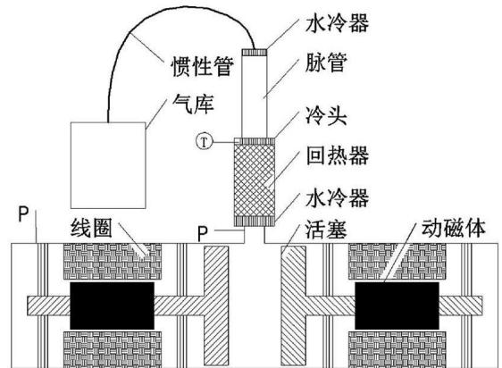  
图1 直线型热声制冷机结构示意图

Fig 1 Schem atic of the in — line designed them oacoustic cryocooler  
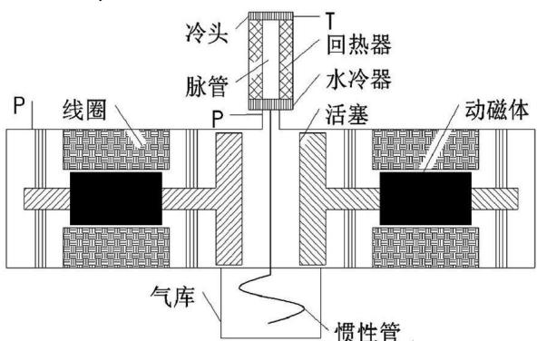  
图 2 同轴型热声制冷机结构示意图  
Fig 2 Schem atic of the co— axial designed them oacoustic cryocooler

Lakeshore120恒流源。冷头外表面缠绕康铜加热丝，采用稳压直流电源对其加热模拟热负载，通过测量电阻丝电阻可计算制冷机的冷头热负荷。压缩机的输入电压和电流通过变送器进入动态信号采集卡进行测量，从而计算压缩机的输入电功。CPTC一10的结构示意图如图2所示。热声制冷机采用了同轴结构，更加便于实际应用。惯性管穿过压缩机后盘绕在气库内，系统结构更为紧凑。压缩机结构以及实验测量系统跟前述系统相同。实验时，制冷机的冷头朝下，以消除脉管内自然对流带来的不利影响。三套系统的充气压力均为20公斤，压缩机工作频率为50Hz

图3给出的是 PTC—10的一组典型降温曲线，在输入电功率为107W时，制冷机的最低制冷温度为42.9K。图4给出的是在不同输入电功率时的制冷量和相对卡诺效率。可以看到制冷机的最大制冷量大约为12.4W，在输入功率为127.2W时制冷量为9.4W，对应的相对卡诺效率达到了19.8%。

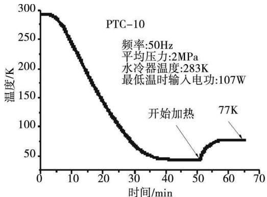  
图 3 PTC-10降温曲线

Fig 3 A typical cool—down curve of PTC—10  
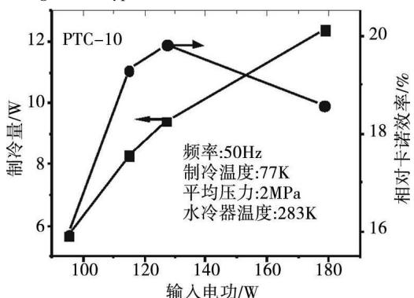  
图 4 PTC—10不同输入电功时的制冷量  
Fig 4 The cooling power versus the input electrical power of PTC-10

CPTC—10所使用的压缩机参数与PTC-10完全相同。CPTC一10的制冷机采用了同轴设计，其回热器为环形结构，但是其横截面积和长度均与PTC一10相同，其它脉管、惯性管、气库等尺寸参数也与 PTC一10完全相同。图5给出的是CPTC一10在输入电功率为150W时在不同的制冷温度下的制冷量。可以看到，制冷机的最低制冷温度约为 41. 6K，在 60K时其制冷量约为5W。图6给出的是在不同输入电功率时的制冷量和相对卡诺效率。在输入电功率为157W时，制冷机的最大制冷量大约为10.7W，对应的相对卡诺效率为18.6%。跟 PTC—10相比较，由于结构上的改变，CPTC一10的最大输入功和最大制冷量有所下降，最大相对卡诺效率也下降了1.2个百分点。目前该型号的制冷机已经基本完成产品的初步定型，预计年内可以进行订货生产。

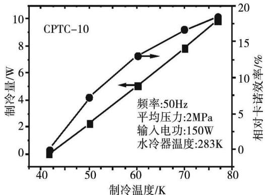  
图 5 CPTC—10不同温度时的制冷量和效率

Fig5 The cooling power and effic iency of CPTC—10 at d if ferent tempera ture  
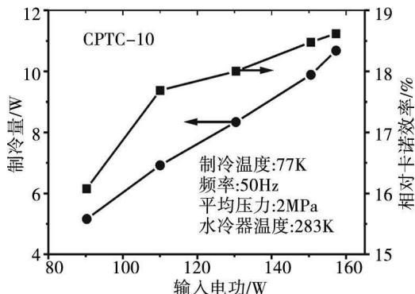  
图 6 CPTC—10在 77K时的制冷量和效率  
F ig6 The cooling power and efficiency at 77K of CPTC—10

PTC—20的设计制冷量为PTC-10的两倍，因此其回热器横截面积、压缩机额定输入功率、活塞面积等也相应地增大到了PTC一10的两倍。图7给出的是PTC一20在输入电功率为360W时在不同的制冷温度下的制冷量。可以看到，制冷机的最低制冷温度在30K以下，在60K时其制冷量超过了16W，在77K时其最大制冷量达到了27.7W。因为在小功率的热声制冷机中，因为脉管热端所需要的惯性管的阻抗幅值较大，而惯性管内因为湍流的存在会使惯性所能够实现的阻抗幅值范围变小，因此惯性管通常无法实现脉管热端所需要的最佳阻抗，所以制冷机的效率会相应地降低。在较大功率的热声制冷机中，脉管热端所需要的最佳阻抗更容易通过惯性管实现，所以理论上其效率更高一些，这一点在本文的研究中可以得到佐证。图8给出的是在不同输入电功率时PTC一20的制冷量和相对卡诺效率。可以看到，在输入功为271W时，制冷机的制冷量为21.3W，相应的相对卡诺效率为22.2%，相比于PTC一10提高了2.4个百分点，这是目前有报道的斯特林型热声制冷机的最高效率。

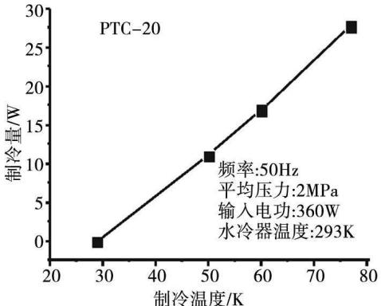  
图 7 PTC—20不同温度时的制冷量和效率

Fig 7 The cooling power and effic iency of PTC —20 at dif ferent tem perature  
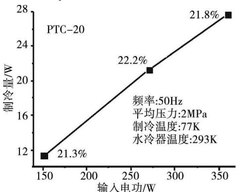  
图8 PTC—20在 77K时的制冷量和效率  
Fig8 The cooling power and effic iency at 77K of PTC—20

CPTC—20所使用的压缩机参数与PTC—20完全相同。CPTC一20的制冷机采用了同轴设计，其回热器为环形结构，但是其横截面积和长度均与PTC一20相同，其它脉管、惯性管、气库等尺寸参数也与PTC一20完全相同。图9给出的是CPTC一20在输入电功率为360W时在不同的制冷温度下的制冷量。可以看到，制冷机的最低制冷温度约为 35K，在 60K时其制冷量约为 11.7W。图10给出的是在不同输入电功率时的制冷量和相对卡诺效率。在输入电功率为365W时，制冷机的最大制冷量大约为24W，对应的相对卡诺效率为18.5%。前该型号的制冷机也已经基本完成产品的初步定型，预计年内可以进行订货生产。

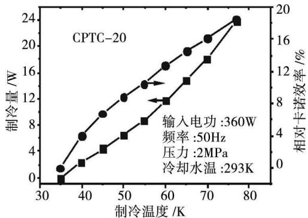  
图 9 CPTC—20不同温度时的制冷量和效率

Fig9 The cooling power and effic iency of CPTC—20 at different temperature  
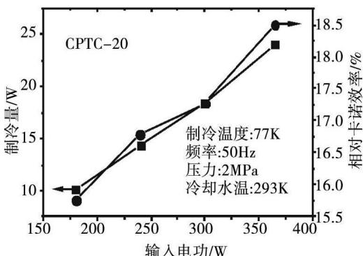  
图 10 CPTC—20在 77K时的制冷量和效率  
Fig 10 The cooling power and effic iency at 77K of CPTC— 20

本文中PTC一10所采用的线性压缩机尺寸大概为 $1 3 \mathbf { q } \mathbf { m } \times 1 3 \mathbf { q } \mathbf { m } \times 3 7 \mathbf { q } \mathbf { m } ,$ 相比于其他的低温制冷方式，其比功率处于遥遥领先的位置，但是某些特殊的应用场合要求有更高比功率的制冷机，因此对脉冲管制冷机提出了新的挑战。线性压缩机驱动的脉冲管制冷机的体积主要由压缩机构成，因此如何提高压缩机的比功率成为研究的焦点。

在谐振状态时直线压缩机的输入电功可以表示为： $\mathrm { { W } _ { \mathrm { { e l e c } } } = \mathrm { { \frac { 1 } { 2 } } R e ( V \bullet \check { \ I } ) = \frac { R _ { \mathrm { { e l e c } } } } { 2 } \mid \ I \mid ^ { 2 } + \frac { B L } { A } \vert \ U \vert \mid \ I \vert } }$

(1)

从(1)式可以看到，压缩机输入的电功可以分成两部分，一部分被线圈电阻消耗，另一部分被转换为电磁力做功(电磁力做的功一部分被机械阻尼消耗，另一部分被负载吸收)。对于同一个压缩机，线圈的最大电流是限定的，如果频率升高，在保持活塞的相同位移幅值时，体积流增大，压缩机的输入电功就会相应增大。因此提高运行频率是增加系统的功率密度的最直接的办法，也是目前研究的热点，为此我们研制了HPTC一10和 HPTC—0.5两套频率为100Hz的制冷机系统。

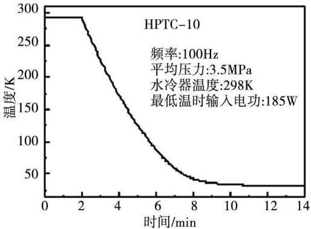  
图 11 HPTC—10降温曲线

Fig 11 A typical cooling—down curve of HPTC—10  
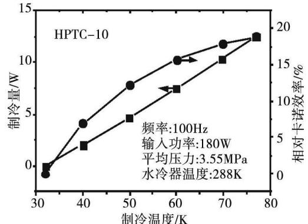  
图12 HPTC一10不同温度时的制冷量和效率  
Fig 12 The cooling power and efficiency of HPTC —10 at different tempera ture

HPTC一10的冷指结构为直线型，其压缩机为但电机结构，采用被动振子进行减震。由于采用了高频设计，该制冷机的降温速度非常快，在5分钟的时间内就可以到达液氮温区，图11给出的是HPTC一10的一组典型降温曲线，在输入电功率为180W时，制冷机的最低制冷温度为32K。图12给出的是 HPTC—10在输入声功率为 180W时在不同的制冷温度下的制冷量。可以看到，在77K时其最大制冷量达到了12.4W，对应的整机相对卡诺效率18.9%。目前该系统中的压缩机正在进一步的改进中，预计该系统的最终总质量将小于5kg

HPTC一0.5的冷指结构为直线型，因为暂时没有相应的压缩机与之匹配，所以采用了PTC一20中所使用的压缩机进行驱动。由于该制冷机非常小，回热器直径只有8mm，所以只需要输入约4. 3W的声功率即可达到液氮温度77K。图13给出的是 PTC一0.5在输入声功率为35W时在不同的制冷温度下的制冷量。可以看到，制冷机的最低制冷温度约为45.5K，在 60K时其制冷量超过了0. 9W，在 77K时其最大制冷量达到了236W。图14给出的是在不同输入电功率时的制冷量和相对卡诺效率。在输入声功率为26.8W时制冷量为1.88W，对应的声致冷相对卡诺效率达到了19.7%。目前与之相匹配的压缩机正在开发研制中，估计整机重量将不超过500克。

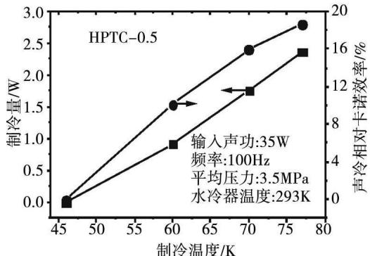  
图 13 HPTC—0.5不同温度时的制冷量和效率

Fig 13 The cooling power and efficiency of HPTC —0. 5 at different temperature  
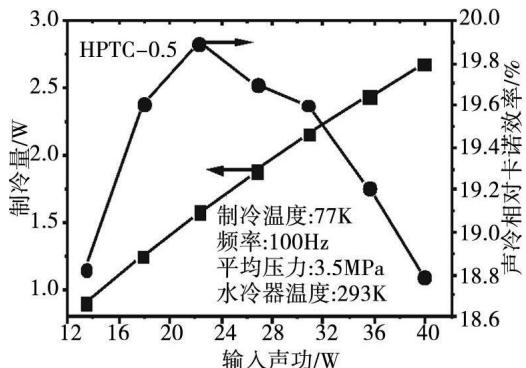  
图 14 HPTC—0.5在 77K时的制冷量和效率  
Fig 14 The cooling power and efficiency at 77K ofHPTC—0. 5

## 3 总结

本文介绍了五台直线压缩机驱动的脉冲管制冷机的实验结果，最高获得了22%的相对卡诺效率，这是目前有文献报道的最高效率。特别值得指出的是紧凑、高效的100Hz级的直线压缩机驱动的脉冲管制冷机也取得了世界领先的结果，为下一步的实际应用奠定了坚实的基础，相信很快将有相关方面的产品问世。 (下转 24页)

(上接9页)

## 参考文献

[1] R adebaugh R. The developm ent and application of cryo− coolers since 1985 [ C ]. In; Chen G B, et al Proceedings of C ryogen ic and Refrigeration Proceed ings of IC-CR. Beijing Intemational A cadem ic Publishers and W orld Publish ing Corporation 2003, 857 —870.

[2] M arquardt E D, R adebaugh R. Pulse tube oxygen lique− fier[ J]. Advances in Cryogenic Engineering 2000, 45 (A):457—464.

[3] Tward E Chan C K, Colbert R, et al H igh efficiency cryocooler[ J]. Advances in Cryogenic Engineering 2002, 47(B): 1077—1084.

[4] Zia JH. A pulse tube cryocooler w ith 300W refrigeration at 80K and an operating effic iency of 19% Camot[ C ]. In; M iller SD, Ross RG. C ryocoolers 14. Annapolis M aryland: ICC Ino , 2007, 141—147.

[5] Vanapalli S Lew is M, Gan Z et al 120H z pulse tube cryocooler for fast cooldown to 50K[ J]. Appl Phys Lett 2007, 90(7): 072504.

[6] Gan Z H, Liu G JW u Y Z et al Study on a 5. OW /80K single stage Stirling type pulse tube cryocooler[ J]. J Zhejiang Un iv—Sc A. 2008, 9 (9): 1277—1282.

[7] van de G roep W L M ullie J C, W illem s D W J et al Developm ent of a 15W coaxial pulse tube cooler[ C ]. In: Ross R G. C ryocoolers 15. Boulder CO: ICC Ino 2009, 157—165.

[8] Vanapalli S Lew is M, Gan Z et al 120H z pulse tube cryocooler for fast cooldown to 50K [ J]. Appl Phys Letters 2007, 90: 072504.

[9] Petach M, W atem an M, Pruitt G, et al H igh frequency coax ial pulse tube m icrocoo ler[ C ]. In; Ross RG. C ryo− cooler 15. Boulder CO: ICC Ino , 2009, 97—103.