# A High Frequency Thermoacoustically Driven Thermoacoustic-Stirling Cryocooler

E.C. Luo, G.Y. Yu, S.L Zhu, W. Dai

Technical Institute of Physics and Chemistry Chinese Academy of Sciences Beijing 100080, China

## ABSTRACT

A thermoacoustically driven pulse tube cryocooler is expected to be highly reliable due to its having no moving parts; this gives it good potential for applications in aerospace cryogenic cooling. However, because mature pulse tube cryocoolers usually operate below 100 Hz, previously developed thermoacoustically driven pulse tube cryocoolers tend to be too large and heavy for aerospace cooling. One means to solve this deadlock is to increase the operating frequency of the cryocooler. In this paper, a thermoacoustically driven thermoacoustic-Stirling cryocooler operating around 500 Hz is studied theoretically. The thermoacoustic-Stirling cryocooler (TASC) is a traveling-wave thermoacoustic refrigerator with acoustical recovery. The thermodynamic analysis and optimization shows that a high frequency thermoacoustic-Stirling cryocooler can achieve a no-load temperature around 80 K or even lower. In parallel, a thermoacoustic-Stirling heat engine (TASHE) for driving the TASC was also optimized; it shows excellent performance at the high operating frequency. The work provides useful guidance for future experimental prototypes.

## INTRODUCTION

Thermoacoustically driven refrigerators have no moving parts and therefore are expected to be highly reliable. This obvious advantage makes them very attractive for aerospace cooling, which strongly requires high reliability. In the past two decades, thermoacoustically driven cryocoolers have seen significant advances. In 1990, Dr. Radebaugh's group cooperated with Dr. Swfit's group to develop the first thermoacoustically driven pulse tube cryocooler that is able to achieve a lowest temperature of about 90 K [1]. The thermoacoustically driven cryocooler is mainly composed of a standing-wave thermoacoustic heat engine and a single-stage orifice pulse tube cooler. Efficient thermoacoustic heat engines were not achieved until Backhaus and Swift et al. developed the so-called thermoacoustic-Stirling heat engine (TASHE) that is capable of achieving a thermal efficiency of about 30% for conversion of heat energy to acoustic energy [2]. More recently, Dr Luo's group reached a high pressure ratio above 1.3 in the so-called energyfocused thermoacoustic heat engine (EF-TASHE); this system used a specially shaped resonator instead of a conventional cylindrical resonator [3]. The inventions of the thermoacoustic-Stirling heat engine, as well as energy-focused resonator, greatly advanced the development of a useful thermoacoustically driven pulse tube cryocooler. Driven by the EF-TASHE, the first thermoacoustically driven cryocooler to achieve cooling below liquid nitrogen temperatures was the TIPC/CAS [4]. Also, an 80.9 K thermoacoustically driven double-inlet pulse tube cryocooler was reported by Zhejiang University [5]. After several improvements, the TIPC/CAS thermoacoustically driven pulse tube cryocooler successfully achieved cooling at 33 K using a single-stage configuration [6]. These advances demonstrate the potential of thermo-acoustically driven cryocoolers to meet future aerospace cooling needs at temperatures below 80 K.

A potential obstacle, however, is that the thermoacoustically driven cryocoolers mentioned above all operate at a relatively low frequency (<100 Hz). This leads to a large-size thermoacoustic heat engine. For aerospace cryogenic cooling, using such a large-size and heavy system is obviously unrealistic. One way to decrease the size of the thermoacoustic-Stirling heat engine is to increase its operating frequency up to about 500 to 800 Hz. Moreover, a cryocooler operating in the thermoacoustic-Stirling mode may in principle achieve higher efficiency as compared to a conventional pulse tube cryocooler. Based on these considerations, we are trying to develop a thermoacoustically driven thermoacoustic-Stirling cryocooler operating at a high frequency of about 500 Hz. This paper primarily presents theoretical predictions for a thermoacoustic-Stirling heat engine and an associated cryocooler. However, an experimental prototype that is under test is also described.

## PHYSICAL MODEL

A schematic of a thermoacoustically driven cryocooler is shown in Figure 1. It mainly includes a looped thermoacoustic-Stirling heat engine subsystem and a looped thermoacoustic-Stirling cryocooler subsystem and a resonance tube in between. As described elsewhere [7], both subsystems have similar thermodynamic components and are topologically arranged to help realize the Stirling cycle. Basically, thermoacoustic conversion in both subsystems mainly occurs in the two regenerators where an in-phase relationship of pressure and velocity is required for efficient operation. However, it is very crucial for achieving the in-phase relationship to design an appropriate inertance tube and compliance. For the cryocooler, designed for a few watts at 80K, we tentatively chose a regenerator having a diameter of about 10 mm. For the thermoacoustic heat engine, we chose its regenerator with a diameter of about 30 mm. As will be discussed in the following section, the analyzed system can produce an acoustical power of hundreds of watts that can be used to drive the thermoacoustic-Stirling cryocooler. For convenience, we fixed some of the operating parameters: the heating temperature is 923 K, the ambient temperature 300 K, the refrigeration temperature 80 K, and the mean pressure 5.0 MPa. These values stem from our extensive theoretical simulations that indicated that a high mean pressure from 5.0 to 10MPa may give good thermoacoustic conversion efficiency for the heat engine. That's the reason that we chose a mean pressure of 5.0 MPa. Keeping these data in mind, we can theoretically analyze the influence of different structural parameters on the thermodynamic performance of both the thermoacoustic-Stirling heat engine and the cryocooler.

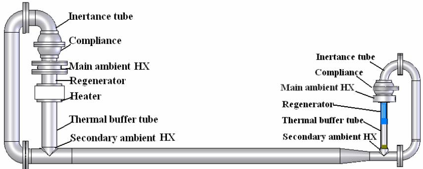  
Figure 1. Schematic of the thermoacoustically driven cryocooler with double thermoacoustic-Stirling cycles.

## PERFORMANCE PREDICTION

## Thermoacoustic-Stirling Cryocooler

Let us first look at predicted performance of the thermoacoustic-Stirling cryocooler. Basically, we have used our Thermoacoustic Simulator code, which was described elsewhere [8] to predict and optimize thermodynamic performance of any thermoacoustic systems. Some operating conditions have already been mentioned above. With regard to structural parameters, the diameter of the thermal buffer tube (pulse tube) and main and secondary ambient heat exchangers is set to the same diameter as that of the regenerator, and their lengths are 80 mm, 10 mm, and 5 mm, respectively. The thickness of the pulse tube wall is 0.15 mm. The main and secondary ambient heat exchangers are formed with parallel plates with a thickness of 0.5 mm and a gap distance of 0.5mm. The compliance is 50 mm in diameter and 20 mm in length. The diameter of the inertance tube is set as 20 mm. The regenerator is filled with 600-mesh stainless steel screens that have a wire diameter of 0.025 mm and yield a porosity of 0.59. Both the lengths of the inertance tube and regenerator will be optimized for different frequencies from 100 Hz to 1000 Hz, though the performance at 500 Hz will be highlighted. Because the sound velocity in helium is about 1000 m/s at ambient temperature, the total length of the whole system for 500 Hz operation will be less than 1 meter.

Figure 2 gives the optimized lengths of the inertance tube and regenerator as a function of operating frequency and the key thermodynamic performance of the thermoacoustic-Stirling cryocooler at the driving pressure ratio of 0.05. It should be mentioned that the optimized function is the thermal efficiency. As seen from Figure 1, the cooling power and consumption power are about 0.92 W and 31.3 W at 500 Hz operation; this corresponds to optimized lengths of the inertance tube and regenerator of about 164.6 mm and 24.9 mm, respectively. Basically, both the optimized lengths decrease with increasing operating frequency. When performing a calculation based on the data given in Figure 2a, it is found that the %Carnot efficiency decreases from 15% at 100 Hz to 1% at 800 Hz. Above 850 Hz, a cooling temperature of 80 K does not appear to be achievable.

The operating characteristics of the thermoacoustic-Stirling cryocooler with driving pressure ratios of 0.075 and 0.10 are also calculated. Their operating features are similar to those for the driving pressure ratio of 0.05. Comparatively, their cooling powers and consumption powers both increase. The cooling powers at 0.075 and 0.10 driving pressure ratios climb to 2.0 W and 3.0 W, while the consumption powers increase to 42.3 W and 55.8 W. The calculated thermodynamic efficiency of the three cases at 500 Hz varies from 7.9% to 15.1% of Carnot.

Moreover, the profiles of the time-averaged energy fluxes (acoustic power flux, total energy flux power, heat flux power), mean temperature and oscillating pressure and volume rate in the TASR with the driving pressure ratio of 0.05 are given in Figures 3a to 3d. They are as expected.

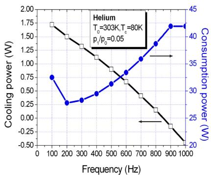  
a) Cooling power and consumption power

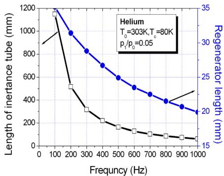  
b) Optimized lengths r  
Figure 2. Cooling performance and optimized lengths at a driving pressure ratio of 0.05. a) Cooling power and consumption power vs. frequency; b) Optimized lengths of the inertance tube and regenerator vs. frequency.

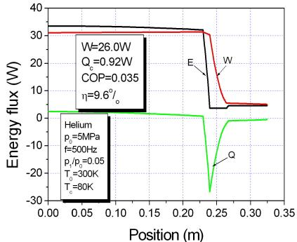  
a) Energy flux

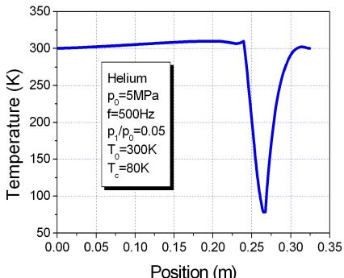  
b) Temperature

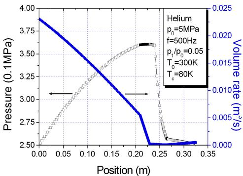  
c) Pressure and volume rate

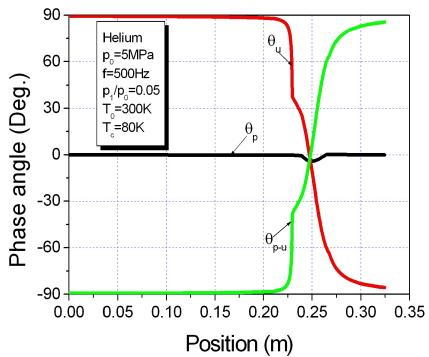  
d) Phase angle  
Figure 3. Energy flux, temperature, pressure and volume rate, and phase angle profiles in TASC with a driving pressure ratio of 0.05. a) Energy flux; b) Temperature; c) Pressure and volume rate amplitudes; d) Phase angles of pressure, volume rate and p leading U.

## Thermoacoustic-Stirling Heat Engine

The thermoacoustic-Stirling heat engine subsystem mainly includes the inertance tube, compliance, main ambient after-cooler, regenerator, hot-end heat exchanger, thermal buffer tube and secondary ambient after-cooler. All heat exchangers simulated here are parallel-plate heat exchangers. Actually, there are a number of structural parameters to be optimized for most efficient operation, which is too ambitious for this work. Instead, some structural parameters are simply determined based on our previous experimental results and some simple principles. Comprehensively, considering thermal penetration depth and our practical EDM capability, all heat exchangers were chosen with a 0.5 mm gap distance and 0.5mm fin thickness; all housing tubes are 30 mm diameter. The lengths of the hot-end exchanger, main ambient after-cooler, and secondary after-cooler are 10mm, 10mm, and 5mm, respectively. The structural parameters of the regenerator are particularly important. Here, 300-mesh stainless steel screen is selected as the packing material of the regenerator, with a wire diameter of 31 μm and a porosity of 0.69. The length of the thermal buffer tube is 90mm, 3 times its diameter. The objective of the simulation is to find the influence of the lengths of regenerator and inertance tube on the thermodynamic performance of the thermoacoustic-Stirling heat engine. Our thermoacoustic simulator code is used to optimize these lengths and analyze the system performance.

Figure 4 gives the optimized lengths of the inertance tube and regenerator as a function of operating frequency and the key thermodynamic performance of the TASHE at the driving ratio of 0.05. The optimized function is again the %Carnot thermal efficiency. As seen in Figure 4, the acoustical power and heating power are about 156W and 427W at 500 Hz, and the corresponding optimized lengths of the inertance tube and regenerator are 164.6mm and 24.9 mm. Basically, both optimized lengths decrease as the operating frequency increases. If performing a calculation based on the data given in Figure 4a, it is found that the second-law thermal efficiency decreases from 58.6 % (200 Hz) to 48.9 % (800 Hz). In addition, there is a peak value. We also predicted the operating performance of the TASHE at driving pressure ratios of 0.075 and 0.10, respectively. The acoustical powers at 0.075 and 0.10 driving pressure ratios are 247 W and 324W, respectively, corresponding to heating powers of 614 W and 787 W. The second-lawefficiency with the three pressure ratios at 500Hz varies from 54.6% to 61.6%, which is a very encouraging result.

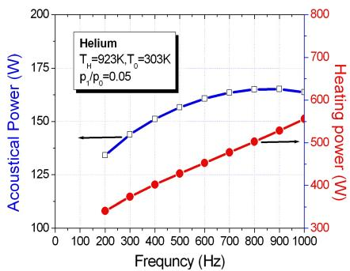  
a) Acoustical power r and heating power

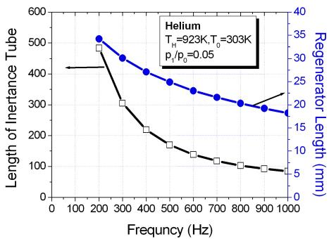  
b) Optimized lengths

Figure 4. Thermodynamic performance and optimized lengths of TASHE at a driving pressure ratio of 0.05: a) Acoustical power and heating power vs. frequency; b) Optimized lengths of the inertance tube and regenerator vs. frequency.  
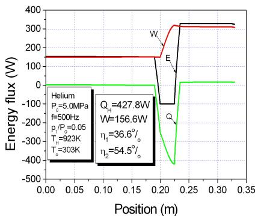  
a) Energy flux

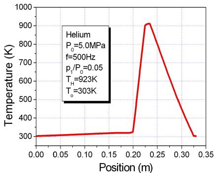  
b) Temperature

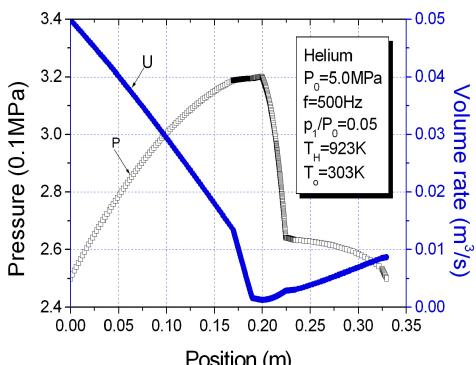  
c) Pressure and volume rate

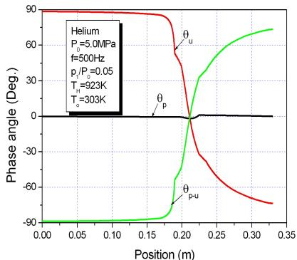  
d) Phase angles of P, U and P leading U  
Figure 5. Energy flux, temperature, pressure and volume rate, and phase angle profiles in the TASHE with a driving pressure ratio of 0.05: a) Energy flux; b) Temperature; c) Pressure and volume rate amplitudes; d) Phase angles of pressure, volume rate and p leading U.

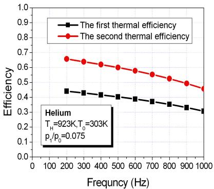

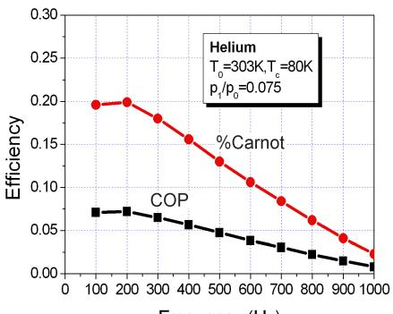  
Frequency (Hz)  
Figure 6. The efficiency of TASHE and TASC at a driving pressure ratio of 0.05: a) The first and second-law thermodynamic efficiency of TASHE; b) COP and the %Carnot thermal efficiency of TASC.

Moreover, the profiles of the time-averaged energy fluxes (acoustic power flux, total energy flux power, heat flux power), mean temperature and oscillating pressure and volume rate in the TASHE with the driving pressure ratio of 0.05 are given in Figures 5a to 5d. They are as expected.

Finally, Figure 6a gives the first and second-law thermodynamic efficiencies of the TASHE at a driving pressure ratio of 0.075, while Figure 6b gives the COP and %Carnot thermodynamic efficiency of the TASC at a driving pressure ratio of 0.075. The performance of the TASHE appears to be excellent, but the TASC needs to be improved very much. The reason for the result is currently unknown.

## CONCLUSIONS

Thermoacoustically driven cryocoolers with a double thermoacoustic-Stirling cycle have been modeled. The following conclusions are evident:

For the TASHE, high frequency may decrease thermoacoustic efficiency. At 500 Hz, the %Carnot thermal efficiency may reach about 60%. Optimized lengths of the inertance tube and regenerator are given for each frequency. Different driving pressure ratios do not significantly affect the optimized lengths; however, they significantly affect the acoustical power production. At 500Hz, the two optimized lengths are about 125-170 mm and 21-23 mm, corresponding to acoustical powers of 150-320 W.

For the TASC, high frequency significantly decreases refrigeration efficiency. At 500 Hz, the %Carnot thermal efficiency may reach about 8%-15%. A different driving pressure ratio does not significantly affect the optimized lengths; however, it significantly affects acoustical power production. At 500 Hz, the two optimized lengths are about 100-165 mm and 18-25 mm, corresponding to cooling powers of 0.9 - 3 W.

Based on the simulated results of both the TASHE and TASC, it appears to be highly feasible to develop a compact and efficient thermoacoustically driven cryocooler for aerospace cooling.

## ACKNOWLEDGMENT

This work was supported by the Natural Sciences Foundation of China (Grant No. 50536040).

## REFERENCES

1. Radebaugh, R., et al., "Development of a Thermally Driven Orifice Pulse Tube Refrigerator," Proc. 4th Interagency Meeting on Cryocoolers, David Taylor Res. Center, DTRC-91/003 (1991), pp. 205.

2. Backhaus, S., Swift, G.W., "A Thermoacoustic Stirling Heat Engine,"Nature, vol.339 (1999), pp. 335-338.

3. Luo, E.C., Ling, H., Dai, W., et al., "A High Pressure-Ratio, Energy-Focused Thermoacoustic Heat Engine with a Tapered Resonator,"Chinese Science Bulletin, vol.50, no.33 (2005), pp. 284-286.

4. Dai, W., Luo, E.C., Hu, J.Y., et al., “A Heat-Driven Thermoacoustic Refrigerator Capable of Achieving below Liquid Nitrogen Temperature," Applied Physics Letters, vol.86 (2005), pp. 224103.

5. Qiu, L.M., Sun, D.M., Yan,W.L, et al., "Investigation on a Thermoacoustically Driven Pulse Tube Cooler Working at 80 K,"Cryogenics, vol.45, no.5 (2005), pp. 380-385.

6. Hu, J.Y., Luo, E.C., Dai,W., et al., A Thermoacoustically Driven Cryocooler Operating below 35 K by Using an Innovative Configuration," Journal of Applied Physics, 2006 (Submitted).

7. Luo, E.C., Dai, W., Zhang, Y., et al., "Thermoacoustically Refrigerator with Double Thermoacoustic-Stirling Cycles," Applied Physics Letters, vol.88 (2006), pp. 074102.

8. Luo, E.C., Wu, J., Yang, J., et al., "Thermoacoustic Simulator for Regenerative Machines," Adv. Cryo. Eng., vol.47A (2002), pp. 828-835.