## Accepted Manuscript

Thermoacoustic cooler to meet medical storage needs of rural communities in developing countries

Patcharin Saechan, Artur J. Jaworski

PII: S2451-9049(18)30150-1

DOI: https://doi.org/10.1016/j.tsep.2018.05.001

Reference: TSEP 174

To appear in: Thermal Science and Engineering Progress

Received Date: 14 March 2018

Revised Date: 4May 2018

Accepted Date: 5 May 2018

Please cite this article as: P. Saechan, A.J. Jaworski, Thermoacoustic cooler to meet medical storage needs of rural communities in developing countries, Thermal Science and Engineering Progress (2018), doi: https://doi.org/ 10.1016/j.tsep.2018.05.001

This is a PDF file of an unedited manuscript that has been accepted for publication. As a service to our customers we are providing this early version of the manuscript. The manuscript will undergo copyediting, typesetting, and review of the resulting proof before it is published in its final form. Please note that during the production process errors may be discovered which could affect the content, and all legal disclaimers that apply to the journal pertain

# Thermoacoustic cooler to meet medical storage needs of rural communities in developing countries

Patcharin Saechan ¹ and Artur J. Jaworski 2,\*

Department of Mechanical & Aerospace Engineering, Faculty of Engineering, King Mongkut's University of Technology North Bangkok, Bangkok, 10800, Thailand

2 Huddersfield HD1 3DH, United Kingdom

\* Corresponding author: a.jaworski@hud.ac.uk; Tel: +44(0)148-447-2965

## Abstract

Rural communities in developing countries often require small cold storage for vital medicines while having no access to electricity. The utilization of waste heat – produced in biomass burning cookstoves during daily cooking routines – to power a thermoacoustic engine driving a thermoacoustic refrigerator is investigated. The simplicity and affordability is met by the use of atmospheric air as working medium, cheap PVC ducting for acoustic waveguides and locally available blacksmithing technologies for simple heat exchangers. This paper describes DeltaEC modelling, fabrication and experimental evaluation of a laboratory concept demonstrator. The travelling-wave, looped-tube engine/cooler configuration is powered by a propane gas burner to mimic cookstove flue gases. A matching stub is used to match the acoustic impedances of engine and cooler. The optimum location of the cooler is investigated experimentally. The device achieves the minimum temperature of $- 8 . 3 ^ { \circ } \mathrm { C }$ and up to 7 W of cooling power at a storage condition of $+ 8 ^ { \circ } \mathrm { C }$

Keywords: Thermoacoustic refrigeration; Thermoacoustic engine; Travelling wave; Cookstoves; Biomass combustion; Rural communities

## Nomenclature

<table><tr><td></td><td></td></tr><tr><td>COP</td><td>Coefficient of performance</td></tr><tr><td>COPC</td><td>Carnot coefficient of performance</td></tr><tr><td>COPR</td><td>Coefficient of performance relative to Carnot</td></tr><tr><td>È</td><td>acoustic power, [W]</td></tr><tr><td>H</td><td>total power, [W]</td></tr><tr><td>p</td><td>pressure, [Pa]</td></tr><tr><td>À</td><td>heat transfer rate, [W]</td></tr><tr><td>T</td><td>temperature, [K, °C]</td></tr><tr><td>U</td><td>volumetric flow rate, [m³/s]</td></tr><tr><td>x δ</td><td>position coordinate along the loop, [m]</td></tr><tr><td></td><td>penetration depth. [m]</td></tr><tr><td>Subscripts</td><td>MANUSCRIPT</td></tr><tr><td>a ambient</td><td></td></tr><tr><td>C</td><td>cooler; cold</td></tr><tr><td>e</td><td>engine</td></tr><tr><td>K</td><td>thermal</td></tr><tr><td>load</td><td>cooling load</td></tr><tr><td>net</td><td>net</td></tr><tr><td>1</td><td>first order of acoustic variable</td></tr><tr><td>2</td><td>second order of acoustic variable</td></tr><tr><td></td><td></td></tr><tr><td>Abbreviations AHX</td><td>山</td></tr><tr><td>CHX</td><td>Ambient Heat Exchanger Cold Heat Exchanger</td></tr><tr><td>2ⁿdCHX</td><td>Secondary Cold Heat Exchanger</td></tr><tr><td>DC</td><td>Direct Current (electricity)</td></tr><tr><td>DeltaEC</td><td>Design Environment for Low-amplitude ThermoAcoustic Energy Conversion</td></tr><tr><td>HHX</td><td>Hot Heat Exchanger</td></tr><tr><td>ID</td><td>Inside Diameter</td></tr><tr><td>OD</td><td>Outside Diameter</td></tr><tr><td></td><td>Pressure Sensor Location</td></tr><tr><td>REG</td><td>Regenerator</td></tr><tr><td>SCORE</td><td>Stove for COoking, Refrigeration and Electricity supply</td></tr><tr><td>TASHE</td><td>Thermoacoustic Stirling Heat Engine</td></tr><tr><td></td><td></td></tr><tr><td>TBT</td><td>Thermal Buffer Tube</td></tr><tr><td>T/C</td><td>Thermocouple</td></tr></table>

# ACCEPTED MANUSCRIPT

## 1. Introduction

Broadly speaking, thermoacoustic technologies utilise heat transfer interactions between a solid boundary and a gas subjected to acoustic excitation (hence the term “thermoacoustics" has been coined). In the presence of acoustic wave, the gas “parcels" (or fluid elements) undergo a cyclic oscillating gas parcels in the vicinity of the solid with an imposed temperature gradient produces interesting oscillatory heat transfer processes that are of practical importance. For instance, imposing an appreciable temperature gradient (above a critical value) along the solid material results in a spontaneous generation of the acoustic power. On the other hand, imposing an acoustic wave along the solid material leads to generation of a temperature gradient along the solid due to hydrodynamic heat pumping processes. These two types of thermoacoustic processes find their use in two types of devices: thermoacoustic engines and coolers (or heat pumps), respectively. A schematic diagram of a travelling wave thermoacoustic engine is presented in Figure 1. The main components are a porous material called regenerator sandwiched between two heat exchangers which generate a temperature gradient along the regenerator. The heat transfer interaction between gas and solid material in a travelling wave thermoacoustic engine undergoes a Stirling-like thermodynamic cycle which can be approximated by four phases: compression, displacement toward the higher temperature, expansion and displacement toward the lower temperature.

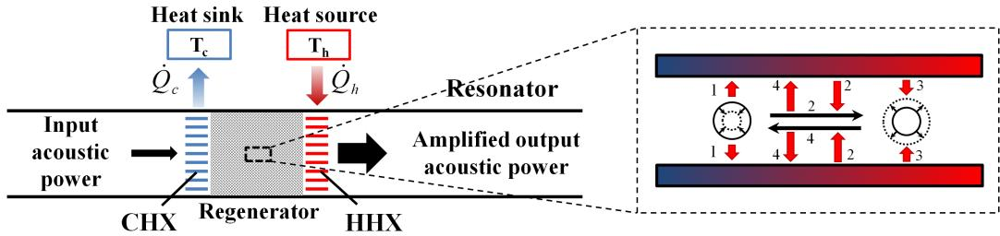  
Fig. 1. Simplified schematic diagram of a travelling wave thermoacoustic engine.

Thermoacoustic technologies are thought to be particularly attractive because of the lack of moving parts and simple structure (essentially networks of pipes). These make such systems highly reliable and potentially of low cost of construction and maintenance. In addition, such technology is environmentally friendly through the use of inert gases as working media. These do not contain any toxic, flammable or ozone depleting substances, thus the technology provides potential solution to some of the global warming problems. Furthermore, the thermoacoustic devices have a potential to utilise low-quality heat sources such as industrial waste heat, solar energy or flue gases from the combustion processes for energy recovery. Currently, the maximum thermal-to-acoustic efficiency of the travelling-wave thermoacoustic engine has been measured up to 32%, corresponding to 49%

# ACCEPTED MANUSCRIPT

of Carnot efficiency (Tijani and Spoelstra, 2011).

This research is a part of the EPSRC-funded SCORE project (Stove for COoking, Refrigeration and Electricity supply)¹. It has been established to develop a biomass-powered cookstove that can also incorporate functionalities of a refrigerator and a small electricity generator in a single unit. The work described in this paper is focused on demonstrating the feasibility of a thermoacoustic refrigerator driven by the waste heat from cooking activities. The cooling power levels required at this stage of the project are rather low, while it is envisaged that an ultimate cooler implementation would include a well-insulated cooling compartment (cool box) of maximum volume of about 1–2 litre, just enough to store vital medicines (e.g. vaccines or venom antidotes) for a small rural community. The idea proposed here is based on a travelling wave looped-tube configuration incorporating a thermoacoustic engine powered by waste heat from cooking activities and a thermoacoustic cooler located in series in the same loop. The hot heat exchanger of the engine can be incorporated into the chimney stack ducting flue gases away from the dwelling. Figure 2 presents two examples of wood burning cookstoves: from Mexico and Uganda; similar designs are used across the world by many rural communities. More details of a conceptual design and practical layout of the thermoacoustic device will be discussed later in sections 3 and 4. The target of the cooling temperature is in the range of $+ 2 ^ { \circ } \mathrm { C } \ \mathrm { a n d } \ + 8 ^ { \circ } \mathrm { C } .$ as discussed in the specialised literature V   
(NHS, 2010).

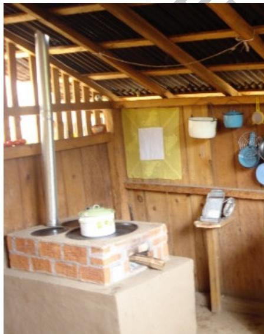  
(a)

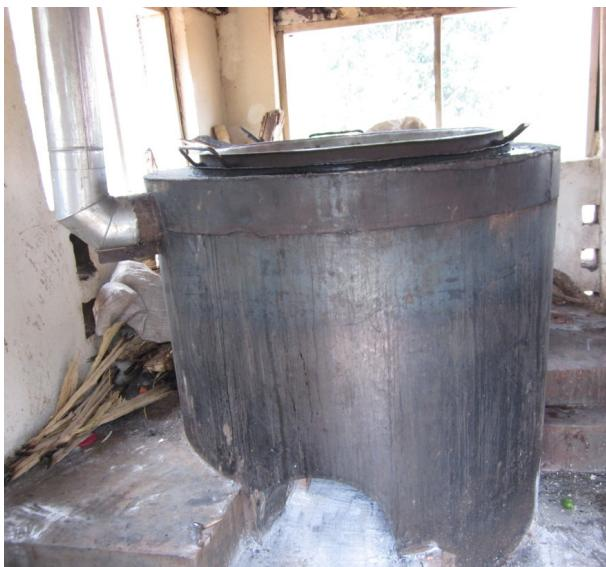  
(b)  
Fig. 2. Examples of cookstoves with chimney stacks: (a) rural dwelling in Mexico; (b) institutional stove at a prison's facility in Uganda. (Photographs courtesy of Dr Omar Masera-Cerutti from Instituto de Investigaciones en Ecosistemas y Sustentabilidad, CP

58190, Morelia, Michoacan, Mexico and Dr Mary S. Abbo from Makerere University, Uganda, respectively).

## 2. Literature review

In the past two decades, a variety of thermoacoustic devices have been developed in order to demonstrate the technology potential for useful energy conversion mechanisms in many practical situations. One of the early comprehensive studies related to standing wave systems was performed by Swift (1992). A 5 inch diameter, electrically heated standing wave thermoacoustic engine had helium at 13.8 bar as a working fluid. The acoustic power generated by the system and delivered to an external load was 630 W. The efficiency of converting heat to acoustic power was 9%, which corresponds to the Carnot efficiency of 13%.

Chen and Garrett (1998) demonstrated the first solar-powered standing wave thermoacoustic engine. Fresnel lens was used as a solar concentrator in order to provide sufficient energy to heat the hot end of the stack. A heating power of around 300 W was reported in the half-wavelength operation mode. The generated pressure amplitudes in atmospheric air used as a working medium were around 7 kPa (i.e. corresponding to 7% drive ratio). Miniature centimetre-scale engines have been demonstrated by Jin et al. (2007) and Jung and Matveev (2010). These can be applied as small energy sources or for heat management in microcircuits. However, the small-scale devices are challenging due to difficulties in fabrication, increased thermo-viscous losses and complicated integration with the heat sources or electroacoustic transducers. On the other hand, they can potentially benefit from the lack of turbulence, minor losses or heat leaks by acoustic streaming.

Thermoacoustic refrigerator systems have also been a subject of research interest. A successful prototype of a standing wave thermoacoustic refrigerator driven by a loudspeaker, was demonstrated by Hofler (1986). This quarter-wavelength device achieved the highest measured coefficient of performance, relative to Carnot of 12% at a temperature ratio between two heat exchangers of 0.822. A comprehensive comparison between theoretical and experimental results was done with a good agreement obtained.

Fundamental studies of processes occurring in the refrigerator components were conducted by Wheatley et al. (1983). The ratio of the plate spacing to the boundary layer thickness was changed by varying the mean working pressure and stack spacing. The temperature difference between stack ends was found to depend on stack position along the resonator and the ratio of the thermal conductivities between gas and solid plate. The stack experienced heating towards the nearest pressure antinode and cooling towards the nearest pressure node which also agreed with the calculations. At high pressure amplitude, the presence of acoustic streaming and turbulence was reported.

Atchley et al. (1990) extended the quantitative experiments on the same configuration to investigate the basic underlying theory of heat transport. The range of parameters, such as type of working fluid (helium and argon), thickness and thermal conductivity of the stack plates, position of the stack, mean pressure and acoustic pressure were studied. The measurements agreed with the theory only streaming, or gas displacement comparable to the length of the stack.

Tijani (2001) presented the design and optimisation of the standing wave thermoacoustic refrigerator driven by a loudspeaker. The effects of plate spacing of the stack and Prandtl number were investigated experimentally. It was found that the plate spacing equal to 2.5 times the thermal penetration depth was optimal for thermoacoustic refrigerators. The study of the Prandtl number effect was carried out using mixtures of helium-argon, helium-xenon and helium-krypton which gave Prandtl numbers between 0.2 and 0.68. The results showed that the performance of the refrigerator was improved as the Prandtl number decreased. The lowest temperature achieved was – 67°C. A maximum performance relative to Carnot of 17% was obtained by using a mixture of 70% helium and 30% xenon as working fluid.

Research in the travelling waye devices was motivated by their potentially higher efficiencies. The concept was proposed by Ceperley (1979) who realised that the interaction between gas and solid material resembles a Stirling-like thermodynamic cycle when a travelling acoustic wave passes through a regenerator with an axial temperature gradient. The direction of heat flow in the travelling wave devices is opposite to the direction of acoustic wave propagation. The thermoacousitc “core" consisting of aregenerator and adjacent heat exchangers works as a power amplifier (cf. Figure 1), with the pressure and velocity oscillations being in phase (Ceperley, 1985).

A first working looped-tube travelling-wave thermoacoustic engine with one wavelength resonator length was demonstrated by Yazaki et al. (1998). Their experimental results showed that a travelling-wave device would perform significantly better than a standing-wave device at the same frequency and wavelength. This finding was important for future applications where the lower temperature heat sources could be used to power the thermoacoustic travelling wave heat engines. However, only a low efficiency was obtained in their study, because of a low acoustic impedance within the thermoacoustic core, the latter being caused by high acoustic velocity, leading to large viscous losses.

# ACCEPTED MANUSCRIPT

This problem was later resolved by Backhaus and Swift (2000). They proposed a new type of thermoacoustic engines consisting of a short looped-tube (torus) connected to a long resonator pipe. The thermoacoustic core was placed within the torus section which is an analogue of the free-piston Stirling engine and forms a compact acoustic network: inertance, compliance and resistance. The indicated the existence of acoustic streaming processes referred to as “Gedeon streaming" and "Rayleigh streaming" which were eliminated later using a jet pump and tapered resonator, respectively. Backhaus'and Swift's thermoacoustic Stirling heat engine (TASHE) demonstrated a higher thermal efficiency (30%), equivalent to 41% of the Carnot efficiency.

The travelling wave thermoacoustic refrigerators have also been a subject of many studies. For instance, the work of Bassem et al. (2011) looks at the design strategies and optimisation of the thermoacoustic-Stirling refrigerator driven by the linear alternator. The characteristics of the core, including the hydraulic radius (rh) and position of the regenerator were optimised. The minimum temperature of 232 K and 20% of the Carnot COP were achieved at the optimised conditions with frequency of 50 Hz and mean pressure of 0.5 MPa.

Further modifications to thermoacoustic-Stirling refrigerators have been proposed by introducing a coaxial configuration. The acoustic network is based on the same principle as a torus-shaped design, but is more compact. The first systematic study was carried out by Poese et al. (2004). A compact design was achieved by coupling the acoustic resonator using metal bellows. The system was filled with helium at 10 bar, and driven by a moving-magnet linear motor at around 100 Hz. The maximum cooling capacity was 119 W at a temperature of $- 2 4 . 6 ^ { \circ } \mathrm { C } .$ The coefficient of performance and relative coefficient of performance to Carnot were 0.81 and 19%, respectively. Another coaxial configuration was designed and developed by Tijani and Spoelstra (2008). The system was operated at frequency of 60 Hz with argon at mean pressure of 15 bar. The lowest temperature of –54°C was achieyed at no cooling load condition. The maximum cooling performance of 25% was obtained with 25 W of cooling load and –11°C of cooling temperature.

In thermoacoustic applications, it is also possible to consider “coupled" systems of engines and refrigerators/coolers. The refrigerators utilise the acoustic wave generated from the engine to produce the cooling effect. They are particularly advantageous in using waste heat or renewable energy to produce the acoustic power instead of applying expensive linear alternators. There have been a number of studies to demonstrate the feasibility of coupled systems including those by Dai et al. (2006), Dhuchakallaya and Saechan (2017), Hasegawa et al. (2013), Zhang et al. (2016) and Xu et al. (2016).

# ACCEPTED MANUSCRIPT

There is an increased interest in practical applications of thermoacoustic technologies. Abdoulla-Latiwish et al. (2017) demonstrated a travelling wave thermoacoustic micro-electricity generator driven by waste heat from daily cooking activities (another part of SCORE project). The demonstrator produced under 20 W and showed the potential of inexpensive electricity generation for rural communities. A hot air driven thermoacoustic-Stirling engine was demonstrated by Tijani and Spoelstra (2013), while a two-stage thermoacoustic electricity generator was developed by Hamood et al. (2018); all of these examples showing a potential for a wider waste heat recovery.

## 3. Conceptual design

As is clear from the literature review in section 2, the majority of the research activities in terms of both engines and coolers is directed towards achieving high efficiency devices with as high as possible acoustic power generated, cooling load or as low as possible cooling temperatures. These design targets inevitably lead to technologically advanced devices often incorporating high pressure systems, complex acoustic networks and expensive working media (helium, argon, etc.), all of which usually result in high cost .

The philosophy of SCORE project is quite different. Of course, it is advantageous to obtain as high as possible efficiencies and cooling powers or as low as possible cooling temperatures, but the design constraints here tend to include (i) as simple as possible configuration to enable maintenance by unskilled people, (ii) avoiding pressurised systems to reduce the risks to users and the need for costly certification and maintenance,(iii use of commonly available working media, materials and fabrication techniques.

The above constrains can be addressed by many alternative design decisions, however it has been decided early in the project to adopt the following solutions: Firstly, the system is expected to deliver good thermodynamic performance, which implies the use of a travelling-wave configuration. However, since it needs to be relatively simple to build, the well-known thermoacoustic Stirling heat engine (TASHE) type configuration (Backhaus and Swift, 2000), with its s torus travelling-wave loop coupled to a standing-wave resonator controlling the operating frequency will need to be excluded. As a compromise, a one-wavelength looped-tube design is chosen. This has the simplicity of a standing-wave build while keeping many travelling-wave device characteristics, including low power transmission losses in the feedback pipe and high power production in the engine. Additionally, the cooler can be located in the same loop. It is a relatively straightforward arrangement which can be applied as a practical solution.

Secondly, the system is to be operated at atmospheric pressure using air as the most abundant working medium. Inert or noble gases (e.g. helium, argon) are unavailable in remote rural its low speed of sound leads to a more compact size for a given frequency. D

Thirdly, wherever possible, commonly available materials such a PVC tubing will be used for acoustic waveguides to reduce the cost and enable easy assembly. For ease of demonstration, the current looped-tube resonator layout is based on the previous configuration of a thermoacoustic electricity generator, i.e. engine driving a linear alternator as explained by Jaworski and Mao (2013). After changing the alternator configuration to the cooler configuration the favourable acoustic field distribution inside the loop is altered. Therefore, it is crucial to minimise the changes in the acoustic field by introducing an extra phase tuning component, a matching stub, in the system. Here, the matching stub is a side branch pipe with the same diameter as the main loop. The length of the stub can be varied by moving a piston located inside the stub. The function of the matching stub is to improve the impedance matching between the engine and the cooler (Yu et al., 2012).

## 4. Experimental apparatus

The schematic diagram and photograph of the system are shown in Figure 3. The system includes two subsystems: the engine and the cooler, located in the same loop of a travelling wave device. Subscripts “e" and “c" refer to the engine and refrigerator, respectively. The engine is powered by flue gases from propane combustion. It comprises of cold heat exchanger (CHXe), stacked screen regenerator $\mathrm { ( R E G _ { e } ) }$ , hot heat exchanger $\mathrm { ( H H X _ { e } ) }$ , thermal buffer tube (TBT) and secondary cold heat exchanger $( 2 ^ { \mathrm { n d } } \mathrm { C H X } )$ . The cooler is located opposite to the engine and consists of an ambient heat exchanger (AHXc), stacked screen regenerator $\mathrm { ( R E G _ { c } ) }$ and cold heat exchanger (CHXc). In addition, the side branch matching stub is used while the feedback pipes complete the loop. The thermocouples $\mathrm { ( T / C s ) }$ , and pressure sensors $\mathrm { ( P _ { 1 } \mathrm { - } P _ { 6 } ) }$ are installed along the system to observe the temperature and pressure amplitude, respectively.

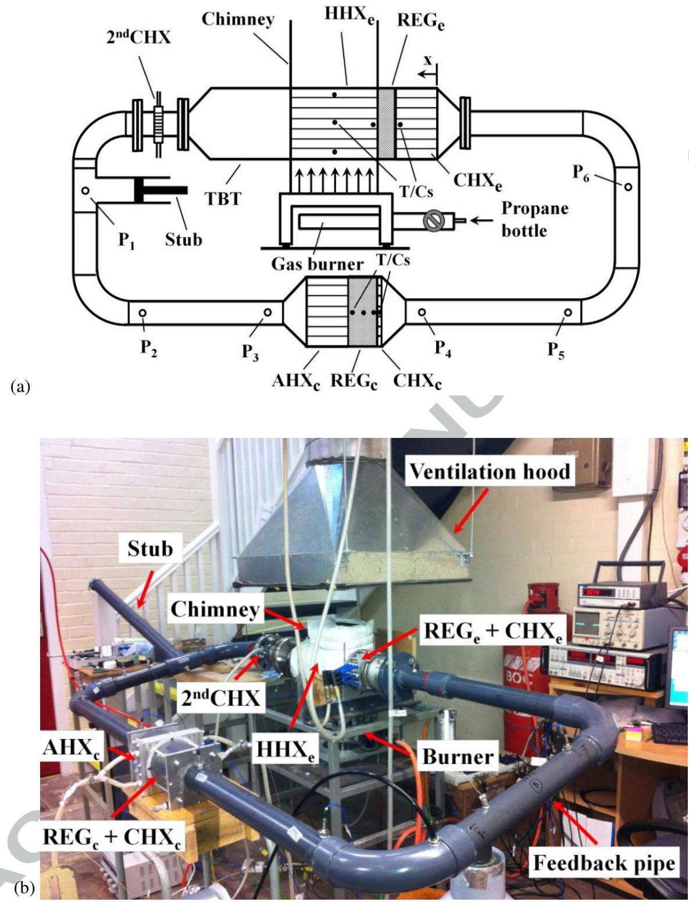  
Fig. 3. Schematic diagram (a) and a photograph (b) of the thermoacoustic cooler driven by a combustion-powered thermoacoustic engine.

## 4.1 Thermoacoustic engine

The summary of the part dimensions and other details of the engine are listed in Table 1. The CHXe is taken from one of previous configurations tested in the previous work (Yu et al., 2012). It is made from a round aluminium block. Gas passages are made in the form of 45 holes with the diameter of 5 mm, drilled parallel to its centreline. 12 holes with the diameter of 6 mm are drilled perpendicular to $\mathrm { C H X _ { e } }$ axis to pass the cooling water. The photograph of the $\mathrm { C H X _ { e } }$ is presented in Figure 4(a).

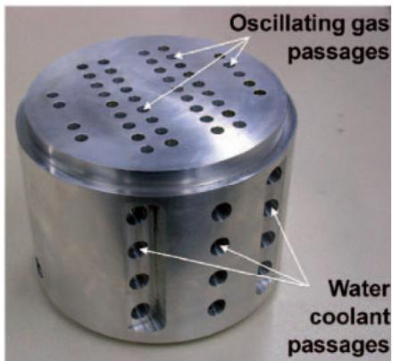

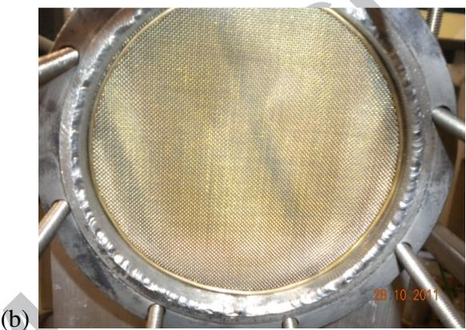

(a)  
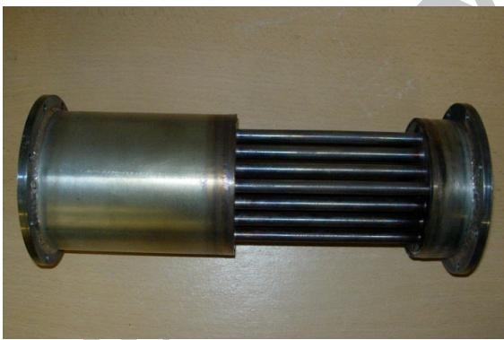  
(c)

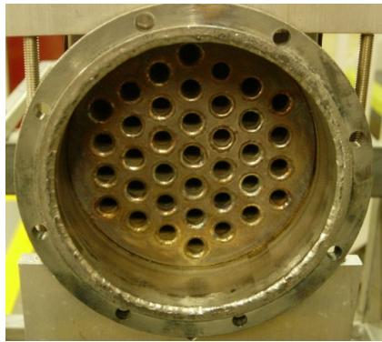  
(d)  
Fig. 4. Photographs of individual components of the engine: (a) $\mathrm { C H X _ { e } , }$ (b) $\mathrm { R E G } _ { \mathrm { e } } ,$ (c) side view of the $\mathrm { H H X _ { e } }$ and (d) front view of the $\mathrm { H H X } _ { \mathrm { e } } .$

The REGe is made out of 79 plain weave stainless screen disks with the mesh number of 34 and the wire diameter of 0.16 mm. In Figure 3(b), the regenerator is already placed inside the regenerator holder. The $\mathrm { H H X _ { e } }$ has a shell-and-tube configuration as illustrated in Figures 3(c) and 3(d). It has 37 stainless steel tubes with inside diameter (ID) of 8 mm and outside diameter (OD) of 10 mm. The centre-to-centre distance between the tubes is 15 mm and the tube arrangement is on a triangular “grid". The $\mathrm { H H X _ { e } }$ is heated by a propane gas burner. Heat input is adjustable by using a valve. The hot flue gases flow around the outer surface of the tube bundle due to the natural convection. The working gas oscillates inside these tubes which form a part of the thermoacoustic system.

Next to the $\mathrm { H H X } _ { \mathrm { e } } ,$ there is a TBT, which consists of three stainless steel sections. These are two different diameter pipes connected by a transitional cone. The $2 ^ { \mathrm { n d } } \mathrm { C H X }$ is introduced into the system radiator is cut into a round disk shape and tightly fitted inside the 2-inch stainless steel tube, while the outside of this part of the tube is cooled by a water jacket.

Table 1 Details of the part dimensions of the engine and cooler
<table><tr><td rowspan=1 colspan=1></td><td rowspan=1 colspan=1>Part name</td><td rowspan=1 colspan=1>Dimensions</td><td rowspan=1 colspan=1>Other details</td></tr><tr><td rowspan=7 colspan=1>Engine</td><td rowspan=1 colspan=1>CHXe</td><td rowspan=1 colspan=1>110 mm ID, Length 90 mm, Porosity 9.3%</td><td rowspan=1 colspan=1>Aluminium block</td></tr><tr><td rowspan=1 colspan=1>REGe</td><td rowspan=1 colspan=1>110 mm ID, Length 23 mm, Porosity 82%,Hydraulic radius (rh) 196 µm</td><td rowspan=1 colspan=1>Stainless steel mesh screen</td></tr><tr><td rowspan=1 colspan=1>HHXe</td><td rowspan=1 colspan=1>Length 160 mm, Porosity 19.6%</td><td rowspan=1 colspan=1>Shell-and-tube geometry</td></tr><tr><td rowspan=1 colspan=1>TBT-I</td><td rowspan=1 colspan=1>110 mm ID, Length 180 mm,Wall thickness 2 mm</td><td rowspan=1 colspan=1>Stainless steel pipe</td></tr><tr><td rowspan=1 colspan=1>TBT-II</td><td rowspan=1 colspan=1>110 mm ID1 and 54 mm ID2,Length 60 mm</td><td rowspan=1 colspan=1>Stainless steel cone</td></tr><tr><td rowspan=1 colspan=1>TBT-III</td><td rowspan=1 colspan=1>54 mm ID, Length 118 mm,Wall thickness 2.77 mm</td><td rowspan=1 colspan=1>Stainless steel 2-inch pipe</td></tr><tr><td rowspan=1 colspan=1> $2 ^ { \mathsf { n d } } \mathsf { C H X }$ </td><td rowspan=1 colspan=1>       54 mm ID, Length 25 mm</td><td rowspan=1 colspan=1>A matrix of car radiatorcooled by a water jacket</td></tr><tr><td rowspan=3 colspan=1>Cooler</td><td rowspan=1 colspan=1>AHXc</td><td rowspan=1 colspan=1>110 mm ID, Length 60 mm, Porosity 32%</td><td rowspan=1 colspan=1>Aluminium block</td></tr><tr><td rowspan=1 colspan=1>X $\mathsf { R E G } _ { \mathsf { c } }$ </td><td rowspan=1 colspan=1>110 mm ID, Length 30 mm, Porosity 73.31%,Hydraulic radius (rh) 174.4 µm</td><td rowspan=1 colspan=1>Stainless steel mesh screen</td></tr><tr><td rowspan=1 colspan=1>CHXc</td><td rowspan=1 colspan=1>Length 4 mm, Porosity 90.5%</td><td rowspan=1 colspan=1>Resistance heating wire</td></tr></table>

## 4.2 Thermoacoustic cooler and acoustic network

The coupled cooler system has been constructed by attaching to the existing thermoacoustic engine assembly the feedback pipe, the matching stub and the core of the thermoacoustic cooler. The “stub" tube is located at approximately 555 mm away from the secondary cold heat exchanger. It is connected to the loop through a T-junction. The next component is the feedback tube. It is made of standard 2-inch PVC pipes and 90° bends (Class C, OD: 60.3 mm, thickness 3.6 mm).

There are two different loop lengths studied. They are around 4.97 and 4.13 m. These were introduced in order to study the effect of the operating frequency on the cooling performance of the cooler. The corresponding frequencies are 58.6 Hz and 70.3 Hz, respectively. The length of 4.97 m was selected to correspond to the previous research on a combustion driven electricity generator, as discussed by Abdoulla et al. (2013). This had the operating frequency of about 65 Hz. However, the same loop length used with the cooler resulted in a lower operating frequency of 58.6 Hz. Another consideration was the work described by Yu et al. (2012) in which they utilised the frequency of 70 Hz, and so the length of 4.13 m was selected to match that work. D

The part dimensions and other details of the cooler are also listed in Table 1. The AHXc is also made out of an aluminium block as shown in Figure 5(a). Gas passages are made in the form of 430 holes with the diameter of 3 mm, drilled parallel to the heat exchanger's centreline. 20 holes with the diameter of 6 mm are drilled perpendicular to the heat exchanger to pass the cooling water.

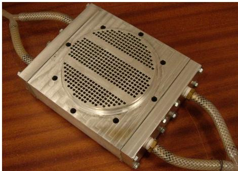  
(a)

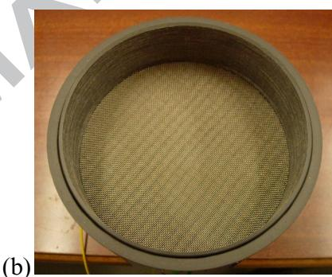

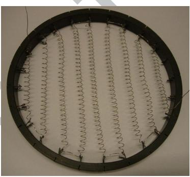  
(c)

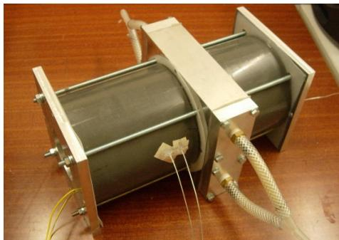  
(d)  
Fig. 5. Photographs of individual components of the cooler: AHXc (a), REGc placed in the holder (b), CHXc (c) and final assembly of the cooler (d)

The $\mathrm { R E G } _ { \mathrm { c } }$ is a stack of 60 disks of plain weave stainless steel screens with the mesh number of 34. The diameter of the screen wire is 0.254 mm. The $\mathrm { R E G } _ { \mathrm { c } }$ is placed in a PVC can with the thickness of 2 mm. The photograph of a few layers of the regenerator placed in the holder is shown in Figure 5(b). The $\mathrm { C H X _ { c } }$ is made of Ni-Cr resistance wire which is suspended on a series of brackets attached to a PVC ring as shown in Figure 5(c). The wire is formed as a spiral with 4 mm diameter. The wire diameter is 0.3 mm. The CHXc is situated adjacent to the cold side of the regenerator to act as a cooling load.

There are two PVC reducers placed at the two ends of the cooler for reducing the diameter of the CHXc are placed inside a 5-inch PVC pipe. Aluminium flanges are situated at two ends of the cooler and all components are then tightened by threaded bars. The PVC pipe on the outside acts as an insulator to reduce the heat gained from the surroundings. The photograph of the final assembly of the cooler is presented in Figure 5(d). 1

## 5. Instrumentation and experimental procedure

In the experiments, the main measured quantities are oscillating pressures and temperatures at selected locations along the system. As shown in Figure 3, the Type-K thermocouples (T/Cs), TC-Direct model 408-119, and pressure sensors, PCB PIEZOTRONICS model 112A22, are installed at different positions along the loop to monitor the distribution of the temperature and pressure amplitude, respectively. All of the pressure transducers have a resolution of 7 Pa and were calibrated prior to experiments. The temperature measurements are made at nine locations along the system. At the engine, two thermocouples are installed at the two ends of the regenerator to monitor the temperature difference between the regenerator ends. Three thermocouples are placed in three tubes inside the hot heat exchanger to monitor the solid temperature of the tube wall (cf. Figure 3). At the cooler, three thermocouples are mounted at the two ends and in the middle of the regenerator, in order to observe the temperature distribution along the regenerator. One thermocouple is fixed at the position of the heating wire to monitor the changes of gas temperature as the cooling load changes.

There are six pressure transducers placed around the loop (marked as $\mathrm { P _ { 1 } }$ to $\mathrm { P } _ { 6 }$ in Figure 3). The output signals from the thermocouples and pressure transducers are recorded by a data acquisition card (OMEGA OMB-Daq Temp Model 14). The phase differences between the signals of oscillating pressures are obtained from an in-house designed LABVIEW programme with an accuracy of $0 . 0 1 ^ { \circ }$ The electrical power supplied to the CHXc is calculated as a product of voltage and current supplied by the DC power supply. The difference between the acoustic powers flowing into and out of the regenerator represents approximately the acoustic power consumed by the cooler to remove the cooling load from the $\mathrm { C H X } _ { \mathrm { c } } .$ It can be calculated by applying the two-microphone method (Fusco et $a l .$ , 1992) using signals from pairs of pressure transducers $\mathrm { P } _ { 2 } \mathrm { - } \mathrm { P } _ { 3 }$ and $\mathrm { P } _ { 4 } { \mathrm { - } } \mathrm { P } _ { 5 }$ respectively.

In all experiments, the system is started from ambient temperature. After the start-up, the system is allowed to reach a thermal equilibrium in all its components. The reference temperature in the $\mathrm { H H X _ { e } }$ is maintained at around $5 0 0 ^ { \circ } \mathrm { C }$ in order to allow the comparable conditions for the experiments and protect the welding within the $\mathrm { H H X } _ { \mathrm { e } } .$ The matching stub is adjusted manually to achieve the maximum acoustic power supplied to the cooler. For the two selected frequencies of 58.6 Hz and 70.3 Hz, the optimum location of the cooler in the system is investigated experimentally. Eight locations of the cooler are studied in both cases to find the optimum location. In addition, the higher temperatures of the HHXe (up to around $7 0 0 ^ { \circ } \mathrm { C } )$ are studied to investigate the variation of the cooling performance with the increase of the hot end temperature of the $\mathrm { R E G _ { e } }$

In order to evaluate the performance of the cooler, the coefficient of performance, COP, defined as the ratio of the cooling load, $\dot { Q } _ { l o a d }$ , to the net acoustic power consumed by the cooler, $\dot { E } _ { n e t } ,$ is applied:

$$
\mathrm { C O P } = \dot { Q } _ { l o a d } / \dot { E } _ { n e t } .\tag{1}
$$

The coefficient of performance relative to Carnot, COPR, is employed in order to compare the performance of the cooler at different operating conditions:

$$
\mathrm { C O P R } = \mathrm { C O P } / \mathrm { C O P C } ,\tag{2}
$$

where COPC is the maximum theoretical performance of the cooler at a given temperature difference according to the Carnot cycle:

$$
\mathrm { C O P C } = T _ { c } / ( T _ { a } - T _ { c } ) ,\tag{3}
$$

where $T _ { c }$ is the absolute temperature of the CHXc and $T _ { a }$ is the absolute temperature of the $\mathrm { A H X _ { c } }$

## 6. Thermoacoustic simulations

In the current work, DeltaEC (Design Environment for Low-amplitude ThermoAcoustic Energy Conversion) programme (Ward et al., 2017) is used to simulate the acoustic field and the acoustic power flow in the thermoacoustic device. It is based on the linear thermoacoustic theory (Rott, 1980). The fundamental equations of the acoustic pressure $( p _ { I } )$ , volumetric velocity $( U _ { I } )$ , mean temperature $( T _ { m } )$ and the total power $( \dot { H } _ { 2 } )$ were recently reviewed by Abdoulla-Latiwish et al. (2017) and similar analyses can be found in Piccolo (2018). A block diagram of the segments used in DeltaEC simulation is shown in Figure 6 (cf. also Figure 3). The coordinate x describing the distribution of components within the loop starts from the cold heat exchanger of the engine $( \mathrm { C H X _ { \mathrm { e } } } ) ; x = 0$ . The simulation for the thermoacoustic device is from the origin along the established between segments. D

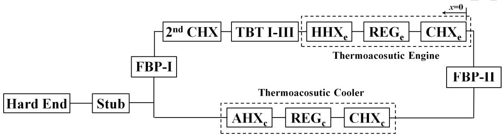  
Fig. 6. The block diagram of the segments in DeltaEC simulation: cold heat exchanger (CHXe), regenerator $\mathrm { ( R E G _ { e } ) }$ , hot heat exchanger $\mathrm { ( H H X _ { e } ) }$ , thermal buffer tube $( \mathrm { T B T }$ I-III), secondary cold heat exchanger $( 2 ^ { \mathrm { n d } } \mathrm { C H X } )$ feedback pipe (FBP-I), Stub, ambient heat exchanger $\mathrm { ( A H X _ { c } ) }$ , regenerator $( \mathrm { R E G } _ { \mathrm { { c } } } ) ,$ cold heat exchanger $\mathrm { ( C H X _ { c } ) }$ and feedback pipe (FBP-II).

The simulation results of the distributions of the acoustic field and power flow in the system at 58.6 Hz are shown in Figure 7. These results are based on the optimal configuration of the prototype, i.e. $\mathrm { i s } \ x = 2 . 6$ m. The calculation was carried out under the following

Figure 7(a) shows the pressure amplitude distribution along the system. The differences between measured (open circles) and calculated pressures are on average around 4%. The agreement between the measured and calculated values was needed to yield confidence in the numerical predictions. There are two maxima and two minima of pressure amplitude along the loop. Both regenerators are located near the maxima of pressure amplitude. The pressure drops at the regenerator of engine and cooler are observed. This is due to the flow resistance of the regenerator.

Figure 7(b) presents the distribution of volumetric velocity along the system. There are three maxima and two minima along the loop. The regenerator of the cooler is located near the minimum of volumetric velocity amplitude. The small volumetric velocity within the regenerator is preferred to avoid high viscous dissipation, which is one of the design strategies behind the current concept. However, the velocity at the regenerator of the engine is relatively large, which will adversely affect the efficiency. Of course this is not an ideal condition for a travelling wave engine to operate, and will need to be improved in future work. It can also be seen that the volumetric velocity increases significantly along the regenerator of the engine. This is due to the sharp temperature gradient along the regenerator. Furthermore, at the location of the stub, there is a sudden increase of the volumetric velocity. Along all other parts, the volumetric velocity changes smoothly. 1

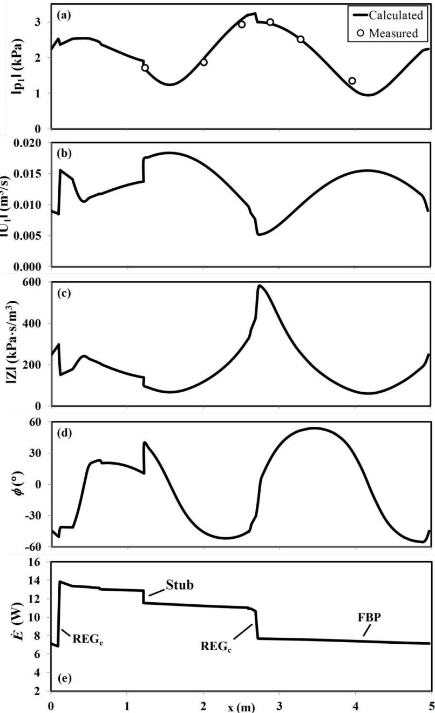  
Fig. 7. Numerical predictions of the acoustic field and power flow in the system at 58.6 Hz: (a) pressure amplitude, (b) volumetric velocity, (c) acoustic impedance; (d) phase angle; and (e) acoustic power flow. Open circles indicate measured pressure amplitudes. Typically, the uncertainty in $| p _ { I } |$ is ±1%. The error bars are smaller than the symbols.

High acoustic impedance in the regenerator is required for high generated acoustic power. The acoustic impedance is defined as the ratio of acoustic pressure over acoustic velocity. Figure 7(c) shows the acoustic impedance (Z) along the system. It can be seen that the acoustic impedance is highest at the cold end of the cooler regenerator. The stub introduces a local decrease of the acoustic impedance along the loop. Figure 7(d) shows the phase difference between pressure and velocity oscillation along the system. It can be found that the engine regenerator works in the region of - $5 0 . 0 ^ { \circ } < \phi < - 4 1 . 3 ^ { \circ }$ . This is not an ideal condition for a travelling wave engine to operate. However it needs to be remembered that the system has been optimised for a coupling with the alternator in the configuration for electricity generation. Introduction of a cooler instead of alternator will lead to a substantial change in the acoustic field and further modifications to the acoustic network will be needed to counteract such changes. The non-ideal engine conditions will of course adversely affect the overall system performance.

Figure 7(e) shows the acoustic power flow along the system. It can be found that around 7.2 W of acoustic power is fed into the $\mathrm { C H X _ { e } }$ which dissipates around 0.3 W. The remaining 6.9 W is fed into the cold end of $\mathrm { R E G _ { e } }$ . Within $\mathrm { R E G } _ { \mathrm { e } } ,$ the acoustic power is amplified to around 13.9 W which is the level of acoustic power flowing out from the hot end of $\mathrm { R E G } _ { \mathrm { e } } .$ These calculations show that the engine can produce a net acoustic power $\mathrm { o f }$ about 7.0 W at an input heat power of 128 W, corresponding to a thermoacoustic conversion efficiency of 5.6%. The HHXe, TBT and $2 ^ { \mathrm { n d } } \mathrm { C H X }$ dissipate around 0.6 W. The acoustic power of 1.4 W is dissipated at the stub. The acoustic power of 10.6 W enters the ambient end of the $\mathrm { R E G } _ { \mathrm { c } }$ and is used to pump heat. It is reduced gradually due to the consumption of acoustic power for pumping heat from the cold end of $\mathrm { R E G } _ { \mathrm { c } }$ When it comes out of the $\mathrm { C H X _ { c } }$ it has a value of 7.7 W, which means that the acoustic power consumed by the cooler is 2.9 W. The cooler can realize the cooling temperature of 251.1 K.

Figure 8 shows the analogous information about the case of operating frequency equal 70.3 Hz in the same format as Figure 7 for 58.6 Hz. Here, the difference between measured and calculated pressure amplitude is on average around 8% (Figure. 8(a)). Generally, the simulation results of the acoustic field and the acoustic power flow in the system at 70.3 Hz are comparable to the results at 58.6 Hz. However, the pressure and volumetric velocity amplitudes for 70.3 Hz are generally lower than for 58.6 Hz. The pressure amplitude is lower by 0.81 kPa for the point where the amplitude reaches maximum which is near the regenerator of the cooler. The volumetric velocity decreases from 0.0064 $\mathrm { m } ^ { 3 } / \mathrm { s }$ (58.6 Hz) to 0.0041 m³/s (70.3 Hz). The phase difference between pressure and velocity oscillation in the $\mathrm { R E G _ { e } }$ is in the range of $- 5 9 . 2 ^ { \circ } < \phi < - 5 2 . 6 1 ^ { \circ }$ which is even less optimal than for 58.6 Hz.

The resulting acoustic power flow in the system is shown in Figure 8(e). There is only 3.9 W of acoustic power flowing into the $\mathrm { C H X } _ { \mathrm { e } } .$ Some of acoustic power is dissipated in the heat exchanger. The remaining 3.6 W is fed into the $\mathrm { R E G } _ { \mathrm { e } } .$ It is amplified to 6.75 W, and then flows out from the hot end of ${ \mathrm { R E G } } _ { \mathrm { { e } } } .$ The acoustic power of 1.3 W is dissipated at the $\mathrm { H H X } _ { \mathrm { e } } ,$ TBT, $2 ^ { \mathrm { n d } } \mathrm { C H X }$ , stub and AHXc. The remaining acoustic power flows into the $\mathrm { R E G } _ { \mathrm { c } }$   
effect in the $\mathrm { R E G } _ { \mathrm { c } } .$ The remaining 4.1 W is fed back into the cold end of the engine. $\mathrm { A t } 7 0 . 3$ Hz system, the cooler consumes only 2.07 W of acoustic power and produces cooling temperature of 269.1 K.

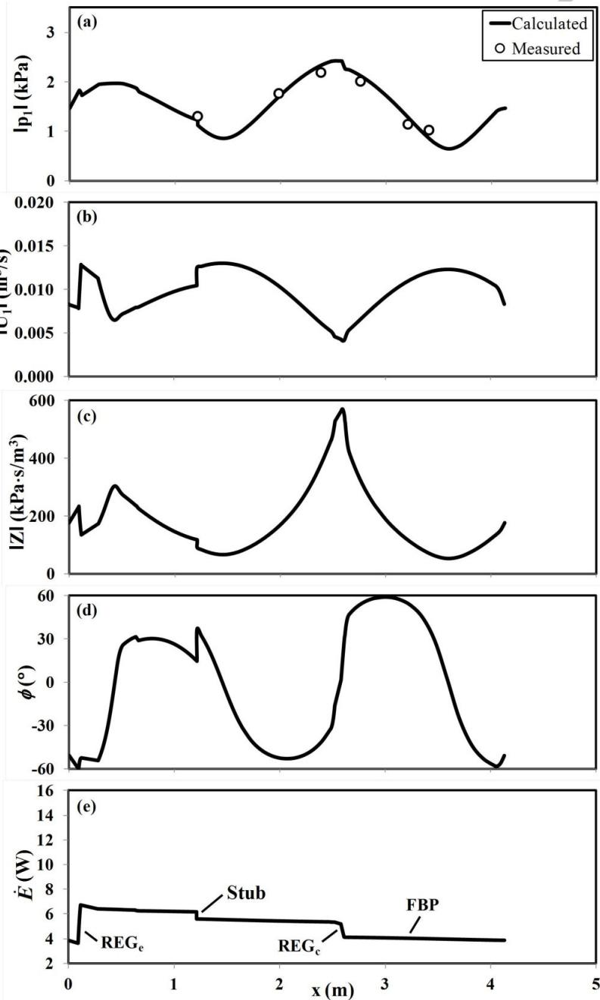

Fig. 8. Numerical predictions of the acoustic field and power flow in the system at 70.3 Hz: (a) pressure amplitude, (b) volumetric velocity, (c) acoustic impedance; (d) phase angle; and (e) acoustic power flow. Open circles indicate measured pressure amplitudes. Typically, the uncertainty in $| p _ { I } |$ is ±1%. The error bars are smaller than the symbols.

As shown in Figure 7 and 8, the major differences between 58.6 Hz and 70.3 Hz cases are the levels of pressure amplitude, volumetric velocity amplitude and acoustic power flowing within the system. There are several possible reasons for these results. Clearly, an increase in frequency leads to a smaller thermal penetration depth, $\delta _ { \kappa } .$ However, the same regenerators are applied in the engine and the cooler for both frequencies. These will become less efficient in the thermoacoustic power conversion. Another possible reason is that the phase difference between pressure and velocity oscillation in the engine at 70.3 Hz is deviated even more from the ideal case $( \phi = 0 ^ { \circ } )$ than at the 58.6 Hz. For these reasons, the system achieves a higher working temperature than for the 58.6 Hz case.

It should be noted that a good match between numerical modelling and experiments in terms of pressure amplitudes was achieved by introducing Gedeon streaming into the simulation by using a non-zero steady-flow enthalpy, as discussed by Wardet al. (2017) with reference to equation (6.13) and “Ndot" variable. The Gedeon streaming is a net time-averaged mass flow which could be observed in thermoacoustic devices containing a looped resonator. It causes an unwanted thermal load to the cooler or "heat leak" from the hot heat exchanger of the engine, both resulting in efficiency losses. There is independent evidence from experiments that Gedeon streaming is indeed an issue. Figure 9 illustrates the measured temperature profiles along $\mathbf { R E G } _ { \mathrm { c } }$ for the eight studied locations of the cooler, at 58.6 Hz and 70.3 Hz, respectively. Clearly, these are strongly nonlinear which indicates a net mass flow rate from ambient to cold end of the regenerator.

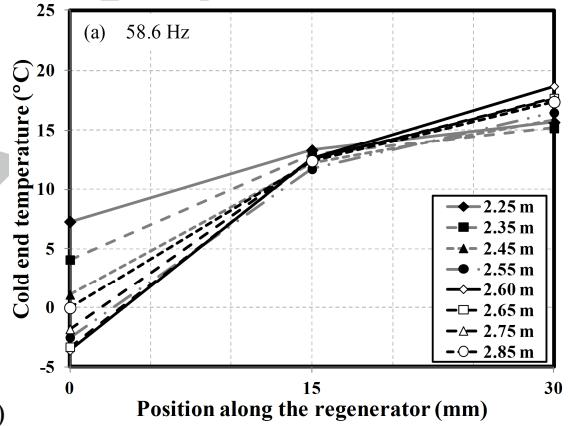

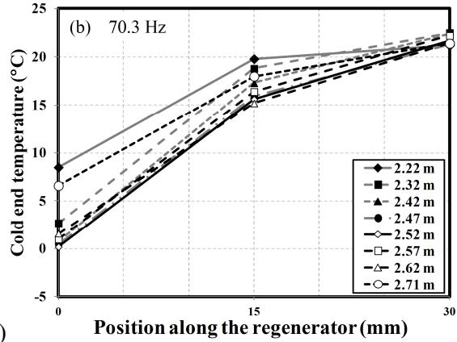  
Fig. 9. Temperature profiles along the $\mathrm { R E G } _ { \mathrm { c } } .$ (a) 58.6 Hz and (b) 70.3 Hz.

# ACCEPTED MANUSCRIPT

An investigation into acoustic streaming suppression was carried out by Saechan (2014). An elastic membrane was installed inside the system in order to eliminate the Gedeon streaming. While this was successful in eliminating the streaming, the cold end temperature of $\mathrm { R E G } _ { \mathrm { c } }$ has not reduced. This may be due to the additional mechanical losses introduced by the membrane causing higher membrane has not been applied in the follow-on work. 0

## 7. Experimental results and discussions

The experimental results presented in this section are divided into four subsections. Firstly, an experimental optimisation of the position of the cooler in the loop is carried out. Secondly cooling performance indicators are discussed. This is followed by the discussion of thermodynamic efficiencies in the system. Finally, the effect of the engine hot heat exchanger (HHXe) on the cooling performance is investigated. 1

## 7.1 Optimum position of the cooler

In order to find the optimum location of the cooler along the looped-tube resonator, eight locations are studied at both frequencies. Figure 10 shows the minimum cold end temperature of the $\mathrm { R E G _ { c } }$ (no cooling load condition) and the consumed acoustic power versus the location of the cooler for 58.6 Hz. The cold end temperature is obtained from the thermocouple mounted between the $\mathrm { R E G } _ { \mathrm { c } }$ and CHXc of the cooler (right hand side T/C in the cooler “core" in Figure 3(a)). It can be seen that the obtained curve has a local minimum for $x = 2 . 6$ m, and the cold end temperature is $- 3 . 6 ^ { \circ } \mathrm { C }$ . In addition, a local maximum consumed acoustic power of 2.8 W is also at the location $x = 2 . 6$ m. Therefore, both criteria of the lowest cold end temperature and the highest consumed acoustic power give the same result regarding the optimum location.

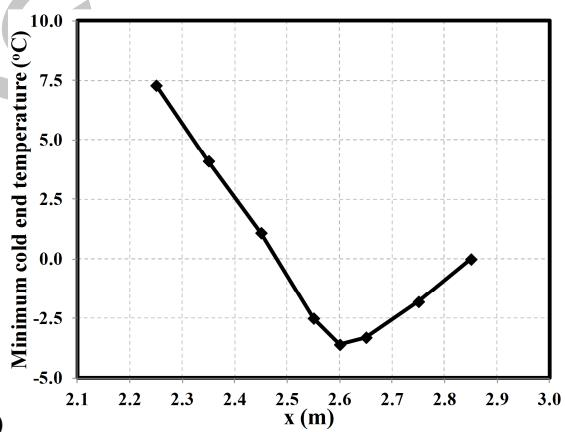  
(a)

(b)  
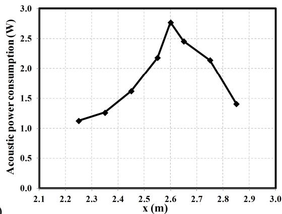

Fig. 10. The minimum cold end temperature of the $\mathrm { R E G } _ { \mathrm { c } } \ ( \mathrm { a } )$ and the acoustic power consumption (b) versus the locations of the cooler for 58.6 Hz.

Figure 11 shows analogous results for minimum cold end temperature of the $\mathrm { R E G } _ { \mathrm { c } }$ and consumed acoustic power in the case of 70.3 Hz. One can see that the character of both curves is very similar. However, the optimum location (from both the temperature and power curves) is $x = 2 . 5 2$ m, the minimum cold end temperature is $+ 0 . 2 ^ { \circ } \mathrm { C } .$   
therefore clear that the cooler performs much better, from the point of view of the objectives of this case study, for frequency of 58.6 Hz. This is also congruent with the measurements of the minimum temperature difference between two ends of the regenerator in the engine allowing the system to start the self-excited oscillation. They are around $1 6 4 ^ { \circ } \mathrm { C }$ and $2 1 6 ^ { \circ } \mathrm { C }$ for frequencies of 58.6 Hz and 70.3 Hz, respectively. The lower start-up temperature difference indicates fewer losses and more useful energy for the cooling purposes.

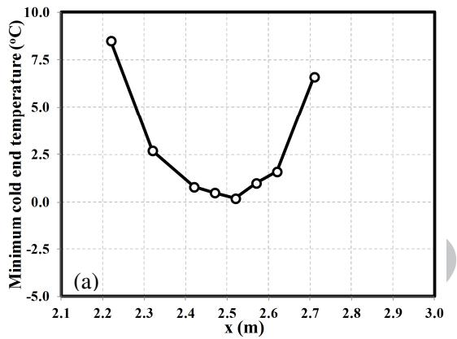

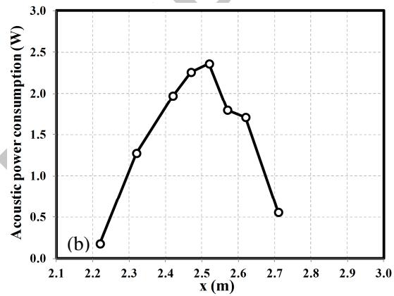  
Fig. 11. The minimum cold end temperature of the REGc (a) and the acoustic power consumption (b) versus the locations of the cooler for 70.3 Hz.

## 7.2 Cooling performance indicators

After the system reaches the steady state, the cooling load is applied to the CHXc. The cooling performance of the cooler at various locations is shown in Figure 12. It can be seen that the temperature of the cold end of the $\mathrm { R E G _ { c } }$ increases as the cooling load increases at all cooler positions. The best cooling performance is obtained for the optimal location. The slopes of the plots i Figure 12 at each cooler position are presented in Figure 13. They represent the cooling performance: as the slope is steeper, the cooler can receive a large heating load with a small change of temperature. This implies that the cooling capacity is larger. It can be seen that the cooling capacity in the case of 58.6 Hz is larger than 70.3 Hz and covers a wider range of temperature. The graph for 58.6 Hz also shows that the best cooling performance from the point of view of the slope of the lines of cooling load versus cold end temperature appears for the optimum cooler location $x { = } 2 . 6$ m. It is less clear for frequency of 70.3 Hz. However, the maximum slope is also in the vicinity of the optimum location.

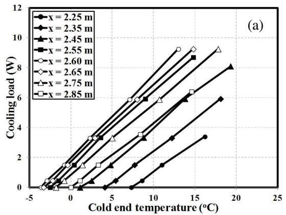

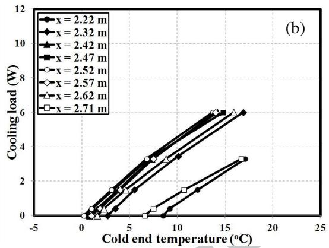

Fig. 12. The cooling performance for various locations of the cooler (a) 58.6 Hz and (b) 70.3 Hz. ▲  
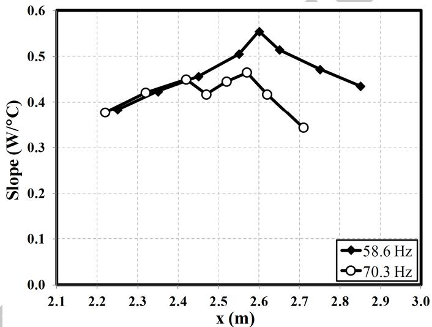  
Fig. 13. The slopes of the plot in Fig. 11 in both cases of frequency of 58.6 and 70.3 Hz.

In the condition required for storing vital medicines, the temperature range should typically be between $+ 2$ and $+ 8 \ ^ { \circ } \mathrm { C }$ (NHS, 2010). Within this range, the system is capable of producing the cooling load between 3 and 7 W in the case of 58.6 Hz, for the optimum location of the cooler (x = 2.60 m) – cf. the line marked by empty circles in Figure 12(a). By analogy, for the system working at the frequency of 70.3 Hz, the corresponding cooling load range is only between 0.5 and 4 W for the optimum cooler position $( \mathrm { x } = 2 . 5 2 \ \mathrm { m } ) - \mathrm { c f } .$ the line marked by empty circles in Figure 12(b).

## 7.3Thermodynamic efficiency

The thermodynamic efficiency of the cooler is presented in the terms of COPR. The measured COPR as a function of the cooling load for various cooler locations along the looped-tube at both frequencies is presented in Figure 14. All COPR curves originate from zero due to no heat input supplied to the $\mathrm { C H X _ { c } }$ at no cooling load condition. For all positions of the cooler, COPR increases as cooling load increases, and then reaches a peak at a particular cooling load before decreasing. COPR can be explained by the fact that the heat pumping effect in the regenerator is not sufficiently strong to remove an increased cooling load. This leads to a higher cold end temperature which eventually becomes equal to the temperature of the ambient end of regenerator; thus COPR becomes zero. In addition, the peak of COPR gradually shifts to a higher cooling load as the acoustic power consumption increases. The maximum COPR of the system at the frequency of 58.6 Hz is around 5.5% at the cooling load of 5.9 W. The analogous result for frequency of 70.3 Hz is also obtained. The maximum COPR decreases to 4.6%, and the corresponding cooling load is 3.3 W.

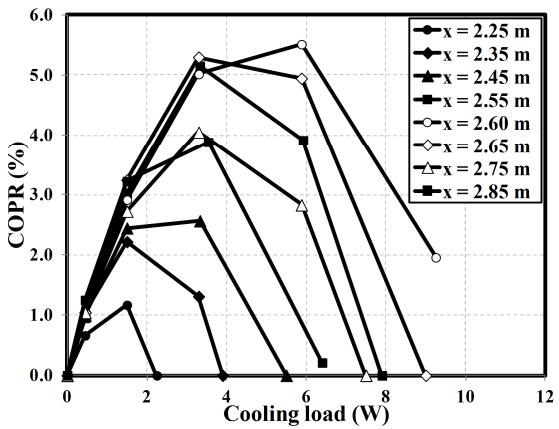  
(a)

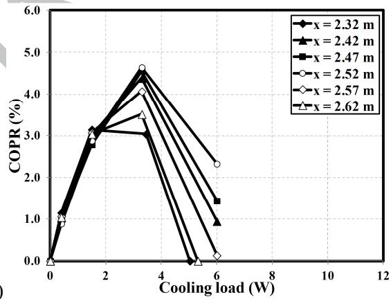  
(b)  
70.3 Hz.

## Effect of the temperature of hot heat exchanger at the engine on cooling performance

The temperature of the $\mathrm { H H X _ { e } }$ represents the level of input power to the engine from propane combustion. Although the maximum temperature of the $\mathrm { H H X _ { e } }$ in the previous experiments was fixed at $5 0 0 ^ { \circ } \mathrm { C } ,$ the current study also investigates how much would the cold end temperature decrease with an increase of temperature at $\mathrm { H H X } _ { \mathrm { e } } .$ These experiments had to be conducted in a short period, not to risk permanent damage to the welds of HHXe. Therefore, only no cooling load condition is investigated.

In the experiments at frequencies of 58.6 and 70.3 Hz, the highest temperatures of $\mathrm { H H X _ { e } }$ are $6 9 4 . 5 ^ { \circ } \mathrm { C }$ and $6 9 0 ^ { \circ } \mathrm { C } ,$ respectively, corresponding to the hot end temperatures of $\mathrm { R E G _ { e } }$ of $4 7 6 . 7 ^ { \circ } \mathrm { C }$ and $4 8 3 ^ { \circ } \mathrm { C } ,$ respectively. The dependence of the acoustic powers supplied to the cooler on the hot end temperatures of $\mathrm { H H X _ { e } }$ is presented in Figure 15(a). The generated acoustic power is proportional to the temperature gradient across the regenerator. If the temperature of the cold end of $\mathrm { R E G _ { e } }$ is kept constant, the temperature gradient of the regenerator is proportional to the hot end temperature of the $\mathrm { R E G } _ { \mathrm { { e } } } .$ Therefore, the higher hot end temperature produces more acoustic power, as indicated in Figure 15(a). At the maximum hot end temperature of $\mathrm { H H X } _ { \mathrm { e } } ,$ 28.1 W and 17.7 W are measured at frequencies of 58.6 and 70.3 Hz, respectively. This also confirms that the engine operating at frequency of 58. Hz can generate higher acoustic power to the cooler.

The relationship between the cold end temperature of $\mathrm { R E G } _ { \mathrm { c } }$ and hot end temperatures of $\mathrm { H H X _ { e } }$ is presented in Figure 15(b). It can be seen that the cold end temperature of $\mathrm { R E G } _ { \mathrm { c } }$ decreases as the hot end temperatures of $\mathrm { H H X _ { e } }$ increases. It can imply that the cold end temperature of $\mathrm { R E G } _ { \mathrm { c } }$ relates to the acoustic power supplied to it. At the highest hot end temperature, the minimum temperatures of $- 8 . 3 ^ { \circ } \mathrm { C }$ and $- 3 . 9 ^ { \circ } \mathrm { C }$ are achieved at the cooler at the frequencies of 58.6 Hz and 70.3 Hz, respectively.

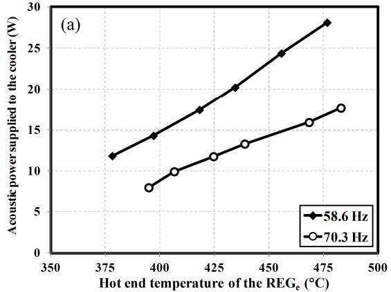

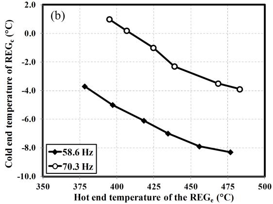

  
Fig. 15. The acoustic power supplied to the cooler (a) and cold end temperature of $\mathrm { R E G } _ { \mathrm { c } }$ (b) versus different hot end temperatures of $\mathrm { R E G _ { e } }$ at the frequencies of 58.6 Hz and 70.3 Hz.

It is apparent from these experiments that the lower cold end temperature of $\mathrm { R E G _ { c } }$ can be obtained with a higher heating temperature at the $\mathrm { R E G _ { e } }$ . These results indicate that the system can provide higher cooling performance if the hot heat exchanger of the engine is re-designed to operate at a higher heating temperature.

## 8. Conclusion

A coupled configuration of the thermoacoustic engine and cooler in a looped-tube configuration, working at frequencies of 58.6 Hz and 70.3 Hz, has been examined in this study. To obtain the maximum cooling performance, the experiments are carried out for different locations of the cooler relative to the engine with a constant temperature at the HHXe. The lowest cooling temperatures of $- 3 . 6 \mathrm { ^ { \circ } C }$ and $+ 0 . 2 \mathrm { ^ { \circ } C }$ can be generated at the optimum cooler locations of $x = 2 . 6 0$ and 2.52 m away from the reference point, at the operating frequencies of 58.6 Hz and 70.3 Hz, respectively. Within the temperature range for storing vital medicines, $+ 2 { } ^ { \circ } \mathbf { C }$ and $+ 8 ^ { \circ } \mathrm { C } .$ the experimental results indicate that this kind of system would be able to produce cooling capacity of 7 W for storing small quantities of vital medicines in remote and rural areas of developing countries. The experiments with the higher heating temperature of the HHXe were also performed to obtain lower cold end temperatures of the cooler. At the highest heating temperature of the $\mathrm { H H X _ { e } }$ of around $6 9 5 ^ { \circ } \mathrm { C } ,$ the minimum temperatures of $- 8 . 3 ^ { \circ } \mathrm { C }$ and $- 3 . 9 ^ { \circ } \mathrm { C }$ were achieved at frequencies of 58.6 Hz and 70.3 Hz, respectively. These results indicate that the cooling load at increased $\mathrm { H H X _ { e } }$ temperature would also increase (a few more watts are estimated), although the quantitative analysis was not possible in the current configuration.

However, the preliminary design calculations (cf. Saechan, 2014) based on the number of hours per day of cooking activities, the likely thermal leakages from the “cold box" and the expected mass/volume of the materials to store indicate that the nominal cooling load of 30 W would be desirable. In order to achieve this, a number of issues need to be addressed by future work and these include for instance tuning the acoustic network to improve the phase difference between pressure andvolumetric velocity in the engine regenerator, eliminating the acoustic streaming, selecting the regenerators better matched to the applied frequencies or investigating the position and function of the matching stub.

## Acknowledgments

We would like to acknowledge funding received from EPSRC (grant EP/E044379). Artur J. Jaworski would like to acknowledge the Royal Society Industry Fellowship (grant IF110094). Other partners in the SCORE project: University of Nottingham, City University London, Queen Mary

University of London and Practical Action are acknowledged for useful interactions. We would like to acknowledge Universities of Manchester and Leicester for hosting earlier stages of the project as staff and students moved between UK universities

## References

Abdoulla, K., Kang, H. and Jaworski, A., 2013. Travelling wave thermoacoustic electricity generator for rural areas using a side-branch alternator arrangement. In: The World Congress on Engineering 2013 (WCE 2013), London, UK.

Abdoulla-Latiwish, K.O.A., Mao, X. and Jaworski, A.J., 2017. Thermoacoustic micro-electricity generator for rural dwellings in developing countries driven by waste heat from cooking activities, Energy 134, 1107-1120.

Atchley, A.A., Hofler, T.J., Muzzerall, M.L., Kite, M.D. and Ao, C., 1990. Acoustically generated temperature gradients in short plates. The Journal of the Acoustical Society of America 88(1), 251-263.

Backhaus, S. and Swift, G.W., 2000. A thermoacoustic-Stirling heat engine: Detailed study. The Journal of the Acoustical Society of America 107(6), 3148-3166.

Bassem, M.M., Ueda, Y. and Akisawa, A., 2011. Design and construction of a traveling wave thermoacoustic refrigerator. International Journal of Refrigeration 34(4), 1125-1131.

Ceperley, P.H., 1979. A pistonless Stirling engine-The traveling wave heat engine. The Journal of the Acoustical Society of America 66(5), 1508-1513.

Ceperley, P.H., 1985. Gain and efficiency of a short traveling wave heat engine. The Journal of the Acoustical Society of America 77(3), 1239-1244.

Chen, R.L. and Garret, S.L., 1998. Solar/Heat Driven Thermoacoustic Engine. In: 16th International Congress on Acoustics and 135th Meeting of the Acoustical Society of America, 183-184.

Dai, W., Luo, E., Zhang, Y. and Ling, H., 2006. Detailed study of a traveling wave thermoacoustic refrigerator driven by a traveling wave thermoacoustic engine. The Journal of the Acoustical Society of America 119(5), 2686-2692.

Dhuchakallaya, I. and Saechan, P., 2017. Design and experimental evaluation of a travellingwave A thermoacoustic refrigerator driven by a cascade thermoacoustic engine. International Journal of Energy Research, (in press).

Fusco, A.M., Ward, W.C. and Swift, G.W., 1992. Two-sensor power measurements in lossy ducts. The Journal of the Acoustical Society of America 91(4), 2229-2235.

Hamood, A., Jaworski, A.J., Mao, X. and Simpson, K., 2018. Design and construction of a twostage thermoacoustic electricity generator with push-pull linear alternator. Energy 144, 61- 72.

Hasegawa, S., Yamaguchi, T. and Oshinoya, Y., 2013. A thermoacoustic refrigerator driven by a low temperature-differential, high-efficiency multistage thermoacoustic engine. Applied Thermal Engineering 58(1-2), 394-399.

Hofler, T.J., 1986. Thermoacoustic refrigerator design and performance. PhD Dissertation, Physics Department, University of California, San Diego. 1

Jaworski, A.J. and Mao, X., 2013. Development of thermoacoustic devices for power generation and refrigeration. Proceedings of the Institution of Mechanical Engineers, Part A: Journal of Power and Energy 227(7), 762-782.

Jin, T., Zhang, B., Tang, K., Bao, R. and Chen, G.B., 2007. Experimental observation on a smallscale thermoacoustic prime mover. Journal of Zhejiang University SCIENCE A 8(2), 205- 209.

Jung, S. and Matveev, K.I., 2010. Study of a small-scale standing-wave thermoacoustic engine. Journal of Mechanical Engineering Science 224(1), 133-141

NHS, 2010. http://www.nrls.npsa.nhs.uk/alerts/?entryid45=66111. [Accessed: 7 May 2013].

Piccolo A., 2018. Design issues and performance analysis of a two-stage standing wave thermoacoustic electricity generator. Sustainable Energy Technologies and Assessments 26, 17-27

Poese, M.E., Smith, R.W.M., Garrett, S.L., Gerwen, R. and Gosselin, P., 2004. Thermoacoustic refrigeration for ice cream sales. In: 6th IR Gustav Lorentzen conference.

Rott, N., 1980. Thermoacoustics. Advances in Applied Mechanics 20, 135-175.

Saechan, P., 2014. Application of Thermoacoustic Technologies for Meeting the Refrigeration Needs of Remote and Rural Communities in Developing Countries. PhD Dissertation, Department of Engineering, University of Leicester.

Swift, G.W., 1992. Analysis and performance of a large thermoacoustic engine. The Journal of the Acoustical Society of America 92(3), 1551-1563.

Tijani, M.E.H., 2001. Loudspeaker-driven thermo-acoustic refrigeration. PhD Dissertation, Technische Universiteit Eindhoven.

Tijani, M.E.H. and Spoelstra, S., 2008. Study of a coaxial thermoacoustic-Stirling cooler. Cryogenics 48(1–2), 77-82.

Applied Physics 110(9), 093519-093516.

Tijani, M.E.H. and Spoelstra, S., 2013. A hot air driven thermoacoustic-Stirling engine. Applied Thermal Engineering 61(2), 866-870.

Ward, B., Clark, J. and Swift, G.W., 2017. Design Environment for Low-Amplitude ThermoAcoustic Energy Conversion (DELTAEC) User's Guide. Version 6.4b2.7, Los Alamos National Laboratory, New Mexico, USA.

## ACCEPTED MANUSCRIPT

Wheatley, J., Hofler, T., Swift, G.W. and Migliori, A., 1983. An intrinsically irreversible thermoacoustic heat engine. The Journal of the Acoustical Society of America 74(1), 153- 170.

Xu, J., Hu, J. Zhang, L. and Luo, E., 2016. A looped three-stage cascade traveling-wave thermoacoustically-driven cryocooler. Energy 112, 804-809.

Engine in a Looped Tube. Physical Review Letters 81(15), 3128-3131.

Yu, Z., Jaworski, A.J. and Backhaus, S., 2012. Travelling-wave thermoacoustic electricity generator using an ultra-compliant alternator for utilization of low grade thermal energy. Applied Energy 99, 135-145

Zhang, X., Chang, J., Cai, S. and Hu, J., 2016. A multi-stage travelling wave thermoacoustic engine driven refrigerator and operation features for utilizing low grade energy. Energy Conversion and Management 114, 224-233.

## Highlights

• Combustion-driven thermoacoustic refrigerator is modelled and tested

• Design trade-offs are outlined to apply the technology in poor rural areas

• Atmospheric air has been shown as a viable thermodynamic medium

• Use of cheap components has been demonstrated to reduce costs

• Cooling powers of 3-7W are demonstrated for emergency storage of medical supplies