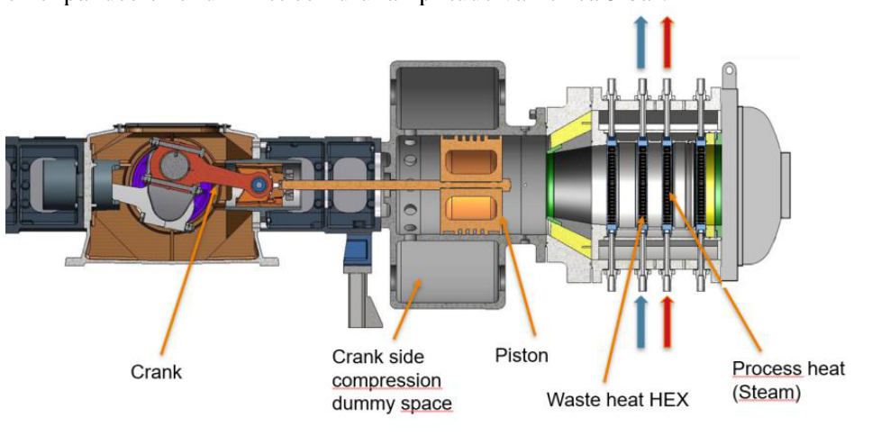
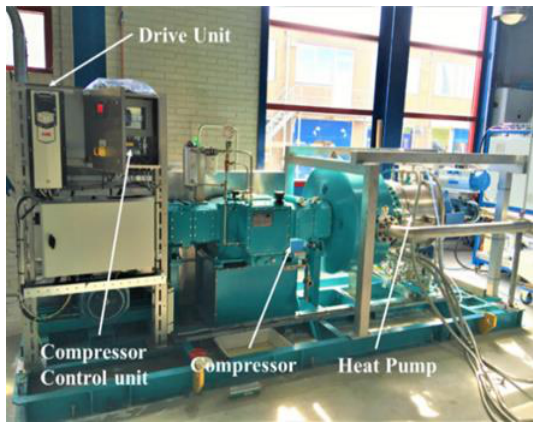
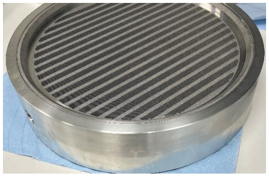
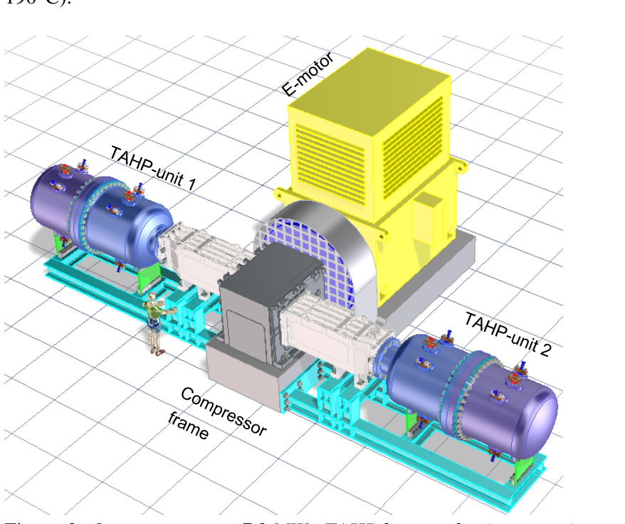

# TNO 2023：COMTA紧凑模块化热声热泵终期报告

## 来源与归档

本包是正式机构技术报告，按主要研究对象归入“论文与研究报告／制冷机与热泵”。库内已有的ISPT项目网页和TNO工业热泵网页是不同来源，不能用项目页的取得状态代替本报告的原件。封面号与正文页眉存在一位数字差异，本包保留原PDF，文件名采用正文及官方下载文件的R12021。

## 核读结果与位置

- PDF第5页§2.1、图1–2：电动机带动活塞压缩机，驱动高压氦气中的热声热泵；原型安装于TNO Petten实验室，并试验了金属打印换热器。
- 第6页§2.2：报告列出80–90°C热源与120、150、170°C蒸汽的实验，热功率范围6–8 kW，最大报告COP为2.8、温升90°C。公开报告没有完整定义该COP所计入的驱动与辅机边界，不能直接改写为全系统插座电COP。
- 第6页§2.3：7.2 MW热功率、两单元及COP 3.5（110/190°C）属于概念机械设计与模拟计算，不是该实验台的已测输出。
- 第7页§2.4：投资与回收期是可行性估算，不是成交价和投运回收记录。
- 第8页§3：后续仍需扩大热功率与示范、优化压缩机机架和传动，并减小压力容器内部氦气循环导致的热漏。

## 研究意义

这份资料的价值是指出了从可工作的热声核心到工业整机之间的具体工作：换热器、驱动适配、内部热漏、放大和示范。它不能独立证明兆瓦级产品已经商业交付，也不能给出商业销量或寿命。

## 原件与来源

- [包内原始PDF](source/TNO_2023_COMTA_Final_Report.pdf)
- [原始发布来源或论文记录](https://publications.tno.nl/publication/34641547/zcJBbE/TNO-2023-R12021.pdf)
- 原PDF共11页；SHA-256：`670386d4a55233017ccb506a8748cd4f38e3e4975493bd44670b299186c1013e`。

## 库内相关来源

- [ISPT_COMTA](../../../机构与产品资料/科研项目与示范/ISPT-COMTA/ISPT_COMTA.md)：相关但不同来源，不标记为同源副本。
- [TNO_Industrial_TAHP](../../../机构与产品资料/科研项目与示范/tno-industrial-thermoacoustic-heat-pump/TNO_Industrial_TAHP.md)：相关但不同来源，不标记为同源副本。

## MinerU 全文阅读版（2026-09-28）

以下是公开 11 页 PDF 经 MinerU 解析的荷兰文阅读版，保留机器识别结果供检索。4 幅图按 MinerU 的图位从本地原 PDF 第 5–6 页渲染补齐；公式、表格、图题和关键性能数字仍以原 PDF 为准。

> 注：该 PDF 经 MinerU 解析，MinerU 暂不支持按页截断/选择，以下为全文。

Energy & Materials

TNO 2023 R1221

Transition

# COMpact modular ThermoAcoustic heat pump

www.tno.nl

+31 88 866 50 65

info@tno.nl

Openbaar eindrapport COMTA

Date

Author(s)

Oktober 30, 2023

Jan-Aiso Lycklama à Nijeholt

Met bijdrage van:

Hassan Tijani (TNO)

Yann Ardouin (Howden)

Wouter Jansen (Howden)

Koppe van der Meer (Bronswerk HT)

Kees Biesheuvel (Dow)

Agata van Oosten (ISPT)

Classification report TNO Public

Number of pages 11

Sponsor RVO

Project name COMTA

Project number 060.34455

RVO referentie TEEI118003

Dit project is uitgevoerd met subsidie van het Ministerie van Economische Zaken en Klimaat, subsidieregeling Top Sector Energie uitgevoerd door Rijksdienst voor Ondernemend Nederland.

All rights reserved.

No part of this publication may be reproduced and/or published by print, photoprint, microfilm or any other means without the previous written consent of TNO.

In case this report was drafted on instructions, the rights and obligations of contracting parties are subject to either the General Terms and Conditions for commissions to TNO, or the relevant agreement concluded between the contracting parties. Submitting the report for inspection to parties who have a direct interest is permitted.

© 2023 TNO

## Contents

1 Uitgangspunten en doelstellingen van het project ...   
1.1 Achtergrond ..   
1.2 Doelstellingen 4   
2 Resultaten ... 5   
2.1 COMTA testopstelling. 5   
2.2 Warmtepomp metingen . 5   
2.3 Ontwerp van full-scale TAWP. 6   
2.4 Technische en economische haalbaarheid .. . 6   
2.5 Disseminatie 7   
3 Knelpunten en toepassingsperspectief . 8   
4 Bijdrage aan doelstelling van de regeling 9   
4.1 Verduurzaming 9   
4.2 Versterking kennispositie.. 9   
4.3 Spin-off binnen en buiten de sector. 9   
5 Publicaties. 10   
6 Ondertekening 11

## 1 Uitgangspunten en doelstellingen van het project

## 1.1 Achtergrond

Het totale energiegebruik in Nederland bedroeg vorig jaar 2732PJ (2022). Industrieel warmtegebruik vormt een aanzienlijk deel van het totale primaire energiegebruik in Nederland met circa 600 PJ/jaar. Verduurzaming van dit warmtegebruik is dus essentieel om de Nederlandse klimaatdoelen te realiseren. Hiermee zijn tevens significante kostenbesparingen te realiseren aangezien circa 5 miljard aan brandstofkosten (vooral aardgas) worden gemaakt voor de productie van warmte.

Warmte wordt over een breed temperatuurbereik industrieel aangewend. Warmte met temperaturen tussen $1 0 0 ^ { \circ } \mathrm { C }$ en $2 5 0 ^ { \circ } \mathrm { C }$ wordt gebruikt om materialen op te warmen, voor droogprocessen, en voor reactie en scheidingsprocessen (destillatie). Conversieprocessen in staalproductie, keramiek, glas, cementproductie, en kraakprocessen vragen veel hogere temperaturen van boven de $6 0 0 ^ { \circ } \mathrm { C } .$ . Simultaan aan de warmtevraag komt het grootste deel van de proceswarmte weer vrij als restwarmte op lagere temperatuur tussen typisch $5 0 \mathrm { { } ^ { \circ } C }$ en $1 5 0 \mathrm { { } ^ { \circ } C }$ . Het ligt daarom voor de hand om deze restwarmte te recyclen. Hiervoor zijn warmtepompen geschikt. Restwarmte kan met een warmtepomp worden opgepompt naar proceswarmte. Huidige technisch beschikbare warmtepomp technologieën kennen echter een lagere temperatuur lift en een te lage leveringstemperatuur waardoor de toepassing van warmtepompen in de industrie nog beperkt is. Met de ontwikkeling van de thermoakoestische warmtepomp (TAWP) die gekenmerkt wordt door een hoge warmteleveringstemperatuur en hoge lift kan in de toekomst worden voorzien in industriële koolstofvrije proceswarmte.

## 1.2 Doelstellingen

Doel van het COMTA (COMpact modular ThermoAcoustic heat pump) project is om de technische en economische haalbaarheid van de compacte TAWP te onderzoeken voor stoomproductie tussen 8-10 bar. Voor de technische haalbaarheid is een significante verbetering van de warmtewisselaars in de TAWP vereist om het rendement (COP) te verbeteren.

Het COMTA project is uitgevoerd met technologieleveranciers Bronswerk Heat Transfer en Howden Thomassen Compressors. Dow Benelux B.V. en een industriële gebruikersgroep zijn als industriële eindgebruikers betrokken. TNO is kennisinstituut en de penvoerder van COMTA.

## 2 Resultaten

## 2.1 COMTA testopstelling

De COMTA warmtepomp is een elektrisch aangedreven TAWP die gebruik maakt van helium als werkmedium. Het werkingsprincipe van een TAWP is gebaseerd op de Stirling cyclus. De warmtepomp bestaat uit een drukvat gevuld met helium onder hoge druk (30 bar). Het drukvat is gemonteerd op de zuigercompressor zoals weergegeven is in Figuur 1. De compressor wordt aangedreven door een elektrische motor. De heen en weer gaande zuiger comprimeert en expandeert helium met een drukamplitude van circa 3 bar.

  
Figuur 1 Schematische dwarsdoorsnede van de COMTA TAWP.

Warmte wordt aangevoerd door een lage temperatuur restwarmtewarmtewisselaar via een thermisch olie circuit. Deze laagwaardige restwarmte wordt opgepompt naar hoge temperatuur en wordt afgegeven aan een hoge temperatuur warmtewisselaar waarin voedingswater wordt verdampt en stoom wordt gevormd. In het project zijn nieuwe innovatieve metaal-geprinte warmtewisselaars ontwikkeld. Deze zijn ingebouwd in de TAWP en getest. Een foto van testopstelling in het Carnot lab. van TNO in Petten is hieronder weergegeven in Figuur 2 met een foto van de geprinte restwarmte warmtewisselaar voor olie/helium. De geprinte verdamper voor stoomproductie is niet getoond.

  
Figuur 2 COMTA testopstelling in TNO Carnot laboratorium in Petten en metaal-geprinte warmtewisselaar (foto rechts).

Door toepassing van een zeer hoge vin-dichtheid is de gasspleet voor helium slechts 0,5 mm (tussen de vinnen). Naast veel warmte overdragend oppervlak is hierdoor tevens een zeer hoge warmteoverdrachtcoëfficiënt verkregen.

## Warmtepomp metingen

In de experimenten wordt stoom geproduceerd bij temperaturen van 120, 150 en $1 7 0 \mathrm { { } ^ { \circ } C }$ vanaf bronwarmte temperaturen tussen de 80 en $9 0 { } ^ { \circ } \mathbf { C } .$ De innovatieve metaal-geprinte warmtewisselaars voor stoomproductie en restwarmte toevoer presteerden zeer goed in vergelijking met de oude warmtewisselaars. Hierdoor is het thermische vermogen en de COP van de TAWP sterk verbeterd. Het thermische vermogen varieert tussen 6 en 8 kW. De maximaal gevonden Coefficient of Performance (COP) bedraagt 2.8 bij een lift van $9 0 ^ { \circ } \mathbf { C }$

De experimenten laten de technische haalbaarheid van het nieuwe compacte warmtepompontwerp zien en de hoge mate van flexibiliteit van de TA warmtepomp. Veel hogere stoomtemperaturen tot 200C zijn technisch haalbaar, maar deze werden beperkt door de externe test infrastructuur in het laboratorium.

## 2.3 Ontwerp van full-scale TAWP

De schaalbaarheid van de COMTA warmtepomp is onderzocht door het maken van een conceptueel mechanisch ontwerp van een industriële TAWP. Voor de aandrijving van de TAWP is uitgegaan van de Howden C85-compressor. Met TA simulatie software is een basisontwerp van de thermo akoestische unit gemaakt en zijn COP en thermisch vermogen berekend. De warmtepomp bestaat uit een zuigercompressor met 1 tot 8 zuigers die 1 tot 8 TA units aandrijven, afhankelijk van de gewenste proceswarmtebehoefte. In figuur 3 wordt het ontwerp getoond van een TAWP met twee units en totaal 7,2 MW aan thermisch vermogen voor stoomproductie tot $2 5 0 ^ { \circ } \mathrm { C }$ en met een berekende COP van 3,5 $( 1 1 0 ^ { \circ } \mathrm { C } /$ 190C).

  
Figuur 3 Ontwerp van een 7,2 MW TAHP bestaande uit twee units en aangedreven door een Howden zuigercompressor met twee dubbelwerkende zuigers.

## 2.4 Technische en economische haalbaarheid

De technische en economische haalbaarheid van de TAHP is onderzocht. De investeringskosten worden geschat op 230 Euro $\mathrm { k W _ { t h } } .$ . De kosten voor installatie en procesintegratie zijn geschat op een factor twee van de kosten voor de warmtepomp. Hiermee werd een aanvaardbaar rendement op de investering van 3,6 jaar gevonden.

De haalbaarheid van het ontwerp, de goede COP en lage ROI laten het potentieel van de warmtepomp zien. Bovendien is de marktomvang aanzienlijk, zelfs met een lage aangenomen marktpenetratie. De technische en economische haalbaarheid is daarom goed te noemen.

## 2.5 Disseminatie

De disseminatie van projectresultaten is door ISPT verzorgd door middel van de ISPT website, nieuwsbrieven en sociale media.

## Knelpunten en toepassingsperspectief

Om de TAWP tot een succesvol product door te ontwikkelen is een verdere opschaling en demonstratie van de TAWP met een hoger thermisch vermogen een vereiste, op basis van een dubbelwerkende zuiger welke aan weerzijde een TA module aandrijft. Hiernaast is het van belang om de compressorframe en drijfwerk te optimaliseren voor de TA werkcondities.

De COP kan verbeterd worden door interne warmtelekkage te verminderen. Ten gevolge van interne warmtelekkage lekt opgepompte warmte weg naar koudere delen van de TAWP. Dit wordt veroorzaakt door circulatie van helium in het drukvat van de warmtepomp.

## 4 Bijdrage aan doelstelling van de regeling

## 4.1 Verduurzaming

De ontwikkeling van de TAWP past goed in de programmalijn Joint Industry Projects en de programmalijn Warmte. Besparingen tot 30% op het primaire energiegebruik zijn mogelijk op basis van het huidige elektriciteitsopwekkingsrendement. Met de toename in duurzame elektriciteitsproductie zal dit percentage snel kunnen stijgen tot eindelijke koolstofvrije warmtelevering met de TA warmtepomp.

## 4.2 Versterking kennispositie

COMTA heeft geleid tot een verdere versterking van de kennispositie van de projectpartners op het gebied van de thermo akoestische warmtepomp voor toepassing in de industrie. De samenwerking met de compressorleverancier Howden heeft tot een nieuwe industrieel modulair TA warmtepompconcept geleid. Directe stoomproductie tot $2 5 0 ^ { \circ } \mathrm { C }$ en zeer hoge temperatuur lift van $1 0 0 ^ { \circ } \mathrm { C }$ in een single stage zijn haalbaar.

## 4.3 Spin-off binnen en buiten de sector

Doordat de TAWP onder een zeer brede range aan bron- en afgifte temperaturen kan opereren is de potentiële toepassing binnen en buiten de industrie groot. Bijkomend voordeel van de TAWP is dat er geen aanpassingen nodig zijn (werkmedium, smeermiddel, compressor, etc.) om efficiënt onder verschillende temperatuurcondities te opereren. De TAWP wordt daarom ook voor de gebouwde omgeving ontwikkeld door TNO en Blue Heart.

## 5 Publicaties

Resultaten van het COMTA project zijn op deze twee conferenties gepresenteerd:

Jan-Aiso Lycklama à Nijeholt, Hassan Tijani, Simon Spoelstra, Anshuman Pandey Thermoacoustic heat pumps for high temperature and industrial applications, High-Temperature Heat Pump Symposium, Copenhagen 29-30 march 2022.

M.E.H. Tijani, J.A. Lycklama à Nijeholt, Thermoacoustic heat pump for very high temperature applications, 14th IEA Heat Pump Conference, 15-18 May 2023, Chicago, Illinois.

## 6 Ondertekening

Petten. 30 Oktober 2023

TNO

Sjaak van Loo

Head of department

Jan-Aiso Lycklama à Nijeholt

Author
