# Loudspeaker-driven thermo-acoustic refrigeration

Citation for published version (APA):

Tijani, M. E. H. (2001). Loudspeakér-driven thermo-acoustic refrigeration. [Phd Thesis 1 (Research TU/e / Graduation TU/è), Applied Physics and Science Education]. Technische Universiteit Eindhoven. https://doi.org/10.6100/IR547542

DOI: 10.6100/IR547542

Document status and date: Published: 01/01/2001

## Document Version:

Publisher's PDF, also known as Version of Record (includes final page, issue and volume numbers)

Please check the document version of this publication:

• A submitted manuscript is the version of the article upon submission and before peer-review. There can be important differences between the submitted version and the official published version of record. People interested in the research are advised to contact the author for the final version of the publication, or visit the DOl to the publisher's website.

• The final author version and the galley proof are versions of the publication after peer review.

• The final published version features the final layout of the paper including the volume, issue and page numbers.

Link to publication

## General rights

Čopyright and moral rights for the publications made accessible in the public portal are retained by the authors and/or other copyright owners and it is a condition of accessing publications that users recognise and abide by the legal requirements associated with these rights.

• Users may download and print one copy of any publication from the public portal for the purpose of private study or research.

• You may not further distribute the material or use it for any profit-making activity or commercial gain

• You may freely distribute the URL identifying the publication in the public portaí.

If the publication is distributed under the terms of Article 25fa of the Dutch Copyright Act, indicated by the “Taverne” license above, please follow below link for the End User Agreement:

www.tue.nl/taverne

## Take down policy

If you believe that this document breaches copyright please contact us at:

openaccess@tue.nl

providing details and we will investigate your claim.

# Loudspeaker-driven thermo-acoustic refrigeration

Proefschrift

ter verkrijging van de graad van doctor aan de Technische Universiteit Eindhoven, op gezag van de Rector Magnificus, prof.dr. R.A. van Santen, voor een commissie aangewezen door het College voor Promoties in het openbaar te verdedigen op maandag 10 september 2001 om 16.00 uur

door

Moulay El Hassan Tijani

geboren te Marokko

Dit proefschrift is goedgekeurd door de promotoren:

prof.dr. A.T.A.M. de Waele en prof.dr. S.L. Garrett

Copromotor: dr.ir. J.C.H. Zeegers

Druk: Universiteitsdrukkerij TUE

CIP-DATA LIBRARY TECHNISCHE UNIVERSITEIT EINDHOVEN

Tijani, Moulay El Hassan

Loudspeaker-driven thermo-acoustic refrigeration / by Moulay El Hassan Tijani.-

Eindhoven: Technische Universiteit Eindhoven, 2001.-Proefschrift.-

NUGI 812

ISBN 90-386-1829-8

Trefw.: thermo-akoestiek / luidspreker/ thermo-akoestische koeling.

Subject headings: thermoacoustics/ loudspeaker / thermo-acoustic refrigeration,

## Contents

1 Introduction 1   
1.1 History 1   
1.2 Basic principle of the thermoacoustic effect 5   
1.3 Applications . 9   
1.4 The scope of this thesis 11   
2 Basic thermodynamic and acoustic concepts 16   
2.1 Thermodynamic performance . 16   
2.1.1 Refrigerators and heat pumps 18   
2.1.2 Efficiency of the prime mover 20   
2.2 Thermodynamic approach to thermoacoustics 20   
2.3 Acoustic concepts . 28   
2.4 Basic operation concepts . 29   
2.4.1 Temperature gradient 30   
2.4.2 Heat flow 31   
2.4.3 Acoustic power 31   
2.4.4 Viscosity 31   
2.4.5 Performance 32   
2.5 Some basic measurements 32   
2.5.1 Set-up 32   
2.5.2 Measurements 33   
3 Theory of thermoacoustics 39   
3.1 General thermoacoustic theory 39   
3.2 Boundary layer and short-stack approximations 48   
3.3 Energy fluxes in thermoacoustic refrigerator 50   
3.4 Computations and DeltaE 51   
3.5 Non-linear effects 52   
3.5.1 Turbulence 52   
3.5.2 Streaming 53   
3.5.3 Harmonics and shocks 53   
4 Binary gas mixtures and Prandtl number 57   
4.1 Kinetic theory of binary gas mixtures 57   
4.1.1 Composition 59   
4.1.2 Viscosity 60   
4.1.3 Thermal conductivity 61   
4.1.4 Specific heat 62   
4.1.5 Sound velocity 64   
4.1.6 Prandtl number 64   
4.2 Calculation of the binary gas mixtures properties as function of the   
composition 64   
5 Optimizing loudspeakers for thermoacoustic refrigeration 71   
5.1 Electrical model for refrigerator . 71   
5.2 The acoustic impedance of the resonator 78   
5.3 Performance calculations 83   
5.4 The gas spring system 90   
6 Design of a thermoacoustic refrigerator 94   
6.1 Design strategy 94   
6.2 Design choices 97   
6.3 Design of the stack 99   
6.4 Optimization of the stack 101   
6.5 Resonator 102   
6.6 Heat exchangers 107   
6.6.1 Cold heat exchanger 107   
6.6.2 Hot heat exchanger 108   
6.7 Acoustic driver 108   
6.8 Prandtl number 109   
6.9 DeltaE . 109   
7 Experimental setup 113   
7.1 Thermoacoustic refrigerator 113   
7.1.1 Acoustic driver 113   
7.1.2 Gas-spring system 117   
7.1.3 Driver housing 118   
7.1.4 Resonator 118   
7.1.5 Stack 120   
7.1.6 Heat exchangers 122   
7.2 Gas panel control system 125   
7.3 Gas mixtures preparation 126   
7.4 Thermal insulation 127   
7.5 Coil protection circuit 128   
7.6 Measurement procedure 129   
7.6.1 Resonance frequency 129   
7.6.2 Electroacoustic efficiency 129   
7.6.3 Refrigerator performance 130   
7.7 Data acquisition 131   
8 Experimental results 134   
8.1 Electroacoustic efficiency . 134   
8.2 Performance measurements with the first resonator 137   
8.3 Performance measurements with the second resonator 140   
8.3.1 Cool down with the aluminium resonator 140   
8.3.2 Effect of the dynamic pressure 141   
8.3.3 Effect of the Prandtl number 142   
8.3.4 The effect of the plate spacing 150   
8.3.5 DeltaE calculations . 152   
9 Conclusions and discussion 157   
10 Nomenclature 159   
11 Summary 164   
12 Samenvatting 166   
13 Dankwoord 168   
14 Over de auteur 170

## Chapter 1

## Introduction

Thermoacoustics, as defined by Rott [1], is a subject dealing generally with effects in acoustics in which heat conduction and entropy variations of a medium play a role. In this thesis the term "thermoacoustics" will be used in the limited sense of the generation of sound by heated surfaces and the process of heat transfer from one place to another by sound. In this chapter, a brief review of the history of thermoacoustics is presented, along with a simple physical explanation of the effect, and some applications.

## 1.1 History

The generation of acoustic oscillations by heat have been observed and studied for over two centuries. Byron Higgins made the first observations and investigations of organpipe type oscillations, known as "singing flames", in 1777 [2]. At certain positions of a hydrogen flame inside a tube, open at both ends, acoustic oscillations were observed. Fig.(1.1) shows a configuration for producing Higgins' oscillations. A survey of the phenomena related to Higgins oscillations was given by Putnam and Dennis [3].

In 1859 [4], Rijke discovered that strong oscillations occurred when a heated wire screen was placed in the lower half of an open-ended pipe, as shown in Fig.(1.2). It was noticed that the convective air current through the pipe was necessary for the phenomenon to occur. Oscillations were strongest when the heated screen was located at one-fourth of the length of the pipe from the bottom end. Feldman gave a review of the literature on the Rijke tube [5].

Probably the research by Sondhauss [6], performed in 1850, approximates best what we define today as thermoacoustic oscillations. Sondhauss studied experimentally heat-generated sound, observed for centuries by the glass-blowers when blowing a hot bulb at the end of a cold narrow tube. In Fig.(1.3) a "Sondhauss tube" is shown; it is open on one end and terminated in a bulb on the other end.

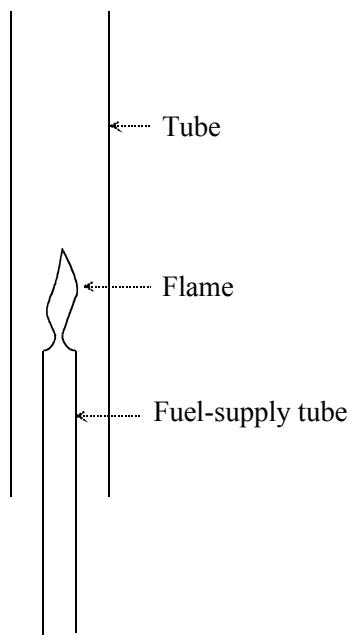  
Figure 1.1: One form of the singing-flame apparatus. For certain position of the flame inside the tube acoustic oscillations can be observed.

Sondhauss observed that, if a steady gas flame (heat) was supplied to the closed bulb end, the air in the tube oscillated spontaneously and produced a clear sound which was characteristic of the tube length and the volume of the bulb. The sound frequency was measured and recorded for tubes having an inside diameter of 1 to 6 mm, and having various bulb sizes and lengths. Hotter flames produced more intense sounds. Sondhauss gave no explanation for the observed oscillations. Feldman gave also a review of the literature on the Sondhauss tube [7]. In 1962, Carter et al. [8], during an experimental investigation of the feasibility of the Sondhauss tube to generate electricity, found that the insertion of a bundle of small glass tubes inside the Sondhauss tubes improved their performance.

In 1887, Lord Rayleigh gave a qualitative explanation, in his classic work on sound [9], for the Sondhauss oscillations. His criterion for the production of any type of thermoacoustic oscillations was:

"If heat be given to the air at the moment of greatest condensation or taken from it at the moment of greatest rarefaction, the vibration is encouraged"

So Rayleigh knew that thermoacoustics was due to the interplay of heat injection and density variations.

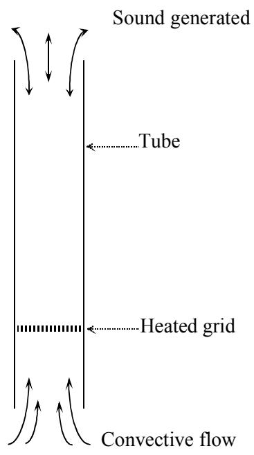  
Figure 1.2: Rijke tube. The Rijke acoustic oscillations can be observed best with the heated wire screen at one-fourth of the pipe from the bottom end.

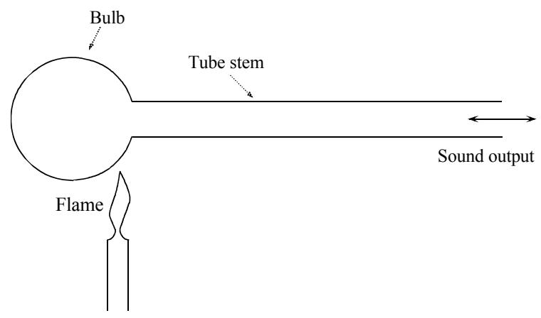  
Figure 1.3: Sondhauss tube. When heat is supplied for example by means of a flame to the closed end, sound can be generated.

Another form of Sondhauss oscillations, which occur in cryogenic storage vessels, are the so-called "Taconis oscillations". Taconis [10] observed spontaneous oscillations when a hollow tube with the upper end closed was inserted in liquid helium. Taconis' explanation of how the large temperature gradient along the tube caused the oscillations was essentially a restatement of the Rayleigh criterion. The Taconis oscillations have been studied experimentally by Yazaki et al.[11].

Although various aspects of what is now known as thermoacoustics have been of interest for centuries, the formal theoretical study of thermoacoustics started in 1949 [12], when Kramers studied the Taconis oscillations. He generalized the Kirchhoff theory of the attenuation of sound waves at constant temperature to the case of attenuation in the presence of a temperature gradient. The results of Kramers' theory were in disagreement with the experiment, because of some incorrect assumptions. In 1969, Rott continued the work of Kramers in a series of papers [13, 14, 15, 16], where a successful linear theory of thermoacoustics is given.

Wheatley, Swift, and others [17, 18, 19, 20] have developed the connection between the acoustical part of thermoacoustics in a broader thermodynamical perspective. Swift [19] has reviewed much of this work.

As can be understood from the above discussion, the history of heat-driven oscillations is rich and old. But the reverse thermodynamic process, of generating a temperature gradient by imposing acoustic oscillations, is a more recent phenomenon. Gifford and Longsworth demonstrated a heat-pumping process along the inner surface of a closed tube, where pressure pulses at low frequency were sustained [21]. They called this cooling device a "Pulse tube", which is the precursor of the present orifice pulse-tube coolers. In 1975, cooling was also observed by Merkli and Thomann [22], at the velocity antinode of a cylindrical cross-section acoustic tube in resonance. These two events formed the start of the work at Los Alamos National Laboratories (LANL) on thermoacoustic devices in the eighties, by Wheatley, Swift, and coworkers. The first acoustic heat pump (cooler), built at LANL, used a loudspeaker at one end of a closed tube to drive the acoustic resonance, and a stack of fiber glass plates positioned at the opposite end. The stack of plates was used to improve the thermoacoustic effect, as observed by Carter et al. With this arrangement, it was easy to produce a temperature difference over the stack, as a result of the heat transfer process from one end of the stack to the other. Since then, several experimental set-ups have been built [23, 24]. Some examples will be given in Section 1.3.

## 1.2 Basic principle of the thermoacoustic effect

Acoustic waves consist not only of coupled pressure and displacement oscillations in a gas, but also of temperature oscillations as a response to the pressure variations. The interaction of these effects in gas close to a solid surface generates thermoacoustic oscillations. At the surface heat can be extracted or supplied to the gas. The result of this interaction is that a sound wave is sustained in case of a large temperature gradient along the surface. While in the reverse case acoustic work is absorbed in order to transport heat, generating a temperature gradient.

The mechanism of the thermoacoustic effect can best be visualized by considering a tube containing a gas, closed at one end and at the other an oscillating piston is moving forwards and backwards, compressing and expanding the gas in the tube, as shown in Fig.(1.4). In order to understand how the thermoacoustic cycle works, we follow a small volume of gas (parcel), as indicated by the small square in Fig(1.4), as it moves alongside the wall of the tube. The motion of the piston is sinusoidal but for simplicity and clarity we consider a step by step cycle: (rapid motion-wait-rapid motion-wait-etc). This is indicated in Fig.(1.4) by the steps [1 − 2 − 3 − 4 − 1 − etc]. This cycle forms the thermodynamic cycle of the thermoacoustic effect. It consists of two reversible adiabatic steps 1 and 3 and two isobaric heat transfer steps 2 and 4, like in the Brayton cycle.

The heat-pump process (refrigeration) occurs when the temperature gradient on the wall is zero or small, Fig.(1.4a). At the beginning of the cycle (step 1), the piston moves to the right in the direction of the closed end, compresses the parcel of gas which warms up. At this time, the parcel of gas is warmer than the local wall temperature, and heat flows irreversibly from the parcel to the wall (2). In step 3 the piston moves back, the parcel expands and cools. The parcel of gas is now colder than the local wall position, and heat transfer from the wall to the parcel takes place (4). At this moment, the parcel of gas is at the initial position, and the cycle starts again. As a result a small amount of heat is transported by the parcel of gas from the left to the right. After many cycles, a temperature gradient builds up along the tube and the piston end cools down and the closed end warms up. This process takes place as long as the temperature gradient in the gas, as a consequence of compression, is higher than the temperature gradient along the wall (and vise versa for the expansion). The work used to compress the gas in step 1, is returned in step 3, so that net no work is consumed in these two steps. During the heat transfer, step (2), the parcel of gas will contract and the piston has to move a little to the right to keep the pressure throughout the gas constant. In step (4), the piston has to move to the left. A schematic pV-diagram for the refrigeration cycle, where V is the volume in front of the piston, is shown in

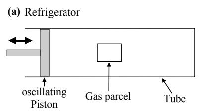

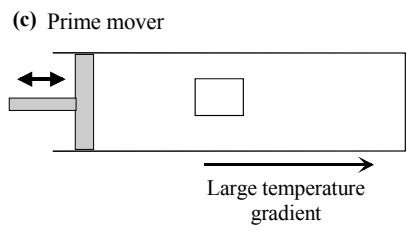

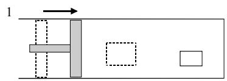

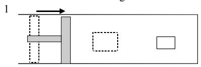

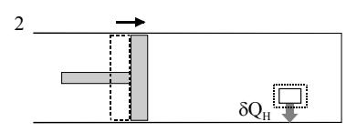

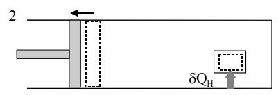

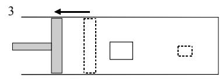

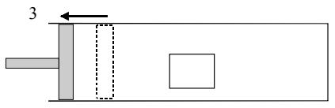

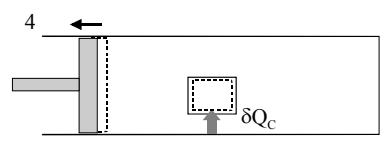

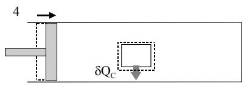

(b)  
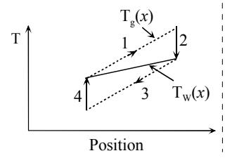  
(d)

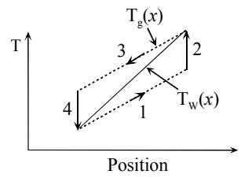  
Figure 1.4: A typical gas parcel executing the four steps $( 1 - 4 )$ of the cycle in a thermoacoustic refrigerator (left side) and prime mover (right side), assuming an inviscid gas and square-wave acoustic motion and pressure. In each step, the dashed and solid squares and vertical rectangles show the initial and final states of the parcel and piston, respectively. (b) Gas temperature $T _ { g } ( x )$ , and wall temperature $T _ { w } ( x )$ versus position for the refrigerator. (d) Gas temperature $T _ { g } ( x )$ , and wall temperature $T _ { \scriptscriptstyle W } ( x )$ versus position for the prime mover.

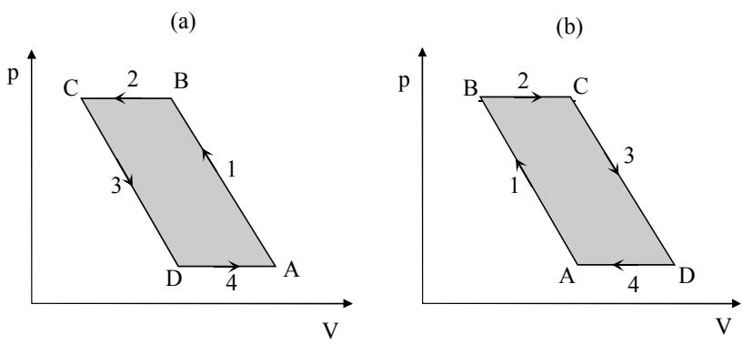  
Figure 1.5: Schematic pV-diagram for the thermoacoustic cycle $( F i g . ( 1 . 4 ) )$ . a) Refrigerator; the area ABCD represents the work used. b) Prime mover; the area ABCD represents the work produced.

Fig.(1.5a). The area ABCD represents the work used during the cycle. Actually, the whole gas alongside the wall of the tube contributes to the heat pump process.

In Fig.(1.4c), the heat generation of sound in the so-called prime mover, is illustrated. The prime-mover cycle also consists of two adiabatic (1, 3) and two isobaric heat-transfer steps (2, 4). The only difference with the heat-pump case is that now we apply a large temperature gradient ∇T along the tube, so that the directions of heat transfer in steps 2 and 4 are reversed. When the parcel of gas is compressed, it warms up, but is still colder that the local wall position. Heat then flows from the wall into the parcel which expands. As a consequence of this expansion of the gas the piston will be pushed to the left and work is generated. In step 4, after the expansion, the gas element is warmer than the wall and heat flows into the wall. The gas contracts and work is done by the piston. The net work produced in one cycle is given by the area ABCD in Fig. (1.5b). As a result, a standing wave can be sustained by a large temperature gradient along the wall of the tube.

In summary, during the compression step 1, the parcel of gas is both displaced along the wall and compressed. Two temperatures are important: the temperature of the gas after adiabatic compression and the local temperature of the wall adjacent to the parcel. If the temperature of the gas is higher than that of the wall, heat flows from the gas to the wall (heat pump). If the temperature of the gas is lower, heat flows from wall to gas (prime mover). Both heat flow and power can thus be reversed and the heat transfer process can be switched between the two modes by changing the temperature gradient along the wall. A small temperature gradient is the condition for heat pump; a high gradient is the condition for a prime mover. The gradient that separates the two regimes is called the critical temperature gradient. For this gradient, the temperature change along the wall matches the temperature change due to adiabatic compression, and no heat flows between the gas and the wall. The critical temperature gradient will be defined in the next chapter.

In the heat-pump regime work is absorbed to transfer heat from lower temperature to higher temperature. In this case, an acoustic wave has to be sustained in the tube to drive the process. In the prime mover mode the gas expands at high pressure (heat absorption), and contracts at low pressure (heat release), so that work is produced. In this case, the large temperature gradient sustains the acoustic oscillations.

All periodic heat engines and refrigerators need some time phasing to operate properly. Conventional systems use pistons to compress and displace the gas in a given sequence. In thermoacoustic devices, this time phasing is ensured by the presence of the two thermodynamic media: gas and a solid surface, so that the irreversible heat transfer in steps 2 and 4 introduces the necessary time lag between temperature and motion. The compression and displacement are determined by the acoustic wave, instead of pistons.

At this stage, it is important to note that not all the gas in the tube is equally effective to the thermoacoustic effect. The elements of gas far away from the wall have no thermal contact, and are simply compressed and expanded adiabatically and reversibly by the sound wave. Elements that are too close to the wall have a good thermal contact, and are simply compressed and expanded isothermally. However, elements at about a distance of a thermal penetration depth $\delta _ { k }$ from the wall (c.f. next chapter), have sufficient thermal contact to exchange some heat with the wall and produce a time delay between motion and heat transfer which is necessary for the heat pump process. The quantity $\delta _ { k }$ is the distance across which heat can diffuse through the gas in a time $1 / \pi f ,$ where f is the acoustic frequency. As indicated in section 1.1, Carter et al.[8] realized that the performance of the thermoacoustic Sondhauss tube could be greatly improved by inclusion of a stack of small tubes. This has the effect of increasing the effective contact area between gas and solid over the cross-section of the tube, so that the whole gas contributes to the process.

The appropriate use of stacks and their position in acoustically resonant tubes can produce powerful refrigerators (heat pump) and heat engines. We have to note here that even though the system uses a standing wave to displace, compress and expand the gas in the stack, a small travelling acoustic wave component is necessary to maintain the standing-wave resonance against the power absorption in the system [19]. Systems using only traveling waves, which can be made more efficient, are also possible [19, 25].

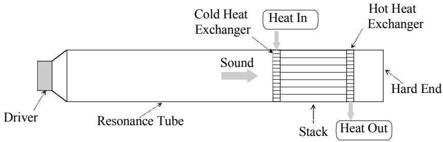  
Figure 1.6: A simple illustration of a thermoacoustic refrigerator.

## 1.3 Applications

In Section 1.2, the essentials of thermoacoustics were explained. Under favorable conditions, powerful or small size thermoacoustic devices can be built to operate as prime-movers or heat-pumps.

Since the development of the first practical thermoacoustic apparatus in the early eighties at LANL [17, 23], thermoacoustic technology has received an increasing attention as a new research area of heat engines and heat pumps. Since then, many thermoacoustic systems have been built, mostly at LANL, Naval Postgraduate School (NPS) in Monterey (California), and at Pennsylvania State University.

Heat pumps and refrigerators use an acoustic driver (loudspeaker or prime mover) to pump heat from a cool source to a hot sink. A simple thermoacoustic refrigerator is shown in Fig.1.6. Such systems contain a loudspeaker, which drives an intense sound wave in a gas-filled acoustical resonator. A structure with channels, called the stack, is appropriately placed in the tube. The stack is the heart of the refrigerator where cooling takes place.

Two examples of refrigerators that were built and tested at NPS are: The Space Thermoacoustic Refrigerator (STAR) [24], which was designed to produce up to 80 K temperature difference over the stack, and to pump up to 4 watt of heat. The STAR was launched on the space shuttle Discovery in 1992. The second setup is the Shipboard Electronics ThermoAcoustic Cooler (SETAC) that was used to cool radar electronics on board of the warship USS Deyo in 1995 [26]. It was designed to provide 400 watt of cooling power for a small temperature span, which is similar to a domestic refrigerator/freezer system.

At Pennsylvania State University, a large chiller called TRITON is being developed to provide cooling for Navy ships [27]. It is intended to produce a cooling power of about 10 kW which means that it can convert three tons of water at $0 ^ { 0 } \mathrm { C }$ to ice at the same temperature in one day.

At LANL, a heat-driven thermoacoustic refrigerator known as the "beer cooler"

was built, which uses a heat-driven prime mover instead of a loudspeaker to generate the sound necessary to drive the refrigerator [28]. A similar device, called a ThermoAcoustic Driven ThermoAcoustic Refrigerator (TADTAR) was recently built at NPS. It has a cooling power of about 90 watt for a temperature span of $2 5 ~ ^ { 0 } \mathrm { C } .$ Such a device has no moving parts at all. Also at NPS, a solar driven TADTAR has been built which has a cooling capacity of 2.5 watt for a temperature span of $1 7 . 7 \ ^ { 0 } \mathrm { C }$ [29].

At LANL, much of the efforts focused primarily on large thermoacoustic engines, using heat to generate sound, which is used to generate electrical power or to drive coolers to liquefy natural gas. One example of such efforts is a collaboration between LANL and an industrial partner to develop a cryogenic refrigeration technology called ThermoAcoustically Driven Orifice Pulse Tube refrigeration (TADOPTR)[30]. This technology has the unique capability of producing cryogenic temperatures (115 K) with no moving parts. It uses a pulse-tube refrigerator which is driven by a naturalgas-powered thermoacoustic prime mover. A machine with a cooling capacity of 2 kW producing about $0 . 5 ~ \mathrm { m ^ { 3 } / d a y }$ has been developed [30]. A second system, using a traveling wave prime mover, is now under construction. This has a higher efficiency [31], and a cooling capacity of about 140 kW. It is expected that it will burn 20 % of natural-gas to liquefy the other 80 % at a rate of about $5 0 \ \mathrm { m ^ { 3 } / d a y } .$

At Tektronix, a TADOPTR was also built to provide cooling of electronic components. The prime mover, used in this cooler, provided 1 kW to the pulse-tube refrigerator with an efficiency of about 23 % of Carnot [32]. The prime mover was driven by an electric heater. Hence the system had no moving parts.

The potential of applications of thermoacoustic devices is substantial, as can be understood from the foregoing examples. Prime movers can be used to generate electricity, or to drive refrigerators. Thermoacoustic heat pumps can be used to generate heating, air-conditioning or cooling of sensors, supercomputers, etc. Their advantage is that they can have one (loudspeaker), or no moving parts, no tight tolerances, making them potentially reliable and low cost. Besides being reliable, they use only inert gases (no CFC's) so they are environmentally friendly. On the other hand, standingwave thermoacoustic devices have a relatively low efficiency. However, thermoacoustic is still a young technology. Recently, the LANL team has designed a traveling-wave prime-mover which has an efficiency much higher than the standing-wave counterpart. This engine is a Stirling version of the thermoacoustic prime-mover. It has a thermal efficiency of 30 % [30, 31, 33], while typical internal combustion engines are 25 to 40 % efficient. Thermoacoustic refrigerators can also be made using this principle, and reach efficiencies comparable to vapor compression systems. Swift gave an excellent review of the current status of the field of thermoacoustics in his introductory book [30].

## 1.4 The scope of this thesis

Since the seventies, the research in the Low Temperature group focused on dilution refrigerators. Such devices generate cooling by mixing $^ { 4 } \mathrm { H e }$ and $^ 3 \mathrm { H e }$ Temperatures as low as 2 mK can be reached. About a decade ago the group's attention shifted to other new cooling technologies and their applications. Presently, the pulse-tube refrigerator forms the main research area of our group. The pulse-tube refrigerator is a successor of the Stirling-cycle refrigerator. The Stirling refrigerator requires two moving parts, one of which is in contact with the cold temperature. In 1963, Gifford and Longsworth[21] discovered a refrigeration type which eliminated the cold moving part. The elimination of the moving part at the cold side is a very important step towards high reliability. Recently, Swift et al.[32] eliminated the remaining piston at ambient temperature, substituting for it a thermoacoustic heat engine, as discussed in Section 1.3.

Since thermoacoustic technology can also lead to devices without moving parts, attention in the Low Temperature group is also focused in this direction for possible applications. The work presented in this thesis is a start in this research direction.

The quantitative (theoretical) understanding of the physical principle underlying the thermoacoustic effect is well established and has been discussed in many papers. But a quantitative experimental investigation of the effect of some important parameters on the behavior of the thermoacoustic devices is still lacking. Important parameters are the spacing between the parallel plates in the stack and the Prandtl number, as they determine the energy flow. Hence, we decided to investigate experimentally the effect of the spacing in the stack by constructing many parallel-plate stacks with spacing varying between 0.15 and 0.7 mm. The effect of the Prandtl number on the performance of the thermoacoustic refrigerator is investigated using gas mixtures of helium-argon, helium-krypton, and helium-xenon. These provided gas mixtures with Prandtl numbers varying between 0.2 and 0.68. The measurements show that the performance of the refrigerator rises as the Prandtl number decreases. The lowest Prandtl number of $0 . 2 ,$ obtained with a mixture containing 30 % xenon, leads to a coefficient of performance relative to Carnot which is 70 % higher than with pure helium. The measurements show also that in our system a plate spacing in the stack of 0.25 mm leads to a maximum in cooling power, and that a spacing of 0.4 mm leads to the lowest temperature. A low temperature of nearly $\mathrm { - 6 7 ~ ^ { 0 } C }$ is achieved with our cooler which is one of the lowest reported temperatures up to date. In addition, we invented a technique, using the gas in the back of the loudspeaker driving the refrigerator, to optimize the electroacoustic efficiency of the loudspeaker. By tuning the mechanical resonance of the loudspeaker to the acoustic frequency of the resonator, an electroacoustic efficiency of 35 % is obtained, compared with the electroacoustic efficiency of commercial loudspeakers of only 3 to 5 %. This is an important improvement. Combining the above discussed effects, we made a contribution towards more efficient thermoacoustic refrigerators.

This thesis focuses on the design, development, and optimization of a thermoacoustic refrigerator, using the linear thermoacoustic theory as a guideline. In Chapter 2 the basic thermodynamic and thermoacoustic principles will be reviewed. Chapter 3 is concerned with the linear theory of thermoacoustics, first developed by Rott, and reviewed by Swift. The same mathematics will be used in broad lines; the various theoretical expressions, important to the design and experiment, will be given. Chapter 4 gives an expression for the Prandtl number for binary gas mixtures, derived from kinetic theory, and we will show how this quantity can be made lower than 2/3. Chapter 5 is dedicated to the electrical model which is used to simulate the behavior of the loudspeaker in the refrigerator, and illustrate how the performance of the loudspeaker can be improved, along with the practical means to achieve that goal. In greater detail, the conception, design, and engineering of the different parts of the thermoacoustic refrigerator will be illustrated in Chapter 6. The experimental set-up is described in Chapter 7, along with the experimental techniques for the measurements. Subsequently, in Chapter 8, the results of the experiments performed in this work will be described. Finally in Chapter 9, the experimental results are summarized, and some conclusions are drawn, along with some suggestions for future research.

## Bibliography

[1] N. Rott, "Thermoacoustics", Adv. Appl. Mech. 20, 135 (1980).

[2] B. Higgins, Nicholson's Journal I, 130 (1802).

[3] A.A. Putnam and W.R. Dennis, "Survey of Organ-Pipe Oscillations in Combustion Systems", J. Acous. Soc. Am. 28, 246 (1956).

[4] P.L. Rijke, "Notiz über eine neue Art, die in einer an beiden enden offenen Röhre enthaltene Luft in Schwingungen zu versetzen", Ann. Phys. 107, 339 (1859).

[5] K.T. Feldman, Jr., "Review of the literature on Rijke thermoacoustic phenomena", J. Sound Vib. 7, 83 (1968).

[6] C. Sondhauss, "Ueber die Schallschwingungen der Luft in erhitzten Glas-Röhren und in gedeckten Pfeifen von ungleicher Weite", Ann. Phys. 79, 1 (1850).

[7] K.T. Feldman, Jr., "Review of the literature on Sondhauss thermoacoustic phenomena", J. Sound Vib. 7, 71 (1968).

[8] R.L. Carter, M. White, and A.M. Steele, Private communication of Atomics International Division of North American Aviation Inc., (1962).

[9] Lord Rayleigh, "The theory of sound", 2nd edition, Vol.2, Sec.322 (Dover, New York, 1945).

[10] K.W. Taconis, and J.J.M. Beenakker, "Measurements concerning the vapor-liquid equilibrium of solutions of 3He in 4He below 2.19 K ", Physica 15, 733 (1949).

[11] T. Yazaki, A. Tominaga, and Y. Narahara, "Stability limit for thermally driven acoustic oscillations", Cryogenics 19, 490 (1979).

[12] H.A. Kramers, "Vibrations of a gas column", Physica 15, 971 (1949).

[13] N. Rott, "Damped and thermally driven acoustic oscillations in wide and narrow tubes", Z. Angew. Math. Phys. 20, 230 (1969).

[14] N. Rott, "Thermally driven acoustic oscillations, part II: Stability limit for helium ", Z. Angew. Math. Phys. 24, 54 (1973); "The influence of heat conduction on acoustic streaming", Z. Angew. Math. Phys. 25, 417 (1974); "The heating effect connected with non-linear oscillations in a resonance tube", Z. Angew. Math. Phys. 25, 619 (1974).

[15] N. Rott, "Thermally driven acoustic oscillations, part III: Second-order heat flux", Z. Angew. Math. Phys. 26, 43 (1975).

[16] N. Rott, "Thermoacoustic heating at the closed of an oscillating gas column", J. Fluid Mech. 145, 1(1984).

[17] J.C. Wheatley, T. Hofler, G.W. Swift, and A. Migliori, "An intrinsically irreversible thermoacoustic heat engine", J. Acoust. Soc. Am. 74, 153 (1983); "Experiments with an intrinsically irreversible thermoacoustic heat engine", Phys. Rev. Lett. 50, 499 (1983).

[18] J.C. Wheatley, T. Hofler, G. W. Swift, and A. Migliori, "Understanding some simple phenomena in thermoacoustics with applications to acoustical heat engines", Am. J. Phys. 53, 147 (1985)

[19] G.W. Swift, "Thermoacoustic engines", J. Acoust. Soc. Am. 84, 1146 (1988).

[20] G.W. Swift, "Thermoacoustic engines and refrigerators", Encyclopedia of Applied physics. 21, 245 (1997).

[21] W.E. Gifford and R. C. Longsworth, "Surface heat pumping", Adv. Cryog. Eng. 11, 171 (1966).

[22] P. Merkli and H. Thomann, "Thermoacoustic effects in a resonant tube", J. Fluid Mech. 70, 161 (1975).

[23] T.J. Hofler, "Thermoacoustic refrigerator design and performance", Ph.D. dissertation, Physics Department, University of California at San Diego, (1986).

[24] S.L. Garrett, J.A. Adeff, and T.J. Hofler, "Thermoacoustic refrigerator for space applications", J. of Thermophysics and Heat Transfer, 7, 595 (1993).

[25] P.H. Ceperley, "A pistonless Stirling engine-The traveling wave heat engine", J. Acoust. Soc. Am. 66, 1508 (1979); "Gain and efficiency of a short traveling wave heat engine", J. Acoust. Soc. Am. 77, 1239 (1985).

[26] S.C. Ballister, and D.J. McKelvey, "Shipboard electronics thermoacoustic cooler', MS Thesis, Naval Postgraduate School, Monterey, CA, (1988).

[27] R.A. Johnson, S.L. Garrett, and R.M. Keolian, " Thermoacoustic Cooling for Surface Combatants", Naval Engineers Journal, 112, 335 (2000).

[28] J.C. Wheatley, G. W. Swift, and A. Migliori," The natural heat engines", Los Alamos Science,14, 2 (Fall 1986).

[29] J.A. Adeff and T.J. Hofler, "Design and construction of a solar, thermoacoustically driven, thermoacoustic refrigerator", J. Acoust. Soc. Am. (Acoustics Research Letters online)107, L37 (2000).

[30] G.W. Swift, "Thermoacoustic natural gas liquefier", Proc. DOE Natural Gas Conf. (Fed. Energy Tech. Cent., Morgantown, West Virginia, 1997).

[31] S. Backhaus, G.W. Swift, "A thermoacoustic Stirling heat engine", Nature 399, 335 (1999); "A thermoacoustic Stirling heat engine", J. Acoust. Soc. Am. 107, 3148 (2000).

[32] K.M. Godshalk, C. Jin, Y.K. Kwong, E.L. Hershberg, G.W. Swift, and R. Radebaugh. "Characterization of 350 Hz thermoacoustic driven orifice pulse tube refrigerator with measurements of the phase of the mass flow and pressure". Adv. Cryog. Eng. 41, 1411 (1996).

[33] S.L. Garrett, "Reinventing the Engine", Nature 399, 303(1999).

## Chapter 2

# Basic thermodynamic and acoustic concepts

This chapter presents the underlying thermodynamic and acoustic principles, and discusses the interplay of these effects in thermoacoustics. The chapter starts with a review of the thermodynamic efficiency of a heat engine and the coefficient of performance of a refrigerator and heat pump. Then, a description of the thermodynamics of the gas oscillating in the channels of a stack will be introduced. Simple expressions for the heat flow and acoustic power used in the stack will be derived. After that, the acoustics of thermoacoustic devices will be illustrated, and the important concepts for the operation will be explained. Finally, some basic measurements with a simple thermoacoustic refrigerator will be used to clarify the discussed effects.

## 2.1 Thermodynamic performance

In this section the thermal efficiency for prime movers and the coefficient of performance for refrigerators and heat pumps are introduced, using the first and second law of thermodynamics.

From the thermodynamic point of view, prime movers are devices that, per cycle, use heat $Q _ { \mathrm { H } }$ from a source at a high temperature $T _ { \mathrm { H } }$ and reject waste heat to a source at a lower temperature $T _ { \mathrm { C } } ,$ to generate work W. On the other hand, refrigerators and heat pumps are devices that use work W to remove heat $Q _ { \mathrm { C } }$ at a temperature $T _ { \mathrm { C } }$ and reject $Q _ { \mathrm { H } }$ at a higher temperature $T _ { \mathrm { H } }$ . These devices are illustrated in Fig.(2.1).

The energy flows into and out of thermodynamic systems are controlled by the first and second law of thermodynamics. The first law of thermodynamics is a statement of the energy conservation: the rate of increase or decrease of the internal energy $\dot { U }$ of a thermodynamic system of volume V equals the algebraic sum of the heat flows, and enthalpy flows into the system, minus the work done by the system on the surroundings [1]

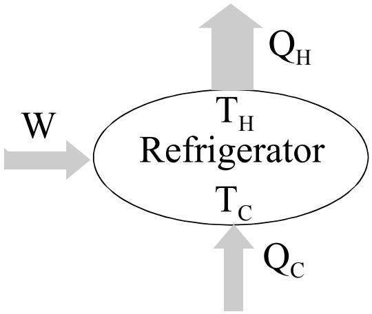  
Figure 2.1: Representation of a refrigerator while exchanging per cycle heat and work with the surroundings. The directions of heat and work exchanged between the refrigerator and its environment are shown by the shaded arrows. In a prime mover the directions of the arrows are reversed.

$$
\dot { U } = \Sigma \dot { Q } + \Sigma \dot { n } H _ { \mathrm { m } } - p \dot { V } + P\tag{2.1}
$$

where $\dot { n }$ is the molar flow rate of matter flowing into the system, $H _ { \mathrm { m } }$ is the molar enthalpy, and P represents other forms of work done on the system. The summations are over the various sources of heat and mass in contact with the system; transfers into the system are positive and those out of the system are negative

The second law of thermodynamics limits the interchange of heat and work in thermodynamic systems. This law states that the rate of change of entropy of a thermodynamic system is equal to the algebraic sum of the entropy change due to the heat flows, due to the mass flows, and due to the irreversible entropy production in the system [1]

$$
\dot { S } = \Sigma \frac { \dot { Q } } { T } + \Sigma \dot { n } S _ { \mathrm { m } } + \dot { S } _ { \mathrm { i } } ,\tag{2.2}
$$

where the summation is over the various sources with the same sign convention as stated above. The heat flow, ${ \dot { Q } } .$ into or out of the system, takes place at the temperature T. In addition the second law of thermodynamics requires that

$$
\dot { S } _ { \mathrm { i } } \geq 0 .\tag{2.3}
$$

In the following the first and second law of thermodynamics, Eqs.(2.1)-(2.3), will be used to define the performance for refrigerators, heat pumps and prime movers.

## 2.1.1 Refrigerators and heat pumps

The duty of a refrigerator or heat pump, is to remove a heat quantity Qc at a low temperature $T _ { \mathrm { C } }$ and to supply a heat quantity $Q _ { \mathrm { H } }$ to the surroundings at a high temperature $T _ { \mathrm { H } }$ . To accomplish these processes a net work input, W, is required. This process is illustrated in Fig.(2.1). Refrigerators and heat pumps have different goals. The goal of a refrigerator is to maintain the temperature of a given space below that of the surroundings. While the goal of a heat pump is to maintain the temperature of a given space above that of the surroundings. Since refrigeration and heat pump systems have different goals, their performance parameters, called coefficient of performance (COP) are defined differently.

By considering the refrigerator illustrated in Fig.(2.1) and using the fact that there is no mass flow into or out of the system, the first and second law, Eqs.(2.1) and (2.2), take the simple form

$$
\dot { U } = \dot { Q } _ { \mathrm { C } } - \dot { Q } _ { \mathrm { H } } + \dot { W } ,\tag{2.4}
$$

and

$$
\dot { S } = \frac { \dot { Q } _ { \mathrm { C } } } { T _ { \mathrm { C } } } - \frac { \dot { Q } _ { \mathrm { H } } } { T _ { \mathrm { H } } } + \dot { S } _ { \mathrm { i } } ,\tag{2.5}
$$

where $U$ and $S$ are the internal energy and entropy of the system, respectively; $\dot { S } _ { \mathrm { i } }$ is the irreversible entropy production in the system. The integration over one cycle of Eqs.(2.4) and (2.5), and the use of the fact that $U$ and $S$ are functions of state which do not change over one cycle, yields

$$
Q _ { \mathrm { H } } = Q _ { \mathrm { C } } + W\tag{2.6}
$$

and

$$
{ \frac { Q _ { \mathrm { H } } } { T _ { \mathrm { H } } } } = { \frac { Q _ { \mathrm { C } } } { T _ { \mathrm { C } } } } + S _ { \mathrm { i } } .\tag{2.7}
$$

## Refrigerator

In the case of a refrigerator we are interested in the heat removed $Q _ { \mathrm { C } }$ at $T _ { \mathrm { C } } ,$ and the net work used to accomplish this effect, W. The $C O P _ { \mathrm { r e f } }$ is given by the ratio of these quantities, thus

$$
C O P _ { \mathrm { r e f } } = { \frac { Q _ { \mathrm { C } } } { W } } .\tag{2.8}
$$

Substituting $\mathrm { E q . ( 2 . 6 ) }$ into Eq.(2.8) yields

$$
C O P _ { \mathrm { r e f } } = { \frac { Q _ { \mathrm { C } } } { Q _ { \mathrm { H } } - Q _ { \mathrm { C } } } } .\tag{2.9}
$$

Since $S _ { \mathrm { i } } \geq 0$ , Eq.(2.7) gives

$$
{ \frac { Q _ { \mathrm { C } } } { T _ { \mathrm { C } } } } \leq { \frac { Q _ { \mathrm { H } } } { T _ { \mathrm { H } } } } .\tag{2.10}
$$

Combining Eq.(2.9) with Eq.(2.10) gives

$$
C O P _ { \mathrm { r e f } } \leq { \frac { T _ { \mathrm { C } } } { T _ { \mathrm { H } } - T _ { \mathrm { C } } } } .\tag{2.11}
$$

The quantity

$$
C O P C = { \frac { T _ { \mathrm { C } } } { T _ { \mathrm { H } } - T _ { \mathrm { C } } } }\tag{2.12}
$$

is called the Carnot coefficient of performance which is the maximal performance for all refrigerators. This $C O P$ can be made larger than one if $T _ { \mathrm { C } } > T _ { \mathrm { H } } / 2$ . The coefficient of performance relative to Carnot's coefficient of performance is defined as

$$
C O P R = { \frac { C O P } { C O P C } } .\tag{2.13}
$$

## Heat pump

The performance of heat pumps is defined as the ratio of the desired heat, $Q _ { \mathrm { H } }$ , to the net work needed W. For a heat pump we are interested in the heat $Q _ { \mathrm { H } }$ supplied to a given space. Thus the coefficient of performance, $C O P _ { \mathrm { h p } } ,$ is

$$
C O P _ { \mathrm { h p } } = { \frac { Q _ { \mathrm { H } } } { W } } .\tag{2.14}
$$

In combination with $\operatorname { E q . } ( 2 . 6 )$ , this gives

$$
C O P _ { \mathrm { h p } } = { \frac { Q _ { \mathrm { H } } } { Q _ { \mathrm { H } } - Q _ { \mathrm { C } } } } .\tag{2.15}
$$

This expression shows that the value of the $C O P _ { \mathrm { h p } }$ is always larger than unity. Combining $\mathrm { E q . ( 2 . 1 5 ) }$ and $\mathrm { E q . } ( 2 . 1 0 ) $ leads to the expression

$$
C O P _ { \mathrm { h p } } \leq { \frac { T _ { \mathrm { H } } } { T _ { \mathrm { H } } - T _ { C } } } .\tag{2.16}
$$

The temperature expression on the right is called the Carnot $C O P _ { \mathrm { h p } }$ which is the maximal performance for all heat pumps.

The coefficients of performance $C O P _ { \mathrm { r e f } }$ and $C O P _ { \mathrm { h p } }$ are defined as ratios of the desired heat transfer output to work input needed to accomplish that transfer. Based on the definitions given above, it is desirable thermodynamically that these coefficients have values that are as large as possible. As can be seen from Eqs.(2.11), (2.16), the second law of thermodynamics imposes limits on the performance, because of irreversibilities in the system.

## 2.1.2 Efficiency of the prime mover

Since the prime mover uses heat QH to produce work W the directions of heat and work flows in Fig.(2.1) are reversed. The performance η of a prime mover is defined as the ratio of the produced work (output) and the heat used to produced that work (input), thus

$$
\eta = \frac { W } { Q _ { \mathrm { H } } } .\tag{2.17}
$$

By use of Eq.(2.6), we have

$$
\eta = \frac { Q _ { \mathrm { H } } - Q _ { \mathrm { C } } } { Q _ { \mathrm { H } } } .\tag{2.18}
$$

This expression shows that the efficiency of a prime mover is less than one. Since Qí is entering the prime mover and $Q _ { \mathrm { C } }$ is flowing out of it, Eq.(2.10) becomes

$$
{ \frac { Q _ { \mathrm { C } } } { T _ { \mathrm { C } } } } \geq { \frac { Q _ { \mathrm { H } } } { T _ { \mathrm { H } } } } .\tag{2.19}
$$

In a similar way as described above, we can derive the well-known relation

$$
\eta \leq 1 - \frac { T _ { \mathrm { C } } } { T _ { \mathrm { H } } } .\tag{2.20}
$$

The temperature expression on the right is called the Carnot efficiency, which is the maximal performance for all prime movers.

## 2.2 Thermodynamic approach to thermoacoustics

A simplified picture of the thermoacoustic effect will be given, using only thermodynamics and acoustics to explain how a temperature gradient, and hence cooling, develops across a stack. The discussion in this section is concerned with the derivation of approximative expressions for the critical temperature gradient and the heat and work flows in thermoacoustic devices. The papers of Wheatley et al.[2] and Swift [3] form the basis for the discussion in this section. Most of the matter and illustrations discussed in chapter 1, will be repeated here for ease of discussion and derivation of thermoacoustic quantities.

As discussed in the preceding chapter, thermoacoustic devices consist mainly of an acoustic resonator filled with a gas. In the resonator, a stack consisting of a number of parallel plates, and two heat exchangers, are appropriately installed $\left( \mathrm { F i g . } ( 2 . 2 \mathrm { a } ) \right)$ 1 The stack is the element in which the heat-pumping process takes place. The heat exchangers are necessary to exchange heat with the surroundings, at the cold and hot sides of the stack, as shown in $\mathrm { F i g . ( 2 . 2 a ) }$ . A loudspeaker sustains an acoustic standing wave in the acoustic resonator. As an approximation, we neglect the viscosity of the gas and the longitudinal thermal conductivity. In response to the acoustic wave, the gas oscillates in the stack channels and is compressed and expanded.

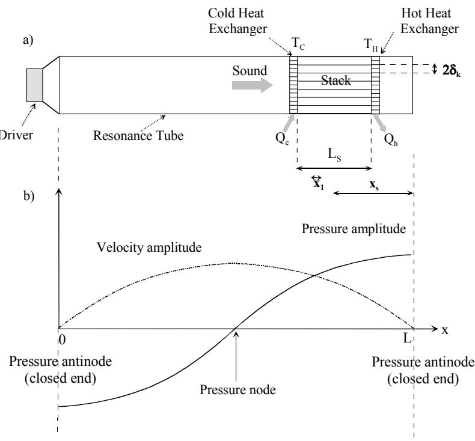  
Figure 2.2: Model of a thermoacoustic refrigerator. a) An acoustically resonant tube containing a gas, a stack of parallel plates and two heat exchangers. An acoustic driver is attached to one end of the tube and the other end is closed. Some length scales are also shown: the gas excursion in the stack $x _ { 1 }$ , the length of the stack $L _ { \mathrm { S } }$ , the position of the center of the stack from the closed end $x _ { \mathrm { s } }$ and the spacing in the stack $2 \delta _ { \mathrm { k } }$ . b) Illustration of the standing wave pressure and velocity in the resonator.

We begin by discussing the thermodynamics of a small parcel of gas oscillating along a stack plate, being compressed and expanded by the sound wave. An average longitudinal temperature gradient $\nabla T _ { \mathrm { m } }$ along the stack is supposed to exist. Additionally, we suppose that the pressure antinode is to the right of the plate and a node to the left $\left( \mathrm { F i g . ( 2 . 2 b ) } \right)$ . For simplicity, the following treatement will assume an inviscid ideal gas of vanishing Prandtl number. A more complete theory that includes viscosity is posponed until Chapter 3.

The four steps of the thermoacoustic cycle are illustrated separately in $\mathrm { F i g . ( 2 . 3 ) }$ We suppose that, in the start of the cycle, the temperature, pressure, and volume of the parcel are $T _ { \mathrm { m } } - x _ { 1 } \nabla T _ { \mathrm { m } } , \ p _ { \mathrm { m } } - p _ { 1 }$ , and V. In step 1, the parcel of gas moves a distance $2 x _ { 1 }$ , is compressed and increases in temperature by an amount $2 T _ { 1 }$ . The adiabatic pressure change $p _ { 1 }$ and temperature change $T _ { 1 }$ are related by the thermodynamic relationship

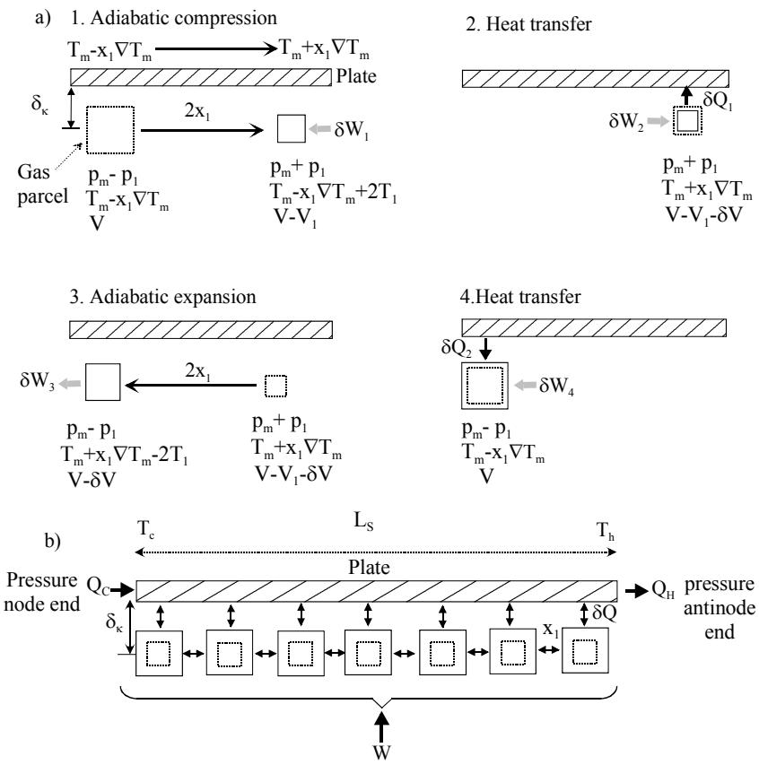  
Figure 2.3: $a )$ Typical gas parcel in a thermoacoustic refrigerator passing through a four-step cycle with two adiabats (step 1 and 3) and two constant-pressure heat transfer steps (steps $\mathcal { Q }$ and $\it 4 )$ . b) An amount of heat is shuttled along the stack plate from one parcel of gas to the next, as a result heat $Q$ is transported from the left end of the plate to the right end, using work W. The heat increases in the stack from $Q _ { c }$ to $Q _ { h }$ $\left( \mathrm { E q . } ( 2 . 6 ) \right)$ 1

$$
T \mathrm { d } s = c _ { \mathrm { p } } \mathrm { d } T + \frac { T } { \rho ^ { 2 } } \left( \frac { \partial \rho } { \partial T } \right) _ { \mathrm { p } } \mathrm { d } p = 0 ,\tag{2.21}
$$

where $s$ is the specific entropy, $\rho$ is the density, $c _ { \mathrm { p } }$ is the isobaric specific heat per unit mass, $T$ is the absolute temperature, and $p$ is the pressure. This expression can be rewritten as

$$
T _ { 1 } = \left( \frac { \beta T } { \rho c _ { p } } \right) _ { \mathrm { ~ m ~ } } p _ { 1 }\tag{2.22}
$$

where

$$
\beta = - { \frac { 1 } { \rho } } \left( { \frac { \partial \rho } { \partial T } } \right) _ { \mathrm { { p } } } .\tag{2.23}
$$

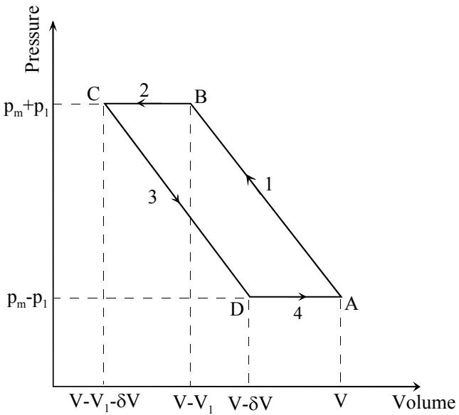  
Figure 2.4: Schematic pV-diagram of the thermoacoustic cycle of $F i g . ( 2 . 3 )$ . The four steps of the thermoacoustic cycle are illustrated: adiabatic compression $( 1 )$ , isobaric heat transfer $( { \mathcal { Q } } )$ , adiabatic expansion $\it 3 )$ and isobaric heat transfer $( 4 )$ . The area ABCD is the work used in the cycle which is also egal to the sum of the works used in the diffrent steps.

The subscript m indicates that we are concerned with the mean value of the quantities between brackets. The parameter $\beta$ is the isobaric volumetric expansion coefficient. Considering an ideal gas $( \beta T _ { \mathrm { m } } = 1 )$ and using the ideal $\mathrm { g a s }$ law, the expression (2.22) becomes

$$
\frac { T _ { 1 } } { T _ { \mathrm { m } } } = \frac { \gamma - 1 } { \gamma } \frac { p _ { 1 } } { p _ { \mathrm { m } } } ,\tag{2.24}
$$

where $\gamma$ is the ratio of isobaric to isochoric specific heats.

After the displacement and compression in step 1, the temperature, pressure and volume becomes $T _ { \mathrm { m } } - x _ { 1 } \nabla T _ { \mathrm { m } } + 2 T _ { 1 } , p _ { \mathrm { m } } + p _ { 1 }$ , and $V - V _ { 1 }$ . At this time, the temperature difference between the plate and the parcel of gas is

$$
\delta T = 2 T _ { 1 } - 2 x _ { 1 } \nabla T _ { \mathrm { m } } ,\tag{2.25}
$$

where $2 x _ { 1 } \nabla T _ { \mathrm { m } }$ is the temperature change along the plate. In step 2, for positive $\delta T$ heat $\delta Q$ flows from the parcel of gas to the plate at constant pressure. The heat that flows out of the parcel is given by

$$
\delta Q \approx m c _ { \mathrm { p } } \delta T\tag{2.26}
$$

where m is the mass of the parcel of gas. In Fig.(2.4), a schematic pV-diagram of the cycle is shown. The work used in the cycle is equal to the area ABCD, and given by

$$
\delta W = \int _ { A B C D } p d V .\tag{2.27}
$$

The used acoustic power in each step is shown in Fig.(2.4). Using the acoustic approximation, $p _ { 1 } \ll p _ { m }$ , and the Poisson's law for the two adiabatic steps, the result after calculation is

$$
\delta W \approx - 2 p _ { 1 } \delta V .\tag{2.28}
$$

The volume δV is related to $\delta T$ by Eq.(2.23),

$$
\delta V = ( \beta V ) _ { \mathrm { m } } \delta T .\tag{2.29}
$$

Insertion into Eq.(2.28) yields

$$
\delta W = - 2 p _ { 1 } \left( \beta V \right) _ { \mathrm { m } } \delta T .\tag{2.30}
$$

In step 3, the parcel of gas moves back to its initial position, expands and cools. At this time, the parcel of $\mathrm { g a s }$ is colder than the local stack surface, and heat δQ flows into the parcel (step 4).

In case $\delta T$ is negative, heat flows into the parcel which expands and does work δW on its surroundings (prime mover). The sign of the temperature difference δT (and hence magnitude of $\nabla T _ { \mathrm { m } } )$ determines, after displacement and compression, the direction of the heat flow, into or out of the parcel of $\mathrm { g a s }$ . Therefore, the refrigerator mode and prime mover mode can be distinguished by the sign of δT. If the temperature change $2 x _ { 1 } \nabla T _ { \mathrm { m } }$ in the plate just matches the adiabatic temperature change $2 T _ { 1 }$ , then the temperature gradient in the stack is named the critical temperature and is given by

$$
( \nabla T ) _ { \mathrm { c r i t } } = { \frac { T _ { 1 } } { x _ { 1 } } } .\tag{2.31}
$$

Using Eq.(2.22) and $x _ { 1 } = u _ { 1 } / \omega$ where $u _ { 1 }$ is the gas particles velocity amplitude and $\omega$ the angular frequency, we obtain

$$
\left( \nabla T \right) _ { \mathrm { c r i t } } = \frac { p _ { 1 } \omega } { \rho _ { \mathrm { m } } c _ { \mathrm { p } } u _ { 1 } } .\tag{2.32}
$$

The two modes of operation are characterized in terms of the ratio of the temperature gradient along the stack and the critical temperature gradient

$$
\Gamma = \frac { \nabla T _ { \mathrm { m } } } { \left( \nabla T \right) _ { \mathrm { c r i t } } } .\tag{2.33}
$$

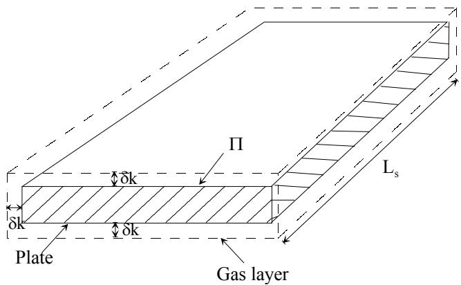  
Figure 2.5: A single stack plate of length $L _ { \mathrm { s } }$ and perimeter II. The gas layer at a distance $\delta _ { \mathrm { k } }$ from the plate is shown by dashed line. The gas area is equal to $\Pi \delta _ { \mathbf { k } }$ and the total volume of gas in contact with the plate is $\Pi \delta _ { \mathrm { k } } L _ { \mathrm { s } }$

Employing Eqs.(2.33), (2.22) and assuming an ideal gas $( \beta T = 1 )$ we can rewrite Eqs.(2.26) and (2.30), as

$$
\delta Q \approx - 2 V p _ { 1 } ( \Gamma - 1 ) ,\tag{2.34}
$$

and

$$
\delta W \approx 4 \left( \frac { p _ { 1 } ^ { 2 } V \beta } { \rho c _ { \mathrm { p } } } \right) _ { \mathrm { m } } ( \Gamma - 1 ) ,\tag{2.35}
$$

respectively. As can be seen from Fig.(2.5), if we suppose that I is the perimeter of the plate in the direction normal to the axis of the resonator, $L _ { \mathrm { s } }$ is the length of the plate parallel to the resonator axis (wave direction), and since only the layer of gas at a distance $\delta _ { \mathrm { k } }$ from the plate contributes to the thermoacoustic heat transport, the effective volume rate of flow of the gas is $\Pi \delta _ { \mathrm { k } } u _ { 1 }$ . Here $u _ { 1 }$ is the amplitude of the speed of motion of the gas, caused by the sound wave.

The thermoacoustic heat flow rate along the plate from $T _ { \mathrm { C } }$ to $T _ { \mathrm { H } }$ (refrigerator mode) is obtained by replacing V in Eq.(2.34) by the effective volume flow $\Pi \delta _ { \bf k } u _ { 1 }$ , i.e.

$$
\begin{array} { r } { \dot { Q } \approx - 2 \Pi \delta _ { \mathbf { k } } p _ { 1 } u _ { 1 } ( \Gamma - 1 ) . } \end{array}\tag{2.36}
$$

The total volume of gas that is thermodynamically active along the plate is $\Pi \delta _ { \bf k } L _ { \mathrm { S } }$ , SO that the total work used to transport heat is given by

$$
W \approx \frac { 4 \Pi \delta _ { \mathrm { k } } L \mathrm { s } p _ { 1 } ^ { 2 } \beta } { \rho _ { \mathrm { m } } c _ { \mathrm { p } } } ( \Gamma - 1 ) .\tag{2.37}
$$

The power needed to pump the heat is the work per cycle times the frequency $\omega ,$ SO that

$$
\dot { W } \approx \omega \frac { 4 \Pi \delta _ { \mathrm { k } } L _ { \mathrm { S } } p _ { 1 } ^ { 2 } \beta } { \rho _ { \mathrm { m } } c _ { \mathrm { p } } } ( \Gamma - 1 ) .\tag{2.38}
$$

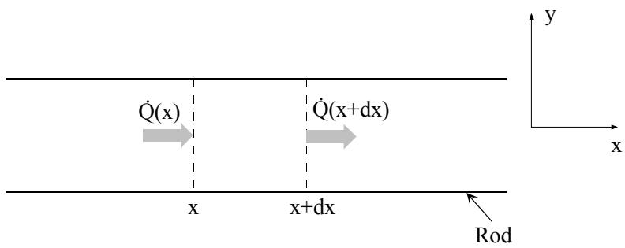  
Figure 2.6: Illustration used in the derivation of the heat conduction equation.

When use is made of the definition of the speed of sound and the ideal $\mathrm { g a s }$ law,

$$
\begin{array} { r c l } { { a ^ { 2 } } } & { { = } } & { { \gamma \displaystyle \frac { p _ { \mathrm { m } } } { \rho _ { \mathrm { m } } } } } \\ { { } } & { { = } } & { { T _ { \mathrm { m } } c _ { \mathrm { p } } \left( \gamma - 1 \right) , } } \end{array}\tag{2.39}
$$

where $\gamma - 1$ is the work parameter of the ${ \mathrm { g a s } } ,$ we can rewrite $\operatorname { E q . } ( 2 . 3 8 )$ as

$$
\dot { W } \approx \omega \frac { 4 \Pi \delta _ { \mathrm { k } } L _ { \mathrm { S } } ( \gamma - 1 ) p _ { 1 } ^ { 2 } } { \rho _ { \mathrm { m } } a ^ { 2 } } ( \Gamma - 1 ) .\tag{2.40}
$$

A quantitative evaluation of ${ \dot { Q } } .$ and $\dot { W }$ for sinusoidal $p _ { 1 }$ and $u _ { 1 }$ would give the same results except that each expression has a numerical prefactor of $\scriptstyle { \frac { 1 } { 4 } } [ 3 ]$ . The total heat flow and absorbed acoustic power in the stack can be obtained by using the total perimeter of the plates $\Pi _ { t o t }$ instead of the perimeter of one plate II.

Expressions (2.36) and (2.38) change sign as Γ passes through unity. Three cases can be distinguished: $\Gamma = 1$ , there is no heat flow and no power is needed; When $\Gamma < 1$ , the heat is transported against the temperature gradient so that external power is needed, and the device operates as a refrigerator; $\Gamma > 1$ , due to the large temperature gradient, work is produced, and the device operates as a prime mover. Therefore, the device can operate as a refrigerator as long as the temperature gradient over the plate (stack) is smaller than the critical temperature gradient (Eq.(2.31)). But we can impose a large temperature gradient over the plate so that the device operates as a prime mover $( \Gamma > 1 )$

As stated previously, the thermoacoustic effect occurs within the thermal penetration depth $\delta _ { \mathbf { k } }$ , which is roughly the distance over which heat can diffuse through the gas in a time $1 / \pi f ,$ where f denotes the frequency of the acoustic wave. In Fig.(2.6), the heat conduction in one dimension through a rod of cross-section A is illustrated. Considering the energy balance for a small element dx of the rod, we suppose that heat is the only form of energy that enters or leaves the element dx, at x and $x + \mathrm { d } x .$

and that no energy is generated inside the element. Energy conservation yields

$$
\rho _ { \mathrm { s } } A \frac { \partial u } { \partial t } = - \frac { \partial \dot { Q } } { \partial x } .\tag{2.41}
$$

The heat flow is given by the Fourier's law of heat conduction

$$
{ \dot { Q } } = - K _ { \mathrm { s } } A { \frac { \mathrm { d } T } { \mathrm { d } x } } ,\tag{2.42}
$$

where $K _ { \mathrm { s } }$ is the thermal conductivity of the material. Substituting $\operatorname { E q . } ( 2 . 4 2 )$ and the thermodynamic expression du $= c _ { \mathrm { s } } \mathrm { d } T$ for the internal energy of solid-state material into Eq.(2.41) yields

$$
\frac { \rho _ { \mathrm { s } } c _ { \mathrm { s } } } { K _ { \mathrm { s } } } \frac { \partial T } { \partial t } = \frac { \partial ^ { 2 } T } { \partial x ^ { 2 } }\tag{2.43}
$$

where $c _ { \mathrm { s } }$ and $\rho _ { \mathrm { s } }$ are the isobaric specific heat and density of the material, respectively. If we substitute the characteristic dimensions $\delta _ { \mathrm { s } } = x / x ^ { \prime }$ and $t ^ { \prime } = \omega t$ into Eq.(2.43) we get

$$
\frac { \rho _ { \mathrm { s } } c _ { \mathrm { s } } \omega } { K _ { \mathrm { s } } } \frac { \partial T } { \partial t ^ { \prime } } = \frac { 1 } { \delta _ { \mathrm { s } } ^ { 2 } } \frac { \partial ^ { 2 } T } { \partial x ^ { \prime 2 } } ,\tag{2.44}
$$

so that

$$
\delta _ { \mathrm { s } } ^ { 2 } = { \frac { K _ { \mathrm { s } } } { \rho _ { \mathrm { s } } c _ { \mathrm { s } } \omega } }\tag{2.45}
$$

and hence

$$
\delta _ { \mathrm { s } } = \sqrt { \frac { \kappa _ { \mathrm { s } } } { \omega } } ,\tag{2.46}
$$

where $\kappa _ { \mathrm { s } }$ is the thermal diffusivity, $\kappa _ { \mathrm { s } } = K _ { \mathrm { s } } / \rho _ { \mathrm { s } } c _ { \mathrm { s } }$ . A similar procedure can be used to derive an analogous expression for the thermal penetration in a gas. Closely related to the thermal penetration depth is the viscous penetration depth in a gas $\delta _ { \nu }$ . It is roughly the distance over which momentum can diffuse in a time $\textstyle { \frac { 1 } { \pi f } }$ and it is given by

$$
\delta _ { \nu } = \sqrt { \frac { 2 \nu } { \omega } }\tag{2.47}
$$

where the kinematic viscosity $\nu$ is given by

$$
\nu = { \frac { \eta } { \rho } } ,\tag{2.48}
$$

here $\eta$ is the dynamic viscosity of the gas. An important parameter for the performance of thermoacoustic devices is the Prandtl number $\sigma ,$ which is a dimensionless parameter describing the ratio of viscous to thermal effects

$$
\sigma = \frac { \eta c _ { \mathrm { p } } } { K } = \left( \frac { \delta _ { \nu } } { \delta _ { \mathrm { k } } } \right) ^ { 2 } .\tag{2.49}
$$

For most gases (air, inert gases) but not gas mixtures, $\sigma$ is nearly ${ \frac { 2 } { 3 } } ;$ so that for these gases thermal and viscous penetration depths are quite comparable. The effect of viscosity on the heat flow and acoustic power will be discussed in the next chapter.

## 2.3 Acoustic concepts

In this section, some acoustic concepts which are important for proper operation of thermoacoustic devices will be described. The discussion will be limited to standing wave thermoacoustic devices, which are more related to the subject of this thesis.

A simple illustration of a thermoacoustic refrigerator is shown in Fig.(2.2). It consists of an acoustic resonator (tube) of length L (along x) and radius r. The resonator is filled with a gas and closed at one end. An acoustic driver, attached to the other end, sustains an acoustic standing wave in the gas, at the fundamental resonance frequency of the resonator. A stack of parallel plates and two heat exchangers are appropriately installed in the resonator.

The first condition for the proper operation of thermoacoustic refrigerators is that the driver sustains an acoustic wave. This means that the driver compensates for the energy absorbed in the system. Hence, a small travelling wave component is superimposed on a standing wave; we have to note that in a pure standing wave there is no energy transport.

To illustrate the acoustics, we consider for simplicity that the stack and the heat exchangers have no effect on the acoustic field in the tube. The driver excites a wave along the x direction. The combination of a plane traveling wave to the right and the reflected wave at the closed end of the tube generates a sinusoidal standing wave. The acoustic pressure in the tube is given by [4, 5]

$$
\begin{array} { r c l } { { p ( x , t ) } } & { { = } } & { { p _ { 1 } ( x ) \sin \omega t , } } \\ { { } } & { { } } & { { } } \\ { { p _ { 1 } ( x ) } } & { { = } } & { { p _ { 0 } \cos k x } } \end{array}\tag{2.50}
$$

where $p _ { 0 }$ is the pressure amplitude at the pressure antinodes of the standing wave, ω is the angular frequency of the wave, k is the wave number.

By integration of Newton's second law (acoustic approximation), $\begin{array} { r } { \rho { \frac { \partial u } { \partial t } } = - { \frac { \partial p } { \partial x } } } \end{array}$ , the gas particle velocity is [4, 5]

$$
\begin{array} { r c l } { { u ( x , t ) } } & { { = } } & { { u _ { 1 } ( x ) \cos { \omega t } , } } \\ { { u _ { 1 } ( x ) } } & { { = } } & { { { \frac { p _ { 0 } } { \rho _ { m } a } } \sin { k x } } } \end{array}\tag{2.51}
$$

where

$$
k = { \frac { \omega } { a } } .\tag{2.52}
$$

From the fact that sin kx is zero where cos kx is maximum and vice versa, it follows that pressure antinodes are always velocity nodes and vice versa; the pressure and velocity are spatially 90 degrees out-of-phase.

The frequency of the acoustic standing wave is determined by the type of gas, the length L of the resonator and the boundary conditions. A quarter-wavelength resonator is suitable, for many reasons as will be illustrated in chapter 6. But a halfwavelength resonator can also be used. This depends on how the standing wave fits in the tube. A half-wavelength resonator has two closed ends, so that the velocity is zero at the ends and the pressure is maximal (antinodes). The resonance modes are given by the condition that the longitudinal velocity vanishes at the ends of the resonator

$$
\sin k L = 0 .\tag{2.53}
$$

Hence,

$$
\lambda = { \frac { 2 L } { n } } ~ ( n = 1 , 2 , 3 , \ldots ) ,\tag{2.54}
$$

where

$$
k = { \frac { 2 \pi } { \lambda } }\tag{2.55}
$$

is used. In this case we see that the first (fundamental) mode which is usually used in thermoacoustic devices, corresponds to $L = \lambda / 2$ , ergo the name half-wavelength resonator.

For a quarter-wavelength resonator, one end is open and the other end is closed. This requires a pressure node at the open end, hence

$$
\cos k L = 0 ,\tag{2.56}
$$

so that

$$
\lambda = \frac { 4 L } { 2 n - 1 } ~ ( n = 1 , 2 , 3 , \ldots ) .\tag{2.57}
$$

The fundamental mode corresponds to $L = \lambda / 4$ , ergo the name quarter-wave resonator. The refrigerator shown in Fig.(2.2), is assumed to be a half-wavelength device. Thus, in the resonance tube, we obtain the pressure and velocity distributions indicated in Fig.(2.2b).

## 2.4 Basic operation concepts

In the previous sections some basic thermodynamic and acoustic concepts have been introduced. In this section, we will illustrate the effect of the position of the stack in the standing-wave field on the behavior of the thermoacoustic devices.

In Fig.(2.2), some important length scales are also shown: the longitudinal lengths, wavelength $\lambda = 2 L$ , gas excursion $x _ { 1 }$ , stack length $L _ { \mathrm { s } }$ , and the mean stack position from the pressure antinode $x _ { \mathrm { { s } } }$ , and the transversal length: spacing in the stack $2 \delta _ { \mathrm { k } }$ For audio frequencies, we have typically for thermoacoustic devices:

$$
\frac { 1 } { k } = \frac { \lambda } { 2 \pi } \gg x _ { \mathrm { s } } \ge L _ { \mathrm { s } } > x _ { 1 } .\tag{2.58}
$$

Since the sinusoidal displacement $x _ { 1 }$ of gas parcels is smaller than the length of the plate $L _ { \mathrm { s } }$ , there are many adjacent gas parcels, each confined in its cyclic motion to a short region of length $2 x _ { 1 }$ , and each reaching the extreme position as that occupied by an adjacent parcel half an acoustic cycle earlier (Fig.(2.3b)). During the first half of the acoustic cycle, the individual parcels move a distance $x _ { 1 }$ toward the pressure antinode and deposit an amount of heat $\delta Q$ at that position on the plate. During the second half of the cycle, each parcel moves back to its initial position, and picks up the same amount of heat, that was deposited a half cycle earlier by an adjacent parcel of gas. The net result, is that an amount of heat is passed along the plate from one parcel of gas to the next in the direction of the pressure antinode as shown in Fig.(2.3b).

Finally, we note that, although the adiabatic temperature $T _ { 1 }$ of a given parcel may be small, the temperature difference $\Delta T _ { \mathrm { m } }$ over the stack can be large, as the "number of parcels", $L _ { \mathrm { s } } / x _ { 1 }$ , can be large (Fig.(2.3b)). As from Eq.(2.33)

$$
\Gamma = \frac { \nabla T _ { \mathrm { m } } } { ( \nabla T ) _ { \mathrm { c r i t } } } = \frac { \frac { \Delta T _ { \mathrm { m } } } { L _ { \mathrm { S } } } } { \frac { T _ { \mathrm { l } } } { x _ { 1 } } } ,\tag{2.59}
$$

we find

$$
\Delta T _ { \mathrm { m } } = \frac { L _ { \mathrm { s } } } { x _ { 1 } } \frac { T _ { 1 } } { \Gamma } .\tag{2.60}
$$

Since $\Gamma < 1$ , and $L _ { \mathrm { s } } \gg x _ { 1 }$ , we see that $\Delta T _ { m }$ can be made much larger than $T _ { 1 }$

## 2.4.1 Temperature gradient

The gas harmonic excursion, x1 is given by

$$
x _ { 1 } = \frac { u _ { 1 } } { \omega } .\tag{2.61}
$$

Hence, close to a pressure antinode (velocity node) the excursion of a typical parcel of gas is small. At the same time the parcel experiences large changes in pressure and a large adiabatic temperature change $T _ { 1 } ~ ( \mathrm { E q . ( 2 . 2 2 ) } )$ . So, the critical temperature gradient at that position $( \nabla T ) _ { \mathrm { c r i } t } = T _ { 1 } / x _ { 1 }$ is large. If we replace $u _ { 1 }$ by its expression from Eq.(2.51), we get

$$
x _ { 1 } = { \frac { p _ { 0 } } { \rho \omega a } } \sin { k x _ { \mathrm { s } } } .\tag{2.62}
$$

Using Eq.(2.58) yields

$$
x _ { 1 } = { \frac { p _ { 0 } } { \rho _ { \mathrm { m } } a ^ { 2 } } } x _ { \mathrm { s } } .\tag{2.63}
$$

Substituting this result into Eq.(2.31) we obtain

$$
( \nabla T ) _ { \mathrm { c r i t } } = \gamma \frac { p _ { \mathrm { m } } } { p _ { 0 } } \frac { T _ { 1 } } { x _ { \mathrm { s } } } = \left( \gamma - 1 \right) \frac { T _ { \mathrm { m } } } { x _ { \mathrm { s } } } ,\tag{2.64}
$$

where Eqs.(2.39) en (2.24) have been used. In the refrigerator (heat pump), $( \nabla T ) _ { \mathrm { c r i t } }$ is the maximum temperature gradient that can be developed over the stack, which means that close to a pressure antinode, we can expect the largest temperature difference over the stack. Further away from the pressure antinode, pressure and temperature changes become smaller whereas displacements become larger, so the maximum temperature difference that can be reached is smaller.

## 2.4.2 Heat flow

Eq.(2.36) shows that the heat flow is proportional to the product $p _ { 1 } u _ { 1 }$ , and so vanishes if the stack is placed at either a pressure node or a velocity node of the standing acoustic wave. The maximum value of $p _ { 1 } u _ { 1 }$ is at $x = \lambda / 8 = L / 2$ .The factor $( \Gamma - 1 )$ appears also in the expression of heat flow. This factor is negative for refrigerators, and its effect can be derived from the discussion in preceding subsection. The lateral section of gas effective for the process $\Pi \delta _ { \mathbf { k } } .$ can be maximized by using more plates, optimally spaced, in the stack so that the total perimeter II is as large as possible while maintaining a stack spacing greater than about $2 \delta _ { \mathrm { k } }$

## 2.4.3 Acoustic power

In the absence of viscosity, the expression for the power needed to pump heat, $\mathrm { E q . } ( 2 . 4 0 )$ is similar to that of heat flow, the only difference is the presence of the work parameter $( \gamma - 1 )$ . Since each parcel along the plate absorbs net work, the total work done on the gas is proportional to the plate length $L _ { \mathrm { s } }$

## 2.4.4 Viscosity

The discussion above concerns an inviscid gas. When viscosity is taken into account, the resulting expressions are much more complicated. These expressions will be presented in the following chapter. As indicated in the end of section 2.2, the viscous penetration depth is nearly as large as the thermal penetration depth, so most of the gas in the stack experiences significant viscous shear. However, the definition of the critical temperature gradient (Eq.(2.32)) will be kept throughout this thesis. In fact, with viscosity present, there is a lower critical temperature gradient below which the engine pumps heat and a higher critical gradient above which the engine is a prime mover. Between these two limiting gradients the engine is in a useless state, using work to pump heat from hot to cold.

## 2.4.5 Performance

At this stage, an estimation of the theoretical performance of the thermoacoustic devices, using an inviscid working gas, can be calculated from the expression of COP (η) derived in section 2.1 in combination with the heat and work equations of section

2.2. The $C O P$ is given by

$$
C O P = { \frac { \dot { Q } } { \dot { W } } } .\tag{2.65}
$$

Making use of Eqs.(2.32), (2.36), (2.38) and $\Delta T _ { \mathrm { m } } = \nabla T _ { \mathrm { m } } L _ { \mathrm { s } }$ yields

$$
C O P = \Gamma { \frac { T _ { \mathrm { m } } } { \Delta T _ { \mathrm { m } } } } = \Gamma C O P _ { \mathrm { C } } .\tag{2.66}
$$

Here $C O P _ { \mathrm C }$ is Carnot's coefficient of performance $\left( \mathrm { E q . } ( 2 . 1 1 ) \right)$ , the maximum possible performance of a refrigerator at $T _ { \mathrm { m } }$ spanning the temperature difference $\Delta T _ { \mathrm { m } }$ . We see that $C O P _ { C }$ is approached as $\Gamma  1$ , in which case heat and work are zero.

We note that standing-wave thermoacoustic devices are intrinsically irreversible. The irreversible heat transfer $\delta Q$ across the temperature difference $\delta T ,$ steps 2 and 4 in Fig.(2.3), is essential to the operation of these devices. They do rely on the imperfect thermal contact across the thermal penetration depth $\delta _ { \mathrm { k } }$ , which provides the necessary phasing between displacement and thermal oscillations. This is the reason why the performance of standing wave thermoacoustic devices falls below Carnot's performance. The performance will be degraded furthermore if viscous, thermal conduction, and other losses in the different parts of the device will be considered. To date, the best performance reached with such devices is about 20 % of Carnot [6].

## 2.5 Some basic measurements

In this section some basic thermoacoustic measurements, using an experimental set-up similar to that illustrated in Fig.(2.2), will be introduced. These results will be used to demonstrate the effects discussed in the foregoing sections.

## 2.5.1 Set-up

A demonstration refrigerator has been built which consists of a Polyvinyl chloride (PVC) tube of length 70 cm, and inner diameter 4.2 cm, as illustrated in Fig.(2.7). The whole system is made of PVC which makes it light, easy to build and transport. The resonator is filled with air at atmospheric pressure. The stack consists of parallel drinking straws, of inner diameter 2 mm. The stack has a diameter of 4.2 cm and a length of 7.9 cm, and can easily be installed inside the resonator tube. At one end the resonator is driven by a commercially available loudspeaker. This driver is mounted in a PVC-housing to which the resonator is connected. The other end of the resonator is closed by a thick removable cover plate. The system is not thermally insulated, and can simply be set on a table to demonstrate thermoacoustic cooling. So, the measurements are qualitative.

The acoustic pressures are measured using microphones. One is permanently installed near the driver end, and one can also be placed on the closed end. To measure the pressure distribution along the resonant tube, a microphone is mounted on the end of a hollow 2 mm diameter stainless steel tube. The tube serves both to allow a free positioning of the microphone inside the resonance tube and to extract the microphone leads; it passes through a cork that is fixed in a hole on the closed end of the resonator in order to keep acoustic losses low. The pressure transducer, placed near the driver end, measures the dynamic pressure and is used for determining the resonance frequency.

A copper-constantan thermocouple is used to measure the temperature difference over the stack. As illustrated in Fig.(2.7c), the temperature difference is measured by fixing each copper-constantan junction of the thermocouple on opposite ends of the stack. Also, two-terminal IC temperature transducers, type AD590 JH, are used to measure separately the temperatures of the hot and cold ends of the stack during operation.

In order to measure the temperature difference over the stack as function of position inside the resonance tube, the same procedure is used for the measurement of the pressure distribution. The stack can be mounted on the end of a hollow 3 mm diameter stainless steel tube which allows the positioning of the stack at different places inside the resonance tube, as shown in Fig.(2.7c).

The signals from the thermocouple and the IC-thermometers are measured by a multimeter, and the dynamic pressure by a lock-in amplifier. The driver is powered by a function generator in combination with a power amplifier. The data acquisition is controlled by a computer, which controls and interrogates the different instruments via a GPIB interface.

## 2.5.2 Measurements

First, the acoustic resonance frequency is determined, by making a low-power frequency sweep. The dynamic pressure signal is recorded over the sweep interval. From this resonance spectrum, the resonance frequency is determined. Then, at this resonance frequency, the pressure distribution in the resonance tube is measured by positioning the microphone, as discussed above, inside the tube. Finally, the temperature difference, developed across the stack, is recorded as function of the position of the stack. The measurements were all made with air at atmospheric pressure, near room temperature $( \mathrm { { 2 3 } ^ { 0 } C ) }$ , and at resonance.

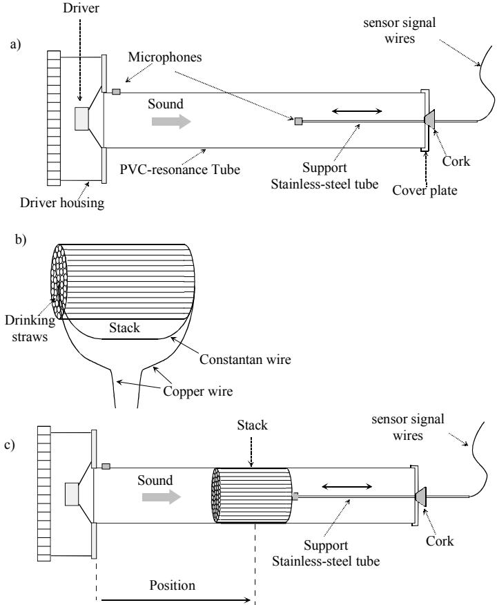  
Figure 2.7: a) Set-up used to measure the acoustic pressure distribution. b) The stack is made of drinking straws glued together. A constantan-copper thermocouple is used to measure the temperature difference over the stack. c) Set up used to measure the temperature difference over the stack as function of position.

A typical measurement result is presented in Fig.(2.8). The standing wave acoustic pressure distribution inside the resonance tube is shown in Fig.(2.8a). The acoustic pressure node and antinodes, corresponding with the resonance frequency, are also indicated in the graph, along with the expected heat flow directions as discussed in Section 2.2. It was concluded that in the heat pump regime, heat flows always towards the nearest pressure antinode.

The measurements of the heating and cooling at the ends of the stack as a function of time, at a position of 21.5 cm from the driver end, are displayed in Fig.(2.8b). In this graph, $T _ { \mathrm { H o t } }$ is the temperature of the hot side of the stack, which faces the pressure antinode side. $T _ { \mathrm { C o l d } }$ is the temperature of the cold side of the stack, which faces the pressure node side. Initially, the temperature of the two ends of the stack was the same $( \mathrm { { 2 3 } ~ ^ { 0 } C ) }$ . After turning on the loudspeaker (time zero) $T _ { \mathrm { H o t } }$ increases, and $T _ { \mathrm { C o l d } }$ decreases until a steady state is reached in about seven minutes. What actually happens at the ends of the stack when the driver is turned on is that heat flows out of one end of the stack, and into the other end of the stack, as discussed in section 2.2. Thus, the end that supplies heat cools down and the other end, which absorbs heat, warms up. The thermoacoustic heat transport is maximum at the start of the measurement when there is no temperature gradient over the stack. As the temperature gradient develops, the heat flow diminishes. A steady state temperature is reached when the thermoacoustic heat flow in the gas is balanced by a return diffusive heat flow in the stack and in the gas. Since the acoustic power used to transport heat shows up as dissipative heat at the hot side of the stack, one can expect a higher temperature increase at the hot side than the temperature decrease at the cold side, according to Eq.(2.6). The temperature difference across the stack, $T _ { \mathrm { H o t } } \mathrm { ~ - ~ } T _ { \mathrm { C o l d } }$ ， corresponding to graph (2.8b), is shown in Fig.(2.8d) as a function of time.

An example of the temperature difference over the stack as function of the distance from the loudspeaker end in air at atmospheric pressure, at the resonance frequency of the tube, at an ambient temperature of $2 3 \ { } ^ { 0 } \mathrm { C } ,$ and with a driving ratio, D, of 2.2 % is shown in $\mathrm { F i g . ( 2 . 8 c ) }$ . The drive ratio is defined as the ratio of the acoustic peak pressure amplitude to the mean pressure of the gas.

Graph (2.8c), shows that the temperature difference changes sign as the pressure gradient changes sign. As discussed above, the heat flow is always in the direction of the pressure antinode in the refrigeration mode. There is essentially a sinusoidal dependence of the temperature difference on position with zeros at both pressure and velocity nodes (or antinodes), since heat flow vanishes. This follows from the product $p _ { 1 } u _ { 1 }$ in Eq.(2.36). The temperature difference indicates a sawtooth shape instead of a sinusoid, with the maxima shifted toward the pressure antinodes. This is a consequence of the high drive ratio of 2.2 %. A more accurate study of the temperature difference over a small stack named the thermoacoustic couple for low driving ratios of 0.3 % has been done by Wheatly et al. [7]; in that case the temperature difference was a perfect sinusoid. Measurements have also been done by Atchley et al.[8] for drive ratios from approximately 0.1 % to 2 %, in argon and helium having different mean pressures, and it is found that the temperature difference progresses from a sinusoid to a sawtooth curve and the maximums shift towards the pressure antinodes at approximately a drive ratio of about 1.03 %. Our measurements were made at a drive ratio of 2.2 %, so a sawtooth shape for the temperature difference can be expected.

In summary, we conclude from the measurements that in a thermoacoustic refrigerator (heat pump), heat flows always toward the closest pressure antinode, making that end of the stack hottest. However, at both the pressure antinodes and nodes there is no flow of heat (∆T = 0). Hence, the position of the stack in the resonator tube relative to the standing wave is an important factor in the design of the standing wave thermoacoustic devices. A detailed discussion of these effects will be given in chapter 6.

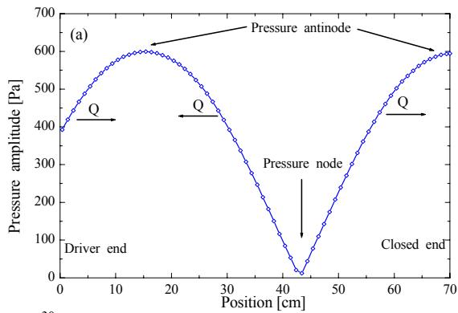

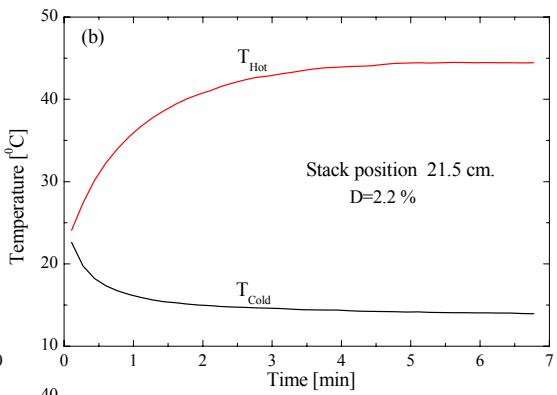

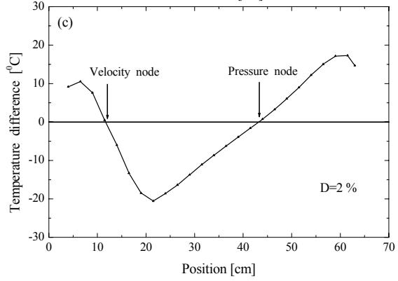

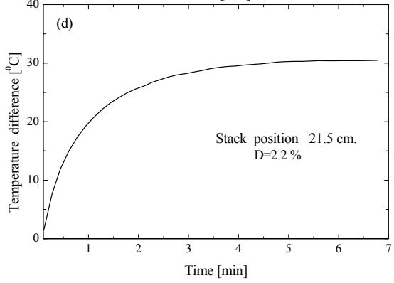  
Figure 2.8: A typical experimental result. (a) The pressure distribution inside the resonator at the resonance frequency, the pressure node and antinode along with the heat flow direction are indicated in the graph. (b) The temperature of the hot and cold sides of the stack as functions of time at a fixed position of 21.5 cm from the loudspeaker. (c) The temperature difference $\left( T _ { H o t } - T _ { C o l d } \right)$ across the stack as function of position from the loudspeaker end. (d) The temperature difference across the stack as a function of time corresponding to the same stack location as (b).

## Bibliography

[1] A.T.A.M. de Waele, P.P. Steijaert and J. Gijzen, "Thermodynamical aspects of pulse tubes", Cryogenics. 37, 313 (1997).

[2] J.C. Wheatley, and A. Cox, "Natural engines", Physics Today, 38 (8), 50 (1985).

[3] G.W. Swift, "Thermoacoustic engines", J. Acoust. Soc. Am. 84, 1146 (1988).

[4] D.E. Hall, "Basic acoustics", (Wiley, New York, 1987), Sec 9.3, p.142.

[5] L.L. Beranek, "Acoustics", (MacGraw-Hill Book Co., New York, 1954), Sec. 2.4, p.28.

[6] S. Backhaus, and G.W. Swift, "A thermoacoustic Stirling heat engine", Nature, 39, 335 (1999).

[7] J.C. Wheatley, T.Hofler, G.W. Swift, and A. Migliori, "An intrinsically irreversible thermoacoustic heat engine", J. Acoust. Soc. Am. 74, 153 (1983); "Experiments with an intrinsically irreversible thermoacoustic heat engine", Phys. Rev. Lett. 50, 499 (1983).

[8] A.A. Atchley, T.J. Hofler, M.L. Muzzerall, M.D. Kite, and Chianing Ao, "Acoustically generated temperature gradients in short plates", J. Acoust. Soc. Am. 88, 251 (1990).

## Chapter 3

## Theory of thermoacoustics

Although thermoacoustic phenomena are experimentally observed for over two centuries, it is only during the seventies that the general linear thermoacoustic theory has been developed by Rott and coworkers. The theory was first developed for heat generated oscillations (prime mover), but it is also applicable to thermoacoustic refrigerators and heat pumps. In this chapter the Rott's theory of thermoacoustics will be presented.

## 3.1 General thermoacoustic theory

The thermoacoustic theory as known today is first developed by Rott [1, 2, 3, 4] and reviewed later by Swift [5]. Starting with the linearization of the Navier-Stokes, continuity, and energy equations, we will proceed to develop the thermoacoustic equations avoiding much of the detail which has been provided elsewhere. For extended and detailed derivation of the different expressions, reference will be made to more specialized papers. The thermoacoustic equations are three fold: the first equation consists of Rott's wave equation, which is the wave equation for the pressure in the presence of a temperature gradient along the stack; the energy equation, which describes the energy flow in thermoacoustic systems; and the third equation that is an expression for the acoustic power absorbed (refrigerator) or produced (prime mover) in the stack. We will follow the notation used by Swift [5].

The geometry used to derive and discuss the thermoacoustic equations is illustrated in Fig.(3.1). We consider a parallel-plate stack placed in a gas-filled resonator. The plates have a thickness 2l and gas spacing $2 y _ { 0 }$ . The x axis is along the direction of acoustic vibration and the y axis perpendicular to the planes of the parallel plates, with $y = 0$ in the center of the gas-layer and $y = y _ { 0 }$ at the gas-solid boundary. An $y ^ { \prime }$ axis is considered for the plates, with $y ^ { \prime } = 0$ in the center of the plate and $y ^ { \prime } = l$ at the boundary. So there are two opposite coordinate systems as indicated in Fig.(3.1).

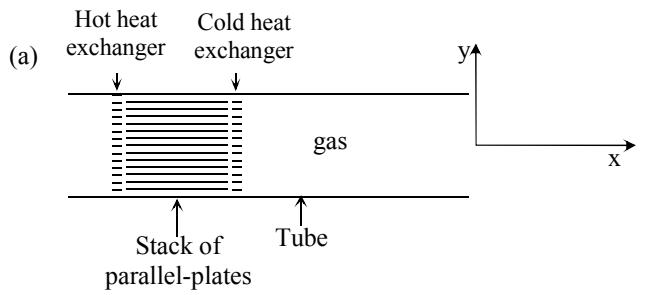

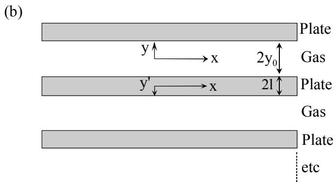  
Figure 3.1: Geometry used for the derivation of thermoacoustic expressions. (a)Overall view, and (b) expanded view of the stack section. Each plate has thickness 2l, and each gas layer has thickness 2yo.

Before beginning with writing the general equations of fluid mechanics, we will first summarize the assumptions which are used in deriving the general equations of thermoacoustics:

• The theory is linear, second-order effects other than energy transport, such as acoustic streaming and turbulence are neglected.

• The plates are stationary and rigid.

• The temperature spanned along the stack is much smaller than the absolute temperature.

• The temperature dependence of viscosity is neglected, which can be important at large temperature gradients.

• Oscillating variables have harmonic time dependence at a single angular frequency ω.

We note that sound results from a time-varying perturbation of dynamic and thermodynamic variables that describe the medium. We assume that in the fluid a one-dimensional acoustic wave with an angular frequency ω exists, and the acoustic pressure is constant over the cross-sectional area of the stack, so that $p = p ( x )$ . In thermoacoustics, a first order in the perturbations is considered for variables, and a second order in the perturbations for the energies.

The fundamental physics concerned with thermoacoustics is described by Navier-Stokes [6], continuity [7] and energy equations [8]

$$
\rho \left[ \frac { \partial \mathbf { v } } { \partial t } + ( \mathbf { v } \cdot \pmb { \nabla } ) \mathbf { v } \right] = - \pmb { \nabla } p + \mu \pmb { \nabla } ^ { 2 } \mathbf { v } + ( \xi + \frac { \mu } { 3 } ) \pmb { \nabla } ( \pmb { \nabla } \cdot \mathbf { v } ) ,\tag{3.1}
$$

$$
\frac { \partial \rho } { \partial t } + \pmb { \nabla } \cdot ( \rho \mathbf { v } ) = 0 ,\tag{3.2}
$$

$$
\frac { \partial } { \partial t } \left( \frac { 1 } { 2 } \rho { \boldsymbol { v } } ^ { 2 } + \rho \epsilon \right) = - \nabla \cdot [ \rho { \bf v } ( \frac { 1 } { 2 } { \boldsymbol { v } } ^ { 2 } + h ) - { \bf K } \nabla T - { \bf v } \cdot { \boldsymbol { \Sigma } } ] ,\tag{3.3}
$$

where $\rho$ is density, v is velocity, p is pressure, $\mu$ and $\xi$ are dynamic (shear) and second (bulk) viscosity, respectively; K is the gas thermal conductivity, € and h are internal energy and enthalpy per unit mass, respectively, and Σ is the viscous stress tensor, with components

$$
\Sigma _ { i j } = \mu ( \frac { \partial v _ { i } } { \partial x _ { j } } + \frac { \partial v _ { j } } { \partial x _ { i } } - \frac { 2 } { 3 } \delta _ { i j } \frac { \partial v _ { k } } { \partial x _ { k } } ) + \xi \delta _ { i j } \frac { \partial v _ { k } } { \partial x _ { k } } .\tag{3.4}
$$

The temperature in the plates is given by the conduction equation

$$
\frac { \partial T _ { \mathrm { s } } } { \partial t } = \frac { K _ { \mathrm { s } } } { \rho _ { \mathrm { s } } c _ { \mathrm { s } } } \nabla ^ { 2 } T _ { \mathrm { s } } ,\tag{3.5}
$$

where $K _ { \mathrm { s } } , \rho _ { \mathrm { s } }$ and $c _ { \mathrm { s } }$ are the thermal conductivity, the density and specific heat per unit mass of the stack's material, respectively.

The temperature in the fluid is $\mathrm { g i }$ ven can be derived from Eq.(3.3) [9]

$$
\rho T ( \frac { { \partial \boldsymbol { s } } } { { \partial t } } + { \bf { v } } \cdot \pmb { \nabla } \boldsymbol { s } ) = { \mathrm { K } } \pmb { \nabla } \cdot ( \pmb { \nabla } T ) + \sigma _ { i k } ^ { \prime } \frac { \partial v _ { i } } { \partial x _ { k } } .\tag{3.6}
$$

The temperatures in the plates and in the gas are coupled at the solid-gas interface where continuity of temperature and heat fluxes is imposed. These conditions are respectively expressed as [10]

$$
\begin{array} { r c l } { { T _ { 1 } ( y _ { 0 } ) } } & { { = } } & { { T _ { \mathrm { s 1 } } ( l ) = T _ { \mathrm { b } } } } \\ { { \displaystyle K \left( \frac { \partial T _ { 1 } } { \partial y } \right) _ { y _ { 0 } } } } & { { = } } & { { - K _ { \mathrm { s } } \left( \frac { \partial T _ { \mathrm { s 1 } } } { \partial y ^ { \prime } } \right) _ { \mathrm { l } } } } \end{array}\tag{3.7}
$$

where subscript 1 indicates a first-order in the perturbation. The complex notation is used for time-oscillatory variables: pressure $p ,$ temperature $T ,$ velocity components $( u , v , w )$ , density $\rho ,$ and entropy per unit mass s [5]

$$
p = p _ { \mathrm { m } } + \mathrm { R e } [ p _ { 1 } ( x ) \mathrm { e } ^ { j \omega t } ] ,\tag{3.8}
$$

$$
u = \mathrm { R e } [ u _ { 1 } ( x , y , z ) e ^ { j \omega t } ]\tag{3.9}
$$

$$
v , w = \mathrm { s i m i l a r ~ t o ~ } u\tag{3.10}
$$

$$
T = T _ { \mathrm { m } } ( x ) + \mathrm { R e } [ T _ { 1 } ( x , y , z ) e ^ { j \omega t } ] ,\tag{3.11}
$$

$$
\rho , s , T _ { \mathrm { s } } = \mathrm { s i m i l a r ~ t o ~ } T\tag{3.12}
$$

In the acoustic approximation, the variables are harmonic and they have a $\mathrm { e } ^ { j \omega t }$ time dependence, where $\omega = 2 \pi f ,$ and f is the oscillation frequency. The mean values of the different variables are given by the subscript m and are real. The first-order terms in the expansion which are complex are indicated by a subscript 1. We assume that this lowest order in the acoustic amplitude suffices for all variables.

Since $\delta _ { \nu } ,$ and λ are the characteristic lengths in x, y directions, respectively, and $\delta _ { \nu } \ll \lambda$ . This means that through this chapter we will always neglect $\partial / \partial x$ compared to $\partial / \partial y$

To first order, the x-component of the momentum equation can be written in the form [11]

$$
j \omega \rho _ { \mathrm { m } } u _ { 1 } = - \frac { \mathrm { d } p _ { 1 } } { \mathrm { d } x } + \mu \frac { \partial ^ { 2 } u _ { 1 } } { \partial y ^ { 2 } } + ( \xi + \frac { \mu } { 3 } ) \frac { \partial } { \partial x } ( \pmb { \nabla } \cdot \mathbf { v } _ { 1 } ) ,\tag{3.13}
$$

where $u _ { 1 }$ is the x component of $\mathbf { v } _ { 1 }$ . Thus Eq.(3.13) reduces to

$$
j \omega \rho _ { \mathrm { m } } u _ { 1 } = - \frac { \mathrm { d } p _ { 1 } } { \mathrm { d } x } + \mu \frac { \partial ^ { 2 } u _ { 1 } } { \partial y ^ { 2 } } .\tag{3.14}
$$

With the boundary condition $u _ { 1 } ( y _ { 0 } ) = 0$ , the solution $u _ { 1 }$ of this equation can be written as the sum of the solution of the homogenous equation and a particular solution. The solution is

$$
u _ { 1 } ( x , y ) = \frac { j } { \rho _ { \mathrm { m } } \omega } \left( \frac { \mathrm { d } p _ { 1 } } { \mathrm { d } x } \right) \left[ 1 - \frac { \cosh [ \frac { \left( 1 + j \right) } { \delta _ { \nu } } y ] } { \cosh [ \frac { \left( 1 + j \right) } { \delta _ { \nu } } y _ { 0 } ] } \right] ,\tag{3.15}
$$

where

$$
\delta _ { \nu } = { \sqrt { \frac { 2 \mu } { \rho _ { \mathrm { m } } \omega } } } .\tag{3.16}
$$

The parameter $\delta _ { \nu }$ is the viscous penetration depth of the gas as defined in chapter 2. To first order, Eq.(3.5) becomes

$$
j \omega T _ { \mathrm { s 1 } } = \frac { K _ { \mathrm { s } } } { \rho _ { \mathrm { s } } c _ { \mathrm { s } } } \frac { \partial ^ { 2 } T _ { \mathrm { s 1 } } } { \partial y ^ { \prime 2 } } ,\tag{3.17}
$$

Using the first boundary condition from expression (3.7), Eq.(3.17) has the solution

$$
T _ { \mathrm { s l } } ( x , y ^ { \prime } ) = \frac { \varepsilon _ { \mathrm { s } } } { ( 1 + \varepsilon _ { \mathrm { s } } ) } \left[ \frac { \beta T _ { \mathrm { m } } } { \rho _ { \mathrm { m } } c _ { \mathrm { p } } } p _ { \mathrm { l } } + \frac { 1 } { \rho _ { \mathrm { m } } \omega ^ { 2 } } \frac { \mathrm { d } T _ { \mathrm { m } } } { \mathrm { d } x } \left( \frac { \mathrm { d } p _ { \mathrm { l } } } { \mathrm { d } x } \right) \left( \frac { 1 } { \sigma - 1 } \right) \left( 1 - \frac { f _ { \nu } } { \sigma f _ { \mathrm { k } } } \right) \right] \frac { \cosh ( \alpha _ { \mathrm { s } } y ^ { \prime } ) } { \cosh ( \alpha _ { \mathrm { s } } l ) } \left( \frac { \mathrm { d } p _ { \mathrm { m } } } { \sigma - 1 } \right) .\tag{3.18}
$$

where

$$
\begin{array} { r c l } { f _ { \nu } } & { = } & { \displaystyle \frac { \mathrm { t a n h } ( \alpha _ { \nu } y _ { 0 } ) } { \alpha _ { \nu } y _ { 0 } } , ~ \alpha _ { \nu } = \frac { ( 1 + j ) } { \delta _ { \nu } } } \\ { f _ { \mathrm { k } } } & { = } & { \displaystyle \frac { \mathrm { t a n h } ( \alpha _ { \mathrm { k } } y _ { 0 } ) } { \alpha _ { \mathrm { k } } y _ { 0 } } , ~ \alpha _ { \mathrm { k } } = \frac { ( 1 + j ) } { \delta _ { \mathrm { k } } } } \\ { \varepsilon _ { \mathrm { s } } } & { = } & { \displaystyle \frac { \sqrt { K \rho _ { \mathrm { m } } c _ { \mathrm { p } } } } { \sqrt { K _ { \mathrm { s } } \rho _ { \mathrm { s } } c _ { \mathrm { s } } } } \frac { \mathrm { t a n h } ( \alpha _ { \mathrm { k } } y _ { 0 } ) } { \mathrm { t a n h } ( \alpha _ { \mathrm { s } } l ) } , ~ \alpha _ { \mathrm { s } } = \frac { ( 1 + j ) } { \delta _ { \mathrm { s } } } } \end{array}\tag{3.19}
$$

and

$$
\delta _ { \mathrm { k } } = { \sqrt { \frac { 2 K } { \rho _ { \mathrm { m } } c _ { \mathrm { p } } \omega } } }\tag{3.20}
$$

$$
{ \delta _ { \mathrm { { s } } } } = \sqrt { \frac { 2 K _ { \mathrm { { s } } } } { \rho _ { \mathrm { { s } } } c _ { \mathrm { { s } } } \omega } }\tag{3.21}
$$

$$
\sigma = \left( \frac { \delta _ { \nu } } { \delta _ { \mathbf { k } } } \right) ^ { 2 }\tag{3.22}
$$

where $\delta _ { \mathrm { k } }$ is the thermal penetration depth of the gas, $\delta _ { \mathrm { s } }$ is the solid's thermal penetration depth, and $\sigma$ is the Prandtl number. The function $f$ is the so called Rott's function and it is geometry dependent. The $f$ functions for other stack geometries are given in the literature [12]. Using the thermodynamic expression

$$
\mathrm { d } s = \bigl ( \frac { c _ { \mathrm { p } } } { T } \bigr ) \mathrm { d } T - \bigl ( \frac { \beta } { \rho } \bigr ) \mathrm { d } p\tag{3.23}
$$

where $c _ { \mathrm { p } }$ and $\beta$ are the specific heat per unit mass and the isobaric thermal expansion coefficient of the gas, respectively. To first order, Eq.(3.6) becomes

$$
\rho _ { \mathrm { m } } c _ { \mathrm { p } } ( j \omega T _ { 1 } + u _ { 1 } \frac { \mathrm { d } T _ { \mathrm { m } } } { \mathrm { d } x } ) - j \omega \beta T _ { \mathrm { m } } p _ { 1 } = K \frac { \partial ^ { 2 } T _ { 1 } } { \partial y ^ { 2 } } .\tag{3.24}
$$

Substituting Eq.(3.15) for $u _ { 1 }$ , and solving Eq.(3.24) for $T _ { 1 }$ , with the boundary condition of Eq.(3.7). The solution is [13]

$$
\begin{array} { r c l } { { T _ { 1 } ( x , y ) } } & { { = } } &  { \displaystyle { \frac { \beta T _ { \mathrm { m } } } { \rho _ { \mathrm { m } } c _ { \mathrm { p } } } p _ { 1 } - \frac { 1 } { \rho _ { \mathrm { m } } \omega ^ { 2 } } \frac { { \mathrm { d } } T _ { \mathrm { m } } } { { \mathrm { d } } x } \frac { { \mathrm { d } } p _ { 1 } } { { \mathrm { d } } x } \left( 1 - \left[ \left( \frac { \sigma } { \sigma - 1 } \right) \frac { \cosh ( a _ { \nu } y ) } { \cosh ( a _ { \nu } y _ { 0 } ) } \right] \right) } } \\ { { } } & { { } } &  { \displaystyle { - \left( \frac { \beta T _ { \mathrm { m } } } { \rho _ { \mathrm { m } } c _ { \mathrm { p } } } p _ { 1 } + \frac { 1 } { \rho _ { \mathrm { m } } \omega ^ { 2 } } \frac { \left( 1 + \frac { \varepsilon _ { \mathrm { s } } f _ { \nu } } { f _ { \mathrm { k } } } \right) } { \left( \sigma - 1 \right) } \frac { { \mathrm { d } } T _ { \mathrm { m } } } { { \mathrm { d } } x } \frac { { \mathrm { d } } p _ { 1 } } { { \mathrm { d } } x } \right) \frac { \cosh ( a _ { \mathrm { k } } y ) } { \left( 1 + \varepsilon _ { \mathrm { s } } \right) \cosh \left( a _ { \mathrm { k } } y _ { 0 } \right) } } } \end{array}\tag{3.25}
$$

For the derivation of Rott's wave equation, we begin with the continuity equation, $\mathrm { E q . ( 3 . 2 ) }$ , which to first order becomes

$$
j \omega \rho _ { 1 } + \frac { \partial } { \partial x } \left( \rho _ { \mathrm { m } } u _ { 1 } \right) + \rho _ { \mathrm { m } } \frac { \partial v _ { 1 } } { \partial y } = 0\tag{3.26}
$$

By combining this equation with the x derivative of Eq.(3.14), one obtains

$$
- \omega ^ { 2 } \rho _ { 1 } - { \frac { \mathrm { d } ^ { 2 } p _ { 1 } } { \mathrm { d } x ^ { 2 } } } + { \frac { \partial } { \partial x } } \left( \mu { \frac { \partial ^ { 2 } u _ { 1 } } { \partial y ^ { 2 } } } \right) + j \omega \rho _ { \mathrm { m } } { \frac { \partial v _ { 1 } } { \partial y } } = 0 .\tag{3.27}
$$

The density $\rho _ { 1 }$ is related to $T _ { 1 }$ and $p _ { 1 }$ by the thermodynamic expression

$$
\rho _ { 1 } = \rho _ { \mathrm { m } } \beta T _ { 1 } + \left( { \frac { \gamma } { a ^ { 2 } } } \right) p _ { 1 }\tag{3.28}
$$

where $\gamma$ is the ratio of isobaric to isochoric specific heats and a is the adiabatic sound speed. Substituting $\operatorname { E q } .$ (3.28) into Eq.(3.27), yields

$$
\rho _ { \mathrm { m } } \beta \omega ^ { 2 } T _ { 1 } - { \frac { \omega ^ { 2 } } { a ^ { 2 } } } \gamma p _ { 1 } - { \frac { \mathrm { d } ^ { 2 } p _ { 1 } } { \mathrm { d } x ^ { 2 } } } + { \frac { \partial } { \partial x } } \left( \mu { \frac { \partial ^ { 2 } u _ { 1 } } { \partial y ^ { 2 } } } \right) + j \omega \rho _ { \mathrm { m } } { \frac { \partial v _ { 1 } } { \partial y } } = 0\tag{3.29}
$$

By incorporating Eqs.(3.25) and (3.15) into Eq.(3.29), and integrating with respect to y from 0 to $y _ { 0 }$ , we obtain the wave equation of Rott [14]

$$
\left[ 1 + \frac { ( \gamma - 1 ) } { ( 1 + \varepsilon _ { \mathrm { s } } ) } f _ { \mathrm { k } } \right] p _ { 1 } + \frac { a ^ { 2 } } { \omega ^ { 2 } } \rho _ { \mathrm { m } } \frac { \mathrm { d } } { \mathrm { d } x } \left[ \frac { ( 1 - f _ { \nu } ) } { \rho _ { \mathrm { m } } } \frac { \mathrm { d } p _ { 1 } } { \mathrm { d } x } \right] + \frac { a ^ { 2 } } { \omega ^ { 2 } } \frac { \left( f _ { \mathrm { k } } - f _ { \nu } \right) } { \left( \sigma - 1 \right) \left( 1 + \varepsilon _ { \mathrm { s } } \right) } \beta \frac { \mathrm { d } T _ { \mathrm { m } } } { \mathrm { d } x } \frac { \mathrm { d } p _ { 1 } } { \mathrm { d } x } = 0\tag{3.30}
$$

This is the wave equation for $p _ { 1 }$ in the presence of a mean temperature gradient $\mathrm { { d } } T _ { \mathrm { { m } } } / \mathrm { { d } } x$ in the stack. For an ideal gas and ideal stack with ${ { \varepsilon } _ { \mathrm { s } } } = 0$ , this result was first obtained by Rott [1]

Now, we will proceed to develop an expression for the time-averaged acoustic power $\mathrm { d } \dot { W }$ used (or produced in the case of a prime mover ) in a segment of length dx in the stack. This power is the difference between the average acoustic power at $x +$ dx and x, thus

$$
\mathrm { d } \dot { W } = A _ { \mathrm { g } } \left[ \overline { { \left. p _ { 1 } u _ { 1 } \right. } } _ { x + \mathrm { d } x } - \overline { { \left. p _ { 1 } u _ { 1 } \right. } } _ { x } \right]\tag{3.31}
$$

where overbar indicates time average, brackets 〉 indicate averaging in the y direction, and $A _ { \mathrm { g } }$ is the cross-sectional area of the gas within the stack. Expanding $\overline { { \langle p _ { 1 } u _ { 1 } \rangle } } _ { x + \mathrm { d } x }$ in a Taylor series, and p being independent of y, Eq.(3.31) can be written as

$$
\mathrm { d } \dot { W } = A _ { \mathrm { g } } \left[ \frac { \mathrm { d } \overline { { p _ { 1 } \langle u _ { 1 } \rangle } } } { \mathrm { d } x } \mathrm { d } x \right]\tag{3.32}
$$

The time average of the product of two complex quantities such as $p _ { 1 }$ and $\left. u _ { 1 } \right.$ is given by

$$
\overline { { p _ { 1 } \langle u _ { 1 } \rangle } } = \frac { 1 } { 2 } \mathrm { R e } \left[ p _ { 1 } \langle u _ { 1 } ^ { * } \rangle \right]\tag{3.33}
$$

where the star denotes complex conjugation and Re[ ] signifies the real part. Using Eq.(3.33) and expanding the derivatives in Eq.(3.32) gives

$$
\mathrm { d } \dot { W } = \frac { 1 } { 2 } A _ { \mathrm { g } } \ : \mathrm { R e } \left[ p _ { 1 } \frac { \mathrm { d } \langle u _ { 1 } ^ { * } \rangle } { \mathrm { d } x } + \langle u _ { 1 } ^ { * } \rangle \frac { \mathrm { d } p _ { 1 } } { \mathrm { d } x } \right] \mathrm { d } x .\tag{3.34}
$$

To evaluate this expression, the derivatives $\mathrm { d } p _ { 1 } / \mathrm { d } x$ and $\mathrm { d } \langle u _ { 1 } \rangle / \mathrm { d } x$ are needed. The expression for $\mathrm { d } p _ { 1 } / \mathrm { d } x$ is obtained from Eq.(3.15), as follows

$$
\langle u _ { 1 } \rangle = \frac { j } { \rho _ { \mathrm { m } } \omega } \frac { \mathrm { d } p _ { 1 } } { \mathrm { d } x } \left( 1 - f _ { \nu } \right)\tag{3.35}
$$

so that

$$
{ \frac { \mathrm { d } p _ { 1 } } { \mathrm { d } x } } = { \frac { - j \rho _ { \mathrm { m } } \omega \langle u _ { 1 } \rangle } { ( 1 - f _ { \nu } ) } } .\tag{3.36}
$$

The derivative $\mathrm { d } \langle u _ { 1 } \rangle / \mathrm { d } x$ can be obtained from the second term in Rott's wave equation and Eq.(3.35), as follows

$$
\frac { a ^ { 2 } } { \omega ^ { 2 } } \rho _ { \mathrm { m } } \frac { \mathrm { d } } { \mathrm { d } x } \left[ \frac { ( 1 - f _ { \nu } ) } { \rho _ { \mathrm { m } } } \frac { \mathrm { d } p _ { 1 } } { \mathrm { d } x } \right] = \frac { a ^ { 2 } } { \omega ^ { 2 } } \rho _ { \mathrm { m } } \frac { \mathrm { d } } { \mathrm { d } x } ( - j \omega \langle u _ { 1 } \rangle ) .\tag{3.37}
$$

Substituting this into Eq.(3.30) produces

$$
\frac { \mathrm { d } \langle u _ { 1 } \rangle } { \mathrm { d } x } = \frac { - j \omega } { \rho _ { \mathrm { m } } a ^ { 2 } } \left[ 1 + \frac { \left( \gamma - 1 \right) } { \left( 1 + \varepsilon _ { \mathrm { s } } \right) } f _ { \mathrm { k } } \right] p _ { 1 } + \frac { \left( f _ { \mathrm { k } } - f _ { \nu } \right) } { \left( 1 - \sigma \right) \left( 1 + \varepsilon _ { \mathrm { s } } \right) \left( 1 - f _ { \nu } \right) } \beta \frac { \mathrm { d } T _ { \mathrm { m } } } { \mathrm { d } x } \langle u _ { 1 } \rangle\tag{3.38}
$$

Substituting Eqs.(3.36) and (3.38) into Eq.(3.34) yields [12]

$$
\begin{array} { r c l } { \displaystyle \frac { \mathrm { d } \dot { W } _ { 2 } } { \mathrm { d } x } } & { = } & { \displaystyle - \frac { 1 } { 2 } A _ { \mathrm { g } } \omega \left( \frac { \rho _ { \mathrm { m } } \mathrm { I m } \left( - f _ { \nu } \right) } { \left| 1 - f _ { \nu } \right| ^ { 2 } } \left| \langle u _ { 1 } \rangle \right| ^ { 2 } + \frac { \left( \gamma - 1 \right) \mathrm { I m } \left( - f _ { \mathrm { k } } \right) } { \rho _ { \mathrm { m } } a ^ { 2 } \left( 1 + \varepsilon _ { \mathrm { s } } \right) } \left| p _ { 1 } \right| ^ { 2 } \right) } \\ & & { \displaystyle + \frac { 1 } { 2 } A _ { \mathrm { g } } \omega \left( \frac { \beta } { \omega \left( 1 - \sigma \right) \left( 1 + \varepsilon _ { \mathrm { s } } \right) } \frac { \mathrm { d } T _ { \mathrm { m } } } { \mathrm { d } x } \mathrm { R e } \left( \frac { \left( f _ { \mathrm { k } } ^ { \ast } - f _ { \nu } ^ { \ast } \right) } { \left( 1 - f _ { \nu } ^ { \ast } \right) } p _ { 1 } \langle u _ { 1 } ^ { \ast } \rangle \right) \right) } \end{array}\tag{3.39}
$$

This is the acoustic power absorbed (or produced) in the stack per unit length. The subscript 2 is used to indicate that the acoustic power is a second-order quantity; the product of two first-order quantities, p1and u1.

The first two terms in Eq.(3.39), are the viscous and thermal relaxation dissipation terms, respectively. These two terms are always present whenever a wave interact with a solid surface, and have a dissipative effect in thermoacoustics. The third term in Eq.(3.39) contains the temperature gradient $\mathrm { { d } } T _ { \mathrm { { m } } } / \mathrm { { d } } x$ . This term can either absorb (refrigerator) or produce acoustic power (prime mover) depending on the magnitude of the temperature gradient along the stack. This term is the unique contribution to themoacoustics.

Finally, we will now proceed to develop an expression for the time-averaged energy flux $\dot { E } _ { 2 }$ in the stack, correct to second-order in the acoustic variables. We consider the thermoacoustic refrigerator shown in Fig.(3.1a), driven by a loudspeaker. We suppose that the refrigerator is thermally insulated from the surroundings except at the two heat exchangers, so that heat can be exchanged with the outside world only via the two heat exchangers. Work can be exchanged only at the loudspeaker piston. The general law of conservation of energy for a fluid, where there is viscosity and thermal conduction is given by Eq.(3.3), is expressed by Eq.(3.40) below

$$
\frac { \partial } { \partial t } \left( \frac { 1 } { 2 } \rho { \boldsymbol v } ^ { 2 } + \rho { \epsilon } \right) = - \nabla \cdot \left[ { \bf v } \left( \frac { 1 } { 2 } \rho { \boldsymbol v } ^ { 2 } + \rho h \right) - K \nabla T - { \bf v } \cdot \Sigma \right]\tag{3.40}
$$

where € and h are the internal energy and enthalpy per unit mass, respectively, and Σ is the viscous stress tensor, with components given by Eq.(3.4). The expression on the left is the rate-of-change of the energy in unit volume of the fluid, while that on the right is the divergence of the energy flux density which consists of three terms: transfer of mass by the motion of the fluid, transfer of heat and energy flux due to internal friction, respectively.

In steady state, for a cyclic refrigerator (prime mover) without heat flows to the surroundings, the time averaged energy flux $\dot { E } _ { 2 }$ along x must be independent of x. Terms of third order in v are neglected. Taking the x component of Eq.(3.40), integrating the remaining terms with respect to y from $y = 0$ to $y = y _ { 0 }$ , and time averaging yields [15]

$$
{ \frac { \mathrm { d } } { \mathrm { d } x } } \left[ \int _ { 0 } ^ { y _ { 0 } } { \overline { { \rho u h } } } { \mathrm { ~ d } } y - \int _ { 0 } ^ { y _ { 0 } } { \overline { { K { \frac { \partial T } { \partial x } } } } } { \mathrm { ~ d } } y - \int _ { 0 } ^ { l } { \overline { { K _ { s } { \frac { \partial T _ { s } } { \partial x } } } } } { \mathrm { ~ d } } y ^ { \prime } - \int _ { 0 } ^ { y _ { 0 } } { \overline { { \mathbf { v } \cdot \Sigma } } } { \mathrm { ~ d } } y \right] = 0 .\tag{3.41}
$$

The quantity within the square brackets is the time-averaged energy flux per unit perimeter $\dot { E } _ { \mathrm { 2 } } / \pi$ along x

$$
\frac { \dot { E } _ { 2 } } { \Pi } = \int _ { 0 } ^ { y _ { 0 } } \overline { { \rho u h } } \mathrm { ~ d } y - \int _ { 0 } ^ { y _ { 0 } } \overline { { K \frac { \partial T } { \partial x } } } \mathrm { ~ d } y - \int _ { 0 } ^ { l } \overline { { K _ { s } \frac { \partial T _ { s } } { \partial x } } } \mathrm { ~ d } y ^ { \prime } - \int _ { 0 } ^ { y _ { 0 } } \overline { { \mathbf { v } \cdot \Sigma } } \mathrm { ~ d } y .\tag{3.42}
$$

Using the acoustic approximations Eqs.(3.8)-(3.12), keeping terms up to second order, the first integral in Eq.(3.42) becomes

$$
\overline { { \rho u h } } \simeq \rho _ { \mathrm { m } } h _ { \mathrm { m } } \overline { { u _ { 1 } } } + \rho _ { \mathrm { m } } h _ { \mathrm { m } } \overline { { u _ { 2 } } } + h _ { \mathrm { m } } \overline { { \rho _ { 1 } u _ { 1 } } } + \rho _ { \mathrm { m } } \overline { { h _ { 1 } u _ { 1 } } } .\tag{3.43}
$$

The first term on the right in Eq.(3.43) is zero because $\overline { { u _ { 1 } } } = 0$ . The integrals of the second and third terms in Eq.(3.43) sum to zero because the second-order timeaveraged mass flux is zero[16]

$$
\rho _ { \mathrm { m } } \overline { { u _ { 2 } } } + \overline { { \rho _ { 1 } u _ { 1 } } } = 0 .\tag{3.44}
$$

Hence, if we use the thermodynamic expression

$$
\mathrm { d } h = T \mathrm { d } s + \mathrm { d } p / \rho = c _ { \mathrm { p } } \mathrm { d } T + \left( 1 / \rho \right) \left( 1 - \beta T \right) \mathrm { d } p\tag{3.45}
$$

we obtain

$$
\begin{array} { l c l } { { \overline { { \rho } } \overline { { u h } } } } & { { \simeq } } & { { \rho _ { \mathrm { m } } \overline { { h _ { 1 } u _ { 1 } } } } } \\ { { } } & { { = } } & { { c _ { \mathrm { p } } \rho _ { \mathrm { m } } \overline { { T _ { 1 } u _ { 1 } } } + ( 1 - \beta T _ { \mathrm { m } } ) \overline { { p _ { 1 } u _ { 1 } } } } } \end{array}\tag{3.46}
$$

The largest term in the last integral in $\mathrm { E q . ( 3 . 4 2 ) }$ is of order $y _ { 0 } \mu u _ { 1 } / \lambda ;$ but the term $\overline { { \rho u h } }$ , in the first integral, is of order $p _ { 1 } u _ { 1 } \simeq \rho _ { \mathrm { m } } a u _ { 1 } ^ { 2 }$ , so that the last integral can be neglected. Only the zero-order terms are significant in the second and third integrals in Eq.(3.42). Hence Eq.(3.42) becomes [17]

$$
\frac { \dot { E } _ { 2 } } { \Pi } = \int _ { 0 } ^ { y _ { 0 } } \rho _ { \mathrm { m } } \overline { { h _ { 1 } u _ { 1 } } } \mathrm { d } y - \left( y _ { 0 } K + l K _ { \mathrm { s } } \right) \frac { \mathrm { d } T _ { \mathrm { m } } } { \mathrm { d } x }\tag{3.47}
$$

$$
\begin{array} { r l } { = } & { { } \displaystyle \int _ { 0 } ^ { y _ { 0 } } \overline { { p _ { 1 } u _ { 1 } } } \mathrm { d } y + \int _ { 0 } ^ { y _ { 0 } } T _ { \mathrm { m } } \rho _ { \mathrm { m } } \overline { { s _ { 1 } u _ { 1 } } } \mathrm { d } y - \left( y _ { 0 } K + l K _ { \mathrm { s } } \right) \frac { \mathrm { d } T _ { \mathrm { m } } } { \mathrm { d } x } } \end{array}\tag{3.48}
$$

so that

$$
\frac { \dot { E } _ { 2 } } { \Pi } = \int _ { 0 } ^ { y _ { 0 } } \left[ c _ { p } \rho _ { \mathrm { m } } \overline { { T _ { 1 } u _ { 1 } } } + ( 1 - \beta T _ { \mathrm { m } } ) \overline { { p _ { 1 } u _ { 1 } } } \right] \mathrm { d } y - \left( y _ { 0 } K + l K _ { \mathrm { s } } \right) \frac { \mathrm { d } T _ { \mathrm { m } } } { \mathrm { d } x }\tag{3.49}
$$

The subscript 2 is again used to indicate that the energy flux is second order in the acoustic quantities. Substituting $\mathrm { E q . ( 3 . 1 5 ) }$ for $u _ { 1 }$ and Eq.(3.25) for $T _ { 1 }$ and performing the integration yields finally [18]

$$
\begin{array} { r c l } { \dot { E } _ { 2 } } & { = } & { \frac { A _ { \mathrm { g } } } { 2 } \mathrm { R e } \left[ p _ { 1 } \langle u _ { 1 } ^ { * } \rangle \left( 1 - \frac { \beta T _ { \mathrm { m } } \left( f _ { \mathrm { k } } - f _ { \nu } ^ { * } \right) } { \left( 1 + \sigma \right) \left( 1 + \varepsilon _ { \mathrm { s } } \right) \left( 1 - f _ { \nu } ^ { * } \right) } \right) \right] } \\ & & { + \frac { A _ { \mathrm { g } } \rho _ { \mathrm { m } } c _ { \mathrm { p } } \left| \langle u _ { 1 } \rangle \right| ^ { 2 } } { 2 \omega \left( 1 - \sigma \right) \left| 1 - f _ { \nu } \right| ^ { 2 } } \frac { \mathrm { d } T _ { \mathrm { m } } } { \mathrm { d } x } \mathrm { I m } \left[ f _ { \nu } ^ { * } + \frac { \left( f _ { \mathrm { k } } - f _ { \nu } ^ { * } \right) \left( 1 + \frac { \varepsilon _ { \mathrm { s } } f _ { \nu } } { f _ { \mathrm { k } } } \right) } { \left( 1 + \varepsilon _ { \mathrm { s } } \right) \left( 1 + \sigma \right) } \right] } \\ & & { - \left[ A _ { \mathrm { g } } K + A _ { \mathrm { s } } K _ { \mathrm { s } } \right] \frac { \mathrm { d } T _ { \mathrm { m } } } { \mathrm { d } x } } \end{array}\tag{3.50}
$$

where $A _ { \mathrm { s } }$ is the cross-sectional area of the stack material. This important result represents the energy flux along x direction (wave direction) in terms of $T _ { \mathrm { m } } ( x ) , p _ { 1 } \left( x \right)$ 2 material properties and geometry. For an ideal gas and ideal stack ${ { \varepsilon } _ { \mathrm { s } } } = 0$ , this result was first obtained by Rott [3].

As can be seen from Eq.(3.47), the energy flux consists of three terms: the first term in $\overline { { p _ { 1 } u _ { 1 } } }$ is the acoustic power, the second term in $\overline { { s _ { 1 } u _ { 1 } } }$ is the hydrodynamic entropy flow, and the final term is simply the conduction of heat through gas and stack material in the stack region.

As discussed before, the time-averaged energy flux $\dot { E } _ { 2 }$ along the stack must be independent of x. With $\dot { E } _ { 2 }$ constant, we solve Eq.(3.50) for $\mathrm { d } T _ { \mathrm { m } } / \mathrm { d } x$ , so that $T _ { \mathrm { m } }$ can be evaluated

$$
\frac { \mathrm { d } T _ { \mathrm { m } } } { \mathrm { d } x } = \frac { \biggl \{ \frac { \dot { E } _ { 2 } } { A _ { \mathrm { g } } } - \frac { 1 } { 2 } \mathrm { R e } \left[ p _ { 1 } \langle u _ { 1 } ^ { * } \rangle \left( 1 - \frac { \left( f _ { \mathrm { k } } ^ { * } - f _ { \nu } ^ { * } \right) } { ( 1 + \sigma ) ( 1 + \varepsilon _ { \mathrm { s } } ) ( 1 - f _ { \nu } ^ { * } ) } \right) \right] \biggr \} } { \biggl \{ \frac { \rho _ { \mathrm { m } } c _ { \mathrm { p } } | \langle u _ { 1 } \rangle | ^ { 2 } } { 2 \omega ( 1 - \sigma ) ( 1 + \varepsilon _ { \mathrm { s } } ) | 1 - f _ { \nu } | ^ { 2 } } \mathrm { I m } \left[ f _ { \nu } ^ { * } + \frac { \left( f _ { \mathrm { k } } ^ { * } - f _ { \nu } ^ { * } \right) \left( 1 + \frac { \varepsilon _ { \mathrm { s } } f _ { \nu } } { f _ { \mathrm { k } } } \right) } { ( 1 + \varepsilon _ { \mathrm { s } } ) ( 1 + \sigma ) } \right] - K - \frac { A _ { \mathrm { s } } } { A _ { \mathrm { g } } } K _ { \mathrm { s } } \biggr \} }\tag{3.51}
$$

As can be seen from Eqs.(3.39) and (3.50), the expressions for the acoustic power and energy flows are complicated and difficult to interpret. But they are useful for numerical calculation.

In summary Eqs.(3.36), (3.38), and (3.51) form a system of five coupled equations, because the two first equations are complex. These equations which represent the five real variables: Re $\left( p _ { 1 } \right)$ , Im $\left( p _ { 1 } \right)$ , Re $( \langle u _ { 1 } \rangle )$ , Im $( \langle u _ { 1 } \rangle )$ , and $T _ { \mathrm { m } }$ , incorporate the physics of the thermoacoustic effect; and can be used for analysis and design of thermoacoustic systems.

## 3.2 Boundary layer and short-stack approximations

The thermoacoustic expressions derived in the previous section are complicated to interpret. In this section we will use two assumptions, to simplify these expressions. First, we make use of the "boundary-layer" approximation: yo $\gg \delta _ { \mathrm { { K } } } , l \gg \delta _ { \mathrm { { s } } }$ , so that the hyperbolic tangents in $\mathrm { E q . ( 3 . 1 9 ) }$ can be set equal to unity. Second, we make the "short-stack" approximation, $L _ { \mathrm { s } } \ll \lambda ;$ where the stack is considered to be short enough that the pressure and velocity in the stack does not vary appreciably. Finally, we will consider standing-wave systems, which are more related to the experimental work in this thesis.

The standing wave acoustic pressure in the stack, $p _ { 1 } ^ { \mathrm { s } }$ , can be taken as real and is given by

$$
p _ { 1 } = p _ { 1 } ^ { \mathrm { s } } = p _ { 0 } \cos \left( k x \right) ,\tag{3.52}
$$

and the mean gas velocity in x direction is

$$
\left. u _ { 1 } \right. = j \left( 1 + \frac { l } { y _ { 0 } } \right) \frac { p _ { 0 } } { \rho _ { \mathrm { m } } a } \sin \left( k x \right) = j \left. u _ { 1 } ^ { \mathrm { s } } \right. .\tag{3.53}
$$

The superscript s refers to standing waves, $p _ { 0 }$ is the pressure amplitude at the pressure antinodes of the standing wave and k is the wave number. The factor $( 1 + l / y _ { 0 } )$ is used because of the continuity of the gas volumetric velocity at the boundary of the stack, which requires that the velocity inside the stack must be higher than that outside by the cross-sectional area ratio $( 1 + l / y _ { 0 } )$ . The Rott's function $f$ in the boundary layer-approximation is given by [12]

$$
f = \frac { \left( 1 - j \right) \delta } { y _ { 0 } }\tag{3.54}
$$

Using these assumptions and $A _ { \mathrm { g } } = \Pi y _ { 0 } , A _ { \mathrm { s } } = \Pi l$ the approximate expressions for $\dot { W } _ { 2 }$

and $\dot { E } _ { 2 }$ are obtained, respectively[19]

$$
\begin{array} { r c l } { \dot { W } _ { \mathrm { 2 } } } & { = } & { \displaystyle \frac { 1 } { 4 } \Pi \delta _ { \bf k } L _ { \mathrm { S } } \frac { \left( \gamma - 1 \right) \omega \left( p _ { \mathrm { 1 } } ^ { \mathrm { s } } \right) ^ { 2 } } { \rho _ { \mathrm { m } } a ^ { 2 } \left( 1 + \varepsilon _ { \mathrm { s } } \right) } \left( \frac { \Gamma } { \left( 1 + \sqrt { \sigma } \right) \Lambda } - 1 \right) } \\ & & { \displaystyle - \frac { 1 } { 4 } \Pi \delta _ { \nu } L _ { \mathrm { S } } \frac { \omega \rho _ { \mathrm { m } } \left. u _ { \mathrm { 1 } } ^ { \mathrm { s } } \right. ^ { 2 } } { \Lambda } } \end{array}\tag{3.55}
$$

and [20]

$$
\begin{array} { l l l } { \dot { E } _ { 2 } } & { = } & { - \displaystyle \frac { 1 } { 4 } \Pi \delta _ { \mathbf { k } } \frac { \beta T _ { \mathrm { m } } p _ { 1 } ^ { \mathrm { s } } \left. u _ { 1 } ^ { \mathrm { s } } \right. } { \left( 1 + \sigma \right) \left( 1 + \varepsilon _ { \mathrm { s } } \right) \Lambda } \left[ \Gamma \frac { 1 + \sqrt { \sigma } + \sigma + \sigma \varepsilon _ { \mathrm { s } } } { 1 + \sqrt { \sigma } } - \left( 1 + \sqrt { \sigma } - \frac { \delta _ { \nu } } { y _ { 0 } } \right) \right] \left( 3 . 5 6 \right) } \\ & { } & { \displaystyle - \Pi \left[ y _ { 0 } K + l K _ { \mathrm { s } } \right] \frac { { \mathrm { d } } T _ { \mathrm { m } } } { { \mathrm { d } } x } } \end{array}
$$

where

$$
\Lambda = 1 - \frac { \delta _ { \nu } } { y _ { 0 } } + \frac { \delta _ { \nu } ^ { 2 } } { 2 y _ { 0 } ^ { 2 } }\tag{3.57}
$$

In Eq.(3.55), $L _ { \mathrm { s } }$ is the stack length, I is the total perimeter of the stack plates in the direction normal to the x axis, and $\Pi \delta _ { \mathrm { k } } { \cal L } _ { \mathrm { s } }$ is the volume of gas within about a thermal penetration depth from the plates. $\Gamma = \nabla T _ { \mathrm { m } } / \nabla T _ { \mathrm { c r i t } }$ , and $\nabla T _ { \mathrm { c r i t } }$ is given by Eq.(2.32)

$$
\nabla T _ { \mathrm { c r i t } } = \frac { \beta T _ { \mathrm { m } } \omega p _ { 1 } ^ { \mathrm { s } } } { \rho _ { \mathrm { m } } c _ { \mathrm { p } } \left. u _ { 1 } ^ { \mathrm { s } } \right. }\tag{3.58}
$$

The second term on the right hand side of Eq.(3.55) and the second term between brackets (-1) are negative and are the viscous and thermal relaxation dissipation terms, respectively. These two terms have a dissipative effect on the performance of thermoacoustic devices. The first term between brackets on the right hand side of $\mathrm { E q . ( 3 . 5 5 ) }$ , proportional to Γ, is the acoustic power absorbed to transfer heat $( \Gamma < 1 )$ or produced in the case of a prime mover $( \textrm { T } > 1 )$ . We note again that the acoustic power $\dot { W } _ { 2 }$ and energy $\dot { E } _ { 2 }$ are quadratic in the acoustic amplitude. Furthermore, $\dot { W } _ { 2 }$ is proportional to the volume $\Pi \delta _ { \bf k } { \cal L } _ { \mathrm { s } }$ of gas that is located within $\delta _ { \mathrm { k } }$ from the stack surface.

As will be shown in the next section, the $\dot { E } _ { 2 }$ is the heat removed from the cold heat exchanger in our refrigerator. The first term on the right hand side of Eq.(3.56) is the thermoacoustic heat flow. The second term on the right hand side of Eq.(3.56) is simply the conduction of heat through gas and stack material in the stack region. So that the heat conduction has also a negative effect on the performance of thermoacoustic refrigerators. The energy flow ${ \dot { E } } _ { 2 }$ is proportional to the area $\Pi \delta _ { \mathbf { k } }$ , which is the crosssectional area of gas that is at $\delta _ { \mathrm { k } }$ from the stack surface. If $\delta _ { \mathbf { k } } \sim y _ { 0 }$ , essentially the entire cross-sectional area of gas in the stack participates in the thermoacoustic heat transport. The energy flow is also proportional to the product $p _ { 1 } ^ { \mathrm { s } } \langle u _ { 1 } ^ { \mathrm { s } } \rangle$ . Equations (3.55) and (3.56) contain the important parameter Γ which determines the sign of this expressions and hence the mode of operation of the apparatus, as discussed previously. Substituting Eqs.(3.52) and (3.53) into Eq.(3.58), we obtain

$$
\nabla T _ { c r i t } = \frac { \left( \gamma - 1 \right) } { \left( 1 + \frac { l } { y _ { 0 } } \right) } k T _ { \mathrm { m } } \cot { \left( k x \right) }\tag{3.59}
$$

Eq.(3.59), shows that the critical temperature gradient is independent of the acoustic amplitude for a given location of the stack center within the standing wave.

We see from Eq.(3.55) and $\mathrm { E q . ( 3 . 5 6 ) }$ , that the energy flow and acoustic power depend on of the Prandtl number $\sigma$ (viscosity), in a complicated way. The influence of the Prandtl number on $\dot { W } _ { 2 }$ and $\dot { E } _ { 2 }$ and hence on the performance of the refrigerator will be discussed in the next chapter.

## 3.3 Energy fluxes in thermoacoustic refrigerator

In the preceding sections, expressions for the acoustic power $\dot { W } _ { 2 }$ absorbed in a thermoacoustic refrigerator or produced in a prime mover and the total energy flow $\dot { E } _ { 2 }$ in the system have been presented. As can be seen from Eq.(3.47), the total energy is the sum of the acoustic power (first term), the hydrodynamic heat flux (second term) and the conduction heat flux. An idealized illustration of the different flows and their interplay in a thermoacoustic refrigerator will be given in this section.

Fig.(3.2a) shows a standing wave refrigerator thermally insulated from the surroundings except at the heat exchangers where heat can be exchanged with the surroundings. The arrows show the different energy flows into or out of the system except the conductive heat flow which is neglected for ease of discussion. A loudspeaker (driver) sustains a standing acoustic wave in the resonator by supplying acoustic power $\dot { W } _ { 2 }$ in the form of a travelling acoustic wave. A part of this power will be used to sustain the standing wave against the thermal and viscous dissipations, and the rest of power will be used by the thermoacoustic effect to transport heat from the cold heat exchanger to the hot heat exchanger, as discussed previously using Eq.(3.55).

In Fig.(3.2b), An idealized energy diagram, illustrating the behavior of the different energy flows as function of the position, is given. A part of the acoustic power delivered by the loudspeaker is dissipated at the resonator wall (first and second term in Eq.(3.39)), to the left and right of the stack. The dissipated part to the right of the cold heat exchange shows up as heat at the cold heat exchanger. This will decrease the effective cooling power of the refrigerator. The acoustic power in the stack and heat exchangers decreases monotonously, as it is used to transport heat from the cold heat exchanger to the hot heat exchanger, and to overcome the viscous forces in the stack.

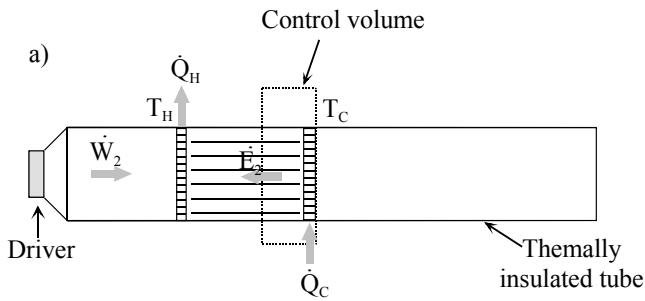

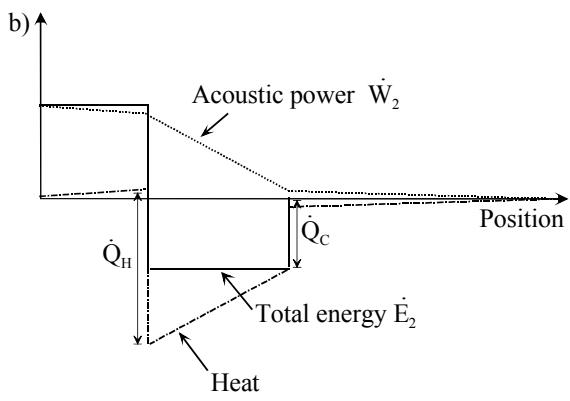  
Figure 3.2: a) A standing wave refrigerator, insulated everywhere except at the heat exchangers. b) Illustration of $\dot { W } _ { 2 } , \dot { Q } _ { 2 }$ , and $\dot { E } _ { 2 }$ in the refrigerator. The discontinuities in $\dot { E } _ { 2 }$ are due to heat transfers at the heat exchangers.

This used power shows up as heat at the hot heat exchanger. The power dissipated at the tube wall to the left of the stack will also show up at the hot heat exchanger.

Within the stack, the heat flux grows from $\dot { Q } _ { \mathrm { C } }$ at the left end of the stack to $\dot { Q } _ { \mathrm { H } }$ at the right end. The two discontinuities in the heat flux are at the two heat exchangers at $T _ { \mathrm { C } }$ and $T _ { \mathrm { H } } .$ supplying heat $\dot { Q } _ { \mathrm { C } }$ and removing heat $\dot { Q } _ { \mathrm { H } }$ . The total energy flow is everywhere the sum of acoustic work and heat fluxes. Within the stack the total energy is constant. The heat flux rises while acoustic power decreases, so that conservation of energy holds.

If we apply the principle of energy conservation to the control volume shown by the dotted line in Fig.(3.2a), in steady state over a cycle, the energy inside the control volume can't change, so that the rate at which energy flows out is $\dot { E } _ { 2 }$ and the rate at which energy flows in is $\dot { Q } _ { \mathrm { C } }$ , so that we conclude that $\dot { Q } _ { \mathrm { C } }$ is equal to ${ \dot { E } } _ { 2 }$

## 3.4 Computations and DeltaE

Since $p _ { 1 } ( x )$ and $\langle u _ { 1 } ( x ) \rangle$ are complex, the Eqs.(3.36), (3.38) and (3.30) form five coupled equations for the five variables: Re $\left( p _ { 1 } \right)$ , Im $\left( p _ { 1 } \right)$ , Re ((u1〉), Im $( \langle u _ { 1 } \rangle )$ , and $T _ { \mathrm { m } }$ . These equations together with five boundary conditions can be numerically integrated along the x direction to determine $p _ { 1 } ( x ) , \langle u _ { 1 } ( x ) \rangle$ and $T _ { \mathrm { m } } ( x )$ in a given geometry.

A computation program, named DeltaE (Design Environment for Low-Amplitude Thermoacoustic Engines), has been developed by the Los Alamos group[21]. DeltaE integrates the three coupled equations (3.36), (3.38) and (3.51) in a geometry given by the user as a sequence of acoustic segments (such as ducts, compliances), stacks and heat exchangers. In each segment, the integration is performed using the local parameters like area, perimeter, and global parameters like frequency and mean pressure. The solutions $p _ { 1 } ( x ) , \langle u _ { 1 } ( x ) \rangle$ and $T _ { \mathrm { m } } ( x )$ are found for each segment and are matched together at the junction between segments to determine the solution for the entire apparatus. If all boundary conditions are known at the initial segment, then the integration is straightforward. But usually some of the boundary conditions are known elsewhere. Under such conditions, DeltaE uses a shooting method, by guessing and adjusting any unknown boundary conditions at the initial segment to achieve desired boundary conditions elsewhere. A detailed explanation of the way DeltaE does work can be found in the DeltaE user guide[22]. In summary, DeltaE is a program which can be used to predict the performance of thermoacoustic devices, or to design devices to meet some specified conditions.

## 3.5 Non-linear effects

The thermoacoustic theory developed so far is based on the acoustic approximation. Hence only small amplitudes were supposed. Actually, thermoacoustic devices developed for practical use will always operate at high amplitude. Hence, one may expect that non-linear effects will be present in such systems. This section is intended to give a short survey of some non-linear effects. A detailed review of these effects can be found in the text of Swift [23]. A short review of turbulence, and streaming will be given. Since these effects dissipate acoustic power, they have a negative effect on the performance of thermoacoustic devices.

## 3.5.1 Turbulence

From many experimental studies on the structure of turbulent oscillatory flows, it has unanimously been observed that transition to turbulence in the boundary layer took place at a Reynolds number $( \ R ^ { \delta _ { \nu } } )$ based on Stokes boundary-layer thickness of about 500 to 550, independent of the particular flow geometry (pipe, channel, oscillating plate) [24, 25, 26, 27, 28]. The Reynolds number is defined as

$$
R ^ { \delta _ { \nu } } = \frac { \left. u _ { 1 } \right. \delta _ { \nu \rho } } { \mu } ,\tag{3.60}
$$

here $\left. u _ { 1 } \right.$ is the average velocity given by Eq.(3.35).

The transition between laminar and turbulent regimes for an oscillating flow in a tube of radius $r ,$ occurs roughly at [23]

$$
\begin{array} { r c l } { { R y } } & { { \simeq } } & { { 2 0 0 0 \mathrm { ~ f o r ~ } r < 2 \delta _ { \nu } , } } \\ { { R y } } & { { } } & { { } } \\ { { \frac { r } { \delta \nu } } } & { { \simeq } } & { { 1 0 0 0 \mathrm { ~ f o r ~ } r > 2 \delta _ { \nu } , } } \end{array}\tag{3.61}
$$

where

$$
R y = { \frac { u _ { 1 } D \rho } { \mu } }\tag{3.62}
$$

is the Reynolds number based on the diameter of the tube $D ,$ and the peak acoustic velocity $u _ { 1 }$

## 3.5.2 Streaming

The word "streaming" refers to second-order steady flow, which is superimposed on the first-order acoustic oscillatory flow. Streaming is driven by first-order acoustic phenomena (c.f. Eq.(3.44)). The streaming has a negative effect on the performance of the thermoacoustic devices, because it generates a convective heat transport. In a refrigerator such convective heat adds an undesirable heat load on the cold heat exchanger. In an engine this effect wastefully removes heat from the hot heat exchanger without generating acoustic power. Many types of streaming exist depending on the driving cause: Gedeon streaming is a DC flow which may exists whenever a toroidal geometry is used [29, 23]. Rayleigh streaming occurs in tubes and is driven by the viscous and thermal boundary-layers phenomena at the side walls of the tube. A streaming is set upward near the walls of the tube and downwards in the central part of the tube (or vice versa). This streaming can be eliminated by using a tube with variable cross-section [23]. Toroidal streaming may also occur in the stack. Gravity driven convection is also an other type of streaming which may be avoided by orienting the cold side of the system downward.

## 3.5.3 Harmonics and shocks

Harmonics can be generated in thermoacoustic devices by non-linear phenomena, like the $\mathbf { v } . \nabla \mathbf { v }$ term in the Navier-Stokes equation. In such case the fundamental mode, $u _ { 1 } ,$ interacts with its derivative to generate higher modes. As will be shown in Chapter 6, some resonator geometries can be used to avoid that the higher resonator modes which occur at frequencies that are an integer multiple of the fundamental mode frequency ω, so that the cascade excitation of the higher modes by non-linearities may be avoided.

## 3. Theory of thermoacoustics

Shock waves can also occur at very high amplitudes as a consequence of interactions between the different modes. Harmonics and shock waves can be easily detected using an oscilloscope.

## Bibliography

[1] N. Rott, "Damped and thermally driven acoustic oscillations in wide and narrow tubes", Z. Angew. Math. Phys. 20, 230 (1969).

[2] N. Rott, "Thermally driven acoustic oscillations, part II: Stability limit for helium ", Z. Angew. Math. Phys. 24, 54 (1973); "The influence of heat conduction on acoustic streaming", Z. Angew. Math. Phys. 25, 417 (1974); "The heating effect connected with non-linear oscillations in a resonance tube", Z. Angew. Math. Phys. 25, 619 (1974).

[3] N. Rott, "Thermally driven acoustic oscillations, part III: Second-order heat flux", Z. Angew. Math. Phys. 26, 43 (1975).

[4] N. Rott, "Thermoacoustic heating at the closed end of an oscillating gas column", J. Fluid Mech. 145, 1(1984).

[5] G. W. Swift, "Thermoacoustic engines", J. Acoust. Soc. Am. 84, 1146 (1988).

[6] L. D. Landau, and E. M. Lifshitz, "Fluid Mechanics", (Pergamon Press, Oxford, 1959), Eq.(15.6), p. 49.

[7] Reference [6], Eq.(1.2), p. 2.

[8] Reference [6], Eq.(49.2), p. 184.

[9] Reference [6], Eq.(49.4), p. 185.

[10] Reference [5], p.1177.

[11] Reference [5], Eq.(A2), p.1177

[12] G. W. Swift, "Thermoacoustic engines and refrigerators", Encyclopedia of Applied physics. 21, 245 (1997).

[13] Reference [5], Eq.(A10), p.1177.

[14] Reference [5], Eq.(A19), p.1178.

[15] Reference [5], Eq.(A22), p.1178.

[16] Reference [5], Eq.(A25), p.1178.

[17] Reference [5], Eq.(A29), p.1178.

[18] Reference [5], Eq.(30), p.1178.

[19] Reference [5], Eq.(80), p.1160.

[20] Reference [5], Eq.(76), p.1159.

[21] W. C. Ward, and G.W. Swift, "Design environment for low-amplitude thermoacoustic engines", J. Acoust. Soc. Am. 95, 3671 (1994).

[22] B. Ward, and G.W. Swift, "Design Environment for Low-Amplitude Thermoacoustic Engines: Tutorial and User's Guide", Version 4.0, 1997. Also available from: http://www.lanl.gov/thermoacoustics.

[23] G.W. Swift," Thermoacoustics: A unifying perspective for some engines and refrigerators", short course, March 1999 Berlin. Also available from: http://www.lanl.gov/thermoacoustics.

[24] S.I. Sergeev, "Fluid oscillations in pipes at moderate Reynold number", Fluid Dyn. 1, 121 (1966).

[25] P. Merkli, H. Thomann, "Transition to turbulence in oscillating pipe flow", J. Fluid Mech. 68, 567 (1975).

[26] M. Hino, M. Kashiwayanagi, M. Nakayama, and T. Hara, "Experiments on the turbulence statistics and the structure of a reciprocating oscillating flow", J. Fluid Mech. 131, 363 (1983).

[27] M. Ohmi, M. Iguchi, K. Kakehachi, and T. Masuda, "Transition to turbulence and velocity distribution in an oscillating pipe flow", Bull. JSME 25, 365 (1982).

[28] R. Akhavan, R.D. Kamm, and A.H. Shapiro, " An investigation of transition to turbulence in bounded oscillatory Stokes flows", J. Fluid Mech. 225, 423 (1991).

[29] D. Gedeon, "DC gas flow in stirling and pulse-tube cryocoolers", Cryocoolers 9, 385 (1997).

## Chapter 4

## Binary gas mixtures and Prandtl number

In the preceding chapter, it was shown that viscosity dissipates acoustic power, having a negative effect on the performance of thermoacoustic systems. The Prandtl number σ is a dimensionless parameter characterizing the ratio of kinematic viscosity to thermal conductivity. It is an important parameter in thermoacoustics as can be seen from Eqs.(3.39) and (3.50). Decreasing the Prandtl number results in an increase of the performance of thermoacoustic devices. From kinetic gas theory it is known that the Prandtl number for hard-sphere monatomic gases is 2/3. But lower values can be realized using gas mixtures of heavy and light monatomic gases, as will be shown in this chapter.

The purpose of this chapter is to derive expressions for the viscosity, thermal conductivity, and heat capacity for binary gas mixtures, so that the Prandtl number for binary gas mixtures can be calculated. After that it will be shown that this property becomes lower than $2 / 3$ for helium-noble gases binary mixtures.

## 4.1 Kinetic theory of binary gas mixtures

This section is concerned with the derivation of the transport coefficients for binary gas mixtures which are needed to calculate the Prandtl number given by

$$
\sigma = { \frac { \mu c _ { \mathrm { p } } } { K } }\tag{4.1}
$$

where $\mu$ is the dynamic viscosity, K the thermal conductivity, $c _ { \mathrm { p } }$ is the isobaric specific heat and $\rho$ is the density. The Prandtl number can also be written in terms of the

thermal and viscous penetration depths $\delta _ { \mathrm { k } }$ and $\delta _ { \nu }$ as

$$
\sigma = \left( \frac { \delta _ { \nu } } { \delta _ { \mathrm { k } } } \right) ^ { 2 }\tag{4.2}
$$

where $\delta _ { \mathrm { k } }$ and $\delta _ { \nu }$ are given by Eqs.(2.46) and (2.47) respectively.

As indicated in the preceding chapter, the viscosity has a negative effect on the performance of thermoacoustic devices, so a reduction of the effect of viscosity means an increase in efficiency. This can be done by lowering the Prandtl number. In this section a survey of the kinematic theory for pure and binary gas mixtures will be given. The text of Hirschfelder et al.[1] forms the principal source for this survey.

The physical parameters of diffusivity, viscosity, and thermal conductivity are called transport coefficients, since these properties are related to phenomena of transport of mass, momentum, and energy by means of molecular motion and molecular collisions. Chapman and Enskog [2] derived first the rigorous expressions for these coefficients from the solution of the Boltzmann equation. Since the derivation of this properties is complicated and lengthy, and because we are only interested in the practical use of these expressions, we will only give a brief outline of the method and summarize the assumptions used in the derivation.

In the development of Chapman-Enskog kinetic theory several assumptions have been made. In the following we will consider the assumptions and discuss the conditions under which these are applicable:

• In the theory of Chapman-Eskog, only binary collisions are considered. In this respect, the theory applies only to gases with low densities. The theory states that viscosity is pressure independent. Experimental measurements indicate only an increase of 4% for the viscosity of nitrogen when the pressure increases from one to sixty atmospheres [3].

• Only classical gases are considered, so that low temperature phenomena are excluded in which quantum effects are important. It is stated that the quantum effects are less than 1% for helium above 200 K [4].

• The Chapman-Enskog method for the solution of the Boltzmann equation provides a series approximation to the distribution function. The first approximation which is the only one discussed here, is valid for situations in which the gradients of physical quantities are small. This means that under conditions of extreme gradients, such as those encountered in shock waves, the theory is not valid.

• Furthermore, it is assumed that the dimensions of the containing vessel and any obstacles therein are large compared to the mean free path.

In summary, the results apply to monatomic gases only, so that the molecules have no internal degrees of freedom and for which the interaction potential is spherically symmetric. Noble gases are monatomic, and hence satisfy that constraint. Since the pressure which is used in our experiments is 10 bar, the lowest temperature reached with our refrigerator is above 200 K, the dimensions of the refrigerator are much larger than the mean free path and no shock waves have been observed in our measurements; the limitations summarized above have no restriction for our applications.

In order to calculate the Prandtl number, Eq.(4.1), for gas mixtures we need the kinematic expressions for the dynamic viscosity $\mu ,$ and thermal conductivity K. These coefficients are expressed in terms of a set of double integrals, $\Omega ^ { ( 1 , \mathrm { s } ) }$ , known as collision integrals, which incorporate the dynamics of binary gas atom collisions and hence the involved intermolecular forces. The Chapman-Enskog theory can be used only for angle-independent potential functions (such as the Lennard-Jones potential) and hence can not be used to calculate rigorously the transport coefficients for polar molecules. The evaluation of the $\Omega ^ { ( 1 , \mathrm { s } ) }$ integrals for the Lennard-Jones is tabulated [5]. In the following, the atomic force Lennard-Jones potential is assumed for the intermolecular interaction.

We now summarize the formulas for $\mu , K$ to be used with the tabulations of $\Omega ^ { ( 1 , \mathrm { s } ) }$ for nonpolar molecules. These are written in the forms most convenient for practical calculations. In the text of Hirschfelder et al.[1], it is indicated that the viscosity can be calculated to within 2 to 5% over a range of 400 K. But the thermal conductivity may be in error as much as 10%, as this property is highly sensitive to the form of the potential function which is used.

## 4.1.1 Composition

Now, we consider a binary gas mixture, consisting of two components 1 and 2, contained in a closed vessel of volume V and at temperature T. The total mass m and total number of moles n of the mixture is the sum of the the masses $m _ { i }$ and number of moles $n _ { i }$ of the two present components, respectively, thus

$$
m = m _ { 1 } + m _ { 2 }\tag{4.3}
$$

and

$$
n = n _ { 1 } + n _ { 2 } .\tag{4.4}
$$

Here

$$
n _ { i } = \frac { m _ { i } } { M _ { i } }\tag{4.5}
$$

$$
x _ { i } = { \frac { n _ { i } } { n } } ,
$$

where $M _ { i }$ is the molecular weight of component i. Using the expression

<table><tr><td rowspan=1 colspan=1>Gas</td><td rowspan=1 colspan=1>M (kg/kmol)</td><td rowspan=1 colspan=1> $c _ { \mathrm { p } } ( k J / k g . K )$ </td></tr><tr><td rowspan=1 colspan=1>He</td><td rowspan=1 colspan=1>4.0</td><td rowspan=1 colspan=1>5.234</td></tr><tr><td rowspan=1 colspan=1>Ne</td><td rowspan=1 colspan=1>20.18</td><td rowspan=1 colspan=1>1.030</td></tr><tr><td rowspan=1 colspan=1>Ar</td><td rowspan=1 colspan=1>39.98</td><td rowspan=1 colspan=1>0.523</td></tr><tr><td rowspan=1 colspan=1>Kr</td><td rowspan=1 colspan=1>83.8</td><td rowspan=1 colspan=1>0.251</td></tr><tr><td rowspan=1 colspan=1>xe</td><td rowspan=1 colspan=1>131.3</td><td rowspan=1 colspan=1>0.159</td></tr></table>

Table 4.1: Molecular weights and isobaric specific heat capacity of some noble gases.
<table><tr><td rowspan=2 colspan=1>Gas</td><td rowspan=2 colspan=1> $\epsilon / k \left( K \right)$ </td><td rowspan=2 colspan=1> $\zeta ( \mathrm { \AA } )$ </td><td rowspan=2 colspan=1> $\overline { { T = 2 0 0 K } }$  $\overline { { \Omega ^ { ( 2 2 ) \star } } }$ </td><td rowspan=1 colspan=1> $\overline { { T = 2 5 0 K } }$ </td><td rowspan=1 colspan=1> $\overline { { T = 3 0 0 K } }$ </td></tr><tr><td rowspan=1 colspan=1> $\overline { { \Omega ^ { ( 2 2 ) \star } } }$ </td><td rowspan=1 colspan=1> $\overline { { \Omega ^ { ( 2 2 ) \star } } }$ </td></tr><tr><td rowspan=1 colspan=1>He</td><td rowspan=1 colspan=1>10.2</td><td rowspan=1 colspan=1>2.6</td><td rowspan=1 colspan=1>0.75</td><td rowspan=1 colspan=1>0.72</td><td rowspan=1 colspan=1>0.70</td></tr><tr><td rowspan=1 colspan=1>Ne</td><td rowspan=1 colspan=1>34.9</td><td rowspan=1 colspan=1>2.8</td><td rowspan=1 colspan=1>0.90</td><td rowspan=1 colspan=1>0.87</td><td rowspan=1 colspan=1>0.84</td></tr><tr><td rowspan=1 colspan=1>Ar</td><td rowspan=1 colspan=1>122</td><td rowspan=1 colspan=1>3.4</td><td rowspan=1 colspan=1>1.26</td><td rowspan=1 colspan=1>1.16</td><td rowspan=1 colspan=1>1.09</td></tr><tr><td rowspan=1 colspan=1>Kr</td><td rowspan=1 colspan=1>171</td><td rowspan=1 colspan=1>3.6</td><td rowspan=1 colspan=1>1.47</td><td rowspan=1 colspan=1>1.32</td><td rowspan=1 colspan=1>1.23</td></tr><tr><td rowspan=1 colspan=1>xe</td><td rowspan=1 colspan=1>221</td><td rowspan=1 colspan=1>4.1</td><td rowspan=1 colspan=1>1.67</td><td rowspan=1 colspan=1>1.49</td><td rowspan=1 colspan=1>1.37</td></tr></table>

Table 4.2: The Lennard-Jones potential parameters and collision integrals of pure gases.

where $x _ { i }$ is the mole fraction of component i, Eq.(4.3) can be rewritten in the form

$$
\begin{array} { l c l } { { m } } & { { = } } & { { { n _ { 1 } } { \cal M } _ { 1 } + n _ { 2 } { \cal M } _ { 2 } } } \\ { { } } & { { } } & { { } } \\ { { } } & { { = } } & { { n { \cal M } . } } \end{array}\tag{4.6}
$$

Hence

$$
M = x _ { 1 } M _ { 1 } + x _ { 2 } M _ { 2 }\tag{4.7}
$$

## 4.1.2 Viscosity

To a first approximation the viscosity of a pure gas is given by [6]

$$
\mu = 2 . 6 7 \cdot 1 0 ^ { - 6 } \frac { \sqrt { M T } } { \zeta ^ { 2 } \Omega ^ { \left( 2 , 2 \right) \star } \left( T ^ { * } \right) } ,\tag{4.8}
$$

where M is the molecular weight in kg/kmol, T is the temperature in K, ζ is the collision diameter in $\textrm { \AA }$ and $\Omega ^ { ( 2 , 2 ) \star } \left( T ^ { * } \right)$ is a tabulated function of the dimension-less temperature $T ^ { * } = k T / \epsilon$ These functions $\Omega ^ { ( 2 , 2 ) \star } \left( T ^ { * } \right)$ are given in Table (4.2) for helium and noble gases at different temperatures. The unit of the viscosity is [Pa.s].

In order to discuss the viscosity of binary gas mixtures, consisting of two components 1 and 2, it is convenient to define a quantity $\mu _ { 1 2 }$ as

$$
\mu _ { 1 2 } = 2 . 6 7 \cdot 1 0 ^ { - 6 } \frac { \sqrt { \frac { 2 M _ { 1 } M _ { 2 } } { M _ { 1 } + M _ { 2 } } T } } { \zeta _ { 1 2 } ^ { 2 } \Omega _ { 1 2 } ^ { ( 2 , 2 ) \star } \left( T _ { 1 2 } ^ { * } \right) } .\tag{4.9}
$$

This quantity can be regarded as the viscosity of a hypothetical pure substance, the molecules of which have molecular weight $2 M _ { 1 } M _ { 2 } / \left( M _ { 1 } + M _ { 2 } \right)$ and interact according to the potential specified by the interaction parameters $\zeta _ { 1 2 }$ and $\epsilon _ { \mathrm { 1 2 } }$ . The interaction of two nonpolar molecules of species 1 and 2 is described by the Lennard-Jones potential, where the parameters $\zeta$ and € are given by the combining laws [7]

$$
\zeta _ { 1 2 } = \frac { 1 } { 2 } ( \zeta _ { 1 } + \zeta _ { 2 } )\tag{4.10}
$$

$$
\begin{array} { r c l } { \epsilon _ { 1 2 } } & { = } & { \sqrt { \epsilon _ { 1 } \epsilon _ { 2 } } } \end{array}\tag{4.11}
$$

where $\zeta _ { i }$ and $\epsilon _ { i }$ are the parameters appropriate for the molecules of the ith components as given in Table (4.2).

The viscosity $\mu _ { \mathrm { m i x } }$ of a binary gas mixture, in terms of the quantities defined previously, is given by [8]

$$
\mu _ { \mathrm { m i x } } = \frac { 1 + Z _ { \mu } } { X _ { \mu } + Y _ { \mu } }\tag{4.12}
$$

where $X _ { \mu } , Y _ { \mu }$ , and $Z _ { \mu }$ are given by

$$
\begin{array} { r c l } { { X _ { \mu } } } & { { = } } & { { \displaystyle \frac { x _ { 1 } ^ { 2 } } { \mu _ { 1 } } + \frac { 2 x _ { 1 } x _ { 2 } } { \mu _ { 1 2 } } + \frac { x _ { 2 } ^ { 2 } } { \mu _ { 2 } } } } \\ { { } } & { { } } & { { } } \\ { { Y _ { \mu } } } & { { = } } & { { \displaystyle \frac { 3 } { 5 } A _ { 1 2 } ^ { \star } \left[ \frac { x _ { 1 } ^ { 2 } } { \mu _ { 1 } } \left( \frac { M _ { 1 } } { M _ { 2 } } \right) + \frac { 2 x _ { 1 } x _ { 2 } } { \mu _ { 1 2 } } \left( \frac { \left( M _ { 1 } + M _ { 2 } \right) ^ { 2 } } { 4 M _ { 1 } M _ { 2 } } \right) \left( \frac { \mu _ { 1 2 } ^ { 2 } } { \mu _ { 1 } \mu _ { 2 } } \right) + \frac { x _ { 2 } ^ { 2 } } { \mu _ { 2 } } \left( \frac { M _ { 2 } } { M _ { 1 } } \right) \right] } } \\ { { } } & { { } } & { { } } \\ { { Z _ { \mu } } } & { { = } } & { { \displaystyle \frac { 3 } { 5 } A _ { 1 2 } ^ { \star } \left[ x _ { 1 } ^ { 2 } \left( \frac { M _ { 1 } } { M _ { 2 } } \right) + 2 x _ { 1 } x _ { 2 } \left[ \left( \frac { \left( M _ { 1 } + M _ { 2 } \right) ^ { 2 } } { 4 M _ { 1 } M _ { 2 } } \right) \left( \frac { \mu _ { 1 2 } } { \mu _ { 1 } } + \frac { \mu _ { 1 2 } } { \mu _ { 2 } } \right) - 1 \right] + x _ { 2 } ^ { 2 } \left( \frac { M _ { 2 } } { M _ { 1 } } \right) \right] . } } \end{array}
$$

The parameter $A _ { 1 2 } ^ { \star }$ is a function of $k T / \epsilon _ { 1 2 }$ , and defined as follows

$$
A _ { 1 2 } ^ { \star } = \frac { \Omega ^ { ( 2 , 2 ) \star } } { \Omega ^ { ( 1 , 1 ) \star } } .\tag{4.14}
$$

These parameters are given for helium-noble gases mixtures in Table (4.4)

## 4.1.3 Thermal conductivity

The thermal conductivity for a pure gas is given in the first approximation by [9]

$$
\begin{array} { l c l } { { { \cal K } } } & { { = } } & { { 8 . 3 2 \cdot 1 0 ^ { - 2 } \displaystyle \frac { \sqrt { \frac { T } { M } } } { \zeta ^ { 2 } \Omega ^ { ( 2 , 2 ) \star } \left( T ^ { * } \right) } } } \\ { { } } & { { = } } & { { \displaystyle \frac { 1 5 } { 4 } \displaystyle \frac { R } { M } \mu } } \end{array}\tag{4.15}
$$

where R is the universal gas constant. The other parameters are as defined for viscosity. The unit is $[ \mathrm { W / m . K } ]$

In order to derive the thermal conductivity of binary gas mixture it is convenient to define a quantity $K _ { 1 2 }$ as follows

$$
K _ { 1 2 } = 8 . 3 2 \cdot 1 0 ^ { - 2 } \frac { \sqrt { \frac { M _ { 1 } + M _ { 2 } } { 2 M _ { 1 } M _ { 2 } } T } } { \zeta _ { 1 2 } ^ { 2 } \Omega _ { 1 2 } ^ { ( 2 , 2 ) \star } \left( T _ { 1 2 } ^ { * } \right) } .\tag{4.16}
$$

The thermal conductivity $K _ { \mathrm { m i x } }$ of a binary gas mixture, in terms of the quantities defined previously, is given by [10]

$$
K _ { \mathrm { m i x } } = \frac { 1 + Z _ { \mathrm { K } } } { X _ { \mathrm { K } } + Y _ { \mathrm { K } } }\tag{4.17}
$$

where $X _ { K } , Y _ { K }$ , and $Z _ { K }$ are given by

$$
\begin{array} { r l r l } { X _ { 8 } } & { - } & { \frac { \sigma _ { 0 } ^ { 2 } } { K _ { 1 } } + \frac { 2 \sigma _ { 1 } \varepsilon _ { 2 } } { K _ { 1 } \varepsilon _ { 3 } } - \frac { \sigma _ { 2 } ^ { 2 } } { K _ { 2 } } } \\ { Y _ { 1 } } & { - } & { \frac { \sigma _ { 1 } ^ { 2 } } { K _ { 1 } } L ^ { ( 1 ) } + \frac { 2 \sigma _ { 1 } \varepsilon _ { 2 } } { K _ { 1 } \varepsilon _ { 3 } } L ^ { ( 1 ) } + \frac { \varepsilon _ { 2 } ^ { 2 } } { K _ { 2 } } L ^ { ( 2 ) } } \\ { Z _ { 8 } } & { - } & { \frac { \sigma _ { 1 } ^ { 2 } \varepsilon _ { 1 } ^ { ( 2 ) } } { K _ { 1 } } \nabla \cdot \exp ^ { 2 ( \frac { \varepsilon _ { 3 } } { 2 } ) } \mid x _ { 1 } \varepsilon _ { 2 } \varepsilon _ { 3 } ^ { ( 2 ) } } \\ { U ^ { ( 1 ) } } & { - } & { \frac { 4 } { 1 } \varepsilon _ { 1 } ^ { 4 } \varepsilon _ { 2 } ^ { 2 } - \frac { 1 } { 1 2 } ( \frac { 1 } { 5 } \varepsilon _ { 3 } ^ { 2 } \varepsilon _ { 1 } + \frac { 1 } { 2 } ) \frac { L _ { 1 } } { L _ { 1 } } + \frac { 1 } { 2 } \frac { ( 1 + \varepsilon _ { 1 } - \varepsilon _ { 2 } ) ^ { 2 } } { ( \frac { \varepsilon _ { 3 } } { L _ { 1 } } + \frac { 1 } { 4 } ) L _ { 2 } } } \\ { U ^ { ( 2 ) } } & { - } &  \frac { 4 } { 1 } \varepsilon _ { 1 } ^ { 4 } \varepsilon _ { 1 } ^ { 2 } - \frac { 1 } { 1 2 } ( \frac { 1 } { 5 } \varepsilon _ { 3 } ^ { 2 } \varepsilon _ { 1 } + \frac { 1 } { 2 } ) \frac { L _ { 1 } } { L _ { 1 } } + \frac { 1 } { 2 } \frac  ( 1 + \varepsilon _  1  \end{array}\tag{4.18}
$$

where the parameter $B _ { 1 2 } ^ { \star }$ is a function of $k T / \epsilon _ { 1 2 }$ , and it is defined in terms of the $\Omega ^ { ( \mathrm { l } , \mathrm { s } ) \star }$ integrals as follows [11]

$$
B _ { 1 2 } ^ { \star } = \frac { 5 \Omega ^ { ( 1 , 2 ) \star } - 4 \Omega ^ { ( 1 , 3 ) \star } } { \Omega ^ { ( 1 , 1 ) \star } } .\tag{4.19}
$$

These parameters are given for helium noble gases-mixtures in Table (4.4).

## 4.1.4 Specific heat

The last parameter which is needed to calculate the Prandtl number, using $\mathrm { E q . } ( 4 . 1 )$ for binary gas mixtures is $c _ { \mathrm { p } }$ . Considering the binary gas mixture as an ideal gas, and since the enthalpy and internal energy of an ideal gas are extensive quantities and are

<table><tr><td rowspan=2 colspan=1>Gas</td><td rowspan=2 colspan=1> $\epsilon _ { 1 2 } / k \ ( K )$ </td><td rowspan=2 colspan=1> $\zeta _ { 1 2 } ( \mathrm { \AA } )$ </td><td rowspan=2 colspan=1> $\overline { { T = 2 0 0 K } }$  $\overline { { \Omega ^ { ( 2 2 ) \star } } }$ </td><td rowspan=1 colspan=1> $\overline { { T = 2 5 0 K } }$ </td><td rowspan=1 colspan=1> $\overline { { T = 3 0 0 K } }$ </td></tr><tr><td rowspan=1 colspan=1> $\overline { { \Omega ^ { ( 2 2 ) \star } } }$ </td><td rowspan=1 colspan=1> $\overline { { \Omega ^ { ( 2 2 ) \star } } }$ </td></tr><tr><td rowspan=1 colspan=1>He-Ne</td><td rowspan=1 colspan=1>18.89</td><td rowspan=1 colspan=1>2.67</td><td rowspan=1 colspan=1>0.82</td><td rowspan=1 colspan=1>0.79</td><td rowspan=1 colspan=1>0.77</td></tr><tr><td rowspan=1 colspan=1>He-Ar</td><td rowspan=1 colspan=1>35.31</td><td rowspan=1 colspan=1>2.98</td><td rowspan=1 colspan=1>0.91</td><td rowspan=1 colspan=1>0.87</td><td rowspan=1 colspan=1>0.84</td></tr><tr><td rowspan=1 colspan=1>He-Kr</td><td rowspan=1 colspan=1>41.80</td><td rowspan=1 colspan=1>3.08</td><td rowspan=1 colspan=1>0.93</td><td rowspan=1 colspan=1>0.89</td><td rowspan=1 colspan=1>0.87</td></tr><tr><td rowspan=1 colspan=1>He-Xe</td><td rowspan=1 colspan=1>47.52</td><td rowspan=1 colspan=1>3.33</td><td rowspan=1 colspan=1>0.96</td><td rowspan=1 colspan=1>0.92</td><td rowspan=1 colspan=1>0.89</td></tr></table>

Table 4.3: The Lennard-Jones potential parameters and collision integrals for binary gas mixtures.
<table><tr><td rowspan="2">Gas</td><td> $\overline { { T = 2 0 0 K } }$ </td><td> $\overline { { T = 2 5 0 K } }$ </td><td></td><td> $\overline { { T = 3 0 0 K } }$ </td></tr><tr><td> $A _ { 1 2 } ^ { \star }$   $\overline { { B _ { 1 2 } ^ { \star } } }$ </td><td> $A _ { 1 2 } ^ { \star }$   $\boldsymbol { B } _ { 1 2 } ^ { \star }$ </td><td> $A _ { 1 2 } ^ { \star }$ </td><td> $\overline { { B _ { 1 2 } ^ { \star } } }$ </td></tr><tr><td>He-Ne</td><td>1.1106 1.0950</td><td>1.1128 1.0944</td><td>1.1153</td><td>1.0909</td></tr><tr><td>He-Ar</td><td>1.1024 1.0909</td><td>1.1054 1.0916</td><td>1.1081</td><td>1.0912</td></tr><tr><td>He-Kr</td><td>1.1001 1.0941</td><td>1.1032 1.0903</td><td>1.1056</td><td>1.0911</td></tr><tr><td>He-Xe</td><td>1.0956 1.0978</td><td>1.1011 1.0916</td><td>1.1039</td><td>1.0918</td></tr></table>

Table 4.4: The A and B parameters for binary gas mixtures at different temperatures.

only function of temperature, the internal energy U and the enthalpy H of the binary gas mixture can can written as

$$
U = U _ { 1 } + U _ { 2 }\tag{4.20}
$$

and

$$
H = H _ { 1 } + H _ { 2 }\tag{4.21}
$$

where $U _ { i }$ and $H _ { i }$ are the the internal energy and enthalpy of of component $i ,$ respectively. On a mass basis these expressions can be expressed as

$$
\begin{array} { r c l } { { m u } } & { { = } } & { { m _ { 1 } u _ { 1 } + m _ { 2 } u _ { 2 } } } \\ { { } } & { { } } & { { } } \\ { { m h } } & { { = } } & { { m _ { 1 } h _ { 1 } + m _ { 2 } h _ { 2 } . } } \end{array}\tag{4.22}
$$

where u and h are the specific internal energy and specific enthalpy of the mixture, respectively; and $u _ { i }$ and $h _ { i }$ are those of component i. Using Eqs.(4.5) and (4.6), Eqs.(4.22) can be rewritten as

$$
\begin{array} { l l l } { { n M u } } & { { = } } & { { n _ { 1 } M _ { 1 } u _ { 1 } + n _ { 2 } M _ { 2 } u _ { 2 } } } \\ { { } } & { { } } & { { } } \\ { { n M h } } & { { = } } & { { n _ { 1 } M _ { 1 } h _ { 1 } + n _ { 2 } M _ { 2 } h _ { 2 } . } } \end{array}\tag{4.23}
$$

Dividing these expressions by nM and using Eq.(4.5) yields

$$
\begin{array} { r c l } { { u } } & { { = } } & { { \displaystyle \frac { x _ { 1 } M _ { 1 } u _ { 1 } + x _ { 2 } M _ { 2 } u _ { 2 } } { M } } } \\ { { } } & { { } } & { { } } \\ { { h } } & { { = } } & { { \displaystyle \frac { x _ { 1 } M _ { 1 } u _ { 1 } + x _ { 2 } M _ { 2 } u _ { 2 } } { M } . } } \end{array}\tag{4.24}
$$

Finally, the differentiation of these expressions with respect to the temperature results in the specific heat at constant volume and constant pressure, respectively,

$$
\begin{array} { r c l } { { c _ { \mathrm { v } } } } & { { = } } & { { \displaystyle \frac { x _ { 1 } M _ { 1 } c _ { \mathrm { v 1 } } + x _ { 2 } M _ { 2 } c _ { \mathrm { v 2 } } } { M } = \frac { \frac { 3 } { 2 } \mathrm { R } } { M } } } \\ { { c _ { \mathrm { p } } } } & { { = } } & { { \displaystyle \frac { x _ { 1 } M _ { 1 } c _ { \mathrm { p 1 } } + x _ { 2 } M _ { 2 } c _ { \mathrm { p 2 } } } { M } = \frac { \frac { 5 } { 2 } \mathrm { R } } { M } . } } \end{array}\tag{4.25}
$$

where $M _ { i } c _ { \mathrm { v } i } = 3 \mathrm { R } / 2$ and $M _ { i } c _ { \mathrm { p } i } = 5 \mathrm { R } / 2$ have been used. These expressions give the specific heat per unit mass at constant volume and at constant pressure for binary gas mixture as function of the counter parts of the pure components present in the mixture. The ratio of the isobaric to isochoric specific heats for the inert gas mixture is given by

$$
\gamma = { \frac { c _ { \mathrm { p } } } { c _ { \mathrm { v } } } } = { \frac { [ x _ { 1 } M _ { 1 } c _ { \mathrm { p } 1 } + x _ { 2 } M _ { 2 } c _ { \mathrm { p } 2 } ] } { [ x _ { 1 } M _ { 1 } c _ { \mathrm { p } 1 } + x _ { 2 } M _ { 2 } c _ { \mathrm { p } 2 } ] } } = { \frac { 5 } { 3 } }\tag{4.26}
$$

## 4.1.5 Sound velocity

The sound velocity a in the binary gas mixture is given by

$$
a ^ { 2 } = \gamma \frac { p } { \rho }\tag{4.27}
$$

where $p$ is the pressure and $\rho$ the density of the gas mixture. Using the ideal gas law, Eq.(4.27) can be rewritten as function of the molecular weight M and temperature T as follows

$$
a ^ { 2 } = \gamma { \frac { R T } { M } } = \gamma { \frac { R T } { x _ { 1 } M _ { 1 } + x _ { 2 } M _ { 2 } } } .\tag{4.28}
$$

## 4.1.6 Prandtl number

By substituting Eq.(4.12), Eq.(4.17) and $\mathrm { E q . ( 4 . 2 5 ) }$ into Eq(4.1), the Prandtl number of the binary gas mixtures can be calculated. The resultant expression is too long to be given explicitly here. This will be incorporated in a computer program to accomplish the calculations.

## 4.2 Calculation of the binary gas mixtures properties as function of the composition

A computer program was developed using the expressions derived in the preceding section to calculate the density $\rho ,$ the transport properties, µ, K, the sound velocity $^ { a , }$ the thermal and viscous penetration depths $\delta _ { k } .$ and $\delta _ { \nu }$ and other parameters as a function of the composition of the binary gas mixture $( x _ { 1 } \ \mathrm { o r } \ x _ { 2 } )$ . The binary mixtures of interest for our applications are consisting of helium-noble gases mixtures: heliumneon, helium-argon, helium-krypton, and helium-xenon. The calculations are made as a function of the noble gas mole fraction in the binary mixture. The calculations are performed at different temperatures and at a pressure of 10 bar, which is the pressure used in our experiments.

As anticipated in the beginning of this chapter, the Prandtl number for pure monatomic gases is $2 / 3$ . This value can be obtained by substituting Eq.(4.15) and Eq.(4.25) into Eq.(4.1), so that

$$
\sigma = \frac { 4 } { 1 5 } \frac { \frac { 5 } { 2 } R } { R } = \frac { 2 } { 3 } .\tag{4.29}
$$

In Fig.(4.1), some calculated properties of binary gas mixtures, consisting of He-Ne, He-Ar, He-Kr, and He-Xe, are plotted as function of noble gas mole fraction in the mixture. The temperature and pressure used in the calculations are 250 K and 10 bar, respectively. These values correspond to the experimental ones.

Fig.(4.1a) shows that for all mixtures the density $\rho$ increases linearly as function of the mole fraction of the heavier noble gas component, in accordance with Eq.(4.7). The slope of the density line increases with the molecular weight of the noble gas component, with a maximum slope for He-Xe mixture.

From Figs.(4.1b) and (4.1c), it can be seen that the kinematic viscosity $\nu = \mu / \rho$ and thermal diffusivity $k = K / \rho C _ { \mathrm { p } }$ decrease monotonously as function of the mole fraction of the heavier noble gas component; this behavior is to be expected since both properties are approximately inversely proportional to the square of the apparent mass of the mixture which increases as the mole fraction of the heavier component increases. But, in the noble gas mole fraction range between approximately 0 and 0.4 the rate of decrease for $\nu$ is larger than for k. This results in a decrease of the ratio of these two quantities which is the Prandtl number σ. For a noble gas mole fraction larger than approximately 0.4, k still decreasing while ν remains nearly constant, this results in an increase of $\sigma$ until the value for a pure noble gas is reached. From this behavior of the Prandtl number of decreasing and then increasing as function of the increase of the mole fraction of the heavier component, a minimum value is to be expected as shown in Fig.(4.1f). Similar calculation results are obtained by Giacobbe [12] and Belcher et al.[13] using approximative expressions for the viscosity and thermal conductivity.

The behavior of the sound velocity $^ { a , }$ as function of helium mole fraction, is illustrated in Fig.(4.1d). It is also a decreasing function of the mole fraction of the heavier component, in accordance with Eq.(4.28), since the apparent mass of the mixture increases.

The behavior of $C _ { \mathrm { p } }$ is shown in Fig.(4.1e). This parameter decreases as the mole fraction of the noble gas component increases. But the rate of decrease is a function

of the weight of the noble gas component.

As can be seen from Fig.(4.1f), the Prandtl number shows a minimum at about a mole fraction of noble gas of 0.38 for all binary gas mixtures. The value of this minimum is a function of the molecular weight of the added component. The lowest value of 0.2 is reached with the heaviest noble gas xenon. The minimum Prandtl number is plotted in Fig.(4.2) as function of the molecular weight of the heavier component. Extrapolation of the data for radon shows, that using a helium-radon mixture, a Prandtl number of 0.1 can be reached which can be considered as the lowest Prandtl number for helium-noble gases mixtures.

The Prandtl number is also calculated, for different gas mixtures, at different temperatures, as shown in Fig.(4.3). The influence of the temperature on the Prandtl number is small. The effect of temperature is most pronounced for He-Xe mixture. At the helium mole fraction corresponding to the minimum Prandtl number a change in temperature of 100 K results in a relative change in the value of the Prandtl of only 6.5 % for helium-xenon mixture.

Figs.(4.3a) and (4.3b) show the thermal and viscous penetration depths $\delta _ { \mathrm { k } }$ and $\delta _ { \nu } ,$ respectively. The behavior of $\delta _ { \nu }$ as a function of the mole fraction of noble gas can be illustrated by means of Eq.(2.47). Since ν varies as function of the apparent mass M of the mixture approximately as $1 / \sqrt { M }$ , then it follows that $\delta _ { \nu }$ will vary with M as $1 / \sqrt [ 4 ] { M }$ , thus a decreasing behavior as shown in Fig.(4.3b). A similar analysis can also be done to explain the behavior of $\delta _ { \mathrm { k } }$ . It is interesting to note that $\delta _ { \mathrm { k } }$ has a maximum for a binary mixture at about 0.1 mole fraction of noble gas, as shown in Fig.(4.3a). We note that for the calculations of $\delta _ { \mathrm { k } }$ and $\delta _ { \nu } .$ the wavelength is kept constant $\left( \lambda { = } 2 . 3 5 ~ \mathrm { m } \right)$ and the frequency is allowed to vary as the sound velocity varies with the composition. For lightest noble gas, neon, the variations of the different calculated quantities are small.

The product of the density and sound velocity in the mixture, $\rho a .$ is calculated for a temperature of 250 K and at a pressure of 10 bar, and it is plotted in Fig.(4.3c). The behavior of the product $\rho \boldsymbol { a }$ can be understood as follows; the density increases linearly and a decreases as $1 / \sqrt { M }$ (Fig.(4.1) as a result the product $\rho  { \boldsymbol { a } }$ increases as the heavier component mole fraction increases, as $\sqrt { M }$ . The product $\rho \boldsymbol { a }$ is discussed because it will be needed later for discussions concerning the cooling power of the thermoacoustic refrigerator.

In summary, binary gas mixtures can lead to Prandtl numbers lower than $2 / 3$ as shown in Fig.(4.1) and (4.3). These results are used experimentally and the results will be discussed later.

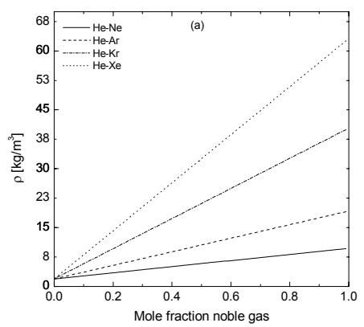

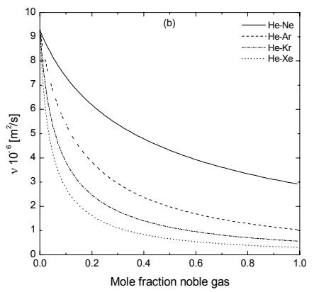

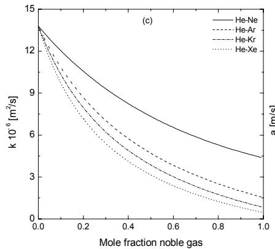

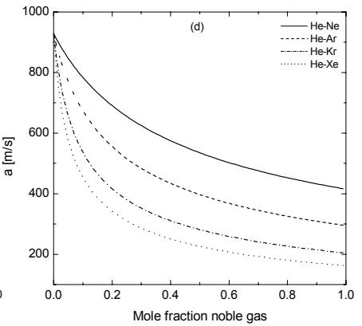

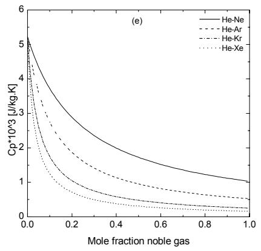

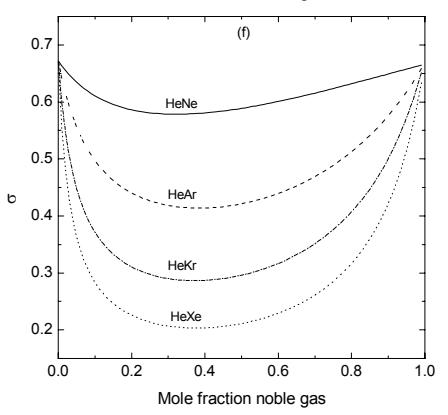  
Figure 4.1: Calculated properties of binary gas mixtures as functions of noble gas mole fraction. At a temperature of 250 K and a pressure of 10 bar. (a) Density. (b) Kinematic viscosity ν. (c) Thermal diffusivity k. (d) Speed of sound a. (e) The isobaric specific heat $C _ { p } . \ ( f )$ Prandtl number σ. Helium-Neon (solid line); Helium-Argon (dashed line); Helium-Krypton (dashed-dotted line); Helium-Xenon (dotted line).

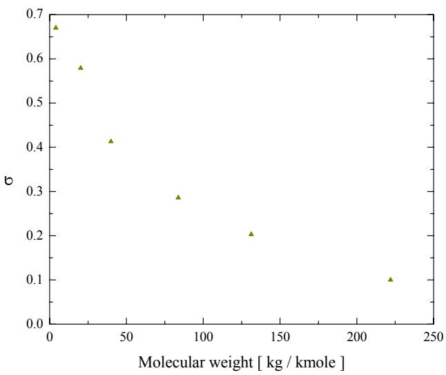  
Figure 4.2: Minimal Prandtl number, at a helium mole fraction of $0 . 6 \mathcal { Z } ,$ as function of the molecular weight of the heavy component in the mixture. The first data point corresponds to the Prandtl number of pure helium. The last data point corresponds to the minimal Prandtl number of a helium-radon binary gas mixture as extrapolated from the data.

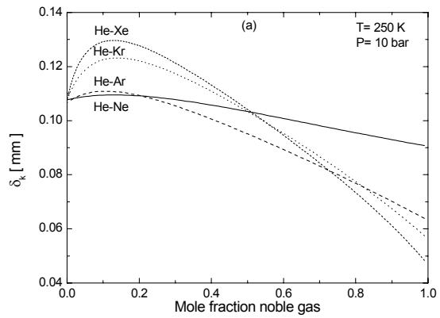

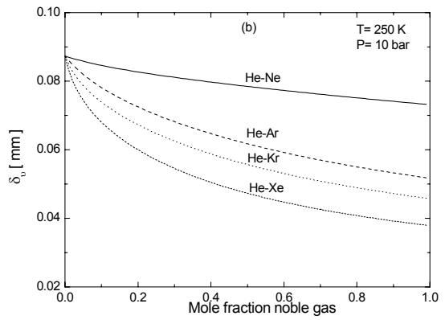

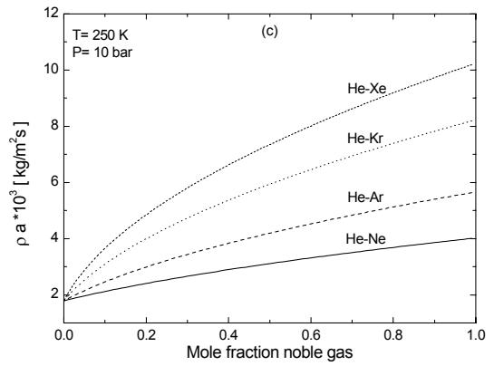

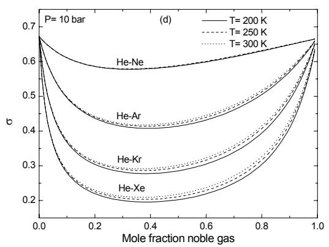  
Figure 4.3: The thermal and viscous penetration depths, $\delta _ { \mathrm { k } }$ and $\delta _ { \nu ; \mathbf { \nu } }$ the product $\rho a .$ and Prandtl number $\sigma$ for helium-noble gas binary mixtures. The temperature and pressure used in the calculations are also shown in the graphs. The Prandtl number has been calculated for four binary gas mixtures, and at three different temperatures.

## Bibliography

[1] J. O. Hirschfelder, C. F. Curtiss, and R. B. Bird, "Molecular Theory of Gases and Liquids", (John Willy, New York, 1954), chapters 1, 7, and 8.

[2] S. Chapman, and T. G. Cowling, "Mathematical Theory of Non-uniform Gases", (Cambridge University Press, New York, 1970).

[3] Reference [1], Chapter 1, p.18.

[4] Reference [1], Chapter 1, p.19.

[5] Reference [1], Appendix, Table I-M.

[6] Reference [1], Chapter 8, Eq.(8.2-18), p.528.

[7] Reference [1], Chapter 3, Eq.(3.6-8), p.168.

[8] Reference [1], Chapter 8, Eq.(8.2-22), p.530.

[9] Reference [1], Chapter 8, Eq.(8.2-31), p.534.

[10] Reference [1], Chapter 8, Eq.(8.2-36), p.535.

[11] Reference [1], Chapter 8, Eq.((8.2-15)-(8.2-16)), p.534.

[12] F.W. Gaicobbe, " Estimation of Prandtl numbers in binary mixtures of helium and other noble gases", J. Acoust. Soc. Am. 96, 3568 (1994).

[13] J.R. Belcher, W.V. Slaton, R. Raspect, H.E. Bass, and J. Lightfoot, "Working gases in thermoacoustic engines" J. Acoust. Soc. Am. 105, 2677 (1988).

## Chapter 5

# Optimizing loudspeakers for thermoacoustic refrigeration

Moving-coil loudspeakers are appropriate drivers for thermoacoustic refrigeration. They are cheap, commercially available, compact, "light", and can be easily adapted to meet specific requirements. But they have an important drawback, a low efficiency which generally equals 3 to 5 %.

The aim of this chapter is to study the behavior of the loudspeaker in the thermoacoustic refrigerator and to determine how the performance of the loudspeaker can be improved. For ease of analysis and design, it is advantageous to describe the system in terms of an electrical circuit. An electrical model will be presented which simulates the behavior of the loudspeaker.

The calculations show that the electroacoustic efficiency, defined as the output acoustic power divided by the input electric power, for a given loudspeaker can be made maximal by matching the mechanical resonance of the loudspeaker to the acoustic resonance of the resonator [1, 2, 3]. Since in general these two frequencies are different, a method is necessary to make them equal. A new concept, using a volume of gas behind the cone of the loudspeaker as an adjustable extra spring, will be presented.

## 5.1 Electrical model for refrigerator

The aim of this section is to derive the equivalent electrical circuit for the refrigerator system. Once this circuit is determined, straightforward electrical circuit analysis yields the behavior of the system, so that one can determine how the performance of the loudspeaker can be improved

An illustration of our thermoacoustic refrigerator is shown in Fig.(5.1). A modified loudspeaker (driver) is attached to one end of an acoustic resonator which is filled with helium gas at 10 bar. A stack and two heat exchangers are placed in the resonator. The loudspeaker sustains an acoustic standing wave in the gas, at the fundamental resonance frequency of the resonator. The other end of the resonator terminates in a buffer volume which simulates an open end. The system is essentially a quarterwave length system (c.f. chapter 2), with a pressure antinode at the loudspeaker end and pressure node at the buffer volume end. The background for the choice of the geometry of the resonator will be discussed in more detail in the next chapter. The acoustic driver consists of a modified moving-coil loudspeaker, from which the fabric dome was cut off near the voice coil and replaced by a thin walled light aluminium cone glued onto the voice coil. A rolling diaphragm is used to seal the resonator from the driver housing, as shown in Fig.(5.1). The driver is placed in a housing so that the pressurized working helium gas is confined. The word driver will be used in the following to make reference to the modified loudspeaker.

The derivation of the electro-mechanico-acoustical expressions needed for the electrical model describing the refrigerator will be given. To simplify the discussion, the combined system of driver and resonator shown in Fig.(5.2) will be considered instead of the refrigerator depicted in Fig.(5.1).

Such a configuration, where a loudspeaker is attached to a tube, will be used to develop the simulation model for the dynamic study of moving-coil loudspeakers in thermoacoustic refrigerators. The model consists of an electrical representation of the combined driver-tube system.

We start by the basic operational principle of a moving-coil loudspeaker. After that we will proceed to develop the expressions describing the coupling between a loudspeaker and an acoustic tube. The moving-coil loudspeaker is an electro-mechanicoacoustical transducer which converts electrical energy into sound. This conversion takes place via an electromechanical conversion where electrical energy is first converted into mechanical energy, and then the mechanical energy is in its turn converted into sound.

The principle of the moving-coil loudspeaker is based on the Lorentz force which occurs when an electrical conductor, through which a current flows, is placed in a magnetic field, as shown in Fig.(5.3a). The loudspeaker consists of a cylindrical coil placed in an annular gap between the poles of a permanent magnet, as shown in Fig.(5.2). The magnet is shaped so that the lines of the magnet field are radially directed and cut across every part of the coil at right angle. So the situation of Fig.(5.3a) is realized with a circular symmetry. When a current i flows through the wire, a force F on the coil results from the interaction between the current and magnet field. The force is everywhere in the gap orthogonal to the current and to the radial magnet field. As a consequence, the coil is then displaced in axial direction. The

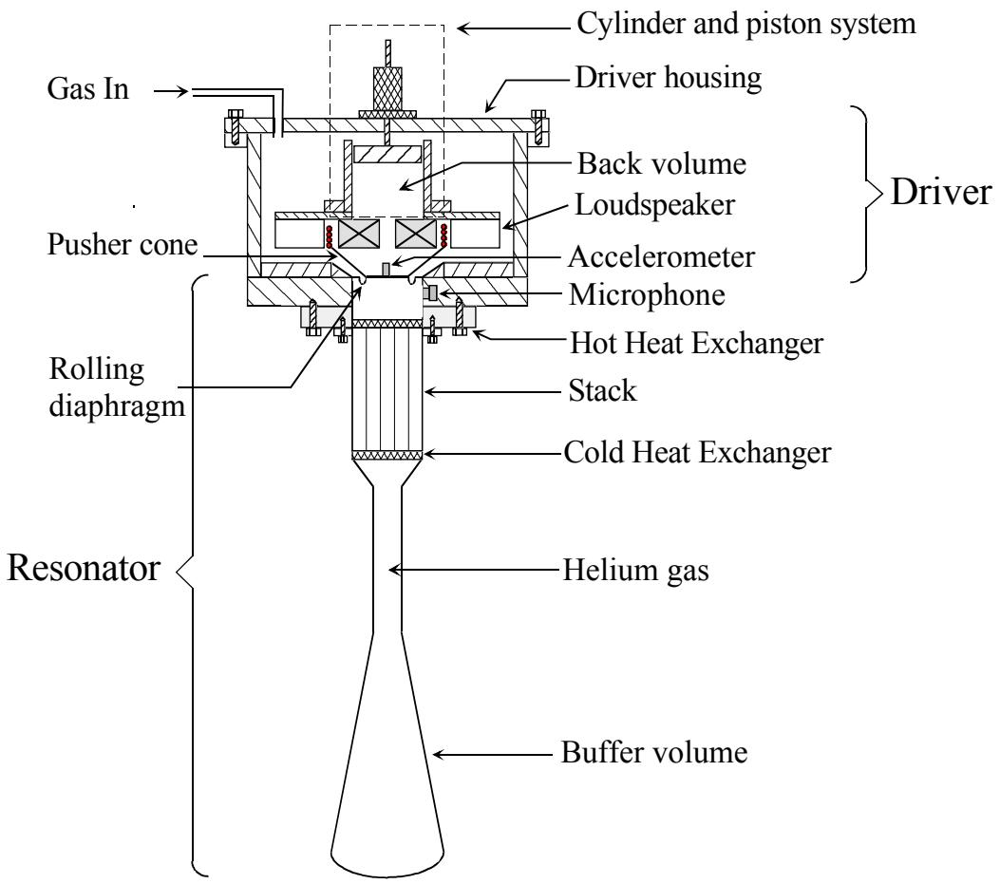  
Figure 5.1: Illustration of the thermoacoustic refrigerator. An acoustic driver is placed in a housing and attached to an acoustic resonator. The resonator contains a stack and two heat exchangers.

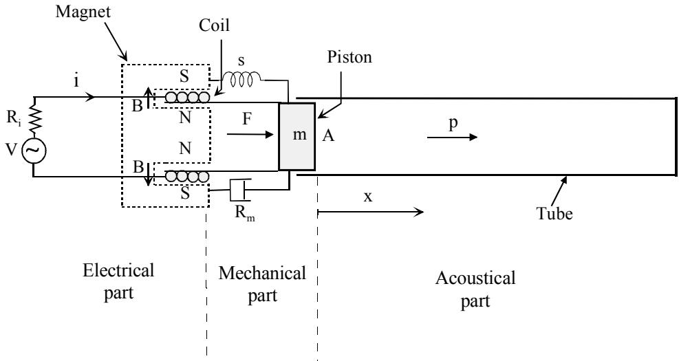  
Figure 5.2: A schematic illustration of the loudspeaker-tube combined system. An amplifier, of internal resistance $R _ { i }$ , drives a current i through the coil. This produces a force $F _ { \mathrm { ~ } } = B l i$ on the coil and piston, with resulting motion u. The motion of the piston is transmitted to the gas in the tube via the area of the piston A. The frictional force is represented by a dashpot $\left( R _ { m } \right)$ , and stiffness is represented by the spring (s).

Lorentz force on the coil is given by [4]

$$
F = B l i\tag{5.1}
$$

where B is the magnetic-flux density and l the total length of the coiled wire. The factor Bl is considered as one parameter and is named the force factor

The current i is an alternating quantity with angular frequency ω, so the force F is also an oscillating quantity with the same frequency ω. To avoid ejection of the coil out of the gap, it is suspended by a ring shaped diaphragm which provides a restoring force. The current is provided by a power amplifier with an internal resistance $R _ { i }$ by sustaining a voltage V across the coil, as shown in Fig.(5.2). The electrical resistance $R _ { \mathrm { e } }$ and inductance $L _ { \mathrm { e } }$ of the coil form the electrical part. The moving mass, the mechanical resistance and stiffness of the suspension, combined in series, form the mechanical part. From a mechanical point of view the loudspeaker can be seen as a damped harmonic oscillator. The tube attached to the loudspeaker forms the acoustic part. A piston (cone) of an effective area A attached to the moving coil transforms the produced alternating force F to pressure oscillations in the tube.

Furthermore, Faraday's law states that, if a conductor is moving in a magnet field, a potential difference will be induced (Fig.(5.3b)). Hence the motion of the coil induces

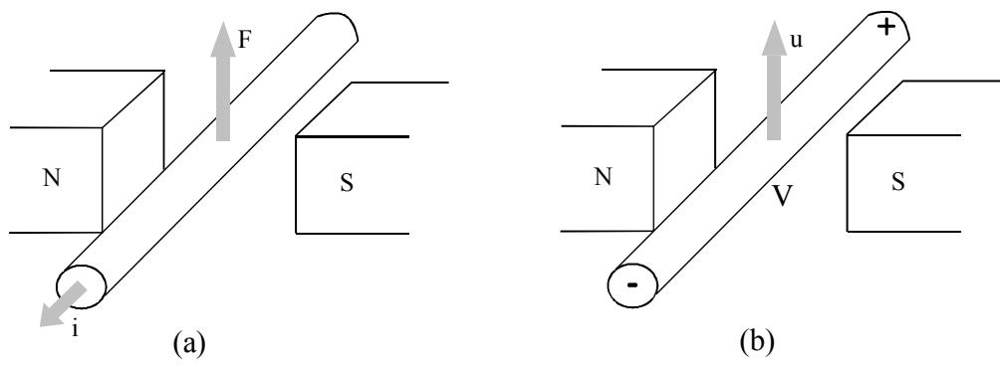  
Figure 5.3: Illustration of the Lorentz force and Faraday's law. $( a )$ A current i flowing through a conductor, placed in a magnetic field, produces a force F on the conductor. $( b )$ The velocity u of a conductor in a magnetic field induces a voltage V across the conductor.

a voltage across the wire given by [5]

$$
V _ { \mathrm { i n d } } = - B l u\tag{5.2}
$$

where u is the velocity of the coil.

In summary, the current which flows through the coil generates a force F which causes a displacement with a velocity u. The motion in its turn induces a voltage $V _ { \mathrm { i n d } }$ across the wire forming the coil. Using the principle of superposition, the electrical equation for the loudspeaker is given by

$$
V + V _ { \mathrm { i n d } } = Z _ { \mathrm { e } } i\tag{5.3}
$$

where $Z _ { \mathrm { e } }$ is the electrical impedance of the loudspeaker consisting of the electrical resistance $R _ { \mathrm { e } }$ and inductance $L _ { \mathrm { e } }$ in series.

In the following we will proceed to determine the total mechanical impedance of the combined system. After that the electrical equivalent of this mechanical impedance will be derived. The total mechanical impedance of the combined system can be obtained by considering the equation of motion of the mass m (Fig.(5.2)). The mechanical mass m is the total moving mass, including voice coil and piston. The motion of the mass m is described by the Newton's second law of motion, which states that the algebraic sum of forces acting on the mass m is equal to the rate of change of linear momentum, thus

$$
m { \frac { \mathrm { d } ^ { 2 } x } { \mathrm { d } t ^ { 2 } } } = F - R _ { m } { \frac { \mathrm { d } x } { \mathrm { d } t } } - s x - A p\tag{5.4}
$$

where x is the displacement, $p$ is the dynamic pressure in the tube and A is the area of the piston. The system is to be considered as a damped, harmonic oscillator driven

by the Lorentz force F. The term -sx is the spring restoring force, $- R _ { m } \mathrm { d } x / \mathrm { d } t$ is the frictional force, and $- A p$ is the force exerted by the gas in the tube on the piston. Since the force is sinusoidal (alternating current), we can write

$$
F = F _ { 0 } \mathrm { e } ^ { \mathrm { j } \omega t } .\tag{5.5}
$$

The harmonic solution of Eq.(5.4) can then be written as

$$
\begin{array} { r c l } { { x } } & { { = } } & { { x _ { 0 } \mathrm { e } ^ { \mathrm { j } \omega t } } } \\ { { } } & { { } } & { { } } \\ { { u } } & { { = } } & { { \displaystyle \frac { \mathrm { d } x } { d t } = \mathrm { j } \omega x _ { 0 } \mathrm { e } ^ { \mathrm { j } \omega t } } } \\ { { } } & { { } } & { { } } \\ { { \displaystyle \frac { \mathrm { d } ^ { 2 } x } { \mathrm { d } t ^ { 2 } } } } & { { = } } & { { \mathrm { j } \omega u = - \omega ^ { 2 } x _ { 0 } \mathrm { e } ^ { \mathrm { j } \omega t } . } } \end{array}\tag{5.6}
$$

Substituting Eqs.(5.6) into Eq.(5.4) yields

$$
R _ { \mathrm { m } } + \mathrm { j } \left( m \omega - { \frac { s } { \omega } } \right) + { \frac { A p } { u } } = { \frac { F } { u } }\tag{5.7}
$$

The mechanical impedance of the combined loudspeaker-tube system is defined as

$$
Z _ { \mathrm { m } } = { \frac { F } { u } } = R _ { \mathrm { m } } + \mathrm { j } \left( m \omega - { \frac { s } { \omega } } \right) + { \frac { A p } { u } } .\tag{5.8}
$$

Without the acoustic part (tube), the mechanical impedance reduces to the mechanical impedance of the driver alone given by

$$
Z _ { \mathrm { m d } } = R _ { \mathrm { m } } + \mathrm { j } ( m \omega - \frac { s } { \omega } ) .\tag{5.9}
$$

The attachment of the acoustic resonator to the loudspeaker adds thus an extra mechanical impedance

$$
Z _ { \mathrm { m a } } = { \frac { A p } { u } } = { \frac { p } { A u } } A ^ { 2 } = Z _ { \mathrm { a } } A ^ { 2 } .\tag{5.10}
$$

The quantity $Z _ { \mathrm { m a } }$ is the equivalent mechanical impedance of the acoustical impedance $Z _ { \mathrm { a } }$ of the tube. The acoustic impedance $Z _ { a }$ is defined as the ratio of the acoustic pressure $p$ to the volume velocity $U = A u$ . The latter is defined as

$$
U = { \frac { \mathrm { d } v } { \mathrm { d } t } } = A { \frac { \mathrm { d } x } { \mathrm { d } t } } = A u\tag{5.11}
$$

where dv is the volume displaced by the piston in a time dt, which is equal to the displacement dx multiplied by the piston area A. Inserting Eqs.(5.9) and (5.10) into Eq.(5.8) yields

$$
{ \frac { F } { u } } = Z _ { \mathrm { m } } = Z _ { \mathrm { m d } } + Z _ { \mathrm { m a } }\tag{5.12}
$$

This expression shows that the total mechanical impedance $Z _ { m }$ of the system is the series combination of the mechanical impedance of the driver and the mechanical impedance of the tube.

Now that we have derived the total mechanical impedance, we will proceed to obtain the electrical equivalent of the mechanical impedance. Substitution of Eqs.(5.1), (5.2), and (5.12) into Eq.(5.3) gives

$$
V - { \frac { \left( B l \right) ^ { 2 } } { Z _ { \mathrm { { m } } } } } i = Z _ { \mathrm { { e } } } i\tag{5.13}
$$

or

$$
V = \left( Z _ { \mathrm { e } } + \frac { \left( B l \right) ^ { 2 } } { Z _ { \mathrm { m } } } \right) i = \left( Z _ { \mathrm { e } } + Z _ { \mathrm { m o t } } \right) i = Z _ { \mathrm { e t } } i .\tag{5.14}
$$

The impedance $Z _ { \mathrm { e t } }$ is the total electrical impedance, as seen by the amplifier. The second term on the right hand side of Eq.(5.14), is an equivalent electrical impedance of the total mechanical impedance. This quantity is named the motional impedance, $Z _ { \mathrm { m o t } }$ . Expression (5.14) forms the basis of the electrical circuit describing our combined driver-tube system, as shown in Fig.(5.4). Once $Z _ { \mathrm { m o t } }$ is known, circuit 5.4 can be used to analyze the system.

The electrical impedance of the coil is given by

$$
Z _ { \mathrm { e } } = R _ { \mathrm { e } } + \mathrm { j } \omega L _ { \mathrm { e } }\tag{5.15}
$$

where $R _ { e }$ and $L _ { e }$ are the electrical resistance and inductance of the coil, respectively. The equivalent electric circuit of the combined driver-tube system, corresponding to Eq.(5.14) is shown in Fig.(5.4). The electrical current generated by the power amplifier flows through the total electrical impedance which is the sum of the electrical impedance of the coil and the motional impedance of the mechanical load.

The study of the behavior of the loudspeaker in the refrigerator can be done by analyzing the equivalent electrical circuit illustrated in Fig.(5.4). The only thing we need to proceed with the analysis is the expression of the acoustical impedance of the resonator, $Z _ { \mathrm { a } } .$ So that the mobility impedance $Z _ { \mathrm { m o t } }$ can be calculated and thus the total electrical impedance (Eq.(5.14)). We note that the loudspeaker and acoustic resonator (tube) have their own resonance frequencies. The loudspeaker resonates when the reactance part of its mechanical impedance is zero, that is (Eq.(5.9))

$$
m \omega _ { \mathrm { d } } - \frac { s } { \omega _ { \mathrm { d } } } = 0\tag{5.16}
$$

so that

$$
\omega _ { \mathrm { d } } = { \sqrt { \frac { s } { m } } } .\tag{5.17}
$$

The tube resonates when

$$
\operatorname { I m } ( Z _ { \mathrm { m a } } ) = 0 .\tag{5.18}
$$

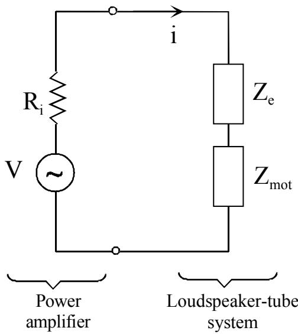  
Figure 5.4: The equivalent electrical circuit representing the driver-tube coupled system. The mobility impedance $Z _ { m o t }$ is the electrical equivalent impedance of the mechanical and acoustical parts, as given by $E q . ( 5 . 1 4 )$

The resonance frequencies of the combined driver-tube system are given by

$$
\mathrm { I m } ( Z _ { \mathrm { m d } } + Z _ { \mathrm { m a } } ) = 0 ,\tag{5.19}
$$

which can be different from those of the loudspeaker and tube acting alone, this expression will be later used to optimize the performance of the driver. In the following section, the expression of $Z _ { \mathrm { a } }$ of our resonator will be derived, so that we can proceed with the performance analysis.

## 5.2 The acoustic impedance of the resonator

In acoustics, the parameters which are of concern are the pressure p and volume velocity U. The acoustic impedance, as discussed above, is given by

$$
Z _ { \mathrm { a } } = { \frac { p } { U } } .\tag{5.20}
$$

In this subsection the acoustic impedance for the resonator shown in Fig.(5.1), will be derived. We will consider that the tube is rigid and filled with a stationary gas, and that small-amplitude waves travel as plane waves, so that the acoustic pressure p may be considered as constant over the tube cross-section A. The condition which must be fulfilled by the acoustic frequency $f$ so that only plane waves propagates in the tube is given by [6]

$$
f < { \frac { 1 . 8 4 1 a } { \pi D } } ,\tag{5.21}
$$

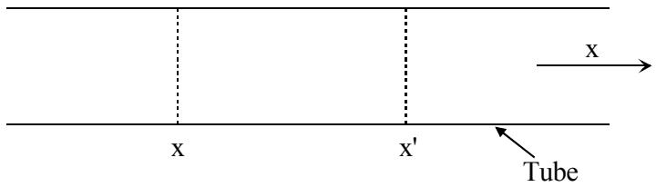  
Figure 5.5: An acoustic tube of constant cross-section where plane waves propagate.

where a is the velocity of sound, and D the diameter of the tube. Using data for our resonator for which the largest diameter part is 3.8 cm, and $a = 1 0 0 0 \mathrm { m } / \mathrm { s }$ for helium gas at $2 0 ~ ^ { 0 } \mathrm { C }$ , we have

$$
f < 1 5 ~ \mathrm { \ k H z } .\tag{5.22}
$$

Since the acoustic resonance of our system is 425 Hz, we may consider that only plane waves propagate in the resonator.

As can be seen from Fig.(5.1), the resonator has a complicated shape and consists of different parts. To derive the acoustic impedance $Z _ { \mathrm { a } } ,$ we will first derive the acoustic transfer function, which gives the acoustic impedance at a given position x as function of the impedance at an other position $x ^ { \prime } .$ Fig.(5.5) shows an acoustic tube of crosssectional area A through which a plane wave propagates. Such a geometry will be used to derive the acoustic transfer function. The starting point for our derivation is Rott's wave equation, Eq.(3.30). If we assume that the mean temperature $T _ { \mathrm { m } }$ in the tube is uniform $( \mathrm { d } T _ { \mathrm { m } } / \mathrm { d } x = 0 )$ , Eq.(3.30) reduces to

$$
\left[ 1 + ( \gamma - 1 ) f _ { \mathrm { k } } \right] p _ { 1 } + \frac { a ^ { 2 } } { \omega ^ { 2 } } \left( 1 - f _ { \nu } \right) \frac { \mathrm { d } ^ { 2 } p _ { 1 } } { \mathrm { d } x ^ { 2 } } = 0\tag{5.23}
$$

or

$$
{ \frac { \mathrm { d } ^ { 2 } p _ { 1 } } { \mathrm { d } x ^ { 2 } } } + k ^ { 2 } p _ { 1 } = 0\tag{5.24}
$$

where k is the wave number given by

$$
k ^ { 2 } = \frac { \omega ^ { 2 } } { a ^ { 2 } } \frac { 1 + ( \gamma - 1 ) f _ { \mathrm { k } } } { 1 - f _ { \nu } } .\tag{5.25}
$$

The functions $f _ { \mathrm { k } }$ and $f _ { \nu }$ are Rott's functions defined in chapter 3. The acoustic pressure is the solution of Eq.(5.24). The spatial average particle velocity in the gas is given by Eq.(3.35),

$$
\langle u \rangle = \frac { j } { \rho _ { \mathrm { m } } \omega } \frac { \mathrm { d } p } { \mathrm { d } x } \left( 1 - f _ { \nu } \right) .\tag{5.26}
$$

If the time dependence is assumed to be of the form $e ^ { \mathrm { j } \omega t }$ , then the solution of $\operatorname { E q } .$ (5.24) in the geometry illustrated in Fig.(5.5) is given by

$$
p ( x , t ) = \left( B \mathrm { e } ^ { - \mathrm { j } k x } + C \mathrm { e } ^ { \mathrm { j } k x } \right) \mathrm { e } ^ { \mathrm { j } \omega t } .\tag{5.27}
$$

The first term represents a progressive wave travelling forward and the second term represents a wave travelling backward. The velocity u also satisfies the same wave equation, one can write then

$$
\left. u ( x , t ) \right. = \left[ D e ^ { - \mathrm { j } k x } + E e ^ { \mathrm { j } k x } \right] e ^ { \mathrm { j } \omega t } .\tag{5.28}
$$

Substituting Eqs.(5.27) and (5.28) into Eq.(5.26) yields

$$
\begin{array} { r c l } { { D } } & { { = } } & { { \displaystyle \frac { k } { \rho _ { \mathrm { m } } \omega } \left[ 1 - f _ { \nu } \right] B } } \end{array}\tag{5.29}
$$

$$
\begin{array} { r c l } { { \cal E } } & { { = } } & { { { \displaystyle \frac { - k } { \rho _ { \mathrm { m } } \omega } } [ 1 - f _ { \nu } ] C } } \end{array}
$$

and thus

$$
\langle u ( x , t ) \rangle = \frac { k } { \rho _ { \mathrm { m } } \omega } \left[ 1 - f _ { \nu } \right] \left[ B e ^ { - \mathrm { j } k x } - C e ^ { \mathrm { j } k x } \right] e ^ { \mathrm { j } \omega t }\tag{5.30}
$$

or in terms of the volume velocity, we have

$$
U = A \left. u \right. = \frac { k A } { \rho _ { 0 } \omega } \left[ 1 - f _ { \nu } \right] \left[ B e ^ { - \mathrm { j } k x } - C e ^ { \mathrm { j } k x } \right] e ^ { i \omega t } .\tag{5.31}
$$

The acoustic impedance at any point x in the tube is

$$
Z _ { \mathrm { a } } ( x ) = { \frac { p } { U } } = Z _ { \mathrm { c } } \left[ { \frac { B e ^ { - \mathrm { j } k x } + C e ^ { \mathrm { j } k x } } { B e ^ { - i k x } - C e ^ { i k x } } } \right]\tag{5.32}
$$

where $Z _ { \mathrm { c } }$ is given by

$$
Z _ { \mathrm { c } } = \frac { \rho _ { \mathrm { m } } \omega } { A k \left[ 1 - f _ { \nu } \right] } .\tag{5.33}
$$

Expression (5.32) represents the equivalent impedance of the complete subsystem downstream of the point x (Fig.(5.5)).

Splitting the exponential factors into cosine and sine and combining terms, Eqs.(5.32) can be rewritten as

$$
Z _ { \mathrm { a } } ( x ) = Z _ { \mathrm { c } } \left[ { \frac { ( B + C ) \cos { k x } - \mathrm { j } ( B - C ) \sin { k x } } { ( B - C ) \cos { k x } - \mathrm { j } ( B + C ) \sin { k x } } } \right]
$$

Dividing the numerator and denominator by $( B - C )$ cos kx, one obtains

$$
Z _ { \mathrm { a } } ( x ) = Z _ { \mathrm { c } } { \frac { { \frac { ( B + C ) } { ( B - C ) } } - \mathrm { j } \tan k x } { 1 - i { \frac { ( B + C ) } { ( B - C ) } } \tan k x } } .\tag{5.35}
$$

The impedance at $x ^ { \prime }$ is given by Eq.(5.35) where x is replaced by $x ^ { \prime }$ , thus

$$
Z _ { \mathrm { a } } ( x ^ { \prime } ) = Z _ { \mathrm { c } } { \frac { { \frac { ( B + C ) } { ( B - C ) } } - \mathrm { j } \tan { k x ^ { \prime } } } { 1 - \mathrm { j } { \frac { ( B + C ) } { ( B - C ) } } \tan { k x ^ { \prime } } } }
$$

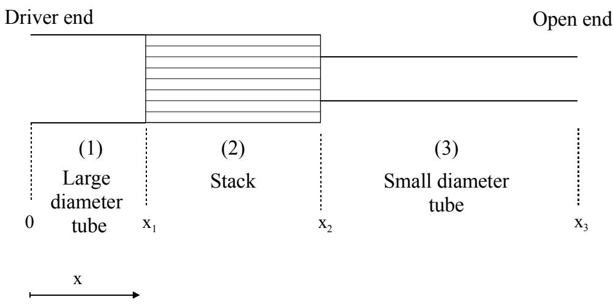  
Figure 5.6: Simple illustration of the acoustic resonator used in the thermoacoustic refrigerator.

If we eliminate $( B + C ) / ( B - C )$ , we get the transfer function

$$
Z _ { \mathrm { a } } ( x ) = \frac { Z _ { \mathrm { a } } ( x ^ { \prime } ) \cos ( k \left( x ^ { \prime } - x \right) ) + \mathrm { j } Z _ { \mathrm { c } } \sin ( k \left( x ^ { \prime } - x \right) ) } { \mathrm { j } \frac { Z _ { \mathrm { a } } ( x ^ { \prime } ) } { Z _ { c } } \sin ( k \left( x ^ { \prime } - x \right) ) + \cos ( k \left( x ^ { \prime } - x \right) ) }\tag{5.36}
$$

This important expression shows how the acoustic impedance at a point x is be related to that at point $x ^ { \prime } \ : ( \mathrm { F i g . ( 5 . 5 ) } )$ 1

Now we will apply expression (5.36) to our resonator shown in Fig.(5.1), which can be considered to consist of three parts: one part with a large diameter, the stack and heat exchangers, and a small diameter tube terminating in a buffer volume which simulates an open end. Such resonator can be approximately represented by the resonator shown in Fig.(5.6).

The heat exchangers are included in the stack part, so that only three parts have to be considered, as shown in Fig.(5.6).

Since the small diameter tube (3) terminates at x3 with an open end where the acoustic impedance is zero $( p = 0 )$ , its input acoustic impedance at x2 can be calculated using Eq.(5.36) as function of the impedance at x3, so that

$$
Z _ { \mathrm { a } } ( x _ { 2 } ) = \mathrm { j } Z _ { \mathrm { c 3 } } \tan ( k _ { 3 } L _ { 3 } )\tag{5.37}
$$

where $L _ { 3 }$ is the length of the small diameter tube and $Z _ { c }$ is given by $\mathrm { E q . ( 5 . 3 3 ) }$

$$
Z _ { \mathrm { c 3 } } = \frac { \rho _ { \mathrm { m } } \omega } { A _ { \mathrm { 3 } } k _ { \mathrm { 3 } } \left[ 1 - f _ { \nu 3 } \right] } ,\tag{5.38}
$$

where $A _ { 3 }$ is the cross-sectional area of the small tube, $k _ { 3 }$ and $f _ { \nu 3 }$ are the wave number and Rott's function, respectively, for the small diameter tube. The viscous and thermal

damping effects are included in $k _ { 3 }$ and $f _ { \nu 3 }$ which are given by Eq.(5.25) and $\mathrm { E q . ( 3 . 5 4 ) }$ respectively,

$$
\begin{array} { r c l } { { f _ { \mathrm { k 3 } } } } & { { = } } & { { \displaystyle \frac { \left( 1 - \mathrm { j } \right) \delta _ { \mathrm { k } } } { r _ { 3 } } , \ f _ { \nu 3 } = \displaystyle \frac { \left( 1 - \mathrm { j } \right) \delta _ { \nu } } { r _ { 3 } } } } \\ { { k _ { 3 } ^ { 2 } } } & { { = } } & { { \displaystyle \frac { \omega ^ { 2 } } { a ^ { 2 } } \left[ 1 + f _ { \nu 3 } + \left( \gamma - 1 \right) f _ { \mathrm { k 3 } } \right] } } \end{array}\tag{5.39}
$$

The quantities $\delta _ { \nu }$ and $\delta _ { \mathrm { k } }$ are the viscous and thermal penetration depths, respectively, as defined in chapter $3 , r _ { 3 }$ is the radius of the small tube. We have used the boundary layer approximation $( \delta _ { \nu } , \delta _ { \bf k } \ll r _ { 3 } )$ for $f _ { \nu }$ and $f _ { \mathrm { k } }$

At the position $x _ { 2 }$ there is a discontinuity in the cross-section, but since the diameters of small and large tubes are within the limit imposed by the condition of pure plane wave propagation $\mathrm { ( E q . ( 5 . 2 1 ) } )$ , then the continuity of the acoustic pressure p and acoustic volume velocity requires that these two quantities remain the same across the discontinuity. This results in a continuity of the acoustic impedance $\left( \mathrm { E q . } ( 5 . 2 0 ) \right)$ . This justifies that we can write the acoustic impedance at $x _ { 1 }$ as function of the impedance $Z _ { \mathrm { a } } ( x _ { 2 } )$ using Eq.(5.36), as follows

$$
Z _ { \mathrm { a } } ( x _ { 1 } ) = \frac { Z _ { \mathrm { a } } ( x _ { 2 } ) \cos ( k _ { 2 } \left( L _ { \mathrm { s } } \right) ) + \mathrm { j } Z _ { \mathrm { c } _ { 2 } } \sin ( k _ { 2 } \left( L _ { \mathrm { s } } \right) ) } { \mathrm { j } \frac { Z _ { \mathrm { a } } ( x _ { 2 } ) } { Z _ { \mathrm { c } 2 } } \sin ( k _ { 2 } \left( L _ { \mathrm { s } } \right) ) + \cos ( k _ { 2 } \left( L _ { \mathrm { s } } \right) ) }\tag{5.40}
$$

where

$$
Z _ { \mathrm { c 2 } } = \frac { \rho _ { \mathrm { m } } \omega } { A _ { \mathrm { 2 } } k _ { \mathrm { 2 } } [ 1 - f _ { \nu 2 } ] }\tag{5.41}
$$

$$
f _ { \mathrm { k 2 } } ~ = ~ \frac { \mathrm { t a n h } ( \alpha _ { \mathrm { k } } ) } { \alpha _ { \mathrm { k } } } , ~ f _ { \nu 2 } = \frac { \mathrm { t a n h } ( \alpha _ { \nu } ) } { \alpha _ { \nu } }\tag{5.42}
$$

$$
\alpha _ { \bf k } = { \frac { ( 1 + j ) y _ { 0 } } { \delta _ { k } } } , \alpha _ { \pm } = { \frac { ( 1 + \mathrm { j } ) y _ { 0 } } { \delta _ { \nu } } }\tag{5.43}
$$

$$
k _ { 2 } ^ { 2 } = \frac { \omega ^ { 2 } } { a ^ { 2 } } \frac { [ 1 + ( \gamma - 1 ) f _ { \mathrm { k 2 } } ] } { [ 1 - f _ { \nu 2 } ] } .
$$

Here $A _ { 2 }$ is the cross-sectional area of the gas in the stack region, $L _ { \mathrm { s } }$ is the length of the stack, and $y _ { 0 }$ is the half-spacing in the stack as defined in chapter 3. This spacing is not large in comparison with the penetration depths, so the boundary layer approximation can not be used in the stack region (2).

Finally, we will now give the acoustic input impedance of the system as seen by the piston at $x = 0$ . Using Eq.(5.36) we have

$$
Z _ { \mathrm { a } } ( 0 ) = \frac { Z _ { \mathrm { a } } ( x _ { 1 } ) \cos ( k _ { 1 } x _ { 1 } ) + \mathrm { j } Z _ { \mathrm { c } _ { 1 } } \sin ( k _ { 1 } x _ { 1 } ) } { \mathrm { j } \frac { Z _ { \mathrm { a } } ( x _ { 1 } ) } { Z _ { \mathrm { c } 1 } } \sin ( k _ { 1 } x _ { 1 } ) + \cos ( k _ { 1 } x _ { 1 } ) }\tag{5.44}
$$

where

$$
Z _ { \mathrm { c 1 } } = \frac { \rho _ { \mathrm { m } } \omega } { A _ { 1 } k _ { 1 } [ 1 - f _ { \nu 1 } ] }
$$

$$
f _ { { \bf k } 1 } ~ = ~ \frac { \left( 1 - { \bf j } \right) \delta _ { \bf k } } { r _ { 1 } } , ~ f _ { \nu 1 } = \frac { \left( 1 - { \bf j } \right) \delta _ { \nu } } { r _ { 1 } }\tag{5.45}
$$

$$
k _ { 1 } ^ { 2 } = \frac { \omega ^ { 2 } } { a ^ { 2 } } \left[ 1 + f _ { \nu 1 } + ( \gamma - 1 ) f _ { \mathrm { k } 1 } \right] .\tag{5.46}
$$

Here again $A _ { 1 }$ and $r _ { 1 }$ are the cross-section and radius of the large tube, respectively. Here also, the boundary-layer approximation $( \delta _ { \nu } , \delta _ { \bf k } \ll r _ { 1 } )$ for $f _ { \nu }$ and $f _ { \mathrm { k } }$ has been used.

Inserting Eqs.(5.37) and (5.40) into Eq.(5.44) yields the acoustic impedance of the resonator as seen by the driving piston. The resultant expression is long and complicated to be given explicitly here, but it is more appropriate for computer applications.

## 5.3 Performance calculations

Substituting the acoustic impedance $Z _ { \mathrm { a } } ( 0 )$ of $\operatorname { E q . } ( 5 . 4 4 )$ into $\mathrm { E q . ( 5 . 1 2 ) }$ and then $Z _ { \mathrm { m } }$ into Eq.(5.14) gives the total equivalent electrical impedance $Z _ { \mathrm { e t } }$ of the refrigerator system. The expression of $Z _ { \mathrm { e t } }$ is long and complicated. It contains the driver, tube, and gas parameters.

Referring to Figs.(5.7) and (5.4), the calculation procedure is as follows: the start point is at the power amplifier which sustains a voltage with amplitude V across the total electrical impedance $Z _ { \mathrm { e t } }$ . The current i which flows through $Z _ { \mathrm { e t } }$ is obtained by dividing the voltage V by $Z _ { \mathrm { e t } } ~ ( \mathrm { E q . } ( 5 . 1 4 ) ) ,$ ). The Lorentz force F is then obtained by multiplying i by the force factor Bl. After that the velocity u is obtained by dividing the force F by the mechanical impedance $Z _ { \mathrm { m } } \ ( \mathrm { d r i v e r + t u b e } )$ . The dynamic pressure $p$ in the tube is obtained by multiplying the volume velocity $U = A u$ by the acoustic impedance $Z _ { \mathrm { a } } ( 0 )$ . Then, the input electric power, mechanical power and acoustic power output can be calculated. Finally, the efficiencies for the different energy conversion processes in the system can be evaluated. The algorithm used for the computations is illustrated in $\mathrm { F i g . } ( 5 . 7 )$ , where the arrows indicate the direction of computation. We note that the physical quantities of interest are complex, also they are functions of the frequency $f .$

By varying the system parameters, the influence on the performance of the driver in the combined system driver-resonator can be studied.

The efficiencies for the different transformations can be calculated along with the total performance of the driver which is known as the electroacoustic efficiency $\eta _ { \mathrm { e a } } .$ The electromechanical efficiency $\eta _ { \mathrm { e m } }$ is the ratio of the mechanical power output $P _ { \mathrm { m } }$

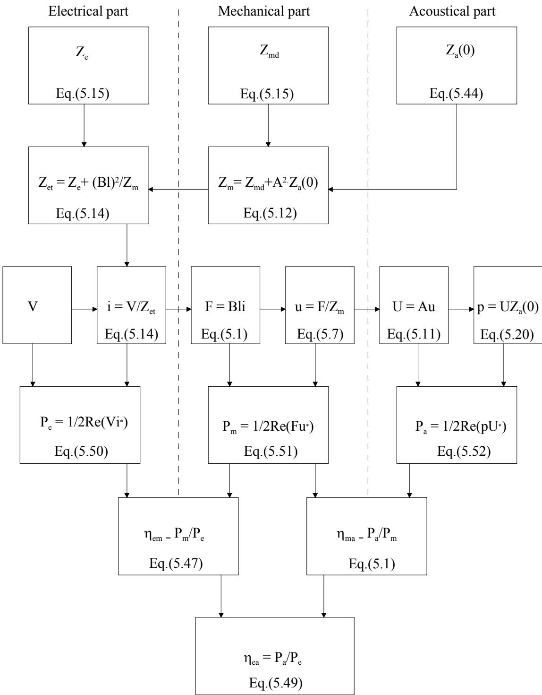  
Figure 5.7: Computation algorithm. The voltage $V ,$ and the parameters of the driver and resonator are used as input data. The direction of the computation is shown by the arrows. Each calculated quantity can be seen as output of the computation

to the electrical power input $P _ { \mathrm { e } }$

$$
\eta _ { \mathrm { e m } } = { \frac { P _ { \mathrm { m } } } { P _ { \mathrm { e } } } } .\tag{5.47}
$$

The mechanoacoustical efficiency $\eta _ { \mathrm { m a } }$ is the ratio of the acoustical power output $P _ { \mathrm { a } }$ to the mechanical power input $P _ { \mathrm { m } }$

$$
\eta _ { \mathrm { { m a } } } = { \frac { P _ { \mathrm { { a } } } } { P _ { \mathrm { { m } } } } } .\tag{5.48}
$$

The electroacoustic efficiency $\eta _ { \mathrm { e a } }$ is defined as the ratio of acoustic power output $P _ { \mathrm { a } }$ to the electric power input $P _ { \mathrm { e } }$

$$
\eta _ { \mathrm { e a } } = { \frac { P _ { \mathrm { a } } } { P _ { \mathrm { e } } } } = \eta _ { \mathrm { e m } } \eta _ { \mathrm { m a } } .\tag{5.49}
$$

The different powers are $\mathrm { g i }$ ven by

$$
P _ { \mathrm { ~ e ~ } } ~ = ~ \frac { 1 } { 2 } \operatorname { R e } ( V \imath ^ { * } )\tag{5.50}
$$

$$
{ P _ { \mathrm { ~ m ~ } } } ~ = ~ \frac { 1 } { 2 } \mathrm { R e } ( F u ^ { * } )\tag{5.51}
$$

$$
{ \cal P } _ { \mathrm { a } } = \frac { 1 } { 2 } \mathrm { R e } ( p U ^ { * } )\tag{5.52}
$$

where $p$ and $U$ are the peak acoustic pressure and volume velocity, respectively; $V$ and i are the peak voltage across the driver and peak current into the coil. The parameters $F$ and u are Lorentz force and velocity, respectively. The star denotes complex conjugation.

The input parameters for the program are as follows:

1. The voltage amplitude of the amplifier: $V$

2. Working gas parameters: speed of sound $^ { a , }$ density $\rho ,$ viscosity $\mu$ and thermal conductivity K.

3. Resonator parameters: the length $L _ { 3 } = \left( x _ { 3 } - x _ { 2 } \right)$ and radius $\mathrm { r _ { 3 } }$ of the small tube; length $x _ { 1 }$ and radius $r _ { 1 }$ of the large diameter tube, and the length $L _ { \mathbf { s } } = \left( x _ { 2 } - x _ { 1 } \right)$ and spacing $y _ { 0 }$ of the stack.

4. Electromechanical driver parameters: Electrical resistance $R _ { \mathrm { e } } ,$ self-inductance $L _ { \mathrm { e } } .$ mechanical resistance $R _ { \mathrm { m } }$ , moving mass $m ,$ stiffness constant $s ,$ and the force factor Bl, and the area of the piston A.

The quantities which can be calculated by the program are shown in Fig.(5.7). These may be any of the following quantities: current $i ,$ any impedance (acoustical, mechanical or electrical), force $F$ , velocity u, dynamic pressure $p ,$ electrical power

<table><tr><td rowspan=1 colspan=1>Parameter</td><td rowspan=1 colspan=1>Value</td></tr><tr><td rowspan=1 colspan=1>Bl-factor</td><td rowspan=1 colspan=1>12.8 T.m</td></tr><tr><td rowspan=1 colspan=1>Moving-mass m</td><td rowspan=1 colspan=1>13.16 g</td></tr><tr><td rowspan=1 colspan=1>Mechanical resistance $R _ { m }$ </td><td rowspan=1 colspan=1>3  $\mathrm { N s } / \mathrm { m }$ </td></tr><tr><td rowspan=1 colspan=1>Stiffness s</td><td rowspan=1 colspan=1>93 kN/m</td></tr><tr><td rowspan=1 colspan=1>Electrical resistance $R _ { e }$ </td><td rowspan=1 colspan=1>5 Ω</td></tr><tr><td rowspan=1 colspan=1>Self-inductance $L _ { e }$ </td><td rowspan=1 colspan=1> $\mathrm { \overline { { 1 . 3 ~ m H } } }$ </td></tr><tr><td rowspan=1 colspan=1>Piston area A</td><td rowspan=1 colspan=1> $\overline { { 7 . 1 0 ^ { - 4 } } } \mathrm { m } ^ { 2 }$ </td></tr></table>

Table 5.1: Electromechanical parameters of the driver
<table><tr><td rowspan=1 colspan=1>Parameter</td><td rowspan=1 colspan=1>Value</td></tr><tr><td rowspan=1 colspan=1>Length of the large tube $x _ { 1 }$ </td><td rowspan=1 colspan=1>3.7 cm</td></tr><tr><td rowspan=1 colspan=1>Radius of the large tube $r _ { 1 }$ </td><td rowspan=1 colspan=1>1.9 cm</td></tr><tr><td rowspan=1 colspan=1>Length of the stack $\overline { { L _ { s } } }$ </td><td rowspan=1 colspan=1>9.3 cm</td></tr><tr><td rowspan=1 colspan=1>Spacing in the stack $2 y _ { 0 }$ </td><td rowspan=1 colspan=1>3 mm</td></tr><tr><td rowspan=1 colspan=1>Length of the small diameter tube $L _ { 3 }$ </td><td rowspan=1 colspan=1>24 cm</td></tr><tr><td rowspan=1 colspan=1>Radius of the small diameter tube $r _ { 3 }$ </td><td rowspan=1 colspan=1>1 cm</td></tr></table>

Table 5.2: Parameters of the resonator and stack

$P _ { \mathrm { e } } ,$ mechanical power $P _ { \mathrm { m } }$ , acoustical power $P _ { \mathrm { a } }$ , electromechanical performance $\eta _ { \mathrm { e m } } .$ mechanoacoustical performance $\eta _ { \mathrm { m a } }$ , and electroacoustical performance $\eta _ { \mathrm { e a } } .$

In Fig.(5.8), a computation example is illustrated. The electromechanical parameters which are used for the driver are given in Table 5.1. The parameters for the resonator are given in Table 5.2.

The rms voltage from the power amplifier is 1.4 V. Helium gas at 10 bar is used as working gas. The acoustic resonance of the tube is at a frequency $f _ { \mathrm { a } } = 4 2 5 \ : \mathrm { H z }$ . In the calculations the stiffness of the driver is chosen so that the mechanical resonance of the driver $f _ { d } ~ ( \mathrm { E q . } ( 5 . 1 7 ) )$ matches to the acoustic resonance of the resonator $f _ { \mathrm { a } } .$ For such case the electroacoustic efficiency, $\eta _ { \mathrm { e a } } ,$ is maximal. As can be seen from Fig.(5.8b), the magnitude of the total electrical impedance of the system $Z _ { \mathrm { e t } }$ has the form of a resonance curve which is displaced upward by an amount equal to the electrical resistance of the coil, and has two resonances. These two modes of resonance can be determined from $\mathrm { E q . } ( 5 . 1 9 )$ and are related to the coupling between the driver and tube. As a consequence, the current shows two minima at these two resonances $\left( \mathrm { F i g . } \left( 5 . 8 \mathrm { a } \right) \right)$ . The two minima correspond to the situation where the mechanical reactance of the driver is just the opposite of that of the tube and thus to the condition (5.19) is satisfied. The calculated acoustical resonance of the tube, $Z _ { \mathrm { a } } ( 0 )$ , is shown in Fig.(5.8c). The position of the peak corresponds to the acoustic resonance frequency of 425 Hz. At this frequency the reactance part of the acoustical impedance is zero so that the impedance is purely real. The Lorentz force and electrical power have the same behavior

as the current.

The calculated acoustical power is shown in Fig.(5.8e), it is maximal at the resonance of the resonator where the energy dissipation in the resonator is maximal. The calculated electroacoustic efficiency of the system is shown in Fig.(5.8f). This quantity can be understood from the acoustical and electrical powers, since it is the ratio of these two quantities

As can be seen from Eq.(5.19), the driver-tube combined system can be made resonant by matching the resonance frequency of the driver to that of the resonator. This has many advantages as is explained bellow

In Fig.(5.9), the calculated electroacoustic efficiency is plotted against the frequency for different mechanical resonances of the driver. The acoustical resonance of the resonator $f _ { \mathrm { a } }$ is kept constant and the mechanical resonance of the driver $f _ { \mathrm { d } }$ is varied by changing the stiffness s (Eq.(5.17)). All other parameters of the driver and resonator are kept constant during these calculations, and equal to the values used in Fig.(5.8). In all plots, the electroacoustic efficiency shows two distinct peaks; one at the acoustical resonance $f _ { \mathrm { a } }$ and a second peak at the driver resonance $f _ { \mathrm { d } }$ . As the mechanical resonance frequency of the driver $f _ { \mathrm { d } }$ is shifted towards the acoustical resonance, the efficiency peak related to the driver shifts towards the fixed efficiency peak related to the tube, and both peaks grow in magnitude. An overlap of the two peaks with a maximal efficiency is obtained when $f _ { \mathrm { d } }$ and $f _ { \mathrm { a } }$ are equal, as shown in Fig.(5.9b). In this case it is also satisfied to the resonance condition of the combined system (Eq.(5.19)). A maximal efficiency of over 50 % is obtained. This result is in agreement with the results of wakeland [3] who has shown that the maximum efficiency is given by $\eta _ { \mathrm { m a x } } = \left( \sqrt { m ^ { \prime } + 1 } - 1 \right) / \left( \sqrt { m ^ { \prime } + 1 } + 1 \right)$ . For the driver parameters in Table $m \mathrm { ^ { \prime } { = } 1 0 . 9 }$ , so that $\eta _ { \mathrm { m a x } } = 5 5 \ \%$ . When the driver resonance frequency is larger than the tube resonance frequency, the efficiency decreases again for both peaks, as depicted in Fig.(5.9c) and Fig.(5.9d). This is to be expected since the two frequencies no longer match. This effect is independent of the parameters of the driver. The efficiency can always be made maximal by matching the driver and resonator frequencies. However, the maximum magnitude of the efficiency at overlap is a function of the parameters of the system. The model can be used to study the effect of given parameters or to design a given driver or resonator to meet some requirements.

As can be seen from Fig.((5.9)), beside the fact that efficiency is maximum when the two resonances are equal, the efficiency is also fairly constant over a wide frequency range. This is wise from the point of view of thermoacoustic refrigeration. Because during the cooldown the operating resonance frequency of the refrigerator, which is the fundamental acoustic resonance of the tube, decreases and so the refrigerator will keep the optimum performance.

  
Figure 5.8: Computed results as function of frequency; the driver resonance is made to be equal to the resonance of the tube. $( a )$ Current through the coil. (b) The magnitude of the total electrical impedance as seen by the amplifier. $( c )$ The magnititude of the acoustical impedance of the resonator. (d) Electrical power $P _ { e }$ . (e) Acoustical power $P _ { a }$ (f) Electroacoustic efficiency $\eta _ { e a }$

  
Figure 5.9: Calculated electroacoustic efficiency plotted against the frequency for various values of the driver frequency $f _ { \mathrm { d } } .$ The efficiency is maximal when the mechanical resonance frequency of the driver is equal to the acoustical resonance of the tube. Furthermore, the efficiency is fairly constant over a broad frequency range.

In summary, the simulation model discussed in this chapter shows that, for a given driver, the maximal efficiency is obtained by matching the mechanical resonance of the driver to the acoustical resonance of the tube, in which case the resonance condition (5.19) is satisfied. Furthermore the model is a powerful tool to design a driver to meet specific requirements for thermoacoustic refrigeration.

In the next section we will discuss a tool which can be used to match the mechanical resonance of the driver to the acoustical resonance of the tube. In thermoacoustics it is desirable to use relatively high frequencies, because the energy density in the system is a function of frequency [7]. But the operating frequency must not be too large because the thermal penetration depth $\delta _ { \mathrm { k } }$ is proportional to the inverse of the square root of the frequency (Eq.(2.46)). Since the spacing in the stack depends on $\delta _ { \mathbf { k } } ,$ a large frequency will result in very small spacing which makes the engineering of the stack difficult. Typically, frequencies between 200 and 600 Hz are usual.

Most midrange moving-coil loudspeakers have mechanical resonances of roughly 100 Hz. It is desirable to shift the mechanical resonance of the driver to that of the resonator and not the other way around. Referring to Eq.(5.17), it can be seen that this can be done by lowering the moving mass, which is in principle already kept as low as possible or by increasing the stiffness of the driver. The later solution is the one of interest here.

To match the mechanical resonance of the driver to the acoustic resonance of the tube one can use a material for the suspension with a high stiffness or add a mechanical spring system to the driver to increase its stiffness. But these solutions are one frequency solutions. If one needs to use another resonator or another gas, which is the case during experimental work, this changes the acoustical resonance, and hence the two resonances no longer match. A better solution to this problem is to use the gas behind the piston as an extra gas spring whose spring constant is inversely proportional to the volume of gas [2]. The volume can be externally and continuously adjusted to match the two resonances. The working principle of this system will be explained in the next section.

## 5.4 The gas spring system

This section is intended to explain the principle of operation of a gas spring system. The relationship between a closed volume and its mechanical stiffness will be presented. This forms the basis for the gas spring system which will be used to add an extra stiffness to the driver.

  
Figure 5.10: Cavity of volume V containing a gas at pressure $p ,$ and driven by a piston.

Consider a sealed cavity of volume V containing a gas at a pressure $p .$ The cavity is closed by a piston of area A, as shown in Fig.(5.10). We consider that the dimensions of the cavity are much smaller than the wavelength of sound, which ensures that the pressure is essentially uniform. For acoustic frequencies the motion is so fast that no exchange of heat takes place between the gas in the cavity and its surroundings. The process can be thus considered as adiabatic. Hence the volume and pressure in the cavity are related by the law of Poisson. When the piston moves a distance dx, the gas in the cavity will be compressed, so that the volume and pressure in the cavity become $p + \mathrm { d } p$ and $V + \mathrm { d } V$ , respectively. Using the thermodynamic expression

$$
\mathrm { d } S = C _ { \mathrm { p } } { \frac { \mathrm { d } V } { V } } + C _ { \mathrm { v } } { \frac { \mathrm { d } p } { p } } = 0 ,
$$

we have

$$
\frac { \mathrm { d } p } { p } = - \gamma \frac { \mathrm { d } V } { V }\tag{5.53}
$$

where $\gamma$ is the ratio of the specific heats at constant pressure and volume. Multiplying this expression by the piston area A and rearranging yields

$$
A \mathrm { d } p = \mathrm { d } F = - \gamma { \frac { p } { V } } A ^ { 2 } \mathrm { d } x .\tag{5.54}
$$

In this expression use has been made of the fact that d $V = - A \mathrm { { d } } x$ . The proportionality constant is the stiffness or the spring constant s given by

$$
s = \gamma { \frac { p } { V } } A ^ { 2 } .\tag{5.55}
$$

This expression shows that the stiffness of the volume of gas contained in the cavity is inversely proportional to the volume. A decrease in volume will result in an increase of the stiffness. This idea forms the basis for the gas spring principle which will be used to shift the mechanical resonance of the driver towards that of the resonator. As can be seen from Fig.( 5.1), a cylinder and piston system can be built in the back side of the driver to use the gas as an adjustable extra stiffness. This has the advantage that the resonance of the driver can be adjusted from the outside in a continuos manner. The design of this system and the way it works will be explained in chapter 7. The measurements with the system will be presented in chapter 8.

## Bibliography

[1] S. L. Garrett, " ThermoAcoustic Life Science Refrigerator", NASA Report no. LS-10114 (1991)

[2] M.E.H. Tijani, J. Zeegers, A.T.A.M. de Waele, "Design, development, and operation of a thermoacoustic refrigerator cooling to below -60 ⁰C", Cryocoolers 11, Kluwer Academic/Plenum Publishers, New York, 309 (2001).

[3] R.S. Wakeland, "Use of electrodynamic drivers in thermoacoustic refrigerators", J. Acoust. Soc. Am. 107, 827 (2000).

[4] L.L. Beranek, "Acoustics", (ASA, New York, 1996), Eq.(3.26a), Eq.(3.26a), p.70.

[5] Reference [3], Eq.(3.26b), p.70.

[6] A.D. Pierce, "Acoustics", (ASA, New York, 1994), p.317.

[7] G.W. Swift, "Thermoacoustic engines", J. Acoust. Soc. Am. 84, 1146 (1988), Eq.(66), p.1158.

# Design of a thermoacoustic refrigerator

This Chapter is concerned with the design, development and optimization of thermoacoustic refrigerators. The linear thermoacoustic theory presented in chapter 3 will be used. Due to the large number of parameters, a choice of some parameters along with a group of dimensionless independent variables will be used. The optimization of the different parts of the refrigerator will be discussed, and likewise some criteria will be implemented to obtain an optimal system.

## 6.1 Design strategy

As discussed in the previous Chapters, thermoacoustic refrigerators consist mainly of four parts: a driver, a stack, two heat exchangers, and a resonator (Fig.(5.1)). Our approach to the design and optimization of the refrigerator consists of the design and optimization of each part separately. In Chapter 5, the optimization of the driver only has been discussed. In this Chapter the optimization and design of the other modules will be considered.

We start by considering the design and optimization of the stack. As can be seen from Eq.(3.55) the driver has to provide acoustic power for driving the thermoacoustic heat transport process and for compensating for all viscous and thermal dissipation processes in the stack, heat exchangers, and at the resonator wall. The coefficient of performance of the stack, defined as the ratio of the heat pumped by the stack to the acoustic power used by the stack, is the maximum performance of the refrigerator. The exact expressions, Eqs.(3.39) and (3.50), of the acoustic power and cooling power in the stack are complicated, so one can try to use the expressions deduced from the short stack, and boundary-layer approximations, Eqs.(3.55) and (3.56). These expressions still look complicated. They contain a large number of parameters of the working gas, material and geometrical parameters of the stack. It is difficult to deal in engineering with so many parameters. However, one can reduce the number of parameters by choosing a group of dimensionless independent variables. Olson and Swift wrote a paper about similitude and dimensionless parameters for thermoacoustic devices [1]. Some dimensionless parameters can be deduced directly from Eqs.(3.55) and (3.56). Others can be defined from the boundary-layer and short-stack assumptions. The parameters, of importance in thermoacoustics, which are contained in Eqs.(3.55) and (3.56), are given in Tables (6.1) and (6.2).

<table><tr><td>Operation parameters</td><td>Working gas parameters</td></tr><tr><td>Operating frequency:  $\overline { { f } }$ </td><td>Dynamic viscosity:  $\mu$ </td></tr><tr><td>Average pressure:  $p _ { \mathrm { m } }$ </td><td>Thermal conductivity: K</td></tr><tr><td>Dynamic pressure amplitude: po</td><td>Sound velocity: a</td></tr><tr><td>Mean temperature:  $T _ { \mathrm { m } }$ </td><td>Ratio of isobaric to isochoric specific heats: γ</td></tr></table>

Table 6.1: Operation and working gas parameters
<table><tr><td>material</td><td>geometry</td></tr><tr><td>Thermal conductivity:  $K _ { \mathrm { s } }$  Density:  $\rho _ { \mathrm { s } }$  Specific heat:  $c _ { \mathrm { s } }$ </td><td>Length:  $L _ { \mathrm { s } }$  Stack center position:  $x _ { \mathrm { s } }$  Plate thickness: 2l Plate spacing:  $2 y _ { 0 }$  Cross section: A</td></tr></table>

Table 6.2: Parameters of the stack

The goal of the proper design of the thermoacoustic refrigerator is to meet the requirements of a given cooling power $\dot { Q } _ { \mathrm { c } }$ and a given low temperature $T _ { \mathrm { c } }$ or a given temperature difference $\Delta T$ over the stack. This requirement can be added to the operation parameters shown in Table 6.1.

As discussed in Chapter 3, the boundary layer and short stack approximations assume the following:

• The reduced acoustic wavelength is larger than the stack length: $\lambda / 2 \pi = 1 / k \gg$ $L _ { \mathrm { s } } ,$ so that the pressure and velocity can be considered as constant over the stack and that the acoustic field is not significantly disturbed by the presence of the stack.

• The thermal and viscous penetration depths are smaller than the spacing in the stack: $\delta _ { \mathrm { k } } , \delta _ { \nu } \ll y _ { 0 }$ . This assumption leads to the simplification of the Rott's functions, where the complex hyperbolic tangents can set equal to one (Eqs.(3.19)).

• The temperature difference is smaller that the average temperature: $\Delta T \ll T _ { \mathrm { m } }$ so that the thermophysical properties of the gas can be considered as constant within the stack.

<table><tr><td>Operation parameters</td></tr><tr><td>Drive ratio:  $\overline { { D = p _ { 1 } / p _ { \mathrm { m } } } }$ </td></tr><tr><td>Normalized cooling power:  $Q _ { \mathrm { c n } } = \dot { Q } _ { \mathrm { c } } / p _ { \mathrm { m } } a A$ </td></tr><tr><td></td></tr><tr><td>Normalized acoustic power:  $W _ { \mathrm { n } } = \dot { W } / p _ { \mathrm { m } } a A$ </td></tr><tr><td>Normalized temperature difference:  $\Delta T _ { \mathrm { m n } } = \Delta T _ { \mathrm { m } } / T _ { \mathrm { m } }$ </td></tr><tr><td></td></tr></table>

Table 6.3: Normalized operation parameters
<table><tr><td>Gas parameters</td></tr><tr><td>Prandtl number: σ</td></tr><tr><td></td></tr><tr><td>Normalized thermal penetration depth:  $\delta _ { \mathrm { k n } } = \delta _ { \mathrm { k } } / y _ { 0 }$ </td></tr></table>

Table 6.4: Normalized gas parameters

The length and position of the stack can be normalized by $\lambda / 2 \pi$ . The thermal and viscous penetration depths can be normalized by $y _ { 0 }$ . The cold temperature or the temperature difference can be normalized by $T _ { \mathrm { m } }$ Since $\delta _ { \mathrm { k } }$ and $\delta _ { \nu }$ are related by the Prandtl number $\sigma ,$ this will further simplify the number of parameters. Olson and Swift [1] proposed to normalize the acoustic power and the cooling power by the product of the mean pressure $p _ { \mathrm { m } } .$ the sound velocity $^ { a , }$ and the cross-sectional area of the stack $A : p _ { \mathrm { m } } a A .$ The amplitude of the dynamic pressure can be normalized by the mean pressure. The ratio $p _ { 0 } / \ p _ { \mathrm { m } }$ is called the drive ratio: $D .$ In practice the stack material can be chosen so that $\varepsilon _ { \mathrm { s } }$ and the thermal conductive term in Eqs.(3.55) and (3.56) can be neglected. In this case the parameters of the stack material don't have to be considered in the performance calculations. The porosity of the stack, sometimes called blockage ratio, defined as

$$
B = \frac { y _ { 0 } } { y _ { 0 } + l } ,\tag{6.1}
$$

is also used as a dimensionless parameter for the geometry of the stack.

The resultant normalized parameters are given an extra index n and are shown in Tables (6.3)-(6.5). The number of parameters can once more be reduced, by making a choice of some operation parameters, and the working gas.

<table><tr><td>Stack geometry parameters</td></tr><tr><td>Normalized stack length:  $L _ { \mathrm { s n } } = k L _ { \mathrm { s } }$  Normalized stack position:  $x _ { \mathrm { n } } = k x$  Blockage ratio or porosity:  $\begin{array} { r } { B = \frac { y _ { 0 } } { \left( y _ { 0 } + l \right) } } \end{array}$ </td></tr></table>

Table 6.5: Normaized stack parameters

## 6.2 Design choices

For this investigation we choose to design a refrigerator for a temperature difference of $\Delta T _ { \mathrm { m } } = 7 5 $ K and a cooling power of 4 watt. In the following, we will discuss the selection of some operation parameters, the gas, and stack material.

## Average pressure

Since the power density in a thermoacoustic device is proportional to the average pressure $p _ { \mathrm { m } } [ 2 ]$ , it is favorable to choose $p _ { \mathrm { m } }$ as large as possible. This is determined by the mechanical strength of the resonator. On the other hand, $\delta _ { \mathrm { k } }$ is inversely proportional to square root of $p _ { \mathrm { m } } .$ so a high pressure results in a small $\delta _ { \mathrm { k } }$ and a very small stack plate spacing. This makes the construction difficult. Taking into account these effects, the maximal pressure is 12 bar. We choose to use 10 bar. To minimize the heat conduction from the hot side of the stack to the cold side, we used a thin-walled stack holder made of a Ertacetal material.

## Frequency

As the power density in the thermoacoustic devices is a linear function of the acoustic resonance frequency [2] an obvious choice is thus a high resonance frequency. On the other hand $\delta _ { \mathbf { k } }$ is inversely proportional to the square root of the frequency (Eq.(2.46)) which again implies a stack with very small plate spacing. Making a comprise between these two effects and the fact that the driver resonance has to be matched to the resonator resonance for high efficiency of the driver, we choose to use a frequency of 400 Hz.

## Dynamic pressure

The dynamic pressure $p _ { 0 }$ is limited by two factors namely, the maximum force of the driver and non-linearities. The acoustic Mach number, defined as

$$
M = { \frac { p _ { 0 } } { \rho _ { \mathrm { m } } a ^ { 2 } } } ,\tag{6.2}
$$

has to be limited to $M \sim 0 . 1$ for gases by nonlinear effects [2]. It was indicated in Section 3.5 that in order to avoid turbulence the acoustic Reynolds number $R _ { y } ^ { \delta _ { \nu } }$ 2 Eq.(3.60), should be smaller than 500. Since we intend to design a refrigerator with moderate cooling power we will use driving ratios $D < 3 \ \%$ , so that $M < 0 . 1$ and $R _ { y } ^ { \delta _ { \nu } } < 5 0 0$

## Working gas

We use helium as working gas. The reason for this choice is that helium has the highest sound velocity and thermal conductivity of all inert gases. In this way the resonance frequency of 400 Hz is easily obtained without making the system too small. Furthermore, helium is cheap in comparison with the other noble gases. A high thermal conductivity is wise since $\delta _ { \mathrm { k } }$ is proportional to the square of the thermal conductivity coefficient K. The effect of using other gases will be discussed later in this Chapter.

## Stack material

The second term in Eq.(3.56) represents the heat conductivity through the stack material and gas in the stack region. This heat conduction has a negative effect on the performance of the refrigerator. The stack material must have a low thermal conductivity $K _ { \mathrm { s } }$ and a heat capacity $c _ { \mathrm { s } }$ larger than the heat capacity of the working gas, in order that the temperature of the stack plates is steady. In this way the parameter $\varepsilon _ { \mathrm { s } }$ can be neglected. The material $\mathrm { M y }$ lar is chosen, as it has a low heat conductivity (0.16 W/mK) and is produced in thicknesses of 10 µm-500 µm .

## Stack geometry

There are many geometries which the stack can have: Parallel plates, circular pores, pin arrays, triangular pores, etc. The geometry of the stack is expressed in Rott's function f. This function is given for some channel geometries in the literature[3]. From Eq.(3.50) one can see that the cooling power is proportional to Im $\left( - f _ { \mathrm { k } } \right)$ . Fig.(6.1) shows the real and imaginary parts of f for some geometries as functions of the ratio the hydraulic radius $r _ { \mathrm { h } }$ , which is defined as the ratio of the cross-sectional area and the perimeter of the channel and the thermal penetration depth. The pin arrays and parallel-plates stacks are the best. We note that for parallel-plate stack $r _ { \mathrm { h } } = y _ { 0 }$ . The pin-array stack is too difficult to manufacture.

Hence, we choose to use a stack made of parallel-plates. The selection of a frequency of 400 Hz, an average pressure of 10 bar, and helium as working gas, determines the thermal and viscous penetration depths. Using Eq.(2.46) and (2.47) we have $\delta _ { \mathrm { k } } = 0 . 1$ mm and $\delta _ { \nu } = 0 . 0 8 ~ \mathrm { m m }$ . As can be seen from Fig.(6.1) for a parallel-plates stack Im $\left( - f _ { \mathrm { k } } \right)$ has a maximum for $r _ { \mathrm { h } } / \delta _ { \mathrm { k } } = y _ { 0 } / \delta _ { \mathrm { k } } = 1 . 1$ . Since the spacing in the stack is $2 y _ { 0 }$ , this means that the optimal spacing is 0.22 mm. But in order not to alter the acoustic field, it was stated [4] to use a spacing of $2 \delta _ { \mathbf { k } }$ to $4 \delta _ { \mathbf { k } }$ . We choose to use a spacing of about 0.3 mm. The remaining stack geometrical parameters are the center stack position $x _ { \mathrm { s } } ,$ the length of the stack $L _ { \mathrm { s } }$ , and the cross-sectional area A. These parameters are determined from the performance optimization of the stack.

  
Figure 6.1: Imaginary and real parts of the Rott function $f _ { \mathrm { k } }$ as function of the ratio of the hydraulic radius and the thermal penetration depth. Three geometries are considered. The pin arrays and parallel-plates stacks are the best. For pin arrays an internal radius $r _ { i } = 3 \delta _ { \mathrm { k } }$ is used in the calculations.

## 6.3 Design of the stack

We remain with three stack design parameters: the center position $x _ { \mathrm { n } } .$ the length $L _ { \mathrm { s n } }$ and the cross-sectional area A. By using data for the gas parameters we first optimize the stack geometry parameters by optimizing the performance expressed in terms of the COP (Eq.(2.8)). This leads to the determination of $x _ { \mathrm { n } }$ and $L _ { \mathrm { s n } }$ . Then the required cooling power will be used to determine the cross-sectional area A. This area is equal to the resonator cross section at the stack location. Once these parameters are determined we can design the resonator. The dissipated acoustic power at the cold side of the resonator forms an extra heat load to the cold heat exchanger. This load, and the required cooling power, will form the total heat load that the cold heat exchanger has to transfer to the stack. The first law of thermodynamics $\left( \mathrm { E q . } ( 2 . 6 ) \right)$ states that the total heat load at the hot heat exchanger is the sum of the heat pumped by the stack and the acoustic power used by the stack to realize the heat transfer process. The hot heat exchanger has to remove this heat from the hot side of the stack. The driver has to provide the total needed acoustic power. The design strategy is summarized in Fig.(6.2).

Using the dimensionless parameters, the parameter Γ ( Eq.(3.59)) can be rewritten

Figure 6.2: Illustration of the design procedure of the refrigerator. The stack parameters $x _ { \mathrm { s n } }$ and $L _ { \mathrm { s n } }$ are irst determined by optimizing the COP. Then A is determined via the required cooling power. After that the resonator is designed.

as

$$
\Gamma = \frac { \Delta T _ { \mathrm { m n } } } { \left( \gamma - 1 \right) B L _ { \mathrm { s n } } } \tan \left( x _ { \mathrm { n } } \right) .\tag{6.3}
$$

The stack perimeter, I, can be expressed as function of the cross-sectional area as

$$
\Pi = \frac { A } { y _ { 0 } + l } .\tag{6.4}
$$

Eqs.(3.56) and (3.55) can be rewritten in a dimensionless form by using the dimensionless parameters, the gas data of Table 6.6, and substitution of Eqs.(6.3) and (6.4), thus

$$
Q _ { \mathrm { c n } } = - \frac { \delta _ { \mathrm { k n } } D ^ { 2 } \sin ( 2 x _ { \mathrm { n } } ) } { 8 \gamma \left( 1 + \sigma \right) \Lambda } \left( \frac { \Delta T _ { \mathrm { m n } } \tan \left( x _ { \mathrm { n } } \right) } { ( \gamma - 1 ) B L _ { \mathrm { s n } } } \frac { 1 + \sqrt { \sigma } + \sigma } { 1 + \sqrt { \sigma } } - \left( 1 + \sqrt { \sigma } - \sqrt { \sigma } \delta _ { \mathrm { k n } } \right) \right)\tag{6.5}
$$

and

$$
\begin{array} { r c l } { { W _ { \mathrm { n } } } } & { { = } } & { { \displaystyle \frac { \delta _ { \mathrm { k n } } L _ { \mathrm { s n } } D ^ { 2 } } { 4 \gamma } ( \gamma - 1 ) B \cos { \left( x _ { \mathrm { n } } \right) ^ { 2 } } \left( \frac { \Delta T _ { \mathrm { m n } } \tan { \left( x _ { \mathrm { n } } \right) } } { B L _ { \mathrm { s n } } ( \gamma - 1 ) \left( 1 + \sqrt { \sigma } \right) \Lambda } - 1 \right) \hfill } } \\ { { } } & { { } } & { { \displaystyle - \frac { \delta _ { \mathrm { k n } } L _ { \mathrm { s n } } D ^ { 2 } } { 4 \gamma } \frac { \sqrt { \sigma } \sin { \left( x _ { \mathrm { n } } \right) ^ { 2 } } } { B \Lambda } } } \end{array}\tag{6.6}
$$

where

$$
\Lambda = 1 - \sqrt { \sigma } \delta _ { \mathrm { k n } } + \frac { 1 } { 2 } \sigma \delta _ { \mathrm { k n } } ^ { 2 } .\tag{6.7}
$$

The thermal conductivity term in Eq.(3.56) has been neglected. As discussed in Chapter 2, the performance of the stack is expressed in terms of the coefficient of performance

$$
C O P = { \frac { Q _ { \mathrm { c n } } } { W _ { \mathrm { n } } } } .\tag{6.8}
$$

<table><tr><td rowspan=1 colspan=1>Operation parameters</td><td rowspan=1 colspan=1>Gas parameters</td></tr><tr><td rowspan=1 colspan=1> $p _ { \mathrm { m } } = 1 0 ~ \mathrm { b a r } .$  $T _ { \mathrm { m } } = 2 5 0 ~ \mathrm { K }$  $\Delta T _ { \mathrm { m n } } = 0 . 3 .$  $D = 0 . 0 2 .$ </td><td rowspan=1 colspan=1> $a = 9 3 5 ~ \mathrm { m / s }$  $\sigma = 0 . 6 8$  $\gamma = 1 . 6 7$  $B = 0 . 7 5$ </td></tr><tr><td rowspan=1 colspan=1> $f = 4 0 0 \ \mathrm { H z } , \ k = 2 . 6 8 \ \mathrm { m } ^ { - 1 }$ </td><td rowspan=1 colspan=1> $\overline { { \delta _ { \mathrm { k n } } = 0 . 6 6 } }$ </td></tr></table>

Table 6.6: Parameters used in the performance calculations

## 6.4 Optimization of the stack

In the performance calculations, the data shown in Table 6.6 are used. Fig.(6.3) shows the performance calculations as function of the normalized stack length $L _ { \mathrm { s n } }$ , for different normalized stack positions $x _ { \mathrm { n } }$ . The normalized position $x _ { \mathrm { n } } = 0$ , corresponds to the driver position (pressure antinode). In all cases the COP shows a maximum. For each stack length there is an optimal stack position.

As the normalized length of the stack increases, the performance peak shifts to larger stack positions, while the performance decreases. This behavior is to be understood in the following way: A decrease of the center position of the stack means that the stack is placed close to the driver. This position is a pressure antinode and a velocity node, as discussed in Section 2.3. Equation (3.55) shows that the viscous losses are proportional to the square of the acoustic velocity. Thus decreasing the velocity will result in a decrease of the losses and hence a higher COP.

In Section 2.4 we discussed the effect of the position of the stack in the standing wave. It was concluded that the maximum cooling power may be expected at a position roughly halfway between the pressure antinode and pressure node $( \lambda / 8 )$ . In Fig.(6.4) the COP peak, the cooling power, and the acoustic power, calculated at the peak position, are plotted as functions of the stack length. The cooling power and the acoustic power increase while the COP decreases as function of the stack length and thus as function of the normalized stack center position. As can be seen from Fig.(6.4), for a normalized stack length above 0.35 the COP is lower than one.

Considering the above remarks and for practical reasons, we have chosen for a normalized stack center position of $x _ { \mathrm { n } } = 0 . 2 2$ . To achieve optimum performance this requires a stack length of $L _ { \mathrm { s n } } = 0 . 2 3$ . Expressed in terms of the normal stack center position and length, we have $x _ { \mathrm { s } } ~ = ~ 8$ cm and $L _ { \mathrm { s } } ~ = ~ 8 . 5 ~ \mathrm { c m }$ . This is equivalent to place the hot end of the stack at a distance of 3.75 cm from the driver. Under these conditions the dimensionless cooling power is $Q _ { \mathrm { c n } } = 3 . 7 2 \ . 1 0 ^ { - 6 }$ . Since the required cooling power is 4 watt this leads to a cross-sectional area $A = 1 2 ~ \mathrm { { c m } ^ { 2 } }$ . This means a radius of $r = 1 . 9$ cm for a cylindrical resonator. To pump 4 watt of heat the stack uses 3 watt of acoustic power $( C O P = 1 . 3 ) $

  
Figure 6.3: Performance calculations for the stack, as function of the normalized length and normalized center stack position.

## 6.5 Resonator

The resonator is designed in order that the length, weight, shape and the losses are optimal. The resonator has to be compact, light, and strong enough. The shape and length are determined by the resonance frequency and minimal losses at the wall of the resonator. The cross-sectional area A of the resonator at the stack location is determined in the preceding Section. As discussed in Section 2.3, the resonator can have a $\lambda / 2$ or a $\lambda / 4 – \mathrm { l e n g t h }$ , as shown in Fig.(6.5a) and Fig.(6.5b). The viscous and thermal relaxation dissipation losses take place in the penetration depths, along the surface of the resonator. In the boundary-layer approximation, the acoustic power lost per unit surface area of the resonator is given by (Eq.(3.55) with Γ = 0)

$$
\frac { \mathrm { d } \dot { W } _ { 2 } } { \mathrm { d } S } = \frac { 1 } { 4 } \rho _ { \mathrm { m } } \left| \langle u _ { 1 } \rangle \right| ^ { 2 } \delta _ { \nu } \omega + \frac { 1 } { 4 } \frac { | p _ { 1 } | ^ { 2 } } { \rho _ { \mathrm { m } } a ^ { 2 } } \left( \gamma - 1 \right) \delta _ { \mathrm { k } } \omega ,\tag{6.9}
$$

where the first term on the right hand side is the kinetic energy dissipated by viscous shear. The second term is the energy dissipated by thermal relaxation. Since the total dissipated energy is proportional to the surface area of the resonator, a λ/4-resonator will dissipate only half the energy dissipated by a λ/2-resonator. Hence a λ/4-resonator is preferable. Hofler [5] shows that the λ/4-resonator can be further optimized by reducing the diameter of the resonator part on the right of the stack (Fig.(6.5c)). The reason to do this is by minimizing Eq.(6.9). As shown in Fig.(6.5c), two parts can be discerned, a large diameter tube (1) containing the stack with diameter $D _ { 1 }$ and a small diameter tube (2) with diameter $D _ { 2 }$ . The losses in part (2) are plotted as function of the ratio $D _ { 1 } / D _ { 2 }$ . The calculation results are shown in Fig.(6.6). The thermal loss increases monotonically as function of the ratio $D _ { 1 } / D _ { 2 }$ , but the viscous losses decrease rapidly up to about $D _ { 1 } / D _ { 2 } = 0 . 5$ and then increase slowly. As a result the total loss (sum) has a minimum at about $D _ { 1 } / D _ { 2 } = 0 . 5 4$

  
Figure 6.4: The cooling power, acoustic power and performance at the stack center position of maximal performance, as function of the normalized stack length

Hofler[5] and Garrett [6], used a metallic spherical bulb to terminate the resonator. The sphere had sufficient volume to simulate an open end. But at the open end, which is a velocity antinode, the velocity is maximum so that an abrupt transition from the small diameter tube to the bulb can generate turbulence and so losses occur. Taking into account this problem along with the requirement to keep the resonator compact we used a cone-shaped buffer volume to simulate the open end. The calculation optimization of the angle of the cone for minimal losses has been determined to be $9 ^ { 0 }$ A gradual tapering is also used between the large diameter tube and small diameter tube. The final shape of our resonator is shown in Fig.(6.7). Measurements the standing wave acoustic pressure distribution inside the resonator show that the system is nearly a quarter-wavelength resonator.

<table><tr><td>Driver end</td><td>Stack</td><td></td><td>Closed end</td></tr><tr><td rowspan="5">(a)</td><td></td><td rowspan="5"></td><td rowspan="5"></td></tr><tr><td></td></tr><tr><td></td></tr><tr><td></td></tr><tr><td></td></tr></table>

  
Figure 6.5: Three type resonators showing the optimization of the resonator, $b y$ reducing the surface area. (a) A λ/2-tube. (b) A λ/4-tube. (c) An optimized $\lambda / 4 – t u b e$ . The different dimensions used in the calculations are shown in (c).

So far we have determined the diameters of the large and small diameter tubes along with the length of the large diameter tube. The total length of the resonator is determined by the desired operation frequency of 400 Hz $( \mathrm { k { = } 2 . 6 8 ~ m ^ { - 1 } } )$ . By matching the pressure and volume velocity at the interface between the small and large tube one can deduce the resonance condition which can be used to control the length. By reference to $\mathrm { F i g . ( 6 . 5 c ) }$ , the amplitudes of the dynamic pressure and $\mathrm { g a s }$ velocity due to the standing wave in the large diameter tube (1) are given by

$$
\begin{array} { r } { p ^ { ( 1 ) } = p _ { 0 } ^ { ( 1 ) } \cos ( k x ) , } \end{array}\tag{6.10}
$$

  
Figure 6.6: The calculated losses in the small diameter resonator part $( { \mathcal { Q } } )$ , as function of the ratio of the diameter of the small diameter tube to the diameter of stack resonator part (1). The Dots are the thermal losses, the dashed-line are the viscous losses, and the solid-plot is the sum or the total losses. The total loss show a minimum at $D _ { 2 } / D _ { 1 } { = } \theta . 5 4$

and

$$
u ^ { ( 1 ) } = \frac { p _ { 0 } ^ { ( 1 ) } } { \rho _ { \mathrm { m } } a } \sin ( k x )\tag{6.11}
$$

where the superscript (1) refers to the large diameter tube (1), and $p _ { 0 } ^ { ( 1 ) }$ is the dynamic pressure amplitude at the driver location (antinode). Pressure and velocity in the small diameter tube (2) are given by

$$
p ^ { ( 2 ) } = p _ { 0 } ^ { ( 2 ) } \sin \mathopen { } \mathclose \bgroup \mathopen { } \mathclose \bgroup \mathopen { } \mathclose \bgroup \mathopen { } \mathclose \bgroup \mathopen { } \mathclose \bgroup \mathopen { } \mathclose \bgroup \mathopen { } \mathclose \bgroup \mathopen { } \mathclose \bgroup \left( k ( L _ { t } - x ) \aftergroup \egroup \aftergroup \egroup \aftergroup \egroup \aftergroup \egroup \aftergroup \egroup \aftergroup \egroup \aftergroup \egroup \aftergroup \egroup \aftergroup \egroup \aftergroup \egroup \aftergroup \egroup \right) ,\tag{6.12}
$$

and

$$
u ^ { ( 2 ) } = { \frac { p _ { 0 } ^ { ( 2 ) } } { \rho _ { \mathrm { m } } a } } \cos ( k ( L _ { t } - x ) )\tag{6.13}
$$

where $L _ { t }$ is the total length of the resonator, and subscript (2) refers to the small diameter tube.

At the interface between the two parts at $x = l ,$ where l is the length of the large diameter tube (1), the pressure and the volume flow have to be continuous, this can be summarized by saying that the acoustic impedances have to match at the junction,

  
Figure 6.7: The final shape used for the optimized resonator. It consists of a large diameter tube, containing a stack and two heat exchangers, a small diameter tube, and a buffer volume which simulates an open end.

thus

$$
Z ^ { ( 1 ) } ( l ) = Z ^ { ( 2 ) } ( l ) .\tag{6.14}
$$

By substituting

$$
Z ^ { ( 1 ) } ( l ) = \frac { p ^ { ( 1 ) } } { A _ { 1 } u ^ { ( 1 ) } } = \frac { \cot { ( k l ) } } { A _ { 1 } }\tag{6.15}
$$

and

$$
Z ^ { ( 2 ) } ( l ) = { \frac { p ^ { ( 2 ) } } { A _ { 2 } u ^ { ( 2 ) } } } = { \frac { \tan { ( k ( L _ { t } - l ) ) } } { A _ { 2 } } }\tag{6.16}
$$

into Eq.(6.14), one obtains the resonance condition

$$
\cot { ( k l ) } = \left( \frac { D _ { 1 } } { D _ { 2 } } \right) ^ { 2 } \tan { \left( k ( L _ { t } - l ) \right) }\tag{6.17}
$$

where $L _ { t } - l$ is the length of the small diameter tube. Substitution of $D _ { 1 }$ $D _ { 2 }$ , l into Eq.(6.17) yields a total length of $L _ { t } = 3 7 . 5 \mathrm { c m } .$ so that the length of the small diameter tube is 25 cm. In our calculations we did not take into account the presence of the stack, heat exchangers, tapers, and damping which influence the resonance frequency of the system and hence length.

As discussed in Section 2.3, straight tubes like that shown in Fig.(6.5a) and Fig.(6.5b) have resonance modes which are an integer number of the fundamental mode (ω). We indicated in Section 3.5, that, whenever nonlinear effects exist, higher harmonics may be generated which coincide with the resonance modes, and hence will be amplified. This means that energy transfer will take place from the fundamental operation mode to the higher oscillation modes. This loss mechanism is to be avoided in thermoacoustic devices. Eq.(6.17) shows that the resonance modes of the resonator having a nonuniform cross-section are not an integer number of the fundamental. In this way harmonics can be avoided. Hence, besides the benefit of reducing the losses, the optimized resonator shown in Fig.(6.7) has the advantage of having normal resonance modes which are not an integer number of the fundamental mode. Oberst [7] showed that, using resonators with a shape like that illustrated in Fig.((6.5c), can lead to extremely strong standing waves with relatively pure wave forms.

As can be seen from Fig.(6.7), the large diameter resonator consists mainly of the stack and the two heat exchangers. Thus, the energy losses take place in these elements. The resonator losses are located at the small diameter tube. As can be seen from Fig.(6.6) the minimal power loss for $D _ { 1 } / D _ { 2 } = 0 . 5 4$ is $\dot { W } _ { \mathrm { r e s } } = 0 . 2 2$ watt. These losses are mainly caused by viscous losses. This energy loss shows up as heat at the cold heat exchanger (Fig.(5.1)).

## 6.6 Heat exchangers

The heat exchangers are necessary to transfer the energy of the thermoacoustic cooling process. The design of the heat exchangers is one of the important problems in thermoacoustics. Little is known about heat transfer in oscillating flows with zero mean velocity. The standard steady-flow design methodology for heat exchangers can not be applied directly. Furthermore, an understanding of the complex flow patterns at the ends of the stack is also necessary for the design. Nowadays some research groups are using visualization techniques to study these flow patterns which are very complicated [8]. In the following, we will discuss some requirement issues for the design of the heat exchangers. The design and construction of the heat exchangers will be discussed in more detail in the next Chapter.

## 6.6.1 Cold heat exchanger

The whole resonator part on the right of the stack in Fig.(6.7), cools down so a cold heat exchanger is necessary to make a good thermal contact between the cold side of the stack and the small tube resonator. An electrical heater is placed at the cold heat exchanger to measure cooling power. The length of the heat exchanger is determined by the distance over which heat is transferred by gas. The optimum length corresponds to the peak-to-peak displacement of the gas at the cold heat exchanger location. The displacement amplitude is given by

$$
x _ { 1 } = \frac { u ^ { ( 1 ) } } { \omega } = \frac { p _ { 0 } ^ { ( 1 ) } } { \omega \rho _ { \mathrm { m } } a } \sin ( k x ) .\tag{6.18}
$$

Substituting the data from Table 6.6, and $x = l = 1 2 . 5$ cm, gives $x _ { 1 } = 1 . 4 7$ mm. The optimum length of the cold heat exchanger is thus $2 x _ { 1 } = 3$ mm. To avoid entrance problems of the gas when leaving the stack and entering the cold heat exchanger or vice versa (continuity of the volume velocity), the porosity of the cold heat exchanger must be equal to the porosity of the stack. This implies that a blockage ratio of 0.75 has to be used in the design of the cold heat exchanger. Acoustic power is also dissipated in the cold heat exchanger. Eq.(3.56) can be used to estimate the dissipated power. Substituting the position of the cold heat exchanger $x _ { \mathrm { n } } = 0 . 3 3$ , the length $L _ { \mathrm { h n } } = 0 . 0 0 8$ and $\Gamma = 0$ (uniform mean temperature), yields that the cold heat exchanger will dissipate $\dot { W } _ { \mathrm { c h } } = 0 . 2$ watt.

## 6.6.2 Hot heat exchanger

The hot heat exchanger is necessary to remove the heat pumped by the stack and to reject it to the circulating cooling water. As discussed in the precedent subsection, the optimal length of the heat exchanger is equal to the peak-to-peak displacement amplitude of the gas at the heat exchanger location. But since the hot heat exchanger has to reject nearly twice the heat supplied by the cold heat exchanger, the length of the hot heat exchanger should be twice that of the cold heat exchanger (6 mm). Substituting the position of the hot heat exchanger ${ x _ { \mathrm { n } } } \mathrm { { = } } 0 . 1 0$ , the length $L _ { \mathrm { h n } } = 0 . 0 1 6$ and $\Gamma = 0$ into Eq.(3.56), we obtain an estimation for the acoustic power dissipated in the hot heat exchanger which is $\dot { W } _ { \mathrm { h h } } = 0 . 3 3$ watt.

## 6.7 Acoustic driver

The driver has to provide the total acoustic power used by the stack to transfer heat or dissipated in the different parts, thus

$$
\begin{array} { r c l } { { \dot { W } _ { \mathrm { t } } } } & { { = } } & { { \dot { W } _ { \mathrm { s } } + \dot { W } _ { \mathrm { r e s } } + \dot { W } _ { \mathrm { c h } } + \dot { W } _ { \mathrm { h h } } } } \\ { { } } & { { } } & { { } } \\ { { } } & { { = } } & { { 3 . 7 6 ~ \mathrm { w a t t } . } } \end{array}\tag{6.19}
$$

Taking into account the power dissipated in the different parts, the performance of the system becomes

$$
C O P = { \frac { \dot { Q } _ { \mathrm { c } } } { \dot { W } _ { \mathrm { t } } } } = 1 . 0 6 .\tag{6.20}
$$

This value is lower than the performance of the stack alone 1.33.

The optimization of the driver has been discussed in Chapter 5. A higher performance of the driver leads to a higher performance of the whole refrigerator system. Furthermore, a high performance of the driver means that the necessary acoustic power can be easily obtained without using high electrical currents which may damage the coil.

  
Figure 6.8: Performance plotted as function of the noble gas mole fraction in the binary mixture. Three mixtures are considered helium-argon, helium-krypton, and heliumxenon.

## 6.8 Prandtl number

As can be seen from Eqs.(3.55) and (3.56), the Prandtl number is an important parameter in thermoacoustics. In chapter 4, we discussed the use of binary mixture of helium and other noble-gases to decrease the Prandtl number.

The performance of the stack as function of the gas composition has been calculated. Equations (4.12), (4.17) and (4.1) have been substituted into the expressions (6.5) and (6.6) so that COP is expressed as function of the noble gas mole fraction. Fig.(6.8) shows the behavior of COP as function of the noble gas mole fraction for helium-xenon, helium-krypton and helium-argon binary mixtures. For all gas mixtures, as the Prandtl number decreases as function of the mole fraction of the noble gas, the performance improves. A maximum is reached nearly when the Prandtl number is minimum (c.f. Fig.(4.1)).

## 6.9 DeltaE

A quick check of the assumptions of the short stack and boundary layer approximation shows that $\lambda / 2 \pi = 1 / k = 0 . 3 7$ m which is not too large compared to the stack length

  
Figure 6.9: DeltaE calculations as function of the heat load at the cold heat exchanger and for different positions from the driver. $( a )$ Performance relative to Carnot, COPR. (b) The cold heat exchanger temperature, $T _ { \mathrm { c } }$ . The hot heat exchanger temperature $T _ { \mathrm { h } }$ is also shown. The parameters used in the calculations are discussed in the text.

$L _ { \mathrm { s } } ~ = ~ 0 . 0 8$ m, $\delta _ { \mathrm { k } } \sim y _ { 0 }$ , and $\Delta T _ { \mathrm { m } } ~ = ~ 7 0 ~ \mathrm { K }$ is not too small compared to the mean temperature $T _ { \mathrm { m } } = 2 5 0$ K. Therefore, the results of the calculations done so far are only estimates. However, the approximation is a good tool for the initial study of a thermoacoustic device, so that the obtained results can be used as input data for more advanced calculation programs like the computer program DeltaE. As discussed in Section 3.4, DeltaE solves the exact thermoacoustic equations in a geometry given by the user, using the boundary conditions for the different variables. DeltaE has been used to optimize our refrigerator. The results of the calculations, using the refrigerator geometry shown in Fig.(6.7), are given in Fig.(6.9).

The calculations have been done using a drive ratio $D = 2 ~ \%$ , a constant hot temperature $T _ { \mathrm { h } } = 2 8 9 ~ \mathrm { K }$ , a frequency $f = 4 0 9 \ \mathrm { H z } .$ a stack length of 8.5 cm and an average pressure $p _ { \mathrm { m } } = 1 0$ bar. Helium is used as working gas. Changing the distance between the stack and the driver changes the resonance frequency if the length of the small diameter tube is kept constant. Therefore, we have allowed the length of the small diameter to change so that the resonance frequency is kept at 409 Hz.

The calculated cold temperature $T _ { \mathrm { c } } ,$ and the performance relative to Carnot COPR $\left( \mathrm { E q . ( 2 . 1 3 ) } \right)$ as function of the heat load at the cold heat exchanger ${ \dot { Q } } ,$ and for different positions $x _ { \mathrm { h } }$ of the hot end of the stack from the driver end, are shown in $\mathrm { F i g ( 6 . 9 ) }$ The $C O P R$ increases as the distance increases, reaches a maximum at a distance of about 4.2 cm and then decreases. The optimum cooling power, corresponding to the heat load at the position of maximum $C O P R .$ increases as function of the position. The explanation of the behavior of COPR and $\dot { Q }$ is the same as that given in Section 6.4. The cold temperature at the cold heat exchanger is nearly a linear function of the heat load. The slope of the line decreases as the distance from the pressure antinode (driver) increases, so that the lowest temperature at $\dot { Q } = 0$ , increases as the distance increases. This is a consequence of the decrease of the critical temperature gradient, as discussed in Section 2.4. The maximum COPR for $x _ { \mathrm { h } } = 4 . 2$ cm, shows an optimum around $\dot { Q } = 2 . 7 5$ W at a cold temperature $T _ { \mathrm { c } } { = \ 2 2 9 \ \mathrm { K } }$ . The calculations show that the dissipated acoustic power in the cold heat exchanger and in the small diameter resonator is 0.65 W so that the total cooling power at the cold end is about 3.5 W. Based on the above calculations we choose to use a stack of length 8.5 cm placed at 4.2 cm from the driver. In the next chapter the design and construction of the thermoacoustic refrigerator will be described.

## Bibliography

[1] J. R. Olson and G.W. Swift, "Similitude in thermoacoustic", J. Acoust. Soc. Am. 95, 1405 (1994).

[2] G.W. Swift, "Thermoacoustic engines", J. Acoust. Soc. Am. 84, 1146 (1988).

[3] G.W. Swift, "Thermoacoustic engines and refrigerators", Encyclopedia of Applied physics. 21, 245 (1997).

[4] J.C. Wheatley, T. Hofler, G. W. Swift, and A. Migliori, "Understanding some simple phenomena in thermoacoustics with applications to acoustical heat engines", Am. J. Phys. 53, 147 (1985).

[5] T.J. Hofler, "Thermoacoustic refrigerator design and performance", Ph.D. dissertation, Physics Department, University of California at San Diego, (1986).

[6] S.L. Garrett, J.A. Adeff, and T.J. Hofler, "Thermoacoustic refrigerator for space applications", J. of Thermophysics and Heat Transfer, 7, 595 (1993).

[7] H. Oberst, "Eine Methode zur Erzeugung extrem starker stehender Schallwellen in Luft", Akustische Zeits. 5, 27 (1940); English translation by L.L. Beranek, " Method for Producing Extremely Strong Standing Sound Waves in Air", J. Acoust. Soc. Am. 12, 308 (1940).

[8] M. Wetzel, and C. Herman, "Experimental study of thermoacoustic effects on a single plate", Part I: Temperature fields, Heat and mass transfer, 36, 7 (2000). Part II: Heat transfer, Heat and mass transfer, 35, 433 (1999).

## Chapter 7

## Experimental setup

The experimental setup contains mainly three major parts: The thermoacoustic refrigerator which is contained in a vacuum vessel, the electronic apparatus necessary for the measurement and acquisition of the experimental data, and the gas control panel which is used to fill and purge the system and to prepare gas mixtures.

This chapter starts with a description of the design and construction of the different parts, followed by an explanation of the preparation of the gas mixtures. After that, the measurement techniques will be explained.

## 7.1 Thermoacoustic refrigerator

A schematic illustration of the thermoacoustic refrigerator is shown in Fig.(7.1). It consists of an acoustic driver placed in a housing, a gas filled resonator in which a stack and two heat exchangers are placed, and a vacuum vessel in which the resonator is contained. The system is made out of separate components so that specific parts can be changed. In the following the design and construction of the different parts of the refrigerator will be described in detail.

## 7.1.1 Acoustic driver

The driver generates an acoustic wave in the resonator. The driver consists of a commercial moving-coil loudspeaker [1, 2]. The choice of the driver is based on some requirements like compactness, lightweight, low losses, and high Bl-factor. The loudspeaker has been modified to meet our requirements. The driver is illustrated in Fig.(7.2). The different components are shown and are numbered for reference. A plastic housing, which originally covered the back of the loudspeaker, has been removed so that our resonance back volume control system, discussed in Chapter 5, could be mounted. The original dome is not rigid enough to generate the high dynamic pressures required for our experiments. Furthermore, the loudspeaker coil has a diameter of 54 mm, but as discussed in Chapter 6, a resonator with a diameter of 38 mm is used for the required cooling power. Hence, a reducing cone (3) is used with a taper from 54 mm to 30 mm. The fabric dome was cut off near the voice coil (2) and replaced by an aluminium cone which is glued onto the voice coil. The light weight aluminium cone has a thickness of 0.1 mm and is made of a conical part to which a base plate can be fixed using six M1 bolts (Fig.(7.3)). The base plate has a thickness of 0.6 mm. The plate provides the needed driving area, and works as a support for the accelerometer (4) which is glued on the back of the plate. With this construction for the cone one has access to the accelerometer, by removing the plate, for eventual reparations (Fig.(7.3)). A plate thickness of 0.3 mm was used first, but after some troubles with the oscillation modes of the plate which caused the accelerometer to be detached from the back, we chose to use a thickness of 0.6 mm. The total mass of the reducer cone including the base plate and six M1 bolts is 3.5 g.

  
Figure 7.1: Cross-sectional illustration of the thermoacoustic refrigerator, showing the different parts.

A rubber rolling diaphragm (8) is used to seal the driver housing from the resonator [3]. This diaphragm consists of an annular rolled membrane, which is fixed between the basis plate and the cone as shown in Fig.(7.3). The membrane is clamped between the plate and the cone. The outer side of the membrane is clamped between two annular aluminium plates who support the driver and contain the capillary (7), as shown in Fig.(7.3). The stainless steel capillary (7) has a length of 28 mm and a diameter of 0.4 mm. It serves to equalize the static pressure (10 bar) between the housing and the resonator and to provide acoustic sealing. A capillary with the same length and diameter is also mounted in the piston of the gas spring system having the same function for pressure balance between the cylinder and the housing.

The driver is mounted on a support brass plate which forms the interface with the bottom of the housing. The dynamic pressure transducer (5) is placed at the underside of the brass plate. A groove is cut into the plate where a rubber O-ring (6) is placed to seal the resonator from the housing. Once the driver is completed it is mounted in the housing, as shown in Fig.(7.2), and it is attached to the housing via six M4 bolts (11). The driver has a good thermal contact with the bottom of the housing, so that the heat dissipated in the driver is removed by the cooling water circulating in the copper tubing.

As can be seen from Fig.(7.2), an accelerometer (4) [4] is glued on the basis plate of the pusher cone. It measures the acceleration which divided by ω gives the particle velocity u at that location. A dynamic pressure transducer (5) [5] is also mounted near the moving cone to measure the amplitude of the dynamic pressure p at that location where a pressure antinode exists. After many fatigue problems with the wires of the accelerometer which broke down during operation of the refrigerator, we ended up with a good solution which consists of using coated stainless steel wires with a diameter of 0.125 mm which are soldered to the output pins of the accelerometer. The wires are then glued to the top of the accelerometer, as shown in Fig.(7.2). The wires are formed into a conical shaped spring, and enter a guiding stainless steel tube which is supported by a structure fixed to the top of the driver by means of three legs, glued to the driver housing. Via standard cables and feed throughs, the signal is lead to the out side of the set-up (Fig.(7.2)).

  
Figure 7.2: Illustration of the driver and driver housing. It is shown how the system is mounted. The different components are numbered: 1) Magnet. 2) Coil. 3) Reducer cone. 4) Accelerometer. 5) Dynamic pressure transducer. 6) Rubber O-ring. 7) Capillary. 8) Rolling diaphragm. 9) Electrical feed-through plug. 10) Electrical feed-through plug for the resonator sensors. 11) Bolts to attach the driver to the housing. 12) Bolts to attach the resonator. 13) Bolts to attach the vacuum vessel. 14) Water cooling tubes. 15) and 16) Accelerometer signal cables. 17) Dynamic pressure transducer cable. 18) Connectors. 19) Bolts to attach the lid to the housing . 20) Back volume control system. 21) Gas fill port. 22) Support system for the accelerometer cable. 23) Feed through channel for the wires coming from the resonator.

  
Figure 7.3: The rolling diaphragm mounting procedure. The annular membrane is first clamped between two aluminium clamping plates which support the loudspeaker, protect the cone during motion, and contain the capillary which connects the housing and the resonator. The clamping plates are put together by six M3 bolts (only one bolt is shown here). Then, the membrane is fixed between the cone and the basis plate via six M1 bolts.

The dynamic pressure transducer is a differential pressure sensor. This means that this transducer measures the acoustic pressure by reference to the static pressure at its back, hence a small capillary (numbered 7 in Fig.(7.2)) is mounted in the back. A groove is cut into the bass supporting flange for the cable of the pressure transducer and at the same time to allow the capillary to have a connection with the driver housing.

## 7.1.2 Gas-spring system

In Chapter 5, we have discussed the need to match the mechanical resonance frequency of the driver to the acoustical resonance frequency of the resonator. It was shown that this shift can be realized by using the volume of gas at the back of the driver housing. This volume can be varied from the outside of the housing by using a cylinder and a piston. In Fig.(7.1) this system is referred to as back volume system. By varying the height of the piston, the volume can be varied. The gas spring system consists of a brass cylinder which is mounted on the back of the driver. By turning a crank, fixed to the lid of the housing, a screw system varies the height of the piston. The cylinder has an inner-diameter of 8 cm and a height of 15 cm and accepts a piston system mounted on the lid of the driver housing. A second cylinder of diameter 4.5 cm and height 15 cm can be used instead of the large diameter cylinder whenever a fine tuning is necessary.

## 7.1.3 Driver housing

The objective of the housing is to support the driver, to serve as a pressure vessel for the working gas, and to provide feed through for the electrical leads. The housing provides some sound insulation as well. It consists of three parts: a cylindrical part which is 5.5 mm thick, 20 cm tall, and has a diameter of 17 cm. The second part consists of a bottom plate which is soldered to the cylindrical part. In this plate, which is 18 mm thick, five horizontal holes have been drilled. In four holes copper tubing are soldered for cooling water (14). The fifth hole is used to feed through the different wires coming from the resonator sensors (23). The third part is a 12 mm cover plate (lid) which supports the gas fill port, a static pressure transducer, and the piston displacement system (20).

A vacuum vessel insulates the cold part of the system from the surrounding air and it should function also as shield whenever the resonator should rupture.

## 7.1.4 Resonator

As discussed previously, the resonator consists of a tube which contains the stack and two heat exchangers. The design requirements for the different parts have been discussed in the Chapter 6. The resonator consists of a large diameter tube which contains the stack, a small diameter tube, and a buffer volume. A contraction is used to connect the large and small diameter tubes. An illustration of the resonator is depicted in Fig.(7.4). Actually, the large diameter tube consists of a part which is situated in the driver housing of length 3.2 cm, a part contained in the hot heat exchanger flange of length 0.5 cm and the stack holder of length 8.5 cm. In the following the design and construction of the different parts will be discussed.

  
Figure 7.4: A Schematic illustration of the resonator. The small diameter resonator is welded to the taper and the buffer volume.

## Stack holder

The requirements for the stack holder are rigidity and low thermal conductivity. We decided to make the holder out of the material POM-Ertacetal (H). The Holder is shown in Fig.(7.5). It has a an inner diameter of 38 mm, a wall thickness of 2 mm and a length of 85 mm. It has two flanges for connections to the taper and hot heat exchanger flange. The holder is connected to the flange of the hot heat exchanger via six M5 bolts. As this junction is at room temperature a rubber O-ring, mounted into the flange of the hot heat exchanger, is used for sealing. At the taper side which is the cold side, the stack holder is attached to the tapered part via twelve M5 bolts. because this side becomes colder than $\mathopen { } \mathclose \bgroup  - 4 0 \phantom { + } ^ { 0 } \mathrm { C } , \phantom { + }$ we used an indium O-ring to seal this junction.

## Tapered section

The tapered section constitutes the contraction part which connects the large diameter stack holder to the small diameter tube (Fig.(7.6)). The taper is machined out of an aluminium block. A taper angle of $3 0 ~ ^ { 0 }$ is used in order that the connection can be kept short. The bottom side of the taper is welded to the small diameter tube. The stack side of the tapered section contains two grooves where an indium O-ring and the cold heat exchanger will be mounted.

## Small diameter tube

The small diameter tube is also made of aluminium, it has an inner-diameter of 2 cm, a wall thickness of 3 mm, and a length of 20 cm. It is welded to the tapered section and to the buffer volume, as shown in Fig.(7.4).

  
Figure 7.5: A Cross-sectional view of the stack houder. It is made out of Ertacelal H.

## Buffer volume

The buffer volume is also made of aluminium. It has a volume of one liter, a wall thickness of 1 mm and a length of 27 cm. It is welded to the small diameter tube. A taper angle of $9 ^ { 0 }$ is used to reduce irreversibilities.

The total mass of the resonator including stack holder, tapered section, small diameter tube, and buffer is only 350 g. The most measurements presented in this thesis were made using this resonator. However, we have constructed a first resonator which consisted of a copper taper, copper small diameter tube and a stainless steel buffer volume, but the first measurements with this resonator showed that the system had a long time constant because of the large mass of the resonator which was 1200 g.

## 7.1.5 Stack

The design and material requirements for the stack, which forms the heart of the refrigerator, have been discussed in Chapter 6. To guarantee low thermal conductivity, Mylar material is chosen. Because of the difficulty of construction and the fragility of the parallel-plate stack, an approximate geometry is usually used [6, 7, 8], which consists of winding a long sheet around a rod to get a spiral stack. The spacing between the layers is realized by fishing line spacers glued onto the surface of the sheet. The gaps between the layers are considered to approximate the parallel-plate channels. This assertion will be checked experimentally.

  
Figure 7.6: A cross-sectional view of the tapered section.

We have constructed two spiral stacks, and seven parallel-plate stacks with a spacing varying between 0.15 mm and 0.7 mm. In the following the construction techniques of the stacks will be described.

## Spiral stack

The spiral stack consists of a long polyester Mylar sheet wound around a support PVC-rod into a spiral, as shown in Fig.(7.7). A channel structure is realized between the layers of the spiral by using fishing line spacers of 0.38 mm diameter. The sheet has a thickness of 0.06 mm. The length of the sheet can be calculated using the diameter of the stack, and the thickness of the fishing line. A length of 3.8 m was necessary to obtain a stack diameter of 38 mm. A PVC-rod with a diameter of 6 mm has been used in the center.

The curvature of the internal windings is large, hence a short spacing is needed in these part for uniform channel structure. In the first 50 cm of the sheet a spacer distance of 3.5 mm is used, above this length a distance of 7 mm is used. Two stacks have been manufactured. The two stacks have the same spacing and length. The only difference is the tension which is used during the rolling process. For the first stack an excess tension was used which resulted in a stack with deformed channels. The second stack was carefully rolled up with just enough tension which results in an uniform channel structure. These two stacks will be used to show the influence of the rolling process on the performance of the stack.

  
Figure 7.7: An illustration of the spiral stack.

## Parallel-plate stack

The parallel-plate stacks consist of parallel plates which are spaced by fishing line spacers glued between the plates, as shown in Fig.(7.8b). This type of stack is more difficult to manufacture than the spiral stack, which, once rolled up, results in a rigid structure. In parallel-plate stacks the adhesion between the plates is ensured by the spacers which provide only a small adhesion surface. This leads to a fragile structure. One of the problems was to stick nylon fishing line onto polyester plates. After many experiences with different fishing line and glue types, one fishing line with a rough surface gave a good result in combination with 3M Scotch-Grip 7312 glue.

For ease and speed of construction a special mounting setup is built, as shown in Fig.(7.8a). The building of the stack takes one day, and the shaping process two full days. During the winding process just enough tension is used, to avoid deformation of the stack. In total seven stacks have been manufactured with a spacing varying between 0.15 and 0.7 mm [9].

## 7.1.6 Heat exchangers

The requirements for the heat exchangers have been discussed in Chapter 6. In the following, we will explain the construction procedure of the copper heat exchangers. As the hot and cold heat exchangers differ only in length, the following discussion is valid for both.

(a)  
  
(b)

  
Figure 7.8: Illustration of the manufacturing technique of the parallel-plate stack. A plate is placed between the brass rods, then the glue coated ishing line coming from the syringe is wound around the rods to get parallel strings. The strings are then pressed onto the plate and an other plate may be placed. The procedure is repeated until the needed height of the stack is reached. a) Setup. b) A parallel plate stack as released from the work plate.

  
Figure 7.9: Illustration of the construction of the heat exchangers. $a )$ Two copper sheets, one flat and the other with a sine shape, are rolled up together to realize a spiral structure with sine channels. b) Schematic view of the heat exchanger.

The heat exchangers have a sine channel structure which is chosen because of ease of construction. Two copper sheets are wound together to provide this geometry. The sheets are 0.1 mm thick and 2.5 mm width for the cold heat exchanger and 5 mm width for the hot heat exchanger. One sheet is flat and the other sheet has a sine shape, as shown in Fig.(7.9a). The sine shape is achieved by passing a flat sheet between a toothed wheel system. The top-to-top height of the sine structure is controlled by the spacing between the wheels and the tooth size. This height is chosen to be 0.5 mm so that the needed porosity of 0.7 is obtained.

The heat exchangers are manufactured in the following way: The two sheets are first soldered together at one end. Then the two sheets are wound together to obtain a spiral structure, as shown in Fig.(7.9b). The sine copper sheet provides both spacing (channels) and contact for the radial heat transfer path. Once the spiral is rolled up, the other end of the two sheets is soldered to the external surface of the spiral. Finally, to improve the radial heat transfer and to hold the spiral together so that rigidity can be ensured, a copper screen 0.5 mm thick is carefully soft soldered to one face of the spiral. Extreme care was taken during the soldering process to avoid the possibility that tin gets into the channels and blockage would occur. The total sheet length is rolled up to obtain a spiral with a diameter of 38 mm is 216 cm. The next step is to mount the heat exchangers in the refrigerator.

  
Figure 7.10: The hot heat exchanger copper flange. The spiralled hot heat exchanger is soldered in the copper flange. This flange serves also as interface to the stack holder and the driver housing.

## Hot heat exchanger

The hot heat exchanger is soft soldered in a copper flange which also provides connection to the stack holder and the driver housing. The hot heat exchanger mounted in the copper flange is depicted in Fig.(7.10). The copper flange makes good thermal contact with the bottom of the driver housing through which cooling water is circulating.

## Cold heat exchanger

The cold heat exchanger is mounted and soldered in a copper ring which has a screw system at the outer diameter. The copper ring is then screwed in the aluminum taper in the way shown in Fig.(7.11).

## 7.2 Gas panel control system

In order to fill and evacuate the resonator, a gas panel is used as depicted in Fig.(7.12). The gas panel consists of gas supplies connected to the refrigerator via a system of valves, vents, and copper tubing. As the driver housing and the resonator are connected via the capillary with a high flow resistance (Fig.(7.2)), a quick filling of the system will result in a pressure difference over the thin aluminium cone which may be damaged. The maximal pressure difference which the cone can withstand is 0.5 bar. Calculations show that the maximal filling velocity is 12 mbar/s.

  
Figure 7.11: The mounting procedure of the cold heat exchanger in the aluminium taper is illustrated. The spiral cold heat exchanger is soldered in a copper flange with a screw structure so that it can be screwed into the taper.

## 7.3 Gas mixtures preparation

In order to prepare the gas mixtures, three containers of one liter are placed in the gas panel (Fig.(7.12)). First the low mole fraction component is filled in the containers 1, 2 and 3 until the pressure fraction needed is reached. Then the second component is filled up to 33 bar. Then a waiting time of about one and half an hour is allowed for the mixture to equilibrate. The refrigerator is filled up to 10 bar. We determined the composition of the mixture by measuring the acoustic resonance frequency of the refrigerator. This frequency is then related to the resonance frequency of the system for pure helium by the expression

$$
\frac { f _ { \mathrm { h e } } } { f _ { \mathrm { m i x } } } = \sqrt { \frac { x m _ { 2 } + ( 1 - x ) m _ { \mathrm { h e } } } { m _ { \mathrm { h e } } } } ,\tag{7.1}
$$

where $f _ { \mathrm { h e } } .$ and $f _ { \mathrm { m i x } }$ are the resonance frequencies for pure helium and mixture, respectively; m2 and x are the molar mass and mole fraction of the noble gas component.

  
Figure 7.12: An illustration of the control panel with the refrigerator system. The connections, valves, vents and copper tubing are shown.

$m _ { \mathrm { h e } }$ is the molar mass of helium.

## 7.4 Thermal insulation

In order to study the behavior of the refrigerator it is important to eliminate thermal leaks. To this end a number of measures was taken. The thermal insulation of the refrigerator from the surroundings is realized by inserting the refrigerator in the vacuum vessel. The leakage as a consequence of the heat conductivity from the hot side of the stack to the cold one, is minimized by using low thermal conductivity material for stack and stack holder, as discussed previously. Radiation is another important source of heat leakage. This leak can be eliminated by using Multilayer Insulation (MLI), usually named superinsulation. We used a MLI-system consisting of an alternate layers of aluminized Mylar and a low conductivity netting. In total 20 layers have been used. The MLI is only effective in combination with a good vacuum (pressure $< 1 0 ^ { - 4 }$ mbar). The aluminium resonator is also polished to provide low emissivity. Furthermore, gravity driven convection in the refrigerator is avoided by orienting the

cold side of the system downward.

Although the precautions taken to minimize the heat leak into the refrigerator, some heat leak still always exists. This leak can be determined by means of a warm up measurement in the following way:

The refrigerator is allowed to cool down and reach the lowest temperature possible and then switched off. Subsequently the system warms up. The heat leak to the cold part is given by

$$
{ \dot { Q } } _ { \mathrm { l e a k } } = C { \frac { \mathrm { d } T _ { \mathrm { c } } } { \mathrm { d } t } } ,\tag{7.2}
$$

where $T _ { \mathrm { c } }$ is the temperature at the cold heat exchanger and C is the total heat capacity of the cold side consisting of the tapered section, small diameter tube, bolts and the buffer volume. If we assume that the heat leak can be written as

$$
{ \dot { Q } } _ { \mathrm { l e a k } } = R \left( T _ { \mathrm { h } } - T _ { \mathrm { c } } \right)
$$

where $R = C / \tau$ is a thermal resistance, τ is a time constant, then $T _ { \mathrm { c } }$ has the form

$$
T _ { \mathrm { c } } ( t ) = T _ { \mathrm { h } } + \Delta T _ { 0 } e ^ { \left( - \frac { t } { \tau } \right) } ,\tag{7.3}
$$

where $T _ { \mathrm { h } }$ is the constant temperature of the hot heat exchanger and $\Delta T _ { 0 } = ( T _ { \mathrm { c } } - T _ { \mathrm { h } } ) _ { 0 }$ is the temperature difference in the beginning of the warm up measurement, then the time derivative of Eq.(7.3) gives

$$
\frac { \mathrm { d } T _ { \mathrm { c } } } { \mathrm { d } t } = \frac { T _ { \mathrm { h } } - T _ { \mathrm { c } } } { \tau } = \frac { \Delta T } { \tau } .\tag{7.4}
$$

Substitution of Eq.(7.4) into $\mathrm { E q . } ( 7 . 2 ) $ , yields

$$
{ \dot { Q } } _ { \mathrm { l e a k } } = C { \frac { \Delta T } { \tau } }\tag{7.5}
$$

The time constant τ is obtained by fitting the expression (7.3) to the warm up data. The leak determined by this method is then reduced by the leak due to the thermal conductance in the stack region $\mathrm { ( g a s \ + \ m a t e r i a l ) }$ , because this leak is an internal system leak.

## 7.5 Coil protection circuit

A circuit is used to protect the loudspeaker coil from burn out, whenever high current is used. The circuit is based on the fact that the resistance of the coil is a function of temperature. The method consists of superimposing a small DC current of 10 mA on the alternating current. The corresponding DC voltage is a measure of the temperature. A maximal tolerable temperature of $1 0 0 ~ ^ { 0 } \mathrm { C }$ is considered which corresponds to a maximal DC voltage of 62 mV for the used loudspeaker. We note that this technique depends on the coil wire material.

## 7.6 Measurement procedure

The refrigerator and the gas panel system discussed so far are leak tested under different conditions. A mixture of vacuum grease and copper powder is used at the junctions where a good thermal contact is required. Once the stack is mounted in the resonator, the resonator is coupled to the driver housing via the hot heat exchanger copper flange (Fig.(7.1)). Between the stack and the cold heat exchanger a spacing of 0.6 mm is used to prevent the channels of the stack and those of the cold heat exchanger from blocking each other. This spacing is small in comparison with the gas excursion at that location. At the interface between the stack and the hot heat exchanger, a spacing of 0.2 mm is used. If the resonator is attached to the driver housing, the system can be inserted in the vacuum vessel. The second step consists of evacuating the refrigerator, by connecting the pump system. If a vacuum of about $1 0 ^ { - 2 }$ mbar is reached, then we fill the system with gas up to about 250 mbar, and again we evacuate the system to about $1 0 ^ { - 4 }$ bar. This procedure is used to dilute and evacuate air of the system. The system is finally filled up to 10 bar. Precaution is taken so that the limit fill velocity of 12 mbar/s is not exceeded.

## 7.6.1 Resonance frequency

Usually, the first thing to measure is the fundamental acoustic resonance frequency of the refrigerator. This resonance is the operation frequency of the system.

Two lock-in amplifiers[10] are used to measure the velocity and the acoustic pressure signals and their phases. The phase difference between these two signals is used to determine and control resonance. The resonance frequency is defined as the resonance for which the phase difference is zero. Lissajous curves are a good visual means of observing resonance on an oscilloscope. A ninety degree phase difference between the acceleration signal and the pressure signal gives a circle on the oscilloscope screen. The resonance frequency can also be determined by measuring a resonance spectrum of the resonator. This consists of the measurement of the pressure amplitude as function of the frequency. Whenever resonance takes place a peak shows up.

## 7.6.2 Electroacoustic efficiency

As discussed in Chapter 5, the determination of the electroacoustic efficiency of the driver which is given by $\mathrm { E q . ( 5 . 4 9 ) }$ , requires a knowledge of the input electrical power $\left( \mathrm { E q . } ( 5 . 5 0 ) \right)$ and the acoustic output power $\left( \mathrm { E q . } ( 5 . 5 0 ) \right)$ . This requires the knowledge of the voltage over the speaker, the current through the coil and the phase difference between then; along with the acoustic pressure amplitude and acoustic velocity and the phase difference between them. We use four lock-in amplifiers [10] to measure the four signals and their phases. In this way the powers can be calculated and hence the electroacoustic efficiency. For electroacoustic efficiency measurements a small electrical input power is used (< 200 mW)

In summary, the equations used for the electroacoustic efficiency calculations are, the electrical power input to the driver (Eq.(5.50))

$$
P _ { \mathrm { { e } } } = { \frac { 1 } { 2 } } V I \cos \theta\tag{7.6}
$$

where $V$ is the amplitude of the voltage over the driver, I is the amplitude of the current through the coil, and θ is the phase difference between V and I. The acoustic input power is given by (Eq.(5.50))

$$
P _ { \mathrm { a } } = { \frac { 1 } { 2 } } p U \cos \varphi\tag{7.7}
$$

where $p$ is the amplitude of the dynamic pressure, U is the volume velocity and $\varphi$ is the phase difference between $p$ and U. The electroacoustic efficiency is then given by (Eq.(5.49))

$$
\eta _ { \mathrm { e a } } = { \frac { P _ { \mathrm { a } } } { P _ { \mathrm { e } } } } .\tag{7.8}
$$

## 7.6.3 Refrigerator performance

The performance of the refrigerator is discussed in Chapter 2. It was defined as the ratio of the transferred heat at the cold heat exchanger and the acoustic power used to achieve the transfer. The measurement of the acoustic power is discussed in the previous Subsection. The heat load is simulated by an electrical heater which is placed at the cold heat exchanger. Actually two heaters are placed opposite to each other and are mounted on the taper in series to provide a total resistance of 50 Ω. A DC power supply is used to apply electric power. Three temperature transducers [11] are used to monitor the temperature at the hot heat exchanger, the cold heat exchanger and at the buffer volume. The temperature transducers are read by a multimeter [12].

A typical performance measurement is achieved as follows:

Once the refrigerator is pressurized with a given type gas and the vacuum in the vacuum vessel is about $1 0 ^ { - 4 }$ mbar, we start the measurement. The resonance frequency is first determined. Once the resonance frequency is determined the amplitude of the dynamic pressure is increased by increasing the electrical power input to the driver. When the desired amplitude is reached then the refrigerator is allowed to cool down and stabilize. Then stepwise a heat load is applied to the cold heat exchanger. Each time the steady temperature is reached a set of parameters is recorded, consisting of $T _ { \mathrm { c } } , T _ { \mathrm { h } } , f , p _ { 1 } , u _ { 1 } , p _ { \mathrm { m } }$ , etc. Once the measurement for a given type gas and for given operation conditions is finished, operation conditions may be changed or another gas may be filled and the measurement procedure is repeated again.

## 7.7 Data acquisition

Computer programs are written using the software LabWindows [13]. The programs acquire, record and display the thermometer signals read by the multimeter and the accelerometer and dynamic pressure transducer signals read by the lock-in amplifiers. In this way data are recorded and saved in datafiles for later calculations. The evolution in time of temperatures of the cold heat exchanger, hot heat exchanger and the buffer volume are displayed on the monitor of the computer continuously.

## Bibliography

[1] The performance measurements are all measured with a Dynaudio loudspeaker type D54 AF.

[2] A Philips driver was recently available. This driver is only used for electroacoustic efficiency measurements.

[3] DIACOM corp., 5 Howe Drive, Amherst, NH 03031.

[4] Kistler Instrument corp., Type 8614A1000M1, Range ±1000 g, sensitivity 2.45 $\mathrm { m V / g } ,$ mass 0.7 g.

[5] Endevco Corp. Piezoresistive pressure transducer, Model 8510B-5, Range 34.5 kPa, Sensitivity 9.36 mV/kPa.

[6] T.J. Hofler, "Thermoacoustic refrigerator design and performance", Ph.D. dissertation, Physics Department, University of California at San Diego, (1986).

[7] S.L. Garrett, J.A. Adeff, and T.J. Hofler, "Thermoacoustic refrigerator for space applications", J. of Thermophysics and Heat Transfer, 7, 595 (1993).

[8] S.L. Garrett , "ThermoAcoustic Life Science Refrigerator", NASA Report, no. LS-10114 (1991).

[9] Private communication with Chris Espinoza and Greg Swift of Los Alamos National Laboratories which we thank for their advises in the enineering of the parallel plate stacks.

[10] Lock-in amplifier, EG&G Princeton Applied Research, Model 5210.

[11] Two-terminal IC temperature transducers (Analog Devices AD590) have been used. For supply voltages between $+ 4 \mathrm { ~ V ~ }$ and +30 V the device acts as a high impedance, constant current regulator passing $1 \mu \mathrm { A } / \mathrm { K } .$ These transducer are mounted in series with a resistance of 1 kΩ, so that the voltage over the resistance is used as a measure of the temperature with 1 mV/K.

## BIBLIOGRAPHY

[12] Keithley Instruments, Inc. Model 2000 Multimeter.

[13] Integrated C development environment of National Instruments.

## Chapter 8

## Experimental results

In this chapter the experimental results are presented, discussed, and compared to the predictions using the simulation program DeltaE. The major part of these results deals with the study of the influence of the Prandtl number and the spacing in the stack on the performance of the refrigerator. The effect of the mean pressure and the dynamic pressure will also be discussed briefly. This chapter begins with the electroacoustic efficiency measurements, followed by the study of the effect of the different parameters on the performance of the refrigerator.

## 8.1 Electroacoustic efficiency

In order to demonstrate the optimization of loudspeakers using the gas-spring system, discussed in Chapter 5, we first determined the electro-mechanical parameters of the loudspeaker [1] by performing a measurement in vacuum. This means that the acoustic part of the coupled driver-tube system is eliminated by putting $Z _ { \mathrm { m a } } ~ ( \mathrm { E q . ( 5 . 1 0 ) } )$ equal to zero. The fit of the imaginary and real parts of the theoretical total electrical impedance $Z _ { \mathrm { e t } } ~ ( \mathrm { E q . ( 5 . 1 4 ) } )$ leads to the determination of the electro-mechanical parameters of the driver. This can be seen from Fig.(8.1). These parameters, which are those of the driver as mounted in the housing, are in agreement with the specifications of the driver. They are also listed in Table 5.1. The mechanical resonance of the driver in vacuum is determined to be $f _ { \mathrm { d } } = 1 7 3 . 3 ~ \mathrm { H z }$

Once the parameters are determined, they are applied in the model to simulate the behavior of the driver-resonator coupled system. In the resonator a parallel-plate stack with a plate spacing of 0.3 mm and two heat exchangers were placed. The system was filled with helium at a pressure of 10 bar. The electroacoustic efficiency is measured for different back volumes of the gas spring system. We recall that the total spring constant of the driver is equal to the sum of the intrinsic spring constant of the driver, and the spring constant introduced by the back volume as discussed in Chapter 5. Equation (5.55) shows that the spring constant increases as the back volume decreases, which results in an increase of the mechanical resonance frequency of the driver $\left( \mathrm { E q . } ( 5 . 1 7 ) \right)$ . The acoustic resonance frequency of the resonator is $f _ { \mathrm { a } } { = } 4 2 5$ Hz. Fig.(8.2) shows the measured electroacoustic efficiencies along with the calculated efficiencies using the model described in Chapter 5. During the measurements only the back volume has been changed and all other parameters are kept constant.

  
Figure 8.1: The real and imaginary parts of the total electrical impedance of the driver, measured in vacuum to eliminate the acoustical part, plotted versus the angular frequency. Solid lines are the calculated curves, usig $E q . ( 5 . 1 4 )$ , and the points are the measured quantities. The itting parameters are also shown.

In all plots the measured and calculated efficiencies show two peaks as indicated by the arrows: one peak at the acoustical resonance $f _ { \mathrm { a } }$ and a second one at the driver resonance $f _ { \mathrm { d } }$ . As the mechanical resonance frequency of the driver is shifted towards the acoustical resonance, the efficiency peak, related to the driver, shifts towards the fixed efficiency peak related to the resonator. An overlap of the two peaks with a large efficiency is obtained when $f _ { \mathrm { a } }$ is nearly equal to $f _ { \mathrm { d } }$ , as shown in Fig.(8.2d). When the driver resonance frequency is larger than the tube resonance, the efficiency decreases again for both peaks, as depicted in Figs.(8.2e) and (8.2f). If the two frequencies match, the efficiency is constant over a wide frequency range. This has advantages for thermoacoustic refrigeration. During cool-down, the operating acoustic frequency decreases and so the refrigerator will keep near the optimum performance. In all graphs the agreement between experiment and model is quite satisfactory. We note that as the volume decreases the mechanical damping increases. In the model account has to be taken for this extra damping.

  
Figure 8.2: Calculated (full line) and measured (dots) electroacoustic efficiency plotted against the frequency for different back volumes Vb. The efficiency has a broad maximum when the mechanical resonance frequency of the driver is equal to the acoustical resonance of the tube (graph(d)).

From the measurements and calculations, we conclude that our gas spring system works very well. An electroacoustic efficiency of 35 % is obtained for a relatively large frequency range. The model, discussed in Chapter 5, is a valid tool which can be used to evaluate, design or optimize the behavior of loudspeakers in thermoacoustic refrigerators.

For all measurements discussed in the next Sections, the first loudspeaker [2] assembly has been used. This had an electroacoustic efficiency of 20 %. Because at that time the second driver [1] was not yet available.

## 8.2 Performance measurements with the first resonator

The performance measurements for the refrigerator are presented in plots of COP, COPR (Eq.(2.13)), and $\Delta T$ given by

$$
\Delta T = T _ { \mathrm { c } } - T _ { \mathrm { h } } ,\tag{8.1}
$$

as functions of the total heat load which is the sum of the heat load applied by the heater and the heat leak. To understand the behavior of the cooler as function of the varied parameters, the measured $\Delta T$ data will be usually fitted with the equation

$$
\Delta T = \Delta T _ { 0 } + \alpha \dot { Q } ,\tag{8.2}
$$

where $\dot { Q }$ is the total heat load which is the sum of the heat applied by the heater to the cold heat exchanger and the external heat leak. During a given performance measurement the drive ratio is held constant while step wise the heat load is applied to the cold heat exchanger by a heater and the temperature is allowed to stabilize. Usually, a drive ratio $D = p _ { 1 } / p _ { \mathrm { m } } { = } 1 . 4 \%$ is used. This drive ratio is chosen as an optimal operating value. Higher drive ratios cause the signal wires of the accelerometer or the loudspeaker to break down. As discussed in Chapter $^ { 7 , }$ two resonators have been built. A resonator made out of copper and stainless steel was first built and tested. Some measurement were made with this resonator. The first spiral stack, discussed in chapter 7, was used. As reported in Section 7.1.5, it was slightly deformed. Helium was used as working gas. The measurements are shown in Fig.(8.3). The COPR measurements and the temperature differences $\Delta T$ over the stack as functions of the total heat load are shown for two average pressures values of 5 and 10 bar, using three different dynamic pressures in each case. The drive ratio D is given for each measurement. The COPR shows a parabolic behavior with a maximum which shifts to higher heat loads as the dynamic pressure increases. The ∆T is a linearly increasing function of the heat load. The slope α of ∆T decreases as the drive ratio increases. Lower temperatures are reached with higher drive ratios. The COPR is also an increasing function of the mean pressure. The maximum COPR, that is reached with this spiral stack, is 6 % with a mean pressure of 10 bar and a drive ratio D of 1.4 %.

  
Figure 8.3: Measured COPR and ∆T over the stack with the frst resonator and first spiral stack. The average pressure and the drive ratio are indicated in the corresponding curves. Helium was used as working gas

Fig.(8.4) shows the COP and COPR of the first spiral stack, just discussed above and a second spiral stack which is rolled up more carefully. The spacing in both stacks is 0.38 mm. The measurements are done with helium at 10 bar and with a drive ratio of 1.4 %. As can be seen, the second stack has a higher COP and COPR than the first one. This measurement illustrates the importance of the manufacturing process on the performance. An uniform channel structure in the stack is important for the

  
Figure 8.4: Measured COP and COPR as functions of the total heat load for the first and the second spiral stacks. The second stack has a higher performance than the irst stack.

performance.

A parallel-plate stack with a plate spacing of 0.3 mm was mounted in the first resonator and a cool down measurement was performed using a drive ratio of 2.1 %. The resonator was filled with 10 bar helium. The behavior of temperatures of the hot heat exchanger $T _ { \mathrm { h } }$ , buffer volume $T _ { \mathrm { b u f f e r } }$ , and cold heat exchanger $T _ { \mathrm { c } }$ as functions of time are plotted in Fig.(8.5).

Initially, the refrigerator was at room temperature. Once the driver is switched on, the temperature of the cold heat exchanger $T _ { \mathrm { c } }$ drops quickly, followed by the temperature of the buffer volume $T _ { \mathrm { b u f f e r } }$ until steady state is reached. The temperature of the hot heat exchanger is held constant by the cooling water. The whole part of the cooler below the cold heat exchanger cools down. We believe that the kink in $T _ { \mathrm { c } } ,$ at nearly 200 min, can be attributed to convection in the resonator, which is set up as a consequence of the temperature gradient over the cold side. A low temperature of $\mathrm { - 6 7 ~ ^ { 0 } C }$ was reached. The large thermal time constant is due to the large mass of the cold side which is about 1200 g. Because of this it was decided to build a lightweight aluminium resonator, in order to decrease the time constant of the measurements.

  
Figure 8.5: The temperatures of the hot heat exchanger, buffer volume, and the cold heat exchanger are plotted versus time, during cool down. The temperature of the hot heat exchanger is kept constant by cooling water.

## 8.3 Performance measurements with the second resonator

## 8.3.1 Cool down with the aluminium resonator

Most of the performance measurements have been done using the aluminium resonator. A parallel-plate stack with plate spacing of 0.3 mm was placed in the resonator. The system was filled with helium up to 10 bar and a cool-down measurement was performed with a drive ratio of $D = p _ { 1 } / p _ { \mathrm { m } } { = } 2 . 1 ~ \%$ . As can be seen from Fig.(8.6), the aluminium resonator, which weights only 350 g, has a factor 2.5 shorter thermal time constant than the first resonator, and also the temperature gradient over the cold end is decreased significantly.

After the system reached steady state, the refrigerator is switched off and allowed to warm up, so that the heat leak can be determined. The heat leak is determined by fitting Eq.(7.3) to the warm up curve, as shown in Fig.(8.7). This leads to a time constant of $\tau \ = 8 6 8$ min. The total heat capacity of the cold end is $C = 3 6 5 ~ \mathrm { J / K }$ By substituting this into Eq.(7.5) one obtains a heat leak of 7 mW/K. The internal heat leak, due to the thermal conductance in the stack region (gas + material), is calculated to be 2 mW. The external heat leak to the refrigerator is thus 5 mW/K. In the performance calculations, presented in this thesis, the total heat load is the sum of the heat applied by the heater and the external heat leak.

  
Figure 8.6: A typical cool-down measurement for the aluminium resonator showing the temperatures of the hot heat exchanger $T _ { \mathrm { h . } }$ , the buffer volume $T _ { \mathrm { b u f f e r } }$ , and the cold heat exchanger $T _ { \mathrm { c } }$ as functions of time. The used average pressure and the drive ratio are indicated in the graph. The working gas is helium. Note the difference in time scale with Fig.(8.5).

## 8.3.2 Effect of the dynamic pressure

The effect of the dynamic pressure on the performance is measured using the aluminium resonator. Two types of gases were used: pure helium and a helium-xenon mixture containing 30 % of xenon. A mean pressure of 10 bar, a parallel-plate stack with 0.3 mm spacing, and three drive ratios were used. Figs.(8.8) and (8.9) show the results. The behavior of the different quantities is the same for helium and heliumxenon. For all drive ratios, the COP increases as the heat load increases. The slope of the COP curves decreases as the drive ratio increases. The COPR shows again a maximum as function of the heat load. The value of the maximum increases as a function of the drive ratio up to 1.4 % and then remains nearly constant. The temperature difference is practically a linear function of the heat load. The slope of the $\Delta T$ line decreases as the drive ratio increases. In Figs.(8.8d) and (8.9d) is the maximal COP (called $C O P _ { o p t } )$ , corresponding to the peak COPR, plotted versus the drive ratio D. The maximal $C O P$ is practically constant as function of D. This is to be expected since the theoretical expression of $C O P$ is independent of the square of the dynamic pressure. In the case of helium $\mathrm { g a s } .$ the $C O P$ decreases slightly as functions of the drive ratio. This was due to some mechanical distortions of the driver which were visual in the signal of the accelerometer. To describe the effect of the drive ratio on $\Delta T$ the data of Figs.(8.8c) and (8.9c) are fitted with Eq.(8.2). The parameters $\Delta T _ { 0 }$ and α are plotted versus the drive ratio. These parameters show for both types of gases, a decreasing trend.

  
Figure 8.7: Warm up measurement. By fitting Eq.(7.5) to the data a thermal time constant $\tau = 8 6 8$ min has been determined. Note that the $f i t$ and data match very well so that they cannot be distinguished from each other.

## 8.3.3 Effect of the Prandtl number

As discussed in Chapter 4, the effect of the Prandtl number on the cooler performance can be studied using helium noble-gases binary mixtures. Three different mixtures have been used: He-Ar, He-Kr, and He-Xe. The performance measurements were all made using a parallel-plate stack with spacing 0.3 mm, an average pressure of $p _ { \mathrm { m } }$ =10 bar and a constant drive ratio of $D = 1 . 4 ~ \%$

  
Figure 8.8: Measurements with helium showing the effect of the drive ratio. An average pressure of 10 bar, and a stack with a plate spacing of 0.3 mm is used. In $F i g . ( a ) ,$ $( b )$ and (c) the drive ratios are indicated at the corresponding curves. $( a ) \ C O P , \ ( b )$ $C O P R , \ ( c ) \ \Delta T , \ ( d )$ Optimal $C O P _ { o p t }$ as functions of the drive ratio D. (e) ∆T0 as function of $D ; \mathbf { \Gamma } ( f )$ α as function of D.

  
Figure 8.9: Measurements with helium-xenon mixture showing the effect of the drive ratio. An average pressure of 10 bar, and a stack with a plate spacing of 0.3 mm is used. In Fig.(a), (b) and $( c )$ the drive ratios are indicated at the corresponding curves. (a) COP, (b) COPR, $( c ) \Delta T$ , (d) Optimal $C O P _ { o p t }$ as functions of the drive ratio $D .$ (e) $\Delta T _ { 0 }$ as function of D; (f) α as function of $D .$

## Helium-Argon

Binary helium-argon mixtures have been used with an argon mole fraction, $x ,$ varying between zero and 100 %. The results are shown in Fig.(8.10). The COP increases as function of the heat load, as can be seen from Fig.(8.10a). The slope of COP is an increasing function of x. From the theoretical calculations (Fig.(6.8)) we expect that the COP will increase as a function of $x ,$ reach a maximum around 40 %, and then decrease. This behavior is difficult to see from Fig.(8.10a), because the increase of the COP slope is a consequence of two effects: the Prandtl number decrease and the decrease of the cooling power. Equation (3.56) shows that the cooling power is proportional to the acoustic velocity u and thus inversely proportional to the product of the density and velocity of sound $\rho a \ ( u \sim p / \rho a )$ . As can be seen from $\operatorname { E q } .$ (4.28), the sound velocity is inversely proportional to the square of the density. As a result the cooling power is inversely proportional to the square of the density which increases as function of x. Therefore the cooling power decreases as x increases. The COPR as function of the heat load is shown in Fig.(8.10b). For all mixtures the COPR shows a parabolic behavior with a maximum.

In Fig.(8.10c), the temperature differences as functions of the heat load are shown. For all gas mixtures, the dependence is linear. The slope increases as x increases. In Fig.(8.10d), the $C O P _ { o p t }$ corresponding to the peak $C O P R$ (operation point) is plotted as function of x. This plot shows that the $C O P _ { o p t }$ has the expected trend dependent of Prandtl number.

To understand the effect of the Prandtl number on $\Delta T _ { \mathrm { { ; } } }$ the temperature curves of Fig.(8.10c) are fitted with Eq.(8.2). The parameters $\Delta T _ { 0 }$ and α are plotted as functions of $x$ in Figs.(8.10e) and (8.10f) respectively. As can be seen $\Delta T _ { 0 }$ increases with x, with the largest temperature difference obtained with pure helium. The slope α also increases with x. This means that the cooling power is a decreasing function of x. This is due to the increase of the the density which increases as x increases.

In summary, the $C O P _ { o p t }$ has the reverse behavior of the Prandtl number as function of x. The $C O P _ { o p t }$ has a maximum when the Prandtl number has a minimum, since the viscous losses are minimum $( \mathrm { F i g . } ( 8 . 1 0 \mathrm { d } ) )$ . But at the same time the addition of argon has a negative effect on the cooling power of the refrigerator, as the addition of argon increases the density which makes the cooling power decrease. The maximum COPR reached with helium-argon mixtures is 14.5 % with a mixture containing 17 % argon. This is a 40 % improvement in comparisons with pure helium.

  
Figure 8.10: Measurements with helium-argon mixtures. The average pressure is 10 bar, the drive ratio is 1.4 %, and a stack with a plate spacing of 0.3 mm is used. In $F i g . ( a ) , ( b )$ , and (c) the value of x are indicated at the corresponding curve. (a) COP. (b) COPR. (c) ∆T. (d) Optimal COP corresponding the peak COPR as function of the mole fraction argon x. (e) $\Delta T _ { 0 }$ as function of x. (f) α as function of x.

## Helium-Krypton

Measurements have been also done with helium-krypton mixtures. The results are shown in Fig.(8.11). As can be seen from Fig.(8.11d), the $C O P _ { o p t }$ increases as the Prandtl number σ decreases. The calculated Prandtl number for the different mixtures is also plotted in this figure. The $\Delta T$ curves from Fig.(8.11c) are fitted with the $\mathrm { E q . } ( 8 . 2 ) $ and the determined parameters $\Delta T _ { 0 }$ and α are plotted in Fig.(8.11e) and (8.11f). These parameters increase as functions of x which means that the cooling power decreases. A maximal COPR of 14.3 % is obtained with $x = 2 4 \ \%$ which has the lowest Prandtl number. The same general behavior as for helium-argon can be seen. Except that the slope of $\Delta T _ { 0 }$ , and α are steeper in the case of helium-krypton. This means that the cooling power of the refrigerator is more influenced by the addition of krypton than by the addition of argon. This again is due to the density which is higher in the case of krypton.

## Helium-Xenon

Figure (8.12) shows the results using helium-xenon mixtures. The general behavior of the $C O P$ and COPR is similar to those for He-Ar and He-Kr. As can be seen from Fig.(8.12b), the magnitude of the maximum of COPR increases as the mole fraction xenon x increases and reaches a maximum of $1 7 \ \%$ for $x = 0 . 3$ . Figure (8.12d) shows that the $C O P _ { o p t }$ increases when σ decreases. The parameters $\Delta T _ { 0 }$ and α are plotted in Fig.(8.12e) and (8.12f). Again these parameters increase as functions of x. The slopes of $\Delta T _ { 0 }$ , and α are steeper in the case of helium-xenon than in the case of helium-krypton. This indicates that the cooling power is more influenced by the addition of xenon than by the addition of krypton. This again is due to the density which is higher in the case of xenon.

A maximum COPR of 17 % is reached with the mixture having the lowest Prandtl number and thus the minimal viscous losses in the system. This is equivalent to an improvement of 70 % in comparison with pure helium. But again the cooling power is smaller.

## Summary

From the mixture measurements, discussed above, we conclude that the Prandtl number can be decreased using helium noble-gas mixtures. This results in an improvement of the COPR of the refrigerator. However, at the same time, the density increases which causes the cooling power to decrease. The behavior of the optimal performance

  
Figure 8.11: Measurements with helium-krypton mixtures. The average pressure is 10 bar, the drive ratio is 1.4 %, and a stack with a plate spacing of 0.3 mm is used. In Fig.(a), (b), and (c) the value of x are indicated at the corresponding curves. (a) COP. (b) COPR. (c) ∆T. (d) Optimal COP corresponding the peak COPR as function of the mole fraction argon x. (e) ∆T0 as function of x. (f) α as function of x.

  
Figure 8.12: Measurements with helium-xenon mixtures. The average pressure is 10 bar, the drive ratio is 1.4 %, and a stack with a plate spacing of 0.3 mm is used. In $F i g . ( a ) , ( b )$ , and (c) the value of x are indicated at the corresponding curve. (a) COP. (b) COPR. (c) ∆T. (d) Optimal COP corresponding the peak COPR as function of the mole fraction argon x. (e) $\Delta T _ { 0 }$ as function of x. (f) α as function of x.

<table><tr><td>Gas</td><td>a</td><td> $b$ </td><td> $c$ </td><td> $d$ </td></tr><tr><td> $\mathrm { A r }$ </td><td> $- 6 8 \pm 0 . 8 4$ </td><td> $\overline { { 1 9 . 1 \pm 1 . 6 } }$ </td><td> $c = 1 5 . 7 \pm 0 . 5$ </td><td> $\overline { { 2 3 \pm 1 } }$ </td></tr><tr><td> $\mathrm { K r }$ </td><td> $- 6 5 . 4 \pm 0 . 8 3$ </td><td> $4 1 . 4 \pm 6 . 3$ </td><td> $c = 1 5 . 3 \pm 0 . 8$ </td><td> $3 1 \pm 6$ </td></tr><tr><td>xe</td><td> $- 6 5 \pm 1$ </td><td> $4 0 . 1 \pm 6$ </td><td> $c = 1 6 . 3 \pm 1 . 1$ </td><td> $4 3 \pm 6 . 7$ </td></tr></table>

Table 8.1: Linearly fitted data for the different gas mixtures.

$C O P _ { o p t }$ as function of the noble gas mole fraction is similar to the one predicted by the calculations (Fig.(6.8)).

In table 8.1 the linear fit results of the parameters $\Delta T _ { 0 }$ and α as function of the mole fraction x for the different gas mixtures are given, according to the formula $\Delta T _ { 0 } = a + b x$ and $\alpha = c + d x$ . The parameter $^ { a , }$ which corresponds to $\Delta T _ { 0 }$ for pure helium, is the same for all mixtures, as it should be. The slope b increases as function of the molecular weight of the noble gas component. This indicates the negative effect of the density on the cooling power. Likewise the parameter $c ,$ which corresponds to the pure helium case for all mixtures, is the same for the three mixtures. The slope d increases as function of the molecular weight of the noble component which indicates again the negative effect of the density on the cooling power. In conclusion we can say that the best COPR is obtained with the heaviest noble gas component, but the cooling power is the smallest.

## 8.3.4 The effect of the plate spacing

The optimization of the sheet spacing of a parallel-plate stack has been discussed in Chapter 6. Performance measurements have been done with different stacks, having a plate spacing, $2 y _ { 0 }$ , which varies between 0.15 mm and 0.7 mm. Helium at 10 bar was used as working $\mathrm { g a s }$ The drive ratio is 1.4 % for all measurements. Figure (8.13) shows the results. As can be seen from Figs.(8.13a) and (8.13b), the spacing has an effect on the COP and COPR. As can be seen from Fig.(8.13d), COPR shows a maximum at a spacing of about 0.35 mm.

To show the influence of the spacing on the temperature difference, the curves in Fig.(8.13c) are fitted with Eq.(8.2). Figure (8.13e) shows that the largest temperature difference without heat load is obtained with the stack having a plate spacing of 0.4 mm. On the other hand Fig.(8.13f) shows that the smallest α is obtained with the stack having a plate spacing of 0.25 mm. It was discussed in Section 6.2, that the optimal spacing for maximum heat load is about 0.22 mm. Hence the determined experimental optimal spacing is in good agreement with the theoretical expectation. The behavior of α is determined by three factors: since a plate thickness of 0.1 mm is used for all stacks, a decrease in the spacing means an increase of the number of plates with increase the total perimeter of the stack. The cooling power $\left( \mathrm { E q . ( 3 . 5 6 ) } \right)$ is proportional to the perimeter. An increase of the perimeter will thus result in an increase of the cooling power. On the other hand, once the spacing becomes of the order of smaller than $2 \delta _ { \mathrm { k } }$ the thermoacoustic shuttle effect will be reduced, and the whole gas layer between the plates contributes to the viscous shear. These effects will reduce the cooling power. On basis of these three effects, Fig.(8.13f) can be understood. The same explanation clarifies the behavior of COPR in Fig.(8.13c).

  
Figure 8.13: Measurements with different stacks having plate spacing between 0.15 mm and 0.7 mm. The working gas is helium at 10 bar. The drive ratio is 1.4 % .

## Summary

Using stacks with spacings varying between 0.15 and 0.7 mm the effect of the spacing on the behavior of the cooler has been studied. The optimal spacing for $C O P R _ { o p t }$ is 0.35 mm $( 3 . 5 \delta _ { \mathrm { { k } } } )$ , the optimal spacing for $\Delta T _ { 0 }$ is 0.4 mm $\left( 4 \delta _ { \mathrm { k } } \right)$ , and the optimum for α is 0.25 mm $\left( 2 . 5 \delta _ { \mathrm { k } } \right)$ . There is no common optimal spacing for all three quantities. We recall that $\delta _ { \mathrm { k } }$ is the thermal penetration depth.

Extrapolation of the data from Fig.(8.13) shows that a parallel-plate stack with a plate spacing of 0.38 mm gives a temperature difference of $- 6 7 . 3 ~ ^ { 0 } \mathrm { C }$ and have a $C O P R = 1 1 \%$ . For the second spiral stack, shown in Fig.(8.4), these numbers are $\mathrm { - 5 8 ~ ^ { 0 } C }$ and 9% respectively. So the parallel plate stack is slightly better than the spiral ones. This is due to the irregular shape of the channels in the spiral stack.

## 8.3.5 DeltaE calculations

The simulation program DeltaE has been used to predict the performance. As discussed in Section3.4, DeltaE resolves the thermoacoustic linear equation in the geometry given by the user. As it is a linear tool, the non-linearities, which may occur in practice, are not included. We chose to show two simulations of our cooler as examples. One simulation using various helium-argon mixtures and an other one with different stack spacings. Fig.(8.14) shows the calculation results for helium-argon mixtures which may be compared to Fig.(8.10). The calculations show a general trend which is in agreement with the measurements.

The COPR has a maxima at about 40 % argon. The $C O P _ { o p t }$ is plotted as function of the mole fraction of argon in Fig.(8.14d). This shows a behavior equivalent to that shown in Fig.(8.10d). As can be seen from Fig.(8.14e), the calculated $\Delta T _ { 0 }$ decreases slightly as the mole fraction argon increases, while the measured $\Delta T _ { 0 }$ increases. This discrepancy may be due to some non-linear dissipations in our cooler which add some extra heat load to the cold heat exchanger. The tapered section and the buffer volume are welded to the small diameter tube. At these places there may be a kink which forms an obstacle to the flow and may generate turbulence. Also at the junction between the cold heat exchangers and the stack there may be some non-linear effects which dissipate acoustic power. Fig.(8.14f) shows the calculated slope α which has the same behavior as the measured one. But there is some discrepancy in magnitude.

  
Figure 8.14: DeltaE calculations of helium-argon mixtures. The average pressure is 10 bar, the drive ratio is 1.4 %, and a stack with a plate spacing of 0.3 mm is used. In Fig.(a), (b), and (c) the value of x are indicated at the corresponding curves. (a) COP. (b) COPR. (c) ∆T. (d) Optimal COP corresponding the peak COPR as function of the mole fraction argon x. (e) ∆T0 as function of x. (f) α as function of x.

The calculation for the different stacks are shown in Fig.(8.15). The general trend is again in agreement with the measurements. Fig.(8.15b) shows the behavior of the COPR as function of the heat load and for different stacks. Both the magnitude and position of the peak are influenced by the stack spacing. In Fig.(8.15d), $C O P R _ { o p t }$ is plotted versus the plate spacing in the stack. The $C O P R _ { o p t }$ shows a maximum around 0.3 mm which is in agreement with the measurements. The $\Delta T$ curves shown in Fig.(8.15b) are fitted with Eq.(8.2). The coefficients $\Delta T _ { 0 }$ and α are plotted versus the plate spacing in Figs.(8.15e) and (8.15f) respectively. The coefficient α shows an optimum around 0.22 mm in agreement with the measurements $\left( \mathrm { F i g . } ( 8 . 1 5 \mathrm { f } ) \right)$ . The parameter $\Delta T _ { 0 }$ shows an optimum around 0.5 mm.

In summary, the agreement between experiment and DeltaE calculations is satisfactory.

  
Figure 8.15: DeltaE calculations with different stacks having plate spacing between 0.15 mm and 0.7 mm. The working gas is helium at 10 bar. The drive ratio is 1.4 %.

## Bibliography

[1] A Philips driver was recently available. This driver is only used for electroacoustic efficiency measurements.

[2] The performance measurements are all measured with a Dynaudio loudspeaker type D54 AF.

## Chapter 9

## Conclusions and discussion

The quantitative understanding of the physical principle underlying the thermoacoustic effect is well established and has been discussed in many papers. However, a systematic experimental investigation of the influence of some fundamental thermoacoustic parameters on the behavior of thermoacoustic devices was still lacking. Important parameters are e.g. the spacing between the plates in the stack and the Prandtl number of the gas, as they determine the energy flow.

Moving-coil loudspeakers were used as drivers for thermoacoustic refrigeration. The optimization of loudspeakers was discussed. Using an electrical model, describing the coupling between the driver and the resonator, it is shown that the electroacoustic efficiency can be maximized over a wider frequency range by matching the mechanical resonance frequency of the driver to the acoustic resonance frequency of the resonator. A gas-spring system is introduced as a practical tool to shift the mechanical resonance frequency of the driver. The gas-spring system turned out to work very well. By varying the spring constant of the driver, the mechanical resonance frequency can be adjusted. An electroacoustic efficiency of 35 % is obtained when the mechanical resonance of the driver and the acoustic resonance are equal. Additionally, the efficiency is constant over a wide frequency range. This is advantageous from the point of view of thermoacoustic refrigeration because the operating acoustic frequency is temperature dependent. A flat efficiency peak provides the refrigerator with a temperature independent performance. The satisfactory agreement between experiment and model suggests that the electrical model, describing the behavior of the loudspeaker in the refrigerator, is a valid tool which can be used to evaluate, design, or optimize the loudspeaker in thermoacoustic refrigerators. The gas-spring system can be used to adjust the driver mechanical resonance frequency without intervention inside the system. It can be used independently of the used type gas or resonator geometry, .

The design, development, and construction of the thermoacoustic refrigerator has been discussed in Chapter 6 and 7. The use of a lightweight aluminium resonator resulted in a thermal time constant which is a factor two and half times smaller than the time constant of the copper-stainless steel resonator used originally. A lowest temperature of $\mathrm { - 6 7 ~ ^ { 0 } C }$ is achieved with the refrigerator. Lower temperatures can be reached by positioning the stack near to the driver (pressure antinode). However, the performance and cooling power will be also influenced as discussed in Chapter 6. Larger cooling powers can be obtained using larger diameter stacks.

The negative effect of viscosity of the gas on the performance was discussed. It was shown that the performance of the thermoacoustic refrigerator relative to Carnot can be optimized by minimizing the Prandtl number. From kinetic gas theory it is known that the Prandtl number for hard-sphere monatomic gases is $2 / 3$ . The Prandtl number can be made smaller than $2 / 3$ by using mixtures of helium and other noble gases. The lowest Prandtl number of 0.2, obtained with a mixture containing 30 % xenon, leads to a coefficient of performance relative to Carnot which is 70 % higher than with pure helium. The measurements are in agreement with the theoretical expectations. However, the cooling power decreases by the addition of noble gas components. It was discussed that this decrease is due to the increase of the density. This effect is more pronounced when using a noble gas component with high molecular weight. Using helium-noble gas mixtures, it follows that the performance of the cooler can be improved but at the cost of a decrease of the cooling power. To compensate for this decrease a stack with a larger cross-sectional area can be used (as discussed in Section 6.4), or increasing the drive ratio.

The influence of the plate spacing in the stack on the behavior of the refrigerator was studied systematically. Stacks with plate spacings varying between 0.15 mm and 0.7 mm are measured. The measurements show that the optima for the cooling power, performance, and the lowest temperature are different. In Section 6.2, it was discussed that the parallel plate geometry is the best, and that a sheet spacing in the stack of $2 . 2 \delta _ { \mathrm { k } }$ is optimal for the cooling power. Figure.(8.13f) shows that a plate spacing in the stack of 0.25 mm $\left( 2 . 5 \delta _ { \mathbf { k } } \right)$ is optimum for the cooling power which is in agreement with the theoretical expectations. A spacing of 0.4 mm leads to the lowest temperature $\left( \mathrm { F i g . } ( 8 . 1 3 \mathrm { e } ) \right)$ . The optimum spacing for the performance is 0.35 mm $( 3 . 5 \delta _ { \mathrm { { k } } } )$ (Fig.(8.13d)). There is no common optimal spacing for all of these quantities.

Combining the above discussed effects, we made a contribution towards more efficient standing-wave thermoacoustic refrigerators. The general trend of the theoretical calculations shows a satisfactory agreement with the experiment.

## Chapter 10

## Nomenclature

a sound velocity [m/s]   
$c _ { \mathrm { p } }$ isobaric specific heat [J/kgK]   
$c _ { \mathrm { V } }$ isochoric specific heat [J/kgK]   
$c _ { \mathrm { s } }$ specific heat of the stack material [J/kgK]   
$f$ frequency [Hz]   
$f _ { \mathrm { k } }$ thermal Rott function   
$f _ { \nu }$ viscous Rott function   
$h$ specific enthalpy [J/kg]   
i electrical current [A]   
j imaginary unit   
k wave number [m−1], or Boltzmann constant   
l plate half-thickness, or wire length [m]   
m mass [kg]   
n number of moles   
p pressure [Pa]   
r resonator radius [m]   
S specific entropy [J/kgk], or stiffness [N/m]   
t time [s]   
u x component of velocity [m/s]   
v y component of velocity [m/s]   
w z component of velocity [m/s]   
x position along sound propagation [m]   
x mole fraction   
$x _ { \mathrm { s } }$ position of the stack [m]   
y position perpendicular to sound propagation [m]   
yo plate half-gap [m]

<table><tr><td>Upper case A</td><td>Area</td><td>[m2]</td></tr><tr><td> $A ^ { \star }$ </td><td>gas parameters (Eq.(4.14))</td><td></td></tr><tr><td> $B$ </td><td>magnetic field, or Blockage ratio</td><td></td></tr><tr><td> $B ^ { \star }$ </td><td>gas parameters (Eq.(4.19))</td><td></td></tr><tr><td> $C$ </td><td>heat capacity</td><td>[J/K]</td></tr><tr><td>D</td><td>drive ratio, or diameter [m]</td><td></td></tr><tr><td> $\dot { E }$ </td><td>total power</td><td>[W]</td></tr><tr><td> $F$ </td><td>force</td><td>[N]</td></tr><tr><td>H</td><td>enthalpy</td><td>[J]</td></tr><tr><td>K</td><td>thermal conductivity</td><td>[W/Km]</td></tr><tr><td>Im</td><td>imaginary part of</td><td></td></tr><tr><td>Re</td><td>real part of</td><td></td></tr><tr><td>L</td><td>length</td><td>[m]</td></tr><tr><td>M</td><td>molecular weight [kg/kmol], or Mach number</td><td></td></tr><tr><td>P</td><td>power</td><td>[W]</td></tr><tr><td>Q</td><td>heat flux</td><td>[W]</td></tr><tr><td>R</td><td>resistance [Ω], or the universal gas constant [J/mol.K]</td><td></td></tr><tr><td>S</td><td>entropy</td><td>[J/K]</td></tr><tr><td>T</td><td>temperature</td><td>[K] or [0C</td></tr><tr><td>U</td><td>volumetric velocity  $[ \mathrm { m ^ { 3 } / s } ]$  , or function given by Eq.(4.18)</td><td></td></tr><tr><td>V</td><td>voltage [V], or volume [m3]</td><td></td></tr><tr><td>W</td><td>acoustic power</td><td>[W]</td></tr><tr><td>X</td><td>function given by Eqs.(4.13) or (4.18)</td><td></td></tr><tr><td>Y</td><td>function given by Eqs.(4.13) or (4.18)</td><td></td></tr><tr><td>Z</td><td>impedance [Ω], or function given by Eq.(4.13)</td><td></td></tr></table>

<table><tr><td> $\beta$ </td><td>thermal expansion coefficient</td><td> $[ \mathrm { K } ^ { - 1 } ]$ </td></tr><tr><td>γ</td><td>ratio, isobaric to isochoric specific heats</td><td></td></tr><tr><td>δ</td><td>penetration depth</td><td> $[ \mathrm { m } ^ { - 1 } ]$ </td></tr><tr><td>€</td><td>maximum energy of attraction</td><td></td></tr><tr><td> $\varepsilon _ { \mathrm { s } }$ </td><td>stack heat capacity ratio</td><td></td></tr><tr><td>ζ</td><td>collision diameter</td><td>[Å]</td></tr><tr><td>η</td><td>efficiency</td><td></td></tr><tr><td>K</td><td>thermal diffusivity</td><td> $[ \mathrm { m ^ { 2 } / s } ]$ </td></tr><tr><td>λ</td><td>wave length</td><td>[m]</td></tr><tr><td>µ</td><td>dynamic viscosity</td><td>[Pa.s]</td></tr><tr><td>ν</td><td>kinematic viscosity</td><td> $[ \mathrm { m ^ { 2 } / s } ]$ </td></tr><tr><td>3</td><td>second viscosity</td><td> $\mathrm { [ P a . s ] }$ </td></tr><tr><td>ρ</td><td>density</td><td> $\mathrm { [ k g / m ^ { 3 } ] }$ </td></tr><tr><td> $\sigma$ </td><td>Prandtl number</td><td></td></tr><tr><td> $\varphi$ </td><td>phase angle difference</td><td>[rad]</td></tr><tr><td>θ</td><td>phase angle difference</td><td>[rad]</td></tr><tr><td> $\omega$ </td><td>angular frequency</td><td>[rad/s]</td></tr></table>

Upper case Greek
<table><tr><td>Γ</td><td>normalized temperature gradient</td><td></td></tr><tr><td>Ⅱ</td><td>perimeter</td><td>[m]</td></tr><tr><td>∑</td><td>viscous stress tensor</td><td>[N/m2]</td></tr><tr><td>Ω</td><td>collision integral</td><td></td></tr></table>

Sub- and superscripts
<table><tr><td>a</td><td>acoustical</td></tr><tr><td>C</td><td>Carnot, or cold</td></tr><tr><td>ch</td><td>cold heat exchanger</td></tr><tr><td>crit</td><td>critical</td></tr><tr><td>d</td><td>driver</td></tr><tr><td>e</td><td>electrical</td></tr><tr><td>ea</td><td>electroacoustical</td></tr><tr><td>em</td><td>electromechanical</td></tr><tr><td>g</td><td>gas</td></tr><tr><td>H</td><td>hot</td></tr><tr><td>h</td><td>hydraulic</td></tr><tr><td>hh</td><td>hot heat exchanger</td></tr><tr><td>hp</td><td>heat pomp</td></tr><tr><td>k</td><td>thermal</td></tr><tr><td></td><td>mean, or mechanical</td></tr><tr><td>m</td><td>resonator</td></tr><tr><td>res</td><td>一 standing, or solid</td></tr><tr><td>S x</td><td>一 along sound-propagation direction 一</td></tr><tr><td>t</td><td>total 一</td></tr><tr><td>ν</td><td>viscous</td></tr><tr><td>0</td><td>一 amplitude</td></tr><tr><td>1</td><td>一 first order</td></tr><tr><td></td><td>一</td></tr><tr><td>2</td><td>second order 一</td></tr></table>

## Chapter 11

## Summary

Loudspeaker driven thermoacoustic refrigerators are devices that are driven by sound to generate cooling. These coolers use a loudspeaker to sustain a sound wave in a resonance tube. In a gas-filled resonator a stack of plates and two heat exchangers are installed. The interaction of the oscillating gas with the surface of the stack generates a heat transfer from one end of the stack to the other end. This thesis reports on the design, development, and optimization of thermoacoustic refrigerators. The influence of some fundamental thermoacoustic parameters, such as the Prandtl number of the gas and the sheet spacing in the stack on the performance, have been studied systematically.

After an introduction and a historical survey of thermoacoustics in Chapter 1, the basic concepts are presented in Chapter 2. The theory is reviewed in Chapter 3. It is shown that the viscosity of the gas has a negative effect on the performance, and that the performance can be optimized by minimizing the Prandtl number. From kinetic gas theory it is known that the Prandtl number for hard-sphere monatomic gases is 2/3. In Chapter 4, it is illustrated how the Prandtl number can be made smaller than 2/3 by using mixtures of helium and other noble gases.

Chapter 5 is devoted to the optimization of loudspeakers for thermoacoustic refrigeration. Using an electrical model, that describes the coupled driver and tube system, it is concluded that the electroacoustic efficiency can be maximized over a wider frequency range by matching the mechanical resonance of the driver to the acoustic resonance of the resonator. A gas-spring system is introduced as a practical tool to shift the mechanical resonance frequency of the driver. In Chapter 6 the design procedure of the thermoacoustic refrigerator is explained. Chapter 7 is concerned with the construction of the refrigerator and the measurement techniques.

In Chapter 8 the measurement results are presented. The measurements show that the gas-spring system works very well. By varying the spring constant of the driver, the mechanical resonance frequency can be adjusted. An electroacoustic efficiency of 35 % is obtained when the mechanical resonance of the driver and the acoustic resonance are equal. Additionally, the efficiency is constant over a wide frequency range. This is advantageous from the point of view of thermoacoustic refrigeration because the operating acoustic frequency is temperature dependent. A flat efficiency peak provides the refrigerator with a temperature independent performance. The use of a lightweight aluminium resonator instead of a heavy stainless-steel resonator resulted in a thermal time constant which is a factor two and half time smaller. A low temperature of $\mathrm { - 6 7 ~ ^ { 0 } C }$ is achieved which is the lowest reported temperature up to day. An experimental study was carried out using spirally wounded stacks and parallel plate stacks. The effects of the dynamic pressure and some properties of spiral stack on the performance are discussed briefly.

The influence of the Prandtl number on the performance of the refrigerator is systematically studied by using helium noble-gas mixtures. The coefficient of performance improves as the Prandtl number decreases, as expected. But the cooling power decreases when the mole fraction of the heavy noble gas component increases in the mixture. A maximum performance relative to Carnot of 17 % is obtained by using a mixture of helium and xenon containing 30 % xenon. This is an improvement of 70 % in comparison with pure helium.

The performance of the refrigerator as function of the plate spacing in the stack was also systematically studied. Stacks with plate spacings varying between 0.15 mm and 0.7 mm are measured. The results show that the performance and the cooling power of the refrigerator are influenced by the spacing. The optimal spacing for the performance is 0.35 mm $( 3 . 5 \delta _ { \mathrm { { k } } } )$ , the optimal spacing for the cooling power is 0.25 mm $\left( 2 . 5 \delta _ { \mathrm { k } } \right)$ , and the optimal spacing for the lowest temperature is 0.4 mm $\left( 4 \delta _ { \mathbf { k } } \right)$ . There is no common optimal spacing for all these quantities.

The general trend of the theoretical calculations shows a satisfactory agreement with the experiment

## Chapter 12

## Samenvatting

Luidspreker gedreven thermo-akoestische koelers zijn machines die gebruik maken van geluid om koeling te verkrijgen. Ze bestaan uit een luidspreker, die verbonden is met een akoestische resonator. In de resonator zijn een stapeling van parallelle platen, genoemd stack, en twee warmtewisselaars geplaatst. Het systeem is gevuld met helium gas. De luidspreker wekt een geluidsgolf in de resonator. De interactie tussen het oscillerende gas met de kanaalwanden van de stack genereert koeling

In dit proefschrift wordt de ontwikkeling, bouw en optimalisatie van een thermoakoestische koeler gerapporteerd. De invloed van fundamentele thermo-akoestische parameters, zoals het getal van Prandtl en de afstand tussen de platen in the stack, is systematisch onderzocht.

Na een inleiding en een historisch overzicht in Hoofdstuk 1, worden in Hoofdstuk 2 de basis-concepten gepresenteerd. Hoofdstuk 3 beschrijft de theorie van thermoakoestiek. Hierbij wordt de negatieve werking van de viscositeit op het thermoakoestisch proces beschreven. Een belangrijke parameter voor de prestaties van de stack is het getal van Prandtl. In Hoofdstuk 4 wordt de kinetische theorie van gassen gebruikt om te laten zien hoe, aan de hand van binaire gasmengsels, het getal van Prandtl kleiner gemaakt kan worden dan 2/3. Hoofdstuk 5 beschrijft een optimalisatiemethode van luidsprekers voor thermoakoestische koelers. Aan de hand van een elektrische model, dat de koppeling tussen de luidspreker en de resonator beschrijft, wordt aangetoond dat de electro-akoestische efficiëntie van de luidspreker opgevoerd kan worden over een relatief breed frequentie-interval. Dit gebeurt als de mechanische resonantiefrequentie van de luidspreker gelijk wordt aan de akoestische resonantiefrequentie van de resonator. Een gasveermethode wordt geïntroduceerd als een praktisch middel om de veerconstante van de luidspreker in te stellen. In Hoofdstuk 6 wordt de nadruk gelegd op de ontwikkeling van de koeler. Hoofdstuk 7 beschrijft de bouw van de experimentele koeler en de gebruikte meettechnieken.

In Hoofdstuk 8 worden de meetresultaten gepresenteerd. De efficiëntiemetingen laten zien dat het gasveersysteem goed werkt. Door het gasvolume achter de luidsprekerconus te variëren kan de mechanische resonantiefrequentie van de luidspreker ingesteld worden. Een efficiëntie van 35 % is bereikt over een relatief breed frequentieinterval. Door gebruik te maken van een lichtgewicht aluminium resonator wordt de thermische tijdconstante met een factor 2.5 verlaagd t.o.v. de oorspronkelijke resonator die uit koper en roestvrij staal bestond. De koeler heeft een laagste temperatuur bereikt van $\mathrm { - 6 7 ~ ^ { 0 } C }$ . Dit is de laagst gerapporteerde temperatuur voor dit type systemen. De invloed van het getal van Prandtl is systematisch onderzocht door gebruik te maken van helium-edelgas mengsels. De metingen laten zien dat de koudefactor (COP) stijgt als het Prandtlgetal daalt. Maar het koelvermogen daalt eveneens. Dit wordt veroorzaakt door de dichtheid, die groter wordt naarmate de fractie van de zwaardere edelgascomponent toeneemt. Dit komt omdat het koelvermogen omgekeerd evenredig is met de wortel uit de dichtheid. Een maximale koudefactor relatief t.o.v. de Carnot efficiëntie (COPR) van 17 % is behaald met een mengsel dat het laagste Prandtlgetal heeft. Dit is een verbetering van 70 % in vergelijking met zuiver helium. De invloed van de plaatafstand in de stack op het gedrag van de koeler is eveneens systematisch onderzocht. Verschillende parallelle platen stacks met een plaatafstand variërend tussen 0.15 mm en 0.7 mm zijn gemeten. De meetresultaten tonen aan dat een maximale COPR is behaald met een plaatafstand van 0.35 mm $( 3 . 5 \delta _ { \mathrm { { k } } } )$ , de optimale plaatafstand voor de laagste temperatuur blijkt 0.4 mm $\left( 4 \delta _ { \mathrm { k } } \right)$ te zijn. Voor het koelvermogen is een plaatafstand van 0.25 mm $\left( 2 . 5 \delta _ { \mathrm { k } } \right)$ optimaal.

De theoretische verwachtingen zijn in overeenstemming met de experimentele resultaten.

## Chapter 13

## Dankwoord

Aan het einde van dit proefschrift wil ik graag iedereen bedanken die aan de totstandkoming van dit proefschrift heeft bijgedragen. In het bijzonder

• ik wil Jos Zeegers bedanken voor zijn begeleiding en de vele nuttige discussies in de laatste twee jaren. Verder, wil Ik Fons de Waele bedanken voor de kritische en nuttige opmerkingen tijdens de discussies over resultaten en ideeën. Ik wil ook Rob van der Heiden bedanken voor zijn hulp in het begin van dit onderzoek.

• De technici van de groep Leo van Hout voor de technische werkzaamheden en Loek Penders voor electronica. Ik wil ook Jos van Amsvoort bedanken voor zijn hulp met de superisolatie.

• De technici van de werkplaats Ginny ter Plegt, Henk van Helvoirt, Marius Bogers, Frank van Hoof, Han den Dekker, Jan van Asten, en de stagiaires.

• Technici van de GTD Simon Plukker, Jos de laat, Erwin Dekkers en Theo Maas.

• Arjeh Tal en Tarik Gammoun voor hun hulp met de software.

• Alle andere medewerkers en collega's van de groep Lage Temperaturen voor de ontspannen werksfeer en de geneugten tijdens koffie en lunchpauzes.

• De studenten Christian Baks, Arjen Cense, Eric van Kempen, Tijn Backs, Jimi Hendriks, Jo Mulders, Koen Van Sweevelt, Bert Peeters, Franky Sleuyter en Alex Tamminga.

• Guido d’Hoogh van Philips Speaker Systems voor de vele nuttige discussies en het ontwikkelen van luidsprekers.

• I would like to thank Greg Swift from Los Alamos National Laboratory (LANL) and Steve Garrett from Applied Physics Laboratory at Pennsylvania State University for visiting their lab and for their hospitality during my visit to their groups. Furthermore, I thank Chris Espinoza from LANL for his advises for manufacturing the parallel plate stacks.

## Chapter 14

## Over de auteur

Hassan Tijani werd geboren op 25 februari 1963 in Marokko. Zijn Licence ès-Sciences haalde hij in 1990 aan de Caddi Ayyad Universiteit, Marrakech. Vervolgens is hij Nederlands gaan studeren aan de Katholieke Universiteit Nijmegen. Aansluitend begon hij de studie Technische Natuurkunde aan de Technische Universiteit Eindhoven (TUE). Deze sloot hij af in juni 1996 met een afstudeeronderzoek op het gebied van Mössbauer spectroscopy binnen de groep Coöperatieve Verschijnselen. Op 14 oktober 1996 is hij in dienst getreden van de Faculteit der Technische Natuurkunde van de Technische Universiteit Eindhoven. Het promotie-onderzoek, dat in dit boekje beschreven is, heeft hij, onder leiding van prof.dr. A.T.A.M.de Waele, in de groep Lage Temperaturen verricht.