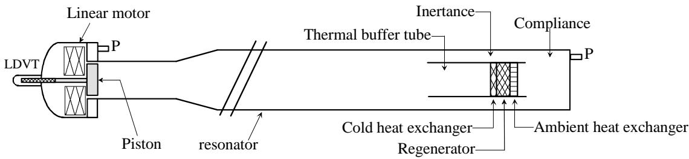
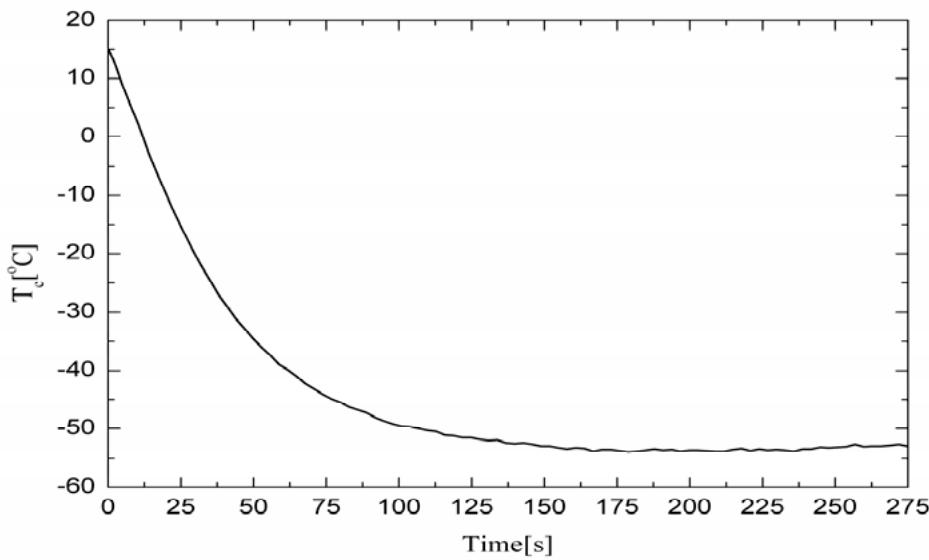
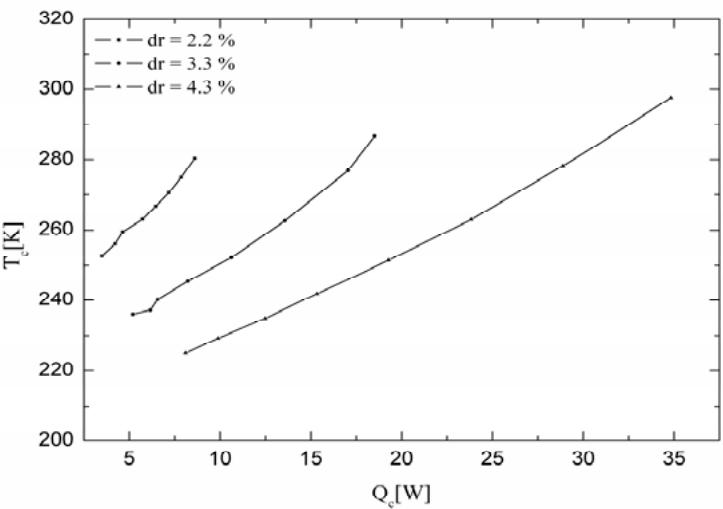
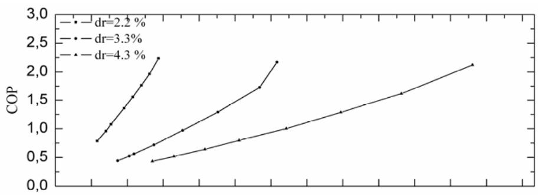
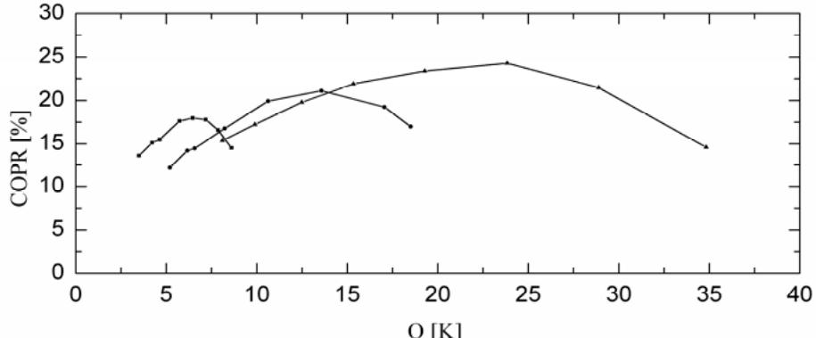
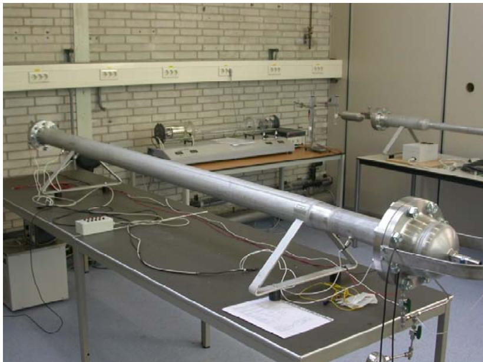
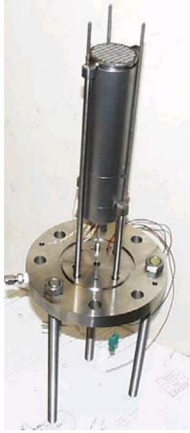
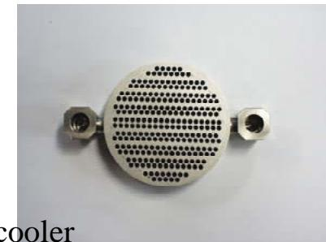
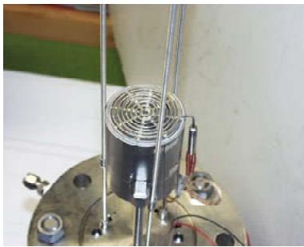
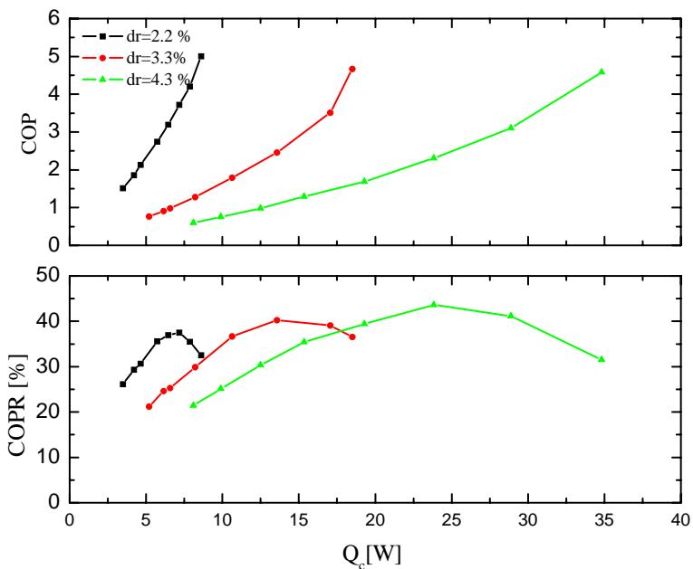

ECN-M--07-038

# Study of a thermo acoustic Stirling cooler

# Presented at the international congress on ultrasonics (ICU) Vienna, April 9-12, 2007

M.E.H. Tijani

S. Spoelstra

APRIL 2007

## Acknowledgement/Preface

This work has been funded by SenterNovem (Dutch agency for sustainable development and innovation) within the EOS-LT program (project number 7.6520).

## Abstract

A thermoacoustic-stirling cooler is built and performance measurements are performed. The cooler uses the acoustic power produced by a linear motor to pump heat through a regenerator from a cold heat exchanger to an ambient one. The cooler incorporates a compact acoustic network to create the traveling-wave phasing necessary to operate in a Stirling cycle. The network has a coaxial topology instead of the toroidal one usually used. The design, construction and performance measurements of the cooler are presented. A measured coefficient of performance relative to Carnot of 25% and a low temperature of -54°C are achieved by the cooler. This efficiency surpasses the performance of the most efficient standing wave cooler by almost a factor of two.

## Contents

List of figures 4   
1. Introduction 5   
2. Characteristics and design of the cooler 6   
3. Description of the cooler 7   
3.1 Linear motor 7   
3.2 Resonator 7   
3.3 Acoustic network 7   
3.4 Regenerator and Heat exchangers 8   
4. Measurements procedure and performance 9   
4.1 Instrumentation 9   
4.2 Powers 9   
4.3 Performance indicators 10   
5. Performance measurements 11   
6. Conclusions 13   
Literature 13   
Presentation 14

## List of figures

Figure 3.1 Schematic illustration of the thermoacoustic-Stirling cooler ..... ...7   
Figure 5.1 Temperature of cold heat exchanger as function of time.. .11   
Figure 5.2 Temperature of the cold heat exchanger as function of the heat load.....11   
Figure 5.3 Measured COP and COPR as function of the heat load for three different drive   
ratio's ... .. 12

## 1. Introduction

Since the beginning of 1980s until about 1999, most efforts in thermoacoustics have been focused on the development and understanding of standing-wave thermoacoustic systems [1]- [3]. These systems are relatively simple to design and build but because of the imperfect thermal contact between the working medium and the stack they are intrinsically irreversible. This means that these systems can not achieve high thermodynamic performance. In 1979, Ceperley showed that the time phasing between pressure and gas velocity in the regenerator of a Stirling system is that of a traveling acoustic wave [4]. However, the first attempt of Ceperley to built a traveling thermoacoustic engine did not succeed. This was due mainly to the viscous losses in the regenerator as a consequence of the low acoustic impedance (high velocity). It is only in 1999 that the first working traveling wave engine was demonstrated but at low efficiency [5]. The breakthrough in the development of thermoacoustic engines was realized by Backhaus et al. [6] in 2000 when they developed a traveling-wave thermoacoustic engine that achieved a measured thermal efficiency of 30%, corresponding to 41% of Carnot efficiency. They used a torus-shaped compact acoustic network to create the traveling-wave phasing necessary to operate in a Stirling cycle. The high efficiency is achieved only after that the Gedeon and Rayleigh streaming were reduced to a minimum level [6]. Although much effort is done in developing traveling wave thermoacoustic engines, there is little done for the development of traveling wave thermoacoustic heat pumps. Yazaki et al. built a pistonless cooler that achieved a low temperature of -27°C [7]. Poese et al. developed a traveling-wave thermoacoustic refrigerator for ice cream sales [8]. They used a hybride acoustic-mechanical system for the acoustic network and resonator. This leads to a compact device and the refrigerator achieved a performance of 19% relative to Carnot. Dai et al. developed a traveling-wave thermoacoustic cooler driven by a thermoacoustic engine that achieved a cooling power of 250 W at -22°C, but they did not measure the performance of the cooler [9].

The aim of this paper is to present a study of a traveling-wave (Stirling) cooler. The design, development, and performance measurements of the cooler will be presented. The remaining of this paper is organized as follows: Section B is devoted to the characteristics and design of the cooler. In section C, a description of the cooler is given. Section D describes the measurement procedure. Section E is devoted to the performance measurements. In the last section some conclusions related to the performance of the cooler are summarized.

## 2. Characteristics and design of the cooler

The cooler uses the same principle as that used by Backhaus and Swift [6]. The only departure is that our cooler uses a coaxial topology instead of the toroidal one. The coaxial configuration is easy to construct and compact. The cooler uses the acoustic power produced by a linear motor to pump heat against a temperature gradient. Argon gas at an average pressure of 15 bar is used as the working medium and the operation frequency is 60 Hz. The thermoacoustic-Stirling cooler consists mainly of four parts: a linear motor, a 1/2-wavelength resonator, a regenerator unit, and an acoustic network. The linear motor produces the acoustic power necessary for the heat pumping process. The resonator functions as a pressure vessel for the working gas, determines the acoustic resonance frequency and houses the regenerator unit. The regenerator unit consists of a regenerator and two heat exchangers. The acoustic network, comprising a feedback inertance, a compliance, and an acoustic resistance creates the traveling-wave phasing necessary to operate in a Stirling cycle and to feed back the acoustic power at the cold side to the ambient side. The regenerator and heat exchangers form an acoustic flow resistance. The acoustic network (including regenerator unit) is placed inside of the resonator at a location of high acoustic impedance (pressure antinodes). The choice of an acoustic operating frequency of 60 Hz is dictated in part by the mechanical resonance frequency of the linear motor. Argon gas is chosen because of the low sound velocity so that the length of the 1/2-wavelenght is reasonably short. The resonator is designed in order to achieve an acoustic resonance of 60 Hz. The average pressure is chosen as high as possible for a high energy density in the system. On the other hand, choice of a high pressure will result in a small hydraulic radius for the regenerator $\left( \mathrm { r } _ { \mathrm { h } } \right)$ . The acoustic network is designed to create the traveling-wave phasing necessary to operate in a Stirling cycle and a high acoustic impedance in the regenerator. The regenerator is designed so that the hydraulic radius is small compared to the thermal penetration depth $( \Gamma _ { \mathrm { h } } < < \delta _ { \mathrm { k } } )$ , the losses as low as possible and to achieve a given cooling power at a given temperature. The optimal design of the cooler is done with the computer code DeltaE [10]. In the next section the cooler will be described.

## 3. Description of the cooler

A schematic illustration of the thermoacoustic-Stirling cooler is shown in Figure 1. The cooler consists of a linear motor placed in a housing and attached to one end of a 1/2-wavelength resonator. The resonator is filled with argon gas at 15 bar. At the other end of the resonator a regenerator unit and an acoustic network are placed. A description of the different parts of the cooler will be given in the following.

  
Figure 3.1 Schematic illustration of the thermoacoustic-Stirling cooler

## 3.1 Linear motor

A linear motor is chosen to drive the cooler because of the high electroacoustic conversion efficiency (80%) in comparison with moving coil loudspeakers (3-5%). Furthermore, a linear motor can produce much more acoustic power than a conventional loudspeaker. Originally, the linear motor was designed for another thermoacoustic system by Q-drive. However, because of the long time which may be involved with the development of a new motor, we decided to use this existing one. We anticipated that some matching problems between the driver and the cooler may arise. The linear motor consists of a permanent magnet which moves in the magnetic field generated by an electromagnet structure. A piston with a diameter of 7.62 cm is attached to the moving magnet so that the oscillating movement of the magnet can be transmitted to the gas in the resonator. The linear motor is placed in a housing so that the pressurized gas is confined. The design frequency of the motor is 60 Hz and it is determined by the moving mass of the motor, the mechanical stiffness, and the stiffness of the back volume of gas.

## 3.2 Resonator

The resonator is designed in order to achieve an acoustic resonance frequency of 60 Hz. The total length of the resonator is 2.89 m and it is made of stainless steel. The resonator consists of three sections as shown in Figure 3.1. Starting at the driver side, the fist section is a pipe with a length of 30 cm and an inside diameter of 8.28 cm. The second section is a cone that adapts the 8.28 cm inside diameter pipe to a 9.55 inside diameter pipe and the length is 10 cm. The final section of the resonator which forms the main section is a pipe with a length of 2.49 m and an inside diameter of 9.55 cm. The small diameter pipe is used to adapt the linear motor with the large diameter pipe.

## 3.3 Acoustic network

The compact acoustic network used to create the local traveling-wave phasing and the high acoustic impedance in the regenerator consists of the resistance of the regenerator unit, a compliance and a feedback inertance. A thin-wall cylindrical tube which forms a holder for the regenerator, heat exchangers, and the thermal buffer tube is placed at the right end of the large diameter pipe (c.f. Figure 3.1). The cylindrical volume of gas confined between the closed end of the resonator and the right side of the holder forms the acoustic compliance. The annular space between the resonator and the holder forms the feedback inertance. The regenerator holder is attached to the cover plate used to close the end of the resonator. The cover plate contains also some feed through for thermocouples, wires for the electrical heater used to generate heat load for the cooler, and tubing for the cooling water for the ambient heat exchanger.

## 3.4 Regenerator and Heat exchangers

The regenerator consists of a 11 mm thick stack of 280-mesh twilled-weave stainless-steel screen punched at a diameter of 55 mm. The diameter of the screen wire is 28 μm. The stack is placed in a thin-wall tube. The calculated hydraulic radius of the regenerator is about 22 μm which is smaller than the argon's thermal penetration depth (about 90 μm at 300 K). The water cooled ambient heat exchanger is of the type tube-and-shell design with a diameter of 55 mm. The tubes, which are parallel to the acoustic displacement, carry argon gas. The tubes have a diameter of 2 mm and a length of 15 mm. They are cooled by chilled water passing through channels perpendicular to the tubes. The cold heat exchanger consists of a spiral electrical heater with a diameter of 55 mm. The diameter of the heater wire is 1.6 mm.

## 4. Measurements procedure and performance

The characterization of the performance of the cooler requires knowledge of many quantities like temperatures, dynamic pressures at different locations of the systems, and displacement of the piston. In the following a description of the instrumentation used for the measurements and the expressions used to determine the different powers are given.

## 4.1 Instrumentation

Several type-K themocouples with a diameter of 0.5 mm are used to measure the temperature at different locations in the cooler. Three thermocouples are used to measure the temperature through the regenerator and are centered radially: one at the cold side, one at the centre, and one at the ambient side. The axial temperature profile within the regenerator is used to detect Gedeon streaming [6]. Two other thermocouples are placed equidistant on the inside wall of the thermal buffer tube. The temperature profile measured by these two thermocouples is used to detect the presence of either Rayleigh or jet-driven streaming [6]. Finally, 2 mm-thick thermocouples are used to measure the inlet and outlet temperatures of the water stream supplying the ambient heat exchanger. Several piezoresistive pressure sensors are placed throughout the system. One pressure sensor is placed at the location of the piston of the linear motor to measure the dynamic pressure at that location. One pressure sensor is placed on the end plate of the resonator to measure both static and dynamic pressure. Two other pressure sensors are placed on the resonator just at the front of the heat pump unit to measure the effective acoustic power input to the heat pump part using the two-microphone method. The acoustic power input produced by the linear motor can be deduced from the measurement of the dynamic pressure and the volumetric velocity at the piston location. The velocity of the piston is deduced from the displacement measurement of the piston. A displacement sensor (LVDT), mounted on the back of the piston, is used to measure the displacement.

## 4.2 Powers

The determination of the performance of the cooler requires the knowledge of different powers and temperatures in the system. The acoustic pressure and displacement measurements are made with a lock-in amplifier. The thermocouples signals are read by a data logger and send to a computer for record and display. In the following the different powers will be defined. The acoustic power input from the motor is given by

$$
\dot { W } = \frac { 1 } { 2 } p u A \cos \varphi ,\tag{4.1}
$$

where $p$ is the amplitude of the dynamic pressure at the location of the piston, u is the velocity of the piston, A is the area of the piston, and $\varphi$ is the phase difference between $p$ and u. The velocity is deduced from the displacement through $u { = } \omega d ,$ where d is the displacement and ω is the angular frequency.

The heat load is simulated by an electrical heater. A power supply is used to apply electric power to the heater and generates heat load given by

$$
\dot { Q } _ { c } = { \cal { W } } I ,\tag{4.2}
$$

where V is the voltage across the heater and I is the current. The heat extracted at the ambient side of the regenerator by cooling water flowing through the ambient heat exchanger is given by

$$
\begin{array} { r } { \dot { Q } _ { a } = \rho c _ { p } U ( T _ { o u t } - T _ { i n } ) , } \end{array}\tag{4.3}
$$

where $\rho$ is the density of water, $c _ { p }$ is the specific heat, U is the volume flow rate of water, and $T _ { i n }$ and $T _ { o u t }$ are the input and output temperatures of the water stream flowing through the ambient heat exchanger. The volume flow rate is measured with a turbine flow meter.

## 4.3Performance indicators

The performance of the cooler also, called the coefficient of performance (COP), is given by

$$
C O P = \frac { \dot { Q } _ { c } } { \dot { W } } ,\tag{4.4}
$$

where W and $Q _ { c }$ are given in (1) and (2). The Carnot coefficient of performance is the maximal theoretical performance a cooler can achieve and it is given by

$$
C O P C = \frac { T _ { c } } { T _ { a } - T _ { c } } ,\tag{4.5}
$$

$$
C O P R = { \frac { C O P } { C O P C } }
$$

where $T _ { c }$ is the temperature of the cold heat exchanger and $T _ { a }$ is the temperature of the ambient heat exchanger. The coefficient of performance relative to Carnot is defined as the ratio

(4.6)

## 5. Performance measurements

A cool-down measurement at drive a ratio of 4% is shown in Figure 5.1. Initially, the cooler was at room temperature and once the linear motor is switched on, the temperature of the cold side drops quickly and reaches a low temperature of ${ } _ { - 5 4 } { } ^ { \circ } \mathrm { C }$ without any insulation on the cold side. The cooler needs only 2 min to reach such a low temperature. Because of the coaxial topology used for the cooler it is not possible to use insulation at the cold side in the present design. Using insulation will block the inertance flow area.

  
Figure 5.1 Temperature of cold heat exchanger as function of time

Figure 5.2 shows the cold end temperature as function of the heat load for three different dive ratio's. Tcis a linearly increasing function of the heat load. High dive ratio's lead to low temperatures and high heat loads.

  
Figure 5.2 Temperature of the cold heat exchanger as function of the heat load

Figure 5.3 shows the COP and COPR as function of the heat load for three different dive ratio's. For all drive ratio's, the COP increases as the heat load increases. The slope of the COP curves decreases as the drive ratio increases. The COPR shows a parabolic behavior with a maximum which shifts to higher heat loads as the drive ratio increases. The maximum COPR achieved with the cooler is 25% at $\mathrm { Q } _ { \mathrm { c } } \mathrm { = } 2 5$ W and $\mathrm { T _ { c } } = - 1 1 { } ^ { \circ } \mathrm { C }$ at dr = 4.3%. At this operating point the losses in the resonator amount about 10 W. This is half the power input. Excluding the resonator losses a COPR of 45% is deduced. This means that the regenerator unit is operating properly in a Stirling cycle. To improve the performance of the cooler the losses in the resonator have to be minimized by using a 1/4-wavelength resonator. This can result in a COPR of about 35%. There is also a matching problem between the driver and the cooler which limits the acoustic input power to maximal 25 W at dr = 4%. A further improvement of the performance of the cooler can be achieved by optimizing the matching between the driver and cooler, and by using thermal insulation.

  
Figure 5.3 Measured COP and COPR as function of the heat load for three different drive ratio's

## 6. Conclusions

A thermoacoustic-stirling cooler is built and performance measurements are performed. The cooler achieved a coefficient of performance relative to Carnot of 25% and a low temperature of $- 5 4 ^ { \circ } \mathrm { C }$ . Half of the acoustic power input to the cooler is dissipated in the resonator. Reduction of the resonator losses by using a 1/4-wavelength resonator will result in a COPR of about 35%. Further improvements of the performance of the cooler may be achieved by optimizing the matching between the driver and cooler, and by using thermal insulation.

## Literature

[1] Hofler, T.J.: Thermoacoustic refrigertaor design and performance. PhD dissertation, physics departement, University of Clifornia at San Diego, 1986.

[2] Garrett, S., J.A. Adeff and T.J. Hofler: Thermoacoustic refrigerator for space applications. J. of Thermophysics and Heat transfer, vol. 50, pp. 595, 1993.

[3] Tijani, M.E.H., J.C.H. Zeegers and A.T.A.M. Waele: Construction and performance of a thermoacoustic refrigerator. Cryogenics, Vol. 42, pp. 59-66, 2002.

[4] Ceperley, P.H.: A pistonless Stirling engine-the traveling wave heat engine. J. Acoust. Soc. Am, vol. 66, pp. 1508, 1979.

[5] Yazaki, T., A. Iwata and T. Maekawa: Traveling wave thermoacoustic heat engine in looped tube. Phys. Rev. Lett., vol. 81, pp. 3128, 1998.

[6] Backhaus, S. and G.W. Swift: A thermoacoustic Stirling heat engine: Detailed study. J. Acoust. Soc. Am, vol. 107, pp. 3148, 2000.

[7] Yazaki, T., T. Biwa and A. Tominaga: A pistonless stirling cooler. App. Phys. Lett., vol. 80, pp. 157.

[8] Poese, M.E., R. Smith and S. Garrett: Regenerator-base thermoaocustic refrigerator for ice cream storage applications. J. Acoust. Soc. Am, vol. 114, pp. 2328, 2003.

[9] Dai, W. and Luo, E.: Detailed study of a traveling wave thermoacoustic refrigerator driven by a traveling wave thermoacoustic engine. J. Acoust. Soc. Am, vol. 119, pp. 2686, 2006.

[10] Ward W. and G.W. Swift: Design Environment for Low Amplitude Thermoacoustic Engine. J. Acoust. Soc. Am, vol. 95, pp. 3671, 1994.

# Study of a thermoacoustic-Stirling cooler

## Hassan Tijani

## Content

Introduction

Characteristics of the thermoacoustic-Stirling cooler

Design and construction of the cooler

Performance of the cooler

Conclusions

## ECN

## Design and construction of the cooler

Modeling program DeltaE is used to design the cooler

Cooler consists mainly of four parts:

Driver (linear motor)

Resonator

Regenerator unit

Acoustic network

  
Energy research Centre of the Netherlands

Energy research Centre of the Netherlands

  
cooler

