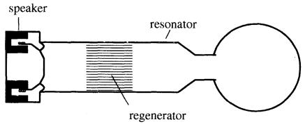
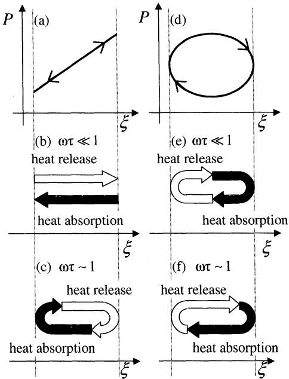
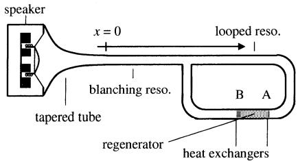
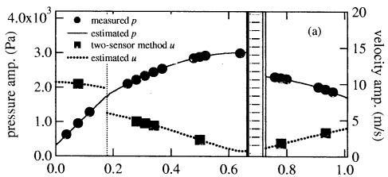
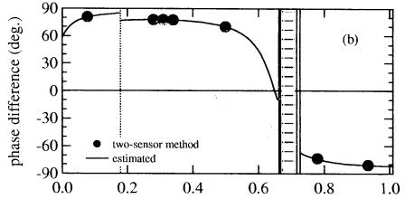
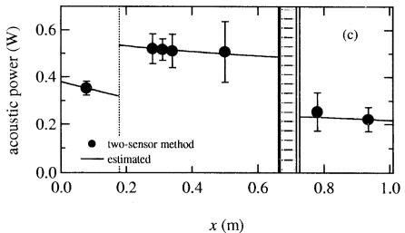
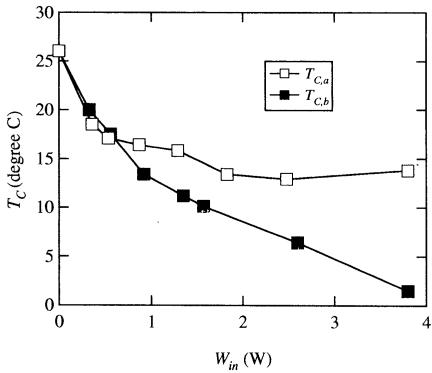
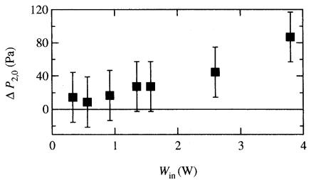
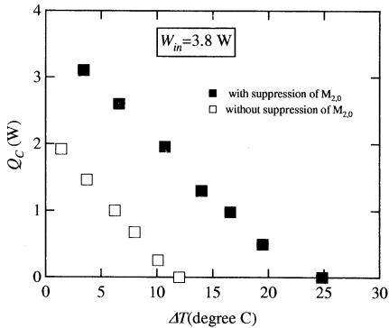

# 進行波音波を用いた共鳴管冷凍機\*

上田祐樹\*1，加藤千幸\*1

# Traveling-Wave Thermoacoustic Refrigerator

Yuki UEDA\*2 and Chisachi KATO

\*2 Institute of Industrial Science, The University of Tokyo, 4-6-1 Komaba, Meguro-ku, Tokyo, 153-8505 Japan

A new type of speaker-driven thermoacoustic refrigerator is described. By the measurement of the acoustic field formed in the refrigerator, it is shown that the refrigerator uses a traveling-acoustic wave for heat pumping through ideally reversible heat transfer. It is also shown that the efficiency of the refrigerator is improved by the suppression of mass flow through a regenerator. The new refrigerator has a potential to realize a high efficiency compared with previous speaker-driven thermoacoustic refrigerators using standing-acoustic wave because previous ones use intrinsically irreversible heat transfer.

Key Words: Energy Conversion, Heat Pump, Refrigeration, Thermoacoustics

## 1. 緒 言

音波が管内を伝ぱすると，管の軸方向にヒートポンプ効果が現れる．この音波によるヒートポンプ効果はMerkli-Thomannによって1975年に初めて観測された(1)。その後，この効果を応用した共鳴管冷凍機が開発された(2)。共鳴管冷凍機は音波による圧縮・膨張を利用してヒートポンプ効果を実現するため，スピーカなどの音響入力源以外の可動部を必要としない。また，この冷凍機では空気やへリウムなど環境に負荷を与えない気体が作動流体として用いられている．そのため，共鳴管冷凍機は簡単構造で低環境負荷という利点をもっている。現在，最も高い共鳴管冷凍機の成積係数COPはカルノーヒートポンプの成績係数COPcarnotの20%程度(3)である.

これまでに開発されてきた共鳴管冷凍機の概略図を図1に示す．共鳴管冷凍機はスピーカ，共鳴管，蓄熱器で構成されている．共鳴管の一端はスピーカで閉じられ，もう一端は開端もしくは閉端になっている．スピーカを用いて共鳴管内の気柱を共鳴周波数で加振すると，定在波音波が共鳴管内に励起する。この定在波音波による流体の圧力変動と流速変動によって，ヒ一トポンプ効果が蓄熱器(regenerator)において生じる.2章で詳しく述べるが，圧力と流速が同位相で変動する進行波音波とπ/2ずれて変動する定在波音波はそれぞれ異なるメカニズムでヒートポンプ効果を実現する(4)，進行波音波は本質的に流体要素と管壁の可逆的な熱交換を利用し，定在波音波は不可逆的な熱交換を利用する。可逆的な熱交換を利用する進行波音波によるヒートポンピングを用いたほうが,定在波音波によるヒートポンピングを用いた場合に比べて,高いCOPが実現される可能性がある(5).しかし，上述のように従来の共鳴管冷凍機では定在波音波によるヒー卜ポンピングが用いられている.

本論文では，進行波音波を用いてヒートポンプ効果を得る新しいタイプの共鳴管冷凍機について述べる.図1に示した共鳴管冷凍機の共鳴管内には，その形状が原因となって定在波音波が励起する，これに対して，1998年以降の熱音響エンジンの研究(6)\~(8)と熱駆動熱音響冷凍機の研究(9)\~(12)により，ループ状の管内には，進行波音波の励起が可能であることが明らかになってきた．そこで,著者らはループ状の管を共鳴管として用いた共鳴管冷凍機を製作した，装置内に励起させた音波による圧力変動を測定することで，製作した冷凍機内で進行波音波によるヒートポンピングが行われていることを確認した．また,この冷凍機のCOPの改善策を施し，その効果を実証した.

  
Fig. 1 Standing-wave thermoacoustic refrigerator

## 2.音波によるヒートポンプ効果

音波によるヒートポンプ効果を考えるうえで，二つのパラメータが重要になる(4)(6)。一つは圧力変動と流速変動の間の位相差であり，もう一つは音波の角振動数ωと熱緩和時間τ の積ωτである.τは流体要素とそれを囲む固体壁が熱平衡に達するまでの緩和時間を示し，流路半径rと流体要素の熱伝導度κ，平均密度 $\rho _ { m } ,$ 定压比熱 $C _ { \mathcal { P } }$ を用 $\scriptstyle \log \ \tau = ( r ^ { 2 } c _ { p } \rho _ { m } ) / ( 2 \varkappa )$ と書ける.

まず，位相差φについて述べる．音波の伝ぱ方向にx軸をとったとき，音波による流体要素の圧力変動Pは時間t と位置x の関数として

P(x, t) = p(x)cos ωt .. ……(1)と書け，流速変動 $\boldsymbol { U } ( \boldsymbol { x } , t )$ は位相差Φ(x)を用いて

$$
\begin{array} { r l } & { U ( x , t ) { = } u ( x ) { \cos \{ \omega t + \phi ( x ) \} } } \\ & { \quad { = } u ( x ) { \cos \phi ( x ) } { \cos \omega t \ \cdots } } \\ & { \quad { + } u ( x ) { \sin \phi ( x ) } { \cos ( \omega t + \pi / 2 ) } } \end{array}\tag{……(3}
$$

(2)

と書ける. $\Sigma \subset \mathbb { C } , \ p ( x ) > 0 , \ u ( x ) > 0 \ ,$ と約束し，一π≤Φ≤πとする．自由空間を伝ぱする進行波音波でのΦはxに依存せず,つねに零かπである．そこで,u cosΦを流速の進行波成分と呼ぶことにする(6).一方，散逸を伴わない定在波音波では圧力の節や腹を除いた位置でΦはつねにーπ/2かπ/2になる.そこで,usinのを流速の定在波成分と呼ぶことにする．流速と同様に変位 $\xi \ \not \in \supset \ \supset \ \varnothing \ .$ 成分に分けられる：

$$
\begin{array} { c } { { \xi ( x , t ) { = } \xi _ { 0 } ( x ) { + } \displaystyle { \frac { u ( x ) } { \omega } } \cos \{ \omega t { + } \emptyset ( x ) { - } \pi / 2 \} } } \\ { { { } } } \\ { { { = } \displaystyle { \hat { \xi } _ { 0 } ( x ) { + } \frac { u ( x ) } { \omega } \cos \ \phi ( x ) \mathrm { c o s } ( \omega t { - } \pi / 2 ) } } } \\ { { { { } } } } \\ { { { { + } \displaystyle { \frac { u ( x ) } { \omega } } \sin \ \phi ( x ) \mathrm { c o s } \ \omega t . } } } \end{array}
$$

$\textsf { Z } \subset \mathbb { C } \ \bar { \xi } _ { 0 }$ は流体要素の平均位置を表す. u/ω cos Φを変位の進行波成分，u/ωsinΦを定在波成分と呼ぶことにする，管内を伝ぱする音波は一般に純粋な進行波でも，純粋な定在波でもない。そのため，位相差Φは管内の軸方向の位置xに依存し，進行波成分と定在波成分の割合はxに依存する(6)(10)(11)(13).そこで「定在波音波」と「進行波音波」の表現の代わりに，位相差 $\textcircled { 1 } \downarrow = \downarrow > \downarrow \uparrow \textcircled { 1 }$ 割合が決定される「定在波成分と「進行波成分」を用いて議論を進める.

  
Fig. 2 Schematic illustration of the mechanism of heat pumping executed by the standing wave component (a)-(c) and traveling wave component (d)−(f)

次にωτ(4)(6)について述べる．ωτは流体要素と固体壁の間で行われる熱交換を特徴づけるパラメータである．ωτが1より十分小さいとき，流体要素の温度は固体壁の温度とつねに等しい。そのため，流体要素と固体壁の間の熱交換は等温可逆的に行われ，流体要素の圧力変動とエントロピー変動の位相はπだけずれる．ωτが1より十分大きいとき，流体要素は固体壁と熱交換せず，エントロピーは変動しない. $\omega \tau \not \supset ^ { \vec { \Omega } }$ 1程度のとき，流体要素の圧力が変動すると，流体要素の温度と固体壁の温度に差ができる．この温度差による熱伝導に起因して流体要素と固体壁は不可逆的に熱交換する．このとき，流体要素の圧力変動とエントロピー変動の位相差はπから1程度遅れる(14).

2·1 定在波成分による熱輸送 $\scriptstyle 0 < \phi < \pi \ \mathcal { O }$ とき，変位の定在波成分と圧力Pの関係は図2(a)のようになる．この状態でωτが1より十分小さい場合を考える。この場合，上でも述べたように流体要素の温度と固体壁の温度はつねに等しい．そのため,図2(b)に模式的に示したように,右に移動しながら圧縮されるときに流体要素は固体壁へ放熱する．その後,左に変位しながら膨張するときに，放熱したのと同量の熱量を吸熱する．放熱する場所と吸熱する場所が同じなので,時間平均すると流体の振動による熱流\*\*1は生じず,ヒートポンプ効果は得られない(14).

ωτ～1の場合を考える，エントロピー変動と圧力変動の間の位相差により，ωτ～1では圧力が上昇し始めるタイミングから1/(2π)周期程度遅れてから,流体要素は固体壁に放熱し始める．また，圧力の下降時も，下降した瞬間から1/(2π)周期程度遅れてから，流体要素は固体壁から吸熱し始める．この遅れの結果，図2(c)に模式的に示したように吸熱・放熱のタイミングと変位のタイミングがずれて，左から右へ向かう熱流が生じる.

定在波成分によって生じる熱流の向きはのの値に依存する，u>0, p>0としたので,P-ξの傾きはsinΦの符号によって決まる．一πくΦく0のときはPーξの描く軌跡は負の傾きをもつ．これは,図2(a)に示したのとは逆に，流体要素は左に変位しながら圧縮され，右に変位しながら膨張することを意味している。したがって，ーπくΦく0かつωτ\~1のとき，熱流の向きは図2(a)中を右から左に向かう．定在波成分による熱流の向きをまとめると以下のようになる．一πくΦく0のとき，熱流はξの負の方向に向かい0くのくπのとき，熱流はξの正の方向に向かう.

2·2 進行波成分による熱輸送-π/2<Φ<π/2のとき，変位の進行波成分と圧力Pの関係を図2(d)に示す，ωτく1の状況下で進行波成分によって実行されるヒートポンプ効果について考える．これまでにも述べたように，ωτく1が満たされると，流体要素は壁と等温可逆的に熱交換する。そのため，P-ξが描くだ円の左半分の過程で，図2(e)に模式的に示したように流体要素は固体壁に放熱する，そして，右半分の過程で固体壁から吸熱する，放熱する位置と吸熱する位置が異なるので,1サイクルで図2(d)の右から左への熱流が生じる(14).

ωτ～1でも進行波成分によるヒートポンプ効果は生じる．ωτ\~1のとき，上記したように，圧力変動とエントロピー変動に位相遅れが生じる．その結果，図2(f)に模式的に示すように，放熱と吸熱のタイミングが図2(e)に比べて遅れる．しかし,右から左へ向かう熱流は生じる．図2(e)と図2(f)を比べるとわかるように，圧力振幅と変位振幅の大きさがそれぞれ同じであれば,ωτく1の場合に比べるとωτ\~1のときのほうが1サイクルあたりに輸送される熱量が少なくなる.

P-ξ平面に進行波成分が描くだ円は-π/2<Φ<π/2で時計回りに回り，π/2<Φ<πおよび−π/2<Φくーπで反時計回りに回る。そのため，進行波成分による熱流の方向もΦに依存する.つまり，一π/2くΦくπ/2のときは,図2(e),(f)で示したように右から左へ向かう熱流が生じ，π/2くΦくπおよびーπくの<一π/2のときは左から右へ向かう熱流が生じる.

熱交換の仕方の違いから，ωτ\~1で生じるヒートポンプ効果を利用する冷凍機のCOPに比べて，ωτ《1で生じるヒートポンプ効果を利用する冷凍機のCOPのほうが高くなる可能性がある，ωτく1の環境下で実行されるヒートポンプ効果を実現するためには，蓄熱器内での流路径を小さくし，かつ，蓄熱器において位相差のを零に近づければよい.

## 3. 実験装置

本研究では，蓄熱器内における位相差Φを零に近づけるために，進行波音波の励起を可能にするループ管を用いて共鳴管を製作した．また，ωτく1を実現するためにステンレス製のメッシュを用いて蓄熱器を製作した.

製作した共鳴管冷凍機の概略図を図3に示す，共鳴管冷凍機はスピーカ，テーパ管，枝管，ループ管で構成されている.スピーカ(MorelAcousticsUSA，MW-142)は音響用のパワーアンプ(YAMAHA，P2500 S)を経由して，発振機(NF，WF19431)につながれている。この発振機から角振動数ωの正弦波を出力し，スピーカを振動させる.

  
Fig. 3 Experimental setup

テーパ管の長さは0.15mであり，その内径は160mmから24mmまで指数関数的に小さくなっている.枝管の内径は24mm，長さは0.18mである.枝管とループ管はT字形の管で結ばれている．ループ管の内径は24mmで平均周長は0.83mである.装置内には作動流体として大気圧空気が内封されている.

ステンレス製のメッシュを長さ50mmに積層させて製作した蓄熱器がループ管内に挿入されている．蓄熱器の外径は24 mmであり，水力半径γは0.1 mmである．水力半径を用いて，蓄熱器内での熱緩和時間τを算出すると $2 \times 1 0 ^ { - 4 } \ \mathrm { s }$ となる．蓄熱器両端には長さが10mmの熱交換器Aと長さが5mmの熱交換器Bの設置されている．両方の熱交換器はともに幅1mmの穴が間隔0.5mmでスリット状にあいた構造をしている．蓄熱器の中心はx=0.70mにある．ここで，x軸の原点は，図3に示したように，テーパ管と枝管の接合点にとり，正の方向は枝管内では左から右へ向いており，ループ管内では時計回りに向かっている.枝管の長さが0.18mなので,x=0.18mに枝管とループ管の接合点がある．また，ループ管の周長が0.83mなので，x=0.18mと $\mathcal { x } { = } 1 . 0 1 \mathrm { m }$ は同じ位置を指す。

枝管およびループ管の壁に細管(内径2mm,長さ10mm)をつけた．この細管に小形圧力センサ(Toyodakoki, DD 102,共鳴周波数 5 kHz)を取付けた(16).この圧力センサから出力された信号をフーリエ交換することで，圧力のωで振動する成分の振幅および位相を得た。一端は閉じられ，もう一端はスピーカにつながれた共鳴管を用いた実験から，異なる位置で測定された圧力変動間の位相差の測定誤差は±0.1°と見積もられた。

発振機から出力する正弦波の周波数 $f = \omega / ( 2 \pi )$ を変えながら，装置内の圧力振幅を測定した，その結果，$f { \sim } 1 1 0 \ \mathrm { H z }$ で共鳴状態になることがわかった．この周波数110Hzにfを固定した.f=110Hzを用いると蓄熱器でのωτは室温で0.1になる．ωτ=0.1では，圧力変動による温度変動は流路断面にわたってほとんどなく(15),流体と固体壁の温度はほぼ等しい.

## 4. 音場の測定

1章でも述べたように，熱音響エンジンや熱駆動熱音響冷凍機の研究によって，ループ状の共鳴管内には進行波音波の励起が可能であることが報告されている．しかし，ループ状の管内に定在波音波が励起することも確認されている(16)(17)．そこで,装置内の音波を調べるために，管壁に取付けた圧力センサを用いて装置内の圧力変動Pを測定した．さらに測定した2点の圧力[P(x1), P(x2)]から流速 $U ( x _ { 1 } / 2 + x _ { 2 } / 2 )$ を算出した．圧力測定から流速Uを求める方法(以後，2センサ法と呼ぶ)の詳細は文献(18)を参照されたい.

4·1 圧力振幅 p，流速振幅 u，位相差 ∅ の分布測定した圧力変動の振幅pおよび,2センサ法により算出した流速振幅uと圧力と流速の間の位相差Φの分布を図4(a)，(b)に示す．また，付録に示した管内を音波が伝ぱするようすを表現する式と実験デー夕を用いて求めたpとu,およびのの分布を線で示した.2センサ法に用いられる式[文献(18)の式(20)]から見積もった流速振幅uと位相差Φの誤差はそれぞれ図4中に示したシンボルの大きさ以下であった.そのため，図4(a)，(b)には,エラーバーが記されていない.

図4(a)からわかるように,圧力振幅はx=0.12mで940 Paとなり,蓄熱器までは $( x < 0 . 6 7 \mathrm { m } ) x \mathrm { ~ } \mathcal { O }$ 增加とともに増加する.一方，流速振幅はx=0.12mで10m/sとなり，流路が分岐するx=0.18mで不連続的に小さくなり，蓄熱器までは(x<0.67m)x の増加とともに減少している．これら分布から判断して，装置内では，1/4波長共鳴が起こっているといえる.

  
Fig.4 Acoustic field formed in the refrigerator. (a) The distributions of pressure amplitude p and velocity amplitude u. (b) The distribution of the phase difference Φ between pressure P and velocity U. (c) The distribution of acoustic power flow W

図4(b)に示した圧力と流速の間の位相差Φの分布に注目する，枝管内0m<x<0.18mやループ管内の一部の領域0.18m<x<0.4mではΦは90°に近い値になっている，しかし，のは蓄熱器付近で零になり，蓄熱器の一端では5°程度，もう一端では50°程度になっている．したがって，蓄熱器内では進行波成分が支配的である.

蓄熱器内ではωτ=0.1であり，上述のように実験により進行波成分が支配的であることがわかった。これは，蓄熱器内において，等温可逆的な熱交換を利用した進行波成分によるヒートポンプ効果が生じていることを示している．蓄熱器内において $- \pi / 2 < \phi < \pi / 2$ なので，進行波成分による熱流の向きは，x軸の負の方向である。つまり，熱交換器Bから熱交換器Aの方向になる．そこで，熱交換器Aを温度 $T _ { H } { = } 2 6 ^ { \circ } \mathrm { C } \ l \ l \ l ^ { , }$ 保ち，熱交換器Bの温度 $T _ { C }$ をK形熱電対で測定した。その結果， $T _ { \cal C }$ は室温より約8C低い18.5Cになった。

4·2音響パワーの分布共鳴管冷凍機ではスピーカから音響パワーWが入カされ，音響パワーWが蓄熱器内で熱流にエネルギー変換される，装置に投入された音響パワーや蓄熱器に投入された音響パワーを明らかにするために，装置内の音響パワーの分布を調べた.

音響パワーWは流路断面積A，圧力P，流速Uを用いて

$$
W { = } A f \int _ { 0 } ^ { \tau } P U d t ~ { \scriptstyle \cdots } { \scriptstyle \cdots } { \scriptstyle \cdots } { \scriptstyle \cdots } { \scriptstyle \cdots } { \scriptstyle \cdots } { \scriptstyle \cdots } { \scriptstyle \cdots } { \scriptstyle \cdots } { \scriptstyle \cdots } { \scriptstyle ( \ 5 \ ) }
$$

と定義されている．ここでTは周期 $( = 1 / f )$ である.定義からわかるように，Wの大きさは図2(d)に示した進行波成分がP-ξ平面に描くだ円の面積に周波数fと断面積Aを書けた値になる．Wの符号はその方向を表す，正の値のとき，Wはx軸の正の方向へ向かい,負の値のとき，x軸の負の方向へ向かう．式(1)および式(2)を式(5)に代入することで

$$
W { = } \frac { A } { 2 } { p u } \cos \Phi \ { \cdots } { \cdots } { \cdots } { \cdots } { \cdots } { \cdots } { \cdots } { \cdots } { \cdots } { \cdots } { \cdots } { \cdots } { \cdots } { \nonumber } ( \ 6 )
$$

が得られる.

図4(a),(b)に示したp, u,Φを用いて求めたWの分布を図4(c)に示す．図4(c)からわかるようにWはどの位置xでもつねに正の値をとっている．これは，Wの方向がx軸の正の方向であることを示している．した $x ^ { 8 } > 4$ ，Wは枝管内をスピーカから枝管とループ管との付け根の方向に進み，ループ管内を時計回りに進む.

図4(c)から，x=0mでのWが0.38Wであることがわかる．この値がスピーカから冷凍機に投入された音響パワーの大きさである．Wはxの正の方向へ進み，x=0.12mでは，その大きさが0.35Wに減少している．減少した原因は，粘性と熱伝導により，散逸が生じたためである．Wはさらにxを正の方向へ進み分岐点であるx=0.18mに達する．この点で，不連続的にWは大きくなっている．その結果,スピーカから入力された音響パワーW(x=0)を上回る音響パワーが蓄熱器へ入力されている．蓄熱器ではエネルギー変換と狭い流路内で起こる散逸の結果，音響パワーは他の位置に比べて大きく減少する．蓄熱器低温端(x=0.73m)から出力された音響パワーは，x=1.01m(=0.18m)でスピーカから入力された音響パワーと合流し，再び蓄熱器に入力される．この合流が上記したx=0.18mでWが不連続的に大きくなった原因である.

上述のように，製作した共鳴管冷凍機では，ループ状の経路が存在することで，蓄熱器から出力された音響パワーは再び蓄熱器に入力されていた．図1からもわかるように，従来の共鳴管冷凍機では音響パワーの再利用は実現されない。進行波成分を用いた冷凍機では蓄熱器低温端から出力された音響パワーが再び蓄熱器に入力されるとき，その冷凍機のCOPの上限値は$\mathrm { C O P } _ { \mathrm { c a r n o t } } { = } T _ { c } / ( T _ { H } - T _ { c } )$ に等しくなり,されない場合のCOPの上限値 $T _ { C } / T _ { H }$ を上回る(9)(19).したがって，ループ状の共鳴管を利用することは，進行波成分によるヒートポンプ効果を実現させるだけでなく，COPの改善にも寄与する可能性がある.

## 5. 冷凍機の性能

5·1 低温端の温度の音響パワ一依存性計測可能な最も小さなxでの音響パワーW(x=0.12)をWinと定義し， $W _ { \mathrm { i n } }$ を変えながらTcを測定した．測定した $T _ { C }$ を $T _ { C , a }$ として，図5に白抜きの四角で示した，なお，黒四角で示した $T _ { c , b }$ については6章で述べる．図5からわかるように， $W _ { \mathrm { i n } }$ を零から徐々に増加させると， $T _ { C , a }$ は低下した. $W _ { \mathrm { i n } } { = } 1 . 8 \mathrm { ~ W ~ } \mathcal { O }$ とき，$T _ { c , a }$ は13.4℃となった.しかし, $W _ { \mathrm { i n } } { > } 1 . 8 \mathrm { W }$ では$W _ { \mathrm { i n } }$ を増加させても，ほとんど $T _ { C , \alpha }$ は変化しなかった.

蓄熱器に流れ込むWを増加させても，蓄熱器の低温端の温度が減少しない現象は熱駆動熱音響冷凍機で

……(10)

  
Fig. 5 Measured $T _ { c }$ as a function of $W _ { i n }$

も確認されている(9)(10)．この原因としてループ状の流路を周回する質量流 $M _ { 2 , 0 } \ O D$ 影響が指摘されてい${ \mathcal { Z } } ^ { ( 9 ) ( 1 0 ) }$ ．質量流 $M _ { 2 , 0 }$ は

$$
M _ { 2 , 0 } { = } A f \int _ { 0 } ^ { T } { \rho } U d t + A \rho _ { m } U _ { 2 , 0 }\tag{7}
$$

と書ける(9). $\rho$ は密度の平均値 $\rho _ { m }$ からのずれを表す.また $U _ { 2 , 0 }$ は，流速が周期的に変動するために誘起される二次的な流速 ${ \mathcal { C } } ,$ 時間に依存しない．質量流 $M _ { 2 , 0 }$ が有限であると，熱負荷 $Q _ { \mathrm { l o a d } } { = } M _ { 2 , 0 } c _ { \phi } ( \mathrm { \Delta } T _ { H } - T _ { C } )$ が低温熱交換器に加わる $\phi > { \bar { \zeta } }$ 冷凍機の性能は低下す${ \bf \mathcal { Z } } ^ { ( 9 ) } .$

$\mathbf { 5 } { \cdot } \mathbf { 2 }$ 質量流の抑制冷凍機の性能を向上させるために，質量流 $M _ { 2 , 0 } \ O D$ 抑制を試みた．質量流はゴム膜によって抑制できると報告されている9)．そこで,著者らはゴム膜(風船)を装置内に設置した．ゴム膜の変位をできるだけ小さくするために，ゴム膜の設置位置は流速の節付近であるx=0.65mとした.

式(7)の右辺の第1項はWと同じ符号をもち，その大きさはWの大きさに比例する．なぜなら

$$
\int _ { 0 } ^ { T } \rho U d t \propto \frac { \rho _ { m } } { P _ { m } } \int _ { 0 } ^ { T } P U d t\tag{8}
$$

の関係が満たされる(3)からである．した $x ^ { 8 } > 7$ ，式(7)の右辺の第1項の符号と大きさはWに依存する．一方，第2項の符号と大きさは音波によって誘起される時間に依存しない二次的な圧力 $P _ { 2 , 0 } \ O \Sigma$ う配に依存する．なぜな $\dot { 5 }$ $P _ { 2 , 0 } \mathcal { O } \subseteq \tilde { \mathcal { O } }$ 配と $U _ { 2 , 0 }$ は

$$
U _ { 2 , 0 } \propto - \frac { d P _ { 2 , 0 } } { d x }\tag{9}
$$

の関係で結ばれる9)からである．そこで, $W _ { \mathrm { i n } }$ を変えながら,蓄熱器を挟んだ位置 $x = 0 . 6 6$ mと $x { = } 0 . 7 6$ mでの P2,0の差を測定(20)した.

蓄熱器を挟んだ位置 x=0.66 mとx=0.76 mでの$P _ { 2 , 0 } \ O )$ 差

$$
\varDelta P _ { 2 , 0 } = P _ { 2 , 0 } ( x = 0 . 7 6 ) - P _ { 2 , 0 } ( x = 0 . 6 6 )
$$

  
Fig. 6 Measured $\varDelta P _ { 2 , 0 }$ plotted as a function of $W _ { i n }$

  
Fig.7 Cooling power of the refrigerator

を $W _ { \mathfrak { m } }$ の関係として図6に示した．図6 $\{ \ x \cdot \xi \ z \ P _ { 2 , 0 } \ \mathcal { O } \}$ 符合は正であることがわかる．これは， $d P _ { 2 , 0 } / d x > 0$ であることを意味している．したがって， $U _ { 2 , 0 }$ は負であり，音響パワーWとは逆に蓄熱器の中を低温端から高温端に向かっている．これは式(7)の右辺第1項と第2項が異なる符合をもつことを意味している．また，図6か $\delta$ ，Winを大きくすると $\varDelta P _ { 2 , 0 }$ の大きさが大きくなることがわかる．これは, $W _ { \mathrm { i n } }$ の増加とともに$U _ { 2 , 0 } \mathcal { O }$ 大きさが大きくなることを意味している．したが $> \tau$ ，式(7)の右辺第1項の大きさが大きくなると，第2項の大きさも大きくなっている．これら実験結果から判断して，ゴム膜によって質量流 $M _ { 2 , 0 }$ は抑制されている.

ゴム膜を設置した状態で， $W _ { \mathrm { i n } }$ を変えながら蓄熱器低温端の温度 $T _ { c }$ を測定した．測定した温度を $T _ { C , b }$ とした. ${ T _ { c , b } } ~ \\\\\\\\\\\\psi _ { \mathrm { i n } } ~ \mathcal { O } )$ 関係を図5に黒四角で示す.図5から $W _ { \mathrm { i n } }$ を大きくすると $T _ { c , b }$ は単調に減少することがわかる．また， ${ T _ { C , b } } ~ \in ~ { T _ { c , a } }$ を比べると明らかなように，ゴム膜を設置す $z \subset \mathcal { E } \ \mathcal { C }$ ，冷凍機の最低到達温度が低下した。 $W _ { \mathrm { i n } }$ が3.8Wのとき， $T _ { C , b }$ は $T _ { H }$ から約25℃低い1.7Cになった.

低温熱交換器にヒ一夕線を巻きつけ，熱負荷を加え冷凍出力 $Q _ { C }$ を測定した．Qcは直流安定化電源(KENWOOD, PW 18-3 AD, 電力測定誤差±2%以

………(14)

下)を用いてヒー夕線に加えた電力とした. $W _ { \mathrm { i n } }$ を本実験における最大值3.8Wに固定した．冷凍出力 $Q _ { C }$ と $\mathcal { A } T = T _ { H } - T _ { C }$ の関係を図7に示した. $\sum = \mathbb { C } \mathbb { 1 } \lambda$ 膜を設置した状態で測定した $Q _ { C }$ を黒塗りの四角 ${ \sf C } ,$ ゴム膜を設置しない状態で測定した $Q _ { C }$ を白抜きの四角で示した．どのΔTで比べても，ゴム膜を設置したときの冷凍出力 $Q _ { C }$ は設置しないときの冷凍出力を上回った．ΔT=10Cのとき,ゴム膜を設置しないとき$\mathrm { ~ \textit ~ { ~ O ~ P ~ Q ~ c ~ } ~ }$ は0.3Wであったのに対して，設置した状態で$\mathcal { O } \mathcal { O } c$ は2.0Wであった. $\Sigma \mathcal { O }$ 冷凍機の成績係数を$\mathrm { C O P } { = } Q c / W _ { \mathrm { i n } }$ と定義すると，ΔT=10C時のゴム膜を設置しない状態でのCOPは $0 . 0 8 ~ \overline { { C } }$ ，設置した状態でのCOPは0.53となる. $\subset \mathcal { O }$ 結果からゴム膜の設置によ $\supset \tau$ 質量流 $M _ { 2 , 0 }$ を制することは，ループ管を用いた共鳴管冷凍機のCOPを向上させるといえる.

## 6. 結 論

ループ状の共鳴管を用いて共鳴管冷凍機を製作した，圧力変動を調べることで，この冷凍機は進行波成分を用いてヒートポンプ効果を得ていることを明らかにした．さらに，ゴム膜を挿入することで，質量流を抑制し，製作した冷凍機の性能を向上させた。冷凍機のCOPは $\mathcal { A } T = T _ { H } - T _ { c } \mathrm { = } 1 0 ^ { \circ } \mathrm { C } \mathcal { O } \ \xi \ \stackrel { \ast } { \ s } , \ 0 . 5 4$ であった。

今回の装置では低温熱交換器や蓄熱器を外界と断熱していない．したがって，断熱することで,冷凍出力$Q _ { C } \phi _ { { D } }$ 増大と，COPの改善が期待できる，また，作動流体を高圧化しエネルギー密度を上げることで，COPの改善が期待できる．なぜなら，エネルギー密度を上$6 5 3 \leq 2$ 固体壁を伝わる熱伝導など温度差が原因になって生じる $\square \gtrsim 1 = \square \times 7$ ，音波によるヒートポンプ効果によって運ばれる熱量が相対的に増え，ロスがCOPに与える影響が小さくなると期待できるからである.

本論文の作成にあたり，愛知教育大学教授矢崎太一氏に貴重なご意見をいただいた。氏にお礼申し上げる，本研究は日本学術振興会特別研究員制度および科学研究費(科研費番号10613)の援助を得て実施された。また，本論文で述べた共鳴管冷凍機は東京大学生産技術研究所試作工場の協力を得て製作された。

## [付 録]

線形化した非压縮性流体のNavier-Stokes方程式を，長波長近似と壁での流速が零とする境界条件を用$\downarrow > \thinspace \zeta$ ，書き直すと，

$$
\rho _ { m } \frac { \partial U ( x , t ) } { \partial t } { = } { - \frac { \partial P ( x , t ) } { \partial x } \left( 1 - { \chi } _ { \nu } \right) }\tag{11}
$$

となる4)．ここでxは音波の伝ぱ方向にとった軸である. $\chi _ { \nu }$ は流速の管の半径方向 $\gamma \oslash$ 分布関数 $F ( \gamma )$ を断面平均することで得られ, $\omega \tau _ { \nu } \oslash$ 関数である.ωτνは動粘性係数νと角振動数 $\omega ,$ 流路径 ${ \boldsymbol { r } } _ { 0 }$ を用 $\textsf { V a } \tau$ $\omega \tau _ { \nu } { = } \omega r _ { 0 } ^ { 2 } / ( 2 \nu )$ と書け，論文中で用いた ωτとは, $\mathcal { S }$ ラントル数σを用 $\cos \tau \ \omega \tau _ { 2 } = \omega \tau / \sigma$ の関係で結ばれている.ωτ》1の条件のとき

$$
\chi _ { \nu } = ( 1 - i ) / \sqrt { \omega \tau _ { \nu } }\tag{12}
$$

と書ける(18).条件 $\omega \tau _ { \nu }$ ≥1は粘性の影響が小さい太い管内で成り立つ.

圧力変動Pと流速変動Uをそれぞれ複素数表示すると，

$$
\begin{array} { r } { P ( x , t ) = p ( x ) \mathrm { e x p } [ i \omega t ] \xrightarrow { } . . . . . . . . . . . . . . . . . . . . . . . . } \end{array} ( 1 3 )
$$

$$
U ( x , t ) { = } u ( x ) \mathrm { e x p } [ i \{ \omega t + \varPhi ( x ) \} ] .
$$

と書ける．式(14)を式(11)に代入すると

$$
U ( x , t ) = \frac { i } { \omega \rho _ { m } } \frac { \partial P ( x , t ) } { \partial x } \left( 1 - \chi _ { \nu } \right)\tag{…………(15}
$$

が得られる.

圧力変動を右向 $\yen 0$ 進行波と左向 $\yen 0$ 進行波の重ね合わせで表現すると

$$
\begin{array} { r } { P ( x , t ) = C _ { + } e ^ { i ( \omega t - k x ) } + C _ { - } e ^ { i ( \omega t + k x ) } } \end{array}\tag{16}
$$

と書ける(18). $\bar { c } \subset \mathbb { C }$ $C _ { + }$ と $C _ { - }$ は複素数の定数であり，kは複素波数である．kは $\omega \tau _ { \nu }$ ≥1のとき

$$
k = \frac { \omega } { \alpha } \left\{ 1 + \frac { 1 - i } { 2 \sqrt { \omega \tau _ { \upsilon } } } + \frac { ( 1 - i ) ( \gamma - 1 ) } { 2 \sqrt { \omega \tau } } \right\}\tag{17}
$$

となる $, \zeta \geq \mathbb { C } a$ は断熱音速でありγは比熱比 $\hat { \boldsymbol { \mathsf { C } } }$ ある.式(15)，(16)を用 $v _ { \textrm { \scriptsize 3 } } z$ と，ある位置 $x _ { 0 } \ \mp \oslash \oslash$ 压力変動 $P _ { 0 }$ と流速変動U₀は

$$
P _ { 0 } = C _ { + } e ^ { i ( \omega t - k x _ { 0 } ) } + C _ { - } e ^ { i ( \omega t + k x _ { 0 } ) }\tag{18}
$$

$$
U _ { 0 } { = } \frac { k ( 1 { - } \chi _ { \nu } ) } { { \omega } \rho _ { m } } \left( C _ { + } e ^ { i \left( \omega t - k x _ { 0 } \right) } \right.\tag{………………(19}
$$

$$
- C _ { - } e ^ { i ( \omega t + k x _ { 0 } ) } ) \xrightarrow { } . . . . . . . . . . . . . . . . . . . . . . . . . . . . . . . . . . . . . . . . . . . . .
$$

となる. $z \mathcal { O } \_ { \_ } \mathcal { O } \mathcal { O }$ 式から

$$
C _ { + } = \frac { 1 } { 2 } \Bigl \{ P _ { 0 } + \frac { \omega \rho _ { m } U _ { 0 } } { k ( 1 - \chi _ { \nu } ) } \Bigr \} e ^ { - i ( \omega t - k x _ { 0 } ) }\tag{……(21}
$$

$$
C _ { - } = \frac { 1 } { 2 } \Big \{ P _ { 0 } - \frac { \omega \rho _ { m } U _ { 0 } } { k ( 1 - \chi _ { \nu } ) } \Big \} e ^ { - i ( \omega t + k \chi _ { 0 } ) }\tag{22}
$$

が得られる. $\Sigma \mathcal { O } C _ { + }$ ，C\_を式(15)，(16)に代入する$\sum { k \in \mathbb { C } }$

$$
\begin{array} { r l r } {  { P ( x , t ) = \frac { 1 } { 2 } \{ P _ { 0 } + \frac { \omega \rho _ { m } U _ { 0 } } { k ( 1 - \chi _ { v } ) } \} e ^ { - i k ( x - x _ { 0 } ) } } } \\ & { } & { + \frac { 1 } { 2 } \{ P _ { 0 } - \frac { \omega \rho _ { m } U _ { 0 } } { k ( 1 - \chi _ { v } ) } \} e ^ { i k ( x - x _ { 0 } ) } ~ . . . . . . . . . . . . . . . . . . . . . ( 2 3 ) } \\ & { } & { U ( x , t ) = \frac { k ( 1 - \chi _ { v } ) } { 2 \omega \rho _ { m } } [ \{ P _ { 0 } + \frac { \omega \rho _ { m } U _ { 0 } } { k ( 1 - \chi _ { v } ) } \} e ^ { - i k ( x - x _ { 0 } ) }  } \\ & { } & {  - \{ P _ { 0 } - \frac { \omega \rho _ { m } U _ { 0 } } { k ( 1 - \chi _ { v } ) } \} e ^ { i k ( x - x _ { 0 } ) } ] ~ . . . . . . . . . . . . . . . . . . . . . ( 2 4 ) } \end{array}
$$

が得られる.これら式から，ある位置x₀におけるPoおよびU₀が得られると,PとUの振幅の位相はxの関数として得られる.

図4に示した線を引くために，まず装置を三つの部分 0 m <x <0.18 m, 0.18 m < x <0.65 m, 0.73 m <$x { < } 1 . 0 1 \mathrm { m }$ に分けた。次に， $x = 0 . 0 8 , 0 . 2 8 , 0 . 7 8 \mathrm { { m } }$ で実験的に得られたP,Uを $P _ { 0 } ,$ Uoとして,それぞれの領域で P(x), U(x)を得る.得られた P(x), U(x)を用いて，図4に示した線を描いた.

## 文 献

(1) Merkli, P. and Thomann, H., Thermoacoustic effects in a resonant tube, Journal of Fluid Mechanics, Vol. 70 (1975), pp. 161-177.

(2) Wheatley, J. and Cox, A., Natural Engines, Physics Today, Vol. 38 (1985), pp. 50-58.

(3) Swift, G. W., Thermoacoustic Engines and Refrigerators, Physics Today, Vol. 48 (1995), pp. 22-28 ; the Journal of the Acoustical Society of America, Vol. 84 (1988), pp. 1145-1180 ; Thermoacoustics, published by Acoustical Society of America

(4) Tominage, A., Thermodynamic Aspects of Thermoacoustic Theory, Cryogenics, Vol. 35 (1995), pp. 427-440.

(5) Ceperley, P. H., A Pistonless Stirling Engine-Traveling Wave Heat Engine, The Journal of the Acoustical Society of America, Vol. 66 (1979), pp. 1508-1513.

(6) Yazaki, T. et al., Traveling Wave Thermoacoustic Engine in a Looped Tube, Physical Review Letters, Vol 81 (1998), pp. 3128-3131.

(7) Backhaus, S. and Swift, G. W., A Thermoacoustic Stirling Heat Engine, Nature (London). Vol. 399 (1999), pp. 335-338 ; A Thermoacoustic-Stirling Heat Engine : Detailed Study, The Journal of the Acoustical Society of America, Vol. 107 (2000), pp. 3148-3166.

(8) Ueda, Y. et al., Acoustic Field in a Thermoacoustic Stirling Engine Having a Looped Tube and Resonator, Applied Physics Letters, Vol. 81 (2002), pp. 5252-5254.

(9) Swift, G. W. et al., Acoustic Recovery of Lost Power in Pulse Tube Refrigerators, The Journal of the Acous tical Society of America, Vol. 105 (1999), pp. 711-724.

(10) Yazaki, T. et al., A Pistonless Stirling Cooler, Applied Physics Letters, Vol. 80 (2002), pp. 157-159.

(11) Ueda, Y. et al., Experimental Studies of a Thermoacoustic Stirling Prime Mover and its Application to a Cooler, The Journal of the Acoustical Society of America, Vol. 115 (2004), pp. 1134-1141

(12) Miwa, M. et al., Measurement of Acoustic Output Power in a Traveling Wave Engine, submitted to Ultrasonics.

(13) Biwa, T. et al., Experimental Demonstration of Thermoacoustic Energy Conversion in a Resonator, Physical Review E. (2004), Art. No. 066304.

(14) Inoue, T., Cooling by Sound Wave, Refrigeration, Vol. 69 (1994), pp. 76-83.

(15) Tashiro, Y. et al., Calibration of a Thermocouple for Measurement of Oscillating Temperature, Review of Scientific Instruments, Vol. 76 (2005), Art. No. 124901.

(16) Biwa, T. et al., Work Flow Measurements in a Thermoacoustic Engine, Cryogenics, Vol. 41 (2001), pp. 305- 310.

(17) Biwa, T. et al., Thermodynamical Mode Selection Rule Obserbed in Thermoacoustic Oscillations, Europhysics Letters, Vol. 60 (2002), pp. 363-368.

(18) Fusco, A. et al., 2-Sensor Power Measurements in Lossy Ducts, The Journal of the Acoustical Society of America, Vol. 91 (1992), pp. 2229-2235.

(19) Ueda, Y. and Biwa, T., Efficiencies of a Pulse-Tube Refrigerator and a Heat-Driven Thermoacoustic Cooler, Teionkogaku, Vol. 41 (2005), pp. 73-80 (in Japanese).

(20) Smith, B. L. and Swift, G. W., Measuring Secondorder Time Average Pressure, The Journal of the Acoustical Society of America, Vol. 110 (2001), pp. 717-723.