# Experimental Study of an Eficient Low-temperature Free-piston Stirling Heat Pump

Riying Wang, Jianying Hu\*, Zhanghua Wu, Ercang Luo, Yanlei Sun

Key Laboratory of Cryogenics, Technical Institute of Physics and Chemistry, Chinese Academy of Sciences, Beijing, China

Corresponding author: jyhu@mail.ipc.ac.cn

Keywords: Free-piston, Stirling heat pump, Low-temperature, Building heating

## Abstract

Heat pump technology has the potential to significantly reduce the energy consumption and environmental pollution caused by coal-fired and gas-fired heating systems. However, conventional heat pump systems often struggle to operate in low-temperature environments, posing a challenge in meeting the heating demands of cold regions. In light of the wide range of available temperatures ofered by free-piston Stirling heat pump technology, this study designed and tested an electrically-driven free-piston Stirling heat pump for building heating. In experimental trials, the prototype demonstrated promising performance. When circulating water is heated from 41 °C to $4 6 ^ { \circ } \mathsf C ,$ the overall coeficient of performance reaches 1.78 at an ambient temperature of $- 2 8 ^ { \circ } C .$ Notably, the relative Carnot eficiency increases as the ambient temperature decreases or the heating temperature rises, standing in stark contrast to the behavior of the vapor compression heat pump cycle. Even at an ambient temperature as low as -40 °C, the heat pump operates reliably, achieving a coeficient of performance of 1.57. These experimental performances show a promising prospect for building heating in cold regions.

## Introduction

The widespread use of energy has played a crucial role in advancing civilization and promoting prosperity for humanity. However, it has also posed a significant challenge to achieving sustainable development [1]. The architectural field ranks among the three principal sectors of energy consumption and is a significant contributor to both direct and indirect carbon discharges [2,3]. Eficient heating systems in buildings are vital for achieving energy savings and reducing emissions [4]. Heat pumps are capable of extracting heat from a variety of low-grade sources such as air [5], water [6] and soil [7], and converting it into high-temperature heat, which ofers substantial advantages compared to coal-fired and gas-fired heating systems, owing to its exceptional eficiency and environmentally friendly.

Conventional vapor compression heat pumps are not applicable for low ambient temperatures [8], primarily due to restrictions in the physical properties of refrigerants. In order to fulfil the heating needs of cold regions, it is imperative to develop new technologies. The Stirling heat pump operates based on the reverse Stirling cycle, which has a theoretical eficiency equal to that of the Carnot cycle [9]. It typically employs helium as the internal working gas, with zero ozone depletion potential and global warming potential. Notably, helium does not undergo phase change during operation, allowing for a wide accessible temperature range.

The electrically-driven free-piston Stirling heat pump is an emerging technology with limited literature, particularly in terms of experimental reports. In 2011, Bassem et al. built a thermoacoustic Stirling heat pump with a heating temperature as high as $3 7 0 ^ { \circ } \mathsf C$ and a temperature lift of $3 4 0 ^ { \circ } \mathrm { C } [ 1 0 ]$ . Widyaparaga et al. demonstrated a coaxial travelling-wave thermoacoustic Stirling heat pump with an annular regenerator [11]. They discovered that altering the operating frequency can change the direction of heat transfer within the regenerator. Since 2014, Tveit and colleagues have constructed multiple four-cylinder double-acting Stirling heat pumps to provide high-temperature steam for milk sterilization [12-15]. At a heat supply temperature of $1 8 3 ^ { \circ } ($ and a heat source temperature of $8 5 ^ { \circ } C ,$ the coeficient of performance reached 2.1. The abovementioned researches have focused on the design of Stirling heat pumps aiming to generate high-temperature heat. In addition, building heating is also a potential application field for Stirling heat pumps. In 2015, Li et al. developed an electricallydriven free-piston Stirling heat pump, where the heat pump unit is arranged in reverse to prevent the heating heat exchanger from adversely impacting the linear compressor [16]. The overall coeficient of performance was 1.4 with an ambient temperature of -20 $^ { \circ } C$ and a heating temperature of $5 0 ~ ^ { \circ } \mathsf { C } .$ . Sun et al. built an opposed linear compressordriven free-piston Stirling heat pump. It was capable of generating 2253 W heat at $4 5 ^ { \circ } \mathsf { C }$ with an ambient temperature of $\circ ^ { \circ } \mathsf { C } .$ However, the overall performance was only 1.48 due to the inadequate compatibility between the linear compressor and the heat pump unit [17].

An electrically-driven free-piston Stirling heat pump is composed of a linear compressor and a heat pump unit, and the degree to which these two parts are matched influences the system’s performance significantly. However, in the existing Stirling heat pumps for building heating, the match between the linear compressor and heat pump unit is poor, leaving considerable potential to improve overall heating eficiency. Therefore, this paper first designed and optimized an electrically-driven free-piston Stirling heat pump utilizing the principle of impedance matching between the linear compressor and the heat pump unit. Subsequently, an experimental prototype based on the optimized results was constructed, aiming at exploring the performance of the heat pump under various conditions.

## System description

This section introduces the structure of an electrically-driven free-piston Stirling heat pump, followed by the simulation model and design process.

## System configuration

Fig. 1 presents the schematic diagram of an electrically-driven free-piston Stirling heat pump. In this figure, HHX refers to heating heat exchanger and AHX refers to ambient heat exchanger. This heat pump system consists of two parts: the linear compressor and the heat pump unit. The linear compressor mainly comprises a power piston and an electromagnetic conversion unit, while the heat pump unit is composed of a heating heat exchanger, a regenerator, an ambient heat exchanger, and a displacer. The displacer is arranged coaxially with the power piston.

In this system, the input electric power is first converted into acoustic power by the linear compressor, and then consumed by the heat pump unit. The heat pump unit pumps the heat absorbed from the environment by the ambient heat exchanger to the heating heat exchanger, and then releases it into the room.

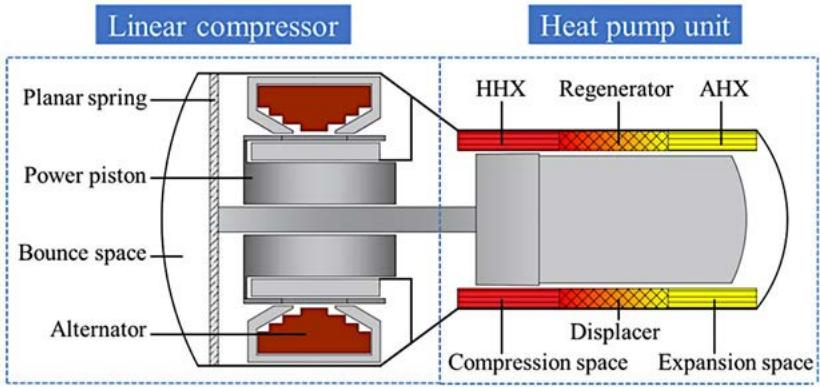  
Figure 1. Schematic diagram of the electrically-driven free-piston Stirling heat pump.

## Simulation model and design process

In this paper, the commercial software SAGE [18] is employed for the numerical simulation and design of the free-piston Stirling heat pump. SAGE has a graphical interface and is commonly used to simulate the steady state of thermoacoustic heat engines [19] and Stirling machines [20,21]. The evaluation of the heat pump system performance is based on the following defined parameters.

The input electric power We is calculated as

$$
W _ { e } = \frac { 1 } { 2 } \mathrm { R e } \big ( \tilde { V } \tilde { I } ^ { * } \big )\tag{1}
$$

The acoustic power input to the heat pump unit $W _ { \textrm { a } }$ is the sum of the acoustic power $W _ { \mathsf { a - c o m } }$ at the power piston’s surface facing the compression space and the acoustic power $W _ { \mathrm { a - b } }$ that faces the bounce space.

$$
\begin{array} { r } { W _ { a } = W _ { a - c o m } + W _ { a - b } = \frac { 1 } { 2 } \operatorname { R e } \left( \widetilde { P } _ { c o m } \widetilde { U } _ { p i s } ^ { * } \right) + \frac { 1 } { 2 } \operatorname { R e } ( \widetilde { P } _ { b } \widetilde { U } _ { p i s } ^ { * } ) } \end{array}\tag{2}
$$

The efficiency of the linear compressor $\eta _ { \mathfrak { e } }$ is calculated as

$$
\eta _ { e } = \frac { W _ { a } } { w _ { e } }\tag{3}
$$

The coefficient of performance of the heat pump unit $C O P _ { h }$ is calculated as

$$
C O P _ { h } = \frac { Q _ { h } } { w _ { a } }\tag{4}
$$

The overall heating performance COP is calculated as

$$
C O P = { \frac { Q _ { h } } { w _ { e } } }\tag{5}
$$

The relative Carnot efficiency of the whole system $\eta _ { \mathbb { L } \mathbb { R } }$ is calculated as

$$
\begin{array} { r } { \eta _ { r e } = C O P \frac { T _ { H } - T _ { C } } { T _ { H } + 2 7 3 . 1 5 } } \end{array}\tag{6}
$$

where \~ indicates an oscillating parameter. \* indicates conjugate. Re indicates taking the real part. V and I denote the voltage and current. $\mathsf { P } _ { \mathsf { c o m } }$ and $\mathsf { P } _ { \flat }$ refer to the pressure fluctuations in the compression space and the bounce space, respectively. $\mathsf { U } _ { \mathsf { p i s } }$ is the power piston’s sweep volume. $W _ { \mathrm { e } }$ is the input electric power. $Q _ { h }$ is the heating capacity provided by the heat pump. $T _ { _ { H } }$ is the heating temperature and $T _ { c }$ is the ambient temperature.

A simplified analysis of the linear compressor is performed using the lumped parameter method. Its operating process fulfils the electrical balance equation and the force balance equation.

$$
\tilde { V } = Z _ { e l e c } \tilde { I } + B L \tilde { v } _ { p i s }\tag{7}
$$

$$
( \tilde { P } _ { c o m } - \tilde { P } _ { b } ) A _ { p i s } = B L \tilde { I } - Z _ { m e c h } \tilde { v } _ { p i s }\tag{8}
$$

where $Z _ { e l e c }$ is the electrical impedance, BL is the electromechanical constant, $v _ { p i s }$ is the power piston’s velocity, $A _ { p i s }$ is power piston’s area and $Z _ { m e c h }$ is the mechanical impedance. The impedance $Z _ { c o m }$ at the surface of the power piston facing the compression space is

$$
Z _ { c o m } = \frac { \tilde { P } _ { c o m } } { \tilde { \sigma } _ { p i s } }\tag{9}
$$

The impedance $Z _ { \boldsymbol { b } _ { \textup { b } } }$ at the surface of the power piston facing the bounce space is

$$
\begin{array} { r } { Z _ { b } = \frac { \tilde { P } _ { b } } { \tilde { U } _ { p i s } } } \end{array}\tag{10}
$$

Bringing Eqs.(1), (2), (7), (8), (9) and (10) into Eq.(3), the linear compressor eficiency can be further expressed as

$$
\frac { 1 } { \eta _ { e } } = \frac { R _ { c o m } - R _ { b } + \frac { R _ { m e c h } } { A _ { p i s } ^ { 2 } } + \frac { R _ { e l e c } A _ { p i s } ^ { 2 } } { ( B L ) ^ { 2 } } \left( \left( R _ { c o m } - R _ { b } + \frac { R _ { m e c h } } { A _ { p i s } ^ { 2 } } \right) ^ { 2 } + \left( X _ { c o m } - X _ { b } + \frac { X _ { m e c h } } { A _ { p i s } ^ { 2 } } \right) ^ { 2 } \right) } { R _ { c o m } + R _ { b } } ,\tag{11}
$$

where $\mathsf { R } _ { c o m }$ and $X _ { _ { c o m } }$ are the real and imaginary parts of $Z _ { c o m } ,$ , respectively. $\mathsf { R } _ { \mathsf { b } }$ and $X _ { b }$ are the real and imaginary parts of $Z _ { b } ,$ respectively. $R _ { m e c h }$ and $X _ { m e c h }$ are the real and imaginary parts of $Z _ { m e c h } ,$ respectively. $R _ { e l e c }$ is the real part of $Z _ { e l e c } .$

The acoustic impedance should be co-resonant with the mechanical impedance for the compressor to be eficient. When the power piston’s area is

$$
\begin{array} { r } { A _ { p i s , b e s t } = \sqrt [ 4 ] { \frac { R _ { m e c h } ^ { 2 } } { ( R _ { c o m } - R _ { b } ) ^ { 2 } } ( \frac { ( B L ) ^ { 2 } } { R _ { e l e c } R _ { m e c h } } + 1 ) } } \end{array}\tag{12}
$$

the maximum linear compressor efficiency can be achieved.

$$
\begin{array} { r } { \eta _ { e - m a x } = ( \sqrt { \frac { ( B L ) ^ { 2 } } { R e l e c R m e c h } + 1 } - 1 ) / ( \sqrt { \frac { ( B L ) ^ { 2 } } { R e l e c R m e c h } + 1 } + 1 ) } \end{array}\tag{13}
$$

This maximum eficiency depends only on the compressor’s parameters. Bigger BL, smaller internal electrical resistance and mechanical damping contribute to a higher compressor eficiency. Since the pressure fluctuation in the bounce space is much smaller than that in the compression space, the $\mathsf { R } _ { \mathsf { b } }$ can be neglected compared with $\mathsf { R } _ { c o m } .$ . From Eq. (12), it can be seen that the $\mathsf { R } _ { c o m }$ is the key parameter to achieve an eficient match between the linear compressor and the heat pump unit.

Based on the above analysis, to make both the linear compressor and the heat pump unit perform eficiently, the structural parameters of the heat pump unit are optimized first, and then the compressor parameters are designed based on the principle of impedance matching. The design process is shown in Fig. 2. Firstly, determine the diameter of the displacer. Secondly, optimize the dimensions of the heat pump unit’s core components, including the length, the equivalent diameter, the porosity and the wire diameter of the regenerator, as well as the length and the porosity of the heating and ambient heat exchangers. The required heating capacity is used as the constraint, and the maximum ${ \mathsf { C O P } } _ { \mathrm { h } }$ is the optimization objective. In addition, it is imperative to adjust the mass of the displacer and the diameter of the displacer’s rod when optimizing the above parameters since the displacer plays a crucial role in regulating the acoustic field. The nonlinear optimizer in SAGE is based on Powell’s Sequential Quadratic Programming. This approach breaks down the problem into a series of quadratic programming subproblems with quadratic objective functions and linear constraints. From the optimized structural parameters of the heat pump unit, the impedance at the compression space Rcom can be obtained. According to Eq. (13), to make $\boldsymbol { \mathsf { \Pi } } _ { \mathsf { P } }$ as high as possible, it should be better to select a bigger BL, a smaller $\mathsf { R } _ { \mathrm { e l e c } }$ and a smaller $\mathsf { R } _ { \mathrm { m e c h } }$ . Then, the optimum power piston area corresponding to the highest linear compressor eficiency can be calculated based on Eq. (12). In this way, a high-performance electrically-driven free-piston Stirling heat pump is obtained.

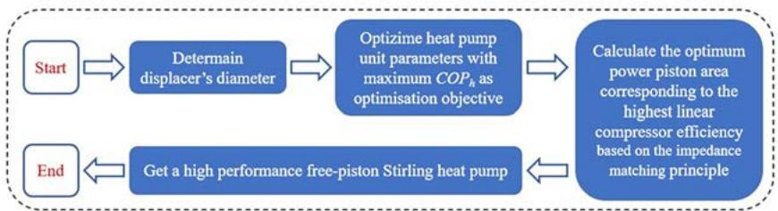  
Figure 2. The design process of an electrically-driven free-piston Stirling heat pump.

## Experimental apparatus

As shown in Fig. 3, an electrically-driven free-piston Stirling heat pump is constructed based on the above design process. Fig. 4 shows the schematic diagram of the experimental test platform, which is composed of a heat pump prototype, a power supply, an electric heating module, a circulating water system and a parameter measurement system. The structural parameters of each component of the heat pump prototype are shown in Table 1. The power supply provides electric power to the linear compressor. The electric heating module inputs heat to the ambient heat exchanger through heating rods to simulate heat absorption from the environment. The circulating water system continuously takes away the heat generated by the heating heat exchanger. Through the equation $Q _ { \mathrm { h } } = c \ : m \ : ( T _ { \mathrm { o u t } } - T _ { \mathrm { i n } } ) .$ , the provided heating capacity can be calculated. Where c is the specific heat capacity of water, m is the circulating water flow rate, $T _ { \mathrm { i n } }$ and $T _ { \mathrm { o u t } }$ are temperatures when circulating water flows into and flows out of the heating heat exchanger, respectively.

Table 1. Main structural parameters of a free-piston Stirling heat pump.
<table><tr><td></td><td>Components</td><td>Details</td></tr><tr><td rowspan="4">Linear compressor</td><td>Bounce space</td><td>Void volume 758 cc</td></tr><tr><td>Power piston</td><td>Diameter 45 mm, moving mass 0.75 kg, damping</td></tr><tr><td>Alternator</td><td>coefficient 20 N·s/m Motor constant 9o N·A1, coil</td></tr><tr><td>Compression space</td><td>resistance 2.76 Ω Void volume 34 cc</td></tr><tr><td rowspan="7">Heat pump unit</td><td>Heating heat exchanger</td><td>Length 32 mm, porosity</td></tr><tr><td>(annulār fins) Regenerato r(wire mesh)</td><td>20.19% Length 23 mm, equivalent</td></tr><tr><td></td><td>diameter 53 mm, wire diameter 0.05 mm, porosity 77.75%</td></tr><tr><td>Ambient heat exchanger (annular fins)</td><td>Length 30 mm, porosity 16.40%</td></tr><tr><td>Displacer</td><td>Diameter 6o mm, rod diameter 15 mm, moving mass</td></tr><tr><td>Expansion space</td><td>0.45 kg</td></tr><tr><td></td><td>Void volume 23 cc</td></tr></table>

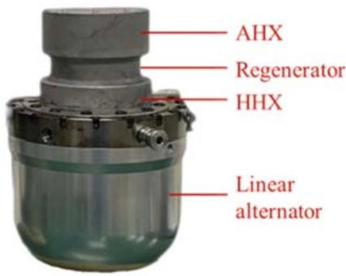  
Figure 3. The electrically-driven free-piston Stirling heat pump prototype.

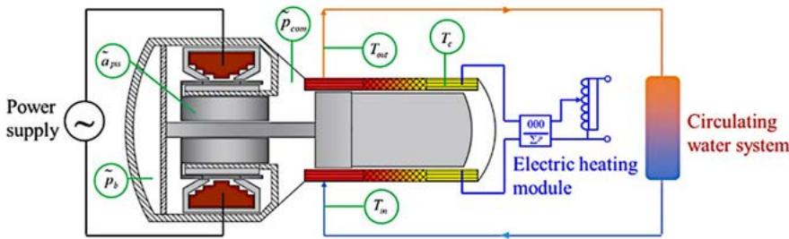  
Figure 4. The schematic diagram of experimental test platform.

## Results and discussion

In this section, a series of experimental studies are carried out on the above heat pump prototype. Firstly, the matching between the linear compressor and the heat pump unit is examined. Then, the efects of ambient and heating temperatures on system performance are investigated.

## Match between linear compressor and heat pump unit

Table 2 presents system performance with an ambient temperature of $- 2 8 ^ { \circ } C$ and the circulating water is heated from $4 1 ^ { \circ } \mathsf C$ to $4 6 ^ { \circ } \mathsf { C } .$ When 698 W of electric power is input, the linear compressor transfers 602 W of acoustic power to the heat pump unit, and the heating capacity of 1180 W is obtained. The linear compressor eficiency reaches 86.2% and the overall coeficient of performance is 1.69, achieving an eficient match between the linear compressor and the heat pump unit.

Table 2. Performance parameters of heat pump system.
<table><tr><td> ${ \cal W } _ { \mathrm { e } } \left( \sf W \right)$ </td><td> ${ \cal { W } } _ { \sf { a } } \left( { \sf { W } } \right)$ </td><td> $Q _ { \mathrm { h } } ( { \mathsf { W } } )$ </td><td> $\eta _ { \mathrm { e } }$ </td><td> ${ \mathsf { C O P } } _ { \mathrm { h } }$ </td><td>COP</td></tr><tr><td>698</td><td>602</td><td>1180</td><td>86.2%</td><td>1.96</td><td>1.69</td></tr></table>

Diferent ambient temperatures

Ambient temperature has a significant efect on the operating status of the heat pump. The heating performances under various ambient temperatures are tested. $T _ { \mathrm { i n } }$ and $T _ { \mathrm { o u t } }$ are $4 1 ^ { \circ } \mathsf C$ and $4 6 ^ { \circ } \mathsf C ,$ respectively.

The variations of acoustic powers in the compression space $W _ { \mathsf { a - c o m } }$ and bounce space $W _ { \mathrm { a - b } }$ and the phase diference between pressure and volumetric flow rate in the compression space $\mathfrak { s } _ { \mathsf { P U - c o m } }$ are shown in Fig. 5 (a). A large part of the acoustic power generated by the linear compressor is transferred to the heat pump unit through the compression space, while the acoustic power in the bounce space accounts for a small percentage. In this set of experiments, the power piston’s displacement is the same for each condition, so the amplitudes of pressure and volumetric flow rate in the compression space are almost constant. In this way, it can be seen from Eq. (2) that the variation of $W _ { \mathsf { a - c o m } }$ mainly depends on $\mathfrak { s } _ { \mathsf { P U - c o m } }$ . With increasing ambient temperatures, $\mathfrak { s } _ { \mathsf { P U - c o m } }$ gradually declines, leading to a decrease in $W _ { \mathsf { a - c o m } }$ . Fig. 5(b) presents the compressor eficiency $\eta _ { \mathrm { e } }$ and coeficient of performance of the heat pump unit ${ \mathsf { C O P } } _ { \mathrm { h } } .$ The higher the ambient temperature, the greater the ${ \mathsf { C O P } } _ { \mathrm { h } } .$ However, the change in ambient temperature has little efect on $\eta _ { \mathrm { e } }$ . When the ambient temperature increases from $- 2 8 ^ { \circ } C$ to $0 ~ ^ { \circ } C , \eta _ { \mathrm { e } }$ is maintained between 86% and 87%. Fig. 5 (c) gives the heating capacity $\mathsfit { Q } _ { \mathrm { h } } ,$ overall COP and relative Carnot eficiency $\eta _ { \mathrm { r e } ^ { \bullet } } Q _ { \mathrm { h } }$ changes slightly and remains around 1200 W. The combined change in ηe and COPh causes the overall COP to decrease with the reduction of the ambient temperature. It is noteworthy that the relative Carnot eficiency ηre gradually increases. When the ambient temperature decreases from $0 ~ ^ { \circ } \mathsf { C }$ to ${ } ^ { - 2 8 } { } ^ { \circ } \mathsf { C } ,$ ηre changes from 32.1% to 39.2%. The free-piston Stirling heat pump is much more eficient under larger heat-pumping temperature diferences.

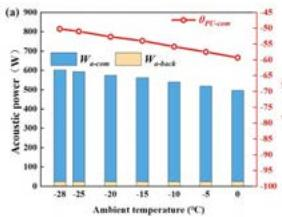

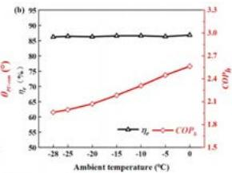

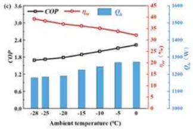  
Figure 5. (a) Acoustic power and phase diference between pressure and volumetric flow rate in the compression space $\mathfrak { \vartheta } _ { \mathsf { P U - c o m } } ( \mathsf { b } )$ compressor eficiency $\eta _ { \mathrm { e } }$ and ${ \mathsf { C O P } } _ { \mathrm { h } } ( { \mathsf { c } } )$ overall ${ \mathsf { C O P } } ,$ relative Carnot eficiency ηre and heating capacity $Q _ { \mathrm { h } }$ under diferent ambient temperatures.

In the heat exchanger, the external fluid flows unidirectionally on the outside and the internal working gas flows alternately on the inside. The temperature diference between the internal gas and external fluid needs to be focused. For ambient heat exchanger (Hereafter referred to as AHX), an electric heating module is used to simulate heat absorption from the environment. The heat-transfer temperature diference $\Delta T _ { _ { A H X } }$ is defined as

$$
\triangle T _ { A H X } = T _ { C } - T _ { g a s - A H X }\tag{14}
$$

The heat-transfer temperature diference in the heating heat exchanger (Hereafter referred to as HHX) $\Delta T _ { _ { H H X } }$ is defined as

$$
\Delta T _ { H H X } = T _ { o u t } - T _ { g a s - H H X }\tag{15}
$$

where $T _ { g a s \cdot A H X }$ and $T _ { \tt g a s \mathrm { - } H H X }$ are the internal gas’s average temperatures in the AHX and HHX, respectively. In the experiment, $\Delta T _ { _ { A H X } }$ is around $7 ^ { \circ } \mathsf { C }$ and $\Delta T _ { _ { H H X } }$ is around 11 ${ } ^ { \circ } \mathsf { C } .$

The extent to which the heat-transfer temperature diference afects the system performance can be roughly evaluated by $\boldsymbol { \eta } _ { \Delta T }$

$$
\eta _ { \Delta T } = 1 - \frac { T _ { _ H } + \Delta T _ { _ { H H X } } + 2 7 3 . 1 5 } { ( T _ { _ H } + \Delta T _ { _ { H H X } } ) - ( T _ { _ c } - \Delta T _ { _ { A H X } } ) } / \frac { T _ { _ H } + 2 7 3 . 1 5 } { T _ { _ H } - T _ { _ c } }\tag{16}
$$

The numerator of the second term represents the Carnot eficiency of the heat pump cycle taking into account the heat-transfer temperature diference, while the denominator represents that without heat-transfer temperature diference. The larger the $\eta _ { _ { \Delta \ T } }$ the bigger the adverse efect on the system performance. For example, with an ambient temperature of $- 2 8 ^ { \circ } C$ and a required heating temperature of $4 6 ^ { \circ } \mathsf C ,$ if there are no heat-transfer temperature diferences, the heat source and heat sink temperatures are respectively $- 2 8 ^ { \circ } C$ and $4 6 ^ { \circ } \mathsf C$ for the internal gas undergoing the heat pump cycle. Under this situation, the Carnot eficiency is 4.31. However, with a $1 \Delta T _ { A H X }$ of $7 ^ { \circ } \mathsf { C }$ and a $\Delta T _ { _ { H H X } }$ of 11 $^ { \circ } { \mathsf { C } } ,$ heat source and heat sink temperatures are respectively $- 3 5 ^ { \circ } C$ and $5 7 ^ { \circ } C$ and the Carnot eficiency is 3.59. The system performance is reduced by 16.7% due to the heattransfer temperature diference.

Fig. 6 gives $\boldsymbol { \eta } _ { \Delta \intercal }$ under diferent ambient temperatures. It can be seen that $\boldsymbol { \eta } _ { \Delta \intercal }$ tends to increase with a rising ambient temperature. $\boldsymbol { \eta } _ { \Delta \intercal }$ is 16.7 % with an ambient temperature of $- 2 8 ^ { \circ } C$ . However, when the ambient temperature increases to $0 ~ ^ { \circ } \mathsf C ,$ the system performance is reduced by 25.6% due to the presence of the heat-transfer temperature diference. The large heat-transfer temperature diference in the heat exchanger is an important reason for the relatively poor performance of the free-piston Stirling heat pump with a small heat-pumping temperature diference.

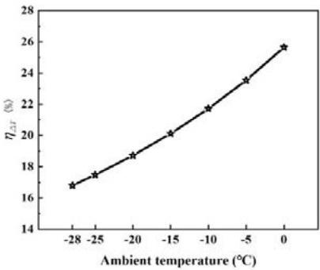  
Figure 6. The extent to which heat-transfer temperature diference afects system performance.

## Diferent heating temperatures

The heating temperature is a crucial parameter determined by consumer requirements. The performance at various heating temperatures $T _ { \mathrm { o u t } }$ is investigated, maintaining an ambient temperature of $- 2 8 ^ { \circ } C .$ . The diference between $T _ { \mathrm { i n } }$ and $T _ { \mathrm { o u t } }$ is set at $5 ^ { \circ } C$ and $T _ { \mathrm { o u t } }$ varies within the range of $4 0 ^ { \circ } \mathsf { C }$ to $4 9 ^ { \circ } \mathsf C$

The impacts on $W _ { _ { \mathrm { a - c o m } } } , W _ { _ { \mathrm { a - b } } } , \vartheta _ { _ { \mathrm { P U - c o m } } } , \eta _ { _ { \mathrm { e } } } , \mathsf { C O P } _ { _ { \mathrm { h } } } , \mathsf { C O P } , \eta _ { _ { \mathrm { r e } } }$ and $Q _ { \mathrm { h } }$ are illustrated in Fig. 7. As $T _ { \mathrm { o u t } }$ $\mathsf { g o e s } \mathsf { u p } , \vartheta _ { \mathsf { p u - c o m } }$ increases slightly. According to Eq. (2), such a change in $\mathfrak { \vartheta } _ { \mathsf { P U - c o m } }$ leads to a small increase in acoustic power. In addition, from Eq. (11), it can be seen that during the operation of this heat pump, $\eta _ { \mathrm { e } }$ mainly depends on the acoustic impedance in the compression space, which is determined by $\mathfrak { s } _ { \mathsf { P U - c o m } }$ . The nearly constant $\mathfrak { \vartheta } _ { \mathsf { P U - c o m } }$ maintains $\eta _ { \mathrm { e } }$ at $8 7 . 5 \%$ . With $T _ { \mathrm { o u t } }$ rising, $Q _ { \mathrm { h } }$ is around 940 $\mathsf { W } ,$ the ${ \mathsf { C O P } } _ { \mathrm { h } }$ and overall COP decrease, but the relative Carnot eficiency is on the upward trend. These results indicate that the larger the diference between heating temperature and ambient temperature, the higher the thermodynamic perfection of the Stirling heat pump.

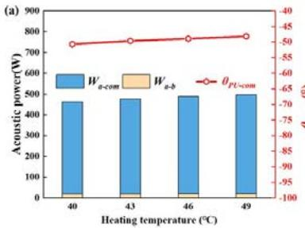

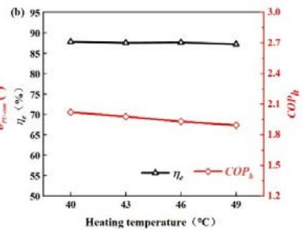

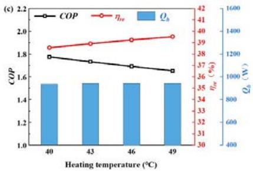  
Figure 7. (a) Acoustic power and phase diference between pressure and volumetric flow rate in the compression space $\mathfrak { s } _ { \mathsf { P U - c o m } }$ (b) compressor eficiency $\eta _ { \mathrm { e } }$ and ${ \mathsf { C O P } } _ { \mathrm { h } }$ (c) overall COP, relative Carnot eficiency $\eta _ { \mathrm { r e } }$ and heating capacity $Q _ { \mathrm { h } }$ under diferent heating temperatures.

## Recovery of heat from compressor

In the linear compressor, the damping loss caused by the power piston and the Joule heat loss in the electromagnetic conversion unit are ultimately dissipated as heat. If this heat is captured, more heating capacity can be provided. Therefore, a water jacket is added to the compressor’s back cover to carry away the heat from the compressor. As shown in Fig. 8, the circulating water flows first into the water jacket and then through the heating heat exchanger.

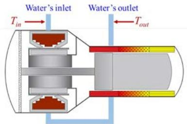  
Figure 8. Schematic diagram of a Stirling heat pump with a water jacket added to the back cover.

Fig. 9 shows the overall COP with and without water jacket at diferent ambient temperatures, with $T _ { \mathrm { i n } }$ of $4 1 ^ { \circ } \mathsf C$ and $T _ { \mathrm { o u t } }$ of $4 6 ^ { \circ } \mathsf { C } .$ . It can be seen that employing a water jacket can indeed increase the heating capacity and thus improve the performance. When the ambient temperature is $- 2 8 ^ { \circ } C$ and ${ } ^ { - 1 5 } \ ^ { \circ } \mathsf { C } ,$ the overall COP increases from 1.69 to $1 . 7 8$ and 1.89 to 1.97, respectively. In addition, it is worth noting that this heat pump prototype is able to operate even at an ambient temperature as low $a s - 4 0 ^ { \circ } C$ and the overall COP reaches 1.57.

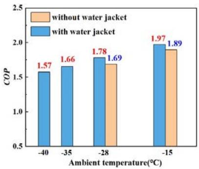  
Figure 9. COP with and without water jacket at diferent ambient temperatures.

The performances of this free-piston Stirling heat pump are compared with those of low-temperature vapor compression heat pumps, which can be roughly classified into three types: improved compressor systems [22-25], quasi-two-stage systems [26-29] and cascade systems [30-33]. As shown in Fig. 10, the COPs of the Stirling heat pump are close to or even higher than those of vapor compression heat pumps at ambient temperatures between ${ } ^ { - 3 0 } { } ^ { \circ } { \mathsf { C } }$ and $\mathsf { - } 1 0 \ ^ { \circ } \mathsf { C } .$ Few vapor compression heat pumps are capable of operating in environments below ${ } ^ { - 3 0 } { } ^ { \circ } { \mathsf { C } }$ . However, the free-piston Stirling heat pump can perform eficiently with an ambient temperature as low $a s - 4 0 ^ { \circ } C .$ It has a very broad application prospect for building heating in cold regions.

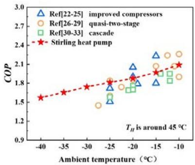  
Figure 10. Performance comparison of this Stirling heat pump and vapor compression heat pumps.

## Conclusion

In this paper, an electrically-driven free-piston Stirling heat pump is designed and tested. Based on the impedance mating principle, a design method capable of eficiently matching the linear compressor and the heat pump unit is provided, thus improving the compressor eficiency and the overall coeficient of performance. When circulating water is heated from $4 1 ^ { \circ } \mathsf C$ to $4 6 ^ { \circ } \mathsf C ,$ the linear compressor eficiency is 86.2% and the overall COP reaches 1.78 at an ambient temperature of $- 2 8 ^ { \circ } C$ . In addition, experimental studies are conducted to investigate the heating performance at diferent ambient and heating temperatures. The following conclusions can be drawn:

1. There is an optimal surface area of the power piston corresponding to the highest linear compressor eficiency, independently of the heat pump unit. Bigger BL, smaller internal electrical resistance and mechanical damping contribute to a higher compressor eficiency.

2. Ambient and heating temperatures have a small impact on compressor eficiency, but influence the performance of the heat pump unit significantly. As the ambient temperature declines or the heating temperature rises, the overall COP decreases, but the relative Carnot eficiency increases. The freepiston Stirling heat pump is much more eficient under larger heat-pumping temperature diferences.

With an ambient temperature as low as $4 0 ^ { \circ } \mathsf C ,$ the heat pump can operate reliably, and an overall COP of 1.57 is obtained. The free-piston Stirling heat pump has a promising prospect for building heating in cold regions. In addition, to further improve the system performance at smaller heat-pumping temperature diferences, it is necessary to take measures to reduce the heat-transfer temperature diference in the heat exchanger. Using shell and tube heat exchangers instead of finned heat exchangers and reducing operating frequency may be efective.

## Acknowledgements

This work is financially supported by the National Nature Science Foundation of China (No. 51876213 and 51976230).

## References

[1] BP. BP statistical review of world energy 2022, 2022.

[2] Ü V Diana, F C Luisa, S Susana, B Camila, P Ksenia. Heating and cooling energy trends and drivers in buildings. Renewable and Sustainable Energy Reviews, 2015, 41.

[3] Ü V Diana, P Ksenia, S Maja, E Jiyong. Energy use in buildings in a long-term perspective. Current Opinion in Environmental Sustainability, 2013, 5(2).

[4] H Zhang, S Wang, J Hao, X Wang, S Wang, F Chai, et al. Air pollution and control action in Beijing. Journal of Cleaner Production, 2016, 112: 1519-1527.

[5] J Emhofer, K Marx, A Sporr, T Barz, B Nitsch, M Wiesflecker, et al. Experimental demonstration of an air-source heat pump application using an integrated phase change material storage as a desuperheater for domestic hot water generation. Applied Energy, 2023, 336, 120784.

[6] N Liu, L Shi, L Han, M Zhu. Moderately high temperature water source heat-pumps using a near-azeotropic refrigerant mixture. Applied Energy, 2004, 80(4): 435-447.

[7] S J Self, B V Reddy, M A Rosen. Geothermal heat pump systems: Status review and comparison with other heating options. Applied Energy, 2013, 101: 341-348.

[8] S. S. Bertsch, E. A. Groll. Two-stage air-source heat pump for residential heating and cooling applications in northern U.S. climates. International Journal of Refrigeration, 2008, 31(7):1282-1292.

[9] G Walker, J Senft. Free piston Stirling engines. Berlin, Heidelberg: Springer-Verlag; 1985.

[10] M M Bassem, Y Ueda, A Akisawa. Thermoacoustic Stirling Heat Pump Working as a Heater. Applied Physics Express, 2011, 4(10).

[11] A Widyaparaga, T Koshimizu, E Noda, et al. The frequency dependent regenerator cold section and hot section positional reversal in a coaxial type thermoacoustic Stirling heat pump. Cryogenics, 2011, 51(10): 591-597.

[12] T M Tveit, H Arne. Performance analysis and verification of a novel high temperature diference heat pump. 11th International Energy Agency Heat Pump Conference, 2014.

[13] T M Tveit. Application of an industrial heat pump for steam generation using district heating as heat source. 12th International Energy Agency Heat Pump Conference, 2017.

[14] T M Tveit, M Johansson, C A P. Zevenhoven. Environmentally friendly steam generation using VHTHPs at a pharmaceutical research facility. 13th International Energy Agency Heat Pump Conference, 2020.

[15] C Haikarainen, T M Tveit, H Saxén, et al. Simulation of pressure imbalance phenomena in a double-acting α-cycle Stirling engine. Energy Conversion and Management, 2020, 221.

[16] K Li, G Yu, Y Zhang, et al. Theoretical and experimental study of free piston Stirling heat pump. Journal of Engineering Thermophysics, 2015, 36(01): 41-45.

[17] Y Sun. Theoretical and experimental study of a novel free-piston thermally driven thermoacoustic-thermal (cold) combined supply system. Institute of Physical and Chemical Technology, Chinese Academy of Sciences, 2021.

[18] D Gedeon. Sage user’s guide. Gedeon Associates, 2014.

[19] J Xu, J Hu, E Luo, L Zhang, W Dai. A cascade-looped thermoacoustic driven cryocooler with diferent-diameter resonance tubes. Part I: Theoretical analysis of thermodynamic performance and characteristics. Energy, 2019, 181:943–53.

[20] L Samuel, G Michael, N Martin. A novel solar-powered liquid piston Stirling refrigerator. Applied Energy, 2018, 229.

[21] Z Jia, R Wang, J Hu, L Zhang, Z Wu, Y Chen, et al. Study on the coupling between engine and alternator in a free-piston Stirling generator. Applied Thermal Engineering, 2022, 217.

[22] A A Safa, S A Fung, R Kumar R. Comparative thermal performances of a ground source heat pump and a variable capacity air source heat pump systems for sustainable houses. Applied Thermal Engineering, 2015, 81, 279-287.

[23] G Ma, Q Chai. Characteristics of an improved heat-pump cycle for cold regions. Applied Energy, 2004, 77(3): 235-247.

[24] S Xu, G Ma. Research on air-source heat pump coupled with economized vapor injection scroll compressor and ejector. International journal of refrigeration, 2011, 34(7): 1587-1595.

[25] D H Kim, H S Park, M S Kim. The efect of the refrigerant charge amount on single and cascade cycle heat pump systems. International journal of refrigeration, 2014, 40: 254-268.

[26] S Fan, Q Liu, S He. Scroll compressor development for air-source heat pump water heater applications. In: Proceeding of international refrigerant and air conditioning conference, 2008.

[27] W Wei, L Ni, C Zhou, et al. Performance analysis of a quasi-two stage compression air source heat pump in severe cold region with a new control strategy. Applied Thermal Engineering, 2020, 174: 115317.

[28] C Lin, T Ouyang, H Chen, et al. Application of low-temperature air-source heat pump technology. Refrigeration and Air Conditioning, 2014, 14(08): 119-122.

[29] H Li, Z Su, C Jian, et al. Study on quasi two-stage compression cycle characteristics of air source heat pump water heater in cold area. Thermal Science and Technology, 2020, 19(04): 313-319.

[30] Y Xu, Y Huang, N Jiang, et al. Experimental and theoretical study on an air-source heat pump water heater for northern China in cold winter: Efects of environment temperature and switch of operating modes. Energy and Buildings, 2019, 191: 164- 173.

[31] S S Bertsch, E A Groll. Two-stage air-source heat pump for residential heating and cooling applications in northern US climates. International journal of refrigeration, 2008, 31(7): 1282-1292.

[32] Y Yang, R Li, Y Zhu, et al. Experimental and simulation study of air source heat pump for residential applications in northern China. Energy and Buildings, 2020, 224: 110278.

[33] J Kim, J Lee, H Choi, et al. Experimental study of R134a/R410A cascade cycle for variable refrigerant flow heat pump systems. Journal of Mechanical Science and Technology, 2015, 29(12): 5447-5458.