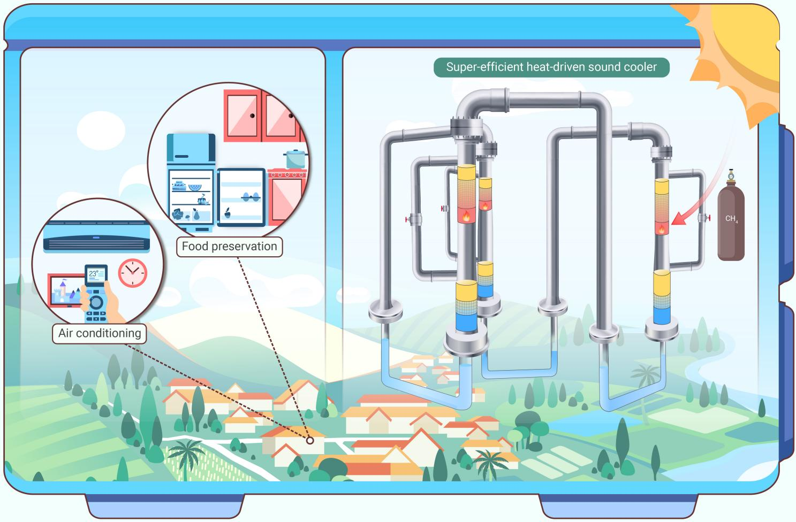
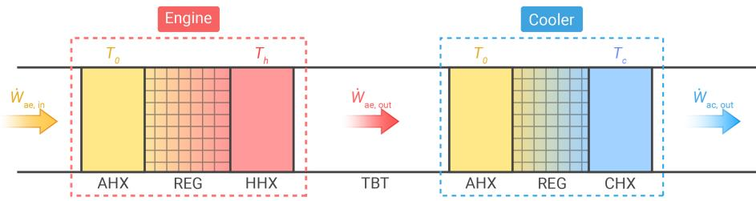
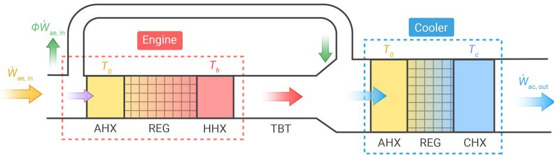
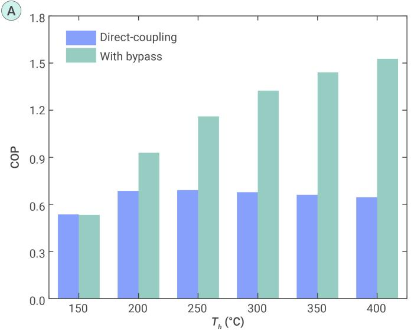
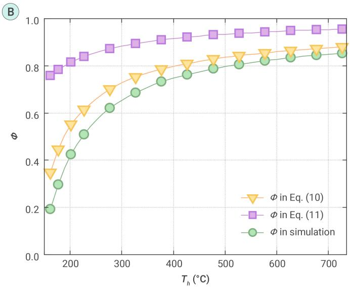
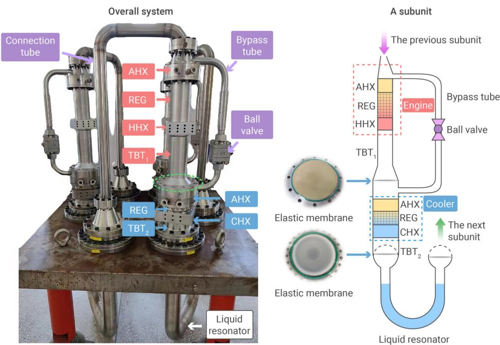
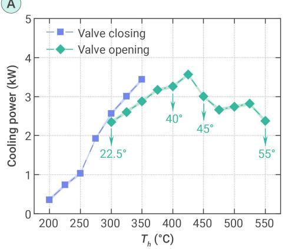
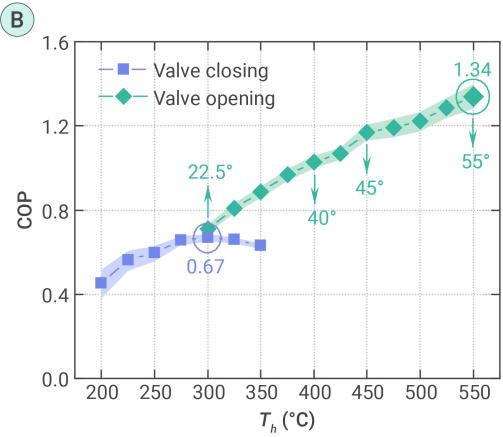
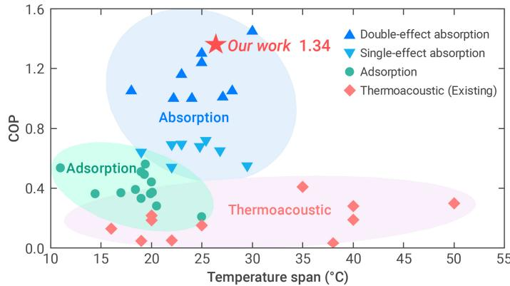

# Sustainable heat-driven sound cooler with super-high efficiency

Lei Xiao,1,² Kaiqi Luo,³Zhanghua Wu,1,\* Benlei Wang,1,2 Jingyuan Xu,4 Hao Chen,1,2 and Ercang Luo1,2,\*

\*Correspondence: zhhwoo@mail.ipc.ac.cn (Z.W.); ecluo@mail.ipc.ac.cn (E.L.)

Received: March 23, 2024; Accepted: May 14, 2024; Published Online: May 16, 2024; https://doi.org/10.59717/j.xinn-energy.2024.100027

© 2024 The Author(s). This is an open access article under the CC BY-NC-ND license (http://creativecommons.org/licenses/by-nc-nd/4.0/).

## GRAPHICAL ABSTRACT

## PUBLIC SUMMARY

■ Desiging a super-efficient heat-driven thermaocosutic refrigerator.

Achieving an unprecedented coefficient of performance of 1.34.

The system exhibits bright prospect in heat-driven room-temperature refrigeration.

# Sustainable heat-driven sound cooler with super-high efficiency

Lei Xiao,1,² Kaiqi Luo,³ Zhanghua Wu,1,\* Benlei Wang,1,2 Jingyuan Xu,4 Hao Chen,1,2 and Ercang Luo1,2,\*

1Key Laboratory of Cryogenic Science and Technology, Technical Institute of Physics and Chemistry, Chinese Academy of Sciences, Beijing 100190, China   
²University of Chinese Academy of Sciences, Beijing 100049, China

³State Key Laboratory of Multi-Phase Complex Systems, Institute of Process Engineering, Chinese Academy of Sciences, Beijing 100190, China

4Institute of Microstructure Technology, Karlsruhe Institute of Technology, Karlsruhe 76344, Germany

\*Correspondence: zhhwoo@mail.ipc.ac.cn (Z.W.); ecluo@mail.ipc.ac.cn (E.L.)

Received: March 23, 2024; Accepted: May 14, 2024; Published Online: May 16, 2024; https://doi.org/10.59717/j.xinn-energy.2024.100027

© 2024 The Author(s). This is an open access article under the CC BY-NC-ND license (http://creativecommons.org/licenses/by-nc-nd/4.0/).

Citation: Xiao L., Luo K., Wu. Z., et al., (2024). Sustainable heat-driven sound cooler with super-high efficiency. The Innovation Energy 1(2): 100027.

Sustainable cooling technologies with high efficiency are increasingly vital in modern life. Characterized by eco-friendly working substances and no mechanical moving components, the heat-driven thermoacoustic refrigerator (HDTR) makes it a really sustainable choice. However, its practical application has been hindered by its relatively low efficiency. This work reports a breakthrough in thermally-powered sound cooling technology: a super-efficient HDTR. The system incorporates an innovative configuration, ensuring efficient acoustic power matching between the engine and cooler units at high heating temperatures, thereby significantly boosting efficiency. Our experimental findings are exhilarating: the HDTR achieves an unprecedented coefficient of performance (COP) of 1.34 at heating, ambient, and cooling temperatures of 550 °C, 35 °C, and 7 °C, respectively, along with a cooling power of 2.37 kW. To the best of our knowledge, under approximate temperature spans, this COP surprisingly increases by 240% compared to the best result previously reported for HDTRs without using the novel configuration. These results represent a significant advancement in HDTR technology, showing a tremendous potential of the HDTR as an emerging, sustainable cooling technology, particularly for heat-driven roomtemperature refrigeration applications.

## INTRODUCTION

Currently, a significant amount of energy is expended in refrigeration, particularly in room-temperature applications such as air conditioning. Developing sustainable and efficient cooling technologies shows great significance for achieving carbon neutrality.1,2 The heat-driven thermoacoustic refrigerator (HDTR) represents a novel cooling technology that directly harnesses thermal energy sources, such as waste heat, solar energy, and clean fuels, to create a cooling effect. In a HDTR, the engine unit transforms heat into acoustic power, which the cooler unit then utilizes to generate cooling power. Given its ability to use clean thermal energy, its reliance on ecofriendly working substances like helium and nitrogen, and its longevity due to the absence of mechanical moving components, the HDTR is recognized as a sustainable cooling technology. It holds significant promise for applications in room-temperature refrigeration, offering an environmentally friendly alternative in the cooling technology sector.3,4

Extensive research has been devoted to HDTRs over the past decades. Early standing-wave HDTR systems, known for their simple and compact structures, suffered from limited cooling power and efficiency. This is primarily due to the standing-wave acoustic field used for thermoacoustic conversion,5 resulting in low coefficient of performance (COP, the ratio of cooling power to heating power) of less than 0.15.67 Subsequent advancements utilized the classical thermoacoustic Stirling engine⁸ to drive a cooler, creating a traveling-standing wave HDTR.9,10 This design improved the COP to values exceeding 0.2, typically with cooling power in the hundreds of watts range, due to the traveling-wave acoustic field in the regenerator. Further developments in traveling-wave HDTR systems, especially the multi-unit looped topologies with direct-coupling configuration,11,12 have pushed COP values above 0.4, alongside kilowatt-scale cooling power. Despite these advancements, the COP of HDTRs remains relatively lower compared to heatdriven absorption refrigerators. Commercial single-effect absorption refrigerators13 can achieve COPs ranging from 0.5 to 0.8, while double-effect systems14 boast COPs exceeding 1. Therefore, enhancing the COP of sustainable HDTRs is a crucial step towards their practical application and commercial viability.

In the present study, we uncover the principle of acoustic power matching in HDTR with direct-coupling configuration, which accounts for its challenge for further COP improvement. Inspired by this discovery, we develop a novel HDTR that achieves a significantly high COP by achieving efficient acoustic power matching between the engine and cooler at elevated heating temperatures. The key to this enhancement is an innovative bypass configuration that provides a solution of acoustic power bypass. Compared to existing HDTR systems, the novel system displays several-fold COP enhancement, indicating its bright prospect in room-temperature, heat-driven refrigeration.

## MATERIALS AND METHODS

## Details of experimental prototype

Figure S1 depicts the experimental setup, whose detailed main geometric dimensions are given in Table S1. The AHXs of engine and cooler are the shell-tube type. Particularly, the AHX of cooler adopts a double-pipe configuration, in which a large tube (3.2 mm in diameter) and four small tubes (1 mm in diameter) are welded together. Accordingly, the heat transfer area can be significantly enlarged to enhance the heat transfer. Regarding the HHX and CHX, they are characterized by the plate-fin structure. The geometric parameters are optimized using simulation model to achieve an optimum COP.

## Details of measurement

In this study, the parameters involved in the measurements are the operating frequency, mean pressure, temperature, and power. The temperature contains heating, ambient and cooling temperatures, which are measured by installing thermocouples into the HHX (K-type), cooling water pipe (T-type) and CHX (T-type), respectively. The electric power is given for the measurement of heating power and cooling power. For the heating power, the net heating power is obtained by the measured electric power minus the heat leak of the materials (at a high heating temperature of over 500 °C, it is not appropriate to be omitted). This is reasonable to describe the system's intrinsic performance, because the heat leak of insulation materials can be changeable depending on the insultation materials (i.e., it can reach a low value near zero with the improvement of insulation materials). Regarding the cooling power, taking the solid of CHX as an investigated object, the cooling power (acting as a power output to gas, which cools the solid) equals to the imposed electric power (acting as an input power, which heats the solid). Table S2 exhibits the main information of the measurement sensors, and the photograph of these sensors are displayed in Figure S2. The COP and relative Carnot efficiency can be subsequently obtained according to Equations (12) & (13).

The measurement uncertainty of operating frequency and electric power (which estimates the heating and cooling power), can be directly obtained by the measurement uncertainty of the corresponding measurement sensor. For COP, it is the ratio of cooling power (À) and heating power (À). Due to $\dot { \mathcal { O } } _ { c }$ and $\dot { Q } _ { h }$ are independent and random, the uncertainty of COP can be estimated by15

$$
\frac { \delta \mathsf { C O P } } { \mathsf { C O P } } = \sqrt { \left( \frac { \delta \dot { \mathcal { Q } } _ { c } } { \dot { \mathcal { Q } } _ { c } } \right) ^ { 2 } + \left( \frac { \delta \dot { \mathcal { Q } } _ { h } } { \dot { \mathcal { Q } } _ { h } } \right) ^ { 2 } }\tag{1}
$$

And the uncertainty of relative Carnot efficiency $( \eta _ { _ R } )$ can be estimated by

$$
\frac { \delta \eta _ { \scriptscriptstyle R } } { \eta _ { \scriptscriptstyle R } } = \sqrt { \left( \frac { \delta \dot { Q } _ { c } } { \dot { Q } _ { c } } \right) ^ { 2 } + \left( \frac { \delta \dot { Q } _ { h } } { \dot { Q } _ { h } } \right) ^ { 2 } }\tag{2}
$$

A Traditional direct-coupling system without bypass  

B Novel configuration with bypass tube  

## Simulation method

We use the $\mathsf { S a g e } ^ { 1 6 }$ software to conduct the simulation. Besides, the geometric parameters of the present experimental prototype (listed in Table S1) are also optimized by Sage, with the optimization of achieving a highest COP. Sage is widely used for the simulation and design of thermoacoustic systems, which output steady-state results. In the present simulation model, the general governing equations (including continuity, momentum, and energy equations), are outlined belowì7

$$
\frac { \partial \rho A } { \partial t } + \frac { \partial \rho u A } { \partial x } = 0\tag{3}
$$

$$
\frac { \partial \rho u A } { \partial t } + \frac { \partial \rho u ^ { 2 } A } { \partial x } + \frac { \partial p } { \partial x } A - F A = 0\tag{4}
$$

$$
\frac { \partial \rho e A } { \partial t } + p \frac { \partial A } { \partial t } + \frac { \partial } { \partial x } ( \rho u e A + u p A + \dot { q } ) - \dot { Q } _ { c v } = 0\tag{5}
$$

where $\rho ,$ u and $e$ denote the density, velocity, and internal energy per unit mass of the gas, respectively; F denotes the viscous terms in the Stokes stress tensor and A denotes the flow area of the channel; $p , \ \dot { q }$ and $\dot { \mathcal { Q } } _ { c }$ are the oscillating pressure, axial heat flow and heat flow per unit length due to the convective heat transfer, respectively; t denotes time and x denotes axial dimension. The terms F, q and $\dot { \mathcal { Q } } _ { c v }$ are given as follows

A  
  
Figure 1. (A) Diagram of the traditional directcoupling HDTR. (B) Diagram of the novel HDTR with bypass configuration.

$$
F = - ( { f _ { D } } / { d _ { h } } + { K _ { \scriptscriptstyle { l o s } } } / { I } ) \rho u \vert u \vert / 2\tag{6}
$$

$$
\dot { q } = - N _ { k } k A \frac { \partial T } { \partial x }\tag{7}
$$

$$
\dot { Q } _ { c v } = N u ( k / d _ { h } ) S _ { x } ( T _ { s } - T )\tag{8}
$$

where $f _ { D } , \ d _ { h }$ and $K _ { I O S }$ denote the Darcy friction factor, hydraulic diameter and total local loss coefficient, respectively; $N _ { k }$ is the ratio of the effective gas conductivity to the molecular

conductivity; Nu, k, $S _ { x }$ and $T _ { s } - T$ are the Nusselt number, gas thermal conductivity, wetted perimeter and temperature difference between the solid and gas. $f _ { D } ,$ Nu and $N _ { k }$ are empirically calculated in Sage software, shown in Table ${ \mathrm { S 6 } } .$

The water in the liquid resonator is considered as incompressible liquid, thus can be simulated using the Reciprocator module in Sage due to the incompressible liquid approximation. The equivalent stiffness coefficient K and damping coefficient $R _ { m }$ for the liquid can be calculated using the following equations18

$$
K = \frac { { { \rho } _ { { { i } _ { q } } } } g \pi { { D } _ { { { i } _ { q } } } } ^ { 2 } } { 2 }\tag{9}
$$

$$
R _ { m } = { \pi } ^ { 1 . 5 } D _ { i q } I _ { i q } \sqrt { \rho _ { i q } \mu _ { i q } } f + 0 . 8 4 { \pi } ^ { 2 } \rho _ { i q } f X _ { i q } ( D _ { i q } / 2 ) ^ { 2 } E\tag{10}
$$

where the subscript liq denotes the water; $g , D , I ,$ and $\mu$ denote the gravitational acceleration, diameter, length, and dynamic viscosity, respectively; X is the displacement amplitude and E is a coefficient estimating the total minor loss.

  
Figure 2. (A) COP comparison between the proposed novel HDTR and the direct-coupling HDTR without bypass (simulation results). (B) Theoretical and simulated results of bypass proportion $\phi$ in the novel HDTR. The working gas is 5 MPa pressurized helium, and the ambient and cooling temperatures are 35 °C and $7 ^ { \circ } \mathbb { C } ,$ respectively.

## ACOUSTIC POWER MATCHING

The direct-coupling HDTR has been the relatively advanced configuration for existing HDTR systems. As depicted in Figure 1A, it mainly contains an engine unit and a cooler unit, directly coupled by a thermal buffer tube (TBT). The engine includes an ambient-temperature heat exchanger (AHX), a regenerator (REG), and a hot heat exchanger (HHX); while the cooler unit consists of an AHX, a REG, and a cold heat exchanger (CHX). For room-temperature refrigeration, the short TBT coupling the engine and cooler is available to achieve appropriate traveling-wave acoustic fields in REGs and reduce losses simultaneously. Therefore, the direct-coupling system can reach an acceptable COP value at a low heating temperature. Nevertheless, the acoustic power generation in the engine is strongly positively correlated to the heating temperature.19With heating temperature elevated, simply directly coupling the engine and cooler can result in the mismatching in acoustic power, which can lead to negative effects.

Classical thermoacoustic theory indicates that when the axial heat conduction is reasonably omitted, the input heating power of the HHX, À, can be approximately estimated by the acoustic power at the engine outlet, ${ } ^ { 2 0 - 2 2 } \dot { W } _ { a e , o u t } , \dot { 1 } . e$

$$
\dot { Q } _ { h } \simeq \dot { W } _ { a e , o u t }\tag{11}
$$

Similarly, the output heating power of the CHX, $\dot { \mathcal { O } } _ { c }$ , can be approximately estimated by the acoustic power at the cooler outlet, $\dot { W } _ { a c , o u t } , \dot { 1 } . \Theta$ 1

$$
\dot { Q } _ { c } \simeq \dot { W } _ { a c , o u t }\tag{12}
$$

Considering a direct-coupling HDTR which contains an engine with relative Carnot efficiency η and a cooler with relative Carnot efficiency $\eta _ { c }$ , the following relationships exist

$$
\frac { \dot { W } _ { a e , o u t } - \dot { W } _ { a e , i n } } { \dot { Q } _ { h } } \simeq \frac { \dot { W } _ { a e , o u t } - \dot { W } _ { a e , i n } } { \dot { W } _ { a e , o u t } } = \eta _ { e } \left( 1 - \frac { T _ { \circ } } { T _ { h } } \right)\tag{13}
$$

$$
\frac { \dot { Q } _ { c } } { \dot { W } _ { a c , i n } - \dot { W } _ { a c , o u t } } \simeq \frac { \dot { W } _ { a c , o u t } } { \dot { W } _ { a c , i n } - \dot { W } _ { a c , o u t } } = \eta _ { c } \frac { T _ { c } } { T _ { 0 } - T _ { c } }\tag{14}
$$

where $T _ { h } , \ T _ { 0 } ,$ and $T _ { c }$ are the heating, ambient, and cooling temperatures, respectively. $\dot { W } _ { a e , i n }$ represents the acoustic power at the engine inlet, and $\eta _ { e } ( 7 - T _ { 0 } / T _ { h } )$ denotes the thermal efficiency of the engine $( 7 - T _ { 0 } / T _ { h }$ represents the efficiency of a Carnot engine²³); similarly, $\dot { W } _ { a c , i n }$ denotes the acoustic power at the cooler inlet. By reasonably neglecting the loss in $\mathsf { T B T ^ { 2 0 } }$ and assuring the acoustic power at the cooler outlet is completely recycled, we

Figure 3. Experimental setup of a three-unit looped HDTR system based on the proposed novel configuration. The system consists of three identical subunits, which constitute a looped topology. Each subunit mainly includes an engine unit, a cooler unit, a bypass tube, two TBTs (TBT, and TBT₂), and a liquid resonator. Particularly, a ball valve is installed in the bypass tube to adjust the bypass flowrate to achieve an excellent performance. In addition, the elastic membranes are employed to suppress the DC flow and liquid surface instability.

can obtain

$$
\dot { W } _ { a c , i n } \simeq \dot { W } _ { a e , o u t }\tag{15}
$$

$$
\dot { W } _ { a e , i n } \simeq \dot { W } _ { a c , o u t }\tag{16}
$$

Combining Equations (11-16) yields an intrinsic temperature-matching principle as follows

$$
T _ { h } = \frac { T _ { 0 } } { 1 - \displaystyle \frac { 1 } { \eta _ { e } \left( 1 + \eta _ { c } \displaystyle \frac { T _ { c } } { T _ { 0 } - T _ { c } } \right) } }\tag{17}
$$

For room-temperature refrigeration, Equation (7) actually reveals a constraint of heating temperature: a constant ambient temperature and cooling temperature imply a suitable heating temperature. As $T _ { h }$ further goes up, the acoustic power generation in engine can remarkably exceed the consumption in cooler. The mismatching can increase losses and deteriorate efficiency. This anomalous phenomenon has been found in our previous studies,24-26which is also demonstrated by the declined blue column in Figure 2A with elevated heating temperatures beyond 200 °C.

To overcome the obstacle in COP enhancement, achieving efficient acoustic power matching between the engine and cooler can be an effective method. In this regard, we propose an innovative HDTR with bypass, as illustrated in Figure 1B. The novel system employs a bypass tube directly connecting the engine inlet and cooler inlet, enables a portion of acoustic power bypassed, thus making it accessible to efficiently matching the acoustic power between engine and cooler. Defining φ as bypass proportion, the ratio of bypassed acoustic power to the total at the engine inlet $\left( 0 \leq \phi \leq 1 \right)$ considering Equation (1) and Equation (2), the relationship of power, temperature, and efficiency in engine and cooler can be derived as

$$
\begin{array} { l } { \frac { \dot { W } _ { a e , o u t } - ( 1 - \phi ) \dot { W } _ { a e , i n } } { \dot { Q } _ { h } } \simeq } \\ { \frac { \dot { W } _ { a e , o u t } - ( 1 - \phi ) \dot { W } _ { a e , i n } } { \dot { W } _ { a e , o u t } } = \eta _ { e } \left( 1 - \frac { T _ { 0 } } { T _ { h } } \right) } \end{array}\tag{18}
$$

$$
\frac { \dot { Q } _ { c } } { ( \dot { W } _ { a e , o u t } + \phi \dot { W } _ { a e , i n } ) - \dot { W } _ { a e , o u t } } \simeq \frac { \dot { W } _ { a e , o u t } } { ( \dot { W } _ { a e , o u t } + \phi \dot { W } _ { a e , i n } ) - \dot { W } _ { a e , o u t } } = \eta _ { c } \frac { T _ { c } } { T _ { 0 } - T _ { c } }\tag{19}
$$

Combining Equations (15-16) and Equations (18-19), we can obtain the expression of bypass proportion φ

$$
\phi = 1 - \frac { \displaystyle \left( \frac { T _ { \circ } } { T _ { c } } - 1 \right) [ 1 - \eta _ { e } \left( 1 - \frac { T _ { \circ } } { T _ { h } } \right) ] } { \eta _ { e } \eta _ { c } \left( 1 - \frac { T _ { \circ } } { T _ { h } } \right) }\tag{20}
$$

Ideally, with a Carnot engine and Carnot cooler, which indicates $\eta _ { \mathrm { e } } = \eta _ { \mathrm { c } } = 1 , \phi$ can be simplified as

A  
B  

$$
\phi = 1 - { \frac { \left( { \frac { T _ { 0 } } { T _ { c } } } - 1 \right) { \frac { T _ { 0 } } { T _ { h } } } } { \left( 1 - { \frac { T _ { 0 } } { T _ { h } } } \right) } } = { \frac { T _ { h } T _ { c } - { T _ { 0 } } ^ { 2 } } { T _ { c } ( T _ { h } - T _ { 0 } ) } }\tag{21}
$$

A comparison between the theoretical $\phi$ (calculated by Equation (10) and Equation (11) and the simulated results (see simulation details in Simulation method and Table S6) is depicted Figure 2B. It is observed that the bypass proportion increases with elevated heating temperature. Ideally, φ approaches 1 at an extremely high heating temperature, as Equation (11) yields. However, the simulation displays a lower $\phi$ value because of the losses in the system. The calculation results of Equation (10) indicate that considering the actual relative Carnot efficiency of the engine and cooler enables to achieve a reasonable result of bypass proportion with higher accuracy. The green column in Figure 2A demonstrates much-higher COP values of the novel system than the direct-coupling system without bypass. Supplying an appropriate bypass proportion eliminates the heating temperature constraint described in Equation (7), realizes efficient acoustic power matching between engine and cooler, thus significantly enhancing the COP.

## HDTR SYSTEM DESIGN

Exhilarated by the super efficiency of the proposed novel HDTR, we design a multi-unit looped HDTR system based on the proposed novel configuration, as shown in Figure 3. The system comprises three identical subunits arranged in a loop. Each subunit is primarily composed of an engine unit, a cooler unit, a bypass tube, two thermal buffer tubes (TBT, and TBT2), and a liquid resonator. A creative design is the bypass tube. As described above, it offers a solution by allowing a portion of the acoustic power to be diverted. This approach effectively aligns the acoustic power at high heating temperatures, thus presenting the potential for a significantly higher COP compared to traditional systems. An appropriate bypass proportion is crucial to achieve an outstanding COP. Therefore, to adjust the bypass flowrate and obtain excellent performance, a ball valve is strategically positioned in the bypass tube. This valve allows for control over the bypass by adjusting its opening angle. Additionally, the system employs a liquid resonator, consisting of a Ushaped tube filled with water, to modulate the acoustic field. Notably, the engine and the bypass tube constitute a looped topology, resulting in a nonzero time-averaged mass flow, commonly referred to as DC flow.27 The DC flow can significantly impair the system's performance.28,29 Therefore, an elastic membrane is installed in front of the convergence to suppress it. Other membranes are placed at two ends of liquid resonator to mitigate liquid surface instability caused by the intense oscillating pressure. The geometric parameters for each component, optimized using simulation model, are detailed in Table S1.

## COOLING PERFORMANCE

In our investigation of the system illustrated in Figure 4, we analyze its cooling performance using helium as the working gas at a charging pressure of 5.4 MPa. The ambient and cooling temperatures are set at $3 5 ~ ^ { \circ } \mathrm { C }$ and $7 ~ ^ { \circ } \mathrm { C } ,$ respectively, to replicate standard air-conditioning cooling conditions. The

Figure 4. Cooling performance of the present system under different heating temperatures $T _ { h \cdot } \left( { \mathsf { A } } \right)$ cooling power. (B) COP. The working gas is the pressurized helium with charging pressure of 5.4 MPa, and the ambient and cooling temperatures are 35 °C and $7 ^ { \circ } \mathrm { C } ,$ respectively. The valve opening angle increases with elevated heating temperature to supply an appropriate bypass proportion to achieve a high COP.

COP of the present system is the ratio of the output cooling power to the input heating power, i.e.,

$$
\mathsf { C O P } = \frac { O u t p u t c o o I i n g p o w e r } { I n p u t h e a t i n g p o w e r }\tag{28}
$$

The relative Carnot efficiency $( \eta _ { _ R } )$ is defined

as the ratio of COP to the ideal Carnot ${ \mathsf { C O P } } \left( { \mathsf { C O P } } _ { C a } \right) ,$ as follows

$$
\eta _ { \scriptscriptstyle R } = \frac { \mathrm { C O P } } { \mathrm { C O P } _ { \scriptscriptstyle C a } } = \frac { \mathrm { C O P } } { \displaystyle \frac { T _ { \scriptscriptstyle c } } { T _ { 0 } - T _ { \scriptscriptstyle c } } \left( 1 - \frac { T _ { 0 } } { T _ { h } } \right) }\tag{29}
$$

The operating frequency is around 19 Hz, and the system demonstrates a kilowatt-scale cooling power. Under valve-closed conditions, which actually represents a direct-coupling system, an increase in heating temperature leads to a notable rise in cooling power. However, the COP peaks at 0.67 when the heating temperature reaches 300 °C and decreases with further temperature elevation. This trend affirms the temperature limitation for heating — as described by Equation (7) — and underscores the challenge of enhancing efficiency in a direct-coupling system.

When the valve is open, reflecting various bypass scenarios, the system's superior performance emerges. According to Equation (10), a higher heating temperature necessitates a greater bypass proportion, correlating with a wider valve opening. Consequently, the valve's opening angle is progressively increased in response to higher heating temperatures, leading to a consistent increase in COP. Nonetheless, cooling power experiences fluctuations due to the augmented valve openings, which divert more acoustic power and diminish the engine's power output, occasionally resulting in lower cooling power at increased heating temperatures. Our experiments yield a maximum COP of 1.34 at a heating temperature of $5 5 0 ~ ^ { \circ } \mathrm { C } ,$ accompanied by a cooling power of 2.37 kW and an overall relative Carnot efficiency of $2 1 . 4 \% - \ a$ measure of the system's efficiency against an ideal Carnot cycle. Notably, in our practical experimental setup, some inevitable inconsistences exist, which can cause adverse effects in performance. Therefore, by minimizing these inconsistencies subsequently, a predictable higher COP could be obtained.

## DISCUSSION

The outstanding performance of the present HDTR system indicate its potential application in the field of room-temperature heat-driven refrigeration. For a clearer demonstration of its application prospect, a comprehensive comparison on COP between the present system and previously reported mainstream heat-driven refrigerators for room-temperature cooling is depicted in Figure 5, which includes the absorption refrigerators, adsorption refrigerators, and thermoacoustic refrigerators (see details in Tables S3- S5). The comparison reveals that adsorption refrigerators typically achieve a COP ranging from 0.2 to 0.6, with their performance heavily affected by the choice of working substances and the design of adsorption bed.30,31Absorption refrigerators, with over 150 years of development and a successful commercial track record, show single-effect systems with CoP values from 0.5 to 0.8, and double-effect systems achieving even higher COPs, from 1 to 1.45. Compared with adsorption and absorption refrigerators, existing thermoacoustic refrigerators generally present lower COPs, from 0.05 to 0.41, despite their environmental benefits and lack of mechanical moving parts. Notably, an advanced two-unit looped direct-coupling HDTR has reached a highest COP of 0.41 at a heating temperature of $3 0 0 ~ ^ { \circ } \mathrm { C } .$ However, the challenge of further enhancing COP remains a critical hurdle for the advancement of thermoacoustic refrigeration technology.

  
Figure 5. COP comparison between the present work and other previously reported heat-driven refrigerators (absorption refrigerators, adsorption refrigerators, and thermoacoustic refrigerators) for room-temperature refrigeration (the ambient temperatures range from 35 ${ \mathsf { \bar { c } } } - 5 0 ^ { \circ } { \mathsf { C } } ,$ and cooling temperatures vary from $0 \ ^ { \circ } \mathbb { C } \mathrm { ~ - ~ }$ $1 5 ~ ^ { \circ } \mathsf { C } )$ The temperature span is the difference between ambient temperature and cooling temperature.

The innovative HDTR system showcased in this study achieves a recordbreaking COP of 1.34 under standard air-conditioning cooling conditions. This result increases by 240% compared to the highest previously reported for HDTRs under approximate temperature spans. Moreover, this COP surpasses the COP levels of adsorption refrigerators and single-effect absorption refrigerators, and is even comparable to double-effect absorption refrigerators. This leap in efficiency is facilitated by a simple yet effective bypass tube, which ensures good acoustic power matching between the engine and cooler units, marking a significant advancement in HDTR technology.

Beyond its remarkable efficiency, this HDTR system also introduces the ability to adjust cooling power. By varying the valve's opening angle, it is attainable to control the cooling output to meet specific requirements without altering the heating temperature. This feature is not as easily achievable in traditional direct-coupling systems, where the output is directly tied to the heating temperature. In this regard, the strength of power regulation further enhances the practicality of our system. Coupled with the use of eco-friendly working substances and the absence of mechanical moving parts, the present HDTR system holds considerable promise for sustainable air-conditioning applications, positioning it as a viable solution in the push for thermally-powered room-temperature refrigeration.

In summary, this study develops a super-efficient sustainable heat-driven thermoacoustic refrigerator that utilizes an eco-friendly working substance and operates devoid of mechanical moving components. The innovative bypass configuration of the system ensures efficient acoustic power matching between the engine and cooler units, especially at elevated heating temperatures, contributing to a significant enhancement in efficiency. The system's design, featuring a multi-unit looped structure, fosters travelingwave acoustic fields within the regenerators, which facilitates effective thermoacoustic conversion. Additionally, the integration of a liquid resonator contributes to a marked reduction in working frequency, thereby minimizing losses. Experimental results showcase an unprecedented COP of 1.34 and a cooling power of $2 . 3 7$ kW under standard air-conditioning cooling conditions. Under approximate temperature spans, this COP increases by 240% compared to the highest result previously reported for HDTRs. These exhilarating results imply that the HDTR, as an emerging sustainable cooling technology though still in its nascent stage, has significant promise for applications in commercial heat-driven room-temperature refrigeration.

## REFERENCES

1. Wang, Y., Han, Y., Shen, J., et al. (2024). Data center integrated energy system for sustainability: Generalization, approaches, methods, techniques, and future perspectives. The Innovation Energy 1: 100014. DOl: 10.59717/j.xinn-energy.2024. 100014.

2. Jiao, F., Chen, C., Liu, T., et al. (2024). Insights of water-to-hydrogen conversion from

thermodynamics. The Innovation Energy 1: 100004. DOI: 10.59717/j.xinn-energy. 2024.100004.

3. Wang, H.Z., Zhang, L.M., Yu, G.Y., et al. (2019). A looped heat-driven thermoacoustic refrigeration system with direct-coupling configuration for room temperature cooling. Sci. Bull. 64: 8–10. D0I: 10.1016/j.scib.2018.12.007.

4. Chen, G., Tang, L. , Mace, B., et al. (2021). Multi-physics coupling in thermoacoustic devices: A review. Renew. Sustain. Energy Rev. 146: 111170. D0l: 10.1016/j.rser.2021. 111170.

5. Zolpakar, N.A., Mohd-Ghazali, N., and El-Fawal, M.H. (2016) Performance analysis of the standing wave thermoacoustic refrigerator: A review. Renew. Sustain. Energy Rev. 54: 626-634.D0I: 10.1016/j.rser.2015.10.018.

6. Hofler, T.J., and Adeff, J.A. (1997). Improvements in an experimental thermoacoustically driven thermoacoustic refrigerator. J. Acoust. Soc. Am. 102(5\_Supplement): 3071. DOI: 10.1121/1.420123.

7. Adeff, J.A., and Hofler, T.J. (2000). Design and construction of a solar-powered, thermoacoustically driven, thermoacoustic refrigerator. J. Acoust. Soc. Am. 107: L37-L42. D0I: 10.1121/1.429324.

8. Backhaus, S., and Swift, G.W. (1999). A thermoacoustic Stirling heat engine. Nature 399:335-338.D0I:10.1038/20624.

9. Kang, H.F., Zhou, G., and Li, Q. (2010). Heat driven thermoacoustic cooler based on traveling-standing wave. Energy Convers. Manage. 51: 2103-2108. D0l: 10.1016/j. enconman.2010.03.002.

10. Luo, E.C., Dai, W., Zhang, Y., et al. (2006). Experimental investigation of a thermoacoustic-Stirling refrigerator driven by a thermoacoustic-Stirling heat engine. Ultrasonics 44: e1531-e1533. D0l: 10.1016/j.ultras.2006.08.002.

11. Wang, H.Z., Zhang, L.M., Hu, J.Y, et al. (2021). Study on a novel looped heat-driven thermoacoustic refrigerator with direct-coupling configuration for room temperature cooling. Int. J. Refrig. 123: 180–188. DOI: 10.1016/j.ijrefrig.2020.11.019.

12. Chi, J.X., Yang, Y.P., Wu, Z.H., et al. (2023). Numerical and experimental investigation on a novel heat-driven thermoacoustic refrigerator for room-temperature cooling. Appl. Therm. Eng. 218: 119330. D0I: 10.1016/j.applthermaleng.2022.119330.

13. Xu, Z.Y., Wang, R.Z., and Wang, H.B. (2015). Experimental evaluation of a variable effect LiBr-water absorption chiller designed for high-efficient solar cooling system. Int. J. Refrig. 59: 135–143. D0I: 10.1016/j.ijrefrig.2015.07.019.

14. Dadpour, D., Deymi-Dashtebayaz, M., Hoseini-Modaghegh, A., et al. (2022). Proposing a new method for waste heat recovery from the internal combustion engine for the double-effect direct-fired absorption chiller. Appl. Therm. Eng. 216: 119114. DOI: 10. 1016/j.applthermaleng.2022.119114.

15. Bi, T.J., Wu, Z., Chen, W., et al. (2022). Numerical and experimental research on a highpower 4-stage looped travelling-wave thermoacoustic electric generator. Energy 239: 122131.DOI: 10.1016/j.energy.2021.122131.

16. Gedeon, D. (1995). Sage: Object-oriented software for cryocooler design. Cryocoolers 8 pp: 281-292. Springer. D0I: 10.1007/978-1-4757-9888-3\_28.

17. Gedeon, D. (2014). Sage User's Guide: Stirling, Pulse-Tube and Low-T Cooler Model Classes.GedeonAssociates.https://www.sageofathens.com/Documents/ SageStlxHyperlinked.pdf.

18. Langdon-Arms, S.B. (2017). Feasibility study of a heat-powered liquid piston Stirling cooler, Auckland University of Technology. https://hdl.handle.net/10292/10620.

19. Backhaus, S., and Swift, G.W. (2000). A thermoacoustic-Stirling heat engine: Detailed study. J. Acoust. Soc. Am. 107: 3148-3166. D0I: 10.1121/1.429343.

20. Swift, G.W. (2017). Thermoacoustics: A unifying perspective for some engines and refrigerators. Springer. D0I: 10.1007/978-3-319-66933-5.

21. Xiao, L., Luo, K.Q., Luo, E.C., et al. (2023). A Summary: Dynamic and thermodynamic analysis of thermoacoustic and Stirling systems based on time-domain acousticelectrical analogy. Appl. Energy 347: 121377. D0I: 10.1016/j.apenergy.2023.121377.

22. Xiao, L., Luo, K.Q., Chi, J.X., et al. (2023). Study on a direct-coupling thermoacoustic refrigerator using time-domain acoustic-electrical analogy method. Appl. Energy 339: 120972. DOI: 10.1016/j.apenergy.2023.120972.

23. Bejan, A. (2016). Advanced engineering thermodynamics. John Wiley & Sons. DOI: 10. 1002/9781119245964.

24. Xiao, L., Luo, K.Q., Wu, Z.H., et al. (2024). An efficient and eco-friendly heat-driven thermoacoustic refrigerator with bypass configuration. Appl. Phys. Lett. 124: 023902. DOI:10.1063/5.0181579.

25. Xiao, L., Chi, J.X., Luo, K.Q., et al. (2024). A highly efficient eco-friendly heat-driven thermoacoustic refrigerator using nitrogen and water. Energy Convers. Manage. 304: 118251.D0I:10.1016/j.enconman.2024.118251.

26. Xiao, L., Luo, K.Q., Zhao, D., et al. (2024). A highly efficient heat-driven thermoacoustic cooling system: Detailed study. Energy 293: 130610. DOI: 10.1016/j.energy.2024. 130610.

27. Gedeon, D. (1997). DC gas flows in Stirling and pulse tube cryocoolers. Cryocoolers 9 pp: 385-392. Springer. DOI: 10.1007/978-1-4615-5869-9\_45.

28. Wang, C., Thummes, G., and Heiden, C. (1998). Effects of DC gas flow on performance of two-stage 4 K pulse tube coolers. Cryogenics 38: 689-695. DOl: 10. 1016/S0011-2275(98)00044-7.

29. Gusev, V., Job, S., Bailliet, H., et al. (2000). Acoustic streaming in annular

thermoacoustic prime-movers. J. Acoust. Soc. Am. 108: 934-945. DOI: 10.1121/1. 1287023.

30. Chauhan, P.R., Kaushik, S.C., and Tyagi, S.K. (2022) Current status and technological advancements in adsorption refrigeration systems: A review. Renew. Sustain. Energy Rev.154:111808.D0I: 10.1016/j.rser.2021.111808.

31. Sharafian, A., and Bahrami, M. (2014) Assessment of adsorber bed designs in wasteheat driven adsorption cooling systems for vehicle air conditioning and refrigeration. Renew. Sustain. Energy Rev. 30: 440-451. D0I: 10.1016/j.rser.2013.10.031.

## FUNDING AND ACKNOWLEDGMENTS

This work was financially supported by the National Natural Science Foundation of China (Grant No. 51976230), the Key Laboratory of Cryogenic Science and Technology (CRYO20230103), the National Key Research and Development Program of China (2016YFB0901403), and the Key Program of the Natural Science Foundation of Beijing (Grant No. 3181002). Besides, the authors thank Mr. Bin Liu, Mr. Ruifeng An, Mr. Jianmin Fang, Mr. Zhiqiang Quan, Mr. Yangbin Cheng and other engineers of their group for technical supports during the experiments. Particularly, special acknowledgement is given to Mr. Dong Zhao for his tremendous technical assistance. The funders had no role in study design, data collection and analysis, decision to publish or preparation of the manuscript.

AUTHOR CONTRIBUTIONS

L. Xiao investigated the methodology and background, designed and constructed the HDTR system, performed the experiments and simulations, analyzed the data and wrote the manuscript. K. Luo and J. Xu analyzed the data. Z. Wu investigated the methodology and background, help with the HDTR system design, analyzed the data, and supervised the research. B. Wang and H. Chen helped with the experiments. E. Luo initiated the project, planned the experiments, investigated the methodology and background, analyzed the data, and supervised the research.

## DECLARATION OF INTERESTS

The authors declare no competing interests.

## DATA AND CODE AVAILABILITY

Data are available from the corresponding author upon reasonable request.

## SUPPLEMENTAL INFORMATION

It can be found online at https://doi.org/10.59717/j.xinn-energy.2024.100027

## LEAD CONTACT WEBSITE

http://www.ipc.ac.cn/sourcedb/cn/lhsrck/jcqn/200904/t20090415\_49504.html
