DESIGN AND EVALUATION OF TWO-STAGE TRAVELLING WAVE THERMOACOUSTIC COOLER

By Samir Ghazi YAHYA

Thesis submitted in accordance with the requirements for the degree of Doctor of Philosophy At the University of Leeds School of Mechanical Engineering

August, 2016

## Work Formed from Jointly Authored Publication

The candidate has published two papers form work contained in this thesis. These were submitted with help of the supervisors.

1- The first paper was presented in the 24th IIR International Congress of Refrigeration, 16-22 Aug 2015. Yokohama, Japan: International Institute of Refrigeration.

i. The title of this paper is: (Design a Two-Stage Looped-Tube Thermoacoustic Cooler for Thermal Management of Enclosures).

ii. The authors are as follow: Samir YAHYA, Xiaoan MAO and Artur J JAWORSKI.

iii. The work was done by the student under supervision of professor Jaworski and Dr Mao. Most the parts of the paper were obtained from Chapter 2, 3 and Chapter 4.

2- The second paper was presented in the Proceeding of the World Congress on Engineering, London, UK, 29 June-1 July 2016.

i. The title of this paper is: (Two-stage Looped-tube Thermoacoustic Cooler – Design and Preliminary Testing)

ii. The authors are as follow: Samir YAHYA, Xiaoan MAO and Artur J JAWORSKI.

iii. The work was done by the student under supervision of professor Jaworski and Dr Mao. Most the parts of the paper were obtained from Chapter 2, 3, 4, 5 and Chapter 6.

The candidate Samir Ghazi YAHYA confirms that the work submitted is his own and that appropriate credit has been given where reference has been made to the work of others.

This copy has been supplied on the understanding that it is copyright material and that no quotation from the thesis may be published without proper acknowledgement.

Assertion of moral rights:

The right of Samir Ghazi YAHYA to be identified as Author of this work has been asserted by him in accordance with the Copyright, Designs and Patents Act 1988.

## Acknowledgements

This research has been carried out in the School of Mechanical Engineering, University of Leeds.

First and foremost, I am grateful to The Almighty God for establishing and inspiring me to complete this research.

I owe my deepest sincere gratitude and appreciation to my supervisor, Professor Artur J. Jaworski and co-supervisor, Dr. Xiaoan Mao, for their guidance, support enthusiasm, encouragement and mentorship throughout my research. I would like to thank them for their patience, understanding, valuable advice and research discussions that helped me to develop my research skills. They have guided me to achieve many complicated tasks and overcome difficulties. They have also helped, instructed and showed me the right path and direction to become an independent researcher and a team player in their thermoacoustic research group.

I would also like to thank all the technicians at the University of Leeds and, in particularly, Mr. David Instrell for the massive help he supplied, especially specifically during the time of setting up and troubleshooting the experimental rig.

This thesis would not have been possible without the much appreciated financial support from both the University of Diyala and the Higher Committee for Education Development (HCED) in Iraq to carry out my PhD studies in UK.

I am indebted to many of my colleagues and friends who have supported me in different aspects and occasions during my PhD studies.

Last, but by no means least, I would like to express my extreme appreciations and special thanks to my beloved parents, my wife and the whole large family for their support, sacrifice and prayers throughout the time of my study. Thank you very much indeed.

## Abstract

The overall aim of this research is to investigate the underpinning science behind constructing a practical travelling-wave thermoacoustic refrigerator. At the outset, this was defined as a demonstrator that could be further developed into a means of thermal management of various enclosures – for example weather proof enclosures containing heat generating electronics, popular across the process industries. The practical requirements were set as 400 to 500 W of cooling power at 25 K temperature difference between the inside of the enclosure and the ambient.

The initial research addressed issues of coupling the linear motors to such a refrigerator. This included analytical solutions of equations governing the electrodynamic behaviour of the motors, which lead to obtaining preferred acoustic conditions for their optimum performance. Meanwhile, a series of DeltaEC simulations was conducted to investigate possible configurations of the acoustic network that provide the required acoustic impedance matching. The project had the practical limitations of using two existing Q-drive linear motors. As a result, a refrigerator network has been developed which required a compliance and inertance matching a twin-alternator excitation and a two-stage looped-tube travelling-wave refrigerator.

The second part of the research was concerned with engineering a practical demonstrator of the above refrigerator concept. DeltaEC simulations have been used to design a practical build and predict its performance characteristics. A prototype, based on helium pressurised at 40 bar and operating frequency of 60 Hz, has been subsequently built and commissioned. A number of experiments have been conducted to evaluate its performance “as built" followed by improvements including, in particular, the use of elastic membranes to supress Gedeon streaming. The prototype achieved a maximum temperature difference of $4 0 ^ { \circ } \mathrm { C } ,$ minimum cold temperature of $- 7 . 5 \mathrm { ^ { o } C }$ , maximum COP of 2.05, highest COPR of 21.72% and total cooling power of 283W. Good overall agreement was found between modelling and experiments.

## Table of Contents

Acknowledgements.   
Abstract... . iv   
Table of Contents   
List of Figures .. xi   
List of Tables XXV   
List of Symbols ... xxvii   
Chapter 1: Introduction.   
1.1 Thermoacoustics - Basic Concept.   
1.2 Motivation Behind this Research..   
1.3 Aim and Objectives.   
1.4 Outline of the Thesis 5   
Chapter 2: Literature Review ..   
2.1 Theoretical Background of Thermoacoustics .   
2.1.1 Length Scales. 7   
2.1.2 The Governing Equations .11   
2.1.3 Working Gas Selection .. .15   
2.2 Practical Configuration of Thermoacoustic Devices .15   
2.2.1 Thermoacoustic Refrigeration. ..16   
2.2.1.1 Standing Wave Thermoacoustic Refrigerators .......16   
2.2.1.2 Travelling Wave Thermoacoustic Refrigerators.......28   
2.2.2 Thermoacoustic Engines ..33   
2.2.3 Coupled Thermoacoustic Devices. ..40   
2.3 Acoustic Drivers.. .49   
2.4 Acoustic Power Measurement Methods.. ..52

## vi

2.5 Streaming in Thermoacoustic Devices. 55   
2.5.1 Gedeon Streaming. .56   
2.5.2 Rayleigh Streaming. ..57   
2.5.3 Jet-driven Streaming ..58   
2.5.4 Streaming Within a Regenerator or Stack... ..59   
2.6 DELTAEC Program ..60   
2.7 Final Remarks .62   
Chapter 3: Acoustic Driver Performance and Analysis of Thermoacoustic   
Device Coupling: Theoretical Results...... ....63   
3.1 Solving the Governing Equations Analytically. .64   
3.2 Results and Discussion of Acoustic Drivers (1S132M and   
1S132DX) .65   
3.2.1 Response to Different Acoustic Impedance and Phase .65   
3.2.2 Response to Different Frequencies and Acoustic Impedance   
Phase .72   
3.2.3 Response to Different Peak-to-Peak Piston Displacement and   
Acoustic Impedance Phase.. .77   
3.3 Final Remarks ..82   
Chapter 4: Design and Optimization of the Travelling Wave   
Thermoacoustic Refrigerator: Simulation Results ... ......83   
4.1 One-Stage Thermoacoustic Refrigerator with Constant   
Core/Resonator Diameter. .83   
4.1.1 The effect of diameter and length of the loop .. .84   
4.1.2 The Effect of Heat Exchanger Porosity and Length ....88   
4.1.3 The Effect of Heat Exchanger Plate Spacing and Length.......90   
4.1.4 The Effect of Regenerator Porosity and Length .93   
4.1.5 The Effect of Regenerator Hydraulic Radius and Length.......98   
4.2 The Effect of Different Diameters of Both Core and Loop of a   
One-Stage Thermoacoustic Refrigerator.. .103   
4.2.1 The Effect of the Diameter of the Core, Loop Diameter and   
Loop Length .. .103   
4.3 Two-Stage Thermoacoustic Refrigerator. .108   
4.3.1 The Effect of Diameter of Core, Loop Diameter and Loop   
Length .. .109   
4.3.2 The Effect of Diameter and Length of the Inertance .. ... 112   
4.4 Optimized Design/DeltaEC Simulation .115   
4.5 Final Remarks .125   
Chapter 5: The Experimental Set-up of the Apparatus .. .. 126   
5.1 General Description of the Experimental Apparatus . ... 126   
5.2 Apparatus Components Description .127   
5.2.1 Heat Exchangers 127   
5.2.2 Regenerator Holder and Mesh-Screen Discs .130   
5.2.3 Acoustic Driver Housing and Sight Glass Windows . .... 131   
5.2.4 Insulation of Thermoacoustic Cores . ..135   
5.2.5 Pipes, Flanges, Elbows and Expanders/Reducers. .. 137   
5.2.6 Other Components ..138   
5.2.6.1 Apparatus Frames ..138   
5.2.6.2 Membrane Installation .. 139   
5.2.6.3 Isolating Aluminium Plate .. 140   
5.3 Sensors and Instrumentation .. 141   
5.4 Final Remarks 147   
Chapter 6: Experimental Results and Discussion ..148   
6.1 Preliminary Experiments and System Debugging .. 148   
6.1.1 Configuration of the acoustic drivers performance and   
efficiency .148   
6.2 The Effect of Cooling Load . .157   
6.3 The Effect of the Operating Frequency. .161

## viii

6.4 The Effect of the Mean Pressure of the Operating Gas . ... 172   
6.5 Detailed Experimental Investigations of Membrane Installation........ 175   
6.5.1 The effect of flat membrane installation . .... 175   
6.5.1.1 The Effect of Cooling Load . .175   
6.5.1.2 Characteristics of the experimental thermoacoustic   
refrigerator.. ..178   
6.5.2 The effect of loose membrane installation .. 180   
6.5.2.1 The effect of cooling load .. ... 180   
6.5.2.2 The Effect of Mean Pressure... .... 183   
6.5.3 The effect of stretched-bent membrane installation.... …186   
6.5.3.1 The effect of the cooling load . ... 186   
6.5.4 The effect of membranes and no membrane installation ....... 189   
6.6 Final Remarks .195   
Chapter 7: Conclusions and Future Work .. .. 196   
7.1 Conclusions .196   
7.2 Future Work .. 198   
List of References .200   
Appendix A: Final Optimized DeltaEC Simulation Model....   
Appendix B: DeltaEC Simulation.. ..... 214   
B.1 The Experimental Device with Full Dimensions .214   
B.1.1 Part Number One ..215   
B.1.2 Part Number Two ..216   
B.1.3 Part Number Three .217   
B.1.4 Part Number Four ..218   
B.1.5 Part Number Five .219   
B.1.6 Part Number Six .220   
B.1.7 Part Number Seven .221   
B.1.8 Part Number Eight. .222   
B.1.9 Part Number Ten, Eleven and Twelve .223   
B.1.10 Part Number Thirteen .. .223   
B.1.11 Part Number Fourteen, Seventeen and Twenty. ..224   
B.1.12 Part Number Fifteen ... .225   
B.1.13 Part Number Eighteen and Nineteen. ..225   
B.1.14 Part Number Twenty-One .227   
B.1.15 Part Number Twenty-Two. .228   
B.1.16 Part Number Twenty-Three. .228   
B.1.17 Part Numbers Twenty-Four and Twenty-Five .229   
B.1.18 Part Number Twenty-Four and Twenty-Eight . ..230   
B.2 Calculations of the Surface Area of the Heat Exchangers ... 231   
B.3 Solidity Simulations of the Heat Exchangers.. .. 232   
B.3.1 Model Information ..232   
B.3.2 Material Properties ..233   
B.3.3 Loads and Fixtures ..233   
B.3.4 Mesh Information. .234   
B.3.5 The Results of the Study .. .235   
B.3.5.1 Von Mises Stress (VON). ..235   
B.3.5.2 Resultant Displacement and Deformation.. ....236   
B.3.5.3 Factor of Safety (FOS) ..237   
B.4 Solidity Simulation of the Regenerator's Holder .. .238   
B.4.1 Model Information . .238   
B.4.2 Material Properties. .238   
B.4.3 Loads and Fixtures .239   
B.4.4 Mesh Information. .240   
B.4.5 The Results of the Study .241   
B.4.5.1 Von Mises Stress (VON). ..241   
B.4.5.2 Resultant Displacement and Deformation..... ………241   
B.4.5.3 Factor of Safety (FOS) . ..243   
B.5 Electrical Feedthrough Fitting... .244   
B.6 The Sight-Glass Windows and Rings... ..245   
B.6.1 METAGLAS Sight Glass Window (Type 64). ... ..245   
B.6.2 The Chosen METAGLAS Sight Glass Window (Type   
64.A2) . .246   
B.6.3 The Welded Ring Around the Sight Glass Window (Type   
64.A2) .246   
ppendix C: List of Publication .247

## List of Figures

Figure 1.1 Schematic of a simple standing wave thermoacoustic cooler arrangement. The acoustically induced compression and expansion of fluid elements causes heat pumping effects along the stack (Mao and Jaworski, 2010).

Figure 1.2 Sondhauss tube.

Figure 1.3 Rijke tube.

Figure 2.1 A gas parcel transferring heat while moving along a heat 9 exchanger and stack when the length of the heat exchanger is |2ξ₁| (a), shorter than |2ξ₁| (b), and longer than |2ξ₁| (c) (Saechan, 2014).

Figure 2.2 A simple representation of an engine (a) and refrigerator (b) 14

Figure 2.3 The basic components of a thermoacoustic device.

Figure 2.4 Schematic of a thermoacoustic refrigerator: (a) Working 17 principle of a thermoacoustic refrigerator from the Lagrangian viewpoint (Bansal et al., 2012) (b).

Figure 2.5 Design procedure of standing wave refrigerator of Tijani et 19 al. (2002b).

Figure 2.6 Schematic sketch of standing wave thermoacoustic 20 refrigerator (a), resonator (b) and stacks (c) (Tijani et al., 2002c).

Figure 2.7 Thermoacoustic cooler coupled to a power transistor, (a) the 21 effect of the acoustic power on the temperature of the cold heat exchanger; (b) Symko et al. (2004).

Figure 2.8 Miniature standing wave thermoacoustic cooler for thermal 22 management in electronics (Symko, 2006).

Figure 2.9 Standing wave thermoacoustic cooler similar to Holfer's 23 (1986); (a) with an ambient heat exchanger constructed from copper fins with even spacing (b) (Nsofor et al., 2007).

Figure 2.10 The characteristic curve of cooling load and temperature 25 differences between the two ends of the stack (Nsofor and Ali, 2009).

Figure 2.11 Thermoacoustic refrigerator (a) two heat exchangers and 26 stack; (b) a resonator made which had different cross-sectional areas;

(c) Jinshah B S et al., 2013.

Figure 2.12 The coefficient of performance (COP) (a) as the cooling load 27 (b) as a function of the normalized stack length for three different gases (Tartibu et al., 2015).

Figure 2.13Standing wave thermoacoustic refrigerator powered by solar 28 cells “solar thermoacoustic refrigerator" (Yassen, 2015).

Figure 2.14 A schematic of a travelling wave thermoacoustic refrigerator. 30

Figure 2.15 Schematic sketch of Ueda's (2008) travelling wave 31 thermoacoustic cooler; (a) representing the looped tube by a straight pipe; (b) comparison between the calculated and experimental results; (c) Ueda, 2008.

Figure 2.16 Schematic of a travelling wave thermoacoustic cooler; (a) 32 Counter plot of the COP; (b) Ueda et al., 2010.

Figure 2.17Schematic of travelling wave thermoacoustic refrigerator;33 (a) comparison of experimental and theoretical results; (b) (Bassem et al., 2011).

Figure 2.18 Schematic of a travelling wave; (a) and standing wave 34 thermoacoustic engines (b).

Figure 2.19 Schematic of p-V and T-s diagrams of the ideal 35 thermoacoustic cycle (the network produced in one cycle of standing wave) (Novotný et al., 2012).

Figure 2.20 Schematic of conceptual design of standing wave 36 thermoacoustic engine (Gardner and Lawn, 2009).

Figure 2.21 Illustration of a standing wave thermoacoustic engine for 37 thermal management (Symko and Rodríguez, 2010).

Figure 2.22 Schematic of thermoacoustic-Stirling heat engine; (a) with 39 the torus section; (b) Backhaus & Swift, 2000a.

Figure 2.23 Schematic of thermoacoustic-Stirling heat engine with a 40 tapered resonator (Luo et al., 2006a).

Figure 2.24 A schematic of a thermoacoustically-driven thermoacoustic 40 refrigerator (Maruyama et al. 2014).

Figure 2.25 Travelling wave thermoacoustic refrigerator and engine 41 connected by a branched resonator (Miwa et al. 2006).

Figure 2.26 Schematic shows a configuration of a thermoacoustically- 42 driven thermoacoustic refrigerator (Luo et al. 2006b).

Figure 2.27 Schematic of thermoacoustically-driven travelling wave thermoacoustic refrigerator; (a) the refrigerator with an inertial mass to replace the inertance (b) (Yu et al., 2011).

Figure 2.28 Schematic of a travelling wave thermoacoustic heat pump 44 44 driven by an engine (Tijani and Spoelstra, 2012).

Figure 2.29 Schematic of a cryo-cooler driven by a standing wave 44 44 thermoacoustic engine (Yu et al., 2012).

Figure 2.30 Schematic of a travelling wave thermoacoustic refrigerator; 45 45 (a) that driven by a standing wave thermoacoustic engine; (b) Pierens et al. 2012.

Figure 2.31 Schematic of travelling wave thermoacoustic refrigerator 46 46 driven by multi-stage travelling wave thermoacoustic engine (Hasegawa et al. 2013).

Figure 2.32Schematic of travelling-wave thermoacoustic refrigerator47 47 driven by an engine (Saechan et al., 2013).

Figure 2.33Schematic diagram of the coaxial thermoacoustic refrigerator 48 48 driven standing-wave thermoacoustic engine: (1) bounce space (BS), (2) hot heat exchanger (HHX), (3) stack (STK), (4) ambient heat exchanger (AHXSWTE), (5) thermal buffer tube (TBT), (6) cold heat exchanger (CHX), (7) regenerator (REG), (8) ambient heat exchanger (AHXTWTC), (9) inertance tube, (10) compliance. (Saechan et al., 2015).

Figure 2.34 The two types of acoustic drivers: ordinary loudspeakers (a); 4 49 and linear alternators (b).

Figure 2.35 Schematic of a linear alternator/motor (Sunpower® Inc., 50 50 2005).

Figure 2.36Acoustic driver condition around an acoustic driver's piston.

Figure 2.37 Schematic of the set-up of pressure transducers and Laser 5 53 Doppler Velocimetry (LDV) on a travelling wave thermoacoustic engine (Yazaki et al. 1998).

Figure 2.38Schematic of the set-up of the two-microphone method. 5 54

Figure 2.39The main four types of harmful acoustic streaming which can occur in travelling-wave thermoacoustic devices, timeaverage velocity is indicated by the arrows. (a) Gedeon streaming; (b) Rayleigh streaming; (c) jet-driven convection or streaming; (d) Streaming within a regenerator or stack (Swift, 2001).

Figure 2.40Schematic of an experimentally constructed travelling-wave thermoacoustic refrigerator with a membrane installed (Bassem et al., 2010).

Figure 2.41 (a) Schematic shows the net drift of the parcel of the gas which leads to Rayleigh streaming due to the presence of second-order mass-flux density; (b) that was caused by an offset parabolic velocity (Olson and Swift, 1998).

Figure 2.42Schematic illustrates the asymmetric flow of high-Reynolds number at the transition between a small tube and openspace; (a) Outflow pattern. (b) Inflow pattern. (Swift, 2001).

Figure 2.43 Illustration of internal streaming (streaming within a regenerator or stack), acoustic power propagates in the xdirection and y-axis represents the transverse-axis (So et al., 2006).

Figure 2.44 The spatial-averaged function f for few geometries (the boundary-layer limit is approached at large $r _ { h }$ in all geometries). Using $\frac { r _ { h } } { \delta _ { k } }$ and $\frac { r _ { h } } { \delta _ { v } }$ on the horizontal-axis yields, $\mathrm { f } _ { k }$ and $\mathrm { f } _ { v } ,$ , respectively (Swift, 2001).

Figure 3.1 Acoustic driver's (1S132M) response to different acoustic conditions. (a) produced acoustic power. (b) consumed electrical power.

Figure 3.2 Acoustic driver's (1S132DX) response to different acoustic conditions. (a) produced acoustic power. (b) consumed electrical power.

Figure 3.3 Acoustic driver's (1S132M) response to different acoustic conditions. (a) oscillating current amplitude. (b) oscillating voltage amplitude.

Figure 3.4 Acoustic driver (1S132DX) response to different acoustic conditions. (a) oscillating current amplitude. (b) oscillating voltage amplitude.

Figure 3.5 Efficiency (understood as the value of acoustic power produced to the input electrical power) of the acoustic driver, (1S132M); and (b) (1S132DX) response to different acoustic conditions.

Figure 3.6 Acoustic driver's (1S132M) response to different frequencies and acoustic conditions (a) consumed electrical power; (b) efficiency.

<table><tr><td>Figure 3.7</td><td>Acoustic driver&#x27;s (1S132DX) response to different 74 frequencies and acoustic conditions (a) consumed electrical power; (b) efficiency.</td></tr><tr><td>Figure 3.8</td><td>Acoustic driver&#x27;s (1S132M) response to different 75 frequencies and acoustic conditions (a) oscillating voltage amplitude; (b) oscillating current amplitude.</td></tr><tr><td>Figure 3.9</td><td>Acoustic driver&#x27;s (1S132DX) response to different 76 frequencies and acoustic conditions (a) oscillating voltage amplitude; (b) oscillating current amplitude.</td></tr><tr><td>Figure 3.10 </td><td>Acoustic driver&#x27;s (1S132M) response to different acoustic 78 conditions and peak-to-peak displacement of the driver&#x27;s</td></tr><tr><td>Figure 3.11</td><td>piston; (a) consumed electrical power; (b) efficiency. Acoustic driver&#x27;s (1S132DX) response to different acoustic 79 conditions and peak-to-peak displacement of the driver&#x27;s piston; (a) consumed electrical power; (b) efficiency.</td></tr><tr><td>Figure 3.12</td><td>Acoustic driver&#x27;s (1S132M) response to different acoustic 80 conditions and peak-to-peak displacement of the driver&#x27;s piston; (a) oscillating current amplitude. (b) oscillating</td></tr><tr><td>Figure 3.13</td><td>voltage amplitude. Acoustic driver&#x27;s (1S132DX) response to different acoustic 81 conditions and peak-to-peak displacement of the driver&#x27;s piston; (a) oscillating current amplitude; (b) oscillating</td></tr><tr><td>Figure 4.1</td><td>voltage amplitude. Schematic drawing of the one stage constant cross-section 84 travelling wave thermoacoustic refrigerator without an</td></tr><tr><td>Figure 4.2</td><td>acoustic driver. Influence of torus tube diameter and length on acoustic 86 impedance (a) and its phase (b).</td></tr><tr><td>Figure 4.3</td><td>Influence of torus tube diameter and length on the cooling 87 load (a) and COP (b).</td></tr><tr><td>Figure 4.4</td><td>Effects of heat exchanger porosity and length on acoustic 89 impedance (a) and its phase (b).</td></tr><tr><td>Figure 4.5</td><td>Effects of heat exchanger porosity and length on cooling load 90 (a) and COP (b).</td></tr><tr><td>Figure 4.6</td><td>Effects of heat exchanger plate spacing and length on 91 acoustic impedance (a) and its phase (b).</td></tr></table>

Figure 4.7 Effects of heat exchanger plate spacing and length on cooling load (a) and COP (b).

Figure 4.8 Effects of regenerator porosity and length on acoustic impedance for heat exchanger lengths of 1.5cm (a) and 5cm (b).

Figure 4.9 Effects of regenerator porosity and length of acoustic 95 95 impedance phase for heat exchanger lengths of 1.5cm (a) and 5cm (b).

Figure 4.10 Effects of regenerator porosity and length on cooling load for 96 96 heat exchanger lengths of 1.5cm (a) and 5cm (b).

Figure 4.11 Effects of regenerator porosity and length on COP for heat 97 97 exchanger lengths of 1.5cm (a) and 5cm (b).

Figure 4.12 Effects of regenerator hydraulic radius and length on the 99 99 acoustic impedance for heat exchanger lengths of 1.5cm (a) and 5cm (b).

Figure 4.13 Effects of regenerator hydraulic radius and length on the 100 100 acoustic impedance phase for heat exchanger lengths of 1.5cm (a) and 5cm (b).

Figure 4.14 Effects of regenerator hydraulic radius and length on the 101 101 cooling load for heat exchanger lengths of 1.5cm (a) and 5cm (b).

Figure 4.15 Effects of regenerator hydraulic radius and length on COP 102 102 for heat exchanger lengths of 1.5cm (a) and 5cm (b).

Figure 4.16 Schematic drawing of the one-stage device with different 103 103 cross-sectional area of the loop and the core.

Figure 4.17 The effects of the diameter of the thermoacoustic core and 104 104 length of the loop on the acoustic impedance (a) and its phase (b).

Figure 4.18 The effects of the diameter of the thermoacoustic core and 105 105 length of the loop on the cooling load (a) and COP (b).

Figure 4.19 Effects of diameter and length of the loop on the acoustic 106 106 impedance (a) and its phase (b).

Figure 4.20Effects of diameter and length of the loop on the cooling load 107 107 (a) and COP (b).

Figure 4.21 Schematic drawing of the two-stage (twin thermoacoustic 109 109 core) variable cross-section travelling wave thermoacoustic refrigerator without an acoustic driver.

<table><tr><td>Figure 4.22</td><td>The effects of the diameter of the two-stage thermoacoustic 110 core and length of the loop on the acoustic impedance (a) and its phase (b).</td><td></td></tr><tr><td>Figure 4.23</td><td>The effects of the diameter of the two-stage thermoacoustic 111 core and length of the loop on the cooling load (a) and COP</td><td></td></tr><tr><td>Figure 4.24</td><td>(b). Effects of the diameter and length of the inertance of the two- 113 stage thermoacoustic cooler on the acoustic impedance (a)</td><td></td></tr><tr><td>Figure 4.25</td><td>and its phase (b). Effects of the diameter and length of the inertance of the two- 114 stage thermoacoustic cooler on the cooling load (a) and COP</td><td></td></tr><tr><td>Figure 4.26</td><td>(b). Effects of the diameter and length of the inertance of the two- 115 stage thermoacoustic cooler on the acoustic power.</td><td></td></tr><tr><td>Figure 4.27</td><td>Schematic drawing of the two-stage, twin acoustic driver 117 refrigerator.</td><td></td></tr><tr><td>Figure 4.28</td><td>The pressure amplitude (a), volume flow rate amplitude (b), 118 phase difference (c), acoustic impedance (d), and acoustic power (e) plotted along the device (optimized DeltaEC model).</td><td></td></tr><tr><td>Figure 4.29</td><td>Inertance length&#x27;s effect (sensitivity) on the acoustic power 120 (a), efficiency (b), cooling load (c), and COP and COPR (d) of the optimized design of apparatus.</td><td></td></tr><tr><td>Figure 4.30</td><td>Inertance diameter&#x27;s effect (sensitivity) on the acoustic 120 power (a), efficiency (b), cooling load (c), and COP and COPR (d) of the optimized design of apparatus.</td><td></td></tr><tr><td>Figure 4.31</td><td>Compliance length&#x27;s effect (sensitivity) on the acoustic 121 power (a), efficiency (b), cooling load (c), and COP and COPR (d) of the optimized design of apparatus.</td><td></td></tr><tr><td>Figure 4.32</td><td>Compliance diameter&#x27;s effect (sensitivity) on the acoustic 121 power (a), efficiency (b), cooling load (c), and COP and COPR (d) of the optimized design of apparatus.</td><td></td></tr><tr><td>Figure 4.33</td><td>Loop length&#x27;s effect (sensitivity) on the acoustic power (a), 122 efficiency (b), cooling load (c), and COP and COPR (d) of the optimized design of apparatus.</td><td></td></tr><tr><td>Figure 4.34</td><td>Thermoacoustic core diameter&#x27;s effect (sensitivity) on the 122 acoustic power (a), efficiency (b), cooling load (c), and COP and COPR (d) of the optimized design of apparatus.</td><td></td></tr><tr><td>Figure 4.35</td><td>Regenerator hydraulic radius to the thermal penetration depth effect (sensitivity) on the acoustic impedance (a),</td><td>123</td></tr></table>

## xviii

<table><tr><td>Figure 4.36</td><td>phase difference (b), acoustic power (c), and COP and COPR (d) of the optimized design of apparatus. The pressure amplitude (a), volume flow rate amplitude (b), 125 phase difference (c), acoustic impedance (d), and acoustic</td></tr><tr><td>Figure 5.1</td><td>power (e) plotted along the practical device (actual DeltaEC model). General assembly drawing (a) and experimental apparatus 128</td></tr><tr><td>refrigerator. Figure 5.2</td><td>(b) of the two-stage, twin-acoustic driver thermoacoustic Photograph of one of the four identical heat exchangers 129</td></tr><tr><td>Figure 5.3</td><td>showing its front view (a) and side view (b). Two-dimensional technical drawing of the configuration of 130</td></tr><tr><td>Figure 5.4</td><td>the four identical heat exchangers. The holders of the regenerators (a) and woven mesh screens 131</td></tr><tr><td>(b). Figure 5.5</td><td>The assembly of acoustic drivers (model: 1S132M and 133</td></tr><tr><td>Figure 5.6</td><td>1S132DX) and housings. (a) schematic, (b) and (c) photographs of the assembly. The assembly of the apparatus and gas charging/evacuating 133 system. (a) photograph from laboratory, (b) schematic: (V1)</td></tr><tr><td>Figure 5.7</td><td>cylinder valve, (V2) apparatus isolating valves, (V3) pressure gauge isolating valve, (V4) vacuum pressure gauge/pump isolating valve, (V5) safety valve and (V6) discharge valve. The assembly of the electrical feedthroughs and sight glass 134</td></tr><tr><td></td><td>windows. Photograph of the two identical sight glass windows 135</td></tr><tr><td>Figure 5.8 Figure 5.9</td><td>(METAGLAS sight window: Type 64.A2). The assembly of the sight glass window (METAGLAS sight 136</td></tr><tr><td></td><td>window: Type 64.A2), stainless steel ring and part number one that shows the method used for sealing regarding the glass windows and high pressure. A photograph of the two identical thermoacoustic cores with 137</td></tr><tr><td>Figure 5.10</td><td>one layer (a), two layers (b), and three layers (c) of insulation applied.</td></tr><tr><td>Figure 5.11</td><td>Schematic of the two-stage travelling-wave thermoacoustic 138 refrigerator showing part sizes.</td></tr><tr><td>Figure 5.12</td><td>A top view photograph (a) and two side view photographs (b 139</td></tr></table>

<table><tr><td></td><td>and c) show the steps of assembling the two thermoacoustic cores and loop by utilizing the assembly frame.</td><td></td></tr><tr><td>Figure 5.13</td><td>Schematic showing the assembly of the apparatus and a 140 mobile frame.</td><td></td></tr><tr><td>Figure 5.14</td><td>A photograph of the three slightly different shapes of the 141 flexible membranes.</td><td></td></tr><tr><td>Figure 5.15</td><td>Photograph of the aluminium plate and natural-rubber 141 gasket.</td><td></td></tr><tr><td>Figure 5.16 </td><td>Photograph showing the aluminium plate and natural-rubber 142 gasket (a) and the isolated housing (b) when placed in position.</td><td></td></tr><tr><td>Figure 5.17</td><td>Schematic of the apparatus with the locations of the thirteen 143 pressure transducers installed.</td><td></td></tr><tr><td>Figure 5.18</td><td>Cross-sectional area of the two thermoacoustic cores with the 144 location of the thermocouples.</td><td></td></tr><tr><td>Figure 5.19</td><td>Single thermocouple feedthrough (a), two-thermocouples 144 feedthrough (b) and multiple-thermocouples (up to 4) feedthrough (c).</td><td></td></tr><tr><td>Figure 5.20</td><td>Schematic of the two thermoacoustic cores with the locations 145 of thermocouples for the inlet and outlet water.</td><td></td></tr><tr><td>Figure 5.21</td><td>Schematic (a) and photograph (b) of the set-up of the 146 instrumentation used in experiments: (LDS) laser displacement sensor, (TC) thermocouples and (PT) pressure</td><td></td></tr><tr><td>Figure 5.22</td><td>transducers. Schematic of three different set-ups of the acoustic drivers, 147 amplifiers and function generators. (a) First set-up. (b) Second set-up. (c) Third set-up.</td><td></td></tr><tr><td>Figure 6.1</td><td>Displacement amplitudes of the acoustic drivers’ pistons 151 (1S132M and 1S132DX) at three different set-ups. (a) First</td><td></td></tr><tr><td>Figure 6.2</td><td>set-up. (b) Second set-up. (c) Third set-up. Experimental performance of each acoustic driver: (a) 155 minimum temperature of the cold side of the regenerator; (b) difference in temperatures at the ends of the regenerator; (c)</td><td></td></tr><tr><td>Figure 6.3</td><td>COP and (d) COPR. Experimental performance of each acoustic driver: (a) 156 acoustic pressure and (b) acoustic power distribution along the apparatus.</td><td></td></tr><tr><td>Figure 6.4</td><td>Distribution of the experimentally measured temperatures 157 along the (a) first and (b) second stages of the thermoacoustic</td><td></td></tr><tr><td>Figure 6.5</td><td>cooler with each of the acoustic drivers. Experimental performance of the thermoacoustic 158 refrigerator: (a) difference in temperatures at the ends of the regenerator versus the total cooling load of both</td><td></td></tr><tr><td>Figure 6.6</td><td>(c) COP and (d) COPR. Distribution of the experimentally measured (a) amplitude of 160 acoustic pressure and (b) acoustic power along the</td><td></td></tr><tr><td>Figure 6.7</td><td>thermoacoustic cooler at different cooling loads. Distribution of the experimentally measured temperatures 161 along the (a) first and (b) second stages of the thermoacoustic</td><td></td></tr><tr><td>Figure 6.8</td><td>refrigerator. Experimental performance of the thermoacoustic refrigerator 163 at different operating frequencies of the acoustic drivers, (a) difference of temperatures at the ends of the regenerator and</td><td></td></tr><tr><td>Figure 6.9</td><td>(b) driver ratio (Dr). Experimental performance of the thermoacoustic refrigerator 164 at different operating frequencies of the acoustic drivers, (a) difference of temperatures at the ends of the regenerator and</td><td></td></tr><tr><td>Figure 6.10</td><td>(b) driver ratio (Dr). Distribution of the experimentally measured amplitude of 166 acoustic pressure along the thermoacoustic cooler at different operating frequencies of the acoustic drivers; (a) 50 to 60 Hz;</td><td></td></tr><tr><td>Figure 6.11</td><td>(b) 60 to 70 Hz and (c) 59 to 61 Hz. Distribution of the experimentally measured acoustic power 167 along the thermoacoustic cooler at different operating frequencies of the acoustic drivers; (a) 50 to 60 Hz; (b) 60 to</td><td></td></tr><tr><td>Figure 6.12</td><td>70 Hz and (c) 59 to 61 Hz. Distribution of the experimentally measured temperatures 169 along the first stage of the thermoacoustic refrigerator at different operating frequencies of the acoustic drivers; (a) 50</td><td></td></tr><tr><td>Figure 6.13</td><td>Distribution of the experimentally measured temperatures 170 along the second-stage of the thermoacoustic refrigerator at different operating frequencies of the acoustic drivers; (a) 50</td><td></td></tr><tr><td>Figure 6.14</td><td>Experimental performance of the thermoacoustic 171 refrigerator; (a) the temperature of the cold end of the</td><td></td></tr><tr><td>Figure 6.15</td><td>regenerator, (b) difference of temperatures at the ends of the regenerator, (c) COP and (d) COPR. Distribution of the experimentally measured (a) amplitude of 172</td><td></td></tr><tr><td>Figure 6.16</td><td>acoustic pressure and (b) acoustic power along the thermoacoustic cooler at parallel and series connections with regard to the water passage of the cold heat exchangers. Distribution of the experimentally measured temperatures 172</td><td></td></tr><tr><td></td><td>along the (a) first and (b) second stages of the thermoacoustic refrigerator at parallel and series connections of the cold heat exchangers. Experimental performance of the thermoacoustic 173</td><td></td></tr><tr><td>Figure 6.17</td><td>refrigerator: (a) difference of temperatures at the ends of the regenerator; (b) the temperature of the cold end of the regenerator; (c) total cooling load and (d) COP and COPR.</td><td></td></tr><tr><td>Figure 6.18 </td><td>Distribution of the experimentally measured: (a) amplitude 174 of acoustic pressure and (b) acoustic power along the thermoacoustic cooler at different mean pressures.</td><td></td></tr><tr><td>Figure 6.19</td><td>Distribution of the experimentally measured temperatures 175 along the (a) first and (b) second stages of the thermoacoustic refrigerator at different mean pressures.</td><td></td></tr><tr><td></td><td>Figure 6.20 Experimental performance of the thermoacoustic 177 refrigerator: (a) difference of temperatures at the ends of the regenerator; (b) the temperature of the cold end of the regenerator; (c) COP and (d) COPR.</td><td></td></tr><tr><td>Figure 6.21</td><td>Distribution of the experimentally measured (a) amplitude of 178 acoustic pressure and (b) acoustic power along the thermoacoustic cooler at different cooling loads.</td><td></td></tr><tr><td>Figure 6.22</td><td>Distribution of the experimentally measured temperatures 179 along the (a) first and (b) second stages of the thermoacoustic refrigerator at cooling load.</td><td></td></tr><tr><td>Figure 6.23 </td><td>Amplitude of acoustic pressure and velocity along the apparatus (a) and acoustic power (b).</td><td>180</td></tr><tr><td>Figure 6.24</td><td>Experimental performance of the thermoacoustic 181 refrigerator, (a) difference of temperatures at the ends of the regenerator, (b) the temperature of the cold end of the regenerator, (c) COP and (d) COPR.</td><td></td></tr><tr><td>Figure 6.25</td><td>Distribution of the experimentally measured (a) amplitude of 182 acoustic pressure and (b) acoustic power along the thermoacoustic cooler at different cooling loads.</td><td></td></tr><tr><td>Figure 6.26</td><td>Distribution of the experimentally measured temperatures 183 along the (a) first and (b) second stages of the thermoacoustic refrigerator at different cooling loads.</td><td></td></tr><tr><td>Figure 6.27</td><td>Experimental performance of the thermoacoustic 184 refrigerator, (a) difference of temperatures at the ends of the regenerator, (b) the temperature of the cold end of the regenerator, (c) total cooling load and (d) COP and COPR.</td><td></td></tr><tr><td>Figure 6.28</td><td>Distribution of the experimentally measured (a) amplitude of 185 acoustic pressure and (b) acoustic power along the thermoacoustic cooler at different mean pressures.</td><td></td></tr><tr><td>Figure 6.29</td><td>Distribution of the experimentally measured temperatures 186 along the (a) first and (b) second stages of the thermoacoustic refrigerator at different mean pressures.</td><td></td></tr><tr><td></td><td>Figure 6.30 Experimental performance of the thermoacoustic 188 refrigerator, (a) difference of temperatures at the ends of the 1st regenerator, (b) the temperature of the cold end of the 1st regenerator, (c) COP and (d) COPR.</td><td></td></tr><tr><td>Figure 6.31</td><td>Distribution of the experimentally measured (a) amplitude of 189 acoustic pressure and (b) acoustic power along the thermoacoustic cooler at different cooling loads.</td><td></td></tr><tr><td>Figure 6.32 </td><td>Distribution of the experimentally measured temperatures 190 along the (a) first and (b) second stages of the thermoacoustic refrigerator at different cooling loads.</td><td></td></tr><tr><td>Figure 6.33</td><td>Experimental performance of the thermoacoustic 191 refrigerator, (a) difference of temperatures at the ends of the first regenerator and (b) the temperature of the cold end of the first regenerator.</td><td></td></tr><tr><td></td><td>Figure 6.34 Experimental performance of the thermoacoustic 193 refrigerator, (a) COP and (b) COPR.</td><td></td></tr><tr><td>Figure 6.35</td><td>Distribution of the experimentally measured (a) amplitude of 194 acoustic pressure and (b) acoustic power along the thermoacoustic cooler when different membrane installed.</td><td></td></tr><tr><td></td><td>Figure 6.36 Distribution of the experimentally measured temperatures 195 along the (a) first and (b) second stages of the thermoacoustic refrigerator when different membranes installed.</td><td></td></tr></table>

## xxiii

Figure B.1 The experimental apparatus after numbering each part 215   
Figure B.2 Two-dimensional drawing of part number one. 216   
Figure B.3 Two-dimensional drawing of part number two. 217   
Figure B.4 Two-dimensional drawing of part number three. 218   
Figure B.5 Two-dimensional drawing of part number four 219   
Figure B.6 Two-dimensional drawing of part number five. 220   
Figure B.7 Two-dimensional drawing of part number six. 221   
Figure B.8 Two-dimensional drawing of part number seven. 222   
Figure B.9 Two-dimensional drawing of part number eight. 223   
Figure B.10 Two-dimensional drawing of part number ten (a), eleven (b) 224   
and twelve (c).   
Figure B.11 Two-dimensional drawing of part number thirteen 224   
Figure B.12 Two-dimensional drawing of part numbers fourteen (a), 225   
seventeen (b) and twenty (c).   
Figure B.13 Two-dimensional drawing of part number fifteen. 226   
Figure B.14 Two-dimensional drawing of part number eighteen. 227   
Figure B.15 Two-dimension drawing of part number nineteen. 227   
Figure B.16 Two-dimensional drawing of part number twenty-one. 228   
Figure B.17 Two-dimensional drawing of part number twenty-two. 229   
Figure B.18 Two-dimensional drawing of part number twenty-three. 229   
Figure B.19 Two-dimensional drawing of part number twenty-four. 230   
Figure B.20 Two-dimensional drawing of part number twenty-five. 230   
Figure B.21 Two-dimensional drawing of part number twenty-eight. 231   
Figure B.22 The configuration of the heat exchangers. 233   
Figure B.23 Solid mesh of the configuration of the heat exchangers. 235   
Figure B.24 Results of the stress of the configuration of the heat 236   
exchangers.   
Figure B.25 Results of the displacement of the configuration of the heat 237   
exchangers.   
Figure B.26 The deformed shape of the heat exchangers. 237   
Figure B.27 Results of the factor of safety (FOS) of the heat exchangers. 238   
Figure B.28 The configuration of the regenerator holders. 239   
Figure B.29 Solid mesh of the configuration of the regenerator holders.241   
Figure B.30 Results of the stress of the configuration of the regenerator's 242   
holder.   
Figure B.31 Results of the displacement of the configuration of the 243   
regenerator's holder.   
Figure B.32The deformed shape of the regenerator holders. 243   
Figure B.33 Results of the factor of safety (FOS) of the regenerator's 244   
holder.   
Figure B.34 Technical drawing of the electrical feedthroughs. 245   
Figure B.35 Technical drawing and specifications of the METAGLAS 246   
sight glass window: type 64.   
Figure B.36 Technical drawing of the chosen METAGLAS sight glass 247   
window: Type 64.A2.   
Figure B.37 Technical drawing of the welded stainless steel ring. 247

## List of Tables

Table 3.1 Acoustic drivers specifications (1S132M and 1S132DX, 63   
available from Q-DRIVE).   
Table 4.1 The constant parameters of the configuration of the one stage 85   
travelling-wave thermoacoustic refrigerator (cf. Figure 4.1).   
Table 4.2 The constant parameters of the configuration of the one stage 88   
travelling-wave thermoacoustic refrigerator for the current   
study   
Table 4.3 The constant parameters of the configuration of the one stage 91   
travelling-wave thermoacoustic refrigerator for the   
current study   
Table 4.4 Constant parameters of the thermoacoustic refrigerator 93   
regarding the current investigation   
Table 4.5 Constant parameters regarding the current investigation of the 98   
parameters of the regenerator   
Table 4.6 Some Constant Parameters Regarding the Current 103   
Investigation   
Table 4.7 Some constant parameters of the two-stage thermoacoustic 109   
cooler relevant to the current study   
Table 4.8Dimensions and details of the optimized design of apparatus 116   
Table 4.9 Locations along the thermoacoustic refrigerator (optimized 117   
model).   
Table 4.10 Dimensions and Details of the Actual Design of the Apparatus 124   
Table 5.1 Details of the woven mesh screen of the regenerator 132   
Table 5.2 Locations of the pressure transducers on the experimental 143   
apparatus   
Table 6.1 Three different setups of the acoustic drivers (1S132M and 150   
1S132DX)   
Table 6.2 The experimental performance of the acoustic drivers 153   
Table 6.3 The locations of the thermocouples along the first and second 157   
stage   
Table B.1 Model information of the configuration of the heat exchangers. 234   
Table B.2 Material properties of the heat exchangers 234   
Table B.3 Fixtures of the model 234   
Table B.4 Loads of the model. 235

## xxvi

Table B.5 Mesh information: details of the model of the heat exchangers 235   
Table B.6 The results of Von Mises Stress (VON) analysis 236   
Table B.7 The results of resultant displacement analysis 237   
Table B.8 Factor of safety (FOS) analysis 238   
Table B.9 The information of the model of the simulated regenerator 239   
holders   
Table B.10 Material properties of the regenerator holders 240   
Table B.11 Fixtures of the model 240   
Table B.12 Loads of the model 240   
Table B.13 Mesh information: details of the model of the regenerator's 241   
holder   
Table B.14 The results of Von Mises Stress (VON) analysis. 242   
Table B.15 Displacement analysis 242   
Table B.16 Factor of safety (FOS) analysis 244

## List of Symbols

## xxvii

<table><tr><td>A</td><td>Cross-sectional area,  $\mathrm { m } ^ { 2 }$ </td></tr><tr><td>a</td><td>Speed of sound, m/s</td></tr><tr><td>C</td><td>Compliance of acoustic networks,  $\mathrm { { m } ^ { 3 } / \mathrm { { p a } } }$ </td></tr><tr><td> $C _ { p }$ </td><td>Isobaric specific heat capacity, J/kg·K</td></tr><tr><td> $D$ </td><td>Diameter, m</td></tr><tr><td> $D _ { r }$ </td><td>Drive ratio</td></tr><tr><td> $d _ { w i r e }$ </td><td>Diameter of the screen mesh wire, m</td></tr><tr><td> $\dot { E }$ </td><td>Acoustic power, W</td></tr><tr><td>e</td><td>2.71828...</td></tr><tr><td> $f$ </td><td>Frequency, Hz,</td></tr><tr><td>f</td><td>Spatially averaged diffusion function</td></tr><tr><td>I</td><td>Current, Amps</td></tr><tr><td>i</td><td> $\sqrt { - 1 }$ </td></tr><tr><td>k</td><td>Thermal conductivity, W/m·K</td></tr><tr><td>L</td><td>Inertance of an acoustic network,  $\mathrm { k g / m ^ { 4 } }$  , electrical inductance of</td></tr><tr><td>l</td><td>an acoustic driver, Henry Length, m</td></tr><tr><td>M</td><td>Mass, Kg</td></tr><tr><td> $N _ { L }$ </td><td>Lautrec number</td></tr><tr><td>n</td><td>Screen mesh number,  $\mathrm { \dot { \ m c h } ^ { - 1 } }$ </td></tr><tr><td>p</td><td>Pressure, Pa</td></tr><tr><td>Q</td><td>Heat, J, Thermal power, W</td></tr><tr><td>R</td><td>Gas constant, J/kg·K</td></tr><tr><td> $R _ { e }$ </td><td>Electrical resistance, Ohm</td></tr><tr><td></td><td>Mechanical resistance,  $\mathrm { K g / s }$ </td></tr><tr><td> $R _ { m }$ </td><td>Radius, m</td></tr><tr><td> $r$ </td><td>Hydraulic radius, m</td></tr><tr><td> $r _ { h }$   $r _ { r e g }$ </td><td>Hydraulic radius of the regenerator, m</td></tr></table>

S Entropy per unit mass, J/kg·K   
T Temperature, K, °C   
t Time, s   
U Volumetric flow rate, $\mathrm { m } ^ { 3 } / \mathrm { s }$   
u Velocity in x direction, m/s   
V Volume, m³   
V Voltage, V   
V Velocity vector, m/s   
W Work done, W   
$\dot { W _ { e } }$ Electrical power, W   
2Y Spacing of parallel plate stacks, m   
Z Acoustic impedance, Pa.s/ $\mathrm { m } ^ { 3 }$   
Greek letters   
β (), theal exansion cofficint $\mathsf { K } ^ { - 1 }$   
γ Ratio of isobaric to isochoric specific heats   
Δ Difference, Distance   
δ Penetration depth, m   
$\in _ { s }$ Correction factor for finite solid heat capacity   
Displacement of gas, m   
Peak-to-peak displacement of driver's piston, mm   
n Efficiency, %   
θ Phase angle, degree   
K Spring constant, Nt/m   
λ Wave-length, m   
μ Dynamic viscosity, kg/m·s   
∏ Perimeter, m

## xxviii

<table><tr><td>π</td><td>3.14159</td></tr><tr><td>ρ</td><td>Density, kg/m³</td></tr><tr><td>σ</td><td>Prandtl number</td></tr><tr><td>∅</td><td>Volumetric porosity</td></tr><tr><td>ω</td><td>Angular frequency, s-¹</td></tr></table>

## Subscripts

<table><tr><td>A</td><td>Ambient</td></tr><tr><td>a</td><td>across the component, ambient</td></tr><tr><td>A.D</td><td>Acoustic driver</td></tr><tr><td>C</td><td>Compliance</td></tr><tr><td>C</td><td>Cold, Cooling load</td></tr><tr><td>h</td><td>Hot, heat input</td></tr><tr><td>m</td><td>Mean value</td></tr><tr><td>k</td><td>Thermal</td></tr><tr><td>L</td><td>Inertance</td></tr><tr><td>p</td><td>pressure</td></tr><tr><td>U</td><td>Volume flow rate</td></tr><tr><td>Z</td><td>Acoustic impedance</td></tr><tr><td>1</td><td>First order of acoustic variables, usually a complex amplitude</td></tr><tr><td>2</td><td>Second order of acoustic variables</td></tr><tr><td>in</td><td>Inlet</td></tr><tr><td>out</td><td>Outlet</td></tr><tr><td>Rege</td><td>Regenerator</td></tr><tr><td>v</td><td>Viscous</td></tr></table>

## Special symbols

<table><tr><td> $\mathrm { I } _ { m } [ ]$ </td><td>Imaginary part of</td></tr><tr><td> $\mathrm { R } _ { e } [ ]$ </td><td>Real part of</td></tr><tr><td>II</td><td>Magnitude of complex number</td></tr><tr><td>∇</td><td>Spatial gradient, the vector differential operator</td></tr><tr><td>∂</td><td>Partial derivative</td></tr><tr><td>Overdot ()</td><td>Time derivative</td></tr><tr><td>Tilde (~)</td><td>Complex conjugate</td></tr></table>

Abbreviations
<table><tr><td>AHX</td><td>Ambient heat exchanger</td></tr><tr><td>CHX</td><td>Cold heat exchanger</td></tr><tr><td>COP</td><td>Coefficient of performance</td></tr><tr><td>COPC</td><td>Carnot coefficient of performance</td></tr><tr><td>COPR</td><td>Coefficient of performance relative to Carnot</td></tr><tr><td>DC</td><td>Direct current</td></tr><tr><td>DeltaEC</td><td>Design Environment for Low-amplitude Thermoacoustic Energy</td></tr><tr><td>HHX</td><td>Hot heat exchanger</td></tr><tr><td>LDV</td><td>Laser Doppler Velocimetry</td></tr><tr><td>P.G.</td><td>Pressure gauge</td></tr><tr><td>PIV</td><td>Particle Image Velocimetry</td></tr><tr><td>PT</td><td>Pressure transducer</td></tr><tr><td>REG</td><td>Regenerator</td></tr><tr><td>TBT</td><td>Thermal buffer tube</td></tr></table>

## Chapter 1 Introduction

This chapter will firstly provide the basic concepts of thermoacoustics (section 1.1). Secondly, the motivation behind this research will be presented in section 1.2. In addition, the aim and objectives of this study will be outlined in section 1.3. Finally, a brief description of the outline of this theses will be given in section 1.4.

## 1.1 Thermoacoustics - Basic Concept

The interaction between heat (thermodynamics) and sound (acoustics) is known as a thermoacoustic effect. Here, thermal power can be converted to acoustic power propagating through a gas and vice versa (in the presence of a solid boundary). This interaction has been illustrated by several thermoacoustic researchers (Rott, 1980a, Bisio and Rubatto, 1999, Swift, 2001 and Tiwatane and Barve, 2014).

In thermoacoustics, sound waves can be presented as pressure and volume flow rate oscillations whereas heat energy may be expressed as added and rejected heat to create a temperature difference (Swift, 2001). Thermoacoustic devices may be classified on the basis of the conversion between thermal power and acoustic power into two types: engines (prime mover) and refrigerators (heat pumps). Thermoacoustic engines are mainly used to convert thermal power to acoustic power while thermoacoustic refrigerators are mostly utilized to convert the acoustic power to thermal power (cooling effect), however, there are some coupled thermoacoustic devices. For instance, a thermoacoustic engine can be used to provide the required acoustic power for a refrigerator. Heat could be supplied from different sources such as solar, electrical, and waste heat to a thermoacoustic engine. According to Rayleigh, these two types of conversion can occur under specific conditions (Swift, 2001). Perhaps, an example of standing wave thermoacoustic refrigerator with an ordinary loud speaker could explain the thermoacoustic effect (see Figure 1.1). Both thermoacoustic engines and refrigerators consist of at least two heat exchangers for injecting and rejecting heat when required, a stack/regenerator “porous medium" to work as a heat capacitor, a resonator pipe to maintain the acoustic wave, and a working gas in order to generate useful acoustic power or cooling effect (cf. Figure 1.1).

The preliminary investigations of thermoacoustic effects were started around 1850 by Sondhauss. The so called Sondhauss tube is depicted in Figure 1.2. It was shown that when heat is supplied to a tube with a bulb from the closed end a gas oscillation occurs generating a loud sound. This sound has a certain frequency that is dependent on the bulb volume, tube length, and tube cross section while both the bulb shape and the flame temperature have no impact on the frequency (Sondhauss 1850 and Rott, 1980a).

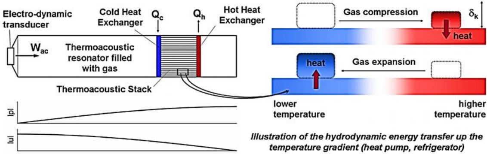  
Figure 1.1: Schematic of a simple standing wave thermoacoustic cooler arrangement. The acoustically induced compression and expansion of fluid elements causes heat pumping effects along the stack (Mao and Jaworski, 2010).

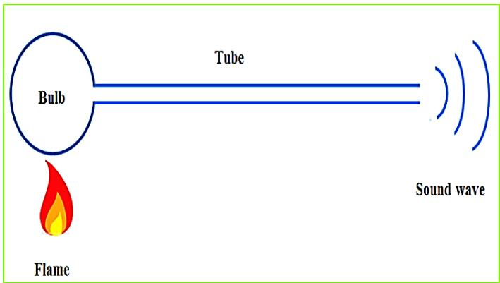  
Figure 1.2: Sondhauss tube.

Similarly, another study of the interaction between sound waves and heat energy was conducted by Rijke around 1859, which consisted of a tube, opened at both ends, that contained a heater grid (heated wire screen) anchored in the first quarter of the bottom of the tube length where pronounced oscillations were generated by the grid heater, as shown in Figure 1.3 (Rijke 1859 and Bisio & Rubatto, 1999). Rijke pointed out that when the top end of the tube is closed, oscillations will be stopped which led him to think of the “incorrect concept"that oscillations were produced by the convective flow from heating up the air in the tube.

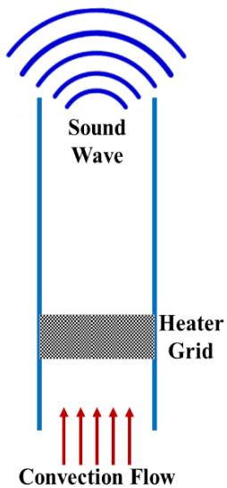  
Figure 1.3: Rijke tube.

Both Sondhauss and Rijke failed to provide a comprehensive explanation of their phenomena. Consequently, in 1877 Rayleigh explained that acoustic power can be generated when a gas is compressed and expanded thermally (when heat is given to the air at the moment of greatest condensation, or its taken from it at the moment of greatest rarefaction) and oscillatory thermal expansion and contraction can be created by sound waves under specific consideration, in a tube with temperature difference (Bisio & Rubatto, 1999). Rayleigh's explanation has opened the way to other researchers to understand the thermoacoustic effect and build standing\travelling thermoacoustic devices (both engines and refrigerators).

## 1.2 Motivation Behind this Research

Thermoacoustics is a relatively new technology with promising future potential due a number of advantages (Maruyama et al, 2014). For instance, the lack of mechanical moving parts leads to high reliability and low maintenance. Similarly, the working gas is usually an inert gas which makes thermoacoustic devices environmentally friendly due to the absence of the ozone depleting chemicals. In addition, waste-heat can be used as the useful input work of thermoacoustic devices. Finally, thermoacoustic devices can be easily coupled with solar energy (Shen et al., 2009). Recently, numerous academic researchers have been focusing on thermoacoustic technologies as research in the area of renewable energy e.g. biomass and geothermal energies (Gardner and Lawn, 2009, Normah et al., 2013 and Saechan, 2014).

However, it appears that there are still some weaknesses and challenges in the design and performance of thermoacoustic devices especially travelling wave thermoacoustic refrigerators. One issue might be that the design of travelling wave thermoacoustic refrigerators/coolers have been discussed in a limited number of articles, papers, journals, and books. Another issue is that there are limited attempts at coupling thermoacoustic devices to electrical/electronic components. Perhaps the most serious challenge of designing thermoacoustic devices is how to couple an acoustic driver/linear alternator efficiently (in terms of acoustic power to electrical power or vice versa) and safely (avoid damaging it) to an acoustic system. Another major challenge might be that of achieving a relatively high cooling power of several hundred watts with thermoacoustic refrigerators especially when reducing size.

These weaknesses and challenges are considered to be an obstacle to slow down the development of thermoacoustic devices. Consequently, this research was carried out to design and fabricate a travelling wave thermoacoustic refrigerator/cooler that could be implemented in an enclosure confining electrical/electronic components which need to be maintained at specific temperature ranges (≤ room temperature), e.g. capacitor banks and electrical panel stocks which are used to improve the power factor and can be built behind large factories.

## 1.3 Aim and Objectives

This research aims at creating a demonstrator of a thermoacoustic refrigerator that could be further developed into a means of thermal management of various enclosures. The challenges of this research are three-fold: to meet the required acoustic conditions for the drivers available to the project, to provide the required cooling power and keep the overall size of the refrigerator minimized as much as possible. This demonstrator should be able to achieve about 400 – 500 W of cooling power (minimum cooling load of electrical panel stocks) with a temperature of 275 K and 300 K on cold and ambient heat exchangers respectively. The specific objectives of this research are defined as follows:

i. To study the performance of two given acoustic drivers (1S132M and 1S132DX, acquired from Q-Drive) available to the project to be coupled to the cooler to operate efficiently (electrical to acoustic power conversion) and safely (avoiding damage during operation). This study can be theoretically achieved by solving the relevant equations and considering different acoustic conditions of an acoustic network.

ii. To design a travelling wave thermoacoustic refrigerator powered by the two given acoustic drivers. The choice of travelling-wave device having been made on account of its higher efficiency than a standing wave counterpart. It is envisaged that the cooler should be able to achieve approximately 400 – 500 W of cooling power with the temperature difference of 25K between cold and ambient heat exchangers. In order to provide the preferred acoustic conditions by the drivers and achieve the required cooling power of this project, different configurations of the refrigerator design should be investigated along with the parameters of each component.

iii. To simulate the design of the travelling wave thermoacoustic refrigerator "demonstrator" by utilizing the DeltaEC program (Design Environment for Low-amplitude Thermoacoustic Energy Conversion).

iv.To investigate the optimum design of the refrigerator concerning the required acoustic conditions and cooling power by considering various topological structures.

v. To build the travelling wave thermoacoustic refrigerator based on the optimized dimensions and details obtained from the DeltaEC simulation. The utilization of standard parts available off the shelf should be considered as far as possible to construct the apparatus. The use of such standard parts can minimize the overall cost of apparatus. The overall size of the travelling wave thermoacoustic refrigerator should be minimized as much as possible with the possibility to anchor all or most of the cooler inside an enclosure that contains the electrical/electronic components for safety reasons.

vi. To conduct “debugging" and preliminary investigation of the prototype/demonstrator in the laboratory setting. Subsequently to compare the data collected with theoretical results simulated via DeltaEC. In addition, to perform further tests and full detailed experiments to establish the maximum performance of prototype and investigate the presence of acoustic streaming.

## 1.4 Outline of the Thesis

This thesis has been structured in the form of seven chapters (including the existing chapter “introductory chapter").

Chapter 2: introduces and reviews the theoretical background of thermoacoustics and the practical configurations of thermoacoustic devices. It then describes the acoustic drivers and methods of measuring the acoustic power. In addition, it introduces the main four types of acoustic streaming (Gedeon, Rayleigh, jet-driven and regenerator/stack streaming). Finally, this chapter provides a very brief introduction of the DeltaEC program used for the simulations.

Chapter 3: firstly provides the analytical solution of the governing equations of the acoustic drivers. The main focus in this chapter is on the performance and analysis of the two given acoustic drivers available for this project. This chapter provides a map of the acoustic drivers showing how to operate them safely (to avoid damaging them) and efficiently regarding the input electrical power to the acoustic power produced by providing their preferable acoustic impedance and phase difference.

Chapter 4: begins with the preliminary design of a one-stage thermoacoustic refrigerator to study the effect of the parameters of each of the regenerator and heat exchangers such as length, cross-sectional area, porosity and others on both acoustic impedance and its phase. It then introduces the design of the two-stage looped-tube refrigerator and ends with the two-stage thermoacoustic refrigerator with inertance and compliance optimized design.

Chapter 5: firstly, describes the construction of the experimental apparatus and its components in addition to the sensors and instrumentation used. Each part of the twostage thermoacoustic refrigerator is presented with a brief description and the technical drawing. The sensors and instrumentation used regarding the operational set-up and collecting the data are also presented and briefly explained.

Chapter 6: offers the experimental results and discusses them. Firstly, the results of the preliminary experiments regarding the optimum operating points of the experimental apparatus are shown and discussed. The effects of the applied cooling load, operating frequency and mean pressure on the thermal and acoustic performances of the thermoacoustic refrigerator have been also presented and discussed in this chapter. Acoustic streaming (Gedeon streaming) was investigated and completely supressed from the thermoacoustic refrigerator, when it was equipped with three types of flexible membrane (flat, loose and stretched-bent membrane).

Chapter 7: presents the conclusions and recommended future work based on the findings of this research.

## Chapter 2 Literature Review

In this chapter the theoretical background of thermoacoustics will be introduced first. The review of the practical configurations of thermoacoustic devices is under-taken. This is followed by the description of the main two types of acoustic drivers and their importance regarding the thermoacoustic devices. In addition, it introduces the main four types of acoustic streaming (Gedeon, Rayleigh, jet-driven and regenerator/stack streaming). Finally, this chapter provides a very brief introduction to the DeltaEC program that was used for the simulations.

## 2.1 Theoretical Background of Thermoacoustics

This section provides some vital length scales of thermoacoustics. These essential parameters are useful and crucial in understanding and designing thermoacoustic devices for researchers who have an interest in this field.

## 2.1.1 Length Scales

In acoustics, when a sound wave propagates in a gas along the x-axis (the direction of the sound wave propagation), then it has a specified wave-length and frequency that can be calculated from the equation below (Swift, 2001):

$$
\lambda = { \frac { a } { f } } \ ,\tag{2.1}
$$

where λ is the wavelength, a is the speed of sound of the working gas and f is the frequency of the gas oscillation. Typically, the overall length (l) of thermoacoustic devices is shorter than the wavelength; it can be a half or quarter wave length in most standing-wave devices. The length of the heat exchangers and stack/regenerator together should be significantly smaller than the wavelength (cf. Figure 1.1) (Swift, 2001).

The speed of sound for an ideal gas can be stated in the following form (Bruce E Poling et al., 2004):

$$
a = \sqrt { \gamma R T } = \sqrt { \frac { \gamma p _ { m } } { \rho } } ,\tag{2.2}
$$

where $\gamma$ is the ratio of specific heat, R is the gas constant, $T$ is the temperature of the gas, $p _ { m }$ is the mean pressure of the gas and $\rho$ is the density of the gas. The choice of the working gas is crucial due to the contribution of the gas properties to determine the frequency and wave length of the thermoacoustic devices.

The displacement amplitude of the gas $| \xi _ { 1 } |$ is another important length scale; it is always smaller than the wave length:

$$
| \xi _ { 1 } | = \frac { | U _ { 1 } | } { \omega A } , \qquad \omega = 2 \pi f .\tag{2.3}
$$

Here $| U _ { 1 } |$ is the volumetric flow rate amplitude, ω is the angular velocity and A is the cross-sectional area of a duct/resonator (the available cross-sectional area to the working gas/fluid). Ideally, it is preferable for the length of heat exchangers to be set as $| 2 \xi _ { 1 } |$ , as shown in Figure 2.1(a) which may lead to that every gas parcel over the length of the heat exchangers will transfer heat with the stack/regenerator when it moves back and forth between the two extremes of the peak-to-peak displacement amplitude $| 2 \xi _ { 1 } |$ . When, the heat exchanger's length is set to be smaller than the peakto-peak displacement amplitude then few gas parcels will miss and “overshoot" the heat exchangers so failing to exchange heat (see Figure 2.1(b)). In the third case, when heat exchanger length is greater than the peak-to-peak displacement amplitude of the gas then there will be a number of gas parcels moving strictly within the heat exchanger's length without being able to transfer heat to the stack/regenerator (see Figure 2.1(c)) (Swift, 1988 and Saechan, 2014). However, a perfect heat exchanger that can achieve a length of $| 2 \xi _ { 1 } |$ , high heat thermal performance and no acoustic dissipation due to the viscosity and thermal conductivity is almost not applicable. Therefore, some compromises have to be made (Swift, 1988).

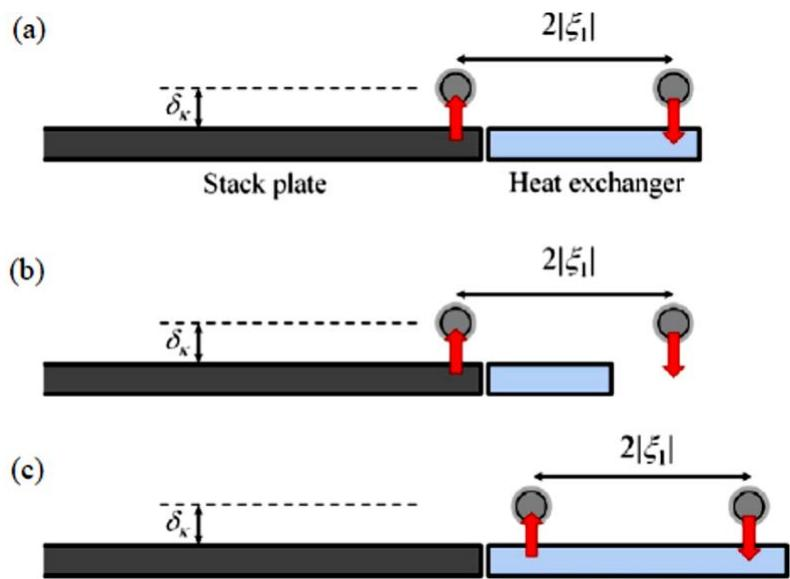  
Figure 2.1: A gas parcel transferring heat while moving along a heat exchanger and stack when the length of the heat exchanger is $| 2 \xi _ { 1 } |$ (a), shorter than $| 2 \xi _ { 1 } | \left( \mathfrak { b } \right)$ , and longer than $| 2 \xi _ { 1 } | \left( \mathrm { c } \right)$ (Saechan, 2014).

There are also two important length scales in relation to the spacing of the stack/regenerator plates and the working fluids which are the thermal and viscous penetration depths (cf. Eq. (2.4) and Eq. (2.5) below) (Olson and Swift, 1998 and Swift, 2001). The two lengths are measured perpendicularly to the propagation of the working gas:

$$
\delta _ { k } = \sqrt { \frac { 2 k } { \omega \rho C _ { p } } }\tag{2.4}
$$

$$
\delta _ { v } = \sqrt { \frac { 2 \mu } { \omega \rho } } \ .\tag{2.5}
$$

Here $\delta _ { k }$ and $\delta _ { v }$ are the thermal and viscous penetration depths respectively. $k , \omega , \mu$ and $\rho$ are the thermal conductivity, the angular velocity, the dynamic viscosity, and the density of the working gas, respectively. $C _ { p }$ is the isobaric specific heat per unit mass. The thermal penetration depth can be defined as the heat diffusion for a period of time $( \frac { 2 \pi } { \omega } )$ that is relevant to the oscillating gas while the viscous penetration depth is related to diffusion of the momentum, i.e.“viscous shear forces", to the same time interval (Swift, 2001, Garrett, 2004 and Newman et al., 2006). If the spacing between the plates of a stack is too large compared to the two parameters mentioned, then the parcels of the working gas will either experience a weak thermal and viscous interaction or no contact. In addition, large thermal and viscous penetration depths are generally considered to be beneficial concerning the heat transfer (higher thermal conductivity of the gas) but undesirable for viscous losses (viscous shear forces). Hence, the stack plate spacing should be carefully chosen with regard to the thermal and viscous penetration depths.

There is another characteristic parameter known as the Prandtl number (σ) which is the square of the ratio of the viscous over thermal penetration depths (cf. Eq. (2.6)):

$$
\sigma = \left( { \frac { \delta _ { v } } { \delta _ { k } } } \right) ^ { 2 } = { \frac { \mu C _ { p } } { k } } \lesssim 1 .\tag{2.6}
$$

The viscous and thermal penetration depths are comparable as the Prandtl number is almost one for typical thermoacoustic devices (Swift, 2001 and Newman et al., 2006). It should be pointed out that a Prandtl number smaller than one is always preferred due to the positive effect of decreasing the viscous effect which leads to a reduction in the dissipated acoustic power. Such a Prandtl number could be achieved by using a mixture of heavy and light monatomic gases such as helium – argon or only an inert gas such as helium (Tijani et al., 2002a).

The hydraulic radius is another significant solid/channel parameter which can be compared with the thermal penetration depth (Swift, 2001, Tijani et al., 2002b, Garrett, 2004, Ueda et al., 2010 and Bassem et al., 2011). The thermal penetration depth normally is larger than the hydraulic radius (Swift, 2001). The hydraulic radius might be expressed as the constant cross-sectional area A to the wetted perimeter I (cf. Equation (2.7)):

$$
r _ { h } = { \frac { A } { \Pi } }\tag{2.7}
$$

For a parallel plate stack (normally used in standing-wave thermoacoustic devices) with a fine spacing of 2Y, the hydraulic radius can be expressed as: $r _ { h } = Y$ . Parallel plate stacks can be made of regular materials such as Mylar and stainless steel sheets with a hydraulic radius $( r _ { h } )$ between 1 to 4 times of the thermal penetration depth $( \delta _ { k } )$ (Tijani et al., 2002d and Yahya S. G. et al., 2015).

The hydraulic radius of a regenerator is the ratio of gas volume to the gas—solid contact area; if the screen mesh is a plain square-weave screen then the hydraulic radius can be calculated as follows (Ward et al., 2012):

$$
r _ { r e g } \simeq d _ { w i r e } \frac { \emptyset } { 4 ( 1 - \emptyset ) } \ ,\tag{2.8}
$$

where:

$$
\emptyset \simeq 1 - \frac { \pi n d _ { w i r e } } { 4 } .\tag{2.9}
$$

To distinguish between stacks and regenerators the terms of Lautrec number $( N _ { L } =$ $\frac { r _ { h } } { \delta _ { k } } \Big )$ could be used. If the Lautrec number is equal to, or greater than one then the porous medium can be termed as a stack while it can be called a regenerator when the Lautrec number is smaller than one (Garrett, 2004).

The ratio of the oscillating pressure amplitude to the mean pressure of the working gas is defined as the drive ratio $D _ { r }$ (this ratio might be used as an indicator of the acoustic wave strength) and it is typically presented as a percentage:

$$
D _ { r } = \frac { | p _ { 1 } | } { p _ { m } } x 1 0 0 \% .\tag{2.10}
$$

## 2.1.2 The Governing Equations

The pressure, velocity , temperature, density and entropy are the typical quantities considered in thermoacoustics “gas oscillations". According to Rott's acoustic approximation for steady-state sinusoidal oscillations of ideal gases these parameters can be expressed in the simplified form (Swift, 2001):

$$
p ( x , y , z , t ) = ~ p _ { m } + ~ \mathrm { R } _ { e } \left[ p _ { 1 } ( x ) e ^ { i \omega t } \right]\tag{2.11}
$$

$$
u ( x , y , z , t ) = \mathrm { R } _ { e } \left[ u _ { 1 } ( x , y , z ) e ^ { i \omega t } \right]\tag{2.12}
$$

$$
T ( x , y , z , t ) = \ T _ { m } ( x ) + \ \mathrm { R } _ { e } \left[ T _ { 1 } ( x , y , z ) e ^ { i \omega t } \right]\tag{2.13}
$$

$$
\rho ( x , y , z , t ) = \ \rho _ { m } ( x ) + \operatorname { R } _ { e } \left[ \rho _ { 1 } ( x , y , z ) e ^ { i \omega t } \right]\tag{2.14}
$$

$$
s ( x , y , z , t ) = \ s _ { m } ( x ) + \ \mathrm { R } _ { e } \left[ s _ { 1 } ( x , y , z ) e ^ { i \omega t } \right]\tag{2.15}
$$

Equations (2.11) to (2.15) are based on some assumptions. For instance, the timedependent variables are neglected (minor values). Another assumption is that the oscillation of the pressure can fluctuate dramatically only in the x-direction and the gradients of pressure in the y and z directions are neglected. In addition, the mean pressure of gas in the device is uniform and independent of the locations $x , y$ and z. The mean velocity is assumed to be zero (there is no net mass flow in the system) (Swift, 2001).

The governing equations in thermoacoustics are derived from three fundamental equations: continuity, momentum, and heat transfer equations. They are essential to predict the performance of thermoacoustic devices. Approximate formulae of each of these equations have been obtained by Rott based on one-dimensional propagation (in the x-direction), steady oscillating flow, mono-frequency and second order terms being neglected (Swift, 2001):

• Continuity equation:

$$
i \omega \rho _ { 1 } + \frac { d \rho _ { m } } { d x } u _ { 1 } + \rho _ { m } \nabla . \mathbf { v } _ { 1 } = 0\tag{2.16}
$$

• Momentum equation:

$$
i \omega \rho _ { m } u _ { 1 } = - { \frac { d p _ { 1 } } { d x } } + \mu \left( { \frac { \partial ^ { 2 } u _ { 1 } } { \partial y ^ { 2 } } } + { \frac { \partial ^ { 2 } u _ { 1 } } { \partial z ^ { 2 } } } \right)\tag{2.17}
$$

• Heat transfer (energy) equation:

$$
i \omega \rho _ { m } C _ { p } T _ { 1 } + \rho _ { m } C _ { p } \frac { d T _ { m } } { d x } u _ { 1 } = i \omega p _ { 1 } + k \left( \frac { \partial ^ { 2 } T _ { 1 } } { \partial y ^ { 2 } } + \frac { \partial ^ { 2 } T _ { 1 } } { \partial z ^ { 2 } } \right)\tag{2.18}
$$

The acoustic continuity and momentum equations of Rott for ideal gas oscillations can be expressed as a function of acoustic pressure and volume flow rate as follows:

• Lossless version of Rott's acoustic continuity equation:

$$
\begin{array} { c } { { p _ { 1 } = - \displaystyle \frac { \gamma p _ { m } } { i \omega A \Delta x } \Delta U _ { 1 } } } \\ { { } } \\ { { = - \displaystyle \frac { 1 } { i \omega C } \Delta U _ { 1 } } } \end{array}\tag{2.19}
$$

• Lossless version of Rott's acoustic momentum equation:

$$
\begin{array} { c } { { \Delta p _ { 1 } = - i \omega \displaystyle \frac { \rho _ { m } \Delta x } { A } { U } _ { 1 } } } \\ { { = - i \omega L { U } _ { 1 } , } } \end{array}\tag{2.20}
$$

where:

$$
C = \frac { \vee } { \gamma p _ { m } }\tag{2.21}
$$

and

$$
L = \frac { \rho _ { m } \Delta x } { A } \mathrm { ~ . ~ }\tag{2.22}
$$

C is the multiplication of volume $( \mathsf { V } = A \Delta x )$ and compressibility $\left( { \frac { 1 } { \gamma p _ { m } } } \right)$ of a short channel. It is known as compliance in the acoustic networks similar to the capacitance in an electric network. The compliance definition can be used with short channels when the compressibility of the working gas is significant.

L is the product of the density of the gas $\left( \rho _ { m } \right)$ and the length of a channel (∆x) divided by the cross-sectional area (A) of the channel in which the inertia of the working gas is significant. It is known as the inertance in the acoustic networks similar to the inductance of an electric network.

In acoustic networks, commonly both compliance and inertance together contribute to the performance of propagation of the wave of a channel or only one will add effect. The ratio of the complex pressure to the volume flow rate $\begin{array} { r } { \left( Z = \frac { p _ { 1 } } { U _ { 1 } } \right) } \end{array}$ is known as the complex acoustic impedance. The term acoustic impedance (Z) is also used here to refer to the difference of the pressure $\left( { \frac { \Delta p _ { 1 } } { U _ { 1 } } } \right)$ or to describe the change of the volume flow rate $\left( \frac { p _ { 1 } } { \Delta U _ { 1 } } \right)$ across a component. Hence, the acoustic impedance of a compliance and an inertance can be written as (Swift, 2001):

$$
Z _ { C } = { \frac { 1 } { i \omega C } } = { \frac { \gamma p _ { m } } { i \omega V } }\tag{2.23}
$$

$$
Z _ { L } = i \omega L = \frac { i \omega \rho _ { m } \Delta x } { A }\tag{2.24}
$$

Measuring the efficiency is an important task in order to assess the performance of an apparatus. As mentioned earlier, there are two categories of thermoacoustic devices which are engines and refrigerators. Thermoacoustic engines are also known as prime movers and they are used to produce work $( W _ { o u t } )$ by using a heat input $( Q _ { h } )$ (see Figure 2.2(a)). Their efficiencies can be measured from the output work (acoustic power or electrical power) divided by the input work (injected heat to the system):

$$
\eta _ { e n g i n e } = \frac { \dot { E } _ { 2 } } { Q _ { h } }\tag{2.25}
$$

The coefficient of performance (COP) represents the efficiency of thermoacoustic refrigerators (heat pump), the role of the refrigerator is to remove heat from one end to another (providing a cooling power $Q _ { c } )$ by consuming work (acoustic power $\dot { E } _ { 2 } )$ (see Figure 2.2(b)). From basic thermodynamics, the COP is the ratio of the required effects from the system divided by the work provided to the system (Cengel & Boles, 2002):

$$
\mathsf { C O P } = \frac { Q _ { c } } { \dot { E } _ { 2 } }\tag{2.26}
$$

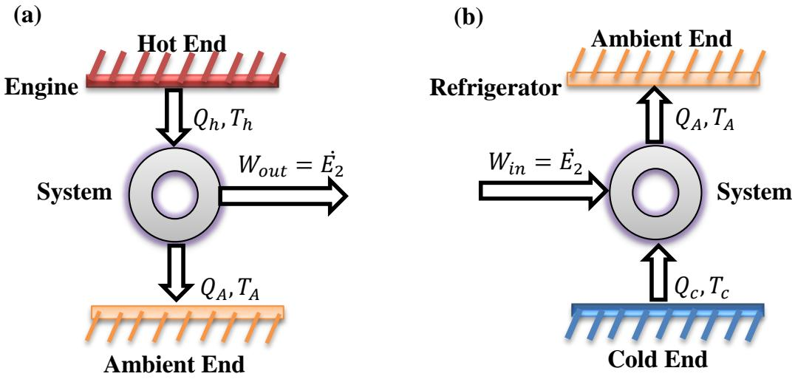  
Figure 2.2: A simple representation of an engine (a) and refrigerator (b)

The Carnot coefficient of performance (COPC) is used to describe the maximum COP that a refrigerator can probably produce among the two extremes of the temperatures which are the cold and ambient ends:

$$
{ \mathrm { C O P C } } = { \frac { T _ { c } } { T _ { A } - T _ { c } } }\tag{2.27}
$$

Here, the relative coefficient of performance (COPR) is used to include the effect of heat transfer efficiency (COP) and temperature differences (COPC) of a refrigerator:

$$
\mathrm { C O P R } = { \frac { \mathrm { C O P } } { \mathrm { C O P C } } }\tag{2.28}
$$

## 2.1.3 Working Gas Selection

There are a number of considerations and compromises concerning choosing the working gas of thermoacoustic devices, such as, power, efficiency, the objectives of the apparatus, and convenience (Swift, 2001). The most significant parameters are Prandtl number, specific heat, and speed of sound. It should be pointed out that low Prandtl number leads to reduced viscous dissipation and high thermal conductivity leads to high thermal penetration depth that leads to higher stacks and heat exchanger gaps (easier to build stacks and heat exchangers) (Swift, 2001 and Ke, H. et al., 2012). Swift (2001) has pointed out that in the “dimensionless groups" thermoacoustic power can be scaled as $( p _ { m } a A )$ and that means high speed of sound and mean pressure leads to achieving high power density (high power per unit volume of the hardware, for a given $( | p _ { 1 } | / p _ { m } ) )$ . In general light gases are preferred for use in thermoacoustic devices due to their low Prandtl number and high thermal conductivity. Helium gas is the most common working gas in thermoacoustic applications due to it is low Prandtl number, high thermal conductivity, high speed of sound and environmental friendliness (Swift, 2001). As mentioned above, high mean pressure of the selected operating gas itself leads to achieving high power density (high power per unit volume of the hardware) (Swift, 2001).

## 2.2 Practical Configuration of Thermoacoustic Devices

The thermoacoustic phenomenon was not clearly established until three decades ago, when it was understood and developed theoretically in a company using prototype devices by Rott (1980b) and Swift (1988). Hence, thermoacoustics is considered to be a relatively new technology which can make the task of designing thermoacoustic devices complicated to some extent (Luo et al., 2005 and Babaei and Siddiqui, 2008)

The basic components of any thermoacoustic device are a stack or regenerator, hot/ambient and cold heat exchangers, and a resonator containing a working gas, as shown in Figure 2.3. The two major categories of thermoacoustic devices (engines and refrigerators) will certainly have these basic components in their construction to create the thermoacoustic effect. Heat exchangers are mainly used to supply and reject heat at two ends of the stack/regenerator. They are typically referred to as heat exchangers and used to create a temperature gradient along the stack or regenerator. The main function of the stack or regenerator is to provide a surface area of a solid or porous medium to enable a heat transfer area with the working gas (they are also providing heat storage capacity). The final major part of thermoacoustic devices is the resonator which is used to maintain the acoustic wave.

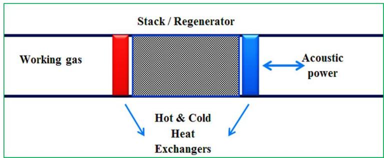  
Figure 2.3: The basic components of a thermoacoustic device.

However, some other components used frequently in thermoacoustic devices should be highlighted, for instance acoustic drivers and linear alternators to be used as an acoustic power source or electricity extraction device, an inertance and compliance used as phase shifters or/and acoustic impedance controllers, and secondary heat exchangers for thermal control and management of the system.

## 2.2.1 Thermoacoustic Refrigeration

Thermoacoustic refrigeration is a term that refers to the process of transferring heat from a cold heat exchanger (CHX) “reservoir at lower temperature than ambient" to an ambient heat exchanger (AHX) “reservoir at an ambient temperature that is hotter than the cold reservoir" by applying work (acoustic power) into a system (Swift, 2001 and Russell and Weibull, 2002). Thermoacoustic devices can work in either standing wave mode, where the phase between the pressure amplitude and volume flow rate is 90º, or travelling wave mode where the phase is $0 ^ { \circ }$ (cf. sections: 2.2.1.1 and 2.2.1.2, respectively).

## 2.2.1.1 Standing Wave Thermoacoustic Refrigerators

Figure 2.4 illustrates the thermoacoustic effect in a standing wave thermoacoustic refrigerator. Two heat exchangers and a stack are located inside a quarter-wavelength resonator that contains the working gas. The hot/ambient heat exchanger is located close to the pressure amplitude anti-node (where pressure amplitude is maximum) and volume flow rate amplitude node (where volume flow rate amplitude is zero) (cf.

Figure 1.1). The cold heat exchanger is located on the other side of the stack where the volume flow rate amplitude is not zero and the pressure amplitude is slightly lower than at the pressure anti-node. The acoustic power is produced by using an acoustic driver that uses electricity (e.g. a load speaker). The acoustic driver is positioned at the pressure node and volume flow rate anti-node. Such a set-up is used to achieve a standing wave mode with a phase of $9 0 ^ { \circ }$ between the pressure and volume flow rate.

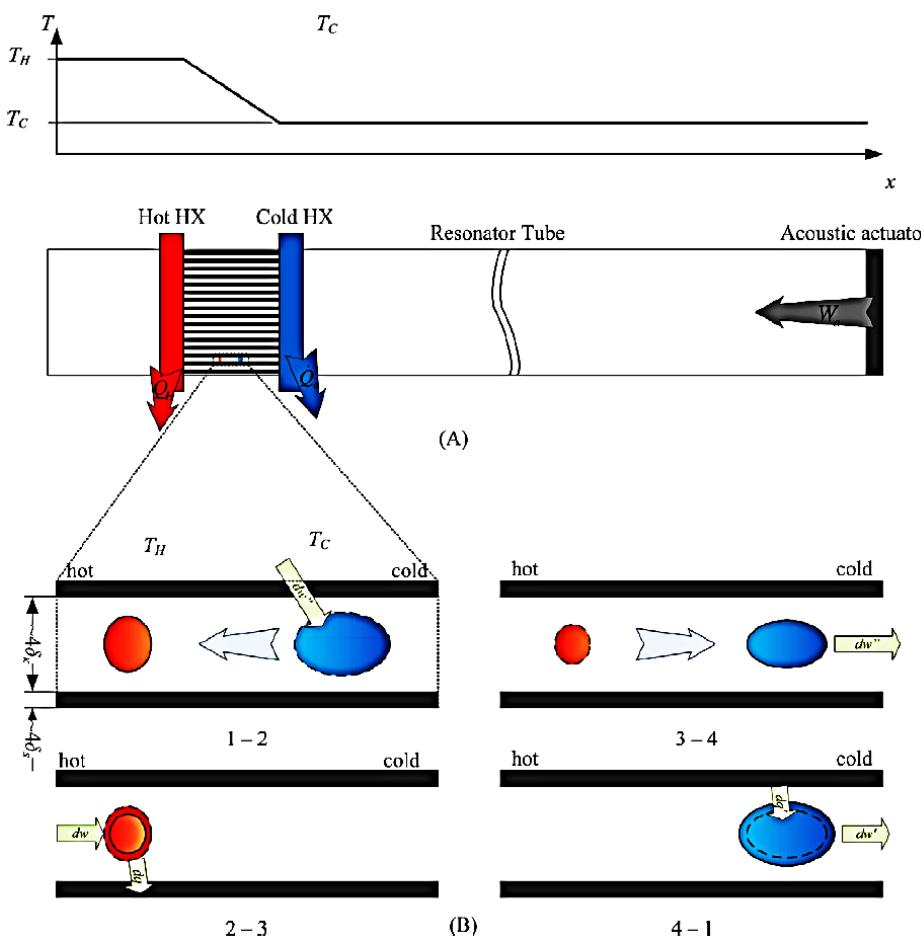  
• 1-2: gas parcel is compressed adiabatically while being displaced towards the velocity node.

• 2–3: gas parcel is further compressed while heat is transferred to the stack.

• 3-4: gas parcel is expanded adiabatically while being displaced toward the pressure node.

• 4–1: gas parcel is further expanded while heat is absorbed from the stack.

Figure 2.4: Schematic of a thermoacoustic refrigerator: (a) Working principle of a thermoacoustic refrigerator from the Lagrangian viewpoint (Bansal et al., 2012) (b).

The working gas will be cyclically compressed and expanded at the operating frequency while moving back and forth in the resonator by the effect of the acoustic wave delivered by the acoustic driver to the system. Simply, by employing the fundamentals of thermodynamics, it is obvious that a parcel of the gas turns hot when compressed and cold when expanded. In addition, it is well-known that when two objects (e.g. solids or gases) of two different temperatures are in direct contact with each other, then heat will flow from the hot object to the cold (Moran et al., 2010). To understand this process of “thermoacoustic effect" more clearly, the movement of one parcel can be followed back and forth and described according to Lagrangian's point of view (cf. Figure 2.4). The parcels of the working gas will pick up heat from the stack while moving towards the cold heat exchanger as the gas is being expanded and become colder than the cold end. Similarly, the parcels of the working gas will deliver heat to the stack while moving towards the hot heat exchanger as the gas is being compressed and becomes hotter than the hot end. This entire process is known as thermoacoustic refrigeration “thermoacoustic effect" (cf. Figure 2.4).

The roles of heat exchanger, resonator, stack, and the acoustic driver have been explained previously. However, in order to create and maintain a standing wave mode, there are some points that should be addressed. For instance, the stack is a porous medium that can be made of stainless steel, nickel, or Mylar. It consists of parallel plates with spacing that should be neither too small nor too big relate to the thermal and viscous penetration depths (Swift, 2001). In addition, stack length and location are important parameters corresponding to the oscillating pressure and velocity distributions along the resonance tube and where pressure and volume flow rate nodes and anti-nodes are (Herman and Travnicek, 2006 and Herman and Chen, 2006).

Tijani et al., (2002b) illustrated the procedures, technique and optimization methods of designing a standing wave thermoacoustic refrigerator by utilizing the linear thermoacoustic assumption (the calculations are made according to a one-dimensional propagation which is in the x-axis direction). The working gas of their refrigerator was 10 bar of helium and its operating frequency was 400 Hz. The choices of the thermoacoustic refrigerator parameters such as the working gas, the length and the location of the stack and thermal penetration depth have been done by creating a normalization method. They have provided a design procedure that could be followed to design a standing wave thermoacoustic refrigerator, as shown in Figure 2.5. The first step of the design procedure was to identify some of the important parameters such as the working gas, the operating frequency, the material and the distance between the plates of the stack which is relevant to the thermal and viscous penetration depths. Then the position and the length of the stack was selected by optimizing the coefficient of performance (COP) of the thermoacoustic cooler. The next step was to decide the cross-sectional area of the stack by means of the required cooling power. Following the design of the resonator and the two heat exchangers was made. Finally, the choice of the acoustic driver was made.

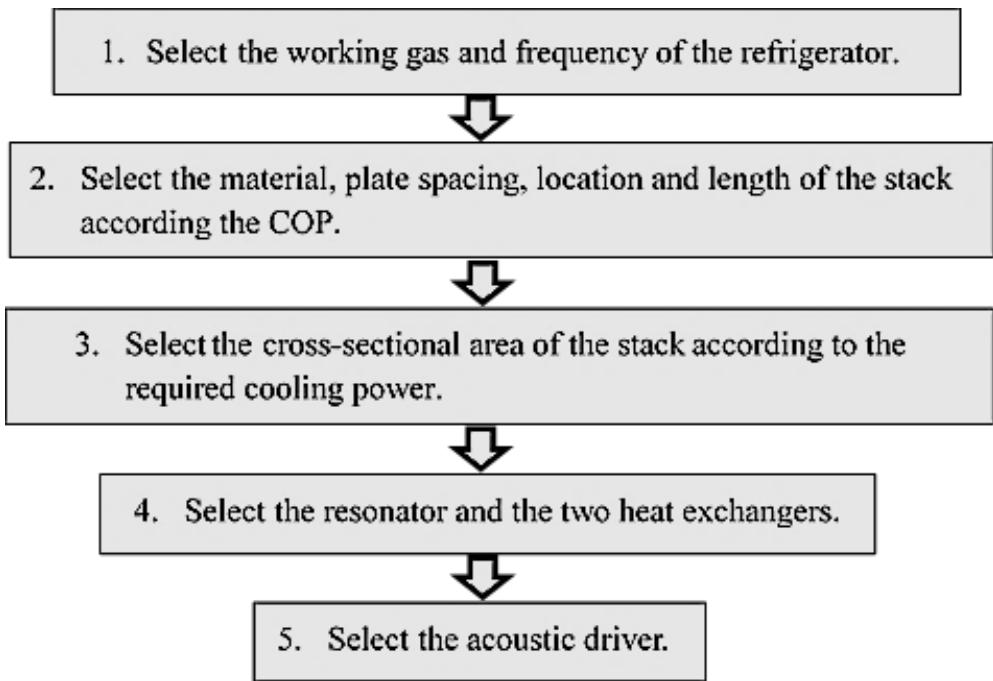  
Figure 2.5: Design procedure of standing wave refrigerator of Tijani et al. (2002b).

A further study has been carried out by Tijani et al., (2002c) that shows the design, the building, and the manufacturing processes of different components of a thermoacoustic refrigerator operating in a standing wave mode (see Figure 2.6). Modifications to the loudspeaker used have been made in order to achieve two requirements. The first requirement was to match the frequencies of both the loudspeaker and the resonator. The second task was to cool down the loudspeaker by circulating cooling water in tubes, as shown in Figure 2.6(a). A resonator made of aluminium with different parts has been used, as shown in Figure 2.6(b). The resonator consists of a large diameter pipe “stack holder", a small diameter pipe and a buffer volume in addition to a reducer used to link both the large and small end of the resonator. Two coiled stacks (spiral stacks) and seven rectangular parallel plate stacks have been manufactured by utilizing Mylar material spaced by fishing wire (see

Figure 2.6(c)). They have built and developed specific tools (equipment) to manufacture the different types of stacks. In addition, other choices such as heat exchanger designs, drive ratios and resonance frequencies have been discussed. This refrigerator has reached - $6 5 \mathrm { { ^ \circ C } }$ as a minimum temperature of the cold side when operated at 10 bar of helium.

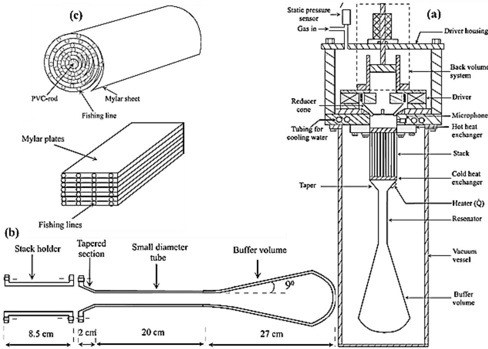  
Figure 2.6: Schematic sketch of standing wave thermoacoustic refrigerator (a), resonator (b) and stacks (c) (Tijani et al., 2002c).

Symko et al., (2004) have fabricated two categories of thermoacoustic devices which are the thermoacoustic cooler (refrigerator) and thermoacoustic engine (prime mover). They have been designed to be coupled with electrical or electronic microcircuits such as power transistors or electronic chips in order to cool down a spot that will be interfaced with microcircuit applications. The overall size of the thermoacoustic cooler has been minimized by increasing the operating frequency of the acoustic wave of the system to be in the range of 4 to 24 kHz. Such a high operating frequency can lead to a very short wavelength (cf. Eq. (2.1). The thermoacoustic cooler is a standing wave type with a half-wavelength of 4 cm it is cylindrically-shaped and filled with air of 1 bar as the working gas. The two heat exchangers (ambient and cold) were made of copper mesh. Several of the stacks were made of cotton or glass wool with lengths of 3 - 4 mm and one by one (in turn) positioned inside the resonator. The hot (ambient)

heat exchanger was attached to fins to dissipate the wasted heat to the surroundings by convection. The cold heat exchanger was coupled to a plate connected to the power transistor which requires refrigeration, as shown in Figure 2.7(a). They have pointed out that the performance of the coolers is related to the geometry and efficiency (acoustic power to electrical power) of the loudspeaker (piezoelectric driver). They have tested the cooler by providing different acoustic power and the results showed a decrease in the temperature of the cold heat exchanger, as shown in Figure 2.7(b).

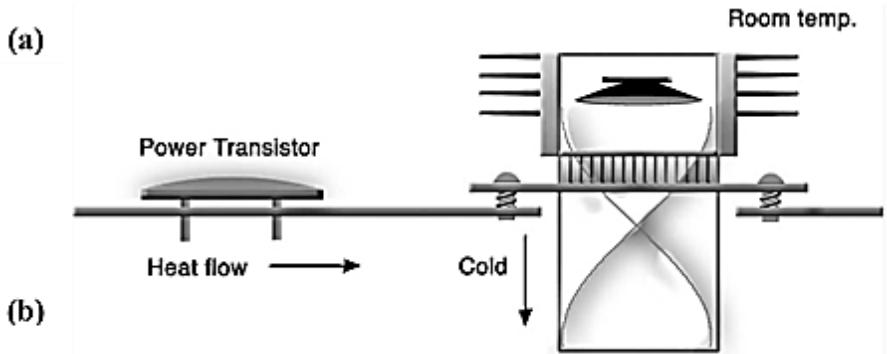

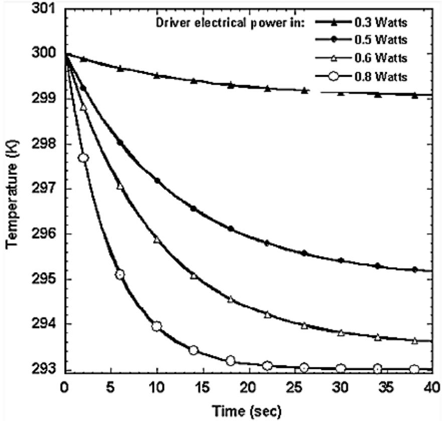  
Figure 2.7: Thermoacoustic cooler coupled to a power transistor, (a) the effect of the acoustic power on the temperature of the cold heat exchanger; (b) Symko et al. (2004).

Symko (2006) made further studies of the miniature thermoacoustic cooler that was made in 2004 (Symko et al., 2004) for thermal management in electronics (see Figure 2.8). The acoustic driver used was Piezoelectric film at a range of frequency between

4 - 24 kHz. The working gas was air at atmospheric pressure and the intensity of the acoustic power was 160dB. The cooling power of the thermoacoustic cooler was approximately 0.5 W/cm2. Symko (2006) suggested that using pressurized air or helium as the working gas might increase the cooling power up to 20 $\mathrm { W } / \mathrm { c m } ^ { 2 }$ at frequencies of 4 – 24 kHz.

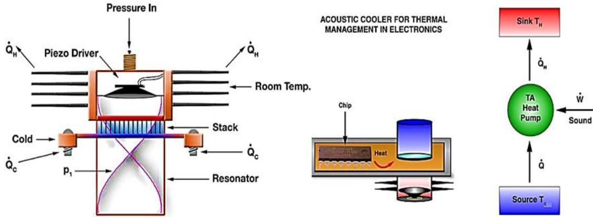  
Figure 2.8: Miniature standing wave thermoacoustic cooler for thermal management in electronics (Symko, 2006).

A study towards improving and optimizing the overall efficiency of the thermoacoustic refrigeration has been undertaken by Herman and Travnicek (2006). This study concerned the thermodynamic and heat transfer issues in thermoacoustic refrigeration. Their refrigerator was a standing wave thermoacoustic refrigerator with a half – wavelength resonator and an acoustic driver as an acoustic power supply. In order to achieve different speeds of sound (a) wavelengths (λ), operating frequencies (f) and Prandtl numbers (σ) air, helium and different gas mixtures have been used as the working gas. The drive ratio $( D _ { r } )$ achieved was 3.5% at the mean pressure, $p _ { m } .$ of 5 bar. The optimization of the design has been done with regard to the two important parameters which are the coefficient of performance (COP) and cooling power $( Q _ { c } )$ . These two important parameters have been studied against a normalized stack length. This study has revealed that the highest cooling power can be achieved by using pure helium as the working gas due to its high speed of sound, high thermal conductivity and low Prandtl number (cf. section 2.1.3).

Nsofor et al., (2007) have experimentally investigated the heat transfer of a heat exchanger placed in a standing wave thermoacoustic refrigerator, as shown in Figure 2.9.

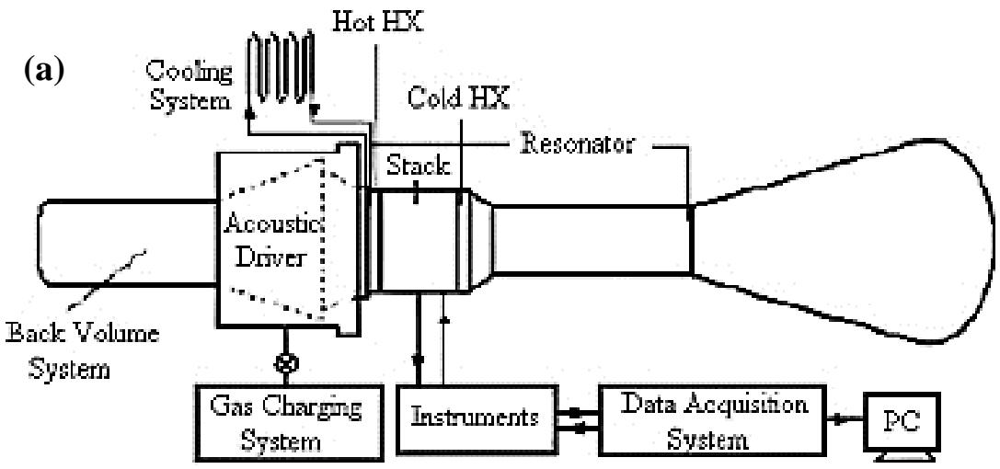

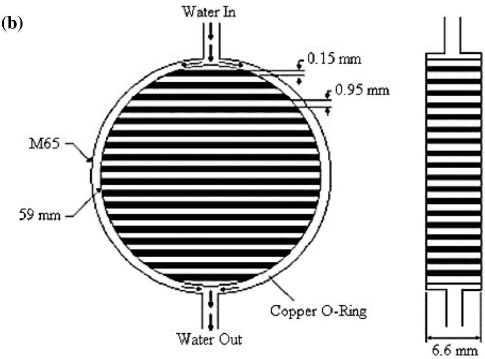  
Figure 2.9: Standing wave thermoacoustic cooler similar to Hofler's (1986); (a) with an ambient heat exchanger constructed from copper fins with even spacing (b) (Nsofor et al., 2007).

Heat transfer correlation has been developed empirically with regard to Nusselt, Prandtl and Reynolds numbers. This thermoacoustic refrigerator is a quarterwavelength, similar to Holfer's (1986), with a drive ratio $( D _ { r } )$ of 2%. An acoustic driver with 400 W of input power was used to provide the required acoustic power by the refrigerator that uses helium gas as the working fluid. The refrigerator was pressurized at a different mean pressure ranging from 3 to 8.1 bar in accordance with the operating frequency that was changing from 300 to 450 Hz to achieve different high power densities (high power per unit volume of the hardware, for a given $( | p _ { 1 } | / p _ { m } ) )$ and wave-lengths, respectively. The resonator was made of an aluminium tube. A plastic tube was also introduced (inserted in the resonator) to reduce the conduction heat loss. Similarly, the stack was constructed from a thermoplastic material to reduce heat loss by conduction along the stack plates. The ambient heat exchanger has a uniform fin spacing and is made of copper, as shown in Figure 2.9(b). This heat exchanger construction, configuration and arrangement of the fins have been achieved by using the electroplating and chemical removal techniques. The cold heat exchanger is an electrical heater used to simulate the variable cooling load. The experimental results revealed that significant errors might occur if straight flow heat transfer correlations were used for heat exchangers with oscillating flow.

Further experimental investigations have been conducted by Nsofor and Ali (2009) to study the effect of the mean pressure, operating frequency and cooling load on the performance of the refrigerator. They showed some interesting results. Firstly, the temperature of the hot end of the stack will be increased by increasing the cooling load and that will lead to a higher temperature difference between the two ends of the stack and a higher performance according to their point of view (see Figure 2.10) Secondly, they have pointed out that a higher mean pressure alone in their system might not always lead to a higher cooling load of their refrigerator. In addition, the maximum cooling load and the maximum temperature difference along the two ends of the stack can be achieved simultaneously by providing the optimal mean pressure and working frequency. Finally, the stabilization time of the hot end of the stack (the time for the hot end temperature to be stabilized) will be increased by increasing the mean pressure and cooling load.

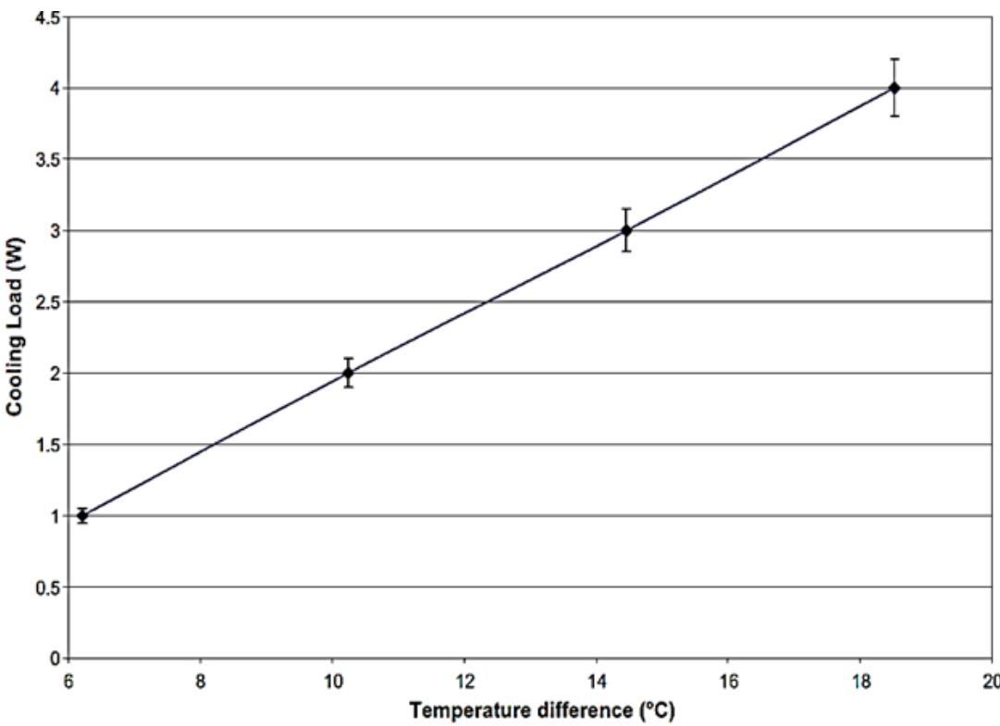  
Figure 2.10: The characteristic curve of cooling load and temperature differences between the two ends of the stack (Nsofor and Ali, 2009).

Jinshah et al., (2013) have designed and fabricated a standing wave thermoacoustic refrigerator. Their experimental device consisted of a loudspeaker, two heat exchangers, stack and resonator, as shown in Figure 2.11(a). The two heat exchangers were made of brass wire meshes while the stack was made of Polyethene(see Figure 2.11(b)). The resonator was made of PVC pipes with different cross-sectional area (see Figure 2.11(c)). The working gas was air at 1 bar. The operating frequency was 400 Hz. The thermoacoustic, thermodynamic and acoustic concepts and the applications of thermoacoustic devices, their design and performance have been reviewed and discussed in this paper. The maximum achieved COP of the refrigerator was 0.55 which is low in comparison with other thermoacoustic devices (refrigerators). However, they have given a few suggestions which can lead to achieving a higher COP of the refrigerator. The first suggestion was using an inert gas such as helium and pressurizing the system which can lead to a higher power density (higher acoustic power) (cf. section 2.1.3). Another suggestion was to modify the current material, geometry and design of the stack and resonator.

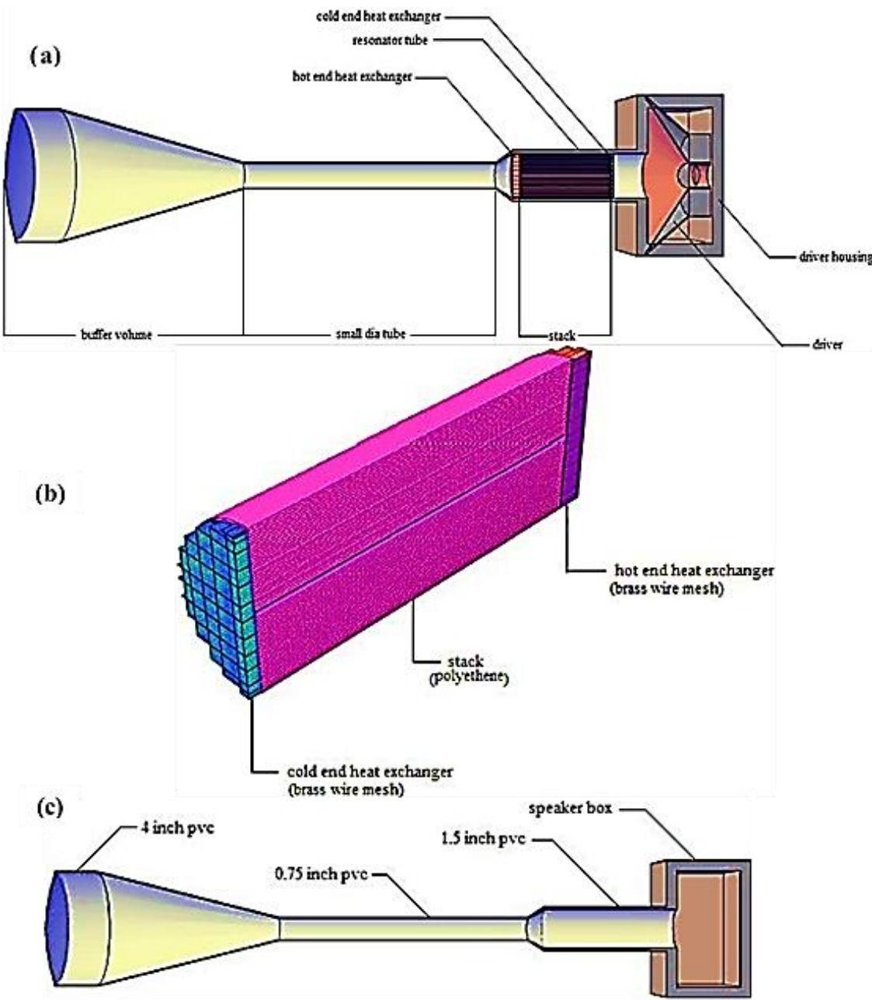  
Figure 2.11: Thermoacoustic refrigerator (a) two heat exchangers and stack; (b) a resonator made which had different cross-sectional areas; (c) Jinshah B S et al., 2013.

Tartibu et al., (2015) have proposed an optimization method for different approaches that can be used in modelling and optimizing miniature standing wave thermoacoustic refrigerators. This multi-objective optimization method uses normalized stack length, location, volume porosity and plate spacing. Their evaluation of the thermoacoustic refrigerator was based on three conditions: maximum cooling load, highest COP and lowest acoustic power dissipations (see Figure 2.12). This multi-objective optimization task has been formed in the formula of the three-criterion non-linear programming problem with discontinuous derivatives (DNLP) to be formulated and implemented in a software called GAMS (General Algebraic Modelling System). An example of helium (He), helium-Xenon (He-Xe) and helium-Neon (He-Ne) has been considered in their approach (cf. Figure 2.12).

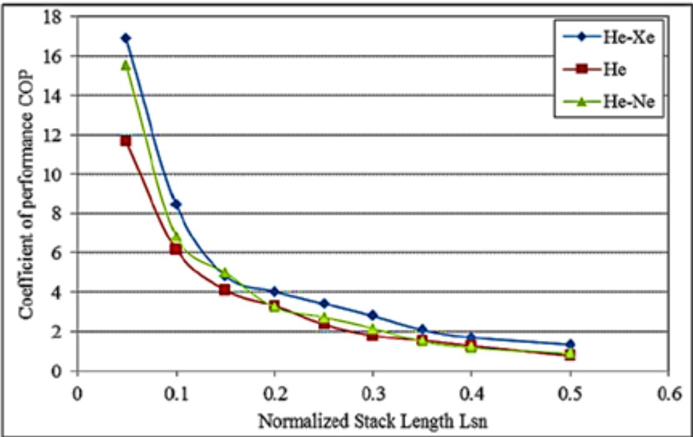  
(a)

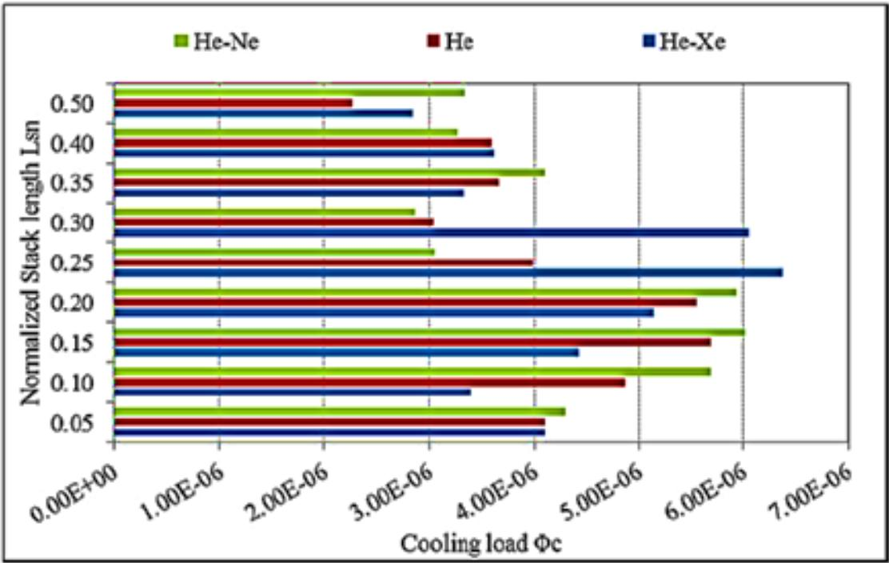  
(b)  
Figure 2.12: The coefficient of performance (COP) (a) as the cooling load (b) as a function of the normalized stack length for three different gases (Tartibu et al., 2015).

Yassen (2015) has built a typical standing wave thermoacoustic refrigerator powered by an acoustic driver (ordinary load speaker powered by solar energy), as shown in Figure (2.13). The input of electrical power to the acoustic driver was generated by solar cells. The working gas of the refrigerator was air at 1 bar. Yassen has developed a new design approach and software to deal with such a solar thermoacoustic refrigerator. He has claimed that his software can be considered to be a core of sizing thermoacoustic engines and refrigerators. The effect of the temperature gradient along the stack, volume porosity and plate spacing of the stack and the coefficient of performance (COP) have been included in the software to be auto-calculated according to a design strategy he has developed.

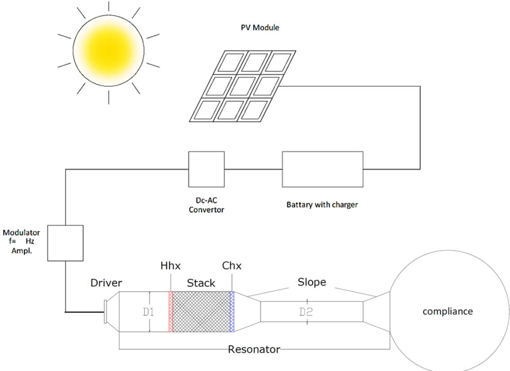  
Figure 2.13: Standing wave thermoacoustic refrigerator powered by solar cells “solar thermoacoustic refrigerator" (Yassen, 2015).

## 2.2.1.2 Travelling Wave Thermoacoustic Refrigerators

Travelling wave thermoacoustic refrigerators require different working conditions and arrangements compared with standing wave thermoacoustic refrigerators. The major difference to consider is the phase difference between pressure and volume flow rate. In standing wave thermoacoustic refrigerators, this phase difference is almost 90°, as mentioned in the previous section, while in travelling wave thermoacoustic refrigerators, the phase between the two is almost zero (Swift, 2001). Another difference is that in travelling wave thermoacoustic refrigerators, the thermal contact between the parcels of the gas and the solid material must be as high as possible to allow the correct time phasing between velocity and pressure while in standing wave thermoacoustic refrigerators, the thermal contact must be neither very good nor weak to allow the correct phasing between the displacement of the gas and the pressure. Such thermal contacts in standing and travelling wave thermoacoustic refrigerators can be achieved by using a stack with a hydraulic radius of few thermal penetration depth and a regenerator with a hydraulic radius much smaller than the thermal penetration depth, respectively.

Hence, in travelling wave thermoacoustic refrigerators, a regenerator that could be made of a pile of stainless steel screen meshes is usually used instead of stacks. In addition, travelling wave thermoacoustic refrigerators intrinsically depend on reversible heat transfer in the regenerator while standing wave thermoacoustic refrigerators essentially rely on the irreversible heat transfer in the stack (Backhaus & Swift, 2000a, Swift, 2001, Luo et al., 2005 and Yu et al., 2011).

Hence, travelling wave thermoacoustic refrigerators are capable of operating much more efficiently than their standing-wave counterparts. Consequently, travelling wave thermoacoustic refrigerators attract the attention of researchers (Luo et al., 2006a). However, they can be more complicated than the standing-wave devices to design and to construct due to their configurations, especially when pressurized (Yu et al., 2011). The regenerator and two heat exchangers (ambient and cold) were placed in a looped tube resonator filled by the working gas, as shown in Figure 2.14. The parcels of the working gas will experience an expansion nearer to the cold heat exchanger to absorb heat while they move toward the other end of the regenerator closer to the ambient heat exchanger to experience a compression and transfer heat to the solid material.

There have been several studies concerning the design, construction and operation of travelling wave thermoacoustic refrigerators. Recently, there have been significant trends towards using acoustic drivers, such as ordinary loudspeakers and especially linear alternators, to drive thermoacoustic refrigerators due to their high power availability. They consume electricity to deliver an acoustic power that can reach about 15 kW with 80% of efficiency. For such acoustic power, thermoacoustic refrigerators can achieve a significant cooling power.

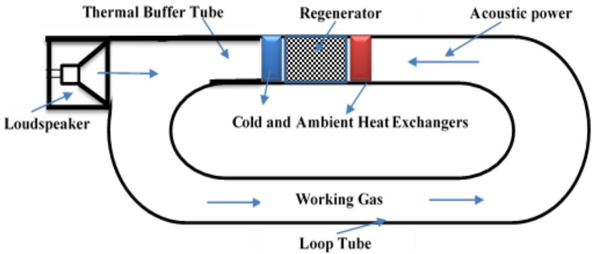  
Figure 2.14: A schematic of a travelling wave thermoacoustic refrigerator.

Ueda (2008) showed a travelling wave thermoacoustic refrigerator that consisted of an acoustic driver, two heat exchangers, a regenerator and a loop tube, as shown in Figure 2.15(a). A numerical method referred to as the transfer matrix method for calculating the performance of travelling wave thermoacoustic refrigerators with a loop tube has been illustrated by Ueda. He has considered the method as a robust tool for designing such refrigerators. It relies on the configuration and operating frequency of the refrigerator as an input. The numerical results obtained by utilizing this method have been compared with those obtained experimentally. Here, the looped tube is presented as a straight pipe that is divided into six parts in order to calculate the values of some parameters such as, the regenerator, hot/ambient heat exchanger and cold heat exchanger positions (see Figure 2.15(b)). The experimental and numerical results have shown a qualitative agreement (see Figure 2.15(c)).

Ueda et al. (2010) have conducted another approach to designing travelling wave thermoacoustic refrigerators with a loop tube (see Figure 2.16(a)). In this work, the performance of such a travelling wave thermoacoustic refrigerator has been investigated numerically. The coefficient of performance (COP) of the refrigerator has been optimized by changing the following parameters: the position, diameter and length of the regenerator which is placed inside the looped tube of the refrigerator, as shown in Figure 2.16(b). Their theoretical results show that a coefficient of performance (COP) higher than 60% of Carnot COP can be achieved. The length and radius of the loop pipe have been set to be 0.05 of the acoustic wavelength and 103 times the thermal penetration depth respectively. The length of the thermal buffer tube was assumed to be 0.005 of the wavelength. The results of this study show that both the position and radius of the regenerator have a significant effect on the coefficient of the performance, as shown in Figure 2.16(b). However, the length of the regenerator has a slight effect on the COP, as the COP decreases by increasing the regenerator length. It should be said that increasing the length of the regenerator leads to a decrease the heat conduction and increases the losses along the x-axis which were neglected in this study.

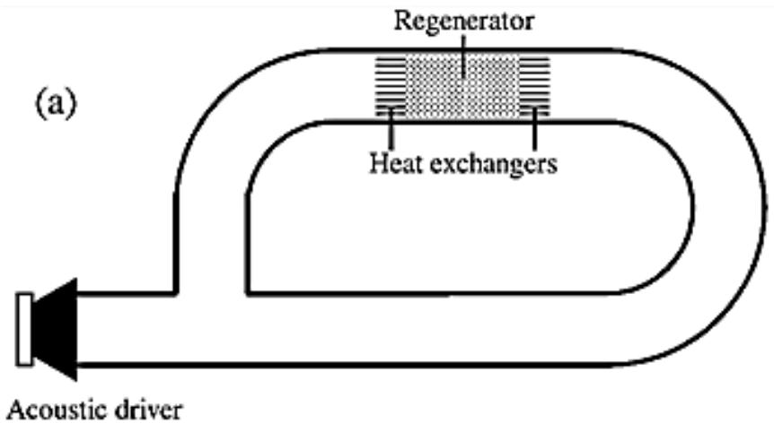

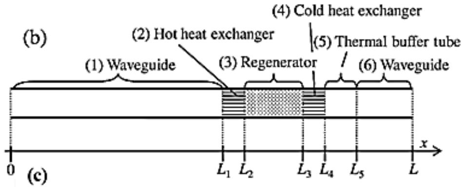

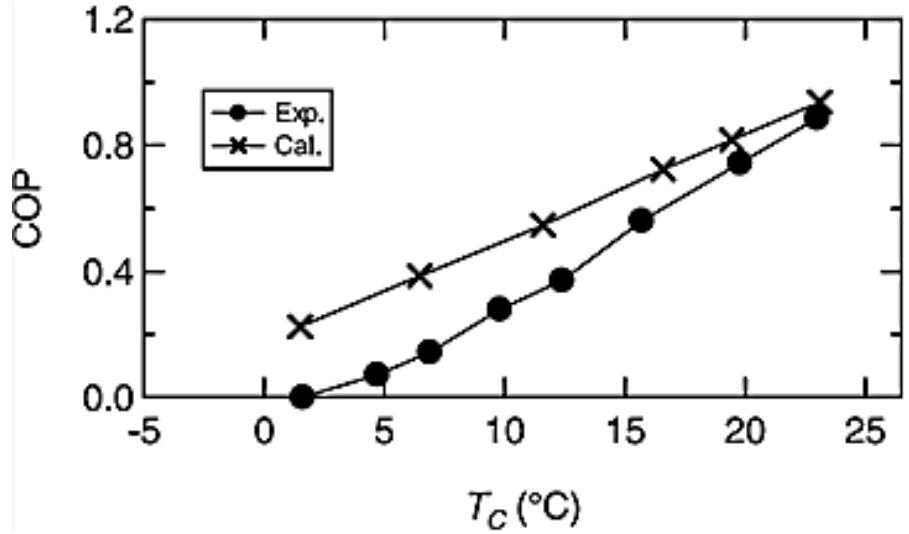  
Figure 2.15: Schematic sketch of Ueda's (2008) travelling wave thermoacoustic cooler; (a) representing the looped tube by a straight pipe; (b) comparison between the calculated and experimental results; (c) Ueda, 2008.

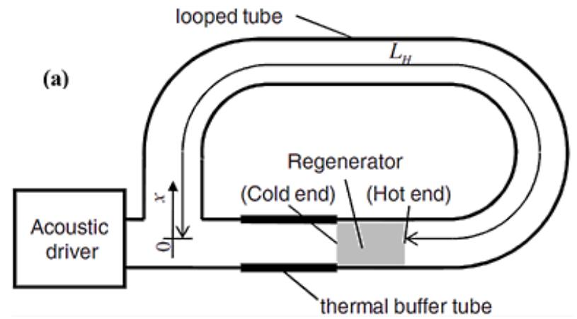

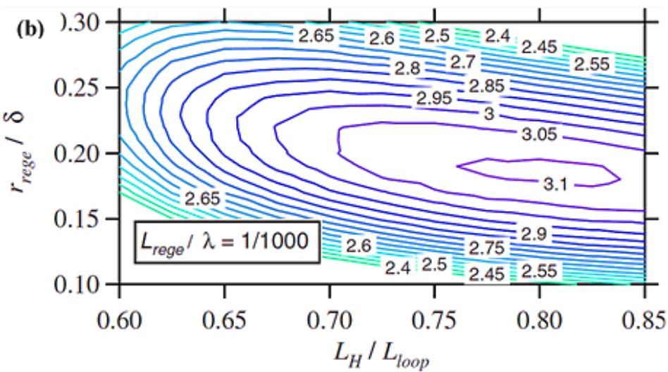  
Figure 2.16: Schematic of a travelling wave thermoacoustic cooler; (a) Contour plot of the COP; (b) Ueda et al., 2010.

Bassem et al. (2011) carried out the design, construction and operation of a travelling wave thermoacoustic refrigerator. Their refrigerator consisted of branch and loop tubes, a linear motor, two heat exchangers, a regenerator, and a thermal buffer tube, as shown in Figure 2.17(a). The specifications of the refrigerator were as follows: the working gas was nitrogen at 5 bar, the length and inner diameter of the branched pipe were 3.5 m and 57.2 mm, respectively. The length and inner diameter of the looped pipe were 1.5 m and 40.5 mm, respectively. The operating frequency was 50 Hz. The regenerator and the pipes were made of stainless steel whereas the two heat exchangers were made of brass. The position, length, cross-sectional radius and the hydraulic radius of the regenerator of this particular refrigerator have been optimized experimentally according to some previous studies (Ueda et al., 2010 and Bassem et al. 2010). However, little attention to the length of the regenerator was paid due to its small effect on the COP of the refrigerator (Ueda et al., 2010). A comparison between the theoretical and experimental results has been presented to show some agreement and discrepancies as shown in Figure 2.17(b). The differences between the measured and calculated results have been discussed and some reasons for these have been provided. In particular, the design of the two heat exchangers was made according to a constant temperature while in the operation there were different internal and external temperatures. Similarly, the thermal losses and the non-linearity of the thermal influences of the acoustic streaming were discussed.

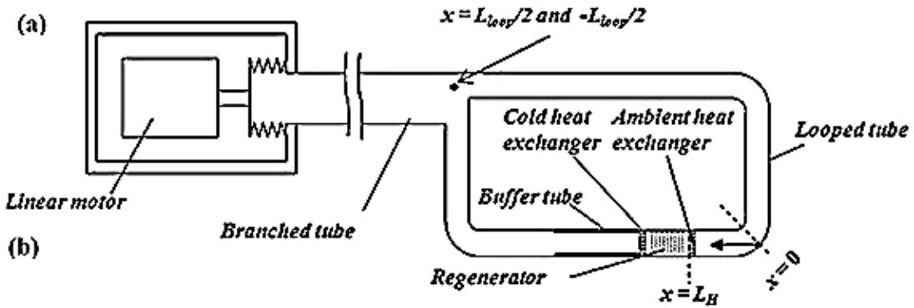

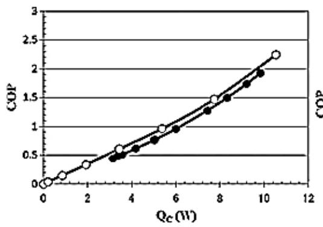

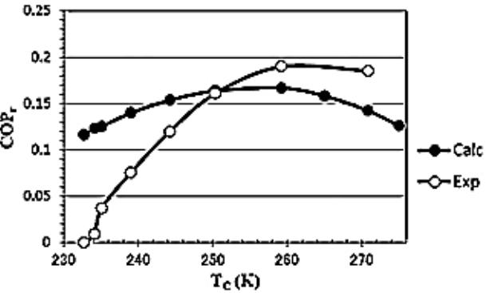  
Figure 2.17: Schematic of travelling wave thermoacoustic refrigerator; (a) comparison of experimental and theoretical results; (b) (Bassem et al., 2011).

## 2.2.2 Thermoacoustic Engines

Thermoacoustic engines (prime movers) are the second category of thermoacoustic devices alongside refrigerators. They are used to convert heat to acoustic power that can be used later to generate electrical power by utilizing an acoustic driver. In a similar way to thermoacoustic refrigerators, thermoacoustic engines can be divided into two configurations: standing wave and travelling wave thermoacoustic engines (see Figure 2.18). In addition, the main four components of thermoacoustic engines are also similar to refrigerators: resonance tube (resonator), regenerator, hot and ambient heat exchangers. However, a secondary ambient heat exchanger is often used in travelling wave thermoacoustic engines to prevent heat from flowing within the looped tube resonator (cf. Figure 2.18a).

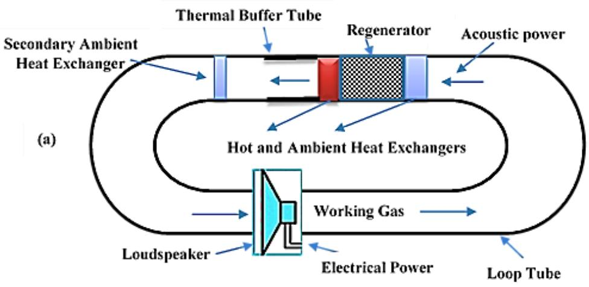

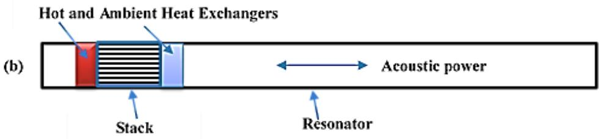  
Figure 2.18: Schematic of a travelling wave; (a) and standing wave thermoacoustic engines (b).

As mentioned in the previous sections, there are some differences in the operation and arrangement between standing wave and travelling wave thermoacoustic refrigerators. Similarly, standing and travelling wave thermoacoustic engines require different set-ups to work. For instance, a phase difference close to $9 0 ^ { \mathrm { o } }$ and $0 ^ { \circ }$ between the oscillating pressure and volume flow rate are required for standing wave and travelling wave thermoacoustic devices, respectively. Another example is that a stack with a closed ends resonator is used to maintain the required phase in standing wave thermoacoustic devices while a regenerator with a looped tube was used in the travelling wave thermoacoustic devices, as shown in Figure 2.18.

However, there are some similarities between standing and travelling wave thermoacoustic engines. For instance, in both types of engines, heat is injected onto the hot-side (HHX) at a high temperature and rejected from the other side (AHX) that is kept at a lower temperature than the hot-side. This will lead to a thermal expansion and contraction of the parcels of gas while heat is added and rejected in addition to a temperature gradient across the regenerator/stack (see Figure 2.19). The parcels of the working gas will be expanded and compressed cyclically along the stack/regenerator to produce the useful acoustic power due to the oscillations of the pressure and volume flow rate.

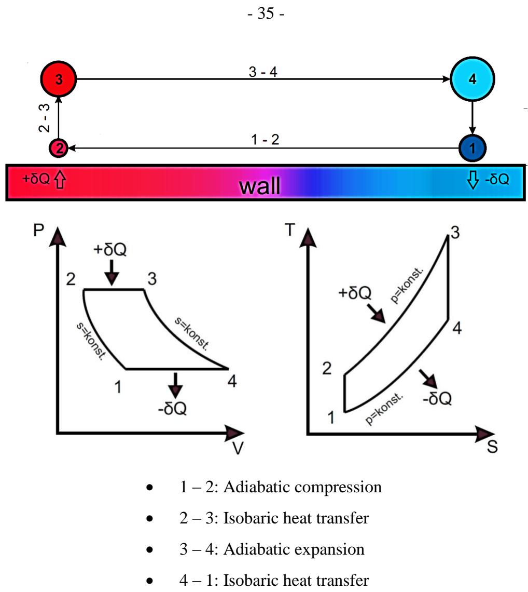  
Figure 2.19: Schematic of p-V and T-s diagrams of the ideal thermoacoustic cycle (the network produced in one cycle of standing wave) (Novotný et al., 2012).

A variety of different configurations of standing and travelling wave thermoacoustic engines have been introduced and discussed by Swift (2001) and Backhaus and Swift (2000b). Their performance and efficiencies have been presented and clarified along with beneficial discussions. The designs and results of their thermoacoustic engines can be widely implemented to help new researchers into thermoacoustic design to construct new thermoacoustic engines.

Gardner and Lawn (2009) have presented a theoretical model of standing wave thermoacoustic engine that could be used in under-developed countries (see Figure 2.20). The requirements of the design were considered for the needs of a village in Nepal. This engine could be used to generate electricity by utilizing the heat of a wood burning stove. In order to achieve the conversion between acoustic and electrical powers, the use of a linear alternator has been considered in this project. A radiant bulb has been used to simulate the heat of stove. It has been assumed that the hot heat exchanger (HHX) will be attached to the stove while the cold heat exchanger is coupled with the ambient temperature. The working gas of the designed engine was air at 10 bar. The effect of using different heat inputs to the hot heat exchanger different operating gas, mean pressure and working frequency have been explored. The theoretical results has been predicted by utilizing MATLAB. The calculations showed that electrical power in the range of 150 W can be achieved from 200 W or higher acoustic power. Their attention was redirected to consider the design of travelling wave thermoacoustic engines in the project.

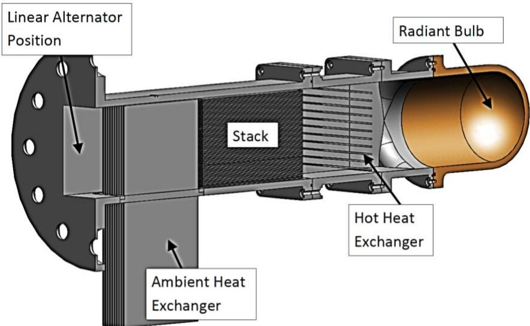  
Figure 2.20: Schematic of conceptual design of standing wave thermoacoustic engine (Gardner and Lawn, 2009).

Symko and Rodríguez (2010) have designed a miniature standing wave thermoacoustic engine “prime mover" that can be used for thermal management of specific systems. This thermoacoustic engine could potentially be used to convert the waste-heat of electronic components to a useful acoustic power. A piezoelectric transducer has been utilized to convert the acoustic power generated to electrical power (see Figure 2.21). This electrical power was used to operate LEDs which were set as a load to indicate the performance of the thermoacoustic engine. The hot and ambient heat exchangers were made of copper meshes with sizes of $4 0 \times 4 0 \times 0 . 3 \mathrm { m m }$ 2 while the stack was made of fine steel wool. The resonator was a quarter wavelength with a length and diameter of 4.3 cm and 5 cm, respectively. The operating gas was air at 1 bar. The operating frequency of the device was 2 kHz. The hot heat exchanger was coupled with a hot plate to simulate the waste-heat from an electronic/electrical component whereas the ambient/cold heat exchanger was connected to the surroundings with an ambient temperature via extended surface fins, as shown in Figure 2.21. An acoustic cavity around the piezoelectric transducer was made to provide feedback and sustain the oscillations. The temperatures of both hot and cold heat exchangers were set to be 140C and $3 7 \mathrm { { ^ \circ C } }$ respectively. At such temperature differences the efficiency of thermoacoustic engine was 10% of Carnot.

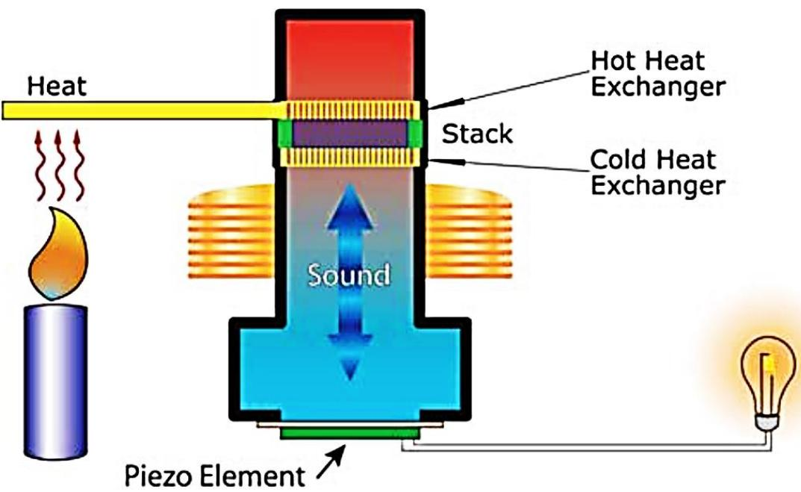  
Figure 2.21: Illustration of a standing wave thermoacoustic engine for thermal management (Symko and Rodríguez, 2010).

Normah et al. (2013) have investigated and reported the theoretical and experimental design of a portable standing wave thermoacoustic engine that has the potential to be used in rural areas. The engine consists of a half wavelength resonator made of stainless steel tube with one open-end, stack made of Celcor ceramic and an ambient heat exchanger made of thin copper plates. The hot heat exchanger was omitted and the heat was injected directly to the hot side of the stack. The resonator has a length of 42 cm and both the stack and ambient heat exchanger have a diameter of 50 mm, the same as the resonator. The working gas of the device was air at 1 bar. The operating frequency of the apparatus was 400 Hz. A 50.67 W of acoustic power has been theoretically achieved when 2952.97 W of heat is injected to the hot side of the stack. A temperature difference of $4 3 3 \mathrm { { } ^ { \circ } C }$ across the stack has been experimentally achieved by using propane flame to simulate the heat of biomass combustion. It has been suggested that the actual heat of a cooking stove as injected heat to the thermoacoustic engine with two closed-ends should be considered.

So far, the designs and applications of a few standing wave thermoacoustic engines have been conducted in this section. There have also been several studies concerning travelling wave thermoacoustic engines. Travelling wave thermoacoustic engines have a slightly different configuration and set-up than standing-wave engines which might lead to complicated construction and higher costs. However, the attention of thermoacoustic researchers has recently been redirected to travelling wave devices, rather than standing wave devices, due to their higher efficiencies and performance as mentioned earlier.

Backhaus and Swift (2000a) presented a theoretical and experimental design of travelling wave thermoacoustic engine with an ideal reversible heat transfer. This engine has a quarter wavelength resonator filled with helium at 30 bar (see Figure 2.22(a)). The use of a looped tube with an inertance and compliance has been presented in this study. An optimization of the engine has been accomplished by using DeltaEC. Two negative effects of an acoustic streaming known as Gedeon and Rayleigh streaming have been illustrated. The effect of the first streaming has been eliminated by using a jet pump and the second streaming has been minimized by tapering the thermal buffer tube, as shown in Figure 2.22(b). It has been explained that the jet pump was used to create a pressure drop and desired volumetric velocity in the right direction of flow. A reduction of the heat wasted from the hot side of the regenerator by convection has also been achieved. This engine has delivered 710 W of acoustic power to the resonator at a thermal efficiency of 30% that corresponds to 0.41 of Carnot efficiency. This acoustic power can be increased to reach 890 W if the thermal efficiency is compromised to 22%. Their results showed that associated heat convection and streaming suppression were partially “qualitatively" understood. However, the dynamics and acoustic power flows were fully understood.

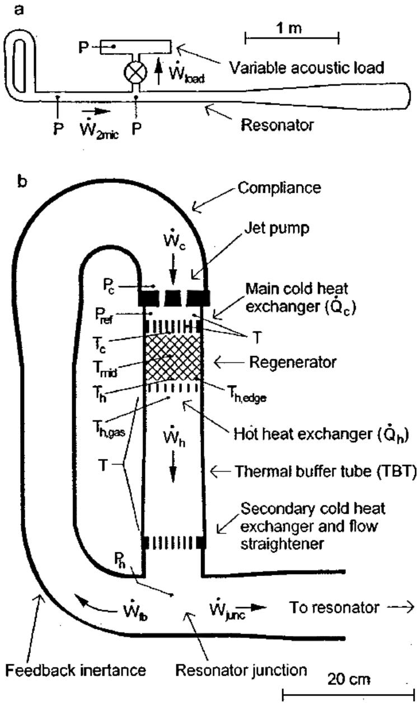  
Figure 2.22: Schematic of thermoacoustic-Stirling heat engine; (a) with the torus section; (b) Backhaus & Swift, 2000a.

Luo et al. (2006a) studied experimentally the effect of the shape of two different resonators on a travelling wave thermoacoustic engine (see Figure 2.23). One of the resonators has a tapered diameter while the other one has an constant diameter. Their effects have been studied with regard to the pressure ratio, acoustic power, and thermal efficiency of the engine. This experimental study showed that the resonator with a tapered-diameter provides a pressure ratio, an acoustic power, and a thermal efficiency greater than the other resonator. The highest achieved pressure ratio, acoustic power and thermal efficiency by the tapered resonator were 1.3, 450W and 25%, respectively.

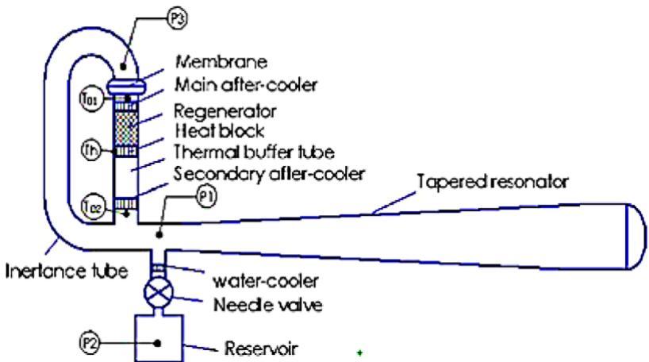  
Figure 2.23: Schematic of thermoacoustic-Stirling heat engine with a tapered resonator (Luo et al., 2006a).

## 2.2.3 Coupled Thermoacoustic Devices

To obtain the required acoustic power of the thermoacoustic refrigerators, thermoacoustic engines can be coupled and used in many different configurations (see Figure 2.24). Such thermoacoustic refrigerators are called thermoacoustically-driven thermoacoustic refrigerators (Babaei and Siddiqui, 2008). They have the advantage of utilizing waste and solar heat in thermoacoustic refrigeration.

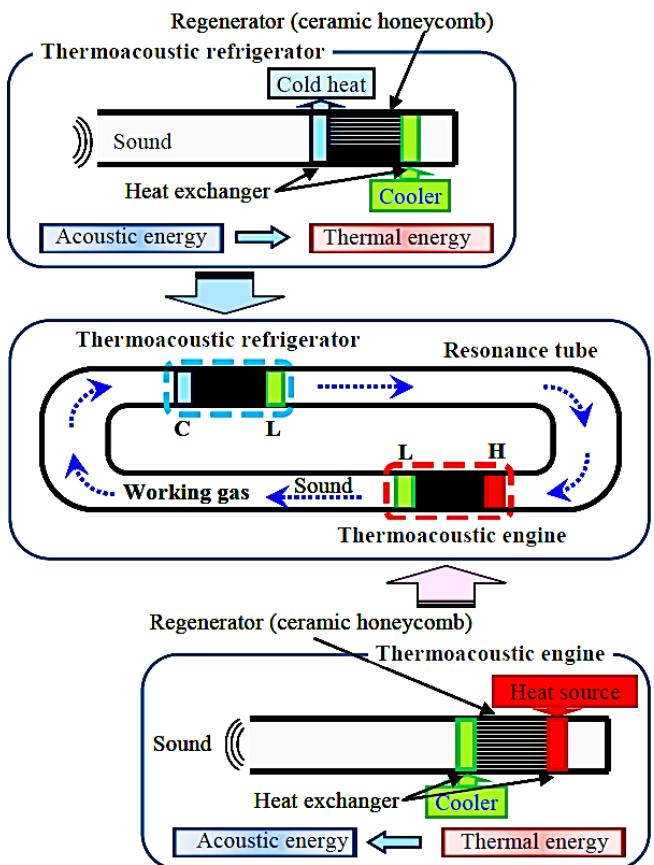  
Figure 2.24: A schematic of a thermoacoustically-driven thermoacoustic refrigerator (Maruyama et al. 2014).

Miwa et al. (2006) have constructed and examined a thermoacoustically-driven thermoacoustic refrigerator with two looped tubes and a branch resonator to connect them. One of the loops is the traveling wave thermoacoustic engine that produces the required acoustic power, and the other is the refrigerator consuming the acoustic power, as shown in Figure 2.25. The lengths of the tube of the engine, resonator and refrigerator were 1.4, 2.6 and 0.9 m, respectively. The regenerators of both the engine and the refrigerator were made of stainless steel meshes with lengths of 42 and 50 mm respectively. The working gas was a mixture of helium-Argon gas at 5 bar. Both the engine and refrigerator have an ambient heat exchanger at $2 0 \mathrm { { ^ \circ C } }$ . The hot heat exchanger of the engine had been heated up to $3 9 9 \mathrm { { ^ \circ C } }$ with an input power of 416 W. The measured maximum acoustic power of the engine was 12 W. Half of this acoustic power was dissipated by the resonator and only 6 W was delivered to the loop of the cooler to create a cooling effect of 6.4 W at 0°C. The efficiencies of the engine and cooler were measured to be 6 and 4.8% of the respective Carnot efficiencies.

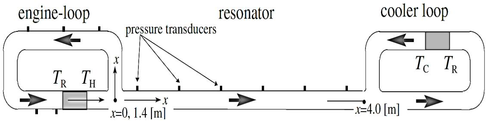  
Figure 2.25: Travelling wave thermoacoustic refrigerator and engine connected by a branched resonator (Miwa et al. 2006).

Similarly, Luo et al. (2006b) have introduced another thermoacoustically-driven thermoacoustic refrigerator with slightly different configuration, as shown in Figure 2.26. The working gas of the device was helium at 30 bar. The operating frequency of the system was 57.7 Hz. The regenerators of both engine and refrigerator were made of stainless steel screen meshes. It has been reported that tapering the resonator leads to smaller non-linear losses. The acoustic power delivered by the engine was 0.69 kW at an input power of 2.2 kW to the hot heat exchanger of the engine. The lowest experimentally achieved temperature of the refrigerator $\mathrm { w a s } \ - \ 6 4 . 4 \ ^ { \circ } \mathrm { C } .$ A cooling power of 250 W was also achieved with a temperature of - $2 2 . 1 ^ { \circ } \mathrm { C }$ of the cold side of the refrigerator.

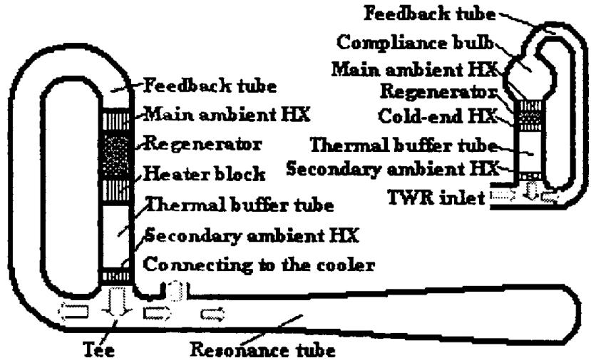  
Figure 2.26: Schematic shows a configuration of a thermoacoustically-driven thermoacoustic refrigerator (Luo et al. 2006b).

Babaei and Siddiqui, (2008) have conducted a study in the field of sustainable refrigeration systems. In this study, thermoacoustic devices have been comprehensively designed and algorithmically optimized with a remarkable feature that has the ability for designing thermoacoustically-driven thermoacoustic refrigerators. Another unique feature of this study might be the ability to design thermoacoustic engines and acoustically-driven thermoacoustic refrigerators individually by taking into account the energy balance. However, this algorithm was based on the simplified linear thermoacoustic model. The algorithmically obtained results from this study have been compared with numerically calculated results from DeltaEC to show a good agreement.

Other research in the area of thermoacoustically-driven travelling wave thermoacoustic refrigerators has been presented by Yu et al. (2011). This particular travelling wave thermoacoustic refrigerator has a slightly different configuration than the engine, as shown in Figure 2.27. This device used helium as the working gas at 30 bar and operated at 57 Hz. Several attempts to improve the coefficient of the performance (COP) of the refrigerator have been accomplished in this study. Firstly, different diameter and length of the inertance have been utilized. Secondly, an inertial mass weight has been used instead of the inertance (see Figure 2.27(b)). In addition, different heat inputs to the hot heat exchanger of the engine have been applied. It has been clarified that the coefficient of performance (COP) of the refrigerator has been remarkably enhanced by more than 50% when the inertial mass weight was used instead of the inertance, mainly to shift the phase between the pressure and the velocity and secondly to reduce the acoustic power dissipation. The refrigerator was able to achieve cooling powers of 469, 340 and 230 W with temperatures of the cold heat exchanger being 0, - 20 and - $4 0 ~ \mathrm { { ^ \circ C } }$ respectively.

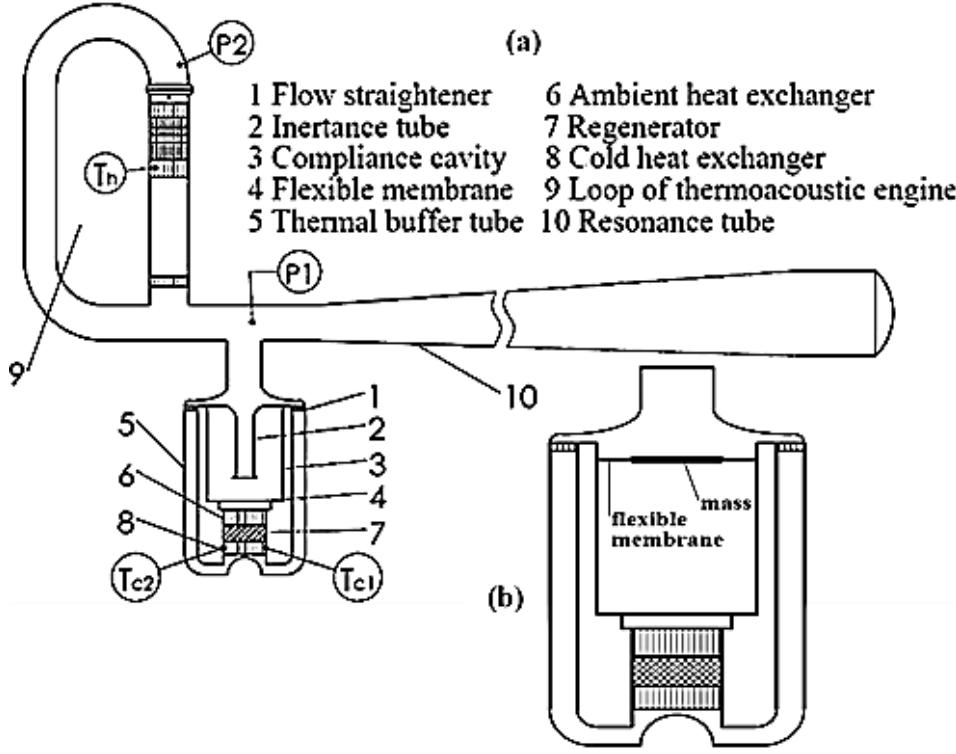  
Figure 2.27: Schematic of thermoacoustically-driven travelling wave thermoacoustic refrigerator; (a) the refrigerator with an inertial mass to replace the inertance (b) (Yu et al., 2011).

Tijani and Spoelstra (2012) have designed, constructed and experimentally measured the performance of a thermoacoustically-driven travelling wave thermoacoustic heat pump (see Figure 2.28). This heat pump can operate at an ambient temperature of $8 0 \mathrm { { ^ \circ C } }$ to achieve a temperature of $1 0 \mathrm { { ^ \circ C } }$ on the cold heat exchanger. This makes the cooler potential by useful cooling/heating systems for domestic and office applications. Both engine and cooler have been designed and optimized by utilizing the DeltaEC computer code. Their working gas was helium at approximately 40 bar. The operating frequency was 110 Hz. In most experiments, the coefficient of performance of the cooler was about 40% of the respective Carnot performance. However, in one experiment, a cooling power of 250 W has been achieved by the cooler at an ambient heat exchanger temperature of $6 0 \mathrm { { ^ \circ C } }$ and a drive ratio of 3.6%, while in another experiment, 200 W of cooling power was only achieved at a temperature of $8 0 \mathrm { { ^ \circ C } }$ and drive ratio of 3.5%.

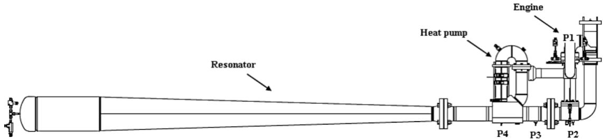  
Figure 2.28: Schematic of a travelling wave thermoacoustic heat pump driven by an engine (Tijani and Spoelstra, 2012).

Yu et al. (2012) have designed a standing wave thermoacoustic engine to drive a cryocooler, as shown in Figure 2.29. In this study, the effects of the structure of the cold heat exchanger on both cooling load and lowest cold temperature have been discussed. The working gas was helium at 40 bar. The device was operated at a frequency of 300 Hz. The input heat to the hot heat exchanger of the engine was 500 W. A cooling power of 1.16 W has been achieved at a temperature of - $1 9 3 . 1 5 ^ { \circ } \mathrm { C }$ of the cold heat exchanger. The lowest achieved temperature of the cold heat exchanger of the cryocooler was - $2 1 3 . 1 5 ^ { \circ } \mathrm { C }$ when no cooling load was applied. The numerically simulated and experientially measured results showed good agreement.

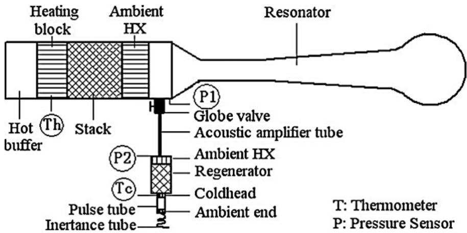  
Figure 2.29: Schematic of a cryo-cooler driven by a standing wave thermoacoustic engine (Yu et al., 2012).

Pierens et al. (2012) have presented a design of travelling wave thermoacoustic refrigerator driven by a standing wave thermoacoustic engine, as shown in Figure 2.30. The working gas was helium at 40 bar and the operating frequency was 120 Hz The theoretical calculations and design have been conducted by utilizing a numerical calculation code called CRISTA. This code relies on the modified equations of Rott (Rott's equations modified by Swift (2001)), which have been mentioned in the previous sections of the current thesis. Some of the non-linear effects such as viscous dissipations caused by turbulence and minor losses of acoustic power have been included in this code. A resonator with a length of about 2.5 m and diameter of 80 mm has been used, mainly to set the required resonance frequency and connect the end of the engine to the looped tube of the refrigerator. The cold heat exchanger of the refrigerator was made of a cylindrical copper block with 2225 holes of 1.2 mm diameter. The overall diameter and length of the block were 90 and 20 mm, respectively. The ambient “aftercooler" heat exchanger was a shell-and-tube with an overall diameter of 90 mm. An acoustic inertance and compliance have been utilized as a phase shifter of the acoustic network (to set the preferable phase between the pressure and velocity). The input heat to hot heat exchanger of the engine has been increased and decreased between a maximum and minimum value of 7 and 2 kW corresponding to a drive ratio of 3.5 and 2.8%, respectively. Different configurations and dimensions of the thermal buffer tube have been considered. The experimental results showed that the coefficient of performance of the refrigerator (relative to Carnot COP) was improved from 6 to 30% by using the different versions of the thermal buffer tubes and locations of membrane. A cooling power of 210 W has been achieved at a cold temperature of 233 K and a coefficient of performance of 30 % of the respective Carnot performance.

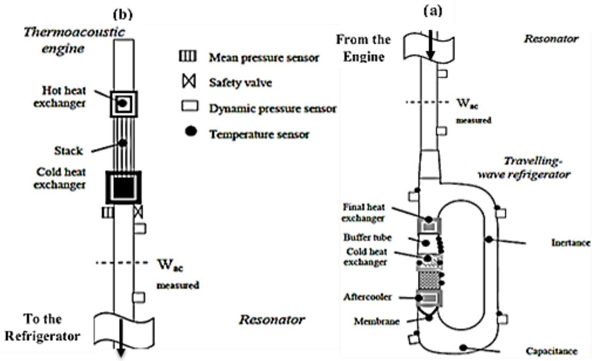  
Figure 2.30: Schematic of a travelling wave thermoacoustic refrigerator; (a) that driven by a standing wave thermoacoustic engine; (b) Pierens et al. 2012.

Hasegawa et al. (2013) have developed a high efficiency travelling wave thermoacoustic refrigerator driven by a three-stage travelling wave engine (multistage engine), as shown in Figure 2.31. This set-up of multistage engine was used to approach a low onset temperature and high efficiency of the engine. The working gas was chosen to be helium at 10 bar. The diameter of loop and ambient, hot and cold heat exchangers of the engine and refrigerator was 10 cm. Their numerical calculations showed that the multi-stage thermoacoustic engine was capable of producing oscillations at a low temperature difference of 110.8 K between the hot and ambient side of the regenerator with a thermal efficiency of 21%.

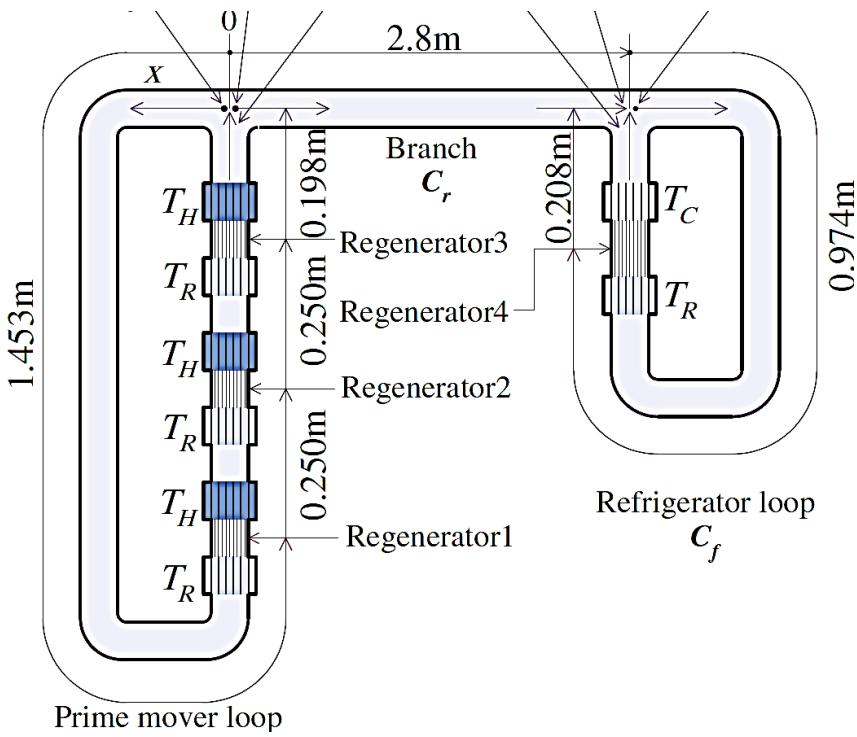  
Figure 2.31: Schematic of travelling wave thermoacoustic refrigerator driven by multi-stage travelling wave thermoacoustic engine (Hasegawa et al. 2013).

Another travelling-wave thermoacoustic refrigerator driven by an engine, both located in one looped-tube resonator was also designed and built around 2013 (see Figure 2.32) (Saechan et al., 2013 and Saechan, 2014). This coupled device was built as a demonstrator for the needs of rural areas in developing countries. In such countries, biomasses are the only available source of thermal energy whereas electricity is very difficult to reach. Hence, the input thermal power (heat) was injected into the hot heat exchanger by using a propane gas burner (to simulate the input thermal heat from biomass combustion). To keep the cost of the built single device as low as possible, the working gas of the device was chosen to be air at atmospheric pressure. The operating frequency of the apparatus was about 58.6 Hz. The hot and cold heat exchangers of the engine were made of stainless steel and aluminium blocks, respectively, with lengths of 160 and 90 mm, respectively. The ambient heat exchanger of the refrigerator was made of an aluminium block with a length and diameter of 60 and 110 mm, respectively. Its cold heat exchanger was a resistance heating wire. The device was built with the potential to function as a thermoacoustically-driven refrigerator and/or electricity generator, when equipped with a liner alternator. The lowest cold temperature of the refrigerator achieved experimentally was - $3 . 6 \mathrm { { ^ \circ C } }$ with a maximum COPR of 1.42%. A minimum temperature of $\textrm { - } 8 . 3 ^ { \circ } \mathrm { C }$ was also achieved for an operating frequency of 70.3 Hz of the apparatus. The apparatus provided about 8 W of electrical power, when operated as a thermoacoustically-driven electricity generator (equipped with linear alternator).

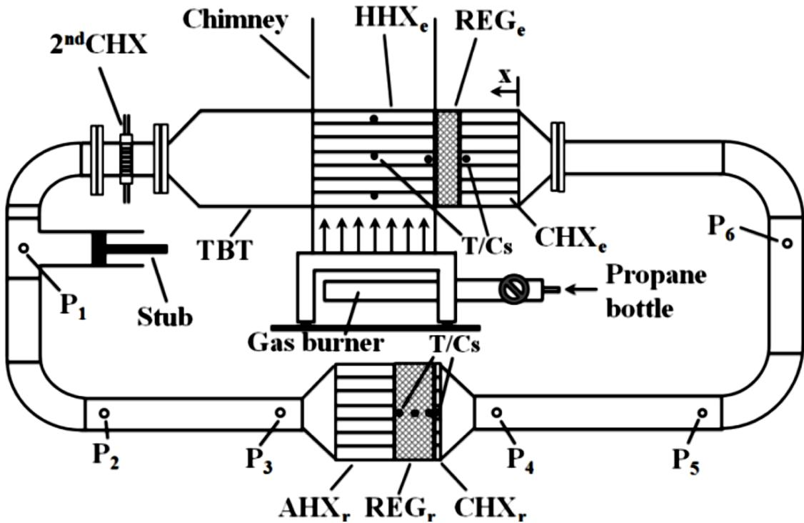  
Figure 2.32: Schematic of travelling-wave thermoacoustic refrigerator driven by an engine (Saechan et al., 2013).

Similarly, a travelling-wave thermoacoustic refrigerator (with coaxial configuration) driven by a standing-wave thermoacoustic engine was also designed, optimized and built as a prototype for the needs of rural areas in developing countries (see Figure 2.33) (Saechan, 2014 and Saechan et al., 2011, 2012 and 2015). The selection of the standing-wave engine (used to convert heat energy to acoustic power) was based on the simplicity of its configuration (straight line). The use of the travelling-wave refrigerator with the coaxial configuration was essential for two reasons: firstly, to maintain the linear configuration of the standing-wave engine and, secondly, for the advantage of providing higher efficiency with travelling-wave thermoacoustic devices compared with standing-wave devices. The hot and cold heat exchangers of the standing-wave engine are parallel-plate configurations with length and plate spacing of 18 and 1.7 mm and 55 and 4.5 mm, respectively. Both stack and resonator were made of stainless steel with diameter and lengths of 6 inches and 0.226 and 3.36 m, respectively. The ambient and cold heat exchangers of the refrigerator are also parallel-plate configurations with length and plate spacing of 16.2 and 0.6 mm and 9.2 and 0.5 mm, respectively. The apparatus was filled with air at 10 bar as the working $\mathrm { g a s }$ Its operating frequency ranged from 46 to 50 Hz. A minimum temperature of $\mathrm { ~ - ~ } 1 9 . 7 ~ ^ { \circ } C$ on the cold heat exchanger of the cooler was achieved experimentally, when no cooling load was being applied. This temperature rose to reach 2 and $8 \mathrm { ^ { o } C }$ when cooling loads of about 30 and 120 W, applied respectively. A maximum COPR of 5.94% of the travelling-wave refrigerator was achieved experimentally. The overall efficiency of the system has been improved theoretically after optimizing the design. It was concluded that the current apparatus was capable of achieving a sufficient amount of cooling power to store vital medicines in rural areas of developing countries.

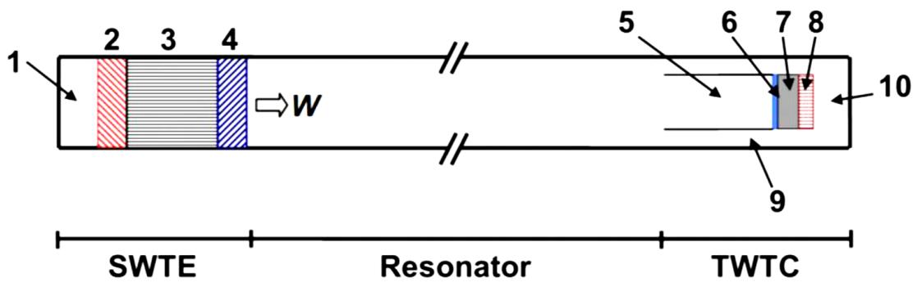  
Figure 2.33: Schematic diagram of the coaxial thermoacoustic refrigerator driven standing-wave thermoacoustic engine: (1) bounce space (BS), (2) hot heat exchanger (HHX), (3) stack (STK), (4) ambient heat exchanger (AHXSWTE), (5) thermal buffer tube (TBT), (6) cold heat exchanger (CHX), (7) regenerator (REG), (8) ambient heat exchanger (AHXTWTC), (9) inertance tube, (10) compliance. (Saechan et al., 2015).

## 2.3 Acoustic Drivers

One of the essential processes in thermoacoustic devices where electricity being converted to an acoustic power or vice versa is accomplished by an acoustic driver. Hence, acoustic drivers such as ordinary loudspeakers or linear alternators are considered to be the essence of thermoacoustic devices (Swift, 1988 and Wakeland, 2000).

Ordinary loudspeakers might often be used with relatively low-power thermoacoustic applications as their capabilities for producing power are relatively low. This low productivity might be the result of a construction of the loudspeakers (see Figure 2.34a). However, the use of such acoustic drivers in thermoacoustic devices is highly appreciated as they contribute to minimize the cost of building thermoacoustic devices due to their commercial availability at low-cost.

On the other hand, linear alternators can be widely used in thermoacoustic applications especially with high power thermoacoustic devices due to their high power rating. They consume electricity to deliver an acoustic power that can reach about 15 kW with 80% of efficiency. For such acoustic power, thermoacoustic refrigerators can achieve a significant cooling power. Linear alternators and ordinary loudspeakers have different structures and configurations, as can be seen from Figure 2.34, however, they both have the same principles of operation.

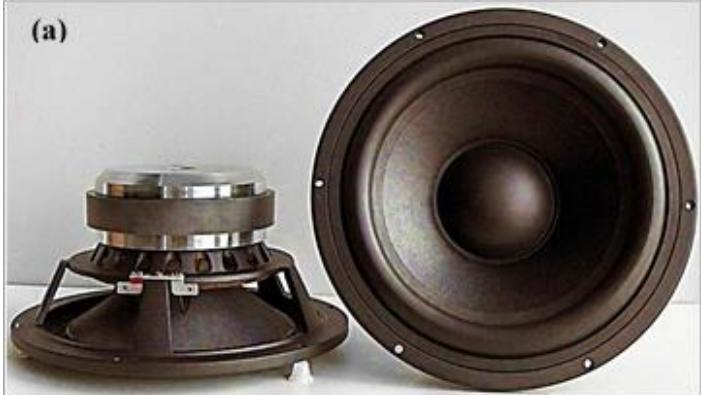

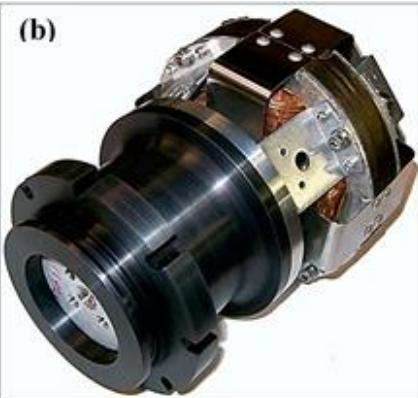  
Figure 2.34: The two types of acoustic drivers: ordinary loudspeakers (a); and linear alternators (b).

Linear alternators work by forcing wire coils to cut through a magnetic field. They can be designed with either a moving magnet or moving coil assembly. This technology has being highly appreciated as it is maintenance free, in other words, no lubrication or maintenance are required. The linear alternator has four essential components: the magnet, structure, coil, and iron, as shown in Figure 2.35 (Sunpower® Inc., 2005). When electricity is applied to a linear alternator, an interaction between the magnetic field and coil of wire will be presented to cause a linear move of the piston. Alternatively, if the piston is linearly moving by a given force, the electrical power will flow out from the linear alternator to a current sink.

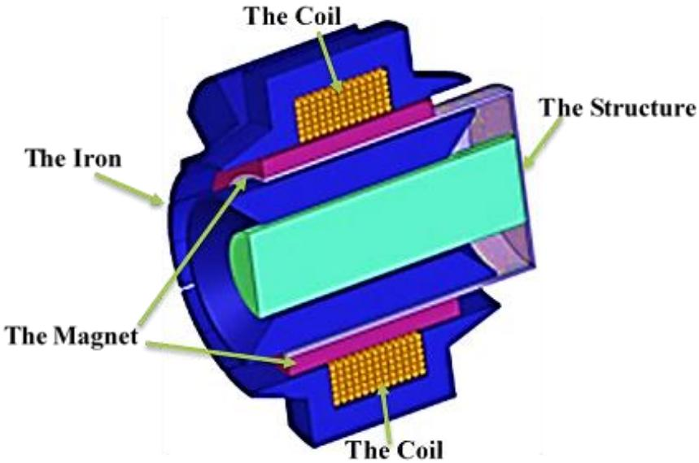  
Figure 2.35: Schematic of a linear alternator/motor (Sunpower® Inc., 2005).

Linear alternators/acoustic drivers can be divided into two categories; high-impedance and low-impedance drivers according to their preferable acoustic impedances. Highimpedance acoustic drivers require a location at the acoustic network where the pressure difference across the piston is high and the velocity is low to efficiently produce the maximum power while low-impedance acoustic drivers require a location of small force (low pressure difference) and large displacement (high velocity) to work at the maximum efficiency (Swift, 1988).

A schematic diagram of an acoustic driver's piston subjected to an acoustic condition is shown in Figure 2.36. An acoustic driver provides acoustic power at a given electrical power. The conversion from electrical power to acoustic power (acoustic driver performance or efficiency) depends on the acoustic condition such as pressure difference, volume flow rate and their relative phases across the piston. There is another aspect which is the parameters of an acoustic driver which contribute to the performance of the driver under certain acoustic condition.

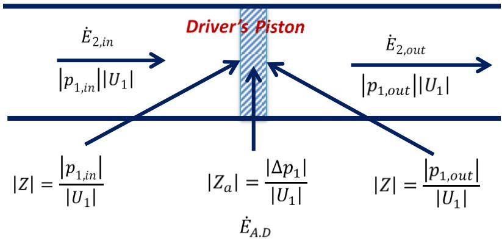  
Figure 2.36: Acoustic driver condition around an acoustic driver's piston.

Once the acoustic driver is fabricated, some of the parameters will be constant such as piston diameter (D), coil electrical resistance $( R _ { e } )$ , mechanical resistance $\left( R _ { m } \right)$ coil electrical inductance (L), BLproduct, moving mass (M) and spring constant (K). Other parameters such as operating frequency $( f )$ and oscillating voltage amplitude $\left( \vert V _ { 1 } \vert \right)$ are the operating parameters which can be chosen within a limited range of an acoustic driver. Finally, any acoustic driver would have maximum or limited values of the peak-to-peak displacement of the piston (), oscillating current amplitude $\left( \left| I _ { 1 } \right| \right)$ 2 acoustic power $( \dot { E _ { 2 } } )$ and electrical power $( \dot { W } _ { e } )$ . It is strongly recommended not to exceed these limitations during operation.

The acoustic power at the back, front and produced by the acoustic driver's piston can be calculated from the following equations (Swift, 2001 and Ward et al., 2012):

$$
\dot { E _ { 2 } } , _ { i n } = \frac { 1 } { 2 } \big | p _ { 1 , i n } \big | | U _ { 1 } | c o s \ : \Theta _ { ( p _ { 1 , i n } \& U _ { 1 } ) }\tag{2.29}
$$

$$
\dot { E _ { 2 } } , _ { o u t } = \frac { 1 } { 2 } \left| p _ { 1 , o u t } \right| \left| U _ { 1 } \right| c o s \ : \Theta _ { ( p _ { 1 , o u t } \& U _ { 1 } ) }\tag{2.30}
$$

$$
\dot { E _ { 2 } } , \mathbf { \Phi } _ { A , D } = \frac { 1 } { 2 } | \Delta p _ { 1 } | | U _ { 1 } | c o s \Theta _ { ( \Delta p _ { 1 } \& U _ { 1 } ) } \quad \mathrm { ~ o r ~ } \quad \dot { E _ { 2 } } , \mathbf { \Phi } _ { A . D } = \dot { E _ { 2 } } , \mathbf { \Phi } _ { o u t } - \dot { E _ { 2 } } , \mathbf { \Phi } _ { i n }\tag{2.31}
$$

However, Equation (2.30) can be used to estimate the produced acoustic power of the acoustic driver when the input acoustic power to driver $( \dot { E } _ { 2 } , \ l _ { i n } )$ , (cf. Eq. (2.29)), and the pressure difference across the piston $( | \Delta p _ { 1 } | )$ are either zero or negligible. The amplitude volume flow rate of the acoustic driver can be calculated if the acoustic driver piston's diameter (D thus A), operating frequency $( f$ thus ω), and the peak-topeak displacement of the piston (ζ) are determined (cf. Eq. (2.3)). In addition, it is established that the phase of velocity is $9 0 ^ { \circ }$ leading to the phase of displacement.

Hence, the following can also be utilized to calculate the estimated produced acoustic power of the acoustic driver:

$$
\dot { E _ { 2 } } \mathrm { , } _ { A . D } = \frac { 1 } { 2 } \big | p _ { 1 , o u t } \big | | \xi _ { 1 } | \omega A _ { A . D } c o s ( \Theta _ { ( p _ { 1 , o u t } \& \xi _ { 1 } ) } - 9 0 ^ { \circ } ) .\tag{2.32}
$$

The consumed electrical power by the acoustic driver can be calculated from the following equation:

$$
\dot { W _ { e } } = { \frac { 1 } { 2 } } | I _ { 1 } | | V _ { 1 } | c o s \Theta _ { ( I _ { 1 } \& V _ { 1 } ) } .\tag{2.33}
$$

If the complex values (real and imaginary components) of pressure difference $| \Delta p _ { 1 } |$ volume flow rate $| U _ { 1 } |$ , given voltage $| V _ { 1 } |$ , consumed current $\left| I _ { 1 } \right|$ and their relative phases are known then the acoustic power produced $\dot { E } _ { 2 } , \mathbf { \Phi } _ { A . D }$ and consumed electrical power $\dot { W _ { e } }$ by the acoustic driver can be theoretically determined. Hence, the efficiency of the acoustic driver can be calculated via the following equation:

$$
\Pi _ { A . D } = \frac { \dot { E _ { 2 } } , _ { A . D } } { \dot { W _ { e } } }\tag{2.34}
$$

## 2.4 Acoustic Power Measurement Methods

Measurement of the acoustic power and the phase between pressure and velocity are considered essential in thermoacoustics. The acoustic power of an acoustic wave that propagates in a duct can be represented by the product of oscillatory pressure and velocity:

$$
\dot { E } _ { 2 } = \frac { 1 } { 2 } | p _ { 1 } | | U _ { 1 } | c o s \ : \Theta _ { ( p _ { 1 } \& U _ { 1 } ) }\tag{2.35}
$$

Measuring the oscillatory pressure is relatively uncomplicated, as it can be accomplished by using a pressure sensor. Unlike the oscillatory pressure measurement, the oscillatory velocity would be complicated to measure due to the complexity and high-cost of the available techniques to use such as LDV (Laser Doppler Velocimetry or Particle Image Velocimetry (PIV) (Yazaki et al., 1998 and Berson et al., 2007). Hot wire anemometry can also be utilized to measure the acoustic power velocity in a duct (Jerbi et al., 2013). The advantages of using hot wire anemometry are the low cost and there is less complexity, while the disadvantages are the high percentages of measuring errors due to it is high sensitivity to the density of the gas and inability of recognizing the direction of the velocity. All the measurement techniques mentioned above can be directly used to experimentally measure acoustic power via pressure and velocity measurements.

Yazaki et al. (1998) used LDV (Laser Doppler Velocimetry) to measure the velocity whereas several pressure transducers have been installed to measure the pressure, as shown in Figure 2.37. Similarly, Biwa et al., (2001) have utilized pressure transducers and Laser Doppler Velocimetry (LDV) to experimentally measure the oscillatory pressure and velocity of the acoustic wave generated from their thermoacoustic engine.

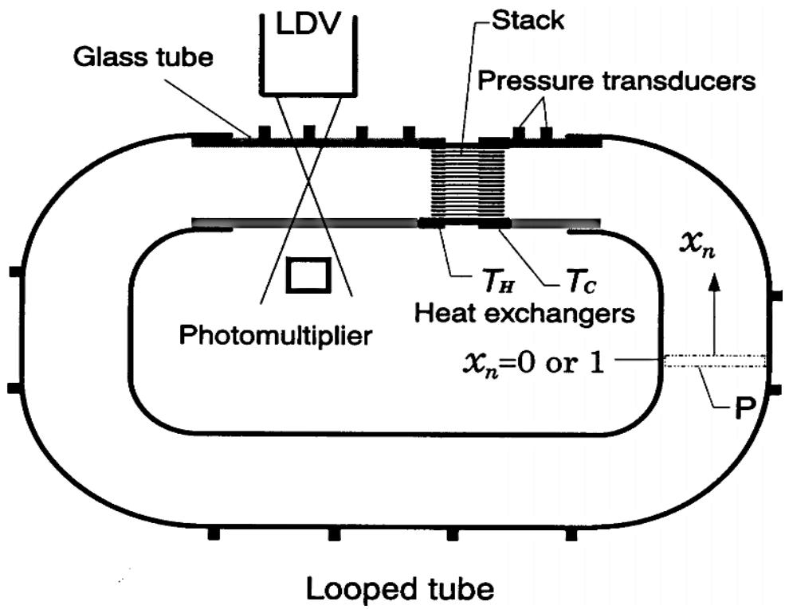  
Figure 2.37: Schematic of the set-up of pressure transducers and Laser Doppler Velocimetry (LDV) on a travelling wave thermoacoustic engine (Yazaki et al. 1998).

On the other hand, the well-known two-microphone experimental method is mostly used to measure the oscillatory pressures and their phases to be converted into the equivalent acoustic power. This method is based on measuring the pressure amplitude and phase by using pressure transducers at two different positions $( p _ { 1 A }$ and $p _ { 1 B } )$ with a specific distance between them $( \Delta x \ll \lambda )$ , as shown in Figure 2.38.

  
Figure 2.38: Schematic of the set-up of the two-microphone method.

The mid-way volume flow rate and pressure between the two pressure transducers can be estimated from the following equations (Swift, 2001):

$$
U _ { 1 } \simeq \frac { i A } { \omega \rho _ { m } } \frac { p _ { 1 B } - p _ { 1 A } } { \Delta x }\tag{2.36}
$$

$$
p _ { 1 } \simeq \frac { p _ { 1 A } + p _ { 1 B } } { 2 }\tag{2.37}
$$

Hence, the acoustic power can be experimentally estimated via Equation (2.38) (Swift, 2001):

$$
\begin{array} { c } { { \displaystyle \dot { E } _ { 2 } = \frac { 1 } { 2 } { \mathrm R } _ { e } \big [ p _ { 1 } \widetilde { U _ { 1 } } \big ] \simeq \frac { A } { 2 \omega \rho _ { m } \Delta x } ~ \mathrm { I } _ { m } [ p _ { 1 A } \widetilde { p _ { 1 B } } ] } } \\ { { \displaystyle \simeq \frac { A } { 2 \omega \rho _ { m } \Delta x } ~ \vert p _ { 1 A } \vert \vert p _ { 1 B } \vert \sin { \Theta _ { ( p _ { 1 A } \& p _ { 1 B } ) } } . } } \end{array}\tag{2.38}
$$

However, for $\Delta x$ of not much shorter than λ, including the attention to the thermal and viscous penetration depths, and boundary-layer approximation, similar results (to the acoustic power measurements) with more accurate expression can be found by using the following equation (Fusco et al., 1991 and Swift, 2001):

$$
\begin{array} { l } { \dot { E _ { 2 } } = \cfrac { A } { 2 \rho _ { m } a \sin { ( \frac { \omega \Delta x } { a } ) } } \times } \\ { ( \mathrm { I } _ { m } [ p _ { 1 A } \widetilde { p _ { 1 B } } ] \{ 1 - \cfrac { \delta _ { v } } { 4 r _ { h } } [ 1 - \cfrac { \gamma - 1 } { \sqrt { \sigma } } + ( 1 + \cfrac { \gamma - 1 } { \sqrt { \sigma } } ) \frac { \omega \Delta x } { a } \cot { ( \frac { \omega \Delta x } { a } ) } ] \}  } \\ {  \qquad + \cfrac { \delta _ { v } } { 8 r _ { h } } ( | p _ { 1 A } | ^ { 2 } - | p _ { 1 B } | ^ { 2 } ) [ 1 - \cfrac { \gamma - 1 } { \sqrt { \sigma } }  \qquad } \\ {  \qquad + ( 1 + \cfrac { \gamma - 1 } { \sqrt { \sigma } } ) \frac { \omega \Delta x } { a } \csc { ( \frac { \omega \Delta x } { a } ) } ] ) } \end{array}\tag{2.39}
$$

It was pointed out that the two-microphone method is uncomplicated and easy compared to the direct methods mentioned above. In addition, it can provide acceptable results with minor errors and be comparable with Laser Doppler Velocimetry (LDV) results (Biwa, 2006 and Biwa et al., 2008).

## 2.5 Streaming in Thermoacoustic Devices

Net mass flow can often occur in some geometries of thermoacoustic devices, especially in travelling-wave thermoacoustic devices due to their toroidal topology (it can also be driven by the effects of the boundary-layer on the side walls). This undesirable type of flow is termed as acoustic streaming and refers to the second order of mass-flux velocity or is density driven via and superimposed on the large first order oscillating acoustic mass-flux velocity or density (Swift, 2001). It is essential to eliminate such streaming as it is responsible for causing some unwanted convective heat transfer. This undesirable convective heat transfer can significantly affect the thermal efficiencies of thermoacoustic devices due to its contribution to cooling power losses or heating power losses in thermoacoustic refrigerators and engines, respectively.

Swift (2001) has illustrated four types of unwanted steady flows (acoustic streaming) mostly driven by the first order acoustic phenomena and mainly occurring in travelling-wave thermoacoustic devices (see Figure 2.39) (Swift, 2001).

  
Figure 2.39: The main four types of harmful acoustic streaming which can occur in travelling-wave thermoacoustic devices, time-average velocity is indicated by the arrows. (a) Gedeon streaming; (b) Rayleigh streaming; (c) jet-driven convection or streaming; (d) Streaming within a regenerator or stack (Swift, 2001).

## 2.5.1 Gedeon Streaming

Gedeon streaming can be present if the mass flow rate in the x-direction through the looped tube of a travelling-wave thermoacoustic engine or refrigerator is neither zero nor very close to zero (any system with a toroidal topology similar to the one in Figure 2.39a can suffer from non-zero time-averaged mass flow in the x direction) (Swift, 2001). This type of streaming will cause a large flow of time-averaged convective enthalpy flux from the hot area to the cold area of oscillating gas that eventually will transfer to the surface of solids. This will add undesirable additional thermal load to the cold heat exchanger of a refrigerator and waste the high-temperature heat by removing it from the hot heat exchanger which should be used to produce useful acoustic power for an engine. The temperature profile across the regenerator is used as an indicator of Gedeon streaming. The temperature in the middle of the regenerator should be the average of the hot-end and cold-end temperatures of the regenerator (linear temperature profile across the regenerator). The presence of non-linear temperature distribution across the regenerator indicates the existence of Gedeon streaming.

This type of acoustic streaming can be suppressed from both thermoacoustic engines and refrigerators by utilizing a flexible membrane or jet-pump (Swift et al., 1999 and Saechan, 2014). Introducing one of these components can enforce the time-averaged mass flow to be zero or very close to zero and this can possibly lead to achieving the highest and most efficient operating point of both thermoacoustic refrigerators and engines (Swift et al., 1999).

A flexible membrane made of an elastic material (e.g. party balloons or natural Latex rubber sheeting) is often used in thermoacoustic devices with a toroidal topology to eliminate Gedeon streaming (see Figure 2.23, 2.27, 2.30a and 2.40) (Luo et al., 2006a, Bassem et al., 2010, Yu et al., 2011and Pierens et al., 2012). Gedeon streaming can be suppressed by utilizing a jet-pump “hydrodynamic end effect" to create an opposing time averaged pressure difference (cf. 2.22b) (Backhaus & Swift, 2000a). The flow will be channelled by using the two tapered rectangular channels of the jetpump. One end should have a fixed opening area while the other end is adjustable. A pressure drop across the jet-pump can be created to enforce the time-averaged mass flow to be zero and Gedeon streaming will be suppressed. If the pressure difference created across the jet-pump exceeds the required value then the time-averaged mass flux will flow in the opposite direction to the original and Gedeon streaming will also be present. Minor losses and acoustic power dissipation will occur due to the presence of the jet-pump. An investigation of the Gedeon acoustic streaming in a travellingwave thermoacoustic engine has been conducted by Qiu et al. (2006). It has been stated that a partial-suppression of Gedeon streaming has been achieved by utilizing a jet-pump while a complete-suppression of the streaming is accomplished by using a flexible membrane. The complete suppression of Gedeon streaming led to a remarkable improvement in the efficiency of the travelling-wave thermoacoustic engine.

  
Figure 2.40: Schematic of an experimentally constructed travelling-wave thermoacoustic refrigerator with a membrane installed (Bassem et al., 2010).

## 2.5.2 Rayleigh Streaming

Rayleigh streaming can be defined as a forced convection restricted within a thermal buffer tube or pulse tube driven by viscous and thermal boundary-layer effects at the side walls of tubes (cf. 2.39b) (Olson and Swift, 1998 and Swift, 2001). This streaming can be simply illustrated by considering an oscillatory gas parcel with upward and downward displacement along a solid wall with a temperature gradient, at a distance of the viscous penetration depth $( \delta _ { v } )$ (see Figure 2.41a). The moving parcel of gas experiences different amounts of viscous drag while moving upwards and downwards due to the viscosity dependence on the temperature. In other words, the parcel will undergo a small net drift as it returns to a different point rather than its starting point. This will contribute to a second-order mass-flux density due to the offset parabolic velocity of the net drift, as shown in Figure 2.41. Such streaming can be suppressed by appropriately tapering the orifice pulse tube at an optimum angle and this can lead to a higher cooling power being achieved (Olson and Swift, 1998).

  
Figure 2.41: (a) Schematic shows the net drift of the parcel of the gas which leads to Rayleigh streaming due to the presence of second-order mass-flux density; (b) that was caused by an offset parabolic velocity (Olson and Swift, 1998).

## 2.5.3 Jet-Driven Streaming

Jet-driven streaming is the third type of acoustic streaming, which causes a time averaged convection due to a toroidal circulation within a thermal buffer tube or pulse tube (cf. Figure 2.39c). When a viscous fluid oscillates in a pipe with a transition from a large diameter to a smaller one, or vice versa, two different kinds of behaviour can be observed due to different minor loss coefficients of the inflow and outflow of the same transition (see Figure 2.42). This difference in the inflow and outflow patterns will cause the time-averaged toroidal circulation (jet-driven streaming) as explained by Swift et al. (1999) and Swift (2001). To avoid such streaming a flow straightener can be utilized. Although, the flow straightener can cause some acoustic power loss, the thermal efficiency of thermoacoustic devices can possibly be improved overall.

  
Figure 2.42: Schematic illustrates the asymmetric flow of high-Reynolds number at the transition between a small tube and open-space; (a) Outflow pattern. (b) Inflow pattern. (Swift, 2001).

## 2.5.4 Streaming Within a Regenerator or Stack

A circulating streaming flow in the region of the regenerator or stack can be present in some travelling-wave thermoacoustic devices, as shown in Figure 2.39d. This type of streaming is also known as internal acoustic streaming to thermoacoustic researchers (Swift, 2001). So far, the available information regarding this streaming is still limited due to the lack of investigations in this area (Bailliet et al., 2001 and Saechan, 2014). It has been described as an unstable streaming due to the reduction of the thermal and hydrodynamic communication to the acoustic-wave propagating in the transverse-axis (see Figure 2.43) (So et al., 2006). A convective heat transfer and a reduction in the efficiency of a thermoacoustic engine or refrigerator can also be caused by this streaming.

  
Figure 2.43: Illustration of internal streaming (streaming within a regenerator or stack), acoustic power propagates in the x-direction and y-axis represents the transverse-axis (So et al., 2006).

## 2.6 DeltaEC Program

DeltaEC is the abbreviation of Design Environment for Low-Amplitude Thermoacoustic Energy Conversion. It is a simulation package based on numerical integration of the differential equations of thermoacoustics. It is widely used by thermoacoustic designers to help them to estimate the performance and efficiencies of thermoacoustic devices. DeltaEC represents the geometric configuration of thermoacoustic devices by consecutive segments such as ducts, compliances, heat exchangers, linear alternators/acoustic drivers, and stacks/regenerators. Each segment has two groups of parameters: input and output parameters such as areas, lengths, pressures, volume flow rates, acoustic power, and temperatures. Each segment uses different sorts of equations to reflect local conditions. DeltaEC uses the feature of the shooting method (guesses and targets method) to guess some parameters with initial assumed values by targeting the desired values of other parameters. It also enables the users to create non-standard targets, guesses, and simple algebraic calculations (by using the RPN (Reverse Polish Notation) segment), wherever needed in DeltaEC models.

The numerical integration is done in one spatial dimension, low-amplitude, acoustic approximation, and sinusoidal time dependence. In other words, DeltaEC is based on the linear theory of thermoacoustics and other assumptions were discussed in section 2.1.2. However, some of the non-linear thermoacoustic effects which occur due to high amplitudes have also been included in the DeltaEC program. This feature enables the users to continue using the DeltaEC program when Reynolds numbers or Mach numbers are high. In addition, more advanced versions of momentum and continuity equations (cf. Eq. (2.19 and 2.20) have been introduced to the DeltaEC program which added more additional effects such as acoustic power dissipations along the side of a duct, the more advanced equations as follows (Ward et al., 2012):

$$
\frac { d p _ { 1 } } { d x } = \frac { i \omega \rho _ { m } } { A } \Big [ 1 - \frac { 1 - i } { 2 } \frac { \pi } { A } \delta _ { v } \Big ] ^ { - 1 } U _ { 1 } ,\tag{2.40}
$$

$$
\frac { d U _ { 1 } } { d x } = - \frac { i \omega A } { a ^ { 2 } \rho _ { m } } \Big [ 1 + \frac { 1 - i } { 2 } \frac { \eta } { A } \frac { \gamma - 1 } { 1 + \in _ { s } } \delta _ { k } \Big ] p _ { 1 } .\tag{2.41}
$$

where ω is the angular frequency, $\rho _ { m }$ is the mean density of the gas, A is the crosssectional area of the duct, I is the perimeter, a is the speed of sound, $\in _ { s }$ is a correction

for the thermal properties of a solid wall (often neglected), and $\delta _ { k }$ and $\delta _ { v }$ are the thermal and viscous penetration depths, respectively.

For practical thermoacoustic systems often $\begin{array} { r } { \frac { d T _ { m } } { d x } \neq 0 } \end{array}$ (non-isothermal process). Hence, the thermoacoustic wave equation can be expressed as follows (Rott, 1969 and Ward et al., 2012):

$$
\begin{array} { r } { \left( 1 + \frac { ( \gamma - 1 ) \mathrm { f } _ { k } } { 1 + \in _ { s } } \right) p _ { 1 } + \frac { \rho _ { m } a ^ { 2 } } { \omega ^ { 2 } } \frac { d } { d x } \Big ( \frac { 1 - \mathrm { f } _ { v } } { \rho _ { m } } \frac { d p _ { 1 } } { d x } \Big ) - \beta \frac { a ^ { 2 } } { \omega ^ { 2 } } \frac { ( \mathrm { f } _ { k } - \mathrm { f } _ { v } ) } { ( 1 - \sigma ) ( 1 + \epsilon _ { s } ) } \frac { d T _ { m } } { d x } \frac { d p _ { 1 } } { d x } } \\ { = 0 , \qquad ( 2 \gamma - 1 ) \frac { ( \gamma - 1 ) \mathrm { f } _ { v } } { \sigma ^ { 2 } } \frac { d } { d x } \Big ( \frac { 1 - \mathrm { f } _ { v } } { \rho _ { m } } \frac { d p _ { 1 } } { d x } \Big ) . } \end{array}\tag{2.42}
$$

and the momentum and continuity equations (cf. Eq. (2.40 and 2.41)) can be rewritten as follows:

$$
\frac { d p _ { 1 } } { d x } = - \frac { i \omega \rho _ { m } } { A ( 1 - \mathrm { f } _ { v } ) } U _ { 1 } ,\tag{2.43}
$$

$$
\frac { d U _ { 1 } } { d x } = - \frac { i \omega A } { a ^ { 2 } \rho _ { m } } \bigg ( 1 + \frac { ( \gamma - 1 ) \mathrm { f } _ { k } } { 1 + \in _ { s } } \bigg ) p _ { 1 } + \frac { ( \mathrm { f } _ { k } - \mathrm { f } _ { v } ) } { ( 1 - \sigma ) ( 1 + \in _ { s } ) } \beta \frac { d T _ { m } } { d x } U _ { 1 } .\tag{2.44}
$$

These two equations are often used with the stack/regenerator segments in DeltaEC models, where the two complex variables $\mathrm { f } _ { k }$ and $\mathrm { f } _ { v }$ (the spatial-averaged function f for several geometries (see Figure 2.44) depend on the properties of the operating gas and the shape and size of the pores.

  
Figure 2.44: The spatial-averaged function f for few geometries (the boundarylayer limit is approached at large $r _ { h }$ in all geometries). Using $\frac { r _ { h } } { \delta _ { k } }$ and $\frac { r _ { h } } { \delta _ { v } }$ on the horizontal-axis yields, $\mathrm { f } _ { k }$ and $\mathrm { f } _ { v }$ , respectively (Swift, 2001).

## 2.7 Final Remarks

In this chapter, the theoretical background of thermoacoustics has been presented. This was followed by the important length scales and governing equations of thermoacoustics. A considerable amount of literature regarding the thermoacoustic refrigerators and engines has been given. In addition, some studies in the field of thermoacoustically-driven thermoacoustic refrigerators (coupled thermoacoustic devices) have also been provided in this chapter. The two types of acoustic drivers providing acoustic power and their importance have also been discussed. The methods of measuring the acoustic power in a duct have been briefly explained. The main four types of acoustic streaming have been presented. Finally, the DeltaEC simulation program used in the designing of thermoacoustic devices has been introduced.

## Chapter 3

## Acoustic Driver Performance and Analysis of Thermoacoustic Device Coupling: Theoretical Results

As mentioned in the previous chapter, acoustic drivers/linear alternators are considered to be essential for thermoacoustic devices as they enable the conversion from electrical to acoustic power. The main focus in this chapter will be on the performance and analysis of two given acoustic drivers available for this project (model 1S132M and 1S132DX, available from Q-Drive) (cf. Figure 2.34b). This analysis aims to provide the theoretical knowledge and foundation of how to couple an acoustic driver to thermoacoustic devices, such as thermoacoustic refrigerators or engines, efficiently in terms of electrical to acoustic power conversion or vice versa. This goal can be theoretically achieved by the analytical study and solution of the relevant equations. The two available acoustic drivers for this project have slightly different specifications, as shown in Table 3.1. This may lead to some difficulties when both of them are being synchronously operated in one system. Consequently, the limitations of the previously mentioned operating parameters of each acoustic driver have to be considered individually.

Table 3.1 Acoustic drivers specifications  
(1S132M and 1S132DX, available from Q-DRIVE)
<table><tr><td rowspan=1 colspan=1>Parameter of the acoustic driver</td><td rowspan=1 colspan=1>1S132M</td><td rowspan=1 colspan=1>1S132DX</td></tr><tr><td rowspan=1 colspan=1>Piston&#x27;s diameter (D)</td><td rowspan=1 colspan=1>42 mm</td><td rowspan=1 colspan=1>42mm</td></tr><tr><td rowspan=1 colspan=1>Coil electrical resistance $\left( R _ { e } \right)$ </td><td rowspan=1 colspan=1>1.97Ω</td><td rowspan=1 colspan=1>1.97Ω</td></tr><tr><td rowspan=1 colspan=1>Mechanical resistance $( R _ { m } )$ </td><td rowspan=1 colspan=1>7.07 N.s/m</td><td rowspan=1 colspan=1>9.91 N.s/m</td></tr><tr><td rowspan=1 colspan=1>Coil electrical inductance (L)</td><td rowspan=1 colspan=1>44.1 mH</td><td rowspan=1 colspan=1>45.1 mH</td></tr><tr><td rowspan=1 colspan=1>Moving mass (M)</td><td rowspan=1 colspan=1>0.7895 kg</td><td rowspan=1 colspan=1>0.857 kg</td></tr><tr><td rowspan=1 colspan=1>Transduction coefficient (BLProduct)</td><td rowspan=1 colspan=1>46.72 N/A</td><td rowspan=1 colspan=1>45.91 N/A</td></tr><tr><td rowspan=1 colspan=1>Spring constant “stiffness&quot; (K)</td><td rowspan=1 colspan=1>41430 N/m</td><td rowspan=1 colspan=1>43550 N/m</td></tr><tr><td rowspan=1 colspan=1>Resonance frequency (f)</td><td rowspan=1 colspan=1>60 Hz</td><td rowspan=1 colspan=1>60 Hz</td></tr><tr><td rowspan=1 colspan=1>Maximum operating input voltage amplitude (|V1I)</td><td rowspan=1 colspan=1>141 volt</td><td rowspan=1 colspan=1>141 volt</td></tr><tr><td rowspan=1 colspan=1>Maximum current amplitude $\overline { { ( | I _ { 1 } | ) } }$ </td><td rowspan=1 colspan=1>5.66 amps</td><td rowspan=1 colspan=1>5 amps</td></tr><tr><td rowspan=1 colspan=1>Maximum peak-to-peak piston&#x27;s displacement (ζ)</td><td rowspan=1 colspan=1>14.66 mm</td><td rowspan=1 colspan=1>14.32 mm</td></tr><tr><td rowspan=1 colspan=1>Nominal delivered acoustic power $( \dot { E _ { 2 } } )$ </td><td rowspan=1 colspan=1>230 W</td><td rowspan=1 colspan=1>225 W</td></tr><tr><td rowspan=1 colspan=1>Maximum input electrical power $( \dot { W } _ { e } )$ </td><td rowspan=1 colspan=1>350 W</td><td rowspan=1 colspan=1>350 W</td></tr></table>

## 3.1 Solving the Governing Equations Analytically

An acoustic driver obeys two complex canonical equations (Swift, 2001, Paek et al., 2005 and Ward et al., 2012):

$$
\Delta p _ { 1 } = \left( p _ { 1 , o u t } - p _ { 1 , i n } \right) = - Z _ { m } U _ { 1 } - B l p \frac { I _ { 1 } } { A }\tag{3.1}
$$

and

$$
V _ { 1 } = Z _ { e } I _ { 1 } - B l p \frac { U _ { 1 } } { A } ,\tag{3.2}
$$

where:

$$
Z _ { m } = { \frac { R _ { m } } { A ^ { 2 } } } + { \frac { i \left( \omega M - { \frac { \mathrm { K } } { \omega } } \right) } { A ^ { 2 } } }\tag{3.3}
$$

and

$$
Z _ { e } = R _ { e } + i \omega \mathrm { L } .\tag{3.4}
$$

In order to solve the above two complex canonical equations, it is assumed that

$$
C _ { 1 } = \frac { B l p } { A } \ : \ : \ : , \quad \ : \ : C _ { 2 } = \frac { R _ { m } } { A ^ { 2 } } , \qquad C _ { 3 } = \frac { \left( \omega M - \frac { K } { \omega } \right) } { A ^ { 2 } } \ : \ : ,\tag{3.5}
$$

where $C _ { 1 } , C _ { 2 }$ and $C _ { 3 }$ are constants for an acoustic driver. The pressure difference, volume flow rate, current and voltage are complex. Therefore:

$$
\Delta p _ { 1 } = \Delta p _ { r e a l } + i \Delta p _ { i m a g i n a r y } \ ,\tag{3.6}
$$

$$
U _ { 1 } = U _ { r e a l } + i U _ { i m a g i n a r y } \ ,\tag{3.7}
$$

$$
I _ { 1 } = I _ { r e a l } + i I _ { i m a g i n a r y } \ ,\tag{3.8}
$$

$$
V _ { 1 } = V _ { r e a l } + i V _ { i m a g i n a r y } \ .\tag{3.9}
$$

Substituting Equation 3.3 – 3.9 into Equation 3.1 and 3.2 leads to:

$$
\begin{array} { c c } { { I _ { r e a l } + i I _ { i m a g i n a r y } = - \displaystyle \frac { 1 } { C _ { 1 } } \Big [ \Delta p _ { r e a l } + C _ { 2 } U _ { r e a l } - C _ { 3 } U _ { i m a g i n a r y } \Big ] - \displaystyle \frac { i } { C _ { 1 } } [ C _ { 3 } U _ { r e a l } } } \\ { { } } & { { } } \\ { { + \Delta p _ { i m a g i n a r y } + C _ { 2 } U _ { i m a g i n a r y } ] } } \end{array}\tag{.10}
$$

and

$$
\begin{array} { r l } { { V _ { r e a l } } + i V _ { i m a g i n a r y } \ } & { = \Big [ R _ { e } I _ { r e a l } - \omega L I _ { i m a g i n a r y } - C _ { 1 } U _ { r e a l } \Big ] + i [ R _ { e } I _ { i m a g i n a r y } } \\ { ~ } & { ~ } \\ { + \omega L I _ { r e a l } } & { - C _ { 1 } U _ { i m a g i n a r y } ] , } \end{array}\tag{3.11}
$$

where:

$$
\Delta p _ { r e a l } = | \Delta p _ { 1 } | \ c o s \ \theta _ { \Delta p _ { 1 } } ,\tag{3.12}
$$

$$
\Delta p _ { i m a g i n a r y } = | \Delta p _ { 1 } | \ s i n \Theta _ { \Delta p _ { 1 } } ,\tag{3.13}
$$

$$
U _ { i m a g i n a r y } = \left| U _ { 1 } \right| \ s i n \Theta _ { U _ { 1 } } ,\tag{3.14}
$$

$$
U _ { r e a l } = | U _ { 1 } | \ c o s \Theta _ { U _ { 1 } } ,\tag{3.15}
$$

$$
| V _ { 1 } | = \sqrt { ( V _ { r e a l } ) ^ { 2 } + ( V _ { i m a g i n a r y } ) ^ { 2 } } ,\tag{3.16}
$$

$$
| I _ { 1 } | = \sqrt { ( I _ { r e a l } ) ^ { 2 } + { ( I _ { i m a g i n a r y } ) } ^ { 2 } } ,\tag{3.17}
$$

$$
| Z _ { a } | = \frac { | \Delta p _ { 1 } | } { | U _ { 1 } | } \qquad \mathrm { a n d } \qquad \quad \theta _ { Z _ { a } } = \theta _ { \Delta p _ { 1 } } - \theta _ { U _ { 1 } } .\tag{3.18}
$$

In order to theoretically estimate the efficiency (understood as the value of acoustic power produced to the input electrical power (cf. Equation (2.34)) of an acoustic driver, the complex values (real and imaginary components) of each: pressure difference $| \Delta p _ { 1 } |$ , volume flow rate $| U _ { 1 } |$ , given voltage $\left| V _ { 1 } \right|$ , consumed current $\left| I _ { 1 } \right|$ and their relative phases should be known. Then the acoustic power produced $\dot { E } _ { 2 } , \mathbf { \Phi } _ { A . D }$ and the electrical power consumed $\dot { W _ { e } }$ by the acoustic driver can be theoretically determined (cf. Equations 2.31, 2.33 and 3.6 – 3.18).

## 3.2 Results and Discussion of Acoustic Drivers (1S132M and 1S132DX)

## 3.2.1 Response to Different Acoustic Impedance and Phase

The performance of the two given acoustic drivers (models 1S132M and 1S132DX, available from Q-DRIVE) has been studied analytically by considering each of them individually connected to an acoustic system under different acoustic conditions. The acoustic impedance across the piston of an acoustic driver $( | Z _ { a } | )$ has been given a set of values between $1 0 - 1 0 0 \mathrm { M P a } { \cdot } \mathrm { s } / \mathrm { m } ^ { 3 }$ . The phase of the pressure difference $( \Theta _ { \Delta p _ { 1 } } )$

has been set to be $0 ^ { \circ }$ while the phase of the volume flow rate $( \Theta _ { U _ { 1 } } )$ changes from - $9 0 ^ { \circ }$ to $9 0 ^ { \circ } .$ In other words, the phase of the acoustic impedance $( \Theta _ { Z _ { a } } )$ has been set to be between $9 0 ^ { \mathrm { o } } 1 0 ^ { \mathrm { - } 9 0 ^ { \mathrm { o } } }$ . Hence, the pressure difference can either lead (when the phase of the volume flow rate is negative) or lag (when its positive) the volume flow rate, as shown in Figures 3.1 – 3.5. To generate these graphs the operating frequency (f) and peak-to-peak displacement of the piston of the acoustic drivers (ζ) have been set to 60 Hz and 12 mm, respectively, according to studies which will be illustrated later in this chapter. It should also be mentioned that these are the resonance frequency and maximum operating peak-to-peak displacement of the piston (cf. Table 3.1). Here, the volume flow rate “velocity" of the acoustic driver (either 1S132M or 1s132DX) is a constant (cf. Equation 2.3) whereas the pressure difference across the piston is a variable due to the selection of different acoustic impedances $\begin{array} { r } { ( | Z | = \frac { | \Delta p _ { 1 } | } { | U _ { 1 } | } } \end{array}$ , cf. section 2.1.2).

Figure 3.1 shows the theoretical acoustic power produced and electrical power consumed by the acoustic driver (1S132M) plotted against the phase of the volume flow rate (when either lagging or leading the pressure difference $( \theta _ { Z _ { a } } = 9 0 ^ { \circ } \tan { - 9 0 ^ { \circ } ) } )$ 2 when different acoustic impedances are being applied. It can be seen that the theoretically produced acoustic power and consumed electrical power of the acoustic driver (model 1S132M) can be significantly increased by generally increasing the acoustic impedance across it except some areas where the volume flow rate is leading the pressure difference by $7 5 ^ { \circ } - 9 0 ^ { \circ }$ (see the area with dashed lines in Figure 3.1b).

However, this is nowhere close to the area of interest due to the acoustic power produced being relatively low. This acoustic driver has the capability of producing 230 W which can be achieved for an acoustic impedance of $5 0 - 1 0 0 \mathrm { M P a \cdot s / m } ^ { 3 }$ . The maximum consumed/input electrical power $( \dot { W _ { e } } )$ of the acoustic drivers is 350 W (see Table 3.1). Ideally, the maximum acoustic power produced would be achieved at a minimum required input electrical power which can correspond to an efficiency of 80% (cf. Equation (2.34)). So, the area of interest would be for a volume flow rate leading the pressure difference by $3 0 ^ { \circ } - 7 5 ^ { \circ }$ (see the area with dashed lines in Figure 3.1a).

Figure 3.2 shows the theoretical acoustic power produced and electrical power consumed by the acoustic driver (1S132DX) plotted against the phase of the volume flow rate (when either lagging or leading the pressure difference $( \theta _ { Z _ { a } } = 9 0 ^ { \circ } \tan { - 9 0 ^ { \circ } ) } )$ when different acoustic impedances are being applied.

Similarly, the acoustic driver (model 1S132DX) can produce the same amount of acoustic power when exact acoustic conditions are applied, as shown in Figure 3.1a and 3.2a. However, it can be noticed that this acoustic driver (1S132DX) requires more input electrical power than the other one (cf. Figure 3.1b and 3.2b). This may lead to the situation that the acoustic driver (1S132DX) will operate less efficiently than the other one.

  
Figure 3.1: Acoustic driver's (1S132M) response to different acoustic conditions. (a) produced acoustic power. (b) consumed electrical power.

  
Figure 3.2: Acoustic driver's (1S132DX) response to different acoustic conditions. (a) produced acoustic power. (b) consumed electrical power.

Figure 3.3 shows the electrical current and voltage theoretically given into the acoustic driver (1S132M) plotted against the phase of the volume flow rate (when either lagging or leading the pressure difference $( \Theta _ { Z _ { a } } = 9 0 ^ { \circ } \mathrm { t o } - 9 0 ^ { \circ } ) )$ , when different acoustic impedances are being applied.

The required current $\left| I _ { 1 } \right|$ and voltage $\left| V _ { 1 } \right|$ are very important and critical parameters are due to the limitations of their maximum values (cf. Table 3.1). Looking at Figure

3.3, it can be seen that the maximum operating voltage and current amplitudes of the acoustic driver (1S132M) will not be exceeded when the volume flow rate is leading the pressure difference by $5 0 ^ { \circ } - 9 0 ^ { \circ }$ (see the area with dashed lines in Figure 3.3) and for an acoustic impedance of $5 0 - 1 0 0 \mathrm { M P a \cdot s } / \mathrm { m } ^ { 3 }$

  
Figure 3.3: Acoustic driver's (1S132M) response to different acoustic conditions. (a) oscillating current amplitude. (b) oscillating voltage amplitude.

Figure 3.4 shows the electrical current and voltage theoretically given into the acoustic driver (1S132DX) plotted against the phase of the volume flow rate (when either lagging or leading the pressure difference $( \Theta _ { Z _ { a } } = 9 0 ^ { \circ } \mathrm { t o } - 9 0 ^ { \circ } ) )$ , when different acoustic impedances are being applied. The acoustic driver (model 1S132DX) requires a slightly higher acoustic impedance and the volume flow rate has to lead the pressure difference by $6 0 ^ { \circ } - 9 0 ^ { \circ }$ (see the area with dashed lines in Figure 3.4). This is due to its lower maximum operating current than the other one (1S132M), as shown in Table 3.1.  
  
Figure 3.4: Acoustic driver (1S132DX) response to different acoustic conditions. (a) oscillating current amplitude. (b) oscillating voltage amplitude.

Figure 3.5 shows the theoretically achieved efficiency (understood as the value of acoustic power produced to the input electrical power (cf. Equation 2.34)) of the acoustic drivers (models 1S132M and 1S132DX), respectively, plotted against the phase of the volume flow rate (when either lagging or leading the pressure difference $( \theta _ { Z _ { a } } = 9 0 ^ { \circ } \tan { - 9 0 ^ { \circ } ) } )$ , when different acoustic impedances are being applied.  
  
Figure 3.5: Efficiency (understood as the value of acoustic power produced to the input electrical power) of the acoustic driver, (1S132M); and (b) (1S132DX) response to different acoustic conditions.

The graphs (cf. Figure 3.1 – 3.5) noticeably show that when the acoustic impedance is above 60 $\mathrm { M P a } { \cdot } \mathrm { s } / \mathrm { m } ^ { 3 }$ and its phase between $( - ~ 6 0 ~ 1 0 ~ - ~ 7 5 ^ { \circ } )$ , both acoustic drivers would achieve a maximum efficiency of about 70% to 85% at less than the limiting current, voltage, acoustic power and electrical power. In other words, the preferable acoustic impedance of both acoustic drivers is $\geq 6 0 \mathrm { M P a } { \cdot } \mathrm { s } / \mathrm { m } ^ { 3 }$ and the volume flow rate should lead the pressure difference by $6 0 ^ { \circ }$ to $7 5 ^ { \circ }$ . However, it should be pointed out that a maximum efficiency (understood as the value of acoustic power produced to the input electrical power (cf. Equation (2.34)) of about 85% and 81% theoretically can be achieved by the acoustic drivers (1S132M) and (1S132DX), respectively. This analysis aims to show how the acoustic drivers could operate safely and efficiently in terms of the limiting operating parameters, whilst maximizing the performance. This could be achieved by providing the preferable acoustic impedance and phase difference.

## 3.2.2 Response to Different Frequencies and Acoustic Impedance Phase

For all previous studies, the operating frequency (f) and peak-to-peak displacement of the piston (ζ) of the acoustic drivers were set to be 60 Hz and 12 mm, respectively. These are the resonance frequency and maximum operating peak-to-peak displacement of the piston (cf. Table 3.1). However, further studies regarding the choice of the values of these two parameters should be conducted. In order to achieve this theoretical analysis, the aim was to produce an acoustic power of 200 W which is more realistic in the experimental conditions. Here, the peak-to-peak displacement of the piston was set to be 12 mm whereas the operating frequency was set to be between 20 to 80 Hz, as shown in Figure $3 . 6 - 3 . 9$ . In addition, the phase of the pressure difference $( \Theta _ { \Delta p _ { 1 } } )$ has been set to be $0 ^ { \circ }$ while the phase of the volume flow rate $( \Theta _ { U _ { 1 } } )$ changes from - $. 9 0 ^ { \circ } \mathrm { t o } 9 0 ^ { \circ }$ . In other words, the phase of the acoustic impedance $( \Theta _ { Z _ { a } } )$ has been set to be between $9 0 ^ { \circ } : 0 \mathrm { ~ - ~ } 9 0 ^ { \circ }$ . Hence, the pressure difference can either lead (when the phase of the volume flow rate is negative) or lag (when its positive) the volume flow rate, as shown in Figures 3.6 – 3.9.

Figure 3.6 shows the theoretically consumed electrical power and achieved efficiency of the acoustic drivers (1S132M) plotted against the phase of the volume flow rate $( \Theta _ { Z _ { a } } = 9 0 ^ { \circ } \tan \cdot 9 0 ^ { \circ } ) )$ , when it was operated at different frequencies. Looking at Figure 3.6a it can be seen that the required input electrical power will be decreased as the operating frequency of the acoustic driver (1S132M) increases from 20 to 60 Hz then it increases as the operating frequency keeps increasing from 60 up to 80 Hz. The efficiency of the acoustic driver will trace the changes in the required input/consumed electrical power as the acoustic power has been assumed to be a constant of 200 W (cf. Equation 2.34). In other words, the efficiency of the acoustic driver increases and decreases as the required input electrical power increases and decreases (see Figure 3.6). As mentioned in the previous section, the area of interest is where the volume flow rate leads the pressure difference by $6 0 ^ { \circ } - 7 5 ^ { \circ }$ . Examining this area shows that a maximum efficiency of about 76% to 85% is possible to achieve if the frequency is chosen to be between 50 to 70 Hz, as shown in Figure 3.6b.

  
Figure 3.6: Acoustic driver's (1S132M) response to different frequencies and acoustic conditions (a) consumed electrical power; (b) efficiency.

Figure 3.7 shows the theoretically consumed electrical power and achieved efficiency of the acoustic drivers (1S132DX) plotted against the phase of the volume flow rate, when it was operated at different frequencies. It can be said that the second acoustic driver tested (1S132DX) shows a similar performance regarding the behaviour of the characteristic curve of the required input electrical power and efficiency (see Figure 3.7). Looking at the area of interest where the phase of the volume flow rate is between $6 0 ^ { \circ } - 7 5 ^ { \circ }$ , it can be seen that a maximum efficiency of the acoustic driver (1S132DX) of about 70% to 82% can be achieved if the frequency is chosen to be between 50 to 70 Hz, as shown in Figure 3.7b.

  
Figure 3.7: Acoustic driver's (1S132DX) response to different frequencies and acoustic conditions (a) consumed electrical power; (b) efficiency.

Figure 3.8 and 3.9 show the electrical voltage and current theoretically given into the acoustic drivers (1S132M and 1S132DX), respectively, plotted against the phase of the volume flow rate, when they were operated at different frequencies. It can be remarked that the maximum operating voltage and current amplitudes of both acoustic drivers (1S132M and 1S132DX) will not be exceeded if the drivers operated within the area of interest when the volume flow rate is leading the pressure difference by $6 0 ^ { \circ } - 7 5 ^ { \circ }$ and for an operating frequency of 50 – 70 Hz (see Figures 3.8 and 3.9).  
  
Figure 3.8: Acoustic driver's (1S132M) response to different frequencies and acoustic conditions (a) oscillating voltage amplitude; (b) oscillating current amplitude.

  
Figure 3.9: Acoustic driver's (1S132DX) response to different frequencies and acoustic conditions (a) oscillating voltage amplitude; (b) oscillating current amplitude.

This study shows that both acoustic drivers (1S132M and 1S132DX) would prefer to work within an operating frequency of 50 to 70 Hz which is close to their resonance frequency. The maximum limitations of the acoustic drivers such as oscillating current amplitude $\left( \left| I _ { 1 } \right| \right)$ , oscillating voltage amplitude $\left( \vert V _ { 1 } \vert \right)$ and the required input electrical power $( \dot { W } _ { e } )$ will not be exceeded if the acoustic drivers are being operated within the area of interest where the volume flow rate is leading the pressure difference by $6 0 ^ { \circ } -$ $7 5 ^ { \circ }$ (see Figures 3.6 – 3.9). However, it should be stated that the acoustic driver (model 1S132M) has shown a slightly higher performance and efficiency than the other one.

## 3.2.3 Response to Different Peak-to-Peak Piston Displacement and Acoustic Impedance Phase

Finally, the peak-to-peak displacement of the piston $( \zeta )$ of both acoustic drivers was varied between 6 – 12 mm. Here, the operating frequency $( f )$ has been set at 60 Hz and the aim was to produce 200 W of acoustic power. The phase of the pressure difference $( \Theta _ { \Delta p _ { 1 } } )$ has been set to be $0 ^ { \circ }$ while the phase of the volume flow rate $( \Theta _ { U _ { 1 } } )$ changes from - $9 0 ^ { \circ }$ to $9 0 ^ { \circ }$ . Hence, the pressure difference can either lead (when the phase of the volume flow rate is negative) or lag (when its positive) the volume flow rate, as shown in Figures 3.10 – 3.13.

Figure 3.10 shows the theoretically consumed electrical power and achieved efficiency of the acoustic drivers (1S132M) plotted against the phase of the volume flow rate $( \Theta _ { Z _ { a } } = 9 0 ^ { \circ } \mathrm { ~ t o ~ - ~ } 9 0 ^ { \circ } ) )$ , when the peak-to-peak displacement was varied between 6 – 12 mm.

As it can be seen from Figure 3.10a, the maximum input electrical power will not be exceeded if the peak-to-peak displacement of piston of the acoustic driver (1S132M) is set between $7$ to 12 mm and the volume flow rate leads the pressure difference by $6 0 ^ { \circ } - 7 5 ^ { \circ }$ . Under such acoustic condition, this acoustic driver would possibly achieve an efficiency (understood as the value of acoustic power produced to the input electrical power (cf. Equation (2.34)) of 60% up to 85%, as shown in Figure 3.10b.

  
Figure 3.10: Acoustic driver's (1S132M) response to different acoustic conditions and peak-to-peak displacement of the driver's piston; (a) consumed electrical power; (b) efficiency.

Figure 3.11 shows the theoretically consumed electrical power and achieved efficiency of the acoustic drivers (1S132DX) plotted against the phase of the volume flow rate $( \Theta _ { Z _ { a } } = 9 0 ^ { \circ } \ \mathrm { t o } \ - 9 0 ^ { \circ } ) )$ , when the peak-to-peak displacement was varied between 6 - 12 mm. The other acoustic driver (1S132DX) shows a similar performance regarding the required input electrical power, as shown in Figure 3.11a. Looking at the area of interest where the phase of the volume flow rate is between 60º – 75°, it can be seen that the maximum efficiency of the acoustic driver (1S132DX) of about 60% to 82% is possible to achieve if the peak-to-peak displacement of its piston is between 7 – 12 mm, as shown in Figure 3.11b.

  
Figure 3.11: Acoustic driver's (1S132DX) response to different acoustic conditions and peak-to-peak displacement of the driver's piston; (a) consumed electrical power; (b) efficiency.

Figures 3.12 and 3.13 show the electrical current and voltage theoretically given into the acoustic drivers (1S132M and 1S132DX) respectively, plotted against the phase of the volume flow rate $( \Theta _ { Z _ { a } } = 9 0 ^ { \circ } \mathrm { t o } \textrm { - } 9 0 ^ { \circ } ) )$ , when the peak-to-peak displacement was varied between 6 to 12 mm.  
  
Figure 3.12: Acoustic driver's (1S132M) response to different acoustic conditions and peak-to-peak displacement of the driver's piston; (a) oscillating current amplitude. (b) oscillating voltage amplitude.

As mentioned earlier, the acoustic power produced by both acoustic drivers has been assumed to be 200 W. For such acoustic power to be produced, the acoustic drivers will work at an operating point very close to the maximum current, voltage and peakto-peak piston's displacement. It can be said that going to a higher peak-to-peak displacement can lead to higher production of the acoustic power due to the increased volume flow rate (cf. Figures 3.12 and 3.13 and Equations 2.3 and 2.31).

  
Figure 3.13: Acoustic driver's (1S132DX) response to different acoustic conditions and peak-to-peak displacement of the driver's piston; (a) oscillating current amplitude; (b) oscillating voltage amplitude.

## 3.3 Final Remarks

The specifications of the two given acoustic drivers (model 1S132M and 1S132DX, available from Q-DRIVE) available to this project have been provided in this chapter. Their performance and efficiencies have been illustrated and discussed by solving the relevant governing equations analytically. This study has been accomplished by considering the choices of the acoustic condition and operating parameters of the acoustic drivers. The operating frequency (f) and peak-to-peak displacement of the driver piston (ζ) have been set to be 60 Hz and 12 mm, respectively, while the acoustic impedance across the pistons of the acoustic drivers $( | Z _ { a } | )$ and its phase $( \Theta _ { Z _ { a } } )$ has been set between $1 0 - 1 0 0 \mathrm { M P a } { \cdot } \mathrm { s } / \mathrm { m } ^ { 3 }$ and $9 0 ^ { \circ } ~ \mathrm { t o } ~ - ~ 9 0 ^ { \circ }$ , respectively. The choices of operating frequency (f) and peak-to-peak displacement of the pistons (ζ) have also been studied by assuming that the acoustic power produced is 200 W while the phase of the acoustic impedance $( \Theta _ { Z _ { a } } )$ changes from $9 0 ^ { \circ } : 0 \mathrm { ~ - ~ } 9 0 ^ { \circ }$ . Theoretically, it has been found that a maximum efficiency of 85% and 82% of the acoustic drivers (1S132M) and (1S132DX), respectively, could be achieved when the operating frequency is between 50 – 70 Hz, the acoustic impedance $\mathrm { i } \mathrm { s } \geq 6 0 \mathrm { M P a } { \cdot } \mathrm { s } / \mathrm { m } ^ { 3 }$ and the volume flow rate leads the pressure difference by $6 0 ^ { \circ }$ to $7 5 ^ { \circ }$ . However, the limiting parameters of the acoustic drivers such as the maximum operating current, voltage and peak-to-peak displacement of the piston can limit the input electrical power, produced acoustic power and efficiency. In addition, it seems that the two acoustic drivers require slightly different acoustic conditions to produce same amount of acoustic power due to the slight differences in their specifications. This may lead to a substantial challenge when both acoustic drivers operated synchronously in one system.

This chapter provides a “map" of operating characteristics of the acoustic drivers and shows how to operate them safely (to avoid damaging them) and efficiently regarding the input electrical power to the produced acoustic power by providing their preferable acoustic impedance and phase difference. The improvement of the acoustic drivers’ performance by the appropriate coupling to thermoacoustic systems would positively influence the overall efficiency of thermoacoustic devices. Hence, this study is thought to be beneficial for those who work in thermoacoustics.

## Chapter 4

## Design and Optimization of the Travelling Wave Thermoacoustic Refrigerator: Simulation Results

The overall aim of this research is to design and fabricate a demonstrator thermoacoustic cooler that ultimately could be developed into a device for thermal management of various enclosures. It is envisaged that the cooler should be able to achieve approximately 400 – 500 W of cooling power with a temperature difference of 25 K between cold and ambient heat exchangers. In this chapter, the steps and process of the design will be outlined and discussed. The effect of the parameters of each component (heat exchangers, regenerator, ....etc.) of the thermoacoustic refrigerator will be studied along with its different configurations. Firstly, a onestage looped-tube thermoacoustic refrigerator with constant core/resonator diameter will be presented. Secondly, the one-stage looped-tube refrigerator with different core and resonator diameters will be provided. In addition, the design of a two-stage travelling-wave thermoacoustic refrigerator will also be given in this chapter. Lastly, a final optimized design (based on DeltaEC simulations) comprising a two-stage travelling-wave refrigerator (two thermoacoustic cores in series) driven by two acoustic drivers will be presented together with the use of inertance and compliance.

## 4.1 One-Stage Thermoacoustic Refrigerator with Constant Core/Resonator Diameter

In the preliminary design, a one-stage looped-tube (torus) refrigerator (such as that by Ueda et al, 2010) with no acoustic driver, inertance or compliance was considered (see Figure 4.1). In the DeltaEC simulation model, the maximum volume flow rate that can be delivered by the acoustic drivers (model 1S132M and 1S132DX) directly to the torus tube was applied. The design of the refrigerator has been modified by utilizing DeltaEC tools to study the effect of a torus tube, heat exchanger and regenerator parameters such as length and cross-sectional area, assuming a constant cross-section of loop and thermoacoustic core. The operating frequency, mean pressure and working gas in the simulation model have been set as 60 Hz, 40 bar and helium, respectively.

  
Figure 4.1: Schematic drawing of the one stage constant cross-section travelling wave thermoacoustic refrigerator without an acoustic driver.

The input acoustic power $( \dot { E _ { 2 } } )$ , acoustic impedance (|Z|) and its phase $( \Theta _ { z } )$ have been calculated at the entrance of a torus tube where the acoustic drivers are supposed to be connected later (cf. Figure 4.1). For a certain COP of the designed refrigerator, it is expected that a higher acoustic power delivered into the loop will lead to a higher cooling power (cf. Equation 2.26). Previous studies (cf. Chapter 3) have shown that the acoustic drivers (1S132M and 1S132DX) can achieve a maximum efficiency (understood as the value of acoustic power produced to the input electrical power (cf. Equation 2.34)) of 85% and 82%, respectively, and deliver the maximum acoustic power of about 225 W. This maximum acoustic power of each acoustic driver could be achieved when the acoustic impedance is $\geq$ 60 $\mathrm { M P a } { \cdot } \mathrm { s } / \mathrm { m } ^ { 3 }$ and the phase angle is between $\mathbf { \nabla } - 6 0 ^ { \circ } ~ \mathrm { t o } ~ - ~ 7 5 ^ { \circ }$ (the volume flow rate leads the pressure difference by $6 0 ^ { \circ }$ to 75°) (cf. Chapter 3). Consequently, the aim should be to achieve such acoustic impedance and phase for ultimate coupling between the designed thermoacoustic refrigerator and the two acoustic drivers available for this project.

## 4.1.1 The effect of diameter and length of the loop

Firstly, the effect of the diameter and length of the loop on the acoustic impedance, the phase of the acoustic impedance, cooling power and coefficient of performance (COP) was investigated, as shown in Figures 4.2 and 4.3. This investigation was carried out for a one-stage thermoacoustic cooler at $\begin{array} { r } { \left( \frac { D _ { c o r e } } { D _ { l o o p } } = 1 \right) } \end{array}$ and no acoustic drivers (cf. Figure 4.1). To accomplish this specific task, some of the parameters of the thermoacoustic refrigerator have been kept constant, as shown in Table 4.1. The initial values of these constant parameters were selected based on the requirements of this project along with the information from the reviewed literature. However, these parameters will be up-dated and changed along with the results obtained from each section in this chapter.

Table 4.1 The constant parameters of the configuration of the one stage travellingwave thermoacoustic refrigerator (cf. Figure 4.1)
<table><tr><td rowspan=1 colspan=1>Component</td><td rowspan=1 colspan=1>Temperature(K)</td><td rowspan=1 colspan=1>Length(cm)</td><td rowspan=1 colspan=1>Porosity(%)</td><td rowspan=1 colspan=1>Plate spacing,2Y (mm)</td><td rowspan=1 colspan=1>Lautrec number $\begin{array} { r } { ( N _ { L } = \frac { r _ { h } } { \delta _ { k } } ) } \end{array}$ </td></tr><tr><td rowspan=1 colspan=1>AHX</td><td rowspan=1 colspan=1>300</td><td rowspan=1 colspan=1>3</td><td rowspan=1 colspan=1>45</td><td rowspan=1 colspan=1>2</td><td rowspan=1 colspan=1>-------</td></tr><tr><td rowspan=1 colspan=1>CHX</td><td rowspan=1 colspan=1>275</td><td rowspan=1 colspan=1>3</td><td rowspan=1 colspan=1>45</td><td rowspan=1 colspan=1>2</td><td rowspan=1 colspan=1>-------</td></tr><tr><td rowspan=1 colspan=1>REG</td><td rowspan=1 colspan=1>---------</td><td rowspan=1 colspan=1>2</td><td rowspan=1 colspan=1>70</td><td rowspan=1 colspan=1>-------</td><td rowspan=1 colspan=1>0.2</td></tr></table>

Figure 4.2 shows the values of the acoustic impedance amplitude and its phase angle plotted against the diameter of the thermoacoustic core/resonator at different selected loop lengths of the refrigerator.

As it can be seen from Figure 4.2, the required value of the acoustic impedance can only be achieved for small diameters and lengths of the loop, while the phase angle is nowhere near the optimum regardless of dimensions. The former would lead to impractical designs of heat exchangers, while the latter, in effect, leads to too small a power rating for the refrigerator (in the order of watts instead of hundreds of watts). The term local acoustic impedance (Z) is used to refer to the complex ratio of the local oscillating pressure to the local volume flow rate $\left( { \frac { p _ { 1 } } { U _ { 1 } } } \right)$ (cf. Chapter 2: subsection 2.1.2).

As mentioned earlier in this chapter, the local volume flow rate at the entrance of the loop where the acoustic drivers are to be connected later has been kept constant by applying to the DeltaEC simulation model the maximum value that can be delivered by the acoustic drivers. The value of the complex pressure $\left( { p _ { 1 } } \right)$ at the location where the acoustic impedance is calculated (cf. Figure 4.1) will be increased due to the reduction in the diameter and length of the loop (cf. Equation (2.19)), which leads to the increase in the acoustic impedance.

  
Figure 4.2: Influence of torus tube diameter and length on acoustic impedance (a) and its phase (b).

Figure 4.3 shows the values of the cooling load (cooling power) and COP plotted against the diameter of the thermoacoustic core/resonator at different selected loop lengths of the refrigerator.

The variation in the acoustic condition leads to a change in the acoustic power delivered into the loop which affects the cooling load and COP of the device, as shown in Figure 4.3. It should be pointed out that the negative sign of the cooling load indicates that heat is rejected rather than injected on the cold heat exchanger side and this sign will be inherited by the COP (cf. Figure 4.3). This means that the thermoacoustic cooler behaves as an engine due to the assumed difference of temperature of 25 K between the cold and ambient heat exchangers. In other words, heat is injected to the system at an ambient temperature and rejected at a cold temperature (lower temperature) of the heat exchangers. The next step in this analysis was to find the optimum device diameter and loop length from the point of view of either maximum cooling load achievable or COP. The resulting diameter of 3.5 cm and length of 1 m were subsequently chosen as a basis of further studies that included variation in the length and porosity of heat exchangers (cf. Figure 4.3).

  
Figure 4.3: Influence of torus tube diameter and length on the cooling load (a) and COP (b).

## 4.1.2 The Effect of Heat Exchanger Porosity and Length

The second study shows the investigation of the effect of length and porosity of the ambient and cold heat exchangers for the one stage thermoacoustic cooler. This study has also assumed a constant cross-sectional loop and thermoacoustic core design and no acoustic drivers. This analysis has been carried out by assuming that some of the parameters of the thermoacoustic cooler have constant values (based on the requirements of this project along with the information from the reviewed literature) (see Table 4.2). However, as mentioned in the first section of this chapter these values are only preliminary and will be up-dated and changed along with the results obtained from each section in this chapter. It should also be mentioned that both heat exchangers (ambient and cold) have been considered to be identical in terms of their diameter, length, plate spacing and porosity.

Table 4.2: The constant parameters of the configuration of the one stage travellingwave thermoacoustic refrigerator for the current study
<table><tr><td rowspan=1 colspan=1>Component</td><td rowspan=1 colspan=1>Temperature(K)</td><td rowspan=1 colspan=1>Length(cm)</td><td rowspan=1 colspan=1>Porosity(%)</td><td rowspan=1 colspan=1>Plate spacing,2Y (mm)</td><td rowspan=1 colspan=1>Lautrec number $\begin{array} { r } { ( N _ { L } = \frac { r _ { h } } { \delta _ { k } } ) } \end{array}$ </td></tr><tr><td rowspan=1 colspan=1>AHX</td><td rowspan=1 colspan=1>300</td><td rowspan=1 colspan=1></td><td rowspan=1 colspan=1></td><td rowspan=1 colspan=1>2</td><td rowspan=1 colspan=1></td></tr><tr><td rowspan=1 colspan=1>CHX</td><td rowspan=1 colspan=1>275</td><td rowspan=1 colspan=1>------</td><td rowspan=1 colspan=1>-_-----</td><td rowspan=1 colspan=1>2</td><td rowspan=1 colspan=1>__________</td></tr><tr><td rowspan=1 colspan=1>REG</td><td rowspan=1 colspan=1>__----------</td><td rowspan=1 colspan=1>2</td><td rowspan=1 colspan=1>70</td><td rowspan=1 colspan=1></td><td rowspan=1 colspan=1>0.2</td></tr></table>

Figure 4.4 shows the values of the acoustic impedance amplitude and its phase angle plotted against the heat exchanger porosity at different selected lengths. The results of the current study are illustrated in Figure 4.4. They suggest that the value of acoustic impedance would be slightly increased by having short heat exchangers of low porosity. Unfortunately, the phase angles are still far from the required range. It can be noticed that this effect is similar to the trends of the affect of the diameter and length of loop in a much smaller scale (cf. sub-section 4.1.1). This could be explained as follows: heat exchangers are parts of the loop and any increase or reduction in their lengths or porosities (change in the area) will be treated as a change in the loop length or diameter (cross-sectional area). Hence, the decrease in the heat exchangers’ lengths and porosities will lead to a slight increase in the complex pressure (as less pressure drop occurs) that leads to a slight increase in the acoustic impedance (cf. Equation 2.19).

  
Figure 4.4: Effects of heat exchanger porosity and length on acoustic impedance (a) and its phase (b).

Figure 4.5 shows the values of the cooling load (cooling power) and the COP plotted against the heat exchanger porosity at different selected lengths. The final step in this analysis was finding the optimum length and porosity of the heat exchangers from the point of view of either maximum cooling load achievable or COP. The resulting length of 1.5 cm and porosity of 45% were subsequently chosen (cf. Figure 4.5) as a basis for further studies that included variation in the length and plate spacing of the heat exchangers. It could be argued that the length of 1 cm and porosity of 40% can lead to the highest cooling power and COP. However, the choice of these small dimensions of the heat exchangers was eliminated due their contribution to a reduction in surface area and heat transfer power rates.

  
Figure 4.5: Effects of heat exchanger porosity and length on cooling load (a) and COP (b).

## 4.1.3 The Effect of Heat Exchanger Plate Spacing and Length

This time, the effect of the plate spacing at different lengths of the heat exchangers has been considered, as shown in Figures 4.6 and 4.7. Other parameters of the thermoacoustic device have been assumed to have some chosen constant values based on the previous studies and the requirements of this project, as shown in Table 4.3. Figures 4.6 and 4.7 show the values of the acoustic impedance amplitude and its phase angle and cooling load and the COP of the refrigerator respectively, plotted against the heat exchanger plate spacing at different selected lengths.

Table 4.3: The constant parameters of the configuration of the one stage travellingwave thermoacoustic refrigerator for the current study
<table><tr><td rowspan=1 colspan=1>Component</td><td rowspan=1 colspan=1>Temperature(K)</td><td rowspan=1 colspan=1>Length(cm)</td><td rowspan=1 colspan=1>Porosity(%)</td><td rowspan=1 colspan=1>Diameter(cm)</td><td rowspan=1 colspan=1>Lautrec number $\begin{array} { r } { ( N _ { L } = \frac { r _ { h } } { \delta _ { k } } ) } \end{array}$ </td></tr><tr><td rowspan=1 colspan=1>AHX</td><td rowspan=1 colspan=1>300</td><td rowspan=1 colspan=1></td><td rowspan=1 colspan=1>45</td><td rowspan=1 colspan=1>3.5</td><td rowspan=1 colspan=1></td></tr><tr><td rowspan=1 colspan=1>CHX</td><td rowspan=1 colspan=1>275</td><td rowspan=1 colspan=1></td><td rowspan=1 colspan=1>45</td><td rowspan=1 colspan=1>3.5</td><td rowspan=1 colspan=1></td></tr><tr><td rowspan=1 colspan=1>REG</td><td rowspan=1 colspan=1></td><td rowspan=1 colspan=1>2</td><td rowspan=1 colspan=1>70</td><td rowspan=1 colspan=1>3.5</td><td rowspan=1 colspan=1>0.2</td></tr><tr><td rowspan=1 colspan=1>Loop</td><td rowspan=1 colspan=1></td><td rowspan=1 colspan=1>100</td><td rowspan=1 colspan=1></td><td rowspan=1 colspan=1>3.5</td><td rowspan=1 colspan=1></td></tr></table>

  
Figure 4.6: Effects of heat exchanger plate spacing and length on acoustic impedance (a) and its phase (b).

Looking at Figure 4.6a, it can be seen that there is a very minor increase in the acoustic impedance for the shortest heat exchanger as a function of the plate spacing. However, the acoustic impedance and its phase (cf. Figure 4.6b) are still very far away from the required values. In addition, this slight increase is combined with a drop in the performance of the thermoacoustic cooler regarding the cooling load and COP (cf. Figure 4.7). Consequently, the heat exchangers’ optimum lengths of 1.5 cm and plate spacing of 1 mm were chosen as a basis for further studies from the point of view of either maximum cooling load achievable or COP (cf. Figure 4.7). Here, the selection of heat exchanger's length of 1 cm was not considered for the two reasons: very short and almost same cooling power and COP of the 1.5 cm.

  
Figure 4.7: Effects of heat exchanger plate spacing and length on cooling load (a) and COP (b).

So far, the investigations show that a maximum cooling load and COP of the thermoacoustic refrigerator can be achieved for a heat exchanger length of 1.5 cm. However, this would make the task of achieving a few hundred watts of cooling power extremely complicated due to the significant reduction in surface area available for heat transfer. Hence, the next study was accomplished for selected heat exchanger lengths of 1.5 cm and 5 cm, respectively, to represent the two extremes (relatively short and long heat exchangers).

## 4.1.4 The Effect of Regenerator Porosity and Length

Here, the effect of regenerator porosity and length on the acoustic impedance conditions and cooling performance of the thermoacoustic refrigerator was studied. The parameters of the other components were set to be constant values based on the results of the investigations achieved so far, the requirements of this project and literature reviewed (see Table 4.4).

Table 4.4: Constant parameters of the thermoacoustic refrigerator regarding the current investigation
<table><tr><td rowspan=1 colspan=1>Component</td><td rowspan=1 colspan=1>Temperature(K)</td><td rowspan=1 colspan=1>Length(cm)</td><td rowspan=1 colspan=1>Porosity(%)</td><td rowspan=1 colspan=1>Diameter(cm)</td><td rowspan=1 colspan=1>Lautrec number $\begin{array} { r } { ( N _ { L } = \frac { r _ { h } } { \delta _ { k } } ) } \end{array}$ </td></tr><tr><td rowspan=1 colspan=1>AHX</td><td rowspan=1 colspan=1>300</td><td rowspan=1 colspan=1>1.5 and 5</td><td rowspan=1 colspan=1>45</td><td rowspan=1 colspan=1>3.5</td><td rowspan=1 colspan=1></td></tr><tr><td rowspan=1 colspan=1>CHX</td><td rowspan=1 colspan=1>275</td><td rowspan=1 colspan=1>1.5 and 5</td><td rowspan=1 colspan=1>45</td><td rowspan=1 colspan=1>3.5</td><td rowspan=1 colspan=1></td></tr><tr><td rowspan=1 colspan=1>REG</td><td rowspan=1 colspan=1></td><td rowspan=1 colspan=1></td><td rowspan=1 colspan=1></td><td rowspan=1 colspan=1>3.5</td><td rowspan=1 colspan=1>0.2</td></tr><tr><td rowspan=1 colspan=1>Loop</td><td rowspan=1 colspan=1></td><td rowspan=1 colspan=1>100</td><td rowspan=1 colspan=1></td><td rowspan=1 colspan=1>3.5</td><td rowspan=1 colspan=1></td></tr></table>

Figures 4.8 and 4.9 show the values of the acoustic impedance amplitude and its phase angle, respectively, plotted against the volumetric porosity of the regenerator at different selected lengths. Looking at the Figure 4.8, it can be remarked that the shortest regenerator generally leads to a slight increase in the acoustic impedance and vice versa. This effect is similar to the effect of the heat exchangers’ lengths. Hence, it can be said that the decrease in the length of the regenerator would increase the complex pressure value (cf. Equation (2.19)). This leads to a slight increase in the acoustic impedance as the volume flow rate was set at constant. Interestingly, it has been noticed that for each length of the regenerator there will be an optimum value of the acoustic impedance which tends to be at a volumetric porosity of the regenerator of about 70%.

A comparison between Figure 4.8a and 4.8b shows that a minor decrease in the acoustic impedance occurred for a heat exchanger with a length of 5 cm at any length of the regenerator. Such an effect has already been explained and discussed in the previous sub-sections of this chapter. However, the required acoustic impedance phase angle could not be achieved as the variation in the regenerator parameters causes unremarkable changes to the phase (see Figure 4.9).

  
Figure 4.8: Effects of regenerator porosity and length on acoustic impedance for heat exchanger lengths of 1.5cm (a) and 5cm (b).

  
Figure 4.9: Effects of regenerator porosity and length of acoustic impedance phase for heat exchanger lengths of 1.5cm (a) and 5cm (b).

Figures 4.10 and 4.11 show the values of the cooling load (cooling power) and COP, respectively, plotted against the volumetric porosity of the regenerator at different selected lengths. It can be observed that a very short regenerator of about 1 to 1.5 cm can cause a significant drop in the performance of the thermoacoustic cooler in terms of the cooling power (cf. Figure 4.10) and COP (cf. Figure 4.11). Surprisingly, the maximum cooling load and COP can only be achieved at lengths and volumetric porosities of the regenerator of about 2 – 3 cm and 75 – 80%, respectively. Consequently, an optimum value of 3 cm and 74% of the regenerator's length and porosity, respectively, could be chosen to carry out further investigations.

  
Figure 4.10: Effects of regenerator porosity and length on cooling load for heat exchanger lengths of 1.5cm (a) and 5cm (b).

  
Figure 4.11: Effects of regenerator porosity and length on COP for heat exchanger lengths of 1.5cm (a) and 5cm (b).

It is obvious that the required values of the acoustic impedance (cf. Figure 4.8) and its phase (cf. Figure 4.9) had not been achieved so far. Hence, further investigations were required to improve the current design of the thermoacoustic cooler.

## 4.1.5 The Effect of Regenerator Hydraulic Radius and Length

The effect of regenerator hydraulic radius at different lengths has also been considered. The current study is also carried out for chosen heat exchanger lengths of 1.5 cm and 5 cm, respectively, to represent the relatively short and long heat exchangers. The parameters of the other components were set to be constant values based on the results of the investigations achieved so far, the requirements of this project and the literature reviewed (see Table 4.5).

Table 4.5: Constant parameters regarding the current investigation of the parameters of the regenerator
<table><tr><td rowspan=1 colspan=1>Component</td><td rowspan=1 colspan=1>Temperature(K)</td><td rowspan=1 colspan=1>Length(cm)</td><td rowspan=1 colspan=1>Porosity(%)</td><td rowspan=1 colspan=1>Diameter(cm)</td><td rowspan=1 colspan=1>Lautrec number $\begin{array} { r } { ( N _ { L } = \frac { r _ { h } } { \delta _ { k } } ) } \end{array}$ </td></tr><tr><td rowspan=1 colspan=1>AHX</td><td rowspan=1 colspan=1>300</td><td rowspan=1 colspan=1>1.5 and 5</td><td rowspan=1 colspan=1>45</td><td rowspan=1 colspan=1>3.5</td><td rowspan=1 colspan=1></td></tr><tr><td rowspan=1 colspan=1>CHX</td><td rowspan=1 colspan=1>275</td><td rowspan=1 colspan=1>1.5 and 5</td><td rowspan=1 colspan=1>45</td><td rowspan=1 colspan=1>3.5</td><td rowspan=1 colspan=1></td></tr><tr><td rowspan=1 colspan=1>REG</td><td rowspan=1 colspan=1></td><td rowspan=1 colspan=1></td><td rowspan=1 colspan=1>74</td><td rowspan=1 colspan=1>3.5</td><td rowspan=1 colspan=1></td></tr><tr><td rowspan=1 colspan=1>Loop</td><td rowspan=1 colspan=1></td><td rowspan=1 colspan=1>100</td><td rowspan=1 colspan=1></td><td rowspan=1 colspan=1>3.5</td><td rowspan=1 colspan=1></td></tr></table>

Figures 4.12 and 4.13 show the values of the acoustic impedance amplitude and its phase angle respectively, plotted against the Lautrec number $\begin{array} { r } { ( N _ { L } = \frac { r _ { h } } { \delta _ { k } } ) } \end{array}$ of the regenerator at different selected lengths.

As mentioned in the previous sub-sections, the reduction in the lengths of regenerator and heat exchangers leads to a slight increase in the acoustic impedance and vice versa (cf. Figures 4.6 and 4.8). Similarly, Figure 4.12 shows the same effect regarding the acoustic impedance and the lengths of the regenerator and heat exchangers. It can be also seen that increasing the Lautrec number $\begin{array} { r } { ( N _ { L } = \frac { r _ { h } } { \delta _ { k } } ) } \end{array}$ would cause a minor increase in the acoustic impedance value (cf. Figure 4.12) and a slight change in its phase (cf. Figure 4.13). Obviously, the required values of the acoustic impedance and its phase are still not achievable yet (cf. Figures 4.12 and 4.13). Consequently, more investigations should be carried out to accomplish the tasks of this research.

  
Figure 4.12: Effects of regenerator hydraulic radius and length on the acoustic impedance for heat exchanger lengths of 1.5cm (a) and 5cm (b).

  
Figure 4.13: Effects of regenerator hydraulic radius and length on the acoustic impedance phase for heat exchanger lengths of 1.5cm (a) and 5cm (b).

Figures 4.14 and 4.15 show the values of the cooling load (cooling power) and the COP of the refrigerator respectively, plotted against the Lautrec number $\begin{array} { r } { ( N _ { L } = \frac { r _ { h } } { \delta _ { k } } ) } \end{array}$ of the regenerator at different selected lengths. For a regenerator with a length between 1 to 2.5 cm, both cooling load (cf. Figure 4.14) and COP (cf. Figure 4.15) would have a slight increase as the Lautrec number $\begin{array} { r } { ( N _ { L } = \frac { r _ { h } } { \delta _ { k } } ) } \end{array}$ increases, then a sharp decrease at further increase of the Lautrec number. However, different behaviour can be noticed for a regenerator with a length $\mathrm { o f } \geq 3$ cm. So far, the cooling power achieved is of the order of a few watts instead of a few hundred watts with relatively high COP between 3 – 4.

  
Figure 4.14: Effects of regenerator hydraulic radius and length on the cooling load for heat exchanger lengths of 1.5cm (a) and 5cm (b).

  
Figure 4.15: Effects of regenerator hydraulic radius and length on COP for heat exchanger lengths of 1.5cm (a) and 5cm (b).

The next step in this investigation was to find the optimum regenerator length and the Lautrec number $\begin{array} { r } { ( N _ { L } = \frac { r _ { h } } { \delta _ { k } } ) } \end{array}$ from the point of view of either maximum cooling load achievable (cf. Figure 4.14) or COP (cf. Figure 4.15). The resulting length of 3 cm and Lautrec number of 0.2 were subsequently chosen as the basis of further studies that included variation in the diameters of both core and loop of the onestage thermoacoustic refrigerator.

## 4.2 The Effect of Different Diameters of Both Core and Loop of a One-Stage Thermoacoustic Refrigerator

The design of the refrigerator has been modified by utilizing DeltaEC tools to study the effect of different diameters of both the thermoacoustic core and the loop of the one-stage thermoacoustic refrigerator (see Figure 4.16).

  
Figure 4.16: Schematic drawing of the one-stage device with different crosssectional area of the loop and the core.

## 4.2.1 The Effect of the Diameter of the Core, Loop Diameter and Loop Length

This analysis has been accomplished firstly by keeping the diameter of the loop $( D _ { l o o p } )$ to be a constant value of 3.5 cm according to the previous studies and choosing a bigger diameter for the thermoacoustic core $( D _ { c o r e } )$ at different lengths of the loop, as shown in Figures 4.17 and 4.18. The second step was to keep the diameter of the core at 3.5 cm and choosing a smaller diameter for the loop with different lengths, as shown in Figures 4.19 and 4.20. The other parameters of the device have been chosen to have some constant values based on the previously shown investigations and the requirements of this project (see Table 4.6).

Table 4.6: Some Constant Parameters Regarding the Current Investigation
<table><tr><td rowspan=1 colspan=1>Component</td><td rowspan=1 colspan=1>Temperature(K)</td><td rowspan=1 colspan=1>Length(cm)</td><td rowspan=1 colspan=1>Porosity(%)</td><td rowspan=1 colspan=1>Plate spacing,2Y (mm)</td><td rowspan=1 colspan=1>Lautrec number $\begin{array} { r } { ( N _ { L } = \frac { r _ { h } } { \delta _ { k } } ) } \end{array}$ </td></tr><tr><td rowspan=1 colspan=1>AHX</td><td rowspan=1 colspan=1>300</td><td rowspan=1 colspan=1>1.5</td><td rowspan=1 colspan=1>45</td><td rowspan=1 colspan=1>1</td><td rowspan=1 colspan=1></td></tr><tr><td rowspan=1 colspan=1>CHX</td><td rowspan=1 colspan=1>275</td><td rowspan=1 colspan=1>1.5</td><td rowspan=1 colspan=1>45</td><td rowspan=1 colspan=1>1</td><td rowspan=1 colspan=1>_---------_</td></tr><tr><td rowspan=1 colspan=1>REG</td><td rowspan=1 colspan=1></td><td rowspan=1 colspan=1>3</td><td rowspan=1 colspan=1>74</td><td rowspan=1 colspan=1></td><td rowspan=1 colspan=1>0.2</td></tr><tr><td rowspan=1 colspan=1>Loop</td><td rowspan=1 colspan=1>__----------_</td><td rowspan=1 colspan=1>------</td><td rowspan=1 colspan=1>--------</td><td rowspan=1 colspan=1>-----</td><td rowspan=1 colspan=1></td></tr></table>

Figure 4.17 shows the values of the acoustic impedance and its phase plotted against the diameter of the thermoacoustic core at different selected lengths of the loop. It can be observed that a bigger diameter of the thermoacoustic core will cause a moderate drop in the acoustic impedance and a minor change in the phase. In addition, a moderate increase in the acoustic impedance can be seen for a shorter loop length. This moderate increase tends to be minor, when the diameter of the thermoacoustic core is three times bigger than the loop diameter. This change in the acoustic impedance is caused by the increase and decrease of the local complex pressure where the acoustic impedance is calculated (cf. Equations 2.19 and 2.20).

  
Figure 4.17: The effects of the diameter of the thermoacoustic core and length of the loop on the acoustic impedance (a) and its phase (b).

Figure 4.18 shows the values of the cooling load and COP of the refrigerator plotted against the diameter of the thermoacoustic core at different selected lengths of the loop. It can be seen that a slight increase in the cooling load and COP occurs as the diameter of the thermoacoustic core increases up to 1.3 times of the loop diameter then both sharply drop for $D _ { c o r e } \ge 1 . 5 D _ { l o o p }$ . As mentioned previously, the negative sign of the cooling load indicates a rejected heat from the cold heat exchanger (CHX) instead of injected heat into it which will be then “inherited" by the COP sign (cf. Equation 2.26). The latter effect means that the device is acting as a thermoacoustic engine rather than being a thermoacoustic refrigerator under certain conditions.  

  
Figure 4.18: The effects of the diameter of the thermoacoustic core and length of the loop on the cooling load (a) and COP (b).

Afterwards, the diameter of the thermoacoustic core $( D _ { c o r e } )$ has been kept constant at 3.5 cm while the diameter of the loop $( D _ { l o o p } )$ is $\leq 3 . 5$ cm, as shown in Figures 4.19 and 4.20. Figure 4.19 shows the values of the acoustic impedance and its phase plotted against the length of the loop and core together at different selected diameters of the loop. It can be seen that the required value of the acoustic impedance can be achieved with some ranges of diameter and length of the loop while it appears impossible to meet the required phase.

  
Figure 4.19: Effects of diameter and length of the loop on the acoustic impedance (a) and its phase (b).

Figure 4.20 shows the values of the cooling load and COP of the refrigerator plotted against the length of the loop and core together at different selected diameters of the loop. It can be said that some of the choices of the loop diameters and lengths should be eliminated due their contribution to a significant drop in the cooling load and COP of the thermoacoustic cooler (cf. Figure 4.20).  
  
Figure 4.20: Effects of diameter and length of the loop on the cooling load (a) and COP (b).

It should be acknowledged that the choices of the optimum diameter and length of the loop in this study are complicated. For example, an optimum diameter and length of the loop of 1.5 cm and 80 cm, respectively, could be chosen from the point of view of either maximum cooling load achievable (cf. Figures 4.18a and 4.20a) or COP (cf. Figures 4.18b and 4.20b). However, this will limit the choices of larger diameters of the heat exchangers (cf. Figure 4.18) resulting in very tiny heat exchangers at a length of 1.5 cm and diameter of about 3.5 cm which makes the task of achieving a few hundred watts of cooling load almost impossible with such a small available surface area of the heat exchangers. Hence, a diameter and length of the loop of 3.5 cm and 80 cm, respectively, were subsequently chosen as a basis for further studies.

## 4.3 Two-Stage Thermoacoustic Refrigerator

Unfortunately, the parameters that have been studied so far could neither satisfy the required acoustic condition (preferable acoustic impedance and its phase by the available acoustic drivers) nor the cooling load required for this project. As a result, the design was modified by adding a second stage (thermoacoustic core) which it was hoped would help to approach preferable acoustic conditions by increasing the acoustic impedance and achieving the required acoustic impedance phase. Secondly, it was thought that injecting and extracting heat in two separate locations would be preferable as the optimized heat exchangers were relatively small for the heat transfer rates in the region of several hundred watts.

The initial studies still focused on a constant cross-section configuration equipped with two stages. Adding a second stage has slightly changed the acoustic impedance and its phase combined with a minor increase of the cooling power and COP (compare Figures 4.17 and 4.18 with Figures 4.22 and 4.23). However, the preferable acoustic condition of the acoustic drivers and the cooling power required by the project still could not be achieved. As a result, the effect of having a twostage thermoacoustic refrigerator where both thermoacoustic cores have a crosssectional area greater than the feedback pipe (see Figure 4.21) was studied from the point of view of the acoustic conditions and cooling power.

  
Figure 4.21: Schematic drawing of the two-stage (twin thermoacoustic core) variable cross-section travelling wave thermoacoustic refrigerator without an acoustic driver.

## 4.3.1 The Effect of Diameter of Core, Loop Diameter and Loop Length

After adding the second thermoacoustic core (second-stage), the effects of the ratio of the core diameter to the feedback pipe diameter $( D _ { c o r e } / D _ { l o o p } )$ and the loop length have been studied at different lengths of the loop, as shown in Figure 4.22 and 4.23. This analysis has been carried out by assuming some constant values based on the previous investigations and the requirements of this project, as shown in Table 4.7.

Table 4.7: Some constant parameters of the two-stage thermoacoustic cooler relevant to the current study
<table><tr><td rowspan=1 colspan=1>Component</td><td rowspan=1 colspan=1>Temperature(K)</td><td rowspan=1 colspan=1>Length(cm)</td><td rowspan=1 colspan=1>Porosity(%)</td><td rowspan=1 colspan=1>Diameter(cm)</td><td rowspan=1 colspan=1>Lautrec number $\begin{array} { r } { ( N _ { L } = \frac { r _ { h } } { \delta _ { k } } ) } \end{array}$ </td></tr><tr><td rowspan=1 colspan=1>1st and 2ndAHX</td><td rowspan=1 colspan=1>300</td><td rowspan=1 colspan=1>1.5</td><td rowspan=1 colspan=1>45</td><td rowspan=1 colspan=1></td><td rowspan=1 colspan=1></td></tr><tr><td rowspan=1 colspan=1>1st and 2ndCHX</td><td rowspan=1 colspan=1>275</td><td rowspan=1 colspan=1>1.5</td><td rowspan=1 colspan=1>45</td><td rowspan=1 colspan=1></td><td rowspan=1 colspan=1></td></tr><tr><td rowspan=1 colspan=1> $\overline { { { \bf 1 } ^ { \mathrm { s t } } { \bf a n d } 2 ^ { \mathrm { n d } } } }$ REG</td><td rowspan=1 colspan=1></td><td rowspan=1 colspan=1>3</td><td rowspan=1 colspan=1>74</td><td rowspan=1 colspan=1></td><td rowspan=1 colspan=1>0.2</td></tr><tr><td rowspan=1 colspan=1>Loop</td><td rowspan=1 colspan=1>-----------</td><td rowspan=1 colspan=1>------</td><td rowspan=1 colspan=1>_--------</td><td rowspan=1 colspan=1>3.5</td><td rowspan=1 colspan=1></td></tr></table>

Figure 4.22 shows the values of the acoustic impedance and its phase plotted against the diameter of the thermoacoustic core at different selected lengths of the loop. Looking at the results shown in Figure 4.22, it can be observed that they show a marginal improvement in the acoustic impedance value but still unsatisfactory values of the phase angles.

  
Figure 4.22: The effects of the diameter of the two-stage thermoacoustic core and length of the loop on the acoustic impedance (a) and its phase (b).

Figure 4.23 shows the values of the cooling loads (cooling power) and the COP of the refrigerator plotted against the diameter of the thermoacoustic core at different selected lengths of the loop. A slight increase in the cooling load and COP can be noticed when the ratio of core diameter to feedback pipe diameter $( D _ { c o r e } / D _ { l o o p } )$ is $\leq 1 . 4$ followed by a sharp decline for $( D _ { c o r e } / D _ { l o o p } ) > 1 . 5$ (cf. Figure 4.23).

  
Figure 4.23: The effects of the diameter of the two-stage thermoacoustic core and length of the loop on the cooling load (a) and COP (b).

The next step in this analysis was to find the optimum ratio of core diameter to feedback pipe diameter $( D _ { c o r e } / D _ { l o o p } )$ and loop length of the two stage thermoacoustic cooler from the point of view of the maximum achievable cooling load, COP and surface area of the heat exchangers. The resulting ratio of $( D _ { c o r e } /$ $D _ { l o o p } ) = 1 . 5$ and total loop length of 130 cm were, subsequently chosen as a basis for further studies regarding the improvement of the acoustic condition and cooling power (cf. Figure 4.23).

## 4.3.2 The Effect of Diameter and Length of the Inertance

All previous sections and sub-sections in this chapter clearly show that the main pitfall of the design studies is the inability to achieve the correct acoustic conditions, especially with respect to the low value of acoustic impedance and an incorrect phase angle. It has been found that all the geometrical parameters studied have only had minor effects on either acoustic impedance or its phase and so the improvements are very limited (cf. Figure 4.2 – 4.23). Hence the next step in the investigation was to test the idea of introducing discrete compliances and inertances in order to improve the acoustic conditions. However, the use of pure compliances was eliminated due to their contribution to decreasing the acoustic impedance (cf. Equation 2.23). Introducing pure inertance to the current design would be an advantage as the acoustic impedance would increase (cf. Equation 2.24). Consequently, an inertance (L) has been introduced into the refrigerator combined with a small compliance (C) (a volume between two pistons working in opposition) (see Figure 4.27).

Figure 4.24 shows the values of the acoustic impedance amplitude and its phase plotted against the length of the inertance which was introduced at different selected diameters. As shown in Figure 4.24a, increasing the length of the inertance leads to a significant increase in the acoustic impedance to reach a maximum value and then a subsequent drop, while increasing its cross-sectional area (diameter) leads to a decrease in the acoustic impedance. Changing the inertance length and diameter also leads to associated major changes in phase angle, as shown in Figure 4.24b. It can be said that the required acoustic conditions for the present acoustic drivers (1S132M and 1S132DX) can be achieved when the inertance has a diameter of 3 cm and length between 6 to 7 m. However, the required acoustic conditions can be achieved with different lengths and diameter of the inertance by further adjusting the volume of the compliance between the two pistons of the acoustic drivers eventually introduced into the DeltaEC.

Providing the preferable acoustic conditions for the available acoustic drivers means they could work more efficiently to deliver the maximum nominal acoustic power to the two-stage thermoacoustic cooler. It should be pointed out that the small compliance adds more control over the acoustic conditions, in particular the acoustic impedance phase (the effect of the compliance will be shown later in this Chapter).

It can be argued that the use of the compliance (cf. Equation 2.23) would reduce the value of the acoustic impedance and this is why the use of the inertance was essential to increase it again (adjust the acoustic conditions, cf. Equation 2.24). Hence, it can be said that the key controlling variables are the parameters of discrete inertance (which cause a significant change in the acoustic conditions) while the compliance was mainly used to tune the phase of the acoustic impedance (and of course to connect the two acoustic drivers together).

  
Figure 4.24: Effects of the diameter and length of the inertance of the two-stage thermoacoustic cooler on the acoustic impedance (a) and its phase (b).

Figure 4.25 shows the values of the cooling load (cooling power) and the COP of the refrigerator plotted against the length of the inertance introduced at different selected diameters. Looking at Figure 4.25a, it can be observed that a cooling power of about 400 W can be achieved when the inertance has a diameter between 2 to 3 cm and length between 5 to 7 m. In addition, Figure 4.25b shows that a COP between 3 to 3.5 of the thermoacoustic cooler could be achieved for such length and diameter of the inertance. This means that the required acoustic condition and cooling load have been accomplished mainly via the use of the inertance and optimized by utilizing the compliance (cf. Figure 4.24 and 4.25).  

  
Figure 4.25: Effects of the diameter and length of the inertance of the two-stage thermoacoustic cooler on the cooling load (a) and COP (b).

However, it should be pointed out that the proposed solution leads to a loss of the acoustic power produced by the acoustic drivers as a penalty of utilizing a very long inertance, as shown in Figure 4.26. This wasted acoustic power by the inertance was measured at the end of the inertance (at the entrance of the loop).

Figure 4.26 shows the acoustic power produced (by the two acoustic drivers) and lost (by the use of the inertance) plotted against the length of the inertance at different selected diameters. It can be seen that the acoustic power lost from the thermoacoustic device will be increased as the diameter of the inertance decreased which is due to the higher velocity of the oscillating wave. However, it can be also noticed that the wasted acoustic power (compared to the produced acoustic power) can be minimized for an inertance with a diameter between 3 to 4 cm.

  
Figure 4.26: Effects of the diameter and length of the inertance of the two-stage thermoacoustic cooler on the acoustic power.

## 4.4 Optimized Design/DeltaEC Simulation

The utilization of the inertance (L) has provided the ability to change the acoustic impedance and its phase in a wide range, with further adjustments in the value of small compliance (C) providing additional phase control. The resulting device is shown schematically in Figure 4.27. The two acoustic drivers were added to the acoustic network using the DeltaEC model. Introducing the two drivers to DeltaEC and involving their parameters instead of only the volume flow rate leads to a further change in the acoustic conditions of the designed refrigerator. It should also be mentioned that involving “Doubling" the volume flow rate $( | U _ { 1 } | )$ of the two acoustic drivers (instead of only one as shown in Figure 4.24) into DeltaEC model has led to a major change in the acoustic conditions (especially the acoustic impedance $\begin{array} { r } { | Z | = \frac { | \Delta p _ { 1 } | } { | U _ { 1 } | } } \end{array}$ , cf. section 2.1.2) of the whole acoustic network "thermoacoustic refrigerator". In other words, the preferable acoustic conditions of the drivers can be achieved with new lengths (considerably different) and diameters (slightly different) of the inertance as the acoustic drivers slightly affect the acoustic conditions. Adopting the drivers (into DeltaEC) also gives the opportunity of changing the length, diameter and porosity of other major components such as regenerator, heat exchangers and torus tube (loop) to suit the aims of this research. For example, having a larger heat exchanger diameter will lead to a larger heat transfer capacity. The design of the two-stage, twin acoustic driver thermoacoustic refrigerator has been further optimized in terms of the overall efficiency with selected final parameters shown in Table 4.8. The operating frequency and mean pressure are 60 Hz and 40 bar, respectively. The working gas is helium. The device achieves 515 W of cooling power at COP of 3.16 and overall efficiency (electrical power converted to cooling power) of 125% with a temperature difference of 25 K between the cold (CHX) and ambient (AHX) heat exchangers. The final optimized DeltaEC simulation model of the two-stage, twin acoustic driver thermoacoustic refrigerator is shown in Appendix A.

Table 4.8: Dimensions and details of the optimized design of apparatus
<table><tr><td rowspan=1 colspan=1>Component</td><td rowspan=1 colspan=1>Length(mm)</td><td rowspan=1 colspan=1>Diameter(mm)</td><td rowspan=1 colspan=1>Porosity(%)</td><td rowspan=1 colspan=1>Hydraulicradius (mm)</td></tr><tr><td rowspan=1 colspan=1>Compliance (C)</td><td rowspan=1 colspan=1>150</td><td rowspan=1 colspan=1>102</td><td rowspan=1 colspan=1></td><td rowspan=1 colspan=1>25.5</td></tr><tr><td rowspan=1 colspan=1>Inertance (L)</td><td rowspan=1 colspan=1>2850</td><td rowspan=1 colspan=1>35</td><td rowspan=1 colspan=1></td><td rowspan=1 colspan=1>8.75</td></tr><tr><td rowspan=1 colspan=1>Torus tube (Loop)</td><td rowspan=1 colspan=1>1445</td><td rowspan=1 colspan=1>65</td><td rowspan=1 colspan=1></td><td rowspan=1 colspan=1>16.25</td></tr><tr><td rowspan=1 colspan=5>The first stage (thermoacoustic core) - (1st stage)</td></tr><tr><td rowspan=1 colspan=1>Ambient heat exchanger (1stAHX)</td><td rowspan=1 colspan=1>40</td><td rowspan=1 colspan=1>100</td><td rowspan=1 colspan=1>30</td><td rowspan=1 colspan=1>0.5</td></tr><tr><td rowspan=1 colspan=1>Cold heat exchanger (1st CHX)</td><td rowspan=1 colspan=1>40</td><td rowspan=1 colspan=1>100</td><td rowspan=1 colspan=1>30</td><td rowspan=1 colspan=1>0.5</td></tr><tr><td rowspan=1 colspan=1>Regenerator (1st REG)</td><td rowspan=1 colspan=1>30</td><td rowspan=1 colspan=1>100</td><td rowspan=1 colspan=1>75</td><td rowspan=1 colspan=1>0.03</td></tr><tr><td rowspan=1 colspan=1>Thermal buffer tube (1st TBT)</td><td rowspan=1 colspan=1>90</td><td rowspan=1 colspan=1>100</td><td rowspan=1 colspan=1>-------</td><td rowspan=1 colspan=1>25</td></tr><tr><td rowspan=1 colspan=5>The second stage (thermoacoustic core) - $( 2 ^ { \mathbf { n d } }$ stage)</td></tr><tr><td rowspan=1 colspan=1>Ambient heat exchanger (2ⁿdAHX)</td><td rowspan=1 colspan=1>40</td><td rowspan=1 colspan=1>100</td><td rowspan=1 colspan=1>30</td><td rowspan=1 colspan=1>0.5</td></tr><tr><td rowspan=1 colspan=1>Cold heat exchanger (2ⁿd CHX)</td><td rowspan=1 colspan=1>40</td><td rowspan=1 colspan=1>100</td><td rowspan=1 colspan=1>30</td><td rowspan=1 colspan=1>0.5</td></tr><tr><td rowspan=1 colspan=1>Regenerator (2ⁿd REG)</td><td rowspan=1 colspan=1>30</td><td rowspan=1 colspan=1>100</td><td rowspan=1 colspan=1>75</td><td rowspan=1 colspan=1>0.03</td></tr><tr><td rowspan=1 colspan=1>Thermal buffer tube (2ⁿd TBT)</td><td rowspan=1 colspan=1>90</td><td rowspan=1 colspan=1>100 and 65</td><td rowspan=1 colspan=1>------</td><td rowspan=1 colspan=1>25 and 16.25</td></tr></table>

  
Figure 4.27: Schematic drawing of the two-stage, twin acoustic driver refrigerator.

The final design parameters (such as, length, diameter and porosity ..etc of the regenerators, heat exchangers ..etc) were selected based on a maximum overall efficiency (electrical power converted to cooling power) of the refrigerator and of course some experiences and knowledge were applied.

The pressure amplitude $| p _ { 1 } |$ , volume flow rate amplitude $| U _ { 1 } |$ , phase difference $\boldsymbol { \Theta } _ { ( p _ { 1 } \& U _ { 1 } ) }$ , acoustic impedance [Z|, and acoustic power $\dot { E _ { 2 } }$ of the optimized DeltaEC model have been plotted along the thermoacoustic refrigerator, as shown in Figure 4.28. It can be observed that the maximum pressure and minimum volume rate amplitudes are at the location where the acoustic drivers are (at x = 0) (see Figure 4.28a and b and Table 4.9). In addition, at this location the volume flow rate leads the pressure by about $6 0 ^ { \circ }$ (the volume flow rate leads the pressure difference by $6 1 ^ { \circ }$ at this location (calculated locally by using the RPN segment of DeltaEC)). Moreover, the acoustic impedance is about 68 $\mathrm { M P a } { \cdot } \mathrm { s } / \mathrm { m } ^ { 3 }$ at this location $( x = 0 )$ (cf. Figure 4.28d). Providing these preferable acoustic conditions led to producing 325 W of acoustic power by the two acoustic drivers (cf. Figure 4.28e).

Table 4.9: Locations along the thermoacoustic refrigerator (optimized model).
<table><tr><td rowspan=1 colspan=1>x (m)</td><td rowspan=1 colspan=1>Location</td></tr><tr><td rowspan=1 colspan=1>0</td><td rowspan=1 colspan=1>At the centre of the compliance</td></tr><tr><td rowspan=1 colspan=1>0.4</td><td rowspan=1 colspan=1>At the beginning of the inertance</td></tr><tr><td rowspan=1 colspan=1>3.36</td><td rowspan=1 colspan=1>At the end of the inertance (beginning of the loop )</td></tr><tr><td rowspan=1 colspan=1>3.36</td><td rowspan=1 colspan=1>At the beginning of the loop (anti-clockwise)</td></tr><tr><td rowspan=1 colspan=1>4.65</td><td rowspan=1 colspan=1>At the 1st AHX</td></tr><tr><td rowspan=1 colspan=1>4.98</td><td rowspan=1 colspan=1>At the end of the loop (anti-clockwise)</td></tr></table>

  
Figure 4.28: The pressure amplitude (a), volume flow rate amplitude (b), phase difference (c), acoustic impedance (d), and acoustic power (e) plotted along the device (optimized DeltaEC model).

However, the practical device would be the preferred to build by utilizing available standard parts (available off the shelf, such as pipes, reducers, elbows, .... etc.) as far as possible. The use of such standard parts can minimize the overall cost of apparatus. It should also be pointed out that these standard parts can have slightly different sizes when compared to the required sizes of the optimized model. Hence, the sensitivity (understood as the response (performance and efficiency) of the device to slightly bigger or smaller sizes) of some crucial parameters was reviewed, as shown in Figures 4.29 – 4.34.

Figure 4.29 shows the effect of the inertance length on the acoustic power produced by the two acoustic drivers, efficiency (understood as the value of acoustic power produced to the input electrical power), cooling power, COP and COPR of the optimized design of apparatus.

It can be seen that selecting a shorter inertance would cause a significant increase in both acoustic power and cooling load (cf. Figure 4.29a and c). However, as mentioned previously the two acoustic drivers can produce a maximum of 440 W of acoustic power. Hence, either the length of the inertance should be selected as ≤ 2.8 m or the size of another parameter/component should be changed to keep the acoustic power produced within the limited range (a value of ≤ 400 W is preferred).

The effect of the inertance diameter, compliance length and diameter, loop length and thermoacoustic core diameter, respectively, on the acoustic power produced by the two acoustic drivers, efficiency (understood as the value of acoustic power produced to the input electrical power), cooling power, COP and COPR of the optimized design of apparatus, respectively, were also reviewed (see Figures 4.30 – 4.34).

Figure 4.30 shows the effect of the inertance diameter on the acoustic power produced by the two acoustic drivers, efficiency (understood as the value of acoustic power produced to the input electrical power), cooling power, COP and COPR of the optimized design of apparatus.

Figure 4.29: Inertance length's effect (sensitivity) on the acoustic power (a), efficiency (b), cooling load (c), and COP and COPR (d) of the optimized design of apparatus.  

  
Figure 4.30: Inertance diameter's effect (sensitivity) on the acoustic power (a), efficiency (b), cooling load (c), and COP and COPR (d) of the optimized design of apparatus.

Figure 4.31 and 4.32 show the effect of the compliance length and diameter, respectively, on the acoustic power produced, efficiency, cooling power, COP and COPR of the optimized design of apparatus.

Figure 4.31: Compliance length's effect (sensitivity) on the acoustic power (a), efficiency (b), cooling load (c), and COP and COPR (d) of the optimized design of apparatus.  

  
Figure 4.32: Compliance diameter's effect (sensitivity) on the acoustic power (a), efficiency (b), cooling load (c), and COP and COPR (d) of the optimized design of apparatus.

Figure 4.33 and 4.34 show the effect of the loop length and core diameter, respectively, on the acoustic power produced, efficiency, cooling power, COP and COPR of the optimized design of apparatus.  

  
Figure 4.33: Loop length's effect (sensitivity) on the acoustic power (a), efficiency (b), cooling load (c), and COP and COPR (d) of the optimized design of apparatus.

  
Figure 4.34: Thermoacoustic core diameter's effect (sensitivity) on the acoustic power (a), efficiency (b), cooling load (c), and COP and COPR (d) of the optimized design of apparatus.

Figure 4.35 shows the effect of the regenerator hydraulic radius to the thermal penetration depth on the acoustic impedance across the pistons of the acoustic drivers, its phase difference, the acoustic power produced by both drivers, COP and COPR of the optimized design of apparatus.

It can be seen that Figure 4.35a and b resemble the effects in Figures 4.12, 4.13 and 4.15 as moderately higher acoustic impedance can be achieved for a higher $( r _ { h } / \delta _ { k } )$ Here, the effect of the hydraulic radius of the regenerator $( r _ { h } / \delta _ { k } )$ on the phase difference is considerably large after adding both the inertance and compliance. The acoustic power produced (cf. Figure 4.35c) by the acoustic drivers would increase to follow the increase in the acoustic impedance within the desire range of its phase difference. However, looking at Figure 4.35d, it can be noticed that both COP and COPR increase as the $( r _ { h } / \delta _ { k } )$ increases from 0.1 up to 0.22 and then slightly decrease. Hence, it can be said that the optimum value of the $( r _ { h } / \delta _ { k } )$ is about 0.22 to 0.23 due to the achievement of the maximum power of the refrigerator at this values (cf. Figure 4.35d). Similar process can always be accomplished to determine the optimum values of any of the parameters of the refrigerator's components.

  
Figure 4.35: Regenerator hydraulic radius to the thermal penetration depth effect (sensitivity) on the acoustic impedance (a), phase difference (b), acoustic power (c), and COP and COPR (d) of the optimized design of apparatus.

Afterwards, the choice of the sizes of the actual design of the apparatus was made based on the sensitivity (cf. Figures 4.29 – 4.35). Table 4.10 represents the actual dimensions and details of the apparatus (actual thermoacoustic refrigerator). In addition, the pressure amplitude $| p _ { 1 } |$ , volume flow rate amplitude $| U _ { 1 } | ,$ phase difference $\mathsf { \theta } _ { ( p _ { 1 } \& U _ { 1 } ) }$ , acoustic impedance |Z|, and acoustic power $\dot { E _ { 2 } }$ of the actual apparatus were plotted along it, as shown in Figure 4.36. It can be observed that the maximum pressure and minimum volume rate amplitudes are at the locations where the acoustic drivers are (at x = 0) (see Figure 4.36a and b). In addition, at this location the volume flow rate leads the pressure by about $5 5 ^ { \circ }$ (the volume flow rate leads the pressure difference by $5 8 ^ { \circ }$ at this location (calculated locally by using the RPN segment of DeltaEC)). Moreover, the acoustic impedance is about 85 $\mathrm { M P a } { \cdot } \mathrm { s } / \mathrm { m } ^ { 3 }$ at this location (x = 0) (cf. Figure 4.36d). Providing these preferable acoustic conditions led to producing 325 W of acoustic power by the two acoustic drivers (cf. Figure 4.36e).

Table 4.10: Dimensions and Details of the Actual Design of the Apparatus
<table><tr><td rowspan=1 colspan=1>Component</td><td rowspan=1 colspan=1>Length(mm)</td><td rowspan=1 colspan=1>Diameter(mm)</td><td rowspan=1 colspan=1>Porosity(%)</td><td rowspan=1 colspan=1>Hydraulicradius (mm)</td></tr><tr><td rowspan=1 colspan=1>Compliance (C)</td><td rowspan=1 colspan=1>160</td><td rowspan=1 colspan=1>154.08</td><td rowspan=1 colspan=1></td><td rowspan=1 colspan=1>38.52</td></tr><tr><td rowspan=1 colspan=1>Inertance (L)</td><td rowspan=1 colspan=1>2750</td><td rowspan=1 colspan=1>35.08</td><td rowspan=1 colspan=1></td><td rowspan=1 colspan=1>8.77</td></tr><tr><td rowspan=1 colspan=1>Torus tube (Loop)</td><td rowspan=1 colspan=1>1791</td><td rowspan=1 colspan=1>62.68</td><td rowspan=1 colspan=1></td><td rowspan=1 colspan=1>15.67</td></tr><tr><td rowspan=1 colspan=5>The first stage (thermoacoustic core) - (1st stage)</td></tr><tr><td rowspan=1 colspan=1>Ambient heat exchanger (1st AHX)</td><td rowspan=1 colspan=1>40</td><td rowspan=1 colspan=1>102.26</td><td rowspan=1 colspan=1>22.28</td><td rowspan=1 colspan=1>0.5</td></tr><tr><td rowspan=1 colspan=1>Cold heat exchanger (1st CHX)</td><td rowspan=1 colspan=1>40</td><td rowspan=1 colspan=1>102.26</td><td rowspan=1 colspan=1>22.28</td><td rowspan=1 colspan=1>0.5</td></tr><tr><td rowspan=1 colspan=1>Regenerator (1st REG)</td><td rowspan=1 colspan=1>34</td><td rowspan=1 colspan=1>102.26</td><td rowspan=1 colspan=1>74.81469</td><td rowspan=1 colspan=1>0.033419</td></tr><tr><td rowspan=1 colspan=1>Thermal buffer tube $( 1 ^ { \mathrm { s t } } \mathrm { T B T } )$ </td><td rowspan=1 colspan=1>134</td><td rowspan=1 colspan=1>102.26</td><td rowspan=1 colspan=1></td><td rowspan=1 colspan=1>25.565</td></tr><tr><td rowspan=1 colspan=5>The second stage (thermoacoustic core) - $( 2 ^ { \mathbf { n d } }$ stage)</td></tr><tr><td rowspan=1 colspan=1>Ambient heat exchanger $\overline { { ( 2 ^ { \mathrm { n d } } \mathrm { A H X } ) } }$ </td><td rowspan=1 colspan=1>40</td><td rowspan=1 colspan=1>102.26</td><td rowspan=1 colspan=1>22.28</td><td rowspan=1 colspan=1>0.5</td></tr><tr><td rowspan=1 colspan=1>Cold heat exchanger (2ⁿd CHX)</td><td rowspan=1 colspan=1>40</td><td rowspan=1 colspan=1>102.26</td><td rowspan=1 colspan=1>22.28</td><td rowspan=1 colspan=1>0.5</td></tr><tr><td rowspan=1 colspan=1>Regenerator (2ⁿd REG)</td><td rowspan=1 colspan=1>34</td><td rowspan=1 colspan=1>102.26</td><td rowspan=1 colspan=1>74.81469</td><td rowspan=1 colspan=1>0.033419</td></tr><tr><td rowspan=1 colspan=1>Thermal buffer tube (2ⁿd TBT)</td><td rowspan=1 colspan=1>101.60</td><td rowspan=1 colspan=1>102.26 to62.68</td><td rowspan=1 colspan=1></td><td rowspan=1 colspan=1>25.565 and15.67</td></tr></table>

  
Figure 4.36: The pressure amplitude (a), volume flow rate amplitude (b), phase difference (c), acoustic impedance (d), and acoustic power (e) plotted along the practical device (actual DeltaEC model).

## 4.5 Final Remarks

To conclude, travelling wave thermoacoustic refrigerators have relatively low acoustic impedance due to the configuration of the torus tube. The parameters of the regenerator and heat exchangers such as length, cross-sectional area, porosity and others have relatively small effects on both acoustic impedance and its phase. However, an added inertance has a significant effect on the acoustic impedance and its phase. Compliance might be considered to be the second major component to be used mainly as a phase shifter and secondly as acoustic impedance controller. Both inertance and compliance can be utilized to deliver the preferable acoustic impedance of an acoustic driver to work safely and efficiently. Introducing the inertance to the travelling wave thermoacoustic refrigerator was essential to provide the required acoustic conditions for the available acoustic drivers for this project. However, this was combined with some losses in the acoustic power. Hence, it can be suggested that replacing the two current acoustic drivers by a low-impedance acoustic driver can help to eliminate the use of inertance as such acoustic drivers can work efficiently at low acoustic impedance that require application of a small force (low pressure difference) and large displacement (high velocity). Such products are also available from Q-Drive, their largest pressure wave generators, rated for 15,000 Watts acoustic delivery at 60 Hz. The implication of such acoustic driver would eliminate the need of using the inertance and avoid the remarkable dissipation of acoustic power caused by it. In addition, the overall size of the two-stage travellingwave thermoacoustic refrigerator can be further minimized.

## Chapter 5 The Experimental Set-up of the Apparatus

In this chapter, each part of the two-stage travelling-wave thermoacoustic refrigerator will be presented with a brief description and the technical drawing. In addition, the sensors and instrumentation used for measuring and collecting the data will be presented and briefly explained.

## 5.1 General Description of the Experimental Apparatus

The two-stage, twin-driver thermoacoustic refrigerator is shown in Figure 5.1. Figure 5.1a presents the general assembly drawing of the device outlined in Figure 4.27 together with the main dimensions (cf. Table 4.10). Figure 5.1b is the photograph of the actual build in the laboratory. The working gas of the apparatus is helium at 40 bar and the operating frequency is 60 Hz. This apparatus has been pressure tested and certified up to 60 bar (one and a half times the operating pressure) to ascertain it's structural integrity. The device can be divided into the following five main parts These are the acoustic drivers and their housings, the compliance, the inertance, the loop and the two thermo-acoustic cores. Here, the two acoustic drivers (model: 1S123M and 1S123DX) are used to produce the essential acoustic power that will be utilized later to create the cooling effect. The compliance is the shared space in front of the drivers' pistons. It is used to adjust the acoustic impedance amplitude and phase. The inertance is the main key component for providing the preferable acoustic conditions (acoustic impedance and its phase) of the available acoustic drivers. The loop is used mainly to maintain the travelling acoustic wave which will be used to create the cooling effect by using the set-up of the two thermoacoustic cores. Each thermoacoustic core/stage has two identical heat exchangers (ambient and cold heat exchangers) and one regenerator made from stainless steel and packed with stainless steel woven mesh screen discs. Full details and dimensions of each part of the experimental apparatus are given in Appendix B.1. The housings of the drivers are 6 inch pipes made of stainless steel (304L) having a length of 165 mm each. The compliance is 6 to 2½ inch reducing-tee (made of stainless steel – 304L) with a length of 160 mm. The inertance is 1½ inch stainless steel pipe (bent around the loop) with a total length of 2750 mm. The loop is 2½ inch stainless steel pipe expanded to 4 inches when connected to the thermoacoustic core with a total length of 1791 mm (including the thermoacoustic core).

  
Figure 5.1: General assembly drawing (a) and experimental apparatus (b) of the two-stage, twin-acoustic driver thermoacoustic refrigerator.

## 5.2 Apparatus Components Description

## 5.2.1 Heat Exchangers

Four identical heat exchangers have been made of copper blocks (C103 – Temper 216) to work as the ambient and cold heat exchangers of each thermoacoustic stage. Each heat exchanger has 10 flow channels for the helium side and 12 flow channels for the water side, to inject and reject heat at the cold and hot ends of the regenerators (see Figure 5.2 and 5.3). The helium and water flow channels have been created by using E.D.M technology (electrical discharge machining). The “meandering"1 mm wide channel leaves 0.5 mm wide fins. The porosity of each heat exchanger is about 22.2% (for the helium side). A total surface area of 0.16 and $0 . 1 3 6 7 ~ \mathrm { m } ^ { 2 }$ were achieved on helium and water sides, respectively. Some simple calculations have been performed with regard to the configuration of the four identical heat exchangers to estimate heat transfer rates on both the oscillating helium and water sides, as shown in Appendix B.2. It has been estimated that to reject about 600 W of thermal power by the ambient heat exchanger, a flow rate of about 1 Letter/minute is required with a temperature difference (inlet and outlet water) of about $8 . 5 ^ { \circ } \mathrm { C } .$ The thermocouples used to measure the temperatures were calibrated and a maximum difference $\mathrm { \Omega _ { o f f } } \pm 0 . 2 \mathrm { \Omega ^ { \circ } C }$ was found.

It should be pointed out that each heat exchanger has two manifolds, one on each side of the heat exchangers for the inlet and outlet water flow (see Figure 5.4). In addition, the mechanical deformation and stresses in the heat exchangers designed have been calculated at the high operating pressure of 40 bar using SolidWorks (SimulationXpress analysis wizard), as shown in Appendix B.3. The simulation shows that the current configuration of the heat exchangers can survive under applied pressure of about 292 bar (7.3 times the operating pressure) which gives a satisfactory safety factor.

(a)  
(b)  
  
Figure 5.2: Photograph of one of the four identical heat exchangers showing its front view (a) and side view (b).

  
Figure 5.3: Two-dimensional technical drawing of the configuration of the four identical heat exchangers.

## 5.2.2 Regenerator Holder and Mesh-Screen Discs

Two identical regenerator holders have been made of thick circular plates (stainless steel 304L, cf. Appendix B.1.16) to accommodate each regenerator that consists of layers of woven mesh screen (see Figure 5.4). Each woven mesh screen has a hydraulic radius of about 33.4 m, which makes the value of the ratio of the hydraulic radius to the thermal penetration depth $\begin{array} { r } { ( N _ { L } = \frac { r _ { h } } { \delta _ { k } } ) } \end{array}$ to be 0.21 (for full specifications and details of the woven mesh screen used, see Table 5.1). Theoretically, each regenerator holder should accommodate about 333 disks of the woven mesh screen. However, in practice each regenerator holder has only been packed up with 288 disks due to the difficulties of packing any more mesh screen disks (cf. Figure 5.4). This makes about 86.5% of the theoretical number of woven mesh screen disks. As it can be seen from Figure 5.4 each regenerator holder has two O-ring grooves (one on each side) and one NPT thread which are used, along with the O-rings and high pressure fittings (thermocouple feedthrough) to ensure a perfect seal.

  
Figure 5.4: The holders of the regenerators (a) and woven mesh screens (b).

Table 5.1: Details of the woven mesh screen of the regenerator
<table><tr><td rowspan=1 colspan=1>Mesh counting or Mesh numbers (Wires per unit length)</td><td rowspan=1 colspan=1>181 wire per inch</td></tr><tr><td rowspan=1 colspan=1>Wire diameter, dwire</td><td rowspan=1 colspan=1>0.045 mm</td></tr><tr><td rowspan=1 colspan=1>Aperture width, w</td><td rowspan=1 colspan=1>0.095 μm</td></tr><tr><td rowspan=1 colspan=1>Porosity</td><td rowspan=1 colspan=1>74.8 (%)</td></tr><tr><td rowspan=1 colspan=1>Hydraulic radius $, r _ { h }$ </td><td rowspan=1 colspan=1>33.419 μm</td></tr></table>

As the regenerator holders are non-standard custom made parts which will be exposed to the high operating pressure of 40 bar, a SolidWorks simulation similar to the simulation of the heat exchangers mentioned in the previous sub-section has been performed (see Appendix B.4). The aim of this simulation was to investigate the mechanical deformation and stresses of the holders with the high working pressure. The simulation shows that the current design of the regenerator holder can survive under applied pressure of about 296 bar (7.4 times the operating pressure, cf. Appendix B.4) which gives a satisfactory safety factor.

## 5.2.3 Acoustic Driver Housing and Sight Glass Windows

As can be seen from Figure 5.5, the experimental apparatus consists of two cylindrical housings (6 inch pipes: stainless steel: 304L – Schedule 40) to accommodate the acoustic drivers (model: 1S132M and 1S132DX). In addition, a compliance with a reducer (reducing-tee: 6 to 2½ inch stainless steel: 304L – Schedule 40) have been used to connect the front of both acoustic drivers to the inertance (the technical drawings of each part have been presented in Appendix B.1). The system is charged by helium gas using a separate gas charging unit, as shown in Figure 5.6. This charging unit has a vacuum pump to purge the rig from the air prior to the charging with helium gas. Four flow control valves have been installed on the charging system to control the flow direction of either air or helium gas. For the safety of users, a safety valve to prevent the apparatus from being over-pressurized (≥ 44 bar) has been placed on the charging system in addition to a discharge box also being installed for preventing contact with high pressure helium gas during the discharge stage. It should also be mentioned that evacuating and charging the apparatus was accomplished using three different locations on the rig (cf. Figure 5.5). This enforces an equal pressure distribution at the front and back of the pistons of each acoustic driver during charging and discharging the apparatus with helium.

  
Figure 5.5: The assembly of acoustic drivers (model: 1S132M and 1S132DX) and housings. (a) schematic, (b) and (c) photographs of the assembly.

  
Figure 5.6: The assembly of the apparatus and gas charging/evacuating system. (a) photograph from laboratory, (b) schematic: (V1) cylinder valve, (V2) apparatus isolating valves, (V3) pressure gauge isolating valve, (V4) vacuum pressure gauge/pump isolating valve, (V5) safety valve and (V6) discharge valve.

This charging/evacuating unit can be used as follows: firstly, to purge the rig from the air, V1, V3 and V6 should be closed whereas V2 and V4 are opened and then run the vacuum pump. To charge the rig by using the helium cylinder, V4 and V6 should be closed whereas V2 and V3 are fully opened and then gradually open V1 until the desired pressure is reached. Finally, to depressurize (discharge) the rig from helium gas, V1 and V4 should be closed whereas V2 and V3 are fully opened and then gradually open V6.

It should also be mentioned that each housing of the acoustic driver has two identical circular plates made of stainless steel 316 with a prepared M42x2 thread and hole with a diameter of 13 mm to accommodate high pressure sight glass windows and electrical feedthroughs, respectively (cf. Figure 5.5c and Appendix B.1.1). These circular plates are used as “end caps" for the acoustic driver housings. Here, two electrical feedthroughs (high pressure fittings) have been utilized to power the two acoustic drivers (the full details and technical drawing of the feedthroughs are given in Appendix B.5). According to the manufacturer of the electrical feedthroughs, they have been designed to operate at a rated pressure of about 96.5 bar (1400 psi @ 20°C) However, an appropriate method of clamping them was needed to suit the circumstances of this project (see Figure 5.7).

  
Figure 5.7: The assembly of the electrical feedthroughs and sight glass windows.

Here, the two sight glass windows (METAGLAS sight window: type 64.A2) were utilized to pass a laser beam through that comes from a laser displacement sensor to measure the displacement of the pistons of the two acoustic drivers. They consist of a toughened Soda Lime glass fused to a metal ring made of Duplex stainless steel (see Figure 5.8, for full details, see Appendix B.6). They have been designed to operate at a pressure of 100 bar and a temperature range of $\mathrm { ~ - ~ } 3 0 ~ \mathrm { t o } + 1 5 0 ^ { \circ } \mathrm { C }$ . The chosen sight glass windows have a metric thread with a size of M42x2, a viewing diameter of 26 mm and an overall diameter of 50 mm. Such metric threads (parallel to parallel threads) of both sight glass windows and circle plates (part number 1: cf. Appendix B.1.1) will not provide the seal of high pressure helium gas unless another component is introduced. Hence, two custom made stainless steel rings have been welded to create O-ring grooves for sealing the sight glass windows, as shown in Figure 5.9 (cf. Appendix B.6.3).

  
Figure 5.8: Photograph of the two identical sight glass windows (METAGLAS sight window: Type 64.A2).

  
Figure 5.9: The assembly of the sight glass window (METAGLAS sight window: Type 64.A2), stainless steel ring and part number one that shows the method used for sealing regarding the glass windows and high pressure.

## 5.2.4 Insulation of Thermoacoustic Cores

The looped-tube travelling-wave thermoacoustic refrigerator consists of two identical thermoacoustic cores (first and second stage, cf. Figure 4.27). Each core has two heat exchangers (ambient and cold) and one regenerator (sandwiched between the cold and ambient heat exchangers). The cold heat exchangers of each thermoacoustic stage are expected to reach low temperatures of $\leq 0 ~ ^ { \circ } \mathrm { C }$ during some tests. The four identical heat exchangers are made of copper material (C103) that has a high thermal conductivity of about 393 W/m.K and all in direct contact (metal to metal contact) with the 4 inch slip-on flanges from one side and the regenerator holders from the other side. In addition, both thermoacoustic cores including all heat exchangers are exposed to ambient room temperature (laboratory temperature between 20 to $2 4 ^ { \circ } \mathrm { C } )$ The above may lead to a significant loss of the cooling power of the apparatus to the surroundings. Hence, three layers of an insulation blanket (each layer has a thickness of 12 mm) have been applied to insulate the two thermoacoustic cores, as shown in Figure 5.10.

  
Figure 5.10: A photograph of the two identical thermoacoustic cores with one layer (a), two layers (b), and three layers (c) of insulation applied.

## 5.2.5 Pipes, Flanges, Elbows and Expanders/Reducers

Pipes, elbows, expanders, reducers, equal-tees, reducing-tees and flanges have been used to build the device, as shown in Figure 5.11 (cf. Appendix B.1). Here, all the pipes used are made of stainless steel material (304L: Schedule 40, ASTM standard: ANSI/ASME B36.10M) to stand up to the high operating pressure of 40 bar with a safety factor $\mathbf { o f } \geq 2 .$ The elbows, expanders/reducers and equal/reducing-tees have been chosen in a similar way to the pipes (stainless steel 304L: Schedule 40 (STD) based on ASME/ANSI B16.9).

Two blind flanges (see Figure 5.11, Flange 1: size 6 inch - stainless steel 304L, Class 300LB based on ANSI B16.5) have been used with custom holes and threads to suit the size of the acoustic driver pistons and fasteners (cf. Appendix B.1.4 and B.1.6). In addition, six slip-on flanges (cf. Figure 5.11, Flange 2 and 3: size 6 and 4 inch, respectively, stainless steel 304L, Class 300LB based on ANSI B16.5) are also used to simplify the process of assembling and dismantling the apparatus. Furthermore, six weld-neck flanges (cf. Figure 5.11, Flange 4 and 5: size 1½ and 2½ inch, respectively, stainless steel 304L, Class 300LB based on ANSI B16.5) were welded to help assembling and dismantling the inertance and the loop, respectively.

  
Figure 5.11: Schematic of the two-stage travelling-wave thermoacoustic refrigerator showing part sizes.

## 5.2.6 Other Components

## 5.2.6.1 Apparatus Frames

To simplify the process of assembling and dismantling of the two thermoacoustic cores and the loop, an assembling frame has been made, as shown in Figure 5.12. The frame has four clamps to hold one of the 4 inch slip-on flanges that can position the loop vertically. The vertical fixing of the loop helps the process of assembling and dismantling the two thermoacoustic cores (prevent the heat exchangers, regenerators and thermal buffer tubes from moving around or falling out) by utilizing gravity due to their heavy weights. In addition, to make the apparatus mobile another frame with four caster (heavy duty) has been built, as shown in Figure 5.13.

  
Figure 5.12: A top view photograph (a) and two side view photographs (b and c) show the steps of assembling the two thermoacoustic cores and loop by utilizing the assembly frame.

  
Figure 5.13: Schematic showing the assembly of the apparatus and a mobile frame.

## 5.2.6.2 Membrane Installation

The suppression of acoustic streaming in the looped tube was achieved by installing a flexible membrane (cf. Figure 5.11) at a location where the volume flow rate (velocity) of the gas was close to minimum. The flexible membrane is made of natural latex rubber sheeting that has a thickness of 0.2 mm. This material has been used to shape three slightly different configurations of flexible membranes: “flat", “stretched" and “loose", as shown in Figure 5.14. The flat membrane is a footprint of the 2½ inch weld-neck flange with a displaced area equal to the internal diameter of the loop. The stretched membrane is similar to the flat membrane with a concave active area that has been slightly stretched and bent when applying some heat. The loose membrane is also representative of the 2½ inch weld-neck flange but enlarged suitably to create a looser active area. As can be seen in Figure 5.14 (the membrane to the right), the diameter of the material to create a “loose" membrane is of 2 – 3 times bigger diameter than the diameter of the pipe. Each membrane has been separately sandwiched between the 2½ inch weld-neck flanges of the loop and tested (see Chapter 6 for results).

  
Figure 5.14: A photograph of the three slightly different shapes of the flexible membranes.

## 5.2.6.3 Isolating Aluminium Plate

For the experiments concerning the test of the performance of each acoustic driver separately, an aluminium plate with a gasket made of natural rubber has been made, as shown in Figure 5.15. The role of the aluminium plate is to isolate the unused housing after the acoustic driver has been removed from the apparatus (see Figure 5.16). The mean pressure on both sides of the aluminium plate is 40 bar. However, during the operation of the apparatus, the pressure will differ on one side of the plate due to the fluctuating acoustic pressure produced by one of the acoustic drivers. Consequently, the natural rubber gasket is placed to provide the required seal.

  
Figure 5.15: Photograph of the aluminium plate and natural-rubber gasket,

  
Figure 5.16: Photograph showing the aluminium plate and natural-rubber gasket (a) and the isolated housing (b) when placed in position.

## 5.3 Sensors and Instrumentation

Generally, the acoustic power and heat transfer are considered to be the most significant measurements in thermoacoustics. However, these two quantities cannot be measured directly as discussed in Chapter 2: sections (2.1, 2.3 and 2.4) (cf. Appendix B.2). Consequently, oscillating pressure amplitudes and their relative phases, temperatures, pistons displacements and volume flow rates were experimentally measured. Thirteen pressure transducers (PT-1 to PT-13) "high sensitivity pressure sensors"(model: 112A21 and 113B28, available from PCB Piezotronics) were installed along the apparatus, as shown in Figure 5.17 (see Table 5.2). The pressure transducers are used to achieve the measurements of oscillating acoustic pressure and their relative phases which will then be used to help the calculations of the acoustic power by either using the acoustic power equation associated with the acoustic drivers (cf. Equation (2.32)) or the two-microphone method (cf. Equation (2.38) and (2.39)). It should be pointed out that the mean pressure of the apparatus was measured by using two gas pressure gauges (model: 717-666, available from TC-Direct), one being installed on the gas charging system and the second one installed on the apparatus “inertance" (cf. Figure 5.6).

  
Figure 5.17: Schematic of the apparatus with the locations of the thirteen pressure transducers installed

Table 5.2: Locations of the pressure transducers on the experimental apparatus
<table><tr><td rowspan=1 colspan=1>Number</td><td rowspan=1 colspan=1>PT1</td><td rowspan=1 colspan=1>PT2</td><td rowspan=1 colspan=1>PT3</td><td rowspan=1 colspan=1>PT4</td><td rowspan=1 colspan=1>PT5</td><td rowspan=1 colspan=1>PT6</td><td rowspan=1 colspan=1>PT7</td><td rowspan=1 colspan=1>PT8</td><td rowspan=1 colspan=1>PT9</td><td rowspan=1 colspan=1>PT10</td><td rowspan=1 colspan=1>PT11</td><td rowspan=1 colspan=1>PT12</td><td rowspan=1 colspan=1>PT13</td></tr><tr><td rowspan=1 colspan=1>X, (m)</td><td rowspan=1 colspan=1>0</td><td rowspan=1 colspan=1>0.62</td><td rowspan=1 colspan=1>1.17</td><td rowspan=1 colspan=1>1.52</td><td rowspan=1 colspan=1>1.76</td><td rowspan=1 colspan=1>2</td><td rowspan=1 colspan=1>2.2</td><td rowspan=1 colspan=1>2.45</td><td rowspan=1 colspan=1>2.82</td><td rowspan=1 colspan=1>3.26</td><td rowspan=1 colspan=1>3.74</td><td rowspan=1 colspan=1>4.18</td><td rowspan=1 colspan=1>4.53</td></tr></table>

In addition, twenty mineral insulated thermocouples (model: 408-052, Type-K, available from TC-Direct) were used to measure the temperature in selected locations. Ten of them were installed along the two thermoacoustic cores to measure the temperature of helium gas at the centre of each heat exchanger in addition to the centre and ends of each regenerator, as shown Figure 5.18. Single and multiple adjustable thermocouple feedthroughs (compression fittings, models 875-446, 941-378 and 941- 381, available from TC-Direct) have been used for the high pressure seal (see Figure 5.19). Two out of the twenty thermocouples were installed inside the acoustic drivers housings (one thermocouple inside each housing) to monitor the temperature around each acoustic driver for their own safety (maximum recommended operating temperature of the acoustic drivers is 30°C).

Here, heat is injected on the cold heat exchangers as the cooling load and rejected from the system via the ambient heat exchangers. This was achieved by passing tap water at room temperature through the four heat exchangers. Hence, eight thermocouples (T1 to T8) were installed on the water pipes of the heat exchanger, as shown in Figure 5.20. These were used to measure the temperature of the inlet and outlet water through each heat exchanger as it was needed to complete the calculations of the injected and rejected heat on each heat exchanger (cf. Appendix B.2).

  
Figure 5.18: Cross-sectional area of the two thermoacoustic cores with the location of the thermocouples.

  
Figure 5.19: Single thermocouple feedthrough (a), two-thermocouples feedthrough (b) and multiple-thermocouples (up to 4) feedthrough (c).

  
Figure 5.20: Schematic of the two thermoacoustic cores with the locations of thermocouples for the inlet and outlet water.

All output signals of the thirteen pressure transducers and the twenty thermocouples were recorded on the computer using LabVIEW and two data acquisition cards (model: OMB-DAQTEMP-14A, available from OMEGA) (see Figure 5.21). Each data acquisition card has one junction with fourteen thermocouple input channels and seven differential voltage inputs. Each card was installed on a separate computer.

For the measurement of the oscillating pressure, two signal conditioners (model: 482C16, available from PCB Piezotronics) have been used to filter pressure transducer signals from any noise (see Figure 5.21). In addition, the signal conditioners have a gain function that can be used to amplify the input signals by multiplying them by a constant value “gain". Each signal conditioner has eight channels, four for input signals and other four for output.

Two high speed laser displacement sensors (Microtrak II, available from KEYENCE) have been utilized to measure the displacement of the acoustic drivers’pistons and their relative phases with the oscillating pressure at the front of them due to the need to calculate the acoustic power produced by the acoustic drivers (cf. Equation (2.32)). The signals of pistons’ displacements were recorded on the computer using the data acquisition card and the LabVIEW program. In addition, two digital multi-meters (Voltmeter/Ammeter) have been used to continuously monitor the displacements of the pistons of the acoustic drivers (peak-to-peak displacements (ζ)) (cf. Figure 5.21). The pressure and displacement signals acquired simultaneously are converted to signals in the frequency domain by carrying out discrete fast Fourier transform (FFT), to find their relative phase difference.

1. Signal conditioners (S/C)

2. DC power supply for powering the laser displacement sensors

3. Data acquisition cards (A/D)

4. LabVIEW program interface

5. Digital voltmeters for measuring the displacements of the drivers pistons

6. An amplifier for driving the acoustic drivers

7. Function generators (FG) for signalling the amplifier

8. Multi-meters for monitoring the consumed current by drivers

9. DC power supply for powering the coolant water pumps

Figure 5.21: Schematic (a) and photograph (b) of the set-up of the instrumentation used in experiments: (LDS) laser displacement sensor, (TC) thermocouples and (PT) pressure transducers.

Two function generators (model: TG1010A) and one power amplifier with two separate input/output channels (model: Void Acoustics - Network 4) have been used to drive the acoustic drivers. Three different set-ups of the acoustic drivers, function generators and amplifiers have been considered to drive the two acoustic drivers simultaneously, as shown in Figure 5.22.

In the first set-up, both acoustic drivers were separately driven by individually connecting each one to a function generator and an amplifier, as shown in Figure 5.22a. In the second set-up, acoustic drivers were driven by utilizing one function generator and two amplifiers (one amplifier with two individual channels). In other words, acoustic drivers were driven separately by using two individual amplifiers which are driven by the same signal of the function generator, as shown in Figure 5.22b. Finally, in the third set-up, the acoustic drivers were driven by one function generator and one amplifier by running them in series regarding the current which would force equal current through both hoping to reduce the displacement differences (see Figure 5.22c).

  
Figure 5.22: Schematic of three different set-ups of the acoustic drivers, amplifiers and function generators. (a) First set-up. (b) Second set-up. (c) Third set-up.

## 5.4 Final Remarks

In this chapter, firstly a general description of the experimental apparatus has been presented along with all component details. Secondly, the choices of the materials and designs of the components have been clarified and discussed. In addition, some assistance tools have also been given in this chapter which are used to either simplify the assembly or improve the efficiency of the apparatus. Finally, the sensors and instrumentation used during the experiments have been also outlined.

## Chapter 6

## Experimental Results and Discussion

## 6.1 Preliminary Experiments and System Debugging

In the preliminary experiments the optimum operating points (maximum efficiency of the acoustic drivers or acoustic and cooling power) of the experimental apparatus were investigated by studying the performance of the acoustic drivers in terms of the acoustic power produced and the maximum achievable cooling load.

## 6.1.1 Configuration of the acoustic drivers performance and efficiency

The first few experiments were designed to establish the maximum performance of the acoustic drivers (1S132M and 1S132DX) and force them to operate in synchronization regarding the displacement of their pistons. In other words, the displacement phase difference between the first and second acoustic drivers’ pistons should be zero to ensure that both pistons are moving simultaneously towards the compliance once and the sight glass windows another time as they move forwards and backwards (cf. Figure 5.5). This can lead to achieving the maximum acoustic power due to producing maximum oscillating pressure at the front of the pistons. Hence, three different set-ups of the acoustic drivers, function generators and amplifiers have been performed as discussed in Chapter 5: section: 5.3 (cf. Figure 5.22). In all three set-ups, the operating frequency was set to 60 Hz via the function generators at mean pressure of 40 bar of the apparatus and the cold heat exchangers were connected in parallel regarding the water passages (water passes and leaves in parallel through the first and second cold heat exchangers).

As discussed previously in Chapter 3 the acoustic drivers have slightly different specifications which may cause an issue to operate them in synchronization. Consequently, the first set-up was utilized to enable driving the acoustic drivers separately via two different sources of sine-signal and electric power which comes from the function generators and amplifiers respectively (cf. Figure 5.22a). In this set-up the best achievable displacements phase difference between the pistons of the acoustic drivers was between 0 – 3 degrees (see Table 6.1). This phase difference can be achieved by giving a sine-signal of 60 Hz via the two function generators to the amplifiers and different amounts of input electric power to each acoustic driver to help to adjust the phase difference. However, the repeatability of this process for every run to ensure a minimum phase difference of $\leq 3$ degree is difficult to some extent. In addition, looking at Figure 6.1a and Table 6.1, it can be noticed that the acoustic driver piston (1S132M) moves with a peak-to-peak displacement amplitude (ζ) of 11.3 mm to produce 230 W of acoustic power, while the other one moves with only 6.3 mm to produce 127 W of acoustic power in addition to the slightly noticeable different timing (displacement phase difference).

Table 6.1: Three different setups of the acoustic drivers (1S132M and 1S132DX)
<table><tr><td rowspan=2 colspan=1>Set-upNumber</td><td rowspan=2 colspan=1>AchievablePistons PhaseDifference(degree)</td><td rowspan=1 colspan=4>Acoustic Driver (1S132M)</td><td rowspan=1 colspan=4>Acoustic Driver (1S132DX)</td></tr><tr><td rowspan=1 colspan=1>ζmm</td><td rowspan=1 colspan=1> $| I _ { 1 } |$ Amps</td><td rowspan=1 colspan=1> $| V _ { 1 } |$ Volts</td><td rowspan=1 colspan=1> $\dot { E _ { 2 } }$ Watt</td><td rowspan=1 colspan=1>ζmm</td><td rowspan=1 colspan=1> $| I _ { 1 } |$ Amps</td><td rowspan=1 colspan=1> $| V _ { 1 } |$ Volts</td><td rowspan=1 colspan=1> $\dot { E _ { 2 } }$ Watt</td></tr><tr><td rowspan=1 colspan=1>One</td><td rowspan=1 colspan=1>0-3</td><td rowspan=1 colspan=1>11.3</td><td rowspan=1 colspan=1>5.7</td><td rowspan=1 colspan=1>80.5</td><td rowspan=1 colspan=1>230</td><td rowspan=1 colspan=1>6.3</td><td rowspan=1 colspan=1>4.3</td><td rowspan=1 colspan=1>66.5</td><td rowspan=1 colspan=1>127</td></tr><tr><td rowspan=1 colspan=1>Two</td><td rowspan=1 colspan=1>0-3</td><td rowspan=1 colspan=1>11.7</td><td rowspan=1 colspan=1>5.77</td><td rowspan=1 colspan=1>80</td><td rowspan=1 colspan=1>231</td><td rowspan=1 colspan=1>6.7</td><td rowspan=1 colspan=1>4.3</td><td rowspan=1 colspan=1>66.4</td><td rowspan=1 colspan=1>134</td></tr><tr><td rowspan=1 colspan=1>Three</td><td rowspan=1 colspan=1>≈0.5</td><td rowspan=1 colspan=1>9.75</td><td rowspan=1 colspan=1>5</td><td rowspan=1 colspan=1>76</td><td rowspan=1 colspan=1>192</td><td rowspan=1 colspan=1>8.1</td><td rowspan=1 colspan=1>5</td><td rowspan=1 colspan=1>76</td><td rowspan=1 colspan=1>157</td></tr></table>

In the second set-up, the two acoustic drivers were driven by using one function generator and two amplifiers (one amplifier with two individual channels). In other words, acoustic drivers were driven (powered) separately by using two individual amplifiers which are signaled by the same sine-signal via the only one function generator (cf. Figure 5.22b). This set-up has slightly smoothed the process of achieving the required displacement phase difference. However, looking at Figure 6.1b and Table 6.1, it can be seen that the acoustic driver piston (1S132M) moves with a peak-to-peak displacement amplitude (ζ) of 11.7 mm to produce 231 W of acoustic power, while the other one moves only 6.7 mm to produce 134 W of acoustic power.

  
Figure 6.1: Displacement amplitudes of the acoustic drivers’ pistons (1S132M and 1S132DX) at three different set-ups. (a) First set-up. (b) Second set-up. (c) Third set-up.

Both the first and second set-ups show a slightly weak performance from the second acoustic driver (1S132DX) as the expected peak-to-peak displacement (ζ) and produced acoustic power were about 12 mm and 220 W respectively as discussed in Chapter 3. As a result, another set-up of the acoustic drivers, function generators and amplifier was suggested to improve the performance of the second acoustic driver (1S132DX).

In the third set-up, the two acoustic drivers were driven via one amplifier and one function generator (cf. Figure 5.22c). The use of one function generator would ensure that the same sine-signal is applied to the one amplifier. In addition, the use of only one amplifier helped to operate the acoustic drivers in series regarding the current which forces equal current through both acoustic drivers. Such connection may help to reduce the performance gap between the two acoustic drivers concerning the peak-to-peak displacement (ζ) and the acoustic power produced. Looking at Figure 6.1c and Table 3.1, it can obviously be seen that the peak-to-peak displacement of the first drivers (1S132M) has been reduced to 9.75 mm during the third set-up to produce only 192 W of acoustic power. This consequence was due to the series connection of the current as it limits the current of the first acoustic driver to only 5 Amps instead of 5.66 Amps (maximum current amplitude of the second acoustic driver (1S132DX) is 5 Amps (cf. Table 3.1)). However, the third set-up has improved the overall performance of the second acoustic driver (1s132DX) by producing more acoustic power of 157 W at a peak-to-peak displacement of 8.1 mm (cf. Figure 6.1c and Table 6.1). In addition, the time difference (displacement phase difference) between the two pistons of the acoustic drivers has been improved to be ≈ 0.5 degree.

It should also be pointed out that in the first and second set-ups, the second acoustic driver (1S132DX) has experienced a reversible operation (working as a linear alternator to produce electric power by consuming the acoustic power produced by the first acoustic driver). The reversible operation (acoustic driver (1S132DX) is driven by the other acoustic driver) occurs when the displacement phase difference is between 45 to 90 degrees. This should be avoided by an immediate shut-down of the equipment. However, this issue has been completely eliminated by utilizing the third set-up which enforced a displacement phase difference of ≈ 0.5 degree and synchronized operation of the acoustic drivers.

Based on the previously presented and discussed analysis regarding the performance of the acoustic drivers (cf. Chapter 3), it was expected that a smaller difference in their performances would be seen when operated in synchronization in one system. As a result, assessing the performance of each acoustic driver (1S132M and 1S132DX) when separately connected (one by one) to the apparatus was needed. This may help to assess their actual performances more accurately. Each acoustic driver (1S132M and 1S132DX) was separately connected to the apparatus and an aluminium plate with a natural rubber gasket was used to eliminate the effect of the empty housing by temporarily blocking it. Each acoustic driver was driven and tested at 60 Hz and 40 bar of helium in addition to the series connection of the cold heat exchangers regarding the water passages (firstly, water passes through the second cold heat exchanger and then through the first cold heat exchanger in series).

Table 6.2 shows the results of this test, it can be seen that the first acoustic driver (1S132M) reached a maximum peak-to-peak displacement amplitude (ζ) of 11.7 mm at its maximum current amplitude of 5.7 Amps when given 55 Volts, to produce 144 W of acoustic power which is less than that previously produced when both acoustic drivers were connected at the same time. Such acoustic power was expected as the acoustic condition (acoustic impedance and it is phase) had to be sacrificed by removing one of the acoustic drivers.

The second acoustic driver (1S132DX) shows significantly lower performance compared to the first driver and the theoretical analyses (cf. Chapter 3). Its piston moves with a maximum peak-to-peak displacement amplitude (ζ) of only 8.5 mm to produce only 75 W of acoustic power. This would affect the overall efficiency of the two-stage thermoacoustic refrigerator due to the low delivery of acoustic power to the apparatus.

Table 6.2: The experimental performance of the acoustic drivers
<table><tr><td rowspan=1 colspan=1>Parameter of the acoustic driver</td><td rowspan=1 colspan=1>ζ(mm)</td><td rowspan=1 colspan=1> $| I _ { 1 } | \left( \mathbf { A m p s } \right)$ </td><td rowspan=1 colspan=1> $| V _ { 1 } | \ : ( \bf V 0 | t s )$ </td><td rowspan=1 colspan=1> $\dot { E _ { 2 } } \left( \mathbf { W } \mathbf { a t t } \right)$ </td></tr><tr><td rowspan=1 colspan=1>Acoustic Driver (1S132M)</td><td rowspan=1 colspan=1>11.7 mm</td><td rowspan=1 colspan=1>5.7 Amps</td><td rowspan=1 colspan=1>55 Volts</td><td rowspan=1 colspan=1>144 Watt</td></tr><tr><td rowspan=1 colspan=1>Acoustic Driver (1S132DX)</td><td rowspan=1 colspan=1>8.5 mm</td><td rowspan=1 colspan=1>5.1 Amps</td><td rowspan=1 colspan=1>34 Volts</td><td rowspan=1 colspan=1>75 Watt</td></tr></table>

Figure 6.2 gives the values of the minimum temperature of the cold end of the first regenerator $( 1 ^ { \mathrm { s t } }$ stage), temperature differences between the cold and ambient/hot ends of the first regenerator $( T _ { a } - T _ { c } )$ , COP and COPR of the travelling-wave twostage thermoacoustic refrigerator, when it was equipped with one of the two acoustic drivers (1S132M and 1S132DX). Here the temperatures of the second stage were neglected due to the series connection of water passages of the first and second cold heat exchangers regarding the cooling load (the performance of both thermoacoustic stages of the refrigerator will be presented and discussed in later sections of this chapter).

For the same cooling load (no cooling load is applied), the value of the minimum temperature of the cold end of the regenerator $( \mathrm { T } 3 _ { \mathrm { l s t - R E G } } \mathrm { : }$ cf. Figure 5.18) is considerably lower for the first acoustic driver (1S132M). This minimum cold temperature increases as cooling load is applied. The maximum total cooling load achieved by the first and second cold heat exchangers together is significantly higher when the apparatus is equipped with the first acoustic driver (1S132M). This is due to the difference in the delivered acoustic power into the apparatus by the two acoustic drivers (the first acoustic driver produces more acoustic power than the other driver when separately connected to the apparatus (cf. Table 6.2)). The temperature difference between the two ends of the regenerator of the first stage resembles what can be observed for the minimum temperature of the cold end of the regenerator. When the apparatus is equipped with the first acoustic driver (1S132M), the COP of the thermoacoustic refrigerator is marginally higher while the COPR is considerably higher. This is due the fact that the design of the thermoacoustic refrigerator (apparatus) has almost the same maximum COP when any of the two acoustic drivers were connected at certain acoustic power when the maximum cooling load was applied (cf. Equation (2.62)). On the other hand, the COPR of the thermoacoustic refrigerator will depend, to a certain extent, on the temperatures of the cold and ambient/hot ends of the regenerator (cf. Equations (2.27 and 2.28)). It can be said that the more acoustic power produced by any one of the two acoustic drivers (more acoustic power delivered into the apparatus) will lead to a significant increase in the cooling power and a moderate increase of each of the COP, COPR and temperature difference.

  
Figure 6.2: Experimental performance of each acoustic driver: (a) minimum temperature of the cold side of the regenerator; (b) difference in temperatures at the ends of the regenerator; (c) COP and (d) COPR.

Shown in Figure 6.3 are the values of the acoustic pressure amplitudes and acoustic power measured at certain points along the apparatus (cf. Table 5.2 and Figure 5.17)), when the apparatus was equipped with one of the two acoustic drivers (1S132M and 1S132DX) at no cooling load and maximum cooling load applied. The acoustic power was calculated based on either the acoustic power equation associated with the acoustic drivers' location (cf. Equation (2.32)) or the two microphone method (cf. Equation (2.38 and 2.39)) that needs a reading of acoustic pressure at two locations at a certain distance as discussed in Chapter 2: sections 2.3 and 2.4. Looking at Figure 6.3, it can be observed that the values of the acoustic pressure and acoustic power along the experimental apparatus are in general remarkably higher for the first acoustic driver (1S132M). This is due to the fact that the first acoustic driver can achieve higher drive ratios $( D _ { r } )$ (cf. Equation 2.10) and peak-to-peak displacement which leads to producing higher acoustic power (cf. Equation 2.32). It can be also seen that the cooling load has almost no effect on the acoustic pressure distribution and a minor effect on the acoustic power distribution along the apparatus.

  
Figure 6.3: Experimental performance of each acoustic driver: (a) acoustic pressure and (b) acoustic power distribution along the apparatus.

Figure 6.4 shows the experimentally measured temperature distribution along the two thermoacoustic stages, when the apparatus is equipped with one of the two acoustic drivers (see Table 6.3) (cf. Figure 5.18). When no cooling load is applied, the cold sides of the regenerators of the first and second thermoacoustic-stages have reached minimum temperatures of 5.5 and 10.2°C respectively, when the system is equipped with the first acoustic driver (1S132M) and 11 and $1 3 . 5 \mathrm { { ^ \circ C } }$ respectively for the second driver. However, as cooling load is applied to the cold heat exchangers these temperatures will rise again. For all cooling load sets, the experimentally measured temperatures along the first and second regenerator are non-linearly distributed as the value of the temperature at the centre of the regenerator is close to the hot side temperature rather than being somewhere between the two temperatures of the hot and cold side. This is due to the fact that an acoustic streaming is more often presented in thermoacoustic devices with a torus tube configuration.

Table 6.3: The locations of the thermocouples along the first and second stage
<table><tr><td rowspan=1 colspan=2>First thermoacoustic stage</td><td rowspan=1 colspan=2>Second thermoacoustic stage</td></tr><tr><td rowspan=1 colspan=1>x (m)</td><td rowspan=1 colspan=1>Thermocouple probe location</td><td rowspan=1 colspan=1>x (m)</td><td rowspan=1 colspan=1>Thermocouple probe location</td></tr><tr><td rowspan=1 colspan=1>4.712</td><td rowspan=1 colspan=1>Centre of AHX</td><td rowspan=1 colspan=1>4.952</td><td rowspan=1 colspan=1>Centre of AHX</td></tr><tr><td rowspan=1 colspan=1>4.732</td><td rowspan=1 colspan=1>Hot side of the REG</td><td rowspan=1 colspan=1>4.972</td><td rowspan=1 colspan=1>Hot side of the REG</td></tr><tr><td rowspan=1 colspan=1>4.747</td><td rowspan=1 colspan=1>Centre of the REG</td><td rowspan=1 colspan=1>4.987</td><td rowspan=1 colspan=1>Centre of the REG</td></tr><tr><td rowspan=1 colspan=1>4.762</td><td rowspan=1 colspan=1>Cold side of the REG</td><td rowspan=1 colspan=1>5.002</td><td rowspan=1 colspan=1>Cold side of the REG</td></tr><tr><td rowspan=1 colspan=1>4.782</td><td rowspan=1 colspan=1>Centre of CHX</td><td rowspan=1 colspan=1>5.022</td><td rowspan=1 colspan=1>Centre of CHX</td></tr></table>

  
Figure 6.4: Distribution of the experimentally measured temperatures along the (a) first and (b) second stages of the thermoacoustic cooler with each of the acoustic drivers.

The analysis in this section was set to experimentally determine the performance of the two given acoustic drivers (1S132M and 1S132DX). Based on the results of this particular study, it can be said that the second driver may have some slight changes in its specifications due to the fact that the acoustic drivers were manufactured a few years apart. In addition, although their moving masses have close values this could be a major contributor to the issue.

## 6.2 The Effect of Cooling Load

The effect of the cooling load on the performance of the thermoacoustic refrigerator will be presented in this section. Here, the acoustic drivers were driven at 60 Hz via the function generator at a mean pressure of 40 bar of the apparatus. The cold heat exchangers of the first and second stages were connected in parallel regarding the water passages (water passes and leaves in parallel through the first and second cold heat exchangers). The values of temperature differences at the ends of regenerators of the first and second thermoacoustic-stages are firstly plotted against the total cooling load (cooling loads on the first and second thermoacoustic-stages) and secondly against the cooling load of each stage, as shown in Figure 6.5. In addition, the values of COP and COPR of the thermoacoustic refrigerator are plotted against the total cooling load.

Looking at Figure 6.5a and b, it can be seen that, the temperature differences of the first thermoacoustic-stage (along the first regenerator) are significantly higher than the second-stage in addition to the maximum achieved cooling power by the first stage. This is due to the fact that the acoustic power will flow initially through the first thermoacoustic stage (first ambient heat exchanger, cold heat exchanger and regenerator) and secondly through the second stage after being mainly consumed by the first stage. In other words, less acoustic power always flows into the second thermoacoustic-stage.

As can be observed from Figure 6.5c, the dependence of COP on cooling load is almost linear, because the input acoustic power was kept nearly constant when different cooling loads were applied (cf. Equation (2.26)). Here, the COP was calculated based on the total cooling load applied in the first and second stages and measured acoustic power at the entrance of the loop “torus tube"(acoustic power delivered into the loop). The COPR of the first and second stages of the thermoacoustic refrigerator were also plotted against the total cooling load (cf. Figure 6.5d). It can be seen that the COPR of the first thermoacoustic stage is remarkably higher than the second one. This is due to the higher achieved temperature differences in the first thermoacoustic-stage (cf. Equation (2.28)).

  
Figure 6.5: Experimental performance of the thermoacoustic refrigerator: (a) difference in temperatures at the ends of the regenerator versus the total cooling load of both thermoacoustic stages and (b) cooling load at each, (c) COP and (d) COPR.

Shown in Figure 6.6 are the values of the acoustic pressure amplitudes and acoustic power measured at certain points along the apparatus (cf. Table 5.2 and Figure 5.17)), when different cooling loads were applied. The acoustic power was calculated based on either the acoustic power equation associated with the acoustic drivers' location (cf. Equation (2.32)) or the two microphone method (cf. Equations (2.38) and (2.39)) that needs a reading of acoustic pressure at two locations at a certain distance as discussed in Chapter 2: sections 2.3 and 2.4. Looking at Figure 6.6, it can be seen that the cooling load has a minor effect on both the acoustic pressure and power distribution along the apparatus. It can also be observed that the acoustic power in general slightly decreases as more cooling load is applied which may cause this minor effect. In addition, it was extremely difficult to make the acoustic drivers produce the exact amount of acoustic power at every run when different cooling loads were applied which also adds another contribution to the minor effect on the acoustic power distribution. It can be also seen that the maximum pressure amplitude and acoustic power are at a location where the acoustic drivers (1S132M and 1S132DX) are. This acoustic power will drop as it flows along the inertance and rises again in the loop “torus tube". This is due to the fact that there is an acoustic power dissipation mainly caused by the inertance in addition to the consumed acoustic power by the two stages of the thermoacoustic refrigerator. The remaining acoustic power will be circulated within the loop and then increased as more acoustic power is produced by the acoustic drivers and delivered into the loop.

  
Figure 6.6: Distribution of the experimentally measured (a) amplitude of acoustic pressure and (b) acoustic power along the thermoacoustic cooler at different cooling loads.

Figure 6.7 shows the distribution of the experimentally measured temperatures along the two stages of the thermoacoustic refrigerator, when different cooling loads are being applied (cf. Table 6.3 and Figure 5.18).  
  
Figure 6.7: Distribution of the experimentally measured temperatures along the (a) first and (b) second stages of the thermoacoustic refrigerator.

When no cooling load is applied, the cold sides of the regenerators of the first and second thermoacoustic stage have reached minimum temperatures of - 0.2 and 4.3 C respectively. However, it can be observed that these temperatures will rise as more cooling loads are applied on the cold heat exchangers to reach 10.5 and

$1 5 . 9 ^ { \circ } \mathrm { C }$ respectively when the maximum cooling load of 298 W was applied. It should be pointed out that the experimentally measured temperatures here are representing the local temperatures of the helium gas of the thermoacoustic refrigerator. The temperatures were also measured at the centre of each heat exchanger and regenerator. It can be seen that the gas temperatures at the centre of each heat exchanger will rise remarkably as more cooling load is applied to the cold heat exchangers with a minor increase in the temperatures for the ambient heat exchangers. It should be pointed out that the temperatures of the solid surface of the ambient heat exchangers of the two thermoacoustic stages have been kept nearly constant at the ambient/room temperature $( 2 0 - 2 4 ^ { \circ } \mathrm { C } )$ (cf. Chapter 5: sub-section 5.2.1). Heat is always rejected by these two ambient heat exchangers by passing water through them at a constant flow rate that should be sufficient to reject all unwanted heat. However, the temperatures of helium gas at the centre of each ambient heat exchanger will be slightly increased as more cooling load is applied to the cold heat exchangers (cf. Figure 6.7).

For all the applied cooling loads, the experimentally measured temperatures along the first and second regenerator are non-linearly distributed as the value of the temperatures at the centre of each regenerator are significantly close to the hot side temperatures rather than being somewhere between the two temperatures of the hot and cold sides of the regenerator. This is a strong indicator of the fact that acoustic streaming is present in the experimental apparatus of the two-stage travelling wave thermoacoustic refrigerator. Based on what has been discussed in Chapter 2: section 2.5, it can be said that the existing acoustic streaming is more likely to be Gedeon streaming.

## 6.3 The Effect of the Operating Frequency

In this section, the experimental effect of the operating frequency of the two acoustic drivers (1S132M and 1S132DX) will be presented. The operating frequency of the acoustic drivers has been changed from 50 to 70 Hz by single Hz increments. Here, all experiments have been completed when no cooling load was applied and the mean pressure of the apparatus was 40 bar of helium. The cold heat exchangers of the first and second stages were connected in parallel with regard to the passage of water (water passes and leaves in parallel through the first and second cold heat exchangers).

Figure 6.8a shows the experimentally measured temperature differences of the two ends of the regenerators during the two thermoacoustic stages when plotted against the operating frequency of the acoustic drivers. It can be seen that the temperature differences of the first stage are significantly higher than the second stage. This is due to the fact that acoustic power flows into the first thermoacoustic stage and then the remaining will flow into the second stage. It can be simply observed that the maximum temperature differences of the first and second thermoacoustic stages are only achieved at the resonance frequency of the acoustic drivers which is 60 Hz in addition to achieving the maximum drive ratio $\begin{array} { r } { ( D _ { r } = \frac { | p _ { 1 } | } { p _ { m } } \ : x \ : 1 0 0 \% ) } \end{array}$ of the apparatus at the same frequency, as shown in Figure 6.8.

  
Figure 6.8: Experimental performance of the thermoacoustic refrigerator at different operating frequencies of the acoustic drivers, (a) difference of temperatures at the ends of the regenerator and (b) driver ratio $( D _ { r } )$

It can be said that the peaks of the values of the temperature differences and drive ratio of the two-stage thermoacoustic refrigerator are achieved at 60 Hz. Hence, it has been suggested that changing the operating frequency of the acoustic drivers from 59 to 61 Hz by increments of 0.2 Hz may lead to higher points of operating (see Figure 6.9). It shows that the temperature differences and drive ratio of the thermoacoustic refrigerator will be slightly increased as the operating frequency increases from 59 up to 60 Hz and then moderately decreased as the operating frequency further increased up to 61 Hz.

  
Figure 6.9: Experimental performance of the thermoacoustic refrigerator at different operating frequencies of the acoustic drivers, (a) difference of temperatures at the ends of the regenerator and (b) driver ratio $( D _ { r } )$

Shown in Figure 6.10 and 6.11 are the values of the acoustic pressure amplitudes and acoustic power measured at certain points along the apparatus (cf. Table 5.2 and Figure 5.17)), when the acoustic drivers operated at different frequencies between 50 to 70 Hz. The acoustic power was calculated based on either the acoustic power equation associated with the acoustic drivers’ location (cf. Equation (2.32)) or the two microphone method (cf. Equation (2.38 and 2.39)) that needs a reading of acoustic pressure at two locations with a certain distance as discussed in Chapter 2: sections 2.3 and 2.4.

Looking at Figures 6.10 and 6.11, it can be seen that the operating frequency of the acoustic drivers has a major effect on both the acoustic pressure and power distribution along the apparatus. It can be seen that the optimum operating frequency is 60 Hz which presents the resonance and designed frequency of the acoustic drivers and thermoacoustic refrigerator together. This optimum frequency was further confirmed by focusing on the area between 59 to 61 Hz with an increment of 0.2 Hz. It can also be observed that the values of acoustic power and pressure in general are higher for the range of operating frequencies $\mathrm { o f } \leq 5 9 \ \mathrm { H z }$ as compared to the range of $\mathrm { ~ \ r ~ { ~ I ~ } ~ } \geq ~ 6 1 ~ \mathrm { ~ H z ~ }$ . In other words, the acoustic drivers tend to perform moderately higher for an operating frequency of smaller than the optimum value rather than larger values.

As shown in Figures 6.10 and 6.11, the maximum pressure amplitude and acoustic power are located at the site of the acoustic drivers. The acoustic power produced will drop due to the dissipation as it flows along the inertance and rises again in the loop “torus tube" after joining the circulated acoustic power within the loop. It can be said that the acoustic pressure antinodes (maximum pressure) are located in the same area as the acoustic drivers are $( x = 0 \mathrm { m } )$ , while the acoustic pressure nodes (minimum pressure) in general are at a location of $x = 2 . 2 \mathrm { m }$ (within the inertance). However, this location of the pressure nodes was shifted back to $x = 1 . 5 2 \mathrm { m }$ at an operating frequency of 50 Hz which is more likely to be caused by the change in the wavelength (cf. Equation (2.1)).

  
Figure 6.10: Distribution of the experimentally measured amplitude of acoustic pressure along the thermoacoustic cooler at different operating frequencies of the acoustic drivers; (a) 50 to 60 Hz; (b) 60 to 70 Hz and (c) 59 to 61 Hz.

  
Figure 6.11: Distribution of the experimentally measured acoustic power along the thermoacoustic cooler at different operating frequencies of the acoustic drivers; (a) 50 to 60 Hz; (b) 60 to 70 Hz and (c) 59 to 61 Hz.

Figure 6.12 and 6.13 show the distribution of the experimentally measured temperatures along the two-stages of the thermoacoustic refrigerator (cf. Table 6.3 and Figure 5.18), at different operating frequencies of the acoustic drivers. Here, the measured temperatures are representing the local temperatures of the helium gas of the thermoacoustic refrigerator.

In general, the temperatures of the hot sides of the regenerators and the ambient heat exchangers of the two stages of the thermoacoustic refrigerator are considerably higher for all frequencies. On the other hand, the temperatures of the cold sides (cold heat exchangers and regenerators) are moderately lower. This is due to the higher acoustic power flowing into the first stage. It can be spotted that the minimum temperatures of the cold sides of the thermoacoustic refrigerator can only be achieved at 60 Hz. This is due to the fact that the highest acoustic power and acoustic pressure were achieved at this frequency as discussed earlier (cf. Figures 6.10 and 6.12). The cold sides of the regenerators of the first and second thermoacoustic stages have reached minimum temperatures of - 0.2 and $4 . 3 \mathrm { { ^ \circ C } }$ respectively. However, it can be observed that these low temperatures will rise when the operating frequency of the acoustic drivers is either $< 6 0$ Hz $\mathrm { o r } > 6 0$ Hz. As mentioned in the previous section, the temperatures of the solid surface of ambient heat exchangers of the two thermoacoustic stages have been kept almost constant at the ambient/laboratory temperature $( 2 0 \mathrm { ~ - ~ } 2 4 ^ { \circ } \mathrm { C } )$ . However, the temperatures of helium gas at the centre of each ambient heat exchanger and the hot sides of regenerators will be increased as acoustic power is applied into the apparatus and heat is thermosacoustically transferred from the cold side to the ambient/hot side of the thermoacoustic refrigerator. For the all operating frequencies, the experimentally measured temperatures along the first and second regenerator are non-linearly distributed due to the existing acoustic streaming.

It was expected to operate the two acoustic drivers at their maximum efficiencies at an operating frequency between 50 – 70 Hz as discussed in Chapter 3. However, the experimental results have shown that the optimum frequency to achieve the maximum efficiency is 60 Hz. This may have been caused by changing the operating frequency of the acoustic drivers which led to a change in the acoustic impedance of the apparatus (cf. Equation (2.3)) and failing to provide the required acoustic condition of the acoustic drivers (cf. Chapter 2: sub-section 2.1.2).

  
Figure 6.12: Distribution of the experimentally measured temperatures along the first stage of the thermoacoustic refrigerator at different operating frequencies of the acoustic drivers; (a) 50 to 60 Hz; (b) 60 to 70 Hz and (c) 59 to 61 Hz.

---

<!-- MinerU page split: source pages 201-279 -->

  
Figure 6.13: Distribution of the experimentally measured temperatures along the second-stage of the thermoacoustic refrigerator at different operating frequencies of the acoustic drivers; (a) 50 to 60 Hz; (b) 60 to 70 Hz and (c) 59 to 61 Hz.

As the second thermoacoustic stage always performed less efficiently (in terms of the cooling power and minimum temperature) than the first stage, it was suggested to connect the two cold heat exchangers in series with regard to the water passages (firstly water passes through the second cold heat exchanger and then enters the first cold heat exchanger, cf. Figure (5.20)). Such connection can help to consider the two stages as one stage regarding the cooling load and the minimum temperature achieved. Hence, a comparison between the parallel and series connection has been made to show the performance of the apparatus.

Shown in Figure 6.14 are the values of the minimum temperature of the cold end of the first regenerator (1st stage), temperature differences between the cold and ambient/hot ends of the first regenerator, COP and COPR of the two-stage travelling-wave thermoacoustic refrigerator, when the two cold heat exchangers were connected in parallel and series with regard to the passage of the water. Here the temperatures of the second stage were neglected due to the series connection. It can be seen that the minimum cold temperatures and temperature differences are nearly the same for parallel and series connections. However, the series connection has shown slightly higher values of the COP and COPR, as shown in Figure 6.14.

  
Figure 6.14: Experimental performance of the thermoacoustic refrigerator; (a) the temperature of the cold end of the regenerator, (b) difference of temperatures at the ends of the regenerator, (c) COP and (d) COPR.

Figure 6.15 shows the values of the acoustic pressure amplitudes and acoustic power measured at certain points along the apparatus (cf. Table 5.2 and Figure 5.17)), when the cold heat exchangers were connected in parallel and series. It can be observed that the values of the acoustic power and pressure are nearly the same for the series and parallel connections. It should also be pointed out that less acoustic power was generated by the drivers (lees acoustic power given into the apparatus) during the series connection experiment (it is difficult to maintain the same exact generated acoustic power in every experiment).

Figure 6.16 shows that the temperature difference for the series connection is slightly higher for the first stage and slightly lower for the second stage. It can be said that unlike the second thermoacoustic stage the performance of the first-stage has been slightly improved by the series connection of the cold heat exchangers.

  
Figure 6.15: Distribution of the experimentally measured (a) amplitude of acoustic pressure and (b) acoustic power along the thermoacoustic cooler at parallel and series connections with regard to the water passage of the cold heat exchangers.

  
Figure 6.16: Distribution of the experimentally measured temperatures along the (a) first and (b) second stages of the thermoacoustic refrigerator at parallel and series connections of the cold heat exchangers.

## 6.4 The Effect of the Mean Pressure of the Operating Gas

The effect of the mean pressure on the performance of the thermoacoustic refrigerator has been studied experimentally. In this experimental study, the operating frequency of the acoustic drivers was set to be 60 Hz of helium. In addition, the cold heat exchangers of the first and second stages were connected in series with regard to the water passage (cf. Figure 5.20). The values of temperature differences at the ends of regenerators of the first thermoacoustic stage in addition to the minimum achieved temperatures of the two thermoacoustic stages are plotted against the mean pressure of the apparatus, as shown in Figure 6.17. Besides, the values of COP and COPR of the thermoacoustic refrigerator are also plotted against the mean pressure of the apparatus.

Figure 6.17a shows that the temperature differences between the two ends of the first regenerator in general were changing non-monotonically as the mean pressure dropped from 40 to 25 bar. This change is caused by the irregular variation of the minimum temperature of the cold side of the regenerator, as shown in Figure 6.17b. Although the dependence of the cooling power achieved at mean pressure is almost linear, the COP has irregularly changed. Similarly, COPR of the thermoacoustic refrigerator was also irregularly changed due to the non-monotone effect of temperature differences.

  
Figure 6.17: Experimental performance of the thermoacoustic refrigerator: (a) difference of temperatures at the ends of the regenerator; (b) the temperature of the cold end of the regenerator; (c) total cooling load and (d) COP and COPR.

  
Figure 6.18: Distribution of the experimentally measured: (a) amplitude of acoustic pressure and (b) acoustic power along the thermoacoustic cooler at different mean pressures.

Shown in Figure 6.18 are the values of the acoustic pressure amplitudes and acoustic power measured at certain points along the apparatus (cf. Table 5.2 and Figure 5.17)), when pressurised at different mean pressures. It can be seen that the values of both the acoustic power and pressure will drop remarkably as the mean pressure drops from 40 to 25 bar. This is due to the fact that low mean pressure leads to low power density of the apparatus (low power per unit volume) as discussed in Chapter 2: sub-section 2.1.3.

Figure 6.19 shows the distribution of the experimentally measured temperatures along the two stages of the thermoacoustic refrigerator (cf. Table 6.3 and Figure 5.18), when pressurized at different mean pressures. Here, the measured temperatures are representing the local temperatures of the helium gas of the thermoacoustic refrigerator. It can be noted that the mean pressure of the apparatus has a moderate effect on the temperatures of the two thermoacoustic stages. However, a significant change in the distribution of the temperatures is caused at the mean pressure of 25 bar as the thermoacoustic refrigerator has been designed to operate at much higher values around 40 bar. It can also be said that a degradation in the accuracy of the measurement may account for the anomalous’ results at 25 bar.

  
Figure 6.19: Distribution of the experimentally measured temperatures along the (a) first and (b) second stages of the thermoacoustic refrigerator at different mean pressures.

## 6.5 Detailed Experimental Investigations of Membrane Installation

So far, all the experiments discussed have shown the presence of an acoustic streaming which is more likely to be Gedeon streaming. Consequently, a new element needed to be introduced to the apparatus which could suppress this type of acoustic streaming.

Hence, three types of flexible membrane (flat, loose and stretched-bent membrane) that were made of natural latex rubber were installed in the looped tube, as discussed in Chapter 5: sub-section 5.2.6.2. For all up-coming experiments when one of the three flexible membranes was installed in the loop, the operating frequency and mean pressure of the apparatus were set to be 60 Hz and 40 bar respectively. In addition, the two cold heat exchangers were connected in series with regarding to the passage of the water (firstly water passes through the second cold heat exchanger and then enters the first cold heat exchanger, cf. Figure (5.20)).

## 6.5.1 The effect of flat membrane installation

Firstly, the results of the tested flat membrane will be presented and discussed. Such types of flexible membrane can be used as a reference for the other two types of flexible membranes.

## 6.5.1.1 The Effect of Cooling Load

Shown in Figure 6.20 are the values of the temperature differences between the two ends of the regenerators, their minimum cold temperatures, COP and COPR of the two-stage travelling-wave thermoacoustic refrigerator, when it was equipped with the flat membrane and different cooling loads being applied. It can be observed that the thermal performance of the first thermoacoustic stage/core is remarkably higher than the second stage as it achieved higher temperature differences and lower minimum cold temperatures at all applied cooling loads. The flat membrane installation shows substantial improvements in each of the temperature differences and minimum cold temperatures of the thermoacoustic refrigerator to reach $3 9 \mathrm { { ^ \circ C } }$ and $\mathrm { - 6 . 7 ^ { \circ } C }$ when no cooling load is applied. In addition, the maximum COPR of the thermoacoustic refrigerator has been moderately improved to reach 20.2% at the maximum applied cooling load of 255W. However, there was a slight drop in the values of the maximum COP and cooling power in comparison with previously achieved values. This is due to the fact that acoustic power dissipation in the loop “torus tube" will be increased by the flexible membrane installed.

  
Figure 6.20: Experimental performance of the thermoacoustic refrigerator: (a) difference of temperatures at the ends of the regenerator; (b) the temperature of the cold end of the regenerator; (c) COP and (d) COPR.

Shown in Figure 6.21 are the values of the acoustic pressure amplitudes and acoustic power measured at certain points along the thermoacoustic refrigerator (cf. Table 5.2 and Figure 5.17), when different cooling loads were applied. It can be seen that the cooling load has a minor effect on both the measured acoustic pressure and power distribution along the apparatus. It could be also observed that the acoustic power in general slightly decreases as more cooling load was applied which may cause this minor effect. In addition, it was extremely difficult to make the acoustic drivers produce the exact amount of acoustic power at every run when different cooling loads were applied which also makes another contribution to the minor effect on the acoustic power distribution.

  
Figure 6.21: Distribution of the experimentally measured (a) amplitude of acoustic pressure and (b) acoustic power along the thermoacoustic cooler at different cooling loads.

Figure 6.22 shows the distribution of the experimentally measured temperatures along the two stages of the thermoacoustic refrigerator (cf. Table 6.3 and Figure 5.18), when different cooling loads were being applied. It can be simply seen that for all applied cooling loads, the experimentally measured temperatures along the first and second regenerators are entirely linearly distributed as the value of the temperature at the centre of the regenerator is exactly between the two temperatures values of the hot and cold sides. This means that Gedeon streaming (acoustic streaming) is completely suppressed from the loop of the thermoacoustic refrigerator. As said earlier, the suppression of the acoustic streaming has improved the achieved minimum cold temperatures and maximum temperature differences.

  
Figure 6.22: Distribution of the experimentally measured temperatures along the (a) first and (b) second stages of the thermoacoustic refrigerator at cooling load.

## 6.5.1.2 Characteristics of the experimental thermoacoustic refrigerator

To build confidence in the operation of the apparatus and the acoustic field established after the successful suppression of the acoustic streaming (Gedeon streaming), the acoustic characteristics of the thermoacoustic refrigerator were firstly studied by measuring the acoustic pressure amplitude along the apparatus (cf. Table 5.2 and Figure 5.17). The acoustic pressure measured was then used to help the calculations of the acoustic power by using the two microphone method. Their distribution was compared with the results from simulation using DeltaEC. The measured pressure amplitude and acoustic power along the apparatus are illustrated by the symbols in Figure 6.23, while the distributions of the acoustic pressure, acoustic power and the volumetric velocity amplitudes in the resonator obtained from simulation are indicated by the solid lines, with $x = 0$ defined as the location of the acoustic driver (location of the first pressure transducer PT-1, cf. Table 5.2 and Figure 5.17). It can be seen from the pressure and velocity distributions that the pressure anti-node is at $x = 0 ,$ where the velocity amplitude also reaches a minimum. The differences in pressure and acoustic power between the simulation and the measurement are about 7.6% and 12.8%, respectively.

  
Figure 6.23: Amplitude of acoustic pressure and velocity along the apparatus (a) and acoustic power (b).

## 6.5.2 The effect of loose membrane installation

Here, the results of the tested loose membrane will be presented and discussed (cf. Figure 5.14). It was believed that such types of flexible membrane can mainly be used to suppress the acoustic streaming (Gedeon streaming) from the loop of the thermoacoustic refrigerator with less effect on the acoustic field.

## 6.5.2.1 The effect of cooling load

Shown in Figure 6.24 are the values of the temperature differences between the two ends of the regenerators, their minimum cold temperatures, COP and COPR of the two-stage travelling-wave thermoacoustic refrigerator, when it was equipped with a loose membrane and different cooling loads were being applied.

  
Figure 6.24: Experimental performance of the thermoacoustic refrigerator, (a) difference of temperatures at the ends of the regenerator, (b) the temperature of the cold end of the regenerator, (c) COP and (d) COPR.

It can be observed that the thermal performance of the first thermoacoustic stage/core is remarkably higher than the second stage as it achieves a higher temperature difference and lower minimum cold temperatures at all applied cooling loads. The loose membrane installation shows moderate improvements in each of the temperature differences and minimum cold temperatures of the thermoacoustic refrigerator to reach $3 4 . 4 \mathrm { { ^ { o } C } }$ and $\textrm { - } 4 ~ ^ { \circ } \mathrm { C }$ when no cooling load is applied. However, the total cooling load, maximum COP and maximum COPR of the thermoacoustic refrigerator were surprisingly lower in comparison with all previous set-ups. Based on these results, it can be said that acoustic power dissipation in the loop “torus tube" has been increased by the installation of the loose flexible membrane. The extra weight (mass) of the loose membrane may have caused the higher acoustic power dissipation in addition to its larger surface of the moving area (cf. Figure 5.14).

Figure 6.25 shows the values of the acoustic pressure amplitudes and acoustic power measured at certain points along the thermoacoustic refrigerator (cf. Table 5.2 and Figure 5.17), when different cooling loads were applied. It can be seen that the cooling load has a minor effect on both the measured acoustic pressure and power distribution along the apparatus.

  
Figure 6.25: Distribution of the experimentally measured (a) amplitude of acoustic pressure and (b) acoustic power along the thermoacoustic cooler at different cooling loads.

Figure 6.26 shows the distribution of the experimentally measured temperatures along the two-stages of the thermoacoustic refrigerator (cf. Table 6.3 and Figure 5.18) when different cooling loads were being applied. It can be simply seen that for all applied cooling loads, the experimentally measured temperatures along the first and second regenerators are entirely linearly distributed as the values of the temperatures at the centre of the regenerators were exactly between the two temperature values of the hot and cold sides. This means that Gedeon streaming (acoustic streaming) is completely suppressed from the loop of the thermoacoustic refrigerator. As was mentioned earlier, the suppression of the acoustic streaming has moderately improved the achieved minimum cold temperatures and maximum temperature differences.

  
Figure 6.26: Distribution of the experimentally measured temperatures along the (a) first and (b) second stages of the thermoacoustic refrigerator at different cooling loads.

## 6.5.2.2 The Effect of Mean Pressure

The effect of the mean pressure on the performance of the thermoacoustic refrigerator has been experimentally studied, when it was fitted with the loose membrane. The values of temperature differences at the ends of the regenerator in the first thermoacoustic stage, in addition to the minimum achieved temperatures of the two thermoacoustic stages, are plotted against the mean pressure of the apparatus, as shown in Figure 6.27. Besides, the values of COP and COPR of the thermoacoustic refrigerator are also plotted against the mean pressure of the apparatus. It can be observed that the temperature difference between the two ends of the first regenerator slightly changed as the mean pressure dropped from 40 to 34 bar, while it tended to moderately decrease when dropped from 34 to 25 bar. Such changes are caused by the variation of the minimum temperature of the cold side of the regenerator. Although the dependence of the cooling power achieved on the mean pressure is almost linear, the COP and COPR are non-monotonically changing due to the irregular variation of temperature differences (cf. Equation (2.26 to 2.28)).

  
Figure 6.27: Experimental performance of the thermoacoustic refrigerator, (a) difference of temperatures at the ends of the regenerator, (b) the temperature of the cold end of the regenerator, (c) total cooling load and (d) COP and COPR.

Figure 6.28 shows the values of the acoustic pressure amplitudes and acoustic power measured at certain points along the apparatus (cf. Table 5.2 and Figure 5.17)), when pressurised at different mean pressures. It can be seen that the values of both the acoustic power and pressure will drop remarkably as the mean pressure drops from 40 to 25 bar. This is due the fact that low mean pressure leads to low power density of the apparatus (low power per unit volume) as discussed in Chapter 2, subsection 2.1.3.  

  
Figure 6.28: Distribution of the experimentally measured (a) amplitude of acoustic pressure and (b) acoustic power along the thermoacoustic cooler at different mean pressures.

Figure 6.29 shows the distribution of the experimentally measured temperatures along the two-stages of the thermoacoustic refrigerator (cf. Table 6.3 and Figure 5.18), when pressurized at different mean pressures. Here, the measured temperatures are representing the local temperatures of the helium gas of the thermoacoustic refrigerator. It can be seen that the mean pressure of the apparatus, in general, has a moderate effect on the temperatures of the two thermoacoustic stages. However, a significant change in the distribution of the temperatures is caused at the mean pressure of 25 bar as the thermoacoustic refrigerator has been designed to operate at much higher values around 40 bar.

  
Figure 6.29: Distribution of the experimentally measured temperatures along the (a) first and (b) second stages of the thermoacoustic refrigerator at different mean pressures.

## 6.5.3 The effect of stretched-bent membrane installation

Finally, the results of the tested stretched-bent membrane will be presented and discussed. This third type of flexible membrane is used as a compromising solution between the flat and loose flexible membranes which have been presented and discussed in the previous sections of this chapter.

## 6.5.3.1 The effect of the cooling load

Shown in Figure 6.30 are the values of the temperature differences between the two ends of the first regenerator, its minimum cold temperatures, COP and COPR of the two-stage travelling-wave thermoacoustic refrigerator, when it was equipped with the stretched-bent membrane and different cooling loads were being applied. It can be noted that the maximum achieved cooling power and COP of the thermoacoustic refrigerator were 283 W and 2.05 respectively which are slightly lower than the previously achieved values when no membrane was installed. However, the overall thermal performance of the thermoacoustic refrigerator has been significantly improved when such a membrane was installed. It achieved a maximum temperature difference of $4 0 \mathrm { { ^ \circ C } }$ and a lower minimum cold temperature of - $7 . 5 ~ ^ { \circ } \mathrm { C } .$ This thermal improvement has led to an improvement in the maximum achieved COPR of the thermoacoustic refrigerator to reach 21.72% at the maximum applied cooling load of 283 W.

It can be seen that the installation of the stretched-bent membrane in general shows substantial improvements in each of the temperature differences, minimum cold temperatures and maximum COPR of the thermoacoustic refrigerator at all applied cooling loads. It can be said that the current achieved improvements are due to the suppression of acoustic streaming (Gedeon streaming) with minimum acoustic power dissipation in the loop “torus tube". This is due to the fact that the moving area of the flexible membrane has been shaped into the suitable shape for the acoustic wave at a minimum possible weight (mass) in comparison with the other two flexible membranes (cf. Figure 5.14).

  
Figure 6.30: Experimental performance of the thermoacoustic refrigerator, (a) difference of temperatures at the ends of the 1st regenerator, (b) the temperature of the cold end of the 1st regenerator, (c) COP and (d) COPR.

Shown in Figure 6.31 are the values of the acoustic pressure amplitudes and acoustic power measured at certain points along the thermoacoustic refrigerator (cf. Table 5.2 and Figure 5.17), when it was equipped with the stretched-bent membrane and different cooling loads were being applied. It can be seen that the cooling load has a minor effect on both the measured acoustic pressure and power distribution along the apparatus. It could be also observed that the acoustic power, in general, slightly decreases as more cooling loads were applied which may cause this minor effect. In addition, it should be pointed out that it was extremely difficult to make the acoustic drivers produce the exact amount of acoustic power at every run when different cooling loads were applied which may also add another contribution to the minor effect on the acoustic power distribution. Furthermore, the slight decrease in the acoustic power due to the dissipation by the installed stretched-bent flexible membrane.

  
Figure 6.31: Distribution of the experimentally measured (a) amplitude of acoustic pressure and (b) acoustic power along the thermoacoustic cooler at different cooling loads.

Figure 6.32 shows the distribution of the experimentally measured temperatures along the two-stages of the thermoacoustic refrigerator (cf. Table 6.3 and Figure 5.18), when it was equipped with the stretched-bent membrane and different cooling loads being applied. It can be simply seen that for all applied cooling loads, the experimentally measured temperatures along the first and second regenerators are completely linearly distributed as the values of the temperatures at the centre of the regenerators being exactly between the two temperature values of the hot and cold sides. This means that Gedeon streaming (acoustic streaming) is entirely suppressed from the loop of the thermoacoustic refrigerator. As was said earlier, the suppression of the acoustic streaming has improved the achieved minimum cold temperatures and maximum temperature differences.

  
Figure 6.32: Distribution of the experimentally measured temperatures along the (a) first and (b) second stages of the thermoacoustic refrigerator at different cooling loads.

## 6.5.4 The effect of membranes and no membrane installation

Comparisons between the three utilized flexible membranes (flat, stretched-ben and loose membranes) were made to carefully assess the thermal and acoustic performances of the two-stage travelling-wave thermoacoustic refrigerator, when one of the three membranes and no membranes were installed, as shown in Figures 6.33 to 6.36.

Shown in Figure 6.33 are the values of temperature differences between the cold and ambient/hot ends and the minimum temperature of the cold end of the first regenerator of the thermoacoustic refrigerator, when it was equipped with one of the three membranes and no membranes. Here the temperatures of the second stage are neglected due to the series connection of water passages of the first and second cold heat exchangers regarding the cooling load (cf. Figure 5.20). With this series connection the two thermoacoustic stages of the refrigerator can be treated as one stage regarding the maximum achieved temperature difference, minimum cold temperature and total cooling load.

  
Figure 6.33: Experimental performance of the thermoacoustic refrigerator, (a) difference of temperatures at the ends of the first regenerator and (b) the temperature of the cold end of the first regenerator.

As shown in Figure 6.33, the thermoacoustic refrigerator has achieved a maximum total cooling power of 298 W when no membrane was installed. The second maximum total cooling power of 283 W was achieved when it was equipped with the stretched-bent membrane. Interestingly, the thermoacoustic refrigerator has shown its weakest performance ever in terms of the maximum achieved cooling power when it was equipped with the loose membrane. For any applied cooling load, the value of the temperature differences between the two ends of the regenerator were remarkably lower when no membrane installed. This is due to the improvement in achieving lower minimum cold temperatures when the refrigerator was equipped with one of the three flexible membranes. These minimum cold temperatures will increase as more cooling load is applied. It can also be observed that the maximum temperature differences and the minimum cold temperatures of the thermoacoustic refrigerator were achieved, when the apparatus is equipped with the stretched-bent flexible membrane.

Shown in Figure 6.34 are the values of the COP and COPR of the two-stage travelling-wave thermoacoustic refrigerator plotted against the applied cooling loads, when it was equipped with one of the three membranes and no membrane. It can be noted that a maximum COP of 2.3 of the thermoacoustic refrigerator was achieved when no membrane was installed. The second highest COP of 2.05 was achieved when the thermoacoustic refrigerator was equipped with the stretched-bent membrane. The loose membrane comes last regarding the maximum achieved COP of the refrigerator which only reached 1.76. It can be said that the performance of the thermoacoustic refrigerator concerning the highest achieved COP is slightly higher when no membrane was installed. However, its highest achieved COPR was only 17.12% when no membrane was installed.

It can be said that the overall thermal performance of the thermoacoustic refrigerator has been remarkably improved when the flat and stretched-bent membranes were installed. Among the three installed membranes and no membrane installed, the installation of the stretched-bent membrane shows substantial improvements to the thermal performance of the refrigerator. It achieved a maximum temperature difference of $4 0 \mathrm { { ^ \circ C } }$ and a lower minimum cold temperature of - $7 . 5 ~ ^ { \circ } \mathrm { C }$ This thermal improvement has led to an improvement in the maximum achieved COPR to reach 21.72% at the maximum applied cooling load of 283 W.

  
Figure 6.34: Experimental performance of the thermoacoustic refrigerator, (a) COP and (b) COPR.

Shown in Figure 6.35 are the values of the acoustic pressure amplitudes and acoustic power measured at certain points along the thermoacoustic refrigerator (cf. Table 5.2 and Figure 5.17), when it was equipped with one of the three membranes and no membrane. It can be seen that the installation of anyone of the three membranes has caused a minor effect on both the measured acoustic pressure and power distribution along the apparatus. It could be also observed that the measured acoustic power within the loop has been slightly decreased due to the installation of one of the three membranes. It can be said that the slight decrease in the acoustic power within the loop “torus tube" mainly occurred due to the dissipation and secondly due to a change in the phases of the pressure amplitudes after the installation of one of the membranes. It can also be said that the change in the phases of the pressure amplitudes within the loop may have caused a change in the phases between the pressure and volume flow rate amplitudes. This can lead to a drop in the thermal performance of the apparatus.

  
Figure 6.35: Distribution of the experimentally measured (a) amplitude of acoustic pressure and (b) acoustic power along the thermoacoustic cooler when different membrane installed.

Figure 6.36 shows the distribution of the experimentally measured temperatures along the two-stages of the thermoacoustic refrigerator (cf. Table 6.3 and Figure 5.18), when it was equipped with one of the three membranes and no membrane. It can be simply seen that for the three installed membranes, the experimentally measured temperatures along the first and second regenerators are totally linearly distributed with the values of the temperatures at the centre of the regenerators being exactly between the two temperature values of the hot and cold sides. This is due to the fact that that acoustic streaming (Gedeon streaming) was entirely suppressed from the loop “torus tube" of the thermoacoustic refrigerator via the installation of one of the three membranes. The suppression of the acoustic streaming (Gedeon streaming) has remarkably improved the minimum cold temperatures achieved and the maximum temperature differences.

  
Figure 6.36: Distribution of the experimentally measured temperatures along the (a) first and (b) second stages of the thermoacoustic refrigerator when different membranes installed.

## 6.6 Final Remarks

Firstly, the results of the preliminary experiments regarding the optimum operating points of the experimental apparatus were shown and discussed. These experiments were set to approach the maximum performance of the acoustic drivers (1S132M and 1S132DX) and force them to operate in synchronization regarding the displacement of their pistons. A displacement phase difference between the first and second acoustic drivers’ pistons of $\simeq 0 . 5$ degree has been achieved which forces both pistons to simultaneously move backwards and forwards.

The effects of the applied cooling load, operating frequency and mean pressure on the thermal and acoustic performances (temperature differences, minimum cold temperatures, temperature distributions, COP, COPR, acoustic pressure and acoustic power distributions) of the thermoacoustic refrigerator have been also presented and discussed in this chapter. In addition, a comparison between series and parallel connections regarding the water passages of the two cold heat exchangers was also presented with results. The results of these investigations have shown that the twostage travelling-wave thermoacoustic refrigerator is capable of achieving maximum temperature differences, minimum cold temperature, maximum COP, highest COPR and ultimate total cooling power of $3 3 ^ { \circ } \mathrm { C }$ - 0.2C, 2.3, 17.12% and 298 W respectively. However, so far, all the experiments discussed have shown the presence of an acoustic streaming (Gedeon streaming) due to the helium gas temperatures being non-linearly disturbed along the first and second regenerators of the thermoacoustic refrigerator.

Hence, three types of flexible membrane (flat, loose and stretched-bent membrane) made of natural latex rubber were installed in the looped tube to suppress Gedeon streaming. Acoustic streaming has been completely suppressed from the thermoacoustic refrigerator, when it was equipped with any one of the three flexible membranes. The effects of the applied cooling load and mean pressure on the thermal and acoustic performances of the thermoacoustic refrigerator were also shown after the suppression of the acoustic streaming. The thermoacoustic refrigerator has shown the highest thermal performance, when it was equipped with the stretched-bent membrane to achieve maximum temperature differences, minimum cold temperature, maximum COP, highest COPR and ultimate total cooling power of $4 0 ^ { \circ } \mathrm { C } , \mathrm { ~ - ~ } 7 . 5 ^ { \circ } \mathrm { C } , 2 . 0 5 , 2 1 . 7 2 \%$ and 283 W respectively.

## Chapter 7 Conclusions and Future Work

## 7.1 Conclusions

This thesis has offered design options for a travelling wave thermoacoustic refrigerator with the view of using it for thermal management of various enclosures/compartments. The detailed objectives of this project, (i) – (vi), are outlined in Chapter 1. These objectives can be divided into two groups which are: theoretical and experimental objectives. The following conclusions can be drawn from the present research together with the relevant discussions:

The theoretical objectives (i) - (iv) have been achieved through the studies and investigations carried out in Chapters 3 and 4:

i. The theoretical knowledge of how to couple an acoustic driver to thermoacoustic refrigerators efficiently has been illustrated by studying the performances of two given acoustic drivers (1S132M and 1S132DX, available from Q-Drive), available to this project to be coupled to the cooler to operate efficiently and safely. This study has offered a map of the acoustic drivers and shown how to operate them safely taking into consideration their own safety (avoiding damage them) and efficiently regarding the input of electrical power to produce the acoustic power by providing their preferable acoustic impedance and phase difference.

ii. The preliminary designs of the travelling-wave thermoacoustic refrigerator have shown relatively low acoustic impedance due to the configuration of the torus tube. The parameters of the regenerator and heat exchangers such as length, cross-sectional area, porosity and others have shown relatively small effects on both acoustic impedance and its phase. However, an added inertance has a significant effect on the acoustic impedance and its phase. The use of a compliance has also been considered as the second major component to be used, mainly as a phase shifter and secondly as an acoustic impedance controller. Both inertance and compliance have been utilized to deliver the preferable acoustic impedance of the two given acoustic drivers (1S132M and 1S132DX) to work safely and efficiently. The improvement of acoustic driver performance by the ultimate coupling to thermoacoustic systems has positively shown an influence on the overall efficiency of the thermoacoustic refrigerator.

iii. DeltaEC simulations were executed to establish and estimate the theoretical results of each configuration of the designed refrigerator. The final design comprising a two-stage travelling-wave thermoacoustic refrigerator (two thermoacoustic cores in series) driven by two acoustic drivers (model 1S132M and 1S132DX, available from Q-Drive) has been presented together with the discussion regarding acoustic matching, when connected to selected types of acoustic networks using DeltaEC.

iv. The final optimized DeltaEC simulation model of the two-stage, twin acoustic driver thermoacoustic refrigerator has shown that it could achieve 515 W of cooling power at COP of 3.16 and overall efficiency (electrical power converted to cooling power) of 125% with a temperature difference of 25 K between the cold (CHX) and ambient (AHX) heat exchanger, when the operating frequency and mean pressure are 60 Hz and 40 bar of helium respectively.

The experimental objectives (v) and (vi) have been accomplished through the activities outlined in Chapters 5 and 6 devoted to build and test the two-stage travelling wave thermoacoustic refrigerator powered by the two given acoustic drivers, which can be outlined as follows:

v. The apparatus has been built and tested in the laboratory. Standard components (available off the shelf, such as pipes, reducers, elbows, flanges, etc.) were used to construct the rig. The overall dimensions of the physical prototype are about $1 5 0 0 \times 1 0 0 0 \times 5 0 0 ~ \mathrm { m m }$ of length, width and height, respectively. However, as outlined in (Chapter 4 and future work (ii)) there is scope of further dimensional reduction by selecting a more appropriate acoustic driver which would avoid the need for a long inertance pipe.

vi. The experimental tests of the acoustic drivers have shown that the second acoustic driver (1S132DX) shows significantly lower performance as compared to the first acoustic driver (1S132M) and the theoretical analyses. Its piston moves with a maximum peak to peak displacement amplitude of only 8.5 mm to produce only 75 W of acoustic power, when connected to the apparatus alone. This would affect the overall efficiency of the two-stage thermoacoustic refrigerator due to the low delivery of acoustic power into the apparatus in addition to the influence on the acoustic conditions.

Acoustic streaming (Gedeon streaming) has been completely supressed from the thermoacoustic refrigerator, when it was equipped with anyone of the three flexible membranes (flat, loose and stretched-bent membrane made of natural latex rubber).

The experimental results of the two-stage travelling-wave thermoacoustic refrigerator have shown that it is capable of achieving a maximum temperature difference, minimum cold temperature, maximum COP, highest COPR and ultimate total cooling power of $3 3 ^ { \circ } \mathrm { C } , \mathrm { ~ - ~ } 0 . 2 ^ { \circ } \mathrm { C } , 2 . 3 , 1 7 . 1 2 \%$ and 298 W respectively, when no membrane was installed and $4 0 ^ { \circ } \mathrm { C } , \textrm { - } 7 . 5 ^ { \circ } \mathrm { C }$ 2 2.05, 21.72% and 283 W respectively, when it was equipped with the stretched-bent membrane.

## 7.2 Future Work

Based on the findings of this research, it is recommended that further research be undertaken in the following areas:

i. An implication of these findings is that the use of two exactly identical acoustic drivers (either two of 1S132M or 1S132DX) should be considered for smoother and more efficient operation. This would also increase the acoustic power produced by matching the peak-to-peak displacement (ζ) with zero phase difference.

ii. Another important practical implication is that the utilization of either twin pressure wave generators or an acoustic driver with the capability of producing a few thousand watts of acoustic power, even when coupled with low acoustic impedance acoustic networks (such products are also available from Q-Drive, their largest pressure wave generators, rated for 15,000 Watts acoustic delivery at 60 Hz). This would eliminate the need of using the inertance and avoid the remarkable dissipation of acoustic power caused by it. In addition, the overall size of the two-stage travelling-wave thermoacoustic refrigerator will be further miniaturised due to mainly the elimination of the inertance and secondly the compact size of the new acoustic driver. However, such modifications would require some DeltaEC simulations and practical moderate amendments to the apparatus regarding the connections between the new acoustic drivers and the current loop of the refrigerator.

iii. It is also suggested that a thermoacoustic engine can be used and coupled with the existing thermoacoustic refrigerator as the source of the required acoustic power. This would eliminate the use of the acoustic drivers and turn the thermoacoustic refrigerator into a thermoacoustically-driven refrigerator. However, such modifications would require huge DeltaEC simulations and some practical amendments on the apparatus in addition to the design and build of the thermoacoustic engine.

iv. There are a number of possible future investigations into the acoustic streaming (Gedeon streaming) by either installing flexible membranes in other different locations or the installation of a jet-pump. This would also require some careful adoption of the apparatus to allow the new installations.

v. A future study investigating the use of other new designs of the heat exchangers would be very interesting. For example, the cold heat exchangers could be made of different materials of low and high thermal conductivities where required which would reduce the heat losses by conduction. In addition, a new way of assembling them into the apparatus should be considered mainly to avoid metal to metal contact in addition to avoiding the use of the bulky 4 inch flanges which are considered to be responsible for some loss of cooling power. This would only require practical modifications of the apparatus and some simulations (by using a computational fluid dynamics software, such as ANSYS or Fluent) may also be considered regarding the calculations of the heat transfer rates of the heat exchangers.

vi. It is recommended that further experimental investigations on different types of mesh-screen of the regenerators could be accomplished to assess the overall performance of the thermoacoustic refrigerator.

vii. Conducting additional DeltaEC simulations to achieve further detailed comparisons with the measurements would also be beneficial.

viii. Finally, it would be very interesting to see experimentally the thermal and acoustic performances of the apparatus, when the second thermoacousticcore $( 2 ^ { \mathrm { n d } } \mathrm { A H X } , \ 2 ^ { \mathrm { n d } } \mathrm { R E G }$ and $2 ^ { \mathrm { n d } } \mathrm { C H X ) }$ is removed and compensated by a straight pipe. In addition, the results of the tested one-stage travelling-wave thermoacoustic refrigerator in comparison with the two-stage refrigerator might be helpful for further understanding of the current two-stage design of the refrigerator.

## List of References

Babaei, H. & Siddiqui, K., 2008. Design and optimization of thermoacoustic devices. Energy Conversion and Management, 49(12), pp.3585–3598.

Backhaus, S. & Swift, G., 2000a. A thermoacoustic-Stirling heat engine: detailed study. The Journal of the Acoustical Society of America, 107(6), pp.3148–66.

Backhaus, S. & Swift, G. 2000b. New Varieties of Thermoacoustic Engines. 9th International Congress on Sound and Vibration. Los Alamos National Laboratory.

Bailliet, H. L. N., Gusev, V., Raspet, R. & Hiller, R. A. 2001. Acoustic streaming in closed thermoacoustic devices. The Journal of the Acoustical Society of America, 110, 1808.

Bansal, P., Vineyard, E. & Abdelaziz, O., 2012. Status of not-in-kind refrigeration technologies for household space conditioning, water heating and food refrigeration. International Journal of Sustainable Built Environment, 1(1), pp.85-101.

Bassem, M.M., Ueda, Y. & Akisawa, a., 2010. Design and performance of a travelingwave thermoacoustic refrigerator. Proceedings of 20th International Congress on Acoustics, ICA 2010, 23-27 August 2010 2010 Sydney, Australia.

Bassem, M.M., Ueda, Y. & Akisawa, a., 2011. Design and construction of a traveling wave thermoacoustic refrigerator. International Journal of Refrigeration, 34(4) pp.1125–1131.

Berson, A., Michard, M. & Blanc-Benon, P. 2007. Measurement of acoustic velocity in the stack of a thermoacoustic refrigerator using particle image velocimetry. Heat and Mass Transfer, 44, 1015-1023.

Bruce E. Poling, John M. Prausnitz & O'Connell, J. P. 2004. the-properties-of-gasesand-liquids, Copyright ©2004 The McGraw-Hill Companies. All rights reserved.

Bisio, G. & Rubatto, G., 1999. Sondhauss and Rijke oscillations-thermodynamic analysis, possible applications and analogies. Energy, 24(2), pp.117–131.

Biwa, T., Ueda, Y., Yazaki, T. & Mizutani, U. 2001. Work flow measurements in a thermoacoustic engine. Cryogenics, 41, 305-310.

Biwa, T. 2006. Energy flow measurements in acoustic waves in a duct. Ultrasonics, 44 Suppl 1, e1523-6.

Biwa, T., Tashiro, Y., Nomura, H., Ueda, Y. & Yazaki, T. 2008. Experimental verification of a two-sensor acoustic intensity measurement in lossy ducts. J Acoust Soc Am, 124, 1584-1590.

Cengel YA & Boles MA. Thermodynamics: an engineering approach. Fourth edition in SI units. McGraw Hill; 2002.

Fusco, A.M., Ward, W.C. and Swift, G.W., 1992. Two-sensor power measurements in lossy ducts. The Journal of the Acoustical Society of America, 91(4), pp.2229- 2235.

Gardner, C. & Lawn, A. C. 2009. Design of a Standing-Wave Thermoacoustic Engine. 16th International Congress on Sound and Vibration. Krak´ow, Poland.

Garrett, S. L. 2004. Resource Letter: TA-1: Thermoacoustic engines and refrigerators. American Journal of Physics, 72, 11.

Hasegawa, S., Yamaguchi, T. & Oshinoya, Y. 2013. A thermoacoustic refrigerator driven by a low temperature-differential, high-efficiency multistage thermoacoustic engine. Applied Thermal Engineering, 58, 394-399.

Herman, C., & Travnicek, Z. 2006. Cool sound: the future of refrigeration? Thermodynamic and heat transfer issues in thermoacoustic refrigeration. Heat and mass transfer, 42(6), 492-500.

Herman, C. & Chen, Y., 2006. A simplified model of heat transfer in heat exchangers and stack plates of thermoacoustic refrigerators. Heat and Mass Transfer, 42(10), pp.901–917.

Hofler, T. J., 1986. Thermoacoustic refrigerator design and performance. PhD Thesis, University of California, San Diego.

Jerbi, F., Huelsz, G. & Kouidri, S. 2013. Acoustic velocity measurements in resonators of thermoacoustic systems using hot-wire anemometry. Flow Measurement and Instrumentation, 32, 41-50.

Jinshah B S, Ajith Krishnan R & Sandeep V S, 2013. Study on A Standing Wave Thermoacoustic Refrigerator Made of Readily Available Materials. International Journal of Scientific and Research Publications, 3

Ke, H., He, Y., Liu, Y. & Cui, F. 2012. Mixture Working Gases in Thermoacoustic Engines for Different Applications. International Journal of Thermophysics, 33, 1143-1163.

Luo, E.C., Ling, H., Dai, W., et al., 2005 .A High Pressure-Ratio, Energy-Focused Thermoacoustic Heat Engine with a Tapered Resonator,. Chinese Science Bulletin, vol.50, no.33 (2005), pp. 284-286.

Luo, E. C., Ling, H., Dai, W. & Yu, G. Y. 2006a. Experimental study of the influence of different resonators on thermoacoustic conversion performance of a thermoacoustic-Stirling heat engine. Ultrasonic, 44 Supple 1, e1507-9.

Luo, E., Dai, W., Zhang, Y. & Ling, H. 2006b. Thermoacoustically driven refrigerator with double thermoacoustic-Stirling cycles. Applied Physics Letters, 88, 074102.

Mao, X. & Jaworski, A. J. 2010. Application of particle image velocimetry measurement techniques to study turbulence characteristics of oscillatory flows around parallel-plate structures in thermoacoustic devices. Measurement Science and Technology, 21, 035403.

Maruyama, N.; Iwasaki, Y.; Saito, M.; Kitaide, Y.; Takiguchi, K.; Ishida, S.; Yamagami, Y.; Tsuchiya, T.; Hirota, M. 2014. Principal Characteristics of Thermoacoustic Sound Generator and Refrigerator's Application. Proceedings of the 2014 International Conference & Utility Exhibition on Green Energy for Sustainable Development (ICUE), 1-7.

Miwa, M., Sumi, T., Biwa, T., Ueda, Y. & Yazaki, T. 2006. Measurement of acoustic output power in a traveling wave engine. Ultrasonics, 44 Suppl 1, e1527-9.

Moran, M. J., Shapiro, H. N., Boettner, D. D. & Bailey, M. B. 2010. Fundamentals of engineering thermodynamics, John Wiley & Sons.

Newman, J., Bob Cariste, Alejandro Queiruga, Isaac Davis, Ben Plotnick, Michael Gordon, and S. & Martín, S., 2006. Thermoacoustic refrigeration. GSET Research Journal 2006, pp.1–9.

Normah, M. G., Irfan, A. R., Koh, K. S., Manet, A. & Zaki, A. M. 2013. Investigation of a Portable Standing Wave Thermoacoustic Heat Engine. Procedia Engineering, 56, 829-834.

Novotný, P., Vít, T., Vestfálová, M. & Lopes, J. 2012. Standing-wave thermoacoustic engines. EPJ Web of Conferences, 25, 01061.

Nsofor, E. C., CElik, S. & Wang, X. 2007. Experimental study on the heat transfer at the heat exchanger of the thermoacoustic refrigerating system. Applied Thermal Engineering, 27, 2435-2442.

Nsofor, E. C. & Ali, A. 2009. Experimental study on the performance of the thermoacoustic refrigerating system. Applied Thermal Engineering, 29, 2672- 2679.

Olson, J.R. & Swift, G.W., 1998. Acoustic streaming in pulse tube refrigerators: tapered pulse tubes. Cryogenics 1997 Volume 37, Number 12, 37(12), pp.769– 776.

Paek, I., Mongeau, L. & Braun, J. E. 2005. A method for estimating the parameters of electrodynamic drivers in thermoacoustic coolers. The Journal of the Acoustical Society of America, 117, 185.

Pierens, M., Thermeau, J.P., Le Polles, T. and Duthil, P., 2011. Experimental-Characterization-of-a-Thermoacoustic-Travelling-Wave-Refrigerator. International Journal of Mechanical, Aerospace, Industrial, Mechatronic and Manufacturing Engineering, Vol:5, No:6, 2011.

Pierens, M., Thermeau, J.P., Le Polles, T. and Duthil, P., 2012, April. Development of a thermoacoustic travelling-wave refrigerator. In Acoustics 2012.

Qiu, L. M., Sun, D. M., Tan, Y. X., Deng, X. and Chen, G. B., 2006. Investigation on Gedeon Streaming in a Traveling Wave Thermoacoustic Engine. AIP Conference Proceedings 823(1), 1115-1122.

Rijke, P. L., Notiz über eine neue Art, die in einer an beiden Enden offenen Röhre enthaltene Luft in Schwingungen zu versetzen, Ann. Phys., 107, 339,1859.

Russell, D. A. & Weibull, P. 2002. Tabletop thermoacoustic refrigerator for demonstrations. American Journal of Physics, 70, 1231.

Rott, Nicholas 1969. Damped and thermally driven acoustic oscillations in wide and narrow tubes. Z. Angew. Math. Phys., 20:230.243, 1969.

Rott, N , 1980a. A simple Theory of the Sondhauss Tube. Zurich.

Rott, N. 1980b. Thermoacoustics. In: Chia-Shun, Y. (ed.) Advances in Applied Mechanics. Elsevier.

Saechan, P., Yu, Z. and Jaworski, A.J., 2011, "Optimal Design of Coaxial Travelling Wave Thermoacoustic Cooler", The 23rd IIR International Congress of Refrigeration, Paper ID 590, 21-26 August 2011, Prague, Czech Republic.

Saechan, P., Yu, Z. and Jaworski, A.J., 2012, “Design and experimental evaluation of a travelling wave thermoacoustic cooler driven by a standing wave thermoacoustic engine", 19th International Congress on Sound and Vibration (ICSV 19), 8 -12 July 2012, Vilnius, Lithuania

Saechan, P., Kang, H., Mao, X. and Jaworski, A.J., "Thermoacoustic Refrigerator Driven by a Combustion-Powered Thermoacoustic Engine – Demonstrator of Device for Rural Areas of Developing Countries", Proceedings of the World Congress on Engineering 2013(WCE 2013) Vol. III, 3-5 July 2013, London, U.K.

Saechan, P. 2014. Application of Thermoacoustic Technologies for Meeting The Refrigeration Needs of Remote and Rural Communities in Developing Countries. PhD Thesis, The University of LEEDS, UK.

Saechan, P, Mao, X and Jaworski, AJ (2015) Optimal design of a thermoacoustic system comprising of a standing-wave engine driving a travelling-wave cooler. In: Proceedings of ICR2015. ICR2015 : The 24th IIR International Congress of Refrigeration, 16-22 Aug 2015, Yokohama, Japan. International Institute of Refrigeration .

Shen, C., He, Y., Li, Y., Ke, H., Zhang, D. & LIU, Y. 2009. Performance of solar powered thermoacoustic engine at different tilted angles. Applied Thermal Engineering, 29, 2745-2756.

So, J. H., Swift, G. W. & Backhaus, S. 2006. An internal streaming instability in regenerators. The Journal of the Acoustical Society of America, 120, 1898.

Sondhauss, C., Ueber die Schallschwingungen der Luft in erhitzten Glasröhren und in gedeckten Pfeifen von ungleicher Weite, Ann. Phys., 79, 1,1850.

Sunpower® Inc. (2005) Available at: http://sunpowerinc.com/engineeringservices/technology/linear-alt/ (Accessed: 11 January 2016).

Swift, G. W., 1988. Thermoacoustic engines. The Journal of the Acoustical Society of America 84(4), 1145-1180.

Swift, G. W., Gardner, D. L. and Backhaus, S., 1999. Acoustic recovery of lost power in pulse tube refrigerators. The Journal of the Acoustical Society of America 105(2), 711-724.

Swift, G., 2001. Thermoacoustic: a unifying perspective for some engines and refrigerators Fifth draft.

Symko, O.G. et al., 2004. Design and development of high-frequency thermoacoustic engines for thermal management in microelectronics. Microelectronics Journal, 35(2), pp.185–191.

Symko, O.G., 2006. Acoustic approach to thermal management: miniature thermoacoustic engines. Thermal and Thermomechanical Proceedings 10th Intersociety Conference on Phenomena in Electronics Systems, 2006. ITHERM 2006., pp.771–776.

Symko, O. G. & Rodríguez, I. A. Acoustic approach to thermal management. Thermal and Thermomechanical Phenomena in Electronic Systems (ITherm), 2010 12th IEEE Intersociety Conference on, 2-5 June 2010. 1-4.

Tartibu, L. K., Sun, B. & Kaunda, M. A. E. 2015. Optimal Design of A Standing Wave Thermoacoustic Refrigerator Using GAMS. Procedia Computer Science, 62, 611-618.

Tiwatane, T., & Barve, S. (2014). Thermoacoustic Effect: the Power of Conversion of Sound Energy & Heat Energy: Review, 1(4), 20–28.

Tijani, M. E. H., Zeegers, J. C. H. & De Waele, A. T. A. M. 2002a. Prandtl number and thermoacoustic refrigerators. The Journal of the Acoustical Society of America, 112, 134.

Tijani, M.E.H., Zeegers, J.C.H. & Waele, A.T.A.M. De, 2002b. Design of thermoacoustic refrigerators. , 42(November 2001), pp.49–57.

Tijani, M., Zeegers, J. & Waele, A. De, 2002c. Construction and performance of a thermoacoustic refrigerator. Cryogenics, 42(November 2001), pp.59–66.

Tijani, M. E. H., Zeegers, J. C. H. & De Waele, A. T. A. M. 2002d. The optimal stack spacing for thermoacoustic refrigeration. The Journal of the Acoustical Society of America, 112, 128.

Tijani, M. E. H. 2001. Loudspeaker-driven thermo-acoustic refrigeration. PhD, Technical University of Eindhoven.

Tijani, M. E. H. & Spoelstra, S. 2012. High Temperature Thermoacoustic Heat Pump. 19th International Congress on Sound and Vibration Vilinius, Litouwen.

Ueda, Y., 2008. Calculation Method for the Prediction of the Performance of a Traveling-Wave Thermoacoustic Cooler. Journal of Power and Energy Systems, 2(5), pp.1276–1282.

Ueda, Y. et al., 2010. Optimization of the regenerator of a traveling-wave thermoacoustic refrigerator. Journal of Applied Physics, 107(3), p.034901.

Ward, B., Clark, J. & Swift, G., 2012. Design Environment for Low-amplitude Thermoacoustic Energy Conversion. DeltaEC Users Guide Version 6.3b11 ed.: Los Alamos National Laboratory, LA-CC-01-13.

Wakeland, R. S. 2000. Use of electrodynamic drivers in thermoacoustic refrigerators. The Journal of the Acoustical Society of America, 107, 827-832.

Yazaki, T., Iwata, A., Maekawa, T. & Tominaga, A. 1998. Traveling Wave Thermoacoustic Engine in a Looped Tube. Physical Review Letters, 81(15), pp.3128–3131.

Yahya S. G., Mao X. & Jaworski., J. A. 2015. Characterization of Inexpensive Stack Materials for Use in Standing Wave Thermoacoustic Refrigerators. The 24th IIR International Congress of Refrigeration, 16-22 Aug 2015. Yokohama, Japan: International Institute of Refrigeration.

Yassen, N. 2015. Impact of Temperature Gradient on Thermoacoustics Refrigerator. Energy Procedia, 74, 1182-1191.

Yu, B., Luo, E. C., LI, S. F., Dai, W. & Wu, Z. H. 2011. Experimental study of a thermoacoustically-driven traveling wave thermoacoustic refrigerator. Cryogenics, 51, 49-54.

Yu, G. Y., Wang, X. T., Dai, W. & Luo, E. C. 2012. Study on cold head structure of a 300Hz thermoacoustically driven pulse tube cryocooler. Cryogenics, 52, 212- 215.

# Appendix A The final optimized DeltaEC simulation model of the two-stage, twin acoustic driver thermoacoustic refrigerator

<table><tr><td rowspan=2 colspan=1></td><td rowspan=1 colspan=6>2 IESPEAKER  The Linear Motor</td></tr><tr><td rowspan=1 colspan=1></td><td rowspan=1 colspan=1>1.3854E-03</td><td rowspan=1 colspan=1>a</td><td rowspan=1 colspan=1>Area   m^2</td><td rowspan=1 colspan=1>1.9649E+05</td><td rowspan=1 colspan=1>A Ipl     Pa</td></tr><tr><td rowspan=1 colspan=1></td><td rowspan=1 colspan=1></td><td rowspan=1 colspan=1>1.9700</td><td rowspan=1 colspan=1>b</td><td rowspan=1 colspan=1>R       ohms</td><td rowspan=1 colspan=1>76.869</td><td rowspan=1 colspan=1>BPh (p)  deg</td></tr><tr><td rowspan=1 colspan=1></td><td rowspan=1 colspan=1></td><td rowspan=1 colspan=1>4.4100E-02</td><td rowspan=1 colspan=1>C</td><td rowspan=1 colspan=1>L       H</td><td rowspan=1 colspan=1>3.1337E-03</td><td rowspan=1 colspan=1>CIUI    m^3/s</td></tr><tr><td rowspan=1 colspan=1></td><td rowspan=1 colspan=1></td><td rowspan=1 colspan=3>46.720dBLProd T-m</td><td rowspan=1 colspan=1>134.59</td><td rowspan=1 colspan=1>DPh(U)  deg</td></tr><tr><td rowspan=1 colspan=1></td><td rowspan=1 colspan=1></td><td rowspan=1 colspan=3>0.7895eM       kg</td><td rowspan=1 colspan=1>206.55</td><td rowspan=1 colspan=1>EHtot   W</td></tr><tr><td rowspan=1 colspan=1></td><td rowspan=1 colspan=1></td><td rowspan=1 colspan=1>4.1430E+04</td><td rowspan=1 colspan=2>f K      N/m</td><td rowspan=1 colspan=1>164.41</td><td rowspan=1 colspan=1>FEdot   W</td></tr><tr><td rowspan=1 colspan=1></td><td rowspan=1 colspan=1></td><td rowspan=1 colspan=1>7.0700</td><td rowspan=1 colspan=2>gRm     N-s/m</td><td rowspan=1 colspan=1>206.55</td><td rowspan=1 colspan=1>GWorkInW</td></tr><tr><td rowspan=1 colspan=5>Gues                4.9245h III    A</td><td rowspan=1 colspan=1>84.144</td><td rowspan=1 colspan=1>H Volts  V</td></tr><tr><td rowspan=4 colspan=2>ideal</td><td rowspan=3 colspan=3>0.0000</td><td rowspan=1 colspan=2>i Ph(I) deg</td></tr><tr><td rowspan=1 colspan=1></td><td rowspan=1 colspan=1></td><td rowspan=1 colspan=1>4.4900</td><td rowspan=1 colspan=1>JPh (V/I) deg</td></tr><tr><td rowspan=1 colspan=1>2.1558E+05</td><td rowspan=1 colspan=1>K|Px|   Pa</td></tr><tr><td rowspan=1 colspan=3>Solid type</td><td rowspan=1 colspan=1>73.731</td><td rowspan=1 colspan=1>L Ph(Px)deg</td></tr></table>

<table><tr><td>4 DUCT 1st Pipe (A.D)</td><td colspan="4"></td></tr><tr><td></td><td>8.2130E-03 a Area m^2</td><td>Mstr</td><td>1.9631E+05 A lpl</td><td>Pa</td></tr><tr><td>0.321251</td><td>b Perim m</td><td>4a</td><td>76.849 B Ph(p)</td><td>deg</td></tr><tr><td>0.1500 C</td><td>Length m</td><td></td><td>1.1186E-02 C IUI</td><td>m^3/s</td></tr><tr><td>5.0000E-04 d Srough</td><td></td><td></td><td>-4.6851 D Ph(U)</td><td>deg</td></tr><tr><td>Master-Slave Links</td><td></td><td></td><td>206.55 E Htot</td><td>W</td></tr><tr><td>Optional Parameters</td><td></td><td></td><td>161.65 F Edot</td><td>W</td></tr></table>

<table><tr><td colspan="4">stainless Solid type</td></tr><tr><td>6 DUCT Equal-T - pipe</td><td colspan="3"></td></tr><tr><td>Same 19a 9.6300E-04 a Area</td><td>m^2</td><td>Mstr</td><td>1.9323E+05 A Ipl Pa</td></tr><tr><td>Optional Parameters</td><td></td><td>159.81 F Edot</td><td>W</td></tr><tr><td colspan="4">ideal Solid type 7 RPN The Linear Motor efficiency = The acoustic power / Work in</td></tr><tr><td></td><td>0.0000 a G or T</td><td>79.637</td><td>A L.M-Eff</td></tr><tr><td colspan="4">2F 1F - 2G / 100</td></tr><tr><td>8 RPN</td><td></td><td>Phase difference between deltaP &amp; Ul within the LM -60.86</td><td>A Ph(Za)</td></tr><tr><td colspan="4">0.0000 a G or T</td></tr><tr><td>2L 2D -</td><td></td><td></td><td></td></tr><tr><td>9 RPN</td><td>1Zal 0.0000 a G or T</td><td>6.8795E+07</td><td>A IZal</td></tr><tr><td colspan="4"></td></tr><tr><td>2K2C /</td><td></td><td>Drive ratio in the front of the L.M (/P/ /</td><td>Pmean) %</td></tr><tr><td colspan="4">10 RPN</td></tr><tr><td>2A 0a / 100</td><td>0.0000 a G or T</td><td>4.9123</td><td>A D %</td></tr><tr><td colspan="4">11 RPN wM = K/w</td></tr><tr><td></td><td>0.0000 a G or T</td><td>187.74</td><td>A wM=K/w</td></tr><tr><td colspan="4">2e * 2f w W Pl &amp; Ul mag</td></tr><tr><td>12 RPN</td><td>0.0000 a G or T</td><td>1.6098E-02 A</td><td>U1 mag</td></tr><tr><td></td><td></td><td>1.9323E+05 B</td><td>Pl mag</td></tr><tr><td colspan="4">pl mag Ul mag</td></tr><tr><td>13 RPN</td><td>Re(Z) &amp; Im(Z) 0.0000 a G or T</td><td>1.2335E+06 A Re(Z)</td><td></td></tr><tr><td></td><td></td><td>1.1940E+07 B</td><td>Im (Z)</td></tr><tr><td colspan="4">pl Ul / imag pl U1 / real</td></tr><tr><td>14 RPN 2E</td><td></td><td>-164.41 A E</td><td></td></tr><tr><td colspan="4">0.0000 a G or T 2F</td></tr><tr><td>15 RPN</td><td>Re(Z)</td><td>-1.2335E+06 A ChngeMe</td><td></td></tr><tr><td colspan="4">0.0000 a G or T</td></tr><tr><td>0 13A 16 RPN</td><td>Im (Z)</td><td></td><td></td></tr><tr><td colspan="4">0.0000 a G or T</td></tr><tr><td>13B</td><td></td><td></td><td></td></tr><tr><td colspan="4">17 BRANCH The 2nd Acoustic Driver</td></tr><tr><td>Same 15A-1.2335E+06</td><td>a Re (Zb) Pa-s/m^3</td><td>1.9323E+05 A lpl</td><td>Pa</td></tr><tr><td>Same 16A-1.1940E+07</td><td>b Im (Zb) Pa-s/m^3</td><td>76.759 B Ph(p)</td><td>deg m^3/s</td></tr><tr><td>Same 14A</td><td>-164.41 c HtotBr W</td><td>3.2195E-02 C IUI</td><td>deg</td></tr><tr><td>Master-Slave Links</td><td></td><td>-7.3436 D Ph(U)</td><td></td></tr><tr><td></td><td></td><td>370.96 E Htot</td><td>W</td></tr><tr><td></td><td></td><td>319.63 F Edot</td><td>W</td></tr><tr><td>18 DUCT Equal-T - pipe</td><td></td><td>-159.81 G EdotBr W</td><td></td></tr><tr><td colspan="4">Same 19a 9.6300E-04 a Area m^2</td></tr><tr><td>0.1100 b Perim</td><td>Mstr m 18a</td><td>1.8946E+05 A 76.665 B</td><td>Ipl Pa Ph (P) deg</td></tr><tr><td></td><td></td><td>3.2695E-02</td><td>m^3/s</td></tr><tr><td>4.7600E-02 c Length m</td><td></td><td>C</td><td>IUI</td></tr><tr><td>5.0000E-04 d Srough</td><td></td><td>-7.4485 D</td><td>Ph (U)</td></tr><tr><td>Master-Slave Links</td><td></td><td>370.96 E Htot</td><td></td></tr><tr><td>Optional Parameters</td><td></td><td>317.68 F Edot</td><td>W</td></tr><tr><td colspan="4">ideal Solid type</td></tr><tr><td>19 DUCT H</td><td>m^2</td><td></td><td></td></tr><tr><td>9.6300E-04 a Area</td><td>Mstr</td><td>9.3853E+04 A lpl</td><td>Pa</td></tr><tr><td>0.10998 b Perim</td><td>19a</td><td>-95.602 B Ph(p)</td><td>deg</td></tr><tr><td>2.8500 c Length m</td><td></td><td>4.0945E-02 C IUI</td><td>m^3/s</td></tr></table>

23A 22A / 100 \*  
20 CONE lst Expander   
Same 19a 9.6300E-04 a AreaI m^2 Mstr 9.8603E+04 A lpl Pa   
0.11001 b PerimI m 20a –95.872 B Ph(p) deg   
8.8900E-02 c Length m 3.9953E-02 C |U| m^3/s   
Same 21a 3.3183E-03 d AreaF m^2 Mstr −10.571 D Ph(U) deg   
0.20421 e PerimF m 20d 370.96 E Htot W   
5.0000E-04 f Srough 161.34 F Edot W

Master-Slave Links

Optional Parameters

ideal Solid type   
21 DUCT 2nd Equal-Tee   
Same 28a 3.3183E-03 a Area m^2 Mstr 1.0073E+05 A lpl Pa   
0.20421 b Perim m 21a –95.979 B Ph(p) deg   
7.6200E-02 c Length m 3.8528E-02 C |U| m^3/s   
5.0000E-04 d Srough −10.736 D Ph(U) deg   
Master-Slave Links 370.96 E Htot W   
Optional Parameters 160.94 F Edot W

<table><tr><td colspan="4">ideal Solid type</td></tr><tr><td>22 RPN</td><td>Total Acoustic Power</td><td></td><td></td></tr><tr><td colspan="2">0.0000 a G or T</td><td>319.63</td><td>A Total E</td></tr></table>

<table><tr><td>23 RPN Dissipated Acoustic Power</td><td></td><td></td></tr><tr><td>0.0000 a G or T</td><td>156.77</td><td>A E Dissi</td></tr></table>

<table><tr><td>24 RPN Dissipated Acoustic Power %</td><td></td><td></td></tr><tr><td>0.0000 a G or T</td><td>49.048</td><td>A E Dis.</td></tr></table>

<table><tr><td colspan="2">25 TBRANCH TBRANCH</td><td></td><td></td><td></td></tr><tr><td>Gues</td><td>-2.8078E+06 a Re(Zb)</td><td>Pa-s/m^3</td><td>1.0073E+05 A lpl</td><td>Pa</td></tr><tr><td>Gues</td><td>-6.8319E+06 b Im(Zb)</td><td>Pa-s/m^3</td><td>-95.979 B Ph(p)</td><td>deg</td></tr><tr><td>Gues</td><td>-256.94 c HtotBr W</td><td></td><td>1.3637E-02 C |UI</td><td>m^3/s</td></tr><tr><td>Master-Slave Links</td><td></td><td></td><td>16.363 D Ph(U)</td><td>deg</td></tr><tr><td>Optional Parameters</td><td></td><td></td><td>-256.94 E HtotBr</td><td>W</td></tr><tr><td></td><td></td><td></td><td>-261.09 F EdotBr W</td><td></td></tr><tr><td></td><td></td><td></td><td>422.03 G EdotTr W</td><td></td></tr></table>

<table><tr><td colspan="2">26 SOFTEND reconnect at UNION</td><td></td><td>Pa</td></tr><tr><td rowspan="9">Possible targets</td><td>1.0073E+05 A Ipl</td><td></td><td></td></tr><tr><td></td><td>-95.979 B Ph(p)</td><td>deg</td></tr><tr><td></td><td>1.3637E-02 C |U|</td><td>m^3/s</td></tr><tr><td></td><td>16.363 D Ph(U)</td><td>deg</td></tr><tr><td></td><td>-256.94 E Htot</td><td>W</td></tr><tr><td></td><td>-261.09 F Edot</td><td>W</td></tr><tr><td></td><td>-1.4424 G Re(z)</td><td></td></tr><tr><td>-3.5097 H Im(z)</td><td></td><td></td></tr><tr><td>307.65 I T</td><td></td><td>K</td></tr></table>

<table><tr><td colspan="5">27 DUCT 2nd Equal-Tee</td></tr><tr><td>Same 28a 3.3183E-03 a Area</td><td>m^2 0.20421 b Perim m</td><td>Mstr 27a</td><td>1.0209E+05 A Ipl</td><td>Pa</td></tr><tr><td colspan="3">Same 21c 7.6200E-02 c Length m</td><td>-96.237 B Ph (p) 2.5727E-02 C |UI</td><td>deg m^3/s</td></tr><tr><td colspan="3"></td><td></td><td></td></tr><tr><td colspan="3">5.0000E-04 d Srough</td><td>-24.968 D Ph (U)</td><td>deg</td></tr><tr><td colspan="3">Master-Slave Links</td><td>627.90 E Htot</td><td>W</td></tr><tr><td colspan="3">Optional Parameters</td><td>421.71 F Edot</td><td>W</td></tr><tr><td colspan="3">ideal Solid type 28 DUCT lst Pipe "Loop"</td><td></td><td></td></tr><tr><td>Master-Slave Links</td><td></td><td></td><td>627.90 E Htot</td><td>W W</td></tr><tr><td>Optional Parameters</td><td></td><td>421.24 F Edot</td><td></td><td></td></tr><tr><td colspan="5">ideal Solid type 29 DUCT</td></tr><tr><td>lst Elbow "Loop" Same 28a 3.3183E-03 a</td><td>Area m^2</td><td>Mstr</td><td>1.0549E+05 A Ipl</td><td>Pa</td></tr><tr><td>0.20421 b</td><td>Perim 29a</td><td>-96.928</td><td>B Ph (p)</td><td>deg</td></tr><tr><td></td><td>m</td><td>2.1800E-02</td><td>C IUI</td><td>m^3/s</td></tr><tr><td>9.9750E-02 c</td><td>Length m</td><td></td><td>-28.396 D</td><td></td></tr><tr><td>5.0000E-04 d Srough</td><td></td><td></td><td>Ph (U) E</td><td>deg W</td></tr><tr><td>Master-Slave Links</td><td></td><td>627.90 420.83</td><td>Htot F Edot</td><td></td></tr><tr><td colspan="5">Optional Parameters ideal Solid type</td></tr><tr><td>30 DUCT 2nd Pipe &amp;lst half "Loop"</td><td></td><td></td><td></td><td></td></tr><tr><td>Same 28a 3.3183E-03 a Area</td><td>m^2 Mstr</td><td></td><td>1.0867E+05 A IpI</td><td>Pa</td></tr><tr><td>0.20421 b Perim</td><td>30a m</td><td></td><td>-97.683 B Ph (p)</td><td>deg</td></tr><tr><td>0.2500 c Length m</td><td></td><td>1.7183E-02</td><td>C IUI</td><td>m^3/s</td></tr><tr><td>5.0000E-04 d Srough</td><td></td><td>-34.405</td><td>D Ph (U)</td><td>deg</td></tr><tr><td>Master-Slave Links</td><td></td><td>627.90</td><td>E Htot</td><td>W</td></tr><tr><td>Optional Parameters</td><td></td><td></td><td>419.82 F Edot</td><td>W</td></tr><tr><td colspan="5">ideal Solid type</td></tr><tr><td>31 DUCT 2nd Pipe &amp; 2nd Half "Loop"</td><td></td><td></td><td></td><td></td></tr><tr><td>Same 28a 3.3183E-03 a Area</td><td>m^2 Mstr</td><td>1.1095E+05</td><td>A Ipl</td><td>Pa</td></tr><tr><td>0.20421 b Perim</td><td>m 31a</td><td></td><td>-98.399 B Ph (p)</td><td>deg</td></tr><tr><td>Same 30c 0.2500 c Length m</td><td></td><td>1.2747E-02</td><td>C IUI</td><td>m^3/s</td></tr><tr><td>5.0000E-04 d Srough</td><td></td><td>-44.714</td><td>D Ph (U)</td><td>deg</td></tr><tr><td>Master-Slave Links</td><td></td><td></td><td>627.90 E Htot</td><td>W</td></tr><tr><td>Optional Parameters</td><td></td><td></td><td>418.81 F Edot</td><td>W</td></tr><tr><td colspan="5">ideal Solid type 32 DUCT</td></tr><tr><td>2nd Elbow "Loop" Same 28a 3.3183E-03 a Area</td><td>m^2</td><td>Mstr</td><td>1.1161E+05</td><td>Pa</td></tr><tr><td></td><td>n</td><td></td><td>A Ipl B Ph (p)</td><td>deg</td></tr><tr><td>0.20421 b Perim</td><td>9.9750E-02 c Length m</td><td></td><td>-98.676</td><td>m^3/s</td></tr><tr><td></td><td></td><td>1.1124E-02</td><td>C IUI</td><td>deg</td></tr><tr><td>Master-Slave Links</td><td>5.0000E-04 d Srough</td><td></td><td>-51.052 D Ph (U)</td><td>W</td></tr><tr><td>Optional Parameters</td><td></td><td></td><td>627.90 E Htot 418.41 F Edot</td><td>W</td></tr><tr><td colspan="5">ideal Solid type</td></tr><tr><td>33 DUCT 3rd Pipe "Loop"</td><td>m^2</td><td>Mstr</td><td></td><td></td></tr><tr><td>Same 28a 3.3183E-03 a Area</td><td>m</td><td>33a</td><td>1.1223E+05 A IpI</td><td>Pa</td></tr><tr><td>0.20421 b Perim</td><td></td><td></td><td>-99.022 B Ph (p)</td><td>deg</td></tr><tr><td>0.1265 c Length m</td><td></td><td></td><td>9.3163E-03 C IUI</td><td>m^3/s</td></tr><tr><td>5.0000E-04 d Srough</td><td></td><td></td><td>-62.094 D Ph(U)</td><td>deg</td></tr><tr><td>Master-Slave Links</td><td></td><td></td><td>627.90 E Htot 417.91 F Edot</td><td>W</td></tr><tr><td colspan="5">Optional Parameters ideal Solid type</td></tr><tr><td>34 DUCT 3rd Elbow "Loop"</td><td></td><td></td><td></td><td></td></tr><tr><td>Same 28a 3.3183E-03 a Area</td><td>m^2</td><td>Mstr 34a</td><td>1.1255E+05 A lpl</td><td>Pa</td></tr><tr><td>0.20421 b Perim</td><td>m</td><td></td><td>-99.293 B Ph (p)</td><td>deg</td></tr><tr><td>9.9750E-02 c Length m</td><td></td><td>8.2124E-03</td><td>C IUI</td><td>m^3/s</td></tr><tr><td>5.0000E-04 d Srough</td><td></td><td></td><td>-73.90 D Ph(U)</td><td>deg</td></tr><tr><td>Master-Slave Links</td><td></td><td></td><td>627.90 E Htot</td><td>W</td></tr><tr><td>Optional Parameters</td><td></td><td></td><td>417.51 F Edot</td><td>W</td></tr><tr><td colspan="5">ideal Solid type</td></tr><tr><td>35 RPN</td><td>2nd E-t + lst Pipes +lst Elbows</td><td></td><td></td><td></td></tr><tr><td>0.0000 a G or T 27c 28c + 0.0635 +</td><td></td><td></td><td>0.2535 A space</td><td></td></tr></table>

0.0000 a G or T 0.1030 A HC leng   
38c 0.003 +   
38 CONE 2nd Expander   
Same 31a 3.3183E-03 a AreaI m^2 Mstr 1.1266E+05 A lpl Pa   
0.20421 b PerimI m 38a -99.468 B Ph(p) deg   
0.1000 c Length m 7.4037E-03 C |U| m^3/s   
Same 43a 7.8540E-03 d AreaF m^2 Mstr -98.85 D Ph(U) deg   
0.31417 e PerimF m 38d 627.90 E Htot W   
5.0000E-04 f Srough 417.02 F Edot W   
Master-Slave Links

<table><tr><td colspan="5">stainless Solid type</td></tr><tr><td colspan="5">39 HX lst AHX</td></tr><tr><td rowspan="5"></td><td>Same 43a 7.8540E-03 a Area</td><td>m^2</td><td>1.1260E+05 A Ipl</td><td>Pa</td></tr><tr><td>0.3000 GasA/A</td><td></td><td>-99.636 B Ph(p)</td><td>deg</td></tr><tr><td>4.0000E-02 C Length m</td><td></td><td>7.3622E-03 C IUI</td><td>m^3/s</td></tr><tr><td>5.0000E-04 d yo</td><td>π</td><td>-104.01 D Ph(U)</td><td>deg</td></tr><tr><td>-584.74 e HeatIn W</td><td></td><td>43.158 E Htot</td><td>W</td></tr><tr><td colspan="2">Targ</td><td>300.00 f SolidT K</td><td>413.26 F Edot</td><td>W</td></tr><tr><td colspan="2">Master-Slave Links</td><td></td><td>307.65 G GasT</td><td>K</td></tr><tr><td colspan="2">copper Solid type 40 RPN</td><td></td><td>300.00 H SolidT K</td><td></td></tr><tr><td colspan="2">Area of the Gas</td><td></td><td></td><td></td></tr><tr><td colspan="3">0.0000 a G or T</td><td>2.3562E-03 A Ag</td><td></td></tr></table>

<table><tr><td colspan="2">41 RPN Peak to Peak of the AHX</td></tr><tr><td>0.0000 a G or T</td><td>16.576 A ZETA</td></tr><tr><td>39C 40A / W / 2 * 1000 *</td><td></td></tr><tr><td colspan="2">42 RPN Physical length of Rege (47c + 6mm for HXS)</td></tr><tr><td>0.0000 a G or T</td><td>3.6000E-02A Rege Le</td></tr></table>

<table><tr><td colspan="4">43 STKSCREEN lst Regenerator</td></tr><tr><td>7.8540E-03 a Area</td><td>m^2</td><td>1.0743E+05 A Ipl</td><td>Pa</td></tr><tr><td></td><td>0.7500 b VolPor</td><td>-99.138 B Ph(p)</td><td>deg</td></tr><tr><td>3.0000E-02</td><td>c Length m</td><td>6.7937E-03 C |UI</td><td>m^3/s</td></tr><tr><td>3.0425E-05 d rh</td><td>m</td><td>-118.06 D Ph (U)</td><td>deg</td></tr><tr><td></td><td>0.3000 e ksFrac</td><td>43.158 E Htot</td><td>W</td></tr><tr><td>Master-Slave Links</td><td></td><td>345.20 F Edot</td><td>W</td></tr><tr><td></td><td></td><td>307.65 G TBeg</td><td>K</td></tr><tr><td>stainless</td><td>Solid type</td><td>270.97 H TEnd</td><td>K</td></tr></table>

<table><tr><td>stainless Solid type</td><td></td><td>270.97 H TEnd</td><td>K</td></tr><tr><td>44 RPN</td><td>1st Ph(p) - Ph(U)</td><td></td><td></td></tr><tr><td></td><td>0.0000 a G or T</td><td>18.920</td><td>A @Pl&amp;U1</td></tr></table>

<table><tr><td colspan="5">43B 43D -</td></tr><tr><td colspan="5">45 HX 1st CHX</td></tr><tr><td rowspan="11">Gues</td><td>Same 43a 7.8540E-03 a Area</td><td>m^2</td><td>1.0726E+05 A Ipl</td><td>Pa</td></tr><tr><td>Same 39b 0.3000 b GasA/A</td><td></td><td>-99.302 B Ph(p)</td><td>deg</td></tr><tr><td>4.0000E-02 c Length m</td><td>6.9714E-03 C IUI</td><td></td><td>m^3/s</td></tr><tr><td>Same 39d 5.0000E-04 d y0 m</td><td></td><td>-123.08 D Ph(U)</td><td>deg</td></tr><tr><td>292.01 HeatIn W e</td><td></td><td>335.17 E Htot</td><td>W</td></tr><tr><td colspan="2">Targ 275.00 f SolidT K</td><td>342.13 F Edot</td><td>W</td></tr><tr><td colspan="2">Master-Slave Links</td><td>270.97 G GasT</td><td>K</td></tr><tr><td colspan="2">copper Solid type</td><td>275.00 H SolidT K</td><td></td></tr><tr><td colspan="2">46 RPN Area of the Gas</td><td></td><td></td></tr><tr><td colspan="2">0.0000 a G or T</td><td colspan="2">2.3562E-03 A Ag</td></tr><tr><td>stainless</td><td>Solid type</td><td>272.99 H TEnd K</td><td colspan="2"></td></tr><tr><td>56 RPN</td><td>2nd Ph(p) - Ph(U)</td><td></td><td colspan="2"></td></tr><tr><td></td><td>0.0000 a G or T</td><td>59.792</td><td colspan="2">A @Pl&amp;U1</td></tr></table>

<table><tr><td></td><td rowspan=1 colspan=1>53 RPN           Peak to Peak of the AHX</td></tr><tr><td rowspan=1 colspan=2>0.0000 a G or T                                22.474 A ZETA</td></tr></table>

<table><tr><td colspan="5">copper Solid type 302.98 H SolidT K</td></tr><tr><td colspan="2">51 HX 2nd AHX</td><td colspan="3"></td></tr><tr><td>Same</td><td>43a 7.8540E-03 a Area</td><td>m^2</td><td>1.0673E+05 A lpl</td><td>Pa</td></tr><tr><td>Same</td><td>39b 0.3000 b GasA/A</td><td></td><td>-99.53 B Ph (p)</td><td>deg</td></tr><tr><td>Same</td><td>39c 4.0000E-02 c</td><td>Length m</td><td>9.9815E-03 C IUI</td><td>m^3/s</td></tr><tr><td>Same</td><td>39d 5.0000E-04 d yo</td><td>m</td><td>-150.12 D Ph (U)</td><td>deg</td></tr><tr><td colspan="2">Gues</td><td>-301.44 e HeatIn W</td><td>33.729 E</td><td>W</td></tr><tr><td colspan="2">Targ</td><td>300.00 f SolidT K</td><td>338.18 F</td><td>Htot Edot W</td></tr><tr><td colspan="2">Master-Slave Links</td><td></td><td>302.98 G GasT</td><td>K</td></tr><tr><td colspan="2">copper</td><td>Solid type</td><td>300.00 H SolidT K</td><td></td></tr></table>

<table><tr><td colspan="4">55 STKSCREEN 2nd Regenerator</td></tr><tr><td>Same 43a 7.8540E-03 a Area</td><td>m^2</td><td>1.0178E+05 A Ipl</td><td>Pa</td></tr><tr><td>Same 43b 0.7500</td><td>b VolPor</td><td>-95.727 B Ph (p)</td><td>deg</td></tr><tr><td>Same 43c 3.0000E-02</td><td>c Length m</td><td>1.0332E-02 C : |U|</td><td>m^3/s</td></tr><tr><td>Same 43d 3.0425E-05 d rh</td><td>m</td><td>-155.52 D Ph (U)</td><td>deg</td></tr><tr><td>0.3000 e ksFrac</td><td></td><td>33.729 E Htot</td><td>W</td></tr><tr><td>Master-Slave Links</td><td></td><td>264.55 F Edot</td><td>W</td></tr><tr><td></td><td></td><td>302.98 G TBeg</td><td>K</td></tr><tr><td>stainless Solid type</td><td></td><td>272.99 H TEnd</td><td>K</td></tr></table>

<table><tr><td colspan="2">57 HX</td><td>2nd CHX</td><td></td><td></td><td></td><td></td></tr><tr><td>Same</td><td>43a</td><td>7.8540E- -03 a Area</td><td>m^2</td><td>1.0128E+05</td><td>A Ipl</td><td>Pa</td></tr><tr><td></td><td>Same 45b</td><td>0.3000 b</td><td>GasA/A</td><td>-95.839</td><td>B Ph(p)</td><td>deg</td></tr><tr><td>Same</td><td>45c</td><td>4.0000E-02 C</td><td>Length m</td><td>1.0824E-02</td><td>C IUI</td><td>m^3/s</td></tr><tr><td>Same</td><td></td><td>39d 5.0000E-04 d y0</td><td>m</td><td>-157.34</td><td>D Ph (U)</td><td>deg</td></tr><tr><td>Gues</td><td></td><td>223.21 e</td><td>HeatIn W</td><td>256.94</td><td>E Htot</td><td>W</td></tr><tr><td>Targ</td><td></td><td>275.00 f</td><td>SolidT K</td><td>261.55</td><td>F Edot</td><td>W</td></tr><tr><td>Master-Slave Links</td><td></td><td></td><td></td><td>272.99</td><td>G GasT</td><td>K</td></tr></table>

<table><tr><td colspan="4">copper Solid type 275.00 H SolidT K</td></tr><tr><td colspan="4">58 RPN Area of the Gas</td></tr><tr><td colspan="4">0.0000 a G or T 2.3562E-03 A Ag</td></tr><tr><td colspan="4">57a 57b *</td></tr><tr><td colspan="4">59 RPN Peak to Peak in the CHX 0.0000 a G or T 24.370 A ZETA</td></tr><tr><td colspan="4">57C 58A / W 2 * 1000</td></tr><tr><td colspan="4">60 RPN Physical length of TBT (47c + 3mm for HXS)</td></tr><tr><td colspan="4">0.0000 a G or T 0.1030 A TBT 61c 0.003 +</td></tr><tr><td colspan="4">61 STKCONE 2nd TBT Same 43a 7.8540E-03 a AreaI</td></tr><tr><td rowspan="14"></td><td>m^2 Mstr 61a</td><td>1.0073E+05 A</td><td>Ipl</td><td>Pa</td></tr><tr><td>0.31416 b PerimI m</td><td>-95.978</td><td>B Ph (p)</td><td>deg</td></tr><tr><td>0.1000 c Length m</td><td>1.3636E-02 C</td><td>IUI</td><td>m^3/s</td></tr><tr><td>Same 63a 3.3183E-03 d AreaF m^2 Mstr 61d</td><td>-163.63</td><td>D Ph (σ)</td><td>deg</td></tr><tr><td>0.2042 e PerimF m</td><td>256.94</td><td>E Htot</td><td>W</td></tr><tr><td>1.0000E-03 f f wall</td><td>261.10 F</td><td>Edot</td><td>W</td></tr><tr><td>Master-Slave Links</td><td>272.99 G</td><td>TBeg</td><td>K</td></tr><tr><td>stainless Solid type</td><td></td><td>307.65 H TEnd</td><td>K</td></tr><tr><td colspan="4">62 HX Final Ambient Heat Exchanger</td></tr><tr><td>Same 63a 3.3183E-03 a Area</td><td>m^2</td><td>1.0073E+05 A lpl</td><td></td><td>Pa</td></tr><tr><td>0.6700 b GasA/A</td><td></td><td>-95.979 B Ph(p)</td><td></td><td>deg</td></tr><tr><td>1.0000E-04 c Length m</td><td></td><td>1.3637E-02 C</td><td>IUI</td><td>m^3/s</td></tr><tr><td></td><td>m</td><td>-163.64 D</td><td>Ph (U)</td><td>deg</td></tr><tr><td>5.0000E-04 d y0 0.0000 e HeatIn W</td><td></td><td>256.94 E</td><td>Htot</td><td>W</td></tr><tr><td></td><td></td><td>261.09</td><td></td><td></td></tr><tr><td>Master-Slave Links</td><td></td><td></td><td>F Edot</td><td>W</td></tr><tr><td>Possible targets copper Solid type</td><td></td><td>307.65 307.65 H SolidT K</td><td>G GasT</td><td>K</td></tr><tr><td colspan="4">63 DUCT 2nd Equal-Tee</td><td></td></tr><tr><td>Same 31a 3.3183E-03 a Area</td><td>m^2 Mstr</td><td>1.0073E+05 A lpl</td><td></td><td>Pa</td></tr><tr><td>0.20422 b Perim</td><td>63a m</td><td></td><td>-95.979 B Ph(p)</td><td>deg</td></tr><tr><td>0.0000 c Length m</td><td></td><td>1.3637E-02 C</td><td>IUI</td><td>m^3/s</td></tr><tr><td>5.0000E-04 d Srough</td><td></td><td>-163.64 D Ph(U)</td><td></td><td>deg</td></tr><tr><td>Master-Slave Links</td><td></td><td>256.94 E</td><td>Htot</td><td>W</td></tr><tr><td>Optional Parameters</td><td></td><td>261.09 F</td><td>Edot</td><td>W</td></tr><tr><td colspan="4">ideal Solid type 64 UNION</td><td></td></tr><tr><td>26 a</td><td>Cold End SegNum</td><td>1.0073E+05 A Ipl</td><td></td><td>Pa</td></tr><tr><td>TargSame 26A 1.0073E+05 b IplSft Pa</td><td></td><td>-95.979 B Ph(p)</td><td></td><td>deg</td></tr><tr><td>TargSame 26B</td><td>-95.979 c Ph(p)S deg</td><td>6.0947E-16 C</td><td>IUI</td><td>m^3/s</td></tr><tr><td>TargSame 26I</td><td>307.65 d TSoft K</td><td>-108.07 D Ph(U)</td><td></td><td>deg</td></tr><tr><td></td><td></td><td>2.8422E-13 E</td><td>Htot</td><td>W</td></tr><tr><td></td><td></td><td>3.0014E-11 F Edot</td><td></td><td>W</td></tr><tr><td></td><td></td><td>307.65 G T</td><td></td><td>K</td></tr><tr><td>65 HARDEND close the end</td><td></td><td></td><td></td><td></td></tr><tr><td colspan="4">0.0000 a R(1/z) 1.0073E+05 A Ipl</td><td>Pa</td></tr><tr><td>Targ Targ</td><td>0.0000 b I(1/z)</td><td></td><td>-95.979 B Ph(p)</td><td>deg</td></tr><tr><td>Targ</td><td>0.0000 c Htot W</td><td>6.0947E-16 C |UI</td><td></td><td>m^3/s</td></tr><tr><td></td><td></td><td></td><td></td><td>deg</td></tr><tr><td></td><td></td><td></td><td>−108.07 D Ph(U)</td><td></td></tr><tr><td></td><td></td><td></td><td>2.8422E-13 E Htot</td><td>W</td></tr><tr><td></td><td></td><td></td><td>3.0014E-11 F Edot</td><td>W</td></tr><tr><td></td><td></td><td></td><td>1.1517E-14 G R(1/z)</td><td></td></tr><tr><td></td><td></td><td></td><td>-2.4680E-15 H I(1/z)</td><td></td></tr><tr><td>66 RPN</td><td>Net power (acoustic power at the inlet of the Loop)</td><td></td><td></td><td></td></tr></table>

<table><tr><td rowspan=1 colspan=3>45H 39H /</td></tr><tr><td rowspan=1 colspan=3>68 RPN          Total Cooling Power</td></tr><tr><td rowspan=1 colspan=3>0.0000 a G or T                               515.22    A Total Q45e 57e +</td></tr><tr><td rowspan=1 colspan=1>69 RPN          COP = Tot. Cooling Powe</td><td rowspan=1 colspan=1>r / Tot. Acoustic Power</td><td rowspan=1 colspan=1></td></tr><tr><td rowspan=1 colspan=3>0.0000 a G or T                                  1.6119 A Tot. CO68A 17F /</td></tr><tr><td rowspan=1 colspan=3>70 RPN           Overall Efficiency = Tot. Cooling Power / Tot. Win %</td></tr><tr><td rowspan=1 colspan=3>0.0000 a G or T                               124.72    A Elc. Ef68A 2G / 2 / 100 *</td></tr><tr><td rowspan=1 colspan=1>71 RPN          COP = Total Cooling pow</td><td rowspan=1 colspan=1>er / Net Acoustic power</td><td rowspan=1 colspan=1></td></tr><tr><td rowspan=1 colspan=3>0.0000 a G or T                                  3.1637 A COP68A 19F /</td></tr><tr><td rowspan=1 colspan=1>72 RPN           COP / Carnot&#x27;s COP</td><td rowspan=1 colspan=2></td></tr><tr><td rowspan=2 colspan=1>0.0000 a G or T68A 19F / 45H 39H 45H</td><td rowspan=1 colspan=1>0.28761</td><td rowspan=1 colspan=1>A RPNval</td></tr><tr><td rowspan=1 colspan=2></td></tr></table>

## Appendix B

## Appendix B.1 The Experimental Device with Full Dimensions

In this appendix, each part of the experimental apparatus of the two-stage travellingwave thermoacoustic refrigerator will be shown with full dimensions. Each part of the experimental apparatus will be identified with a number to recognise it, as shown in Figure B.1.

  
Figure B.1: The experimental apparatus after numbering each part

## B.1.1 Part Number One

Figure B.2 shows a two-dimensional drawing of the two identical circle plates made of stainless steel 316 with a prepared M42 x 2 thread and hole with a diameter of 13 mm to suit high pressure fittings which are the sight glass windows and electrical feedthroughs respectively. These circle plates are used as an end cap pipe of the acoustic drivers' housings, as shown in Figure B.1 above.

  
Figure B.2: Two-dimensional drawing of part number one.

## B.1.2 Part Number Two

Figure B.3 shows a two-dimensional drawing of the two 6 inch stainless steel (304 L – schedule 40) pipes which are used to accommodate the two acoustic drivers (model: 1S132M and 1S132DX).

  
Figure B.3: Two-dimensional drawing of part number two.

## B.1.3 Part Number Three

Figure B.4 shows a two-dimensional drawing of the two slip-on flanges (6 inch stainless steel: 304 L – class 300 LB) which are used here to connect the acoustic drivers' housings with the compliance, as shown in Figure B.1.

  
Figure B.4: Two-dimensional drawing of part number three.

## B B.1.4 Part Number Four

Figure B.5 shows a two-dimensional drawing of the blind flange (6 inch stainless steel: 304 L – class 300 LB) with customised holes and threads that were used to fasten and connect the acoustic drivers (1S132DX) with the compliance.

  
Figure B.5: Two-dimensional drawing of part number four.

## B.1.5 Part Number Five

Figure B.6 shows a two-dimensional drawing of the reducing tee (6 to 2½ inch stainless steel: 304 L – Schedule 40) that was used to connect the front of the two acoustic drivers (model: 1S132DX and 1S132M) together.

  
Figure B.6: Two-dimensional drawing of part number five.

## B.1.6 Part Number Six

Figure B.7 shows a two-dimensional drawing of the blind flange (6 inch stainless steel: 304 L – class 300 LB) with customised holes and threads that were used to fasten and connect the acoustic drivers (1S132M) with the compliance

  
Figure B.7: Two-dimensional drawing of part number six.

## B.1.7 Part Number Seven

Figure B.8 shows a two-dimensional drawing of the reducer/expander (2½ to 1½ inch stainless steel: 304 L – schedule 40) that was used to connect the inertance by both compliance and loop, as shown in Figure B.1.

  
Figure B.8: Two-dimensional drawing of part number seven.

## B.1.8 Part Number Eight

Figure B.9 shows a two-dimensional drawing of the elbow (5 off $9 0 ^ { \circ }$ long radius elbows – 1½/ inch stainless steel: 304 L - schedule 40) that was used to turn the inertance around the loop when required, as shown in Figure B.1.

  
Figure B.9: Two-dimensional drawing of part number eight.

## B.1.9 Part Number Ten, Eleven and Twelve

Figure B.10 shows a two-dimensional drawing of the three pieces of the inertance with different lengths (3 off 1½ inch pipe – stainless steel: 304 L – schedule 40) that were used to build the inertance around the loop when required, as shown in Figure B.1.

  
Figure B.10: Two-dimensional drawing of part number ten (a), eleven (b) and twelve (c).

## B.1.10 Part Number Thirteen

Figure B.11 shows a two-dimensional drawing of the equal-tee pipe (2½ inch - stainless steel: 304 L – schedule 40) that was used to build the loop when required, as shown in Figure B.1.

  
Figure B.11: Two-dimensional drawing of part number thirteen.

## B.1.11 Part Number Fourteen, Seventeen and Twenty

Figure B.12 shows a two-dimensional drawing of four pieces of the loop with different lengths (4 off 2½ inch pipe – stainless steel: 304 L – schedule 40) that were used to build the loop around when required, as shown in Figure B.1.

  
Figure B.12: Two-dimensional drawing of part numbers fourteen (a), seventeen (b) and twenty (c).

## B.1.12 Part Number Fifteen

Figure B.13 shows a two-dimensional drawing of the reducer/expander (2½ to 4 inch pipe – stainless steel: 304L – schedule 40) that was used to convert from the small diameter of the loop to the larger diameter of the thermoacoustic cores, as shown in Figure B.1.

  
Figure B.13: Two-dimensional drawing of part number fifteen.

## B.1.13 Part Number Eighteen and Nineteen

Figure B.14 and B.15 show a two-dimensional drawing of two weld-neck flanges (2½ inch – stainless steel: 304 L – Class 300 LB). One of the flanges has been customised with an O-ring groove for the high pressure seal. Here, both 2½ inch weld neck flanges were used to assist with assembling and dismantling the loop with the two thermoacoustic cores, as shown in Figure B.1.

  
Figure B.14: Two-dimensional drawing of part number eighteen.

  
Figure B.15: Two-dimension drawing of part number nineteen.

## B.1.14 Part Number Twenty-One

Figure B.16 shows the two-dimensional drawing of four slip-on flanges (4 off slip-on flanges: 4 inch - stainless steel: 304 L – Class 300 LB). All flanges have been customised with an O-ring groove for the high pressure seal. The 4 inch slip-on flanges are used to assist with assembling and dismantling the loop with the two thermoacoustic cores, as shown in Figure B.1.

  
Figure B.16: Two-dimensional drawing of part number twenty-one.

## B.1.15 Part Number Twenty-Two

Figure B.17 shows the two-dimensional drawing of the thermal buffer tube (TBT) (4 inch pipe: stainless steel: 304 L - schedule 40).

  
Figure B.17: Two-dimensional drawing of part number twenty-two.

## B.1.16 Part Number Twenty-Three

Figure B.18 shows the two-dimensional drawing of two regenerator holders which are CNC machined from stainless steel: 304 L.

  
Figure B.18: Two-dimensional drawing of part number twenty-three.

## B.1.17 Part Numbers Twenty-Four and Twenty-Five

Figure B.19 and B.20 show the two-dimensional drawing of the four weld-neck flanges (1½ inch – stainless steel: 304L – Class 300LB). Two of the flanges have been customised with an O-ring groove for the high pressure seal. These flanges are used to assist with assembling and dismantling the inertance, as shown in Figure B.1.

  
Figure B.19: Two-dimensional drawing of part number twenty-four.

  
Figure B.20: Two-dimensional drawing of part number twenty-five.

## B.1.18 Part Number Twenty-Four and Twenty-Eight

Figure B21 shows the two-dimensional drawing of the four identical heat exchangers (2 off AHX and 2 off CHX) which are made of Copper C103.

  
Figure B.21: Two-dimensional drawing of part number twenty-eight.

## B.2 Calculations of the Surface Area of the Heat Exchangers

To build confidence in the design of the heat exchangers regarding the available surface and achieving the required heat transfer with a rate of 450 – 650 Watt, some simple calculations have been performed with the help of the following equations (cf. Equations (B.1) to (B.5):

$$
Q _ { w a t e r } = \ m ^ { \circ } C _ { p } ( T _ { o u t } - T _ { i n } )\tag{B.1}
$$

Equation (B.1) (Energy Flow Equation) has been used here to calculate the amount of transferred heat by the water $( Q _ { w a t e r } )$ . Here, $( m ^ { \circ } = ( \rho A V ) )$ is the mass flow rate of the water, $( T _ { o u t } )$ is the outlet temperature of water and $( T _ { i n } )$ is the inlet temperature of the water:

$$
Q _ { w a t e r } = h _ { w a t e r } A _ { w a t e r } ( T _ { s w } - T _ { w } )\tag{B.2}
$$

Equation (B.2) has been used to calculate the amount of heat transfer by convection on the water side $( Q _ { w a t e r } )$ . In other words, this equation has been utilized to verify the required surface area of the heat exchanger on the water side $( A _ { w a t e r } )$ to achieve the required heat transfer. Here, $( h _ { w a t e r } )$ is the convective heat transfer coefficient on the water side $\textstyle \big ( = \frac { N _ { u } k _ { w } } { D _ { w } } \big ) , \ ( T _ { s w } )$ is the surface (solid) temperature of the heat exchanger on the water side and $( T _ { w } )$ is the mean temperature of the water $( =$ $\frac { T _ { o u t } + T _ { i n } } { 2 } )$

Similarly, the convective heat transfer on the helium side can be estimated by using Equation (B.3) below:

$$
Q _ { h e l i u m } = h _ { h e } A _ { h e } ( T _ { h e } - T _ { s - h e } )\tag{B.3}
$$

Here, $( h _ { h e } )$ is the convective heat transfer coefficient on the helium side $( = \frac { k _ { h e } } { \delta _ { v } } )$ $( A _ { h e } )$ is the surface area of the heat exchanger on the helium side, $( T _ { h e } )$ is the helium gas temperature and $( T _ { s - h e } )$ is the surface (solid) temperature on the helium side.

The conductive heat transfer on both the water and helium sides can be estimated from the two following equations:

$$
Q _ { w a t e r } = \frac { k _ { s o l i d } \ A _ { s - w } \left( T _ { s - h e } \ - \ T _ { s - w } \right) } { l n \left( \frac { r _ { 2 } } { r _ { 1 } } \right) } \nonumber\tag{B.4}
$$

$$
Q _ { h e l i u m } = \frac { k _ { s o l i d } ~ A _ { s - h e } ~ ( T _ { s - h e } ~ - ~ T _ { s - w } ) } { \Delta x }\tag{B.5}
$$

Equation (B.4) is used for the circular channels, while Equation (B.5) is used for the rectangular channels (cf. Figure B.21). Here, $( k _ { s o l i d } )$ is the thermal conductivity of the solid material (Copper C103), $( A _ { s - w }$ and $A _ { s - h e } )$ are the heat transfer areas of solid material on the water and helium sides respectively and $( T _ { s - h e } a n d T _ { s - w } )$ are the temperatures of the solid material on the helium and water sides respectively.

## B.3 Solidity Simulations of the Heat Exchangers

A solidity analysis of the four identical heat exchangers has been accomplished by utilizing SolidWorks “SimulationXpress analysis wizard"(cf. Appendix B.3.1 - B.3.5). This analysis concerning the applied high force pressure of 40 bar.

## B.3.1 Model Information

All heat exchanger fins have been removed from this configuration to ease the mesh simulation. It should be pointed out that adding the fins will lead to even stronger structure and significantly increase in the complexity of the mesh type (see Figure B.22 and Table B.1).

  
Figure B.22: The configuration of the heat exchangers.

Table B.1: Model information of the configuration of the heat exchangers.
<table><tr><td rowspan=1 colspan=1>Document Name and Reference</td><td rowspan=1 colspan=1>Treated As</td><td rowspan=1 colspan=1>Volumetric Properties</td></tr><tr><td rowspan=1 colspan=1>Cut-Extrude14</td><td rowspan=1 colspan=1>Solid Body</td><td rowspan=1 colspan=1>Mass:4.54535 kgVolume:0.000510713 m^3Density:8900 kg/m^3Weight:44.5444 N</td></tr></table>

## B.3.2 Material Properties

The properties of the material of the heat exchangers should be inserted into the SolidWorks via the “SimulationXpress analysis wizard" (see Table B.2).

Table B.2: Material properties of the heat exchangers
<table><tr><td rowspan=1 colspan=1>Model Reference</td><td rowspan=1 colspan=3>Properties</td><td rowspan=1 colspan=1>Components</td></tr><tr><td rowspan=5 colspan=1></td><td rowspan=1 colspan=1>Name:</td><td rowspan=5 colspan=2>CopperLinear ElasticIsotropic3.9438e+008 N/m^2</td><td rowspan=5 colspan=1>SolidBody 1Cut-Extrude14</td></tr><tr><td rowspan=1 colspan=1>Model type:</td></tr><tr><td rowspan=1 colspan=1>Default failure criterion:</td><td rowspan=1 colspan=1>Unknown</td></tr><tr><td rowspan=1 colspan=1>Yield strength:</td><td rowspan=1 colspan=1>2.58646e+008 N/m^2</td></tr><tr><td rowspan=1 colspan=1>Tensile strength:</td></tr></table>

## B.3.3 Loads and Fixtures

The type of loads and fixtures of the model of the heat exchangers should be specified to the SolidWorks simulation via “SimulationXpress analysis wizard"(see Table B.3 and B.4) (cf. Figure B.22).

Table B.3: Fixtures of the model
<table><tr><td rowspan=1 colspan=1>Fixturename</td><td rowspan=1 colspan=1>Fixture Image</td><td rowspan=1 colspan=2>Fixture Details</td></tr><tr><td rowspan=1 colspan=1>Fixed-1</td><td rowspan=1 colspan=1>0</td><td rowspan=1 colspan=2>Entities:Type:    Fixed Geometry</td></tr></table>

Table B.4: Loads of the model.
<table><tr><td rowspan=1 colspan=1>Load name</td><td rowspan=1 colspan=1>Load Image</td><td rowspan=1 colspan=1>Load Details</td></tr><tr><td rowspan=4 colspan=1>Pressure-1</td><td></td><td rowspan=1 colspan=1>122 face(s)</td></tr><tr><td></td><td rowspan=1 colspan=1>Normal to selected face</td></tr><tr><td></td><td rowspan=1 colspan=1>870</td></tr><tr><td></td><td rowspan=1 colspan=1>Units:</td></tr></table>

## B.3.4 Mesh Information

The mesh information and details of the model of the heat exchangers will be automaticity provided via the “SimulationXpress analysis wizard" of SolidWorks (see Figure B.23 and Table B.5). SolidWorks provides the function for amending the mesh type.

  
Figure B.23: Solid mesh of the configuration of the heat exchangers.

Table B.5: Mesh information: details of the model of the heat exchangers
<table><tr><td rowspan=1 colspan=1>Mesh type</td><td rowspan=1 colspan=1>Solid Mesh</td></tr><tr><td rowspan=1 colspan=1>Mesh Used:</td><td rowspan=1 colspan=1>Curvature based mesh</td></tr><tr><td rowspan=1 colspan=1>Jacobian points</td><td rowspan=1 colspan=1>4 Points</td></tr><tr><td rowspan=1 colspan=1>Maximum element size</td><td rowspan=1 colspan=1>0 mm</td></tr><tr><td rowspan=1 colspan=1>Minimum element size</td><td rowspan=1 colspan=1>0 mm</td></tr><tr><td rowspan=1 colspan=1>Mesh Quality</td><td rowspan=1 colspan=1>High</td></tr><tr><td rowspan=1 colspan=1>Total Nodes</td><td rowspan=1 colspan=1>41130</td></tr><tr><td rowspan=1 colspan=1>Total Elements</td><td rowspan=1 colspan=1>24196</td></tr><tr><td rowspan=1 colspan=1>Maximum Aspect Ratio</td><td rowspan=1 colspan=1>56.266</td></tr><tr><td rowspan=1 colspan=1>% of elements with Aspect Ratio &lt; 3</td><td rowspan=1 colspan=1>66.4</td></tr><tr><td rowspan=1 colspan=1>% of elements with Aspect Ratio &gt; 10</td><td rowspan=1 colspan=1>6.93</td></tr><tr><td rowspan=1 colspan=1>% of distorted elements(Jacobian)</td><td rowspan=1 colspan=1>0</td></tr><tr><td rowspan=1 colspan=1>Time to complete mesh(hh;mm;ss):</td><td rowspan=1 colspan=1>00:00:50</td></tr></table>

## B.3.5 The Results of the Study

Figures B.24 – 27 and Tables B.6 – B.8 show the final results of this study of the heat exchangers solidity concerning the applied operating high pressure.

## B.3.5.1 Von Mises Stress (VON)

Table B.6: The results of Von Mises Stress (VON) analysis
<table><tr><td rowspan=1 colspan=1>Name</td><td rowspan=1 colspan=1>Type</td><td rowspan=1 colspan=1>Min</td><td rowspan=1 colspan=1>Max</td></tr><tr><td rowspan=1 colspan=1>Stress</td><td rowspan=1 colspan=1>VON: Von Mises Stress</td><td rowspan=1 colspan=1>44944.9 N/m^2Node: 26112</td><td rowspan=1 colspan=1>3.53196e+007 N/m^2Node: 12675</td></tr></table>

  
Figure B.24: Results of the stress of the configuration of the heat exchangers.

## B.3.5.2 Resultant Displacement and Deformation

Table B.7: The results of resultant displacement analysis
<table><tr><td rowspan=1 colspan=1>Name</td><td rowspan=1 colspan=1>Type</td><td rowspan=1 colspan=1>Min</td><td rowspan=1 colspan=1>Max</td></tr><tr><td rowspan=1 colspan=1>Displacement</td><td rowspan=1 colspan=1>URES: Resultant Displacement</td><td rowspan=1 colspan=1>0 mmNode: 1055</td><td rowspan=1 colspan=1>0.00267346 mmNode: 36850</td></tr></table>

  
Figure B.25: Results of the displacement of the configuration of the heat exchangers.

  
Figure B.26: The deformed shape of the heat exchangers.

## B.3.5.3 Factor of Safety (FOS)

Table B.8: Factor of safety (FOS) analysis
<table><tr><td rowspan=1 colspan=1>Name</td><td rowspan=1 colspan=1>Type</td><td rowspan=1 colspan=1>Min</td><td rowspan=1 colspan=1>Max</td></tr><tr><td rowspan=1 colspan=1>Factor of Safety(FOS)</td><td rowspan=1 colspan=1>Max von Mises Stress</td><td rowspan=1 colspan=1>7.32301Node: 12675</td><td rowspan=1 colspan=1>5754.74Node: 26112</td></tr><tr><td rowspan=1 colspan=4>Note: Blue means $\mathrm { F O S } \geq 1$ , while Red means FOS ≤ 1</td></tr></table>

  
Figure B.27: Results of the factor of safety (FOS) of the heat exchangers.

## B.4 Solidity Simulation of the Regenerator's Holder

A solidity analysis of the two identical regenerator holders has been accomplished by utilizing SolidWorks “SimulationXpress analysis wizard"(cf. Appendix B.4.1 - B.4.5). This analysis concerned the applied high force pressure of 40 bar.

## B.4.1 Model Information

  
Figure B.28: The configuration of the regenerator holders.

Table B.9: The information of the model of the simulated regenerator holders
<table><tr><td>Document Name and Reference</td><td>Treated As</td><td>Volumetric Properties</td></tr><tr><td>Fillet2</td><td>Solid Body</td><td>Mass:1.32507 kg Volume:0.000165633 m^3 Density:8000 kg/m^3 Weight:12.9857 N</td></tr></table>

## B.4.2 Material Properties

The properties of the material of the regenerator holders should be inserted into the SolidWorks via “SimulationXpress analysis wizard" (see Table B.10).

Table B.10: Material properties of the regenerator holders
<table><tr><td rowspan=6 colspan=1>ModelReference</td><td rowspan=1 colspan=2>Properties</td><td rowspan=1 colspan=1>Components</td></tr><tr><td rowspan=1 colspan=1>Name:</td><td rowspan=1 colspan=1>AISI 304</td><td rowspan=5 colspan=1>Solid Body1(Fillet2)(PartNumber 23)</td></tr><tr><td rowspan=1 colspan=1>Model type:</td><td rowspan=1 colspan=1>Linear Elastic Isotropic</td></tr><tr><td rowspan=1 colspan=1>Default failure criterion:</td><td rowspan=1 colspan=1>Max von Mises Stress</td></tr><tr><td rowspan=1 colspan=1>Yield strength:</td><td rowspan=1 colspan=1>2.06807e+008 N/m^2</td></tr><tr><td rowspan=1 colspan=1>Tensile strength:</td><td rowspan=1 colspan=1>5.17017e+008 N/m^2</td></tr></table>

## B.4.3 Loads and Fixtures

The type of loads and fixtures of the model of the regenerator holders should be specified to the SolidWorks simulation via “SimulationXpress analysis wizard"(see Table B.11 and B.12) (cf. Figure B.28).

Table B.11: Fixtures of the model
<table><tr><td rowspan=1 colspan=1>Fixturename</td><td rowspan=1 colspan=1>Fixture Image</td><td rowspan=1 colspan=2>Fixture Details</td></tr><tr><td rowspan=2 colspan=1>Fixed-1</td><td rowspan=2 colspan=1></td><td rowspan=1 colspan=1>Entities:</td><td rowspan=1 colspan=1>4 face(s)</td></tr><tr><td rowspan=1 colspan=2>Type: Fixed Geometry</td></tr></table>

Table B.12: Loads of the model
<table><tr><td>Load name</td><td>Load Image</td><td colspan="2">Load Details</td></tr><tr><td rowspan="3">Pressure-1</td><td rowspan="3"></td><td>Entities:</td><td>10 face(s)</td></tr><tr><td>Type:</td><td>Normal to selected face</td></tr><tr><td>Value:</td><td>870</td></tr><tr><td></td><td></td><td>Units:</td><td>psi</td></tr></table>

## B.4.4 Mesh Information

The mesh information and details of the model of the regenerator's holder will be automaticity provided via the “SimulationXpress analysis wizard" of SolidWorks (see Figure B.29 and Table B.13). SolidWorks provides the function for amending the mesh type.

  
Figure B.29: Solid mesh of the configuration of the regenerator holders.

Table B.13: Mesh information: details of the model of the regenerator's holder
<table><tr><td rowspan=1 colspan=1>Mesh type</td><td rowspan=1 colspan=1>Solid Mesh</td></tr><tr><td rowspan=1 colspan=1>Mesh Used:</td><td rowspan=1 colspan=1>Standard mesh</td></tr><tr><td rowspan=1 colspan=1>Automatic Transition:</td><td rowspan=1 colspan=1>Off</td></tr><tr><td rowspan=1 colspan=1>Include Mesh Auto Loops:</td><td rowspan=1 colspan=1>Off</td></tr><tr><td rowspan=1 colspan=1>Jacobian points</td><td rowspan=1 colspan=1>4 Points</td></tr><tr><td rowspan=1 colspan=1>Element Size</td><td rowspan=1 colspan=1>5.49341 mm</td></tr><tr><td rowspan=1 colspan=1>Tolerance</td><td rowspan=1 colspan=1>0.274671 mm</td></tr><tr><td rowspan=1 colspan=1>Mesh Quality</td><td rowspan=1 colspan=1>High</td></tr><tr><td rowspan=1 colspan=1>Total Nodes</td><td rowspan=1 colspan=1>16650</td></tr><tr><td rowspan=1 colspan=1>Total Elements</td><td rowspan=1 colspan=1>9315</td></tr><tr><td rowspan=1 colspan=1>Maximum Aspect Ratio</td><td rowspan=1 colspan=1>14.626</td></tr><tr><td rowspan=1 colspan=1>% of elements with Aspect Ratio &lt; 3</td><td rowspan=1 colspan=1>97.9</td></tr><tr><td rowspan=1 colspan=1>% of elements with Aspect Ratio &gt; 10</td><td rowspan=1 colspan=1>0.0751</td></tr><tr><td rowspan=1 colspan=1>% of distorted elements(Jacobian)</td><td rowspan=1 colspan=1>0</td></tr><tr><td rowspan=1 colspan=1>Time to complete mesh(hh;mm;ss):</td><td rowspan=1 colspan=1>00:00:20</td></tr></table>

## B.4.5 The Results of the Study

Figures B.30 – 33 and Tables B.14 – B.16 show the final results of this study of the regenerator holders’ solidity concerning the applied operating high pressure.

## B.4.5.1 Von Mises Stress (VON)

Table B.14: The results of Von Mises Stress (VON) analysis.
<table><tr><td rowspan=1 colspan=1>Name</td><td rowspan=1 colspan=1>Type</td><td rowspan=1 colspan=1>Min</td><td rowspan=1 colspan=1>Max</td></tr><tr><td rowspan=1 colspan=1>Stress</td><td rowspan=1 colspan=1>VON: Von Mises Stress</td><td rowspan=1 colspan=1> $1 . 2 7 3 6 8 \mathrm { e } { + } 0 0 6 \mathrm { N } / \mathrm { m } { \wedge } 2$ Node: 9903</td><td rowspan=1 colspan=1> $2 . 7 9 8 3 8 \mathrm { e } + 0 0 7 \ : \mathrm { N } / \mathrm { m } \cdot 2$ Node: 9475</td></tr></table>

  
Figure B.30: Results of the stress of the configuration of the regenerator's holder.

## B.4.5.2 Resultant Displacement and Deformation

Table B.15: Displacement analysis
<table><tr><td rowspan=1 colspan=1>Name</td><td rowspan=1 colspan=1>Type</td><td rowspan=1 colspan=1>Min</td><td rowspan=1 colspan=1>Max</td></tr><tr><td rowspan=1 colspan=1>Displacement</td><td rowspan=1 colspan=1>URES: Resultant Displacement</td><td rowspan=1 colspan=1>0 mmNode: 80</td><td rowspan=1 colspan=1>0.00139422 mmNode: 7237</td></tr></table>

  
Figure B.31: Results of the displacement of the configuration of the regenerator's holder.

  
Figure B.32: The deformed shape of the regenerator holders.

## B.4.5.3 Factor of Safety (FOS)

Table B.16: Factor of safety (FOS) analysis
<table><tr><td rowspan=1 colspan=1>Name</td><td rowspan=1 colspan=1>Type</td><td rowspan=1 colspan=1>Min</td><td rowspan=1 colspan=1>Max</td></tr><tr><td rowspan=1 colspan=1>Factor of Safety</td><td rowspan=1 colspan=1>Max von Mises Stress</td><td rowspan=1 colspan=1>7.39023Node: 9475</td><td rowspan=1 colspan=1>162.37Node: 9903</td></tr><tr><td rowspan=1 colspan=4>Note: Blue means FOS ≥ 1, while Red means FOS ≤ 1</td></tr></table>

  
Figure B.33: Results of the factor of safety (FOS) of the regenerator's holder.

## B.5 Electrical Feedthrough Fitting

Figure B.34 shows the technical drawing of the two identical feedthroughs that were used to power the two acoustic drivers and seal the high operating pressure.

<table><tr><td rowspan=1 colspan=2>RATINGS</td></tr><tr><td rowspan=1 colspan=1>VOLTAGE:</td><td rowspan=1 colspan=1>2 KV DC</td></tr><tr><td rowspan=1 colspan=1>CURRENT:</td><td rowspan=1 colspan=1>SEE TABLE AT LEFT</td></tr><tr><td rowspan=1 colspan=1>PRESSURE:</td><td rowspan=1 colspan=1>1400 PSIG @ 20°℃</td></tr><tr><td rowspan=1 colspan=1>TEMPERATURE:</td><td rowspan=1 colspan=1>-269°C TO 450℃</td></tr></table>

Figure B.34: Technical drawing of the electrical feedthroughs.

## B.6 The Sight-Glass Windows and Rings

## B.6.1 METAGLAS Sight Glass Window (Type 64).

Figure B.35 shows the technical drawing and specifications of the METAGLAS sight window: type 64.

## METAGLAS® – Threaded Sightglass – Round Head Type 64

  
Metaglas Threaded Sightglass with round head

For:

Female connection with Metric or Whitworth thread

Advantages:

• Very compact

• High pressure resistance

• Simple assembly

• Long working life

Operating conditions:

• Pressure: 100 bar

• Temperature:

Technical data:

Manufactured and tested to:

with borosilicate glass: 280°C with sodalime glass: 150°C

Directive for pressure equipment 97/23/EG 02/98, Module H (DIN/ENISO 9001)

• AD2000 Standards W0/TRD 100

• Sight glass fused to metal conforming to DIN 7079

Materials to VdTÜV specifications and the DIN/EN designated standards

Dimensions: To DIN 3852 Type F (Sealing with O-Ring)

Materials:

Ring material: Carbon Steel (1.0570), Stainless Steel (1.4462 or 1.4523)

Material certificates:

Glass: Borosilicate to DIN 7080 or Sodalime

Certificate of conformity to EN 10204-3.1B

<table><tr><td rowspan=1 colspan=2>d1 (Glass Diameter)</td><td rowspan=1 colspan=2>d2 (Thread)</td><td rowspan=1 colspan=1>d3</td><td rowspan=2 colspan=1>d4</td><td rowspan=2 colspan=1>一</td><td rowspan=2 colspan=1>11</td></tr><tr><td rowspan=1 colspan=1>Sodalime</td><td rowspan=1 colspan=1>Borosilicate</td><td rowspan=1 colspan=1>M-Thread</td><td rowspan=1 colspan=1>G-Thread</td><td rowspan=1 colspan=1></td></tr><tr><td rowspan=1 colspan=1>10</td><td rowspan=1 colspan=1>6</td><td rowspan=1 colspan=1>M18x1,5</td><td rowspan=1 colspan=1></td><td rowspan=1 colspan=1>23</td><td rowspan=1 colspan=1>19</td><td rowspan=1 colspan=1>16,5</td><td rowspan=1 colspan=1>10</td></tr><tr><td rowspan=1 colspan=1>10</td><td rowspan=1 colspan=1>6</td><td rowspan=1 colspan=1></td><td rowspan=1 colspan=1>G&quot;</td><td rowspan=1 colspan=1>23</td><td rowspan=1 colspan=1>19</td><td rowspan=1 colspan=1>16,5</td><td rowspan=1 colspan=1>10</td></tr><tr><td rowspan=1 colspan=1>12,5</td><td rowspan=1 colspan=1>8</td><td rowspan=1 colspan=1>M20x1,5</td><td rowspan=1 colspan=1></td><td rowspan=1 colspan=1>25</td><td rowspan=1 colspan=1>21</td><td rowspan=1 colspan=1>18</td><td rowspan=1 colspan=1>11</td></tr><tr><td rowspan=1 colspan=1>12,5</td><td rowspan=1 colspan=1>8</td><td rowspan=1 colspan=1></td><td rowspan=1 colspan=1>G½&quot;</td><td rowspan=1 colspan=1>26</td><td rowspan=1 colspan=1>21,5</td><td rowspan=1 colspan=1>18</td><td rowspan=1 colspan=1>11</td></tr><tr><td rowspan=1 colspan=1>16,5</td><td rowspan=1 colspan=1>10</td><td rowspan=1 colspan=1>M26x1,5</td><td rowspan=1 colspan=1></td><td rowspan=1 colspan=1>31</td><td rowspan=1 colspan=1>27</td><td rowspan=1 colspan=1>18</td><td rowspan=1 colspan=1>11</td></tr><tr><td rowspan=1 colspan=1>16,5</td><td rowspan=1 colspan=1>10</td><td rowspan=1 colspan=1>M27x2</td><td rowspan=1 colspan=1>G%&quot;</td><td rowspan=1 colspan=1>32</td><td rowspan=1 colspan=1>27</td><td rowspan=1 colspan=1>18</td><td rowspan=1 colspan=1>11</td></tr><tr><td rowspan=1 colspan=1>22</td><td rowspan=1 colspan=1>12</td><td rowspan=1 colspan=1>M33x2</td><td rowspan=1 colspan=1></td><td rowspan=1 colspan=1>40</td><td rowspan=1 colspan=1>34</td><td rowspan=1 colspan=1>19</td><td rowspan=1 colspan=1>11</td></tr><tr><td rowspan=1 colspan=1>22</td><td rowspan=1 colspan=1>12</td><td rowspan=1 colspan=1></td><td rowspan=1 colspan=1>G1″</td><td rowspan=1 colspan=1>40</td><td rowspan=1 colspan=1>34</td><td rowspan=1 colspan=1>19</td><td rowspan=1 colspan=1>11</td></tr><tr><td rowspan=1 colspan=1>24</td><td rowspan=1 colspan=1>16</td><td rowspan=1 colspan=1>M42x2</td><td rowspan=1 colspan=1></td><td rowspan=1 colspan=1>50</td><td rowspan=1 colspan=1>40</td><td rowspan=1 colspan=1>23</td><td rowspan=1 colspan=1>12</td></tr><tr><td rowspan=1 colspan=1>24</td><td rowspan=1 colspan=1>16</td><td rowspan=1 colspan=1></td><td rowspan=1 colspan=1>G 1%&quot;</td><td rowspan=1 colspan=1>50</td><td rowspan=1 colspan=1>40</td><td rowspan=1 colspan=1>23</td><td rowspan=1 colspan=1>12</td></tr><tr><td rowspan=1 colspan=1>26</td><td rowspan=1 colspan=1>20</td><td rowspan=1 colspan=1>M48x2</td><td rowspan=1 colspan=1></td><td rowspan=1 colspan=1>55</td><td rowspan=1 colspan=1>44</td><td rowspan=1 colspan=1>23,5</td><td rowspan=1 colspan=1>14</td></tr><tr><td rowspan=1 colspan=1>26</td><td rowspan=1 colspan=1>20</td><td rowspan=1 colspan=1></td><td rowspan=1 colspan=1>G 1½&quot;</td><td rowspan=1 colspan=1>55</td><td rowspan=1 colspan=1>44</td><td rowspan=1 colspan=1>23,5</td><td rowspan=1 colspan=1>14</td></tr><tr><td rowspan=1 colspan=1>34</td><td rowspan=1 colspan=1>25</td><td rowspan=1 colspan=1>M60x2</td><td rowspan=1 colspan=1></td><td rowspan=1 colspan=1>68</td><td rowspan=1 colspan=1>54</td><td rowspan=1 colspan=1>24,5</td><td rowspan=1 colspan=1>15</td></tr><tr><td rowspan=1 colspan=1>34</td><td rowspan=1 colspan=1>25</td><td rowspan=1 colspan=1></td><td rowspan=1 colspan=1>G2&quot;</td><td rowspan=1 colspan=1>68</td><td rowspan=1 colspan=1>54</td><td rowspan=1 colspan=1>24,5</td><td rowspan=1 colspan=1>15</td></tr><tr><td rowspan=1 colspan=1>44</td><td rowspan=1 colspan=1></td><td rowspan=1 colspan=1>M78x2</td><td rowspan=1 colspan=1></td><td rowspan=1 colspan=1>88</td><td rowspan=1 colspan=1>70</td><td rowspan=1 colspan=1>25,5</td><td rowspan=1 colspan=1>16</td></tr><tr><td rowspan=1 colspan=1>44</td><td rowspan=1 colspan=1>25</td><td rowspan=1 colspan=1></td><td rowspan=1 colspan=1>G 2%&quot;</td><td rowspan=1 colspan=1>88</td><td rowspan=1 colspan=1>70</td><td rowspan=1 colspan=1>25,5</td><td rowspan=1 colspan=1>16</td></tr></table>

Figure B.35: Technical drawing and specifications of the METAGLAS sight glass window: type 64.

## B.6.2 The Chosen METAGLAS Sight Glass Window (Type 64.A2)

Figure B.36 shows the technical drawing of the chosen METAGLAS sight window: Type 64.A2 used in this project.

  
Figure B.36: Technical drawing of the chosen METAGLAS sight glass window: Type 64.A2.

## B.6.3 The Welded Ring Around the Sight Glass Window (Type 64.A2)

Figure B.37 shows the technical drawing of the welded ring around the sight glass window to create the required O-ring groove.

  
Figure B.37: Technical drawing of the welded stainless steel ring.

## Appendix C List of Publications

1. Yahya S. G., Mao X. & Jaworski J. A. 2015. Design a Two-Stage Loopedtube Thermoacoustic Cooler for Thermal Management of Enclosures. The 24th IIR International Congress of Refrigeration, 16-22 Aug 2015. Yokohama, Japan: International Institute of Refrigeration.

2. Yahya S. G., Mao X. & Jaworski., J. A. 2015. Characterization of Inexpensive Stack Materials for Use in Standing Wave Thermoacoustic Refrigerators. The 24th IIR International Congress of Refrigeration, 16-22 Aug 2015. Yokohama, Japan: International Institute of Refrigeration.

3. Yahya S. G., Mao X. & Jaworski., J. A. 2016. Two-stage Looped-tube Thermoacoustic Cooler - Design and Preliminary Testing. The 2016 International Conference of Applied and Engineering Mathematics (ICAEM). The World Congress on Engineering, London, U.K., 29 June - 1 July, 2016.