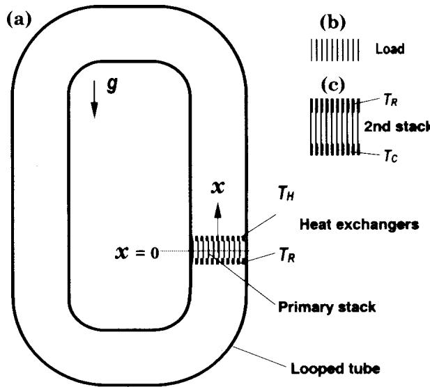
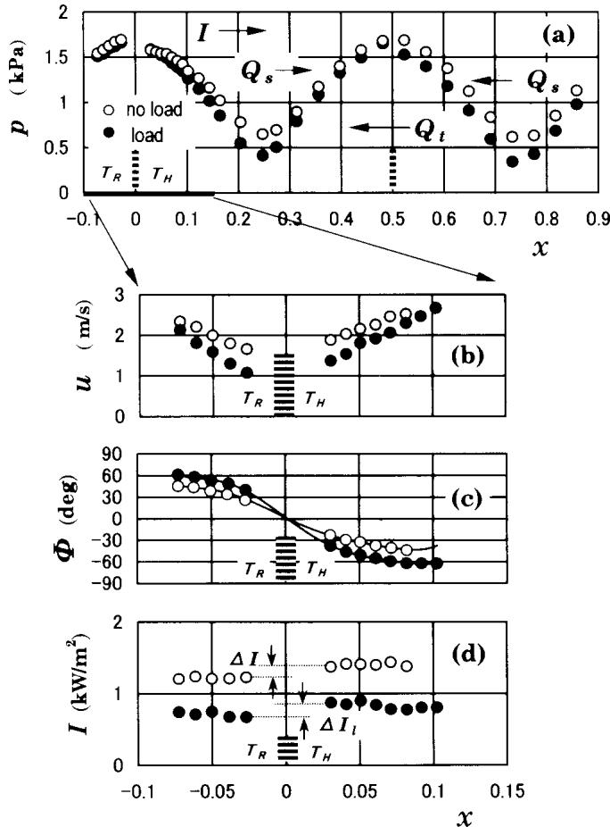
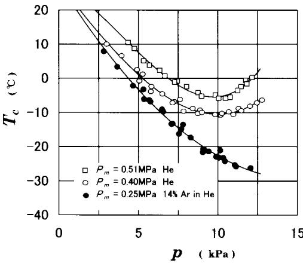

# A pistonless Stirling cooler

T. Yazakia)

Department of Physics, Aichi University of Education, Kariya 448, Japan

T. Biwa

Department of Crystalline Materials Science, Nagoya University, Nagoya 464, Japan

A. Tominaga

Institute of Physics, University of Tsukuba, Tsukuba 305, Japan

\~Received 4 September 2001; accepted for publication 29 October 2001!

We demonstrate a prototype acoustic cooler that uses Stirling cycles executed by a traveling wave with high acoustic impedance thermoacoustically induced in a looped tube. The tube has no moving parts, only a pair of stacks sandwiched between two heat exchangers: one amplifies the acoustic power and the amplified wave supplies the driving energy to pump heat directly within the second stack. Because it uses extremely simple hardware consisting of a few parts, the cooling device is potentially a powerful tool for applications such as conventional cooling systems. © 2002 American Institute of Physics. @DOI: 10.1063/1.1431695#

Many years ago, Ceperley1 proposed a pistonless Stirling engine in which an acoustic wave replaces the usual moving pistons to expand and contract a unit of working gas. Periodically oscillating gas parcels produced by the wave experience cyclic heating and cooling within a stack \~or a regenerator! with a steep temperature gradient. For the acoustic wave, there is a phase difference F between the pressure $P = p e ^ { i \omega t }$ and the cross sectional mean velocity $U { = } u e ^ { i ( \omega t + \Phi ) } { = } u \cos \Phi e ^ { i \omega t } { + } u \sin \Phi e ^ { i ( \omega t + \pi / 2 ) }$ , where v is the angular frequency of gas oscillation. In particular, when the wave has the traveling wave phase (F50), the gas parcels undergo a thermodynamic cycle similar to the Stirling $\mathrm { c y c l e } , { } ^ { 2 }$ equilibrating at the wall temperature. For understanding such an acoustic engine, two energy flows, heat flow Q, and work flow I5PU \~the bar indicates the time average!, have been proposed as new concepts;4,5 I is equivalent to the sound intensity in acoustics. Both the traveling wave component \~TWC! u cos F of U and the standing wave component (SWC) u sin F contribute to Q and the energy conversion between Q and I, while only the TWC contributes to I.

Recently, acoustic oscillation of the traveling wave mode has been observed to be self-sustaining in a thermoacoustic system.7 Backhaus and $\mathrm { S w i f t } ^ { 8 }$ have succeeded in constructing a thermoacoustic Stirling engine with high efficiency but they used a carefully shaped acoustic duct and a big resonator. They have indicated two conditions necessary to achieve an efficient Stirling cycle; one is that the acoustic wave should have the traveling wave phase and the second is that the wave should have high acoustic impedance. If a freely traveling plane wave were used as a driving force, then the phase $\Phi { = } 0$ . However, the dimensionless specific acoustic impedance $z { = } ( P / P _ { m } ) / ( U / c )$ would be fixed at the ratio of the specific heats $\gamma ( \simeq 1$ .4 for air), resulting in significant viscous energy losses due to high acoustic velocities; $P _ { m }$ and c are the mean pressure and adiabatic sound speed, respectively. In this letter, we demonstrate that an acoustic wave induced in a one-wavelength long looped tube satisfies both conditions at the same time without any moving parts and produces an extremely simple cooling system consisting of a few parts.

Before building an acoustic Stirling cooler, we report here on the fundamental properties of an acoustic wave induced in a looped tube. The experimental setup is shown in Fig. 1\~a! with which we thermoacoustically produce gas oscillations of the traveling wave mode. The cavity is made of a Pyrex glass tube of average length L52.8 m, inner radius 18.5 mm, and wall thickness 1.5 mm. The tube provides the primary stack and adjacent heat exchangers with wall temperatures of $T _ { H }$ and $T _ { R } ( \simeq 2 8 ^ { \circ } \mathrm { C } )$ to maintain a stationary temperature gradient and is filled with air at atmospheric pressure. The stack is made of ceramics containing many square channels of cross section $2 r \times 2 r ( r = 0 . 4 4 \mathrm { m m } )$ , 40 mm long, and 0.16 mm rib thickness. The center of the stack is defined as $x = 0$ , where x is the coordinate around the loop normalized by L. When $T _ { H }$ rises and exceeds some critical value, an intense gas oscillation is spontaneously generated at the frequency, 120 Hz, whose wavelength is equal to $L$ We measured the pressure and velocity at the center of the tube simultaneously by pressure sensors flush mounted on the tube wall and laser Doppler velocimetry under a constant pressure amplitude, $p { \simeq } 1 . 7 \mathrm { k P a }$ , at $x = 0 . 5$ by adjusting $T _ { H }$ and obtained the spatial distributions p(x), u(x), F(x), and I(x) via a fast-Fourier transform algorithm.

  
FIG. 1. Traveling wave thermoacoustic Stirling engine and cooler. „a… Looped tube equipped with a thermoacoustic engine. The direction of the gravitational acceleration is shown by g. „b… Stack for a load having the same geometry as the primary stack. „c… Heat pumping device. The second stack is made of ceramics with a square pore density of 1500 per square inch (r.0.27 mm).

  
FIG. 2. Acoustic field in the looped tube. „a… Measurements of the pressure amplitude $p .$ „b… Measurements of the cross sectional mean velocity amplitude u. „c… Phase lead F of U relative to $P .$ The lines are guides for the eye. „d… Distribution of the work flow. The flow direction is from $T _ { R }$ to $T _ { H }$ in the stack.

The data obtained at $T _ { \cal H } = 2 3 0 ^ { \circ } \mathrm { C }$ are shown by the open circles in Fig. 2. We focus on the acoustic variables at the primary stack position $( x = 0 )$ . The maximum pressure amplitude @Fig. 2\~a!# and minimum velocity amplitude @Fig. 2\~b!# are always positioned in the stack, where the acoustic impedance $z$ is about three times as large as $\gamma ,$ while F is interpolated to be zero @Fig. 2\~c!#. Thus, the energy conversion of heat flow from $T _ { H }$ to $T _ { R }$ into work flow is achieved mostly by the pure traveling wave having high acoustic impedance, that is, through the Stirling thermodynamic cycle, resulting in work output of $\Delta I { \sim } 1 5 0 \mathrm { W / m } ^ { 2 }$ from the stack @Fig. 2\~d!#. In other words, the primary stack and heat exchangers function as an acoustic power amplifier for the traveling wave propagating up the temperature gradient.

Experimental results also revealed that, wherever along the loop u is a minimum, $p$ is a maximum, and vice versa, and $\Phi = 0$ then and there, whereas SWC becomes a maximum at the midpoint between the maximum and minimum of $p .$ . There are, therefore, two possible locations along the loop to realize the Stirling cycle; one is the stack position and the other is $x { \simeq } 0 . 5$

We tested a loaded traveling wave thermoacoustic engine, where the secondary stack @Fig. 1\~b!# with no temperature gradient was inserted at $x = 0 . 5$ , playing the role of a dummy load for the practical engine. As shown by the solid circles in Fig. 2, which were obtained at $T _ { { \cal H } } = 3 2 5 ^ { \circ } \mathrm { C }$ , the presence of the load decreases the velocity amplitude within the primary stack $\left[ \operatorname { F i g } . 2 ( \mathbf { b } ) \right]$ , thereby further increasing z and reducing the viscous energy loss in the primary stack without depression of $p$ , while maintaining the traveling wave phase. The energy loss dissipated in the load, which is nearly equal to $( \Delta I _ { l } - \Delta I ) { \simeq } 5 0 \mathrm { W / m } ^ { 2 }$ , is significantly small compared with $\Delta I$ dissipated near the looped tube surface. The loaded looped tube engine, therefore, can effectively execute Stirling cycles without externally tuning F.

The observed acoustic field having both TWC and SWC indicates that there exist two characteristic heat flows, $Q _ { t }$ and $Q _ { s }$ , with the possibility of refrigeration in the loop; as shown by the arrows in Fig. 2\~a!, TWC causes heat flow $Q _ { t }$ in the opposite direction to the work flow,1,5 whereas SWC causes $Q _ { s }$ to flow toward the nearest pressure maximum.5 If the second stack sandwiched between two heat exchangers @Fig. 1\~c!# is located at $x = 0 . 5 ,$ , the traveling wave propagating down the temperature gradient should undergo an inverse Stirling cycle in the stack, converting most of $\Delta I _ { l }$ enhanced in the primary stack into heat flow to pump heat from $T _ { C }$ to $T _ { R }$ , but with no contribution from $Q _ { s }$ relying on an intrinsically irreversible process by SWC.4

In order to build and test a prototype cooler, we modified the apparatus shown in Fig. 1\~a! as follows; the glass tube was replaced by a stainless steel tube, helium gas was employed as a working gas, and the hot heat exchange $( T _ { H } )$ was removed, and instead, a sheet-like electrical heater was mounted on the primary stack to heat the gas directly. Using a 40 mm-long second stack with spacing $r { \simeq } 0 . 2 7$ mm @Fig. $1 ( \mathrm { c } ) ] .$ , we measured $T _ { C }$ under a small amplitude helium gas oscillation at 355 Hz for various positions of the stack and fixed the stack at the optimum position where the lowest temperature of $T _ { C }$ was achieved. The final position of the second stack was $x { \simeq } 0 . 5 5$ , where some of $Q _ { S }$ contributes to the heat pumping in addition to $Q _ { t }$ . Next, we adjusted the stack to the optimum length which further produces the lowest $T _ { C }$ and obtained a final stack length of about 80 mm.

Performance of the prototype cooler is shown in Fig. 3, where $T _ { C }$ is plotted as a function of pressure amplitude at $x = 0 . 5$ by adjusting the heater power on the primary stack. The cold heat exchanger had no externally applied heat load, but had nuisance heat load from the surrounding air because it was not thermally insulated. Decreasing $P _ { m }$ increases the thermal boundary layer of thickness $\delta _ { t } \propto ( P _ { m } \omega )$ 21/2 formed at the stack walls, improving the thermal contact between the gas and the walls; $\delta _ { t }$ at the center of the second stack is estimated to be 0.17 mm and 0.19 mm for $P _ { m } = 0 . 5 1$ MPa and 0.40 MPa, respectively. The device needs a lower mean o AIP license or copyright; see http://apl.aip.org/apl/copyright.jsp operating pressure to produce a larger cooling power. This means that the excellent thermal contact is beneficial for traveling wave engines like our device employing inherently reversible Stirling cycles. Further, to ensure the thermodynamical reversibility, we tested, instead of pure helium gas, a 86% helium, 14% argon mixture $( P _ { m } { = } 0 . 2 5 \ : \mathrm { M P a } )$ having the lower Prandtl number10 $\sigma { \simeq } 0 . 5$ and the lower operating frequency of 240 $\mathrm { H z , }$ thereby $\delta _ { t } { \sim } 0 . 3 \ : \mathrm { m m }$ , filling up the stack channel. Thus, we could get a significant reduction of $T _ { C } ;$ the traveling wave oscillation at $p / P _ { m } { \simeq } 5 \%$ \~p $= 1 2 \mathrm { k P a }$ and $P _ { m } { = } 0 . 2 5 \ : \mathrm { M P a ) }$ is maintained by 230 W of heater power, resulting in $T _ { C } { \simeq } - 2 7 ^ { \circ } \mathrm { C }$ , whereas the standing wave at $p / P _ { m } { \simeq } 7 \% ~ ( p = 2 0 \mathrm { k P a }$ and $P _ { m } { = } 0 . 3 \ \mathrm { M P a } )$ tested in a beer cooler with helium $\mathrm { g a s } , ^ { 5 }$ is maintained by 380 W, resulting in $T _ { C } { \simeq } - 1 1 ^ { \circ } \mathrm { C }$ . We attribute the abrupt temperature rise appearing at large amplitudes of more than about 10 kPa for helium gas to steady flows such as convective flow and acoustic streaming running around the loop through the second stack. The cooling power for the mixture overcomes a large heat load caused by the steady flows, completely suppressing the temperature rise.

  
FIG. 3. Performance of the acoustic Stirling cooler. The solid lines are guides for the eye and converge toward $2 8 ^ { \circ } \bar { \mathrm { C } }$ at $p { = } 0$

The looped tube engines can undoubtedly be developed with some improvements such as suppressing the unavoidable steady flows by $\mathrm { a \it { j e t p u m p } ^ { 8 } }$ and using stacks of nonuniform cross section \~including regenerators! according to TWC and SWC. They would approach the reversible engine with the Carnot efficiency if viscous energy losses are negligibly small,11 while maintaining the advantages of no sliding seals and extremely simple and inexpensive hardware.

1 P. H. Ceperley, J. Acoust. Soc. Am. 66, 1508 \~1979!.

2 I. Urieli and D. M. Berchowits, Stirling Cycle Engine Analysis \~Hilger, Bristol, UK, 1984!.

3 Heat flow Q is defined as $Q = \rho _ { m } T _ { m } { \big \langle } { \overline { { S V ) } } }$ , where angular brackets indicate radial average; $\rho _ { m } , T _ { m } , S ,$ and V are mean mass density, mean temperature, entropy per unit mass, and axial velocity, respectively.

4 J. C. Wheatley, T. Hofler, G. W. Swift, and A. Migliori, Phys. Rev. Lett. 50, 499 \~1983!; J. Acoust. Soc. Am. 74, 153 \~1983!; Am. J. Phys. 53, 147 \~1985!.

5 G. W. Swift, Phys. Today 48, 22 \~1995!; J. Acoust. Soc. Am. 84, 1145 \~1988!.

6 A. Tominaga, Cryogenics 35, 427 \~1995!.

7 T. Yazaki, A. Iwata, T. Maekawa, and A. Tominaga, Phys. Rev. Lett. 81, 3128 \~1998!.

8 S. Backhaus, and G. W. Swift, Nature \~London! 399, 335 \~1999!; J. Acoust. Soc. Am. 107, 3148 \~2000!.

9 T. Yazaki, and A. Tominaga, Proc. R. Soc. London, Ser. A 454, 2113 \~1998!.

10 J. R. Belcher, W. V. Slaton, R. Raspet, H. E. Bass, and J. Lightfoot, J. Acoust. Soc. Am. 105, 2677 \~1999!.

11 G. W. Swift, D. L. Gardner, and S. Backhaus, J. Acoust. Soc. Am. 105, 711 \~1999!.
