# 声功回收脉管热泵实验与数值研究预印本

Experimental and Numerical Simulation Study on Acoustic Power Recovery Pulse Tube Heat Pump

Shenglin Zhu, Xi Chen, Tian Ye, Yifan Zhu, Yingxia Qi。SSRN，2025-05-16，30页。

[SSRN原始记录](https://papers.ssrn.com/sol3/papers.cfm?abstract_id=5257213) · [DOI](https://doi.org/10.2139/ssrn.5257213) · [[Zhu_2025_Acoustic_Recovery_PT_Heat_Pump_SSRN5257213.pdf|原始PDF]] · [[Zhu_2025_Acoustic_Recovery_PT_Heat_Pump_SSRN5257213_MinerU全文|MinerU全文]]

## 来源与阅读边界

原件来自SSRN公开下载入口，首页和各页页脚均标明未同行评审预印本及编号5257213。保留30页原始PDF、MinerU阅读版和95张派生图片。分批范围为原件1–20、21–30页；裁切PDF逐页文字与归档原件一致，机器解析页序连续。本地图片引用已检查。公式、图表和性能数字仍须回原PDF核对。

SHA-256：`f5ba72a4bac323c4973d629e759f6a86c8836bfb4715a4b829fe74e21c016b8a`。

## 与2026年期刊论文的关联

关联题录：[[声功回收脉管热泵性能研究_Zhu_2026]]（DOI：10.1016/j.ijrefrig.2026.107009）。两者研究对象均为声功回收脉管热泵，重合作者为Shenglin Zhu、Xi Chen、Yifan Zhu；公开摘要均报告353 K、输入电功175 W、供热226 W、相对Carnot效率36.5%及活塞相位差81.25°。

以上支持“关联研究候选”的判断，尚不足以证明本稿就是该期刊论文的正式前稿。预印本有5位作者，期刊论文有3位作者，题名也不同；SSRN页面及PDF未发现明确的期刊版链接。期刊版12页PDF仍待取得。

本预印本摘要同时出现226 W与248 W两组供热数据，需结合工况及正文核读；不把它们直接合并成同一工况。期刊摘要明确相对Carnot效率以压缩腔声功评价，预印本摘要对这一边界的写法不同；引用时分别回查对应版本。

## 全文阅读版

<!-- 原始 PDF 第 1–20 页 -->

# Experimental and numerical simulation study on acoustic power

recovery pulse tube heat pump

Shenglin Zhua,b, Xi Chen\*a,b, Tian Yea,b, Yifan Zhua,b, Yingxia Qia,b

a School of Energy and Power Engineering, University of Shanghai for Science and Technology, 516 Jungong Road, Shanghai, 200093, China

b Shanghai Key Laboratory of Multiphase Flow and Heat Transfer in Power Engineering, University of Shanghai for Science and Technology, 516 Jungong Road, Shanghai 200093, China

ABSTRACT: With great potential for realizing high-efficiency heating capacity at hightemperature differences, an acoustic power recovery pulse tube heat pump (APRPTHP) can be applied to the thermal control system for spacecraft. In this study, a high-efficiency heating capacity APRPTHP is designed and manufactured to work at 353 K. The particular characteristics of acoustic power recovery are revealed from the electrical circuit analogy model. The heating performance of APRPTHP is evaluated by experiment. The experimental results depicted that a heating capacity of 226 W at 353 K is attained with a relative Carnot efficiency of 36.5% when the input electric power is 175 W. The phase difference between the displacer and piston of 81.25° is measured. It is dependent on working frequency and is not affected by other operating conditions. Moreover, the temperature distribution and flow characteristics inside APRPTHP are investigated by threedimensional simulation. The zero-velocity interface correlated with flow direction variations is presented in the pulse tube, resulting in the generation of vortices and a non-uniformly distributed temperature. While temperature distribution for the REG is a linear gradient. The phase difference for mass flow and pressure wave of 0° is observed at a location inside the pulse tube. Additionally, the flow mechanism of helium at the T-junction zones is elucidated. The acoustic power loss is 13.7 W when the heating capacity is 248 W at 353 K, and it is about 12.9% of the input acoustic power. KEYWORDS: Pulse tube heat hump; Passive phase-shifter; Acoustic power recovery; Threedimensional simulation.

## 1. Introduction

Spacecraft thermal loads have increased dramatically with the development of space technology. This requires that the heat dissipation capability of the radiators for the thermal control system be improved. To meet the required environment for a suitable environment for astronauts, instrumentation, structural components, and payloads, the transport and dissipation of high heat capacity is an important challenge in spacecraft thermal control [1]. Owing to guarantee sufficient heat dissipation from the spacecraft, the area of the radiator is requested to be large enough. The weight of the spacecraft will be increased by this method. Based on the Stefan-Boltzmann law, the heat dissipation capacity of the radiator is improved through increasing radiating temperature [2]. The area of the radiator will be significantly reduced by adopting the measure[3]. Meanwhile, the waste heat from spacecraft needs to be recycled to improve energy utilization. To address both of the requirements, the heat pump is proposed in thermal control systems for spacecraft[4, 5].

The conventional heat pumps are based on a vapor compression cycle, which is not applicable to the microgravity environment in space[6]. The heat transfer coefficients of R134a in the evaporator and condenser are performed to study by the simulation and experiment [7]. The results demonstrate that the heat transfer coefficient for heat exchangers is reduced, and the oil-gas for the compressor is difficult to separate in microgravity[8]. Therefore, the performance of the heat pump with a vapor compression cycle is decreased. While helium is used as the working medium of the thermosacoustic heat pump (TAHP)[9], the gas-liquid two-phase flow is not present in TAHP. As a result, the operation of TAHP is not affected in the microgravity environment in space. Moreover, the working principle of TAHP is based on thermoacoustic theory[10, 11]. When acoustic waves are transmitted through the regenerator, the thermophysical properties of the gas are altered, resulting in a significant temperature gradient in the regenerator. In this state, acoustic power is converted to heat energy, which produces a heating effect[12]. In summary, compared with the traditional vapor compression heat pump, the TAHP is characterized by simple and compact structures, low compression ratios, and high heat production efficiencies. TAHP has significant potential for application in spacecraft radiating systems. Currently, the heat pump based on the thermoacoustic theory is divided into the Sritling heat pump and the thermoacoustic heat pump.

Stirling heat pumps are widely studied due to their working principle based on the Stirling cycle. Depending on the type of driving system, the Stirling heat pumps are categorized as kineticdriven and free-piston Stirling heat pumps (FPSHP). In recent years, Cheng et al [13] constructed a 1-kW kinetic-driven Stirling heat pump (KDSHP). It can obtain a heating capacity of 904 W with a COP of 1.02 when the cold and hot end temperatures are 292 K and 311 K, respectively. For the domestic water heating applications, Easa et al [14] conducted a study on the performance of the gamma-type KDSHP. The experimental results indicate that an optimized heat exchanger structure can generate a heating capacity of 4 kW. The KDSHP has the advantage of generating significant heating capacity. However, it has an important engineering design issue in that it has a significant mechanical friction loss. The result is that their application is limited.

The FPSHP avoids this problem. Wang et al [15] studied the performance of FPSHP for different temperature conditions by using SAGE software. The result demonstrated that 2.4 kW of heating capacity was produced with a 1 kW power input when the hot and cold end temperatures were 313 K and 253 K, respectively. This study shows that FPSHP can work in different temperature situations. Afterward, the influence of the circumferential temperature in the hot heat exchanger on the performance of FPSHP was studied [16]. The numerical results indicate the effect of such temperature variation. To apply FPSHP for domestic heating in cold regions, Dai et al. designed a 2- kW FPSHP. The experimental results showed it can obtain a heating capacity of 2.2 kW with a COP of 2.76 at a hot-end temperature of 318 K and an outside ambient temperature of 273 K. The FPSHPs have a significant heating capacity and are employed in a wide range of applications.

In recent years, the development of TAHP has been pursued due to its advantages. In 2011, the first pioneering experimental investigation of TAHP with the resonant tube structure was performed by Tijani et al [17]. The results demonstrate that a maximum heating capacity of 200 W at 353 K can be obtained for the TAHP. In the same year, Bassem et al [18] developed a TAHP with a loop tube, achieving a maximum temperature of 643 K. The experimental results indicate that the thermodynamic cycle of TAHP is similar to a reversible Stirling cycle. Zhao et al [19] designed a TAHP composed of three heat pump parts connected in series as a loop. The acoustic power in the TAHP is recovered due to the loop structure. One of the heat pump parts has a heating capacity of 260 W with a COP of 2.1 when the temperature difference is 253- 323 K. However, the TAHP suffers from an inconsistent acoustic field and a large size. In addition, an experimental study of

TAHP with loop structure is conducted by Kikuchi at different temperature ranges [20]. Based on the experiment, Maroua et al [21] discovered that the optimal structure of the regenerator is present at various temperatures. In 2022, Yang et al [22] proposed a phase-change TAHP, and simulation results indicate its potential in small temperature differences. According to the summarized multiphysics field coupling effects of thermoacoustic elements by Chen et al [23], the TAHP with dualacoustic-driven structure is proposed by Cen et al [24]. The TAHP size is reduced, while the acoustic power is not recovered. From the above literature, the TAHP with a loop structure is focused on research. It has the advantages of stable operation and acoustic power recovery.

To minimize the size of the TAHP and to recover the acoustic power, the displacer phase shifter is developed. In recent years, the displacer phase shifter has been widely applied to regenerative refrigeration[25-27]. The displacer has the advantages of adjusting the phase and recovering acoustic power. The moving mass, spring stiffness, and rod-to-diameter ratio affect the efficiency of the refrigerator[28, 29]. Therefore, the displacer phase shifter can be adopted in the TAHP system because the working principle is the same as the refrigerator.

The existing literature indicates that the KDSHP, FPSHP, and TAHP are not suitable for aerospace cooling systems owing to their respective characteristics. Due to the limited size of TAHP in the application of spacecraft, the looped TAHP is not employed in spacecraft. The KDSHP faces several engineering challenges, specifically in friction. Due to the proximity of the hot heat exchanger of FSPHP to the motor, the hot-end temperature of FSPHP is limited. Therefore, the application of these heat pumps in aerospace thermal control systems is still a challenge. An acoustic power recovery pulse tube heat pump (APRPTHP) is designed, constructed, and tested to meet the requirements of aerospace thermal control systems. The passive rod displacer is employed to recover acoustic power and adjust the phase. In addition, the pulse tube is positioned between the compressor and the hot-end heat exchanger, which prevents high temperatures from affecting the stable operation of the compressor. Currently, few studies have studied the performance of heat pumps for this structure.

In this paper, the APRPTHP is studied using an experiment and CFD simulation. To illustrate the particular characteristics of acoustic power recovery, an electrical circuit analogy model is established. The heating performance is evaluated through experiments. The impacts of the working frequency, hot-end temperature, and cold-end temperature are investigated. Based on the experiments, a three-dimensional simulation is performed to study the heat transfer and oscillatory flow of the heat pump part.

## 2. Schematic of APRPTHP

The structure of APRPTHP is illustrated in Figure 1. It is primarily comprised of a linear compressor, a heat pump part, and a phase shifter. An opposed linear compressor is employed to reduce vibration. The pulse tube (PT), the hot end heat exchanger (HHX), the regenerator (REG), and the cold end heat exchanger (CHX) form a heat pump part. The heat pump part is arranged linearly to minimize energy losses. The REG is stuffed with the stacked wire mesh. Heat exchangers with slit-type structures are employed in HHX and CHX, which facilitate effective heat transfer and reduce dead volume. Owing to the different diameters of the PT and REG, flow straighteners (FS) are installed on two sides of the PT, which prevent the formation of jet flow.

Currently, four types of phase shifters are invariably utilized as phase shifters for refrigeration parts or heat pumps[30]. The passive phase shifter is used in this study. The displacer with rod, cylinder, and spring consists of phase shifters. The phase shifter contains an expansion space (ES), an auxiliary compression space (ACS), and a buffer space (BS). The chamber is divided by a displacer. These spaces have different cross-sectional areas due to the presence of displacement rods. When helium is present in these spaces, the pressure gap is generated, resulting in the passive oscillation of the spring. The phase shifter works at environmental temperature. The phase relation within the heat pump part is modulated by the phase shifter. Based on the enthalpy flow theory, APRPTHP can be operated efficiently when an ideal phase relation is realized inside the heat pump part. Additionally, the acoustic power in ES is transported to the ACS by the movement of the displacer. Then, the acoustic power for the ACS is transmitted to the heat pump part by a workrecovery pipe. Therefore, the displacer has the advantage of recovered acoustic power. Upon the recovered acoustic power being integrated with the produced acoustic power of the linear compressor, the APRPTHP is driven with this collective acoustic power.

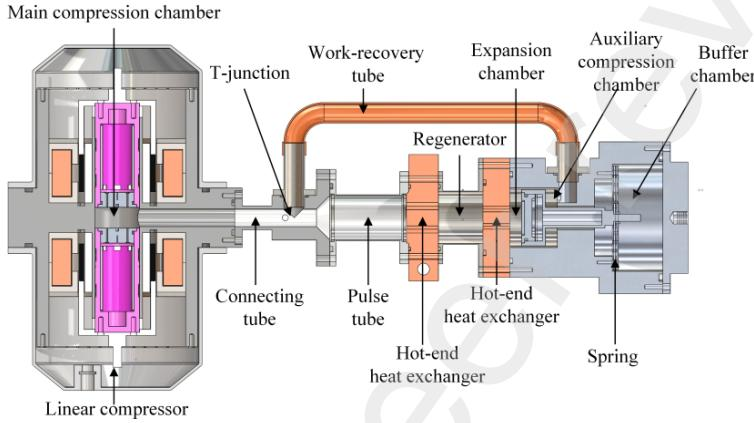\
Figure. 1. Structure of APRPTHP.

## 3 Theoretical analyses for APRPTHP

To illustrate the particular performance of acoustic power recuperation, an electrical circuit analogy model of APRPTHP is shown in Figure. 2. It is following the thermoacoustic theory [31, 32]. The capability for the displacer and the vector supersession of helium at the T-junction is described by this model. The electrical, mechanical, and acoustic circuits, are shown in Figure. 2. These components are connected to form a whole system by mutual inductance transformers. All three components are represented by impedance types to facilitate understanding. Moreover, the voltage source $E ,$ resistor $R _ { e } ,$ and inductor Le are contained in the electrical circuit. For the mechanical component, the motor force F and velocity v are comparable to voltage and current I, respectively. Spring force, inertia force, and damping force are comparable to capacitance $C _ { m } ,$ inductance $L _ { m } ,$ and resistance $R _ { m } ,$ respectively[33]. For the acoustic component, the pressure wave $p$ is regarded as voltage and the volumetric flow rate U is regarded as current. PT, HHX, REG, and CHX are regarded as a resistor assembly, inductors, capacitor, and volumetric flow sources, respectively[34-36]. The phase shifter is similar to a mechanical circuit. The acoustic power is transmitted through it between two acoustic circuits. The performance of the transformer is related to the cross-sectional area on each side of the displacer. Differences in the cross-sectional areas of the two sides of the excluder result in unequal transformer coefficients. The impact of the workrecovery pipe is ignored. The volumetric flow rates from the primary compression space (CS) and ACS are aggregated at the T-junction. The converged volumetric flow rate enters the heat pump part.

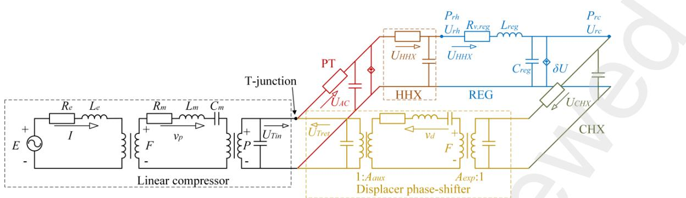\
Figure. 2. Electrical circuit analogy model for APRPTHP.

According to the energy conservation, the energy flow in APRPTHP with a passive phaseshifter is shown in Figure. 3. The electric power (WCOM) is turned into acoustic power (PV power) in the CS by the linear compressor. The PV power is defined as the potential energy of the helium to do reversible work relative to the mean pressure as it expands isothermally. The acoustic power is translated into effective PV power through the displacer. After obtaining the volume flow rate, the PV power at the other locations of the APRPTHP can be calculated. Enthalpy change in an open system is easier to understand. compared with PV power. Energy loss from REG and PT is caused, resulting in a decrease in the gross heating capacity for HHX. The PV power in the phase shifter is returned to the heat pump part by the work-recovery tube, resulting in additional heating capacity. Therefore, the optimal performance of APRPTHP is higher.

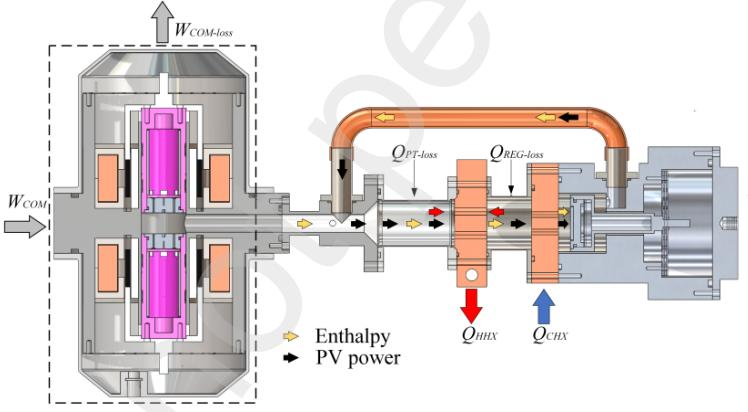\
Figure. 3. Energy flow for APRPTHP.

## 4. Experimental setup

The heat pump unit and the phase shifter are designed and manufactured according to an existing linear compressor. Its rated power is 1000 W, and the maximum piston movement is 6 mm. Which is adopted for the experiment. The O-type rubber rings are employed to seal the contact surfaces of components. Furthermore, a vibration absorber is installed on the phase shifter. The vibration of APRPTHP is reduced in this way. In the experiment, the working frequency for the APRPTHP coincides with the intrinsic frequency for the vibration absorber, contributing to minimizing the impact of excessive vibration. The intrinsic frequency of the shock absorber is variable through modulating the quality of the shock absorber. Six working frequencies of 61, 63, 64, 65, 66, and 67 Hz are obtained for the experiment.

Table.1 Main parameters of APRPTHP
<table><tr><td>Component</td><td>Parameter</td><td>Value</td><td>Unit</td></tr><tr><td></td><td></td><td></td><td></td></tr><tr><td rowspan="7">Compressor</td><td>Piston</td><td>50</td><td>mm</td></tr><tr><td>Moving mass</td><td>1220</td><td>g</td></tr><tr><td>Magnetic spring stiffness</td><td>90000</td><td>N/m</td></tr><tr><td>Mechanical damping</td><td>25</td><td>N·s/m</td></tr><tr><td>Transduction coefficient</td><td>58</td><td>N/A</td></tr><tr><td>Length</td><td>50</td><td>mm</td></tr><tr><td>Diameter</td><td>30</td><td>mm</td></tr><tr><td rowspan="3">HHX</td><td>Slit width</td><td>0.2</td><td>mm</td></tr><tr><td>Slit length</td><td>20</td><td></td></tr><tr><td>Length</td><td>30</td><td>mm</td></tr><tr><td rowspan="3">REG</td><td>Diameter</td><td>35</td><td></td></tr><tr><td>Wire diameter</td><td>0.07</td><td>mm</td></tr><tr><td>Porosity</td><td>71.8%</td><td></td></tr><tr><td rowspan="3">CHX</td><td>Slit width</td><td>0.2</td><td>mm</td></tr><tr><td>Slit length</td><td></td><td>mm</td></tr><tr><td>Displacer diameter</td><td>38</td><td>mm</td></tr><tr><td rowspan="3">Phase shifter</td><td>Rod diameter</td><td>14</td><td>mm</td></tr><tr><td>Moving mass</td><td>65</td><td>g</td></tr><tr><td>Spring stiffness</td><td>9450</td><td>N/m</td></tr></table>

The experimental rig for APRPTHP is indicated in the Figure. 4. APRPTHP is positioned in the middle of other devices. The auxiliary devices are located around the APRPTHP. The linear compressor is driven by an intelligent AC power supply. Its uncertainty is ±2%. Which inputs electric power into the APRPTHP, and its working frequency can be changed. The temperature of CHX is controlled through heating resistors, and it is connected to the CHX for heating by a DC power supply. Its uncertainty is ±4.0%. The heating capacity of HHX is carried away by water bath #1. The heating capacity is obtained by the energy balance principle, as depicted in the equation. 1. For the energy analysis of APRPTHP, the energy entering APRPTHP contains the PV power from the linear compressor end and the heating capacity from the heating resistor of the CHX (Qe). When the leakage loss is not considered, the energy output of the heat pump part to the outside ambient is the heating capacity of APRPTHP. The heating performance $C O P _ { P V } )$ of APRPTHP is calculated through the equation. 2.

$$
Q _ { h } = W _ { P V } + Q _ { e }\tag{2}
$$

$$
\mathit { C O P } _ { P V } = \frac { Q _ { h } } { W _ { P V } } = \frac { W _ { P V } + Q _ { e } } { W _ { P V } } = 1 + \frac { Q _ { e } } { W _ { P V } }\tag{3}
$$

In addition, the compressor is cooled by water bath #2. A pressure sensor (ENDEVCO 8530B-1000) is used to measure the pressure at the heat pump inlet. It is integrated with a signal amplifier (ENDEVCO Model 136) and an oscilloscope. The accuracy of the signal amplifier is 0.5%. The oscilloscope is adopted to detect pressure waves. The movement of the compressor piston and displacer is determined indirectly by experimental conditions. Two pressure sensors (AE-YD-M10) are adopted to measure the pressure waves of the BS for the compressor and the phase shifter, which is used to calculate the movement [37]. T-Thermocouples are employed to determine the temperatures of PT, HHX, REG, and CHX. Its accuracy is ±0.5 K. It is connected to a temperature logger (KEYSIGHT 34970A), contributing to saving temperature data and displaying the value on

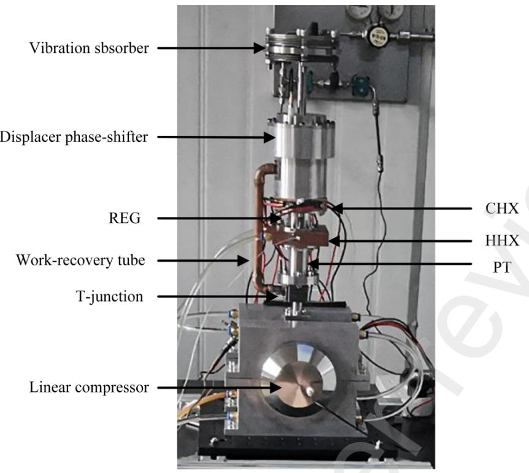\
(a) Photo of APRPTHP

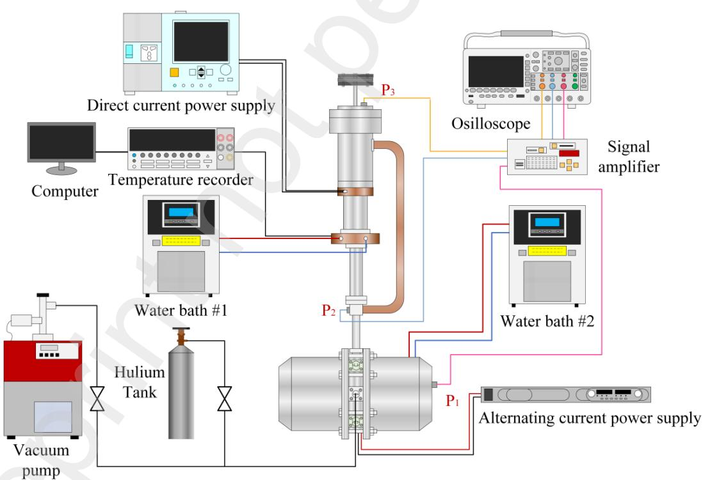\
(b) Experimental test device\
Figure. 4. The experimental rig for APRPTHP.

## 5. Uncertainty analysis for parameter measurements

The measurements of input power, pressure, and temperature are subject to certain errors. Measurement variations are caused by various aspects, including measurement methods, measurement conditions, the operator's skill level, and the accuracy of measurement equipment. Error analysis is an important step in evaluating and improving the accuracy of measurements to reduce the impact of errors on experimental results. Measurement errors can be classified into the following three categories: systematic errors, random errors, and gross errors.

## 5.1 Uncertainty analysis for the input electric power

The input electric power of the APRPTHP is obtained from the value of the intelligent AC power supply. In addition, the energy absorption of the cold-end heat exchanger is provided by five heating resistors, which are measured directly from the DC power supply. Therefore, the measurement errors of the intelligent AC power supply and the DC power supply itself are the measurement errors of the input electric power. It is calculated by equations (3) and (4), respectively.

$$
\sigma _ { D C } = 2 \% \times V _ { D C } + 2 \times V _ { D C \operatorname* { m i n } }\tag{4}
$$

$$
\sigma _ { A C } = 4 \% \times V _ { A C } + 4 \times V _ { A C \operatorname* { m i n } }\tag{5}
$$

## 5.2 Uncertainty analysis for the pressure measurement

The pressure of the heat pump inlet is measured by the pressure sensor (ENDEVCO 8530B-1000). Pressure measurements are taken 10 times. Uncertainty analyses are performed on these 10 random values of independent pressures. The subsample mean is

$$
\overline { { P } } = \frac { 1 } { n } \sum _ { i = 1 } ^ { n } P _ { i }\tag{6}
$$

The standard error of the arithmetic mean is

$$
S _ { P } = { \sqrt { { \frac { 1 } { n ( n - 1 ) } } \sum _ { i = 1 } ^ { n } \Bigl ( P _ { i } - { \overline { { P } } } \Bigr ) ^ { 2 } } }\tag{7}
$$

The random error, pressure sensor calibration error, and pressure sensor Gauge Error are calculated by equations (7), (8), and (9), respectively

$$
\sigma _ { 1 } = \pm 3 \cdot S _ { P }\tag{8}
$$

$$
\sigma _ { 2 } = P \cdot 0 . 4 \%\tag{9}
$$

$$
\sigma _ { 3 } = P _ { \mathrm { m a x } } \cdot 0 . 5 \%\tag{10}
$$

Therefore, the static pressure measurement error of the pressure sensor is

$$
\sigma _ { P } = \sigma _ { 1 } + \sigma _ { 2 } + \sigma _ { 3 }\tag{11}
$$

The piston displacement measurement is calculated indirectly by measuring the pressure amplitude of the compressor and the backpressure chamber of the phase control unit. Therefore, the first step is to derive the measurement error of the pressure amplitude, which includes both random and systematic errors.

The systematic error is

$$
\sigma _ { 4 } = \left| \overline { { P } } \right|\tag{12}
$$

The measurement error of the pressure amplitude of the pressure transducer is

$$
\sigma _ { p c o m p } = \sigma _ { 1 } + \sigma _ { 4 }\tag{13}
$$

The compression piston is related to the amplitude of the backpressure chamber pressure as well as the static pressure. Therefore, the measurement error of the compression piston displacement is

$$
\sigma _ { x } = \pm \sqrt { \left( \frac { V } { \gamma P _ { m } A } \right) ^ { 2 } \times \sigma _ { P } ^ { 2 } + \left( \frac { P V } { \gamma P _ { m } ^ { 2 } A } \right) ^ { 2 } \times \sigma _ { p c o m p } ^ { 2 } }\tag{14}
$$

The displacer displacement error in the power recovery phasing unit is obtained by the same calculation method.

## 5.3 Uncertainty analysis for the temperature measurement

The temperature is measured using a T-type thermocouple. The measurement error includes measurement error, calibration error, and instrumentation error. Ten measurements are taken at 293 K, and these ten independent random values are analysed for error. The subsample mean is

$$
\overline { { T } } = \frac { 1 } { n } \sum _ { i = 1 } ^ { n } T _ { i }\tag{15}
$$

The standard error of the arithmetic mean is

$$
S _ { T } = { \sqrt { \frac { 1 } { n ( n - 1 ) } \sum _ { i = 1 } ^ { n } \Bigl ( T _ { i } - { \overline { { T } } } \Bigr ) } } ^ { 2 }\tag{16}
$$

The random error is

$$
\sigma _ { 5 } = \pm 3 \cdot S _ { T }\tag{17}
$$

The total error of the T-type thermocouple calibration error and instrumentation error is ±0.5 K $\left( \sigma _ { 6 } \right)$ . The measurement error of the T-type thermocouple is

$$
\sigma _ { T } = \sigma _ { 5 } + \sigma _ { 6 }\tag{18}
$$

## 6. Simulation model of the APRPTHP

## 6.1 CFD simulation approaches for the APRPTHP

The design, simulation, and optimization for the thermoacoustic heat pump and refrigerator are extensively performed using the traditional numerical theory, Sage, Regen, and DeltaEC [38-42]. The CFD (such as Fluent) simulation for APRPTHP is developed with the governing equations of working fluid dynamics and thermodynamics. The helium flow and heat transfer processes for the APRPTAHP are simulated by CFD. The temperature distributions and flow characteristics within the APRPTHP are observed through the simulation. To accurately, intuitively, and in detail describe the oscillation flow and heat transfer processes of helium in the heat pump, the CFD model is better than one-dimensional models. Moreover, the complex structure and fluid behaviors, such as turbulence and thermal attenuation, can be handled by adopting the CFD method. Therefore, the three-dimensional Fluent model as the virtual tool is utilized to understand the thermodynamic features and optimize the performance of the APRPTHP.

## 6.2 Geometric model for APRPTHP

The linear compressor, heat pump unit, and passive phase-shifter are designed with a cylindrical shape. The three-dimensional symmetric CFD model of the APRPTHP with a passive phase-shifter is shown in Figure. 5. Compared with local-scale CFD models of TAHP [19, 24, 43], the full-scale model simulation is employed in this paper, which matches the dimensions of the TAHP with the passive phase shifter. To ensure uniformity inside the heat pump part, the FSs are installed at both ends of the PT. The FSs are filled by using a COP wire mesh. Additionally, tapered transitions are introduced in zones with drastic radial dimension variations, avoiding jets and eddies. In the actual experiment, the change in the volume of the chamber on both sides for the displacer is caused by its oscillation in the axial direction. While the displacer is substituted in the simulation by the moving boundaries of the ES and ACS [44]. The structural parameters and boundary conditions for the Fluent model are listed in Table 2.

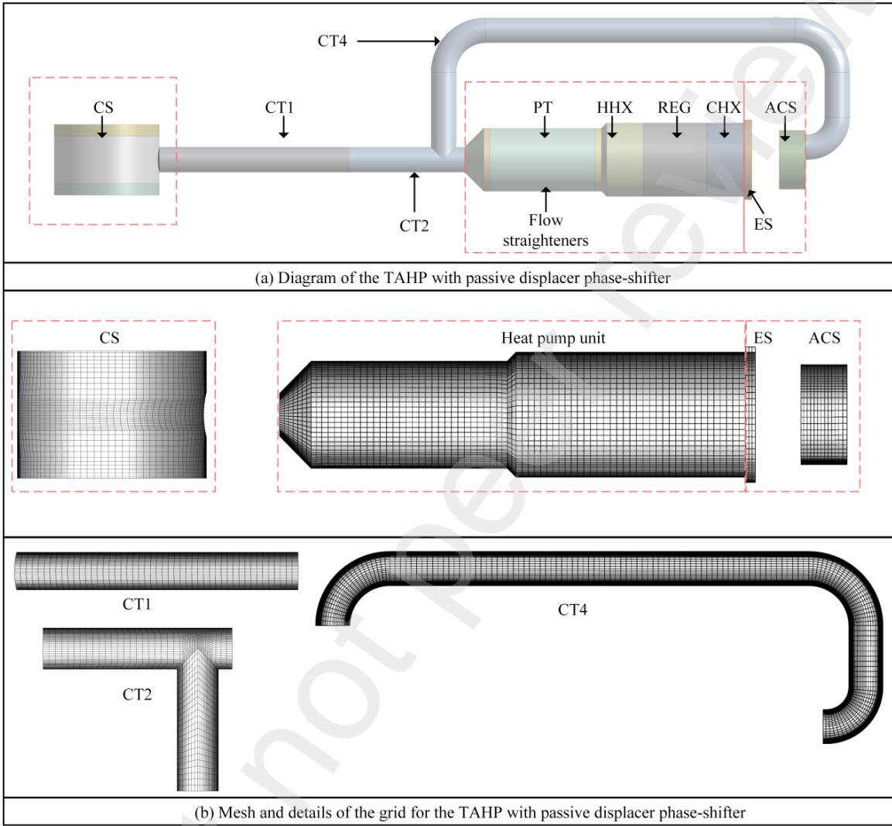\
Figure. 5. Three-dimensional simulation model for APRPTHP: (a) The geometric model and (b) The model grids.

Table. 2 Structural parameters and boundary conditions
<table><tr><td>Component</td><td>Diameter (mm)</td><td>Length (mm)</td><td>Boundary condition</td></tr><tr><td>CS</td><td>50</td><td>33.6</td><td>Tw=293 K</td></tr><tr><td>FS 1</td><td>30</td><td>3</td><td>Adiabatic</td></tr><tr><td>PT</td><td>30</td><td>50</td><td>Adiabatic</td></tr><tr><td>FS 2</td><td>30</td><td>3</td><td>Adiabatic</td></tr><tr><td>HHX</td><td>35</td><td>20</td><td>Tw=353 K</td></tr></table>

<table><tr><td>REG 35</td><td>30</td><td>Adiabatic</td></tr><tr><td>CHX 35</td><td>18</td><td> $T _ { w } { = } 2 9 3 \mathrm { K }$ </td></tr><tr><td>CT A 12</td><td>90</td><td> $T _ { w } { = } 2 9 3 \mathrm { K }$ </td></tr><tr><td>CT B 12</td><td>55</td><td> ${ \cal T } _ { w } { = } 2 9 3 \mathrm { \ K }$ </td></tr><tr><td>CT C 12</td><td>288</td><td> $T _ { w } { = } 2 9 3 \mathrm { K }$ </td></tr></table>

## 6.3 Movement boundaries and porous zones parameters for APRPTHP

The motion for the compression piston and the displacer is emulated by employing a userdefined function (UDF). The movements for the piston and displacer in the UDF are specified in equations (18) and (19), respectively.

$$
X _ { p } = X _ { p 0 } \cdot \sin \left( \omega t \right)\tag{19}
$$

$$
X _ { d } = X _ { d 0 } \cdot ( \omega t + \varphi )\tag{20}
$$

where $X _ { p }$ is the piston displacement, $X _ { d }$ is the displacer displacement, $X _ { p 0 }$ is the movement amplitude of the piston, $X _ { d 0 }$ is the movement amplitude of the displacer, � is the angular frequency $( \omega { = } 2 \pi f )$ , and $\varphi$ is the phase difference for the compression piston and the displacer.

The velocity for the piston and displacer in the UDF is specified in equations (20) and (21), respectively.

$$
V _ { p } = { \frac { d X _ { p } } { d t } } = X _ { p o } \cdot \omega \cdot \cos \left( \omega t \right)\tag{21}
$$

$$
V _ { d } = \frac { d X _ { d } } { d t } = X _ { d 0 } \cdot \omega \cdot \cos \left( \omega t + \varphi \right)\tag{22}
$$

where $V _ { p }$ is the compression piston velocity and $V _ { d }$ is the displacer velocity.

The charge pressure and the cold-end temperature are 2.0 MPa and 293 K, respectively. The movement of the piston and displacer and operation frequency are variable in different operation conditions. The data is provided from the experimental study. Helium is considered to be the ideal gas in the simulation due to working temperatures above 40 K. Therefore, the polynomial equation of the temperature is employed to fit the thermal conductivity and viscosity of helium. The slit-type heat exchangers are equated to the screen heat exchangers [45, 46]. The REG, heat exchangers, and FSs are considered porous media. Owing to the conflict between the dynamic mesh model and the non-thermal equilibrium model in the simulation, porous media are modeled using the heat balance model. For the Fluent software, the porosity, permeability, and drag factor are utilized to define the porous media. The factors are shown in Table 3.

Table. 3 The factors of porous media.
<table><tr><td>Components</td><td>Material</td><td>ε</td><td> $\alpha ( \mathbf { m } ^ { 2 } )$ </td><td> $C _ { 2 } ( \mathbf { m } ^ { - 1 } )$ </td></tr><tr><td>FS 1</td><td>Copper</td><td>0.78</td><td>456800000</td><td>6313</td></tr><tr><td>FS 2</td><td>Copper</td><td>0.78</td><td>456800000</td><td>6543</td></tr><tr><td>HHX</td><td>Copper</td><td>0.18</td><td>415200000</td><td>3683</td></tr><tr><td>REG</td><td>steel</td><td>0.72</td><td>5543000000</td><td>28240</td></tr><tr><td>CHX</td><td>Copper</td><td>0.24</td><td>415200000</td><td>3896</td></tr></table>

## 6.4 Meshing grid for APRPTHP

The modeling and meshing of APRPTHP are done using ICEM software. Mesh refinement is introduced for near-wall regions and joints of different parts to derive more precise simulation data. The viscous penetration depth is conducted to determine the boundary mesh height. It is calculated by the equation. (22).

$$
\lambda _ { \nu } = \sqrt { \frac { \mu } { \rho _ { f } \pi f } }\tag{23}
$$

where $\rho _ { f }$ is the density of the working fluid, � is the working frequency of APRPTHP, and � is the dynamic viscosity coefficient of the working fluid. The temperature determines the viscous penetration depth.

To ensure that the number of meshes is not correct to affect the simulation results, a mesh independence analysis is performed. The result is listed in Table.4. It can be noticed that the simulation results remain virtually constant when the number of elements is increased to $4 . 1 \times 1 0 ^ { 5 }$ The element of $4 . 1 \times 1 0 ^ { 5 }$ is utilized in all cases.

Table. 4 The grid independence result.
<table><tr><td>Element (×10⁵)</td><td>1.2</td><td>1.8</td><td>2.5</td><td>3.4</td><td>4.1</td><td>5.1</td><td>6.1</td></tr><tr><td> $Q _ { h } \left( \mathrm { W } \right)$ </td><td>157.1</td><td>184.7</td><td>207.1</td><td>224.4</td><td>253</td><td>254.7</td><td>255.9</td></tr></table>

## 6.5 Governing equation for the APRPTHP computational models

For the gas domain of APRPTHP, the mass equation is expressed as:

$$
\frac { \partial \rho _ { f } } { \partial t } + \nabla \cdot ( \rho _ { f } ) = 0\tag{24}
$$

The momentum equation is expressed as:

$$
\frac { \partial } { \partial t } \left( \rho _ { f } \boldsymbol { v } \right) + \boldsymbol { \nabla } \cdot \left( \rho _ { f } \boldsymbol { v } \boldsymbol { v } \right) = - \boldsymbol { \nabla } p + \boldsymbol { \nabla } \cdot \left( \overline { { \boldsymbol { \tau } } } \right) + \boldsymbol { S } _ { i }\tag{25}
$$

The energy equation is expressed as:

$$
\frac { \partial } { \partial t } \left( \rho _ { f } E _ { f } \right) + \nabla \cdot \left[ \upsilon \left( \rho _ { f } E _ { f } + p \right) \right] = \nabla \cdot \left[ K _ { f } \nabla T + \left( \stackrel { \triangledown } { \tau } \upsilon \right) \right]\tag{26}
$$

where � is the velocity of the helium, $\rho _ { f }$ is the density of the helium, � is the working pressure,\
$T _ { f }$ is the temperature of the working fluid, $k _ { f }$ is the thermal conductivity of the helium, $E _ { f }$ is the\
energy of the helium, and $\tau$ is the stress tensor of the helium.

The mass equation of porous areas is written as:

$$
\frac { \partial \varepsilon \rho _ { f } } { \partial t } + \nabla \cdot ( \varepsilon \rho _ { f } \boldsymbol { v } ) = 0\tag{27}
$$

The momentum equation of porous areas is written as

$$
\frac { \partial } { \partial t } \left( \varepsilon \rho _ { f } v \right) + \nabla \cdot \left( \varepsilon \rho _ { f } v v \right) = - \varepsilon \nabla p + \nabla \cdot \left( \varepsilon \overline { { \tau } } \right) + S _ { i }\tag{28}
$$

where $\varepsilon$ is the porosity in the porous zones, $S _ { i }$ is the source term that is expressed as:

$$
S _ { i } = - \bigg ( \frac { u } { \alpha } v + \frac { C _ { 2 } } { 2 } \rho _ { f } | v | v \bigg )\tag{29}
$$

where � is the permeability, and $C _ { 2 }$ is the resistance factor.

The energy-conserved equation in porous regions is given by:

$$
\frac { \partial } { \partial t } \left[ \varepsilon \rho _ { f } E _ { f } + ( 1 - \varepsilon ) \rho _ { S } E _ { S } \right] + \nabla \cdot \left[ \boldsymbol { v } ( \rho _ { f } E _ { f } + p ) \right] = \nabla \cdot \left[ k _ { e f f } \nabla T + \left( \overline { { \boldsymbol { \tau } } } \cdot \boldsymbol { v } \right) \right]\tag{30}
$$

where $k _ { e f f }$ is the coefficient of effective thermal conductivity in porous regions, $\rho _ { s }$ is the density of porous areas, and $E _ { s }$ is the energy of porous areas.

## 6.6 Numerical scheme and model validation for APRPTHP

The Navier-Stokes equations are solved by using the finite volume method for the Fluent model. The turbulence model is a k-ε model with a low Reynolds number. Owing to the porous media model, heat exchanger pressures such as accumulators are discretized using PRESTO, while flow variables are considered to use a second-order upwind scheme. Pressure and velocity are coupled using the PISO algorithm. The critical parameters are slightly different compared to each cycle based on the convergence criteria of the oscillatory flow. Then, the simulation is assumed to reach a steady state. The convergence criterion of the energy equation is 106, while the convergence criterion for the other equations is 103. A time step of $1 { \times } 1 0 ^ { 4 } \mathrm { s } ( \equiv 1 / f n )$ is adopted in all cases, which facilitates the accuracy of the simulation. The maximum number of iterations per time step (n) is 40.

To validate the accuracy of the Fluent model, various simulation cases are compared with experimental results. The parameters of the TAHP and working conditions in the experiment are set in the Fluent model. The heating capacity and pressure ratio of the heat pump part for simulation and experiment are shown in Figure. 6. They are estimated under different heat temperatures. The relative error for the heating capacity is less than 10% between the simulation and experiment. The relative error is higher with the increase in heating temperature. This explains why energy loss from the environment is ignored in the simulation. Moreover, the pressure ratio for the heat pump inlet slightly improves when the heating temperature is higher. The experimental results are lower than the simulation results, owing to the gas consumption of the linear compressor in the experiment. Generally, the simulation results are reliable. It is convincing to analyze flow and heat transfer properties inside the heat pump part based on the simulation result.

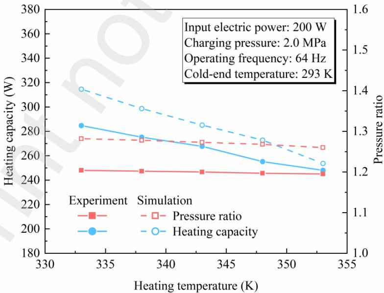\
Figure. 6 Comparison of simulated and experimental heating capacity and pressure ratio.

## 7. Performance analysis and discussion for APRPTHP

## 7.1. Typical heating performance

The heat-up curve of APRPTHP is shown in Figure 7(a). The copper mass of HHX is 1.44 kg. Therefore, the heating temperature of 353 K is reached in 242 s. The pressure wave at the compressor outlet over two cycles for typical heating performance is illustrated in the Figure. 7(b). The pressure wave is basically in the form of a sinusoidal function. The average pressure is 2.03 MPa, the pressure wave amplitude is 0.18 MPa, and the pressure ratio is 1.2. Based on the compressor piston, the phase of the pressure wave is 18.3°at the heat pump inlet.

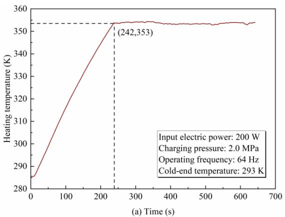

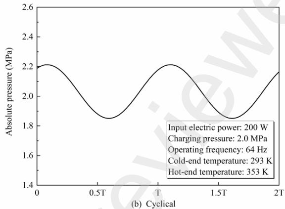\
Figure. 7. The heating curve (a) and the pressure variation (b).

The heating capacities and $C O P _ { P V }$ at different heating temperatures are depicted in Figure. 8. It can be evident that the heating capacity and $C O P _ { P V }$ decrease with higher heating temperature for constant input electric power. It is explained that the higher the heating temperature, the greater the temperature difference between CHX and HHX, limiting its heating capacity. As a result, its $C O P _ { P V }$ decreases. Moreover, a higher heating capacity is yielded with greater input electric power at constant heating temperature. However, the highest $C O P _ { P V }$ is acquired with the input electric power of 175 W when the heating temperature is constant. This result is attributed to the fact that the heating capacity of the heat pump is limited, and the increase in the input electric power does not increase the heating capacity accordingly. Therefore, with the input electric power increases, its heating capacity increases slightly, whereas its $C O P _ { P V }$ decreases. Specifically, the heating capacity is 226W when the input electric power and the heating temperature are 353 K and 175W. And the relative Carnot efficiency is 36.5%.

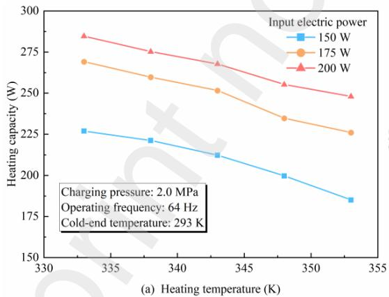

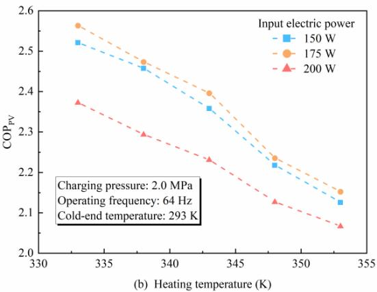\
Figure. 8. The heating capacity (a) and $C O P _ { P V }$ (b) at different heating temperatures.

For the different heating temperatures and input electric power, the movement variation of the compression piston and displacer is shown in Figure. 9(a). The movement of the piston and displacer is much higher with the higher input electric power. Therefore, the linear compressor is started with a low input electric power, ensuring the safe operation of the machine at the environmental temperature. The movement of the piston and displacer slightly decreases with the increase in heating temperature. Due to the increase in helium viscosity caused by the increase in temperature, the resistance to piston movement increases, resulting in a slight decrease in piston amplitude. For Figure. 9(b), it can be discovered that the piston-pressure and displacer-pressure phase differences increase slightly. The variations of the piston-pressure and displacer-pressure phase differences are less than 1.5°. While the phase difference is essentially uniform under different input electric power. The impacts of the heating temperature and the input electric power on phase difference are minimal.

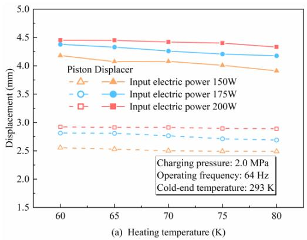

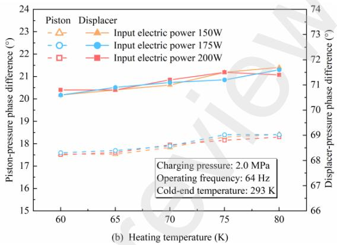\
Figure. 9. Piston and displacer: displacement (a) and phase difference (b).

## 7.2 Effect of cold-end temperature and working frequency

The impacts of cold-end temperature on the heating capacity and $C O P _ { P V }$ are illustrated in Figure. 10. It is observed that the heating capacity is higher with the increase of cold-end temperature and input electric power. When the input electric power is 200 W, the thermal energy in an environment at a temperature of 273 K is absorbed by the APRPTHP. Afterward, the temperature is elevated to 353 K, and a heating capacity of 222 W is released with a $C O P _ { P V }$ of 1.85. The thermal energy is generated at high-temperature differences, which is one of the advantages of APRPTHP. Conventional heat pumps have difficulty achieving this objective. Moreover, when the input electric power is 175 W and 150 W, the $C O P _ { P V }$ is higher. It indicates that the APRPTHP is better suited for operation at a power of 175 W. This phenomenon is consistent with the effect of different input electric power on $C O P _ { P V }$ at different hot-end temperatures.

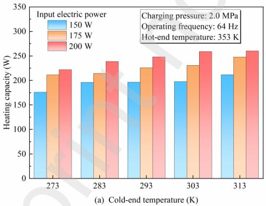

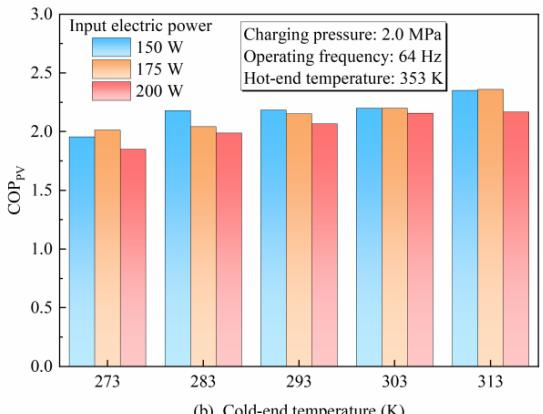\
Figure. 10. The heating capacity (a) and $C O P _ { P V }$ (b) at different cold-end temperatures.

The influence of working frequency on heating capacity and $C O P _ { P V }$ for different input electric power by experiment is illustrated in Figure. 11. For different working frequencies, the heating capacity increases with the increase of input electric power, and the $C O P _ { P V }$ is the highest at the input electric power of 175 W. In addition, it is found that the highest heating capacity and $C O P _ { P V }$ are obtained at the working frequency of 64 Hz. The heating capacity and cop begin to decrease at 65 Hz. This phenomenon can be explained that the 64Hz is the resonant frequency of the linear compressor and heat pump unit. Moreover, the phase difference between the compressor piston and the displacer decreases with the increase in working frequency. There is an optimal phase difference between the compression piston and the displacer of 81.25°. Therefore, the heating capacity and the $\mathrm { C O P _ { P V } }$ occur at peak value when the working frequency is 64 Hz.

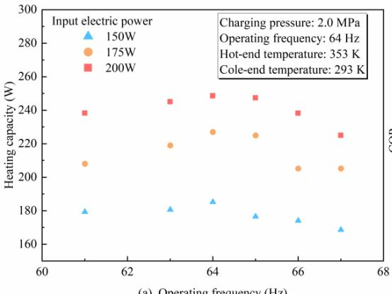\
(a) Operating frequency (Hz)

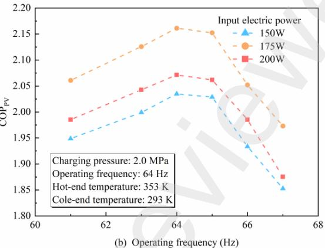\
Figure. 11. The heating capacity (a) and $C O P _ { P V }$ (b) for the experiment at different working frequencies.

The heating capacity and $C O P _ { P V }$ of the APRPTHP at different operating frequencies and input electric power derived from CFD simulation are shown in Figure 12. Heating performance can be significantly improved with an increase in electric power input. A tendency to increase and then decrease the heating performance is displayed with the increase in working frequency. This trend of variation is identical to the trend of the experimental data. However, the optimal working frequency is 65 Hz for CFD simulation. The simulation results are different from the experimental results. It can be explained that experimental process losses are ignored in the simulation process, contributing to the improvement of optimal working frequency.

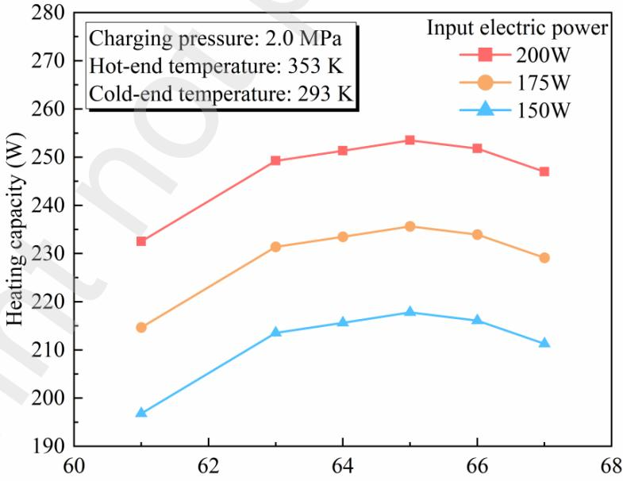\
(a) Operating frequency (Hz)\
electric powers.

## 7.3. Working characteristics of the APRPTHP

To understand the working characteristics of the APRPTHP at the optimal working conditions, the pressure wave of three chambers, axial temperature of the heat pump unit in one cycle, the pressure wave and mass flow in PT, and the pressure wave and mass flow in REG from CFD data are shown in Figure 13.

The pressure wave in the working chambers is depicted in Figure 13(a). It can be noticed that the pressure waves conform to the sine waveform. The pressure amplitude of the compressor chamber is the highest, and the pressure amplitude of the ES is the lowest. This is explained by the fact that the pressure drop is generated in the heat pump unit. Moreover, the pressure phase in the ES lags slightly behind the compressor space.

The axial temperature of the helium in the heat pump unit is shown in Figure 13(b). Based on the equilibrium position of the piston with the initial moment, the axial temperature distribution of the heat pump unit center is displayed at every quarter of one cycle. Owing to the assumption of no energy loss in the heat exchanger, a significant temperature gradient is formed in the axial direction of the REG and PT. In addition, for the PT, the highest temperature of 1/4T and 2/4T (the expansion process) is smaller than 3/4T and 4/4T (the compression process), respectively[47]. While the axial temperature of REG is consistent over a cycle.

To analyze the flow properties of the optimal working condition, the phase difference between the mass flow rate and pressure at the inlet and outlet of REG and PT is shown in the Figure 13(c)(d). It can be found that the phase of the mass flow rate takes precedence over the pressure wave at the PT inlet. While the phase of the mass flow rate lags behind the pressure wave at the PT inlet. For the inlet and outlet for the REG, the phase of the mass flow rate follows the pressure wave with a lag. From the phase analysis perspective, the phase difference between the mass flow rate and pressure wave is $0 ^ { \circ }$ at a location inside the PT. This phenomenon is different from that of the refrigerator.

In summary, it can be found that the highest helium temperature is discovered at the hot end of the PT, approaching the HHX. In addition, the phase difference between mass flow and pressure at $0 ^ { \circ }$ is located at the hot end of the PT. This conforms with the phase relationship of the APRPTHP. In the design of APRPTHP, the optimum phase for the efficiency of the APRPTHP operation is significant.

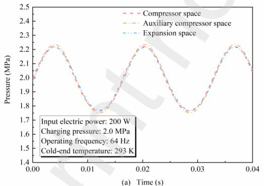

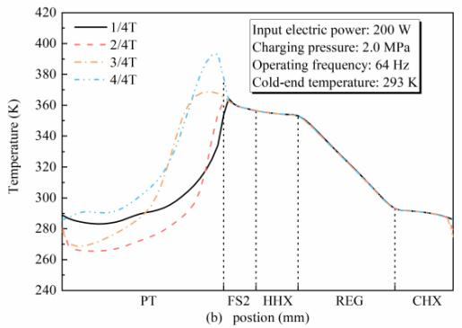

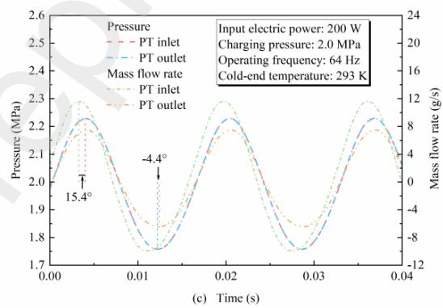

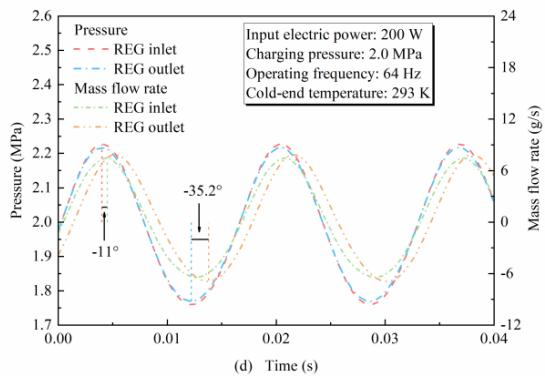

Figure. 13 (a) Pressure wave of three chambers; (b) Axial temperature of the heat pump part in one cycle; (c) Pressure wave and mass flow in PT; (d) Pressure wave and mass flow in REG.

## 7.4 Temperature distribution analysis for REG and PT

Compared to the REG of a pulse tube refrigerator, the REG length-to-diameter ratio of APRPTHP is smaller. In this paper, the REG length-to-diameter ratio is 0.86. The REG is filled with a stainless steel laminar flow screen. As a result, a direct current flow inside the REG is generated, resulting in improved axial temperature uniformity. Therefore, the helium flow condition inside the REG is indirectly determined by performing temperature measurements on the outer wall surface of the REG. The thermocouple arrangement for the REG in the experiment is shown in Figure 14. Eight thermocouples are arranged on the REG. Six of those $\mathrm { ( T _ { 1 } \sim T _ { 6 } ) }$ are uniformly distributed in the radial direction of the REG mid-section. Three of those $( \mathrm { T } _ { 1 } , \mathrm { T } _ { 7 } , \mathrm { T } _ { 8 } )$ are uniformly distributed in the axial direction of the REG.

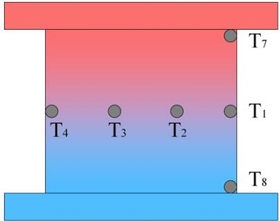\
(a)

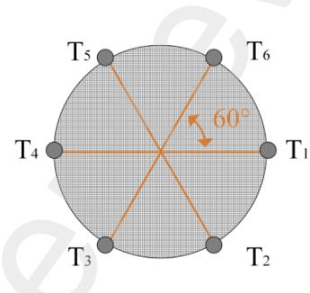\
(b)\
Figure. 14. The schematic of thermocouple arrangement for REG: vertical (a) and cross sections (b).

When the working frequency, cold-end temperature, and charging pressure are 64 Hz, 293 K, and 2.0 MPa, respectively, the axial temperature distribution in the REG for different heating temperatures and input electric power is depicted in Figure 15(a\~b). It can be found that the temperature is linear in the axial direction of the REG. The experimental phenomena are consistent with the simulation, as shown in Figure 13(b). Additionally, the effect of the heating temperature on the hot end of the REG is significant, while the influence on the cold end of the REG is slight. The temperature gradient is improved with higher heating temperatures. The temperature gradient is hardly impacted by input electric power.

The radial temperature distribution in the REG for different heating temperatures and input electric power is shown in Figure 15(c\~d). It can be discovered that the uniformity of the radial temperature distribution is slightly influenced by heating temperature and input electric power. Moreover, the temperature difference exists at different angles, and the maximum temperature difference is 5 K. The reason for this result could be that the thermocouple of $1 2 0 ^ { \circ }$ is more biased towards the cold end REG. In general, the helium flow did not appear to be significantly nonuniform within the REG.

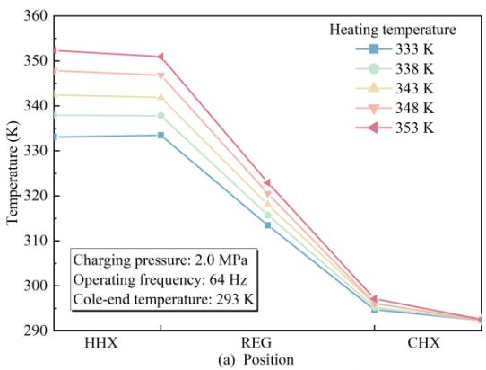

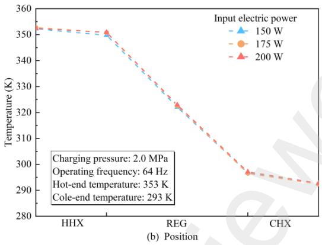

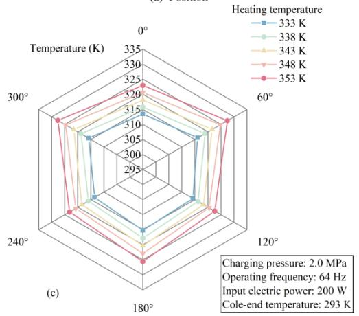

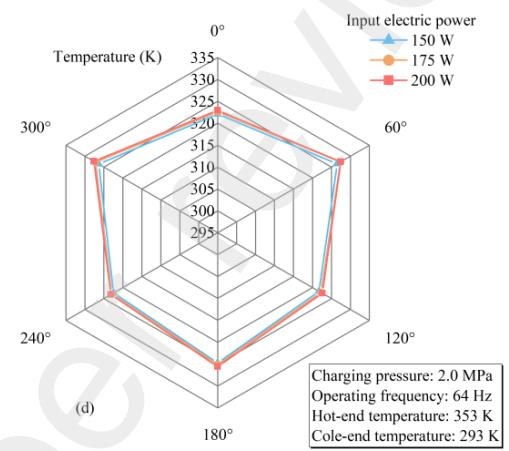\
Figure. 15. Axial temperature distribution of REG at different heating temperatures (a) and different input electric power (b); Radial temperature distribution of REG at different heating temperatures (c) and different input electric power (d)

To further understand the helium distribution inside the REG, the temperature contours inside the REG during one working cycle from CFD data are shown in Figure 16. It can be observed that the temperature gradient along the axial direction is a linear variation, and the radial temperature is evenly distributed. The simulation result is consistent with the experimental result. Moreover, the temperature distribution is slightly varied during one cycle.

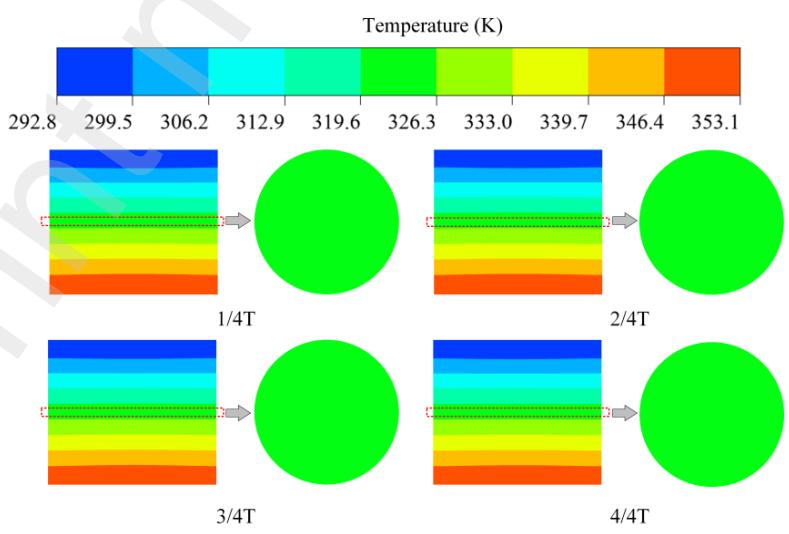\
Figure. 16. Temperature contour for REG

The PT of APRPTHP is considered part of the displacer piston and as a thermal buffer tube. High-temperature helium is prevented from entering the compressor, thereby keeping the motor at ambient temperature. During the actual operation of the heat pump, hot and cold helium mixing, turbulence, and vortices are easily present in the pulse tube. The loss of acoustic power in the PT is caused by these phenomena. Therefore, the helium flow condition inside the REG is indirectly evaluated by performing temperature measurements on the outer wall surface of the pulse tube. The thermocouple arrangement for the PT is indicated in Figure 17. Six thermocouples $\left( \mathrm { T } _ { 9 } { \sim } \mathrm { T } _ { 1 4 } \right)$ are uniformly distributed in the radial direction of the PT mid-section. While five thermocouples $( \mathrm { T } _ { 9 } ,$ $\mathrm { T _ { 1 5 } , T _ { 1 6 } , T _ { 1 7 } , T _ { 1 8 } ) }$ are uniformly distributed in the axial direction of the PT.

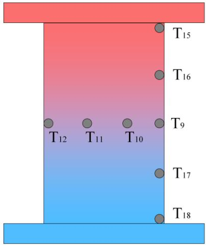\
(a)

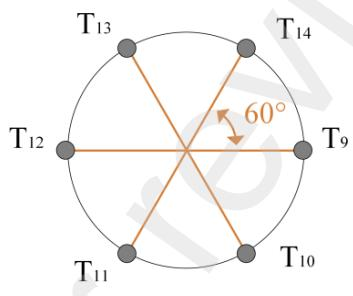\
(b)\
Figure. 17. The schematic of temperature measurement points for the pulse tube: vertical (a) and cross sections (b).

The axial temperature distribution of the PT at different heating temperatures and input electric power is illustrated in Figure $1 8 ( \mathrm { a } \mathrm { \sim } \mathrm { b } )$ . The relative position of 0 is the hot-end pulse tube, and the relative position of 1 is the cold-end of PT. The influence of the heating temperature on the hot end of the PT is significant, while the impact on the cold end of the PT is slight. The temperature gradient is improved with a higher heating temperature. The temperature gradient is hardly impacted by input electric power. Furthermore, it can be found that the temperature is a nonlinear variation in the axial direction of the pulse tube. The temperature increases and then decreases. The maximum temperature is observed at a relative position of 0.25, which is 13 mm from the hot-end temperature of the pulse tube.

The radial temperature distribution of the PT for different heating temperatures and input electric power is shown in Figure $1 8 ( \mathrm { c } \mathrm { \sim } \mathrm { d } )$ . It can be concluded that the heating temperature and input power have a slight effect on the uniformity of the radial temperature distribution. Additionally, there are temperature differences at different angles, with a maximum difference of less than 10 K. The maximum temperature is in the $3 0 0 ^ { \circ }$ direction.

<!-- 原始 PDF 第 21–30 页 -->

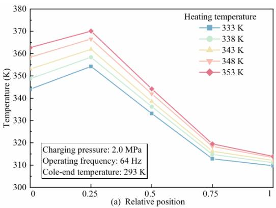

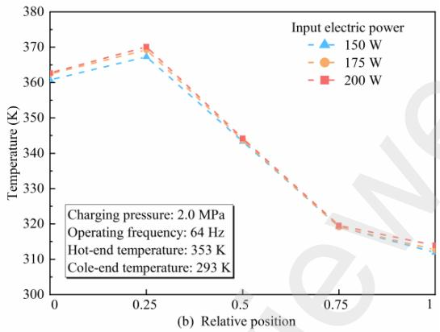

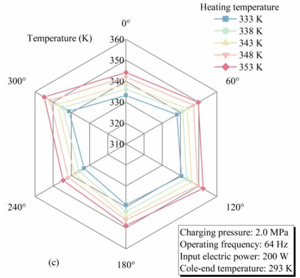

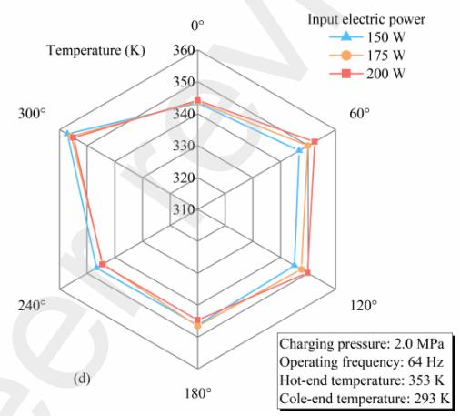\
Figure. 18. Axial temperature distribution of the pulse tube at different heating temperatures (a) and different input electric power (b); Radial temperature distribution of PT at different heating temperatures (c) and different input electric power (d).

To understand the phenomenon of the experimental data, the temperature distribution of PT from CFD data is depicted in Figure 19. The axial temperature gradient inside the PT is not uniformly distributed, while a relatively significant temperature gradient can be observed near the wall surface. Radial temperatures are significantly different at different angles, consistent with the experimental results. In addition, the highest temperature is found close to the hot-end PT. This is in agreement with the trend of the experimentally measured temperatures. The complex flow of helium inside the PT results in the mixing of hot and cold helium. This is the reason for the nonuniform distribution of temperature.

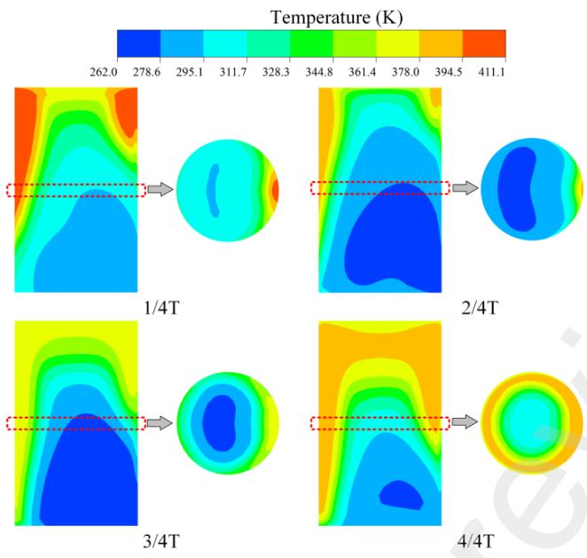\
Figure. 19. Temperature contour for PT

## 7.5. Flow characteristics of the main components

To reveal the cause of the non-uniform temperature gradient within the PT, the helium flow characteristics in the PT are investigated through CFD data. The results find that there are four flow types in the PT, as shown in Figure 20. The gas parcels inside the PT are classified into three kinds. The red gas parcel moves at the hot end, and the blue one moves at the cold end. Additionally, the yellow one is constantly considered a gas piston. The flow styles Ⅰ and Ⅱ are the common flow types. The flow style Ⅰ corresponds to the expansion process, while the flow style Ⅱ corresponds to the compressor process. At an instant of one cycle, the flow styles Ⅲ and Ⅳ are observed in PT.

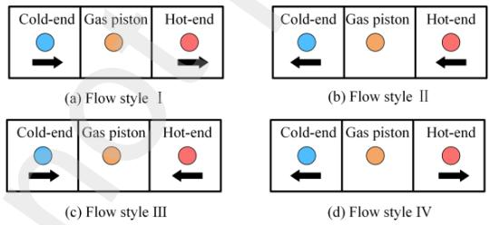\
Figure. 20 Four flow types in the PT.

The velocity contours and streamlines for the PT at a cycle are displayed in Figure 21. The process of forming the flow pattern Ⅳ is described in Figure 21(a)-(c). For Figure 21(a), there are two gas parcels at the cold end, resulting in the development of two vortices and a zero velocity interface. It is demonstrated that the velocity amplitude of the helium at the position of PT is zero. The vortices gradually expand in the radial direction from the wall to the axial in the radial direction and grow at 0.41 T, leading to the formation of pattern Ⅳ. While the vortices gradually become smaller at 0.44 T. The process of forming the flow pattern Ⅲ is depicted in Figure 21(d)-(f). For Figure 21(d), the collision is observed at both ends of PT with gas particles entering. This will lead to the formation of miniature vortices at the wall of the cold end. From Figure 21(d) to Figure 21(e), it can be found that the zero-velocity interface moves from the cold end to the hot end, owing to the oscillating flow in the PT during the process. The vortices are generated at the mid-axial of the hot end. The zero-velocity interface enhances the expansion process. Therefore, the vortices are formed in the cold of PT, increasing the energy loss. In addition, the complex helium flow in the PT results

in a non-uniformity of its temperature gradient.

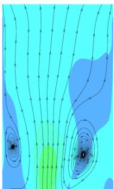\
(a) 0.38T

Velocity (m/s)\
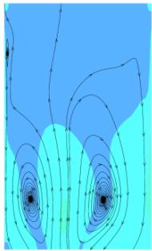\
(b) 0.41T

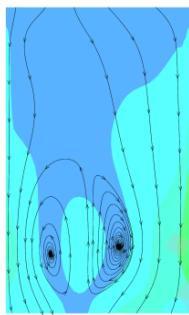\
(c) 0.44T

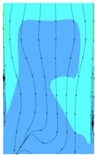\
(d) 0.91T

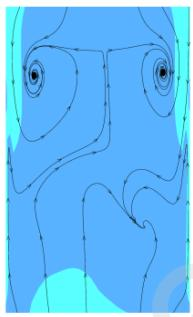\
(e) 0.94T

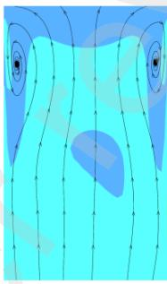\
(f) 0.97T\
Figure. 21 Velocity contour and streamlines for PT at one cycle.

To investigate the effect of working frequency on the flow pattern in the pulse tube, the flow styles Ⅲ and Ⅳ for the PT are shown in Figure 22 when the working frequency is 69 Hz. It can be noticed that the number and size of vortices are comparable at the working frequencies of 64 and 69 Hz. The zero-velocity interface appears later when the working frequency is 69 Hz. Moreover, the scale of the zero-velocity interface in PT is smaller at the working frequency of 69 Hz.

The FSs are equipped at both ends of the PT. Which are considered porous zones in Fluent, utilized to prevent the formation of vortices. However, the FSs of APRPTHP cannot completely prevent the formation of vortices. The St number is adopted to explain flow style Ⅲ and Ⅳ. The St number is calculated by equation (30).

$$
S t = f d / u\tag{30}
$$

where � is the working frequency, � is the characteristic diameter, � is the velocity of the working fluid. The St number varies with working frequency and velocity when the diameter is constant. The velocity increases with the increase in working frequency. It can be found that the influence of velocity on the St number is more significant than frequency. Therefore, the formation, evolution, and shedding of vortices can be controlled by an appropriate St number.

Velocity (m/s)\

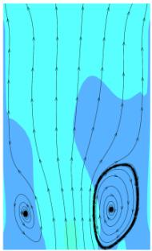\
(a) 0.44T

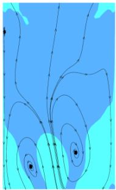\
(b) 0.47T

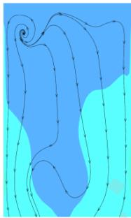\
(c) 0.5T

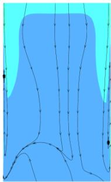\
(d) 0.94T

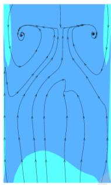\
(e) 0.97T

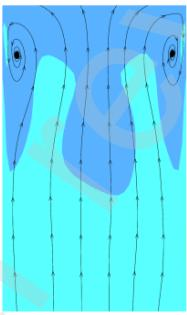\
(f) 1T\
Figure. 22 The flow style Ⅲ and Ⅳ for PT at the working frequency of 69 Hz.

Due to the oscillating flow of the helium in the APRPTHP, the helium flow style at the Tjunction zone is not identical to its flow style at the other components. Six flow styles are discovered at the T-junction structure in a cycle, as shown in Figure 23. The numbers and scales of vortices are periodically generated when helium flows through the T-junction structure. From 1/16T to 4/16T, the vortices at the acoustic power recovery tube are gradually developed and then fade away. From 5/16T to 7/16T, the vortices are produced on one side of the T-junction and become magnified. From 8/16T to 10/16T, small-scale vortices are generated at the wall and then disappear. From 11/16T to 15/16T, the vortices are generated at both places at the same time. The scale of the vortices is gradually grown, then merges into one to fill the entire tube. This situation leads to significant flow loss. Finally, the vortices disappear at the 16/16T. This phenomenon is the result of the various processes of vortices conducted by the contraction and expansion of the helium, flow detachment, velocity collisions of the helium, and cyclical variation of the flow direction. The periodic variation in flow direction is the most significant factor that leads to the change process of vortices. Therefore, a large energy loss is generated at the T-junction.

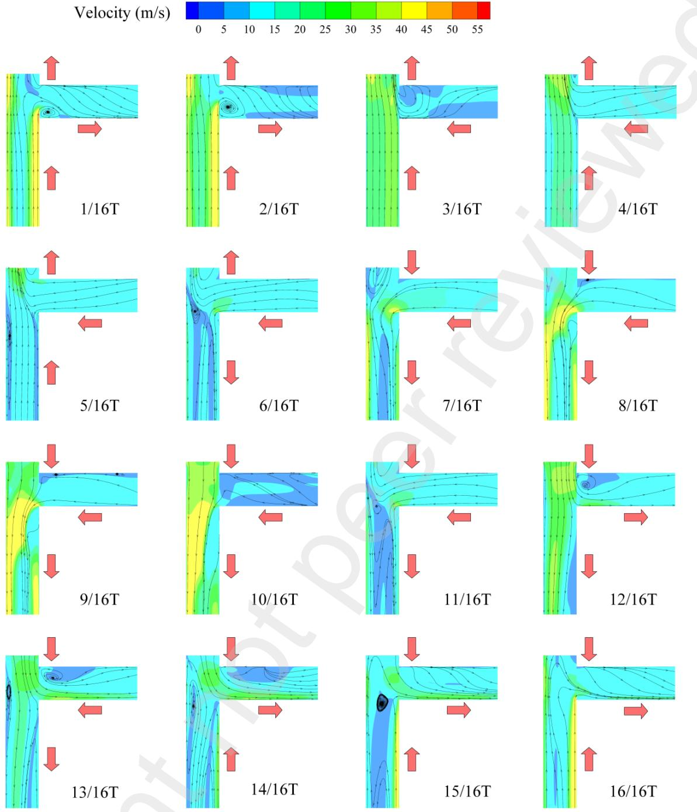\
Figure. 23 Velocity contour and streamlines for the T-junction at one cycle.

To clearly estimate the energy loss from the T-junction, the PV power loss is calculated quantitatively by equation (16). The acoustic power is recovered at the ES and transported to the ACS. Subsequently, the recovered acoustic power is transported to the heat pump part at the Tjunction. Therefore, the sum of PV power at the heat pump inlet and PV power loss at the T-junction equals the sum of PV in CS and the ACS.

$$
W _ { P V l o s s } = W _ { P V 1 } + W _ { P V 2 } - W _ { P V 3 }\tag{31}
$$

where $W _ { P V I }$ is the PV power in the compressor chamber, $W _ { P V 2 }$ is the PV power in the ACS, and $W _ { P V 3 }$ is the PV power at the heat pump inlet. The PV power loss is 12.9 W at the T-junction when the heating capacity is 251.4 W at 353 K. The PV power loss is about 12.9% of the PV power in CS. The performance of APRPTHP can be improved by optimizing the T-junction structure.

## 8. Conclusions

An efficient high heating-capacity APRPTHP working at 353 K is designed, manufactured, and studied. The impacts of hot-end temperature, cold-end temperature, and working frequency on the performance of APRPTHP are evaluated by experiment. Based on the validated threedimensional simulation, the temperature distribution and flow characteristics inside the APRPTHP are revealed. The following conclusions are drawn.

(1) The optimal working of APRPTHP is 64 Hz in the experiment. The performance of APRPTHP is improved by decreasing the working temperature. When the input electric power and working temperature are 175 W and 353 K, APRPTHP can obtain a heating capacity of 226 W, and its relative Carnot efficiency is 36.5%. The phase difference between the displacer and piston of 81.25° is measured. It is dependent on working frequency, while it is not affected by other operating conditions.

(2) The helium flow direction varies complexly at one cycle, resulting in the generation of the vortices and zero-velocity interface. When the working frequency increases, the zero-velocity interface is observed later, and the vortices are smaller. As a result, the temperature distribution inside PT is non-uniform. While the temperature distribution for the REG is a linear gradient owing to the presence of the stack wire mesh. Finally, the phase difference for mass flow and pressure wave of 0° is observed inside the PT.

(3) The helium from three directions is gathered, leading to complex variations of the flow direction. The acoustic power loss is 13.7 W when the heating capacity is 251.4 W at 353 K. The acoustic power loss is about 12.9% of the input acoustic power.

<table><tr><td>Nomenclature</td><td>Abbreviations</td></tr><tr><td>Es=specific energy of solid, J·kg-1</td><td>CHX=cold-end heat exchanger</td></tr><tr><td>F =frequency, Hz</td><td>COMP = compression chamber in the compressor</td></tr><tr><td>Kf=fluid thermal conductivity, W·m-1·K-1</td><td>COPpy=coefficient of performance</td></tr><tr><td>Keff=effective thermal conductivity, W·m-1·K-1</td><td>EXP = expansion chamber in the phase shifter</td></tr><tr><td>P = pressure magnitude, MPa</td><td>HHX=hot-end heat ex changer</td></tr><tr><td>Po = average pressure, MPa</td><td>REG=regenerator</td></tr><tr><td>ΔP= pressure amplitude, MPa</td><td>TAHP=thermoacoustic heat hump</td></tr><tr><td>S=source term for the moment equation</td><td>CT1=connecting tube 1</td></tr><tr><td>St=Strouhal</td><td>CT2=connecting tube 2</td></tr><tr><td>T= operating cycle, s</td><td>PT=pulse tube</td></tr><tr><td>Tj= fluid temperature, K</td><td>APRPTHP=acoustic power recovery pulse tube heat pump</td></tr><tr><td>Th=ambient temperature, K</td><td>CS= compression space</td></tr><tr><td>V=volume flow rate, m³·s-1</td><td>ACS=auxiliary compression space</td></tr><tr><td>V₀=volume flow amplitude, m³·s-1</td><td>ES= expansion space</td></tr><tr><td>Vd=displacer velocity, m·s-1</td><td></td></tr><tr><td>Vd0=displacer velocity amplitude, m·s-1</td><td>Greek letters</td></tr><tr><td>Vp=piston velocity, m·s-1</td><td>α= permeability, m2</td></tr><tr><td>Vpo=piston velocity amplitude, m·s-1</td><td>ε= porosity</td></tr><tr><td>We=input electric power, W</td><td>φ=phase difference between the piston and the displacer, °</td></tr><tr><td>WPv=PV power, W</td><td>ω=angular velocity, rad/s</td></tr><tr><td>WPvl= PV power in the compression space, W</td><td>θ= phase difference between pressure wave and the mass flow</td></tr></table>

<table><tr><td>Wpv2= PV power in the auxiliary compression =τ=period, s</td><td>rate, °</td></tr><tr><td>space, W Wpv3= PV power at the inlet of the heat pump</td><td></td></tr><tr><td>unit, W Wpvloss= PV power loss caused by the T- Subscripts</td><td></td></tr><tr><td>junction, W</td><td></td></tr><tr><td>Xp= displacement of Piston, mm</td><td>d=displacer</td></tr><tr><td>Xpo= displacement amplitude of piston, mm</td><td>f=fluid</td></tr><tr><td>X= displacement of displacer, mm</td><td>p=piston</td></tr><tr><td>Xd0= displacement amplitude of displacer, mm s=solid</td><td></td></tr><tr><td>λµ= viscous penetration depth, mm</td><td></td></tr><tr><td>ρf=fluid density, kg·m-³</td><td></td></tr><tr><td>ρs=solid density, kg·m-3</td><td></td></tr><tr><td>ηc= efficiency of compressor</td><td></td></tr></table>

## Credit authorship contribution statement

Shenglin Zhu: Methodology, Investigation, Validation, Data curation, Writing- Original draft preparation, Graphics drawing, Methodology, Investigation, Software. Xi Chen: Conceptualization, Methodology, Supervision, Writing- reviewing and editing, Project administration, Funding acquisition. Tian Ye: Methodology, Data curation, Investigation, Software. Yifan Zhu: Methodology, Investigation, Software. Yingxia Qi: Project administration, Funding acquisition.

## Declaration of competing interest

The authors declare that they have no known competing financial interests or personal relationships that could have appeared to influence the work reported in this paper.

## Data availability

Data will be made available on request.

## Acknowledgements

This work was supported by the National Natural Science Foundation of China (No.52376012) and the Aeronautical Science Foundation of China (20230024047001).

## References

[1] R. Ponnappan, B. Donovan, L. Chow, High-power thermal management issues in space-based systems, in: SPACE TECHNOLOGY AND APPLICATIONS INTERNATIONAL FORUM-STAIF 2002, Vol. 608, 2002, pp. 65-72.

[2] R.P. Scaringe, W. Haskin, Spacecraft heat pump thermal bus development status and technical issues, Proceedings of the 25th Intersociety Energy Conversion Engineering Conference, (1990) 130-135 vol.132. https:// doi.org/10.1109/iecec.1990.716558.

[3] Y.D. Du, L.L. Wang, Z.Y. Yu, H.Z. Zhang, Y.Z. Li, C. Yang, Multi-objective optimization of thermoeconomic and component size of supercritical carbon dioxide recompression cycle based on small-scale lead-cooled fast reactor, INTERNATIONAL JOURNAL OF ENERGY RESEARCH, 46 (2022) 13570-13589. https:// doi.org/10.1002/er.8076.

[4] S.H. Lee, I. Mudawar, M.M. Hasan, Thermal analysis of hybrid single-phase, two-phase and heat pump thermal control system (TCS) for future spacecraft, APPLIED THERMAL ENGINEERING, 100 (2016) 190-214. https:// doi.org/10.1016/j.applthermaleng.2016.01.018.

[5] K.J. Chua, S.K. Chou, W.M. Yang, Advances in heat pump systems: A review, APPLIED ENERGY, 87 (2010) 3611-3624. https:// doi.org/10.1016/j.apenergy.2010.06.014.

[6] R. Ma, Y.T. Wu, C.X. Du, X. Chen, D.L. Zhang, C.F. Ma, The performance test of a modified miniature rotary compressor in upright and inverted modes subjected to microgravity, APPLIED THERMAL ENGINEERING, 92 (2016) 81-92. https:// doi.org/10.1016/j.applthermaleng.2015.09.091.

[7] R. Ma, X.D. Ma, Y.L. Ye, Y.T. Wu, Comparison of the mixed flow and heat transfer characteristics in the evaporator of a vapor compression heat pump in normal gravity and microgravity, INTERNATIONAL JOURNAL OF HEAT AND MASS TRANSFER, 172 (2021). https:// doi.org/10.1016/j.ijheatmasstransfer.2021.121170.

[8] Z.D. Fu, J.Y. Miao, Q. Wu, H.Y. Zheng, Analytical Study on Gas-Oil Separation of a Heat Pump System under Lunar Gravity, ADVANCES IN MECHANICAL ENGINEERING, 12 (2020). https:// doi.org/10.1177/1687814020966408.

[9] G.W. Swift, Thermoacoustic engines, JOURNAL OF THE ACOUSTICAL SOCIETY OF AMERICA, 84 (1988) 1145-1180. https:// doi.org/10.1121/1.396617.

[10] S. Backhaus, G.W. Swift, A thermoacoustic Stirling heat engine, NATURE, 399 (1999) 335-338. https:// doi.org/10.1038/20624.

[11] S. Backhaus, G.W. Swift, A thermoacoustic-Stirling heat engine: Detailed study, JOURNAL OF (2000) 3148-3166. https:// doi.org/10.1121/1.429343.

[12] B. Gao, E.-c. Luo, W. Dai, Y.-y. Chen, J.-y. Hu, Experimental Study of Non-resonant Selfcirculation Heat Transfer Loop for Thermoacoustic Engines, JOURNAL OF NANJING UNIVERSITY OF SCIENCE AND TECHNOLOGY, 34 (2010) 827-832. https://

[13] C.H. Cheng, H.S. Yang, H.X. Chen, Development of a beta-type Stirling heat pump with rhombic drive mechanism by a modified non-ideal adiabatic model, INTERNATIONAL JOURNAL OF ENERGY RESEARCH, 44 (2020) 5197-5208. https:// doi.org/10.1002/er.5258.

[14] A.S. Easa, W.M. El-Maghlany, M.M. Hassan, M.T. Tolan, The performance of a gamma-type stirling water dispenser with twin wavy plate heat exchangers, CASE STUDIES IN THERMAL ENGINEERING, 39 (2022). https:// doi.org/10.1016/j.csite.2022.102464.

[15] R. Wang, J. Hu, Z. Jia, L. Zhang, E. Luo, Study on the temperature adaptability of free-piston Stirling heat pump, ENERGY CONVERSION AND MANAGEMENT, 249 (2021) 114864. https:// doi.org/https://doi.org/10.1016/j.enconman.2021.114864.

[16] R. Wang, J. Hu, Z. Jia, E. Luo, J. Xu, Y. Sun, Performance study of a free-piston Stirling heat pump with a circumferential temperature gradient in the heating heat exchanger, INTERNATIONAL JOURNAL OF REFRIGERATION, 146 (2023) 274-289. https:// doi.org/https://doi.org/10.1016/j.ijrefrig.2022.11.007.

[17] H. Tijani, S. Spoelstra, J.A. Lycklama, High temperature thermoacoustic heat pump, in: ICSV19, 2012.

[18] M.M. Bassem, Y. Ueda, A. Akisawa, Thermoacoustic Stirling Heat Pump Working as a Heater, APPLIED PHYSICS EXPRESS, 4 (2011). https:// doi.org/10.1143/APEX.4.107301.

[19] Z. Yang, Y. Zhuo, L. Ercang, Z. Yuan, Travelling-wave thermoacoustic high-temperature heat pump for industrial waste heat recovery, ENERGY, 77 (2014) 397-402. https:// doi.org/10.1016/j.energy.2014.09.023.

[20] R. Kikuchi, K. Tsuda, M.M. Bassem, Y. Ueda, Measurement of performance of thermoacoustic heat pump in a-3 to 160 °C temperature range, JAPANESE JOURNAL OF APPLIED PHYSICS, 54 (2015).

https:// doi.org/10.7567/JJAP.54.117101.

[21] M. Ben Nasr, M.M. Bassem, Y. Ueda, A. Guizani, Numerical investigation on a travelling wave thermoacoustic heat pump, JOURNAL OF THERMAL SCIENCE AND TECHNOLOGY, 13 (2018). https:// doi.org/10.1299/jtst.2018jtst0022.

[22] R. Yang, N. Blanc, G.Z. Ramon, Theoretical performance characteristics of a travelling-wave phasechange thermoacoustic heat pump, ENERGY CONVERSION AND MANAGEMENT, 254 (2022). https:// doi.org/10.1016/j.enconman.2021.115202.

[23] G. Chen, L.H. Tang, B. Mace, Z.B. Yu, Multi-physics coupling in thermoacoustic devices: A review, RENEWABLE & SUSTAINABLE ENERGY REVIEWS, 146 (2021). https:// doi.org/10.1016/j.rser.2021.111170.

[24] G. Chen, L.H. Tang, Z.B. Yu, Modeling and analysis of a dual-acoustic-driver thermoacoustic heat (2022). https:// doi.org/10.1016/j.tsep.2022.101270.

[25] S. Zhang, Z.H. Wu, R.D. Zhao, W. Dai, E.C. Luo, Numerical investigation on a thermoacoustic heat engine unit with a displacer, ENERGY CONVERSION AND MANAGEMENT, 85 (2014) 793-799. https:// doi.org/10.1016/j.enconman.2014.01.057.

[26] S.W. Zhu, Four operation modes of a pulse tube machine with a step piston compressor, ENERGY, 100 (2016) 190-198. https:// doi.org/10.1016/j.energy.2016.01.066.

[27] P. Zheng, X. Chen, Y.P. Zeng, W.D. Wu, Y.N. Wu, Effect of displacer on performance of Stirlingtype pulse tube refrigerator with work recovery, SCIENCE AND TECHNOLOGY FOR THE BUILT ENVIRONMENT, 27 (2021) 567-577. https:// doi.org/10.1080/23744731.2021.1898245.

[28] Z.R. Guo, Y.Z. Lin, S.W. Zhu, Experimental investigation of displacer rod diameter effect on pulse tube cryocooler, INTERNATIONAL JOURNAL OF REFRIGERATION, 112 (2020) 69-73. https:// doi.org/10.1016/j.ijrefrig.2019.12.023.

[29] S.W. Zhu, Z.M. Guo, Fundamental motion relation of different solid phase shifters of pulse tube cryocooler, INTERNATIONAL JOURNAL OF REFRIGERATION, 144 (2022) 231-237. https:// doi.org/10.1016/j.ijrefrig.2022.07.014.

[30] P. Zheng, X. Chen, Y. Wu, W. Duan, H. Zhang, Comparative study of four displacer phase-shifters in a split pulse tube refrigerator working at 170 K, APPLIED THERMAL ENGINEERING, 230 (2023) 120772. https:// doi.org/https://doi.org/10.1016/j.applthermaleng.2023.120772.

[31] J. Tan, H. Dang, An electrical circuit analogy model for analyses and optimizations of the Stirlingtype pulse tube cryocooler, CRYOGENICS, 71 (2015) 18-29. https:// doi.org/https://doi.org/10.1016/j.cryogenics.2015.05.004.

[32] L. Xiao, K. Luo, E. Luo, J. Xu, A Summary: Dynamic and thermodynamic analysis of thermoacoustic and Stirling systems based on time-domain acoustic-electrical analogy, APPLIED ENERGY, 347 (2023) 121377. https:// doi.org/https://doi.org/10.1016/j.apenergy.2023.121377.

[33] R.S. Wakeland, Use of electrodynamic drivers in thermoacoustic refrigerators, JOURNAL OF THE ACOUSTICAL SOCIETY OF AMERICA, 107 (2000) 827-832. https:// doi.org/10.1121/1.428265.

[34] H.J. Hui, J.T. Song, W. Yin, L. Ding, S.S. Liu, Z.H. Jiang, H.F. Zhu, Y.N. Wu, An efficient high cooling-capacity 40 K pulse tube refrigerator using an active dual-piston as phase shifter, ENERGY, 286 (2024). https:// doi.org/10.1016/j.energy.2023.129534.

[35] T. Lei, J.M. Pfotenhauer, W.J. Zhou, Analysis and comparison of different phase shifters for Stirling pulse tube cryocooler, CRYOGENICS, 80 (2016) 63-73. https:// doi.org/10.1016/j.cryogenics.2016.09.007.

[36] K. Wang, S. Dubey, F.H. Choo, F. Duan, Modelling of pulse tube refrigerators with inertance tube and mass-spring feedback mechanism, APPLIED ENERGY, 171 (2016) 172-183. https:// doi.org/10.1016/j.apenergy.2016.03.002.

[37] X.K. You, L.M. Qiu, X.Q. Zhi, C.X. Duan, X.J. Tao, J.J. Wang, Performance analysis of a linear compressor in a cryocooler, APPLIED THERMAL ENGINEERING, 141 (2018) 659-665. https:// doi.org/10.1016/j.applthermaleng.2018.06.017.

[38] R. Radebaugh, B. Louie, D.R. Smith, J. Zimmermann, A comparison of three types of pulse tube refrigerators - New methods for reaching 60 K, Springer US, (1986). https://

[39] H. Zu, W. Dai, A. de Waele, Development of dilution refrigerators-A review, CRYOGENICS, 121 (2022). https:// doi.org/10.1016/j.cryogenics.2021.103390.

[40] J.M. Pfotenhauer, J.L. Shi, G.F. Nellis, A Parametric Optimization of a Single Stage Regenerator Using REGEN 3.2, (2005). https://

[41] R. Keolian, S. Garrett, S. Garrett, Thermoacoustics: A Unifying Perspective for Some Engines and Refrigerators, Second Edition, THE JOURNAL OF THE ACOUSTICAL SOCIETY OF AMERICA, 143 4 (2018) 2110. https://

[42] Y. Zhao, H. Dang, CFD simulation of a miniature coaxial Stirling-type pulse tube cryocooler operating at 128 Hz, CRYOGENICS, 73 (2016) 53-59. https://

[43] H. Yokoyama, Y. Omori, M. Kume, M. Nishikawara, H. Yanada, Simulation of thermoacoustic heat pump effects driven by acoustic radiation in a cavity flow, INTERNATIONAL JOURNAL OF HEAT AND MASS TRANSFER, 185 (2022). https:// doi.org/10.1016/j.ijheatmasstransfer.2021.122424.

[44] Z. Guo, J.M. Pfotenhauer, F.K. Miller, S. Zhu, A research of micro-pulse tube cryocooler with displacer phase shifter, APPLIED THERMAL ENGINEERING, 205 (2022). https:// doi.org/10.1016/j.applthermaleng.2021.117995.

[45] W.H. Duan, P. Zheng, Y.K. Wu, J.R. Zhan, X. Chen, Numerical investigation of a displacer-type pulse tube refrigerator with work recovery, SCIENCE AND TECHNOLOGY FOR THE BUILT ENVIRONMENT, 28 (2022) 1341-1354. https:// doi.org/10.1080/23744731.2022.2111143.

[46] H.S. Kim, I.C. Gwak, S.H. Lee, Numerical analysis of heat transfer area effect on cooling performance in regenerator of free-piston Stirling cooler, CASE STUDIES IN THERMAL ENGINEERING, 32 (2022). https:// doi.org/10.1016/j.csite.2022.101875.

[47] Y.B. Zhao, G.R. Yu, J. Tan, X.C. Mao, J.Q. Li, R. Zha, N. Li, H.Z. Dang, CFD modeling and experimental verification of oscillating flow and heat transfer processes in the micro coaxial Stirlingtype pulse tube cryocooler operating at 90-170 Hz, CRYOGENICS, 90 (2018) 30-40. https:// doi.org/10.1016/j.cryogenics.2018.01.003.
