# University of Chinese Academy of Sciences

# 博士学位论文

# 双行波环路热驱动室温热声制冷机的理论及实验研究

作者姓名： 王慧志

指导老师：罗二仓 研究员 中国科学院理化技术研究所

张丽敏 助理研究员 中国科学院理化技术研究所

学位类别： 工学博士

学科专业： 工程热物理

培养单位：中国科学院理化技术研究所

2020年6月

Y3785495

# 博士学位论文

# 双行波环路热驱动室温热声制冷机的理论及实验研究

作者姓名： 王慧志

指导老师：罗二仓 研究员 中国科学院理化技术研究所
张丽敏 助理研究员 中国科学院理化技术研究所

学位类别：工学博士

学科专业：工程热物理

培养单位：中国科学院理化技术研究所

2020年6月

# Theoretical and experimental investigation on a double-traveling looped heat-driven thermoacoustic refrigerator for room temperature cooling

A dissertation submitted to

University of Chinese Academy of Sciences

in partial fulfillment of the requirement

for the degree of

Doctor of Philosophy

in Engineering Thermal Physics

By

Huizhi Wang

Supervisor: Prof. Ercang Luo and Dr. Limin Zhang

Technical Institute of Physics and Chemistry

Chinese Academy of Sciences

June 2020

## 中国科学院大学

## 研究生学位论文原创性声明

本人郑重声明: 所呈交的学位论文是本人在导师的指导下独立进行研究工作所取得的成果。尽我所知，除文中已经注明引用的内容外，本论文不包含任何其他个人或集体已经发表或撰写过的研究成果。对论文所涉及的研究工作做出贡献的其他个人和集体，均已在文中以明确方式标明或致谢。

作者签名：王慧志

日期：2020.6.14

## 中国科学院大学

## 学位论文授权使用声明

本人完全了解并同意遵守中国科学院有关保存和使用学位论文的规定，即中国科学院有权保留送交学位论文的副本，允许该论文被查阅，可以按照学术研究公开原则和保护知识产权的原则公布该论文的全部或部分内容，可以采用影印、缩印或其他复制手段保存、汇编本学位论文。

涉密及延迟公开的学位论文在解密或延迟期后适用本声明。

作者签名：王慧志

导师签名：罗二仓

日期：2020.6.14

日期：2020.6.15

## 摘要

热驱动热声制冷技术是一项极具发展前景的新型制冷技术，在太阳能、工业余热和尾气余热等领域具有广阔的应用空间。与双驻波型和行驻波混合型相比，双行波环路热驱动室温热声制冷机在理论和实验上均初步显示具有更高的热制冷效率和功率密度。针对不同热源温区（100℃\~500℃）的余热利用，面向不同制冷温区（0\~10℃左右的空调温区和-10℃\~-20℃左右的冷藏温区）的需求场合，本课题旨在探索一种高效紧凑的环路热驱动室温热声制冷机，应用于卡车、冷链运输车和渔船等移动设备上。本文开展了双行波环路热驱动室温热声制冷机的理论和实验研究工作，完成的主要工作包括：

(1) 直连型环路热驱动室温热声制冷机理论及实验研究。基于 Sage 软件对直连型环路热驱动室温热声制冷机进行了优化设计，考察了单元数和回热器填充材料对系统性能的影响，并开展了热力学性能研究。综合考虑热制冷效率和功率密度，回热器内填充不锈钢丝网的三单元直连型环路热驱动室温热声制冷机是最优的。回热器内的行波声场和高声学阻抗是实现高效热声转换的关键。系统烟损失的两个主要来源分别是谐振管内的粘性流动烟损失和热声发动机回热器内的非理想换热及粘性流动烟损失。基于 Solidworks 软件设计并搭建了直连型环路热驱动室温热声制冷系统实验样机，其总体装置的长、宽和高分别为 1.5 m、1.4 m 和 2.0 m，重量约为 220 kg。本文考察了平均压力、加热温度、制冷温度和抑制直流的弹性橡胶膜位置对直连型系统性能的影响。结果表明，直连型系统的起振温度约为 80℃，起振频率为 58 Hz。提升平均压力，有利于提高系统制冷量。平均压力为 10 MPa、加热温度为 300℃，制冷温度为 10℃，环境温度为 50℃，计算结果表明，系统制冷量为 6.5 kW，以加热量计算的热制冷系数为 0.43；实验结果表明，系统制冷量为 3.3 kW，热制冷系数为 0.22。实验与计算结果之间大约有 50% 的偏差，一个原因是 Sage 计算过程中未考虑换热器固体壁面与外部换热流体之间的不可逆换热损失，另一个原因是变径管和层流化丝网不足以实现平缓的流动过渡，导致热声制冷机热缓冲管内冷热气体的剧烈混合从而产生大量的冷能损失。因此，我们将抑制直流的弹性橡胶膜从热声发动机入口更换至热声制冷机出口，同时抑制环路 Gedeon 直流和热声制冷机热缓冲管内喷射驱动的射流，显著提升了系统制冷量和热制冷系数。相同的工况下，系统制冷量达到 4.0 kW，热制冷效率达到 0.28，性能提升 20% 以上。

（2）环路热驱动室温热声制冷机的能量转换和匹配机理。提出综合评价回热器性能的两个主要参数声功增益比和热声转换效率。基于对回热器声功增益比和热声转换效率的定量计算，得到影响回热器性能的五个独立变量分别是结构参数、平均压力、频率、声场和温度。固定结构参数、平均压力和频率，那么热声发动机和热声制冷机之间的声场和温度匹配对于环路热驱动室温热声制冷机是至关重要的。针对热声发动机和热声制冷机核心单元的理论研究表明：声场方面，对于工作在室温温区的热声制冷机，入口和出口的最佳p-U相位差为正值，处于“行波零点”的正侧（即压力波领先于速度波），对于工作在中低温区的热声发动机，入口和出口的最佳p-U相位差为负值，处于“行波零点”的负侧（即压力波滞后于速度波）；温度方面，如果环境温度设定为50℃，制冷温度设定为10℃，热声发动机和热声制冷机的级数比为1：1，根据热声发动机和热声制冷机声功最优匹配，热声发动机的加热温度应该设定为300℃左右。能够满足上述声场匹配和温度匹配需求的环路热驱动室温热声制冷机有三种常见的结构，分别是串连型布置（荷兰De Blok采用）、间隔型布置和直连型布置。在这三种流程中，系统均包括两个热声发动机单元和两个热声制冷机单元，并且热声发动机和热声制冷机采用相同的结构参数，不同的是热声发动机和热声制冷机之间的调相机构-谐振管的长度和直径。针对串连型、间隔型和直连型环路热驱动室温热声制冷机，本文开展了热力学性能研究并考察了关键参数如平均压力、加热温度和制冷温度对系统性能的影响规律。在相同的设计工况下（f=60Hz, $P_{0}=10MPa,T_{0}=50^{\circ}C,T_{h}=300^{\circ}C,T_{c}=10^{\circ}C$ ），通过Sage优化计算，最终得到串连型系统的整机制冷量达到3.47kW、功率密度达到168.4kW/m³、COP为0.35、相对卡诺效率为11.5%；间隔型系统的整机制冷量为2.93kW、功率密度为138.5kW/m³、COP为0.36、相对卡诺效率为11.8%；直连型结构的整机制冷量为5.13kW、功率密度为142.5kW/m³、COP为0.48、相对卡诺效率为15.5%。计算结果表明，相比串连型和间隔型，直连型环路热驱动室温热声制冷机在热制冷效率和功率密度方面更具优势。

(3) 环路热驱动室温两级热声制冷机数值模拟研究。针对 $400^{\circ} \mathrm{C}$ 左右的热源，提出并设计环路热驱动室温两级热声制冷机，该结构由三个相同的单元首尾相连组成，每个基本单元依次包括热声发动机、热声制冷机1、热声制冷机2和谐振结构，热声发动机、热声制冷机1和热声制冷机2直接相连，热声发动机产生的声功直接驱动热声制冷机1和热声制冷机2产生制冷效应，然后通过谐振管传递给下一个基本单元。计算工况设定为： $P_{0} = 10 \mathrm{MPa}, T_{0} = 50^{\circ} \mathrm{C}, T_{h} = 400^{\circ} \mathrm{C}, T_{c} = 10^{\circ} \mathrm{C}$ ; 计算结果表明：系统总制冷量达到 $14.2 \mathrm{kW}$ ，功率密度达到 $475 \mathrm{kW} / \mathrm{m}^{3}$ ，热制冷系数达到0.74，相对卡诺效率达到 $20.0\%$ 。针对环路热驱动室温两级热声制冷机，开展了热力学性能研究，并且考察结构参数和操作条件对系统性能的影响。结果表明，热声发动机、热声制冷机1和热声制冷机2的回热器均处于合理的行波声场，且实现了合理的声学阻抗。升高加热温度，同时增加热声制冷机的级数，可以增大热声制冷机消耗声功的占比，降低谐振管内的烟损失。局部增大回热器的直径、减小热缓冲管的直径可以适当提高回热器内的声学阻抗，从而进一步提升系统制冷量和热制冷效率。提升平均压力能够显著提高环路热驱动室温两级热声制冷机的制冷量，进而提升系统的功率密度。加热温度和制冷温度对系统性能的影响也是显著的，因此换热器的结构设计和换热性能对系统性能的提升是至关重要的。

关键字：热驱动室温热声制冷，热制冷效率，功率密度，余热利用，制冷量

## Abstract

Heat-driven thermoacoustic refrigeration technology, with great development prospects, is a new type of refrigeration technology, which is expected to be used in the fields of solar energy, industrial waste heat and tail gas waste heat. Compared with the double standing-wave type and the traveling-standing-wave hybrid type, the double traveling-wave looped heat-driven room temperature thermoacoustic refrigerator has initially shown higher thermal cooling efficiency and power density theoretically and experimentally. For the utilization of waste heat in different temperature range (100 °C\~500 °C) and demand of different refrigeration temperature range (air conditioning temperature around 0\~10 °C and refrigeration temperature around -10 °C\~-20 °C), this topic aims to explore an efficient and compact looped heat-driven room temperature thermoacoustic refrigerator, which is applied to mobile equipment such as trucks, cold chain transport vehicles and fishing boats. This paper has carried out the theoretical and experimental investigation on a double traveling-wave looped heat-driven room temperature thermoacoustic refrigerator. The main work includes:

(1) Theoretical and experimental investigation on a direct-coupling looped heat-driven room temperature thermoacoustic refrigerator. Based on SAGE software, the direct-coupling looped heat-driven room temperature thermoacoustic refrigerator was optimized, the influence of the number of unit and the regenerator filling material on system performance was investigated, and the thermodynamic performance analysis was carried out. Considering thermal cooling efficiency and power density, a three-unit direct-coupling looped heat-driven room temperature thermoacoustic refrigerator filled with stainless steel wire mesh in the regenerator is optimal. The traveling-wave acoustic field and high acoustic impedance in the regenerator are critical to achieve efficient thermoacoustic conversion. Two main sources of exergy loss are the viscous flow exergy loss in resonance tube and the non-ideal heat transfer and viscous flow exergy loss in regenerator of thermoacoustic engine. Based on SOLIDWORKS software, the experimental prototype of a direct-coupling looped heat-driven room temperature thermoacoustic refrigeration system was designed. The length, width and height of system are 1.5 m, 1.4 m and 2.0 m, respectively, and the weight is about 220 kg. The effects of mean pressure, heating temperature, cooling temperature and the position of elastic rubber membrane with DC suppression on performance of the direct-coupling system were investigated. The results show that onset temperature of the direct-coupling system is about 80 °C, and the frequency is 58 Hz. Increasing the mean pressure is beneficial to increase the cooling capacity of system. With the mean pressure of 10 MPa, the heating temperature of 300 °C, the cooling temperature of 10 °C, and the ambient temperature is 50 °C, the calculation results show that the total cooling capacity and thermal cooling efficiency are 6.5 kW and 0.43; the experimental results show that the total cooling capacity and thermal cooling efficiency are 3.3 kW and 0.22. There is a deviation of about 50% between the experiment and the calculation results. One reason is that the external irreversible heat transfer loss between the solid wall of heat exchanger and the external heat transfer fluid is ignored in the calculation process. The other reason is that the tapered compliance tube and the flow straightener could not realize a smooth flow transition. The severe mixing of hot and cold gases in thermal buffer tube results in large cooling capacity loss. Therefore, the author changed the position of elastic rubber membrane from the inlet of thermoacoustic engine to the outlet of thermoacoustic refrigerator, to both ameliorate the jet flow in thermal buffer tube and suppress the global DC flow in loop. It could improve significantly cooling capacity and thermal cooling efficiency of the system. Under the same operating conditions, the total cooling capacity reaches 4.0 kW, the thermal cooling efficiency reaches 0.28 and the performance is improved by more than 20%.

(2) Energy conversion and matching mechanism of the looped heat-driven room temperature thermoacoustic refrigerator. Two comprehensive evaluation parameters for the performance of regenerator were proposed, including the acoustic power gain ratio and the thermoacoustic conversion efficiency. Based on the quantitative calculation of acoustic power gain ratio and thermoacoustic conversion efficiency, five independent variables that affect the performance of regenerator were found and they are structural parameters, mean pressure, frequency, acoustic field and temperature. With the fixed structural parameters, mean pressure and frequency, the acoustic field and temperature matching between thermoacoustic engine and thermoacoustic refrigerator are crucial for the looped heat-driven room temperature thermoacoustic refrigerator. Theoretical studies show that: for the thermoacoustic refrigerator operating at room temperature, the optimal inlet and outlet p-U phase difference are both positive and on the positive side of "traveling-wave zero point" (p leading U); for the thermoacoustic engine operating at middle-low temperature, the optimal inlet and outlet p-U phase difference are both negative and on the negative side of "traveling-wave zero point" (U leading p). For the thermoacoustic refrigerator with an ambient temperature of 50 °C and a cooling temperature of 10 °C, if the stage ratio of thermoacoustic engine and thermoacoustic refrigerator is 1: 1, the heating temperature should be set to about 300 °C according to the acoustic power matching relationship. There are three common structures of looped heat-driven room temperature thermoacoustic refrigerator that can meet above requirements for acoustic field and temperature matching, which are series type (adopted by De Blok), interval type and direct-coupling type. In three configurations, the system includes two thermoacoustic engine units and two thermoacoustic refrigerator units, which use the same structural parameters. The difference is length and diameter of the resonance tube. For series, interval and direct-coupling looped heat-driven room temperature thermoacoustic refrigerators, this paper carried out thermodynamic analysis, and investigated the influence of mean pressure, heating temperature and cooling temperature on system performance. Under the same design conditions ( $f = 60 \text{ Hz}$ , $P_0 = 10 \text{ MPa}$ , $T_0 = 50 \text{ °C}$ , $T_h = 300 \text{ °C}$ , $T_c = 10 \text{ °C}$ ), the total cooling capacity, the power density, the COP and the relative Carnot efficiency of the series system are 3.47 kW, 168.4 kW/m³, 0.35 and 11.5%; the total cooling capacity, the power density, the COP and the relative Carnot efficiency of the interval system are 2.93 kW, 138.5 kW/m³, 0.36 and 11.8%; the total cooling capacity, the power density, the COP and the relative Carnot efficiency of the direct-coupling system are 5.13 kW, 142.5 kW/m³, 0.48 and 15.5%. The calculation results show that the direct-coupling looped heat-driven room temperature thermoacoustic refrigerator exhibits advantage in the thermal cooling efficiency and power density.

(3) Numerical simulation investigation on the looped heat-driven room temperature two-stage thermoacoustic refrigerator. Aiming at the heat source around 400 °C, a novel looped heat-driven room temperature two-stage thermoacoustic refrigerator is proposed and designed. The system consists of three identical units, connected end-to-end by resonance tubes to form a closed loop. A subunit includes a thermoacoustic engine, a thermoacoustic refrigerator 1, a thermoacoustic refrigerator 2 and a resonant mechanism. Of which, the thermoacoustic engine, the thermoacoustic refrigerator 1 and the thermoacoustic refrigerator 2 are directly connected. The acoustic power generated by thermoacoustic engine directly drives thermoacoustic refrigerator 1 and thermoacoustic refrigerator 2, and then transfer to the next unit through the resonant mechanism. Under the design conditions ( $P_{0} = 10 MPa, T_{0} = 50^{\circ}C, T_{h} = 400^{\circ}C, T_{c} = 10^{\circ}C$ ), the total cooling capacity, the power density, the COP and the relative Carnot efficiency of the cascade system are 14.2 kW, 475 kW/m $^{3}$ , 0.74 and

20.0%. For the cascade looped heat-driven room temperature thermoacoustic refrigerator, thermodynamic analysis was carried out and the influence of structural parameters and operating conditions on system performance was investigated. The results show that regenerators of thermoacoustic engine, thermoacoustic refrigerator 1 and thermoacoustic refrigerator 2 are controlled by traveling-wave acoustic field and reasonable acoustic impedance. Increasing the heating temperature along with the stage of thermoacoustic refrigerator can increase the proportion of acoustic power consumed thermoacoustic refrigerator and reduce the exergy loss in resonance tube. Enlarging the diameter of regenerator and reducing the diameter of heat buffer tube can appropriately increase the acoustic impedance in regenerator, and further improve cooling capacity and thermal cooling efficiency. Increasing the mean pressure can significantly increase cooling capacity and power density of the cascade looped heat-driven room temperature thermoacoustic refrigerator. The effect of heating temperature and cooling temperature on system performance is also significant, so the structural design and heat exchange performance of heat exchanger are essential to the improvement of system performance.

Keywords: Heat-driven room temperature thermoacoustic refrigeration, Thermal cooling efficiency, Power density, Waste heat utilization, Cooling capacity

## 目录

第1章 绪论....1
1.1 课题背景与研究意义....1
1.2 热声技术的研究进展....2
1.2.1 热声效应....2
1.2.2 热声发动机....3
1.2.3 热声制冷机....13
1.3 热驱动热声制冷机....15
1.3.1 热驱动低温脉冲管制冷机....15
1.3.2 热驱动室温热声制冷机....19
1.4 关键的科学问题....24
1.5 本文的主要工作....25
第2章 热声理论基础....29
2.1 经典热声理论....29
2.1.1 经典热声方程组....29
2.1.2 经典热声方程组的典型解....30
2.1.3 时均能量流....33
2.2 回热器的热力计算....34
2.2.1 回热器功热转换的评价参数....34
2.2.2 回热器热功转换的影响参数....35
2.3 模拟软件....36
2.4 本章小结....37
第3章 直连型环路热驱动室温热声制冷机理论及实验研究....39
3.1 本章引论....39

3.2 直连型环路热驱动室温热声制冷机计算分析....39
3.2.1 模型简介....39
3.2.2 单元数的选择....42
3.2.3 回热器填充材料的选择....43
3.2.4 热力学性能研究....43
3.3 实验系统设计及搭建....46
3.3.1 直连型系统机械设计....46
3.3.2 实验装置和测量系统....49
3.3.3 漏热测试....50
3.4 结果及讨论....51
3.4.1 不同平均压力下的系统性能....51
3.4.2 不同加热温度下的系统性能....53
3.4.3 冷藏温区的系统性能....56
3.4.4 抑制直流的弹性橡胶膜位置的影响....58
3.5 本章小结....61
第 4 章 环路热驱动室温热声制冷机的能量转换和匹配机理....63
4.1 本章导论....63
4.2 热声热机核心单元的理论研究....63
4.2.1 热声热机模型简介....63
4.2.2 热声发动机的理论研究....65
4.2.3 热声制冷机的理论研究....70
4.3 不同流程环路热驱动室温热声制冷机理论研究....74
4.3.1 流程简介....74
4.3.2 串连型环路热驱动室温热声制冷机....77
4.3.3 间隔型环路热驱动室温热声制冷机....86
4.3.4 直连型环路热驱动室温热声制冷机....95
4.4 本章小结....103

第5章 环路热驱动室温两级热声制冷机数值模拟研究....105
5.1 本章引论....105
5.2 模型简介....105
5.3 热力学性能研究....106
5.4 结构参数的影响....110
5.4.1 回热器填充材料的影响....110
5.4.2 回热器直径的影响....112
5.4.3 热缓冲管直径的影响....115
5.5 操作条件的影响....117
5.5.1 平均压力的影响....117
5.5.2 加热温度的影响....119
5.5.3 制冷温度的影响....121
5.6 本章小结....123
第6章 全文总结与工作展望....125
6.1 全文总结....125
6.2 主要创新点....128
6.3 今后工作展望....129
参考文献....131
致谢....139
作者简历及攻读学位期间发表的学术论文与研究成果....141

## 图目录

图 1.1 (a)Higgins 管；(b)Rijke 管；(c)Sondhauss 管；(d)Taconis 振荡……3
图 1.2 Wheatley 提出的双驻波型热声发动机……4
图 1.3 Swift 提出的双驻波热声发动机……5
图 1.4 Chen 等人设计的双驻波热声发动机……5
图 1.5 汤珂设计的双驻波热声发动机……5
图 1.6 罗二仓设计的双驻波热声发动机……6
图 1.7 采用锥形谐振管的双驻波热声发动机……6
图 1.8 邱利民设计的双驻波热声发动机……6
图 1.9 液氮冷能驱动的双驻波热声发动机……7
图 1.10 Ceperley 提出的行波相位实施方案……7
图 1.11 Backhaus 和 Swift 提出的行驻波热声发动机……8
图 1.12 罗二仓提出的行驻波混合型热声发动机……8
图 1.13 罗二仓提出的同轴型热声发动机……9
图 1.14 聚能型行驻波混合型热声发动机……9
图 1.15 邱利民设计的行驻波混合型热声发动机……9
图 1.16 Yazaki 设计的双行波环路热声发动机……10
图 1.17 Gusev 设计的双行波环路热声发动机……10
图 1.18 罗二仓提出的双行波环路热声发动机……11
图 1.19 De Block 提出的双行波环路热声发动机……11
图 1.20 气液耦合双行波环路热声发动机……12
图 1.21 声学双作用行波环路型热声发动机……12
图 1.22 金滔提出的双行波环路热声发动机（a）无空腔（b）有空腔……13
图 1.23 Gifford 提出的基本型脉管制冷机……13

图1.24 Gifford提出的可逆型脉管制冷机....13  
图1.25 三种典型的行波热声制冷机（a）小孔型（b）双向进气型（c）惯性管型....14  
图1.26 Swift提出的行波热声制冷机....15  
图1.27 Radebaugh设计的热驱动低温脉冲管制冷机....15  
图1.28 Tektronix公司研制的双驻波热驱动脉冲管制冷机....16  
图1.29 Cryenco公司研制的双驻波热驱动脉管制冷机....16  
图1.30 Swift提出的行驻波混合型热驱动脉管制冷机....16  
图1.31 胡剑英提出的液氢温区热驱动脉管制冷机....17  
图1.32 高频热驱动低温脉管制冷机....17  
图1.33 旁接型双行波环路热驱动脉管制冷机....18  
图1.34 徐静远提出的串接型双行波环路热驱动脉管制冷机....18  
图1.35 双驻波热热驱动室温热声制冷机....19  
图1.36 罗二仓提出的双环路行驻波混合型热驱动热声制冷机....20  
图1.37 同轴行驻波混合型热驱动热声制冷机....20  
图1.38 康慧芳提出的行驻波混合型热驱动热声制冷机....20  
图1.39 Shinya Hasegawa提出的双环路行驻波混合型热驱动热声制冷机....21  
图1.40 T.Yazaki提出的双行波环路热驱动热声制冷机....21  
图1.41 Shinichi Sakamoto提出的双行波环路热驱动热声制冷机....22  
图1.42 De Blok提出的双环路行波热驱动热声制冷机....23  
图1.43 De Blok提出的四单元双行波环路热驱动热声制冷机....23  
图1.44 金滔提出的双行波环路热驱动热声制冷机....23  
图1.45 De Blok提出的THEAC-25热驱动热声制冷机....24  
图3.1三单元直连型环路热驱动热声制冷机....40  
图3.2直连型环路热驱动热声制冷机的一个基本单元....40  
图3.3二单元和四单元的直连型环路热驱动室温热声制冷机....42  
图3.4直连型环路热驱动室温热声制冷机的声场分布....44

图3.5 直连型环路热驱动热声制冷机的速度分布....45  
图3.6 直连型环路热驱动热声制冷机的烟损失率分布....46  
图3.7 直连型系统总体装置示意图....47  
图3.8 直连型热声核心管段示意图....47  
图3.9 室温换热器和冷端换热器结构示意图....47  
图3.10 热端换热器结构示意图....48  
图3.11 谐振管结构示意图....48  
图3.12 实验装置：（a）直连型环路热驱动室温热声制冷机子系统（b）导热油循环子系统示意图（c）丙二醇循环子系统示意图....49  
图3.13 丙二醇循环子系统漏热测试装置....50  
图3.14 丙二醇循环子系统静态漏热拟合曲线....50  
图3.15 导热油循环子系统静态漏热拟合曲线....51  
图3.16 平均压力为 $8\mathrm{MPa}$ 和 $10\mathrm{MPa}$ 时系统总制冷量....52  
图3.17 平均压力为 $8\mathrm{MPa}$ 和 $10\mathrm{MPa}$ 时系统总加热量....52  
图3.18 平均压力为 $8\mathrm{MPa}$ 和 $10\mathrm{MPa}$ 时系统热制冷系数....53  
图3.19 平均压力为 $8\mathrm{MPa}$ 和 $10\mathrm{MPa}$ 时系统相对卡诺效率....53  
图3.20 加热温度为 $300^{\circ}\mathrm{C}$ 和 $340^{\circ}\mathrm{C}$ 时系统总制冷量....53  
图3.21 加热温度为 $300^{\circ}\mathrm{C}$ 和 $340^{\circ}\mathrm{C}$ 时系统总加热量....54  
图3.22 加热温度为 $300^{\circ}\mathrm{C}$ 和 $340^{\circ}\mathrm{C}$ 时系统热制冷系数....54  
图3.23 加热温度为 $300^{\circ}\mathrm{C}$ 和 $340^{\circ}\mathrm{C}$ 时系统相对卡诺效率....54  
图3.24 不同单元制冷机的制冷量随加热温度的变化....55  
图3.25 系统的热制冷系数和相对卡诺效率随加热温度的变化....56  
图3.26 加热温度为 $260^{\circ}\mathrm{C}$ 和 $300^{\circ}\mathrm{C}$ 时系统总制冷量....56  
图3.27 加热温度为 $260^{\circ}\mathrm{C}$ 和 $300^{\circ}\mathrm{C}$ 时系统总加热量....57  
图3.28 加热温度为 $260^{\circ}\mathrm{C}$ 和 $300^{\circ}\mathrm{C}$ 时系统热制冷系数....57  
图3.29 加热温度为 $260^{\circ}\mathrm{C}$ 和 $300^{\circ}\mathrm{C}$ 时系统相对卡诺效率....58  
图3.30 直连型环路热驱动热声制冷机改进结构....58

图3.31 橡胶膜布置在不同位置时系统总制冷量....59  
图3.32 橡胶膜布置在不同位置时系统总加热量....59  
图3.33 橡胶膜布置在不同位置时系统热制冷系数....60  
图3.34 橡胶膜布置在不同位置时系统相对卡诺效率....60  
图4.1 热声发动机和热声制冷机核心单元....64  
图4.2 不同声学阻抗和加热温度下热声发动机净输出声功的变化....66  
图4.3 不同声学阻抗和加热温度下热声发动机声功放大率的变化....66  
图4.4 不同声学阻抗和加热温度下热声发动机加热量的变化....67  
图4.5 不同声学阻抗和加热温度下热声发动机热声转换效率的变化....67  
图4.6 不同声学阻抗和加热温度下热声发动机入口 $p - U$ 相位角的变化....67  
图4.7 不同声学阻抗和加热温度下热声发动机出口 $p - U$ 相位角的变化....68  
图4.8 不同声学阻抗和加热温度下热声发动机出入口 $p - U$ 相位角差值的变化68  
图4.9 不同声学阻抗和相位条件下热声发动机加热量的变化....69  
图4.10 不同声学阻抗和相位条件下热声发动机效率的变化....69  
图4.11 不同声学阻抗和制冷温度下热声制冷机净消耗声功的变化....70  
图4.12 不同声学阻抗和制冷温度下热声制冷机声功消耗率的变化....70  
图4.13 不同声学阻抗和制冷温度下热声制冷机制冷量的变化....71  
图4.14 不同声学阻抗和制冷温度下热声制冷机制冷效率的变化....71  
图4.15 不同声学阻抗和制冷温度下热声制冷机入口 $p - U$ 相位角的变化....72  
图4.16 不同声学阻抗和制冷温度下热声制冷机出口 $p - U$ 相位角的变化....72  
图4.17 不同声学阻抗和制冷温度下热声制冷机出入口 $p - U$ 相位角差值的变化....73  
图4.18 不同声学阻抗和声学相位下热声制冷机制冷量的变化....73  
图4.19 不同声学阻抗和声学相位下热声制冷机制冷效率的变化....74  
图4.20 三种环路热驱动室温热声制冷机流程....75  
图4.21 串连型环路热驱动热声制冷机计算模型....77  
图4.22 串连型环路热驱动室温热声制冷机的声场分布....79

图4.23 串连型环路热驱动室温热声制冷机的速度分布....79  
图4.24 串连型环路热驱动室温热声制冷机的烟损失率分布....80  
图4.25 平均压力对串连型热声发动机加热量和热声转换效率的影响....81  
图4.26 平均压力对串连型热声制冷机制冷量和制冷效率的影响....81  
图4.27 平均压力对串连型系统总制冷量和热制冷系数的影响....82  
图4.28 平均压力对串连型系统烟损失率的影响....82  
图4.29 加热温度对串连型热声发动机加热量和热声转换效率的影响....83  
图4.30 加热温度对串连型热声制冷机制冷量和制冷效率的影响....83  
图4.31 加热温度对串连型系统总制冷量和热制冷系数的影响....84  
图4.32 加热温度对串连型系统烟损失率的影响....84  
图4.33 制冷温度对串连型热声发动机加热量和热声转换效率的影响....85  
图4.34 制冷温度对串连型热声制冷机制冷量和制冷效率的影响....85  
图4.35 制冷温度对串连型系统总制冷量和热制冷系数的影响....86  
图4.36 制冷温度对串连型系统烟损失率的影响....86  
图4.37 间隔型环路热驱动热声制冷机计算模型....87  
图4.38 间隔型环路热驱动室温热声制冷机的声场分布....88  
图4.39 间隔型环路热驱动室温热声制冷机的速度分布....88  
图4.40 间隔型环路热驱动室温热声制冷机的烟损失率分布....89  
图4.41 平均压力对间隔型热声发动机加热量和热声转换效率的影响....89  
图4.42 平均压力对间隔型热声制冷机制冷量和制冷效率的影响....90  
图4.43 平均压力对间隔型系统总制冷量和热制冷系数的影响....90  
图4.44 平均压力对间隔型系统烟损失率的影响....91  
图4.45 加热温度对间隔型热声发动机加热量和热声转换效率的影响....91  
图4.46 加热温度对间隔型热声制冷机制冷量和制冷效率的影响....92  
图4.47 加热温度对间隔型系统总制冷量和热制冷系数的影响....92  
图4.48 加热温度对间隔型系统烟损失率的影响....92  
图4.49 制冷温度对间隔型热声发动机加热量和热声转换效率的影响....93

图 4.50 制冷温度对间隔型热声制冷机制冷量和制冷效率的影响....93
图 4.51 制冷温度对间隔型系统总制冷量和热制冷系数的影响....94
图 4.52 制冷温度对间隔型系统烟损失的影响....94
图 4.53 直连型环路热驱动热声制冷机计算模型....95
图 4.54 直连型环路热驱动室温热声制冷机的声场分布....96
图 4.55 直连型环路热驱动室温热声制冷机的速度分布....97
图 4.56 直连型环路热驱动室温热声制冷机的烟损失率分布....97
图 4.57 平均压力对直连型热声发动机加热量和热声转换效率的影响....98
图 4.58 平均压力对直连型热声制冷机制冷量和制冷效率的影响....98
图 4.59 平均压力对直连型系统总制冷量和热制冷系数的影响....99
图 4.60 平均压力对直连型系统烟损失的影响....99
图 4.61 加热温度对直连型热声发动机加热量和热声转换效率的影响....100
图 4.62 加热温度对直连型热声制冷机制冷量和制冷效率的影响....100
图 4.63 加热温度对直连型系统总制冷量和热制冷系数的影响....100
图 4.64 加热温度对直连型系统烟损失率的影响....101
图 4.65 制冷温度对直连型热声发动机加热量和热声转换效率的影响....101
图 4.66 制冷温度对直连型热声制冷机制冷量和制冷效率的影响....102
图 4.67 制冷温度对直连型系统总制冷量和热制冷系数的影响....102
图 4.68 制冷温度对直连型系统烟损失率的影响....103
图 5.1 级连型环路热驱动室温热声制冷机....105
图 5.2 级连型环路热驱动热声制冷机的基本单元....106
图 5.3 级连型环路热驱动室温热声制冷机的声场分布....107
图 5.4 级连型环路热驱动室温热声制冷机的速度分布....108
图 5.5 级连型环路热驱动室温热声制冷机的烟损失率分布....109
图 5.6 填充材料对级连型系统热制冷系数和烟效率的影响....110
图 5.7 填充材料对级连型热声发动机加热量和热声转换效率的影响....110
图 5.8 填充材料对级连型热声制冷机制冷量的影响....111

图 5.9 填充材料对级连型热声制冷机制冷效率的影响....111
图 5.10 回热器直径对级连型系统频率和压比的影响....112
图 5.11 回热器直径对回热器 1 无量纲声学阻抗和相位的影响....112
图 5.12 回热器直径对回热器 2 无量纲声学阻抗和相位的影响....113
图 5.13 回热器直径对回热器 3 无量纲声学阻抗和相位的影响....113
图 5.14 回热器直径对级连型系统制冷量和热制冷系数的影响....114
图 5.15 回热器直径对级连型系统烟损失率的影响....114
图 5.16 热缓冲管直径对级连型系统频率和压比的影响....115
图 5.17 热缓冲管直径对回热器 1 无量纲声学阻抗和相位的影响....115
图 5.18 热缓冲管直径对回热器 2 无量纲声学阻抗和相位的影响....116
图 5.19 热缓冲管直径对回热器 3 无量纲声学阻抗和相位的影响....116
图 5.20 热缓冲管直径对级连型系统制冷量和热制冷系数的影响....117
图 5.21 热缓冲管直径对级连型系统烟损失率的影响....117
图 5.22 平均压力对级连型热声发动机加热量和热声转换效率的影响....118
图 5.23 平均压力对级连型热声制冷机制冷量和制冷效率的影响....118
图 5.24 平均压力对级连型系统总制冷量和热制冷系数的影响....118
图 5.25 平均压力对级连型系统烟损失率的影响....119
图 5.26 加热温度对级连型热声发动机加热量和热声转换效率的影响....119
图 5.27 加热温度对级连型热声制冷机制冷量和制冷效率的影响....120
图 5.28 加热温度对级连型系统总制冷量和热制冷系数的影响....120
图 5.29 加热温度对级连型系统烟损失率的影响....121
图 5.30 制冷温度对级连型热声发动机加热量和热声转换效率的影响....121
图 5.31 制冷温度对级连型热声制冷机制冷量和制冷效率的影响....122
图 5.32 制冷温度对级连型系统总制冷量和热制冷系数的影响....122
图 5.33 制冷温度对级连型系统烟损失的影响....122

## List of Figures

Figure 1.1 (a)Higgins tube; (b)Rijke tube; (c)Sondhauss tube; (d)Taconis oscillation .3
Figure 1.2 Double standing-wave thermoacoustic engine proposed by Wheatley .....4
Figure 1.3 Double standing-wave thermoacoustic engine proposed by Swift.....5
Figure 1.4 Double standing-wave thermoacoustic engine designed by Chen .....5
Figure 1.5 Double standing-wave thermoacoustic engine designed by Ke Tang .....5
Figure 1.6 Double standing-wave thermoacoustic engine designed by Ercang Luo .....6
Figure 1.7 Double standing-wave thermoacoustic engine with conical resonance tube6
Figure 1.8 Double standing-wave thermoacoustic engine designed by Limin Qiu.....6
Figure 1.9 Double standing-wave thermoacoustic engine driven by liquid nitrogen cold energy.....7
Figure 1.10 Traveling wave phase implementation scheme proposed by Ceperley's...7
Figure 1.11 Traveling-standing-wave thermoacoustic engine proposed by Backhaus and Swift.....8
Figure 1.12 Traveling-standing-wave hybrid thermoacoustic engine proposed by Ercang Luo.....8
Figure 1.13 Coaxial thermoacoustic engine proposed by Ercang Luo.....9
Figure 1.14 Energy-focused traveling-standing-wave hybrid thermoacoustic engine ..9
Figure 1.15 Traveling-standing-wave hybrid thermoacoustic engine proposed by Limin Qiu.....9
Figure 1.16 Double traveling-wave looped thermoacoustic engine proposed by Yazaki .....10
Figure 1.17 Double traveling-wave looped thermoacoustic engine proposed by Gusev .....10
Figure 1.18 Double traveling-wave looped thermoacoustic engine proposed by Ercang Luo .....11
Figure 1.19 Double traveling-wave looped thermoacoustic engine proposed by De Block.....11

Figure 1.20 Gas-liquid coupling double traveling-wave looped thermoacoustic engine ....12
Figure 1.21 Acoustic double-acting traveling-wave looped thermoacoustic engine ... 12
Figure 1.22 Double traveling-wave looped thermoacoustic engine proposed by Tao Jin (a) With no cavity (b) With a cavity....13
Figure 1.23 Basic pulse tube refrigerator proposed by Gifford....13
Figure 1.24 Reversible pulse tube refrigerator proposed by Gifford....13
Figure 1.25 Three typical traveling-wave thermoacoustic refrigerators (a) Orifice type (b) Double-inlet type (c) Inertance tube type....14
Figure 1.26 Traveling-wave thermoacoustic refrigerator proposed by Swift....15
Figure 1.27 Heat-driven cryocooler designed by Radebaugh....15
Figure 1.28 Double standing-wave heat-driven cryocooler developed by Tektronix...16
Figure 1.29 Double standing-wave heat-driven cryocooler developed by Cryenco...16
Figure 1.30 Traveling-standing-wave hybrid heat-driven cryocooler proposed by Swift ....16
Figure 1.31 Liquid hydrogen temperature heat-driven cryocooler proposed by Jianying Hu....17
Figure 1.32 High frequency heat-driven cryocooler....17
Figure 1.33 Side connection double traveling-wave looped heat-driven cryocooler .. 18
Figure 1.34 Series double traveling-wave looped heat-driven cryocooler proposed by Jingyuan Xu....18
Figure 1.35 Double-standing heat-driven room temperature thermoacoustic refrigerator ....19
Figure 1.36 Double-looped traveling-standing hybrid heat-driven thermoacoustic refrigerator proposed by Ercang Luo....20
Figure 1.37 Coaxial traveling-standing hybrid heat-driven thermoacoustic refrigerator ....20
Figure 1.38 Traveling-standing-wave hybrid heat-driven thermoacoustic refrigerator proposed by Huifang Kang....20

Figure 1.39 Double-looped traveling-standing-wave hybrid heat-driven thermoacoustic refrigerator proposed by Shinya....21
Figure 1.40 Double traveling-wave looped heat-driven thermoacoustic refrigerator proposed by T. Yazaki....21
Figure 1.41 Double traveling-wave looped heat-driven thermoacoustic refrigerator proposed by Shinichi....22
Figure 1.42 Double looped traveling-wave heat-driven thermoacoustic refrigerator proposed by De Blok....23
Figure 1.43 Four-stage double traveling-wave looped heat-driven thermoacoustic refrigerator proposed by De Blok....23
Figure 1.44 Double traveling-wave looped heat-driven thermoacoustic refrigerator proposed by Tao Jin....23
Figure 1.45 THEAC-25 heat-driven thermoacoustic refrigerator proposed by De Blok....24
Figure 3.1 The three-unit direct-coupling looped heat-driven thermoacoustic refrigerator....40
Figure 3.2 A subunit of the direct-coupling looped heat-driven thermoacoustic refrigerator....40
Figure 3.3 Two-unit and four-unit direct-coupling looped heat-driven thermoacoustic refrigerator....42
Figure 3.4 Acoustic field distribution of the direct-coupling looped heat-driven thermoacoustic refrigerator....44
Figure 3.5 Velocity distribution of the direct-coupling looped heat-driven thermoacoustic refrigerator....45
Figure 3.6 Exergy loss ratio distribution of the direct-coupling looped heat-driven thermoacoustic refrigerator....46
Figure 3.7 Schematic diagram of the overall direct-coupling system device....47
Figure 3.8 Schematic diagram of the direct-coupling thermoacoustic core....47
Figure 3.9 Schematic diagram of the ambient heat exchanger and the cold heat exchanger....47

Figure 3.10 Schematic diagram of the hot heat exchanger....48
Figure 3.11 Schematic diagram of the resonant tube....48
Figure 3.12 The experimental setup: (a) A direct-coupling looped heat-driven thermoacoustic refrigerator subsystem (b) The schematic diagram of thermal oil circulating subsystem (c) The schematic diagram of propylene glycol circulating subsystem....49
Figure 3.13 The heat leakage test device of propylene glycol circulating subsystem..50
Figure 3.14 Fitting curve of static heat leakage of propylene glycol circulating subsystem....50
Figure 3.15 Fitting curve of static heat leakage of thermal oil circulating subsystem 51
Figure 3.16 Total cooling capacity under the mean pressure of 8 MPa and 10 MPa ..52
Figure 3.17 Total heating power under the mean pressure of 8 MPa and 10 MPa....52
Figure 3.18 COP under the mean pressure of 8 MPa and 10 MPa ....53
Figure 3.19 Relative Carnot efficiency under the mean pressure of 8 MPa and 10 MPa ....53
Figure 3.20 Total cooling capacity under the heating temperature of 300 °C 和 340 °C ....53
Figure 3.21 Total heating power under the heating temperature of 300 °C 和 340 °C54
Figure 3.22 COP under the heating temperature of 300 °C 和 340 °C....54
Figure 3.23 Relative Carnot efficiency under the heating temperature of 300 °C 和 340 °C....54
Figure 3.24 Cooling capacity under the different heating temperature ....55
Figure 3.25 COP and Relative Carnot efficiency under the different heating temperature ....56
Figure 3.26 Total cooling capacity under the heating temperature of 260 °C 和 300 °C ....56
Figure 3.27 Total heating power under the heating temperature of 260 °C 和 300 °C57
Figure 3.28 COP under the heating temperature of 260 °C 和 300 °C....57
Figure 3.29 Relative Carnot efficiency under the heating temperature of 260 °C 和

300 °C ....58
Figure 3.30 Improved structure subunit of the direct-coupling heat-driven thermoacoustic refrigerator....58
Figure 3.31 Total cooling capacity of elastic membranes installed in different locations....59
Figure 3.32 Total heating power of elastic membranes installed in different locations....59
Figure 3.33 COP of elastic membranes installed in different locations....60
Figure 3.34 Relative Carnot efficiency of elastic membranes installed in different locations....60
Figure 4.1 The core schematic of a TAE and a TAR....64
Figure 4.2 The net output acoustic power for TAE under different acoustic impedance and heating temperature....66
Figure 4.3 The acoustic power amplification ratio for TAE under different acoustic impedance and heating temperature....66
Figure 4.4 The heating power for TAE under different acoustic impedance and heating temperature....67
Figure 4.5 The thermoacoustic conversion efficiency for TAE under different acoustic impedance and heating temperature....67
Figure 4.6 The inlet acoustic phase of p leading U for TAE under different acoustic impedance and heating temperature....67
Figure 4.7 The outlet acoustic phase of p leading U for TAE under different acoustic impedance and heating temperature....68
Figure 4.8 The outlet and inlet acoustic phase of p leading U difference for TAE under different acoustic impedance and heating temperature....68
Figure 4.9 The heating power for TAE under different acoustic impedance and acoustic phase....69
Figure 4.10 The thermoacoustic conversion efficiency for TAE under different acoustic impedance and acoustic phase....69
Figure 4.11 The net consumption acoustic power for TAR under different acoustic

impedance and cooling temperature ....70
Figure 4.12 The acoustic power consumption ratio for TAR under different acoustic impedance and cooling temperature ....70
Figure 4.13 The cooling power for TAR under different acoustic impedance and cooling temperature ....71
Figure 4.14 The cooling efficiency for TAR under different acoustic impedance and cooling temperature ....71
Figure 4.15 The inlet acoustic phase of p leading U for TAR under different acoustic impedance and cooling temperature ....72
Figure 4.16 The outlet acoustic phase of p leading U for TAR under different acoustic impedance and cooling temperature ....72
Figure 4.17 The outlet and inlet acoustic phase of p leading U difference for TAR under different acoustic impedance and cooling temperature ....73
Figure 4.18 The cooling power for TAR under different acoustic impedance and acoustic phase ....73
Figure 4.19 The cooling efficiency for TAR under different acoustic impedance and acoustic phase ....74
Figure 4.20 Three configuration of looped heat-driven thermoacoustic refrigerator ..75
Figure 4.21 The calculation model of series looped heat-driven thermoacoustic refrigerator ....77
Figure 4.22 Acoustic field distribution of the serial looped heat-driven thermoacoustic refrigerator ....79
Figure 4.23 Velocity distribution of the serial looped heat-driven thermoacoustic refrigerator ....79
Figure 4.24 Exergy loss ratio distribution of the serial looped heat-driven thermoacoustic refrigerator ....80
Figure 4.25 The influence of mean pressure on heating power and thermoacoustic conversion efficiency for the serial thermoacoustic engine ....81
Figure 4.26 The influence of mean pressure on cooling power and cooling efficiency for the serial thermoacoustic refrigerator ....81

Figure 4.27 The influence of mean pressure on total cooling power and COP for the serial system....82
Figure 4.28 The influence of mean pressure on exergy loss ratio for the serial system....82
Figure 4.29 The influence of heating temperature on heating power and thermoacoustic conversion efficiency for the serial thermoacoustic engine....83
Figure 4.30 The influence of heating temperature on cooling power and cooling efficiency for the serial thermoacoustic refrigerator....83
Figure 4.31 The influence of heating temperature on total cooling power and COP for the serial system....84
Figure 4.32 The influence of heating temperature on exergy loss ratio for the serial system....84
Figure 4.33 The influence of cooling temperature on heating power and thermoacoustic conversion efficiency for the serial thermoacoustic engine....85
Figure 4.34 The influence of cooling temperature on cooling power and cooling efficiency for the serial thermoacoustic refrigerator....85
Figure 4.35 The influence of cooling temperature on total cooling power and COP for the serial system....86
Figure 4.36 The influence of cooling temperature on exergy loss ratio for the serial system....86
Figure 4.37 The calculation model of interval looped heat-driven thermoacoustic refrigerator....87
Figure 4.38 Acoustic field distribution of the interval looped heat-driven thermoacoustic refrigerator....88
Figure 4.39 Velocity distribution of the interval looped heat-driven thermoacoustic refrigerator....88
Figure 4.40 Exergy loss ratio distribution of the interval looped heat-driven thermoacoustic refrigerator....89
Figure 4.41 The influence of mean pressure on heating power and thermoacoustic conversion efficiency for the interval thermoacoustic engine....89
Figure 4.42 The influence of mean pressure on cooling power and cooling efficiency

for the interval thermoacoustic refrigerator ....90
Figure 4.43 The influence of mean pressure on total cooling power and COP for the interval system ....90
Figure 4.44 The influence of mean pressure on exergy loss ratio for the interval system ....91
Figure 4.45 The influence of heating temperature on heating power and thermoacoustic conversion efficiency for the interval thermoacoustic engine ....91
Figure 4.46 The influence of heating temperature on cooling power and cooling efficiency for the interval thermoacoustic refrigerator ....92
Figure 4.47 The influence of heating temperature on total cooling power and COP for the interval system ....92
Figure 4.48 The influence of heating temperature on exergy loss ratio for the interval system ....92
Figure 4.49 The influence of cooling temperature on heating power and thermoacoustic conversion efficiency for the interval thermoacoustic engine ....93
Figure 4.50 The influence of cooling temperature on cooling power and cooling efficiency for the interval thermoacoustic refrigerator ....93
Figure 4.51 The influence of cooling temperature on total cooling power and COP for the interval system ....94
Figure 4.52 The influence of cooling temperature on exergy loss ratio for the interval system ....94
Figure 4.53 The calculation model of direct-coupling looped heat-driven thermoacoustic refrigerator ....95
Figure 4.54 Acoustic field distribution of the direct-coupling looped heat-driven thermoacoustic refrigerator ....96
Figure 4.55 Velocity distribution of the direct-coupling looped heat-driven thermoacoustic refrigerator ....97
Figure 4.56 Exergy loss ratio distribution of the direct-coupling looped heat-driven thermoacoustic refrigerator ....97
Figure 4.57 The influence of mean pressure on heating power and thermoacoustic conversion efficiency for the direct-coupling thermoacoustic engine ....98

Figure 4.58 The influence of mean pressure on cooling power and cooling efficiency for the direct-coupling thermoacoustic refrigerator....98
Figure 4.59 The influence of mean pressure on total cooling power and COP for the direct-coupling system....99
Figure 4.60 The influence of mean pressure on exergy loss ratio for the direct-coupling system....99
Figure 4.61 The influence of heating temperature on heating power and thermoacoustic conversion efficiency for the direct-coupling thermoacoustic engine....100
Figure 4.62 The influence of heating temperature on cooling power and cooling efficiency for the direct-coupling thermoacoustic refrigerator....100
Figure 4.63 The influence of heating temperature on total cooling power and COP for the direct-coupling system....100
Figure 4.64 The influence of heating temperature on exergy loss ratio for the direct-coupling system....101
Figure 4.65 The influence of cooling temperature on heating power and thermoacoustic conversion efficiency for the direct-coupling thermoacoustic engine....101
Figure 4.66 The influence of cooling temperature on cooling power and cooling efficiency for the direct-coupling thermoacoustic refrigerator....102
Figure 4.67 The influence of cooling temperature on total cooling power and COP for the direct-coupling system....102
Figure 4.68 The influence of cooling temperature on exergy loss ratio for the direct-coupling system....103
Figure 5.1 The cascade looped heat-driven thermoacoustic refrigerator operating in room temperature....105
Figure 5.2 A subunit of the cascade looped heat-driven thermoacoustic refrigerator 106
Figure 5.3 Acoustic field distribution of the cascade looped heat-driven thermoacoustic refrigerator....107
Figure 5.4 Velocity distribution of the cascade looped heat-driven thermoacoustic refrigerator....108
Figure 5.5 Exergy loss ratio distribution of the cascade looped heat-driven thermoacoustic refrigerator....109

Figure 5.6 The influence of filling material on COP and Exergy efficiency for the cascade system....110
Figure 5.7 The influence of filling material on heating power and thermoacoustic conversion efficiency for the cascade thermoacoustic engine....110
Figure 5.8 The influence of filling material on cooling power for the cascade thermoacoustic refrigerator....111
Figure 5.9 The influence of filling material on cooling efficiency for the cascade thermoacoustic refrigerator....111
Figure 5.10 The influence of diameter of regenerator on frequency and pressure ratio for the cascade system....112
Figure 5.11 The influence of diameter of regenerator on dimensionless acoustic impedance and phase for the regenerator 1....112
Figure 5.12 The influence of diameter of regenerator on dimensionless acoustic impedance and phase for the regenerator 2....113
Figure 5.13 The influence of diameter of regenerator on dimensionless acoustic impedance and phase for the regenerator 3....113
Figure 5.14 The influence of diameter of regenerator on cooling power and COP for the cascade system....114
Figure 5.15 The influence of diameter of regenerator on exergy loss ratio for the cascade system....114
Figure 5.16 The influence of diameter of thermal buffer tube on cooling frequency and pressure ratio for the cascade system....115
Figure 5.17 The influence of diameter of thermal buffer tube on dimensionless acoustic impedance and phase for the regenerator 1....115
Figure 5.18 The influence of diameter of thermal buffer tube on dimensionless acoustic impedance and phase for the regenerator 2....116
Figure 5.19 The influence of diameter of thermal buffer tube on dimensionless acoustic impedance and phase for the regenerator 3....116
Figure 5.20 The influence of diameter of thermal buffer tube on total cooling power and COP for the cascade system....117
Figure 5.21 The influence of diameter of thermal buffer tube on exergy loss ratio for

the cascade system ....117
Figure 5.22 The influence of mean pressure on heating power and thermoacoustic conversion efficiency for the cascade thermoacoustic engine....118
Figure 5.23 The influence of mean pressure on cooling power and cooling efficiency for the cascade thermoacoustic refrigerator....118
Figure 5.24 The influence of mean pressure on total cooling power and COP for the cascade system....118
Figure 5.25 The influence of mean pressure on exergy loss ratio for the cascade system....119
Figure 5.26 The influence of heating temperature on heating power and thermoacoustic conversion efficiency for the cascade thermoacoustic engine....119
Figure 5.27 The influence of heating temperature on cooling power and cooling efficiency for the cascade thermoacoustic refrigerator....120
Figure 5.28 The influence of heating temperature on total cooling power and COP for the cascade system....120
Figure 5.29 The influence of heating temperature on exergy loss ratio for the cascade system....121
Figure 5.30 The influence of cooling temperature on heating power and thermoacoustic conversion efficiency for the cascade thermoacoustic engine....121
Figure 5.31 The influence of cooling temperature on cooling power and cooling efficiency for the cascade thermoacoustic refrigerator....122
Figure 5.32 The influence of cooling temperature on total cooling power and COP for the cascade system....122
Figure 5.33 The influence of cooling temperature on exergy loss ratio for the cascade system....122

## 表目录

表 3.1 直连型环路热驱动热声制冷机结构尺寸.....40
表 3.2 不同单元直连型环路热驱动热声制冷机性能对比.....43
表 3.3 不同回热器填充材料下直连型环路热驱动热声制冷机性能对比.....43
表 4.1 热声发动机和热声制冷机核心单元各部件尺寸.....64
表 4.2 热声发动机和热声制冷机结构尺寸.....76
表 4.3 谐振机构尺寸.....76
表 4.4 串连型环路热驱动室温热声制冷机计算结果.....78
表 4.5 间隔型环路热驱动室温热声制冷机的计算结果.....87
表 4.6 直连型环路热驱动室温热声制冷机的计算结果.....95
表 5.1 级连型环路热驱动热声制冷机结构尺寸.....106

## List of Tables

Table 3.1 Main dimensions of the direct-coupling looped heat-driven thermoacoustic refrigerator .....41
Table 3.2 Performance comparison of different units direct-coupling looped heat-driven thermoacoustic refrigerator .....43
Table 3.3 Performance comparison of direct-coupling looped heat-driven thermoacoustic refrigerator with different regenerator filling materials .....43
Table 4.1 Main dimensions of thermoacoustic engine and thermoacoustic refrigerator cores .....64
Table 4.2 Main dimensions of a thermoacoustic engine and a thermoacoustic refrigerator .....76
Table 4.3 Main dimensions of resonance mechanism .....76
Table 4.4 Calculation results of series looped heat-driven thermoacoustic refrigerator .....78
Table 4.5 Calculation results of interval looped heat-driven thermoacoustic refrigerator .....87
Table 4.6 Calculation results of the direct-coupling looped heat-driven thermoacoustic refrigerator .....95
Table 5.1 Main dimensions of the cascade looped heat-driven thermoacoustic refrigerator .....106

## 第1章 绪论

## 1.1 课题背景与研究意义

随着社会的不断发展，能源短缺和环境污染日益严重。一方面，高度发达的工业产生大量有害物质（如工厂、车辆的废烟废气等）造成的雾霾和温室效应等环境污染问题日益严重。联合国最新的气候政策指出人类活动引起的全球变暖温升必须控制在2℃以下，这就要求2040年之前全球温室气体排放量减少二分之一，运输车辆温室气体排放量约占全球总量的14%，被认为是最难减排的领域之一[1]。另一方面，全球能源消耗量激增，传统化石能源短缺问题日益严峻。我国总能耗的70%以上为工业能耗，而50%以上的工业能耗都转化为了不同形式的余热，其中中低温余热数量极其庞大，占余热总量的60%以上[2]。排放的大量余热不仅降低能源利用率，还导致环境的热污染。因此，低品位热能的高效清洁利用技术成为研究热点。

热声技术是一项极具发展应用前景的新型动力与制冷技术，在太阳能发电 $^{[3-4]}$ 或制冷 $^{[5]}$ 、余热回收利用 $^{[6-7]}$ 、天然气液化 $^{[8-10]}$ 、深冷制冷 $^{[11-13]}$ 等领域具有广阔的应用空间。热声热机是一种外燃式热机，可以由外部低品位热能驱动，采用氦气等惰性气体或者氮气等环保气体工质。此外，热声热机一般由换热器、热声核心转换单元（板叠/回热器）和空管段（热缓冲管、谐振管）组成，而且无任何机械运动部件，因此具有加工成本低、可靠性高、低振动、寿命长等优点。热声热机包括热声发动机和热声制冷机，分别基于热致声和声致冷两种热声效应工作。热声发动机基于热致声效应，利用外部热能产生声波（一种机械能），一般用于驱动直线电机 $^{[14-18]}$ 、透平机械 $^{[19]}$ 、摩擦纳米发电机 $^{[20-21]}$ 等设备发电，或者用于驱动热声制冷机 $^{[22-25]}$ 实现制冷。热声制冷机基于声致冷效应，利用外部的压力波动将热量从低温端泵送到高温端，获得制冷或泵热效应。

热驱动热声制冷机的原理是利用热声发动机输出的声波直接驱动热声制冷机从而实现制冷或者泵热效应。根据回热器和谐振管内压力波动和体积流率之间的相位关系，热驱动热声制冷机可以分为双驻波型、行驻波混合型和双行波环路型。双驻波型热驱动热声制冷机的回热器和谐振管均由驻波声场控制，由于其固有的不可逆性而效率较低。行驻波混合型热驱动热声制冷机中的谐振管由驻波声场控制，较长的驻波谐振管限制了其热制冷系数和功率密度的进一步提升。双行波环路型热驱动热声制冷机的回热器和谐振管均由行波声场控制，理论和实验均已初步显示其具有更高的热制冷系数和功率密度。双行波环路热驱动热声制冷机一个重要的应用方向是液化天然气。2015年，本人所在的科研团队提出的旁接型环路热驱动脉管制冷机在 130 K 的制冷温度下获得了 1.2 kW 的制冷量，整机烟效率为 8%，相当于燃烧 30%、液化剩余 70% 的天然气 $^{[26]}$ 。2018 年，在先前研究的基础之上，本人所在的研究团队提出三个热声发动机驱动一个热声制冷机的环路热驱动脉管制冷机，最终获得 378 W 的制冷量和 10% 的烟效率，实现燃烧 15%、液化剩余 85% 的天然气，已经接近工程应用水平 $^{[27]}$ 。双行波环路热驱动热声制冷机另一个重要的应用方向是回收利用低品位热能的室温区制冷。2012 年，荷兰 De Block 首次提出行波环路热驱动热声制冷机的实验室原型样机，该样机由三个热声发动机驱动一个热声制冷机，在 -40.5 ℃ 的制冷温度下获得 95 W 的制冷量 $^{[28]}$ 。在该原型样机的基础上，Sound Energy 公司开发了一台由两单元热声发动机驱动两单元热声制冷机的工程样机模型，在 -10 ℃ 的制冷温度和 220 ℃ 的加热温度下，实现了 0.18 的热制冷系数和 18 kW 的总制冷量 $^{[29]}$ 。尽管研究人员已经提出不同结构的双行波环路热驱动室温热声制冷机，但仍缺乏对其工作机理的理论研究。

本课题针对中低品位热能的利用，旨在探索一种高效、紧凑的双行波环路热驱动室温热声制冷机，适合作为空调或冰箱在卡车、冷链运输车、渔船等移动设备上应用，能有效利用余热制冷从而实现节能减排。本课题的研究成果将揭示热声发动机的热功转换和热声制冷机的声致冷之间的耦合机理，阐明系统各部件的损失机理及各关键参数对系统性能的影响规律，为探索利用低品位热源直接获得室温温区的冷量提供新的技术方案和理论实验研究基础。同时，本研究也将推动热驱动热声制冷机的工程化进展，特别是在室温制冷领域，为提高能源利用效率和环境保护做出贡献，具有重要的学术意义和实用价值。

## 1.2 热声技术的研究进展

## 1.2.1 热声效应

热声效应的定义为可压缩流体往复振荡过程中和固体介质之间由于热的相互作用而产生的时均能量效应 $^{[30]}$ 。根据能量转换的方向，热声效应可分为利用热能产生声能的热致声效应和利用声能逆温度梯度泵送热量的声致冷效应 $^{[31]}$ 。热致声效应通常发生在各类热声发动机内部，而声致冷效应通常发生在各类热声制冷机内部。上述提到的可压缩流体通常具有四个典型特点：第一具有可压缩性；第二热膨胀系数较大；第三普朗特数较小；第四具有较高的温度梯度。热声现象在我们的生活中广泛存在，例如我们正常的说话声音可以引起周围环境 $10^{-4}$ ℃的温度变化 $^{[32]}$ 。

## 1.2.1.1 热致声效应

在两种热声效应中，热致声效应更容易被观察到。1777年，Byron Higgins首次发现了“歌焰”现象[33]。他将氢气火焰放入竖直放置、两端开口的玻璃管的合适位置时，玻璃管可以激发出声音，如图1.1（a）所示。为了纪念Byron Higgins，这种“歌焰”现象被定义为“Higgins管”作用。为了深入研究和定性分析上述现象，Rijke通过加热的丝网取代燃烧的火焰，同样放在竖直放置和两端开口的玻璃管的下部，观察到玻璃管具有类似的强烈声振荡[34-36]（如图1.1（b）所示）。这种“Rijke”管在航天领域[37]以及脉动燃烧[38]中被广泛应用，至今仍被大量研究，同时也被广泛应用于教学实验。Sondhauss针对一端封闭另一端开口、在封闭端加热的玻璃管开展了相关研究[39]，如图1.1(c)所示。低温领域著名的“Taconis振荡”与上述Sondhauss管的原理类似。Taconis等人将一端封闭另一端开口的管子的开口端深入到液氦中搅拌，能听到声音[40]，如图1.1(d)所示。随后，Taconis对这种现象做了定性解释，发现这种“Taconis振荡”经常发生在液氦与室温环境之间的管道中，使得大量热量进入液氦，造成冷量损失。由于当时液氦温区获得的不易，如何解释及避免这种现象非常重要，这一需要也直接促成了线性热声理论的发展[41-42]。

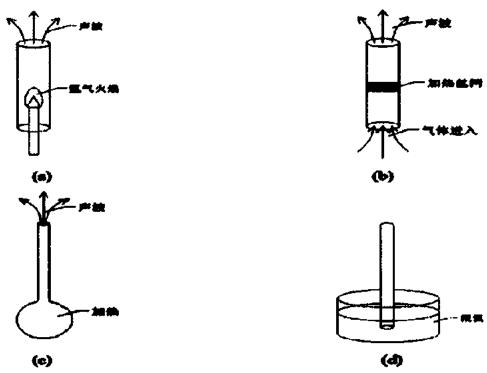  
图 1.1 (a) Higgins 管；(b) Rijke 管；(c) Sondhauss 管；(d) Taconis 振荡  
Figure 1.1 (a) Higgins tube; (b) Rijke tube; (c) Sondhauss tube; (d) Taconis oscillation

## 1.2.1.2 声制冷效应

声制冷效应的发现较晚。根据现代热声学的说法，Gifford等人首次提出并成功研制出基本型脉冲管制冷机，但其声学特征并不显著，后来意识到它是基于驻波型声致冷效应工作的[43]。1975年，Merkli等人发现驻波管中的热声泵热效应并做了系统研究，他们在一端封闭的驻波谐振管的开口端通过往复运动的活塞激励，发现驻波谐振管两端的温度升高、中间区域的温度下降，标志着首次明显的声致冷现象的发现[44]。

## 1.2.2 热声发动机

热声效应刚发现时强度很弱，无法实现工程应用。Carter 通过板叠强化热声效应，实现了第一台真正意义上的驻波型热声发动机，这也是人们有目的地通过热声效应来实现动力循环的开始[45-46]。热声发动机主要包括热声转换核心（板叠或回热器）、换热器和谐振管等部件。其中，热声转换核心和谐振管是热声发动机最为关键的两个部件。前者是热声发动机实现热致声效应的唯一部件，其声场对热声效率至关重要；后者起到调节热声发动机频率和传递声能的作用，其内部声场对声功的损失和热声发动机的功率密度至关重要。根据热声转换核心及谐振管内压力波动和体积流率之间的相位关系，热声发动机通常被分为双驻波型、行驻波混合型和双行波环路型三种类型。

## 1.2.2.1 双驻波型热声发动机

双驻波型热声发动机的典型特点是，板叠和谐振管内部均由驻波声场控制。1962年，美国的Carter等人提出并设计首台双驻波型热声发动机[45]。基于这一结构，Feldman开展了相关的实验研究，并且在发动机输入热量为 $600\mathrm{W}$ 时，获得 $27\mathrm{W}$ 的声功，显著提高了热声发动机的效率，也将热声研究推进到实用化探索阶段[46]。1985年，美国LosAlamos国家实验室的Wheatley等人设计了一台双驻波型热声发动机，并且针对该发动机的热力循环和热声转换过程进行了微观定性分析[47]。研究表明，在双驻波型热声发动机板叠内，构建的是不可逆热力循环。为了进一步提高效率和功率密度，Swift和Migliori等人采用液态金属（钾和钠）作为双驻波热声发动机的工质，进行了相关的理论和实验研究[48-50]。

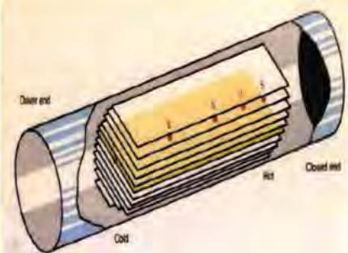  
图 1.2 Wheatley 提出的双驻波型热声发动机  
Figure 1.2 Double standing-wave thermoacoustic engine proposed by Wheatley

1992 年，Swift 等人设计并建造了一台高功率和高效率的双驻波型热声发动机 $^{[51]}$ ，如图 1.3 所示。结构方面，驻波热声发动机的板叠直径为 0.128 m，总长为 4.32 m。谐振管末端采用针阀气库调相。系统填充 1.38 MPa 的氦气，以 9% 的热声转换效率和 13% 的相对卡诺效率获得 630 W 的净输出声功。Swift 等人采用经典热声理论对该结构进行了模拟计算，并且通过实验精确测量了系统的加热功率、板叠的温度分布、发动机关键节点的压力波动等参数。计算和实验结果表明，在小压力振幅下，基于经典热声理论的计算值和实验值吻合较好，但是在大压力振幅下，计算值和实验值之间偏差较大。为了更好的测量和考察热声系统的声学特性，Mississippi大学也建造了一台双驻波热声发动机[52]。最终，他们采用计算和实验对比的方法分析了双驻波型热声发动机声学阻抗的影响因素。

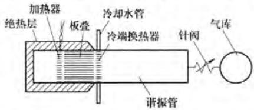  
图 1.3 Swift 提出的双驻波热声发动机  
Figure 1.3 Double standing-wave thermoacoustic engine proposed by Swift

1995年，Olson等人基于经典热声软件DeltaEC设计了一台左右对称的双驻波型热声发动机，并且考察了负载阻抗对双驻波热声发动机输出声功和效率的影响，尽管实验过程中，他们测量了加热器的加热量和加热温度，但无法测量阻抗[53]。1998年，Chen和Garrett等人也搭建了另一台双驻波型热声发动机演示装置[3]，如图1.4所示。该演示装置采用太阳能加热，最终测得120分贝的声场强度，证明热声技术在利用太阳能领域具有极大的应用潜力。

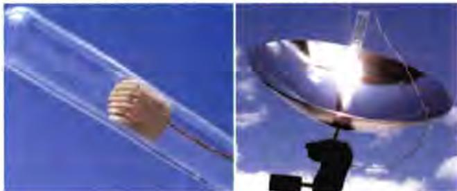  
图 1.4 Chen 等人设计的双驻波热声发动机

Figure 1.4 Double standing-wave thermoacoustic engine designed by Chen  
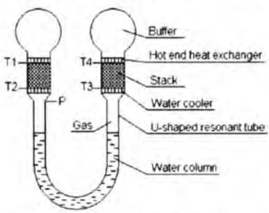  
图 1.5 汤珂设计的双驻波热声发动机  
Figure 1.5 Double standing-wave thermoacoustic engine designed by Ke Tang

1996 年，浙江大学的陈国邦研究团队设计并建造了国内第一台对称型双驻波热声发动机 $^{[54-56]}$ 。该双驻波热声发动机的板叠采用铜丝网，工质采用氦气和氮气时，频率分别为 70Hz 和 25 Hz，相应的压比分别 1.06 和 1.12。该团队还研究了加热温度和谐振管长度等参数对系统性能的影响，发现系统起振和消振过程中的“滞后回路”。在此对称型双驻波热声发动机的基础之上，浙江大学汤珂等人将 U 型谐振管内气体工质替换为水柱，显著提升系统压比，降低谐振频率，系统示意图如图 1.5 所示 $^{[57]}$ 。

2003年，罗二仓和戴巍等人设计并建造一台双驻波型热声发动机，如图1.6所示。为了提升加热器的气固换热效率，他们不断改进加热器结构，提升了双驻波热声发动机的压比[58]。该研究团队采用圆锥形谐振管抑制双驻波热声发动机中的高阶谐波分量，系统压比和输出声功均显著提升，系统示意图如图1.7所示[59]。

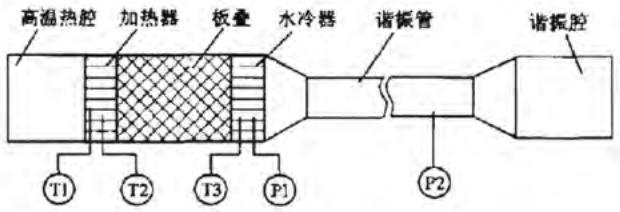  
图 1.6 罗二仓设计的双驻波热声发动机

Figure 1.6 Double standing-wave thermoacoustic engine designed by Ercang Luo  
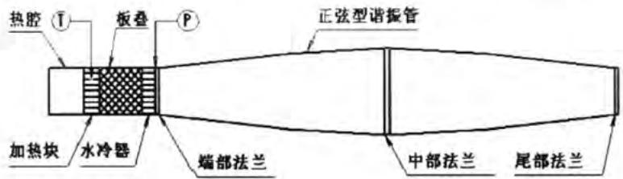  
图 1.7 采用锥形谐振管的双驻波热声发动机

Figure 1.7 Double standing-wave thermoacoustic engine with conical resonance tube  
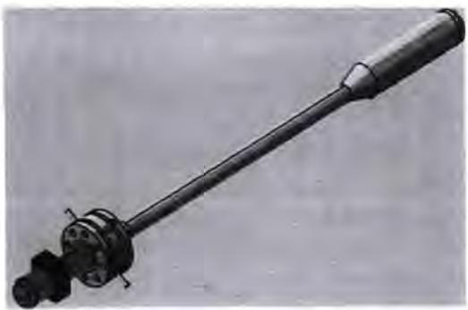  
图 1.8 邱利民设计的双驻波热声发动机  
Figure 1.8 Double standing-wave thermoacoustic engine designed by Limin Qiu

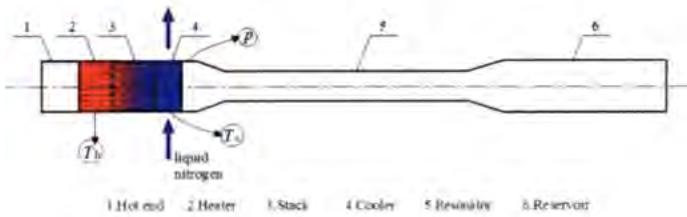  
图 1.9 液氮冷能驱动的双驻波热声发动机  
Figure 1.9 Double standing-wave thermoacoustic engine driven by liquid nitrogen cold

2010年，浙江大学邱利民等人设计并搭建一台双驻波热声发动机，如图1.8所示[60-61]。针对该双驻波热声发动机，该团队开展了热力学分析，并研究了起振机理，最终提出双驻波热声发动机起振温度和工作频率的计算方法。2012年，他们提出一种利用液氮冷能驱动的双驻波热声发动机，如图1.9所示。系统填充0.5MPa的氮气，获得1.21的压比[62-63]。

此外，华中科技大学张晓青[64]、西安交通大学何雅玲[65-66]、上海交通大学郝熙欢[67]以及中南大学的张明研[68]等研究团队也针对双驻波热声发动机开展了相关的理论和实验研究。

## 1.2.2.2 行驻波混合型热声发动机

行驻波混合型热声发动机的典型特点是回热器及谐振管分别由行波声场和驻波声场控制。1979年，Peter Ceperley等人提出行波概念，指出行波热声发动机回热器内部的气体微团经历的热力循环与传统的斯特林循环类似[69]。Ceperley提出通过环路管道实现热声发动机行波相位的构想，实施方案如图1.10所示。由于对行波热声发动机的调相机理缺少认识，该方案最终获得的声功很小。

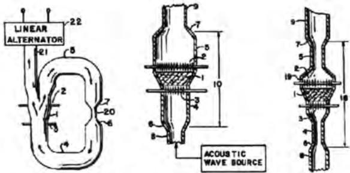  
图 1.10 Ceperley 提出的行波相位实施方案  
Figure 1.10 Traveling wave phase implementation scheme proposed by Ceperley's

1999 年，Backhaus 和 Swift 等人设计并建造一台行驻波混合型热声发动机，如图 1.11 所示。热声发动机回热器和谐振管分别由行波和驻波声场控制。在驻波谐振管的速度节点引入热声发动机环路，可以降低往复振荡流体的速度波动幅值，减小回热器中的流动损失。实验结果表明，热声发动机最终以 $30\%$ 的热声转换效率获得了 $710\mathrm{W}$ 的声功，该效率可以与传统内燃机或汽油机的热效率相媲美[70-71]。

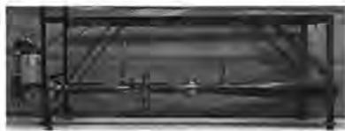  
(a)发动机实物图

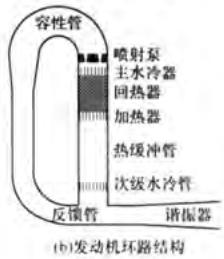  
图 1.11 Backhaus 和 Swift 提出的行驻波热声发动机

Figure 1.11 Traveling-standing-wave thermoacoustic engine proposed by Backhaus and  
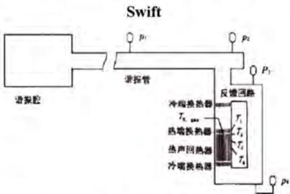  
图 1.12 罗二仓提出的行驻波混合型热声发动机  
Figure 1.12 Traveling-standing-wave hybrid thermoacoustic engine proposed by Ercang Luo

1999 年 9 月，罗二仓提出并建造国内首台行驻波混合型热声发动机（当时 Backhaus 和 Swift 提出的方案尚未公布），如图 1.12 所示。由于对驻波谐振管缺少精确的设计，最终系统在 600 °C 的热源温度下仅获得 60 W 的声功输出 $^{[72-73]}$ 。2002 年，罗二仓等人设计另一台结构更加紧凑的同轴型行驻波混合型热声发动机，系统的起振温度仅有 105 °C，如图 1.13 所示 $^{[74]}$ 。2004 年，罗二仓等人从变径管“共振强声”获得启发，提出聚能型行驻波混合型热声发动机，如图 1.14 所示。通过锥形管取代等径的直径管，有效抑制热声系统中的高阶谐波分量，提高系统压比。实验结果表明，工质采用氦气，在 1.52 MPa 的平均压力和 670 °C 的加热温度下，系统压比达到 1.3 $^{[75-76]}$ 。随后，该研究团队基于 CFD 仿真，对锥形谐振管的尺寸进行优化改进，在同样的操作压力下，将最大压比提升至 1.4 $^{[77]}$ 。

在聚能型热声发动机与负载之间采用声压放大器进行耦合，压比被进一步提升至1.47 $^{[78]}$ 。2010年，罗二仓研究团队重新优化设计一台新的千瓦级聚能型行驻波混合型热声发动机，净输出声功为1.13 kW，热声转换效率为25.4% $^{[14]}$ 。

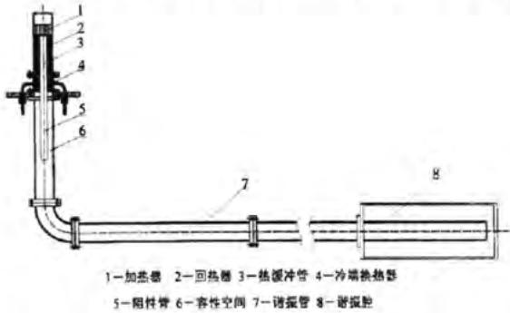  
图 1.13 罗二仓提出的同轴型热声发动机

Figure 1.13 Coaxial thermoacoustic engine proposed by Ercang Luo  
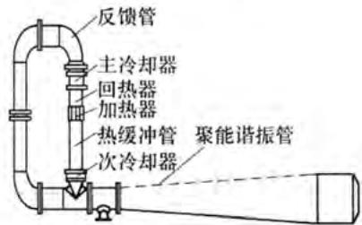  
图 1.14 聚能型行驻波混合型热声发动机

Figure 1.14 Energy-focused traveling-standing-wave hybrid thermoacoustic engine  
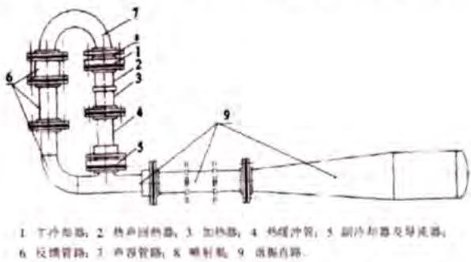  
图 1.15 邱利民设计的行驻波混合型热声发动机  
Figure 1.15 Traveling-standing-wave hybrid thermoacoustic engine proposed by Limin Qiu

2005 年，邱利民等人设计一台行驻波混合型热声发动机，如图 1.15 所示。采用氮气和氦气，压比分别达到 1.21 和 1.19 $^{[79-80]}$ 。为了完全抑制环路中的直流，他们用弹性膜片取代喷射泵，压比提升至 1.3 $^{[81]}$ 。为了提输出声功，他们还提出多路声功输出法 $^{[82]}$ 。2009\~2011 年，邱利民等人针对不同热源的行驻波混合型热声发动机开展了理论和实验研究[83-85]。2012年，荷兰Tijani等人设计并建造一台行驻波混合型热声发动机，最终获得 $280\mathrm{W}$ 的声功，热声转换效率为 $32\%$ ，该结果是已报道的行驻波混合型热声发动机的最高效率[86]。

## 1.2.2.3 双行波环路热声发动机

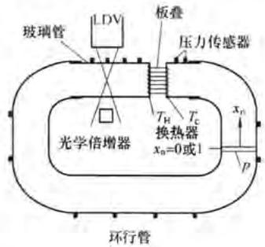  
图 1.16 Yazaki 设计的双行波环路热声发动机

Figure 1.16 Double traveling-wave looped thermoacoustic engine proposed by Yazaki  
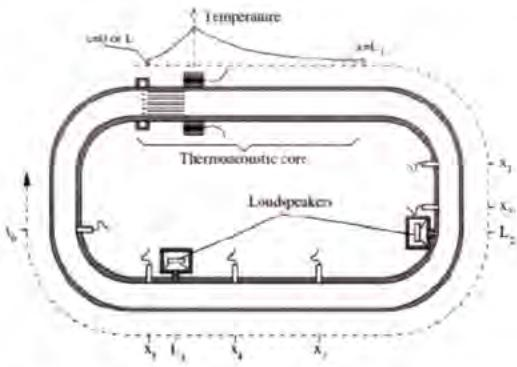  
图 1.17 Gusev 设计的双行波环路热声发动机  
Figure 1.17 Double traveling-wave looped thermoacoustic engine proposed by Gusev

双行波环路热声发动机的回热器和谐振管均由行波声场控制。基于 Ceperley 提出的行波概念，日本 Yazaki 等人建造首台双行波环路热声发动机 $^{[87]}$ ，如图 1.16 所示。基于这台实验装置对比驻波热声发动机和行波热声发动机的换热特性，发现行波热声发动机能实现更理想的气固换热。针对行波环路热声发动机，Gusev 研究团队也开展了大量的理论和实验研究，考察声直流对系统性能的影响，实验装置如图 1.17 所示 $^{[88-89]}$ 。

2007 年，罗二仓等人首次提出在一个环路中布置多个行波热声发动机的设想，如图 1.18 所示。如果将 N 个行波热声发动机依次通过 N 个谐振管连接成一个回路，局部增大热声热机的横截面积，合理设计谐振管的直径，可以实现回热器内的行波相位和高声学阻抗。行波环路被划分为 N 个相同的单元，每个单元的压力波动和体积流率相位变化为 $360^{\circ}/N$ 。谐振管内的气体扮演膨胀活塞和压缩活塞两个角色。因此，双行波环路热声发动机也被称为双作用行波热声发动机。双行波环路热声发动机具有两个突出优点。第一功率密度高，前两种结构中驻波谐振管的直径通常为几百毫米级，而第三种行波环路热声发动机的行波谐振管的直径仅为几十毫米级，缩小一个数量级。第二热声转换效率高，回热器和谐振管均处于行波声场，因此回热器内的热声转换效率和谐振管的声功传递效率均较高，本级谐振管出口的声功可以传递到下一级热声发动机进行再次放大，实现了声功的回收利用。当时受限于计算条件，并未成功通过实验证明此概念的可行性。

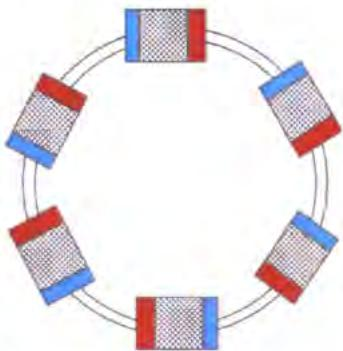  
图 1.18 罗二仓提出的双行波环路热声发动机

Figure 1.18 Double traveling-wave looped thermoacoustic engine proposed by Ercang Luo  
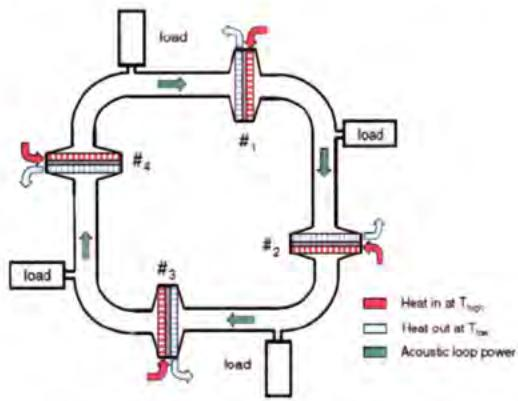  
图 1.19 De Block 提出的双行波环路热声发动机  
Figure 1.19 Double traveling-wave looped thermoacoustic engine proposed by De Block

2010 年，荷兰 Aster 公司的 De Block 团队针对低品位能源的利用，提出并设计四级行波环路热声发动机，如图 1.19 所示 $^{[90]}$ 。工质采用氩气和氦气，系统起振温度分别为 $26^{\circ}C$ 和 $42^{\circ}C$ ，该结果显示出热声热机在低品位热能利用领域具有巨大的应用潜力。针对 De Block 提出的多级行波环路热声发动机，张晓青等人开展了理论分析，探究了其声场特性 $^{[91]}$ 。

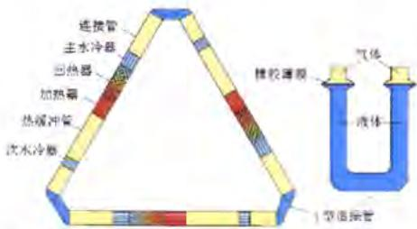  
图 1.20 气液耦合双行波环路热声发动机  
Figure 1.20 Gas-liquid coupling double traveling-wave looped thermoacoustic engine

2012 年，罗二仓等人提出一种气液耦合的行波环路热声发动机，如图 1.20 所示。通过 U 型谐振管将三台热声发动机连成环路，U 型谐振管内充注一定质量的水，发动机内部充满气体，三个单元通过三相平衡阀维持压力的平衡。该结构利用水的高密度质量惯性和气体工质的可压缩性形成气液耦合振荡，降低系统频率，提高谐振管的调相效率。气液界面之间采用橡胶膜密封，不仅可以防止液体飞溅到热声发动机内部影响系统的稳定性，同时可以抑制环路的声直流。采用氦气为工质，在 1.5 MPa 的平均压力下，系统压比达到 1.45 $^{[92-93]}$ 。气液耦合行波环路热声发动机具有压比大和功率密度高等优点，但是由于液柱的振动幅值较大，橡胶膜易破，系统不稳定。2014 年，该团队建造一台声学双作用行波环路热声发动机，如图 1.21 所示。系统包括三个相同的基本单元，每个基本单元包括一台行波热声发动机和一根细长的谐振管，工作频率主要由谐振管的长度控制。为了最大限度地提升系统性能，行波热声发动机包含了直流抑制原件、热缓冲管以及次室温换热器 $^{[94]}$ 。

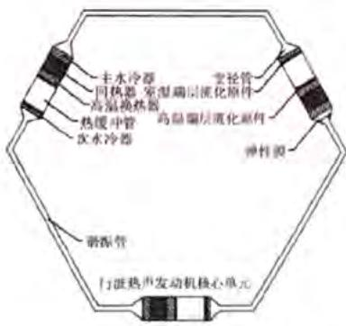  
图 1.21 声学双作用行波环路型热声发动机  
Figure 1.21 Acoustic double-acting traveling-wave looped thermoacoustic engine

2017 年，金滔等人针对双行波环路热声发动机开展一系列研究，考察了系统起振和消振过程中的压力、温度和声场分布特性，以及环路直流对系统性能的影响，如图 1.22 所示。实验结果表明谐振管某一位置引入阻性管或者空腔可以降低热声发动机的起振温度，系统最低起振温差仅为 $17^{\circ}C^{[95-96]}$ 。

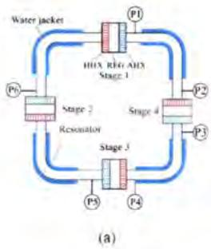

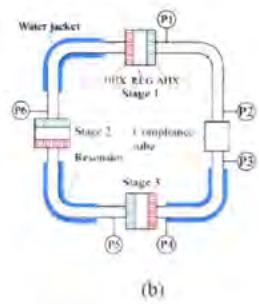  
图 1.22 金滔提出的双行波环路热声发动机（a）无空腔（b）有空腔  
Figure 1.22 Double traveling-wave looped thermoacoustic engine proposed by Tao Jin (a)
With no cavity (b) With a cavity

此外，英国格拉斯哥大学的禹志斌[97]、日本东海大学的Hasegawa[98]等人也针对热声发动机做了大量的工作。

## 1.2.3 热声制冷机

根据热声制冷机板叠或回热器内的声场特性, 热声制冷机通常分为驻波型和行波型。

## 1.2.3.1 驻波热声制冷机

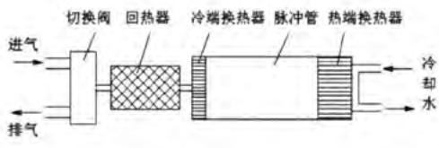  
图 1.23 Gifford 提出的基本型脉管制冷机  
Figure 1.23 Basic pulse tube refrigerator proposed by Gifford  
压缩机 回热器 冷端换热器 脉冲管 热端换热器

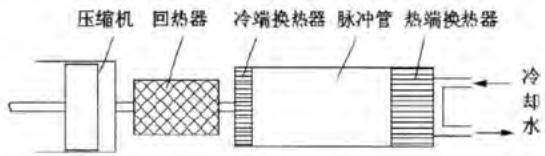  
图 1.24 Gifford 提出的可逆型脉管制冷机  
Figure 1.24 Reversible pulse tube refrigerator proposed by Gifford

驻波热声制冷机的典型特点是热缓冲管（脉冲管）的室温侧没有连接调相机构。1963年，Gifford等人首次提出基本型脉管制冷机[43]，依次包括高低压切换阀、回热器、冷端换热器、热缓冲管（脉冲管）、热端（室温端）换热器等，如图

1.23 所示。这种基本型脉管制冷机的工作频率为 0.67 Hz，高低压气体的平均压力分别为 2.38 MPa 和 0.56 MPa 时，获得 124 K 的制冷温度。基本型脉管制冷机采用阀门切换高低压气流，切换阀的节流损失对制冷效率影响较大。为了减小节流损失，Gifford 等人提出无阀压缩机，即利用活塞往复运动产生的压力波动来驱动气体工质的压缩和膨胀，产生制冷效应，这种热声制冷机被称为可逆型脉管制冷机，如图 1.24 所示 $^{[99]}$ 。

## 1.2.3.2 行波热声制冷机

行波热声制冷机的典型特点是脉冲管(热缓冲管)的室温侧连接有调相结构。理想情况下，行波热声制冷机的热声转换过程依赖于可逆的热力学循环，热声转换效率高。根据脉冲管室温侧的膨胀功是否回收，行波热声制冷机可分为声功不回收型和声功回收型。

三种典型的声功不回收型行波热声制冷机分别是小孔型、双向进气型和惯性管型，如图1.25所示。小孔型行波热声制冷机利用小孔（针阀）的感抗和气库的容抗调节压力波动和体积流率之间的相位关系。然而，小孔型结构的调相能力有限，无法实现回热器内的最佳行波相位[100-101]。在小孔型行波热声制冷机的基础之上，朱绍伟等人提出双向进气型行波热声制冷机[102-103]。双向进气型行波热声制冷机通过在压缩机和脉冲管室温端之间增加一个旁通阀，减少压缩机的供气量，同时更好的实现回热器内压力波动和体积流率之间的相位关系，但引入的环路会导致热声制冷机性能不稳定。惯性管型行波热声制冷机利用惯性管的感抗和气库的容抗进行调相[104]，与小孔型行波热声制冷机相比具有更强的调相能力，与双向进气型相比可以消除环路直流引起的性能不稳定问题。

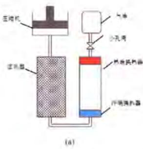

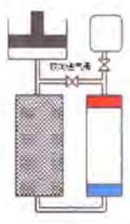  
(b)

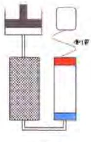  
(c)  
图 1.25 三种典型的行波热声制冷机（a）小孔型（b）双向进气型（c）惯性管型  
Figure 1.25 Three typical traveling-wave thermoacoustic refrigerators (a) Orifice type (b)
Double-inlet type (c) Inertance tube type

对于上述三种具有调相结构的行波热声制冷机，脉冲管室温端的膨胀功均无法回收利用，最终全部以热量的形式耗散掉，制冷系统本征效率低于卡诺效率。

如果能够将这部分膨胀功回收利用，则可以进一步提升声致冷效率。1998年，Swift等人提出带声功回收的行波热声制冷机，如图1.26所示[105]。该热声制冷机不仅可以实现回热器内的行波声场，而且可以回收利用脉冲管室温端的声功。

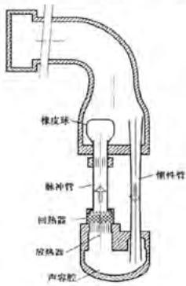  
图 1.26 Swift 提出的行波热声制冷机  
Figure 1.26 Traveling-wave thermoacoustic refrigerator proposed by Swift

## 1.3 热驱动热声制冷机

热驱动热声制冷机通过热声发动机驱动热声制冷机获得制冷效应，采用环保工质且无任何机械运动部件，因此具有可靠性高、振动小、环保等优点，在低温和普冷领域有着极大的应用潜力。热驱动热声制冷机通常分为热驱动低温脉冲管制冷机和热驱动室温热声制冷机。

## 1.3.1 热驱动低温脉冲管制冷机

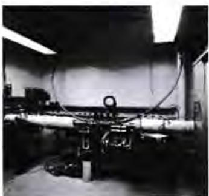  
图 1.27 Radebaugh 设计的热驱动低温脉冲管制冷机  
Figure 1.27 Heat-driven cryocooler designed by Radebaugh

1989 年, Radebaugh 等人设计一台驻波型热声发动机驱动小孔气库型脉冲管制冷机的实验装置, 如图 1.27 所示。该装置的长度为 $10 \mathrm{~m}$ 左右, 以氦气为工质, 最终获得 $90 \mathrm{~K}$ 的最低制冷温度, 在 $120 \mathrm{~K}$ 的制冷温度下有 $5 \mathrm{~W}$ 的制冷量 [106]。这台驻波型热声发动机驱动的低温脉冲管制冷机激发了科研工作者对热驱动低温脉冲管制冷机的研究热情。1995年，Tektronix公司设计一台对称型驻波热驱动脉冲管制冷机，如图1.28所示。该装置以氦气为工质，工作频率为350Hz，最终实现0.18的热制冷系数[53]。

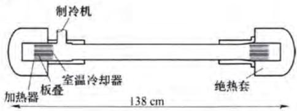  
图 1.28 Tektronix 公司研制的双驻波热驱动脉冲管制冷机

Figure 1.28 Double standing-wave heat-driven cryocooler developed by Tektronix  
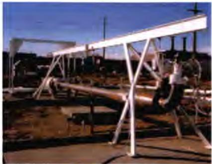  
图 1.29 Cryenco 公司研制的双驻波热驱动脉管制冷机

Figure 1.29 Double standing-wave heat-driven cryocooler developed by Cryenco  
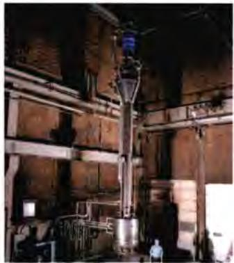  
图 1.30 Swift 提出的行驻波混合型热驱动脉管制冷机  
Figure 1.30 Traveling-standing-wave hybrid heat-driven cryocooler proposed by Swift

1998 年，美国的 Los Alamos 国家实验室和 NIST 标准技术研究院联合 Cryenco 公司设计一台双驻波热驱动脉冲管制冷机，如图 1.29 所示 $^{[107]}$ 。该装置通过燃烧一部分天然气为热声发动机提供热源，热声发动机产生的声功驱动脉冲管制冷机产生冷量液化剩余的天然气。该小型天然气液化装置的长度为 12 m 左右，最终可以实现了 140 g/d 的天然气液化率（折合制冷量为 2 kW@-140 °C），烟效率为 $5.75\%$ （燃烧 $60\%$ ，液化 $40\%$ ）。结合同期热声发动机的进展，美国LosAlamos国家实验室的Swift等人主导的，旨在达到液化率为 $2000~\mathrm{g / d}$ 的行驻波混合型热驱动低温脉冲管制冷机装置于2004年开始启动，如图1.30所示[108]。由于该系统结构复杂庞大，调试困难，目前尚未有后续的实验报道。

1998 年，陈国邦等人搭建国内首台驻波型热驱动低温脉管制冷机，获得 88 K 的低温 $^{[55]}$ 。接着，该团队又提出一种新的调相方式-声压放大器来调节热声发动机和制冷机的相位关系，将最低制冷温度降至 79.7 K $^{[109-110]}$ 。2007 年，陈国邦等人通过热驱动两级低温脉冲管制冷机，获得了 54.5 K 和 41 K 的无负荷制冷温度 $^{[111]}$ 。

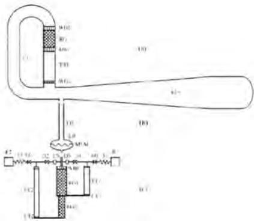  
图 1.31 胡剑英提出的液氢温区热驱动脉管制冷机

Figure 1.31 Liquid hydrogen temperature heat-driven cryocooler proposed by Jianying Hu  
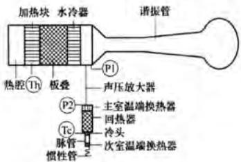  
图 1.32 高频热驱动低温脉管制冷机  
Figure 1.32 High frequency heat-driven cryocooler

2005 年，戴巍等人提出行驻波混合型热驱动低温脉管制冷机，最低无负荷制冷温度达到 $68.8 \, K^{[112]}$ 。为了降低系统尺寸，胡剑英等人提出隔膜结构使得利用氮气工作的热声发动机驱动以氦气工作的脉冲管制冷机成为可能，如图 1.31 所示。该结构最终获得低于液氢的制冷温度，但该结构的可靠性有待验证 $^{[113]}$ 。此外，余国瑶等人还研制工作在 $300 \, Hz$ 的高频热驱动低温脉管制冷机，最终获得低于 $80 \, K$ 的无负荷制冷温度 $^{[114]}$ ，如图 1.32 所示。驻波型或行驻波混合型热驱动低温脉管制冷机主要存在三个问题：第一，驻波谐振管尺寸大，系统功率密度较低，小型化困难；第二，驻波谐振管声功损失较大，声功传输效率低；第三，制冷机出口声功无法回收利用，系统本征效率低。

2015 年，张丽敏等人提出旁接型双行波环路热驱动热声低温制冷机，如图 1.33 所示。制冷系统由三个完全相同的单元首尾依次相连，每个基本单元分别包括热声发动机、热声制冷机和谐振管，其中热声制冷机旁接在热声发动机的出口，采用惯性管气库调相。系统工质采用氦气，平均压力为 7 MPa，在 130 K 的制冷温度下获得 1.2 kW 的制冷量，烟效率为 8% $^{[26]}$ 。

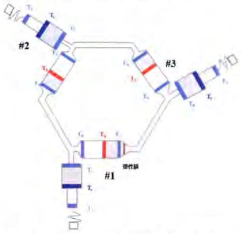  
图 1.33 旁接型双行波环路热驱动脉管制冷机

Figure 1.33 Side connection double traveling-wave looped heat-driven cryocooler  
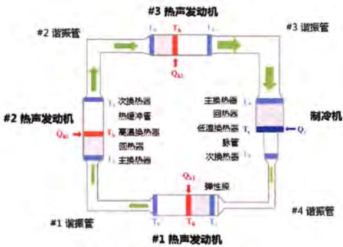  
图 1.34 徐静远提出的串接型双行波环路热驱动脉管制冷机  
Figure 1.34 Series double traveling-wave looped heat-driven cryocooler proposed by Jingyuan Xu

2018年，徐静远等人设计一台串接型环路热驱动制冷机，如图1.34所示[115]。与上述提到的旁接型双行波环路热驱动脉管制冷机相比，串接型系统最大的优点是实现了脉管制冷机出口声功的回收利用，理论上可以达到卡诺效率。串接型系统中三级热声发动机可以实现热源的梯级利用，保证脉管制冷机入口获得更大的压比，最终获得更多冷量。实验结果表明，串接型系统制冷量达到378W，相对卡诺效率达到10% $^{[27]}$ （燃烧15%，液化85%）。

## 1.3.2 热驱动室温热声制冷机

热驱动热声制冷机另一个研究重点是利用低品位热源的室温制冷。根据回热器和谐振管内压力波动与体积流率波动之间的相位关系，热驱动室温热声制冷机可以分为三种类型，分别是双驻波型、行驻波混合型和双行波环路热驱动室温热声制冷机。

双驻波型热驱动室温热声制冷机的主要特点是回热器和谐振管均由驻波声场控制。1997年，美国海军研究生院建造一台双驻波型热驱动室温热声制冷机，在25℃的制冷温差下获得91W的制冷量和0.15的热制冷系数 $^{[116]}$ 。热声发动机和制冷机的换热器肋片厚度和间距分别为75微米和125微米，因此对机械加工精度的要求较高，造价昂贵。随后，该团队设计另一台双驻波热驱动室温热声制冷机，如图1.35所示。系统在450℃的热源温度和5℃的制冷温度下获得2.5W的制冷量，制冷机的温降为18℃ $^{[117]}$ 。

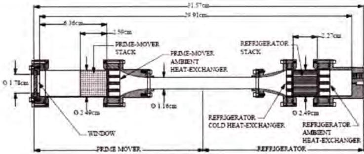  
图 1.35 双驻波热热驱动室温热声制冷机  
Figure 1.35 Double-standing heat-driven room temperature thermoacoustic refrigerator

行驻波混合型热驱动室温热声制冷机的回热器和谐振管分别由行波声场和驻波声场控制。2004年，Biwa设计一台行驻波混合型热驱动室温热声制冷机，在 $0^{\circ}$ C的制冷温度下获得11W的制冷量 $^{[118]}$ 。2004年，罗二仓等人首次提出双环路行驻波混合型热驱动室温热声制冷机，如图1.36所示。系统工质为氦气，平均压力位3MPa，工作频率为67.5Hz，制冷机在-22℃和0℃的制冷温度下分别获得300W和435W的制冷量，热制冷系数分别为0.124和0.18，系统最低无负荷制冷温度为-70℃ $^{[119-120]}$ 。2009年，罗二仓研究团队又重新设计一台同轴行驻波混合型热驱动室温热声制冷机，如图1.37所示。同轴型系统与上述提到的双环路采用相同的行驻波混合型热声发动机，在-20℃的制冷温度下，制冷量和系统热制冷系数分别提升至340W和0.16 $^{[121]}$ 。

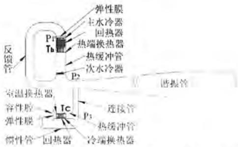  
图 1.36 罗二仓提出的双环路行驻波混合型热驱动热声制冷机

Figure 1.36 Double-looped traveling-standing hybrid heat-driven thermoacoustic refrigerator proposed by Ercang Luo  
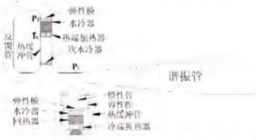  
图 1.37 同轴行驻波混合型热驱动热声制冷机

Figure 1.37 Coaxial traveling-standing hybrid heat-driven thermoacoustic refrigerator  
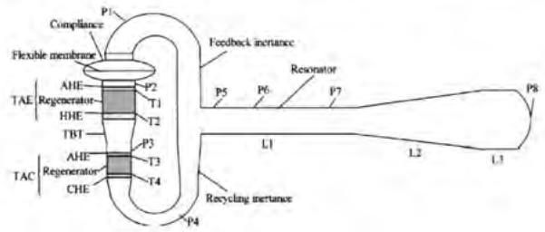  
图 1.38 康薏芳提出的行驻波混合型热驱动热声制冷机  
Figure 1.38 Traveling-standing-wave hybrid heat-driven thermoacoustic refrigerator proposed by Huifang Kang

2010 年，康慧芳等人设计一台行驻波混合型热驱动室温热声制冷机，如图 1.38 所示。该结构的典型特点是热声发动机和热声制冷机均处于同一个环形管内，热声制冷机连接在热声发动机的出口，因此发动机产生的声功直接驱动制冷机，有利于减少声功在谐振管内的损失。该系统的总长度小于 1 m，工作气体为氦气，平均压力为 22 bar，工作频率为 234 Hz，在 0 °C 的制冷温度下获得 40 W 的制冷量 $^{[122]}$ 。

2013 年，Shinya Hasegawa 等人提出双环路行驻波混合型热驱动室温热声制冷机，如图 1.39 所示。该结构具有两个主要特点：第一增加热声发动机级数来降低系统的起振温度；第二驻波谐振管末端的声功可以回收利用。该团队考察了不同单元的热声发动机如何布置以实现回热器内合理的声学阻抗，并且优化了热声发动机的温度比 $^{[123]}$ 。2017 年，该团队搭建相应的实验台，系统起振温度约为 85℃，在 -50℃ 的制冷温度下获得 0.029 $^{[124]}$ 的热制冷系数。

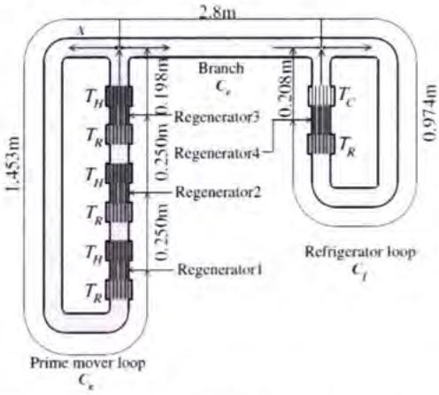  
图 1.39 Shinya Hasegawa 提出的双环路行驻波混合型热驱动热声制冷机

Figure 1.39 Double-looped traveling-standing-wave hybrid heat-driven thermoacoustic refrigerator proposed by Shinya  
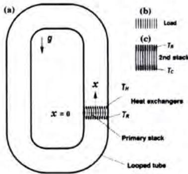  
图 1.40 T. Yazaki 提出的双行波环路热驱动热声制冷机  
Figure 1.40 Double traveling-wave looped heat-driven thermoacoustic refrigerator proposed by T. Yazaki

双行波环路热驱动室温热声制冷机的回热器和谐振管均由行波声场控制。2001年，日本的T.Yazaki等人首次提出双行波环路热驱动室温热声制冷机，如图1.40所示。该结构无任何运动部件，典型特点是两个热声转换单元布置在同一环形管的合适位置，其中一个热声核心单元用于声功放大，另一个热声核心单元用于泵送热量。实验结果表明，系统以 86% 氦气和 14% 氩气的混合气体为工质，平均压力为 0.25 MPa，工作频率为 240 Hz，在 230 W 的加热功率下实现 -27℃ 的无负荷制冷温度 $^{[125]}$ 。由于结构简单、易于加工且潜在效率高，双行波环路热驱动室温热声制冷机有望替代蒸汽压缩式制冷机。

2004 年，日本 Shinichi Sakamoto 等人设计一台双行波环路热驱动室温热声制冷机，如图 1.41 所示。环路管的长度为 3.3 m，内径为 44 mm。两个热声转换单元对称放置在环路管中，一号堆为热声发动机，二号堆为热声制冷机。通过测量环路管内的声压分布和波形，发现声波的基频分量和高次谐波。热声制冷机最终获得 16 °C 的温降，抑制环路中的高次谐波和声流可以进一步改善系统性能 [126]。

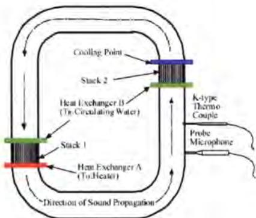  
图 1.41 Shinichi Sakamoto 提出的双行波环路热驱动热声制冷机  
Figure 1.41 Double traveling-wave looped heat-driven thermoacoustic refrigerator proposed by Shinichi

利用 70\~200°C 范围内的余热是热驱动室温热声制冷机最有前途的应用领域之一。2008 年，De Blok 建造一台双环路行波热驱动室温热声制冷机，如图 1.42 所示 $^{[127]}$ 。De Blok 提出这种新结构有两个目的：第一通过布置多个热声转换单元来提高功率密度从而更高效的利用 70\~200°C 范围内的低品位余热；第二在多个热声核心转换单元中同时实现高声学阻抗和行波相位。实验结果表明，系统起振温差仅有 65°C。2012 年，De Blok 提出另一种四单元双行波环路热驱动室温热声制冷机，如图 1.43 所示。系统工作频率为 95 Hz，起振温度为 45°C。加热温度为 210°C，制冷温度 -40.5°C 时，系统制冷量达到 95 W，烟效率接近 40% $^{[28]}$ 。该结构具有以下三点优势：第一行波谐振管具有较低的声功损耗；第二系统具有较低的起振温度，可以利用太阳能或工业余热等；第三这种行波环路结构的功率密度是传统经典行驻波混合型的 5 倍以上，理论上系统的功率提升两个数量级至 100 kW，且可扩展性强，在实际应用中容易集成。2016 年，金滔等人提出一台双行波环路热驱动室温热声制冷机，如图 1.44 所示 $^{[128-129]}$ ，研究结果表明热声热

机安装位置对系统性能有显著影响。

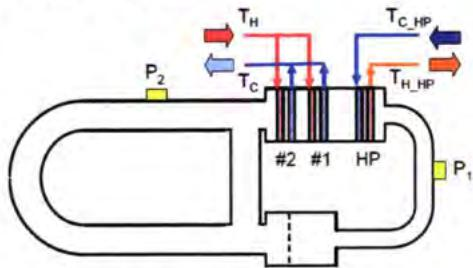  
图 1.42 De Blok 提出的双环路行波热驱动热声制冷机

Figure 1.42 Double looped traveling-wave heat-driven thermoacoustic refrigerator proposed  
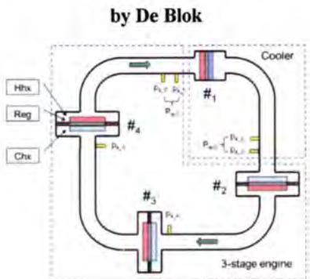  
图 1.43 De Blok 提出的四单元双行波环路热驱动热声制冷机

Figure 1.43 Four-stage double traveling-wave looped heat-driven thermoacoustic refrigerator proposed by De Blok  
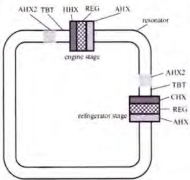  
图 1.44 金滔提出的双行波环路热驱动热声制冷机  
Figure 1.44 Double traveling-wave looped heat-driven thermoacoustic refrigerator proposed by Tao Jin

在先前提出的四单元双行波环路热驱动热声制冷机的基础之上，De Blok 又提出了 THEAC-25 热驱动热声制冷机，如图 1.45 所示。系统包括两个发动机和两个制冷机，其中发动机依次连接逐级放大声功，依次驱动 2 个制冷机获得冷量。

平均压力、环境温度和加热温度分别为 1.2 MPa、30°C、220°C 时，系统在 -10°C 的制冷温度下获得 18 kW 的制冷量，热制冷系数为 0.18 $^{[29]}$ 。系统的长、宽和高尺寸分别为 4 m、4 m 和 0.8 m，整机重量为 1100 kg，系统运行需要三个泵和一个干式冷却系统，总共需要消耗 2 kW 的电能。目前，一台 THEAC-25 热驱动热声制冷机已经出售给阿联酋的迪拜。该装置运行过程中噪音低至 70 dB；因为完全无运动部件，因此无需维护，设计寿命长达 30 年；功率可扩展性强，可以从 10 W，到 10 kW，甚至扩展到 100 kW。该装置的应用场景主要有移动容器冷却，如新鲜产品冷却、医疗冷链等；工业过程，如食品面包店、压铸金属丝生产等；建筑或工厂空调，如零售大楼、购物中心、学校等。但是，较低的“紧凑性”仍然是该装置需要解决的一个严重问题，尤其是在回收利用卡车尾气余热等场合。

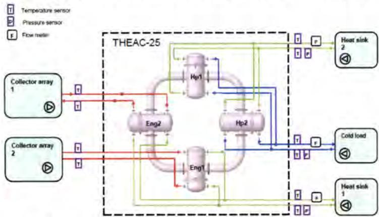  
图 1.45 De Blok 提出的 THEAC-25 热驱动热声制冷机  
Figure 1.45 THEAC-25 heat-driven thermoacoustic refrigerator proposed by De Blok

此外，国内的华中科技大学[130-132]、西安交通大学[133-134]以及国外的英国格拉斯哥大学[135-136]等也相继开展了热驱动室温热声制冷机的研究工作。

## 1.4 关键的科学问题

与双驻波型和行驻波混合型相比，双行波环路热驱动室温热声制冷机在理论和实验上均初步显示具有更高的热制冷效率和功率密度。不同结构的双行波环路热驱动室温热声制冷机相继被提出和研究，但低紧凑性和低热制冷系数仍然是两个迫切需要解决的问题，尤其是针对卡车和渔船等移动设备的尾气余热利用。目前，双行波环路热驱动室温热声制冷机仍然存在以下三个关键的科学问题亟待深入研究：

（1）探索高效、紧凑的双行波环路热驱动室温热声制冷系统新流程。热驱动室温热声制冷机经历了双驻波型、行驻波混合型和双行波环路型的发展历程。与双驻波型和行驻波混合型相比，双行波环路热驱动室温热声制冷机在理论和实验上均初步显示具有更高的热制冷系数和功率密度。效率方面，双行波环路热驱动热声制冷机基于可逆的热力学循环，理论效率为卡诺效率；功率密度方面，双行波环路热驱动热声制冷机的功率密度是行驻波混合型功率密度的5倍以上，与双驻波型热驱动热声制冷机的功率密度相比，优势更加明显。针对不同热源温区（100℃\~500℃）的余热利用，面向不同制冷温区（0\~10℃左右的空调温区和-10℃\~20℃左右的冷藏温区）的需求场合，探索高效、紧凑的双行波环路热驱动室温热声制冷机新流程具有重要意义。

（2）研制千瓦级双行波环路热驱动室温热声制冷机实验样机，并探究关键参数的影响规律。双行波环路热驱动室温热声制冷机在太阳能、工业余热和尾气余热等低品位热源利用领域显示出巨大的应用前景，国外已经研制出相关的工程样机，如 SOUND ENERGY 公司研制的 THEAC-25 热驱动热声制冷机已经出售给阿联酋的迪拜，用于太阳能驱动的空调。但是，国内对双行波环路热驱动室温热声制冷机的研究仍然停留在理论和初始实验研究阶段。因此，研制一台高效、紧凑的双行波环路热驱动室温热声制冷机的实验样机，并探究关键参数如回热器填充材料、平均压力、热源温度和制冷温度的影响规律，最终掌握其关键技术，是我国极具挑战性和必要性的工作。

（3）探究低品位热源温区条件下热声发动机和热声制冷机之间的高效耦合机理以及双行波环路热驱动室温热声制冷机的能量转换和传输规律。不同结构的双行波环路热驱动室温热声制冷机相继被提出，但缺少系统的理论研究和指导。双行波环路热驱动室温热声制冷机是一个高度耦合的自激振荡系统，其中热声发动机和热声制冷机的操作特性相互影响，同时在声场和操作温度等方面存在着最佳匹配。合适的匹配关系可以使热声发动机和热声制冷机均工作在最佳状态，从而保证系统获得较高的功率密度和热制冷系数。一方面热声发动机和热声制冷机之间高效的匹配规律尚不清楚，有待深入研究；另一方面，目前几种典型结构的环路热驱动室温热声制冷机在统一的操作条件下（固定频率、平均压力、温度和结构参数等），其功率密度和热制冷系数的大小缺少定量比较。

## 1.5 本文的主要工作

本课题针对中低品位热能的利用，旨在探索一种高效的热驱动室温温区热声制冷机，适合作为空调或冰箱在卡车、冷链运输车、渔船等移动设备上应用。本课题的研究成果将揭示热声发动机的热功转换与热声制冷机的声致冷之间的耦合机理，阐明系统各部件的损失机理及各关键参数对系统性能的影响规律，为探索利用低品位热源直接获得室温温区的冷量提供新的技术方案以及理论和实验研究基础。同时，本研究也将推动热驱动热声制冷机的发展及其工业应用进展，特别是在室温制冷领域，具有重要的学术意义和实用价值。本课题的研究内容主

要包括：

(1) 5kW 级直连型双行波环路热驱动室温热声制冷机的研制。针对卡车、渔船等移动设备的余热，提出并设计一台 5kW 级直连型双行波环路热驱动室温热声制冷机。该结构的典型特点是，热声发动机和热声制冷机直接相连，共用一个室温换热器，省去了传统结构中热声发动机与热声制冷机之间的谐振管，结构更加紧凑。接下来，本文基于 Sage 软件对直连型环路热驱动室温热声制冷机进行了优化设计，考察了单元数和回热器填充材料对系统性能的影响，并且开展了热力学性能研究。然后，基于 Solidworks 软件对直连型环路热驱动室温热声制冷机进行机械设计，其总体装置的长、宽和高分别是 1.5 m、1.4 m 和 2.0 m，重量约为 220 kg。最后，搭建直连型环路热驱动室温热声制冷系统实验台，并考察平均压力、加热温度、制冷温度和抑制直流的弹性橡胶膜位置对系统性能的影响。最终的实验结果表明，平均压力为 10 MPa、环境温度为 50°C、制冷温度为 10°C、加热温度为 300°C 时，系统制冷量达到 4.0 kW，热制冷系数达到 0.28，相对卡诺效率达到 9.1%。与先前已报道的同类型热驱动室温热声制冷机相比，该系统在热制冷系数和功率密度方面具有显著提升。

（2）探究双行波环路热驱动室温热声制冷机的能量转换和匹配机理。对于环路热驱动热声制冷流程，除了关键部件的性能，各热声单元之间的相互协调和配合也非常重要，决定了整机的效率。为此，本文首先从声场和温度匹配两个角度探究热声发动机和热声制冷机的耦合机理。声场方面，对于工作在室温温区的热声制冷机，入口和出口的最佳p-U相位差为正值，处于“行波零点”的正侧（即压力波领先于速度波），对于工作在中低温区的热声发动机，入口和出口的最佳p-U相位差为负值，处于“行波零点”的负侧（即压力波滞后于速度波）。温度方面，如果环境温度设定为50℃，制冷温度设定为10℃，热声发动机和热声制冷机的级数比为1:1，根据环路热声系统声功守恒方程，热声发动机的加热温度应该设定为300℃左右。接下来，本文深入研究和对比了现有的串连型环路热驱动热声制冷机（荷兰DeBlok采用）以及本团队提出的间隔型环路热驱动热声制冷机和直连型环路热驱动热声制冷机的性能差异和工作规律。在这三种流程中，系统均包括两个热声发动机单元和两个热声制冷机单元，热声发动机和热声制冷机采用相同的结构参数，不同的是热声发动机和热声制冷机之间的调相机构-谐振管的长度和直径。针对串连型、间隔型和直连型环路热驱动室温热声制冷机，本文开展了热力学性能研究并考察了关键参数如平均压力、加热温度和制冷温度对系统性能的影响规律。在相同的设计工况下，综合考虑功率密度和热制冷系数，直连型环路热驱动室温热声制冷机更具优势。

（3）双行波环路热驱动室温两级热声制冷机的理论研究。针对 $400^{\circ}$ C 左右的热源，提出一种双行波环路热驱动室温两级热声制冷机，进一步提升系统热制冷系数。双行波环路热驱动室温两级热声制冷机由三个相同的单元首尾相连组成，每个基本单元依次包括热声发动机、热声制冷机1、热声制冷机2和谐振结构，其中热声发动机、热声制冷机1和热声制冷机2直接相连，热声发动机产生的声功直接驱动热声制冷机1和热声制冷机2产生制冷效应，然后通过谐振管传递给下一个基本单元。计算结果表明，系统热制冷系数达到0.74，相对卡诺效率达到 $20.0\%$ 。与先前提出的直连型环路热驱动室温热声制冷系统相比，环路热驱动室温两级热声制冷机在热制冷系数方面更具优势。针对环路热驱动室温两级热声制冷机，本文开展了热力学性能研究，考察了声场、速度和各部件烟损失率的分布。结果表明，热声发动机、热声制冷机1和热声制冷机2的回热器均处于合理的行波声场，且实现了合理的声学阻抗；提高加热温度并且增加热声制冷机级数，可以提高热声制冷机消耗声功的占比，降低谐振管内的烟损失占比。最后，本文考察了结构参数和操作条件对系统性能的影响，结果表明局部增大回热器的直径、减小热缓冲管的直径可以优化热声发动机和热声制冷机的声场，提升系统制冷量和热制冷系数。平均压力、加热温度和制冷温度对环路热驱动室温两级热声制冷机性能的影响也是显著的。

## 第 2 章 热声理论基础

## 2.1 经典热声理论

热声热机的热力计算主要依赖于建立在欧拉坐标系下的经典热声理论，这一理论体系由N.Rott建立[137-142]，其后主要由 $\mathbf{Swift}^{143}$ 、肖家华和罗二仓[145-147]等对之加以完善。它从最初的解释热声效应的现象逐渐发展为可以定量计算包括驻波型以及行波型热声热机等的一个普适理论体系。经典热声理论的主要内容就是在小振幅波动假设下，基于三大基本控制方程和系统的时均能量二阶方程，得到声功流、热流和总能流中各基频波动量的物理解。

## 2.1.1 经典热声方程组

在连续介质假设下，可压缩粘性流体的运动规律满足三大方程，这三大方程以及气体状态方程在欧拉坐标系下可以写为：

连续性方程

$$
\frac {\partial \rho}{\partial t} + \nabla \cdot (\rho \vec {u}) = 0\tag{2-1}
$$

动量守恒方程

$$
\rho \left(\frac {\partial \vec {u}}{\partial t} + (\vec {u} \cdot \nabla) \vec {u}\right) = - \nabla p + \mu \nabla^ {2} \vec {u} + \rho \vec {f}\tag{2-2}
$$

能量守恒方程

$$
\rho C _ {p} \left(\frac {\partial T}{\partial t} + \vec {u} \cdot \nabla T\right) = \left(\frac {\partial p}{\partial t} + \vec {u} \cdot \nabla p\right) + \nabla (K \nabla T) + \Phi\tag{2-3}
$$

状态方程

$$
\rho = \rho (T, p)\tag{2-4}
$$

其中，p、 $\vec{u}$ 、T、 $\rho$ 、t代表可压缩粘性流体的压力、速度矢量、温度、密度和时间； $\vec{f}$ 、 $\Phi$ 分别是体积力分布函数和耗散函数； $\mu$ 、 $C_{p}$ 、K分别为动力粘度、定压比热和导热系数。

经典热声理论假定各物理量参数 $\tilde{p}$ 、 $\tilde{u}$ 、 $\tilde{\rho}$ 和 $\tilde{T}$ 可以看成平均量与一阶波动量的叠加（忽略高阶量），定义如下：

$$
\tilde {p} (x, y, z, t) = p _ {0} + R e \left(\hat {p} _ {1} (x) e ^ {i \omega t}\right)\tag{2-5}
$$

$$
\tilde {u} (x, y, z, t) = R e \left(\hat {u} _ {1} (x, y, z) e ^ {i \omega t}\right)\tag{2-6}
$$

$$
\tilde {\rho} (x, y, z, t) = \rho_ {0} (x) + R e (\hat {\rho} _ {1} (x, y, z) e ^ {i \omega t})\tag{2-7}
$$

$$
\tilde {T} (x, y, z, t) = T _ {0} (x) + R e (\hat {T} _ {1} (x, y, z) e ^ {i \omega t})\tag{2-8}
$$

“ $\Lambda$ ”代表波动量的幅值， $\omega$ 为角频率，“\~”表示时域内波动量，Re表示取复数实部，i代表虚数。将上述波动量的表达式代入基本控制方程，忽略二阶以上小量即可得到经典热声方

程组：

$$
i \omega \rho_ {1} + \frac {\partial}{\partial x} (\rho_ {m} u _ {1}) = 0\tag{2-9}
$$

$$
i \omega \rho_ {m} u _ {1} = - \frac {d p _ {1}}{d x} + \mu \left(\frac {\partial^ {2} u _ {1}}{\partial y ^ {2}} + \frac {\partial^ {2} u _ {1}}{\partial z ^ {2}}\right)\tag{2-10}
$$

$$
i \omega \rho_ {m} c _ {p} T _ {1} + \rho_ {m} c _ {p} \frac {d T _ {m}}{d x} = i \omega p _ {1} + k \left(\frac {\partial^ {2} T _ {1}}{\partial y ^ {2}} + \frac {\partial^ {2} T _ {1}}{\partial z ^ {2}}\right)\tag{2-11}
$$

$$
p _ {1} = \rho_ {m} R T _ {1} + R T _ {m} \rho_ {1}\tag{2-12}
$$

上述四个公式为经典热声学控制方程，其中公式（2-11）中包含平均温度的轴向梯度，因此必须引入总能流 $\dot{H}_{2}$ 才能对上述方程求解。 $\dot{H}_{2}$ 的表达式为：

$$
\dot {H} _ {2} = C _ {p} \dot {m} _ {2, 0} T _ {m} + C _ {p} \widehat {\dot {m}} _ {1} \widehat {T} _ {1}\tag{2-13}
$$

上标·为时均值， $m_{2,0}$ 为二阶平均质量流。总能流守恒方程为：

$$
\frac {d H _ {2}}{d x} = \dot {q}\tag{2-14}
$$

将（2-13）代入（2-14）得

$$
\frac {d (C _ {p} \hat {m} _ {2 , 0} T _ {m} + C _ {p} \hat {m} _ {1} \hat {T} _ {1})}{d x} = \dot {q}\tag{2-15}
$$

如果系统不存在直流，则有

$$
\frac {d (C _ {p} \hat {m} _ {1} \hat {T} _ {1})}{d x} = \dot {q}\tag{2-16}
$$

对于回热器、热缓冲管、变径管和谐振管， $\dot{q}=0$ ；对于换热器， $\dot{q}$ 为单位长度换热量。

## 2.1.2 经典热声方程组的典型解

在热声系统中，常见的流道形式有平行板、圆管和多孔介质。上述方程进行截面平均之后可以转换为一阶微分方程，针对这三种流道形式，本文单独给出方程组的解。

平行板模型

$$
\frac {d \hat {p}}{d x} = - \frac {i \omega \rho_ {0}}{A} \frac {1}{(1 - f _ {\mu})} \cdot \hat {U} _ {1}\tag{2-17}
$$

$$
\frac {d \hat {U} _ {1}}{d x} = - \frac {i \omega A}{\rho_ {0} a _ {0} ^ {2}} [ 1 + (\gamma - 1) f _ {k} ] \cdot \hat {p} _ {1} + \frac {f _ {k} - f _ {\mu}}{(1 - \sigma^ {2}) (1 - f _ {\mu})} \beta_ {0} \frac {d T _ {0}}{d x} \cdot \hat {U} _ {1}\tag{2-18}
$$

$$
\hat {T} _ {1} = \frac {T _ {0} \beta_ {0}}{\rho_ {0} C _ {p 0}} (1 - f _ {k}) \cdot \hat {p} _ {1} - \frac {U _ {1}}{i \omega A} \frac {d T _ {0}}{d x} \left[ 1 - \frac {f _ {k} - f _ {\mu}}{(1 - \sigma^ {2}) (1 - f _ {\mu})} \right]\tag{2-19}
$$

对于平行板模型，平均的热函数和粘性函数分别为

$$
f _ {\kappa} = \frac {t a n h [ (1 + i) b / \delta_ {\kappa} ]}{(1 + i) b / \delta_ {\kappa}}\tag{2-20}
$$

$$
f _ {\mu} = \frac {t a n h [ (1 + i) b / \delta_ {\mu} ]}{(1 + i) b / \delta_ {\mu}}\tag{2-21}
$$

其中，热穿透深度 $\delta_{\kappa} = \sqrt{2\kappa / \omega}$ ；粘性穿透深度 $\delta_{k} = \sqrt{2\nu / \omega}$ ；平板间隙宽度为 $2b$ ，高度为 $w$ ，横截面积 $A = 2wb$ ；普朗特数为 $\sigma^2$ 。

圆管模型

$$
\frac {d \hat {p}}{d x} = - \frac {i \omega \rho_ {0}}{A ^ {\prime}} \frac {1}{(1 - f _ {\mu} ^ {\prime})} \cdot \hat {U} _ {1}\tag{2-22}
$$

$$
\frac {d \hat {U} _ {1}}{d x} = - \frac {i \omega A}{\rho_ {0} a _ {0} ^ {2}} [ 1 + (\gamma - 1) f _ {k} ^ {\prime} ] \cdot \hat {p} _ {1} + \frac {f _ {k} ^ {\prime} - f _ {\mu} ^ {\prime}}{(1 - \sigma^ {2}) (1 - f _ {\mu} ^ {\prime})} \beta_ {0} \frac {d T _ {0}}{d x} \cdot \hat {U} _ {1}\tag{2-23}
$$

$$
\hat {T} _ {1} = \frac {T _ {0} \beta_ {0}}{\rho_ {0} C _ {p 0}} (1 - f _ {k}) \cdot \hat {p} _ {1} - \frac {U _ {1}}{i \omega A} \frac {d T _ {0}}{d x} \left[ 1 - \frac {f _ {k} - f _ {\mu}}{(1 - \sigma^ {2}) (1 - f _ {\mu})} \right]\tag{2-24}
$$

对于圆管模型，平均的热函数和粘性函数分别为

$$
f _ {\kappa} ^ {\prime} = \frac {2 J _ {1} [ (j - 1) R / \delta_ {\kappa} ]}{J _ {0} [ (j - 1) R / \delta_ {\kappa} ] (j - 1) R / \delta_ {\kappa}}\tag{2-25}
$$

$$
f _ {\mu} ^ {\prime} = \frac {2 J _ {1} [ (j - 1) R / \delta_ {\mu} ]}{J _ {0} [ (j - 1) R / \delta_ {\mu} ] (j - 1) R / \delta_ {\mu}}\tag{2-26}
$$

$$
A ^ {\prime} = \pi R ^ {2}\tag{2-27}
$$

多孔介质模型

$$
\frac {d \hat {p} _ {1}}{d x} = - \left(\frac {- i \omega \rho_ {0}}{A _ {f}} (1 + \beta_ {t}) + \frac {\alpha \mu}{A _ {f}}\right) \cdot \widehat {U} _ {1}\tag{2-28}
$$

$$
\frac {d \bar {U} _ {1}}{d x} = - \frac {i \omega A _ {f}}{\rho_ {0} a _ {0} ^ {2}} [ 1 + (\gamma - 1) f _ {h} ] \cdot \hat {p} _ {1} + \frac {(1 - \Phi) \Omega_ {H}}{i \omega \Phi (1 - \Phi) + \Omega_ {H}} \beta_ {0} \frac {d T _ {0}}{d x} \cdot \bar {U} _ {1}\tag{2-29}
$$

$$
\hat {T} _ {1} = - \frac {i \omega \Phi (1 - \Phi) + \Phi \Omega_ {H}}{i \omega \Phi (1 - \Phi) + \Omega_ {H}} \left[ \frac {T _ {0} \beta_ {0}}{\rho_ {0} C _ {p 0}} \cdot \hat {p} _ {1} - - \frac {\hat {U} _ {1}}{i \omega A ^ {\prime}} \frac {d T _ {D}}{d x} \right]\tag{2-30}
$$

丝网填料水力直径 $r_{h}$ 的定义为

$$
r _ {h} = D _ {w i r e} \frac {\phi}{4 (1 - \phi)}\tag{2-31}
$$

多孔介质粘性阻力因子 $\alpha$ 的定义为

$$
\alpha = \frac {2}{r _ {h} ^ {2}} \sqrt {1 + 4 \left(r _ {h} / \delta_ {\mu}\right) ^ {2}}\tag{2-32}
$$

多孔介质附加质量系数 $\beta_{t}$ 的定义为

$$
\beta_ {t} = \frac {1}{\sqrt {9 + 4 \left(r _ {h} / \delta_ {\mu}\right) ^ {2}}}\tag{2-33}
$$

比热比 $\Phi$ 的定义为

$$
\Phi = \frac {A _ {f} \rho_ {0} C _ {p , f}}{A _ {f} \rho_ {0} C _ {p , f} + A _ {s} \rho_ {s 0} C _ {s}}\tag{2-34}
$$

特征换热角频率 $\Omega_H$ 的定义为

$$
\Omega_ {H} = \frac {h A _ {H}}{A _ {f} \rho_ {0} C _ {p , f} + A _ {s} \rho_ {s 0} C _ {s}}\tag{2-35}
$$

在上述各式中， $D_{wire}$ 为丝网丝径， $\phi$ 为丝网孔隙率， $A_{H}$ 为回热器单位体积的气固

换热面积。

针对多孔介质，若考虑非线性阻力因素，压力方程也可以写为

$$
\frac {d \hat {\rho} _ {1}}{d x} = \left\{- i \omega \rho_ {0} \left[ 1 + \frac {(1 - \phi) ^ {2}}{2 (2 \phi - 1)} \right] - \frac {\mu}{r _ {h} ^ {2}} \left[ \frac {c _ {1} (\phi)}{8} + \frac {c _ {2} (\phi) \cdot R _ {e}}{3 \pi} \right] \right\} \cdot \hat {U} _ {1}\tag{2-36}
$$

在式（2-36）中，

$$
\phi = 1 - \frac {\pi D _ {w i r e} \sqrt {\lambda^ {2} + D _ {w i r e} ^ {2}}}{4 \lambda^ {2}}\tag{2-37}
$$

$$
\lambda = 2. 5 4 \times 1 0 ^ {- 2} / n\tag{2-38}
$$

$$
c _ {1} (\phi) = 1 2 6 8 - 3 5 4 5 \phi + 2 5 4 4 \phi^ {2}\tag{2-39}
$$

$$
c _ {2} (\phi) = - 2. 8 2 + 1 0. 7 \phi - 8. 6 \phi^ {2}\tag{2-40}
$$

其中当地的峰值雷诺数 $R_{e}$ 的定义为

$$
R _ {e} = 4 \frac {| \hat {U} _ {1} | r _ {h} \rho_ {0}}{A _ {f} \mu}\tag{2-41}
$$

## 三种模型统一的表达形式

针对上述圆管、平板和多孔介质模型，控制方程可以统一表示为：

$$
\left\{ \begin{array}{c} \frac {d \hat {p} _ {1}}{d x} = - Z _ {F} \cdot \hat {U} _ {1} \\ \frac {d \hat {U} _ {1}}{d x} = - Y _ {C} \cdot \hat {p} _ {1} + f _ {W T} \beta_ {0} \frac {d T _ {0}}{d x} \cdot \hat {U} _ {1} \\ \hat {T} _ {1} = Z _ {P} \cdot \hat {p} _ {1} - Z _ {T} \cdot \hat {U} _ {1} \end{array} \right.\tag{2-42}
$$

需要说明的是， $Z_{F}$ 、 $Y_{C}$ 和 $f_{WT}$ 是气体物性、流道形状、尺寸、工况、平均温度的函数。 $Z_{P}$ 和 $Z_{T}$ 不仅是气体物性、流道形状、尺寸、工况、平均温度的函数，也是截面上位置坐标的函数。其中， $Z_{F}$ 、 $Y_{C}$ 、 $f_{WT}$ 、 $Z_{P}$ 和 $Z_{T}$ 的定义为

$$
Z _ {F} = \left\{ \begin{array}{l l} \frac {i \omega \rho_ {0}}{A} \frac {1}{(1 - f _ {\mu})} & (\text {平板、圆管}) \\ - i \omega \rho_ {0} \left[ 1 + \frac {(1 - \phi) ^ {2}}{2 (2 \phi - 1)} \right] - \frac {\mu}{r _ {h} ^ {2}} \left[ \frac {c _ {1} (\phi)}{8} + \frac {c _ {2} (\phi) \cdot R _ {e}}{3 \pi} \right] & (\text {多孔介质}) \end{array} \right.\tag{2-43}
$$

$$
Y _ {C} = \left\{ \begin{array}{l l} \frac {i \omega A}{\rho_ {0} a _ {0} ^ {2}} [ 1 + (\gamma - 1) f _ {k} ] (\text {平板、圆管}) \\ \frac {i \omega A _ {f}}{\rho_ {0} a _ {0} ^ {2}} [ 1 + (\gamma - 1) f _ {h} ] & (\text {多孔介质}) \end{array} \right.\tag{2-44}
$$

$$
f _ {W T} = \left\{ \begin{array}{l l} \frac {f _ {k} - f _ {\mu}}{(1 - P _ {t}) (1 - f _ {\mu})} & (\text { 平板、圆管 }) \\ \frac {(1 - \Phi) \Omega_ {H}}{i \omega \Phi (1 - \Phi) + \Omega_ {H}} & (\text { 多孔介质 }) \end{array} \right.\tag{2-45}
$$

$$
Z _ {P} = \left\{ \begin{array}{l l} \frac {T _ {0} \beta_ {0}}{\rho_ {0} C _ {p 0}} (1 - f _ {k}) & (\text { 平   板   、   圆   管 }) \\ \frac {i \omega \Phi (1 - \Phi) + \Phi \Omega_ {H}}{i \omega \Phi (1 - \Phi) + \Omega_ {H}} \cdot \frac {T _ {0} \beta_ {0}}{\rho_ {0} C _ {p 0}} & (\text { 多   孔   介   质 }) \end{array} \right.\tag{2-46}
$$

$$
Z _ {T} = \left\{ \begin{array}{l l} \frac {1}{i \omega A} \cdot \frac {d T _ {0}}{d x} \left[ 1 - \frac {f _ {k} - f _ {\mu}}{(1 - P _ {t}) (1 - f _ {\mu})} \right] & (\text {平板、圆管}) \\ \frac {1}{i \omega A} \cdot \frac {d T _ {0}}{d x} \cdot \frac {i \omega \Phi (1 - \Phi) + \Phi \Omega_ {H}}{i \omega \Phi (1 - \Phi) + \Omega_ {H}} & (\text {多孔介质}) \end{array} \right.\tag{2-47}
$$

## 2.1.3 时均能量流

## 声功流

声功的定义为当地截面上压力波动 $\tilde{p}_{1}$ 和体积流率波动 $\tilde{U}_{1}$ （即速度 $\tilde{u}_{1}$ 在流通面积上的积分）乘积的周期平均，即

$$
W = \frac {1}{\tau} \int_ {A} \int_ {0} ^ {\tau} \tilde {p} _ {1} \tilde {u} _ {1} d t d A = \frac {1}{\tau} \int_ {0} ^ {\tau} \tilde {p} _ {1} \widetilde {U} _ {1} d t = \frac {1}{2} R e \big [ \hat {p} _ {1} \cdot \widehat {U} _ {1} ^ {*} \big ] = \frac {1}{2} \big | \hat {p} _ {1} \cdot \widehat {U} _ {1} ^ {*} \big | c o s \theta_ {p - U}\tag{2-48}
$$

其中， $\theta_{p-U}$ 为压力波超前体积流率的相位差。对公式（2-48）两边求导，代入公式（2-42）得

$$
\frac {d W}{d x} = \frac {1}{2} R e \big [ \widehat {U} _ {1} \widehat {p} _ {1} * f _ {W T} \big ] \beta_ {0} \frac {d T _ {0}}{d x} - \frac {(\gamma - 1)}{2 \gamma P _ {0}} \omega | \widehat {p} _ {1} | ^ {2} g _ {w k} - \frac {\rho_ {0}}{2 A _ {f}} \omega \big | \widehat {U} _ {1} \big | ^ {2} g _ {w \mu}\tag{2-49}
$$

系数 $g_{wk}$ 和 $g_{w\mu}$ 分别表示有限传热耗散和粘性耗散因子，主要与流道的声导率 $Y_{C}$ 和声阻抗 $Z_{F}$ 有关。

$$
g _ {w k} = \frac {\gamma \hat {p} _ {1}}{(\gamma - 1) A _ {f} \omega} R e [ Y _ {C} ]\tag{2-50}
$$

$$
g _ {w \mu} = \frac {A _ {f}}{\rho_ {0} \omega} R e [ Z _ {F} ]\tag{2-51}
$$

热声系统起振时，沿单位长度的声功变化梯度必须为正。因此，假定公式（2-49）右侧三项为零，可以得到临界温度梯度

$$
\left(\frac {d T _ {0}}{d x}\right) _ {c r} ^ {W} = \frac {\gamma - 1}{a _ {0} \beta_ {0}} \omega \frac {g _ {w k} + \frac {1}{\gamma - 1} | Y _ {a} | ^ {2} g _ {w \mu}}{R e [ Y _ {a} f _ {w T} ]}\tag{2-52}
$$

其中， $a_{0}$ 是当地声速，声导率的定义为

$$
Y _ {a} = \rho_ {0} a _ {0} \hat {U} _ {1} / A _ {f} \hat {p} _ {1}\tag{2-53}
$$

因此，当回热器两端的温度梯度大于临界温度梯度时，才能实现系统起振以及声功的放大。

## 热流

对于理想绝热通道，通过截面上的时均热流为纵向热流，表达式可写为

$$
Q _ {2} = \frac {1}{\tau} \oint (\rho_ {0} C _ {p 0} \tilde {T} _ {1} \tilde {U} _ {1} - T _ {0} \beta_ {0} \tilde {p} _ {1} \tilde {U} _ {1}) d t - (A _ {f} K _ {f} + A _ {s} K _ {s}) \frac {d T _ {0}}{d x}\tag{2-54}
$$

代入 $\hat{U}_{1}$ 和 $\hat{T}_{1}$ 的表达式可得

$$
\begin{array}{r l} Q _ {2} = & - \frac {1}{2} T _ {0} \beta_ {0} R e [ \hat {U} _ {1} \hat {p} _ {1} ^ {*} f _ {q x} ] - \rho_ {0} C _ {p 0} \frac {| \hat {U} _ {1} | ^ {2}}{2 A _ {f} \omega} \frac {d T _ {0}}{d x} g _ {q x} - (A _ {f} K _ {0} + A _ {s} K _ {s}) \frac {d T _ {0}}{d x} \\ & = - \frac {1}{2} T _ {0} \beta_ {0} R e [ \hat {U} _ {1} \hat {p} _ {1} ^ {*} f _ {q x} ] - A _ {f} K _ {e f f} \frac {d T _ {0}}{d x} \end{array}\tag{2-55}
$$

其中， $f_{qx}$ 和 $g_{qx}$ 分别代表纵向导热因子和温度梯度因子， $K_{eff}$ 为总等效热传导系数。对于不同的流道， $f_{qx}$ 和 $g_{qx}$ 具有不同的表达式。

对于平板或圆管流道

$$
f _ {q x} = \frac {f _ {k} ^ {*} - f _ {\mu}}{(1 + \sigma^ {2}) (1 - f _ {\mu})}\tag{2-56}
$$

$$
g _ {q x} = \frac {1}{(1 - \sigma^ {2}) | 1 - f _ {\mu} | ^ {2}} \mathrm{Im} \left[ \frac {f _ {k} ^ {*} - f _ {\mu}}{(1 + \sigma^ {2})} - f _ {\mu} ^ {*} \right]\tag{2-57}
$$

对于多孔介质流道

$$
f _ {q x} = f _ {h} ^ {*}\tag{2-58}
$$

$$
g _ {q x} = R e [ i f _ {h} ]\tag{2-59}
$$

$$
K _ {e f f} = K _ {e} ^ {s} + K _ {0} + \frac {A _ {s}}{A _ {f}} K _ {s 0}\tag{2-60}
$$

$$
K _ {e} ^ {s} = \frac {1}{2} \rho_ {0} C _ {p 0} \frac {| \hat {U} _ {1} | ^ {2}}{A _ {f} ^ {2} \omega} g _ {q x}\tag{2-61}
$$

$K_{e}^{s}$ 代表由熵输运引起的等效热传导系数。如果令公式（2-56）等于零，可以得到热声制冷机的临界温度梯度

$$
\left(\frac {d T _ {0}}{d x}\right) _ {c r} ^ {q} = - \frac {\gamma - 1}{a _ {0} \beta_ {0}} \omega \frac {R e [ f _ {q x} / Y _ {a} ^ {*} ]}{g _ {q x} + (\omega \delta_ {k} A _ {f} / | \hat {U} _ {1} |) ^ {2}}\tag{2-62}
$$

总能流

若不考虑声直流，那么时均总能流可以表示为

$$
H _ {2} = \frac {1}{\tau} \rho_ {m} C _ {p} \int_ {A} \int_ {0} ^ {\tau} \tilde {u} _ {1} \tilde {T} _ {1} d t d A = \frac {1}{2} \rho_ {0} \int R e [ h _ {1} \hat {u} _ {1} ] \cdot d A - (A _ {f} K _ {f} + A _ {s} K _ {s}) \frac {d T _ {0}}{d x}\tag{2-63}
$$

在理想气体假设下，总能流为

$$
H _ {2} = \frac {1}{2} \rho_ {0} C _ {p 0} \int R e [ T _ {1} \hat {u} _ {1} ] \cdot d A - (A _ {f} K _ {f} + A _ {s} K _ {s}) \frac {d T _ {0}}{d x}\tag{2-64}
$$

对于平板或圆管流道

$$
H _ {2} = \frac {1}{2} \rho_ {0} R e \left[ \hat {p} _ {1} ^ {*} \hat {U} _ {1} (1 - f _ {h} ^ {*}) \right] - \left[ \frac {\rho_ {0} c _ {p} | \hat {U} _ {1} | ^ {2}}{2 A _ {f} \omega} R e [ i f _ {h} ] - (A _ {f} K _ {f} + A _ {s} K _ {s}) \right] \frac {d T _ {0}}{d x}\tag{2-65}
$$

对于多孔介质流道

$$
H _ {2} = \frac {1}{2} R e \bigl [ \hat {p} _ {1} \hat {U} _ {1} ^ {*} (1 - f _ {W T}) \bigr ] + \left[ \frac {\rho_ {0} c _ {p} | \hat {U} _ {1} | ^ {2} \mathrm{Im} \bigl [ f _ {k} + \sigma f _ {\mu} ^ {*} \bigr ]}{2 A _ {f} \omega (1 - \sigma^ {2}) \bigl | 1 - f _ {\mu} \bigr | ^ {2}} - \left(A _ {f} K _ {f} + A _ {s} K _ {s}\right) \right] \frac {d T _ {0}}{d x}\tag{2-66}
$$

## 2.2 回热器的热力计算

回热器是所有热声热机（包括热声发动机和热声制冷机）的核心部件，有必要针对回热器开展详细的理论研究，为后续双行波环路热驱动室温热声制冷机的设计提供理论指导。

## 2.2.1 回热器功热转换的评价参数

回热器的两个评价参数分别是声功增益比（包括声功放大率/声功消耗率）和热声转换效率。对于热声发动机，回热器通过消耗热量产生声功，高的声功增益需要消耗更多的热量才能实现，热声转换效率并不一定高。因此，通常还会引入回热器的第二个评价参数热声转换效率。热声发动机的声功放大率 $\varepsilon_{e}$ 和热声转换效率 $\eta_{e}$ 以及热声制冷机的声功消耗率 $\varepsilon_{r}$ 和制冷效率 $\eta_{r}$ 的定义如下

$$
\varepsilon_ {e} = \frac {W _ {\text { outlet }} - W _ {\text { inlet }}}{W _ {\text { inlet }}}\tag{2-67}
$$

$$
\eta_ {e} = \frac {W _ {\text { outlet }} - W _ {\text { inlet }}}{Q _ {h}}\tag{2-68}
$$

$$
\varepsilon_ {r} = \frac {W _ {\text { inlet }} - W _ {\text { outlet }}}{W _ {\text { inlet }}}\tag{2-69}
$$

$$
\eta_ {r} = \frac {Q _ {c}}{W _ {\text { inlet }} - W _ {\text { outlet }}}\tag{2-70}
$$

其中， $W_{inlet}$ 和 $W_{outlet}$ 分别代表回热器入口和出口的声功， $Q_{h}$ 代表热声发动机的输入热量， $Q_{c}$ 代表热声制冷机的制冷量。

## 2.2.2 回热器热功转换的影响参数

回热器的动力模型为

$$
\binom{\tilde {p} _ {3}}{\tilde {U} _ {3}} = \binom{F P P F P U}{F U P F U U} \binom{\tilde {p} _ {2}}{\tilde {U} _ {2}}\tag{2-71}
$$

其中， $FPP = 1$ ， $FPU = -\frac{a\mu l}{A_f}\frac{\tau + 1}{2}$ ， $FUP = -\frac{i\omega V_f}{P_0}\tau$ ， $FUU = \tau$ ， $\tau = \frac{T_e}{T_0}$

$$
\left\{ \begin{array}{l} \tilde {p} _ {3} = F P P \cdot \tilde {p} _ {2} + F P U \cdot \tilde {U} _ {2} \\ \tilde {U} _ {3} = F U P \cdot \tilde {p} _ {2} + F U U \cdot \tilde {U} _ {2} \end{array} \right.\tag{2-72}
$$

对于热声发动机，声功放大率的定义为

$$
\varepsilon_ {e} = \frac {W _ {3} - W _ {2}}{W _ {2}} = \frac {\frac {1}{2} R e [ \tilde {p} _ {3} \bar {U} _ {3} ^ {*} ] - \frac {1}{2} R e [ \tilde {p} _ {2} \bar {U} _ {2} ^ {*} ]}{\frac {1}{2} R e [ \tilde {p} _ {2} \bar {U} _ {2} ^ {*} ]}\tag{2-73}
$$

将公式(2-72)、FPP、FPU、FUP和FUU代入公式（2-73）后，可得

$$
\varepsilon_ {e} = \tau - \frac {2 \omega V _ {f}}{P _ {0}} \tau | \tilde {Z} _ {2} | \sin \theta_ {2} - \frac {\alpha \mu l}{| \tilde {Z} _ {2} | A _ {f} \cos \theta_ {2}} \frac {(\tau + 1) \tau}{2} + \frac {\omega \alpha \mu l ^ {2}}{P _ {0}} \frac {(\tau + 1) \tau}{2} \tan \theta_ {2} - 1\tag{2-74}
$$

热端换热器的加热量等于出口总能流减去入口总能流，假定气体为理想气体（理想气体的 $T_{0}\beta_{0}=1$ ），可得

$$
Q _ {h} = H _ {4} - H _ {3} = \frac {1}{2} R e \left[ \tilde {p} _ {3} \tilde {U} _ {3} ^ {*} \right] - \frac {1}{2} R e \left[ \tilde {U} _ {2} \tilde {p} _ {2} ^ {*} (1 - f _ {q x}) \right]\tag{2-75}
$$

对于热声发动机，热声转换效率的定义为

$$
\frac {W _ {3} - W _ {2}}{Q _ {h}} = \frac {\frac {1}{2} R e [ \tilde {\rho} _ {3} \bar {U} _ {3} ^ {*} ] - \frac {1}{2} R e [ \tilde {\rho} _ {2} \bar {U} _ {2} ^ {*} ]}{\frac {1}{2} R e [ \tilde {\rho} _ {3} \bar {U} _ {3} ^ {*} ] - \frac {1}{2} R e [ \bar {U} _ {2} \tilde {\rho} _ {2} ^ {*} (1 - f _ {q x}) ]}\tag{2-76}
$$

将公式（2-72）、FPP、FPU、FUP和FUU代入公式（2-76）后，可得

$$
\eta_ {e} = \frac {2 A _ {f} P _ {0} | \tilde {Z} _ {2} | (\tau - 1) c o s \theta_ {p - U} - \alpha \mu l ^ {2} \omega A _ {f} | \tilde {Z} _ {2} | (\tau + 1) \tau s i n \theta_ {p - U} - P _ {0} A _ {f} \alpha \mu l (\tau + 1) \tau}{2 A _ {f} P _ {0} | \tilde {Z} _ {2} | (\tau - 1) c o s \theta_ {p - U} - \alpha \mu l ^ {2} \omega A _ {f} | \tilde {Z} _ {2} | (\tau + 1) \tau s i n \theta_ {p - U} - 2 A _ {f} P _ {0} | \tilde {Z} _ {2} | | f _ {q x} | c o s (\theta_ {p - U} - \theta_ {q x}) - P _ {0} A _ {f} \alpha \mu l (\tau + 1) \tau}\tag{2-77}
$$

与热声发动机的声功放大率和热声转换效率的推导类似，对于热声制冷机，声功消耗率的定义为

$$
\varepsilon_ {r} = \frac {W _ {2} - W _ {3}}{W _ {2}} = \frac {\frac {1}{2} R e [ \tilde {\rho} _ {2} \tilde {U} _ {2} ^ {*} ] - \frac {1}{2} R e [ \tilde {\rho} _ {3} \tilde {U} _ {3} ^ {*} ]}{\frac {1}{2} R e [ \tilde {\rho} _ {2} \tilde {U} _ {2} ^ {*} ]}\tag{2-78}
$$

将公式（2-72）、FPP、FPU、FUP和FUU代入公式（2-78）后，可得

$$
\varepsilon_ {r} = 1 + \frac {2 \omega V _ {f}}{P _ {0}} \tau | \tilde {Z} _ {2} | \sin \theta_ {p - U} + \frac {\alpha \mu l}{| \tilde {Z} _ {2} | A _ {f} \cos \theta_ {p - U}} \frac {(\tau + 1) \tau}{2} - \frac {\omega \alpha \mu l ^ {2}}{P _ {0}} \frac {(\tau + 1) \tau}{2} \tan \theta_ {p - U} - \tau\tag{2-79}
$$

与热声发动机类似，冷端换热器的制冷量等于出口总能流减去入口总能流

$$
Q _ {c} = H _ {3} - H _ {4} = \frac {1}{2} R e \left[ \tilde {U} _ {2} \tilde {p} _ {2} ^ {*} (1 - f _ {q x}) \right] - \frac {1}{2} R e \left[ \tilde {p} _ {3} \tilde {U} _ {3} ^ {*} \right]\tag{2-80}
$$

对于热声制冷机，制冷效率的定义为

$$
\eta_ {r} = \frac {Q _ {c}}{W _ {2} - W _ {3}} = \frac {\frac {1}{2} R e [ \tilde {U} _ {2} \tilde {p} _ {2} ^ {*} (1 - f _ {q x}) ] - \frac {1}{2} R e [ \tilde {p} _ {3} \tilde {U} _ {3} ^ {*} ]}{\frac {1}{2} R e [ \tilde {p} _ {2} \tilde {U} _ {2} ^ {*} ] - \frac {1}{2} R e [ \tilde {p} _ {3} \tilde {U} _ {3} ^ {*} ]}\tag{2-81}
$$

将公式（2-72）、FPP、FPU、FUP和FUU代入公式（2-81）后，可得

$$
\eta_ {r} = \frac {2 A _ {f} P _ {0} | \tilde {Z} _ {2} | (\tau - 1) c o s \theta_ {p - U} - \alpha \mu l ^ {2} \omega A _ {f} | \tilde {Z} _ {2} | (\tau + 1) \tau s i n \theta_ {p - U} - 2 A _ {f} P _ {0} | \tilde {Z} _ {2} | | f _ {q x} | c o s (\theta_ {p - U} - \theta_ {q x}) - P _ {0} A _ {f} \alpha \mu l (\tau + 1) \tau}{2 A _ {f} P _ {0} | \tilde {Z} _ {2} | (\tau - 1) c o s \theta_ {p - U} - \alpha \mu l ^ {2} \omega A _ {f} | \tilde {Z} _ {2} | (\tau + 1) \tau s i n \theta_ {p - U} - P _ {0} A _ {f} \alpha \mu l (\tau + 1) \tau}\tag{2-82}
$$

公式（2-74）、（2-77）、（2-79）和（2-82）右侧的各个物理量都是影响回热器性能（声功增益率和热声转换效率）的参数。这些参数并不是完全独立的，可以归类为五个独立的变量，分别是结构参数、平均压力、频率、声场和温度。

1）结构参数。结构参数指的是回热器的尺寸、材料类型、水力半径和流道面积等。它们不仅影响气体工质在回热器内部的流通面积 $A_{f}$ 和换热面积 $A_{s}$ ，也会影响物性参数 $\beta_{0}$ 、 $K_{0}$ 、 $K_{s}$ 、 $\rho_{0}$ 、 $C_{p0}$ ，同时间接影响 $f_{qx}$ 、 $g_{qx}$ 、 $f_{WT}$ 、 $g_{wk}$ 和 $g_{w\mu}$ 等参数。

2）平均压力。平均压力不仅影响压力波动和体积流率的幅值和相位，而且影响物性参数、功流和热流因子。

3）频率。频率不仅影响粘性损失和传热损失引起的声功耗散以及动态导热损失引起的热流变化，而且会影响回热器内部的声学阻抗。

4）声场。声场主要是指压力波动与体积流率的幅值及相位。压力波动和体积流率幅值及两者的相位差决定声功的大小。

5）温度。温度不仅决定物性参数 $\beta_{0}$ 、 $K_{0}$ 、 $K_{s}$ 、 $\rho_{0}$ 、 $C_{p0}$ ，以及受物性影响的参数 $f_{qx}$ 、 $g_{qx}$ 、 $f_{WT}$ 、 $g_{wk}$ 和 $g_{w\mu}$ 等，而且决定回热器的温度梯度。

## 2.3 模拟软件

针对回热式热声热机，Gedeon Associates 设计并推出一维的 Sage 模拟软件 $^{[148]}$ 。Sage 软件采用图形化界面，将热声系统各部件如换热器、回热器和热缓冲管等分别建模，通过质量、压力和密度等参数将各个部件模块连接起来，最终实现整机的计算求解。Sage 软件输出的参数有压力波动、体积流率波动、密度波动和温度波动等，它们均以高阶形式表示。Sage 软件通过多参数协同优化寻找最佳的参数点，系统达到优化目标之后结束优化过程。Sage 软件模拟计算的准确性已经被实验验证，并且在热声热机优化设计方面得到广泛的应用。本文针对双行波环路热驱动室温热声制冷机的模拟计算采用的是工程仿真软件 Sage。

## 2.4 本章小结

本章主要介绍热声理论基础和回热器的热力计算，为双行波环路热驱动室温热声制冷机的设计提供理论指导，主要内容包括：

（1）在小振幅波动假设下，基于三大基本控制方程和系统的时均能量二阶方程，得到声功流、热流和总能流的物理解。

（2）提出综合评价回热器性能的两个主要参数声功增益比（包括声功放大率/声功消耗率）和热声转换效率。基于对回热器声功增益比和热声转换效率的定量计算，得到影响回热器性能的五个独立变量，分别是结构参数、平均压力、频率、声场和温度。

## 第 3 章 直连型环路热驱动室温热声制冷机理论及实验研究

## 3.1 本章引论

联合国最新的气候政策指出人类活动引起的全球变暖温升必须控制在 2 ℃ 以下，这就要求 2040 年之前全球温室气体排放量减少二分之一，其中运输车辆温室气体排放量约占全球总量的 14%，被认为是最难减排的领域之一[1]。卡车、渔船等移动设备上存在大量的废气余热和小功率范围的制冷需求，因此直接利用发动机尾气余热的热驱动制冷技术成为研究热点。余热制冷技术包括热电式[149]、吸收式[150]、固体吸附式[151]和热声技术[152-153]等。热电制冷技术具有低可靠性和低效率等缺点，在卡车、渔船等设备上并未推广应用。发动机余热驱动的吸收式制冷系统的体积较大，在卡车和渔船等设备上不易实现，尤其是在冲击、振动较大的工况下更无法正常运行。在卡车和渔船上应用固体吸附式制冷技术还需解决吸附床的传热传质性能不稳定等问题。作为一种新兴技术，热驱动热声制冷技术被认为是一种极具潜力的中低温热能利用方式，特别是在中小功率范围内。热驱动热声制冷机不包含任何机械运动部件，具有可靠性高、寿命长、免维护和功率密度高等优点，未来有望成功应用在卡车和渔船上。

与双驻波型和行驻波混合型相比，双行波环路热驱动室温热声制冷机在理论和实验两方面均初步显示具有更高的热制冷系数和功率密度。不同结构的双行波环路热驱动室温热声制冷机相继被提出，但缺乏对其工作机理的理论研究和实验验证。此外，受限于低热制冷系数和低功率密度，双行波环路热驱动室温热声制冷机尚未成功应用在卡车和渔船上。本章提出和搭建一种新型直连型环路热驱动室温热声制冷系统，开展了热力学性能研究并考察了平均压力、加热温度、制冷温度、抑制直流的弹性橡胶膜位置对系统性能的影响。

## 3.2 直连型环路热驱动室温热声制冷机计算分析

## 3.2.1 模型简介

如图 3.1 所示，直连型环路热驱动室温热声制冷机由三个相同的基本单元依次首尾相连组成。直连型环路热驱动热声制冷机的一个基本单元如图 3.2 所示，依次包括热声发动机、热声制冷机和谐振结构。其中，热声发动机依次包括室温换热器 1（AHE1）、回热器 2（Reg1）、热端换热器（HHE）和热缓冲管 1（TBT1）；热声制冷机依次包括室温换热器 2（AHE2）、回热器 2（Reg2）、冷端换热器（CHE）和热缓冲管 2（TBT2）；谐振机构包括层流化丝网（FS），变径管 1（TCT1）、谐振管（RT）、变径管2（TCT2）和橡胶膜装置（EM）。层流化丝网用于抑制热声制冷机热缓冲管内喷射驱动的射流[154]，弹性橡胶膜用于抑制环路中的Gedeon声直流[155]。在直连型环路热驱动室温热声制冷机中，热声发动机与热声制冷机直接相连，中间的谐振管被省去，结构上更加紧凑。此外，热声发动机产生的声功直接驱动热声制冷机然后通过谐振机构反馈给下一个单元，可以降低声功在谐振管内的损失，提升系统热制冷系数。

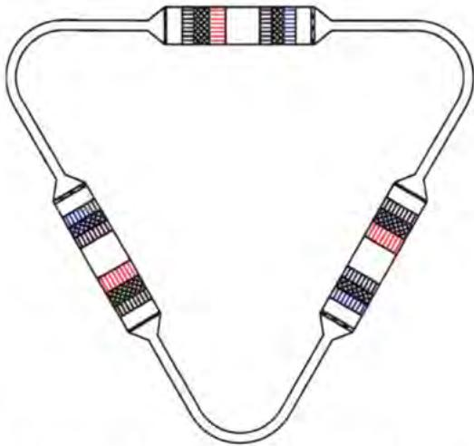  
图 3.1 三单元直连型环路热驱动热声制冷机

Figure 3.1 The three-unit direct-coupling looped heat-driven thermoacoustic refrigerator  
  
图 3.2 直连型环路热驱动热声制冷机的一个基本单元  
Figure 3.2 A subunit of the direct-coupling looped heat-driven thermoacoustic refrigerator

基于一维模拟软件 Sage，本文优化计算了直连型环路热驱动室温热声制冷机的各部件尺寸，优化结果如表 3.1 所示。需要说明的是，室温换热器、热端换热器和冷端换热器均采用壳管式换热器，其中室温换热器和冷端换热器换热小管的直径为 1 mm，热端换热器换热小管的直径为 1.4 mm。回热器填充不锈钢丝网，孔隙率为 0.78，丝径为 50 微米。层流化丝网选择的是 20 目的紫铜丝网。计算过程中，平均压力设定为 10 MPa，气体工质类型选择为氦气。热端换热器、室温换热器和冷端换热器的固体壁面温度分别设定为 300 ℃、50 ℃ 和 10 ℃，换热器、谐振管、变径管和空腔等均采用等壁温模型，回热器采用多孔介质模型。

表 3.1 直连型环路热驱动热声制冷机结构尺寸  
Table 3.1 Main dimensions of the direct-coupling looped heat-driven thermoacoustic refrigerator

<table><tr><td></td><td>部件</td><td>D (mm)</td><td>L (mm)</td><td>其它</td></tr><tr><td rowspan="4">热声发动机</td><td>室温换热器</td><td>110</td><td>35</td><td>孔隙率0.15,换热管直径1 mm</td></tr><tr><td>回热器</td><td>110</td><td>45</td><td>丝径50 μm、孔隙率0.78的丝网</td></tr><tr><td>热端换热器</td><td>110</td><td>50</td><td>孔隙率0.15,换热管直径1.4 mm</td></tr><tr><td>热缓冲管</td><td>110</td><td>100</td><td>--</td></tr><tr><td rowspan="4">热声制冷机</td><td>室温换热器</td><td>110</td><td>35</td><td>孔隙率0.15,换热管直径1 mm</td></tr><tr><td>回热器</td><td>110</td><td>35</td><td>丝径50 μm、孔隙率0.78的丝网</td></tr><tr><td>冷端换热器</td><td>110</td><td>35</td><td>孔隙率0.15,换热管直径1 mm</td></tr><tr><td>热缓冲管</td><td>110</td><td>50</td><td>--</td></tr><tr><td rowspan="5">谐振机构</td><td>层流话丝网</td><td>110</td><td>5</td><td>20目紫铜丝网</td></tr><tr><td>变径管1</td><td>110~28</td><td>150</td><td>--</td></tr><tr><td>谐振管</td><td>28</td><td>3000</td><td>--</td></tr><tr><td>变径管2</td><td>28~110</td><td>150</td><td>--</td></tr><tr><td>橡胶膜装置</td><td>110</td><td>50</td><td>橡胶膜厚度2 mm</td></tr></table>

在计算过程中，为了合理的评估系统性能，本章定义了一些变量。声功的定义为

$$
W = \frac {1}{2} | p _ {1} | | U _ {1} | \cos \theta_ {p - U}\tag{3-1}
$$

其中， $p_{1}$ 、 $U_{1}$ 和 $\theta_{p-U}$ 分别代表动态压力波动、体积流率以及压力波动超前体积流率的相位角。

无量纲声学阻抗的定义为

$$
Z = \frac {| p _ {1} |}{\rho_ {m} a | u _ {1} |}\tag{3-2}
$$

其中， $u_{1}$ 、 $\rho_{m}$ 和a分别代表当地的气体流动速度、密度和声速。

对于热声发动机，热声转换效率的定义为

$$
\eta_ {e} = \frac {\Delta W _ {e}}{Q _ {h}}\tag{3-3}
$$

其中， $\Delta W_{e}$ 代表热声发动机净产生声功（出口声功减去入口声功）， $Q_{h}$ 代表热声发动机的输入热量。

对于热声制冷机，制冷效率的定义为

$$
\eta_ {r} = \frac {Q _ {c}}{\Delta W _ {r}}\tag{3-4}
$$

其中， $Q_{c}$ 代表热声制冷机的制冷量， $\Delta W_{r}$ 代表热声制冷机消耗声功（入口声功减去出口声功）。

对于级连型环路热驱动热声制冷机，系统热制冷系数的定义为

$$
C O P = \frac {Q _ {c}}{Q _ {h}}\tag{3-5}
$$

输入烟的定义为

$$
X _ {i n} = Q _ {h} (1 - \frac {T _ {0}}{T _ {h}})\tag{3-6}
$$

输出烟的定义为

$$
X _ {o u t} = Q _ {c} (\frac {T _ {0}}{T _ {c}} - 1)\tag{3-7}
$$

其中， $T_{0}$ 、 $T_{h}$ 和 $T_{c}$ 分别代表环境温度、加热温度和制冷温度。

相对卡诺效率或者系统输入烟效率的定义为

$$
\eta = \frac {Q _ {c} (\frac {T _ {0}}{T _ {c}} - 1)}{Q _ {h} (1 - \frac {T _ {0}}{T _ {h}})}\tag{3-8}
$$

## 3.2.2 单元数的选择

环路热声系统通常采用二单元、三单元和四单元的结构形式。在直连型环路热驱动热声制冷系统中，热声发动机和热声制冷机两者一起作为系统的一个核心单元。二单元和四单元直连型环路热驱动室温热声制冷机如图3.3所示。采用相同的设计工况：工质为氦气，平均压力、加热温度、制冷温度和环境温度分别设定为10 MPa、300 ℃、10 ℃和50 ℃，分别对二单元、三单元和四单元的直连型环路热驱动室温热声制冷机进行优化计算，并且从总制冷量、功率密度、热制冷系数和相对卡诺效率对二单元、三单元和四单元系统性能进行定量评估。需要说明的是，功率密度的定义为系统单位体积产生的净制冷量，其中体积指的是系统内部的空体积。

  
图 3.3 二单元和四单元的直连型环路热驱动室温热声制冷机  
Figure 3.3 Two-unit and four-unit direct-coupling looped heat-driven thermoacoustic refrigerator

计算结果如表 3.2 所示，对于二单元、三单元和四单元直连型环路热驱动室温热声制冷机，系统总的制冷量分别达到 5.1 kW、8.0 kW 和 8.8 kW，功率密度分别达到 $142 \, kW/m^{3}$ 、 $395 \, kW/m^{3}$ 和 $363 \, kW/m^{3}$ ，热制冷系数分别达到 0.48、0.44 和 0.38，相对卡诺效率分别达到 15.5%、14.3% 和 12.4%。功率密度方面，三单元直连型是二单元直连型的 2.8 倍，是四单元直连型的 1.1 倍；热制冷系数方面，三单元直连型达到 0.44，比二单元直连型低 8.3%，比四单元直连型高 15.8%。综合考虑系统的功率密度和热制冷系数，三单元直连型环路热驱动室温热声制冷机的性能是最优的。

表 3.2 不同单元直连型环路热驱动热声制冷机性能对比  
Table 3.2 Performance comparison of different units direct-coupling looped heat-driven thermoacoustic refrigerator

<table><tr><td></td><td>制冷量(kW)</td><td>功率密度(kW/m3)</td><td>热制冷系数</td><td>相对卡诺效率</td></tr><tr><td>二单元</td><td>5.1</td><td>142</td><td>0.48</td><td>15.5%</td></tr><tr><td>三单元</td><td>8.0</td><td>395</td><td>0.44</td><td>14.3%</td></tr><tr><td>四单元</td><td>8.8</td><td>363</td><td>0.38</td><td>12.4%</td></tr></table>

## 3.2.3 回热器填充材料的选择

表 3.3 不同回热器填充材料下直连型环路热驱动热声制冷机性能对比  
Table 3.3 Performance comparison of direct-coupling looped heat-driven thermoacoustic refrigerator with different regenerator filling materials

<table><tr><td></td><td>总制冷量(kW)</td><td>功率密度(kW/m3)</td><td>热制冷系数</td><td>相对卡诺效率</td></tr><tr><td>不锈钢丝网</td><td>8.00</td><td>395</td><td>0.44</td><td>14.3%</td></tr><tr><td>随机丝绵</td><td>5.90</td><td>291</td><td>0.46</td><td>15.0%</td></tr></table>

回热器是热声转换的核心部件，其中热声发动机回热器实现热到声的转换，热声制冷机回热器实现声致冷的转换。回热器填充材料为实现上述热声转换提供固体热容，填充材料的选择和优化对于系统性能的提升至关重要。回热器填充材料通常为不锈钢丝网和随机丝绵等，国内不锈钢丝网的加工工艺相对成熟，可选择的规格也较多，而随机丝绵的加工难度较高，价格相对昂贵。不锈钢丝网或者随机丝绵的负面效应是层叠形成的不规则流道会增加流动阻力损失。通常情况下，我们通过控制不锈钢丝网或随机丝绵流道的水力直径与热穿透深度之间的比值来满足双行波环路热驱动热声制冷系统的不同要求。经过优化，不锈钢丝网的规格是：丝径50微米，孔隙率为0.78；随机丝绵的规格是：丝径20微米，孔隙率0.92。采用相同的计算工况：工质选择为氦气，平均压力、加热温度、制冷温度和环境温度分别设定为10 MPa、300 ℃、10 ℃和50 ℃。计算结果如表3.3所示，对于回热器内填充不锈钢丝网的直连型环路热驱动室温热声制冷机，系统总制冷量达到 8.0 kW，功率密度达到 $395 \, kW/m^{3}$ ，热制冷系数达到 0.44，相对卡诺效率达到 14.3%；对于回热器内填充随机丝绵的直连型环路热驱动室温热声制冷机，系统总制冷量达到 5.9 kW，功率密度达到 $291 \, kW/m^{3}$ ，热制冷系数达到 0.46，相对卡诺效率达到 15.0%。综合考虑系统的热制冷系数和功率密度，回热器的填充材料为：丝径 50 微米、孔隙率 0.78 的不锈钢丝网。

## 3.2.4 热力学性能研究

  
图 3.4 直连型环路热驱动室温热声制冷机的声场分布  
Figure 3.4 Acoustic field distribution of the direct-coupling looped heat-driven thermoacoustic refrigerator

接下来，本文针对三单元直连型环路热驱动室温热声制冷机（下文统称直连型环路热驱动室温热声制冷机）开展热力学性能研究。直连型系统由三个完全相同的基本单元首尾相连组成，其中每个单元内压力波动和体积流率的相位变化为 $120^{\circ}$ 。由于系统的对称性，本文仅针对其中一个基本单元进行分析。平均压力、加热温度、制冷温度和环境温度分别设定为 $10\mathrm{MPa}$ 、 $300^{\circ}\mathrm{C}$ 、 $10^{\circ}\mathrm{C}$ 和 $50^{\circ}\mathrm{C}$ 。计算结果表明，系统频率为 $61.3\mathrm{Hz}$ ，热声发动机入口的压比为1.093，制冷量为 $2.67\mathrm{kW}$ ，热制冷系数为0.44。直连型环路热驱动室温热声制冷机的声场分布如图3.4所示，其中（a）为无量纲声学阻抗幅值沿程分布，（b）为p-U相位差沿程分布，（c）为声功流沿程分布。由图可知，在热声发动机回热器内部，无量纲声学阻抗幅值的变化范围为12.3\~10.8，p-U相位差的变化范围为-36.1°\~-22.6°，声功的变化范围为3.1kW\~4.8kW，相应的声功放大率为0.51。在热声制冷机回热器内部，无量纲声学阻抗幅值变化范围为9.0\~9.1，p-U相位差变化范围为2.6°\~13.5°，声功变化范围为4.63kW\~3.74kW，相应的声功消耗率为0.22。热声发动机回热器的p-U相位差处于“行波零点”的负侧（压力波滞后于速度波），而热声制冷机回热器的p-U相位差处于“行波零点”的正侧（压力波领先于速度波）。热声发动机和热声制冷机的回热器均处于合理的行波声场，且实现了合理的声学阻抗。谐振管仍然是由行波声场控制，p-U相位差的变化范围为40.3°\~50.6°。谐振机构的声功变化范围为3.68kW\~3.12kW，相应的声功传递效率为0.85。

  
图 3.5 直连型环路热驱动热声制冷机的速度分布  
Figure 3.5 Velocity distribution of the direct-coupling looped heat-driven thermoacoustic refrigerator

直连型环路热驱动室温热声制冷机的速度分布如图3.5所示。由图可知，高压氦气在热声制冷机热缓冲管内往复振荡的速度约为2.5 m/s，在换热器内往复振荡的速度约为15 m/s，在谐振管内往复振荡的速度约为40.0 m/s。如果不采取任何措施，在热声制冷机热缓冲管内将产生严重地喷射驱动的射流，最终导致热声制冷机热缓冲管两端由于冷热流体的混合而产生大量的冷量损失。本文采用两种措施抑制热缓冲管内喷射驱动的射流。第一种措施是将变径管的长度延长至150mm；第二种措施是在热声制冷机出口（热缓冲管与变径管之间）放置5 mm厚度、20目的紫铜丝网。紫铜丝网类似于一个随雷诺数增加而增加的非线性阻抗，在抑制热缓冲管内喷射驱动的射流的同时也会带来声功的损耗。

烟损失是衡量系统各部件有效能损失大小的一个关键参数，其中 AEfric、AEQw、AEQx 和 AEdiscr 分别代表粘性流动烟损失、非理想换热烟损失、热漏烟损失和误差对应的烟损失，他们分别由粘性流动、内部不可逆传热、漏热以及烟损失偏差引起。在 Sage 模拟计算过程中，换热器模型采用等壁温模型，忽略了换热器固体壁面和外部换热流体之间的换热温差，因此非理想换热烟损失仅代表内部非理想换热烟损失。直连型环路热驱动室温热声制冷机一个基本单元的输入烟和输出烟分别为2632 W和377 W，烟效率为14.3%。直连型环路热驱动室温热声制冷机的烟损失率分布如图3.6所示。需要说明的是，烟损失率的定义为各部件的烟损失与输入烟的比值。可以发现，系统第一大烟损失发生在热声发动机的回热器内，以27%的烟损失率产生711 W的烟损失，其中粘性流动烟损失、非理想换热烟损失和热漏烟损失分别为168 W，366 W和162 W。热声发动机回热器具有较高的声学阻抗，因此粘性流动烟损失较小，但是非理想换热烟损失占比较大。系统第二大烟损失发生在谐振机构内，以21.6%的烟损失率产生568 W的烟损失。谐振机构的烟损失包括层流化丝网、变径管1、谐振管、变径管2和橡胶膜装置的烟损失。谐振管内的烟损失为549 W，占比20.1%，其中粘性流动烟损失和非理想换热烟损失分别为509 W和38 W。在谐振管内，气体粘性流动烟损失占比较大的主要原因是较高的往复振荡速度。系统第三大烟损失发生在热声制冷机回热器内，以14.8%的烟损失率产生391 W的烟损失。其中粘性流动烟损失、非理想换热烟损失和热漏烟损失分别为223 W，147 W和15 W，粘性流动烟损失占比最大。

  
图 3.6 直连型环路热驱动热声制冷机的烟损失率分布  
Figure 3.6 Exergy loss ratio distribution of the direct-coupling looped heat-driven thermoacoustic refrigerator

## 3.3 实验系统设计及搭建

## 3.3.1 直连型系统机械设计

直连型环路热驱动室温热声制冷机由三个相同的单元组成，每个单元包括一个热声核心管段和一根谐振管，其中热声核心管段依次包括变径管2、橡胶膜装置、室温换热器1、回热器1、热端换热器、热缓冲管1、室温换热器2、回热器2、冷端换热器、热缓冲管2、层流化丝网、变径管1。本文基于Solidworks软件进行结构设计。直连型系统总体装置示意图如图3.7所示。总体装置的长、宽和高分别为1.5 m、1.4 m和2.0 m，重量约为220 kg。需要说明的是，为了抑制热缓冲管内的自然对流[156]，将热声核心管段竖直放置，其中热声发动机在上，热声制冷机在下；为了使系统更加紧凑，将谐振管折弯180°；导热油进口和出口管分别和外部的油温机相连，通过两个四通分别与热声发动机的热端换热器相连。

  
图 3.7 直连型系统总体装置示意图

Figure 3.7 Schematic diagram of the overall direct-coupling system device  
  
图 3.8 直连型热声核心管段示意图

Figure 3.8 Schematic diagram of the direct-coupling thermoacoustic core  
  
图 3.9 室温换热器和冷端换热器结构示意图  
Figure 3.9 Schematic diagram of the ambient heat exchanger and the cold heat exchanger

  
图 3.10 热端换热器结构示意图

Figure 3.10 Schematic diagram of the hot heat exchanger  
  
图3.11 谐振管结构示意图  
Figure 3.11 Schematic diagram of the resonant tube

直连型热声核心管段示意图如图3.8所示，从上到下依次包括变径管2、橡胶膜装置、室温换热器1、回热器1、热端换热器、热缓冲管1、室温换热器2、回热器2、冷端换热器、热缓冲管2、层流化丝网、变径管1。室温换热器以及冷端换热器的结构示意图如图3.9所示，室温换热器1、室温换热器2以及冷端换热器均采用壳管式换热器，换热管的材料采用紫铜，为增大气固换热面积，采用一根大管套四根小管的结构形式，大管的内径和外径分别为3.2 mm和4.5 mm，小管的内径和外径分别为1.0 mm和1.4 mm，孔隙率为0.15。热端换热器的结构示意如图3.10所示，热端换热器采用壳管式换热器，换热管的材料采用不锈钢，换热管的内径和外径分别为1.4 mm和2.0 mm，孔隙率为0.15，热端换热器两侧分别通过两个90°弯管焊接两个DN40不锈钢法兰，然后分别与导热油进口管和出口管相连。此外，需要说明的是，热声发动机和热声制冷机的回热器内部填充不锈钢丝网，丝径为50微米，目数为120目，通过称重法计算不锈钢丝网的孔隙率，保证热声发动机和热声制冷机回热器的孔隙率为0.78；为了装配方便，回热器内径设计为107 mm，换热器的内径设计为102 mm；为了抑制热缓冲管内喷射驱动的射流，热缓冲管1两端以及热缓冲管2的冷端分别放置2.5 mm厚度、80目的不锈钢丝网；层流化丝网采用20目的紫铜丝网，厚度为5 mm；橡胶膜厚度约为2 mm。回热器1、热端换热器和热缓冲管2组装完成之后焊接成一个整体，回热器2、冷端换热器和热缓冲管2组装完成后也焊接成一个整体。谐振管的结构示意图如图3.11所示，其中，长弯管的长度为2.97 m，两端面水平距离为1.2 m，竖直距离为0.75 m，弯管必须控制在一个平面上，谐振管内壁面尽可能光滑，且为无缝钢管，谐振管外侧布置水套，实验过程中谐振管外侧循环50℃的冷却水。

## 3.3.2 实验装置和测量系统

实验装置如图 3.12 所示，该装置由直连型环路热驱动室温热声制冷机子系统、导热油循环子系统、丙二醇循环子系统、冷却水循环子系统和数据采集系统组成。在直连型环路热驱动室温热声制冷机子系统中，热声发动机放置在热声制冷机上方以抑制自然对流的不利影响。采用厚度为 60 mm 的硅酸铝保温材料对热声发动机进行保温以减少热量损失；采用多层泡沫保温材料对热声制冷机的冷端换热器以及丙二醇循环管道进行保温以减少冷量损失。热声发动机的入口安装弹性膜装置以抑制系统环路 Gedeon 直流。采用高精度动态压力传感器 PCB（11B26 型，非线性≤1.0%满量程）对热声发动机入口的动态压力进行监测。采用昆仑传感器（精度为±0.25%）测量热声发动机入口的平均压力。图 3.12（b）为导热油循环子系统示意图，通过油温机加热导热油，然后间接为热声发动机提供热源。分别使用品致（PINTECH）的高精度电流探头（PT2720 型，精度为±1%）和压差探头（N1000A 型，精度为±1%）测量加热电源的电压和电流，间接获得三个热端换热器的总加热功率。在热端换热器出口处安装一个校准的 PT100 铂电阻温度计（精度为±0.1℃），用于测量导热油的加热温度。图 3.12（c）为丙二醇循环子系统示意图。采用丙二醇加热，用安诺 AN7931 型功率计（精度为±0.5%）分别测量三个加热器的加热量，然后根据能量守恒原理间接测量冷端换热器的制冷量。在丙二醇储存箱中布置三个校准的 PT100 铂电阻温度计（精度为±0.1℃），用于测量丙二醇的循环温度。在水循环子系统中，室温换热器由循环冷却水冷却。所有的温度、压力、电压和电流等信号均由安捷伦和 NI 动态信号采集系统同时采集，以便进一步处理。

  
图 3.12 实验装置：（a）直连型环路热驱动室温热声制冷机子系统（b）导热油循环子系统示意图（c）丙二醇循环子系统示意图  
Figure 3.12 The experimental setup: (a) A direct-coupling looped heat-driven thermoacoustic refrigerator subsystem (b) The schematic diagram of thermal oil circulating subsystem (c)
The schematic diagram of propylene glycol circulating subsystem

## 3.3.3 漏热测试

实验过程中丙二醇工质的工作温度为-15-15℃，低于环境温度，如环境温度按25℃计算，丙二醇工质与环境温度的温差为10-40℃，环境向系统内输入热量，加热器也向系统输入热量，热声制冷机冷端换热器从系统带走热量。系统温度稳定时，热声制冷机制冷量等于加热器加热量和环境向系统的输入热量（也即环境向丙二醇循环子系统的静态漏热）之和。因此在实验之前，我们必须测量环境向丙二醇循环子系统的静态漏热量。丙二醇循环子系统漏热测试装置如图3.13所示，管道及容器外侧缠绕多层泡沫保温材料。实验过程中，丙二醇流体和外部环境之间的温差控制在10-40℃之间，选取的测试工况点分别为19℃、22℃、27℃、32℃和37℃，静态漏热量分别为10.2W，25.5W，54.0W，82.6W，116.5W。根据静态漏热量的测量结果，可以得到漏热量与温差之间的拟合曲线如图3.14所示，拟合方程为y=5.879x-103，其中y为漏热量，x为温差。

  
图 3.13 丙二醇循环子系统漏热测试装置

Figure 3.13 The heat leakage test device of propylene glycol circulating subsystem  
  
图 3.14 丙二醇循环子系统静态漏热拟合曲线  
Figure 3.14 Fitting curve of static heat leakage of propylene glycol circulating subsystem

实验过程中，导热油流体的工作温度高于环境温度，向环境输入热量。系统温度稳定时，热声发动机加热量等于油温机加热量减去导热油循环子系统的漏热量。因此在实验之前，我们必须测量导热油循环子系统的静态漏热。单独测试导热油循环子系统，使导热油的循环温度分别为 $160^{\circ}\mathrm{C}$ 、 $180^{\circ}\mathrm{C}$ 、 $200^{\circ}\mathrm{C}$ 、 $220^{\circ}\mathrm{C}$ 、 $300^{\circ}\mathrm{C}$ 和 $340^{\circ}\mathrm{C}$ ，此时油温机的加热量恰好等于导热油循环子系统的静态漏热。测试结果表明，油温机的加热量分别为 $3.24\mathrm{kW}$ 、 $4.51\mathrm{kW}$ 、 $5.88\mathrm{kW}$ 、 $7.20\mathrm{k}$ 、 $12.93\mathrm{kW}$ 和 $16.01\mathrm{kW}$ 。导热油循环子系统静态漏热拟合曲线如图3.15所示，可以得到漏热量与温差之间的拟合曲线为 $y = 71.6x - 6534$ ，其中 $y$ 为漏热量， $x$ 为温差。

  
图 3.15 导热油循环子系统静态漏热拟合曲线  
Figure 3.15 Fitting curve of static heat leakage of thermal oil circulating subsystem

## 3.4 结果及讨论

为了测试直连型环路热驱动室温热声制冷系统的性能, 本文开展了一系列的实验。实验过程中, 当加热温度达到 $80^{\circ} \mathrm{C}$ 左右时, 直连型环路热驱动室温热声制冷系统开始自激起振, 频率为 $58 \mathrm{~Hz}$ 。随着加热温度的升高, 动态压力波动的幅值不断增大, 热声制冷机的制冷温度进一步降低。当加热温度和制冷温度达到设定温度时, 分别调节导热油循环子系统和丙二醇循环子系统的加热功率使加热温度和制冷温度保持稳定。

## 3.4.1 不同平均压力下的系统性能

系统的平均压力设定为 8 MPa 和 10 MPa，加热温度和环境温度分别设定为 300 °C 和 50 °C。四个工况对应的制冷温度分别为 0 °C、5 °C、10 °C 和 15 °C。平均压力为 8 MPa 和 10 MPa 时系统总制冷量如图 3.16 所示。计算和实验结果均表明，相同的制冷温度，平均压力越高，系统制冷量越大；相同的平均压力，制冷温度越高，系统制冷量越大。制冷温度为 10 °C，平均压力为 10 MPa 和 8 MPa 时，计算结果表明总制冷量分别达到 6.5 kW 和 5.1 kW，实验结果表明系统总制冷量分别达到 3.3 kW 和 2.9 kW。平均压力为 8 MPa 和 10 MPa 时系统总加热量如图 3.17 所示。计算和实验结果均表明，相同的制冷温度，平均压力越高，系统加热量越大；相同的平均压力，制冷温度越高，系统的加热量越大。制冷温度为 10 ℃，平均压力为 10 MPa 和 8 MPa 时，计算结果表明系统总加热量分别达到 15.2 kW 和 12.1 kW，实验结果表明系统总加热量分别达到 14.8 kW 和 13.2 kW。平均压力为 8 MPa 和 10 MPa 时系统热制冷系数如图 3.18 所示。计算和实验结果均表明，相同的制冷温度，平均压力为 8 MPa 和 10 MPa 时系统热制冷系数基本一致；相同的平均压力，制冷温度越高，系统热制冷系数越大。制冷温度为 10 ℃，平均压力为 10 MPa 和 8 MPa 时，计算结果表明系统热制冷系数分别达到 0.43 和 0.42，实验结果表明系统热制冷系数分别达到 0.22 和 0.22。平均压力为 8 MPa 和 10 MPa 时系统相对卡诺效率如图 3.19 所示。计算和实验结果均表明，相同的制冷温度，平均压力为 8 MPa 和 10 MPa 时系统相对卡诺效率基本一致。制冷温度为 10 ℃，平均压力为 10 MPa 和 8 MPa 时，计算结果表明系统相对卡诺效率分别达到 14.0% 和 13.7%，实验结果表明系统相对卡诺效率分别达到 7.3% 和 7.1%。

  
图 3.16 平均压力为 8 MPa 和 10 MPa 时系统总制冷量

Figure 3.16 Total cooling capacity under the mean pressure of 8 MPa and 10 MPa  
  
图 3.17 平均压力为 8 MPa 和 10 MPa 时系统总加热量  
Figure 3.17 Total heating power under the mean pressure of 8 MPa and 10 MPa

  
图 3.18 平均压力为 8 MPa 和 10 MPa 时系统热制冷系数

Figure 3.18 COP under the mean pressure of 8 MPa and 10 MPa  
  
图 3.19 平均压力为 8 MPa 和 10 MPa 时系统相对卡诺效率  
Figure 3.19 Relative Carnot efficiency under the mean pressure of 8 MPa and 10 MPa

## 3.4.2 不同加热温度下的系统性能

  
图 3.20 加热温度为 $300^{\circ}$ C 和 $340^{\circ}$ C 时系统总制冷量  
Figure 3.20 Total cooling capacity under the heating temperature of $300^{\circ}$ C 和 $340^{\circ}$ C

  
图 3.21 加热温度为 $300^{\circ}$ C 和 $340^{\circ}$ C 时系统总加热量

Figure 3.21 Total heating power under the heating temperature of $300^{\circ}$ C 和 $340^{\circ}$ C  
  
图 3.22 加热温度为 $300^{\circ}$ C 和 $340^{\circ}$ C 时系统热制冷系数

Figure 3.22 COP under the heating temperature of $300^{\circ}$ C 和 $340^{\circ}$ C  
  
图 3.23 加热温度为 $300^{\circ}$ C 和 $340^{\circ}$ C 时系统相对卡诺效率  
Figure 3.23 Relative Carnot efficiency under the heating temperature of $300^{\circ}$ C 和 $340^{\circ}$ C

为了验证加热温度对系统性能的影响，分别在 $300^{\circ}$ C 和 $340^{\circ}$ C 的加热温度下开展了相关实验。平均压力设定为 10 MPa，环境温度设定为 $50^{\circ}$ C。四个工况对应的制冷温度分别为 $0^{\circ}C$ 、 $5^{\circ}C$ 、 $10^{\circ}C$ 和 $15^{\circ}C$ 。加热温度为 $300^{\circ}C$ 和 $340^{\circ}C$ 时系统总制冷量如图 3.20 所示。计算和实验结果均表明，相同的制冷温度，加热温度越高，系统总制冷量越大。制冷温度为 $10^{\circ}C$ ，加热温度为 $300^{\circ}C$ 和 $340^{\circ}C$ 时，计算结果表明系统总制冷量分别达到 6.5 kW 和 10.2 kW，实验结果表明系统总制冷量分别达到 3.3 kW 和 4.6 kW。加热温度为 $300^{\circ}C$ 和 $340^{\circ}C$ 时系统总加热量如图 3.21 所示。计算和实验结果均表明，相同的制冷温度，加热温度越高，系统总加热量越大。制冷温度为 $10^{\circ}C$ ，加热温度为 $300^{\circ}C$ 和 $340^{\circ}C$ 时，计算结果表明系统总加热量分别达到 15.2 kW 和 22.8 kW，实验结果表明系统总加热量分别达到 14.8 kW 和 21.0 kW。加热温度为 $300^{\circ}C$ 和 $340^{\circ}C$ 时系统热制冷系数如图 3.22 所示。计算结果表明，相同的制冷温度，加热温度越高，系统热制冷系数越大；实验结果表明，在两种加热温度下，系统热制冷系数基本一致。制冷温度为 $10^{\circ}C$ ，加热温度为 $300^{\circ}C$ 和 $340^{\circ}C$ 时，计算结果表明系统热制冷系数分别达到 0.43 和 0.45，实验结果表明系统热制冷系数分别达到 0.22 和 0.22。加热温度为 $300^{\circ}C$ 和 $340^{\circ}C$ 时系统相对卡诺效率如图 3.23 所示。计算结果表明，相同的制冷温度，加热温度越高，系统的相对卡诺效率越高；实验结果表明，在两种加热温度下，系统相对卡诺效率基本一致。制冷温度为 $10^{\circ}C$ ，加热温度为 $300^{\circ}C$ 和 $340^{\circ}C$ 时，计算结果表明系统相对卡诺效率分别达到 14.0% 和 13.4%，实验结果表明系统相对卡诺效率分别达到 7.1% 和 6.5%。

  
图 3.24 不同单元制冷机的制冷量随加热温度的变化  
Figure 3.24 Cooling capacity under the different heating temperature

此外，为了验证直连型环路热驱动室温热声制冷系统在回收利用低品位热源领域的潜力，本文分别在加热温度为 $160^{\circ}C$ 、 $180^{\circ}C$ 、 $200^{\circ}C$ 和 $220^{\circ}C$ 时开展了相关实验。其中，平均压力、环境温度和制冷温度分别设定为 10 MPa、 $30^{\circ}C$ 和 $10^{\circ}C$ 。不同单元热声制冷机的制冷量随加热温度的变化如图 3.24 所示。计算和实验结果均表明，随着加热温度的升高，三个单元制冷机的制冷量逐渐增大。加热温度为 $200^{\circ}C$ 时，计算结果表明，单个单元制冷机的制冷量达到 1.39 kW，系统总的制冷量达到 4.17 kW；实验结果表明，单元 1、单元 2 和单元 3 热声制冷机的制冷量分别达到 0.72 kW、0.71 kW 和 0.69 kW，系统总的制冷量达到 2.12 kW。系统的热制冷系数和相对卡诺效率随加热温度的变化如图 3.25 所示。计算结果表明，随着加热温度的升高，系统热制冷系数逐渐增大，系统相对卡诺效率逐渐减小；实验结果表明，随着加热温度的升高，系统热制冷系数和相对卡诺效率均逐渐增大。加热温度为 200 ℃ 时，计算结果表明，系统热制冷系数和相对卡诺效率分别达到 0.51 和 9.9%；实验结果表明，系统热制冷系数和相对卡诺效率分别达到 0.25 和 4.9%。

  
图 3.25 系统的热制冷系数和相对卡诺效率随加热温度的变化  
Figure 3.25 COP and Relative Carnot efficiency under the different heating temperature

## 3.4.3 冷藏温区的系统性能

  
图 3.26 加热温度为 $260^{\circ}C$ 和 $300^{\circ}C$ 时系统总制冷量  
Figure 3.26 Total cooling capacity under the heating temperature of 260 °C 和 300 °C

为了考察直连型环路热驱动室温热声制冷系统在冷藏温区的性能, 制冷工况选择-15℃、-10℃、-5℃和0℃, 加热工况选择260℃和300℃, 平均压力和环境温度分别设定为 10MPa 和 30℃。加热温度为 260℃ 和 300℃ 时系统总制冷量如图 3.26 所示。计算和实验结果均表明，相同的制冷温度，加热温度越高，系统制冷量越大；相同的加热温度，制冷温度越高，系统制冷量越大。制冷温度为 -10℃，加热温度为 300℃ 和 260℃ 时，计算结果表明系统总制冷量分别达到 9.9 kW 和 6.0 kW，实验结果表明系统总制冷量分别达到 3.6 kW 和 2.6 kW。加热温度为 260℃ 和 300℃ 时系统总加热量如图 3.27 所示。计算和实验结果均表明，相同的制冷温度，加热温度越高，系统加热量越大。制冷温度为 -10℃，加热温度为 300℃ 和 260℃ 时，计算结果表明系统总加热量分别为 23.0 kW 和 14.6 kW，实验结果表明系统总加热量分别为 20.1 kW 和 14.2 kW。

  
图 3.27 加热温度为 $260^{\circ}C$ 和 $300^{\circ}C$ 时系统总加热量

Figure 3.27 Total heating power under the heating temperature of 260 °C 和 300 °C  
  
图 3.28 加热温度为 $260^{\circ}C$ 和 $300^{\circ}C$ 时系统热制冷系数  
Figure 3.28 COP under the heating temperature of $260^{\circ}$ C 和 $300^{\circ}$ C

加热温度为 $260^{\circ}C$ 和 $300^{\circ}C$ 时系统热制冷系数如图 3.28 所示。计算结果表明，相同的制冷温度，加热温度越高，系统热制冷系数越高；实验结果表明，相同的制冷温度，系统在 $260^{\circ}C$ 和 $300^{\circ}C$ 的加热温度下热制冷系数基本不变。制冷温度为 $-10^{\circ}C$ ，加热温度为 $300^{\circ}C$ 和 $260^{\circ}C$ 时，计算结果表明系统热制冷系数分别达到 0.43 和 0.41，实验结果表明系统热制冷系数分别达到 0.18 和 0.18。加热温度为 $260^{\circ}$ C 和 $300^{\circ}$ C 时系统相对卡诺效率如图 3.29 所示。计算和实验结果均表明，相同的制冷温度，加热温度越高，系统的相对卡诺效率越低。加热温度为 $300^{\circ}$ C 和 $260^{\circ}$ C 时，计算结果表明系统相对卡诺效率分别达到 13.9% 和 14.5%，实验结果表明系统相对卡诺效率分别达到 5.7% 和 6.4%。

  
图 3.29 加热温度为 $260^{\circ}$ C 和 $300^{\circ}$ C 时系统相对卡诺效率  
Figure 3.29 Relative Carnot efficiency under the heating temperature of 260 °C 和 300 °C

## 3.4.4 抑制直流的弹性橡胶膜位置的影响

  
图 3.30 直连型环路热驱动热声制冷机改进结构  
Figure 3.30 Improved structure subunit of the direct-coupling heat-driven thermoacoustic refrigerator

通过上述理论和实验研究，可以发现实验与计算结果之间大约有 50% 的偏差，其中的一个原因是 Sage 计算过程中未考虑换热器固体壁面与外部换热流体之间的外部不可逆换热损失，另一个原因可能是 Sage 计算模型低估了热声制冷机热缓冲管 2 内复杂流动和换热引起的冷量损失（由喷射驱动的射流引起）。第二个原因的推测依据是，谐振管内气体工质往复振荡的速度高达 40 m/s，热缓冲管 2 内气体工质往复振荡的速度仅为 2.5 m/s，在谐振管与热缓冲管 2 之间，长度为 150 mm 的变径管 1 和长度为 5 mm 的层流化丝网可能无法实现平滑的流动过渡，从而引起热缓冲管 2 内喷射驱动的射流，导致直连型系统较大的冷量损失。为了验证这一推测，我们拆除层流化丝网和放置橡胶膜的空腔，将弹性橡胶膜布置在热声制冷机热缓冲管 2 和变径管 1 之间。改进后的环路热驱动室温热声制冷机的一个基本单元如图 3.30 所示，改进直连型系统取消了层流化丝网和橡胶膜装置中的空腔，不仅简化直连型系统的结构，进一步缩小空体积，同时可以完全抑制环路 Gedeon 直流和热缓冲管 2 内喷射驱动的射流，减少热声制冷机的冷量损失。

  
图 3.31 橡胶膜布置在不同位置时系统总制冷量

Figure 3.31 Total cooling capacity of elastic membranes installed in different locations  
  
图 3.32 橡胶膜布置在不同位置时系统总加热量  
Figure 3.32 Total heating power of elastic membranes installed in different locations

为了考察抑制直流的弹性橡胶膜位置对直连型系统性能的影响，本文将橡胶膜分别布置在热声发动机的入口和热声制冷机的出口，开展了对比实验。实验过程中，制冷温度分别设定为 $0^{\circ}\mathrm{C}$ 、 $5^{\circ}\mathrm{C}$ 、 $10^{\circ}\mathrm{C}$ 和 $15^{\circ}$ ，加热温度设定为 $300^{\circ}\mathrm{C}$ 和 $340^{\circ}\mathrm{C}$ ，环境温度和平均压力分别设定为 $50^{\circ}\mathrm{C}$ 和 $10\mathrm{MPa}$ 。橡胶膜布置在不同位置时直连型系统总制冷量如图3.31所示。实验结果表明，相同的加热温度和制冷温度下，将橡胶膜位置从热声发动机入口更换至热声制冷机出口，能显著提升系统总制冷量。加热温度为 $300^{\circ}\mathrm{C}$ ，制冷温度为 $10^{\circ}\mathrm{C}$ ，橡胶膜布置在热声发动机入口时，系统总制冷量达到 3.3 kW，橡胶膜布置在热声制冷机出口时，系统总制冷量达到 4.0 kW，系统总制冷量提升 21.2%。橡胶膜布置在不同位置时直连型系统总加热量如图 3.32 所示。实验结果表明，相同的加热温度和制冷温度下，将橡胶膜位置从热声发动机入口更换至热声制冷机出口，系统总加热量减小。加热温度为 300 ℃，制冷温度为 10 ℃，橡胶膜布置在热声发动机入口时，系统总加热量达到 14.8 kW，橡胶膜布置在热声制冷机出口时，系统总加热量达到 14.2 kW，系统总加热量减少 4.1%。橡胶膜布置在不同位置时直连型系统热制冷系数如图 3.33 所示。实验结果表明，相同的加热温度和制冷温度下，将橡胶膜位置从热声发动机入口更换至热声制冷机出口，能显著提升系统热制冷系数。加热温度为 300 ℃，制冷温度为 10 ℃，橡胶膜布置在热声发动机入口时，系统热制冷系数达到 0.22，橡胶膜布置在热声制冷机出口时，系统热制冷系数达到 0.28，系统热制冷系数提升 27.3%。

  
图 3.33 橡胶膜布置在不同位置时系统热制冷系数

Figure 3.33 COP of elastic membranes installed in different locations  
  
图 3.34 橡胶膜布置在不同位置时系统相对卡诺效率  
Figure 3.34 Relative Carnot efficiency of elastic membranes installed in different locations

橡胶膜布置在不同位置时直连型系统相对卡诺效率如图 3.34 所示。实验结果表明，相同的加热温度和制冷温度下，将橡胶膜位置从热声发动机入口更换至热声制冷机出口，能显著提升系统相对卡诺效率。加热温度为 $300^{\circ}$ C，制冷温度为 $10^{\circ}$ C，橡胶膜布置在热声发动机入口时，系统相对卡诺效率达到 7.3%，橡胶膜布置在热声制冷机出口时，系统相对卡诺效率达到 9.1%，系统相对卡诺效率提升 24.7%。

## 3.5 本章小结

本章针对新型直连型环路热驱动室温热声制冷机，开展了相关的理论和实验研究，主要内容包括：

（1）提出并设计直连型环路热驱动室温热声制冷机，系统由三个相同的单元组成，每个基本单元依次包括热声发动机、热声制冷机和谐振结构。热声发动机与热声制冷机直接相连，省去中间的谐振管，结构更加紧凑。

（2）针对直连型环路热驱动室温热声制冷机，本文考察单元数和回热器填充材料对系统功率密度和热制冷系数的影响。采用相同的设计工况： $f = 60 \text{ Hz}$ ， $P_0 = 10 \text{ MPa}$ ， $T_0 = 50^\circ\text{C}$ ， $T_h = 300^\circ\text{C}$ ， $T_c = 10^\circ\text{C}$ ，计算结果表明，二单元、三单元和四单元直连型环路热驱动室温热声制冷机，总的制冷量分别达到 $5.13 \text{ kW}$ 、 $8 \text{ kW}$ 和 $8.77 \text{ kW}$ ，功率密度分别达到 $142 \text{ kW/m}^3$ 、 $395 \text{ kW/m}^3$ 和 $363 \text{ kW/m}^3$ ，热制冷系数分别达到 $0.48$ 、 $0.44$ 和 $0.38$ ；回热器填充丝网和随机丝绵，系统总的制冷量分别达到 $8.0 \text{ kW}$ 和 $5.9 \text{ kW}$ ，功率密度分别达到 $395 \text{ kW/m}^3$ 和 $291 \text{ kW/m}^3$ ，热制冷系数分别为 $0.44$ 和 $0.46$ 。综合考虑功率密度和热制冷系数，直连型环路热驱动室温热声制冷机选择三单元和不锈钢丝网是最优的。

（3）针对三单元直连型环路热驱动室温热声制冷机，本文考察声场分布、速度分布和烟损失率分布。结果表明，回热器内的行波声场和高声学阻抗仍然是实现高效热声转换的关键。其中，热声发动机回热器的p-U相位差处于“行波零点”的负侧（压力波滞后于速度波），无量纲声学阻抗幅值为12.3\~10.8；热声制冷机回热器的p-U相位差处于“行波零点”的正侧（压力波领先于速度波），无量纲声学阻抗幅值为9.0\~9.1。系统最大的烟损失发生在热声发动机的回热器内，其中非理想换热及粘性流动烟损失占比最大。

（4）设计并搭建直连型环路热驱动室温热声制冷系统实验台。实验台包括直连型环路热驱动室温热声制冷机子系统、导热油循环子系统、丙二醇循环子系统、冷却水循环子系统和数据采集系统。直连型子系统总体装置的长、宽和高分别为1.5 m、1.4 m和2.0 m，重量约为220 kg。针对导热油循环子系统和丙二醇循环子系统开展了漏热测试，得到漏热量与温差之间的拟合曲线。

（5）考察平均压力、加热温度和制冷温度对直连型系统性能的影响。结果表明，平均压力为 10 MPa、环境温度为 50 °C、制冷温度为 10 °C、加热温度为

300 ℃ 时，系统总制冷量达到 3.3 kW，热制冷系数达到 0.22，相对卡诺效率达到 7.3%；平均压力为 10 MPa、环境温度为 30 ℃、制冷温度为 10 ℃、加热温度为 200 ℃ 时，系统总制冷量达到 2.1 kW，热制冷系数达到 0.25，相对卡诺效率达到 4.9%；平均压力为 10 MPa、环境温度为 30 ℃、制冷温度为 -10 ℃、加热温度为 300 ℃ 时，系统总制冷量达到 3.6 kW，热制冷系数达到 0.18，相对卡诺效率达到 5.7%。

（6）考察抑制直流的弹性橡胶膜位置对系统性能的影响。结果表明，将抑制直流的弹性橡胶膜位置从热声发动机入口更换至热声制冷机出口，能显著提升系统制冷量、热制冷系数和相对卡诺效率。平均压力为10 MPa、环境温度为50℃、制冷温度为10℃、加热温度为300℃时，橡胶膜布置在热声制冷机出口时，制冷量为4.0 kW，热制冷系数为0.28，相对卡诺效率为9.1%，性能提升20%以上。

## 第 4 章 环路热驱动室温热声制冷机的能量转换和匹配机理

## 4.1 本章导论

De Block 提出的三个热声发动机驱动一个热声制冷机的四单元环路热驱动热声制冷机一个最主要的问题是温度不匹配。对于理想的热声热机核心，声功流率（定义为热端（冷端）的声功除以室温端的声功）等于相对应的温比（热端（冷端）温度比室温端温度）。如果热声制冷机的制冷温度为 $10^{\circ}C$ ，环境温度为 $50^{\circ}C$ ，那么理想情况下热声制冷机的声功消耗率为 0.124，根据热声发动机和热声制冷机声功最优匹配，热声发动机的声功放大率应该为 1.14。然而根据热声发动机的温比（热端温度为 $300^{\circ}C$ 、环境温度为 $50^{\circ}C$ ），三台热声发动机的声功放大率为 5.58。三台热声发动机产生的声功远大于一台热声制冷机所需要的声功，因此 de Block 提出的流程适合更低温度的制冷。

本章首先从声场和温度两个角度探究热声发动机和热声制冷机的耦合机理，然后针对三种典型结构的双行波环路热驱动室温热声制冷机，在统一的操作条件下（固定频率、平均压力和温度等），定量比较功率密度和热制冷系数的大小，并且开展热力学性能研究，考察平均压力、加热温度和制冷温度对系统性能的影响规律。

## 4.2 热声热机核心单元的理论研究

根据第二章对回热器的热力学性能研究可知，声功增益比和热声转换效率是评价热声发动机和热声制冷机核心单元性能的两个主要参数，而影响这两个性能参数的变量可以分为五类，分别是结构参数、平均压力、频率、声场和温度。如果固定结构参数、平均压力和频率，工作温度（加热/制冷温度）和声场（包括声学相位和声学阻抗）将是影响环路热驱动室温热声制冷机性能的两个关键因素。

## 4.2.1 热声热机模型简介

热声发动机和热声制冷机核心单元的模型如图4.1所示，它们分别由室温换热器、回热器和热端换热器/冷端换热器构成，两个换热器和一个回热器形成所谓的热声核心。采用Sage软件对热声发动机和热声制冷机模型进行模拟计算。在设计过程中，回热器内填充的多孔介质选择不锈钢丝网，目数为120目，丝径为50微米。相比翅片式换热器，管壳式换热器具有更大的换热面积，换热效率更高。因此，换热器统一选择为管壳式换热器。由于高热导率和低特征声阻抗，高平均压力下的氦气是首选介质。加热功率和声功功率与工作气体的密度成正比，与平均压力也成正比。热声发动机如果在一个标准大气压下工作，静态漏热损失占主导地位。平均压力增加时，在相同的驱动压比下，声功率将成比例的增大，静态漏热损失几乎没有增加。高平均压力不仅可以提升系统的功率密度，也有利于提升系统的热声转换效率。在此，系统的平均压力设定为10 MPa。工作频率不仅影响粘性和传热损失引起的声功耗散以及动态导热损失引起的热流变化，而且会影响回热器内部的声学阻抗。经过大量的计算，本文发现环路热驱动室温热声制冷机的最优工作频率通常在60 Hz左右，因此将热声发动机和热声制冷机核心单元的工作频率固定为60 Hz。此外，室温换热器的温度固定为50℃，热声发动机和热声制冷机入口压比设定为1.1，回热器入口无量纲声学阻抗幅值分别设定为10、15和20。各部件尺寸如表4.1所示。

  
图 4.1 热声发动机和热声制冷机核心单元  
Figure 4.1 The core schematic of a TAE and a TAR

表 4.1 热声发动机和热声制冷机核心单元各部件尺寸  
Table 4.1 Main dimensions of thermoacoustic engine and thermoacoustic refrigerator cores

<table><tr><td></td><td>部件</td><td>内径(mm)</td><td>长度(mm)</td><td>其它</td></tr><tr><td rowspan="3">热声发动机</td><td>室温换热器1</td><td>110</td><td>35</td><td>孔隙率0.15,换热管内径1mm</td></tr><tr><td>回热器1</td><td>110</td><td>45</td><td>120目不锈钢丝网,孔隙率0.78</td></tr><tr><td>热端换热器</td><td>110</td><td>50</td><td>孔隙率0.15,换热管内径1.4mm</td></tr><tr><td rowspan="3">热声制冷机</td><td>室温换热器2</td><td>110</td><td>35</td><td>0.15孔隙率,换热管内径1mm</td></tr><tr><td>回热器2</td><td>110</td><td>35</td><td>120目不锈钢丝网,孔隙率0.78</td></tr><tr><td>冷端换热器</td><td>110</td><td>35</td><td>孔隙率0.15,换热管内径1mm</td></tr></table>

在计算过程中，为了进行合理的评估，定义了一些变量。声功的定义为

$$
W = \frac {1}{2} | p _ {1} | | U _ {1} | \cos \theta_ {p - U}\tag{4-1}
$$

其中， $p_{1}$ 、 $U_{1}$ 和 $\theta_{p-U}$ 分别代表动态波动压力、体积流率以及压力波动超前体积流率的相位角。

对于热声发动机，热声转换效率的定义为

$$
\eta_ {e} = \frac {\Delta W _ {e}}{Q _ {h}}\tag{4-2}
$$

其中， $\Delta W_{e}$ 代表热声发动机净产生声功（出口声功减去入口声功）， $Q_{h}$ 代表热声发动机的输入热量。

对于热声制冷机，制冷效率的定义为

$$
\eta_ {r} = \frac {Q _ {c}}{\Delta W _ {r}}\tag{4-3}
$$

其中， $Q_{c}$ 代表热声制冷机的制冷量， $\Delta W_{r}$ 代表热声制冷机消耗声功。

无量纲声学阻抗的定义为

$$
Z = \frac {\left| p _ {1} \right|}{\rho_ {m} a \left| u _ {1} \right|}\tag{4-4}
$$

其中， $u_{1}$ 、 $\rho_{m}$ 和a分别代表当地的气体流动速度、密度和声速。

对于热声发动机，声功放大率的定义为

$$
\varepsilon_ {e} = \frac {\Delta W _ {e}}{W _ {e - i n}}\tag{4-5}
$$

其中， $W_{e-in}$ 代表热声发动机入口的声功。

对于热声制冷机，声功消耗率的定义为

$$
\varepsilon_ {r} = \frac {\Delta W _ {r}}{W _ {r - i n}}\tag{4-6}
$$

其中， $W_{r-in}$ 代表热声制冷机入口的声功。

谐振管的声功传递效率定义为

$$
\varepsilon_ {t} = \frac {W _ {R T o u t}}{W _ {R T i n}}\tag{4-7}
$$

其中， $W_{RTin}$ 和 $W_{RTout}$ 分别代表谐振管入口和出口的声功。

对于直连型环路热驱动热声制冷机，系统热制冷系数的定义为

$$
C O P = \frac {Q _ {c}}{Q _ {h}}\tag{4-8}
$$

输入烟的定义为

$$
X _ {i n} = Q _ {h} (1 - \frac {T _ {0}}{T _ {h}})\tag{4-9}
$$

输出烟的定义为

$$
X _ {o u t} = Q _ {c} (\frac {T _ {0}}{T _ {c}} - 1)\tag{4-10}
$$

其中， $T_{0}$ 、 $T_{h}$ 和 $T_{c}$ 分别代表环境温度、加热温度和制冷温度。

相对卡诺效率的定义为

$$
\eta = \frac {Q _ {c} (\frac {T _ {0}}{T _ {c}} - 1)}{Q _ {h} (1 - \frac {T _ {0}}{T _ {h}})}\tag{4-11}
$$

## 4.2.2 热声发动机的理论研究

计算过程中，加热温度工况分别选取 $200^{\circ}C$ 、 $250^{\circ}C$ 、 $300^{\circ}C$ 、 $350^{\circ}C$ 和 $400^{\circ}C$ 。无量纲声学阻抗和加热温度对热声发动机净输出声功和声功放大率的影响如图 4.2 和图 4.3 所示。由图可知，在相同声学阻抗下，热声发动机净输出声功随加热温度的升高而增大；在相同加热温度下，热声发动机净输出声功随无量纲声学阻抗的增加而减小。在相同的声学阻抗下，热声发动机声功放大率随加热温度的升高而增大，声功放大率与加热温度基本上成正比例线性关系；在相同加热温度下，热声发动机声功放大率随无量纲声学阻抗的增加而增大，但声学阻抗对声功放大率影响较小。无量纲声学阻抗和加热温度对热声发动机加热量和热声转换效率的影响如图 4.4 和图 4.5 所示。从图可知，在相同的无量纲声学阻抗下，热声发动机的加热量随加热温度的升高而增大；在相同的加热温度下，热声发动机的加热量随无量纲声学阻抗的增加而减小。在相同的无量纲声学阻抗下，热声发动机的热声转换效率随加热温度的升高而增大；在相同的加热温度下，热声发动机的热声转换效率随无量纲声学阻抗的增大而增大，但是在热声发动机回热器无量纲声学阻抗达到 15 左右时，声学阻抗对热声转换效率的影响较小。

  
图 4.2 不同声学阻抗和加热温度下热声发动机净输出声功的变化

Figure 4.2 The net output acoustic power for TAE under different acoustic impedance and heating temperature  
  
图 4.3 不同声学阻抗和加热温度下热声发动机声功放大率的变化  
Figure 4.3 The acoustic power amplification ratio for TAE under different acoustic impedance and heating temperature

  
图 4.4 不同声学阻抗和加热温度下热声发动机加热量的变化

Figure 4.4 The heating power for TAE under different acoustic impedance and heating temperature  
  
图 4.5 不同声学阻抗和加热温度下热声发动机热声转换效率的变化

Figure 4.5 The thermoacoustic conversion efficiency for TAE under different acoustic impedance and heating temperature  
  
图 4.6 不同声学阻抗和加热温度下热声发动机入口 p-U 相位角的变化  
Figure 4.6 The inlet acoustic phase of p leading U for TAE under different acoustic impedance and heating temperature

  
图 4.7 不同声学阻抗和加热温度下热声发动机出口 p-U 相位角的变化

Figure 4.7 The outlet acoustic phase of p leading U for TAE under different acoustic impedance and heating temperature  
  
图 4.8 不同声学阻抗和加热温度下热声发动机出入口 p-U 相位角差值的变化  
Figure 4.8 The outlet and inlet acoustic phase of p leading U difference for TAE under different acoustic impedance and heating temperature

以往的定性研究已经表明，行波声场是回热器内高效热声转换的关键。但是，热声发动机不可能实现纯粹的行波声场，获得的仅仅是以行波为主的声场。无量纲声学阻抗和加热温度对热声发动机入口 $\theta_{p-U_{in}}$ 、出口 $\theta_{p-U_{out}}$ 和出入口之间的差值 $\Delta\theta_{p-U}$ 的影响如图4.6、图4.7和图4.8所示。由图可知，在相同的无量纲声学阻抗下，热声发动机入口p-U相位角在不同的加热温度下基本不变，而且都为负值；在相同的加热温度下，热声发动机入口p-U相位角随声学阻抗的增大而逐渐偏离“行波零点”，且均处于“行波零点”的负侧。无量纲声学阻抗为10、15和20时，热声发动机入口p-U相位角分别为-30°、-40°和-50°左右。热声发动机出口p-U相位角随加热温度和无量纲声学阻抗的变化并没有表现出特定的变化规律，但是也可以发现在不同的加热温度和无量纲声学阻抗下，热声发动机出口p-U相位角同样均为负值，处于“行波零点”的负侧。在相同的无量纲声学阻抗下，出入口相位角的差值随加热温度的升高基本保持不变；在相同的加热温度下，无量纲声学阻抗越小，出入口相位角的差值越小。

  
图 4.9 不同声学阻抗和相位条件下热声发动机加热量的变化

Figure 4.9 The heating power for TAE under different acoustic impedance and acoustic phase  
  
图 4.10 不同声学阻抗和相位条件下热声发动机效率的变化  
Figure 4.10 The thermoacoustic conversion efficiency for TAE under different acoustic impedance and acoustic phase

通过图 4.6 和图 4.7 可以发现，加热温度为中低温区，无量纲声学阻抗为 10\~20 时，热声发动机的最佳出入口 p-U 相位角均为负值。为了验证这一结论，将热声发动机的加热温度固定为 $300^{\circ}C$ ，本文考察了不同声学阻抗下，热声发动机加热量和热声转换效率随入口 p-U 相位角的变化，如图 4.9 和图 4.10 所示。需要说明的是，热声发动机入口 p-U 相位角的变化范围为 $-70^{\circ} \sim 40^{\circ}$ 。从图 4.9 可知，在相同的无量纲声学阻抗下，热声发动机的加热量随入口 p-U 相位角的变化先增大后减小，三种无量纲阻抗条件下，加热量均是在入口 p-U 相位角为 $0^{\circ}$ 左右时最大；在相同的入口 p-U 相位角下，无量纲声学阻抗越小，热声发动机的加热量越大。从图 4.10 可知，在相同的无量纲声学阻抗下，热声发动机的热声转换效率随入口 p-U 相位角的变化先增大后减小，无量纲声学阻抗为 10、15 和

20 时，热声发动机分别在入口 p-U 相位角为 $-30^{\circ}$ 、 $-40^{\circ}$ 和 $-60^{\circ}$ 时实现最大的热声转换效率，热声转换效率最大值分别为 25.4%、29.2% 和 30.1%；在相同的入口 p-U 相位角下，无量纲声学阻抗越大，热声发动机的效率越高，但是当无量纲声学阻抗达到 15 时，无量纲声学阻抗对热声转换效率的影响变小。

## 4.2.3 热声制冷机的理论研究

  
图 4.11 不同声学阻抗和制冷温度下热声制冷机净消耗声功的变化

Figure 4.11 The net consumption acoustic power for TAR under different acoustic impedance and cooling temperature  
  
图 4.12 不同声学阻抗和制冷温度下热声制冷机声功消耗率的变化  
Figure 4.12 The acoustic power consumption ratio for TAR under different acoustic impedance and cooling temperature

计算过程中, 制冷温度工况分别选取-70℃、-50℃、-30℃、-10℃和10℃。无量纲声学阻抗和制冷温度对热声制冷机净消耗声功和声功消耗率的影响如图4.11和图4.12所示。由图可知, 在相同的无量纲声学阻抗下, 热声制冷机的净消耗声功随制冷温度的升高而减小; 在相同的制冷温度下, 无量纲声学阻抗越大, 热声制冷机的净消耗声功越小。在相同的无量纲声学阻抗下, 热声制冷机的声功消耗率随制冷温度的升高而减小；在相同的制冷温度下，无量纲声学阻抗越大，热声制冷机的声功消耗率越小，当无量纲声学阻抗达到15时，声学阻抗对热声制冷机声功消耗率的影响变小。无量纲声学阻抗和制冷温度对热声制冷机制冷量和制冷效率的影响如图4.13和图4.14所示。有图可知，在相同的无量纲声学阻抗下，热声制冷机的制冷量随制冷温度的升高而增大；在相同的制冷温度下，无量纲声学阻抗越大，热声制冷机的制冷量越小。在相同的无量纲声学阻抗下，热声制冷机的制冷效率随制冷温度的升高而增大；在相同的制冷温度下，无量纲声学阻抗越大，制冷机的制冷效率越大，当无量纲声学阻抗达到15时，声学阻抗对热声制冷机的制冷效率的影响变小。

  
图 4.13 不同声学阻抗和制冷温度下热声制冷机制冷量的变化

Figure 4.13 The cooling power for TAR under different acoustic impedance and cooling temperature  
  
图 4.14 不同声学阻抗和制冷温度下热声制冷机制冷效率的变化  
Figure 4.14 The cooling efficiency for TAR under different acoustic impedance and cooling temperature

无量纲声学阻抗和制冷温度对热声制冷机入口和出口p-U相位角以及两者之间相位差的变化如图4.15、图4.16和图4.17所示。由图可知，在相同的无量纲声学阻抗下，热声制冷机入口p-U相位角随制冷温度的升高逐渐偏离“行波零点”，且均处于“行波零点”的正侧；在相同的制冷温度下，无量纲声学阻抗越大，热声制冷机入口p-U相位角越大。在相同的无量纲声学阻抗下，热声制冷机出口p-U相位角随制冷温度的升高逐渐偏离“行波零点”，且均处于“行波零点”的正侧；在相同的制冷温度下，无量纲声学阻抗越大，热声制冷机出口p-U相位角越大。在相同的无量纲声学阻抗下，热声制冷机出入口p-U相位角的差值随制冷温度的升高而逐渐减小；在相同的制冷温度下，无量纲声学阻抗越大，热声制冷机出入口p-U相位角的差值越大，或者说p-U相位角在热声制冷机内的变化越大。

  
图 4.15 不同声学阻抗和制冷温度下热声制冷机入口 p-U 相位角的变化

Figure 4.15 The inlet acoustic phase of p leading U for TAR under different acoustic impedance and cooling temperature  
  
图 4.16 不同声学阻抗和制冷温度下热声制冷机出口 p-U 相位角的变化  
Figure 4.16 The outlet acoustic phase of p leading U for TAR under different acoustic impedance and cooling temperature

  
图 4.17 不同声学阻抗和制冷温度下热声制冷机出入口 p-U 相位角差值的变化  
Figure 4.17 The outlet and inlet acoustic phase of p leading U difference for TAR under different acoustic impedance and cooling temperature

通过图 4.15 和图 4.16 可以发现，制冷温度为室温温区，无量纲声学阻抗为 10\~20 时，热声制冷机最佳出入口 p-U 相位角均为正值。也就是说，工作在室温温区的热声制冷机最佳声学相位分布在“行波零点”的正侧（压力波动超前体积流率）。为了验证这一结论，将热声制冷机的制冷温度固定为 $10^{\circ}C$ ，本文考察了热声制冷机制冷量和制冷效率随无量纲声学阻抗和声学相位的变化，如图 4.18 和图 4.19 所示。由图可知，在相同的无量纲声学阻抗下，热声制冷机的制冷量随入口 p-U 相位角先增大后减小；在相同的入口 p-U 相位角下，无量纲声学阻抗越大，热声制冷机的制冷量越小。无量纲声学阻抗为 10、15 和 20 时，热声制冷机制冷量均是在入口 p-U 相位角为 $0^{\circ}$ 时达到最大值，制冷量最大值分别为 3.3 kW、2.2 kW 和 1.7 kW。在相同的无量纲声学阻抗下，热声制冷机的制冷效率随入口 p-U 相位角的变化先增大后减小；无量纲声学阻抗为 10、15 和 20 时，制冷效率分别在入口 p-U 相位角为 $10^{\circ}$ 、 $30^{\circ}$ 和 $40^{\circ}$ 时获得最大值，制冷效率最大值分别为 2.87、3.26 和 3.26。

  
图 4.18 不同声学阻抗和声学相位下热声制冷机制冷量的变化  
Figure 4.18 The cooling power for TAR under different acoustic impedance and acoustic phase

  
图 4.19 不同声学阻抗和声学相位下热声制冷机制冷效率的变化  
Figure 4.19 The cooling efficiency for TAR under different acoustic impedance and acoustic phase

## 4.3 不同流程环路热驱动室温热声制冷机理论研究

基于以上对热声发动机和热声制冷机的理论研究，可以发现：1) 声场匹配：对于热声制冷机，制冷温度处于室温温区时，制冷机的最佳入口和出口声学相位处于“行波零点”的正侧（压力波动超前体积流率）；对于热声发动机，加热温度处于中低温区时，发动机的最佳入口和出口声学相位处于“行波零点”的负侧（压力波动滞后体积流率）；考虑到回热器内部的粘性损失以及较低的热源温度，回热器内的无量纲声学阻抗通常设置为15左右；2) 温度匹配：对于热声制冷机，如果制冷温度设定为 $10^{\circ}\mathrm{C}$ ，无量纲声学阻抗设定为15，制冷机的声功消耗率为0.2。对于环路热驱动室温热声制冷机，出口声功和入口声功必须相等，才能实现稳定的热声振荡，而通常情况下谐振管的声功传递效率为0.8。如果热声发动机和热声制冷机的级数比为1：1，那么根据声功守恒公式 $(1 + \varepsilon_{e}) \cdot (1 - \varepsilon_{r}) \cdot \varepsilon_{t} = 1$ ，可得热声发动机的声功放大率大约为0.56。由图4.3可知，热声发动机的加热温度应该设定为 $300^{\circ}\mathrm{C}$ 左右。基于此，本文提出串连型、间隔型和直连型环路热驱动室温热声制冷机，并且开展热力学性能研究，考察平均压力、加热温度和制冷温度对系统性能的影响规律。

## 4.3.1 流程简介

三种环路热驱动室温热声制冷机流程如图4.20所示。流程1是串连型布置，依次包括热声发动机1、谐振机构1、热声发动机2、谐振机构2、热声制冷机1、谐振机构3、热声制冷机2和谐振机构4。其中，热声发动机1依次包括室温换热器1、回热器1、热端换热器1、热缓冲管1和室温换热器2；谐振机构1依次包括变径管1、谐振管1和变径管2；热声发动机2依次包括室温换热器3、回热器2、热端换热器2、热缓冲管2和室温换热器4；谐振机构2依次包括变径管3、谐振管2和变径管4；热声制冷机1依次包括室温换热器5、回热器3、冷端换热器1、热缓冲管3；谐振机构3依次包括变径管5、谐振管3和变径管6；热声制冷机2依次包括室温换热器6、回热器4、冷端换热器2、热缓冲管4；谐振机构4依次包括变径管7、谐振管4和变径管8。流程2是间隔型布置，该流程由两个完全相同的基本单元组成，基本单元依次包括热声发动机1、谐振机构5、热声制冷机1、谐振机构6。其中，热声发动机1依次包括室温换热器1、回热器1、热端换热器1、热缓冲管1和室温换热器2；谐振机构1依次包括变径管9、谐振管5和变径管10；热声制冷机1依次包括室温换热器3、回热器2、冷端换热器1、热缓冲管2；谐振机构2依次包括变径管11、谐振管6和变径管12。流程3是直连型布置，该流程由两个完全相同的基本单元组成，每个基本单元依次包括热声发动机1、热声制冷机1和谐振机构7。其中，热声发动机1依次包括室温换热器1、回热器1、热端换热器1和热缓冲管1；热声制冷机1依次包括室温换热器2、回热器2、冷端换热器1、热缓冲管2；谐振机构7依次包括变径管13、谐振管7、空腔1、谐振管8和变径管14。需要强调的是，三种流程均包括两个热声发动机和两个热声制冷机。在三种流程中，抑制直流的橡胶膜均被布置在热声制冷机热缓冲管和变径管之间。下文中AHE、Reg、HHE、CHE、TBT、TCT、RT和CT分别代表室温换热器、回热器、热端换热器、冷端换热器、热缓冲管、变径管、谐振管和空腔。

  
图 4.20 三种环路热驱动室温热声制冷机流程  
Figure 4.20 Three configuration of looped heat-driven thermoacoustic refrigerator

表 4.2 热声发动机和热声制冷机结构尺寸  
Table 4.2 Main dimensions of a thermoacoustic engine and a thermoacoustic refrigerator

<table><tr><td></td><td>部件</td><td>D(mm)</td><td>L(mm)</td><td>其它</td></tr><tr><td rowspan="5">热声发动机</td><td>室温换热器</td><td>110</td><td>35</td><td>孔隙率0.15,换热管直径1mm</td></tr><tr><td>回热器</td><td>110</td><td>45</td><td>丝径50μm、孔隙率0.78的丝网</td></tr><tr><td>热端换热器</td><td>110</td><td>50</td><td>孔隙率0.15,换热管直径1.4mm</td></tr><tr><td>热缓冲管</td><td>110</td><td>100</td><td>--</td></tr><tr><td>次室温换热器</td><td>110</td><td>20</td><td>孔隙率0.15,换热管直径1mm</td></tr><tr><td rowspan="4">热声制冷机</td><td>室温换热器</td><td>110</td><td>35</td><td>孔隙率0.15,换热管直径1mm</td></tr><tr><td>回热器</td><td>110</td><td>35</td><td>丝径50μm、孔隙率0.78的丝网</td></tr><tr><td>冷端换热器</td><td>110</td><td>35</td><td>孔隙率0.15,换热管直径1mm</td></tr><tr><td>热缓冲管</td><td>110</td><td>50</td><td>--</td></tr></table>

表 4.3 谐振机构尺寸

Table 4.3 Main dimensions of resonance mechanism

<table><tr><td></td><td>部件</td><td>D(mm)</td><td>L(mm)</td></tr><tr><td rowspan="4">串连型结构</td><td>谐振管1</td><td>29</td><td>2100</td></tr><tr><td>谐振管2</td><td>33</td><td>3200</td></tr><tr><td>谐振管3</td><td>30</td><td>3000</td></tr><tr><td>谐振管4</td><td>28</td><td>2500</td></tr><tr><td rowspan="2">间隔型结构</td><td>谐振管5</td><td>33</td><td>2600</td></tr><tr><td>谐振管6</td><td>29</td><td>2900</td></tr><tr><td rowspan="3">直连型结构</td><td>谐振管7</td><td>45</td><td>3300</td></tr><tr><td>空腔</td><td>110</td><td>350</td></tr><tr><td>谐振管8</td><td>42</td><td>3100</td></tr></table>

热声发动机和热声制冷机的结构参数如表 4.2 所示。所有换热器均采用管壳式换热器，孔隙率为 0.15，室温换热器和冷端换热器采用的换热管内径为 1 mm，热端换热器采用的换热管内径为 1.4 mm。热声发动机和热声制冷机回热器内部填充丝径为 50 微米，孔隙率为 0.78 的不锈钢丝网。采用相同的设计工况，频率 f = 60 Hz，平均压力 $P_{0} = 10 \, MPa$ ，环境温度 $T_{0} = 50^{\circ}C$ ，加热温度 $T_{h} = 300^{\circ}C$ ，制冷温度 $T_{c} = 10^{\circ}C$ 。基于模拟软件 SAGE，优化这三种环路热驱动室温热声制冷机流程，优化后的谐振机构的结构参数如表 4.3 所示。需要说明的是，变径管的长度统一设定为 150 mm，在直连型结构的调相结构中引入空腔是为了更好地调节热声发动机和热声制冷机的声学相位。

在相同的设计工况下（ $f = 60\mathrm{Hz}$ ， $P_0 = 10\mathrm{MPa}$ ， $T_0 = 50^{\circ}\mathrm{C}$ ， $T_h = 300^{\circ}\mathrm{C}$ ， $T_c = 10^{\circ}\mathrm{C}$ ），计算结果表明，串连型系统的总制冷量达到 $3.47\mathrm{kW}$ 、COP达到0.35；

间隔型系统的总制冷量达到2.93 kW、COP达到0.36；直连型系统的总制冷量达到5.13 kW、COP达到0.48。通过计算，串连型、间隔型和直连型系统的内部空体积分别为2.0604 m³、2.1152 m³和3.6006 m³。功率密度定义为系统单位体积产生的净制冷量。因此，串连型、间隔型和直连型系统的功率密度分别达到168.4 kW/m³、138.5 kW/m³和142.5 kW/m³。尽管串连型环路热驱动室温热声制冷机的功率密度较高，但串联型系统的热制冷系数仅为0.36。因此，综合考虑热制冷系数和功率密度，直连型环路热驱动室温热声制冷机在热制冷系数和功率密度方面更具优势。为了探究原因，本文针对这三种结构的环路热驱动室温热声制冷机，开展热力学性能研究，并考察了平均压力、加热温度和制冷温度对系统性能的影响。

## 4.3.2 串连型环路热驱动室温热声制冷机

  
图 4.21 串连型环路热驱动热声制冷机计算模型  
Figure 4.21 The calculation model of series looped heat-driven thermoacoustic refrigerator

串连型环路热驱动室温热声制冷机的计算模型如图 4.21 所示，依次包括热声发动机 1、谐振机构 1、热声发动机 2、谐振机构 2、热声制冷机 1、谐振机构 3、热声制冷机 2 和谐振机构 4。热声发动机 1 包括 AHE1、Reg1、HHE1、TBT1 和 AHE2；谐振机构 1 依次包括 TCT1、RT1 和 TCT2；热声发动机 2 包括 AHE3、Reg2、HHE2、TBT2 和 AHE4；谐振机构 2 依次包括 TCT3、RT2 和 TCT4；热声制冷机 1 包括 AHE5、Reg3、CHE1、TBT3；谐振机构 3 依次包括 TCT5、RT3 和 TCT6；热声制冷机 2 包括 AHE6、Reg4、CHE2、TBT4；谐振机构 4 依次包括 TCT7、RT4 和 TCT8。计算过程中，热端换热器、室温换热器和冷端换热器均采用等壁温换热模型，壁面温度分别被设定为 $300^{\circ}$ C、 $50^{\circ}$ C 和 $10^{\circ}$ C，工质采用氦气，平均压力设定为 10 MPa。计算结果如表 4.4 所示，系统频率为 60.2 Hz，热声发动机 1 的入口压比为 1.06，系统总制冷量达到 3.47 kW，COP 达到 0.35，相对卡诺效率（烟效率）达到 11.5%。对于热声发动机 1，加热量为 4.34 kW，热声转换效率为 21.0%；对于热声发动机 2，加热量为 5.44 kW，热声转换效率为 20.5%。由于热声发动机 1 的声功放大作用，热声发动机 2 的入口声功大于热声发动机 1 的入口声功，因此在相近的声功放大率和热声转换效率下，热声发动机 2 的回热器内部可以产生更多的声功，吸收更多的热量。对于热声制冷机 1，制冷量为 2.04 kW，制冷效率为 2.42；对于热声制冷机 2，制冷量为 1.43 kW，制冷效率为 2.46。由于声功在热声制冷机 1 内部的消耗，热声制冷机 2 入口声功小于热声制冷机 1 的入口声功，因此，热声制冷机 2 回热器内部消耗更少的声功，最终产生更少的制冷量。

表 4.4 串连型环路热驱动室温热声制冷机计算结果  
Table 4.4 Calculation results of series looped heat-driven thermoacoustic refrigerator

<table><tr><td rowspan="6">整机</td><td>工作条件</td><td colspan="4"> $P_0=10 \text{ MPa}, T_0=50 °C, T_h=30 °C, T_c=10 °C$ </td></tr><tr><td>频率</td><td colspan="4">60.2 Hz</td></tr><tr><td>入口压比</td><td colspan="4">1.06</td></tr><tr><td>制冷量</td><td colspan="4">3.47 kW</td></tr><tr><td>COP</td><td colspan="4">0.35</td></tr><tr><td>相对卡诺效率</td><td colspan="4">11.5%</td></tr><tr><td rowspan="2">发动机1</td><td>加热量</td><td>4.34 kW</td><td rowspan="2">制冷机1</td><td>制冷量</td><td>2.04 kW</td></tr><tr><td>热声转换效率</td><td>21.0 %</td><td>制冷效率</td><td>2.42</td></tr><tr><td rowspan="2">发动机2</td><td>加热量</td><td>5.44 kW</td><td rowspan="2">制冷机2</td><td>制冷量</td><td>1.43 kW</td></tr><tr><td>热声转换效率</td><td>20.5 %</td><td>制冷效率</td><td>2.46</td></tr></table>

## 4.3.2.1 热力学性能研究

串连型环路热驱动室温热声制冷机的声场分布如图4.22所示，其中（a）为无量纲声学阻抗幅值沿程分布，（b）为p-U相位差沿程分布，（c）为声功流沿程分布。由图可知，在热声发动机1的回热器内部，无量纲声学阻抗幅值的变化范围为9.6\~7.5，p-U相位差的变化范围为-16.5°\~-4.5°；声功的变化范围为2.0kW\~3.0kW，相应的声功放大率为0.43；在热声发动机2的回热器内部，无量纲声学阻抗幅值的变化范围为18.8\~9.1，p-U相位差的变化范围为-22.6°\~-8.8°，声功的变化范围为2.7kW\~4.1kW，相应的声功放大率为0.38。热声发动机1和热声发动机2的回热器均处于较合理的行波声场，但热声发动机1回热器内部的无量纲声学阻抗幅值较小。在热声制冷机1的回热器内部，无量纲声学阻抗幅值的变化范围为9.1\~9.8，p-U相位差的变化范围为-14.3°\~-4.1°，声功的变化范围为3.7kW\~3.0kW，相应的声功消耗率为0.22；在热声制冷机2的回热器内部，无量纲声学阻抗幅值的变化范围为8.1\~8.5，p-U相位差的变化范围为-11.5°\~-2.6°，声功的变化范围为2.7kW\~2.2kW，相应的声功消耗率为0.21。受限于结构以及谐振管部件的损失，在热声制冷机1和热声制冷机2的回热器内部，p-U相位差并没有实现最优值（压力波动超前体积流率），无量纲声学阻抗幅值也同样没有达到合理的区间（10\~15）。

  
图 4.22 串连型环路热驱动室温热声制冷机的声场分布

Figure 4.22 Acoustic field distribution of the serial looped heat-driven thermoacoustic refrigerator  
  
图 4.23 串连型环路热驱动室温热声制冷机的速度分布  
Figure 4.23 Velocity distribution of the serial looped heat-driven thermoacoustic refrigerator

串连型环路热驱动室温热声制冷机的速度分布如图 4.23 所示。由图可知，高压氦气在热声制冷机热缓冲管内往复振荡的平均速度大约为 2.5 m/s，在谐振管入口往复振荡的速度分别为 34.4 m/s、29.7 m/s、26.4 m/s 和 27.2 m/s。如果不加以抑制，热缓冲管内部将存在严重的喷射驱动的射流，这种射流也必将导致热声发动机产生热量损失或热声制冷机产生冷量损失。本文采用两种抑制该射流的措施。第一种，将变径管的长度延长至 150 mm；第二种，将抑制环路直流的橡胶膜布置在热声制冷机热缓冲管和谐振管之间，该方案已经在第三章直连型环路热驱动室温热声制冷机的实验研究中得到验证。布置在热声制冷机出口处的橡胶膜可以同时抑制环路热驱动室温热声制冷机内部的 Gedeon 直流和热声制冷机热缓冲管内部喷射驱动的射流，减少系统的热（冷）量损失。

  
图 4.24 串连型环路热驱动室温热声制冷机的烟损失率分布  
Figure 4.24 Exergy loss ratio distribution of the serial looped heat-driven thermoacoustic refrigerator

通常情况下，烟代表一个系统达到环境平衡状态之后所产生的最大有用功，烟损失率（定义为各部件的烟损失与输入烟的比值）是衡量系统各部件损失的重要参数。在烟损失分析中，AEfric、AEQw、AEQx 和 AEdiscr 分别代表粘性流动烟损失、非理想换热烟损失、热漏烟损失和误差对应的烟损失率，分别由粘性流动损失、内部不可逆传热、漏热以及烟损失偏差引起。在 Sage 模拟计算过程中，由于换热器模型忽略了换热器固体壁面和外部换热流体之间的换热温差，因此非理想换热仅代表内部非理想换热。系统的输出烟和输入烟分别为 490 W 和 4269 W，相应的烟效率为 11.5%。串连型环路热驱动室温热声制冷机的烟损失率分布如图 4.25 所示。第一大烟损失发生在热声发动机 2 的回热器内部，以 16.4% 的烟损失率产生 698 W 的烟损失，其中非理想换热烟损失占比最大。第二大烟损失发生在热声发动机 1 的回热器内部，以 15.1% 的烟损失率产生 646 W 的烟损失，同样是非理想换热烟损失占比最大。这表明热声发动机 1 和热声发动机 2 的回热器仍然是两个最重要的改进部件。第三大烟损失发生在热声制冷机 1 的回热器内部，以 7.2% 的烟损失率产生 306 W 的烟损失，粘性流动烟损失占比最大。第四大烟损失发生谐振机构 2 内部，以 7.2% 的烟损失率产生 306W 的烟损失，粘性流动烟损失占比最大。谐振机构 2 内部的烟损失率较高的一个主要原因是，声功经过热声发动机 1 和热声发动机 2 逐级放大之后，在谐振管 2 内部具有较高的速度，因此粘性流动产生的烟损失较大。

## 4.3.2.2 平均压力的影响

  
图 4.25 平均压力对串连型热声发动机加热量和热声转换效率的影响

Figure 4.25 The influence of mean pressure on heating power and thermoacoustic conversion efficiency for the serial thermoacoustic engine  
  
图 4.26 平均压力对串连型热声制冷机制冷量和制冷效率的影响  
Figure 4.26 The influence of mean pressure on cooling power and cooling efficiency for the serial thermoacoustic refrigerator

加热温度、制冷温度和环境温度分别设定为 $300^{\circ}$ C、 $10^{\circ}$ C 和 $50^{\circ}$ C，五个计算工况对应的平均压力分别为 6 MPa、8 MPa、10 MPa、12 MPa 和 14 MPa。平均压力对串连型热声发动机加热量和热声转换效率的影响如图 4.25 所示。由图可知，平均压力越高，热声发动机 1 和热声发动机 2 的加热量越高；随着平均压力的升高，热声发动机1的热声转换效率逐渐增大，而热声发动机2的热声转换效率先增大后减小。相较热声转换效率，平均压力对热声发动机加热量的影响更加明显。平均压力越高，热声发动机的加热量越大，产生的声功也越大。平均压力对串连型热声制冷机制冷量和制冷效率的影响如图4.26所示。由图可知，平均压力越高，热声制冷机1和热声制冷机2的制冷量越大；随着平均压力的升高，热声制冷机的制冷效率基本保持不变。平均压力对串连型系统总制冷量和热制冷系数的影响如图4.27所示。由图可知，平均压力越高，系统总的制冷量越大，而系统热制冷系数基本保持不变。因此，提升系统的平均压力有助于提高系统的制冷量，进一步提升系统的功率密度。平均压力对串连型系统各部件烟损失率的影响如图4.28所示。由图可知，平均压力升高，热声发动机的烟损失降低，谐振机构的烟损失增大，热声制冷机的烟损失基本不变，系统的烟效率基本保持不变。

  
图 4.27 平均压力对串连型系统总制冷量和热制冷系数的影响

Figure 4.27 The influence of mean pressure on total cooling power and COP for the serial  
  
图 4.28 平均压力对串连型系统烟损失率的影响  
Figure 4.28 The influence of mean pressure on exergy loss ratio for the serial system

## 4.3.2.3 加热温度的影响

  
图 4.29 加热温度对串连型热声发动机加热量和热声转换效率的影响

Figure 4.29 The influence of heating temperature on heating power and thermoacoustic conversion efficiency for the serial thermoacoustic engine  
  
图 4.30 加热温度对串连型热声制冷机制冷量和制冷效率的影响  
Figure 4.30 The influence of heating temperature on cooling power and cooling efficiency for the serial thermoacoustic refrigerator

平均压力、制冷温度和环境温度分别设定为 10 MPa、10 ℃ 和 50 ℃，五个计算工况对应的加热温度分别为 200 ℃、250 ℃、300 ℃、350 ℃ 和 400 ℃。加热温度对串连型热声发动机加热量和热声转换效率的影响如图 4.29 所示。由图可知，加热温度越高，热声发动机的加热量越大，热声转换效率越高。相较热声发动机 1，加热温度对热声发动机 2 的加热量和热声转换效率影响更大。加热温度对串连型热声制冷机制冷量和制冷效率的影响如图 4.30 所示。由图可知，加热温度越高，热声制冷机的制冷量越大；随着加热温度的升高，热声制冷机 1 的制冷效率降低，而热声制冷机 2 的制冷效率先升高后下降。加热温度对串连型系统总制冷量和热制冷系数的影响如图 4.31 所示。由图可知，加热温度越高，系统总的制冷量越大，系统的热制冷系数先升高后基本保持不变。加热温度对串连型系统各部件烟损失率的影响如图 4.32 所示。由图可知，随着加热温度的升高，热声发动机的烟损失逐渐减小，热声制冷机的烟损失基本保持不变，谐振机构的烟损失逐渐增大，系统烟效率先增大后减小。这表明，对于平均压力、制冷温度和环境温度固定的串连型环路热驱动室温制冷系统，较低的加热温度导致热声发动机烟损失较大，而较高的加热温度导致谐振机构的烟损失较大，因此存在一个最佳的加热温度与制冷温度相匹配。

  
图 4.31 加热温度对串连型系统总制冷量和热制冷系数的影响

Figure 4.31 The influence of heating temperature on total cooling power and COP for the serial system  
  
图 4.32 加热温度对串连型系统烟损失率的影响  
Figure 4.32 The influence of heating temperature on exergy loss ratio for the serial system

## 4.3.2.4 制冷温度的影响

平均压力、加热温度和环境温度分别被设定为10 MPa、300 ℃和50 ℃，五个计算工况对应的制冷温度分别为-5 ℃、0 ℃、5 ℃、10 ℃和15 ℃。制冷温度对串连型热声发动机加热量和热声转换效率的影响如图4.33所示。由图可知，随着制冷温度的升高，热声发动机的加热量和热声转换效率逐渐增大。制冷温度对串连型热声制冷机制冷量和制冷效率的影响如图4.34所示。由图可知，随着制冷温度的升高，热声制冷机的制冷量和制冷效率逐渐增大。制冷温度对串连型系统总制冷量和热制冷系数的影响如图4.35所示。由图可知，随着制冷温度的升高，系统总制冷量和热制冷系数逐渐增大。制冷温度对串连型系统各部件烟损失率的影响如图4.36所示。由图可知，随着制冷温度的升高，热声发动机和热声制冷机的烟损失逐渐减小，谐振机构的烟损失逐渐增大，系统烟效率先增大后减小。对于平均压力、加热温度和环境温度固定的串连型环路热驱动室温制冷系统，存在一个最佳的制冷温度与固定的加热温度相匹配。

  
图 4.33 制冷温度对串连型热声发动机加热量和热声转换效率的影响

Figure 4.33 The influence of cooling temperature on heating power and thermoacoustic conversion efficiency for the serial thermoacoustic engine  
  
图 4.34 制冷温度对串连型热声制冷机制冷量和制冷效率的影响  
Figure 4.34 The influence of cooling temperature on cooling power and cooling efficiency for the serial thermoacoustic refrigerator

  
图 4.35 制冷温度对串连型系统总制冷量和热制冷系数的影响

Figure 4.35 The influence of cooling temperature on total cooling power and COP for the serial system  
  
图 4.36 制冷温度对串连型系统烟损失率的影响  
Figure 4.36 The influence of cooling temperature on exergy loss ratio for the serial system

## 4.3.3 间隔型环路热驱动室温热声制冷机

间隔型环路热驱动室温热声制冷机的计算模型如图 4.37 所示，包括热声发动机、谐振机构 5、热声制冷机、谐振机构 6。热声发动机包括 AHE1、Reg1、HHE、TBT1 和 AHE2；谐振机构 5 依次包括 TCT9、RT5 和 TCT10；热声制冷机包括 AHE3、Reg2、CHE、TBT2；谐振机构 6 依次包括 TCT11、RT6 和 TCT12。该计算模型是间隔型环路热驱动室温热声制冷机系统的二分之一单元，因此系统总制冷量和总加热量为计算模型制冷机制冷量和发动机加热量的两倍，同时压力波动和体积流率相位的变化为 $180^{\circ}$ 。计算过程中，热端换热器、室温换热器和冷端换热器均采用等壁温换热模型，壁面温度分别被设定为 $300^{\circ}C$ 、 $50^{\circ}C$ 和

10 ℃。工质采用氦气，平均压力设定为 10 MPa。计算结果如表 4.5 所示，系统频率为 59.6 Hz，热声发动机入口压比为 1.069，系统总制冷量达到 2.93 kW，COP 达到为 0.36，相对卡诺效率（烟效率）为 11.8%。对于热声发动机，加热量为 4.03 kW，热声转换效率为 23.4%；对于热声制冷机，制冷量为 1.47 kW，制冷效率为 2.61。

  
图 4.37 间隔型环路热驱动热声制冷机计算模型  
Figure 4.37 The calculation model of interval looped heat-driven thermoacoustic refrigerator

表 4.5 间隔型环路热驱动室温热声制冷机的计算结果

Table 4.5 Calculation results of interval looped heat-driven thermoacoustic refrigerator

<table><tr><td rowspan="6">整机</td><td>工作条件</td><td colspan="4"> $P_0=10 \text{ MPa}, T_0=50 °C, T_h=30 °C, T_c=10 °C$ </td></tr><tr><td>频率</td><td colspan="4">59.6 Hz</td></tr><tr><td>发动机入口压比</td><td colspan="4">1.069</td></tr><tr><td>制冷量</td><td colspan="4">2.93 kW</td></tr><tr><td>COP</td><td colspan="4">0.36</td></tr><tr><td>相对卡诺效率</td><td colspan="4">11.8%</td></tr><tr><td rowspan="2">发动机</td><td>加热量</td><td>4.03 kW</td><td rowspan="2">制冷机</td><td>制冷量</td><td>1.47 kW</td></tr><tr><td>热声转换效率</td><td>23.4%</td><td>制冷效率</td><td>2.61</td></tr></table>

## 4.3.3.1 热力学性能研究

间隔型环路热驱动室温热声制冷机的声场分布如图4.38所示，其中（a）为无量纲声学阻抗幅值沿程分布，（b）为p-U相位差沿程分布，（c）为声功流沿程分布。由图可知，在热声发动机的回热器内部，无量纲声学阻抗幅值的变化范围为10.5\~9.2，p-U相位差的变化范围为-41.5°\~31.4°，声功的变化范围为1.87kW\~2.88kW，相应的声功放大率为0.50。在热声制冷机回热器内部，无量纲声学阻抗幅值的变化范围为7.9\~7.7，p-U相位差的变化范围为12.5°\~21.7°，声功流的变化范围为2.68kW\~2.18kW，相应的声功消耗率为0.21。热声发动机和热声制冷机的回热器均处于较合理的行波声场，热声发动机p-U相位差处于“行波零点”的负侧（压力波滞后于速度波），热声制冷机p-U相位差处于“行波零点”的正侧（压力波领先于速度波）。但受限于结构因素，热声发动机和热声制冷机回热器内的无量纲声学阻抗较小，没有达到合理的区间。

间隔型环路热驱动室温热声制冷机的速度分布如图 4.39 所示。由图可知，高压氦气在热声发动机的室温换热器 2 出口处的速度为 12.5 m/s 左右，在谐振管

5 入口处的速度为 21.0m/s；高压氦气在热声制冷机的热缓冲管 2 出口处的速度为 2.5 m/s 左右，在谐振管 6 入口处的速度为 31.4 m/s。本文采用两种措施抑制环路直流和喷射驱动的射流。第一种措施是将变径管的长度延长至 150 mm；第二种措施是将抑制环路直流的橡胶膜布置在热声制冷机热缓冲管和谐振管之间。

  
图 4.38 间隔型环路热驱动室温热声制冷机的声场分布

Figure 4.38 Acoustic field distribution of the interval looped heat-driven thermoacoustic refrigerator  
  
图 4.39 间隔型环路热驱动室温热声制冷机的速度分布  
Figure 4.39 Velocity distribution of the interval looped heat-driven thermoacoustic refrigerator

间隔型环路热驱动室温热声制冷机一个基本单元的输入烟和输出烟分别为1760 W 和 207 W，相应的烟效率为 11.8%。间隔型环路热驱动室温热声制冷机各部件烟损失率的分布如图 4.40 所示。第一大烟损失发生在热声发动机的回热器1 内部，以 33.1% 的烟损失率产生 582 W 的烟损失，其中非理想换热烟损失占比 17.4%，轴向漏热烟损失占比 8.2%，粘性流动烟损失占比 6.8%。第二大烟损失发生在谐振机构 6 内，以 15.7% 的烟损失率产生 277 W 的烟损失，其中粘性流动烟损失占比最大，达到 14.3%。第三大烟损失发生在热声制冷机的回热器 2 内，以 13.8% 的烟损失率产生 242 W 的烟损失，其中粘性流动烟损失占比 7.8%，轴向漏热烟损失占比 4.9%。

  
图 4.40 间隔型环路热驱动室温热声制冷机的烟损失率分布  
Figure 4.40 Exergy loss ratio distribution of the interval looped heat-driven thermoacoustic refrigerator

## 4.3.3.2 平均压力的影响

  
图 4.41 平均压力对间隔型热声发动机加热量和热声转换效率的影响  
Figure 4.41 The influence of mean pressure on heating power and thermoacoustic conversion efficiency for the interval thermoacoustic engine

加热温度、制冷温度和环境温度分别被设定为 $300^{\circ}$ C、 $10^{\circ}$ C 和 $50^{\circ}$ C，五个计算工况对应的平均压力分别为 6 MPa、8 MPa、10 MPa、12 MPa 和 14 MPa。平均压力对间隔型热声发动机加热量和热声转换效率的影响如图 4.41 所示。由图可知，平均压力越高，热声发动机的加热量和热声转换效率越大。平均压力对间隔型热声制冷机制冷量和制冷效率的影响如图 4.42 所示。由图可知，平均压力越高，热声制冷机的制冷量和制冷效率越大。平均压力对间隔型系统总制冷量和热制冷系数的影响如图 4.43 所示。由图可知，平均压力越高，系统总制冷量和热制冷系数越大，但热制冷系数的变化不明显。因此，提升系统的平均压力有助于进一步提高间隔型系统的功率密度。平均压力对间隔型系统各部件烟损失率的影响如图 4.44 所示。由图可知，提升平均压力，热声发动机和热声制冷机的烟损失降低，谐振机构的烟损失增大，最终系统的烟效率基本保持不变。

  
图 4.42 平均压力对间隔型热声制冷机制冷量和制冷效率的影响

Figure 4.42 The influence of mean pressure on cooling power and cooling efficiency for the interval thermoacoustic refrigerator  
  
图 4.43 平均压力对间隔型系统总制冷量和热制冷系数的影响  
Figure 4.43 The influence of mean pressure on total cooling power and COP for the interval system

  
图 4.44 平均压力对间隔型系统烟损失率的影响  
Figure 4.44 The influence of mean pressure on exergy loss ratio for the interval system

## 4.3.3.3 加热温度的影响

  
图 4.45 加热温度对间隔型热声发动机加热量和热声转换效率的影响  
Figure 4.45 The influence of heating temperature on heating power and thermoacoustic conversion efficiency for the interval thermoacoustic engine

平均压力、制冷温度和环境温度分别被设定为 10 MPa、10 ℃ 和 50 ℃，四个计算工况对应的加热温度分别为 250 ℃、300 ℃、350 ℃ 和 400 ℃。需要说明的是，加热温度的工况不包括 200 ℃ 的主要原因是间隔型环路热驱动室温热声制冷机在加热温度为 200 ℃ 时不起振。加热温度对间隔型热声发动机加热量和热声转换效率的影响如图 4.45 所示。加热温度越高，热声发动机的加热量越大，热声转换效率越高。加热温度对间隔型热声制冷机制冷量和制冷效率的影响如图 4.46 所示。由图可知，加热温度越高，热声制冷机的制冷量越大，制冷效率越低。加热温度对间隔型系统总制冷量和热制冷系数的影响如图 4.47 所示。由图可知，加热温度越高，系统总的制冷量越大，系统的热制冷系数先升高后基本保持不变。

  
图 4.46 加热温度对间隔型热声制冷机制冷量和制冷效率的影响

Figure 4.46 The influence of heating temperature on cooling power and cooling efficiency for the interval thermoacoustic refrigerator  
  
图 4.47 加热温度对间隔型系统总制冷量和热制冷系数的影响

Figure 4.47 The influence of heating temperature on total cooling power and COP for the interval system  
  
图 4.48 加热温度对间隔型系统烟损失率的影响  
Figure 4.48 The influence of heating temperature on exergy loss ratio for the interval system

加热温度对间隔型系统各部件烟损失率的影响如图 4.48 所示。由图可知，随着加热温度的升高，热声发动机的烟损失逐渐减小，热声制冷机和谐振机构的烟损失逐渐增大，系统烟效率先增大后减小。这表明，对于平均压力、制冷温度和环境温度固定的间隔型环路热驱动室温制冷机，较低的加热温度导致热声发动机烟损失较大，而较高的加热温度导致热声制冷机和谐振机构的烟损失较大，因此存在一个最佳的加热温度与固定的制冷温度相匹配。

## 4.3.3.4 制冷温度的影响

  
图 4.49 制冷温度对间隔型热声发动机加热量和热声转换效率的影响

Figure 4.49 The influence of cooling temperature on heating power and thermoacoustic conversion efficiency for the interval thermoacoustic engine  
  
图 4.50 制冷温度对间隔型热声制冷机制冷量和制冷效率的影响  
Figure 4.50 The influence of cooling temperature on cooling power and cooling efficiency for the interval thermoacoustic refrigerator

平均压力、加热温度和环境温度分别被设定为10 MPa、300 ℃和50 ℃，五个计算工况对应的制冷温度分别为-5 ℃、0 ℃、5 ℃、10 ℃和15 ℃。制冷温度对间隔型热声发动机加热量和热声转换效率的影响如图4.49所示。由图可知，随着制冷温度的升高，热声发动机的加热量逐渐增大，热声转换效率基本保持不变。制冷温度对间隔型热声制冷机制冷量和制冷效率的影响如图 4.50 所示。由图可知，随着制冷温度的升高，热声制冷机的制冷量和制冷效率逐渐增大。制冷温度对间隔系统总制冷量和热制冷系数的影响如图 4.51 所示。由图可知，随着制冷温度的升高，系统总制冷量和热制冷系数逐渐增大。制冷温度对间隔型系统烟损失率的影响如图 4.52 所示。由图可知，随着制冷温度的升高，热声发动机的烟损失基本保持不变，而热声制冷机的烟损失逐渐减小，谐振机构的烟损失逐渐增大，系统烟效率先增大后减小。对于平均压力、加热温度和环境温度固定的间隔型环路热驱动室温制冷系统，存在一个最佳的制冷温度与固定的加热温度相匹配。

  
图 4.51 制冷温度对间隔型系统总制冷量和热制冷系数的影响

Figure 4.51 The influence of cooling temperature on total cooling power and COP for the interval system  
  
图 4.52 制冷温度对间隔型系统烟损失的影响  
Figure 4.52 The influence of cooling temperature on exergy loss ratio for the interval system

## 4.3.4 直连型环路热驱动室温热声制冷机

直连型环路热驱动室温热声制冷机的计算模型如图 4.53 所示，依次包括热声发动机、热声制冷机、谐振机构 7。其中，热声发动机包括 AHE1、Reg1、HHE 和 TBT1；热声制冷机依次包括 AHE2、Reg2、CHE、TBT2；谐振机构 7 依次包括 TCT13、RT7、CT、RT8 和 TCT14。该计算模型是直连型环路热驱动室温热声制冷机的二分之一单元，因此系统总制冷量和总加热量为计算模型制冷机制冷量和发动机加热量的两倍，同时压力波动和体积流率相位的变化为 $180^{\circ}$ 。计算过程中，热端换热器、室温换热器和冷端换热器均采用等壁温换热模型，壁面温度分别被设定为 $300^{\circ}C$ 、 $50^{\circ}C$ 和 $10^{\circ}C$ 。工质采用氦气，平均压力设定为 10MPa。计算结果如表 4.6 所示，系统频率为 59.9 Hz，热声发动机入口压比为 1.098，系统总制冷量达到 5.13 kW，COP 达到 0.48，相对卡诺效率达到 15.5%。对于热声发动机 1，加热量为 6.36 kW，热声转换效率为 27.4%；对于热声制冷机 1，制冷量为 2.56 kW，制冷效率为 2.91。

  
图 4.53 直连型环路热驱动热声制冷机计算模型  
Figure 4.53 The calculation model of direct-coupling looped heat-driven thermoacoustic refrigerator

表 4.6 直连型环路热驱动室温热声制冷机的计算结果  
Table 4.6 Calculation results of the direct-coupling looped heat-driven thermoacoustic refrigerator

<table><tr><td rowspan="6">整机</td><td>工作条件</td><td colspan="4"> $P_0=10 \text{ MPa}, T_0=50 °C, T_h=30 °C, T_c=10 °C$ </td></tr><tr><td>频率</td><td colspan="4">59.9 Hz</td></tr><tr><td>发动机入口压比</td><td colspan="4">1.098</td></tr><tr><td>制冷量</td><td colspan="4">5.13 kW</td></tr><tr><td>COP</td><td colspan="4">0.48</td></tr><tr><td>相对卡诺效率</td><td colspan="4">15.5%</td></tr><tr><td rowspan="2">发动机</td><td>加热量</td><td>6.36 kW</td><td rowspan="2">制冷机</td><td>制冷量</td><td>2.56 kW</td></tr><tr><td>热声转换效率</td><td>27.4%</td><td>制冷效率</td><td>2.91</td></tr></table>

## 4.3.4.1 热力学性能研究

直连型环路热驱动室温热声制冷机的声场分布如图 4.54 所示，其中（a）为无量纲声学阻抗幅值沿程分布、(b)为p-U相位差沿程分布、(c)为声功流沿程分布。由图可知，在热声发动机的回热器内部，无量纲声学阻抗幅值的变化范围为14.9\~13.7，p-U相位差的变化范围为-35.5°\~-18.2°，声功的变化范围为2.82kW\~4.33kW，相应的声功放大率为0.52。在热声制冷机的回热器内部，无量纲声学阻抗幅值的变化范围为10.8\~10.5，p-U相位差的变化范围为13.0°\~25.4°，声功的变化范围为4.24kW\~3.47kW，相应的声功消耗率为0.21。热声发动机和热声制冷机的回热器均处于合理的行波声场，且实现了合理的声学阻抗。其中，热声发动机回热器的p-U相位差处于“行波零点”的负侧（压力波滞后于速度波），而热声制冷机回热器的p-U相位差处于“行波零点”的正侧（压力波领先于速度波）。

  
图 4.54 直连型环路热驱动室温热声制冷机的声场分布  
Figure 4.54 Acoustic field distribution of the direct-coupling looped heat-driven thermoacoustic refrigerator

直连型环路热驱动室温热声制冷机的速度分布如图 4.55 所示。由图可知，高压氦气在热声制冷机热缓冲管出口处的速度为 2.5 m/s 左右，在谐振管 1 入口处的速度为 16.5 m/s。本文采用两种措施抑制热声制冷机热缓冲管内喷射驱动的射流和环路 Gedeon 直流。第一种措施是将变径管的长度延长至 150 mm；第二种措施是将抑制环路直流的橡胶膜布置在热声制冷机热缓冲管和谐振管7之间。

  
图 4.55 直连型环路热驱动室温热声制冷机的速度分布

Figure 4.55 Velocity distribution of the direct-coupling looped heat-driven thermoacoustic refrigerator  
  
图 4.56 直连型环路热驱动室温热声制冷机的焓损失率分布  
Figure 4.56 Exergy loss ratio distribution of the direct-coupling looped heat-driven thermoacoustic refrigerator

直连型环路热驱动室温热声制冷机一个基本计算单元的输入烟和输出烟分别为2336 W和362 W，相应的烟效率为15.5%。直连型环路热驱动室温热声制冷机的烟损失率分布如图4.56所示。第一大烟损失发生在谐振机构7内，以25.2%的烟损失率产生588 W的烟损失，其中粘性流动产生的烟损失占比最大，达到22.1%；第二大烟损失发生在热声发动机的回热器内部，以24.4%的烟损失率产生569 W的烟损失，其中非理想换热烟损失占比12.7%，轴向漏热烟损失占比6.0%，粘性流动烟损失占比4.7%。第三大烟损失发生在热声制冷机的回热器内，以12.6%的烟损失率产生295 W的烟损失，其中粘性流动烟损失占比7.2%，非

理想换热烟损失占比 4.5%。

## 4.3.4.2 平均压力的影响

  
图 4.57 平均压力对直连型热声发动机加热量和热声转换效率的影响

Figure 4.57 The influence of mean pressure on heating power and thermoacoustic conversion efficiency for the direct-coupling thermoacoustic engine  
  
图 4.58 平均压力对直连型热声制冷机制冷量和制冷效率的影响  
Figure 4.58 The influence of mean pressure on cooling power and cooling efficiency for the direct-coupling thermoacoustic refrigerator

加热温度、制冷温度和环境温度分别被设定为 $300^{\circ}\mathrm{C}$ 、 $10^{\circ}\mathrm{C}$ 和 $50^{\circ}\mathrm{C}$ ，五个计算工况对应的平均压力分别为6MPa、8MPa、10MPa、12MPa和14MPa。平均压力对直连型热声发动机加热量和热声转换效率的影响如图4.57所示。由图可知，平均压力越高，热声发动机的加热量和热声转换效率越大。平均压力对直连型热声制冷机制冷量和制冷效率的影响如图4.58所示。由图可知，平均压力越高，热声制冷机的制冷量越大，而热声制冷机的制冷效率基本保持不变。平均压力对直连型系统总制冷量和热制冷系数的影响如图4.59所示。由图可知，随着平均压力的升高,系统总制冷量逐渐增大,而热制冷系数先增大后减小。因此,提升平均压力能够显著提高直连型系统的功率密度。平均压力对直连型系统各部件烟损失率的影响如图4.60所示。由图可知,提升平均压力,热声发动机的烟损失降低,热声制冷机和谐振机构的烟损失基本保持不变,最终系统的输出烟效率逐渐增大,但是变化不明显。

  
图 4.59 平均压力对直连型系统总制冷量和热制冷系数的影响

Figure 4.59 The influence of mean pressure on total cooling power and COP for the direct-coupling system  
  
图 4.60 平均压力对直连型系统烟损失的影响  
Figure 4.60 The influence of mean pressure on exergy loss ratio for the direct-coupling system

## 4.3.4.3 加热温度的影响

平均压力、制冷温度和环境温度分别设定为 10 MPa、10 ℃ 和 50 ℃，五个计算工况对应的加热温度分别为 200 ℃、250 ℃、300 ℃、350 ℃ 和 400 ℃。加热温度对直连型热声发动机加热量和热声转换效率的影响如图 4.61 所示。由图可知，加热温度越高，热声发动机的加热量越大，热声转换效率越高。加热温度对直连型热声制冷机制冷量和制冷效率的影响如图 4.62 所示。由图可知，随着加热温度升高，热声制冷机的制冷量增大，热声制冷机的制冷效率先升高后降低。

  
图 4.61 加热温度对直连型热声发动机加热量和热声转换效率的影响

Figure 4.61 The influence of heating temperature on heating power and thermoacoustic conversion efficiency for the direct-coupling thermoacoustic engine  
  
图 4.62 加热温度对直连型热声制冷机制冷量和制冷效率的影响

Figure 4.62 The influence of heating temperature on cooling power and cooling efficiency for the direct-coupling thermoacoustic refrigerator  
  
图 4.63 加热温度对直连型系统总制冷量和热制冷系数的影响  
Figure 4.63 The influence of heating temperature on total cooling power and COP for the direct-coupling system

加热温度对直连型系统总制冷量和热制冷系数的影响如图 4.63 所示。由图可知，加热温度越高，系统总的制冷量和热制冷系数越大。加热温度对直连型系统各部件烟损失率的影响如图 4.64 所示。由图可知，随着加热温度的升高，热声发动机和热声制冷机的烟损失逐渐减小，而谐振机构的烟损失逐渐增大，系统的烟效率先增大后减小。对于平均压力、制冷温度和环境温度固定的直连型环路热驱动室温制冷机，较低的加热温度导致热声发动机和热声制冷机烟损失较大，而较高的加热温度导致谐振机构的烟损失较大，因此存在一个最佳的加热温度与固定的制冷温度相匹配。

  
图 4.64 加热温度对直连型系统烟损失率的影响  
Figure 4.64 The influence of heating temperature on exergy loss ratio for the direct-coupling system

## 4.3.4.4 制冷温度的影响

  
图 4.65 制冷温度对直连型热声发动机加热量和热声转换效率的影响  
Figure 4.65 The influence of cooling temperature on heating power and thermoacoustic conversion efficiency for the direct-coupling thermoacoustic engine

平均压力、加热温度和环境温度分别被设定为10 MPa、300 ℃和50 ℃，五个计算工况对应的制冷温度分别为-5 ℃、0 ℃、5 ℃、10 ℃和15 ℃。制冷温度对直连型热声发动机加热量和热声转换效率的影响如图4.65所示。由图可知，随着制冷温度的升高，热声发动机的加热量和热声转换效率逐渐增大。制冷温度对直连型热声制冷机制冷量和制冷效率的影响如图4.66所示。由图可知，随着制冷温度的升高，热声制冷机的制冷量和制冷效率逐渐增大。制冷温度对直连型系统总制冷量和热制冷系数的影响如图4.67所示。由图可知，随着制冷温度的升高，系统总制冷量和热制冷系数逐渐增大。制冷温度对直连型系统各部件烟损失率的影响如图4.68所示。由图可知，随着制冷温度的升高，热声发动机和热声制冷机的烟损失逐渐减小，而谐振机构的烟损失逐渐增大，最终系统输出烟效率逐渐减小。

  
图 4.66 制冷温度对直连型热声制冷机制冷量和制冷效率的影响

Figure 4.66 The influence of cooling temperature on cooling power and cooling efficiency for the direct-coupling thermoacoustic refrigerator  
  
图 4.67 制冷温度对直连型系统总制冷量和热制冷系数的影响  
Figure 4.67 The influence of cooling temperature on total cooling power and COP for the direct-coupling system

  
图 4.68 制冷温度对直连型系统烟损失率的影响  
Figure 4.68 The influence of cooling temperature on exergy loss ratio for the direct-coupling system

## 4.4 本章小结

本章针对热声发动机和热声制冷机核心单元以及不同流程的环路热驱动室温热声制冷机开展了理论研究，主要内容包括：

（1）针对热声发动机核心单元，探究加热温度和无量纲声学阻抗对热声发动机的净输出声功、声功放大率、加热量、热声转换效率、入口和出口p-U相位以及两者之间差值的影响规律，同时研究了入口p-U相位和无量纲声学阻抗对热声发动机加热量和效率的影响。研究表明，对于工作在中低温区（200\~400℃）的热声发动机，回热器入口最佳的声学相位处于“行波零点”的负侧（压力波动滞后体积流率），无量纲声学阻抗幅值的合理区间为10\~15。加热温度越高，热声发动机的声功放大率越大，无量纲声学阻抗为15、加热温度为300℃时，热声发动机的声功放大率为0.51。

（2）针对热声制冷机核心单元，探究制冷温度和无量纲声学阻抗对热声制冷机的净消耗声功、声功消耗率、制冷量、制冷效率、入口和出口p-U相位以及两者之间差值的影响规律，同时研究了入口p-U相位和无量纲声学阻抗对热声制冷机制冷量和效率的影响。研究表明，对于工作在室温温区的热声制冷机，回热器入口最佳的声学相位处于“行波零点”的正侧（压力波动超前体积流率），无量纲声学阻抗幅值的合理区间为10\~15左右。制冷温度越低，热声制冷机的声功消耗率越大，无量纲声学阻抗为15、制冷温度为10℃时，热声制冷机的声功消耗率为0.2。

（3）针对环路热驱动室温热声制冷机（环境温度和制冷温度分别设定为50℃和10℃，级数比为1：1），热声发动机的声功放大率、热声制冷机的声功消耗率和谐振管的声功传递效率三者满足声功守恒方程 $(1 + \varepsilon_{e})\cdot (1 - \varepsilon_{r})\cdot \varepsilon_{t} = 1$ ，可以得到热声发动机的加热温度应该设定为 $300^{\circ}\mathrm{C}$ 左右。基于此，提出并模拟计算了串连型、间隔型和直连型环路热驱动室温热声制冷机。在相同的设计工况下（ $f = 60\mathrm{Hz}$ ， $P_0 = 10\mathrm{MPa}$ ， $T_{0} = 50^{\circ}\mathrm{C}$ ， $T_{h} = 300^{\circ}\mathrm{C}$ ， $T_{c} = 10^{\circ}\mathrm{C})$ ，最终得到串连型系统的总制冷量达到 $3.47\mathrm{kW}$ 、功率密度达到 $168.4kW / m^3$ 、COP达到0.35、相对卡诺效率达到 $11.5\%$ ；间隔型系统的总制冷量达到 $2.93\mathrm{kW}$ 、功率密度达到 $138.5kW / m^3$ 、COP达到0.36、相对卡诺效率达到 $11.8\%$ ；直连型系统的总制冷量达到 $5.13\mathrm{kW}$ 、功率密度达到 $142.5kW / m^3$ 、COP达到0.48、相对卡诺效率达到 $15.5\%$ 。计算结果表明，相比串连型和间隔型系统，直连型环路热驱动室温热声制冷机在热制冷系数和功率密度方面更具优势。

## 第 5 章 环路热驱动室温两级热声制冷机数值模拟研究

## 5.1 本章引论

与串连型和间隔型环路热驱动室温热声制冷机相比，直连型环路热驱动室温热声制冷机在功率密度和热制冷系数方面更具优势。通过第三章对直连型环路热驱动室温热声制冷机的理论和实验研究可以发现，增加级数和加热温度可以进一步提高系统的热制冷系数和功率密度。卡车、渔船等移动设备柴油发动机的尾气余热温度高达600℃。因此为了进一步提升系统热制冷系数和功率密度，有必要探索更高热源温度驱动的环路热驱动室温两级热声制冷机。

在双行波环路热驱动室温热声制冷系统中，提高热声发动机的加热温度，热声发动机的声功放大率增大，能够产生更多的声功，此时如果保持热声制冷机的制冷温度不变，应该增加热声制冷机的级数从而实现更大的声功消耗率与之匹配。因此，本文提出环路热驱动室温两级热声制冷机（也称为级连型环路热驱动室温热声制冷机）。环路热驱动室温两级热声制冷机由三个完全对称的基本单元组成，每个基本单元依次包括一个热声发动机、两个热声制冷机和谐振结构。与先前提出的直连型环路热驱动室温热声制冷机相比，环路热驱动室温两级热声制冷机在热制冷系数和功率密度方面更具优势。

## 5.2 模型简介

  
图 5.1 级连型环路热驱动室温热声制冷机  
Figure 5.1 The cascade looped heat-driven thermoacoustic refrigerator operating in room temperature

  
图 5.2 级连型环路热驱动热声制冷机的基本单元  
Figure 5.2 A subunit of the cascade looped heat-driven thermoacoustic refrigerator

表 5.1 级连型环路热驱动热声制冷机结构尺寸  
Table 5.1 Main dimensions of the cascade looped heat-driven thermoacoustic refrigerator

<table><tr><td></td><td>部件</td><td>D(mm)</td><td>L(mm)</td><td>其它</td></tr><tr><td rowspan="4">热声发动机</td><td>室温换热器1</td><td>130</td><td>35</td><td>孔隙率0.15,换热管直径1mm</td></tr><tr><td>回热器1</td><td>130</td><td>60</td><td>丝径50μm、孔隙率0.78的丝网</td></tr><tr><td>热端换热器</td><td>130</td><td>50</td><td>孔隙率0.15,换热管直径1.4mm</td></tr><tr><td>热缓冲管1</td><td>90</td><td>150</td><td>--</td></tr><tr><td rowspan="4">热声制冷机1</td><td>室温换热器2</td><td>130</td><td>35</td><td>孔隙率0.15,换热管直径1mm</td></tr><tr><td>回热器2</td><td>130</td><td>25</td><td>丝径50μm、孔隙率0.78的丝网</td></tr><tr><td>冷端换热器1</td><td>130</td><td>35</td><td>孔隙率0.15,换热管直径1mm</td></tr><tr><td>热缓冲管2</td><td>90</td><td>100</td><td>--</td></tr><tr><td rowspan="4">热声制冷机2</td><td>室温换热器3</td><td>130</td><td>35</td><td>孔隙率0.15,换热管直径1mm</td></tr><tr><td>回热器3</td><td>130</td><td>25</td><td>丝径50μm、孔隙率0.78的丝网</td></tr><tr><td>冷端换热器2</td><td>130</td><td>35</td><td>孔隙率0.15,换热管直径1mm</td></tr><tr><td>热缓冲管3</td><td>90</td><td>50</td><td>--</td></tr><tr><td rowspan="4">谐振机构</td><td>橡胶膜</td><td>--</td><td>--</td><td>橡胶膜厚度2mm,直径90mm</td></tr><tr><td>变径管1</td><td>90~31</td><td>150</td><td>--</td></tr><tr><td>谐振管</td><td>31</td><td>3000</td><td>--</td></tr><tr><td>变径管2</td><td>31~130</td><td>150</td><td>--</td></tr></table>

级连型环路热驱动室温热声制冷机如图5.1所示，由三个相同的基本单元首尾依次相连组成。级连型环路热驱动室温热声制冷机的一个基本单元如图5.2所示，依次包括热声发动机、热声制冷机1、热声制冷机2和谐振结构。其中，热声发动机依次包括室温换热器1（AHE1）、回热器1（Reg1）、热端换热器（HHE）和热缓冲管1（TBT1）；热声制冷机1依次包括室温换热器2（AHE2）、回热器2（Reg2）、冷端换热器1（CHE1）和热缓冲管2（TBT2）；热声制冷机2依次包括室温换热器3（AHE3）、回热器3（Reg3）、冷端换热器2（CHE2）和热缓冲管3（TBT3）；谐振机构依次包括弹性橡胶膜（EM），变径管1（TCT1）、谐振管（RT）、变径管2（TCT2）。基于模拟软件Sage，本文优化计算了级连型环路热驱动室温热声制冷机。计算过程中，平均压力设定为 10 MPa，气体工质为氦气。热端换热器、室温换热器和冷端换热器均采用管壳式换热器，固体壁面温度分别设定为 400℃、50℃ 和 10℃。换热器、谐振管、变径管和空腔均采用等壁温模型，回热器采用多孔介质模型。回热器填充材料为不锈钢丝网。需要说明的是：第一，本文局部增大热声发动机和热声制冷机核心单元（室温换热器、回热器和热/冷端换热器）的直径，从而实现热声发动机和热声制冷机回热器内更大的无量纲声学阻抗；第二，本文适当延长热缓冲管的长度同时缩小它的直径，从而减少热缓冲管内部的轴向漏热。第三，级连型环路热驱动室温热声制冷机的最优单元数为三单元。系统各部件主要尺寸如表 5.1 所示。

## 5.3 热力学性能研究

  
图 5.3 级连型环路热驱动室温热声制冷机的声场分布  
Figure 5.3 Acoustic field distribution of the cascade looped heat-driven thermoacoustic refrigerator

级连型环路热驱动室温热声制冷机由三个完全相同的基本单元首尾相连组成，由于系统的对称性，我们仅针对其中一个基本单元进行计算分析，在一个基本单元内压力波动和体积流率的相位变化为 $120^{\circ}$ 。计算过程中，平均压力、加热温度、制冷温度和环境温度分别设定为 10 MPa、400°C、10°C、50°C。计算结果表明，系统频率为 59 Hz，热声发动机入口的压比为 1.08，热声制冷机 1 入口的压比为 1.076，热声制冷机 2 入口的压比为 1.072，系统总制冷量达到 14.2 kW，功率密度达到 475.2 kW/m³，热制冷系数达到 0.74，相对卡诺效率达到 20.0%。级连型环路热驱动室温热声制冷机的声场分布如图 5.3 所示，（a）为无量纲声学阻抗幅值、（b）为 p-U 相位差以及（c）为声功流。由图可知，在热声发动机的回热器内部，无量纲声学阻抗幅值的变化范围为 14.0\~11.9，p-U 相位差的变化范围为 -36.0°\~-16.1°，声功的变化范围为 2.84 kW\~5.05 kW。在热声制冷机 1 的回热器内部，无量纲声学阻抗幅值的变化范围为 8.7\~9.0，p-U 相位差的变化范围为 1.5°\~8.6°，声功的变化范围为 4.95 kW\~4.09 kW。在热声制冷机 2 的回热器内部，无量纲声学阻抗幅值为 9.0 左右，p-U 相位差的变化范围为 21.7°\~28.8°，声功的变化范围为 3.99 kW\~3.32 kW。热声发动机回热器的 p-U 相位差处于“行波零点”的负侧（压力波动滞后体积流率），热声制冷机 1 和热声制冷机 2 回热器的 p-U 相位差均处于“行波零点”的正侧（压力波动超前体积流率）。热声发动机、热声制冷机 1 和热声制冷机 2 的回热器均实现了合理的行波声场，且基本处于无量纲声学阻抗幅值的合理区间。谐振管内部 p-U 相位差的变化范围为 40.5°\~-51.4°，仍然是由行波声场控制。谐振机构内声功的变化范围为 3.28 kW\~2.85 kW，声功传递效率为 0.87。

  
图 5.4 级连型环路热驱动室温热声制冷机的速度分布  
Figure 5.4 Velocity distribution of the cascade looped heat-driven thermoacoustic refrigerator

级连型环路热驱动室温热声制冷机的速度分布如图5.4所示。由图可知，高压氦气在热缓冲管内往复振荡的速度约为 $5.0\mathrm{m / s}$ ，在换热器内往复振荡的速度约为 $10\sim 15\mathrm{m / s}$ ，在谐振管内往复振荡的速度约为 $35~\mathrm{m / s}$ 。因此局部增大热声发动机和热声制冷机核心（包括室温换热器、回热器和热/冷端换热器）的直径可以进一步降低换热器内气体往复振荡的速度，而局部减小热缓冲管的直径可以适当增大热缓冲管内气体往复振荡的速度，弱化换热器与热缓冲管之间可能存在的喷射驱动的射流。热缓冲管3内气体往复振荡的速度为 $4\mathrm{m / s}$ ，谐振管入口气体往复振荡的速度为 $35 \, m/s$ 。因此，将抑制环路直流的橡胶膜布置在热声制冷机 2 的出口，橡胶膜在抑制环路直流的同时也可以抑制热缓冲管 3 内部喷射驱动的射流。这一方案已经在直连型环路热驱动室温热声制冷机的实验研究中得到验证。

  
图 5.5 级连型环路热驱动室温热声制冷机的烟损失率分布  
Figure 5.5 Exergy loss ratio distribution of the cascade looped heat-driven thermoacoustic refrigerator

级连型环路热驱动室温热声制冷机的烟损失率分布如图5.5所示。其中，一个基本单元的输入烟和输出烟分别为3337W和668W，相应的烟效率为20.0%。第一大烟损失发生在热声发动机的回热器内，以25.9%的烟损失率产生863W的烟损失，其中粘性流动烟损失、非理想换热烟损失和热漏烟损失分别为158W，452W和227W。在热声发动机回热器内，由于具有较高的声学阻抗，粘性流动烟损失较小，但是非理想换热产生的烟损失占比仍然较大。第二大烟损失发生在谐振机构内，以13.1%的烟损失率产生437W的烟损失。谐振机构烟损失包括变径管1、谐振管、变径管2的烟损失。其中谐振管内的烟损失为421W，占比12.6%，粘性流动烟损失和非理想换热烟损失分别为393W和28W。在谐振管内，气体流动产生的粘性烟损失占比较大，主要原因是气体的往复振荡速度较大。与直连型系统谐振管的烟损失相比，级连型环路热驱动室温热声制冷机谐振管的烟损失显著下降，主要原因是增加热声制冷机的级数可以增加热声制冷机消耗声功的占比。第三大烟损失发生在热声制冷机1的回热器内，以11.5%的烟损失率产生383W的烟损失，其中粘性流动烟损失、非理想换热烟损失和热漏烟损失分别为160W，193W和23W。第四大烟损失发生在热声制冷机2的回热器内，以9.0%的烟损失率产生299W的烟损失，其中粘性流动烟损失、非理想换热烟损失和热漏烟损失分别为135W，135W和21W。在热声制冷机1和热声制冷机2的回热器内部，粘性流动烟损失占比最大，而非理想换热烟损失和轴向漏热烟损失占比较小。

## 5.4 结构参数的影响

## 5.4.1 回热器填充材料的影响

  
图 5.6 填充材料对级连型系统热制冷系数和烟效率的影响

Figure 5.6 The influence of filling material on COP and Exergy efficiency for the cascade system  
  
图 5.7 填充材料对级连型热声发动机加热量和热声转换效率的影响  
Figure 5.7 The influence of filling material on heating power and thermoacoustic conversion efficiency for the cascade thermoacoustic engine

通过对级连型环路热驱动室温热声制冷机开展烟损失分析可以发现，系统第一、第三和第四大烟损失分别发生在热声发动机回热器、热声制冷机1回热器和热声制冷机2回热器内。而且在回热器内部，非理想换热产生的烟损失占比较大。回热器填充材料的选择及优化对于降低回热器内部的烟损失至关重要。影响回热器填充材料换热性能的因素有比热容、热导率、换热面积和流动阻力损失因子等，一般需要考虑以下几点：第一，回热器填充材料应具有较高的比热容，保证较好的蓄热/冷能力从而实现尽可能理想的换热；第二，回热器填充材料应具有合适的热导率，较小的热导率不利于其与高压氦气之间的理想换热，而较大的热导率会导致较高的轴向漏热；第三，回热器填充材料应具有较大的换热面积，通常不锈钢丝网或随机丝绵是理想的选择；第四，回热器填充材料应该具有较小的流动阻力损失，因此选需要优化不锈钢丝网或随机丝绵的丝径、孔隙率等。

  
图 5.8 填充材料对级连型热声制冷机制冷量的影响

Figure 5.8 The influence of filling material on cooling power for the cascade thermoacoustic refrigerator  
  
图 5.9 填充材料对级连型热声制冷机制冷效率的影响  
Figure 5.9 The influence of filling material on cooling efficiency for the cascade thermoacoustic refrigerator

接下来, 本文分别考察了级连型环路热驱动室温热声制冷机填充随机丝绵和不锈钢丝网时热制冷系数、相对卡诺效率、热声发动机加热量、热声发动机的热声转换效率、热声制冷机制冷量和制冷效率随加热温度的变化。需要说明的是, 填充的随机丝绵丝径为 20 微米, 孔隙率为 0.92; 填充的不锈钢丝网丝径为 50 微米, 孔隙率为 0.78; 热声发动机、热声制冷机 1 和热声制冷机 2 的回热器均采用相同规格的填充材料。填充材料对级连型系统热制冷系数和烟效率的影响如图 5.6 所示。由图可知, 针对任意加热温度, 与填充不锈钢丝网相比, 填充随机丝绵时系统的热制冷系数和烟效率更高。填充材料对级连型热声发动机加热量和热声转换效率的影响如图 5.7 所示。由图可知, 针对任意加热温度, 与填充不锈钢丝网相比，填充随机丝绵的热声发动机的加热量更小，但热声转换效率更高。填充材料对级连型热声制冷机制冷量的影响如图5.8所示。由图可知，针对任意加热温度，与填充不锈钢丝网相比，填充随机丝绵的热声制冷机1和热声制冷机2的制冷量更小。填充材料对级连型热声制冷机制冷效率的影响如图5.9所示。由图可知，与填充不锈钢丝网相比，填充随机丝绵的制冷机1和制冷机2的制冷效率更高。尽管回热器填充随机丝绵可以获得更高的热制冷系数，但是系统能够获得的制冷量较小。综合考虑系统的热制冷系数和功率密度，接下来的理论研究中，回热器的填充材料选择为不锈钢丝网，其孔隙率为0.78，丝径为50微米。

## 5.4.2 回热器直径的影响

  
图 5.10 回热器直径对级连型系统频率和压比的影响

Figure 5.10 The influence of diameter of regenerator on frequency and pressure ratio for the cascade system  
  
图 5.11 回热器直径对回热器 1 无量纲声学阻抗和相位的影响  
Figure 5.11 The influence of diameter of regenerator on dimensionless acoustic impedance and phase for the regenerator 1

  
图 5.12 回热器直径对回热器 2 无量纲声学阻抗和相位的影响

Figure 5.12 The influence of diameter of regenerator on dimensionless acoustic impedance and phase for the regenerator 2  
  
图 5.13 回热器直径对回热器 3 无量纲声学阻抗和相位的影响  
Figure 5.13 The influence of diameter of regenerator on dimensionless acoustic impedance and phase for the regenerator 3

改变回热器的直径可以调节级连型环路热驱动室温热声制冷机的声场，影响系统性能。针对级连型环路热驱动室温热声制冷机，本文考察了回热器直径对系统频率、压比、热声发动机回热器1出入口声学阻抗和相位、热声制冷机回热器2出入口声学阻抗和相位、热声制冷机回热器3出入口声学阻抗和相位、制冷量、热制冷系数和系统各部件烟损失率的影响。回热器直径对级连型系统频率和压比的影响如图5.10所示。其中， $Pr_{TAE}$ 、 $Pr_{TAR1}$ 和 $Pr_{TAR2}$ 分别代表热声发动机、热声制冷机1和热声制冷机2入口的压比。由图可知，随着回热器直径的增大，系统的频率逐渐减小，热声发动机、热声制冷机1和热声制冷机2入口处的压比逐渐增大。回热器直径对热声发动机回热器1、热声制冷机回热器2和热声制冷机回热器3无量纲声学阻抗和相位的影响如图5.11、图5.12和图5.13所示。由图可知，随着回热器直径的增大，对于热声发动机回热器1，入口和出口无量纲声学阻抗均增大，入口声学相位逐渐减小，出口声学相位逐渐增大；对于热声制冷

system

机回热器2，入口和出口无量纲声学阻抗和相位均增大；对于热声制冷机回热器3，入口和出口无量纲声学阻抗和相位均增大。回热器直径对级连型系统制冷量和热制冷系数的影响如图5.14所示。由图可知，随着回热器直径的增大，系统制冷量和热制冷系数逐渐增大。回热器直径对级连型系统各部件烟损失率的影响如图5.15所示。由图可知，随着回热器直径的增大，热声发动机、热声制冷机1和热声制冷机2的烟损失率逐渐减小，谐振机构的烟损失率逐渐增大，最终系统烟效率逐渐增大。因此，局部增大回热器的直径可以适当提高回热器内的声学阻抗，从而进一步提升系统制冷量和热制冷系数。最终，热声发动机和热声制冷机回热器的直径选择为 $130\mathrm{mm}$ 。

  
图 5.14 回热器直径对级连型系统制冷量和热制冷系数的影响

Figure 5.14 The influence of diameter of regenerator on cooling power and COP for the cascade system  
  
图 5.15 回热器直径对级连型系统烟损失率的影响  
Figure 5.15 The influence of diameter of regenerator on exergy loss ratio for the cascade

## 5.4.3 热缓冲管直径的影响

  
图 5.16 热缓冲管直径对级连型系统频率和压比的影响

Figure 5.16 The influence of diameter of thermal buffer tube on cooling frequency and pressure ratio for the cascade system  
  
图 5.17 热缓冲管直径对回热器 1 无量纲声学阻抗和相位的影响  
Figure 5.17 The influence of diameter of thermal buffer tube on dimensionless acoustic impedance and phase for the regenerator 1

将热缓冲管 1、热缓冲管 2 和热缓冲管 3 的长度分别被设定为 150 mm，100 mm 和 50 mm。针对级连型环路热驱动室温热声制冷机，本文考察了热缓冲管直径对系统频率、压比、热声发动机回热器 1 出入口声学阻抗和相位、热声制冷机回热器 2 出入口声学阻抗和相位、热声制冷机回热器 3 出入口声学阻抗和相位、制冷量、热制冷系数和系统各部件烟损失率的影响。热缓冲管直径对级连型系统频率和压比的影响如图 5.16 所示。由图可知，随着热缓冲管直径的增大，系统频率以及热声发动机和热声制冷机入口的压比均逐渐减小。热缓冲管直径对热声发动机回热器 1、热声制冷机回热器 2 和热声制冷机回热器 3 的无量纲声学阻抗和相位的影响如图 5.17、图 5.18 和图 5.19 所示。由图可知，随着热缓冲管直径的增大，对于热声发动机回热器 1、热声制冷机回热器 2 和热声制冷机回热器 3，入口和出口无量纲声学阻抗和相位逐渐减小。热缓冲管直径对级连型系统制冷量和热制冷系数的影响如图 5.20 所示。由图可知，随着热缓冲管直径的增大，系统制冷量和热制冷系数逐渐减小。热缓冲管直径对级连型系统烟损失率的影响如图 5.21 所示。由图可知，随着热缓冲管直径的增大，热声发动机的烟损失率增大，热声制冷机和谐振机构的烟损失率减小，最终系统输出烟效率逐渐减小。适当减小热缓冲管的直径有利于进一步提升系统制冷量和热制冷系数。最终，热声发动机和热声制冷机热缓冲管直径设定为 90 mm。

  
图 5.18 热缓冲管直径对回热器 2 无量纲声学阻抗和相位的影响

Figure 5.18 The influence of diameter of thermal buffer tube on dimensionless acoustic impedance and phase for the regenerator 2  
  
图 5.19 热缓冲管直径对回热器 3 无量纲声学阻抗和相位的影响  
Figure 5.19 The influence of diameter of thermal buffer tube on dimensionless acoustic impedance and phase for the regenerator 3

  
图 5.20 热缓冲管直径对级连型系统制冷量和热制冷系数的影响

Figure 5.20 The influence of diameter of thermal buffer tube on total cooling power and COP for the cascade system  
  
图 5.21 热缓冲管直径对级连型系统烟损失率的影响  
Figure 5.21 The influence of diameter of thermal buffer tube on exergy loss ratio for the cascade system

## 5.5 操作条件的影响

## 5.5.1 平均压力的影响

加热温度、制冷温度和环境温度分别被设定为 $400^{\circ}$ C、 $10^{\circ}$ C 和 $50^{\circ}$ C，五个计算工况对应的平均压力分别为 6 MPa、8 MPa、10 MPa、12 MPa 和 14 MPa。平均压力对热声发动机加热量和热声转换效率的影响如图 5.22 所示。由图可知，平均压力越高，热声发动机的加热量和热声转换效率越高。平均压力对热声制冷机制冷量和制冷效率的影响如图 5.23 所示。由图可知，随着平均压力的升高，热声制冷机的制冷量逐渐增大，热声制冷机的制冷效率基本保持不变。

  
图 5.22 平均压力对级连型热声发动机加热量和热声转换效率的影响

Figure 5.22 The influence of mean pressure on heating power and thermoacoustic conversion efficiency for the cascade thermoacoustic engine  
  
图 5.23 平均压力对级连型热声制冷机制冷量和制冷效率的影响

Figure 5.23 The influence of mean pressure on cooling power and cooling efficiency for the cascade thermoacoustic refrigerator  
  
图 5.24 平均压力对级连型系统总制冷量和热制冷系数的影响  
Figure 5.24 The influence of mean pressure on total cooling power and COP for the cascade

平均压力对系统制冷量和热制冷系数的影响如图 5.24 所示。由图可知，随着平均压力的升高，系统制冷量逐渐增大，热制冷系数先增大后减小，平均压力为 10 MPa 时，系统热制冷系数达到最大值。平均压力对系统各部件烟损失率的影响如图 5.25 所示。由图可知，提升平均压力，热声发动机的烟损失降低，热声制冷机的烟损失基本保持不变，谐振机构的烟损失增大，最终系统的输出烟效率基本保持不变。因此，提升系统的平均压力能够显著提高级连型环路热驱动室温热声制冷机的制冷量，进而提升系统的功率密度。

  
图 5.25 平均压力对级连型系统烟损失率的影响  
Figure 5.25 The influence of mean pressure on exergy loss ratio for the cascade system

## 5.5.2 加热温度的影响

  
图 5.26 加热温度对级连型热声发动机加热量和热声转换效率的影响  
Figure 5.26 The influence of heating temperature on heating power and thermoacoustic conversion efficiency for the cascade thermoacoustic engine

平均压力、制冷温度和环境温度分别设定为 10 MPa、10 ℃ 和 50 ℃，五个计算工况对应的加热温度分别为 300 ℃、350 ℃、400 ℃、450 ℃ 和 500 ℃。加热温度对热声发动机加热量和热声转换效率的影响如图 5.26 所示。由图可知，加热温度越高，热声发动机的加热量越大，热声转换效率越高。加热温度对热声制冷机制冷量和制冷效率的影响如图 5.27 所示。由图可知，加热温度越高，热声制冷机的制冷量越大；随着加热温度的升高，热声制冷机的制冷效率先升高后降低。加热温度对级连型系统制冷量和热制冷系数的影响如图 5.28 所示。由图可知，加热温度越高，系统总的制冷量和热制冷系数越大。加热温度对系统各部件烟损失率的影响如图 5.29 所示。由图可知，随着加热温度的升高，热声发动机的烟损失逐渐减小，而热声制冷机 1、热声制冷机 2 和谐振机构的烟损失逐渐增大，最终系统输出的烟效率先增大后减小。加热温度为 400 ℃ 时，系统烟效率达到最大值。

  
图 5.27 加热温度对级连型热声制冷机制冷量和制冷效率的影响

Figure 5.27 The influence of heating temperature on cooling power and cooling efficiency for the cascade thermoacoustic refrigerator  
  
图 5.28 加热温度对级连型系统总制冷量和热制冷系数的影响  
Figure 5.28 The influence of heating temperature on total cooling power and COP for the cascade system

  
图 5.29 加热温度对级连型系统烟损失率的影响  
Figure 5.29 The influence of heating temperature on exergy loss ratio for the cascade system

## 5.5.3 制冷温度的影响

  
图 5.30 制冷温度对级连型热声发动机加热量和热声转换效率的影响  
Figure 5.30 The influence of cooling temperature on heating power and thermoacoustic conversion efficiency for the cascade thermoacoustic engine

平均压力、加热温度和环境温度分别被设定为10 MPa、400℃和50℃，五个计算工况对应的制冷温度分别为-5℃、0℃、5℃、10℃和15℃。制冷温度对热声发动机加热量和热声转换效率的影响如图5.30所示。由图可知，随着制冷温度的升高，热声发动机的加热量逐渐增大，热声转换效率逐渐升高。制冷温度对热声制冷机制冷量和制冷效率的影响如图5.31所示。由图可知，随着制冷温度的升高，热声制冷机的制冷量和制冷效率逐渐增大。制冷温度对级连型系统总制冷量和热制冷系数的影响如图5.32所示。由图可知，随着制冷温度的升高，系统总的制冷量和热制冷系数逐渐增大。制冷温度对级连型系统各部件烟损失率的影响如图5.33所示。由图可知，随着制冷温度的升高，热声发动机、热声制冷机1和热声制冷机2的烟损失逐渐减小，而谐振机构的烟损失逐渐增大，最终系统输出烟效率先增大后减小。制冷温度为 $5^{\circ}$ C 时，系统输出烟效率达到最大值。

  
图 5.31 制冷温度对级连型热声制冷机制冷量和制冷效率的影响

Figure 5.31 The influence of cooling temperature on cooling power and cooling efficiency for the cascade thermoacoustic refrigerator  
  
图 5.32 制冷温度对级连型系统总制冷量和热制冷系数的影响

Figure 5.32 The influence of cooling temperature on total cooling power and COP for the cascade system  
  
图 5.33 制冷温度对级连型系统烟损失的影响  
Figure 5.33 The influence of cooling temperature on exergy loss ratio for the cascade system

## 5.6 本章小结

针对环路热驱动室温两级热声制冷机，本章开展了数值模拟研究，主要内容包括：

（1）提出并设计环路热驱动室温两级热声制冷机，该结构由三个相同的单元首尾相连组成，每个基本单元依次包括热声发动机、热声制冷机1和热声制冷机2和谐振机构，热声发动机、热声制冷机1和热声制冷机2直接相连，热声发动机产生的声功直接驱动热声制冷机1和热声制冷机2产生制冷效应，然后通过谐振机构传递给下一个基本单元。计算工况设定为： $P_{0}=10\ MPa,\quad T_{0}=50^{\circ}C$ ， $T_{h}=400^{\circ}C,\quad T_{c}=10^{\circ}C$ ；计算结果表明：系统总制冷量达到14.2kW，功率密度达到475 kW/m³，热制冷系数达到0.74，相对卡诺效率达到20.0%。

（2）针对环路热驱动室温两级热声制冷机，本章开展了热力学性能研究，考察了声场、速度和各部件烟损失率的分布。结果表明，热声发动机回热器的p-U相位差处于“行波零点”的负侧（压力波动滞后体积流率），而热声制冷机1和热声制冷机2回热器的p-U相位差处于“行波零点”的正侧（压力波动超前体积流率）。热声发动机、热声制冷机1和热声制冷机2的回热器均处于合理的行波声场。级连型系统最大的烟损失发生在热声发动机的回热器内，其中非理想换热产生的烟损失占比最大。

（3）针对环路热驱动室温两级热声制冷机，本章考察了回热器填充材料、回热器直径和热缓冲管直径对系统性能的影响。结果表明，采用相同的计算工况 $P_{0}=10\ MPa,\quad T_{0}=50^{\circ}C,\quad T_{h}=400^{\circ}C,\quad T_{c}=10^{\circ}C$ ，回热器填充随机丝绵，系统总制冷量达到11.4 kW，热制冷系数达到0.81，相对卡诺效率达到21.9%；回热器填充不锈钢丝网，系统总制冷量达到14.2 kW，热制冷系数达到0.74，相对卡诺效率达到20%；局部增大回热器的直径和减小热缓冲管的直径，可以进一步改善热声发动机和热声制冷机的声场，提升级连型系统的功率密度和热制冷系数。

（4）针对环路热驱动室温两级热声制冷机（回热器填充材料选择为不锈钢丝网），本章考察了平均压力、加热温度和制冷温度对系统性能的影响。结果表明，提升平均压力可以进一步提高级连型系统的功率密度，加热温度和制冷温度对系统性能的影响也是显著的。

## 第 6 章 全文总结与工作展望

## 6.1 全文总结

热驱动热声制冷技术是一项极具发展前景的新型制冷技术，在太阳能、工业余热和尾气余热等领域具有广阔的应用空间。热驱动热声制冷机不包含任何机械运动部件，具有可靠性高、寿命长、免维护等优点，未来有望应用在卡车、渔船等移动设备上。但是，低紧凑性和低热制冷系数仍然是两个迫切需要解决的问题。因此探索高效、紧凑的热驱动室温热声制冷系统是一项极具挑战性和必要性的工作，具有重要的意义。本文开展了双行波环路热驱动室温热声制冷机理论和实验研究工作，揭示热声发动机和热声制冷机的耦合机理，阐明系统各部件的损失机理及各关键参数对系统性能的影响规律，为探索利用低品位热源直接获得室温温区的冷量提供新的技术方案以及理论和实验研究基础。同时，本课题研制的5kW级直连型环路热驱动室温热声制冷系统的实验样机也将推动热驱动热声制冷机的工程化应用。本文主要工作如下：

（1）直连型环路热驱动室温热声制冷机的研制，该实验样机热制冷系数为国际上同类型制冷机的最高效率。

针对卡车等发动机尾气余热，本文提出并设计了直连型环路热驱动室温热声制冷机，系统由三个相同的单元组成，每个单元依次包括热声发动机、热声制冷机和谐振机构，热声发动机与热声制冷机直接相连，省去了中间的谐振管，结构更加紧凑。基于 Sage 软件，本文针对直连型环路热驱动室温热声制冷机进行了优化设计，考察了单元数和回热器填充材料对系统性能的影响，并开展了热力学性能研究。采用相同的设计工况： $f = 60\mathrm{Hz}$ ， $P_0 = 10\mathrm{MPa}$ ， $T_0 = 50^{\circ}\mathrm{C}$ ， $T_h = 300^{\circ}\mathrm{C}$ ， $T_c = 10^{\circ}\mathrm{C}$ ，计算结果表明：二单元、三单元和四单元直连型系统总制冷量分别达到 $5.13\mathrm{kW}$ 、 $8.00\mathrm{kW}$ 和 $8.77\mathrm{kW}$ ，相应的功率密度分别达到 $142\mathrm{kW} / \mathrm{m}^{3}$ 、 $395\mathrm{kW} / \mathrm{m}^{3}$ 和 $363\mathrm{kW} / \mathrm{m}^{3}$ ，热制冷系数分别达到 0.48、0.44 和 0.38；回热器填充不锈钢丝网（丝径 50 微米、孔隙率 0.78）和随机丝绵（丝径 20 微米、孔隙率 0.92），系统总的制冷量分别达到 $8.0\mathrm{kW}$ 和 $5.9\mathrm{kW}$ ，相应的功率密度分别达到 $395\mathrm{kW} / \mathrm{m}^{3}$ 和 $291\mathrm{kW} / \mathrm{m}^{3}$ ，系统热制冷系数分别达到 0.44 和 0.46。综合考虑系统的热制冷系数和功率密度，回热器内填充不锈钢丝网的三单元直连型环路热驱动室温热声制冷机是最优的。回热器内的行波声场和高声学阻抗是实现高效热声转换的关键。其中，热声发动机回热器的 p-U 相位差处于“行波零点”的负侧（压力波滞后于速度波），无量纲声学阻抗幅值为 $12.3\sim 10.8$ ；热声制冷机回热器的 p-U 相位差处于“行波零点”的正侧（压力波领先于速度波），无量纲声学阻抗幅值为 9.0\~9.1。系统最大的烟损失分别来自谐振管内的粘性流动烟损失和热声发动机回热器内的非理想换热及粘性流动烟损失。

针对直连型环路热驱动室温热声制冷系统进行实验台设计，实验台包括直连型环路热驱动室温热声制冷机子系统、导热油循环子系统、丙二醇循环子系统、冷却水循环子系统和数据采集系统。直连型系统总体装置的长、宽和高分别为1.5m、1.4m和2.0m，重量约为220kg。本文针对导热油循环子系统和丙二醇循环子系统开展了漏热测试，得到导热油循环子系统漏热量与温差之间的拟合曲线y=71.6x-6534，丙二醇循环子系统漏热量与温差之间的拟合曲线y=5.879x-103，其中y为漏热量（W），x为温差(°C)。本文考察了平均压力、加热温度、制冷温度和抑制直流的橡胶膜位置对直连型系统性能的影响。实验结果表明，当加热温度达到80℃左右时，系统开始自激起振，频率为58Hz。针对空调温区，平均压力为10MPa、环境温度为50℃、制冷温度为10℃、加热温度为300℃时，系统总制冷量达到3.3kW，热制冷系数达到0.22，相对卡诺效率达到7.3%。针对200℃左右的低品位热源，平均压力为10MPa、环境温度为30℃、制冷温度为10℃、加热温度为200℃时，系统总制冷量达到2.1kW，热制冷系数达到0.25，相对卡诺效率达到4.9%；针对冷藏温区，平均压力为10MPa、环境温度为30℃、制冷温度为-10℃、加热温度为300℃时，系统的制冷量达到3.6kW，热制冷系数达到0.18，相对卡诺效率达到5.7%。抑制直流的橡胶膜位置从热声发动机入口更换至热声制冷机出口，可以同时抑制环路Gedeon直流和热声制冷机热缓冲管内喷射驱动的射流，显著提升系统制冷量和热制冷系数。平均压力为10MPa、环境温度为50℃、制冷温度为10℃、加热温度为300℃时，橡胶膜布置在热声制冷机出口时，系统制冷量达到4.0kW，热制冷系数达到0.28，相对卡诺效率达到9.1%，性能提升20%以上。

## （2）揭示环路热驱动室温热声制冷机的能量转换和匹配机理，阐明各项关键参数对系统性能的影响规律。

针对热声热机的核心转换单元回热器，本文提出综合评价回热器性能的两个主要参数声功增益比和热声转换效率。基于对回热器声功增益比和热声转换效率的定量计算，本文得出影响回热器性能的五个独立变量分别是结构参数、平均压力、频率、声场和温度。固定热声热机的结构参数、平均压力和频率，热声发动机和热声制冷机之间的声场和温度匹配对于环路热驱动室温热声制冷机的性能是关键的。因此，针对热声发动机核心单元，本文探究了加热温度和无量纲声学阻抗对热声发动机的净输出声功、声功放大率、加热量、热声转换效率、入口、出口p-U相位以及两者之间差值的影响规律，同时探究了入口p-U相位和无量纲声学阻抗对热声发动机加热量和效率的影响规律。针对热声制冷机单元，本文探究了制冷温度和无量纲声学阻抗对热声制冷机的净消耗声功、声功消耗率、制冷量、制冷效率、入口和出口 p-U 相位以及两者之间差值的影响规律，同时探究了入口 p-U 相位和无量纲声学阻抗对热声制冷机制冷量和效率的影响规律。结果表明，对于工作在中低温区（200℃\~400℃）的热声发动机，回热器入口最佳的声学相位处于“行波零点”的负侧（压力波滞后于速度波），无量纲声学阻抗幅值的合理区间为 10\~15；加热温度越高，热声发动机的声功放大率越大，无量纲声学阻抗为 15、加热温度为 300℃ 时，热声发动机的声功放大率为 0.51。对于工作在室温温区的热声制冷机，回热器入口最佳的声学相位处于“行波零点”的正侧（压力波领先于速度波），无量纲声学阻抗幅值的合理区间为 10\~15；制冷温度越低，热声制冷机的声功消耗率越大，无量纲声学阻抗为 15、制冷温度为 10℃ 时，热声制冷机的声功消耗率为 0.2。

针对环路热驱动室温热声制冷机(环境和制冷温度分别设定为 $50^{\circ}C$ 和 $10^{\circ}C$ ，级数比为 1:1)，热声发动机的声功放大率、热声制冷机的声功消耗率和谐振机构的声功传递效率三者满足声功守恒方程 $(1 + \varepsilon_{e}) \cdot (1 - \varepsilon_{r}) \cdot \varepsilon_{t} = 1$ ，可以得到热声发动机的加热温度应该为 $300^{\circ}C$ 左右。能够满足上述声场匹配和温度匹配的环路热驱动室温热声制冷机有三种常见的结构，分别是串连型布置（荷兰 De Blok 采用）、间隔型布置和直连型布置。在这三种流程中，系统均包括两个热声发动机单元和两个热声制冷机单元，热声发动机和热声制冷机采用相同的结构参数，不同的是热声发动机和热声制冷机之间的调相机构-谐振管的长度和直径。针对串连型、间隔型和直连型环路热驱动室温热声制冷机，本文开展了热力学性能研究并考察了关键参数如平均压力、加热温度和制冷温度对系统性能的影响规律。在相同的设计工况下 $(f = 60 Hz, P_{0} = 10 MPa, T_{0} = 50^{\circ}C, T_{h} = 300^{\circ}C, T_{c} = 10^{\circ}C)$ ，通过 Sage 优化计算，最终得到串连型系统的总制冷量达到 $3.47 kW$ 、功率密度达到 $168.4 kW/m^{3}$ 、COP 达到 0.35、相对卡诺效率达到 11.5%；间隔型系统的总制冷量达到 $2.93 kW$ 、功率密度达到 $138.5 kW/m^{3}$ 、COP 达到 0.36、相对卡诺效率达到 11.8%；直连型系统的总制冷量达到 $5.13 kW$ 、功率密度达到 $142.5 kW/m^{3}$ 、COP 达到 0.48、相对卡诺效率达到 15.5%。相比串连型和间隔型，直连型环路热驱动室温热声制冷机在热制冷系数和功率密度方面更具优势。

（3）提出环路热驱动室温两级热声制冷机，探索高效、紧凑的环路热驱动室温热声制冷系统新流程。

针对 $400^{\circ}C$ 左右的热源，提出并设计环路热驱动室温两级热声制冷机，系统由三个相同的单元首尾相连组成，每个基本单元依次包括热声发动机、热声制冷机1和热声制冷机2和谐振机构，热声发动机、热声制冷机1和热声制冷机2直接相连，热声发动机产生的声功直接驱动热声制冷机1和热声制冷机2产生制冷效应，然后通过谐振机构传递给下一个基本单元。计算工况设定为： $P_{0}=10\ MPa,\quad T_{0}=50^{\circ}C,\quad T_{h}=400^{\circ}C,\quad T_{c}=10^{\circ}C$ ；计算结果表明：系统总制冷量达到 14.2 kW，功率密度达到 $475 \, kW/m^{3}$ ，热制冷系数达到 0.74，相对卡诺效率达到 20.0%。针对级连型环路热驱动室温热声制冷机，本文开展了热力学性能研究，考察了声场、速度和各部件烟损失率的分布。结果表明，在热声发动机的回热器内部，无量纲声学阻抗幅值的变化范围为 14.0\~11.9，p-U 相位差的变化范围为 $-36.0^{\circ} \sim -16.1^{\circ}$ ；在热声制冷机 1 的回热器内部，无量纲声学阻抗幅值的变化范围为 8.7\~9.0，p-U 相位差的变化范围为 $1.5^{\circ} \sim 8.6^{\circ}$ ；在热声制冷机 2 的回热器内部，无量纲声学阻抗幅值为 9.0 左右，p-U 相位差的变化范围为 $21.7^{\circ} \sim 28.8^{\circ}$ 。热声发动机、热声制冷机 1 和热声制冷机 2 的回热器均处于合理的行波声场，且实现了合理的声学阻抗。提高加热温度，同时增加热声制冷机的级数，可以增大热声制冷机消耗声功的占比，降低谐振管内的烟损失率，但是热声发动机回热器内的烟损失占比仍然较大。

针对环路热驱动室温两级热声制冷机，本文考察了结构参数如回热器填充材料、回热器直径和热缓冲管直径，操作条件如平均压力、加热温度和制冷温度对系统性能的影响。结果表明，相同的工况： $f = 60 \text{ Hz}$ ， $P_0 = 10 \text{ MPa}$ ， $T_0 = 50^\circ\text{C}$ ， $T_h = 400^\circ\text{C}$ ， $T_c = 10^\circ\text{C}$ ，回热器填充不锈钢丝网（丝径50微米、孔隙率0.78）和随机丝绵（丝径20微米、孔隙率0.92），系统总制冷量分别达到14.2 kW和11.4 kW，功率密度分别达到475 kW/m³和382 kW/m³，热制冷系数分别达到0.74和0.81。局部增大回热器的直径、适当减小热缓冲管的直径可以提高回热器内的声学阻抗，从而进一步提升系统制冷量和热制冷系数。提升系统的平均压力能够显著提高级连型环路热驱动热声制冷系统的制冷量，进而提升系统的功率密度。加热温度和制冷温度对系统性能的影响是显著的，因此换热器的结构设计对系统性能的提升是至关重要的。

## 6.2 主要创新点

（1）创新的提出了能高效利用汽车尾气余热等的环路热驱动室温热声制冷机新流程，为中低品位热能的综合利用提供了一种新的思路。提出并搭建的直连型环路热驱动室温热声制冷机最终获得4kW的制冷量和0.28的热制冷系数，先前国际上报道的同类工作温区的热驱动室温热声制冷机相比，该系统在热制冷系数和制冷量方面均具有显著提升，已具备实用价值。在深入研究单级直连耦合的基础上，提出的环路热驱动室温两级热声制冷机，热制冷效率有显著提高，相对卡诺效率达到20.0%，展示了热驱动室温制冷机仍有巨大的改进空间和应用前景。

（2）阐明了环路热驱动热声制冷系统中热声发动机与室温温区制冷机耦合的声学阻抗匹配机理，以及加热温度与制冷温度对于能量最佳匹配的影响规律。研究结果表明，中低品位热源驱动的热声发动机最佳出入口 p-U 相位角处于“行波零点”的负侧，即压力波动滞后于体积流率；工作在室温制冷温区的热声制冷机最佳出入口 p-U 相位角处于“行波零点”的正侧，即压力波动超前于体积流率；热声发动机和热声制冷机回热器内最佳无量纲声学阻抗为 15 左右。

（3）深入研究和对比多种结构布置方案的性能差异和工作规律，揭示环路热驱动室温热声制冷机的能量转换机理，阐明各项关键参数对系统性能的影响规律。研究表明，直连型结构方案获得相近制冷功率密度的基础上制冷效率有25%的提高，这对于后续利用不同品位能源进行制冷的热声热机的设计具有重要的指导作用。

## 6.3 今后工作展望

本文研制的千瓦级直连型环路热驱动室温热声制冷系统最终获得 4.0 kW 的制冷量，0.28 的热制冷系数和 9.1% 的相对卡诺效率，大幅度提高了现有的热驱动室温热声制冷机的效率。但是目前还需要从以下三个方面进一步研究：

（1）新型环路 Gedeon 直流抑制方案的研究。在环路热声热机中，Gedeon 直流对系统的热力性能和稳定性均产生消极的影响。由于非线性因素的作用，回路中除了声场本身的波动量之外还存在一股单方向的时均质量流。在热声发动机中，这样一个时均质量流毫无用处的将高温热源的热量输送到室温而没有产生声功；在热声制冷机中，它给冷端换热器增加了一个不需要的热负荷。弹性膜在无损传递声功的同时可以彻底隔绝 Gedeon 直流，但是弹性膜的可靠性和寿命是必须要解决的问题。因此，要真正实现环路热驱动室温热声制冷机的工程应用，必须提出一种可靠性高、寿命长的新型环路 Gedeon 直流抑制方案。

（2）研制环路热驱动室温两级热声制冷系统的工程样机。提出并设计的环路热驱动室温两级热声制冷机，在 $P_{0}=10\ MPa,\quad T_{0}=50\ ^{\circ}C,\quad T_{h}=400\ ^{\circ}C$ ， $T_{c}=10\ ^{\circ}C$ 的计算工况下，系统总制冷量达到14.2 kW，功率密度达到475 kW/m $^{3}$ ，热制冷系数达到0.74，相对卡诺效率达到20.0%，未来有望成功应用在卡车、渔船等移动设备上。因此，需要进一步研制环路热驱动室温两级热声制冷机的工程样机。例如，通过外部换热器将级连型系统与渔船的发动机尾气余热以及驾驶舱或冷藏室相结合，并考虑设备尺寸、温度控制、经济性分析等，从而进一步推进热驱动热声制冷机的实用化进程。

(3)探索由液体或固体谐振子代替谐振管的环路热驱动室温热声制冷系统。环路热驱动室温热声制冷系统采用气体谐振管调相，具有结构简单，完全无运动部件，寿命长等优点，但是气体谐振管也具有尺度大、粘性损失大、声功传递效率低等缺点。因此，探索由液体或固体谐振子代替谐振管具有重要意义。液体谐振子具有起振温度低、压比高、热制冷系数高、系统紧凑等优点。但是，液体谐振子的运动规律特别是液面运动形态复杂，如不能很好了解并控制其运动形态则会对热声系统的稳定可靠运行产生严重影响。采用固体谐振子调相的环路热驱动室温热声制冷机的热制冷系数和功率密度也更高，但是对机械加工精度要求较高，可靠性下降。

## 参考文献

[1] Lehtveer M, Brynole S, Grahn M. What Future for Electrofuels in Transport? Analysis of Cost Competitiveness in Global Climate Mitigation[J]. Environmental Science & Technology, 2019, 53(3):1690-1697.

[2] 沈永兵, 周聪, 王恩镇, 徐雨濛, 谢正和. 一种低温烟气余热发电系统优化设计研究[J]. 能源与节能, 2018(11):77-80+93.

[3] Chen RL, Garrett SL. Solar/heat-driven thermoacoustic engine[J]. The Journal of the Acoustical Society of America, 1998, 103(5):2841-2841.

[4] Wu ZH, Dai W, Man M, et al. A solar-powered traveling-wave thermoacoustic electricity generator[J]. Solar Energy, 2012, 86(9):2376-2382.

[5] 刘益才, 武瞳, 方莹, 等. 热声热机的研究进展[J]. 真空与低温, 2014, 20(01):1-8.

[6] Zhao Y, Yang Z, Luo EC, et al. Travelling-wave thermoacoustic high-temperature heat pump for industrial waste heat recovery[J]. Energy, 2014, 77(12):397-402.

[7] Yu ZB, Jaworski AJ, Backhaus S. A low-cost electricity generator for rural areas using a travelling-wave looped-tube thermoacoustic engine[J]. Proceedings of the Institution of Mechanical Engineers, Part A: Journal of Power & Energy, 2010, 224(A6):787-795.

[8] 赵海波，冯良．热声制冷技术及其在天然气液化的应用[J].煤气与热力，2007,027(005):20-23.

[9] 徐静远, 胡剑英, 张丽敏, 等. 声功多级放大型环路热声制冷系统模拟研究[J]. 工程热物理学报, 2017(08):11-16.

[10] Li LY, Wu ZH, Hu JY, et al. A novel heat-driven thermoacoustic natural gas liquefaction system. Part I: Coupling between refrigerator and linear motor[J]. Energy, 2016, 117(PT.2):523-529.

[11] 胡剑英, 罗二仓, 戴巍, 等. 突破液氢温度的热驱动热声制冷机[J]. 科学通报, 2006(23):121-122.

[12] 李晓永, 全加, 刘彦杰, 等. 回热材料 Gd2O2S 在液氨温区高频脉管制冷机的实验研究 [J]. 真空与低温, 2017(3).

[13] Wang Y, Zhao Y, Zhang Y, et al. Advances on a cryogen-free Vuilleumier type pulse tube cryocooler[J]. Cryogenics, 2017, 82:62-67.

[14] 满满. 行波热声发电系统工作机理的研究[D]. 中国科学院大学, 2011.

[15] 王祎. 利用低品位热源驱动的环路热声发电系统性能研究[D]. 浙江大学, 2018.

[16] 毕天骄, 张丽敏, 吴张华, 等. 四级环路行波热声发电机的实验研究[J]. 工程热物理学报, 2019, 40(05):24-28.

[17] 吴张华, 罗二仓, 戴巍. 热声发电之直线发电机的理论研究[J]. 太阳能学报, 2008(04):115-119.

[18] Bi TJ, Wu ZH, Zhang LM, et al. Development of a 5kW traveling-wave thermoacoustic electric generator[J]. Applied Energy, 2017, 185: 1355-1361.

[19] 刘冬冬，陈燕燕，戴巍，等. 热声旋转发电的数值与实验研究[J]. 西安交通大学学报，2019, 53(05):64-72.

[20] Zhu SM, Yu AF, Yu GY, et al. Thermoacoustically driven triboelectric nanogenerator: Combining thermoacoustics and nanoscience[J]. Applied Physics Letters, 2017, 111(15):153901.1-153901.5.

[21] 朱顺敏, 余国瑶, 于爱芳, 等. 热声驱动摩擦纳米发电机研究[J]. 工程热物理学报, 2019, 40(12):2738-2743.

[22] 胡剑英, 戴巍, 罗二仓. 40K 温区的热驱动低温热声制冷机[J]. 工程热物理学报, 2006, 27(2):189-192.

[23] 孙大明, 邱利民, 严伟林, 等. 行波热声发动机驱动的脉管制冷机研究[J]. 低温工程, 2005(1):30-34.

[24] 童欢. 声学双作用热驱动热声制冷系统的理论与实验研究[D]. 中国科学院大学, 2015.

[25] 王慧志, 张丽敏, 胡剑英, 等. 直连型热驱动室温热声制冷机性能分析[J]. 工程热物理学报, 2019(7):1453-1457.

[26] Zhang LM, Hu JY, Wu ZH, et al. A1 kW-class multi-stage heat-driven thermoacoustic cryocooler system operating at liquefied natural gas temperature range[J]. Applied Physics Letters, 2015, 107(3):033905.1-033905.4.

[27] 徐静远. 天然气液化温区新型高效热声驱动脉管制冷机理论与实验研究[D]. 中国科学院大学, 2018.

[28] Blok KD. Multi-stage traveling wave thermoacoustics in practices[C]. Proc of the 19th International Congress on Sound and Vibration, Vilnius, Lithuania: International Institute of Acoustics and Vibration (IIAV) and Vilnius University, 2012:1-8.

[29] Blok KD. Technology and application of thermoacoustic heat transformers. MVO/NAP-Workshop, 2018, URL https://www.napnetwerk.nl/download/?id=12183.

[30] Rott N. Thermoacoustics[J]. Advanced in Applied Mechanics, 1980, 20:135-175.

[31] 周远, 罗二仓. 热声热机技术的研究进展[J]. 机械工程学报, 2009, 45(3):14-26.

[32] 陈国邦, 汤珂. 小型低温制冷机原理[M]. 科学出版社, 2009.

[33] Putnam AA, Dennis WR. Survey of Organ-Pipe Oscillations in Combustion Systems[J]. The Journal of the Acoustical Society of America, 1956, 28(2): 246-259.

[34] Feldman KT. Review of the literature on Rijke thermoacoustic phenomena[J]. Journal of Sound and Vibration, 1968, 7(1): 83-89.

[35] 韩飞, 杨军, 沙家正. Rijke 热声不稳定性的有源控制[J]. 声学学报, 1997, 22(5): 422-429.

[36] 朱永波，刘克，程明昆. Rijke 管的实验研究和理论分析[J]. 工程热物理学报，2001, 22(6):706-708.

[37] 丁芳. 基于 Rijke 管的热声振动涡脱落现象研究及 SVM 时间序列预测模型[D]. 浙江大学, 2016.

[38] 聂海韬. Rijke 管丙烷非预混脉动燃烧火焰结构及稳定性[D]. 天津科技大学, 2015.

[39] Feldman KT. Review of the literature on Sondhauss thermoacoustic phenomena[J]. Journal of Sound and Vibration, 1968, 7(1): 71-82.

[40] Taconis KW. Vapor-liquid equilibrium of solutions of He3-He4[J]. Physica, 1949, 15:738.

[41] Yazaki T, Tominaga A, Narahara Y. Experiments on thermally driven acoustic-oscillations of gaseous helium[J]. Journal of low temperature physics, 1980, 41(1-2):45-60.

[42] Luck H, Trepp X. Thermoacoustic Oscillations in Cryogenics. Part 3: Avoiding and damping of oscillations[J]. Cryogenics, 1992, 32(8):703-706.

[43] Gifford WE, Longsworth RC. Pulse tube refrigeration[J]. Journal of Engineering for Industry, 1964, 86(3):264-270.

[44] Merkli P. Thermoacoustic Effects in a Resonance Tube[J]. Journal of Fluid Mechanics, 1975, 70(1):161-177.

[45] Feldman KT. A study of heat generated pressure oscillations in a closed end pipe[D]. University of Missouri, 1966.

[46] Feldman KT, Carter RL. A Study of Heat Driven Pressure Oscillations in a Gas[J]. Journal of Heat Transfer, 1970, 92(3):536.

[47] Wheatley J, Cox A. Natural engines[J]. Physics Today, 1985, 38(8):50-58.

[48] Swift GW, Migliori A, Wheatley J. Measurements with an optimized regenerator for a liquid-working-substance heat engine[J]. Journal of Applied Physics, 1983, 54(12):6934-6840.

[49] Swift GW. Theory and calculation for an intrinsically irreversible acoustic prime mover using liquid sodium as primary working fluid[J]. Journal of the Acoustical Society of America, 1985, 78(2):767-781.

[50] Swift GW. A Stirling engine with a liquid working substance[J]. Journal of Applied Physics, 1989,65 (11):4157-4172.

[51] Swift GW. Analysis and performance of a large thermoacoustic engine[J]. Journal of the Acoustical Society of America, 1992, 92(3): 1551-1563.

[52] Arnott WP, Bass HE, Raspet R. Specific acoustic impedance measurements of an air-filled thermoacoustic prime mover[J]. Journal of the Acoustical Society of America, 1992, 92(6):3432

[53] Olson J, Swift GW. A loaded thermoacoustic engine[J]. Journal of the Acoustical Society of America, 1995, 98(5): 2690-2693.

[54] 陈国邦, 赵莉. 用于脉管制冷的热声压缩机实验研究[C]. 全国低温制冷机学术交流会. 1996.

[55] Chen GB, Jin T, Bai X, et al. Experimental Study on a Thermoacoustic Engine with Brass Screen Stack Matrix[M]. Advances in Cryogenic Engineering. Springer US, 1998.

[56] 金滔, 陈国邦. 热声压缩机的实验研究[J]. 低温与超导, 1997, 4:10-17

[57] Tang K, Lei T, Jin T, et al. A standing-wave thermoacoustic engine with gas-liquid coupling oscillation[J]. Applied Physics Letter, 2009, 94(25): 254101.

[58] 戴巍，罗二仓，胡剑英，等. 改进型驻波热声发动机的实验研究[J]. 工程热物理学报，2005, 26(3):376-378.

[59] Li XM, Ling H, Dai W, et al. Effect of resonance tube shape on performance of thermoacoustic engine[J]. Advances in Cryogenic Engineering, 2006, 51(B):1109-1114.

[60] 李艳锋, 邱利民, 赖碧翚, 等. 基于 DeltaE 的驻波型热声发动机设计方法[J]. 低温与超导, 2010, 38(3):6-10.

[61] Qiu LM, Lai BH, Li YF, et al. Numerical simulation of the onset characteristics in a standing wave thermoacoustic engine based on thermodynamic analysis[J]. International Journal of Heat & Mass Transfer, 2012, 55(7-8):2200-2203.

[62] Wang K, Qiu LM, Wang B, et al. A standing-wave thermoacoustic engine driven by liquid nitrogen[C]. Cryogenic Engineering Conference, American Institute of Physics, 2012:351-358.

[63] Qiu LM, Lou P, Wang K, et al. Characteristics of onset and damping in a standing-wave thermoacoustic engine driven by liquid nitrogen[J]. Chinese Science Bulletin, 2013, 58(11):1325-1330.

[64] 张晓青. 热声热机系统的仿真与优化研究—仿真软件的研制与实验验证[D]. 华中科技大学, 2001.

[65] Shen C, He YL, Li YG, et al. Performance of solar powered thermoacoustic engine at different tilted angles[J]. Applied Thermal Engineering, 2009, 29(13):2745-2756.

[66] 沈超，何雅玲，卢杰，等. 安装倾斜角度热声发动机性能影响的试验研究[J]. 热能动力工程, 2008, 23(4):421-424.

[67] Hao XH, Ju YL, Behera U, et al. Influence of working fluid on the performance of a standing-wave thermoacoustic prime mover[J]. Cryogenics, 2011, 51(9):559-561.

[68] 张明研. 热驱动热声热机特性实验研究[D]. 中南大学, 2010.

[69] Ceperley PH. A pistonless Stirling engine-The traveling wave heat engine[J]. Journal of the Acoustical Society of America, 1979, 66(5):1508-1513.

[70] Backhaus S, Swift GW. A thermoacoustic-Stirling heat engine[J]. Nature, 1999, 399:335-338.

[71] Backhaus S, Swift GW. A thermoacoustic-Stirling heat engine: Detailed study[J]. Journal of the Acoustical Society of America, 2000, 107(6):3148-3166.

[72] 刘海东, 罗二仓, 梁惊涛, 等. 高效热致声发动机的新方案探索及其热力分析[J]. 低温工程, 1999, 4: 90-94.

[73] 刘海东, 罗二仓, 梁惊涛, 等. 行波型热声发动机的实验研究[J]. 低温工程, 2000, 115(3):23-28.

[74] 杨梅, 罗二仓, 凌虹, 等. 行波热声发动机的优化设计[J]. 低温工程, 2002, 6:1-4.

[75] Luo EC, Ling H, Dai W, et al. A high pressure-ratio, energy-focused thermoacoustic heat engine with a tapered resonator[J]. Chinese Science Bulletin, 2005, 50(3): 284-286.

[76] 凌虹. 热声发动机热动力学特性的数值模拟及其重要改进-聚能型行波热声发动机[D]. 北京：中国科学院理化技术研究所, 2005.

[77] Yu GY, Luo EC, Dai W, et al. An energy-focused thermoacoustic-Stirling heat engine reaching a high pressure ratio above 1.40[J]. Cryogenics, 2007, 47(2):132-134.

[78] 戴巍, 罗二仓, 胡剑英, 等. 用于热声驱动脉冲管制冷机的新耦合机制-声学放大器[J]. 科学通报, 2005, 50(19):2178-2179.

[79] Sun DM, Qiu LM, Zhang W, et al. Investigation on traveling wave thermoacoustic heat engine with high pressure amplitude[J]. Energy Conversion and Management, 2005, 46(2):281-291.

[80] Qiu LM, Sun DM, Tan YX, et al. Effect of pressure disturbance on onset processes in thermoacoustic engine[J]. Energy Conversion & Management, 2006, 47(11-12):1383-1390.

[81] Qiu LM, Sun DM, Tan YX, et al. Investigation on Gedeon Streaming in a Traveling Wave Thermoacoustic Engine[C]. American Institute of Physics, 2006:1115-1122.

[82] Sun DM, Qiu LM, Wang B, et al. Output characteristics of Stirling thermoacoustic engine[J]. Energy Conversion & Management, 2008, 49(5):1265-1270.

[83] Qiu LM, Wang B, Sun DM, et al. A thermoacoustic engine capable of utilizing multi-temperature heat sources[J]. Energy Conversion & Management, 2009, 50(12):3187-3192.

[84] Wang B, Qiu LM, Sun DM, et al. Study on energy flows in thermoacoustic engines utilizing two-temperature heat sources[J]. Energy Conversion & Management, 2011, 52(2):1066-1072.

[85] Wang B, Qiu LM, Sun DM, et al. Visualization observation of onset and damping behaviors in a traveling-wave thermoacoustic engine by infrared imaging[J]. International Journal of Heat & Mass Transfer, 2011, 54(23):5070-5076.

[86] Tijani MEH, Spoelstra S. A high performance thermoacoustic engine[J]. Journal of Applied Physics, 2011, 110(9):093519.

[87] Yazaki T, Iwata A, Maekawa T, et al. Traveling wave thermoacoustic engine in a looped tube[J]. Physical Review Letters, 1998, 81(15): 3128-3131.

[88] Gusev VV, Job S, Bailliet H, et al. Acoustic streaming in annular thermoacoustic primemovers[J]. Journal of the Acoustical Society of America, 2000, 108(3):934.

[89] Joba S, Gusev V, Lotton P, et al. Acoustic streaming measurements in annular thermoacoustic engines[J]. Journal of the Acoustical Society of America, 2003, 113(4):1892.

[90] Blok KD. Novel 4-stage traveling wave thermoacoustic power generator[C]. ASME conference proceedings, 2010, 49491:73-79.

[91] Zhang X, Chang J. Onset and steady-operation features of low temperature differential multistage travelling wave thermoacoustic engines for low grade energy utilization[J]. Energy Conversion and Management, 2015, 105:810–816.

[92] 李东辉, 张丽敏, 吴张华, 等. 气-液双作用行波热声发动机的数值模拟[J]. 低温工程, 2012, 4:1-7.

[93] 李东辉. 新型双作用行波热声发动机的研究[D]. 中国科学院大学, 2014.

[94] 毕天骄, 吴张华, 李东辉, 等. 声学共振型行波热声发动机的实验研究[J]. 工程热物理学报, 2016, 37(2):227-232.

[95] Jin T, Yang R, Wang Y, et al. Phase adjustment analysis and performance of a looped thermoacoustic prime mover with compliance/resistance tube[J]. Applied Energy, 2016, 183:290–298.

[96] Jin T, Yang R, Wang Y, et al. Low temperature difference thermoacoustic prime mover with asymmetric multi-stage loop configuration[J]. Scientific Reports, 2017, 7(1):7665.

[97] Al-Kayiem A, Yu ZB. Using a side-branched volume to tune the acoustic field in a looped-tube travelling-wave thermoacoustic engine with a RC load[J]. Energy Conversion and Management, 2017, 150:814-821.

[98] Senga M, Hasegawa S. Four-stage loop-type cascade traveling-wave thermoacoustic engine[J]. Applied Thermal Engineering, 2016, 104: 258–262.

[99] Gifford WE, Longsworth RC. Pulse tube refrigeration progress[M]. Advances in Cryogenics Engineering, New York: Plenum Press, 1965, 11: 171-179.

[100] Mikulin EI. Low-temperature expansion pulse tube[J]. Advances in Cryogenic Engineering, 1984; 29:629-637.

[101] Radebaugh R, Zimmerman J, Smith DR, et al. A comparison of three types of pulse tube refrigerators: new methods for reaching 60K[J]. Advances in Cryogenic Engineering, 1986, 31:779-789.

[102] Zhu SW, Wu PY, Chen ZQ. A single stage double inlet pulse tube refrigerator capable of reaching 42K[J]. Cryogenics, 1990, 30(Supp.):257-261.

[103] Zhu SW, Wu PY, Chen P. Double inlet pulse tube refrigerator: an important improvement[J]. Cryogenics, 1990, 30:515-520.

[104] Kanao K, Watanabe N, Kanazawa Y. A miniature pulse tube refrigerator for temperature below 100K[J]. Cryogenics, 1994, 3(ICEC 15 Suppl.):167-170.

[105] Swift GW, Gardner DL, Backhaus S. Acoustic recovery of lost power in pulse tube refrigerators[J]. Journal of the Acoustical Society of America, 1999, 105(2):711.

[106] Swift GW, Martin RA, Radebaugh R. A thermoacoustically driven orifice-pulse-tube cryocooler[J]. Journal of the Acoustical Society of America, 1989, 85(S1): S47-S47.

[107] Arman B, Wollan JJ, Swift GW, et al. Thermoacoustic natural gas liquefiers and recent developments[C]. In: Chen GB, Hebral B and Chen GM. Cryogenic and Refrigeration Proceedings of ICCR. Hang Zhou: International Academic Publisher and World Publishing Corporation, 2003. 123-127.

[108] Arman B, Wollan JJ, Kotsubo V, et al. Operation of thermoacoustic Stirling heat engine driven large multiple pulse tube refrigerator[C]. In: Ross, R G Jr. Cryocooler 13. New York: Springer Science and Business Media Inc., 2004. 181-187.

[109] Tang K, Chen GB, Jin T, et al. Influence of resonance tube length on performance of thermoacoustically driven pulse tube refrigerator[J]. Cryogenics, 2005, 45(3):185-191.

[110] Bao R, Chen GB, Tang K, et al. Thermoacoustically driven pulse tube refrigeration below 80K by introducing an acoustic pressure amplifier[J]. Applied Physics Letters, 2006, 89(21):211915.

[111] Tang K, Bao R, Chen GB, et al. Thermoacoustically driven pulse tube cooler below 60K[J]. Cryogenics, 2007, 47(9-10):526-529.

[112] Dai W, Luo EC, Hu JY, et al. A heat-driven thermoacoustic cooler capable of reaching liquid

nitrogen temperature[J]. Applied Physics Letters, 2005, 86:224103.

[113] Hu JY, Luo EC, Dai W, et al. A heat-driven thermoacoustic cryocooler capable of reaching below liquid hydrogen temperature[J]. Chinese Science Bulletin, 2007; 52(4):574-576.

[114] Zhu SL, Yu GY, Zhang XD, et al. A 300 Hz high frequency thermoacoustically driven pulse tube cooler[J]. Chinese Science Bulletin, 2008 (53):1270-1271.

[115] Xu JY, Hu JY, Luo EC, et al. A cascade-looped thermoacoustic driven cryocooler with different-diameter resonance tubes. Part I: Theoretical analysis of thermodynamic performance and characteristics[J]. Energy, 2019; 181: 943-953.

[116] Hofler TJ. High-efficiency heat-driven acoustic cooling engine with no moving parts. U.S. patent No.5901556, 1999.

[117] Adeff JA, Hofler TJ. Design and construction of a solar-powered, thermoacoustically driven, thermoacoustic refrigerator[J]. Journal of the Acoustical Society of America, 2000, 107(6): L37.

[118] Ueda Y, Biwa T, Mizutani U, et al. Experimental studies of a thermoacoustic Stirling prime mover and its application to a cooler[J]. Journal of the Acoustical Society of America, 2004, 115(3):1134.

[119] Luo EC, Dai W, Zhang Y, et al. Thermoacoustically driven refrigerator with double thermoacoustic-Stirling cycles[J]. Applied Physics Letters, 2006, 88(7): p.074102.1-074102.3.

[120] Dai W, Luo EC, Zhang Y, et al. Detailed study of a traveling wave thermoacoustic refrigerator driven by a traveling wave thermoacoustic engine[J]. Journal of the Acoustical Society of America, 2006, 119(5):2686.

[121] 李山峰. 行波热声发动机、制冷机及其偶和规律的研究[D]. 中国科学院大学, 2009.

[122] Kang HF, Zhou G, Li Q. Heat driven thermoacoustic cooler based on traveling-standing wave[J]. Energy Conversion & Management, 2010, 51(11):P.2103-2108.

[123] Hasegawa S, Yamaguchi T, Oshinoya Y. A thermoacoustic refrigerator driven by a low temperature-differential, high-efficiency multistage thermoacoustic engine[J]. Applied Thermal Engineering, 2013, 58(1-2):394-399.

[124] Sharify EM, Hasegawa S. Traveling-wave thermoacoustic refrigerator driven by a multistage traveling-wave thermoacoustic engine[J]. Applied Thermal Engineering, 2017, 113:791-795.

[125] Yazaki T, Biwa T, Tominaga A. A pistonless Stirling cooler[J]. Applied Physics Letters, 2002, 80(1):157.

[126] Sakamoto SI, Watanabe Y. The experimental studies of thermoacoustic cooler[J]. Ultrasonics, 2004, 42(1-9):53-56.

[127] Blok KD. Low operating temperature integral thermo acoustic devices for solar cooling and waste heat recovery[J]. Journal of the Acoustical Society of America, 2008, 123(5):3541.

[128] 杨睿, 王祎, 封叶, 等. 环路热声发动机驱动的热声制冷系统性能分析[J]. 化工学报, 2016, 67(S2):298-303.

[129] Jin T, Yang R, Wang Y, et al. Acoustic field characteristics and performance analysis of a looped travelling-wave thermoacoustic refrigerator[J]. Energy Conversion & Management, 2016, 123(SEP.):243-251.

[130] 张晓青, 常进展. 多级环形热声热机的起振条件及特性[J]. 华中科技大学学报: 自然科学版, 2015, 43: 132.

[131] 常进展. 低起振温差的热声热机特性研究[D]. 华中科技大学, 2015.

[132] Zhang XQ, Chang JZ, Cai SS, et al. A multi-stage travelling wave thermoacoustic engine driven refrigerator and operation features for utilizing low grade energy[J]. Energy Conversion and Management, 2016, 114: 224-33.

[133] 纪军，刘涛，何雅玲．热声热机研究的发展与展望[J]. 中国基础科学，2007, 009(005):15-18.

[134] 潘娜, 沈超, 汪双凤. 热声热机热声核内传热与流动特性实验研究[J]. 工程热物理学报, 2012, 4:111-114.

[135] Al-Kayiem A, Yu ZB. Numerical investigation of a looped-tube travelling-wave thermoacoustic engine with a bypass pipe[J]. Energy, 2016, 112(oct.1):111-120.

[136] Al-Kayiem A. Numerical investigation of a two-stage travelling-wave thermoacoustic engine driven heat pump with a hybrid configuration[C]. 14th UK Heat Transfer Conference, Edinburgh, 2015.

[137] Rott N. Damped and thermally driven acoustic oscillations in wide and narrow tubes[J]. Zeitschrift Fur Angewandte Mathematic Und Physik, 1969, 20(2):230-243.

[138] Rott N. Thermally driven acoustic oscillations. Part II: Stability limit for helium[J]. Zeitschrift Fur Angewandte Mathematik Und Physik, 1973, 24(1):54-72.

[139] Rott N. Thermally driven acoustic oscillations. Part III: Second-order heat-flux[J]. Zeitschrift Fur Angewandte Mathematic Und Physik, 1975, 26(1):43-49.

[140] Rott N, Zouzoulas G. Thermally driven acoustic oscillations. Part IV: Tubes with variable cross-section[J]. Zeitschrift Fur Angewandte Mathematic Und Physik, 1976, 27(2):197-224.

[141] Zouzoulas G, Rott N. Thermally driven acoustic oscillations. Part V: Gas-liquid oscillations[J]. Zeitschrift für angewandte Mathematik und Physik ZAMP, 1976(27):325-334.

[142] Müller UA, Rott N. Thermally driven acoustic oscillations. Part VI: Excitation and power[J]. Zeitschrift für angewandte Mathematik und Physik ZAMP, 1983(34): 609-626.

[143] Swift GW. Thermoacoustics: a unifying perspective for some engines and refrigerators[M]. Sewickley PA: ASA Publication, 2002.

[144] 肖家华. 热声效应与回热式低温制冷机（热机）的热声理论[D]. 中国科学院理化技术研究所, 1990.

[145] 罗二仓, 戴巍, 吴张华, 吴剑峰. 交变流动热机的介观热力循环理论 第一部分 制冷机回热器的介观热力循环模型及分析[J]. 低温工程, 2004, 1:1-11.

[146] 罗二仓, 戴巍, 吴张华, 吴剑峰. 交变流动热机的介观热力循环理论 第二部分 发动机回热器的介观热力循环模型及分析[J]. 低温工程, 2004, 2:1-10.

[147] 胡剑英, 罗二仓. 交变流动热机的介观热力循环理论 第三部分 回热器与换热器的热交换[J]. 低温工程, 2007, 6:1-7.

[148] Gedeon D. Sage: Object-Oriented Software for Cryocooler Design. In: Ross R.G. (eds) Cryocoolers 8, Springer, Boston, MA, 1995.

[149] 陈振林, 孙中泉. 半导体制冷器原理与应用[J]. 微电子技术, 1999, 5:63-65.

[150] 陈光明, 石玉琦. 吸收式制冷(热泵)循环流程研究进展[J]. 制冷学报, 2017, 38(04): 1-22.

[151] 王学生, 王如竹, 吴静怡, 等. 发动机余热驱动的固体吸附式制冷技术应用研究[J]. 现代化工, 2004, S1:207-210.

[152] Jin T, Huang JL, Feng Y, et al. Thermoacoustic prime movers and refrigerators: Thermally powered engines without moving components[J]. Energy, 2015, 93:828-853.

[153] 胡剑英, 罗二仓. 回热式低温制冷研究进展[J]. 科技导报, 2015, 33(02):99-107.

[154] Swift GW, Alien MS, Wollan JJ. Performance of a tapered pulse tube. In R. G. Ross Jr., editor, Cryocoolers 11, pages 315-320. Plenum, New York, 1999.

[155] Gedeon D. (1997) DC Gas Flows in Stirling and Pulse Tube Cryocoolers. In: Ross R.G. (eds) Cryocoolers 9. Springer, Boston, MA.

[156] Ramadan IA, Bailliet H, Valiere JC. Experimental investigation of the influence of natural convection and end-effects on Rayleigh streaming in a thermoacoustic engine. Journal of the Acoustical Society of America, 2018, 143(1):361-372.

## 致谢

时光易逝，五年的博士求学生涯即将结束。回首这五年，有些许遗憾，但也收获了更多的知识，领悟了许多道理，结识了一群良师益友。在此，我对大家的支持和帮助表达最真挚的谢意。

首先，我要感谢我的导师罗二仓研究员。本课题是在导师罗二仓研究员的悉心指导下完成的。罗老师严谨的科研思路、实事求是的治学态度、渊博的学识和敬业的精神使我敬仰，也是我始终学习的榜样。犹记得，在我开展实验一筹莫展时您给予我鼓励，激励我不断前进；在我第一篇论文接收时您说天道酬勤，只有脚踏实地的付出，才会有收获。您的这些谆谆教导让我不断成长和进步。真诚的感谢您对我的指导和栽培。

感谢张丽敏老师，您思维敏捷、耐心细致，在实验台设计、搭建、改进以及后期的论文写作投稿过程中都给予我莫大的帮助。感谢余国瑶老师，您乐于助人、知人善任、沟通执行能力强，在实验台改进和论文撰写方面给我无微不至的指导。

感谢戴巍老师，戴老师幽默睿智、平易近人，在我困难时给我许多关怀。感谢吴张华老师、胡剑英老师、陈燕燕老师、王晓涛老师、李珂老师在我博士求学过程中给予的关照。感谢马英、成阳斌、王亚雷工程师在实验台设计和搭建过程中提供的帮助。感谢戴幸幸老师在实验器材购买和报销过程中提供的帮助。

感谢赵月晶师兄、李林玉师姐、毕天骄师兄、李小伟师兄、徐静远师姐、李潜葛师兄、庞晓敏师姐、王玮师兄、孙兰飞师姐、徐涛师兄、王亚男师姐、侯茗予师兄的关心和照顾。感谢同窗好友朱顺敏、刘冬冬和胡江风同学五年的陪伴与鼓励。特别感谢蒋超和刘贤贤师弟在实验台搭建过程中的帮助。感谢孙岩雷师弟、罗开琪师妹、闫存刚师弟、崔运浩师弟、喻绍飞师弟、贾子龙师弟、王欣师妹、李萍师妹、马航宇师妹、江志杰师妹和俎红叶师妹的陪伴与支持。祝愿大家前程似锦，不负韶华！

最后，我要感谢我的家人。感谢父母的养育、栽培之恩以及女友单思琪一路以来的陪伴、理解、鼓励和支持。

王慧志

2020年6月

## 作者简历及攻读学位期间发表的学术论文与研究成果

## 一．作者简历

2011 年 09 月—2015 年 06 月，在中南大学 能源科学与工程学院 获得学士学位  
2015 年 09 月—2020 年 06 月，在中国科学院理化技术研究所 攻读博士学位（保送直博）

## 二．发表的学术论文

1. Huizhi Wang, Limin Zhang\*, Guoyao Yu, Jianying Hu, Ercang Luo\*, Ying Ma, Chao Jiang, Xianxian Liu. A looped heat-driven thermoacoustic refrigeration system with direct-coupling configuration for room temperature cooling. Science Bulletin, 2019, 64(1): 8-10. (SCI 收录)

2. Huizhi Wang, Guoyao Yu, Jianying Hu, Zhanghua Wu, Mingyu Hou, Limin Zhang\*, Ercang Luo\*. A novel looped low-temperature heat-driven thermoacoustic refrigerator operating in room temperature range. Energy Procedia, 2019.2, 158: 1653-1659. (EI 收录)

3. 王慧志, 张丽敏\*, 胡剑英, 余国瑶, 吴张华, 罗二仓\*. 直连型热驱动室温热声制冷机性能分析. 工程热物理学报, 2019, 40(07): 1453-1457. (EI 收录)

4. Huizhi Wang, Limin Zhang\*, Jianying Hu, Guoyao Yu, Zhanghua Wu, Ercang Luo\*. A novel heat-driven thermoacoustic refrigeration system for food refrigeration applications. The 25th IIR International Congress of Refrigeration, 2019. (ISTP 收录)

5. 王慧志, 张丽敏, 侯茗予, 胡剑英, 罗二仓\*. 环路热驱动气-液双作用制冷机性能分析. 中国工程热物理年会, 宁波, 2017.

## 三．申请/授权的专利

1. 罗二仓, 张丽敏, 胡剑英, 余国瑶, 王意志. 一种环路热驱动热声制冷系统. 中国发明专利: CN108180673A. （公开）

## 四．参与的科研项目

1. 国家重点计划研发项目（No. 2016YFB0901403）：多能互补与综合梯级利用的分布式能源系统

2. 国家自然科学基金青年基金项目（No.51506211）：声学双作用行波型热声发动机高效热声转换工作机理研究

3. 中国科学院理化技术研究所所长基金项目(No.2017-ZLM): 低品位热源驱动的室温热声制冷机机理研究;

4. 中国科学院低温工程学重点实验室青年科技创新项目(No.CRYOQN201701): 热驱动多温区热声制冷技术基础问题研究

## 五．奖励和荣誉

1. 中科院理化所所长奖学金 2019

2. 中国科学院大学三好学生 2019

3. 中国科学院大学优秀学生干部 2016
