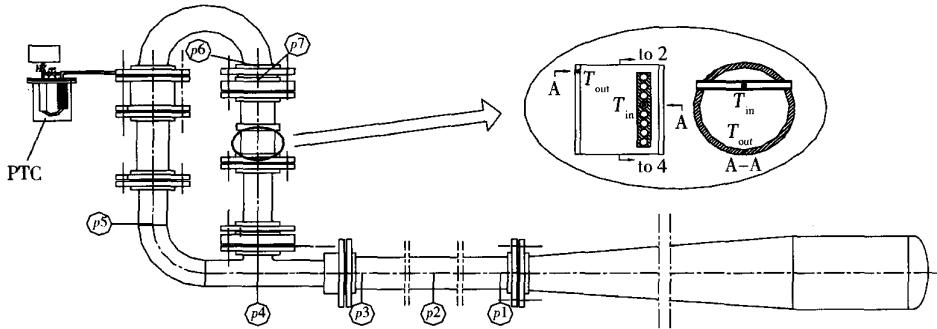
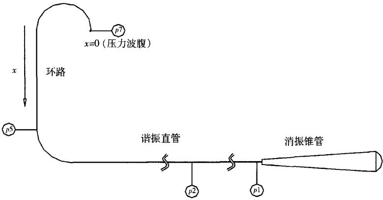
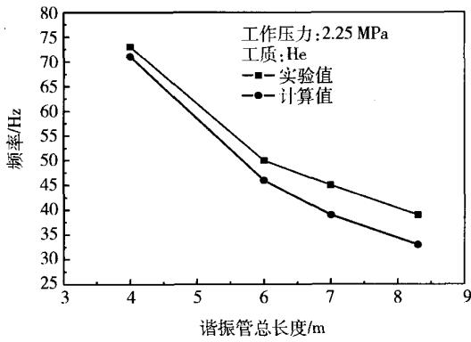
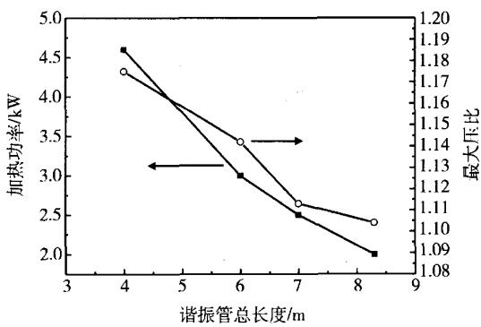
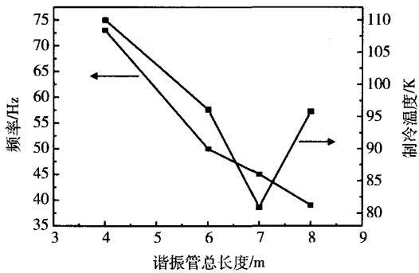
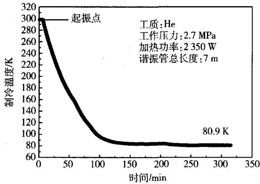
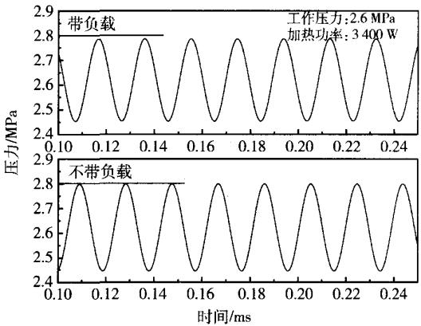

# 行波热声发动机驱动的脉管制冷机研究

孙大明邱利民严伟林陈萍甘智华陈国邦

(浙江大学制冷与低温研究所 杭州 310027)

摘要：通过改变热声发动机谐振直路长度，研究系统在不同工作频率下的性能。研究发现，在一定条件下降低频率可以显著改善脉管制冷机的性能。在工作压力为2.7MPa，加热功率为2350W，工作频率为45Hz时，双向进气型单级脉管制冷机获得了80.9K的最低制冷温度，这是目前用热声制冷方法获得的最低制冷温度。

关键词：热声脉管制冷机频率匹配

中图分类号：TB651;0426.6

文献标识码：A

文章编号：1000-6516(2005)01-0030-05

# Investigation on a pulse tube cooler driven by a traveling wave thermoacoustic enging

Sun Daming Qiu Limin Yan Weilin Chen Ping Gan Zhihua Chen Guobang (Institute of Refrigeration and Cryogenic Engineering, Hangzhou 310027, China)

Abstract: A thermoacoustically driven pulse tube cooler (PTC) system eliminates mechanical moving parts. So it has the merits of simplicity, long lifetime and reliability, which makes it have great application potential in natural gas liquefaction, infrared electronics cooling and life refrigeration. Improving the frequency matching between thermoacoustic engines and PTC system is an effective way to incręase the performance of the coupled refrigeration system. Investigation on a thermoacoustically driven PTC system under different operating frequency was carried out by changing the length of the resonance straight tube of a thermoacoustic Stirling engine. With working pressure and heating power of 2.7 MPa and 2 350 W, respectively, a single stage double-inlet PTC reaches the refrigeration temperature of 80. 9 K at 45 Hz, which is a new record for the thermoacoustically driven PTC.

Key words:thermoacoustic; pulse tube cooler; frequency; matching

## 1 引言

热声发动机利用热声效应将热能转化为声功，产生的声功可以用来驱动脉管制冷机或其它形式的热声制冷机，二者的结合称为热声驱动的制冷系统。它具有3个主要优点：首先，该系统没有机械运动部件，结构简单、制造成本低、可靠性高。其次，工作介质为环境友好气体。第三，该系统直接以热能作为驱动源，可望应用于热能资源丰富而缺电的场合，特别是在边远地区及海上油田天然气液化等方面具有广阔

的应用前景。

近20多年来，热声热机的研究非常活跃。热声发动机从最初的驻波型发展到行波型，效率得到质的提高。为了进一步实现其商业化，在提高热声发动机效率的同时要进一步增加其输出功率，进而获得大规模应用，为此研究者提出了级联式热声发动机，并进行了实验研究1]。在热声制冷机方面，最初是小孔型脉管制冷机(91K)[2]、双向进气型脉管制冷机[3]，然后是可进行声功回收的热声制冷机[4]，近来是在行波热声发动机的环路里直接耦合一个热声制冷机[5]。综合最近十年的发展过程可以看出，热声制冷系统呈现出两个发展方向，一是朝着深低温方向发展，致力于获得更低的制冷温度(低于120K)，具有代表性的是用热声发动机驱动小孔型或双向进气型脉管制冷机；另一个方向是用热声发动机驱动小孔型脉管制冷机或行波型热声制冷机，力图在120K以上温区获取大的制冷量，这一方向期望在天然气液化和近室温制冷方面有大的作为。

在前期工作基础上[6\~8]，本课题主要对热声发动机和单级双向进气型脉管制冷机的频率匹配特性进行了实验研究。由于脉管制冷机的设计工作频率为15Hz左右，而原有热声发动机的工作频率约为72$\scriptstyle \mathrm { H } \mathbf { z } _ { \circ }$ 因此要取得更低的制冷温度就必须降低发动机的工作频率，同时还需保证发动机的压力振荡强度。本文通过加长热声发动机的谐振管，将工作频率降低到45 Hz,在工作压力为2.7MPa,加热功率为2350W时，驱动脉管制冷机获得了80.9K的最低制冷温度。

## 2 理论分析

起振后热声发动机中建立的是平面波声场。声场中气体微团具有的能量包含两部分，一部分是由于气体微团运动所具有的动能，另一部分是压缩和膨胀过程时所具有的位能。声场所具有的能量就是声场中所有气体微团的这两部分能量之和。声场中单位体积里的声能量称为声能量密度，记作

$$
\varepsilon = { \frac { 1 } { 2 } } \rho _ { { } _ { m } } { \left( \begin{array} { l l } { { v } ^ { 2 } } & { + { \frac { 1 } { \rho _ { { } _ { m } } ^ { 2 } a ^ { 2 } } } { p } ^ { 2 } } \end{array} \right) }\tag{1}
$$

由简化的小振幅声波一维波动运动方程可知

$$
\upsilon = - \ \frac { 1 } { \rho _ { { \scriptscriptstyle m } } } \int \frac { \partial p } { \partial x } \mathrm { d } t\tag{2}
$$

式中 $p$ 为振荡压力，v为气体微团的运动速度 ${ \bf , \nabla } \rho _ { \ m }$ 和 $\mathbf { \Omega } _ { \mathbf { \Omega } } \mathbf { \Omega } _ { \mathbf { \Omega } } \mathbf { \Omega } _ { \mathbf { \Omega } } \mathbf { \Omega } _ { \mathbf { \Omega } } \mathbf { \Omega } _ { \mathbf { \Omega } } \mathbf { \Omega } _ { \mathbf { \Omega } } \mathbf { \Omega } _ { \mathbf { \Omega } } \mathbf { \Omega } _ { \mathbf { \Omega } } \mathbf { \Omega } _ { \mathbf { \Omega } } \mathbf { \Omega } _ { \mathbf { \Omega } }$

## 万方数据

分别为工作介质的平均密度和声速。整个热声发动机系统所具有的能量可以通过对整个声场体积积分获得

$$
\begin{array} { c } { { E _ { \mathrm { s t } } ~ = ~ \displaystyle { \int _ { \mathrm { } } } \int _ { s } \varepsilon \mathrm { d } S \mathrm { d } L } } \\ { { = ~ \displaystyle { \int _ { L S } \int _ { 2 } ^ { } \frac { 1 } { 2 } \rho _ { m } \bigg [ \bigg ( - \frac { 1 } { \rho _ { m } } \bigg \{ \frac { \partial p } { \partial x } \mathrm { d } t \bigg ) ^ { 2 } ~ + \frac { 1 } { \rho _ { m } ^ { 2 } a ^ { 2 } } p ^ { 2 } \bigg ] \mathrm { d } S \mathrm { d } L } } }  \end{array}\tag{3}
$$

式中L为系统中存在声振荡的总管长，S为管道的截面积。所以，热声发动机具有的总声能量与压力振荡强度的平方成正比。通过积分简化可把热声发动机中储存的总能量写为[9]

$$
E _ { \mathrm { s t } } \ = \ \frac { 1 } { 4 } \frac { p _ { A } ^ { 2 } } { \rho _ { m } a ^ { 2 } } \pi R ^ { 2 } L\tag{4}
$$

$p _ { A }$ 表示压力振幅，R表示存在声振荡的管道直径。由公式(4)可见，在声功总量保持不变的情况下，压力振幅与声波导管总容积成反比。因此，改变热声发动机的总管长可以从两个方面影响其驱动性能，首先，可以通过它调节发动机的工作频率；其次，L可以改变发动机中的声场体积，从而影响压力振幅的大小。因此在用改变谐振管长度的方法调节发动机工作频率时要注意它对压力振幅可能存在负面影响。

## 3 实验装置

实验装置由行波热声发动机、单级双向进气型脉管制冷机、真空系统和测试系统4部分组成。热声发动机各部分的形式和具体结构可参考文献[6]。实验采用双向进气型单级脉管制冷机，脉管制冷机与热声发动机的接口管道长约60 cm，外有一水冷夹套对进入脉管制冷机的气体进行冷却。实验中采用透平分子泵(Leybold PT50)保持脉管制冷机真空腔内的高真空。脉管制冷机的制冷温度采用中科院低温计量测试站标定的铑铁电阻温度计，测量精度为0.1$\mathbf { K } _ { \circ }$ 在两个位置对加热器温度进行了测量，热电偶的具体位置见图1。 $T _ { \mathrm { i n } }$ 位于加热器的内部， $T _ { \mathrm { o u t } }$ 位于加热器的外壁面。实验中 $T _ { \mathrm { i n } }$ 和 $T _ { \mathrm { o u t } }$ 的数值用巡检仪显示。为了真实反映加热源的实际供热温度，从而为实用化做准备，文中出现的所有加热温度都是 $T _ { \mathrm { i n } } { \mathrm { . } }$ 通过改变电压值来调节加热功率，加热功率通过数字式功率计测量并显示。本文所述实验采用高纯氦气为工质。

  
图1 脉管制冷机接口位置和热声发动机压力测点分布  
Fig. 1 Schematic of the thermoacoustically driven pulse tube cooler system with measurement locations

实验中采用计算机对压力数据进行实时采集和分析处理，压力测点的布置如图1所示。 $p 1 , p 2 , p 3$ 布置在谐振直路的共振管上，用来观察共振管中的压力振荡情况。 $p 4 , p 5 , p 6 , p 7$ 分别布置在三通、反馈回路和喷射泵上下端面，作为参考点考察环路中行波成分的强弱。二力数据采集系统由压力传感器、放大电路、采集卡、PI计算机和基于Labview软件自行开发的程序组成。压力传感器采用德国生产的线性硅压电传感器，型号为KPY-46R。数据采集卡和Labview软件均由美国国家仪器公司(NI)提供，DAQ(data-acquisition)采集卡型号为PC-1200,12位精度，采样频率 10 ks/s,Labview软件版本为 6.1。

## 4 实验结果

算，以预测脉管制冷机与发动机的频率匹配情况，计算与实测结果如图3所示，图中横坐标所指的谐振管总长度包括谐振直管和消振锥管两个长度之和。图中可见，随着谐振管总长度增加，系统工作频率下降。实测频率随谐振管长度的变化关系在趋势上与计算结果基本一致。但随着系统长度增加，所预测的工作频率与实际工作频率的差值越来越大，主要原因在于声场边界存在柔性变化，随着系统长度增加，1/4波长驻波的压力波节越来越远离消振锥管入口。而进行预测计算时没有考虑这一点，而直接把压力波节固定在离谐振直管和锥管交界面约100mm的直管段上。通过压力波测量可以完全确定该驻波声场的波长，从而准确预测系统工作频率。

## 4.1 系统总长度对工作频率的影响

根据声场边界条件及压力振幅在整个发动机管长上的分布可知，声场中各点处的压力振幅沿图2坐标所示方向为1/4波长驻波分布。实测的最大压力振幅在 $p 7$ 处 $, p 1$ 处压比很小且相位与其它测点相差约 $1 8 0 ^ { \circ }$ 。据此认为图2中压力波腹(坐标起点)为主冷却器上表面，压力波节的位置在 ${ p 1 , p 2 }$ 之间且很靠近p1 的地方(进行频率计算时定在距离消振锥管入口100mm的位置)。最初的系统谐振直管长度为2$\mathbf { m } ^ { [ 6 \sim 8 ] }$ ,此时1/4波长为3.6m(加上从 $p 7$ 开始沿逆时针方向的环路部分)。通过加长谐振管进行发动机频率调节，只要不发生频率跳变，压力振幅沿系统的分布仍为1/4波长驻波，频率都是按照 $f = { \frac { c } { \lambda } } = { \frac { c } { 4 L } }$ 来计算。对加长谐振管后系统的工作频率进行了计

## 4.2 不同谐振管长度下加热功率、最大压比的变化情况

图4中给出了谐振管总长、加热功率和最大压比之间的关系。图中可见，通过改变谐振管的长度可以有效调节热声发动机的工作频率，然而热声发动机的压力波性能也随之发生了改变，这与先前的理论预测是一致的，参见公式(4)。如图4所示，当谐振管长度增大时，热声发动机在最高加热温度一定 $( \left. T _ { \mathrm { i n } } \right.$ 为$6 7 0 \pm 5 \mathrm { ~ \mathfrak { C } ~ }$ 左右)的情况下能够吸收的加热量越来越小，所以热声转化得到的声功变少，压比减小。这说明，热声发动机的净吸热量、压力振荡强度、工作频率3个因素相互耦合。当改变谐振管长度时，声场所占体积以及热声堆在声场中的相对位置发生了改变，热声效应的强度受到影响，所以吸热量和压力振荡强度发生变化。如何在频率降低的同时维持系统的高压比是下一步着力解决的问题。

## 万方数据

  
图2 驻波声场在发动机管路中的分布示意图

Fig. 2 Distribution of standing wave acoustic field along the heat engine  
  
图3 热声发动机工作频率的预测值和实验值比较

Fig. 3 Comparison between calculated and experimental frequency  
  
图4 谐振直路总长、加热功率和压比之间的关系  
Fig. 4 Effect of total resonance tube length on heating power and maximal pressure ration

## 4.3 制冷机的温降曲线

图5显示了谐振直路总长对系统工作频率和制冷温度的影响。图中可见，随着谐振管长度增加，工作频率降低。而脉管的最低制冷温度先是下降，在谐振管长度为7m时达到最低，然后上升。原因是，脉管制冷机的最佳工作频率为15Hz左右，所以在谐振管增加到7m之前，热声发动机与脉管制冷机频率匹配的优化起主导作用。随着谐振管长度继续增加，发动机工作频率虽然继续降低，但发动机产生的压力振荡强度也大大减小，压力振荡强度的减小使发动机对脉管制冷机的驱动力减弱，这一减弱作用大于频率匹配优化作用时，脉管制冷机的最低制冷温度升高，因此谐振直路总长度为8m时的制冷温度高于7m时的制冷温度。所以，在仅改变谐振管长度的情况下，系统工作频率与压力振荡强度之间存在一个折衷，在二者的最佳折衷点处，脉管制冷机达到最低制冷温度。对于本实验系统，这一最佳折衷点出现在谐振管总长约为7m时。

图6给出了谐振管总长为7m时的脉管制冷机温降曲线。热声发动机一起振，脉管制冷机冷头就开始温度下降。3h后脉管制冷机的制冷温度稳定在83K，通过对阀门开度的优化，最终达到80.9K的最低制冷温度，此时系统工作压力和加热功率分别为2.7MPa和2 350 W。这是目前公开报道的用热声制冷方法获得的最低制冷温度。实验结果说明，脉管制冷机和热声发动机之间频率匹配的改善有利于提高脉管制冷机的性能。需要指出的是，如能在降低发动机工作频率的同时保持较高的压力振荡强度，该脉管制冷机可望获得更低的制冷温度。

## 4.4 接入脉管前后系统压力性能的变化

为观察负载对热声发动机性能的影响，对发动机

## 万方数据

  
图5谐振直路总长、工作频率  
和制冷温度之间的关系

Fig. 5 Effect of total resonance tube length on working frequency and refrigeration temperature  
  
图6 谐振管路总长为 7 m 长时的降温曲线  
Fig. 6 Cool-down curve with a 7 m long resonance tube

无负载和有负载时的压力波进行了比较分析。具体做法是，在热声发动机驱动脉管制冷机达到稳定状态时，截止脉管制冷机与发动机的之间的管路连接，采集截止前后稳定状态下脉管制冷机与发动机接口处的压力波数据。图7给出了谐振管路总长度为6m长时，热声发动机有无负载时的压力波形比较。图中可见接入负载前后系统工作频率没有变化，均稳定在50Hz。接入脉管时压力波振幅有一定减小，压比降低7%左右，说明脉管的接入对发动机的性能有一定影响。

## 5 结论

在热声驱动的脉管制冷系统中，热声发动机与脉管制冷机之间的频率匹配是影响制冷系统性能的关键因素之一。通过改变谐振直路长度实现了对热声发动机工作频率的调节，优化了发动机与制冷机之间的匹配，使得系统的制冷性能得到大幅提高。在谐振直路总长度为7m的情况下，当工作压力为2.7MPa,加热功率为2350W时，脉管制冷机获得80.9K的最低制冷温度。

  
图7 接入负载前后脉管引出口  
处压力波的变化(谐振管总长为6m)  
Fig. 7 Effect of PTC on pressure wave form at the inlet of the PTC(6 m long resonance tube)

## 参考文献

1 Gardner D L,Swift G W. A cascade thermoacoustic engine. J. Acoust. Soc. Am. , 2003,114(4) :1905 \~1909

2 Radebaugh R, et al. Development of a thermoacoustically driven orifice pulse tube refrigerator. Proceedings of 4th Interagercy Meeting on Cryocoolers, Plymouth, MA, David Taylor Research Center, 1990; Navy Report DTRC91/003: 205

3 Jin T, Chen G B. A thermoacoustically driven pulse tube refrigerator capable of working below 120 K. Cryogenics, 2001, 41: 595 \~ 601

4 Swift G W, Gardner D L, Backhaus S. Acoustic recovery of lost power in pulse tube refrigerators. J. Acoust. Soc. Am. , 1999, 105 (2) : 711\~724

5 Ueda Y, Biwa T, Yazaki T. Experimental studies of a thermoacoustic Stirling prime mover and its application to a cooler. J. Acoust. Soc. Am.,2004,115(3):1134\~1141

6邱利民，孙大明，张武。大型多功能热声发动机的研制及初步实验第一部分：热声发动机的研制. 低温工程,2003，(2):1\~7

7 Qiu L M , Sun D M , Zhang W. Experimental study of a large-scale multifunction thermoacoustic engine. Cryogenics and Refrigeration-Proceedings of ICCR'2003 ,157 \~ 160

8 Sun D M, Qiu L M, Zhang W, et al. Investigation on a traveling-wave thermoacoustic heat engine with high pressure amplitude. Accepted by Energy conversion and management,2004,(2) :

9 Swift G W. Thermoacoustic engines. J Acoust Soc Am. ,1988 ,84 (4) : 1145\~1180

## 万方数据
