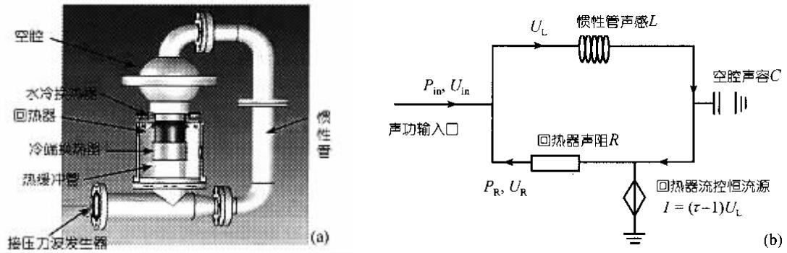
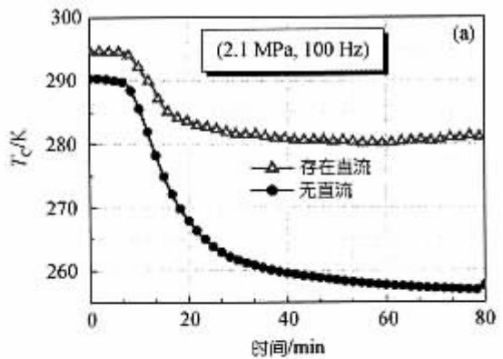
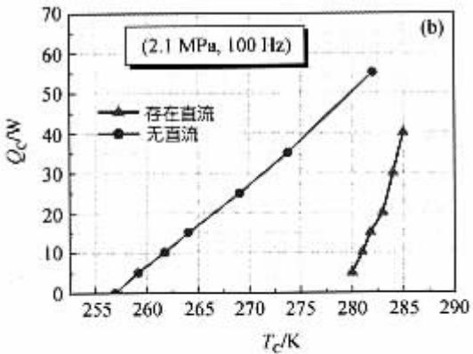
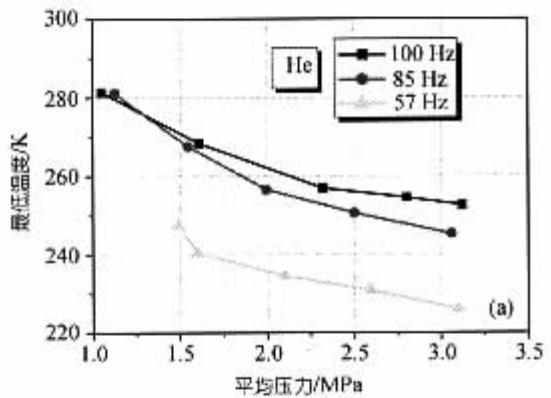
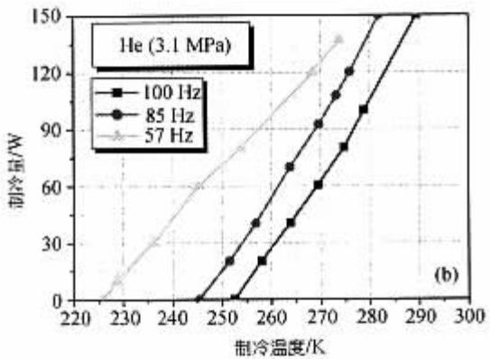
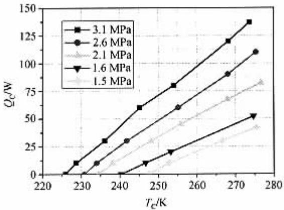

# 高性能室温行波热声制冷机

罗二仓 黄 云 戴 巍 张 泳 吴张华

( 中国科学院理化技术研究所, 北京 100080; 中国科学院研究生院, 北京 100049. E-mail: Ecluo@cl.cryo.ac.cn)

热声制冷具有两大突出优点: 其一是采用惰性气体作工作介质, 具有完全环保的特点; 其二是在低温下没有运动部件, 因此具有高度的可靠性. 经过近十几年的研究, 热声制冷的效率正在得到提高, 有望接近甚至超过一些传统的制冷方式, 显示了极大的潜力和应用前景.

1999 年, 美国 Los Alamos 国家实验室的 Backhaus和Swift 首次研制的热声斯特林发动机达到了30%的热声转换效率, 初步显示了热声斯特林循环的高效率特性[1]. 虽然该热声发动机的热声转换主要是依赖于行波热声转换效应, 但它巧妙地利用谐振管的特殊声学性质, 即将热声行波转换回路设置在驻波谐振管的高声阻抗区(速度节点 压力腹点区), 因此,它同时兼顾了行波热声转换的高效率特性, 并大大降低了回热器的粘性流动损失. 此外, 利用非对称水力“喷射泵”消除了闭合交变流动环路中直流产生的对流换热损失, 使热效率得到了极大提高. 实际上,G.Swift 等人也曾将类似的原理用于脉冲管制冷机,他们将其称为“声功反馈型的脉冲管制冷机”[2], 实验虽然取得了一定程度的成功, 但远非理想. 该声功反馈型的脉冲管制冷机虽然能达到−115 的最低温度,但在 0 时的制冷量仅为 50 W 左右, 特别是按 P-V功计算下的制冷系数 COP 仅为 1 左右, 大大低于电驱动蒸汽压缩式制冷方式的制冷系数(2\~3 左右), 文中指出直流产生的损失未能有效抑制. 2002 年, 日本T.Yazaki 等人报道了所谓的“无活塞型斯特林制冷机”[3], 该热声驱动的热声制冷机实际上利用了环行闭合回路谐振系统在二倍频驻波模式激振后存在从90°驻波相位过渡到−90°驻波相位的一段压力波和速度波接近同相的行波区域, 在此布置回热器可实现行波热声转换, 或称 热声斯特林”转换. 该热声驱动的“无活塞斯特林制冷机”获得了−27 最低温度,但在0 仅有10 W左右的制冷量.

由此可见, 早先研究的热声制冷机的效率仍然很低, 没有显示出其作为氟利昂制冷替代技术的潜力和前景. 为研究开发工作于室温温区的高效热声制冷机, 作者在中国科学院重要方向性项目“新一代高效环保制冷技术的研究与开发”的支持下, 开展了室温温区的热声制冷工作机理的研究, 该研究以家用冰箱工作温区(−20 左右) 制冷量为50\~100 W左右的原理性样机为目标. 先期的工作是探索高效热声制冷机的流程. 与低温脉冲管制冷不同, 工作于室温温区的行波热声制冷机在低温端输出冷量后尚存在极大的膨胀功, 它以声功流的形式流出低温端, 如不采用反馈管路进行回收而象脉冲管那样通过热端的小孔耗散后, 则其制冷效率将大大下降. 例如, 在理想的情况下, 工作于 250 K(−23 )至 300 K温区的行波热声制冷机将有总声功流的 5/6 自低温端流出,如该声功流理想回收, 则制冷系数可达到 5, 等于同温限下的卡诺循环制冷系数; 反之, 如完全不能回收,则制冷系数为仅为 5/6, 大大低于同温限下的卡诺循环制冷系数. 因此, 工作于室温温区的热声制冷机必须具有声功反馈回路. 然而, 并非任意形成一闭合回路就可回收声功, 同时, 闭合回路也不一定能产生热声转换效应. 要有效产生制冷和回收声功, 回路上的声阻抗设计以及回热器 高低温换热器的热设计是十分关键的. 实际上, 声阻抗的设计决定了回路上压力和速度波的分布(包括幅值和相位), 而声阻抗又取决于回热器的粘性流动阻力 声容以及反馈管的惯性等.在保证合适的声阻抗条件下, 回热器 高低温换热器的良好换热设计是实现高效热声转换的另一重要条件. 此外, 闭合回路产生的直流以及热缓冲管中的局部声流也会极大地影响热声制冷机的实际性能, 需要采取措施加以抑制.

具有声功回收的行波热声制冷的基本工作原理可以用图1所示的热声网络图加以解释: 按照热声网络理论, 回热器的功能相当于一个声控恒流源, 用 I表示, 其大小决定于回热器两端的温度比t $( { \pmb t } = \ T _ { 0 } / T _ { \mathrm { C } } )$ 和其进口的波动体积流量 $U _ { \mathrm { L } } , I = ( { \pmb t } - 1 ) U _ { \mathrm { L } }$ . 同时, 振荡流体在回热器往复流动过程要产生很大的粘性耗散, 用声阻R 表示; 惯性管主要提供声感, 用L 表示;位于回热器进口的空腔主要提供声容, 用C 表示. 该行波热声制冷机的理论制冷量等于回热器出口的声功, 消耗的外界机械功则等于进入制冷机系统的声功, 因此, 经推导可得出行波热声制冷系统的制冷量 耗功和制冷系数 $C O P$ 的表达式, 分别为:

$$
\begin{array} { l } { { \displaystyle Q _ { \mathrm { C } } = 0 . 5 { \mathrm { R e } } [ P _ { \mathrm { R } } U _ { \mathrm { R } } ^ { * } ] } } \\ { { \displaystyle ~ = \frac { 1 } { 2 } \frac { P ^ { 2 } { \bf w } ^ { 2 } L C } { R } \frac { 1 - { \bf w } ^ { 2 } L C } { \left( 1 - { \bf w } ^ { 2 } L C \right) ^ { 2 } + \left( { \bf w } L / \ t R \right) ^ { 2 } } } } \end{array}\tag{1}
$$

$$
\begin{array} { l } { { \displaystyle W = 0 . 5 { \mathrm { R e } } [ P _ { \mathrm { i n } } U _ { \mathrm { i n } } ^ { * } ] } } \\ { { \displaystyle ~ = \frac { 1 } { 2 } \frac { P ^ { 2 } { \bf w } ^ { 2 } L C } { R } \frac { \left( 1 / \mathbf { \it { t } } - 1 + \mathbf { \it { w } } ^ { 2 } L C \right) } { \left( 1 - \mathbf { \it { w } } ^ { 2 } L C \right) ^ { 2 } + \left( { \bf \it { w } } L / \mathbf { \it { t } } R \right) ^ { 2 } } } } \end{array}\tag{2}
$$

$$
C O P = \frac { Q _ { \mathrm { { C } } } } { W } = \frac { 1 - { \bf { w } } ^ { 2 } L C } { 1 / { t } - 1 + { \bf { w } } ^ { 2 } L C } = \frac { 1 - { \bf { w } } ^ { 2 } L C } { ( T _ { 0 } - T _ { \mathrm { { C } } } ) / T _ { \mathrm { { C } } } + { \bf { w } } ^ { 2 } L C }\tag{3}
$$

为使系统产生制冷量应有 $Q \mathrm { c } { > } 0 .$ , 也即 $1 { > } w ^ { 2 } L C { > } 0$ 是系统正常工作的必要条件. 另外, 由(1)和(3)式可以分析, 当 $\pmb { w ^ { 2 } L C ^ { \dagger } \cdots 0 }$ 时 $C O P$ 接近于卡诺制冷系数, 但此时制冷量也趋于零, 因此, 该种行波热声制冷机工作模式在效率和制冷量二者之间存在一定的折衷关系. 需要说明的是, 如果从回热器出口的声功不能得到回收(例如象小孔脉冲管制冷机通过热端的小孔耗散为热), 则该热声制冷机的制冷系数将变为 $C O P =$

$\frac { 1 - \pmb { w } ^ { 2 } L C } { T _ { 0 } / T _ { \mathrm { C } } + \pmb { w } ^ { 2 } L C } < \frac { T _ { \mathrm { C } } } { T _ { 0 } } < < \frac { T _ { \mathrm { C } } } { T _ { 0 } - T _ { \mathrm { C } } }$ , 远低于同温限下的逆卡诺制冷循环效率. 制冷温度越高, 差别越大; 制冷温度降低, 则差别缩小. 这也是为什么几十年来脉冲管制冷机只适合工作于低温下而向高温制冷推进时没有获得成功的重要原因.

根据以上分析, 我们设计了热声驱动的室温行波热声制冷系统, 主要由两大部分组成: 热声发动机驱动系统和行波型热声制冷机组成. 制冷机连接在驻波发动机谐振管末端, 当热声发动机起振后, 其板叠产生的声功经过谐振管传递至制冷机. 行波型热声制冷机主要包括惯性管 空腔 室温换热器 回热器 冷端换热器和热缓冲管组成. 该制冷机各部件的结构参数是: 惯性管是一根内径为 32 mm 长度为573 mm的不锈钢管子; 空腔是直径为88 mm的两个半球组成, 在两个半球之间可以加入橡胶弹性膜抑制直流; 热端换热器长度由直径为50 mm 长度为35mm 的紫铜材料经过线切割而成, 缝隙和肋片宽度均为 0.5 mm; 回热器是直径为 50 mm 长度为 35 mm的不锈钢管内部填充120目的不锈钢丝网而成; 冷端换热器由长度30 mm 直径为50 mm的紫铜材料经线切割而成; 热缓冲管是一根直径为50 mm 长度为50 mm的不锈钢, 并在其两端布置了层流化元件. 这些结构参数是在工作条件为氦气 $2 . 0 \ \mathrm { M P a }$ 平均压力以及50 Hz通过“热声计算模拟器”优化得出的参数[4].驱动该热声制冷机的驻波发动机的有关结构参数可参见文献[5]所述.

实验研究了氦气在不同工作频率和不同工作压力下的制冷性能. 实验中发现, 该行波热声制冷机中会产生直流, 并对制冷性能有极大影响. 图 2 是采用氦气作工质 平均压力为2.0 MPa左右 运行频率为100 Hz 左右时存在直流和采用弹性膜抑制直流后两种情况下的降温曲线和制冷量的比较. 采用弹性膜片抑制行波热声制冷机中的直流后进行了大量的研究, 其中图3 是采用氦气作工质情况下不同工作频率下的制冷性能, 图4 是在工作频率为57 Hz 情况下氦气在不同工作压力下的制冷性能情况. 图 3 表明, 随着工作频率逐渐向设计频率靠近时, 该行波热声制冷机的性能不断提高, 对应的最低制冷温度分别达到−21 , −28 和−47 ; 图 4 的实验结果表明, 在采用氦气作工作介质 工作频率为57 Hz 的情况下, 随着压力的升高, 制冷量逐渐增大, 当压力达到 3.1$\mathbf { M P a }$ 时, 最低温度达到−47 , 在−20 的制冷量达到

  
图 1 声功反馈型的行波热声制冷机原理示意图  
(a) 流程示意图, (b) 热声网络图

  
图 2 存在直流和抑制直流后的制冷性能  
(a) 降温曲线, (b) 制冷量

图 3 不同工作频率下的制冷性能  

(a) 最低温度, (b) 制冷量  
  
图 4 不同平均压力下的制冷性能

80 W, 在0 时的制冷量达到137 W, 我们根据该制冷机进口出测量的压力波计算了输入制冷机的声功为 55 W 左右(直线压缩机的效率在 80%\~90%之间,因此采用声功作为评价热声制冷机本身的效率基本上是合理的), 对应−20 下的 COP 和热力完善度分别达到了 1.45 和 25%左右, 已可以同相当制冷量下的传统蒸汽压缩制冷技术相比较(例如家用冰箱, 其制冷系数 COP 在−20 左右为 1.0\~1.5 之间). 在实验中, 我们发现由于热缓冲管设计过短, 存在严重的冷损失, 如能解决这一损失, 可望进一步提高该热声制冷机的效率.

## 参 考 文 献

1 Backhaus S, Swift W G. A thermoacoustic Stirling heat engine. Nature 399,1999,335:339\~343

2 Swift G, Gardner D, Backhaus S. Acoustic recovery of lost power in pulse tube refrigerators. J Acoust Soc Am, 1999,105(2): 711\~724

3 Yazaki T, Biwa T, Tominaga A. A pistonless Stirling cooler. Applied Physics Letter, 2002,80(1): 157\~159

4 Luo E, Wu J, Yang J, et al. Thermoacoustic simulator. Adv Cryo Eng, 2000, 47(B): 828\~835

5 Dai W, Luo E. Characteristics of a miniature pulse tube cooler driven by thermoacoustic standing wave engine. In: Zhang L, eds. Proceeding of 20th International Conference of Cryogenic Engineering, Beijing, 2004. London: Elsevier, 2005 (in press)

(2004-10-26 收稿, 2004-12-30 收修改稿)

## 194 万方数据
