分类号TB6

UDC

编号200618003024058

# 中国科学院研究生院

# 博士学位论文

# 高频行驻波型热驱动热声制冷机的理论及实验研究

指导教师 李青研究员博士

中科院理化技术研究所

申请学位级别工学博士

学科专业名称 制冷及低温工程

论文提交日期2009年3月

论文答辩日期2009年4月

培养单位 中国科学院理化技术研究所

学位授予单位 中国科学院研究生院

答辩委员会主席

中国知网https://www.cnki.net

# Investigation on High Frequency Thermoacoustically Driven Thermoacoustic Refrigerator Besed on Traveling-standing Wave

By KANG Huifang

Supervised by Prof. Dr. Qing Li

A Dissertation

Submitted to the Degree Evaluation Committee of Technical Institute of Physics and Chemistry, Chinese Academy of Sciences for the Degree of Doctor of Philosophy in Engineering

May, 2009

Technical Institute of Physics and Chemistry,

Chinese Academy of Sciences

Beijing, P. R. China

中国知网https://www.cnki.net

## 摘要

随着热声研究的发展，为了提高热声转换效率，热声热机从驻波型发展到行波型。然而，实际热声热机系统不可能工作于纯行波或纯驻波模态，而是工作于行驻波模态。到目前为止，大部分研究者在研究热声热机时，仍基于行波或驻波的分析，极少有从行驻波的角度对实际热声系统中行驻波模态进行研究，更没有基于行驻波分析的热驱动热声制冷机的研究。正是因为这样，本文开展了行驻波型热驱动热声制冷机的理论和实验研究，以全新角度去认识和研究热声热机：基于波动理论，从行驻波的角度深化热声学的理论研究，提炼出了新的无因次参数，提出了行驻波热声效应的分析方法和回热器综合优化的方法，进一步丰富和完善了热声理论。基于优化分析的结论，提出并研制了行驻波型热驱动热声制冷机，推动热声热机的发展。为此，开展了以下几个方面的理论和实验的研究工作：

1.对现有的线性热声理论进行了总结分析，并引入行驻波的概念，对热声热机声场进行行驻波分解。在此基础上，权衡速度、精度和易于使用等条件开发了“小振幅热声热机可视化仿真软件”，并使用该软件建立了行驻波型热驱动热声制冷机的数值模型。然后对行驻波型热驱动热声制冷机的回热器、热缓冲管、声功回收管和谐振管等元部件的结构参数以及系统的运行参数进行了优化计算。

2. 基于波动理论，对声场进行行驻波分解，给出了行驻波声场关键参数的无量纲表达式，提炼出了声场特性集成化参数。该集成化参数是声场中的关键参数（振荡压力、振荡速度、特征声阻抗、压流相位差和时均声能密度）集成化的体现，同时也反应了各个声场中关键参数之间的相互关系。结合这两个集成化参数，分析了行驻波声场的分布特性，分析表明，随着行波成分的增加，虽然行波相位区长度增加，但是行波相位区当地声阻抗减小。因此，在设计热声热机时，应综合考虑行波相位区的长度和行波相位区的阻抗来选择合适的行波比率。另外，在行波比率相同的行驻波声场中，时均声能密度各处相等。

3.为了分析行驻波声场中的热声效应，提出了两种分析方法：数学公式分析和定性分析。两种分析方法的结论一致：对于热声发动机，为了提高声功增益和效率，回热器高温端应该靠近压力腹点，并且行波传播方向与温度梯度方向一致，使得发动机回热器中行波成分和驻波成分均实现热到声的转换；对于热声制冷机，为了提高制冷量和制冷系数，回热器高温端应该靠近压力腹

点，并且行波传播方向与温度梯度方向相反，使得制冷机回热器中行波成分和驻波成分均将热量由低温端泵送到高温端。

4. 根据对行驻波声场中热声效应的分析，在国际上首次提出了一种行驻波型热驱动热声制冷机系统：该系统包含一个热声发动机和一个热声制冷机，前者为后者的驱动源。发动机和制冷机均位于一个环形圈中，并与一个谐振管相耦合，其优点为：（1）有效利用了声波中行波成分和驻波成分共同作用的热声效应；（2）由发动机产生的声功直接进入制冷机进行泵热；（3）使用声功回收管和声功反馈管将制冷机使用后的残余声功，反馈到发动机进行再次利用；（4）发动机和制冷机布置在同一个环形圈内，并且环形圈耦合谐振支路的结构使系统总长接近1/4波长，有效的减小了系统长度，使系统结构紧凑。研制的高频行驻波型热驱动热声制冷机总长不到1m，在以氦气为气体工质，充气压力为2.2MPa，工作频率为234Hz，加热量为 300W时，实现了 $- 3 0 ^ { \circ } \mathrm { C }$ 的无负载温度，并且在 $0 \%$ 时可以提供40W的制冷量。

5. 从基本热声公式出发，提炼出了行驻波声场参数、回热器结构参数以及热声热机性能参数的无因次表达式，并通过这些无因次参数的分析，结合声场集成化参数，提出了一种综合优化热声热机的全新的优化分析方法。该方法结合了回热器结构参数和声场参数，并考虑了各个参数之间的相互制约关系，对热声热机的性能进行了全面的优化分析。分析结果能帮助理解已存在热声热机的最优实验工况，同时对设计新型热声热机提供了理论指导。

关键字热声，发动机，制冷机，行驻波声场，水力半径

# Investigation on High Frequency Thermoacoustically DrivenThermoacoustic Refrigerator Besed on Traveling-standing Wave

Kang Hui-Fang (Refrigeration and Cryogenic Engineering) Directed by Prof. Li Qing

## ABSTRACT

Thermoacoustic research has progressed steadily over decades. To improve the thermoacoustic efficiency, the thermoacoustic devices have evolved from the standing wave devices into the traveling wave devices. However, a real regenerator operates on neither pure traveling wave mode nor pure standing wave mode. Therefore, so far, most researchers still focus their particular attentions on the traveling wave or the standing wave when they design their thermoacoustic devices, and few published literatures have studied on the traveling-standing wave. Therefore, this thesis investigatie the theory and experiement of the thermoacoustically driven thermoacoustic refrigerator based on thermoacoustic analysis in the traveling-standing wave, and understand the thermoacoustic device from a new view. Based on the wave theory, this thesis developes the thermoacoustic theory by traveling-standing wave view, abstracts some new normalized parameters, proposes analysis methods of thermoacoustic performance in traveling-standing wave, and presents a novel optimization method of the regenerator. This enriches and consummates the themoacoustic theory. Based on the optimization analysis, a novel thermoacoustically driven thermoacoustic refrigerator based on thermoacoustic analysis in the travelingstanding wave is proposed and investigated, which develops the themoacoustic device. In this thesis, progresses are made as follows:

1. This thesis summarizes and analysizes the liner thermoacoustic theory, introduces the concept of the traveling-standing wave, and then separates the travelingstanding wave. Based on this, combining the merit of the existed software and the new technology of thermoacoustics, and try to compromise among speed, precision and facility, a new computation software of thermoacoustic device was wrote. Then, a theoretical model of high frequency thermoacoustically driven thermoacoustic refrigerator was set up, and the oscillation pressure, oscillation flow rate, the phase difference, temperature and the time-averaged energy flux in the engine was analyzed, which make the acoustic distribution clearer. And then, optimize these thermodynamic components (e.g. the regenerator units, thermal buffer tube, compliance cavity, feedback inertance, and recycling inertance) carefully by this software.

2. Based on the wave theory, this thesis separates the traveling-standing wave, obtains normalized expressions of some key parameters about the acoustic field, and abstracts two integration parameters. The two integration parameters can representate the characterization of the key parameters in the acoustic field, such as the time averaged acoustic energy density, the osocillation pressure, the osocillation velocity, the specific acoustic impedance and the leading phase of pressure to velocity, and include their relationship. Then analyzed the acoustic field characteration by the two integration parameters. It is pointed out that, with increase of the travelling wave componet, although, the length of the travelling wave phase region increases, the specific acoustic impedance in the travelling wave phase region decreases. Thus, the specific acoustic impedance and the length of the traveling wave region should be considered in the designs of new thermoacoustic devices, synthetically. Accordingly, the time averaged acoustic energy density is independent of the position in the acoustic field. Thus, the timeaveraged acoustic energy density is also the time-spatial averaged acoustic energy density.

3. To study the thermoacoustic performance in traveling-standing wave, two analysis methods are presented: the mathematical formulation analysis and the qualitative analysis. It is found that the results of the two methods are consistent. For the thermoacoustic engine, in order to gain a better acoustic power and efficiency, the hot end of regenerator should be close to the pressure antinode, and the traveling wave component should propagate from the hot end to the ambient end. For the thermoacoustic refrigerator, in order to gain a better cooling power and coefficient of performance, the ambient end of regenerator should be close to the pressure antinode, and the traveling wave component should propagate from the ambient end to the cold end.

4. Acoording to the thermoacoustic performance in traveling-standing wave, a novel thermoacoustically driven thermoacoustic refrigerator has been originally proposed in this paper. It consists of a thermoacoustic engine and a thermoacoustic refrigerator, and the former is the driving source of the latter. Both the engine and the refrigerator are located in one loop tube coupled with a

resonator tube. Compared with the other types of the heat driven thermoacoustic refrigerators, this device has the merits: (1) It effectively utilize the thermoacoustic performance of the combined action of the traveling wave component and the standing wave component; (2) The acoustic power produced by the thermoacoustic engin is used to drive the thermoacoustic refregenerator directly; (3) The feedback tube realizes the recycle of the residual acoustic power out of the thermoacoustic refregenerator. On the basis of the analysis and consideration, a miniature high frequency thermoacoustically driven thermoacoustic refrigerator besed on traveling-standing wave was built firstly in the world. The total length of this refrigerator system is less than 1 m. At the operating point with the mean pressure of 2.2 MPa, helium as working gas, frequency of 234 Hz, and a heating power of 300 W, the experimental refrigerator provides a no-load temperature of ${ } _ { - 3 0 } ~ ^ { \circ } \mathrm { C }$ and a cooling power of 40 W at the cooling temperature of $0 ~ ^ { \circ } \mathrm { C }$

5. Based on the linear thermoacoustic theory, the normalized expressions of acoustic parameters, regenerator parameters and the thermoacoustic performence parameters are derived and calculated, and then proposed a novel synthetical optimzation method for thermoacoustic device. Some conclusions have been obtained, which are of significance to explain the optimum work conditions of existing engines and to guide the designs of new thermoacoustic devices.

Key words: Thermoacoustic; Engine; Refrigerator; Traveling-standing wave;   
Hydraulic radius.

## 目 录

摘要....  
Abstract ... ..III  
主要符号表.. .. XI  
第一章 绪论..  
§1.1 课题研究背景及意义.  
§1.2 热声效应机理...  
§1.3 热声效应的发现...  
§1.4 热声理论的研究进展...  
§1.5 热声技术的研究进展... 5  
§1.5.1 热声发动机的发展. 5  
§1.5.1.1 驻波热声发动机的发展.. 6  
§1.5.1.2 行波热声发动机的发展... ..8  
§1.5.1.3 串级热声发动机的发展... .. 11  
§1.5.2 热声制冷机的发展. ... 12  
§1.5.2.1 电驱动型热声制冷机的发展.. .. 12  
§1.5.2.2 热驱动型热声制冷机的发展... .. 13  
§1.6 本论文研究的主要问题及思路... ... 17  
§1.7 本文的主要工作.... ... 18  
第二章 小振幅热声热机可视化仿真软件设计. ... 20  
§2.1 引言...... ... 20  
§2.2 热声系统仿真基本方程. .. 20  
§ 2.2.1 假设前提. .. 20  
§2.2.2 热声基本方程.. .. 21  
§2.2.3 总能流... .. 23  
§2.2.4 声功流.. ... 25  
§2.2.5 热流... .. 25  
§ 2.2.6 行驻波分解... .. 25  
§2.3 数值计算方法的选择... ... 27  
§2.3.1 Runge-Kutta 法.. 27  
§ 2.3.1.1 Runge-Kutta 法基本思想. 28  
§2.3.1.2 三四阶 Runge-Kutta 法.... 29  
§2.3.2 Powel11 算法.... .29  
§2.3.2.1 Powel1 算法基本思想.. .29  
§2.3.2.2 修正 Powe11 算法.... .. 31  
§2.4 编程语言的选择. .31  
§2.5 数值仿真程序设计. ..32  
§2.6 可视化界面设计.. .33  
§2.7 模拟计算.. .34  
§2.8 存在的主要问题.. .. 35  
§ 2.8.1 湍流计算.. .35  
§2.8.2 交变流动作用下回热器和换热器模型计算.. .36  
§2.8.3 非线性因素的影响... ... 36  
§2.9 本章小结.. .36  
第三章 行驻波声场分析 ..38  
§ 3.1 引言.... .. 38  
§3.2 无量纲公式. .38  
§3.3 声场参数相互关系分析.. .. 39  
§ 3.4 压力场分析... 41  
§ 3.5 反行波混合声场分析.. .43  
§ 3.6 声场能量分析. .. 45  
§ 3.7 本章小结.... 45  
第四章 行驻波热声效应分析 46  
§4.1 前言.. .46  
§4.2 公式分析.. .46  
§4.2.1 热流... .46  
§4.2.2 声功.. 48  
§4.2.3 热声制冷机相对卡诺制冷系数... .50  
§4.2.4 热声发动机相对卡诺效率.. .51  
§4.3 定析性分析.. ..52  
§4.3.1 驻波模态. .52  
§4.3.2 行波模态. .54  
§4.3.3 行驻波模态. ..54  
§ 4.4 本章小结..... ..55  
第五章 行驻波型热驱动热声制冷机的设计 ... 56  
§ 5.1 引言.. ... 56  
§5.2 方案设计... ... 56  
§5.3 系统基本声场和能流分布.. ... 58  
§5.4 系统内热声元件的优化设计 .. 61  
§5.4.1 回热器的优化.... .. 62  
§5.4.1.1 发动机回热器... ...63  
§5.4.1.2 制冷机回热器. .65  
§5.4.2 其它热声元... ...6  
§5.5 运行参数对于系统性能的影响. ...68  
§5.5.1 高温端温度的影响.... .. 68  
§5.5.2 平均充气压力的影响. .70  
§5.6 行驻波型热驱动热声制冷机的优化结构参数. .. 72  
§ 5.7 本章小结..... ... 72  
第六章行驻波型热驱动热声制冷机的实验研究 ....774  
§ 6.1 前言.. .. 74  
§6.2 实验装置... .... 74  
§6.2.1 回热器. ... 75  
§6.2.2 换热器.... .. 76  
§6.2.3 发动机高温加热器. ...77  
§6.2.4 热缓冲管.. ... 78  
§6.2.5 容腔.... .... 78  
§6.2.6 回收管和反馈管. ... 78  
§6.2.7 谐振管.... ... 78  
§6.3 数据测量及动态采集系统.. ... 79  
§6.3.1 实验对象... .79  
§6.3.1.1 压力测量点的分布.. .. 79  
§6.3.1.2 温度测量点的分布... .. 79  
§6.3.2 测量和显示仪器. ... 80  
§ 6.3.2.1 CY-YD-208T 型压力传感器.. ....80  
§6.3.2.2 YE5853 型电荷放大器... .... 80  
§6.3.2.3 0S-5020 型示波器.. ...80  
§6.3.2.4 SR830数字式锁相放大器. ... 81  
§6.3.2.5 A/D 采集板.... ..81  
§6.3.2.6 信号放大电路 ... 81  
§6.3.2.7 热电偶温度计. ..81  
§6.3.3 直流稳压电源.... ... 82  
§6.3.4 动态数据采集程序. .. 82  
§6.4 高频行驻波型热驱动热声制冷机实验步骤... ... 83  
§6.5 系统的起振特征与分析.. .... 84  
§6.6 自激振荡与系统的稳定性分析. ... 86  
§6.6.1 Nyquist 失稳判据... ... 87  
§6.6.2 热声二端口网络参数. ... 88  
§ 6.6.3 二端口拓扑结构..... .. 89  
§6.6.4 起振条件计算过程... ... 90  
§6.7 系统稳定后的压力波分布及频谱图... .. 92  
§6.8 实验结果与理论模型对比.. ..93  
§6.9 回热器和充气压力的影响.. ... 93  
§6.10 加热量的影响. .. 95  
§ 6.11 漏热计算 .... 98  
§6.11.1 沿热缓冲管的轴向导热漏热... .. 98  
§6.11.2 回热器壁面轴向导热漏热.. ..99  
§6.11.3 回热器丝网轴向导热漏热... ...99  
§ 6.11.4 外表面径向漏热... ..99  
§6.11.5 加热器热辐射漏热.. ..99  
§ 6.12 本章小结... ... 100  
第七章热声热机回热器的综合优化.. .. 102  
§7.1 引言.... .. 102  
§ 7.2 无因次表达式.... ... 103  
§7.3 热声发动机回热器优化.. .. 103  
§7.3.1 水利半径和声场的优化. ... 104  
§7.3.1.1 声功.. .. 104  
§7.3.1.2 相对卡诺效率... .. 107  
§7.3.2 操作因子的优化... .. 111  
§7.3.2.1 驻波型热声发动机.. ... 111  
§7.3.2.2 行波型热声发动机. .. 112  
§7.4 热声制冷机回热器优化... ... 113  
§7.4.1 水利半径和声场的优化. ... 13  
§7.4.1.1 制冷量.... ... 114  
§7.4.1.2 相对卡诺制冷系数. ... 116  
§ 7.4.2 操作因子的优化.... ... 119  
§7.4.2.1 驻波型热声制冷机.. ... 119  
§7.4.2.2 行波型热声制冷机.. ... 120  
§ 7.5 本章小结.. .. 121  
第八章 全文总结.. .. 123  
参考文献... ... 127  
附录1作者在攻读博士学位期间发表的论文 .. 135  
附录2 作者在攻读博士学位期间获得的奖励.. .. 136  
致谢... ... 137  
学位论文声明. ... 138

## 主要符号表

<table><tr><td> $A$ </td><td>横截面积</td><td>8</td><td>渗透深度</td></tr><tr><td> $c$ </td><td>声速</td><td>2</td><td>声波波长</td></tr><tr><td> $c _ { p }$ </td><td>定压热容</td><td>ω</td><td>角频率</td></tr><tr><td> $D$ </td><td>直径</td><td>β</td><td>热膨胀系数</td></tr><tr><td> $\dot { E } _ { 2 }$ </td><td>时均声功率</td><td>μ</td><td>粘性系数</td></tr><tr><td> $f$ </td><td>振动频率</td><td>V</td><td>动力粘度</td></tr><tr><td> $f _ { \nu }$ </td><td>粘性空间平均函数</td><td>σ</td><td>普朗特数</td></tr><tr><td> $f _ { k }$ </td><td>热空间平均函数</td><td>γ</td><td>比热容</td></tr><tr><td> $\dot { H }$ </td><td>焓流</td><td>α</td><td>热扩散系数</td></tr><tr><td> $k$ </td><td>波数</td><td>E</td><td>声能密度</td></tr><tr><td> $K$ </td><td>热传导系数</td><td>ζ</td><td>相对渗透深度</td></tr><tr><td> $l , L$ </td><td>长度</td><td>2</td><td>行波比率</td></tr><tr><td> $\dot { m }$ </td><td>质量流率</td><td>Ψ</td><td>回热器操作因子</td></tr><tr><td> $p , P$ </td><td>压力</td><td>〈&gt;</td><td>时间平均</td></tr><tr><td> $\mathcal { Q }$ </td><td>热量</td><td> $\mathsf { R e } [ \mathbf { \Lambda } ]$ </td><td>复数的实部</td></tr><tr><td> $r$ </td><td>半径</td><td>Im[ ]</td><td>复数的虚部</td></tr><tr><td> $r _ { h }$ </td><td>水力半径</td><td>11</td><td>复数的幅值</td></tr><tr><td> $R e$ </td><td>雷诺数</td><td></td><td></td></tr><tr><td> $s$ </td><td>熵</td><td>常用的上下标</td><td></td></tr><tr><td> $S$ </td><td>面积</td><td>1</td><td>平均</td></tr><tr><td>t</td><td>时间</td><td>~</td><td>复数共轭</td></tr><tr><td> $T$ </td><td>温度，周期时间</td><td>m</td><td>平均值</td></tr><tr><td> $\Delta T$ </td><td>温度差</td><td>N</td><td>无因次量</td></tr><tr><td>u</td><td>速度</td><td>1</td><td>一阶物理量</td></tr><tr><td>U</td><td>体积流率</td><td>2</td><td>二阶物理量</td></tr><tr><td>V</td><td>体积</td><td>S</td><td>固体</td></tr><tr><td>Z</td><td>声学阻抗</td><td>f</td><td>气体</td></tr><tr><td>η</td><td>效率</td><td> $c r i t$ </td><td>临界值</td></tr><tr><td> $\phi$ </td><td>孔隙率</td><td>V</td><td>粘性</td></tr><tr><td> $\rho$ </td><td>密度</td><td>k</td><td>热</td></tr></table>

## 第一章 绪 论

## §1.1 课题研究背景及意义

制冷和低温技术在国民经济和国防建设中得到了愈加广泛的应用，在推动社会进步中发挥着越来越重要的作用。近年来，急剧增长的能源需求问题迫使人们寻求和开发以太阳能、燃气能或废热能作为驱动力的新型制冷技术。另外，航空航天、红外探测遥感技术、电子技术以及医疗技术的飞速发展，对低温制冷机的稳定性、可靠性、寿命和效率等都提出了很高的要求。几十年来，人们在开发符合要求的制冷系统、改善制冷机的关键部件以及开发新型低温制冷机方面，做出了很大的努力。现在，吉福特一麦克马洪循环制冷机（G-M）和斯特林循环制冷机（Stirling）在空间技术和现代工业中得到广泛应用。长寿命分置式斯特林制冷机、脉冲管制冷机等新型制冷技术也取得重要进展，已经成为国际制冷领域的研究重点。但是，上述制冷机仍存在许多运动部件，限制了其可靠性、长寿命和高效率。

热声制冷技术正是适应这种挑战而发展的一种应用前景更为广阔的新型制冷方法，是三十年来制冷和低温技术的重大进展之一1]。热声发动机利用热声效应将热能转化为声能，产生的声能可以用来驱动热声制冷机，二者的结合称为热声驱动的制冷系统。在热声驱动的制冷系统中，当发动机回热器温度梯度达到其临界值时，将激发声波。声波使气体微团在发动机回热器中经历一定的热动力学循环：压缩一加热一膨胀一冷却。这样，在无运动部件的条件下实现了热能到声能的转换。当声波通过制冷机回热器时，在制冷机回热器上产生温度梯度，并将热量从低温端泵送到高温端。声波使气体微团在制冷机回热器中经历一定的热动力学循环：压缩一冷却一膨胀一加热。这样，在无运动部件的条件下实现了泵热。与传统的制冷技术相比，热声制冷技术具备许多独特的优点，主要体现在：（1）结构简单、可靠性高、使用寿命长，尤其是热声制冷机可以实现完全无运动部件；（2）无污染制冷技术，热声制冷机采用氮气、氦气等惰性气体作为工质，可以避免传统的制冷机以氟利昂作为工质而对大气层造成的破坏；（3）利用太阳能、燃气能、废热能等为热声发动机提供热源，输出声功，来驱动脉冲管制冷机或斯特林制冷机，产生制冷效果，实现无运动部件的热声驱动制冷机。（4）通过提高热声制冷机的频率实现制冷机结构的小型化，可用于电子器件、半导体芯片等装置或器件冷却。

目前热声研究已经成为能源动力、低温技术、环保工程等领域的研究重点和研究前沿。热声制冷的应用领域涵盖了从室温到液氮温度的广泛温区。在天然气液化、太空探测、红外器件冷却、电子器件冷却、室温制冷以及热声成像和热声通讯等方面都显示出令人兴奋的应用前景2]。正是因为这样，本文开展了行驻波型热驱动热声制冷机的理论和实验研究，以全新角度去认识和研究热声热机，通过进一步丰富和完善热声理论，推动热声热机的发展。

## §1.2 热声效应机理

热声效应是指当可压缩性流体工质（第一种介质）在热声系统中进行声振荡时与固体工质（第二种介质）之间进行热力相互作用而发生的时均能量转换效应，它是由处于声场中的固体工质与振荡流体工质之间的相互作用导致的距离固体壁面一定范围内产生沿着（或逆着）声传播方向的时均热流和时均功流。它包括两方面的含义，其一是输入热量产生声功，即热致声效应；其二是消耗声功产生热流，即声致热效应。从热声现象研究中逐渐发展起来的热声学揭示了热声效应的机理：声波在流体中纵向传播的同时伴随着振荡流体与固体壁面间的横向交变的动量和热量的交换，这两个方向波动及扩散的相互作用使得热声效应得以产生和维持，这两个方面缺一不可，否则只能是单一的热现象或者单一的声现象。热声效应的另一个意义是热和声之间的转化并不是单一方向的，这个效应既有热向声的转化，即热致声效应；又有声向热的转化，即声致热效应。而后一个效应不是简单意义上的热功转换，而是由消耗声能实现热能品质的改变和热量的迁移。基于这两种热声效应，可以制成热声发动机和热声制冷机。

瑞利（Rayleigh）在他所著的《声学理论》[3]一书中把热能激起声振荡的机理定性地描述为：如果对振荡的气体周期性地供热和吸热，则所得效果取决于传递热量时振荡的相位。当在最大压缩条件下向气体供热，或在最大膨胀条件下从气体吸热，则都会强化振荡；相反，如果在最大压缩时吸热，在最大膨胀时放热，则振荡就会衰减。换一种说法，如果当供热具有波动性质，而且与声压振荡具有合适的相位差，就可以使工质完成某种热力循环，使一部分热能转化为功，从而激起或维持有序的声振荡。这是对热声现象最早的定性描述。Rayleigh³热致声判据定性地概括了热致声的条件：（1）要求供热具有周期性的扰动分量；（2）热量的时间变化率与压力扰动要具有合适的相位差。文献[34]给出了这个判据的数学描述：如果以相量 $\tilde { \varrho }$ 表示热量波动， $\widetilde { p }$ 表示压力波动，当两个相量之间相位差为锐角时，即 $\left| { \varphi _ { _ Q } - \varphi _ { _ p } } \right| < \frac { \pi } { 2 }$ ，供热激起声振；若为钝角时，即 $\frac { \pi } { 2 } < \left| \varphi _ { \mathcal { Q } } - \varphi _ { p } \right| < \pi$ ，则供热使声振减弱。

但这仅仅只是对热声机理的一般性的描述，还没有概括出热声现象产生的实质性条件。要产生热声现象，具有温度梯度的热声器件是产生热声效应的最关键部件[4]，是实现热声效应的热力学第二介质条件。

正是由于热声器件的存在，振荡流体的位移往复振荡，借助于热声器件的微小通道的边界效应把加在固体填料上的温度差调制出横向的热波，从而实现了波动和振荡流体之间的换热，并把等熵的振荡变成非等熵的振荡，这个横向的热波是波动和扩散所造成的，它具有波动和扩散的双重特性。把发生这种横向热波的区域定义为热渗透深度 $\delta _ { \kappa } = \sqrt { 2 \kappa / \omega }$ ，传播速度为 $\omega \delta _ { \kappa }$ 。而另一方面，距离固体壁面一定范围内的振荡气流和固体边壁发生热交换时，由于气流的粘性作用会产生传热热阻，导致传热滞后，在沿固体壁面垂直方向上产生粘性扩散波，把发生这种粘性扩散波的区域定义为粘性渗透深度 $\delta _ { \nu } = \sqrt { 2 \nu / \omega }$ ，传播速度为 $\omega \delta _ { \nu }$ 。交变流体在固体壁面附近所造成的这种横向热波和粘性扩散波使得局部的热量传递和动量传递具有波动和扩散的特性。热声器件填料的结构处于渗透深度的尺度范围内，利用局部区域的热量传递和动量传递的特殊作用，以实现热声效应。超过这个特征尺度，热声器件填料的边界效应就显得微乎其微。

## §1.3 热声效应的发现

早在1777年，Higgins就在实验室中发现，将可燃性气体（焦炭气或者氢气）的火焰放在两端开口的垂直管的适当位置，管中会激发出声音。这是氢气才发现不久之际，是历史上被称为“歌焰”的第一次出现，也是热声效应的首次发现。在十八世纪中期，欧洲的吹玻璃工人也发现，当一个高温的玻璃球连接到一根中空玻璃管上时，管子的尖端有时会发出声音。正是源于这些偶然发现，人们开始了对热声现象的研究。

1850年，Sondhauss首选对连接玻璃球的中空玻璃管发声进行了深入的研究，研究表明发声与玻璃无关，并得到了音阶高低与器皿尺度的定量关系。后来人们就以他的名字把这种一端封闭、一端开口的热声振荡管命名为“Sondhauss管”[7]，如图 1.1所示。

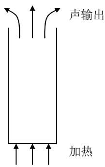  
图 1.1 Sondhauss 管

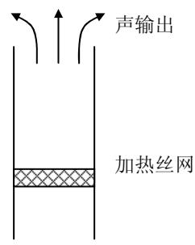  
图 1.2 Rijke 管

1859年，Rijke在将加热丝放到一根两端开口的垂直空管的下部分时观察到强烈的声振荡，如图1.2所示，并对这种以后被称为“Rijke振荡”的现象进行了定性的分析[8]。1877年Bosscha发现了一种所谓“逆 Rijke振荡”，即把冷却的丝网放到上述空管的上半部分时，同样会发生振荡；相反，将冷却的丝网置于下部分时，振荡则衰减。如今，Rijke管振荡被广泛地用于脉冲燃烧器以及热声效应的教学演示。

高烟囱或炉膛中的火焰有时会引起强烈噪声或强烈振动甚致造成严重破坏，现在我们知道其原因就是热声效应。第二次世界大战中纳粹德国使用的V1导弹，在飞行中发出强烈怪声，造成恐慌，所利用的也是热声原理。

## §1.4 热声理论的研究进展

虽然物理学家很早就发现了热声现象，对其理解和掌握也经历两白多年的探讨，但热声学的真正繁荣才是最近几十年的事情。早期的热声研究主要是大量实验中的偶然发现或定性推论，这些现象及解释并没有形成系统的理论。

严格地讲，热声理论的研究源于1868年，Kirchhoff以及Feldman计算了声在管中由固体管壁和维持声波的气体之间的振荡的热传导引起的衰减量9-11]。1878年，Rayleigh首先对热声现象给出了定性的解释[12]：对于声振动的介质，若在其最稠密的时候向其供热，而在其稀疏时从中吸热，声振动就会得到加强；反之，若在其最稠密的时何候从其中吸热，而在其稀疏时向其供热，声振动就会衰减。这就是所谓的Rayleigh准则。到目前为止，Rayleigh准则一直被认为是理解热声振荡的一个合理的解释。1949年，Taconis[13]在研究液氦的时候，发现了著名的Taconis振荡，即一根一端封闭的空管子接触到液氦的液面时，管中就会发生振荡。这一发现对于正确认识和防止低温系统中的振荡问题具有重要的意义。

热声理论研究工作的快速发展始于20世纪60年代的瑞士苏黎世联邦技术研究所的Rott14-19]。他为了解决Taconis振荡的稳定性问题，建立了理想气体的驻波声场，在理论上描述了热声效应中存在着热和功的相互转化，其导出的理论框架为分析热声热机提供了坚实的理论基础。他的理论得到了Yazaki[20][21]等人的实验验证。随后，Merkli和Thomann22,23]讨论了另一种类型的热声效应，即在等温壁面的谐振管中，驻波声场与外热源间存在的时均横向吸热与放热效应。实验发现：如果理想气体的普朗特数小于1，在压力波节点附近，流体从管壁时均地横向吸热，在速度波节点处，流体向管壁时均地放热。如果普朗特数大于1，则不存在横向的吸放热效应。

美国 Los Alamos 国家实验室热声小组的 Swift 等在热声领域进行了广泛和深入的研究，1988年，他以“Thermoacoustic engine”为题发表了他们在热声方面的理论和实验研究[4]，提出了基于Rott 线性模型的短板叠边界层近似模型，该模型可以定量地解释热致声和声致冷效应的机理，对热声系统的理论计算提供了理论基础，标志着Rott以后现代热声学研究进入一个新的阶段。特别值得一提的是 Ward 和 Swift 等编制的一套热声计算程序 DeltaE（Design Environmentfor Low-amplitude Thermoacoustic Engines）[24,25]，涵盖了各种常规几何结构的边界条件，可以广泛应用于各类热声系统的模拟计算。他们的工作极大的推动了热声技术的实用化研究进展。另外，在Swift的理论中还涉及到了非线性热声现象，如入口效应，声流等。

日本筑波大学物理学系的富永昭教授等对热声振荡流的热力学方面给出了分析理论与计算方法，从热动力学的观点分析和计算热声现象和过程[26,27]，另外，他们还将热声理论应用于脉冲管制冷机的机理分析，主要是对回热器进行相位分析，以便更好的理解相移机理。

我国的热声研究起步于80年代末，中科院低温中心肖家华首先开展了热声理论研究[28-32]。他根据固体外壁面与外热源不同的热接触情况，提出可将热声效应划分为三种情况：等温热声效应,绝热热声效应和一般情形的热声效应，并分别建立了行波声场等温热声效应和绝热热声效应的波动方程，并指出对低普朗特数的流体，存在一个临界声导，在高声导区，外热源横向从流体吸热，在低声导区，流体从外热源放热，在中间声导区，流体耗功并同时向外热源放热，在此基础上，还讨论了回热式制冷机热声理论的定性框架。

华中科技大学的郭方中[33-37等讨论了热声转换的本质，首次提出热声网络模型，引出回热器填料的阻，感，容，源等概念，建立了回热器的有源网络模型。郭方中等对回热器中流体的流动特性，该特性对其性能的影响以及网络模型进行了一系列的研究[38-39]。网络模型把发动机系统各部件有机的联立起来，是热声发动机工程应用的强有力的工具。

## §1.5 热声技术的研究进展

## §1.5.1 热声发动机的发展

热声机械中加入板叠结构是热声学历史上的一个重要的里程碑。1962年，美国新墨西哥大学的 Carter等人发现在 Sondhauss管中放入适当的板叠会提高它的振荡效率，这是自1917年以来在 Sondhauss管振动上所做的首次实验性工作[40]。Feldman就以此发现作了博士课题研究，他所研制的最有效的振荡器可由600W的热量产生27W的声功[41-43]。这是现代实验热声学研究的重要进展，标志着人们进入了具有实用意义热声机械的研究阶段。在此之后，实验热声学得到了蓬勃发展。按照所产生声场的特性，可将热声发动机分为驻波热声发动机、行波热声发动机，以及最近出现的串级混合型热声发动机。广义来讲，前文的 Sondhauss管和 Rijke管都属于最简单的驻波型发动机。

## §1.5.1.1 驻波热声发动机的发展

实用热机研究起源于美国 Los Alamos国家实验室。上世纪 80年代Wheatley领导的热声研究小组开展了热声机械的研究工作。Wheatley认为声谐振驻波和表面泵热效应的组合能形成一种完全新型的发动机，由于其中的固体介质与气流之间所需的相位差是通过自发的不可逆过程获得，特别是由有限传热得到，因而被称为“自然的发动机”（NaturalEngines）[44]。

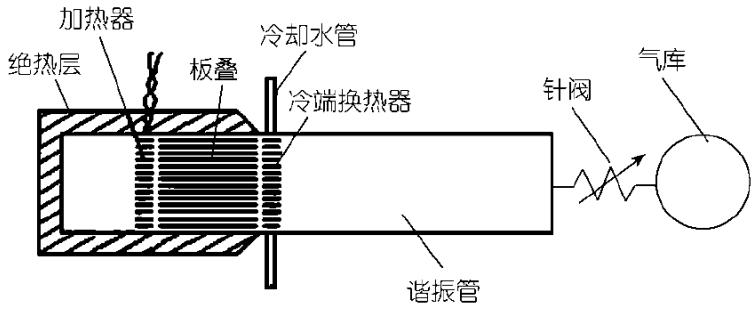  
图 1.3 Los Alamos 1992 年研制的驻波热声发动机

1992年，Swift等人研制了一台直径128mm、总长4320mm的热声驱动器（图1.3），获得了630W的声功，热效率为9%，采用充气压力为1.38MPa的氦气作为工质，压力振幅为平均压力的3～10%。他们在实验中对加热功率、板叠热端和冷端温度以及系统中所产生的压力波进行了仔细的测量，发现在低振幅工况下，线性热声理论的计算结果同测量值比较符合，而在大振幅工况下，则存在明显偏差[45]。Swift等人的研究工作验证了线性热声理论对于热声发动机小振幅工况良好的适用性，但同时也表明对于不满足线性化条件的大振幅工况需要发展非线性热声理论才能给出合理的模拟计算结果。

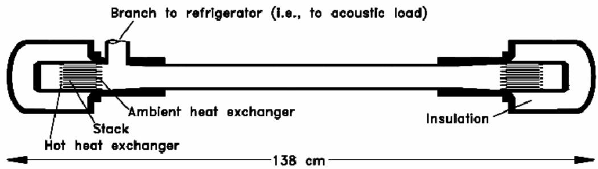  
图 1.4 Tektronix 公司研制的驻波热声发动机

1995年，他们和 Tektronix公司合作研制的对称型驻波热声发动机[46,47]（如图1.4所示），作为热驱动的低温制冷机的一部分，以氦气作工质，运行频率350Hz，能输出1kW以上的声功给脉冲管制冷机，在合适的工作点，最高热效率可以达到18%（相对卡诺效率23%），输出声功500W。另外，由于液态工质具有密度大、普朗特数低等特点，以它们为工质的热声发动机理论上具有高效率和高功率密度的特点，因此他们提出在热声驱动器中使用液体工质，比如液态钠[48]。但在他们的试验机中（如图1.5所示），由于高压力振幅下会发生气穴（泡）导致消振，因而在加装磁动力（MagneticHydrodynamic，MHD）声换能器之前，不能提高加热功率，结果990W的热量下只输出了18W声功[49]，其工作频率910Hz。

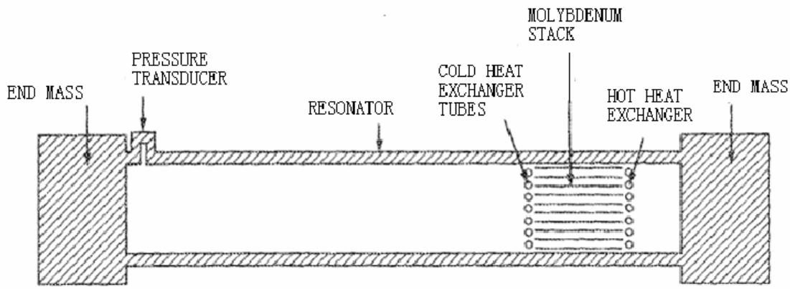  
图 1.5 Swift 的液态钠发动机

日本大学的松原洋一、周淑亮等人研制的驻波型驱动器在输入833W的加热量时能输出26W的声功[50,51]。他们对起振温度、声波特性和热声振荡的影响因素等进行了实验和分析，着重研究了结构尺寸（包括谐振管的结构和丝网尺寸等）对热声效应以及损失特性的影响情况。他们发现在一定条件下，驱动器会工作在二次谐波频率下。

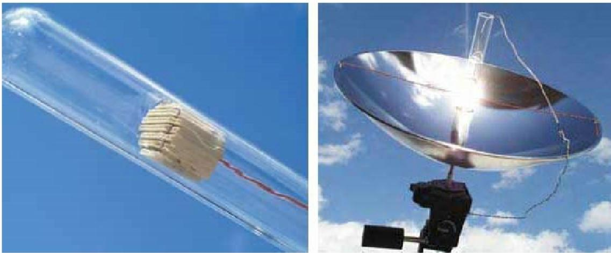  
图1.6宾州大学的太阳能热声发动机

1998 年，美国宾州大学的 Chen 和 Garrett 研制了第一台太阳能驱动的驻波型热声发动机[52,53]，如图1.6所示。他们以40cm长的一端开口的管作为谐振管，用一英尺直径的凹面镜将阳光聚焦到陶瓷热声板叠的一端进行加热，稳定工作时，可测得120dB的声波。虽然该热声发动机是一台小型的演示性的实验装置，但它验证了热声发动机以太阳能作为驱动源的可行性。与太阳能利用相结合的热声技术更加显著地体现了环保、节能等优点。

国内对驻波热声发动机的研究有代表性的单位有浙江大学，华中科技大学及中科院理化所。浙江大学从90年代中期开展驻波型热声发动机的研究工作。他们建立了一台采用丝网热声板叠的对称型双边驱动热声发动机，系统地研究了充气压力、加热功率、加热温度等操作参数，谐振管长度等结构参数以及工质种类对热声发动机性能的影响[54-59]。

华中科技大学郭方中等和法国国家科研中心 LIMSI 实验室的 Francois 等合作，从90年代初开始对热声驱动器进行研究。他们建成的热声驱动器原型机以氮气为工质，加热温度为500℃时，压力振幅可达平均压力的10%[60]。

2003年末，中科院理化所戴巍等建立的驻波型热声发动机[61]，采用电加热，在热端温度600℃时，该发动机采用氮气作工质，压比可达到1.22以上，氦气作工质则达到1.15以上。最近他们又建立了一台频率300Hz的高频驻波发动机，以氦气为工质，压比可以达到1.2以上[62]。

## §1.5.1.2 行波热声发动机的发展

虽然行波热声发动机的实验研究晚于驻波热声发动机，但其概念的提出却并不晚。1979年，美国 George Mason大学的 Ceperley意识到斯特林热机回热器中的压力波和速度波的相位关系同声波中行波的相位关系是一致的，从而可以利用声波来控制气体运动，消除系统中的机械运动部件，得到无活塞的热声斯特林发动机63]。由于行波的压力和速度振荡具有相同的相位，消除了驻波热力循环利用工质与固体边界的不良热接触协调压缩膨胀与换热过程所造成的不可逆性，可望获得更高的热力学效率。遗憾的是，Ceperley在验证实验中，由于采用了不适当的声学阻抗，未能实现声功的增益[63]。然而行波型热声机械概念的提出，为提高热声机械的效率提供了新的思路，对热声机械的后续发展具有重要的指导意义。

1998年，根据Ceperley的设想，日本的 Yazaki等人首先完成了一台环形管行波热声驱动器的研制[64]（如图1.7所示），用于机理的研究。当板叠热端温度超过一定临界值（与平均压力有关），沿环路就形成从板叠冷端向热端的行波振荡。为了同驻波发动机比较，他们用一块刚性板将环路隔断，原环路就成为一段两端封闭的管，通过调整刚性板在环路中的位置，使所形成驻波的频率与行波相同。他们通过实验，得到了板叠两端的起振温度比 $T _ { h } / T _ { c }$ 和 $\omega \tau$ 的关系，验证了两类热声发动机对工作气体和固体边界热接触条件的不同要求。如图1.8， $T _ { h }$ 和 $T _ { c }$ 分别为板叠热端和冷端的温度，ω为角频率， $\tau = r ^ { 2 } / 2 \alpha$ 为板叠流道横截面的热弛豫时间，r为流道的横向特征尺寸， $\alpha$ 为热扩散率。实验中通过改变压力来控制 $\omega \tau$ 的变化。驻波发动机的最低 $T _ { h } / T _ { c }$ 值出现在行波的右侧，对应的 $\omega \tau$ 较大，表明驻波板叠需要一定的热延迟。当 $\omega \tau \gg 1$ 时，即流道过宽，换热极不完全，两系统的曲线趋于重合；当 $\omega \tau$ 较小时，即气体与流道固体边界有良好热接触，对行波发动机有利，温度比 $T _ { h } / T _ { c }$ 大大低于驻波发动机。然而，随着 $\omega \tau$ 减小，流体的粘滞边界层会充满整个流道，耗散增长。因此$\omega \tau \ll 1$ 时，只有在粘滞耗散损失足够小的情况下才会出现自激振荡。Yazaki等人在研究中意识到了环路行波热声发动机由于板叠处声阻抗低，工作气体振动速度较大，造成了严重的粘性损失，限制了行波热声发动机效率的提高，然而他们也未能提出妥善的解决办法。

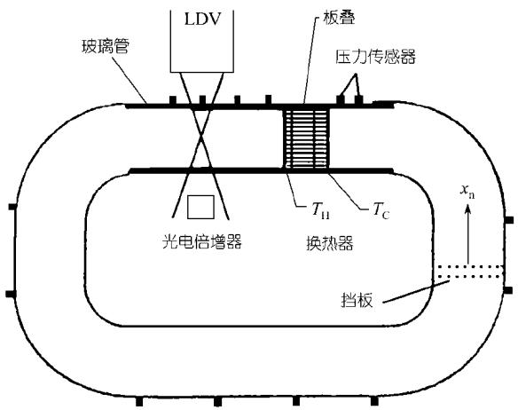  
图 1.7 Yazaki 的环路行波热声发动机

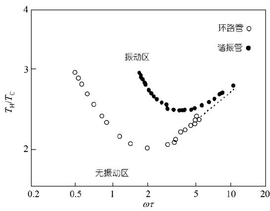  
图1.8行波型热声发动机与驻波型热声发动机的自激振荡边界

1999年，Backhaus和Swift设计制作了一台新型行波热声发动机，将其称作热声 Stirling发动机[65, 66]，如图 1.9所示。从声场性质来看，这是一台高效行、驻波混合型热声发动机，但从热声转换效应产生机制来看则属于行波发动机的范畴。该发动机主要由行波环路和谐振管组成，通过合理设计环路管段的结构尺寸使回热器处于行波声场，同时将行波回路布置在谐振管的一端从而提高了回热器处的声阻抗。计算表明，其回热器处的声阻抗为纯行波的30倍，因而该处的粘性损耗大为减少。

该发动机取得成功的另一关键因素是有效地抑制了环路声直流（Gedeon流）所造成的热损失67。他们在环路主水冷器的上方安装了一个喷射泵，通过调节喷射泵流道进出口截面积之比改变其流阻系数，从而获得抑制Gedeon流的压力差。此外，介于加热器和次级水冷器之间的热缓冲管具有较大的温度梯度，很容易引起 Rayleigh 流[68]，为此 Swift 等人将热缓冲管的内壁设计成锥形，通过流通截面积的变化，成功地抑制了Rayleigh流。正是因为这三项重要改进，该发动机取得了巨大的成功，实验表明其热效率可达到0.30，能够以42%的相对卡诺效率向谐振管传送710W的声功，可以同内燃机（热效率0.25-0.4）和传统的活塞式Stirling发动机（热效率0.2-0.38）相媲美。热声Stirling发动机是一项开创性的研究成果，Swift和Backhaus因此荣获 1999年的“R&D100”奖。

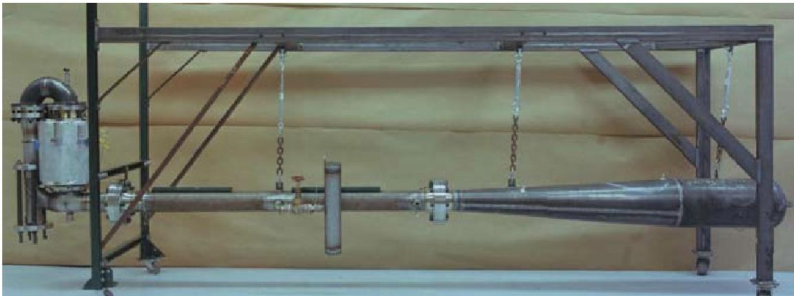  
图 1.9 Swift 的热声 Stirling 发动机

高效率热声 Stirling发动机的研制成功使得行波型热声发动机的研究工作迅速兴起。日本名古屋大学的Ueda和Biwa等人对发动机内声场进行了系统的测量，对系统振荡模态的选择也进行了深入的研究[69-74]。Matsubara等人提出采用对称布置的由弹簧支撑的固体活塞代替谐振管和反馈管，为热声发动机的小型化提供了思路[75]。

同期，国内也开展了斯特林型热声发动机的研究。2003年浙江大学的邱利民等人研制一台大型斯特林型热声发动机[76]，该发动机长4.5m，高1.25m。利用氦气做工质，在平均压力为2MPa，谐振频率为45Hz，加热功率4kW的情况下，获得1.19的压比。2005年中国科学院理化技术研究所的罗二仓等人报道了聚能型斯特林型热声发动机[77]。该实验样机采用3m长直径分别为80mm和200mm的锥形管代替等直径谐振管，有效地抑制了谐振管内声波的非线性传输和耗散，强化了声振荡。他们在1.52MPa氦气的条件下，谐振频率为91Hz，加热温度为670℃时，获得1.30的压比，这是目前所报道的环形圈型行波热声发动机实现的最大压比。

2001年，中国科学院理化技术研究所的李青等人建立了一台小型高频斯特林型热声发动机[78]。对高频情况下，发动机的起振特性和调相机理进行了深入的研究，实验也发现了系统存在两个振动模态：高频模态（528Hz）和低频模态（76Hz），以及两个模态跃迁的现象。同样在高频情况下，高频模态的出现使发动机所获得最大压力波动峰峰值仅为29KPa[79,80]。

2006年，李青研究组在对谐振管的管型优化，回热器的选频特性进行研究以后建立了一台新的小型高频热声发动机，环形圈的长度为0.84m，谐振管和谐振腔的总长度为1.6m。利用氦气作为工质，系统起振后谐振频率约为170Hz，在加热功率为1000W时，实验获得了300KPa的压力波动峰峰值[58,81]，突破了100Hz 以上高频斯特林发动机压力幅值偏小的瓶颈，已经可用于驱动制冷机。几乎在同一时期，李青研究小组搭建了一台更小的热声发动机[59,82,83]，谐振管和谐振腔的总长度仅有0.65m，谐振管长度只有0.35m，通过对谐振管径向方向的优化以及对回热器中间相位和阻抗的调节，利用氦气做工质，系统以单一频率起振，随后稳定工作在282Hz左右，在平均压力为2.5MPa，加热功率为700W的情况下，获得了270KPa的振动压力波动峰峰值，与频率比它低100Hz的热声发动机相比，其压力峰峰值亦毫不逊色，这是目前所见的首台总尺度小于1m，并且可以实用的热声发动机。

## §1.5.1.3 串级热声发动机的发展

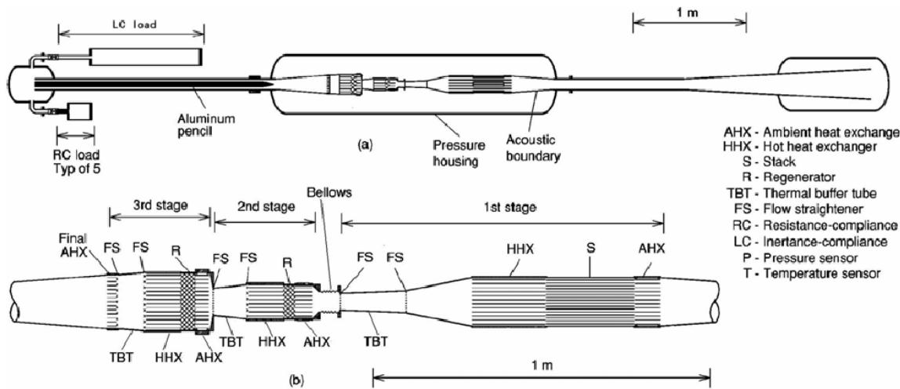  
图 1.10 Gardner 等人的串级发动机

虽然热声斯特林行波发动机的效率较高，但是在这样的闭合回路中一般会出现声直流，从而使系统效率大大降低。尽管喷射泵可以抑制一部分声流，但需要以牺牲声功作代价。另外，行波环路中高温端产生的热应力也会带来制造和可靠性方面的问题。目前人们正在研究其它高效的热声系统以解决这一问题，美国 LANL的 Gardner等提出的串级发动机就是方案之一[84]，如图1.10所示。他们创造性地利用驻波管中部行波分量为主的声场，布置回热器，使上一级产生的声功在此放大。由于回热器中气体经历斯特林循环，从而达到提高整体热效率的目的。该发动机在最佳工作状态时，能输出声功2000W以上，热声转化效率达20%，相对卡诺效率30%。2003年，中科院理化所的李青研究小组也开展了工作频率更高（300-500Hz）的串级热声发动机的实验研究工作[85,86]

## §1.5.2 热声制冷机的发展

## §1.5.2.1 电驱动型热声制冷机的发展

1986 年开始，美国 Los Alamos 国家实验室的 Wheatley 教授领导开展了第一台热声制冷机的研究工作。后来该实验的工作转移到了加利福尼亚 Monterey海军研究生院，由Hofler继续进行，他在博士期间制成了世界上第一台热声制冷机。这是一台扬声器驱动的驻波型热声制冷机，其工作频率为500Hz，在环境温度为293K时，达到了193K的最低制冷温度[87,88]。

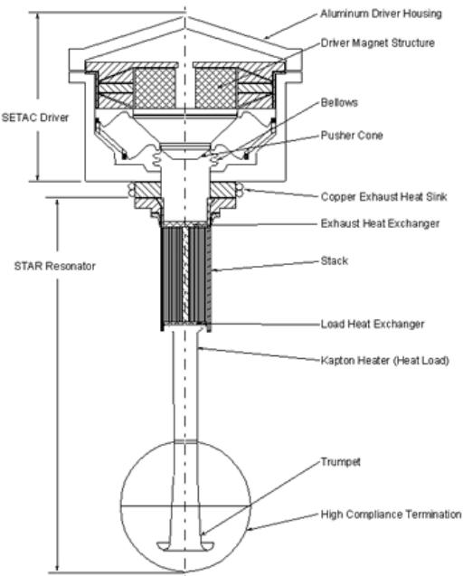  
图 1.12 宾州大学研制的 STAR 制冷机

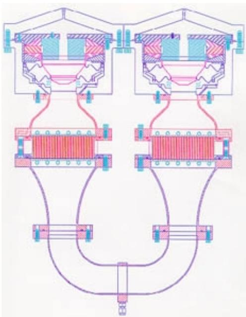  
图 1.13 宾州大学 SETAC 热声制冷机

1992年 Garrett教授所在的热声研究小组，在Hofler研究基础上，制成了安装在“发现号”航天飞机上的空间热声制冷机（STAR），如图1.12所示[89,90]。该系统以含 97.2%的氦气和 2.7%的氙气的混合气体为工质，在充气压力1.0MPa时，可达到-57℃的最低温，最大温差为 $1 1 5 \mathrm { { ‰} }$ ，但制冷量很小仅有几瓦量级。在频率为400Hz的电动扬声器驱动下，在 $5 0 \mathrm { { ^ \circ C } }$ 温差下获得 3.0W制冷量，相对卡诺循环的COP为16%。

1995年，该研究小组又成功地开发了一台用于冷却海军舰船上电子系统的热声制冷机（SETAC）[91]，如图1.13所示，制冷能力是 STAR的近100倍。以氦气和氩气的混合气体为工质，输入450W电功，冷端温度21℃时，该制冷机获得的制冷量为 419W，消耗声功 216W，整机热效率8%；冷端温度为 4℃时有294 W冷量，整机热效率17%。

2004年美国宾州大学家用热声制冷机获得了很大进展，如图1.14，他们设计的电声驱动同轴行波热声制冷机在-24.6℃获得了120W的制冷量，相对卡诺效率81%。该制冷机即将成为Ben&Jerry公司新一代保存冰激凌的制冷机[92]。

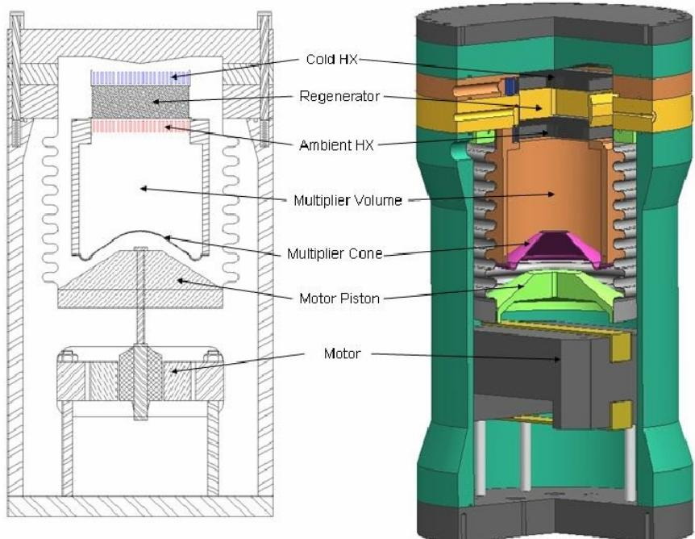  
图1.14宾州州立大学同轴型行波热声制冷机

荷兰爱因霍温技术大学的Zeegers等近年来也在进行热声制冷研究，他们于2000年研制的电声驱动的热声制冷机获得了近70℃的温降[93-94]。2008年，荷兰能源研究中心的Tijani等人研制了一台线性电机驱动的同轴型热声制冷机[95]，获得了25%的相对卡诺制冷系数和-54℃的制冷温度。

国内对电驱动型热声制冷机的研究较晚，主要是同济大学和浙江大学的研究。同济大学学报报道了袁鹏和寿卫东等于1995年前后研制的一套热声能量转换的验证装置，获得了近10℃的温降[96]。浙江大学制冷与低温工程研究所的冯仰浦、张肇剡等于1998年研制成一台热声制冷机，以氮气为工质获得了12℃的温降，经过改进该制冷机可达到25℃的温降[97]。

## §1.5.2.2 热驱动型热声制冷机的发展

1990年，Swift与Radebaugh联合开展了采用驻波型热声发动机代替传统机械式压缩机驱动脉冲管制冷机的研究[98]。所建立的驻波型热声驱动器长达10m，以氦气作为工质，产生了频率约为27Hz，压比约为1.1的压力波，驱动1台小孔型脉冲管制冷机达到90K，成为世界上第一台完全无运动部件的低温制冷机，该研究成果荣获美国1990年“R&D100”奖。热声驱动脉冲管制冷机的研制成功引起了工业界的关注。1994年，美国Cryenco公司与Los Alamos国家实验室以及美国国家标准技术研究所合作进行以燃烧天然气作为驱动源的热声驱动脉冲管制冷机液化天然气研发项目。1997年Swift等研制出世界上最大的热声驱动脉冲管制冷机[99,100]，如图1.15所示，谐振管长12m，用于天然气液化，约需要燃烧40%的原料天然气来液化剩余的60%的气体。它的液化率140gpd（加仑/日），在-140℃时有2kW的制冷量，热声发动机和脉冲管制冷机的效率分别达到卡诺效率的25%和23%。它证明热声驱动脉冲管制冷技术可以满足实用天然气液化所需的制冷量，是热声驱动脉冲管制冷机实用化的重要里程碑。二期工程从1999年中期开始，如图1.16所示，上部是发动机，下端是制冷机，中间由半波长的谐振管连接，工质为氦气，运行频率为40Hz，目标参数是液化率500gpd，发动机向制冷机传输30kW的声功，制冷机的制冷量为7kW，通过燃烧35%的天然气液化其余65%的天然气。2001年，500gpd的发动机驱动脉冲管制冷机的实验样机开始运行，但由于焊接问题，发动机向制冷机传输的声功为设计参数的12%，制冷机的制冷量为设计参数的25%。

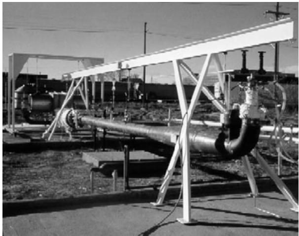  
图1.15驻波型热声驱动的大型脉冲管制冷机

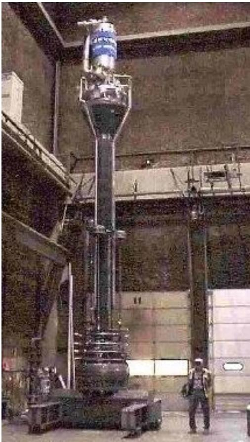  
图1.16热声斯特林发动机驱动的脉冲管制冷机样机

美国海军研究生院，在1997年他们的热驱动驻波热声制冷机在工作频率为350Hz，平均充气压力为1.5MPa，压力波动为平均压力的10%的工作情况下，该制冷机温差为25℃时达到的制冷量为91W，总的 COP为0.15[101]。2000年他们设计了一台太阳能驱动的热声制冷机[102]，如图1.17所示，其驱动器利用太阳能为动力，然后用产生的声功来实现制冷。系统总长仅为0.318m，热端最高温度为450℃ 时，在冷端温度为 5℃时获得 2.5W的制冷量，此时温降为 18℃。这一结果证明了太阳能驱动热声制冷机的方案是可行的，在实用性、简单性和可靠性方面具有很大的潜力。

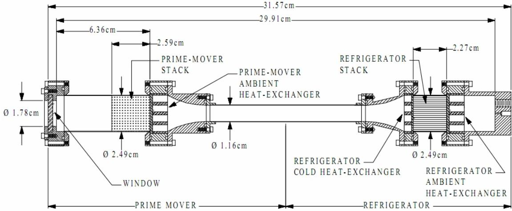  
图1.17太阳能驱动热声制冷机示意图

1998 年美国宾州大学的 Garrett 等也建立了太阳能驱动的热声制冷机[103]，在温降为25℃下，目标制冷量为10-60W，此时的热量输入为150-600W。

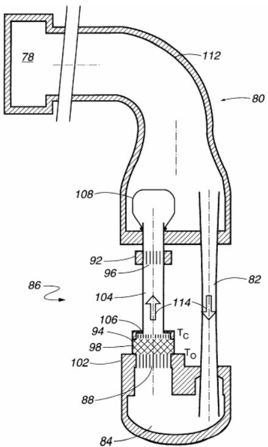  
图 1.16 Swift等热驱动行波热声制冷机

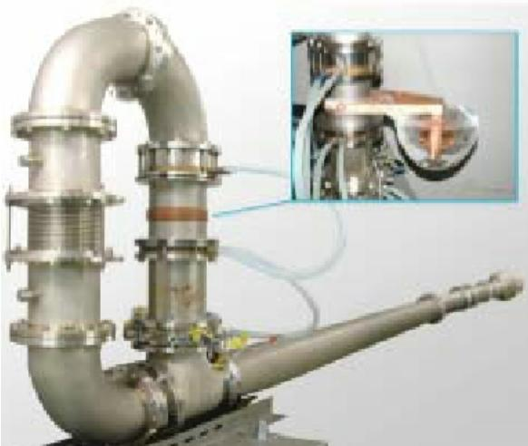  
图1.17 Ueda等热驱动行波热声制冷机

1999 年由美国 Los Alamos 国家实验室的 Swift 博士等建立了一种新型的可实现声功回收的脉冲管型制冷机[104]，后来被称为行波型热声斯特林制冷机。当采用 2.4MPa的 Ar作介质，工作频率为 23Hz 以及室温端为 12℃时，该制冷机冷端达到的最低温为 $- 8 0 ^ { \circ } \mathrm { C }$ ，在 $0 \mathrm { ‰}$ 时有50多瓦的制冷量，冷端为 $- 5 5 \mathrm { { \small C } }$ 时 COP为0.29。

日本的Ueda等则在行波热声发动机环路中布置了热声制冷机单元，在一定的位置上也存在热声制冷效应。2004年他们建立了实验台，当发动机热端输入210W热量时，冷端最低温为 $\mathrm { \Omega } \mathrm { J } { - } 2 5 \mathrm { \mathrm { \mathrm { \circ } C } }$ ，在 $0 \mathrm { ‰}$ 时有11W的制冷量[71,105]。

就国内而言，浙江大学自1998年起就开始了热声驱动脉冲管制冷机的研究，2000年，在以氦气为工质的驻波热声发动机驱动脉冲管制冷系统中获得了138K的低温，并且针对加热器，冷却器和连接方面存在的问题，进行了系统的改进和优化[106,107]。2001年，还是用该热声发动机驱动，以纯氦和氦氩混合气体为工质，制冷机达到了119.7K和117.6K的低温[108,109]，进入了低温温区，使该系统应用于液化天然气成为可能。2004年他们通过对该驻波发动机的谐振管的长度进行优化，当谐振管长度为8m，采用2.1MPa的氦气为工质的情况下，最终得到了88.6K的低温[110]。对于斯特林型热声发动机驱动脉冲管制冷机的探索开始于2004年，浙江大学的孙大明等利用一台大型斯特林热声发动驱动U型脉冲管制冷机，它利用氮气作工质，谐振频率为25Hz的情况下，获得了153.7K的低温，当改用氦气作工质以后，无负荷最低温度达到了118K，发动机的加热量为2500W[111]。2005年，邱利民等人在对斯特林热声发动机谐振管的长度进行优化以后，在充入2.6MPa的氦气作为工质，加热量为2350W的情况下获得了80.9K的低温[112]。

中国科学院理化技术研究所也在差不多同时期进行了热声驱动脉冲管制冷机的研究。2001年，罗二仓等人采用自行研制的行波型热声发动机驱动微型同轴脉冲管制冷机，以氮气为工质获得了218K的无负荷制冷温度。2005年，罗二仓等人采用聚能型行波热声发动机驱动无气库的惯性管型脉冲管制冷机，在工作频率91Hz，平均压力2.045MPa，压比为1.212时，达到了75.1K的无负荷制冷温度，首次突破液氮温区，目前他们的单级脉冲管可以达到68.8K的低温[113]，双级脉冲管达到了18.1K的低温[114]，这是目前报道的利用热声驱动脉冲管制冷机所能达到的最低制冷温度。同期，该小组也进行了热声发动机驱动热声制冷机的研究。2003年，该小组研制了85Hz的室温行波热声制冷机[3]，由驻波热声发动机驱动，获得了 ${ } _ { - 2 8 ^ { \circ } \mathrm { C } }$ 的最低温度；2006年，采用行波型热声发动机驱动行波型热声制冷机，在工作气体为氦气，平均压力3MPa，输入2.2KW的热量，达到 ${ } _ { - 6 5 } { } ^ { \circ } \mathrm { C }$ 的无负荷制冷温度，并在制冷温度为 $0 \%$ 时达到405W的制冷量，此时COP达到2.0，总效率达到18.4%。

大型热声发动机驱动热声制冷机的研究取得了很大的进展，而小型热声发动机驱动热声制冷机的研究却由于驱动器以及高频损失等原因未能得到充分的发展。2005年末，李青研究小组[83]首次开展了小型热声发动机驱动脉冲管制冷机的研究，并且独立设计制造了一台直线型的高频脉冲管制冷机。发动机水平总长度为0.7m，高0.22m，使用2.5MPa的氦气作为工质，起振后稳定工作频率为282Hz，当输入热量为600W的时候得到了147.3K的低温。同期，该小组在对级联型热声发动机研究的基础上，开发了一种串列式热驱热声制冷机，使用2.5MPa的氦气作为工质，起振后稳定工作频率为440.8Hz，在190W的加热功率下获得了 $1 2 ^ { \circ } \mathrm { C }$ 的温降。

## §1.6 本论文研究的主要问题及思路

随着热声研究的发展，为了提高热声转换效率，热声热机从驻波型发展到行波型。对于理想的行波热声热机，要实现可逆热声转换需要无穷小水力半径的回热器。然而，无穷小的水力半径导致极大的粘性耗散，这将大大降低热声转换能力。因此，实际的行波型热声热机选择有限水力半径的回热器。回热器水力半径的非零值必然引起热驰豫，使得温度振荡与压力振荡相位差偏离 $9 0 ^ { \circ }$ 为此，必须选择行驻波相位来平衡热驰豫引起的相位偏移。然而，行驻波声场中压流相位差 $\varphi _ { z }$ 可在 $- 1 8 0 ^ { \circ } \leq \varphi _ { { z } } \leq 1 8 0 ^ { \circ }$ 范围内变化，如何选择 $\varphi _ { z }$ 成为一个亟待解决的新问题。到目前为止，大部分研究者在研究热声热机时，仍基于行波或驻波的分析上，极少有从行驻波的角度对实际热声系统中行驻波模态进行研究。我们深入思考 $\varphi _ { z }$ 的问题，感到这是拓展发展热声理论与实践的新天地：针对热声系统内行驻波的现实，运用波动理论对热声系统内的波动过程进行分解，进而从行驻波的观点细致研究热声理论，推进热声理论研究的深化。

作者在本论文中，试图展开热声行驻波理论对热声理论的深化工作，并以此指导研制新型的高频行驻波型热驱动热声制冷机，拓展目前基于行波或驻波的热声热机理念，努力解决以下几个方面的问题：

1. 为了实现可逆热声转换，众多研究者一直追求高阻抗的行波相位。然而，对声场中各参数（如，振荡压力、振荡速度、当地声阻抗、压流相位差以及声能密度）在声场中的分布及其之间的相互关系，尚未见报道，出现高阻抗行波相位的声场条件也极少有研究者进行分析，这使得热声热机的优化设计，以及对测量数据的分析都带有盲目性。

2. 大部分研究者在研究热声热机时，仍基于行波或驻波的分析上，极少有从行驻波共同作用的热声效应的角度对实际热声系统中行驻波模态进行研究。

3. 热驱动热声制冷机系统存在两种机制工作的热声转换单元，不同热声单元之间的耦合工作机理依然存在认识上的不足，各热声部件之间的相互影响和相互作用的机理尚不是十分明确。

4. 在技术上，小型化所引起的频率的提高对回热器或者板叠的设计提出了更高的要求。因为频率的提高，导致回热器或者板叠中的热和粘性的渗透深度迅速减小，为了得到合适的相对渗透深度，必然要求减小回热器或者板叠的流道尺寸，这就在加工工艺方面提出了新的挑战。同样的，换热器的设计同样面临新的挑战，如何设计出高效小型甚至是微型的换热器在加工工艺上还面临不少的难点。

5. 热声回热器是热声热机系统中产生热声效应最关键的部件，其结构参数及工作声场直接影响热声转换效率。然而热声热机设计中对结构参数及工作声场的选择却缺乏理论和实验指导，这使得设计带有一定的盲目性和对结果的不可预知性，性能和结构也不可能是优化的。

## §1.7 本文的主要工作

本文以高频行驻波型热驱动热声制冷机为研究目标，围绕着以上所提到的问题开展工作，主要包括以下方面：

第一章为绪论，主要介绍作者对热声学的重要研究成果和未来发展趋势的基本观点，同时指出本学位论文的选题背景、意义以及基本内容。

第二章对现有的线性热声理论进行了总结分析，并引入行驻波的概念，对热声热机声场进行行驻波分解。在此基础上，权衡速度、精度和易于使用等条件，开发了“小振幅热声热机可视化仿真软件”。然后，使用本文设计的软件模拟计算了斯特林低温制冷机，并与DeltaE计算结果对比。最后，进一步分析了热声热机仿真计算中有待改进和提高的地方。

第三章基于波动理论，对声场进行行驻波分解，给出了行驻波声场关键参数的无量纲表达式，提炼出了声场特性集成化参数。该集成化参数是声场中的关键参数（振荡压力、振荡速度、特征声阻抗、压流相位差和时均声能密度）集成化的体现，同时也反应了声场中关键参数之间的相互关系。结合这两个集成化参数，分析了行驻波声场的分布特性。

第四章为了分析行驻波声场中的热声效应，提出了两种分析方法：数学公式分析和定性分析，两种分析方法的结论一致。

第五章根据行驻波声场中热声效应的分析结论，提出了一种新型行驻波型热驱动热声制冷机系统。并使用本论文第二章所介绍的“小振幅热声热机可视化仿真软件”对本文提出的行驻波型热驱动热声制冷机进行了数值模拟和优化，对行驻波型热驱动热声制冷机的工作机理进行了深入的理论分析。

第六章在第五章数值模拟和分析的基础上，在国际上首次成功设计了一台行驻波型热驱动热声制冷机，并且介绍行驻波型热驱动热声制冷机的设计、建造、关键热声元件的基本结构、制作工艺和动态数据采集系统。在实验的基础上，重点探讨回热器目数、长度等结构参数以及充气压力、加热量等运行参数对于热声热机总效率，发动机效率，制冷机制冷系数以及回热器两端压流相位差等性能的影响。同时将理论与实验结果进行对比，寻找理论预测的缺陷以及实验改进的方向。

第七章从基本热声公式出发，提炼出了声场参数、回热器结构参数以及热声热机性能参数的无因次表达式，并通过这些无因次参数的分析，结合声场集成化参数，提出了一种综合优化热声热机的全新的优化分析方法。该方法结合了回热器结构参数和声场参数，并考虑了各个参数之间的相互制约关系，对热声热机的性能进行了全面的优化分析。其分析结果能帮助理解已存在热声热机的最优实验工况，同时也能对设计新型热声热机提供了理论指导。

第八章全文工作总结以及今后工作展望。

## 第二章 小振幅热声热机可视化仿真软件设计

## §2.1 引言

数值研究为热声系统特性和性能的预测以及热声装置的设计和优化提供了可能，它是热声研究的重要方法，在热声的发展中起着举足轻重的作用。目前比较成熟的计算方法有三种。（1）时间步长115]：将时间划成许多微小段（其时间间隔相对于系统热力学循环周期必须足够的小），将微分方程转换成差分方程计算。该计算能够得到瞬态解，但效率较低。（2）时间周期计算方法[116]：与时间步长方法类似，只取一个周期计算，提高了计算速度。（3）微扰理论方法[117]：取相对于整个过程中的微小变量部分，并进行一定的假设。目前很多热声模拟计算较多采用微扰理论方法。

至今为止，已有几种热声计算软件，如 Hofler研究小组的 DSTAR[118]，Radebaugh 研究小组的 Regen3[119]，和最著名的 Los Alamos 热声研究组的DeltaE[24,120]软件。DeltaE采用一维声近似，对沿x方向参数瞬时值的总能流、动量方程和连续性方程进行数值积分，而Regen3是更为复杂的数值积分，它以牺牲速度来改善对包括一些非线性现象的计算精度，DSTAR 和DeltaE同样是一维的方法，将装置处理成一系列的标准段来分别计算。DSTAR只能对Hofler研究小组自己研制的实验机型进行较好的计算，不能处理装置的分支，不能普遍应用于热声研究中的各种复杂机型。DeltaE能对热声领域各种复杂的机型，在小振幅振动状态下进行较好的模拟计算，但热声计算程序编写较为复杂，输入输出不直观。Regen3[115]是关于x和t的数值积分，它没有局限于时间关系必须是周期性的假设，能够计算整个时间关系的瞬时特性，如一个回热器的初始的降温时间等，然而，Regen3只能对热声热机的单个元件——回热器进行计算，不能实现整机模拟计算或优化。

各种计算工具的开发对热声系统的研究是有益的，每种方法都体现了在速度、精度和易于使用之间的一种权衡。本章综合分析现有的一些热声计算软件的优缺点，结合使用Fortran和 VB两种编程软件编写了“小振幅热声热机可视化仿真软件”。该仿真软件基于现有线性热声理论的总结分析，并引入了行驻波的概念，可以实现热声热机声场的行驻波分解。

## §2.2 热声系统仿真基本方程

## §2.2.1 假设前提

线性热声理论是以单频、稳定和小幅振荡的热声近似为基础的，称之为“声近似”，下面对热声基本方程和作者模拟工作的前提假设作具体概括：

1.固体结构（如回热器、热交换器、板叠和封闭管道）是刚性的；

2. 流体振幅较小，即 $u _ { 1 } \delta _ { \nu } / \upsilon < 5 0 0$ ，流体可视为层流，忽略紊流的影响；

3. 流体为可压缩的牛顿流体，粘性系数与速度场无关；

4. 声场是稳定的，不讨论起振的瞬态过程；

5. 对流体介质，只讨论二维对称流道，假定流道的横向尺寸和流体的热渗透深度远小于声波波长；

6. 工质为理想气体。

## §2.2.2 热声基本方程

热声效应，无论其复杂与否，归根结底是一种流体的运动，遵守流体运动的一般规律。对于一个中心在 $x , y , z$ 分别具有边长 $d x , d y , d z$ 的微元立方控制体，流体微团的基本控制方程如下述方程组[121]。

连续性方程： $\frac { \partial \rho } { \partial t } + \nabla ( \rho \vec { \upsilon } ) = 0$

(2.1)

$$
\Rightarrow J ) \varXi \equiv \mathcal { \hat { H } } \mathcal { \hat { H } } \colon \rho \frac { d \vec { v } } { d t } = \rho \vec { F } - \nabla p + \mu \nabla ^ { 2 } \vec { v }\tag{2.2}
$$

$$
\begin{array}{c} \overbrace { \mathsf { H } \underbrace { \mathrm { E } } \underbrace { \mathrm { E } } \mathrm { E } } ^  \underbrace { \mathrm { E } } \underbrace { \mathrm { E } } \underbrace { \dot { \mathrm { E } } } \end{array} \overbrace { \mathrm {  ~ \gamma } } \mathrm { i } \overleftrightarrow { \mathrm {  ~ \gamma ~ } } \overbrace { \mathrm { H } } ^ { \substack { \mathrm { H } } } \overbrace { \mathrm { \partial } J } ^ { \substack { \mathrm { H } } } \dag \pm : \quad \rho c _ { p } \big ( \frac { \partial T } { \partial t } + \vec { v } \cdot \nabla T \big ) - \big ( \frac { \partial p } { \partial t } + \vec { v } \cdot \nabla p \big ) = K \nabla ^ { 2 } T\tag{2.3}
$$

$$
\langle \ I \overrightarrow { \Xi } \stackrel { \Sigma } { \scriptstyle { \Xi } } | \bar { \Psi } \bar { \Psi } \Psi \bar { \Psi } \bar { \Psi } \bar { \Psi } \bar { \Psi } \Psi \bar { \Xi } \stackrel { \Sigma } { \scriptstyle { \Xi } } \bar { \Psi } \bar { \Psi } \Psi = \rho ( T , p )\tag{2.4}
$$

在小扰动条件下，周期性振荡的参数可以看成是平均量与周期振荡量的线性叠加，压力在横向上可以认为是均匀分布，因此各波动量可表示为：

$$
{ \scriptstyle { \{ \begin{array} { l l } { p = p _ { m } + \operatorname { R e } \Bigl [ p _ { 1 } ( x ) e ^ { i \omega t } \Bigr ] } \\ { U = \operatorname { R e } \Bigl [ U _ { 1 } ( x ) e ^ { i \omega t } \Bigr ] } \\ { u = \operatorname { R e } \Bigl [ u _ { 1 } ( x , y , z ) e ^ { i \omega t } \Bigr ] } \\ { T = T _ { m } + \operatorname { R e } \Bigl [ T _ { 1 } ( x , y , z ) e ^ { i \omega t } \Bigr ] } \\ { \rho = \rho _ { m } + \operatorname { R e } \Bigl [ \rho _ { 1 } ( x , y , z ) e ^ { i \omega t } \Bigr ] } \\ { \mu = \mu ( x ) } \\ { k = k ( x ) } \end{array} } }\tag{2.5}
$$

其中，P、U、u、T、ρ、μ和k分别表示流体的压力、体积流率、速度、温度、密度、粘度系数和导热系数。下标1表示一阶的波动量，下标m表示该量的截面平均值。

在静态声场中 $u _ { { \scriptscriptstyle m } } = 0$ ，则上述方程线性化后在频域内可表示为：

连续性方程： $i \omega \rho _ { { } _ { 1 } } + \rho _ { { } _ { m } } \frac { d u _ { { } _ { 1 } } } { d x } = 0$

(2.6)

动量方程：

$$
i \omega \rho _ { { { m } } } u _ { 1 } = - \frac { d p _ { 1 } } { d x } + \mu { { \left[ \frac { { { \hat { \sigma } } ^ { 2 } } u _ { 1 } } { { { \hat { \sigma } } ^ { 2 } } } + \frac { { { \hat { \sigma } } ^ { 2 } } u _ { 1 } } { { { \hat { \sigma } } ^ { 2 } } } \right] } }\tag{2.7}
$$

$$
\begin{array} { r l } { \int _ { \mathbb { H } \times \mathbb { H } } ^ { \infty } \underset { \mathbb { V } ^ { 2 } } { \underbrace { \mathrm { E q } \sum } } \mathrel { \left| \overrightarrow { \mathrm { H } } \right. } \mathrm { \overbrace { \mathrm { H } } ^ { \infty } } \mathrm { \overbrace { \mathrm { \partial } \mathcal { V } _ { \mathrm { J } } } ^ { \mathrm { H } } } \mathrm { \overbrace { \mathrm { \partial } \mathrm { t } } ^ { \infty } } : } & { { } \rho _ { m } c _ { p } \Biggl ( i \omega T _ { 1 } + u _ { 1 } \mathrm { \frac { \ d T _ { m } } { \ d x } } \Biggr ) - i \omega \beta _ { 0 } T _ { 0 } p _ { 1 } = k \Biggl [ \frac { \widehat { \omega } ^ { 2 } T _ { 1 } } { \widehat { \omega } y ^ { 2 } } + \frac { \widehat { \omega } ^ { 2 } T _ { 1 } } { \widehat { \omega } z ^ { 2 } } \Biggr ] } \end{array}\tag{2.8}
$$

状态方程： $\rho _ { 1 } = \frac { \rho _ { m } } { p _ { m } } p _ { 1 } - \frac { \rho _ { m } } { T _ { m } } T _ { 1 }$

(2.9)

根据边界条件，在固体表面 $u _ { 1 } = 0$ ，动量方程(2.7)的解为

$$
u _ { 1 } = - \frac { 1 } { i \rho _ { m } } \big [ 1 - h _ { \nu } ( y , z ) \big ] \frac { d p _ { 1 } } { d x }\tag{2.10}
$$

其中， $h _ { \nu } ( y , z )$ 为粘性分布函数，由系统的几何结构决定。对上式进行截面积分可得：

$$
\frac { d p _ { 1 } } { d x } = - \frac { i \rho _ { m } } { A _ { f } ( 1 - f _ { \nu } ) } U _ { 1 }\tag{2.11}
$$

其中， $f _ { \nu }$ 是粘性分布函数 $h _ { \nu }$ 在空间上的截面平均值（附录2-1中给出了多种截面形状的粘性分布函数 $h _ { \nu }$ 和 $f _ { \nu }$ 的具体表达式）， $U _ { 1 } = \left. u _ { 1 } \right. _ { r } \cdot A _ { f }$ 是截面平均的沿声速方向的体积流率， $\left. u _ { 1 } \right.$ 是截面平均的流速。

式(2.10)只用一阶 $p _ { 1 }$ 和 $U _ { \imath }$ 近似地描述热声效应，并通过这些时间平均的和截面平均的参数描述一个周期内的热声时均效应，所以它是热声近似的动量方程。它反映了体积流率 $U _ { 1 }$ 和压力梯度 $d p _ { 1 } / d x$ 间相互影响和互为因果的关系，即热声流体的运动 $U _ { 1 }$ 引起压力梯度。当 $f _ { \nu } = 0$ ，即流体无粘时，压力梯度完全是惯性的；当 $f _ { \nu } \neq 0$ ，即流体有粘性时，粘性与静止边界的存在对压力梯度增加了阻性的分量，同时有效地改变了惯性作用的幅值，这就是粘性流阻耗散的描述。

同上，由式(2.8)的能量方程式可以得到：

$$
T _ { 1 } = \frac { T \beta } { \rho _ { m } c _ { p } } \big [ 1 - h _ { \nu } \left( y , z \right) \big ] p _ { 1 } - \frac { 1 } { i \omega A _ { f } } \frac { d T _ { m } } { d x } \frac { \big ( 1 - h _ { \kappa } \big ) - \sigma \big ( 1 - h _ { \nu } \big ) } { \big ( 1 - f _ { \nu } \big ) \big ( 1 - \sigma \big ) } U _ { 1 }\tag{2.12}
$$

对上式进行截面积分得：

$$
\left. T _ { 1 } \right. = \frac { T \beta } { \rho _ { m } c _ { p } } \big [ 1 - f _ { \nu } \big ] p _ { 1 } - \frac { 1 } { i \omega A _ { f } } \frac { d T _ { m } } { d x } \frac { \big ( 1 - f _ { \nu } \big ) - \sigma \big ( 1 - f _ { \nu } \big ) } { \big ( 1 - f _ { \nu } \big ) \big ( 1 - \sigma \big ) } U _ { 1 }\tag{2.13}
$$

式中 $f _ { \kappa }$ 是 $h _ { \kappa }$ 的截面平均，即截面平均的导热分布函数，它们与 $f _ { \nu }$ 和 $h _ { \nu }$ 具有相同的表达式（附录2-1，给出了几种截面几何的 $f _ { \kappa }$ 和 $h _ { \kappa }$ 的具体表达式）。

由理想气体状态方程求其截面平均密度为

$$
\left. \rho _ { 1 } \right. = - \rho _ { m } \beta \left. T _ { 1 } \right. + \left( \frac { \gamma } { a ^ { 2 } } \right) p _ { 1 }\tag{2.14}
$$

同理，由连续性方程得

$$
i \omega \rho _ { { } _ { 1 } } + \rho _ { { } _ { m } } \frac { d u _ { { } _ { 1 } } } { d x } = 0\tag{2.15}
$$

将式(2.13)和式(2.14)代入上面式(2.15)中的连续性方程得

$$
\frac { d U _ { 1 } } { d x } = - \frac { i \omega A _ { f } } { \gamma p _ { m } } [ 1 + ( \gamma - 1 ) f _ { k } ] p _ { 1 } + \beta \frac { ( f _ { k } - f _ { \nu } ) } { ( 1 - f _ { \nu } ) ( 1 - \sigma ) } \frac { d T _ { m } } { d x } U _ { 1 }\tag{2.16}
$$

此方程为热声近似的连续性方程，从这个方程可以对热声机理作直观的解释：式(2.16)表明体积流率 $U _ { 1 }$ 的变化梯度由势（压力）变化和沿温度梯度的流（体积流率）变化引起。

首先分析方程(2.16)中的第一项即压力项：若 $f _ { \kappa } = 0$ ，即流体与固体之间无热接触，那么密度振荡是绝热的，此时 $1 / \gamma p _ { m }$ 为流体的绝热压缩性系数，则在每一分段dx上的容为 $A d x / \gamma p _ { m }$ ，压力对体积流率 $U _ { 1 }$ 变化梯度的影响仅仅是通过容作用的，此时在流体与固体间的热弛豫阻值最大。若 $f _ { \kappa } = 1$ ，即流体与固体流道的热接触是完全的，那么流体的温度与固体边界的温度一致，在这种情况下，等温压缩性系数是 $1 / p _ { m }$ ，则在每一分段dx上的容一定是 $A d x / p _ { m }$ ，流体与固体间是等温传热，此时的热弛豫阻值为零。在通常情况下，对 $0 < f _ { \kappa } < 1$ 的中间状态的热接触，当量压缩性系数为 $[ 1 + ( \gamma - 1 ) f _ { \kappa } ] / \gamma p _ { m }$ 是复数，具有中间大小的幅值和相位，它的实部反映了声容的行为，虚部反映了热弛豫导纳的行为，此当量压缩性系数描述了声容与热弛豫导纳的共同作用，反映了压力振荡引起截面平均的密度振荡。

其次分析方程(2.16)中的第二项即流变化项：当 $f _ { \nu } = 0$ 和 $\sigma = 0$ 时，即不考虑粘性的影响，流变化项等于 $\beta f _ { \kappa } U _ { 1 } d T _ { m } / d x$ ，若 $f _ { \kappa } = 0$ ，则方程(2.11)中的流变化项为零，此时流体沿x方向运动时，其密度不变，换句话说，若在具有温度梯度的元件如板叠或回热器中流体与固体间的热弛豫阻最大（即 $f _ { \kappa } = 0 )$ 将不会产生热声效应，这是一种绝热或流体与固体无热接触的情况；若$f _ { \kappa } = 1$ ，流体温度与当地固体壁的温度一致，这是一种热弛豫阻为零的完全传热，是在行波发动机中产生热声效应所希望的情况；实际情况 $0 < f _ { \kappa } < 1$ ，流体沿温度梯度的振荡将产生密度的复振荡（波数为复数），流体同时具有流容和热弛豫导纳的作用，这是驻波发动机中产生热声效应所希望的情况。

## §2.2.3 总能流

在热声系统中，总能流是一个十分重要的量。假设在热声系统中，除了换热器以外，其它管件和周围环境之间有着良好的绝缘层，那么部分热量只能通过换热器被带出系统，根据流体工质控制体积的能量守恒，可以得到

$$
\frac { \partial } { \partial t } \left( \frac { 1 } { 2 } \rho \boldsymbol { \upsilon } ^ { 2 } + \rho \boldsymbol { \varepsilon } \right) = - \nabla \cdot \left[ \rho \vec { v } ( \boldsymbol { \upsilon } ^ { 2 } / 2 + h ) - K \nabla T - \vec { v } \cdot \boldsymbol { \Sigma } \right]\tag{2.17}
$$

式中， $\vec { v }$ 是微团振荡速度矢量，ν是微团振荡速度 $\vec { v }$ 的幅值，ε和h分别是单位质量的内能和焓，∑是粘性应力张量。

式(2.17)中与 $\vec { v } \upsilon ^ { 2 }$ 成比例的项是三阶小量可以忽略。取式(2.17)的x方向分量，代入声近似和方程(2.5)中的相应变量的表达式，保留到二阶量，取时间平均和通道横截面上的积分，同时考虑到粘性剪切项通常较其它保留的项要小得多，通道沿x正方向声近似的总能流方程为：

$$
\dot { H } _ { 2 } ( x ) = \frac { 1 } { 2 } \rho _ { m } \int \operatorname { R e } \big [ h _ { 1 } \tilde { u } _ { 1 } \big ] d A _ { f } - ( A _ { f } K _ { f } + A _ { s } K _ { s } ) \frac { d T _ { m } } { d x }\tag{2.18}
$$

利用通用气体的状态方程： $d h = c _ { p } d T + \frac { ( 1 - T \beta ) d p } { \rho }$ ，则式(2.17)为：

$$
\begin{array} { l } { \displaystyle \dot { H } _ { 2 } ( x ) = \frac { 1 } { 2 } \rho _ { m } c _ { p } \int \mathrm { R e } [ T _ { 1 } \tilde { u } _ { 1 } ] d A _ { f } + \frac { 1 } { 2 } \big ( 1 - T \beta \big ) \int \mathrm { R e } \left[ p _ { 1 } \tilde { u } _ { 1 } \right] d A _ { f } } \\ { \displaystyle - ( A _ { f } K _ { f } + A _ { s } K _ { s } ) \frac { d T _ { m } } { d x } } \end{array}\tag{2.19}
$$

利用 $T _ { 1 }$ 的方程(2.12)和 $u _ { 1 }$ 的方程(2.10)，且完成式(2.19)中的积分，得到

$$
\begin{array} { l } { \dot { H } _ { \mathrm { 2 } } = \cfrac { T _ { m } \beta } { 2 } \operatorname { R e } \left[ p _ { \mathrm { 1 } } \tilde { U } _ { \mathrm { 1 } } \left( 1 - \cfrac { ( f _ { \kappa } - \tilde { f } _ { \nu } ) } { ( 1 + \sigma ) ( 1 - \tilde { f } _ { \nu } ) } \right) \right] + \cfrac { \left( 1 - T _ { m } \beta \right) } { 2 } \operatorname { R e } \left[ p _ { \mathrm { 1 } } \tilde { U } _ { \mathrm { 1 } } \right] } \\ { \quad \quad + \cfrac { \rho _ { m } c _ { p } | U _ { \mathrm { 1 } } | ^ { 2 } } { 2 { \cal A } _ { f } \omega ( 1 - \sigma ^ { 2 } ) | 1 - f _ { \nu } | ^ { 2 } } \operatorname { I m } ( f _ { \kappa } + \sigma \tilde { f } _ { \nu } ) \cfrac { d T _ { m } } { d x } - ( { \cal A } _ { f } K _ { f } + { \cal A } _ { s } K _ { s } ) \cfrac { d T _ { m } } { d x } } \end{array}\tag{2.20}
$$

式(2.20)是热声近似的能流方程，它表明板叠或回热器中的温度梯度是流过它的总焓流 $\dot { H }$ （以及所有其它有关的变量如流体通道的几何， $p _ { 1 }$ 和 $U _ { 1 } )$ 造成的；或温度梯度 $d T _ { m } / d x$ （和所有其它变量）引起通过回热器的总能流 $\dot { H }$ ，此两种观点都可以，但前一种解释对数值计算是特别重要的，因为它说明了此总能流方程在 $p _ { 1 }$ 、 $U _ { 1 }$ 和几何通道已知的情况下，可以看作是关于板叠或回热器中温度 $T _ { m } \left( x \right)$ 的一阶微分方程，对于横向绝热良好的板叠或回热器，总焓流与x无关，因此，根据此条件和能流方程即可用迭代方法按式(2.20)计算板叠或回热器中的温度分布 $T _ { m } \left( x \right)$ ，求得温度梯度 $d T _ { m } / d x$ 为：

$$
\frac { d T _ { m } } { d x } = \frac { \dot { H } _ { 2 } - \frac { 1 } { 2 } \mathrm { R e } \left[ p _ { 1 } \tilde { U } _ { 1 } \left( 1 - \frac { T _ { m } \beta \left( f _ { \kappa } - \tilde { f } _ { \nu } \right) } { \left( 1 + \sigma \right) \left( 1 - \tilde { f } _ { \nu } \right) } \right) \right] } { \frac { \rho _ { m } c _ { p } \left| U _ { 1 } \right| ^ { 2 } } { 2 \omega A _ { f } \left( 1 - \sigma ^ { 2 } \right) \left| 1 - f _ { \nu } \right| ^ { 2 } } \mathrm { I m } \left[ f _ { \kappa } + \sigma \tilde { f } _ { \nu } \right] - A _ { f } K _ { f } - A _ { s } K _ { s } }\tag{2.21}
$$

式(2.21)是热声系统的热声源，是元件具有有源性的本质根源。

至此，得到热声发动机系统中关键变量 $p _ { 1 }$ 、 $U _ { 1 }$ 和 $T _ { m }$ ，即： $\mathsf { R e } [ p _ { 1 } ]$ $\operatorname { I m } [ p _ { 1 } ]$ $\mathsf { R e } [ U _ { 1 } ]$ $\mathrm { I m } [ U _ { 1 } ]$ 和 $T _ { m }$ 的五个变量构成的方程组，它们正是本章进行后续热声热机数值模拟的基础，这里将本小节中最重要的结果概括在一起：

$$
\begin{array} { r l } & { \frac { d p _ { 1 } } { d x } = - \frac { i \omega \rho _ { , w } } { \left( 1 - f _ { v } \right) A _ { f } } U _ { 1 } } \\ & { \frac { d U _ { 1 } } { d x } = - \frac { i \omega A _ { f } } { \gamma { p _ { m } } } \Big [ 1 + ( \gamma - 1 ) f _ { \mathrm { { s } } } \Big ] p _ { 1 } + \frac { \beta ( f _ { \mathrm { s } } - f _ { v } ) } { ( 1 - f _ { v } ) ( 1 - \sigma ) } \frac { d T _ { w } } { d x } U _ { 1 } } \\ & { \frac { d T _ { m } } { d x } = \frac { \dot { H } _ { 2 } - \frac { 1 } { 2 } \mathrm { R e } \Bigg [ p _ { 1 } \tilde { U } _ { 1 } \left( 1 - \frac { T _ { m } \beta \left( f _ { \mathrm { s } } - \tilde { f } _ { v } \right) } { \left( 1 + \sigma \right) \left( 1 - \tilde { f } _ { v } \right) } \right) \Bigg ] } { \frac { \rho _ { \mathrm { { s } } } c _ { p } \left| U _ { 1 } \right| ^ { 2 } } { 2 \omega A _ { f } \left( 1 - \sigma ^ { 2 } \right) \left| 1 - f _ { \mathrm { { s } } } \right| ^ { 2 } } \mathrm { I m } \left[ f _ { \mathrm { s } } + \sigma \tilde { f } _ { v } \right] - \mathcal { A } _ { f } K _ { f } - A _ { \mathrm { s } } K _ { s } } } \end{array}\tag{2.22}
$$

## §2.2.4 声功流

声功流为单位面积的时均声功率的截面平均[121]，其表达式为：

$$
\begin{array} { c } { { \dot { E } _ { 2 } ( x ) = \displaystyle \frac { \omega } { 2 \pi } \oint \mathrm { R e } \Big [ p _ { 1 } \left( x \right) e ^ { i \omega t } \Big ] \mathrm { R e } \Big [ U _ { 1 } \left( x \right) e ^ { i \omega t } \Big ] d t } } \\ { { \displaystyle ~ } } \\ { { \displaystyle ~ = \frac { 1 } { 2 } \mathrm { R e } \Big [ p _ { 1 } \tilde { U } _ { 1 } \Big ] = \frac { 1 } { 2 } \mathrm { R e } \big [ \tilde { p } _ { 1 } U _ { 1 } \big ] = \frac { 1 } { 2 } \big | p _ { 1 } \tilde { U } _ { 1 } \big | \cos \varphi _ { z } } } \end{array}\tag{2.23}
$$

其中， $\varphi _ { z }$ 表示 $p _ { 1 }$ 和 $U _ { 1 }$ 之间的相位差， $U _ { 1 }$ 表示声波的体积流率，～表示该复数向量的共轭复数，对于截面均匀的平面波， $U _ { 1 }$ 等于声速 $u _ { 1 }$ 与截面面积A的乘积。

式(2.23)表明声功的大小直接取决于 $p _ { 1 }$ 和 $U _ { 1 }$ 之间的相位差 $\varphi _ { z }$ ，当$\varphi _ { z } = ( 2 n + 1 ) \times 9 0 ^ { \circ }$ 时，声场为单纯的驻波，声功为零，显然驻波声场不传递声功。当 $\varphi _ { z } = 2 n \times 9 0 ^ { \circ }$ 时，声场为单纯的行波，声功流为两者的幅值乘积的一半。当 $\left| \varphi _ { z } \right| < 9 0 ^ { \circ }$ 时，声功沿x轴正向传播；当 $9 0 ^ { \circ } < \varphi _ { _ z } < 1 8 0 ^ { \circ }$ 时，声功沿x轴负向传播。在实际的热声发动机中，既不是纯粹的行波，也不是纯粹的驻波，而是一个既有行波分量也有驻波分量的混合波，声功运输由行波分量完成。

考虑通道长度为dx内时均声功 $d E _ { 2 }$ 的变化，用连续性方程和动量方程化简得：

$$
\frac { d \dot { E } _ { 2 } } { d x } = - \frac { r _ { \nu } } { 2 } \big | U _ { 1 } \big | ^ { 2 } - \frac { 1 } { 2 r _ { k } } \big | \tilde { p } _ { 1 } \big | ^ { 2 } + \frac { 1 } { 2 } \mathrm { R e } \big [ e \tilde { p } _ { 1 } U _ { 1 } \big ]\tag{2.24}
$$

式中，

$$
\begin{array}{c} r _ { \nu } = \frac { \omega \rho _ { _ m } } { A } \frac { \mathrm { I m } \left[ - f _ { \nu } \right] } { \left. 1 - f _ { \nu } \right. ^ { 2 } } , \quad \mathrm { \Rightarrow A } \mathrm { H } \dot { \Sigma } \mathrm { H } \left. \dot { \Sigma } \right. \left. \dot { \Sigma } \right. \left. \dot { \Sigma } \right. \left. \dot { \Sigma } \right. \left. \dot { \Sigma } \right. \left. \dot { \Sigma } \right. \left. \dot { \Sigma } \right. \left. \right.  \end{array}
$$

$$
\begin{array} { r l } { \displaystyle \frac { 1 } { r _ { \kappa } } = \frac { \gamma - 1 } { \gamma } \frac { \omega A \operatorname { I m } \left[ - f _ { \kappa } \right] } { p _ { m } } , } & { \ : \mathcal { H } \sharp \langle \dot { \underline { { x } } } f _ { \kappa } \rangle \frac { \sharp \xi ( \dot { \underline { { x } } } ) \sharp \langle \dot { \underline { { x } } } f _ { \kappa } \rangle } { \varpi } \frac { \sharp A \operatorname { I m } _ { 1 } \left[ \underline { { \xi } } \dot { \underline { { x } } } \right] } { \varpi } \frac { \sharp \dot { \xi } ( \dot { \underline { { x } } } ) } { \varpi } } \\ { \displaystyle e = \frac { \beta \left( f _ { \kappa } - f _ { \nu } \right) } { \left( 1 - f _ { \nu } \right) \left( 1 - \sigma \right) } \frac { d T _ { m } } { d x } , } & { \ : \mathcal { H } \langle \dot { \underline { { x } } } f _ { \kappa } \rangle \frac { \dot { \jmath } \dot { \beta } \dot { \overline { { x } } } \varpi \dot { \underline { { x } } } \sharp \ddot { \xi } ( \dot { \underline { { x } } } ) \dot { \underline { { x } } } \xi ( \dot { \underline { { x } } } ) - \varpi \ddot { \xi } ( \dot { \underline { { x } } } + \ddot { \underline { { x } } } \ast \dot { \underline { { x } } } ) } { \varpi } \frac { \partial \hat { \xi } ( \dot { \underline { { x } } } \varpi \dot { \underline { { x } } } \ast \underline { { x } } ) } { \partial x } } \end{array}\tag{2.25}
$$

式(2.24)表明沿声波传播方向功流的变化，等号右边的前两项总是负值，第一、二项分别是由于粘性和热驰豫引起的耗散。第三项可以为正值也可以为负值，称为源项。这里重点讨论第三项，为了便于讨论，忽略粘性引起的耗散，即 $\scriptstyle f _ { \nu } = 0$ ，则第三项可写为：

$$
\frac { 1 } { 2 } \mathrm { R e } \left[ e \tilde { p } _ { 1 } U _ { 1 } \right] = \frac { 1 } { 2 } \mathrm { R e } \left[ \tilde { p } _ { 1 } U _ { 1 } \right] \mathrm { R e } \left[ e \right] + \frac { 1 } { 2 } \mathrm { I m } \left[ \tilde { p } _ { 1 } U _ { 1 } \right] \mathrm { I m } \left[ - e \right]\tag{2.26}
$$

上式表明，对于行波型热声发动机和制冷机， $\mathsf { R e } [ f _ { k } ]$ 对声功的贡献大，此时 $\mathsf { R e } \big [ p _ { 1 } \widetilde { U } _ { 1 } \big ]$ 较大；对于驻波型热声发动机和制冷机， $\operatorname { I m } [ - f _ { k } ]$ 对声功的贡献大，此时 $\mathrm { I m } \big [ p _ { 1 } \widetilde { U } _ { 1 } \big ]$ 较大。

## §2.2.5 热流

经过回热器的热流是通过热声工质(包括流体工质和固体介质)的导热，等压的温度振荡引起的热流和等温的压力振荡引起的热流之和，即：

$$
\dot { Q } = \int \Bigl [ \rho _ { m } c _ { p } \ : \mathrm { R e } [ T _ { 1 } \tilde { u } _ { 1 } ] - \mathrm { R e } [ p _ { 1 } \tilde { u } _ { 1 } ] \Bigr ] d { \cal A } + \Bigl [ A _ { f } K _ { f } + A _ { s } K _ { s } \Bigr ] \frac { d T _ { m } } { d x }\tag{2.27}
$$

将 $T _ { 1 }$ 和 $u _ { 1 }$ 表达式(2.12)和(2.10)代入式(2.27)，并积分可得到其热流表达式为，

$$
\begin{array} { l } { \displaystyle \dot { \mathcal { Q } } = \frac { \left| U _ { 1 } \right| ^ { 2 } \rho _ { m } c _ { p } } { 2 A \omega \left( 1 - \sigma ^ { 2 } \right) \left| 1 - f _ { \nu } \right| ^ { 2 } } \frac { d T _ { m } } { d x } \mathrm { I m } \Big ( f _ { k } + \sigma \tilde { f } _ { \nu } \Big ) - \frac { 1 } { 2 } \mathrm { R e } \left[ p _ { 1 } \tilde { U } _ { 1 } \left( \frac { f _ { k } - \tilde { f } _ { \nu } } { \left( 1 + \sigma \right) \left( 1 - \tilde { f } _ { \nu } \right) } \right) \right] } \\ { \displaystyle + \left[ A _ { f } K _ { f } + A _ { s } K _ { s } \right] \frac { d T _ { m } } { d x } } \end{array}\tag{2.28}
$$

该热流表达式将在本文第三章详细介绍。

## §2.2.6 行驻波分解

对于理想的声波管道，基于声波的线性可叠加性，行驻波声场可表示为前行波和反行波的叠加。因此，振荡压力可表示为，

$$
p _ { 1 } = \chi p _ { + } + ( 1 - \chi ) p _ { - } = p _ { a } \left[ \chi e ^ { i ^ { ( o t - k x ) } } + ( 1 - \chi ) e ^ { i ^ { ( o t + k x ) } } \right] = p _ { a } e ^ { i o t } \left[ \chi e ^ { - i k x } + ( 1 - \chi ) e ^ { i k x } \right]\tag{2.29}
$$

其中，k为波数， $p _ { a }$ 为振荡压力幅值， $0 . 0 \leq \chi \leq 1 . 0$ o $\chi = 0 . 0$ 代表反行波声场； $\chi = 0 . 5$ 代表纯驻波声场； $\chi = 1 . 0$ 代表前行波声场； $0 . 0 < \chi < 0 . 5$ 代表 $2 \chi$ 的驻波成分和 $( 1 - \chi ) - \chi$ 的反行波成分组成的混合声场，该行驻波混合声场中反行波比率为 $\tau ^ { - } = ( 1 - \chi ) - \chi ~ ; ~ 0 . 5 < \chi < 1 . 0$ 代表 $2 ( 1 - \chi )$ 的驻波成分和 $\chi - ( 1 - \chi )$ 的前行波成分组成的混合声场，该行驻波混合声场中行波比率为 $\tau = \chi - ( 1 - \chi )$

由复数表达式(2.29)可知，该表达式中有 $p _ { a } \ 、 \ x \ 、 \ \omega t$ 、kx四个未知变量。因此，在热声热机模拟计算中，当得到热声热机中声场的压流分布后，可由两个连续点的压力值代入式(2.29)，使用本章第三小节介绍的Runge-Kutta法求得四个未知变量。由χ值即可计算声场中的沿程行波比率 $\tau = \chi - ( 1 - \chi )$ 或反行波比率 $\tau ^ { - } = ( 1 - \chi ) - \chi$ 。这可以为进一步的行驻波的分析提供基础。

## §2.3 数值计算方法的选择

## §2.3.1 Runge-Kutta法

在热声热机数值计算模型中，一些复杂的元件段需要求解一阶微分方程。目前有许多解一阶微分方程的计算方法，最简单也最为常见的方法是Euler方法。这种数值求积方法是梯形公式的一种近似，虽然计算速度快，但其精确度不高。相对于各种求解一阶微分方程方法（例如Euler法），Runge-Kutta法使用高阶公式求解，不仅求解简单，而且其稳定性和精度都很高[122]。

## §2.3.1.1 Runge-Kutta法基本思想

与初值问题等价的微分方程的积分形式：

$$
y { \big ( } x _ { n + 1 } { \big ) } - y { \big ( } x _ { n } { \big ) } = \int _ { x _ { n } } ^ { x _ { n + 1 } } f { \big ( } x , y { \big ( } x { \big ) } { \big ) } d x\tag{2.30}
$$

只要对右端积分用不同的数值求积公式近似就可得到不同的求解初值问题(2.30)的数值方法，若用显式单步法

$$
y _ { n + 1 } = y _ { n } + h \phi \left( x _ { n } , y _ { n } , h \right) \qquad n = 0 , 1 . . .\tag{2.31}
$$

当 $\phi \left( x _ { n } , y _ { n } , h \right) = f \left( x _ { n } , y _ { n } \right)$ ，即数值求积用Euler法，方法只有一阶，若取

$$
\phi \left( x _ { n } , y _ { n } , h \right) = \frac { 1 } { 2 } \Bigl [ f \bigl ( x _ { n } , y _ { n } \bigr ) + f \bigl ( x _ { n + 1 } , y _ { n } + h f \bigl ( x _ { n } , y _ { n } \bigr ) \bigr ) \Bigr ]\tag{2.32}
$$

式(2.32)就是改进Euler法，这时数值求积公式是梯形公式的一种近似，计算时要用二个右端函f的值，但方法是二阶的。若要得到更高阶的公式，则求积分时必须用更多的f值，根据数值积分公式，可将(2.30)右端积分表示为

$$
\int _ { x _ { n } } ^ { x _ { n + 1 } } f \big ( x , y \big ( x \big ) \big ) d x = h \sum _ { i = 1 } ^ { n } c _ { i } f \big ( x _ { n } + a _ { i } h , y \big ( x _ { n } + a _ { i } h \big ) \big ) + O \big ( h ^ { p + 1 } \big )\tag{2.33}
$$

注意，右端f中 $y { \bigl ( } x _ { n } + a _ { i } h { \bigr ) }$ 还不能直接得到，需要像改进Euler法，用前面已算得的f值表示为(2.32)，一般情况可将(2.31)的表示为

$$
\phi \left( x _ { i } , y _ { n } , h \right) = \sum _ { i = 1 } ^ { r } c _ { i } k _ { i }\tag{2.34}
$$

其中，

$$
k _ { 1 } = f { \big ( } x _ { n } , y _ { n } { \big ) }\tag{2.35}
$$

$$
k _ { i } = f { \Biggl ( } x _ { n } + a _ { i } h , y _ { n } + h \sum _ { j = 1 } ^ { i - 1 } b _ { i j } { \Biggr ) } \quad ( i = 2 , 3 , . . . , r )\tag{2.36}
$$

这里 $c _ { i } , a _ { i } , b _ { i j } \ ( \mathrm { i = 1 , 2 , \ldots , r , \ j = 1 , 2 , \ldots , i - 1 } )$ 均为待定常数，公式(2.31)，(2.33)称为r级的显式 Runge-Kutta法，简称 R-K方法。它每步计算r个f值(即 $k _ { 1 } , . . . , k _ { r } )$ ，而$k _ { i }$ 由前面(i-1)个已算出的 $k _ { 1 } , k _ { 2 } . . . , k _ { { i - 1 } }$ 表示，故公式是显式的。例如当 $r = 2$ 时，公式可表示为

$$
y _ { n + 1 } = y _ { n } + h ( c _ { 1 } k _ { 1 } + c _ { 2 } k _ { 2 } )\tag{2.37}
$$

其中 $k _ { 1 } = f { \big ( } x _ { n } , y _ { n } { \big ) } , k _ { 2 } = f { \big ( } x _ { n } + a _ { 2 } h , y _ { n } + b _ { 2 1 } h k _ { 1 } { \big ) }$ 。就是一个二级显式R-K方法。  
参数 $c _ { 1 } , c _ { 2 } , a _ { 2 } , b _ { 2 1 }$ 取不同的值，可得到不同公式。

## §2.3.1.2 三四阶Runge-Kutta法

一种常见的三阶 Runge-Kutta 方法是：

$$
y _ { n + 1 } = y _ { n } + { \frac { h } { 6 } } { \big ( } k _ { 1 } + 4 k _ { 2 } + k _ { 3 } { \big ) }\tag{2.38}
$$

其中，

$$
\begin{array} { l } { \displaystyle { k _ { \scriptscriptstyle 1 } = f \big ( x _ { n } , y _ { n } \big ) } } \\ { \displaystyle { k _ { \scriptscriptstyle 2 } = f \bigg ( x _ { n } + \frac { 1 } { 2 } h , y _ { n } + \frac { h } { 2 } k _ { 1 } \bigg ) } } \\ { \displaystyle { k _ { \scriptscriptstyle 3 } = f \big ( x _ { n } + h , y _ { n } - h k _ { 1 } + 2 h k _ { 2 } \big ) } } \end{array}
$$

利用二元函数 Taylor 展开式可以确定(2.33)中 $r = 4$ $p = 4$ 的 Runge-Kutta方法，经典的四阶 Runge-Kutta方法是：

$$
y _ { n + 1 } = y _ { n } + { \frac { h } { 6 } } { \big ( } k _ { 1 } + 2 k _ { 2 } + 2 k _ { 3 } + k _ { 4 } { \big ) }\tag{2.39}
$$

其中，

$$
{ \begin{array} { l l } { { } } & { { k _ { 1 } = f { \Big ( } x _ { n } , y _ { n } { \Big ) } } } \\ { { } } & { { k _ { 2 } = f { \Bigg ( } x _ { n } + { \frac { 1 } { 2 } } h , y _ { n } + { \frac { h } { 2 } } k _ { 2 } { \Bigg ) } } } \\ { { } } & { { k _ { 3 } = f { \Bigg ( } x _ { n } + { \frac { 1 } { 2 } } h , y _ { n } + { \frac { h } { 2 } } k _ { 2 } { \Bigg ) } } } \\ { { } } & { { k _ { 4 } = f { \Big ( } x _ { n } + h , y _ { n } + h k _ { 3 } { \Big ) } } } \end{array} }
$$

它的局部截断误差 $\mathrm { T } _ { \mathfrak { n } + 1 } = \mathcal { O } ( \mathcal { h } ^ { 5 } )$ ，故 $p = 4$ ，这是最常用的四阶Runge-Kutta方法，数学库中都有用此方法求解初值问题的软件。这种方法的优点是精度较高，缺点是每步要算4个右端函数值，计算量较大。

## §2.3.2 Powe11算法

在计算模型中有很多未知量，我们需要通过选择和操作猜测量来达到靶量与结果之间的差值为零。我们采用的子程序代码被称为 DNSQ，属于SLATEC常规数学库。使用的计算规则是修正的 Powell 算法[123]。Powell 方法是一种不依赖于目标函数梯度的直接搜索法。它逐步构造共轭方向并作为搜索方向，因此Powell方法也是一种共轭方向法。

## §2.3.2.1 Powel1算法基本思想

Powell算法是一种方向集方法，假设计算的问题是n因数，它取 n个 n维的共轭向量，并沿每一向量的方向进行最优值搜索，那么任何一个n元函数都可用一维搜索方法求其最优值。它专门针对当目标函数特别复杂，因而没有办法掌握目标函数特性的一类优化问题。在实际工程与科学计算中十分有用。它的主要计算步骤如下，图2.1为Powell方法计算过程图示：

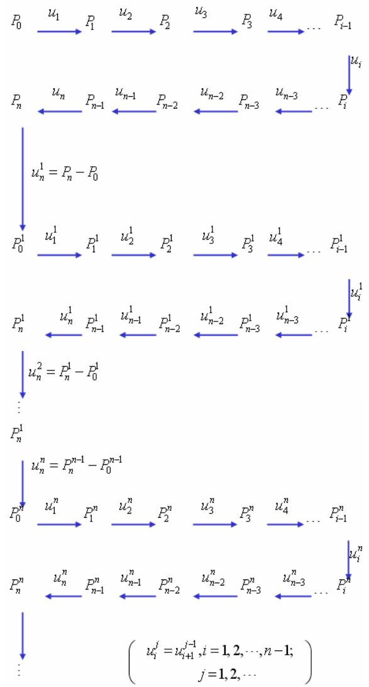  
图 2.1 Powell 方法计算过程图示

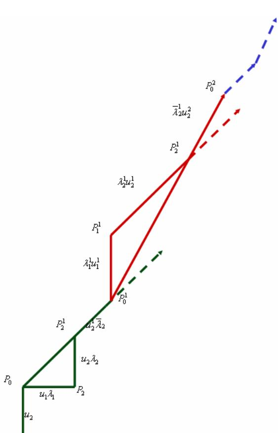  
图 2.2 n = 2 的 Powell 方法计算过程示意

首先，将方向集 $u _ { i }$ 初始化为坐标向量 $u _ { i } = \big ( 0 , \cdots , 0 , i , 0 , \cdots , 0 \big ) \big ( i = 1 , 2 , \cdots , n \big )$ 然后，重复以下各步骤直至函数值不再减少：

1. 记初始位置为 $P _ { 0 }$

2. 对 $i = 1 , 2 , \cdots , n - 1$ ，将 $P _ { i }$ 移至目标函数 $u _ { i }$ 方向的最优值点，并记为 $P _ { i + 1 }$ o

3. 对 $i = 1 , 2 , \cdots , n - 2$ ，置 $u _ { i } = u _ { i + 1 }$

4.置 $u _ { n - 1 } = P _ { n } - P _ { 0 }$

5. 将 $P _ { n }$ 移至函数在 $u _ { n - 1 }$ 方向上的最优点，并记该点为 $P _ { 0 }$ o

以n = 2为例，理解 Powell方法计算过程，如图2.2所示。

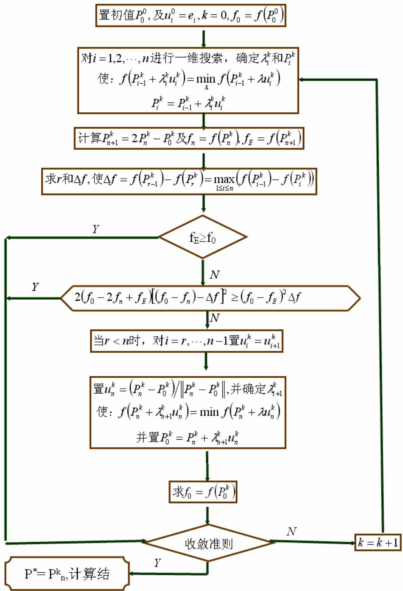  
图 2.3 修正 Powell 算法流程图

## §2.3.2.2 修正Powe11算法

但是，实际计算中不能保证n步内达到极小值点。因为每一循环都用$P _ { n } - P _ { 0 }$ “挤掉” $u _ { 1 }$ ，所以新的向量系 $u _ { i } = \big ( 0 , \cdots , 0 , i , 0 , \cdots , 0 \big ) \big ( i = 1 , 2 , \cdots , n \big )$ 有可能线性相关，例如，某一循环中，如果 $\lambda _ { \mathrm { 1 } } = 0$ ，则 $u _ { 2 } , u _ { 3 } \ldots P _ { n } - P _ { 0 }$ 是线性相关的。当发生这种情况时，以后的搜索就在n维的子空间中进行。最后的解就不正确。解决的办法是 $P _ { n } - P _ { 0 }$ 不是挤掉 $u _ { 1 }$ 。而是挤掉 $u _ { r }$ ，而 $\lambda _ { \mathfrak { r } } \neq 0$ 。一般取最大下降方向，这是因为最大下降方向 $u _ { r }$ 已经在平均方向 $P _ { n } - P _ { 0 }$ 中得到最充分的体现。

这一简单的思想有两种例外情况，此时并不修改方向。令：

$$
\begin{array} { r l } & { f _ { 0 } = f \big ( P _ { 0 } \big ) , f _ { n } = f \big ( P _ { n } \big ) , f _ { \varepsilon } = f \big ( 2 P _ { n } - P _ { 0 } \big ) } \\ & { \Delta f = f _ { r - 1 } - f _ { r } > 0 , \Delta f = \displaystyle \operatorname* { m a x } _ { 1 \leq i \leq n } \big ( f _ { i - 1 } - f _ { i } \big ) > 0 } \end{array}\tag{2.40}
$$

如果，

1、 $f _ { E } \geq f _ { 0 }$ ，保持原来的n个方向，因为 $P _ { n } - P _ { 0 }$ 已不是好的方向。

$$
\begin{array} { r l } { 2 , } & { { } 2 \big ( f _ { 0 } - 2 f _ { n } + f _ { E } \big ) \big [ \big ( f _ { 0 } - f _ { n } \big ) - \Delta f \big ] ^ { 2 } \geq \big ( f _ { 0 } - f _ { E } \big ) ^ { 2 } \Delta f } \end{array}
$$

由此，我们可以对元 Powell算法进行修正，其修正Powell算法的计算过程如图2.3所示。

## §2.4 编程语言的选择

到目前为止，FORTRAN[124]作为科学计算语言，其地位还是不可动摇的。现今常用于计算机程序方面的语言还有， $\mathrm { C } / \mathrm { C } { + + } ^ { [ 1 2 5 ] }$ 和 Matlab[126]等编程语言，FORTRAN与它们比起来有着得天独厚的优越性。

1、FORTRAN历史悠久，底子厚，从第一个FORTRAN程序诞生到现在50多年，很长一段时间内是科学计算语言的唯一选择，长期以来积累了大量正确、可靠的成熟程序段，尽管FORTRAN标准改了多次，但由于其向下兼容，很多程序段是招之即来，来之能战。现比之下，C/C++，Matlab语言在计算的准确性和速度方面存在一定差距。

2、FORTRAN语法要求严格，更适合严谨的科学计算领域。例如，C中并不对数组越界进行检查，如果访问到错误的地址其计算结果是无法预测的。

3、FORTRAN可直接对数组和复数进行运算。例如，C完成两个矩阵的加要进行两次循环，或者是调用一个带5个形参的函数，C++虽然可以完成C=A+B的简单形式，但是它建立在定义矩阵类及其成员函数，再对运算符进行重载的基础上，前期工作繁琐，而且对矩阵的初始化变成了对矩阵类的初始化，增加了工作量。而FORTRAN可以直接完成矩阵的C=A+B。

4、与Matlab 相比，FORTRAN是编译语言，Matlab类似于解释语言，循

环效率高的多，Matlab 使用循环就不得不调用 C/C++或FORTRAN程序。

综上所述，计算中FORTRAN的地位是不可替代的。本文程序设计选择Fortran做主要编程语言，鉴于其在界面设计上的不足，则结合Visual Basic语言来进行。

## §2.5 数值仿真程序设计

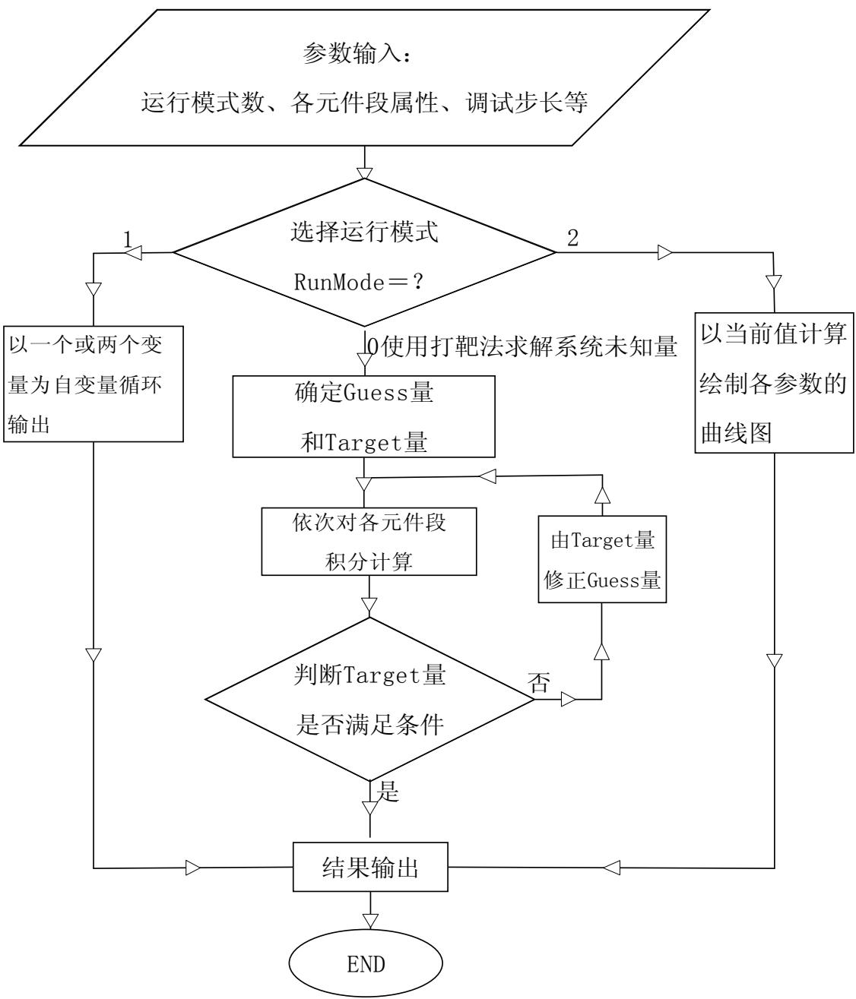  
图2.4 热声热机计算仿真程序流程图

本小节将使用本章第二节介绍的基本热声方程组(2.22)式，对于热声热机的计算模型使用第三节介绍的计算方法。具体计算过程如下：每一次计算中，分别对5个实变量：实数 $T _ { m } ( x )$ ，复数 $p _ { 1 } ( x )$ 和复数 $U _ { 1 } ( x )$ ，从第一个元件段到最后一个元件段使用四阶Runge-Kutta法进行积分计算。每一个元件段的这些变量受诸如当地几何尺寸、能流等参数，以及一些频率和平均压力等全局变量控制。在各个元件的连接处运用 $T _ { m } ( x )$ $p _ { 1 } ( x )$ 和 $U _ { 1 } ( x )$ 的连续性。当四个实数边界条件确定后， $p _ { 1 } ( x )$ 和 $U _ { 1 } ( x )$ 的解只能是唯一的，因为控制方程能够表达为两个复变量的两个耦合一阶方程，或者表达为一个单一复变量的两阶方程。这个结果不管是对单一的元件段或者是对以 $p _ { 1 } ( x )$ 和 $U _ { 1 } ( x )$ 的连续性而衔接起来多段元件构成的一维系统都是真实的。假如所有四个边界条件都在装置的一端给出，那么这个积分就可以直接进行。但是，通常某些边界条件给出在其它地方。在这种情况下，使用“打靶法”——Powell算法，即在计算初始为 $T _ { m } ( x )$ $p _ { 1 } ( x )$ 和$U _ { 1 } ( x )$ 的五个实数中的未知量设置猜测值，然后积分到最后一个元件段，将积分得到的结果与在最后一个元件段输入的边界条件进行比较，然后调整猜测值直到获得正确的结果。另外，可利用热流、功流及其分量的模拟基本方程，求得其它热声系统的性能参数。计算程序框图如图2.4所示。

## §2.6 可视化界面设计

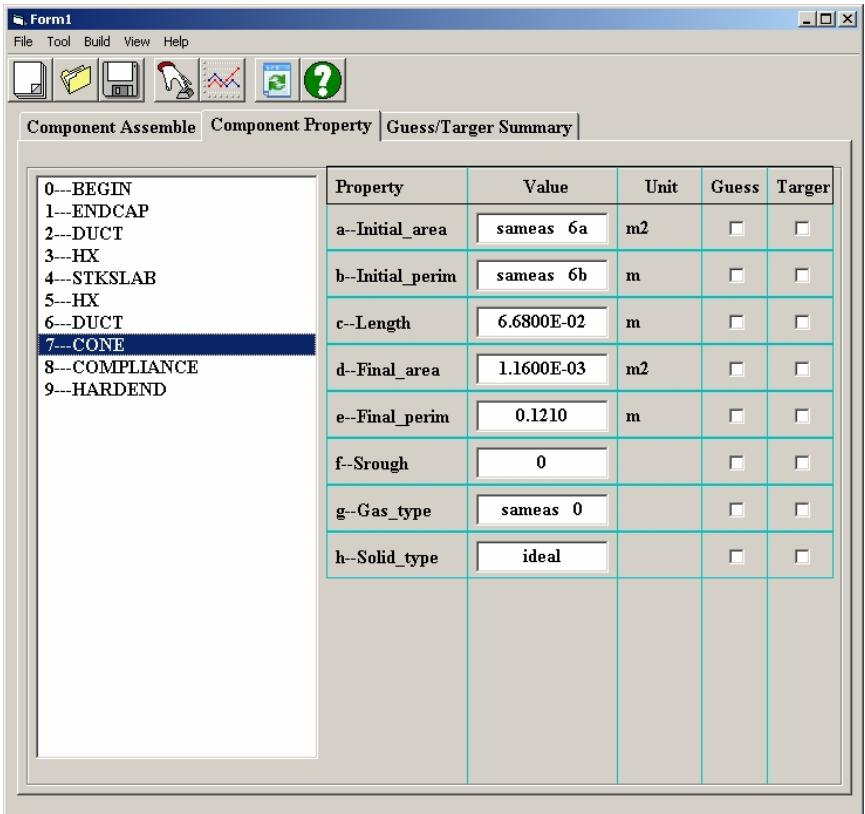  
图 2.5 输入输出界面

DeltaE的应用程序界面过于单调，输入文件的编写比较繁琐，而且输出数据不能直观的显示。因此，在应用程序界面上的设计，参考Hofler研究小组开

发的DSTAR，使用可视化界面，其主输入输出界面如图2.5所示。对于其输出数据，既可以保存为类似于DeltaE输出文件的同时，也能以图形格式输出，如图2.6所示。

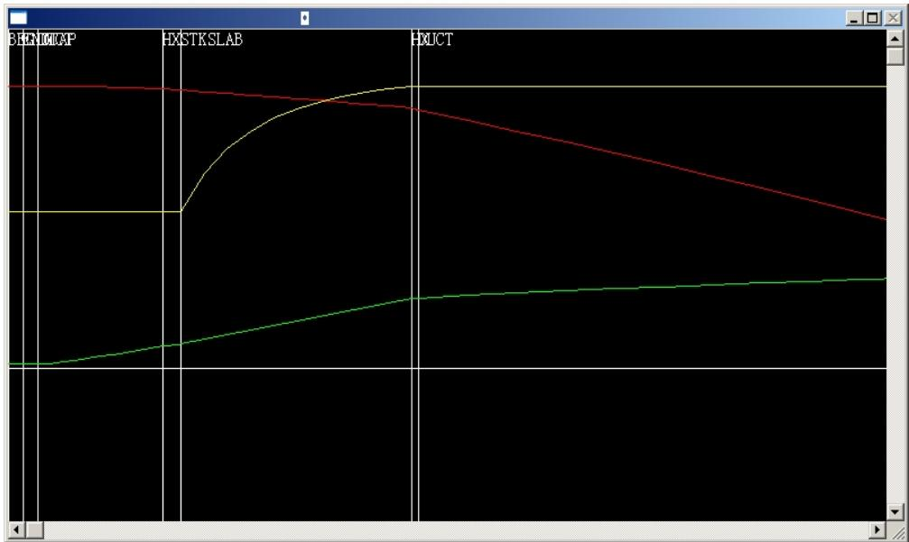  
图 2.6 图形输出界面

## §2.7 模拟计算

文献[24]给出的斯特林低温制冷机，采用堆积丝网型回热器和热交换器，其装置如图2.7所示。工作频率为55Hz，工作气体为氦气，充气压力为2MPa。

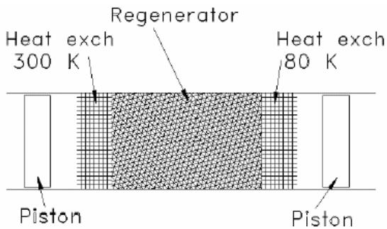  
图 2.7 斯特林制冷机

使用本文设计的模拟软件计算该斯特林低温制冷机，其计算结果与DeltaE计算结果对比如图2.8和2.9所示。由于前文给出的拟合曲线在压流计算公式中影响较小，但在温度焓流分布计算中影响较大，因此，压力分布差别很小，而焓流分布有明显的区别。

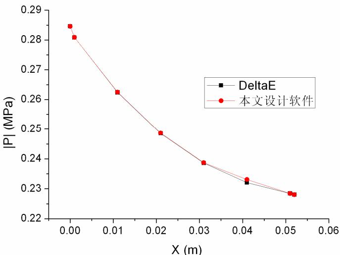  
图 2.8 压力幅值对比图

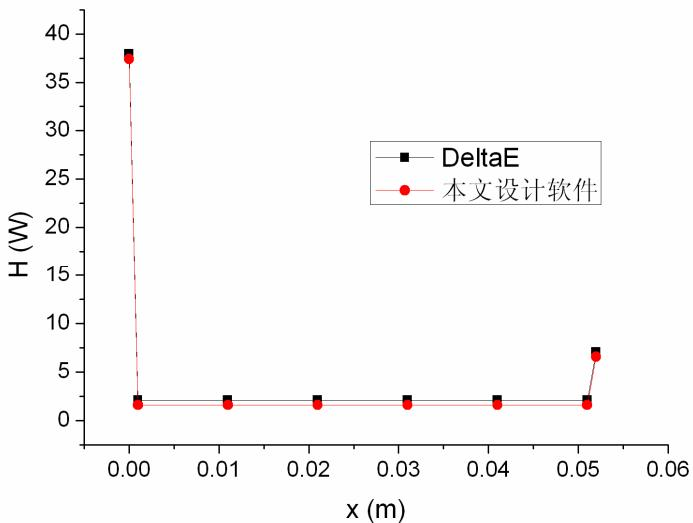  
图 2.9 焓流分布对比图

## §2.8存在的主要问题

## §2.8.1 湍流计算

本软件设计中采用DeltaE程序设计所介绍的导管中湍流的表达式，该表达式不是正确的声学近似。由于交变流动湍流发生的机理和条件的复杂性，目前也少有文献对湍流的表达式给出较好的近似解。

在振荡流的过程中，采用瞬时的Moody摩擦因子描述湍流的振荡流动。这个假设在低频情况下，且 $\mathrm { R } / \delta _ { \mathrm { v } } {  } 0$ 时是非常好的。这一限制在许多脉管制冷机的惯性管中可以达到。而对于驻波热声系统的谐振管所采用的大 $\mathrm { R } / \delta _ { \mathrm { v } }$ 情况下，这个假设是否合适，还没有相关证明。

## §2.8.2 交变流动作用下回热器和换热器模型计算

回热器和换热器理论发展到今天，在机理理解和对实验现象的定性解释上都有了长足的进步，但是可以说，目前还没有一种理论能够用于回热式制冷机工程设计的定量计算，通常的计算结果与实验结果都存在较大误差。其中主要原因在于缺乏理论计算中需要的两个重要参数——交变流动阻力系数和换热系数，这两个系数的可靠性直接决定了理论设计的计算精度。

## §2.8.3 非线性因素的影响

为了提高热声效率，目前热声机械都在朝着大幅振荡的方向发展，这时系统内的热力学参数的波动是相当大的，这时会出现诸如质量流、时均的能量声流等非线性热声动力学效应。而线性热声理论是基于小扰动假设发展起来的，如果用它作为大幅振荡的理论模型，必然会导致理论与实验的较大出入。

## §2.9 本章小结

本章主要在前人研究成果的基础上，结合我们对热声研究的新认识，权衡速度、精度和易于使用等条件编写了“小振幅热声热机可视化仿真软件”。主要工作有：

1. 概括性地推导了近似的热声动量方程、连续性方程和能量方程，以及热声系统中的总能流、功流及热流等能量及其转换的仿真基本方程。

2. 引入行驻波的概念，对热声热机声场进行行驻波分解，为进一步的行驻波的分析提供基础。。

3. 介绍了对热声热机系统基本方程求解的数值计算方法及其仿真程序设计方法，据此开发了“小振幅热声热机可视化仿真软件”。

4. 使用本文设计的软件模拟计算了斯特林低温制冷机，并与DeltaE计算结果对比。

5. 进一步分析了热声热机仿真计算中有待改进和提高的地方。

## 附录2-1几种通道结构的粘性分布函数和导热分布函数

在下面的函数中， $f = \frac { 1 } { A _ { f } } \int h d A$ $r _ { h } = { \frac { A } { \Pi } }$ $h _ { \kappa } \left( x , r \right)$ 和h\_(x,r) 是流体的导热和粘性分布函数， $f _ { \kappa } \left( x \right)$ 和f(x)是其相应的截面平均的导热和粘性分布函数，$r _ { h }$ 是流体通道的水力半径，A是流体通道的横截面积，Ⅱ是流体通道的湿周长，函数中， $\delta _ { \kappa } = \sqrt { \frac { 2 \kappa } { \omega } } , \delta _ { \nu } = \sqrt { \frac { 2 \nu } { \omega } } , \kappa = \frac { K } { \rho _ { m } c _ { p } } , \nu = \frac { \mu } { \rho _ { m } }$ ，其它符号的含义见符号说明。

1. 平行板通道，设平行板叠中点处 $y = 0$ ，板叠间距为 $2 y _ { 0 } = 2 r _ { h }$

$$
\begin{array} { l } { { h _ { \nu } = \displaystyle \frac { \cosh \left[ ( 1 + i ) y / \delta _ { \nu } \right] } { \cosh \left[ ( 1 + i ) y _ { 0 } / \delta _ { \nu } \right] } , \qquad f _ { \nu } = \displaystyle \frac { \operatorname { t a n h } \left[ ( 1 + i ) y _ { 0 } / \delta _ { \nu } \right] } { ( 1 + i ) y _ { 0 } / \delta _ { \nu } } } } \\ { { h _ { \kappa } = \displaystyle \frac { \cosh \left[ ( 1 + i ) y / \delta _ { \kappa } \right] } { \cosh \left[ ( 1 + i ) y _ { 0 } / \delta _ { \kappa } \right] } , \qquad f _ { \kappa } = \displaystyle \frac { \operatorname { t a n h } \left[ ( 1 + i ) y _ { 0 } / \delta _ { \kappa } \right] } { ( 1 + i ) y _ { 0 } / \delta _ { \kappa } } } } \end{array}\tag{2.41}
$$

2. 圆孔通道，半径为 $R = 2 r _ { h }$

$$
\begin{array} { r l r l } & { h _ { \nu } = \frac { J _ { 0 } \big [ ( i - 1 ) r / \delta _ { \nu } \big ] } { J _ { 0 } \big [ ( i - 1 ) R / \delta _ { \nu } \big ] } , \qquad } & & { f _ { \nu } = \frac { 2 J _ { 1 } \big [ ( i - 1 ) R / \delta _ { \nu } \big ] } { ( i - 1 ) R / \delta _ { \nu } J _ { 0 } \big [ ( i - 1 ) R / \delta _ { \nu } \big ] } } \\ & { h _ { \kappa } = \frac { J _ { 0 } \big [ ( i - 1 ) r / \delta _ { \kappa } \big ] } { J _ { 0 } \big [ ( i - 1 ) R / \delta _ { \kappa } \big ] } , \qquad } & & { f _ { \kappa } = \frac { 2 J _ { 1 } \big [ ( i - 1 ) R / \delta _ { \kappa } \big ] } { ( i - 1 ) R / \delta _ { \kappa } J _ { 0 } \big [ ( i - 1 ) R / \delta _ { \kappa } \big ] } } \end{array}\tag{2.42}
$$

式中 $r = \sqrt { \boldsymbol { y } ^ { 2 } + \boldsymbol { z } ^ { 2 } }$

3. 矩形通道，截面尺寸为 $2 y _ { 0 } \times 2 z _ { 0 }$

$$
\begin{array} { l } { { \displaystyle h _ { \nu } = 1 - \frac { 1 6 } { \pi ^ { 2 } } \sum _ { m , n o d d } \frac { \sin ( m \pi \nu / 2 y _ { 0 } ) \sin ( n \pi z / 2 z _ { 0 } ) } { m n C _ { \nu } } } } \\ { { \displaystyle f _ { \nu } = 1 - \frac { 6 4 } { \pi ^ { 4 } } \sum _ { m , n o d } \frac { 1 } { m ^ { 2 } n ^ { 2 } C _ { \nu } } } } \\ { { \displaystyle h _ { \kappa } = 1 - \frac { 1 6 } { \pi ^ { 2 } } \sum _ { m , n o d d } \frac { \sin ( m \pi \nu / 2 y _ { 0 } ) \sin ( n \pi z / 2 z _ { 0 } ) } { m n C _ { \kappa } } } } \\ { { \displaystyle f _ { \kappa } = 1 - \frac { 6 4 } { \pi ^ { 4 } } \sum _ { m , n o d } \frac { 1 } { m ^ { 2 } n ^ { 2 } C _ { \kappa } } } } \end{array}\tag{2.43}
$$

其中

$$
\begin{array} { c } { { C _ { \nu } = 1 - i \displaystyle \frac { \pi ^ { 2 } { \delta _ { _ { \nu } } } ^ { 2 } } { 8 y _ { _ { 0 } } ^ { 2 } z _ { _ { 0 } } ^ { 2 } } ( m ^ { 2 } z _ { _ { 0 } } ^ { 2 } + n ^ { 2 } y _ { _ { 0 } } ^ { 2 } ) } } \\ { { { } } } \\ { { C _ { \kappa } = 1 - i \displaystyle \frac { \pi ^ { 2 } { \delta _ { _ { \kappa } } } ^ { 2 } } { 8 y _ { _ { 0 } } ^ { 2 } z _ { _ { 0 } } ^ { 2 } } ( m ^ { 2 } z _ { _ { 0 } } ^ { 2 } + n ^ { 2 } y _ { _ { 0 } } ^ { 2 } ) } } \end{array}
$$

## 第三章 行驻波声场分析

## §3.1 引言

实际声场，既不是纯行波也不存在纯驻波，而是行驻波混合声场。在热声热机系统中，热声效应是声场中行波成分（TWC）和驻波成分（SWC）共同作用的效果。SWC的作用为能量储存和能量转换；TWC的作用为能量转换和能量传递。在热声发动机中，SWC产生的声能可由行波形式传递，TWC产生的声能也可由驻波形式进行储存；在热声制冷机中，SWC耗散的声能可由行波的输入进行补充，TWC耗散的声能也可来自SWC所储存的声能。

为了实现可逆热声转换，众多研究者一直追求高阻抗的行波相位。然而，对声场中各参数（如，振荡压力、振荡速度、当地声阻抗、压流相位差以及声能密度）在声场中的分布及其之间的相互关系，尚未见报道，出现高阻抗行波相位的声场条件也极少有研究者进行分析，这使得热声热机的优化设计，以及对测量数据的分析都带有盲目性。为此，本文开展了行驻波声场分布特性的研究，为分析热声系统中热声效应提供理论指导。

## §3.2 无量纲公式

对于水利半径远大于粘性渗透层深度 $\delta _ { \nu }$ 和热渗透层深度 $\delta _ { k }$ 的直管内的声波，仅考虑沿轴向x方向传播的声波，可以忽略声波传输过程中的粘性耗散，则一阶近似的理想气体动量方程的x方向分量为[121]

$$
- \rho _ { m } \frac { \partial u _ { 1 } } { \partial t } = \frac { \partial p _ { 1 } } { \partial x }\tag{3.1}
$$

对于理想的声学管道，其驻波声场中的压力振荡可表示为：

$$
p _ { s } = p _ { a } \cos k x \cos \omega t = { \frac { 1 } { 2 } } p _ { a } \operatorname { R e } \Bigl [ e ^ { i ( \omega t + k x ) } + e ^ { i ( \omega t - k x ) } \Bigr ]\tag{3.2}
$$

其中，k为波数， $p _ { a }$ 为振荡幅值。

对于理想的声学管道，其前行波声场中的压力振荡可表示为：

$$
p _ { t } = p _ { a } \cos ( - k x + \omega t ) = p _ { a } \operatorname { R e } \Bigl [ e ^ { i ( \omega t - k x ) } \Bigr ]\tag{3.3}
$$

基于声波的线性可叠加性，行驻波声场可表示为：

$$
{ \mathrm { R e } } \left( p _ { \mathrm { 1 } } \right) = ( 1 - \tau ) p _ { \mathrm { s } } + \tau p _ { \mathrm { t } } = { \mathrm { R e } } \left\{ \frac { 1 } { 2 } p _ { \mathrm { a } } \left[ ( 1 - \tau ) e ^ { i k x } + \left( 1 + \tau \right) e ^ { - i k x } \right] e ^ { i o t } \right\}\tag{3.4}
$$

其中 $0 \leq \tau \leq 1$ 为行波比率。 $\tau = 0$ 时为纯行波声场， $\tau = 1$ 时为纯驻波声场。

将(3.4)式代入(3.1)式可得行驻波声场的振荡速度表达式为：

$$
u _ { 1 } = - \frac { 1 } { \rho _ { m } } \int \frac { d p _ { 1 } } { d x } d t = - \frac { p _ { a } } { 2 \rho _ { m } c } \Big [ ( 1 - \tau ) e ^ { i k x } - \left( 1 + \tau \right) e ^ { - i k x } \Big ] e ^ { i \omega t }\tag{3.5}
$$

将由式(3.4)和(3.5)可得行驻波声场的阻抗表达式为[121]:

$$
Z = \frac { p _ { 1 } } { u _ { 1 } } = - \rho _ { m } c \times \frac { ( 1 - \tau ) e ^ { i k x } + ( 1 + \tau ) e ^ { - i k x } } { ( 1 - \tau ) e ^ { i k x } - ( 1 + \tau ) e ^ { - i k x } }\tag{3.6}
$$

将声波振荡压力，振荡速度，以及阻抗进行无量纲化可得：

$$
p _ { _ { N } } = p _ { 1 } / p _ { a } = { \frac { 1 } { 2 } } \Bigl [ ( 1 - \tau ) e ^ { i k x } + \bigl ( 1 + \tau \bigr ) e ^ { - i k x } \Bigr ]\tag{3.7}
$$

$$
u _ { N } = u _ { 1 } \rho _ { m } c / p _ { a } = - \frac 1 2 \Bigl [ ( 1 - \tau ) e ^ { i k x } - \bigl ( 1 + \tau \bigr ) e ^ { - i k x } \Bigr ]\tag{3.8}
$$

$$
Z _ { \scriptscriptstyle N } = Z / \rho _ { { m } } c = - \frac { ( 1 - \tau ) e ^ { i k x } + \left( 1 + \tau \right) e ^ { - i k x } } { ( 1 - \tau ) e ^ { i k x } - \left( 1 + \tau \right) e ^ { - i k x } }\tag{3.9}
$$

## §3.3 声场参数相互关系分析

由式(3.7)，(3.8)和(3.9)可看出，无因次参数 $p _ { N }$ ， $u _ { N }$ 和 $Z _ { \scriptscriptstyle { N } }$ 仅仅是行波比率τ和无因次位置kx的函数。 $Z _ { \scriptscriptstyle { N } }$ 的相位 $\varphi _ { z }$ 代表了振荡压力 $p _ { 1 }$ 领先于振荡速度 $u _ { 1 }$ 的相位。因此，τ和kx可决定行驻波声场重要参数 $p _ { 1 }$ ， $u _ { 1 }$ ， $\varphi _ { z }$ 和 $Z$ 的分布特性，以及他们之间的相互关系。即声场参数τ和x是声场中重要参数集成化的体现，同时这两个集成化参数也反应了各个声场中重要参数之间的相互关系。

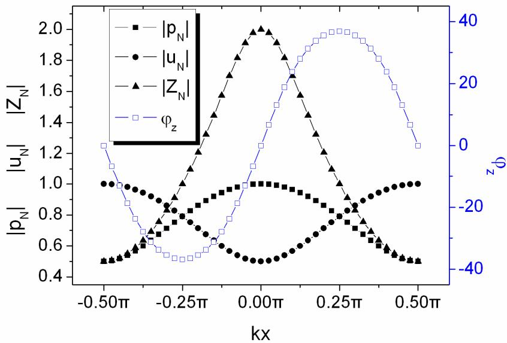  
图 3.1 当 $\tau = 0 . 5$ 时， $\left| p _ { N } \right|$ $\left| u _ { N } \right|$ $\left| Z _ { N } \right|$ 和 $\varphi _ { z }$ 随 kx变化图

首先，以行驻波成分相当的声场τ=0.5为例，讨论该行波比率下的压、流、压流相位差以及阻抗，如图3.1所示。由图3.1可以看出，$- \pi / 2 \leq k x \leq \pi / 2$ 范围内有三个零相位点： $k x = - \pi / 2 , 0$ 和 $\pi / 2$ 。然而，只有$k x = 0$ 处的零相位点有利于回热器中的热声转换，由于在该点 $\left| Z _ { N } \right|$ 达到 $\tau = 0 . 5$ 的声场中的最大值，能有效抑制回热器中的粘性损失。而在 $k x = \pm \pi / 2$ 处的零相位处， $\left| Z _ { \scriptscriptstyle N } \right|$ 达到 $\tau = 0 . 5$ 的声场中最小值，这将导致大量的粘性损失。

如图3.1所示，行驻波成分相当的声场 $\tau = 0 . 5$ 中，最大相位差为$\varphi _ { z } = \pm 3 7 ^ { \circ }$ ，定义该相位角 $\varphi _ { z } = \pm 3 7 ^ { \circ }$ 为行驻波相位的临界值，即 $- 3 7 ^ { \circ } < \varphi _ { z } < 3 7 ^ { \circ }$ 的区域为行波相位区。

其次，可以分析不同τ下的声场特性，其声场特性可由压流相位差和阻抗表征。图3.2为行波比率为： $0 . 0 , 0 . 1 , 0 . 2 , 0 . 4 , 0 . 5 , 0 . 6 , 0 . 8$ 和1.0时，压流相位差 $\varphi _ { z }$ 随 $k x$ 变化关系图。当 $\tau = 0 . 0$ 时，声场为纯驻波声场，在纯驻波声场中不存在行波相位区，在 $0 < k x < \pi / 2$ 区域 $\varphi _ { z } = 9 0 ^ { \circ }$ ，在 $- \pi / 2 < k x < 0$ 区域$\varphi _ { z } = - 9 0 ^ { \circ }$ 。随着行波比率的增大， $\left| { { \varphi } _ { z } } \right|$ 减小，行波区增长。当 $\tau > 0 . 5$ 时，整个声场都在行波区范围内。当 $\tau = 1 . 0$ 时，声场为纯行波声场。

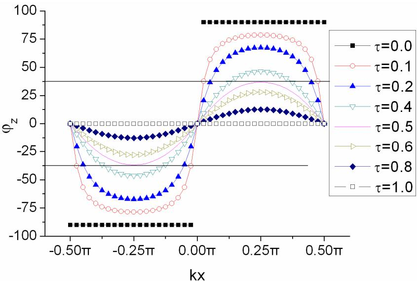  
图3.2行波比率为 $\tau$ ：0.0，0.1，0.2，0.4，0.5，0.6，0.8和1.0时，压流相位差φ随kx变化关系图

图3.3为行波比率为：0.0，0.1，0.2，0.4，0.5，0.6，0.8和1.0时，阻抗$\left| Z _ { N } \right|$ 随kx变化关系图。对于任意的τ值， $\left| Z _ { N } \right|$ 在 $k x = 0$ 位置达到最大值。随着τ的增加， $\left| Z _ { \scriptscriptstyle N } \right|$ 在区域 $- \pi / 4 < k x < \pi / 4$ 增加。在 $\tau = 0 . 0$ 的纯驻波声场，在 $k x  0$ 时 $\left| Z _ { \scriptscriptstyle N } \right| \to \infty$ 。在 $\tau = 1 . 0$ 的纯行波声场中任意位置都有 $\left| Z _ { _ { N } } \right| = 1 . 0$

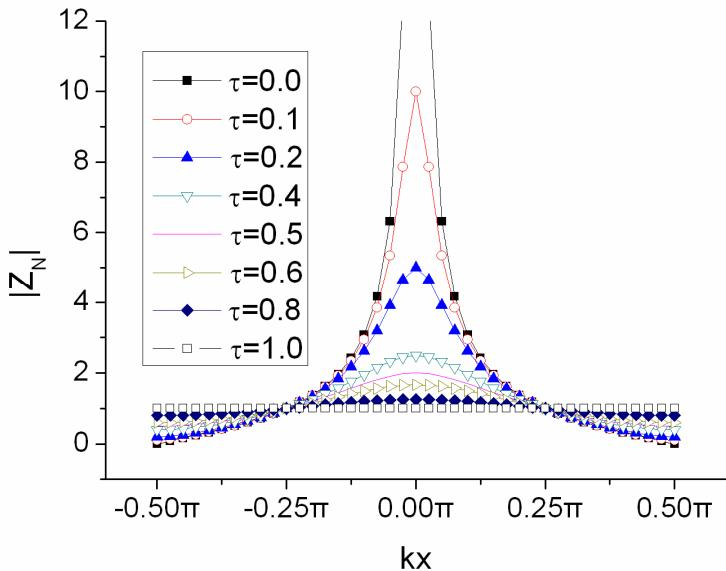  
图3.3行波比率τ为：0.0，0.1，0.2，0.4，0.5，0.6，0.8和1.0时，阻抗 $\left| Z _ { N } \right|$ 随 kx 变化关系图

## §3.4 压力场分析

在实际试验中，便于测量的声场参数是压力分布，一般我们会通过测量的压力来推测其它声场参数。因此，我们需要了解压力场的分布。

测量的压力值，一般可以分解为压力幅值和相角。因此，可将式(3.7)分解如下形式

$$
p _ { { { \scriptscriptstyle N } } } = \left| p _ { { { \scriptscriptstyle N } } } ( k x ) \right| e ^ { i \varphi _ { p } ( k x ) } e ^ { i w t }\tag{3.8}
$$

则压力幅值 $\left| p _ { N } \right|$ 和压力相角 $\varphi _ { p }$ 分布如图3.4和图3.5所示。

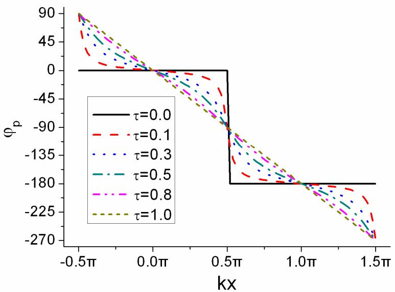  
图3.4行波比率τ为：0.0，0.1，0.3，0.4，0.8和1.0时，压力相角 $\varphi _ { p }$ 随 $k x$ 变化关系图

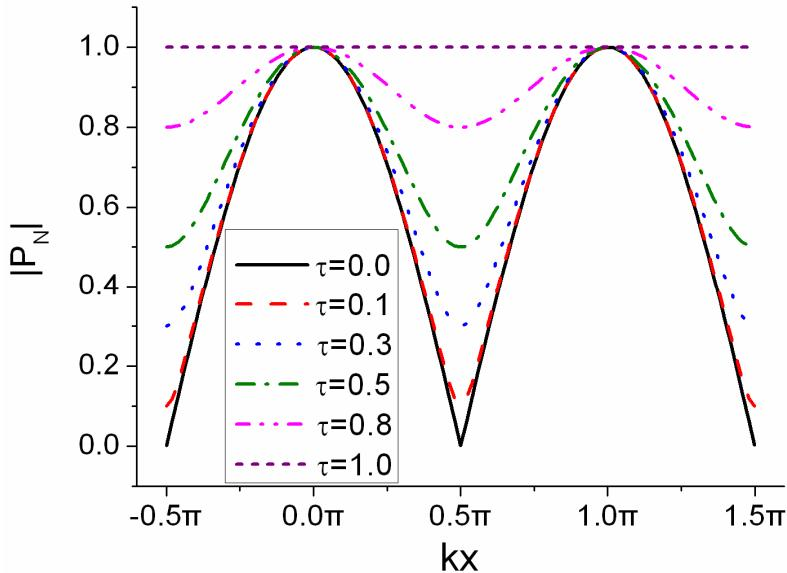  
图3.5行波比率τ为：0.0，0.1，0.3，0.4，0.8和1.0时， $\left| p _ { N } \right|$ 随 $k x$ 变化关系图

由图3.4可以看到，对于 $\tau = 0 . 0$ 的纯驻波声场， $\varphi _ { p }$ 在 $- \frac { 1 } { 2 } \pi < k x < \frac { 1 } { 2 } \pi$ 区间为 $0 ^ { \circ }$ ，在 $\frac { 1 } { 2 } \pi < k x < \frac { 3 } { 2 } \pi$ 区间为 $- 1 8 0 ^ { \circ }$ ，在 $k x = { \frac { 2 n + 1 } { 2 } } \tau$ 处 $\varphi _ { p }$ 从 $0 ^ { \circ }$ 跳变到-180°。随着行波成分的减少， $\varphi _ { p }$ 在 $k x = { \frac { 2 n + 1 } { 2 } } \pi$ 处的变化逐渐减小，趋于线性化；在$k x = n \pi$ 处变化加剧，接近线性变化。对于 $\tau = 1 . 0$ 的纯行波声场，压力相角为 $k x$ 的线性函数。

由图3.5可以看到，对于 $\tau = 1 . 0$ 的纯行波声场， $\left| p _ { N } \right|$ 各处均为1，随着行波成分的减少（即τ的减小）， $\left| p _ { N } \right|$ 的最小值逐渐减小，但压力幅值的最大值保持为1。 $\tau = 0 . 0$ 的纯驻波声场中，压力幅值为峰值1的正弦曲线绝对值。

另外，压力也经常被分解为实数部分和虚数部分进行分析，可将式(3.7)分解如下形式

$$
p _ { N } = \relax { \{ } p _ { N } ^ { r } ( k x ) + i p _ { N } ^ { i } ( k x ) \exists { e ^ { i w t } }\tag{3.9}
$$

其中，

$$
\begin{array} { l } { { p _ { N } ^ { r } ( k x ) = \left| p _ { N } ( k x ) \right| \cos ( \varphi _ { p } ( k x ) ) } } \\ { { p _ { N } ^ { i } ( k x ) = \left| p _ { N } ( k x ) \right| \sin ( \varphi _ { p } ( k x ) ) } } \end{array}
$$

由图3.5可以看出，当声场接近驻波时， $\varphi _ { p } ( k x ) \to 0 , \pm 1 8 0 ^ { \circ }$ ，此时，$\cos ( \varphi _ { p } ( k x ) )  \pm 1$ ，因此 $p _ { N } ^ { r } ( k x ) \to \pm | p _ { N } ( k x ) |$ $\sin ( \varphi _ { p } ( k x ) ) \to 0$ ，因此$p _ { N } ^ { i } ( k x ) \to 0$ 。由于普通热声热机中行波成分很少，声场接近纯驻波声场，因

此，在分析热声热机声场时，当以压力腹点为参考点时，重点分析压力场的实数部分。

## §3.5 反行波混合声场分析

在本章前面重点分析了其前行波的混合声场，在这里也可以同理分析反行波混合声场。

对于理想的声学管道，其反行波声场中的压力振荡可表示为：

$$
\begin{array} { r } { p _ { t } ^ { - } = p _ { a } \cos ( k x + \omega t ) = p _ { a } \operatorname { R e } \left[ e ^ { i ( \omega t + k x ) } \right] } \end{array}\tag{3.10}
$$

基于声波的线性可叠加性，反行驻波声场可表示为：

$$
{ \mathrm { R e } } { \left( p _ { 1 } ^ { - } \right) } = \left( 1 - \tau ^ { - } \right) { p _ { s } } + \tau ^ { - } p _ { t } ^ { - } = { \mathrm { R e } } \left\{ \frac { 1 } { 2 } p _ { a } \left[ \left( 1 + \tau ^ { - } \right) e ^ { i k x } + \left( 1 - \tau ^ { - } \right) e ^ { - i k x } \right] e ^ { i \omega t } \right\}\tag{3.11}
$$

其中 $0 \leq \tau ^ { - } \leq 1$ 为反行波比率。 $\tau ^ { - } = 0$ 时为纯驻波声场， $\tau ^ { - } = 1$ 时为纯反行波声场。

将式(3.11)代入(3.3)式可得反行驻波声场的振荡速度表达式为：

$$
u _ { 1 } ^ { - } = - \frac { 1 } { \rho _ { m } } \int \frac { d p _ { _ { 1 } } ^ { - } } { d x } d t = - \frac { p _ { _ { a } } } { 2 \rho _ { _ m } c } \Big [ ( 1 + \tau ^ { - } ) e ^ { i k x } - \Big ( 1 - \tau ^ { - } \Big ) e ^ { - i k x } \Big ] e ^ { i \omega t }\tag{3.12}
$$

将由式(3.11)和(3.12)可得反行驻波声场的阻抗表达式为：

$$
Z ^ { - } = \frac { p _ { 1 } ^ { - } } { u _ { 1 } ^ { - } } = - \rho _ { m } c \times \frac { ( 1 + \tau ^ { - } ) e ^ { i k x } + ( 1 - \tau ^ { - } ) e ^ { - i k x } } { ( 1 + \tau ^ { - } ) e ^ { i k x } - ( 1 - \tau ^ { - } ) e ^ { - i k x } }\tag{3.13}
$$

将声波振荡压力，振荡速度，以及阻抗进行无量纲化可得：

$$
p _ { _ x } ^ { ^ { - } } = p _ { 1 } ^ { ^ { - } } / p _ { a } = \frac 1 2 \biggl [ ( 1 + \tau ^ { - } ) e ^ { i k x } + \left( 1 - \tau ^ { ^ { - } } \right) e ^ { - i k x } \biggr ]\tag{3.14}
$$

$$
u _ { _ { N } } ^ { - } = u _ { 1 } ^ { - } \rho _ { { m } } c / p _ { a } = - \frac { 1 } { 2 } \Big [ ( 1 + \tau ^ { - } ) e ^ { i k x } - \left( 1 - \tau ^ { - } \right) e ^ { - i k x } \Big ]\tag{3.15}
$$

$$
Z _ { _ { N } } ^ { ^ { - } } = Z ^ { ^ { - } } / \rho _ { _ m } c = - \frac { ( 1 + \tau ^ { - } ) e ^ { i k x } + \left( 1 - \tau ^ { - } \right) e ^ { - i k x } } { ( 1 + \tau ^ { - } ) e ^ { i k x } - \left( 1 - \tau ^ { ^ { - } } \right) e ^ { - i k x } }\tag{3.16}
$$

由式(3.14)、(3.15)和(3.16)不难分析出，其压场、流场以及阻抗场的幅值分布与前行波混合声场相同，不同的是其相位场的分布。

图3.6为反行波比率 $\tau ^ { - }$ 为：0.0，0.1，0.2，0.4，0.5，0.6，0.8和1.0时，压流相位差 $\varphi _ { z }$ 随 $k x$ 变化关系图。同样，我们定义反行驻波成分相当的声场 $\tau = 0 . 5$ 中，最大相位差 $\varphi _ { z } = 1 8 0 ^ { \circ } \pm 3 7 ^ { \circ }$ 为反行驻波相位的临界值，即 $1 4 3 ^ { \circ } < \varphi _ { z } < 2 1 7 ^ { \circ }$ 的区域为反行波相位区。当 $\tau ^ { - } = 0 . 0$ 时，声场为纯驻波声场，在纯驻波声场中不存在反行波相位区，在 $0 < k x < \pi / 2$ 区域 $\varphi _ { z } = 9 0 ^ { \circ }$ ，在 $- \pi / 2 < k x < 0$ 区域$\varphi _ { z } = 2 7 0 ^ { \circ }$ 。随着τ⁻增大， $\left| { { \varphi } _ { z } } \right|$ 减小，反行波区增长。当 $\tau ^ { - } > 0 . 5$ 时，整个声场都在反行波区范围内。当 $\tau ^ { - } = 1 . 0$ 时，声场为纯反行波声场。

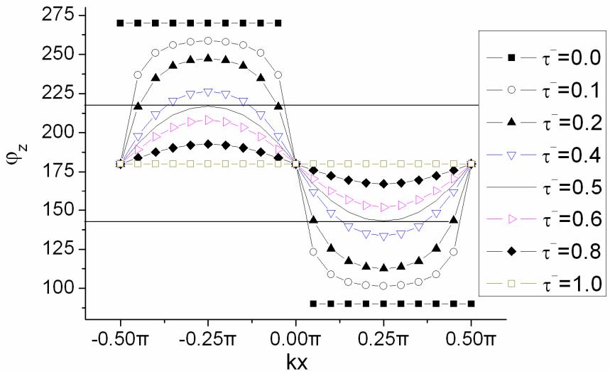  
图 3.6. 反行波比率 $\tau ^ { - }$ 为：0.0，0.1，0.2，0.4，0.5，0.6，0.8和1.0时，压流相位差φ随kx变化关系图

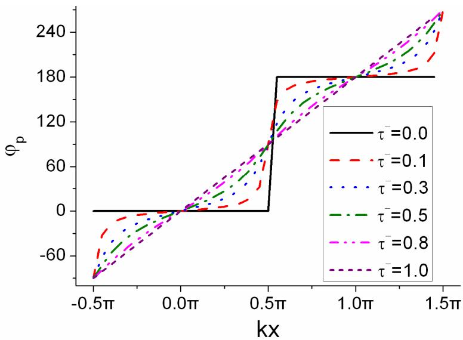  
图 3.7 反行波比率 $\tau ^ { - }$ 为：0.0，0.1，0.3，0.4，0.8和1.0时，压力相角 $\varphi _ { p }$ 随 kx 变化关系图

由图3.7 可以看到，对于 $\tau ^ { - } = 0 . 0$ 的纯驻波声场， $\varphi _ { p }$ 在 $- \frac { 1 } { 2 } \pi < k x < \frac { 1 } { 2 } \pi$ 区间为 $0 ^ { \circ }$ ，在 $\frac { 1 } { 2 } \pi < k x < \frac { 3 } { 2 } \pi$ 区间为180°，在 $k x = { \frac { 2 n + 1 } { 2 } } \pi$ 处 $\varphi _ { p }$ 从 $0 ^ { \circ }$ 跳变到 $1 8 0 ^ { \circ }$ 。随着反行波成分τ⁻的增加， $\varphi _ { p }$ 在 $k x = { \frac { 2 n + 1 } { 2 } } \pi$ 处的变化逐渐减小，趋于线性化；在$k x = n \pi$ 处变化加剧，接近线性变化。对于 $\tau ^ { - } = 1 . 0$ 的纯反行波声场，压力相角为kx的线性函数。

## §3.6 声场能量分析

在讨论热声能源转换之前，应该了解声场的一个重要参数一声能。声能密度为单位体积气体微团的势能和动能之和，即127]

$$
\varepsilon = \frac { \rho _ { { } m } } { 2 } \left\{ \left[ \frac { \mathrm { R e } ( p _ { 1 } ) } { \rho _ { { } m } c } \right] ^ { 2 } + \left[ \mathrm { R e } ( u _ { 1 } ) \right] ^ { 2 } \right\}\tag{3.17}
$$

将式(3.4)和(3.5)代入式(3.17)可以得到

$$
\varepsilon = { \frac { \rho _ { m } } { 2 } } \left( { \frac { p _ { a } } { \rho _ { m } c } } \right) ^ { 2 } \left[ { \frac { 1 + \tau ^ { 2 } } { 2 } } { \big ( } 1 + \cos 2 k x \cos 2 \omega t { \big ) } + \tau \sin 2 k x \sin 2 \omega t \right]\tag{3.18}
$$

时均声能密度可以表示为

$$
\overline { { \varepsilon } } = \frac { 1 } { T } \int _ { T } \varepsilon d t = \frac { 1 + \tau ^ { 2 } } { 4 } \frac { { p _ { a } } ^ { 2 } } { \rho _ { m } c ^ { 2 } }\tag{3.19}
$$

其中T为振荡周期。

由式（3.19）可以得到，时均声能密度与声场空间位置x无关。因此，时均声能密度即为时空平均声能密度（其反行波混合声场具有相同的特性）。

## §3.7 本章小结

本章基于波动理论，对声场进行行驻波分解，给出了行驻波声场关键参数的无量纲表达式，提炼出了声场特性集成化参数：τ和kx。该集成化参数是声场中的重要参数（振荡压力 $p _ { 1 }$ 、振荡速度 $u _ { 1 }$ 、特征声阻抗 $| Z |$ 、 $p _ { 1 }$ 领先于 $u _ { 1 }$ 的相位差 $\varphi _ { z }$ 和时均声能密度）集成化的体现，同时也反应了各个声场中重要参数之间的相互关系。结合这两个集成化参数，分析了行驻波声场的分布特性，简要分析汇总了行驻波声场中特征阻抗分布、压流相位差分布、压力幅值分布、压力相角分布及其之间相互关系。为后续的理论分析的深入以及实验研究工作提供一个必要的理论基础。

## 第四章 行驻波热声效应分析

## §4.1 引言

热声发动机从最初的驻波型发展到行波型，热声转换效率得到了质的提高。对于驻波型热声热机，声场中压流相位差接近 $\varphi _ { z } = ( 2 n + 1 ) \times 9 0 ^ { \circ }$ ，气体微团实现热声转换是基于回热器中气体与固体之间的不可逆热接触，很大程度上限制了其转换效率。随着热声研究的进一步发展，1979年，Ceperley62]提出了行波型热声热机。该类热机回热器中声场的压流相位差接近 $\varphi _ { z } = 2 n \times 9 0 ^ { \circ }$ ，气体微团理论上可以实现可逆热声转换。对于理想的行波热声热机，要实现可逆热声转换需要无穷小水力半径的回热器。然而，无穷小的水力半径导致无穷大的粘性耗散，这将大大降低热声转换效率。因此，实际的行波型热声热机选择有限水力半径的回热器。回热器水力半径的非零值必然引起热驰豫，使得温度振荡滞后于位移振荡，导致温度振荡与压力振荡相位差偏离 $( 2 n + 1 ) \times 9 0 ^ { \circ }$ 。为此，必须选择行驻波相位来平衡热驰豫引起的相位偏移。2004年，日本Biwa128]研究小组通过调整谐振管的边界条件以及回热器在谐振管中的位置，研究各种声场条件中的热声转换。他指出，为了提高热声转换能力和效率，必须选用一个合适的 $\varphi _ { z }$ 值，使得声波中行波成分和驻波成分都产生热致声效应。然而，行驻波声场中 $\varphi _ { z }$ 值可在 $- 1 8 0 ^ { \circ } \leq \varphi _ { z } \leq 1 8 0 ^ { \circ }$ 范围内变化，如何选择 $\varphi _ { z }$ 成为一个亟待解决的新问题。到目前为止，大部分研究者仍将研究重点放在行波和驻波上，极少有从行驻波的角度对实际热声系统中行驻波模态下的热声效应进行研究。

为了分析行驻波声场中的热声效应，本文提出了两种分析方法：数学公式分析和定性分析。

## §4.2 公式分析

本小节中我们仅讨论回热器中一点的热声转换效应，而不是整个回热器。尽管回热器中声场并不是单一的，但是回热器中的声场可以看成不同的离散点的集合。我们可以尽量将回热器放置在热声转换效应较好的声场区域中。

为了便于分析，该小节定义回热器温度梯度的方向为正方向。因此，在热声制冷机回热器中热流 $\dot { Q } \geq 0$ ，声功增益 $d E / d x < 0$ ；在热声发动机中， $\dot { Q } < 0$ 且 $d E / d x > 0$ o

## §4.2.1 热流

为了分析方便，可以将热流表达式(2.28)进一步分解为，

$$
\begin{array} { l } { \displaystyle \dot { \mathcal { Q } } = \biggr ( \frac { 1 } { 2 } | p _ { 1 } | \big | U _ { 1 } \big | \biggr ) \biggl [ - \frac { \psi } { | Z _ { \scriptscriptstyle N } | } R _ { q } - \big | q _ { g } \big | \cos ( \varphi _ { q } + \varphi _ { z } ) \biggr ] } \\ { \displaystyle \quad = \biggr ( \frac { 1 } { 2 } | p _ { 1 } | \big | U _ { 1 } \big | \biggr ) \biggl \{ - \frac { \psi } { | Z _ { \scriptscriptstyle N } | } R _ { q } - \big | q _ { g } \big | \Big [ \cos ( \varphi _ { q } ) \cos ( \varphi _ { z } ) - \sin ( \varphi _ { q } ) \sin ( \varphi _ { z } ) \Big ] \biggr \} } \end{array}\tag{4.1}
$$

其中，Ψ为回热器操作因子，定义为

$$
{ \psi } = \frac { c } { \omega } \frac { 1 } { T _ { m } } \frac { d T _ { m } } { d x }\tag{4.2}
$$

并且，

$$
R _ { q } = \frac { - 1 } { \left| 1 - f _ { \nu } \right| ^ { 2 } \left( 1 - \sigma ^ { 2 } \right) \left( \gamma - 1 \right) } \mathrm { I m } \Big ( f _ { k } + \sigma \tilde { f } _ { \nu } \Big )\tag{4.3}
$$

$$
q _ { g } = { \frac { f _ { k } - { \tilde { f } } _ { \nu } } { \left( 1 + \sigma \right) \left( 1 - { \tilde { f } } _ { \nu } \right) } } = \left| q _ { g } \right| e ^ { i \varphi _ { q } }\tag{4.4}
$$

其中， $\varphi _ { q }$ 为复数 $q _ { g }$ 的相角。

如文献[121]中图4.14所示，各种结构回热器的 $f _ { \nu }$ 和 $f _ { k }$ 函数具有相似的特性。因此，本章仅讨论板叠型回热器的性能优化，其它类型回热器的优化特性可以参照板叠型回热器。将回热器相对水力半径（无因次参数） $\zeta = r _ { h } / \delta _ { k }$ ，代入 $f _ { \nu }$ 和 $f _ { k }$ 函数，则其无因次表达式为

$$
f _ { \nu } = \frac { \mathrm { t a n h } \left[ \left( 1 + i \right) \zeta \sqrt { 1 / \sigma } \right] } { \left( 1 + i \right) \zeta \sqrt { 1 / \sigma } }\tag{4.5}
$$

$$
f _ { k } = \frac { \mathrm { t a n h } \big [ \big ( 1 + i \big ) \zeta \big ] } { \big ( 1 + i \big ) \zeta }\tag{4.6}
$$

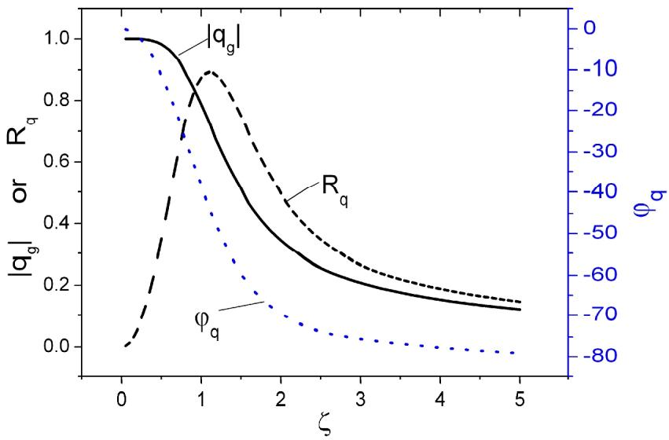  
图 4.1 $R _ { q }$ ， $\left| q _ { g } \right|$ 和 $\varphi _ { q }$ 随 $\zeta$ 变化曲线图

式(4.1)的第一项 $( - \frac { \psi } { \vert Z _ { _ { N } } \vert } R _ { _ q } )$ 与 $\varphi _ { z }$ 无关。图 4.1 为 $R _ { q }$ 和 $q _ { g }$ 随 $\zeta$ 变化的曲线图。如图4.1所示， $0 . 0 < R _ { q } < 0 . 8 5$ ，即 $- \frac { \psi } { \vert Z _ { _ { N } } \vert } R _ { _ { q } } < 0$ $- 8 4 ^ { \circ } < \varphi _ { q } < 0$ ，即$\cos ( \varphi _ { q } ) > 0$ 且 $\sin ( \varphi _ { q } ) < 0$ 0

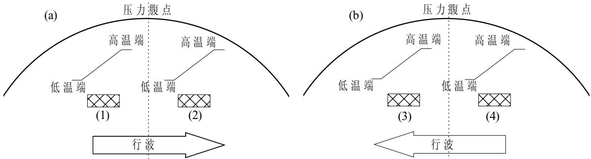  
图4.2.四种回热器布置方式示意图

对于一个给定的回热器（即给定 $\zeta$ 和Ψ），位于对称声场（即 $\tau = \tau ^ { - } \ )$ 的对称位置（即 $\left| k x - k x _ { P A N } \right|$ 为定值），如图4.2所示，由第三章分析可知 $\left| p _ { 1 } \right|$ 和 $\left| U _ { 1 } \right|$ 为定值，回热器中热流仅仅与所处声场的 $\varphi _ { z }$ 有关。由第三章的分析可知，对于第（1）类回热器 $- 9 0 ^ { \circ } < \varphi _ { z } < 0 ^ { \circ }$ ；对于第（2）类回热器 $0 ^ { \circ } < \varphi _ { z } < 9 0 ^ { \circ }$ ；对于第（3）类回热器 $- 1 8 0 ^ { \circ } < \varphi _ { z } < - 9 0 ^ { \circ }$ ；对于第（4）类回热器 $9 0 ^ { \circ } < \varphi _ { z } < 1 8 0 ^ { \circ }$ 。假定$0 ^ { \circ } < \theta < 9 0 ^ { \circ }$ ，则图4.2所示的四类回热器可分析如下：

Case (1) : $\varphi _ { z } = - \theta \ = > \ \cos ( \varphi _ { _ q } ) \cos ( \varphi _ { _ z } ) > 0 , \sin ( \varphi _ { _ q } ) \sin ( \varphi _ { _ z } ) > 0$ の

Case (2) : $\varphi _ { z } = \theta \ \Longrightarrow \ \cos ( \varphi _ { q } ) \cos ( \varphi _ { z } ) > 0 , \sin ( \varphi _ { q } ) \sin ( \varphi _ { z } ) < 0$

$$
\mathrm { C a s e \ ( 3 ) } : \varphi _ { z } = - 1 8 0 ^ { \circ } + \theta \ = > \ \mathrm { c o s } ( \varphi _ { q } ) \mathrm { c o s } ( \varphi _ { z } ) < 0 , \mathrm { \quad } \mathrm { s i n } ( \varphi _ { q } ) \mathrm { s i n } ( \varphi _ { z } ) > 0 ;
$$

$$
{ \mathrm { C a s e ~ \Gamma ( 4 ) ~ } } : \varphi _ { z } = 1 8 0 ^ { \circ } - \theta \ = > \ \cos ( \varphi _ { q } ) \cos ( \varphi _ { z } ) < 0 \ , \sin ( \varphi _ { q } ) \sin ( \varphi _ { z } ) < 0 \ ,
$$

由此可得，如第（2）类回热器 $\dot { Q } < 0$ ，无法实现热声泵热效应；如第（1），（3）和（4）类回热器在一定条件下可以实现泵热。特别是如第（3）类回热器泵热量最大。类似分析，我们可以得到，对于任意给定的回热器在任意的对称声场的对称位置，第（3）类制冷机回热器能获得最大制冷量。

## §4.2.2 声功

为了分析方便，可以将通道长度为dx内时均声功 $d E _ { 2 }$ 的变化表达式(2.24)进一步分解为，

$$
\begin{array} { l } { \displaystyle \frac { d \dot { E } _ { 2 } } { d x } = ( \frac { 1 } { 2 } | p _ { 1 } | | U _ { 1 } | ) ( \frac { 1 } { T _ { m } } \frac { d T _ { m } } { d x } ) [ \frac { 1 } { \psi } ( - \frac { R _ { \nu } } { | Z _ { N } | } - R _ { \nu } \times | Z _ { \nu } | ) + | e _ { g } | \cos ( \varphi _ { e } - \varphi _ { z } ) ] } \\ { \displaystyle = ( \frac { | p _ { 1 } | | U _ { 1 } | } { 2 T _ { m } } \frac { d T _ { m } } { d x } ) \{ \frac { 1 } { \psi } ( - \frac { R _ { \nu } } { | Z _ { N } | } - R _ { k } \times | Z _ { N } | ) + | e _ { g } | [ \cos ( \varphi _ { e } ) \cos ( \varphi _ { z } ) + \sin ( \varphi _ { e } ) \sin ( \varphi _ { z } ) ] \} } \end{array}\tag{4.7}
$$

其中， $\varphi _ { e }$ 为复数 $e _ { g }$ 的相角，

$$
\begin{array} { l } { \displaystyle R _ { \nu } = \frac { \mathrm { I m } \big [ - f _ { \nu } \big ] } { \big | 1 - f _ { \nu } \big | ^ { 2 } } } \\ { \displaystyle R _ { k } = ( \gamma - 1 ) \mathrm { I m } \big [ - f _ { k } \big ] } \\ { \displaystyle e _ { g } = \frac { f _ { k } - f _ { \nu } } { \big ( 1 - f _ { \nu } \big ) \big ( 1 - \sigma \big ) } = \big | e _ { g } \big | e ^ { i \varphi _ { e } } } \end{array}\tag{4.8}
$$

(4.9)

(4.10)

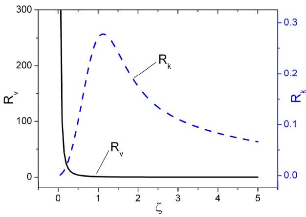  
图 4.3 $R _ { \nu }$ 和 $R _ { k }$ 随 $\zeta$ 变化曲线图

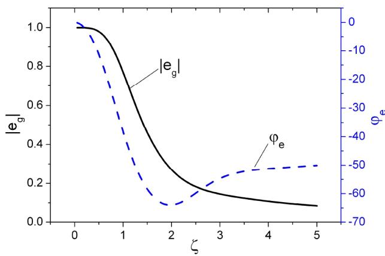  
图 4.4. $\left| e _ { g } \right|$ 和 $\varphi _ { e }$ 随 $\zeta$ 变化曲线图

式(4.7)的前两项 $\frac { 1 } { \psi } { \left( - \frac { R _ { \nu } } { \mid Z _ { \scriptscriptstyle N } \mid } - R _ { \scriptscriptstyle k } \times \mid Z _ { \scriptscriptstyle N } \mid \right) } { < 0 . 0 }$ 与 $\varphi _ { z }$ 无关。图4.3为 $R _ { \nu }$ 和 $R _ { k }$ 随 $\zeta$ 变化的曲线图。如图4.3所示， $R _ { \nu } > 0 . 0$ 且 $0 . 0 < R _ { \ast } < 0 . 2 8$ ，即$\frac { 1 } { \psi } { \left( - \frac { R _ { \nu } } { \mid Z _ { \scriptscriptstyle N } \mid } - R _ { \scriptscriptstyle k } \times \mid Z _ { \scriptscriptstyle N } \mid \right) } { < 0 . 0 }$ 。图 4.4 为 $\left| e _ { g } \right|$ 和 $\varphi _ { e }$ 随 $\zeta$ 变化的曲线图。如图4.4所示， $- 6 4 ^ { \circ } \leq \varphi _ { e } < 0 ^ { \circ }$ ，即 $\cos ( \varphi _ { e } ) > 0$ 且 $\sin ( \varphi _ { e } ) < 0$ o

假定 $0 ^ { \circ } < \theta < 9 0 ^ { \circ }$ ，则图4.2所示的四类回热器可以如下分析：Case (1) : $\varphi _ { z } = - \theta \ \Longrightarrow \ \cos ( \varphi _ { e } ) \cos ( \varphi _ { z } ) > 0 \ , \sin ( \varphi _ { e } ) \sin ( \varphi _ { z } ) > 0$ Case (2) : $\varphi _ { _ z } = \theta \ \Longrightarrow \ \cos ( \varphi _ { _ e } ) \cos ( \varphi _ { _ z } ) > 0 \ , \sin ( \varphi _ { _ e } ) \sin ( \varphi _ { _ z } ) < 0$ Case (3) $: \varphi _ { z } = - 1 8 0 ^ { \circ } + \theta ~ = > ~ \cos ( \varphi _ { e } ) \cos ( \varphi _ { z } ) < 0 ~ , ~ \sin ( \varphi _ { e } ) \sin ( \varphi _ { z } ) > 0$ Case (4) : $\varphi _ { z } = 1 8 0 ^ { \circ } - \theta \ \Rightarrow \ \cos ( \varphi _ { e } ) \cos ( \varphi _ { z } ) < 0 \ , \sin ( \varphi _ { e } ) \sin ( \varphi _ { z } ) < 0$ 由此可得，如第（4）类回热器 $d \dot { E } _ { 2 } / d x < 0$ ，仅仅耗散声功；如第（1），

（2）和（3）类回热器在一定条件下可以实现热能到声能的转换；特别是如第

（1）类回热器能产生最多的声功。类似分析，我们可以得到，对于任意给定的回热器在任意的对称声场的对称位置，第（1）类发动机回热器声功转换能力最强。

## §4.2.3 热声制冷机相对卡诺制冷系数

热声制冷机相对卡诺制冷系数 $\mathrm { C O P } _ { 2 }$ 为制冷系数 $\mathrm { C O P } _ { 1 }$ 与卡诺制冷系数的比值 $\mathrm { C O P _ { c } }$

$$
C O P _ { 2 } = C O P _ { 1 } / C O P _ { c }\tag{4.11}
$$

由式(4.1)、(4.7)和(4.11)得到 $\mathrm { C O P } _ { 2 }$ 的表达式为，

$$
C O P _ { 2 } = \frac { \displaystyle \frac { \dot { Q } _ { c } } { - \Delta \dot { E } _ { 2 } } } { \displaystyle \frac { T _ { m } } { \Delta T _ { m } } } = \frac { \displaystyle \frac { \dot { Q } } { - d \dot { E } _ { 2 } / d x } } { \displaystyle \frac { T _ { m } } { d T _ { m } / d x } } = \frac { \displaystyle - \frac { \psi } { | Z _ { N } | } R _ { q } - \left| q _ { g } \right| \cos ( \varphi _ { q } + \varphi _ { z } ) } { \displaystyle \frac { 1 } { \psi } \left( \frac { R _ { \nu } } { | Z _ { N } | } + R _ { k } \times | Z _ { N } | \right) - \left| e _ { g } \right| \cos ( \varphi _ { e } - \varphi _ { z } ) }\tag{4.12}
$$

定义回热器无因次长度为回热器长度与波长的比值， $l _ { { { N } } } = l _ { { { r e g } } } / \lambda$ 。假设回热器无因次长度为 $l _ { N } = 0 . 0 1$ ，制冷温度 $T _ { c } \approx 2 0 0 K$ ，室温端温度 $T _ { a } \approx 3 0 0 K$ ，则回热器操作因子可以使用式(4.2)估算为，

$$
\psi = \frac { c } { \omega } \frac { 1 } { T _ { m } } \frac { d T _ { m } } { d x } \approx \frac { 1 } { \pi l _ { N } } \frac { T _ { a } - T _ { c } } { T _ { a } + T _ { c } } \approx \frac { 1 } { \pi ( 0 . 0 1 ) } \frac { \left( 3 0 0 - 2 0 0 \right) } { \left( 3 0 0 + 2 0 0 \right) } \approx 6 . 5\tag{4.13}
$$

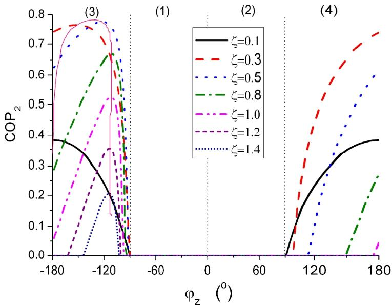  
图 4.5. 对于不同的 $\zeta$ ， $\mathrm { C O P } _ { 2 }$ 随 $\varphi _ { z }$ 变化曲线图  
细实线为不同的 $\zeta$ 条件下达到最大 $\mathrm { C O P } _ { 2 }$ 值对应点的连接曲线。

如上所述，我们采用 $\psi = 6 . 5$ ，并假定 $\left. Z _ { N } \right. = 1 0 . 0$ ，工作气体为氦气的条件下，使用公式(4.3)，(4.4)，(4.8)，(4.9)，(4.10)和(4.12)计算 $\mathrm { C O P } _ { 2 }$ 在不同的 $\zeta$ 条件下随 $\varphi _ { z }$ 变化曲线图，如图4.5所示。

如图4.5所示，在各种 $\zeta$ 取值条件下， $\mathrm { C O P } _ { 2 }$ 最大值均出现在$- 1 8 0 ^ { \circ } < \varphi _ { { } _ { z } } < - 9 0 ^ { \circ }$ 区域，该区域对应图4.2中第（3）类回热器所在区域。当$\zeta \to 0$ 时，最优 $\varphi _ { z }$ 值接近-180°，然而 $\mathrm { C O P } _ { 2 } \to 0$ 。这是因为，当 $\zeta \to 0$ 是$R _ { \nu } \to + \infty$ ，如图4.3所示。随着 $\zeta$ 的增加，最优的 $\varphi _ { z }$ 偏离 $- 1 8 0 ^ { \circ }$ 到一个$- 1 8 0 ^ { \circ } \sim - 9 0 ^ { \circ }$ 区域内的值。随着 $\zeta$ 的增加，不同 $\zeta$ 下最优 $\mathrm { C O P } _ { 2 }$ 先增加，在点$\begin{array} { r } { \mathrm { ~ ( ~ } \zeta = 0 . 4 2 , \varphi _ { z } = - 1 3 1 ^ { \circ } \mathrm { ~ ) ~ } } \end{array}$ 达到最大值0.78，然后减小。

类似，对于任意给定的 $\psi$ 和 $\left| Z _ { N } \right|$ ，第（3）类制冷机回热器的布置方式是最优的。

## §4.2.4 热声发动机相对卡诺效率

热声发动机相对卡诺效率 $\eta _ { 2 }$ 为热声转换效率 $\eta _ { 1 }$ 与卡诺效率 $\eta _ { c }$ 的比值，

$$
\eta _ { _ 2 } = \eta _ { _ 1 } / \eta _ { c }\tag{4.14}
$$

由式(4.1)，(4.7)和(4.14)可以得到热声发动机相对卡诺效率 $\eta _ { 2 }$ 的表达式为，

$$
\eta _ { 2 } = \frac { \eta _ { 1 } } { \eta _ { c } } = \frac { \Omega \dot { E } _ { 2 } / \dot { Q } _ { h } } { \Omega _ { c } } = \frac { \displaystyle \frac { d \dot { E } _ { 2 } / d x } { - \dot { Q } } } { \displaystyle \frac { 1 } { T _ { m } } \frac { d T _ { m } } { d x } } = \frac { \displaystyle \frac { 1 } { | Z _ { N } | } - R _ { \nu } \times | Z _ { N } | \Big ) + \left| e _ { g } \right| \cos ( \varphi _ { e } - \varphi _ { z } ) + \nu \left| e _ { g } \right| } { \displaystyle \frac { \psi } { | Z _ { N } | } R _ { q } + \left| q _ { g } \right| \cos ( \varphi _ { q } + \varphi _ { z } ) } \equiv \frac { \displaystyle \frac { d \dot { E } _ { 2 } / d x } { d \nu } } { \displaystyle \frac { d \dot { T } _ { m } } { d \nu } \frac { d \dot { T } _ { m } } { d x } } = \frac { \displaystyle \frac { d \dot { \nu } _ { \nu } } { d \nu } } { \displaystyle \frac { d \dot { T } _ { m } } { d \nu } \frac { d } { d \nu } + \left| e _ { g } \right| \cos ( \varphi _ { q } + \varphi _ { z } ) } ,\tag{4.15}
$$

假设 $l _ { N } = 0 . 0 1$ ，高温端温度为 $T _ { h } \approx 8 0 0 K$ ，室温端温度为 $T _ { a } \approx 3 0 0 K$ ，则回热器操作因子可以使用式(4.2)估算为，

$$
\psi = \frac { c } { \omega } \frac { 1 } { T _ { m } } \frac { d T _ { m } } { d x } \approx \frac { 1 } { \pi l _ { N } } \frac { T _ { h } - T _ { a } } { T _ { h } + T _ { a } } \approx \frac { 1 } { \pi ( 0 . 0 1 ) } \frac { \left( 8 0 0 - 3 0 0 \right) } { \left( 8 0 0 + 3 0 0 \right) } \approx 1 4 . 5 .\tag{4.16}
$$

如上所述，我们采用 $\psi = 1 4 . 5$ ，并假定 $\left| Z _ { N } \right| = 1 0 . 0$ ，工作气体为氦气的条件下，使用公式(4.3)，(4.4)，(4.8)，(4.9)，(4.10)和(4.15)计算 $\eta _ { 2 }$ 在不同的 $\zeta$ 条件下随 $\varphi _ { z }$ 变化曲线图，如图4.6所示。

如图 4.6 所 $\textstyle { \overline { { \overline { { \mathcal { N } } } } } }$ ，在各种 $\zeta$ 取值条件 $\top$ ， $\eta _ { 2 }$ 最大值均出现在 $- 9 0 ^ { \circ } < \varphi _ { z } < 0$ 区域，该区域对应图4.2中第（1）类回热器所在区域。当 $\zeta \to 0$ 时，最优 $\varphi _ { z }$ 值接近 $0 ^ { \circ }$ ，然而 $\eta _ { 2 }  0$ 。这是因为，如图4.3所示，当 $\zeta \to 0$ 时 $R _ { \nu } \to + \infty$ 。随着 $\zeta$ 的增加，最优的 $\varphi _ { z }$ 偏离 $0 ^ { \circ }$ 到一个 $0 ^ { \circ } \sim - 9 0 ^ { \circ }$ 区域内的值。随着 $\zeta$ 的增加，不同 $\zeta$ 下的最优 $\eta _ { 2 }$ 先增加，在点 $\zeta = 0 . 2 8$ $\varphi _ { z } = - 2 5 ^ { \circ } )$ 达到最大值 0.78，然后减小。

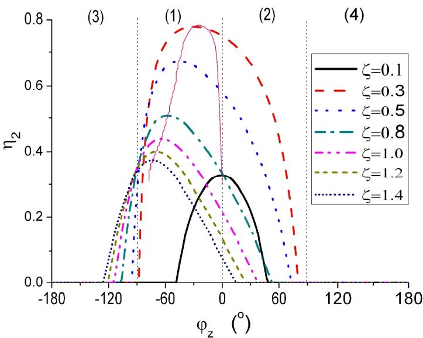  
图 4.6. 对于不同的 $\zeta$ ， $\eta _ { 2 }$ 随 $\varphi _ { z }$ 变化曲线图  
细实线为不同的 $\zeta$ 条件下达到最大 $\eta _ { 2 }$ 值对应点的连接曲线。

类似，对于任意给定的 $\psi$ 和 $\left| Z _ { N } \right|$ ，第（1）类发动机回热器的布置方式是最优的。

## §4.3 定性分析

如上所述，我们采用数学公式对行驻波热声转换效应进行了分析，为了更好的理解其分析结果，该小节结合行波和驻波的热声转换特性，对行驻波热声转换效应进行定性分析。在热声热机系统中，热声效应是TWC和SWC共同作用的效果。因此，可以先单独分析驻波和行波的热声转换特性，然后结合两者的热声转换特性对行驻波热声转换特性进行理解分析。

## §4.3.1 驻波模态

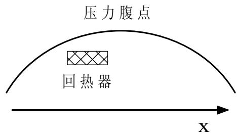  
图4.7驻波声场中，回热器位于压力腹点左侧（取向右为x正方向）

如图4.7所示，纯驻波声场中，回热器位于压力腹点的左侧，以向右的方向为x的正方向，则回热器中振荡压力 $p _ { 1 }$ 领先与振荡速度 $u _ { 1 }$ 的相角 $\varphi _ { z }$ 为 $- 9 0 ^ { \circ }$ 回热器中沿x方向的热流为[4]

$$
\dot { Q } _ { 2 } = - \frac { 1 } { 4 } \Pi \delta _ { k } T _ { m } \beta p _ { 1 } u _ { 1 } \big ( \Gamma - 1 \big )\tag{4.17}
$$

且，其产生声功 $\dot { W } _ { 2 }$ 为[4]

$$
\dot { W _ { 2 } } = \frac { 1 } { 4 } \Pi \delta _ { k } \Delta x \frac { T _ { m } \beta ^ { 2 } \omega } { \rho _ { m } c _ { p } } { \left( p _ { 1 } \right) } ^ { 2 } \left( \Gamma - 1 \right)\tag{4.18}
$$

其中 $\Gamma = \nabla T _ { m } / T _ { c r i t }$ 为实际回热器的温度梯度 $\nabla T _ { m }$ 与临界温度梯度$T _ { c r i t } = T _ { m } \beta p _ { 1 } / \rho _ { m } c _ { p } u _ { 1 }$ 的比值。

如式(4.17)和(4.18)所示，热流与声功均正比于温度梯度因子(Γ-1)。当$\nabla T _ { m } = \nabla T _ { c r i t }$ （即(Γ-1)=0）时，回热器中热流量与声功产生量均为零。当$\nabla T _ { m } > \nabla T _ { c r i t }$ （即(Γ-1)>0）时，热流沿着远离压力腹点的方向传递，并且在回热器中产生声功。当 $\nabla T _ { m } < \nabla T _ { c r i t }$ (即(Γ-1)<0）时，热流沿着指向压力腹点的方向传递，并且在回热器中耗散声功。另外， $\nabla T _ { m } < \nabla T _ { c r i t }$ 情况可以分为两类情况进行详细分析： $0 < \nabla T _ { m } < \nabla T _ { c r i t }$ 时，回热器耗散声功将热量从低温端泵送到高温端； $\nabla T _ { m } \leq 0$ 时，回热器耗散声功，同时热量从高温端流向低温端，此时回热器既不能实现热到声的转换也不能实现声致冷效应。类似，我们可以分析回热器位于压力腹点右侧的情况。

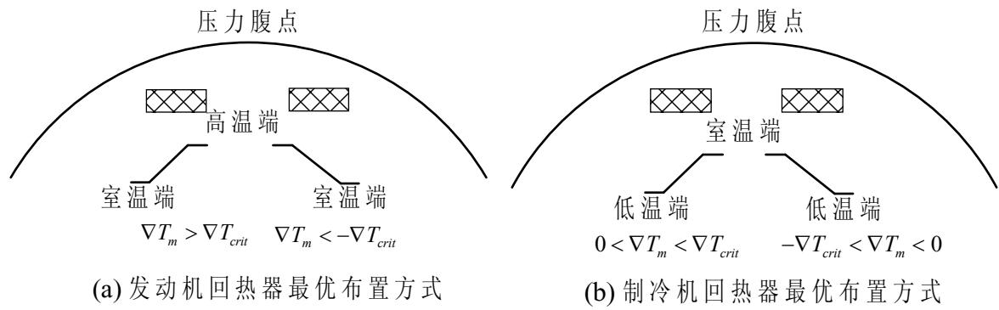  
图4.8驻波声场中，回热器最优布置方式

因此，我们可以得到发动机和制冷机中回热器的布置方式：对于驻波型热声发动机，最佳回热器布置为图4.8a所示，回热器高温端靠近压力腹点，同时在压力腹点的左侧 $\nabla T _ { m } > \nabla T _ { c r i t }$ ，在压力腹点的右侧 $\nabla T _ { m } < - \nabla T _ { c r i t }$ 。此时，热量由高温端流向低温端，回热器实现热到声的转换。对于驻波型热声制冷机，最佳回热器布置为图4.8b所示，回热器室温端靠近压力腹点，同时在压力腹点的左侧 $0 < \nabla T _ { m } < \nabla T _ { c r i t }$ ，在压力腹点的右侧 $- \nabla T _ { c r i t } < \nabla T _ { m } < 0$ 。此时，回热器耗散声功将热量从低温端泵送到高温端。

## §4.3.2 行波模态

行波型热声热机最早由 Ceperley62]于1979年提出。在行波型热声发动机中，热流方向与声波传播方向相反：声波由回热器低温端传播到高温端，热流由回热器高温端流向低温端。即，当声波由低温端传播到高温端时，回热器实现了热到声的转换。在行波型热声制冷机中，回热器泵热方向与声波传播方向相反：声波由回热器高温端传播到低温端，热流由回热器低温端泵送到高温端。即，当声波由高温端传播到低温端时，回热器实现了从低温端泵热的效应。因此，行波型热声发动机和制冷机中，回热器最佳布置方式如图4.9所示。

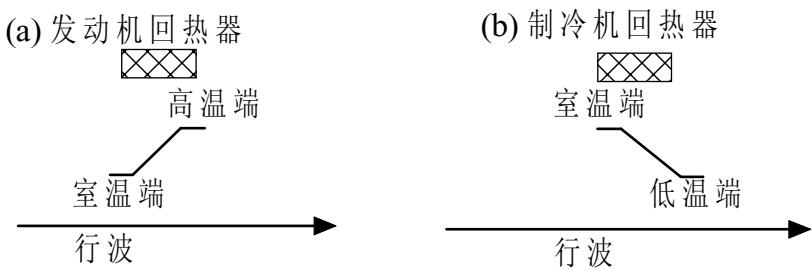  
图4.9行波声场中，回热器最优布置方式

## §4.3.3 行驻波模态

结合行波和驻波热声转换特性，可以分析图4.2中四种回热器的热声转换效应：

Case（1）：回热器高温端靠近压力腹点，且TWC由低温端传递到高温端

对于热声发动机，当 $\nabla T _ { m } > \nabla T _ { c r i t }$ 时，回热器中 SWC和 TWC均实现热到声的转换，这有利于提高发动机热声效应。

对于热声制冷机，当 $0 < \nabla T _ { m } < \nabla T _ { c r i t }$ 时，SWC将热量从低温端泵送到高温端，同时 TWC 将热量由高温端运输到低温端。由此可知，SWC 和 TWC在回热器中所产生的热流方向相反。当 SWC产生的热声效应强于TWC产生的热声效应时，回热器可以实现从低温端泵热的效应。

Case（2）：回热器低温端靠近压力腹点，且TWC由低温端传递到高温端。

对于热声发动机，SWC耗散声能，同时TWC实现热到声的转换。当TWC产生的热声效应比SWC产生的热声效应强时，回热器可以实现热到声的转换。

对于热声制冷机，回热器中 SWC和 TWC 均将热流由高温端传输到低温端。该类回热器无法实现泵热效应。

Case（3）：回热器高温端靠近压力腹点，且TWC由高温端传递到低温端。

对于热声发动机，当 $\nabla T _ { m } > \nabla T _ { c r i t }$ 时，SWC实现热到声的转换，同时 TWC耗散声能。当 SWC产生的热声效应比TWC产生的热声效应强时，回热器可以实现热到声的转换。

对于热声制冷机，当 $0 < \nabla T _ { m } < \nabla T _ { c r i t }$ 时，回热器中 SWC 和 TWC 均将热量由低温端泵送到高温端，这有利于提高制冷机热声效应。

Case（4）：回热器低温端靠近压力腹点，且TWC由高温端传递到低温端。

对于热声发动机，回热器中SWC和 TWC均耗散声能。该回热器无法实现热到声的转换。

对于热声制冷机，SWC将热量由高温端运输到低温端，同时TWC将热量从低温端泵送到高温端。当TWC 产生的热声效应比 SWC产生的热声效应强时，回热器可以实现从低温端泵热的效应。

总之，这些分析结论和本章第三节的数学公式分析结论一致。第（4）类回热器仅仅耗散声功；第（1），（2）和（3）类回热器在一定条件下可以实现热能到声能的转换；特别是如第（1）类发动机回热器布置方式最佳，此时发动机回热器中 SWC和 TWC均实现热到声的转换。第（2）类回热器无法实现从低温端泵热的热声效应；第（1），（3）和（4）类回热器在一定条件下可以实现从低温端泵热的热声效应；特别是如第（3）类制冷机回热器布置方式最佳，此时制冷机回热器中SWC和TWC均将热量由低温端泵送到高温端。

## §4.4 本章小节

为了实现最高的热声转换效率，热声热机回热器工作的最佳相位，既不是行波相位也非驻波相位，而是行驻波相位。为了进一步研究行驻波型热声转换特性，本文提出了两种分析方法：数学公式分析和定性分析。两种分析方法的结论一致：对于热声发动机，为了提高声功增益和效率，回热器高温端应该靠近压力腹点，并且行波传播方向与温度梯度方向一致，使得发动机回热器中SWC和TWC均实现热到声的转换；对于热声制冷机，为了提高制冷量和制冷系数，回热器高温端应该靠近压力腹点，并且行波传播方向与温度梯度方向相反，使得制冷机回热器中SWC和TWC均将热量由低温端泵送到高温端。

## 第五章 行驻波型热驱动热声制冷机的设计

## §5.1 引言

热声发动机利用热声效应将热能转化为声能，产生的声能可以用来驱动热声制冷机，二者的结合称为热声驱动的制冷系统。在热驱动热声制冷机系统中，当发动机回热器温度梯度达到其临界值时，将激发声波。声波使气体微团在发动机回热器中经历一定的热动力学循环：压缩一加热一膨胀一冷却。这样，在无运动部件的条件下实现了热能到声能的转换。当声波通过制冷机回热器时，在制冷机回热器上产生温度梯度，并将热量从低温端泵送到高温端。声波使气体微团在制冷机回热器中经历一定的热动力学循环：压缩一冷却一膨胀一加热。这样，在无运动部件的条件下实现了泵热。与传统的热机系统相比，热驱动热声制冷机系统具有三个主要优点：首先，该系统没有机械运动部件，结构简单、制造成本低、可靠性高；其次，工作介质为环境友好气体；第三，该系统直接以热能作为驱动源，可望应用于热能资源丰富而缺电的场合，特别是在边远地区及海上油田天然气液化等方面具有广泛的应用前景。

本章在第三章行驻波声场的理论分析和第四章行驻波声场热声效应的分析基础上，结合现有热驱动热声热机的发展，提出了一种新型的行驻波型热驱动热声热机，并使用本文第二章介绍的自主开发设计的“小振幅热声热机可视化仿真软件”对该新型热机系统进行了整体数值仿真和优化。

## §5.2 方案设计

1989年，Wheatley等人设计了第一台驻波型热驱动热声制冷机[129]。尽管，该制冷机结构简单，无机械运动部件，然而总效率很低，在制冷温差较小时也只能达到0.05到0.1的制冷效率。这是因为，该制冷机系统中，热声发动机回热器中 TWC传播方向与温度梯度方向相反，这使得TWC在发动机回热器中耗散声能，大大降低的发动机的热声转换效率。随后的1997年[101]，Hofler等人在此基础上做了改进，调整了TWC在热声发动机中的作用效果，提高了热声发动机的转换效率，在25℃的温降条件下，将驻波热声热机总效率（制冷机的制冷量比发动机输入热量）提高到15%。然而，该制冷系统工作模态主要为驻波模态，依赖与不可逆热接触。2002年，日本Ueda[71]研究小组在行波型热声发动机[65,66]的声波环路中加入热声制冷机部分，加入的热声制冷机部分位于热声发动机部分室温端换热器附近，即发动机室温端冷却器和制冷机冷端换热器通过热缓冲管连通。根据文献[71,130]的描述，可以总结出该系统中回热器布置方式如图5.1所示。如第四章所分析的，该系统中制冷机回热器布置如图4.2中第（4）类：制冷机回热器低温端靠近压力腹点，且TWC由高温端传递到低温端。TWC 将热量从低温端泵送到高温端，但 SWC 将热量由高温端运输到低温端，降低了制冷机回热器泵热效率。该系统中发动机回热器布置如图4.2中第（2）类：制冷机回热器低温端靠近压力腹点，且TWC由低温端传递到高温端。TWC实现热到声的转换，但 SWC耗散声能，降低了发动机的热声转换效率。

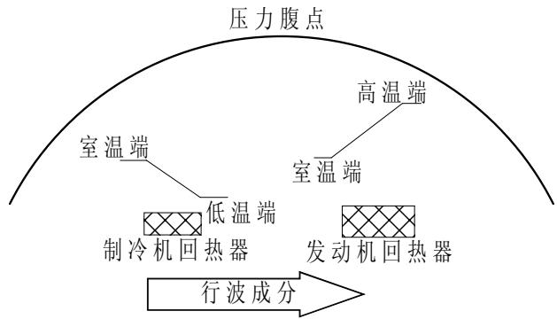  
图 5.1 文献[71,130]中所描述的热驱动热声制冷机中回热器布置方式示意图

为了提高热声转换效率，本文调整其SWC和TWC对热声转换的作用效果，提出了一种新型热驱动热声制冷机系统，如图5.2所示。它包括：依次相连的声功反馈管、容腔、发动机（包括，室温端冷却器、热声回热器和加热器）、热缓冲管（TBT）、制冷机（包括，室温端冷却器、热声回热器和冷端换热器）和声功回收管组成的声波环路，以及与声波环路中的声功反馈管和声功回收管同时相连通的谐振支路。

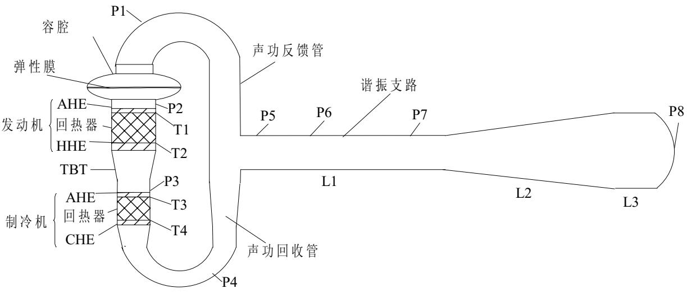  
图5.2新型热驱动热声制冷机系统示意图。其中，AHE为室温端冷却器，HHE为高温端加热器，CHE为冷端换热器，TBT为热缓冲管。

尽管，该制冷系统的发动机回热器和制冷机回热器均位于环形圈内，并且环形圈与一个谐振管相耦合，但是其制冷机位于发动机的下方。热声制冷机部分位于热声发动机部分高温端换热器附近，即发动机高温端换热器和制冷机室温端冷却器通过热缓冲管连通。通过合理的设计该系统中各热动力学元件，可以使该系统中回热器布置方式如图5.3所示。如上一章节所分析的，该系统中制冷机回热器布置如图4.2中第（3）类：制冷机回热器高温端靠近压力腹点，且 TWC由高温端传递到低温端。当 $0 < \nabla T _ { m } < \nabla T _ { c r i t }$ 时，制冷机回热器中SWC和TWC均将热量由低温端泵送到高温端，提高了制冷机热声效应。该系统中发动机回热器布置如图4.2中第（1）类：发动机回热器高温端靠近压力腹点，且TWC由低温端传递到高温端。当 $\nabla T _ { m } > \nabla T _ { c r i t }$ 时，发动机回热器中SWC和TWC均实现热到声的转换，提高了发动机热声效应。

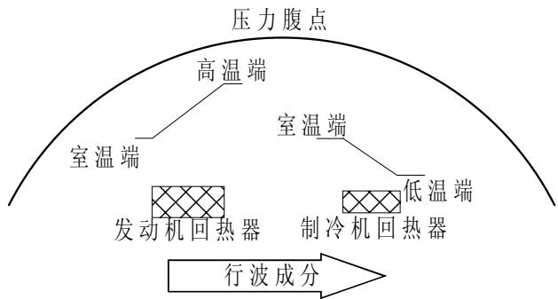  
图5.3 本文设计的新型热驱动热声制冷机系统中回热器布置方式示意图

选定设计方案后，下一步就是对各热声单元的特征尺度、相对位置、加热功率等参数进行优化设计。本章采用本文第二章所介绍的“小振幅热声热机可视化仿真软件”对系统中的声场分布和能流分布进行数值模拟和优化分析。

## §5.3 系统基本声场和能流分布

对于本文中所设计的行驻波型热驱动热声制冷机系统，计算首先是从发动机水冷器的上端沿逆时针方向开始的，把它作为主计算流程的一个分支，另一分支沿环行圈的顺时针方向开始计算，当两分支计算到三通的后合并（在三通处的振荡压力相等，振荡体积流率为两分支三通处的体积流率之和），然后，进入谐振管继续进行计算，在这里体积流率遵循质量守恒条件。系统的模拟计算流程如图 5.4。

计算从环行圈的发动机室温端冷却器上端开始，并将此处的中心点定义为x轴的坐标原点（ $x = 0 . 0 \ m \ )$ 。从原点开始，沿x的负方向顺时针经过容腔和声功反馈管到三通连接处，到达三通管的时候坐标为 $x = - 0 . 3 1 m$ 。从原点开始，沿x的正方向从发动机室温端冷却器上端开始逆时针方向经过发动机，热缓冲管，制冷机，声功回收管到达三通连接处，到达三通管的时候坐标为x=0.52m。然后，向右经过谐振直管到谐振腔的末端，此时谐振腔末端的坐标为 x = 1.40 m。

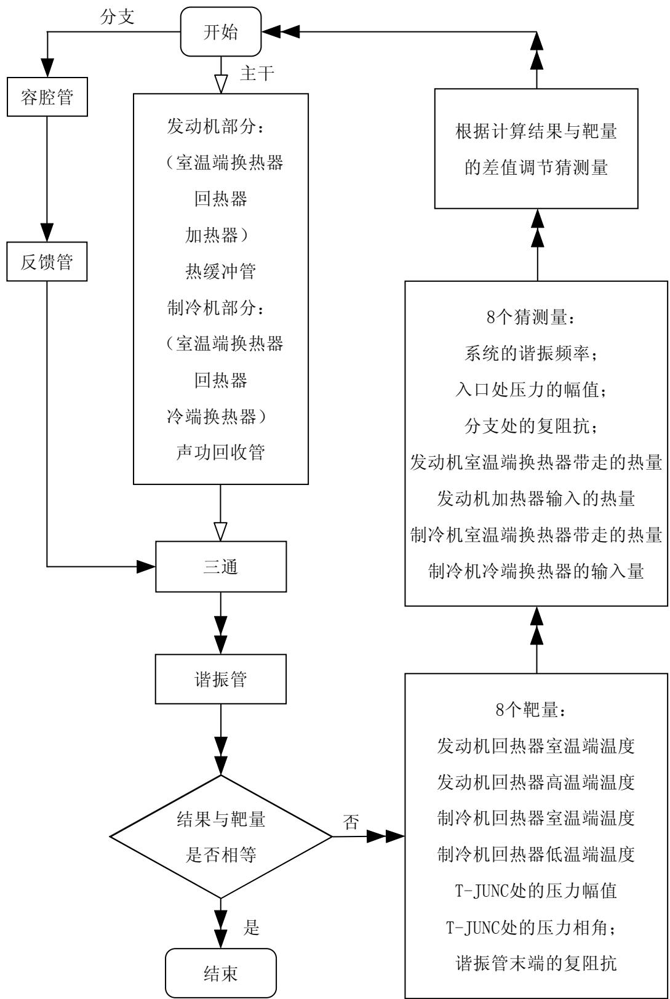  
图5.4行驻波型热驱动热声制冷机模拟计算流程图

模拟计算采用的工况为：气体工质为氦气，充气压力为2.2MPa，发动机高温端温度为 $5 6 0 \mathrm { { } ^ { \circ } C }$ ，制冷温度为 $0 ^ { \circ } \mathrm { C } .$ 。计算声场和声功流分布，如图5.5所示。

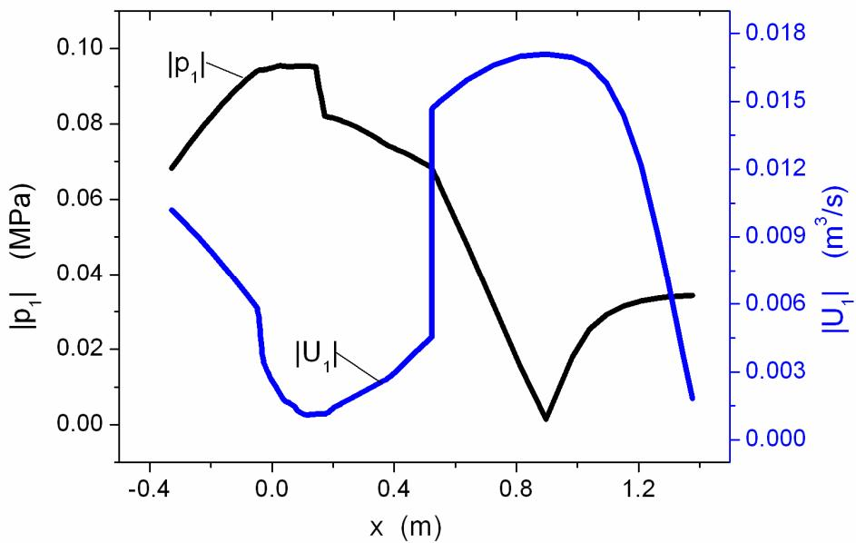  
(a)

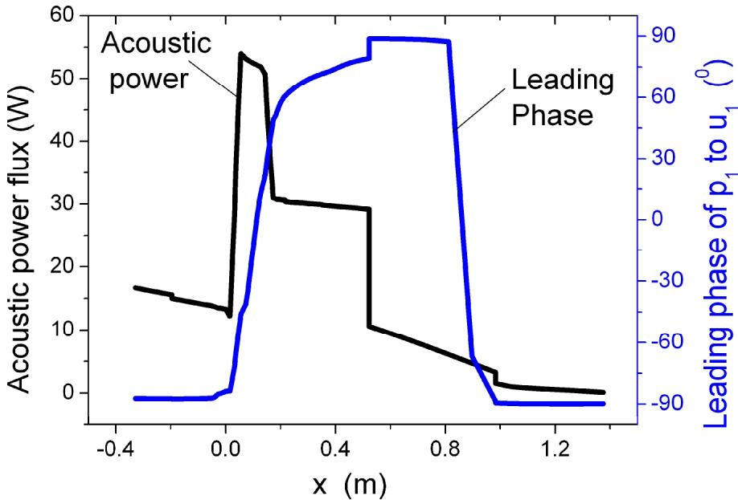  
(b)  
图 5.5 系统中声场和声功流沿程分布图

图 5.5a 为振荡压力幅值 $\left| p _ { 1 } \right|$ 和振荡体积流率幅值 $\left| U _ { 1 } \right|$ 的沿程分布图。 $\left| p _ { 1 } \right|$ 在发动机处达到最大值，然后在制冷机回热器中急剧减小。在 $x = 0 . 8 5 ~ m$ 处，压力幅值 $\left| p _ { 1 } \right.$ 达到最小，该处为压力节点。 $\left| U _ { 1 } \right|$ 最小值出现在环形圈中 $x = 0 . 1 1 5 \ m$ 的位置，即出现在发动机和制冷机之间的位置。在回热器附近 $\left| U _ { 1 } \right|$ 接近最小值，有助于减小回热器粘性损失，提高热声热机效率。另外，在 $x = 0 . 5 4 \ m$ 的三通口处 $\left| U _ { 1 } \right|$ 出现了一个阶跃，这是因为三通处通向谐振管处的体积流率是回收管出来的体积流率与反馈管出来的体积流率之和。谐振支路中的体积流率大于环形圈中的体积流率，体积流率的成倍增大也意味着粘性损失的急剧增加，大量声功在谐振管中耗散。如图5.5a所示，压力腹点和速度节点均出现在回热器附近，因此，回热器附近阻抗达到最大，有利于有效抑制回热器中粘性损失。

图5.5b为热驱动热声制冷机系统中，振荡压力相对于体积流率的相位差$\varphi _ { z }$ 与声功流的沿程分布图。在环行圈中， $\varphi _ { z }$ 从三通 $\prod x = - 0 . 3 1 m$ 处 $\varphi _ { z } = - 8 8 ^ { \circ }$ 逐渐增大，在发动机和制冷机之间的热缓冲管中 $x = 0 . 1 1 5 \ m$ 处达到行波相位$\varphi _ { z } = 0 ^ { \circ } , \varphi _ { z }$ 继续增大一直到三通部位 $\varphi _ { z } = 8 6 ^ { \circ }$ 。很明显，环行圈中的声波既不是行波也不是驻波，而是TWC和SWC混合而成的行驻波混合声场。发动机回热器工作在 $- 7 5 ^ { \circ } < \varphi _ { z } < - 4 5 ^ { \circ }$ 的声场区，制冷机回热器工作在 $2 0 ^ { \circ } < \varphi _ { z } < 5 0 ^ { \circ }$ 声场区(对应于第四章中坐标系的 $2 0 ^ { \circ } < \varphi _ { z } + 1 8 0 < 5 0 ^ { \circ }$ 区域）。因此，发动机回热器中，SWC和 TWC均实现了热致声效应；制冷机回热器中，SWC和TWC均实现了热制冷效应，有效的提高了系统总效率。另外，从图5.5b还可以看到，在谐振支路中， $\varphi _ { z }$ 接近于 $9 0 ^ { \circ }$ ，在节点 $x = 0 . 8 5 ~ m$ 位置相位翻转为 $- 9 0 ^ { \circ }$ ，很明显，这是一个较为标准的驻波相位，与1/2波长的赫尔姆兹谐振腔有着非常类似的相位分布。

如图5.5b中声功流分布所示，12.3W的声功进入发动机，声功在发动机中放大。这是由于外热源对发动机加热器加热，在发动机回热器中形成较大的温度梯度，发动机实现热致声的转换，使得从发动机出来的声功达到54.0W，在发动机中产生41.7W的声功增益。计算表明，此时热端换热器输入热量为154W，因此，发动机热声转换效率为27.3%。从发动机出来的声功在TBT少量损失后，50.8W声功直接进入制冷机进行泵热。制冷机耗散声功实现从制冷机冷端换热器泵热。经过制冷机的剩余声功为30.8W，制冷机消耗声功为20W。计算表明，此时制冷量为48W，因此，制冷机在 $0 \%$ 的制冷温度时，制冷系数为2.4。声功回收管将剩余声功回收，经过少量声功耗散后，到达三通口处时27.3W的剩余声功分为两部分：10.6W的声功进入谐振支路，在谐振支路中耗散；另外16.7W的声功通过声功反馈管，少量损失后，进入发动机再次参与热声转换。计算结果表明，热驱动热声制冷机在 $0 \%$ 的制冷温度下，总效率为31.2%。

## §5.4 系统内热声元件的优化设计

本文设计的驱动热声制冷机系统的声网络是由回热器单元、TBT、容腔、声功回收管、声功反馈管和谐振管等热声组件的阻抗共同组成。可以通过调整该声网络，使得回热器位于高阻抗的行驻波相位区。通过合理的设计该系统中各热动力学元件，使压力腹点位于发动机和制冷机之间的TBT中心，SWC在发动机回热器中实现热致声的转换，在制冷机回热器中实现声致冷效应。另外，使声功流在环形圈中为逆时针方向，使得TWC在热声发动机和制冷机中的热声效应与SWC一致。即，系统中回热器布置方式如图5.3所示，提高发动机和制冷热声效率。

下面我们将使用本文第二章所介绍的“小振幅热声热机可视化仿真软件”对它们分别进行优化设计。本小节仿真计算采用的工况为：气体工质为氦气，充气压力为2.2MPa，发动机高温端温度为800K，制冷温度为273K。

## §5.4.1 回热器的优化

回热器是热声热机中最为关键的部件，是热声转换过程的发生地，因而也是设计中的重点。在热驱动热声制冷机系统中，当发动机热器温度梯度达到其临界值时，将激发声波。声波使气体微团在发动机回热器中经历一定的热动力学循环：压缩一加热一膨胀一冷却。这样，在无运动部件的条件下实现了热能到声能的转换。当声波通过制冷机回热器时，在制冷机回热器上产生温度梯度，并将热量从低温端泵送到高温端。声波使气体微团在制冷机回热器中经历一定的热动力学循环：压缩一冷却一膨胀一加热。这样，在无运动部件的条件下实现了泵热。在高频情况下，由于热渗透深度和粘性渗透深度都很小，要加工具有规则流道形状的回热器相当困难，甚至在现有加工手段的情况下是不可能实现的，因此往往我们采用不锈钢丝网作为回热器的填料。回热器内的水力半径取决于丝网的目数以及丝径。其实际孔隙率和水力半径可以通过以下公式得到

$$
\phi = 1 - \frac { M - m } { \rho _ { s } }\tag{5.1}
$$

$$
r _ { h } = D _ { w i r e } \frac { \phi } { 4 ( 1 - \phi ) }\tag{5.2}
$$

其中，M是填装丝网以后回热器质量，m是填装丝网前回热器套筒的质量， $\rho _ { s }$ 是不锈钢的密度， $\phi$ 是孔隙率， $D _ { w i r e }$ 是不锈钢丝网的丝径。可以看到，随着目数的增加，丝网的填充质量M增加，水力半径是减小的。因此，不锈钢丝网的目数成为我们需要优化的一个目标。我们给出计算所用的不锈钢丝网的参数如表5.1。

回热器的长度同样是我们优化的目标。很显然，在两端温度一定的情况下，回热器的长度直接影响到回热器两端的温度梯度，回热器太短，则热声效应赖以生存的气固界面面积太小；而回热器太长，会造成沿回热器长度方向上的温度梯度减小，热声转换效率会降低。此外回热器的长度还会影响回热器整体的阻抗和相位，从而影响声场的分布。

表 5.1 回热器丝网填料参数表
<table><tr><td rowspan=1 colspan=1>目/每英寸</td><td rowspan=1 colspan=1>目/每厘米</td><td rowspan=1 colspan=1>孔径(mm)</td><td rowspan=1 colspan=1>丝径(mm)</td><td rowspan=1 colspan=1>孔隙率(%)</td><td rowspan=1 colspan=1>水力半径(μm)</td></tr><tr><td rowspan=1 colspan=1>40</td><td rowspan=1 colspan=1>15.1</td><td rowspan=1 colspan=1>0.327</td><td rowspan=1 colspan=1>0.252</td><td rowspan=1 colspan=1>70.4</td><td rowspan=1 colspan=1>15.2</td></tr><tr><td rowspan=1 colspan=1>60</td><td rowspan=1 colspan=1>23.6</td><td rowspan=1 colspan=1>0.273</td><td rowspan=1 colspan=1>0.15</td><td rowspan=1 colspan=1>72.2</td><td rowspan=1 colspan=1>97.3</td></tr><tr><td rowspan=1 colspan=1>80</td><td rowspan=1 colspan=1>31.5</td><td rowspan=1 colspan=1>0.198</td><td rowspan=1 colspan=1>0.12</td><td rowspan=1 colspan=1>70.3</td><td rowspan=1 colspan=1>71.1</td></tr><tr><td rowspan=1 colspan=1>120</td><td rowspan=1 colspan=1>47.2</td><td rowspan=1 colspan=1>0.132</td><td rowspan=1 colspan=1>0.08</td><td rowspan=1 colspan=1>70.3</td><td rowspan=1 colspan=1>47.4</td></tr><tr><td rowspan=1 colspan=1>150</td><td rowspan=1 colspan=1>59.1</td><td rowspan=1 colspan=1>0.104</td><td rowspan=1 colspan=1>0.065</td><td rowspan=1 colspan=1>69.8</td><td rowspan=1 colspan=1>37.7</td></tr><tr><td rowspan=1 colspan=1>200</td><td rowspan=1 colspan=1>78.7</td><td rowspan=1 colspan=1>0.074</td><td rowspan=1 colspan=1>0.053</td><td rowspan=1 colspan=1>67.2</td><td rowspan=1 colspan=1>27.2</td></tr></table>

注意：不同的厂家生产的不锈钢丝网的丝径和孔径存在差异。

## §5.4.1.1 发动机回热器

如图5.6所示，为发动机回热器在不同填充目数情况下，系统总效率随发动机回热器长度变化的曲线。从图中可以看到，随着回热器长度的增加，对同一目数的回热器而言，系统总效率是先增大后减小的，系统总效率是存在最大值的。并且我们还可以看到，随着发动机回热器目数的增大，系统总效率的最大值是向左移动的，因此，发动机回热器的目数越高，其最佳长度应该越短。综合图5.6，当发动机回热器的目数为60，长度为42mm的时候，系统总效率可以获得最高值0.31。因此，下文仅对目数为60的发动机回热器进行分析。

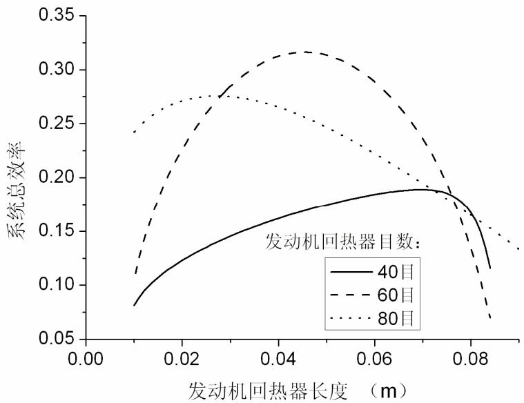  
图5.6在不同丝网目数下，系统总效率随发动机回热器长度变化的曲线图

图5.7为发动机回热器的目数为60时，发动机的热声转换效率和制冷机的制冷机系数随发动机回热器长度变化关系图。从图中可以看到，随着回热器长度的增加，发动机的热声转换效率是先增大后减小的，而制冷机回热器制冷系数是单调减小的。为了更好的理解发动机的热声转换效率和制冷机的制冷机系数的变化，我们分析发动机回热器和制冷机回热器两端压流相位差随发动机回热器长度的变化，如图5.8所示。随着发动机回热器长度的增加，发动机回热器室温端相位差从 $- 7 2 ^ { \circ }$ 減小到 $- 7 6 ^ { \circ }$ ，发动机回热器高温端相位差从 $- 4 3 ^ { \circ }$ 增加到$- 3 4 ^ { \circ }$ 逐渐靠近 $0 ^ { \circ }$ 相位，其发动机回热器跨越的相位区间逐渐增大，在0.052m时相位为 $- 4 3 ^ { \circ } \sim - 7 6 ^ { \circ }$ ，此时，热声转换效率达到最高0.28。而随着发动机回热器长度的增加，制冷机回热器室温端相位差从 $2 2 ^ { \circ }$ 增大到 $3 3 ^ { \circ }$ ，而制冷机回热器低温端相位差从 $4 6 ^ { \circ }$ 逐渐增加到 $5 6 ^ { \circ }$ ，制冷机回热器跨越的相位区间逐渐偏离 $0 ^ { \circ }$ 相位，因此，其制冷系数逐渐减小。

  
图5.7发动机回热器的目数为60时，发动机回热器热声转换效率和制冷机回热器制冷机系数随发动机回热器长度变化关系图

  
图5.8发动机回热器的目数为60时，发动机回热器和制冷机回热器两端压流相位差随发动机回热器长度的变化关系图

## §5.4.1.2 制冷机回热器

图5.9所示的就是制冷机回热器在不同填充目数情况下，系统总效率随制冷机回热器长度变化的曲线。从图中可以看到，随着回热器长度的增加，对同一目数的回热器而言，系统总效率是先增大后减小的，系统总效率是存在最大值的。和发动机回热器类似，随着回热器目数的增大，系统总效率的最大值是向左移动的，因此，回热器的目数越高，其最佳长度应该越短。综合图5.9，当制冷机回热器的目数为150，长度为36mm的时候，系统总效率可以获得最高值0.31。因此，下文仅对目数为150的制冷机回热器进行分析。

  
图5.9在不同丝网目数下，系统总效率随制冷机回热器长度变化的曲线图

  
图5.10制冷机回热器的目数为150时，制冷机回热器热声转换效率和制冷机回热器制冷机系数随制冷机回热器长度变化关系图

图5.10为制冷机回热器目数为150时，发动机的热声转换效率和制冷机的制冷机系数随制冷机回热器长度变化关系图。从图中可以看到，随着回热器长度的增加，发动机的热声转换效率和制冷机的制冷系数都是先增大后减小的。为了更好的理解发动机的热声转换效率和制冷机的制冷机系数的变化，我们分析发动机回热器和制冷机回热器两端压流相位差随制冷机回热器长度的变化，如图5.11所示。随着制冷机回热器长度的增加，发动机回热器室温端相位差从$- 7 2 ^ { \circ }$ 减小到- $- 8 3 ^ { \circ }$ ，而发动机回热器高温端相位差从- $- 2 3 ^ { \circ }$ 减小到 $- 7 5 ^ { \circ }$ ，其发动机回热器跨越的相位区间逐渐减小，并偏离 $0 ^ { \circ }$ 相位，在0.02m时相位为$- 2 3 ^ { \circ } \sim - 7 2 ^ { \circ }$ 时热声转换效率达到最高0.287。而随着制冷机回热器长度的增加，制冷机回热器室温端相位差从 $3 7 ^ { \circ }$ 减小到-47°，而制冷机回热器低温端相位差从 $5 6 ^ { \circ }$ 逐渐增加到 $6 6 ^ { \circ }$ ，制冷机回热器跨越的相位区间逐渐增大，在0.035m时相位为 $1 5 ^ { \circ } \sim 4 9 ^ { \circ }$ 时制冷系数达到最高2.44。

  
图5.11 制冷机回热器的目数为150时，发动机回热器和制冷机回热器两端压流相位差随发动机回热器长度的变化关系图

## §5.4.2 其它热声元件

热缓冲管是实现发动机高温与制冷机室温的过渡，其热声效应为绝热热声效应，所以它的外壁与外热源尽量理想的绝热。同时为了避免热量的损失，其固体介质的纵向热传导要足够小。回收管、反馈管、容腔与谐振管在热声系统中主要是作为调相元件，使进入回热器的布置方式如图5.3所示，同时也可以提高回热器附近的声阻抗，从而减小回热器内的粘性损失。

(a)  
  
(b)

  
(c)  
图5.12 容腔的直径对系统总效率、发动机回热器热声转换效率、制冷机回热器制冷系数、频率和两级回热器两端压流相位差的影响

如图5.12（a）-（c）所示，容腔的直径对系统总效率、发动机回热器热声转换效率、制冷机回热器制冷系数、频率以及两级回热器两端压流相位差的影响。如图5.12（a）所示，随着容腔直径的增大，制冷机的制冷系数一直减小，而对于发动机的热声转换效率和系统总效率而言都存在一个最佳容腔直径。如图5.12（b）所示，容腔直径的变化对频率影响较大，容腔的直径从0.028m变化到0.100m，系统谐振频率从250Hz减小到220Hz。随着容腔直径的增大，系统谐振频率减小，声波振荡波长增长。因此，在行波相位区长度也相应增长，如图5.12（c）所示，两级回热器所处声场的压流相位差逐渐靠近0°。

图5.13为系统总效率和频率随谐振直管长度变化的关系曲线。随着谐振直管增长，频率降低，而系统总效率先急剧升高，当谐振直管增长到一定程度，系统总效率变化平缓，逐渐达到最大值，然后减小。

  
图5.13 系统总效率和频率随谐振直管长度变化的关系曲线

## §5.5 运行参数对于系统性能的影响

前面已经分析了热驱动热声制冷机的结构参数对于系统性能的影响，并且进行了一系列的优化，但是这些仿真计算都是在一定的运行参数下进行的。运行参数的变化也会对系统的性能产生影响，甚至于反过来影响结构参数的优化，这一节我们将详细讨论运行参数对于系统声场的影响，以及对于系统性能的影响。

## §5.5.1 高温端温度的影响

发动机高温端温度的变化会造成系统声速的变化，从而影响系统的谐振频率以及声场的分布。无疑的，回热器高温端温度的大小对于系统的性能是有很大影响的。仿真所采用的结构参数如表5.2。

  
图5.14系统谐振频率随加发动机高温端温度的变化关系

图 5.14所示的是系统谐振频率随着发动机回热器高温端温度的变化关系，可以发现，高温端温度的变化对系统的谐振频率影响是很小的，当高温端温度从670K增加到1200K的时候，谐振频率仅仅变化了3Hz。

两级回热器两端压流相位差随高温端温度的变化如图5.15。随着高温端温度的增加，制冷机回热器两端的压流相位差逐渐靠近0°，而发动机回热器两端的压流相位差逐渐偏离0°，可以看到，高温端温度的变化具有的相位调节功能。

  
图5.15回热器冷端以及中间流相对于压的相位差随高温端温度的变化

通过对压流相位差的分析我们可以发现，高温端温度的增加可以有效调节压流相位差，从而很好的提高回热器的效率。图5.16给出了系统总效率、发动机的热声转换效率和制冷机的制冷系数随高温端温度的变化关系。很明显，随着高温端温度的增加，系统总效率、发动机热声转换效率和制冷机制冷系数都不是单调变化的，都存在各自的最佳高温端温度。高温端温度的增加会造成系统性能的提高，一般认为仅仅是由于输入能量的增加，而忽略了它对于系统效率的改善作用，这一点在热声发动机的设计中也是一个必须考虑的问题。

  
发动机回热器高温端温度（K）  
图5.16系统性能随高温端温度的变化关系

  
图5.17发动机的声功增肌和制冷机的制冷量随高温端温度的变化关系

同样地，系统的声功增益也是随高温端温度急剧增加的，一方面是由于输入功率的增加，另一方面就是系统的效率得到了提高造成的。同时我们给出了发动机回热器声功增益和制冷机回热器制冷量随高温端温度的变化如图5.17。

## §5.5.2 平均充气压力的影响

系统谐振频率随平均充气压力的关系如图5.18所示。从图5.18中我们可以看到，系统的谐振频率随充气压力的变化是相当小的，当充气压力从1.2MPa上升到5MPa的时候，谐振频率仅仅下降了4.5Hz。

  
图5.18 系统谐振频率随平均充气压力的关系图

图5.19所示的是系统总效率、发动机的热声转换效率和制冷机的制冷系数随系统充气压力的变化关系。如图5.19所示，随着系统充气压力的增加，发动机的热声转换效率单调增加，而对于制冷机的制冷系数和系统总效率而言都存在一个最佳充气压力。由此可知，充气压力并不是越大越好的，虽然增大充气压力在一定程度上可以增大波动压力幅值，但是，过大的充气压力并不能够让系统获得大的热声转换效率。在热声发动机的设计过程中，对充气压力的选择也是一个十分重要的部分。

  
图5.19充气压力对系统性能的影响

通过对高温端温度和充气压力两个重要运行参数的分析，我们可以发现，运行参数对热声系统的声场以及性能也具有很重要的作用，这进而会影响到系统的效率。这在以前的研究中往往被忽略。在实际的设计过程中，必须根据设计的需要，将结构参数和运行参数结合起来进行优化。

## §5.6 行驻波型热驱动热声制冷机的优化结构参数

通过上述对行驻波型热驱动热声制冷机的基本声场分析以及对热声发动机结构参数和运行参数的优化计算，我们设计了一套行驻波型热驱动热声制冷机。其设计运行工况为：充气压力为2.2MPa的，高温端温度为800K；其结构参数如表所示。

表5.2高频斯特林热声发动机的优化结构参数
<table><tr><td rowspan=1 colspan=2>元件</td><td rowspan=1 colspan=1>内径(mm)</td><td rowspan=1 colspan=1>长      度(mm)</td><td rowspan=1 colspan=1>基本结构</td></tr><tr><td rowspan=3 colspan=1>发动机</td><td rowspan=1 colspan=1>室温端换热器</td><td rowspan=3 colspan=1>27</td><td rowspan=1 colspan=1>15</td><td rowspan=1 colspan=1>紫铜平行板叠不锈钢法兰式水套</td></tr><tr><td rowspan=1 colspan=1>回热器</td><td rowspan=1 colspan=1>40</td><td rowspan=1 colspan=1>60目不锈钢丝网</td></tr><tr><td rowspan=1 colspan=1>加热器</td><td rowspan=1 colspan=1>18</td><td rowspan=1 colspan=1>陶瓷</td></tr><tr><td rowspan=1 colspan=2>热缓冲管</td><td rowspan=1 colspan=1>27~22</td><td rowspan=1 colspan=1>37</td><td rowspan=1 colspan=1>不锈钢管</td></tr><tr><td rowspan=3 colspan=1>制冷机</td><td rowspan=1 colspan=1>室温端换热器</td><td rowspan=3 colspan=1>22</td><td rowspan=1 colspan=1>15</td><td rowspan=1 colspan=1>紫铜平行板叠不锈钢法兰式水套</td></tr><tr><td rowspan=1 colspan=1>回热器</td><td rowspan=1 colspan=1>34</td><td rowspan=1 colspan=1>150目不锈钢丝网</td></tr><tr><td rowspan=1 colspan=1>冷端换热器</td><td rowspan=1 colspan=1>12</td><td rowspan=1 colspan=1>80 目铜丝网</td></tr><tr><td rowspan=3 colspan=2>声功回收管</td><td rowspan=1 colspan=1>22</td><td rowspan=1 colspan=1>40</td><td rowspan=8 colspan=1>不锈钢管</td></tr><tr><td rowspan=1 colspan=1>22~16</td><td rowspan=1 colspan=1>114</td></tr><tr><td rowspan=1 colspan=1>16</td><td rowspan=1 colspan=1>120</td></tr><tr><td rowspan=1 colspan=2>反馈管</td><td rowspan=1 colspan=1>22</td><td rowspan=1 colspan=1>278</td></tr><tr><td rowspan=1 colspan=2>容腔管</td><td rowspan=1 colspan=1>100</td><td rowspan=1 colspan=1>27</td></tr><tr><td rowspan=3 colspan=2>谐振管</td><td rowspan=1 colspan=1>22</td><td rowspan=1 colspan=1>460</td></tr><tr><td rowspan=1 colspan=1>22~80</td><td rowspan=1 colspan=1>280</td></tr><tr><td rowspan=1 colspan=1>80</td><td rowspan=1 colspan=1>140</td></tr></table>

## §5.7 本章小结

热声热机自产生至今，已经得到了很大的发展，但是多数研究还集中在行波型热机和驻波型热机上，极少有从行驻波的角度对实际热声系统中行驻波模态进行研究，仅有少数研究在整理实验数据上采用行驻波分解。行驻波声场中热声效应的研究大多停留在单个元部件的研究水平上，以系统为研究对象的整机仿真尚未见报道。本章在第三章行驻波声场的理论分析和第四章行驻波声场热声效应的分析基础上，结合现有热驱动热声热机的发展，提出了一种新型的行驻波型热驱动热声热机，并使用本文第二章介绍的自主开发设计的“小振幅热声热机可视化仿真软件”对该新型热机系统进行了整体数值仿真和优化。在对声场分析的基础上，详细讨论了新型热声系统的结构参数和运行参数对于回热器处压流相位差、频率以及热声发动机的性能的影响，并自行设计了一台小型热驱动热声制冷机装置。

与其它类型的热驱动热声制冷机系统，该新型热驱动热声制冷系统具有以下优点：（1）有效利用了声波中行波成分和驻波成分联合作用的热声转换：（2）由发动机产生的声功直接进入制冷机进行泵热；（3）使用声功回收管和声功反馈管将制冷机使用后的残余声功，反馈到发动机进行再次利用；（4）发动机和制冷机都布置在同一个环形圈内，并且环形圈耦合谐振支路的结构使系统总长接近1/4波长，有效的减小了系统长度。根据计算分析，热声发动机回热器位于 $- 7 5 ^ { \circ } < \varphi _ { _ z } < - 4 5 ^ { \circ }$ 声场区域，回热器高温端靠近压力腹点；热声发动机回热器位于 $2 0 ^ { \circ } < \varphi _ { z } < 5 0 ^ { \circ }$ 的声场区域（对应于第四章中坐标系的$2 0 ^ { \circ } < \varphi _ { z } + 1 8 0 < 5 0 ^ { \circ }$ 区域），回热器室温端靠近压力腹点。这使得声波中的行波成分和驻波成分在制冷机中都实现了泵热效应，在发动机中都实现了热致声的转换，提高了该系统热声转换效率。

## 第六章 行驻波型热驱动热声制冷机的实验研究

## §6.1 引言

早期的热驱动热声制冷机的研究只是以热声发动机代替脉冲管的压缩机，但由于脉冲管制冷的理论制冷系数是 $T _ { c } / T _ { H }$ ，在低温工况下比较接近卡诺循环的制冷系数，但在室温制冷范围内远低于卡诺循环的制冷系数，并且制冷功率密度也不大。大多数热声发动机尺度远大于脉冲管低温制冷机的尺度，制约了其在工程上的广泛应用。随后，室温制冷范围内的热声发动机驱动热声制冷机受到广泛关注，然而，各种类型的热声发动机和制冷机之间的匹配好坏也影响系统效率的提高，有时仍然存在的大马拉小车现象。

正是基于此原因，本文分析了行驻波声场特性和行驻波声场中的热声效应，结合现有热驱动热声热机的发展，独立设计并研制了一台新型的行驻波型热驱动热声热机。该新型热驱动热声制冷系统结构紧凑，有效利用了声场中行驻波热声效应。良好的设计理念使得系统成功实现了高频振荡。第五章通过对行驻波型热驱动热声制冷机的数值模拟和优化，得到比较合理的系统结构尺寸。本章第二小节和第三小节将重点介绍自行设计的行驻波型热驱动热声制冷机样机的搭建过程，主要包括系统的设计和制作、各个热声元件的结构及实验测量与动态数据采集系统。本章后续小节将详细介绍对这一高频行驻波型热驱动热声制冷机的实验研究，对系统的基本性能和该机型特有的问题进行了探索性实验研究，通过实验研究揭示系统特征、调节及控制机理。

## §6.2 实验装置

  
图6.1 行驻波型热驱动热声制冷机的总装配图

如图6.1所示，本文设计的行驻波型热驱动热声制冷机系统的实验装置，包括：依次相连的声功反馈管、容腔、发动机（包括，室温端冷却器、热声回热器和加热器）、热缓冲管（TBT）、制冷机（包括，室温端冷却器、热声回热器和冷端换热器）和声功回收管组成的声波环路，以及与声波环路中的声功反馈管和声功回收管同时相连通的谐振支路。下面就各主要部件的结构和制作工艺进行详细地讨论。

## §6.2.1 回热器

回热器是热声热机的核心，功能在于提供固体热容量，暂态储热。为提供足够的热容和换热面积，回热器通常精细加工成许多平行的流道或通孔，对热声热机来说，固体填料通常为大热容、耐高温、具有较低热导率的金属材料（如不锈钢）或陶瓷材料。良好热声堆和回热器的设计还需要使沿温度梯度方向上常见的纵向漏热（固体传导和流道对流）以及声功的粘性耗散最小。

回热器结构形式的选择：主要有螺旋型、平行平板型、针列型和丝网型。平行平板型和针列型热声堆是理想的热声堆，但是在高频下因更微小的渗透层使得制作加工的难度很大。平板型由许多平行平板按照均匀的间距堆叠而成。但是在本文高频（235Hz）设计中，为保证设计原则所需的水力半径和较大孔隙率（70%以上），固体平板的厚度只有0.15mm左右，如此薄的平板容易变形，需在平板之间增加固定结构，那将增大热传导损失，另外制作工艺也较复杂。螺旋结构是一种制作近似于平行平板结构的热声堆，固体材料缠绕在间距均匀的螺旋架上，每两层螺旋之间形成几乎平行的流道，但是由于电子束焊接的昂贵和清理复杂，本文未予采用。丝网型是高频热声振荡最常用的回热器，加工简单、成本低廉，每片丝网之间的接触热阻降低了轴向漏热。

综合考虑这些因素，本实验装置采用了不锈钢丝网型回热器。把一定数目的不锈钢丝网片填充进回热器套筒中，回热器套筒由不锈钢薄壁管制成。发动机回热器是由多片40目、60目和 80目的不锈钢丝网填充在内径为27mm的薄壁钢管内组成的；制冷机在回热器是由多片120目、150目和200目的不锈钢丝网填充在内径为21mm的薄壁钢管内组成的。回热器薄壁管两端用肋条来固定压紧的丝网，同时也为回热器和相邻的换热器之间提供一定的空间。在填充过程中，为了保证沿x方向上单位长度回热器有同样均匀数目的不锈钢丝网，必须小心地在加入每片丝网后用预置的力来填压丝网堆。

## §6.2.2 换热器

换热器首先是热力元件，工作介质在进行纵向波动过程的同时发生横向热流的传递，实现声场与外热源的热量交换。换热器设计的标准是提供两股流体间良好热交换的同时使每股流体的压降最小。换热器利用等温热声效应工作，它的外壁与外热源要尽量理想的热接触，固体材料的热传导系数要足够大。同时，换热器作为流通元件，它的流通阻力大小也需要考虑。

在振荡流动情况下截面的平均速度应该指时均的截面平均速度。因此，换热系数应该以这个平均速度为定性速度。换热器的长度应该等于或略小于流体峰峰值的位移 $2 u _ { \mathrm { 1 } } / \omega$ 。如果换热器的长度远大于 $2 u _ { \mathrm { 1 } } / \omega$ ，则仅有一部分流体微团和换热器接触，不能起到输送热量的作用，它们的移动纯粹是消耗功的过程（粘性和热过程）。如果换热器的长度太短，流体微团将跳过换热器，根本不和换热器接触，也不能起到输送热量的作用。

目前，热声发动机通常采用的冷端换热器类型有平行翅片管式、壳管式以及夹套式换热器等。平行翅片管式和壳管式换热器由于冷却水穿过换热器内部，具有优越的换热性能，但制作工艺相对复杂，换热器由于进出口截面明显变化引起的局部流阻成为流动损失的重要因素。夹套式水冷却器的冷却水在换热器外部的夹套中流动，内部通过装填翅片加强与气体的换热。由于它制作工艺相对简单，具有良好的流动特性，本实验装置中的发动机换热器和制冷机换热器均使用这种形式。换热器由内翅片和法兰两部分组成，如图6.2所示。换热器法兰内部开有环形水槽，焊有水嘴。将翅片置于法兰中，用螺丝拧紧，翅片与法兰之间采用〇形圈密封：这样气体工质由翅片内通过，冷却水绕翅片管外壁进行冷却。

  
图 6.2 (a)换热器内翅片；(b)换热器法兰

## §6.2.3 发动机高温加热器

在实验研究中，热声样机的开发和基本性能研究大都采用电加热的方式，调节和控制方便，加热性能稳定。电加热利用电流通过电阻产生的热量进行加热，可分为铠装外加热式和内加热式。铠装外加热式加热器即常说的电加热棒，是在一个金属管内沿轴向放入螺旋形电加热丝，空隙部分紧密地填满具有一定导热性和良好绝缘性的材料（如氧化镁）制成，最大表面负荷 $4 \mathrm { W } / \mathrm { c m } ^ { 2 }$ ，市场上有成品销售，目前大多数进行热声发动机研究的实验室都采用这种加热方式。加热棒的优点体现在加热量易于控制、成本低，但受结构的限制，很难获得较高的加热温度和大的功率密度；其次，加热管处于高温状态（ $. 5 0 0 ^ { \circ } \mathrm { C }$ 以上），在电热管和换热器焊接处常发生脱焊问题。

内加热方式是把电加热丝（或带）缠绕在陶瓷等耐高温材料制作的绝缘架上，工作流体直接与灼热的加热丝表面接触进行加热。这种加热器的功率密度取决于加热丝的电阻率和承受高温的程度。同等加热密度情况下缩短了加热器长度，减小了管道的绝对热膨胀长度，增加了系统运行的安全性，减少了声波在传播过程中由于粘性摩擦造成的不可逆损失。为增强加热器的紧凑性，一般采用具有高电阻率的Ni-Cr合金电加热丝，这种加热丝的塑性好，容易绕制，表面抗氧化性好，在高温下具有较高的强度，可以在 $1 1 5 0 ^ { \circ } \mathrm { C }$ 下反复使用。本文设计中选用了Cr20Ni18电加热丝缠绕于莫来石陶瓷蜂窝上，常温下加热丝的电阻率为 $1 . 0 9 / 1 0 ^ { - 6 } \Omega { \cdot } \mathrm { m }$ o

## §6.2.4 热缓冲管

热缓冲管与脉冲管的作用类似，在冷热端换热器之间进行热绝缘并传递声功（类似于长活塞），热缓冲管长度的设计需要考虑热绝缘和Rayleigh声流损失。这种热绝缘是通过工质振荡来维持的，RayRadebaugh建议小型制冷机的脉冲管长度近似为6倍位移幅度[131]，使振荡流足够长以提供良好的热绝缘。Swift建议级联型热声热机的热缓冲管长度取10倍气团位移幅度[84]，由于热声核段一般处于10倍媒质特征阻抗率的阻抗条件下，在声压为10%充气压力的情况下，热缓冲管的长度近似为1%波长。对于本设计在运行工况下，按照经验推荐值，热缓冲管长度取37mm。

Rayleigh声流是由于管壁壁面的粘性和热边界层现象驱动的局限于管内的对流。Rayleigh声流的抑制，可通过确保热缓冲管运行于层流或弱湍流区，且内表面粗糙度应远小于粘性渗透层，必须抛光。保证层流可在热缓冲管一端和两端都应使用层流化元件（常使用若干片平面纺织的丝网）。另外，锥度设计能够有效抑制Rayleigh声流，锥度倾角可由式 $( 6 . 1 ) ^ { [ 5 0 ] }$ 计算。本设计所计算的热缓冲管的锥度为 $0 . 9 5 ^ { \circ }$

$$
\tan { \frac { \theta } { 2 } } \approx \left( 7 . 4 \cos ( P h Z ) - 6 . 3 \sin ( P h Z ) \right) \frac { r ^ { 3 } f \left| \mathbf { \nabla } p _ { 1 } \right| } { p _ { m } \left| U _ { 1 } \right| } + 0 . 0 0 2 9 \frac { r } { T _ { m } } \frac { d T _ { m } } { d x }\tag{6.1}
$$

## §6.2.5 容腔

环形圈上端的容腔可以提供储存声能和改变振荡压力或体积流率的幅值或相角所需要的声容C，同时，在相同的工作频率下，可以减小系统长度，使得系统结构更为经凑。本设计所使用的椭圆形容腔内径为 $d = 0 . 1 \ m$ ，容积为$V = 6 . 5 { \times } 1 0 ^ { - 4 } \ m ^ { 3 }$ o

在谐振腔中间安装厚度为0.5mm的硅胶弹性膜，用来抑制直流。弹性膜片通过一定的变形量产生一个与直流流动方向相反的作用力，切断直流流动的通路，从而彻底消除直流。由于膜的安装处横截面积相对较大，膜片在工作时随气体来回振荡的位移幅值将很小，从而保证了其使用寿命，同时减小弹性膜引起的声功耗散。

## §6.2.6 回收管和反馈管

回收管和反馈管可以提供储存声能和改变振荡压力或体积流率的幅值或相角所需要的声容C和声感L。

声功回收管用于回收制冷机剩余声功，由40mm长的椎管段，120mm长的$1 8 0 ^ { \circ }$ 弯管段，114mm长的椎管段和46mm的直管段组成。其中， $1 8 0 ^ { \circ }$ 弯管的内径为16mm，46mm的直管段内径为 22mm。

278mm长的声功反馈管内径为22mm，用来将声功回收管所回收的部分声功反馈到回热器，再次参与热声转换。

## §6.2.7 谐振管

谐振管的形式对热声热机来说是一个非常重要的因素，因为它直接决定了系统的谐振频率。当谐振腔的容积V无穷大时，系统为接近四分之一波长的系统；而当 $V = 0$ 时，系统就变成了接近半波长系统。而带有一定气库容积的系统介于1/2和1/4波长之间。谐振腔的存在会对系统的谐振频率产生重大的影响，此外还会带来额外的紊流损失。

本设计的谐振支路由内径为22mm的谐振直管、谐振锥管和内径为80mm的谐振腔组成。如图5.2所示，谐振支路的长度为： $_ { L 1 = 0 . 2 6 \mathrm { m } , \mathrm { L } 2 = 0 . 2 8 \mathrm { m } }$ ，且L3=0.14m。

这样，基于上节的制作加工，我们就建立起了一台小型高频斯特林型热声发动机。当工质为氦气时，其运行频率 $f = 2 3 5 H z$ 。实验装置和动态数据采集系统的示意图如图6.3所示。

## §6.3 数据测量及动态采集系统

数据采集系统是将传感器输出的模拟信号转换成计算机可以识别的数字信号，送入计算机，然后通过数据处理环节达到了解掌握被研究对象的实际过程。数据采集系统包括：实际对象、传感器、信号调理器、多路扫描器、采样保持器、A/D转换器、计算机、数据处理软件和建模。本文将重点介绍该实验的动态数据采集实现方法，及各个环节的基本功能和原理

  
图6.3 高频热驱动热声制冷机的数据采集系统

## §6.3.1 实验对象

实验中所选择的实验对象为系统的压力和温度。

## §6.3.1.1 压力测量点的分布

行驻波型热驱动热声制冷机共布置了8个压力测点，如图5.2所示，P1\~P8表示压力测点：P1压力测点位于声功反馈管段；P2位于发动机室温端冷却器上端；P3位于TBT管段；P4位于声功反馈管段；P5位于三岔口附近；P6，P7和P8位于谐振支路，用于测量谐振支路的压力分布。

## §6.3.1.2 温度测量点的分布

温度测点布置如图5.2所示，T1，T2，T3和T4表示温度测点：T1位于发动机回热器室温端；T2位于发动机回热器高温端；T3位于制冷机回热器室温端；T4位于制冷机回热器冷端。

## §6.3.2 测量和显示仪器

## §6.3.2.1 CY-YD-208T 型压力传感器

压电传感器是以某些电介质的压电效应为基础，在外力作用下，在电介质的表面上产生电荷，从而实现非电量测量。压电传感元件是力敏感元件，所以它能测量最终能变换为力的那些物理量。

实验中选用CY-YD-208T型压电式压力传感器，它具有较高的压力-电荷灵敏度，线性误差小、温度系数低、频率范围极宽（从直流到自振频率）、工作寿命长和无源等优点，适用于对流体瞬变压力进行定性、定量测量。CY-YD-208T型压电式压力传感器的压力范围0～30MPa，受压面直径为5mm，工作温度在- $4 0 \sim 1 5 0 ^ { 0 } C$ ，自振频率大于100kHz。由于压电传感器具有较高的输出阻抗，无源容性，石英晶体压力传感器输出高阻抗电荷讯号，而且比较微弱，所以必须经前置电荷放大器放大后，其输出的电压方可显示和记录。

## §6.3.2.2 YE5853 型电荷放大器

压电式传感器的前置放大器有两个作用：一是将压电式传感器的高输出阻抗变换成低阻抗输出，二是放大压电式传感器输出的弱信号。

本实验采用的前置电荷放大器是YE5853型电荷放大器，它是一种多通道内插式电荷放大器。它由电荷放大级（兼高通滤波器），低通滤波器（兼10倍放大）、倒相器输出放大器（兼归一化）、过载指示和稳压电源五部分组成部分组成。最大电荷输入量为±100nC，最大输出电压为±10V，最大输出电流是5mA。电荷放大器为二次仪表，要根据不同需要配用适当的三次仪表以便对被测物理量进行测量、显示、记录和分析。如配用示波器或加A/D采集板变换后直接进入计算机。

## § 6.3.2.3 0S-5020 型示波器

示波器是利用电子示波管的特性，将人眼无法直接观测的交变电信号转换成图像，显示在荧光屏上以便测量的电子测量仪器。它是观察数字电路实验现象、分析实验中的问题和测量实验结果必不可少的重要仪器。

本实验采用的示波器为 OS-5020型双通双踪模拟示波器，它具有20MHz带宽；灵敏度为 1mV/div；具有 ALT触发功能；CH2 阴极转换器和 X-Y显示模式；它的扫描放大倍数（×10），扫描方式：连续、交替、叠加和触发；最大输入电压为200V。

## §6.3.2.4 SR830 数字式锁相放大器

锁相放大器被使用来侦测和量测非常小的交流讯号直至数个nV，甚至当讯号被比它大数千倍杂波讯号掩盖时，也可以做正确的量测。它主要优点为“窄的频宽”，能将电路特定的频率与相位锁定，并过滤掉杂波讯号，从而得到准确的测量讯号。在本实验中，采用SR830锁相放大器准确测量系统频率以及系统中两传感器间的相位差，以便于后续分析实验数据，进行与理论结果的对比。

## §6.3.2.5 A/D 采集板

本实验所用的采集板是1000Ksps/12位8通道同步连续数据采集板AC1810。AC1810可以工作在单极性或双极性状态。其基本量程为0-10V、0-±5V和0-±10V。在这样的量程范围下，经电荷放大器放大的电动势以及热电偶所测得的电动势还非常小，在接入AC1810之前还需要采用信号放大电路进行放大。

本采集卡是基于DSP的高速同步数据采集系统。DSP通过双口RAM与PC相连，接收PC发出的命令，然后控制8路AD芯片同时工作，将采集的结果再通过双口 RAM进行缓冲，当缓冲区半满后，像 PC 发出命令，PC接收 DSP的命令，将采集的结果从双口RAM中读出，从而实现高速采集的目的。定时器的用途是产生硬件定时，达到高速准确的同步数据采集的目的。

## §6.3.2.6 信号放大电路

信号放大电路通过AD620芯片实现，设计的放大倍数可调，分别为20、100、200和300倍，8路温度信号和8路压力信号的测量顺序可互换。

## §6.3.2.7 热电偶温度计

将两种不同的金属A和B焊接成闭合电路，如图6.4所示。且当A和B两接点处在不同温度状态时，电路中将产生电流，相应地有电动势存在。这种电动势称为温差电动势，电动势包含了两种金属的汤姆逊电动势和两个两种金属接触点的接触电动势，其作用的总体效果称为温差电动势。产生温差电动势的装置称为热电偶。电动势和电流的方向由组成的热电偶的导体材料和冷热端温度决定，与热电偶的长度和直径无关。

  
图6.4 两种不同的金属A和B焊接成的闭合电路

  
图6.5 用金属C做为导线连接到电位差计上，  
测量A、B两种金属组成的热电偶的温差电动势

如果在金属A和B之间插入任何一种金属C，只要维持它和A、B连接点在同一温度 $T _ { 1 }$ 或 $T _ { 2 }$ ，这个回路中的温差电动势就和只有A、B两种金属组成的回路中的温差电动势一样，不会发生变化。这种性质给我们测量温差电动势提供了条件。如图6.5所示，用金属C做为导线连接到电位差计上，就可以测得A、B两种金属组成的热电偶的温差电动势。温差电动势的大小将随两端温度而变。若用测量仪表测得温差电动势的数值，便可测得相应的温度，所以热电偶可以做温度计使用，叫做热电偶温度计。热电偶温度计，它的测温接头体积小、热容小、反应快，制作简便。

本实验中温度的测量选择铜-康铜热电偶，其测量范围为-200\~400℃；在靠近热端换热器的高温端选择镍铬-镍硅热电偶，其测量范围为-200\~1100℃。热电偶在安装前都必须进行标定以保证测量的精度，热电偶在测量时用冰水混合物作为参考点。

## §6.3.3 直流稳压电源

为了消除交流供电产生的50Hz干扰信号对采集的影响，我们选用WYK10020高压大电流晶体管直流稳压稳流电源，其额定输出电压100V，额定输出电流为20A，它为串联调整式线性稳压电源，采用悬浮迭加式和可控硅预稳技术，可得到连续可调的直流电压。

## §6.3.4 动态数据采集程序

通过采集卡将压力信号转换成数字信号输入计算机，计算机需要采用数据处理程序将数值信号显示或保存，最终便于用户分析。

为了便于数据显示与保存，作者使用 Visual Basic[124]开发了Win2000 界面下的数据采集程序。程序模块化，界面简单明了，易于操作。采样周期连续可调，实现压力信号和温度信号同相位实时数据采集和存储，并能够动态显示波形，程序界面如图6.6所示。为了更好地分析各通道采集信号之间的关系，开发如图6.7显示的各通道显示界面。

  
图 6.6 采集程序 Windows 界面

  
图 6.7 各通道显示程序 Windows 界面

## §6.4 高频行驻波型热驱动热声制冷机实验步骤

下面简单介绍一下高频斯特林型热声发动机的实验步骤：

## 1. 热声发动机系统的检漏和充压测试

在实验中，系统的工作压力一般都是1MPa以上的，而且在发动机高温端温度一般都有200-500℃左右，因此对系统有较高的耐压和密封要求，特别是管件和管件的连接处、焊接处、压力传感器的安装部位以及各种接插件等都涉及到密封的问题，在系统开始工作之前，检漏工作必不可少。

实验中热声发动机需要充入高压气体，因此有必要对热驱动热声制冷机系统进行耐压测试。耐压实验是通过打水压的方式进行的，实验值按系统可能工作的最大压力的1.5倍进行。

## 2. 充压

系统检漏合格以后，要使用机械泵对系统抽真空约5分钟，使系统达到一定的真空度；在此基础上，充入一定压力的工质气体后静置5分钟，然后重复抽空充气过程2-3次，达到置换气体净化系统的目的，保证工质气体的纯度。因为少量的剩余空气也会造成在高温时系统里面的构件（如回热器，加热丝等）的氧化，以致换热性能变差或者管道堵塞。

气体置换完成以后，充入气体到实验所需的压力。

3. 检查压力传感器的安装是否安全，热电偶的冰点补偿。

4.打开电荷放大器，锁相放大器等动态测试和采集仪器，进行仪器预热，特别要注意的是电荷放大器上的灵敏度是否和所连接的压力传感器的灵敏度一致。

5. 打开数据采集软件，对各点的压力和温度进行实时测量。

6. 打开冷却水，并且检查无误后，打开加热电源开始对加热器进行加热。

对加热器的加热采取的是逐渐加热的方式，使系统缓慢加热，随着温度的升高，逐渐调高电压，加入更多的热量。

7. 性能实验

8. 实验完毕后，缓慢降低加热量，最后关闭加热器的电源。

9. 关闭各个测量和采集仪器电源。

10.待加热器温度降至室温以后，关闭冷却水，试验结束。

## §6.5 系统的起振特征与分析

起振是指回热器达到某一临界温度梯度时工作流体由静止状态向周期性振荡状态转化的过程。对于起振机理，目前还缺乏全面、准确的理论解释。国内外很多学者对热声起振过程进行了实验研究，主要包括：Atchley[132,133]提出用质量因子描述起振过程，并与温差之间得到了很好的一致性；1998年，日本松原洋一[134等通过实验，研究了热声发动机的起振温度和共振频率，测量了气体物性、频率、平均压力、丝网尺寸和板叠长度对整机性能的影响，并发现在一定条件下，系统将工作在二次模态，二次谐振波占主导地位。中科院理化技术研究所，禹智斌等[79]实验分析了热声效应中非线性不稳定性饱和、起振模态选择等非线性行为。

目前对热声热机起振过程的研究多停留在单级回热器的试验装置，极少有关于多级回热器的起振研究。随着热声热机的发展，串级热声热机已被广泛关注，然而，其起振温度的研究却极为匮乏。本文，使用研制的行驻波型热驱动热声制冷机对串级热声热机的起振温度做了实验研究和理论探索。

试验中，系统充入1.4MPa的氮气，制冷机冷端换热器绝热，在发动机高温加热器输入150W的热量。图6.8为系统起振一稳定一息振的过程中，发动机回热器高温端温度T2和P1压力测点处压力振荡幅值随时间变化曲线图。由图6.8可以看到，高温端温度T2先增加到468℃时，系统起振，压力幅值跃迁到0.093MPa。之后，由于交变流动使热量从高温端传递到低温端，回热器将部分热量转换为声功，高温端温度T2减低，同时压力振荡减弱。随着温度梯度的降低，振荡减弱，使得热声转换减弱，对流换热也减弱，直到振荡产生的换热和高温端的热量输入达到一个平衡时，振荡趋于稳定。起振4分钟后，高温端加热器停止加热，高温端温度T2急剧降低，当降低到368℃时，系统息振。

  
图6.8系统起振一稳定一息振的过程中，发动机回热器高温端温度振荡时均值和P1压力测点处压力振荡幅值随时间变化曲线图

  
图6.9为图6.8相同的实验过程中，一级回热器水冷端温度T1，二级回热器水冷端T3，二级回热器高温端T4的变化过程图

在多数关于热声系统起振的研究中，仅仅考虑温度主动变化端（回热器热端温度）和振荡压力的变化关系，而极少提到回热器其它位置（被动变化端）的温度变化。然而，在系统起振-稳定-熄振的变化过程中，其回热器其它位置的温度也发生了较大的变化。如图6.9所示，为图6.8相同实验过程中，一级回热器水冷端温度T1，二级回热器水冷端T3，二级回热器高温端T4的变化过程图。在系统起振前，水冷端温度T1和T3为冷却水温度21.5℃，第二级加热器温度为室温25.5℃。当系统起振后，第一级加热器的加热量一部分转换为声能，一部分通过交变流动热传导的方式到第一级水冷器放热，同时振荡气体从第二级加热器处泵送热量，到第二级水冷器放热。由于水冷器换热能力有限，因此，在系统起振时，第二级水冷器处温度T3也急剧升高；随着T2的降低，振荡减弱，以及制冷温度T4的降低，振荡气体泵热能力降低，即泵送到第二级水冷端的热量减少，因此T3又降低。当系统熄振时，第二级加热器漏热，T4逐渐上升到室温；同时，冷却水将水冷端温度T1和T3冷却到冷却水的温度。

在实验过程中我们发现，在第一级没有热量输入的情况下，第二级加热到650℃以内无法起振，但是，第二级加热温度，即二级回热器温度梯度对第一级起振温度有较大的影响。图6.10为不同充气压力下，在二级回热器温度梯度对第一级起振温度梯度的影响。如图6.10所示，随着制冷机回热器温差ΔT2的增加，发动机回热器起振温差∆T1逐渐减小。对于任意的制冷机回热器温差ΔT2，发动机回热器起振温差∆T1最小值都出现在相同的充气压力下，即$p _ { { \scriptscriptstyle m } } = 0 . 8 \mathrm { M P a }$ o

  
图6.10不同充气压力下，在二级回热器温度梯度随第一级起振温度梯度的变化曲线图

## §6.6 自激振荡与系统的稳定性分析

热声效应在一定的范围和条件下的存在就意味着热声系统有一定的稳定性。热声系统的发展变化也是在稳定基础上的发展和变化，然后达到新的稳定。认识热声系统的自激振荡过程必须从了解系统的稳定性开始。对于自激振荡现象，从物理机制上来说是热声的源项超过了粘性损失和热驰豫损失项：从控制论上来看，自激振荡实际是系统不稳定现象的一种，起振现象是系统稳定状态的改变过程，起振发生于系统趋于不稳定的临界点。系统的稳定性是指系统受到扰动作用偏离平衡状态后，当扰动消失，系统经过自身调节能否以一定的准确度恢复到原平衡状态的性能。稳定性是控制系统的重要性能，若当扰动消失后，系统能逐渐恢复到原来的平衡状态，则称系统是稳定的，否则称系统为不稳定。线性系统的这种稳定性只取决于系统内部的结构和参数，而与初始条件和外作用的强弱无关。系统稳定性的实质是开放系统对环境影响的自我稳定能力，能够在一定范围内自我调节，从而保持和恢复原来的有序状态、保持和恢复原有的结构、性质和功能或者达到新的有序状态。热声系统的自激振荡过程就充分体现出热声系统具有自调节、自组织和自适应等稳定系统的特征。

## §6.6.1 Nyquist 失稳判据

对电子振荡器的研究表明，Nyquist 失稳判据能够准确判定振荡电路的稳定性[135,136]，应用 Nyquist 失稳判据的步骤是[137]：首先以图解的形式在一个复极平面上从负无穷到正无穷频率上绘制开环传递函数曲线，然后判断该曲线是否以顺时针环绕点(+1，+0i)，顺时针穿越实轴的点即为起振点。与电子振荡器不同，热声振荡器网络中没有分立的集总元件，故不方便直接应用拉斯变换绘制Nyquist曲线。不过，由自控原理[138]可知，频率响应图包含了与Nyquist 图相同的信息。Nyquist图中起振点所具有的特征，在频率响应图中又是如何体现的呢？分析如下[137]：Nyquist图中，起振点位于实轴上，意味着该频率下其开环传递函数值的虚部为零，此频率称为零相位频率f0；起振点位于实轴上顺时针环绕点(+1,+0i)的位置，意味着零相位频率f0下其开环传递函数值的实部应大于1，更为重要的是，在频率穿越f0时开环传递函数曲线由复极平面中的实轴上部区域进入实轴下部区域，即在f0-增加为f0再增为f0+的过程中，其开环传递函数值的虚部由正值变为零值再变为负值；与此同时，上述关于顺时针环绕的隐含前提是系统在低频极限下其开环传递函数值的实部小于1，所有的热声发动机系统在低频极限下均表现为被动网络，对激励呈现实阻尼衰减效应，故此前提被自动满足。若以G（open-loop transfer function）代表系统的开环传递函数，由上述分析可知，起振点应同时满足下列条件：

$$
M a g ( G ) _ { f _ { 0 } } > 1 . 0\tag{6.2}
$$

$$
P h ( G ) _ { f _ { 0 } } = 0\tag{6.3}
$$

$$
\left. \frac { \partial \mathrm { I m } ( G ) } { \partial f } \right| _ { f _ { 0 } } < 0\tag{6.4}
$$

式中，Mag表示幅值，Ph表示相角，(6.2)与(6.3)式共同保证了频率穿越f0时，G的虚部由正值变为零值再变为负值。

热声频域模型37]可以解释热声起振机制：设想系统中存在宽频的白噪声，一般频率的噪声由于不满足生存条件而衰减，只有起振点对应的零相位频率噪声能在系统中逐渐放大，达到宏观上可测量的幅度，并在系统阻尼的制约下达到稳态值。

## §6.6.2 热声二端口网络参数

二端口网络分为主动网络和被动网络，能够描述由势和流主导的物理过程，已在电子学、微波工程等领域得到了应用[139,140]。声场中声压和体积流率具备势和流的特征，热声板叠具有的流放大效应使之可以比拟为主动组件。基于上述考虑，本文将自激振荡的热声发动机视为由主动网络和被动网络组成的热声振荡器，在推导热声二端口参数的基础上考察相应拓扑结构的频率响应，由频域稳定性分析工具（Nyquist失稳判据）得到热声振荡器的起振条件。

在热声振荡器中，主动网络指热声回热器或包含热声回热器的级联组件；被动网络指除热声回热器外的热声组件（如换热器、谐振管等)，二端口参数按势与流的组合形式不同可分为阻抗参数Z、导纳参数Y、混合参数H、传输参数以及散射参数S；各类参数各自对应一个2×2矩阵，如导纳参数Y表示为$\left[ \begin{array} { l l } { Y _ { 1 1 } } & { Y _ { 1 2 } } \\ { Y _ { 2 1 } } & { Y _ { 2 2 } } \end{array} \right]$

在推导热声板叠对应的主动网络参数时，应用的第二章介绍的线性热声假设，采用一阶差分方法整理Raspet等人[142]的热声方程组得到主动网络的二端口Y参数为：

$$
\begin{array} { r l } { \displaystyle \frac { 1 } { i { \cal A } } \Biggl ( - \frac { 1 } { l } - \frac { B } { 2 } + \frac { k ^ { 2 } l } { 4 } \Biggr ) } & { \displaystyle \frac { 1 } { i { \cal A } } \Biggl ( \frac { 1 } { l } + \frac { B } { 2 } + \frac { k ^ { 2 } l } { 4 } \Biggr ) } \\ { \displaystyle \frac { 1 } { i { \cal A } } \Biggl ( - \frac { 1 } { l } + \frac { B } { 2 } - \frac { k ^ { 2 } l } { 4 } \Biggr ) } & { \displaystyle \frac { 1 } { i { \cal A } } \Biggl ( \frac { 1 } { l } - \frac { B } { 2 } - \frac { k ^ { 2 } l } { 4 } \Biggr ) } \end{array}\tag{6.5}
$$

将声阻抗定义式代入声压传递公式和Raleigh阻抗传递公式可得被动网络的二端口Y参数为：

$$
\begin{array} { l l } { \frac { i \cos ( k l ) } { - Z _ { c } \sin ( k l ) } } & { \frac { i } { Z _ { c } \sin ( k l ) } } \\ { \frac { i } { - Z _ { c } \sin ( k l ) } } & { \frac { i \cos ( k l ) } { Z _ { c } \sin ( k l ) } } \end{array}\tag{6.6}
$$

其中：

$$
\begin{array} { r l } & { A = \omega \rho _ { 0 } / \Omega F ^ { * } ( \lambda ) } \\ & { B = 2 ( T _ { H } - T _ { L } ) [ F ^ { * } ( \lambda _ { T } ) - F ^ { * } ( \lambda _ { \star } ) ] \langle { l } [ ( T _ { H } + T _ { L } ) ( \sigma - 1 ) F ^ { * } ( \lambda _ { \star } ) ] } \\ & { k ^ { 2 } = k _ { 0 } ^ { 2 } [ \gamma - ( \gamma - 1 ) F ^ { * } ( \lambda _ { \tau } ) ] / F ^ { * } ( \lambda _ { \star } ) } \\ & { Z _ { c } = \frac { Z _ { 0 } } { \Omega } \Big \{ \Big [ \gamma - ( \gamma - 1 ) F ^ { * } ( \lambda _ { \tau } ) \Big ] F ^ { * } ( \lambda _ { \star } ) \Big \} ^ { \circ \beta } } \\ & { F ( \lambda ) = 1 - ( 2 / \sqrt { \lambda } \lambda ) \Big [ J _ { 1 } ( \sqrt { i \lambda } ) / J _ { 0 } ( \sqrt { i \lambda } ) \Big ] \quad ( \lambda = \lambda _ { T } , \ \lambda _ { \star } ) } \\ & { \lambda _ { \star } = R ( \rho _ { 0 } \omega / \eta ) ^ { 0 . 5 } , \quad \lambda _ { \tau } = R ( \rho _ { 0 } \omega c _ { p } / \kappa ) ^ { 0 . 5 } } \end{array}\tag{6.7}
$$

由式(6.5)和(6.6)可知，热声二端口参数包含了热声组件的结构信息（组件长度、孔隙率、孔径），工作介质信息（工质物性、充气压力）以及组件温度信息。

## §6.6.3 二端口拓扑结构

本文研制的热驱动热声制冷机包括热声环路与谐振支路，没有明确的终端，故无法将之等效为单端口的网络拓扑；另一方面，该系统也没有明确的输入和输出端口，使其传递函数难以定义。然而，从结构上看，可认为该热声系统存在明显的声反馈回路，可将之视为反馈型振荡器。若将反馈型热声振荡器视为一个自封闭的网络，则其开环形式就会出现两个明确的端口，这将给组件建模和传递函数确定带来便利。图6.11给出了本文设计的反馈型热声振荡器的网络拓扑图。

图6.11行驻波型热驱动热声制冷机反馈型热声振荡器的网络拓扑图。图中符号 $\mathrm { N e t } _ { 1 }$ $\mathrm { N e t } _ { 2 }$ 和 $\mathrm { N e t } _ { 3 }$ 分别代表发动机室温端换热器、回热器和加热器的二端口网络； $N e t _ { 4 }$ 代表热缓冲管的二端口网络； $N e t _ { 5 }$ $N e t _ { 6 }$ 和 $N e t _ { 7 }$ 分别代表制冷机室温端换热器、回热器和冷端换热器的二端口网络； $N e t _ { 8 }$ 代表声功回收管的二端口网络； $N e t _ { \mathfrak { g } }$ 代表反馈管的二端口网络； $N e t _ { 1 0 }$ 代表容腔的二端口网络； $N e t _ { 1 1 }$ 和Z代表谐振支路的二端口网络。

由图6.11可以看出，在谐振管支路实际上可视为一种被动阻抗控制技术的应用，通过子网络（ $N e t _ { 6 }$ 和Z）的输出阻抗影响系统的声阻抗传递过程，一个优良的网络设计将最终适度增大热声回热器所在位置的声阻抗，从而达到减小速度、减少黏性耗散的目的。另一方面，在特定的条件下子网络（ $N e t _ { 6 }$ 和 Z）也有可能不起作用。此时谐振管支路与主回路汇合处为速度节点，子网络( $N e t _ { 6 }$ 和z）的输出阻抗趋于无穷大，对主网络而言相当于子网络开路。在此条件下，行驻波型热驱动热声制冷机的网络拓扑退化为对应的环路网络拓扑，其起振模态自然就不归于通常将之视为1/4波长系统所对应的低频模态，而是其对应单个环路的高频模态。这种理论上的可能性已经在实验中被观测到。Yu等人[79报道在热声斯特林发动机中，对应不同的充气压力，会出现高、低两个振荡模态。理论分析和实验都显示热声斯特林发动机存在以高频起振的可能，故在热声斯特林发动机设计时，不应主观臆断其工作频率，而应通过起振条件确定其起振模态。

## §6.6.4 起振条件计算过程

量化图6.11 对应的开环传递函数是应用 Nyquist 失稳判据的前提。Randall和Hock已推导出对于自封闭的单个二端口，其开环传递函数可用其散射参数S表示为[141]

$$
G = { \frac { S _ { 2 1 } - S _ { 1 2 } } { 1 - S _ { 1 1 } S _ { 2 2 } + S _ { 1 2 } S _ { 2 1 } - 2 S _ { 1 2 } } }\tag{6.8}
$$

若能将图6.11中由 5 个级联的二端口网络和子网络（ $N e t _ { 6 }$ 和Z）构成的拓扑等效为具有端口1和端口2的二端口，就可以应用(6.8)式。具体的等效过程分为6个步骤：

（1）将子网络转换成如图6.12所示的阻抗形势。支路合并方式如图6.13所示，其合并公式为，

$$
Z _ { o u t } = \frac { 1 + y _ { 1 1 } Z } { y _ { 2 2 } + ( y _ { 1 1 } y _ { 2 2 } - y _ { 1 2 } y _ { 2 1 } ) Z }\tag{6.9}
$$

其中，Z为终端阻抗，采用边界层理论，计算公式为：

$$
Z ^ { - 1 } = \frac { e ^ { - i \pi / 4 } ( \gamma - 1 ) } { \rho _ { 0 } c ^ { 2 } } { \left( \frac { 2 \pi f \kappa } { \rho _ { 0 } c _ { p } } \right) } ^ { 1 / 2 }\tag{6.10}
$$

图6.12转换支路阻抗后的网络拓扑图  
  
图 6.13 二端口合并示意图

（2）按照图6.13所示的合并方式，将子网络的阻抗 $Z _ { o u t }$ 与 $N e t _ { 8 }$ 合并。其合并公式为：

$Y _ { 2 2 } = y _ { 2 2 } + \frac { 1 } { Z _ { o u t } }$ ，其余参数不变

(6.11)

合并后，网络拓扑图如图6.14所示。

  
图6.14并入支路后的网络拓扑图

(3）以 $N e t _ { 1 }$ 为起点，从左到右，依次进行级联合并。其二端口合并示意图如图6.15所示。

  
图 6.15 二端口合并示意图

合并计算公式为：

$$
y _ { 1 1 c } = y _ { 1 1 a } - \frac { y _ { 1 2 a } y _ { 2 1 a } } { y _ { 2 2 a } + y _ { 1 1 b } }
$$

$$
y _ { 2 1 c } = - { \frac { y _ { 2 1 a } y _ { 2 1 b } } { y _ { 2 2 a } + y _ { 1 1 b } } }
$$

$$
y _ { 2 2 c } = y _ { 2 2 b } - { \frac { y _ { 1 2 b } y _ { 2 1 b } } { y _ { 2 2 a } + y _ { 1 1 b } } }
$$

$$
y _ { 1 2 c } = - { \frac { y _ { 1 2 a } y _ { 1 2 b } } { y _ { 2 2 a } + y _ { 1 1 b } } }\tag{6.12}
$$

（4）级联合并完成将等效二端口的Y参数转换为S参数，其转换公式如下，

$$
s _ { 1 1 } = \frac { \big ( 1 - y _ { 1 1 } \big ) \big ( 1 + y _ { 2 2 } \big ) + y _ { 1 2 } y _ { 2 1 } } { \big ( 1 + y _ { 1 1 } \big ) \big ( 1 + y _ { 2 2 } \big ) - y _ { 1 2 } y _ { 2 1 } }
$$

$$
s _ { 1 2 } = \frac { - 2 y _ { 1 2 } } { \left( 1 + y _ { 1 1 } \right) \left( 1 + y _ { 2 2 } \right) - y _ { 1 2 } y _ { 2 1 } }\tag{6.13}
$$

$$
s _ { 2 1 } = \frac { - y _ { 2 1 } } { \left( 1 + y _ { 1 1 } \right) \left( 1 + y _ { 2 2 } \right) - y _ { 1 2 } y _ { 2 1 } }
$$

$$
s _ { 2 2 } = \frac { \big ( 1 + y _ { 1 1 } \big ) \big ( 1 - y _ { 2 2 } \big ) + y _ { 1 2 } y _ { 2 1 } } { \big ( 1 + y _ { 1 1 } \big ) \big ( 1 + y _ { 2 2 } \big ) - y _ { 1 2 } y _ { 2 1 } }
$$

(5）根据公式(6.8)，用散射参数S，计算开环传递函数G。

（6）对开环传递函数G应用Nyquist失稳判据，得到反馈型热驱动热声制冷机起振条件。

从上述等效步骤中可知，G值的计算涉及了所有组成反馈型热声振荡器的主、被动网络参数以及声容抗值，即该传递函数同样也反映了热声发动机结构、工作介质、频率以及温度之间内在的耦合关系。由于热声回热器的温度梯

度影响主动网络 $N e t _ { 2 }$ 和 $N e t _ { 6 }$ 的二端口参数，进而影响级联合并的结果从而最终影响S参数，故G值包含了进行热稳定性分析所必须的温度信息。

## §6.7 系统稳定后的压力波分布及频谱图

本小节实验工况为：气体工质为氦气，充气压力为1.8MPa，发动机高温端加热量为300W，制冷机冷端热补偿为30W。

  
时间 (s)  
图6.16行驻波行热驱动热声制冷机在加入140W热量，系统完全稳定后，环形圈上四个压力测点P1-P4的振荡压力波形分布图。

  
图6.17输入热量为140W，系统起振后FFT变换的频谱图

图6.16给出了行驻波型热驱动热声制冷机在加入140W热量，系统完全稳定后，环形圈上四个压力测点P1-P4的振荡压力波形分布图。比较各点的压力振幅的大小，可见在P2点，也就是在发动机和制冷机的结合处，波动压力的幅值可以取得最大值，而P1、P2、P3和P4的压力波形之间并不是同步的，各点之间均有一定的时间差。图6.17所示的是FFT变换的频谱图，可以看到，系统的本征频率为235Hz，其最大峰峰值达到了85.45KPa。

## §6.8 实验结果与理论模型对比

第五章，基于小振幅的线性热声理论，建立了行驻波型热驱动热声制冷机的理论模型，并且对其基本声场和各热声元件进行了分析。但是必须指出的是，此理论模型是否适用，且其适用程度到底如何。本节就此问题，实现实验结果与理论计算的对比，检验在高频情况下，基于小振幅的声学假设建立的理论模型是否能够预测实验，并且进一步指导实验。为了保证实验的安全性，试验中发动机回热器热端维持在 $6 5 0 ^ { \circ } \mathrm { C }$ 以内。对发动机高温端加热器输入热量时，高温端温度上升，当温度上升到临界温度是，系统起振。

为了验证计算的准确性，通过压力振荡的 $\mathsf { R e } [ p _ { 1 } ]$ 和 $\mathrm { I m } \big [ p _ { 1 } \big ]$ 的测量值与计算的一致，进而得到体积流率 $\left| U _ { 1 } \right|$ 、相位差 $\varphi _ { z }$ 和声功流的计算值是可信的。实验工况为：气体工质为氦气，充气压力为2.2MPa，发动机高温端温度为 $5 6 0 \mathrm { { } ^ { \circ } C }$ 制冷温度为 $0 \%$ $\mathsf { R e } [ p _ { 1 } ]$ $\mathrm { I m } \big [ p _ { 1 } \big ]$ 实验与计算对比如图6.18所示，相对误差大多为3%，最大不超过7%。另外，采用SR830数字锁相放大器测量的频率为234Hz，与计算频率235Hz相比，误差为0.5%。

  
图 6.18 压力振荡的 $\mathsf { R e } [ p _ { 1 } ]$ 和 $\mathrm { I m } [ p _ { 1 } ]$ 的测量值与计算对比图

## §6.9 回热器和充气压力的影响

回热器是热声效应的发生地，是级联型热声发动机的核心部件，丝网目数的改变会引起 $r _ { h } / \delta$ 和f分布函数的改变，直接影响热声转换过程。回热器涉及两个几何参数：孔隙率φ和水力半径 $r _ { h }$ 。这里仅仅考察回热器的水力半径 $r _ { h }$ （目数）对于系统性能的影响。在热声热机中 $\delta / r _ { h }$ 的大小会影响系统的起振温度和性能，而δ是与系统的充气压力和谐振频率相关的，在热声系统设计中，充气压力和结构参数具有很强的相关性。

充气压力主要是通过气体密度的改变来影响热声发动机的性能的。前面已经知道， $\delta _ { k } / r _ { h } = \sqrt { \frac { 2 K } { \rho _ { m } \omega c _ { p } } } / r _ { h }$ 对于系统的起振以及系统的性能均有十分重要的影响，充气压力决定了气体的密度 $\rho _ { { } _ { m } }$ ，因而充气压力就成为一个非常关键的运行参数。

实验中，采用的气体工质为氦气，能在900K温度以内起振的回热器组合只有：（1）发动机回热器40目，制冷机回热器150目；（2）发动机回热器60目，制冷机回热器150目。因此，我们仅对比这两组回热器组合的试验数据进行讨论。

  
(a)

  
(b)  
图6.19不同回热器目数组合下，系统在高温度加热量为245W时，制冷机无负载制冷温度随充气压力的变化曲线图。  
其中，(a)为组合（1）的变化曲线图；(b)为组合（1）的变化曲线图。

图6.19所示的是不同回热器目数组合下，系统在高温度加热量为245W时，制冷机无负载制冷温度随充气压力的变化曲线图。可以看到，对于两种回热器组合，均存在最佳的充气压力：组合（1）最佳充气压力为1.8MPa；组合（2）的最佳充气压力为22MPa。为什么会出现这种现象呢？再来分析在不同回热器目数组合下，系统在高温度加热量为245W时，振荡压力幅值和压比随充气压力的变化曲线图，如图6.20所示。可以看到，虽然振荡压力幅值随充气压力的增加而增加，但压比先增加到最大值然后减小。组合（1）压比最大值出现在1.8MPa；组合（2）压比最大值出现在2.2MPa，这与图6.19所示的制冷温度最优值出现在同一个点，即系统性能更多的依赖于压比而不是压力幅值。

  
(a)

  
(b)  
图6.20振荡压力幅值和压比随充气压力的变化曲线图。其中，(a)为组合（1）的变化曲线图；(b)为组合（1）的变化曲线图。

## §6.10 加热量的影响

本实验的级联型热声热机存在两级，各级加热量对整机特性都产生不同程度的影响。因此，可以通过调整发动机高温端加热量 $\mathcal { Q } _ { 1 }$ 和制冷机低温端换热器的输入热量 $Q _ { 2 }$ ，观测系统温度和压力的变化关系。如图6.21所示，为利用氦气为气体工质，充气压力为2.2MP时，不断调整输入热量 $\mathcal { Q } _ { 1 }$ 和 $Q _ { 2 }$ 的实验过程中，温度和压力幅值变化曲线图。

  
(a)

  
(b)

  
(c)

  
(d)

  
(e)  
图6.21气体工质为氦气，充气压力为2.2MP时，不断调整输入热量 $\mathcal { Q } _ { 1 }$ 和 $Q _ { 2 }$ 的实验过程中，温度和压力幅值变化曲线图。其中，各个区域加热量组合如下：

$$
\mathcal { Q } _ { 1 } = 1 5 0 W , \mathcal { Q } _ { 2 } = 0 W ; \mathcal { Q } _ { 2 } = 2 0 0 W , \mathcal { Q } _ { 2 } = 0 W ; \mathcal { Q } _ { 2 } = 3 0 0 W , \mathcal { Q } _ { 2 } = 0 W ;
$$

$$
\textcircled { 4 } \ Q _ { 1 } = 3 0 0 W , \ Q _ { 2 } = 3 0 W ; \textcircled { \div } \ Q _ { 1 } = 3 0 0 W , \ Q _ { 2 } = 4 0 W ; \textcircled { \div } \ Q _ { 1 } = 2 0 0 W , \ Q _ { 2 } = 3 0 W ;
$$

$$
\mathcal { Q } _ { 1 } = 2 0 0 W , \ Q _ { 2 } = 1 4 W ; \ @ \ Q _ { 1 } = 1 5 0 W , \ Q _ { 2 } = 1 4 W ; \ @ \ Q _ { 1 } = 1 0 0 W , \ Q _ { 2 } = 1 4 W .
$$

$$
\mathcal { Q } _ { 1 } = 1 0 0 W , \mathcal { Q } _ { 2 } = 0 W
$$

首先，使制冷机低温端换热器与外界绝热（即 $Q _ { 2 } = 0 W ~ )$ ，在发动机高温加热器输入热量 $Q _ { \mathrm { { l } } } = 1 5 0 W$ ，当高温端加热器温度上升到临界温度梯度时，系统起振。然后，不断加大发动机高温加热器的输入热量到 $Q _ { \mathrm { 1 } } = 2 0 0 W$ ，和$Q _ { \mathrm { 1 } } = 3 0 0 W$ 。由图6.21可以看出，随着Q的增加，压力幅值增加，发动机回热器高温端温度T2增加，制冷机回热器低温端温度不降低。另外，两级回热器室温端温度都在上升。然后，给制冷机低温端换热器输入热量 $Q _ { 2 } = 3 0 W$ ，并加大到 $Q _ { 2 } = 4 0 W$ 。可以看到，随着 $Q _ { 2 }$ 的增加，制冷机回热器冷端温度T4上升，压力幅值增加，发动机回热器两端温度 T1、T2以及制冷机回热器室温端温度T3降低。随后，不断降低两级的热量输入，当 $Q _ { \mathrm { { i } } } = 1 0 0 W$ $Q _ { 2 } = 0 W$ 时，系统熄振。

另外，由图6.21可以看到，输入300W的加热量时，可实现 ${ - 3 0 ^ { \circ } C }$ 的无负载温度，并且在 $0 \%$ 时可以提供40W的制冷量。在 $0 \mathrm { { ^ \circ C } }$ 的制冷温度下，与计算总效率31%相比较，实验测量系统效率仅为13%。这是由于，基于第二章介绍的“小振幅热声热机可视化仿真软件”的计算没有考虑各种漏热损失，计算中的加热量和制冷量为直接参与热声转换的热量。然而，实际测量的加热量和制冷量涵盖了各种漏热，如：回热器丝网的轴向漏热、压力腔的漏热，TBT壁面的漏热，绝缘层的漏热，以及各种辐射漏热。

## §6.11 漏热计算

忽略气体的导热漏热，热声发动机的漏热主要有：沿热缓冲管的轴向导热漏热 $Q _ { \scriptscriptstyle T B T }$ ，回热器壁面轴向导热漏热 $\boldsymbol { \mathcal { Q } } _ { \mathrm { R e } T }$ ，回热器丝网轴向导热漏热 $\boldsymbol { Q } _ { \mathrm { R e } g e n }$ 以及发动机部分外表面径向漏热 $Q _ { i n s }$ ，发动机加热器热辐射漏热 $Q _ { r a d }$

本小节以氦气为工质，充气压力为2.2Mp，发动机热端温度为830K，制冷机冷端温度为270K，室温端温度300K，计算各种漏热。

## §6.11.1 沿热缓冲管的轴向导热漏热

本设计选用1Cr18Ni9Ti钢，其导热系数 $K = K _ { 0 } + K _ { 1 } T \left( ^ { \circ } \mathrm { C } \right)$ ，其中， $\mathrm { K } _ { 0 } { = } 9 . 7$ $\mathrm { W / m / ^ { \circ } C }$ $\mathrm { K } _ { 1 } { = } 0 . 0 1 5 \ \mathrm { W } / \mathrm { m } / { } ^ { \circ } \mathrm { C }$ ，代入导热公式计算。

沿热缓冲管的轴向导热漏热 $\boldsymbol { Q } _ { \scriptscriptstyle T B T }$

$$
Q _ { T B T } ( T _ { h } ) = \frac { ( T _ { h } - T _ { c } ) \big [ K _ { 0 } + K _ { 1 } ( T _ { h } + T _ { c } ) / 2 \big ] } { l _ { s t 1 } / \ A _ { 0 } + l _ { t a p } \ \mathrm { l n } ( A _ { f } / \ A _ { 0 } ) / ( A _ { f } - A _ { 0 } ) + l _ { s t 2 } / \ A _ { f } } = 1 3 . 3 0 ( W )\tag{6.14}
$$

其中，

$$
\begin{array} { r l } & { A _ { 0 } = \delta \times I I _ { 0 } = 2 \times 1 0 ^ { - 3 } \times 8 . 5 1 \times 1 0 ^ { - 2 } = 1 . 7 2 \times 1 0 ^ { - 4 } } \\ & { A _ { f } = \delta \times I I _ { f } = 1 \times 1 0 ^ { - 3 } \times 6 . 9 1 \times 1 0 ^ { - 2 } = 6 . 9 1 \times 1 0 ^ { - 5 } } \\ & { l _ { s t 1 } = 6 . 5 \times 1 0 ^ { - 3 } , l _ { t a p } = 3 \times 1 0 ^ { - 2 } , l _ { s t 2 } = 1 . 5 \times 1 0 ^ { - 2 } } \end{array}\tag{6.15}
$$

## §6.11.2 回热器壁面轴向导热漏热

本设计选用1Cr18Ni9Ti 钢，其导热系数 $K = K _ { 0 } + K _ { 1 } T \left( ^ { \circ } \mathrm { C } \right)$ ，其中， $\mathrm { K } _ { 0 } { = } 9 . 7$ $\mathrm { W / m / ^ { \circ } C }$ $\mathrm { K } _ { 1 } { = } 0 . 0 1 5 \mathrm { W } / \mathrm { m } / \mathrm { ° }$ ，代入导热公式计算。

$$
Q _ { R g T } ( T _ { h } ) = \frac { ( T _ { h } - T _ { c } ) \big [ K _ { 0 } + K _ { 1 } ( T _ { h } + T _ { c } ) / 2 \big ] } { l / A _ { 0 } } = 2 8 . 2 9 ( W )\tag{6.16}
$$

其中：

$$
\begin{array} { r } { A _ { 0 } = \delta \times I I _ { 0 } = 2 \times 1 0 ^ { - 3 } \times 8 . 5 1 \times 1 0 ^ { - 2 } = 1 . 7 2 \times 1 0 ^ { - 4 } } \end{array}\tag{6.17}
$$

$$
l = 4 \times 1 0 ^ { - 2 }
$$

## §6.11.3 回热器丝网轴向导热漏热

对于不锈钢丝网，其导热系数为 $K = K _ { \mathrm { 0 } } + K _ { \mathrm { 1 } } T ^ { 0 . 6 8 } \ \mathrm { ( } \ ^ { \circ } C \ )$ ，其中，$\mathrm { K _ { 0 } { = } 1 3 . 2 W / m / ^ { \circ } C , ~ \mathrm { K _ { 1 } { = } 0 . 1 1 2 ~ W / m / ^ { \circ } C } }$

$$
\mathcal { Q } _ { \mathrm { R e } g e n } ( T _ { h } ) = \frac { ( 1 - \phi ) \varepsilon _ { s } S } { l } \bigg [ K _ { 0 } ( T _ { h } - T _ { c } ) + \frac { K _ { 1 } } { 1 . 6 8 } ( T _ { h } ^ { \ 1 . 6 8 } - T _ { c } ^ { \ 1 . 6 8 } ) \bigg ] = 5 . 6 1 ( W )\tag{6.18}
$$

其中：回热器长度 $l { \ } = 4 \times 1 0 ^ { - 2 }$ ，丝网调整系数 $\varepsilon _ { s } = 0 . 1 3$

## §6.11.4 外表面径向漏热

本设计在热声元件段外围包裹，绝热陶瓷。其导热系数$K = K _ { 0 } + K _ { 1 } T \left( ^ { \circ } \mathrm { C } \right)$ ，其中， $\mathrm { K } _ { 0 } { = } 0 . 0 1 4 \ \mathrm { W } / \mathrm { m } / { } ^ { \circ } \mathrm { C }$ $\mathrm { K _ { 1 } { = } 0 . 1 7 m W / m / ^ { \circ } C }$ ，代入导热公式计算。

$$
Q _ { i n s } ( T _ { h } ) = \frac { \pi L _ { c a s e } ( T _ { h } - T _ { c } ) } { \ln ( R _ { 0 } / R _ { i } ) } \times \left[ K _ { 0 } + K _ { 1 } \frac { ( T _ { h } + 2 T _ { c } ) } { 3 } \right] = 4 2 . 1 0 ( W )\tag{6.19}
$$

其中，包裹陶瓷内径 $\mathrm { R } _ { 0 } { = } 1 6 \mathrm { m m }$ ，包裹陶瓷外径 $\mathrm { R } _ { \mathrm { i } } { = } 2 0 \mathrm { m m }$ ，室温端距离制冷机室温端距离 $\mathrm { L _ { c a s e } } { = } 0 . 1 3$ o

## §6.11.5 加热器热辐射漏热

发动机高温端加热器，辐射漏热 $Q _ { r a d }$ 为，

$$
Q _ { r a d } ( T _ { h } ) = 0 . 3 6 \sigma S ( { T _ { h } } ^ { 4 } - { T _ { c } } ^ { 4 } ) = 7 . 6 3 ( W )\tag{6.20}
$$

综合以上各种漏热可以看出，其热声部件径向漏热最为严重，故热声部件外表面绝热至关重要。

其中各种漏热中 $\mathcal { Q } _ { \scriptscriptstyle T B T }$ $\boldsymbol { \mathcal { Q } } _ { \mathrm { R e } T }$ 和 $\boldsymbol { Q } _ { \mathrm { R e } g e n }$ ，均包含在第二章介绍的“小振幅热声热机可视化仿真软件”计算中，而 $Q _ { i n s } = 4 2 . 1 \mathrm { W }$ 和 $Q _ { r a d } { = } 7 . 6 \mathrm { W }$ 在计算中没有体现。

## §6.12 本章小结

上一章通过对行驻波型热驱动热声制冷机的数值模拟和优化，得到比较合理的系统结构尺寸。本章根据上一章优化计算结构，设计并建造了一台高频行驻波型热驱动热声制冷机样机，详细介绍了热声核、惯性管等热声元件的结构和设计制作。并且，给出压力传感器、电荷放大器等测量和显示仪器，用于加热的直流稳压电源，动态数据采集程序以及压力传感器和热电偶的布置。在此基础上，本章开展了行驻波型热驱动热声制冷机的实验研究：

1.对两级热声热机的起振过程和起振温度进行了实验研究。实验发现，起振过程中不仅系统振荡压力，回热器加热端温度发生变化，同时，由于气体的振荡回热器各处温度也发生了较大的变化；第一级回热器起振温度梯度随着二级回热器温度梯度的增加而降低；在不同的二级回热器温度梯度下，具有相同的最优充气压力使得一级回热器起振温度梯度达到最低。

2. 在推导热声组件对应的二端口Y参数基础上，将热声振荡器与电子振荡器相比拟，使用二端口网络方法分析热声稳定性。文中给出了行驻波型热驱动热声制冷机对应的二端口网络拓扑图，基于Nyquist失稳判据的起振条件，通过拓扑图，在理论上给出了判断行驻波型热驱动热声制冷机起振条件的方法。该起振条件涉及了影响热声自激振荡过程的结构参数和运行参数，可用于预测起振频率和起振温度；更为重要的是，起振条件能够揭示热声热机运行参数和系统构造对起振模态的影响。

3. 在实验的基础上，给出了稳定情况下振荡压力波形分布和FFT变换。实验结果表明，本小型高频行驻波型热驱动热声制冷机装置很好的抑制了高频模态，系统以单一的频率235Hz起振并且达到稳定。

4. 通过系统谐振频率、压力振荡的 $\mathsf { R e } [ p _ { 1 } ]$ 和 $\mathrm { I m } [ p _ { 1 } ]$ 的测量值与计算的一致性，验证了第二章所介绍的“小振幅热声热机可视化仿真软件”以及第三章所采用的计算模型的准确性，进而得出体积流率 $\left| U _ { 1 } \right|$ 、相位差 $\varphi _ { z }$ 和声功流的计算值是可信的，并且可以进一步指导实验。计算模型中所使用的热量是参与热声效应的净热，实验过程中，一部分热量通过回热器参与了热声转换，但是还有大量的热通过金属的热传导以及热辐射损失了。因此，在热量方面，计算值和实验值在数值上还存在较大的差别。但是，总体上，计算模型所得到的结果在变化趋势上和实验结果上是十分相符的，它对于热声发动机的设计以及性能预测是有效的。

5. 回热器的目数直接反映了回热器孔道的水力半径，而系统充气压力通过气体密度的改变回热器渗透层深度。本章系统地研究了不同回热器目数组合情况下，充气压力对于行驻波型热驱动热声制冷机系统的制冷温度、波动压力幅值以及压比等性能的影响。实验结果表明，系统性能更多的依赖于压比而不是压力幅值。

6. 行驻波型热驱动热声制冷系统存在两级热声转换核，各级加热量对整机特性都产生不同程度的影响。通过调整发动机高温端加热量和制冷机低温端换热器的输入热量，观测系统温度和压力的变化关系。并且，该实验机型在工况为：利用氦气为气体工质，充气压力为2.2MPa，冷却水温为 $1 6 \mathrm { { } ^ { \circ } C }$ 时，输入300W的加热量实现 ${ - 3 0 ^ { \circ } C }$ 的无负载温度，并且在 $0 \%$ 时可以提供40W的制冷量。

7. 最后，详细计算了该实验装置的各种漏热，为今后抑制热损失以及完善换热模型提供指导。

## 第七章 热声热机回热器的综合优化

## §7.1 引言

1999 年，Backhaus 和 Swift 研究小组[65,66]采用在环形圈上耦合一个谐振管支路的方法，将行波型热声发动机效率提高到30%。该行波型发动机实现高效率的关键因素为，在回热器中实现了高阻抗行波相位，其中高阻抗区振荡速度小，有效的抑制了回热器中的粘性耗散。另外，为了实现可逆热声转换，回热器水力半径远小于热渗透层深度也是一个必不可少的条件。尽管，很多研究者强调了回热器水力半径 $r _ { h }$ 和所处声场对提高热声效率的重要性，然而，却极少对如何综合选择 $r _ { h }$ ， $\varphi _ { z }$ 和Z进行细致研究。

目前，很多学者在固定回热器水力半径的条件下，对不同声场中热声转换特性进行了研究。例如，Raspet[142]在固定回热器水力半径为 $r _ { h } / \delta _ { k } = 2 . 0 5$ 和$r _ { h } / \delta _ { k } = 0 . 0 2 5$ 条件下，给出了热声制冷机的制冷效率与行波比的关系，并对行波比进行了优化研究。他指出，热声制冷机要获得高的制冷效率，必须引入适当的行波成分。Gaell143]在固定回热器水力半径为 $r _ { h } / \delta _ { k } = 1 . 4 7$ 的条件下，对热声热机所处声场进行了理论和实验研究。研究表明，回热器工作的最优声场既不是驻波声场也不是行波声场，而是行驻波混合声场。Biwa[128]在固定回热器水力半径为 $r _ { h } / \delta _ { k } = 0 . 3 6$ 和 $r _ { h } / \delta _ { k } = 1 . 8 7$ 条件下，通过调整谐振管的边界条件以及回热器在谐振管中的位置，研究了在各种声场条件下的热声转换。他指出，为了提高热声转换能力和效率，必须选用一个合适的 $\mathcal { P } _ { z }$ 值，使得声波中行波成分和驻波成分都产生热致声效应。然而，这些研究工作[128,142,143]都在固定回热器水力半径的条件下，对回热器工作声场进行优化研究。回热器水力半径也是影响热声转换的关键参数，直接影响声场的优化结果。而其他一些研究工作[4,66]却在将回热器所处声场固定为纯行波模态或纯驻波模态的假设条件下，对回热器水力半径进行优化研究，这种假设并不能反映回热器中复杂声场的热声转换过程。因此，结合回热器水力半径和回热器所处声场综合优化回热器的研究显得十分重要。

本章从基本热声公式出发，提炼出了热声热机性能参数的无因次表达式并通过这些无因次参数的分析，结合第三章给出的行驻波声场的无因次参数以及声场集成化参数，提出了一种综合优化热声热机的全新的优化分析方法。该方法结合了回热器结构参数和声场参数，并考虑了行驻波声场各个参数之间的相互制约关系，对热声热机的性能进行了全面的优化分析。分析结果能帮助理解已存在热声热机的最优实验工况，同时也能对设计新型热声热机提供了理论指导。

另外，本文第四章通过对基本热声学线性公式的进一步分解，提炼了一个无因次参数—回热器操作因子。该回热器操作因子由回热器相对长度和回热器温度分布决定，通过对操作因子的优化，可以得到最佳工作效率下的回热器长度和温度分布。为了达到较高的热声转换效率，本章将对驻波型热声热机回热器以及行波型热声热机回热器的操作因子进行优化分析，并由此优化了回热器长度和回热器温度分布。

## §7.2 无因次表达式

定义单位时均声能在一个周期内所产生的声能为无因次声功，结合式(2.24)和(3.19)，得到其表达式为，

$$
\begin{array} { l } { \displaystyle E _ { \scriptscriptstyle \mathrm { N } } = \frac { \Delta E _ { 2 } T } { \Delta x \overline { { \varepsilon } } } = \frac { T ( d E _ { 2 } / d x ) } { \overline { { \varepsilon } } } } \\ { \displaystyle = \frac { 4 \pi p _ { \scriptscriptstyle \mathrm { N } } u _ { \scriptscriptstyle \mathrm { N } } } { 1 + { \tau ^ { 2 } } } \Biggl \{ - \frac { \mathrm { I m } \left[ - f _ { \scriptscriptstyle \mathrm { v } } \right] } { \left| 1 - f _ { \scriptscriptstyle \mathrm { v } } \right| ^ { 2 } } \times \frac { 1 } { \left| Z _ { \scriptscriptstyle \mathrm { N } } \right| } - ( \gamma - 1 ) \mathrm { I m } \left[ - f _ { \scriptscriptstyle \mathrm { k } } \right] \times \left| Z _ { \scriptscriptstyle \mathrm { N } } \right| + \psi \mathrm { R e } \left[ \frac { f _ { \scriptscriptstyle \mathrm { k } } - f _ { \scriptscriptstyle \mathrm { v } } } { \left( 1 - f _ { \scriptscriptstyle \mathrm { v } } \right) \left( 1 - \sigma \right) } e ^ { - i \varphi _ { \scriptscriptstyle \mathrm { z } } } \right] \Biggr \} } \end{array}\tag{7.1}
$$

定义无因次热能为，在一个周期内传递的热量与在理想热声转换效率$\Delta T _ { m } / T _ { m }$ 下产生单位时均声能所需要的热量的比值。结合式(2.28)和(3.19)，得到其表达式为，

$$
\begin{array} { l l } { { Q _ { N } = \displaystyle \frac { Q T ( \Delta T _ { m } / T _ { m } ) } { \Delta x \overline { { { \varepsilon } } } } = \frac { Q T } { \overline { { { \varepsilon } } } } \Bigg ( \frac { 1 } { T _ { m } } \frac { d T _ { m } } { d x } \Bigg ) } } \\ { { \displaystyle = \frac { 4 \pi p _ { N } u _ { N } } { 1 + \tau ^ { 2 } } \Bigg \{ \psi \ \mathrm { R e } \Bigg [ - \frac { f _ { k } - \tilde { f } _ { \nu } } { ( 1 + \sigma ) \big ( 1 - \tilde { f } _ { \nu } \big ) } e ^ { i \varphi _ { \ z } } \Bigg ] + \frac { \psi ^ { 2 } } { \big | Z _ { N } \big | \big | 1 - f _ { \nu } \big | ^ { 2 } \big ( 1 - \sigma \big ) ( \gamma - 1 ) } \mathrm { I m } \Bigg [ \tilde { f } _ { \nu } + \frac { \big ( f _ { k } - \tilde { f } _ { \nu } \big ) } { \big ( 1 + \sigma \big ) } \Bigg ] \Bigg \} \Bigg ] \ } }  \end{array}\tag{7.2}
$$

综合第四章的相对卡诺效率 $\eta _ { 2 }$ 和相对卡诺制冷系数 $\mathrm { C O P } _ { 2 }$ 表达式(4.13)和(4.10)，就得到了制冷机和发动机最为关键的性能系数参数的无因次表达式。本章后续小节将以板叠型回热器为例，综合考虑回热器结构参数、回热器所处声场参数以及运行参数，优化热声热机回热器无因次性能系数。

## §7.3 热声发动机回热器优化

由第四章的分析可知，图4.2中第（1）类发动机回热器布置方式最佳，因此，本小节仅讨论温度梯度与前行波传递方向相同的回热器，在包含第（1）类布置方式的前行波混合声场中的热声转换。

在本小节，我们主要讨论热声发动机回热器。对于热声发动机， $E _ { \scriptscriptstyle N } \leq 0$ 是无意义的，因此，在 $E _ { \scriptscriptstyle N } \leq 0$ 时，给出 $E _ { \scriptscriptstyle N } = 0$ 简化图形数据，便于分析。

应该注意到，在下面讨论声场优化中，热声发动机的 $E _ { N }$ 和 $\eta _ { 2 }$ 仅代表回热器中一点的热声转换效应，而不是整个回热器。尽管回热器中声场并不是单一的，但是回热器中的声场可以看成不同的离散点的集合，各离散点的声场特性由τ和kx决定。由于 $l _ { r e g } \ll \lambda$ ，整个回热器所处声场的τ值接近一个常数，因此，可以将回热器中的声场可以视为一个τ值的声场中，不同点的组合。

## §7.3.1 水力半径和声场的优化

假设回热器无因次长度 $l _ { N } = l _ { r e g } / \lambda = 0 . 0 1$ ，高温端温度 $T _ { h } \approx 8 0 0 K$ ，室温端温度 $T _ { a } \approx 3 0 0 K$ ，由式(4.2)可得到其发动机回热器操作因子为

$$
\psi = \frac { c } { \omega } \frac { 1 } { T _ { m } } \frac { d T _ { m } } { d x } \approx \frac { 1 } { \pi l _ { N } } \frac { T _ { h } - T _ { a } } { T _ { h } + T _ { a } } \approx \frac { 1 } { \pi ( 0 . 0 1 ) } \frac { \left( 8 0 0 - 3 0 0 \right) } { \left( 8 0 0 + 3 0 0 \right) } \approx 1 4 . 5\tag{7.3}
$$

如前面介绍的，选择计算工况为：工质为氦气， $\psi = 1 4 . 5$ 。使用 Fortran 编程语言计算 $E _ { N }$ 和 $\eta _ { 2 }$

## §7.3.1.1 声功

图 7.1 为不同行波比率条件下 $E _ { N }$ 随 $k x$ 和 $\zeta$ 变化图。为了获得最大 $E _ { N }$ ，不同τ条件下的最优 $\zeta$ 、最优kx以及最大 $E _ { N }$ 随 $\tau$ 的变化关系，如图7.2所示。根据式(3.9)可以得到，最优声场的 $\left| Z _ { N } \right|$ 和 $\varphi _ { z }$ 随τ变化关系，如图7.3所示。如图7.2所示，当 $\zeta = 0 . 6 8$ $k x = - 0 . 5 8$ 且 $\tau \approx 0 . 6 8$ 时， $E _ { N }$ 达到最优值 $E _ { N } = 7 1 . 2$ 。参考图7.3，得到最优声场的声场特性为 $\left| Z _ { N } \right| = 1 . 1 6$ 和 $\varphi _ { z } = - 2 0 . 0 ^ { \circ }$

如图 7.1和7.2所示，对于任何τ，最优声场位置都出现在 $k x = - \pi / 4$ 的附近。这是由于，如式(7.1)所示， $E _ { N }$ 正比于 $\left( { p _ { N } u _ { N } } \right)$ ，而任意τ值条件下 $\left( p _ { N } u _ { N } \right)$ 均在 $k x = - \pi / 4$ 位置达到最大，如图7.4所示。

  
a). $\tau = 0 . 0$

  
b). $\tau = 0 . 2$

  
c). $\tau = 0 . 4$

  
d). $\tau = 0 . 6$

  
e). $\tau = 0 . 8$

  
f). $\tau = 1 . 0$  
图 7.1 行波比率τ 为：(a) $\tau = 0 . 0$ ， (b) $\tau = 0 . 2$ , (c) $\tau = 0 . 4$ , (d) $\tau = 0 . 6$ (e) $\tau = 0 . 8$ , (f) $\tau = 1 . 0$ 时，发动机回热器的声功增益 $E _ { N }$ 随 kx 和 $\zeta$ 变化图

  
图7.2为了获得最大 $E _ { N }$ ，不同τ条件下的最优 $\zeta$ 、最优kx以及最大 $E _ { N }$ 随 $\tau$ 变化图

  
图 7.3 为了获得最大 $E _ { N }$ ，最优声场的 $\left| Z _ { N } \right|$ 和 $\varphi _ { z }$ 随 $\tau$ 变化图

  
图 7.4 $\left( { p _ { N } u _ { N } } \right)$ 随 $k x$ 变化图

如图 7.1 和所 $\overline { { \overline { { \mathbf { \Omega } } } } } \overline { { \mathbf { \Omega } } }$ ， $\tau = 0 . 0$ 的声场中，最优的 $E _ { N }$ 比其它声场小，同时最优ζ比其它声场的大，这些可以通过纯驻波声场和无因次表达式(7.1)中声功增益项$E g$ 来理解。

$$
E g = \psi \operatorname { R e } { \left[ { \frac { f _ { k } - f _ { * } } { { \big ( } 1 - f _ { * } { \big ) } { \big ( } 1 - \sigma { \big ) } } } e ^ { - i \varphi } \right] } = \psi \left| e _ { g } \right| \cos ( \varphi _ { e } - \varphi _ { z } )\tag{7.4}
$$

其中， $\left| e _ { g } \right|$ 和 $\varphi _ { e }$ 随 $\zeta$ 变化关系如图4.4所示。当 $\tau = 0 . 0$ 时，纯驻波声场中没有行波相位区，声场中 $\left| \varphi _ { z } \right| = 9 0 ^ { \circ }$ ，因此 $E g = \psi \left| e _ { g } \right| \sin ( - \varphi _ { e } )$ 。如图4.4所示，随着$\zeta$ 的增加， $\left| e _ { g } \right|$ 减小，而 $\varphi _ { e }$ 也同时减小。对于给定的 $\psi$ ，声功增益项 $E g$ 由 $\left| e _ { g } \right|$ 和 $\mathrm { s i n } ( - \varphi _ { e } )$ 因子决定，当 $\zeta = 1 . 1 0$ 时， $E g$ 达到最大值 $E g = 0 . 4 8 \psi = 6 . 9 6$ 。结合声功耗散项，当 $\tau = 0 . 0$ 时声功最大值出现在 $\zeta = 1 . 1 4$ 的条件下。

如图7.3所示，随着τ的增加，最优声场的 $\varphi _ { z }$ 值减小。为了得到最大的声功增益 $E g = \psi \left| e _ { g } \right| \cos ( \varphi _ { e } - \varphi _ { z } )$ ，必须减小 $\zeta$ ，使 $\left| e _ { g } \right|$ 和 $\cos ( \varphi _ { e } - \varphi _ { z } )$ 的乘积达到最大。然而，在声场最优位置处， $1 . 0 \le \left| Z _ { \scriptscriptstyle N } \right| < 1 . 2$ ，粘性耗散较严重。因此，需要适当的增大 $\zeta$ 来减小粘性损失。例如，当 $\tau = 0 . 5$ 时，最优声场处 $\varphi _ { z } = - 3 5 . 7 ^ { \circ }$ $E g = \psi \left| e _ { g } \right| \cos ( \varphi _ { e } - \varphi _ { z } )$ 在 $\zeta = 0 . 6$ 时达到最大值。然而，最优水力半径为$\zeta = 0 . 7 5$ ，由于最优声场处 $\left| Z _ { N } \right| = 1 . 1 9$

对于 $\tau = 0 . 0$ 的声场，在 $0 < k x < \pi / 2$ 区域 $\varphi _ { z } = 9 0 ^ { \circ }$ 。如图7.5所示，$- 6 4 ^ { \circ } \leq \varphi _ { e } < 0 ^ { \circ }$ ，因此 ${ \cos ( \varphi _ { e } - \varphi _ { z } ) = \sin ( \varphi _ { e } ) < 0 }$ 。因此，在 $0 < k x < \pi / 2$ 区域$E _ { \scriptscriptstyle N } \leq 0$ 。当 $\tau > 0 . 0$ 时，在 $0 < k x < \pi / 2$ 区域 $0 < \varphi _ { z } < 9 0 ^ { \circ }$ ，在一定的 $\varphi _ { e }$ 情况下可以实现 $\cos ( \varphi _ { e } - \varphi _ { z } ) > 0$ 。因此，当 $\tau > 0 . 0$ 时，在 $0 < k x < \pi / 2$ 区域出现了 ${ \cal E } _ { \scriptscriptstyle N } > 0$ 的值。

## §7.3.1.2 相对卡诺效率

图7.5为在不同行波比率条件下 $\eta _ { 2 }$ 随 $k x$ 和 $\zeta$ 变化图。为了获得最大 $\eta _ { 2 }$ ，不同τ条件下的最优 $\zeta$ 、最优kx以及最大η₂随τ的变化关系，如图7.6所示。根据式(3.9)可以得到，最优声场的 $\left| Z _ { \scriptscriptstyle N } \right|$ 和 $\varphi _ { z }$ 随τ的变化关系，如图7.7所示。如图7.5和7.6所示，当 $\zeta  0 . 0$ $k x  0 . 0$ 且 $\tau  0 . 0$ 时， $\eta _ { 2 }$ 趋于最大值 $\eta _ { 2 }  0 . 9 1$ o参考图7.7，得到最优声场的声场特性为 $\left| Z _ { N } \right| \to \infty$ 和 $\varphi _ { z }  0 . 0 ^ { \circ }$ o

  
a). $\tau = 0 . 0$

  
b). $\tau = 0 . 1$

  
c). $\tau = 0 . 2$

  
d). $\tau = 0 . 5$

  
e). $\tau = 0 . 8$

  
f). $\tau = 1 . 0$  
图 7.5 行波比率τ 为：(a) $\tau = 0 . 0$ , (b) $\tau = 0 . 1$ , (c) $\tau = 0 . 2$ , (d) $\tau = 0 . 5$ (e) $\tau = 0 . 8$ , (f) $\tau = 1 . 0$ 时， $\eta _ { 2 }$ 随kx 和 $\zeta$ 变化图

  
图7.6为了获得最大 $\eta _ { 2 }$ ，不同τ条件下的最优 $\zeta$ 、最优kx以及最大 $\eta _ { 2 }$ 随 $\tau$ 变化图

  
图 7.7 为了获得最大 $\eta _ { 2 }$ ，最优声场的 $\left| Z _ { N } \right|$ 和 $| - \varphi _ { z }$ 随τ变化图

如图 7.7所示， $\tau = 0 . 0$ 的声场中，最优声场处 $\left| Z _ { N } \right| = 2 3 . 1 5$ 且 $\varphi _ { z } = - 9 0 ^ { \circ }$ ，其阻抗并不是越大越好。由第三章的分析可知， $\tau = 0 . 0$ 时 $\varphi = - 9 0 ^ { \circ }$ ，因此，最优$\zeta$ 比其它声场中的大。此时，粘性耗散较低，热驰豫耗散成为主要耗散。由式(7.1)可知，热驰豫耗散正比于 $\left| Z _ { \scriptscriptstyle N } \right|$ ，无穷大的 $\left| Z _ { \scriptscriptstyle N } \right|$ 将导致无穷大的热驰豫耗散。因此，尽管当 $\tau = 0 . 0$ 时， $\left| Z _ { N } \right|$ 可以达到无穷大值，但最优阻抗仍为有一限值$\left| Z _ { _ { N } } \right| = 2 3 . 1 5$ o

如图7.6所示，在 $0 . 0 < \tau \leq 1 . 0$ 区域，随着τ的增大，最优 $\zeta$ 增大，并且最优声场的 $\left| Z _ { N } \right|$ 减小，如图7.7所示。这是由于粘性耗散和热驰豫耗散在同时影响该类声场的热声转换效率，并且需要平衡这两种耗散。当 $\tau  0 . 0$ ，由于最优声场的 $\left| Z _ { N } \right|$ 较高，最优声场位置的振荡速度较低，有效抑制了粘性耗散。在这种情况下，热驰豫耗散成为主要耗散，因此，此时的最优 $\zeta$ 很小。而 $\tau = 1 . 0$ 声场中 $\left| Z _ { _ { N } } \right| = 1 . 0$ ，需要较大的 $\zeta$ 值来抑制粘性耗散。因此，在行波成分较多的声场中，小的水力半径并不好，小的水力半径仅仅适用于行波成分少的高阻抗行波相位区。

如图7.6所示，在 $0 . 0 < \tau \leq 1 . 0$ 区域，随着τ的增加，最大 $\eta _ { 2 }$ 值减小。这是因为，随着 $\zeta$ 的增加，热驰豫损失增加，并且声功增益减小。而且，随着 $\left| Z _ { N } \right|$ 的减小，热驰豫损失增加。进而，随着τ的增加， $\eta _ { 2 }$ 减小。因此，Yazaki和Iwata4设计的单环形圈结构的行波热声发动机中，行波成分过多，导致效率很低。1999年，Backhaus和 Swift[65,66]在环形圈上耦合一个谐振支路，将热声发动机效率提高到30%。这种方法，减少了环形圈中的行波成分，使回热器位于行波成分少的行波相位区，即位于高阻抗的行波相位区。

  
图 7.8 $l _ { E f f } / \lambda$ 随τ的变化图

图 7.8 为 $l _ { E f f } / \lambda$ 随 $\tau$ 的变化图，其中 $l _ { E f f }$ 为声场中高效率区（ $\eta _ { 2 } > 0 . 8$ $\eta _ { 2 } > 0 . 7$ $\eta _ { 2 } > 0 . 6$ $\eta _ { 2 } > 0 . 5$ $\eta _ { 2 } > 0 . 4$ 或 $\eta _ { 2 } > 0 . 3 \ .$ ）长度。随着τ的增加，高效率区先变宽，然后又变窄。然而，在 $0 . 0 < \tau \leq 1 . 0$ 区域，随着 $\tau$ 的增加，声场中最优 $\eta _ { 2 }$ 减小，如图7.6所示。这些特性可以解释文献[66]和文献[84]的实验中，选用不同阻抗的原因。1999年，Backhaus和 Swift[66]设计的斯特林型热声发动机，回热器工作的最佳声场压力腹点处的阻抗为 $\left| Z _ { _ { N } } \right| \approx ( 1 5 - 3 0 )$ 。使用式(3.9)可以得到 $\tau \approx \frac { 1 } { ( 1 5 \sim 3 0 ) } \approx ( 0 . 0 7 \sim 0 . 0 3 )$ 。然而，2003年，Gardner和Swift[84]设计的级联型热声发动机，最佳工作声场压力腹点处的阻抗为 $\left| Z _ { _ { N } } \right| \approx 1 0$ 。使用式(3.9)

可以得到 $\tau \approx 0 . 1$ 。对于斯特林型热声发动机[66]，只需将一个回热器设计在高效率区，而且该回热器相对波长足够短。因此，斯特林型热声发动机的工作声场设计为 $\tau \approx ( 0 . 0 7 \sim 0 . 0 3 )$ 的声场，尽管其高效率区很短，但是对于一个短的回热器来说已经足够了。然而，级联型热声发动机包含三级发动机核心部件，此时， $\tau \approx ( 0 . 0 7 \sim 0 . 0 3 )$ 的高效率区太短，不能满足三个回热器以及其间的两级热缓冲管的长度要求。因此，应增大τ来增长高效率区长度，使得三级发动机部件均工作于高效率区。

## §7.3.2 操作因子的优化

## §7.3.2.1 驻波型热声发动机

虽然驻波型热声热机热声转换所依赖的热驰豫导致了热声转换的不可逆损失，然而由于驻波型热声热机的结构简单，驻波型热声热机的使用及研究仍非常广泛。因此，首先对驻波型热声制冷机进行优化计算。

实际驻波型热声发动机中，回热器工作声场的相位一般为：$\varphi _ { z } = ( - 9 0 ^ { \circ } \sim - 8 0 ^ { \circ } )$ 。并且，回热器一般选用相对水力半径为 $r _ { h } / \delta _ { k } \sim 1$ 。因此，选用 $\varphi _ { z } = - 8 5 ^ { \circ }$ 和 $\zeta = r _ { h } / \delta _ { k } = 1 . 2$ 对发动机回热器操作因子的进行优化计算，其计算结果如图7.9所示。对于给定的阻抗 $\left| Z _ { N } \right|$ ，随着操作因子的增加， $\eta _ { 2 }$ 先增大达到最大值后减小。对于不同 $\left| Z _ { \scriptscriptstyle N } \right|$ ，最大 $\eta _ { 2 }$ 随着 $\left| Z _ { \scriptscriptstyle N } \right|$ 的增加而增加，最优 $\psi$ 也随着 $\left| Z _ { N } \right|$ 的增加而增加。

由最优Ψ值，根据式(7.3)可以得到热声发动机回热器相对长度和高温端加热温度分别为：

$$
\begin{array} { c } { { l _ { \scriptscriptstyle N } \approx \displaystyle \frac { 1 } { \pi \psi } \frac { T _ { \scriptscriptstyle h } - T _ { \scriptscriptstyle c } } { T _ { \scriptscriptstyle h } + T _ { \scriptscriptstyle c } } } } \\ { { T _ { \scriptscriptstyle h } \approx T _ { \scriptscriptstyle c } \displaystyle \frac { 1 + \pi \psi l _ { \scriptscriptstyle N } } { 1 - \pi \psi l _ { \scriptscriptstyle N } } } } \end{array}\tag{7.5}
$$

(7.6)

以 $\left| Z _ { _ { N } } \right| = 1 2$ 为例，讨论驻波型热声发动机达到最高相对卡诺效率 $\eta _ { 2 }$ 时，回热器最佳长度和最佳温差。此时，由图7.9看出，当 $\psi = 5$ 时， $\eta _ { 2 }$ 达到最大值$\eta _ { 2 } = 0 . 6 5$ 。取室温端温度为 $T _ { c } = 2 9 0 K$ 。当设计热声发动机高温端温度为$T _ { h } = 6 0 0 K$ 时，由式(7.5)可得最佳回热器长度为 $l _ { { N } } = 0 . 0 2 2$ ；当 $T _ { h } = 8 5 0 K$ 时，最佳回热器长度为 $l _ { \scriptscriptstyle N } = 0 . 0 3 1$ 。当已有回热器长度 $l _ { { \scriptscriptstyle N } } = 0 . 0 2 5$ 时，由式(7.6)可得最佳工作温度为 $T _ { h } = 6 6 5 K$ ；当 $l _ { N } = 0 . 0 3$ 时，最佳工作温度为 $T _ { h } = 8 0 6 K$ o

  
图 7.9 在不同 $\left| Z _ { N } \right|$ 下，驻波型热声发动机中回热器的 $\eta _ { 2 }$ 与 $\psi$ 的关系图。粗实线为，对应不同 $\left| Z _ { N } \right|$ 下最大 $\eta _ { 2 }$ 与最优Ψ关系曲线。

## §7.3.2.2 行波型热声发动机

为了提高热声热机的效率，热声热机由驻波机发展到行波机。行波机工作声场相位一般为： $\varphi _ { \mathrm { } _ { z } } = \left( - 3 0 ^ { \circ } \sim 3 0 ^ { \circ } \right)$ 。并且，行波型热声热机回热器一般选用相对水力半径为 $r _ { h } / \delta _ { k } = ( 0 . 1 \sim 0 . 3 )$ 。因此，选用 $\varphi _ { z } = 0 ^ { \circ }$ 和 $\zeta = r _ { h } / \delta _ { k } = 0 . 2$ 对行波型热声发动机回热器操作因子进行优化计算，其计算结果如图7.10所示。

如图7.10所示，对于给定的 $\left| Z _ { N } \right|$ ，随着Ψ的增加， $\eta _ { 2 }$ 先增大达到最大值后减小。对于不同 $\left| Z _ { \scriptscriptstyle N } \right|$ ，最大 $\eta _ { 2 }$ 随着 $\left| Z _ { \scriptscriptstyle N } \right|$ 的增加而增加，而最优Ψ随着 $\left| Z _ { \scriptscriptstyle N } \right|$ 的增加而减小。与图7.9相比，行波型热声发动机回热器的 $\eta _ { 2 }$ 对 $\psi$ 的变化没有驻波型的敏感。在相同阻抗条件下，行波型热声发动机回热器的最优 $\psi$ 大于最优驻波型（即，对于给定的长度，行波型热声发动机回热器最优温差大于驻波型的；对于给定温差的条件下，行波型热声发动机回热器最优长度小于驻波型的）。

同样以 $\left| Z _ { _ { N } } \right| = 1 2$ 为例，讨论回热器最佳长度和最佳温差。此时，由图7.10看出，当 $\psi = 1 9 . 2$ 时， $\eta _ { 2 }$ 达到最大值 $\eta _ { 2 } = 0 . 7 6$ 。当热声发动机高温端温度设计为 $T _ { h } = 6 0 0 K$ 时，由式(7.5)可得最佳回热器长度为 $l _ { \scriptscriptstyle N } = 0 . 0 0 5 8$ ，小于驻波型的最佳长度 $l _ { { N } } = 0 . 0 2 2$ ；当 $T _ { h } = 8 5 0 K$ 时，最佳回热器长度为 $l _ { \scriptscriptstyle N } = 0 . 0 0 8 1$ ，小于驻波型的最佳长度 $l _ { \scriptscriptstyle N } = 0 . 0 3 1$ ；对于驻波型发动机，若使回热器能达到最佳效率，必须有 $l _ { \scriptscriptstyle N } < 0 . 0 1 6 6$ 。当已有回热器长度 $l _ { { N } } = 0 . 0 0 6$ 时，由式(7.6)可得最佳回热器高温端温度为 $T _ { h } = 6 1 9 K$ ；当 $l _ { N } = 0 . 0 0 8$ 时，最佳回热器高温端温度为 $T _ { h } = 8 3 1 K$

  
图 7.10在不同的 $\left| Z _ { \scriptscriptstyle N } \right|$ 下，行波型热声发动机中回热器 $\eta _ { 2 }$ 与 $\psi$ 的关系图。粗实线为，对应不同 $\left| Z _ { \scriptscriptstyle N } \right|$ 下最大 $\eta _ { 2 }$ 与最优 $\boldsymbol { \psi }$ 关系曲线。

对比图7.9和图7.1，不难发现，相同工作阻抗时，要实现相同的工作温度，行波型热声发动机回热器最佳长度小于驻波型回热器的最佳长度。这也解释了为何文献[84]介绍的复合型热声热机（包含一级驻波级，两级行波级）中，驻波级的热声回热器长度（0.26m）远大于行波级的热声回热器长度（0.031m，0.042m）。

## §7.4 热声制冷机回热器优化

在本小节，主要讨论热声制冷机回热器。由第四章的分析可知，图4.2中第（3）类制冷机回热器布置方式最佳，因此，本小节仅讨论温度梯度与反行波传递方向相反的回热器，在包含（3）类布置方式的反行波混合声场中的热声转换。

对于热声制冷机， $Q _ { N } \leq 0$ 是无意义的，因此，在 $Q _ { N } \leq 0$ 时，给出 $Q _ { N } = 0$ 进行简化图形数据，便于分析。

## §7.4.1 水力半径和声场的优化

假设回热器无因次长度 $l _ { N } = l _ { r e g } / \lambda = 0 . 0 1$ ，低温端温度 $T _ { c } \approx 2 7 3 K$ ，室温端温度 $T _ { a } \approx 3 0 0 K$ ，由式(4.2)可得到其制冷机回热器操作因子为

$$
\psi = \frac { c } { \omega } \frac { 1 } { T _ { m } } \frac { d T _ { m } } { d x } \approx \frac { 1 } { \pi l _ { N } } \frac { T _ { h } - T _ { a } } { T _ { h } + T _ { a } } \approx \frac { 1 } { \pi ( 0 . 0 1 ) } \frac { \left( 3 0 0 - 2 7 3 \right) } { \left( 3 0 0 + 2 7 3 \right) } \approx 1 . 5 0\tag{7.7}
$$

如前面介绍的，选择计算工况为：工质为氦气， $\psi = 1 . 5 0$ 。使用 Fortran 编程语言计算无因次制冷量 $Q _ { N }$ 和相对卡诺制冷系数 $C O P _ { 2 }$

应该注意到，在下面讨论声场优化中，热声制冷机的 $Q _ { N }$ 和 $C O P _ { 2 }$ 仅代表回热器中一点的热声转换效应，而不是整个回热器。尽管回热器中声场并不是单一的，但是回热器中的声场可以看成不同的离散点的集合，各离散点的声场特性由 $\tau ^ { - }$ 和kx决定。由于 $l _ { r e g } \ll \lambda$ ，整个回热器所处声场的 $\tau ^ { - }$ 值接近一个常数，因此，可以将回热器中的声场可以视为一个 $\tau ^ { - }$ 值的声场中，不同点的组合。

## §7.4.1.1 制冷量

图 7.11 为不同行波比率条件下 $Q _ { N }$ 随 kx 和 $\zeta$ 变化图。为了获得最大 $Q _ { N }$ ，不同 $\tau ^ { - }$ 条件下的最优 $\zeta$ 、最优kx以及最大 $Q _ { N }$ 随 $\tau ^ { - }$ 的变化关系，如图7.12所示。根据式(3.9)可以得到，最优声场的 $\left| Z _ { N } \right|$ 和 $\varphi _ { z }$ 随τ⁻变化图关系，如图7.13所示。如图7.12所示，当 $\zeta = 0 . 3 5$ $k x = - 0 . 0 9$ 且 $\tau ^ { - } \approx 0 . 5 8$ 时， $Q _ { N } = 5 . 1 7$ 。再参考图7.13可以得到最优声场的声场特性为 $\left| Z _ { N } \right| = 1 . 7 1$ 和 $\varphi _ { z } = 1 8 5 . 9 ^ { \circ }$

如图7.11和7.12所示， $\tau ^ { - } = 0 . 0$ 的声场中，最优的 $Q _ { N }$ 比其它声场中的小，同时最优 $\zeta$ 比其它声场的大，这些可以通过纯驻波声场和无因次热量表达式(7.2)中泵热项 $\mathcal { Q } g$ 来理解。

$$
Q g = \psi \operatorname { R e } \left[ - { \frac { f _ { k } - { \tilde { f } } _ { \nu } } { \bigl ( 1 + \sigma \bigr ) \bigl ( 1 - { \tilde { f } } _ { \nu } \bigr ) } } e ^ { i \varphi _ { z } } \right] = - \psi \left| q _ { g } \right| \cos ( \varphi _ { q } + \varphi _ { z } )\tag{7.8}
$$

其中， $\left| q _ { g } \right|$ 和 $\varphi _ { q }$ 随 $\zeta$ 变化关系如图4.1所示。当 $\tau ^ { - } = 0 . 0$ 时，纯驻波声场中没有行波相位区，回热器工作声场只有 $\varphi _ { z } = 2 7 0 ^ { \circ }$ 或 $\varphi _ { z } = 9 0 ^ { \circ }$ 。因此，$\scriptstyle Q g = \psi \left| q _ { g } \right| \sin ( - \varphi _ { q } )$ 。如图4.1所示，随着 $\zeta$ 的增加， $\left| q _ { g } \right|$ 减小，而 $- \varphi _ { q }$ 增大。对于给定的Ψ，Qg由 $\left| q _ { g } \right|$ 和 $\sin ( - \varphi _ { q } )$ 因子决定，当 $\zeta = 1 . 1 5$ 时，Qg达到最大值$Q g = 0 . 5 0 \psi = 0 . 7 5$ 。结合温度梯度项，当 $\tau ^ { - } = 0 . 0$ 时， $Q _ { N }$ 最大值出现在 $\zeta = 1 . 1 7$ 的条件下。

如图7.13所示，随着τ⁻的增加，最优声场的 $\varphi _ { z }$ 值减小。为了得到最大的制冷量 $\begin{array} { r } { Q g = - \big | Z _ { \scriptscriptstyle N } \big | \big | q _ { \scriptscriptstyle g } \big | \cos ( \varphi _ { \scriptscriptstyle q } + \varphi _ { \scriptscriptstyle z } ) } \end{array}$ ，如图7.12所示，必须减小 $\zeta$ 使 $\left| q _ { g } \right|$ 和$- \cos ( \varphi _ { q } + \varphi _ { z } )$ 的乘积达到最大。

对于 $\tau ^ { - } = 0 . 0$ 的声场，在 $0 < k x < \pi / 2$ 区域 $\varphi _ { z } = 9 0 ^ { \circ }$ 。如图7.5所示，$- 8 4 ^ { \circ } < \varphi _ { q } < 0$ ，因此 $- \cos ( \varphi _ { q } + \varphi _ { z } ) = \sin ( \varphi _ { q } ) < 0$ 。因此，在 $0 < k x < \pi / 2$ 区域$Q _ { N } \leq 0$ 。当 $\tau > 0 . 0$ 时，在 $0 < k x < \pi / 2$ 区域 $0 < \varphi _ { z } < 9 0 ^ { \circ }$ ，在一定的 $\varphi _ { q }$ 情况下可以实现 $\cos ( \varphi _ { q } - \varphi _ { z } ) > 0$ 。因此，当 $\tau > 0 . 0$ 时，在 $0 < k x < \pi / 2$ 区域出现了 $\mathcal { Q } _ { N } > 0$ 的值。

  
a). $\tau ^ { - } = 0 . 0$

  
b). $\tau ^ { - } = 0 . 2$

  
c). $\tau ^ { - } = 0 . 4$

  
d). $\tau ^ { - } = 0 . 6$

  
e). $\tau ^ { - } = 0 . 8$

  
f). $\tau ^ { - } = 1 . 0$  
图 7.11 反行波比率 $\tau ^ { - }$ 为：(a) $\tau ^ { - } = 0 . 0$ ， (b) $\tau ^ { - } = 0 . 2$ , (c) $\tau ^ { - } = 0 . 4$ , (d) $\tau ^ { - } = 0 . 6$ (e) $\tau ^ { - } = 0 . 8$ , (f) $\tau ^ { - } = 1 . 0$ 时，发动机回热器的声功增益 $Q _ { N }$ 随kx 和 $\zeta$ 变化图。

  
图 7.12 为了获得最大 $Q _ { N }$ ，不同 $\tau ^ { - }$ 条件下的最优 $\zeta$ 、最优 kx以及最大 $Q _ { N }$ 随 $\tau$ 变化图

  
图 7.13 为了获得最大 $Q _ { N }$ ，最优声场的 $\left| Z _ { N } \right|$ 和 $\varphi _ { z }$ 随 $\tau ^ { - }$ 变化图

## §7.4.1.2 制冷系数

图7.14为在不同行波比率条件下 $\mathrm { C O P } _ { 2 }$ 随 $k x$ 和 $\zeta$ 变化图。为了获得最大$\mathrm { C O P } _ { 2 }$ ，不同 $\tau ^ { - }$ 条件下的最优 $\zeta$ 、最优kx以及最大 $\mathrm { C O P } _ { 2 }$ 随 $\tau ^ { - }$ 的变化关系，如图7.15所示。根据式(3.9)可以得到，最优声场的 $\left| Z _ { \scriptscriptstyle N } \right|$ 和 $\varphi _ { z }$ 随 $\tau ^ { - }$ 变化图关系，如图7.16所示。如图7.14和7.15所示，当 $\zeta  0 . 0$ $k x  0 . 0$ 且 $\tau ^ { - } \to 0 . 0$ 时， $\mathrm { C O P } _ { 2 }$ 趋于最大值 $\mathrm { C O P } _ { 2 } \to 0 . 5 3$ 。参考图7.16，得到最优声场的声场特性为 $\left| Z _ { N } \right| \to \infty$ 和 $\varphi _ { z }  1 8 0 . 0 ^ { \circ }$ o

  
a). $\tau ^ { - } = 0 . 0$

  
b). $\tau ^ { - } = 0 . 1$

  
c). $\tau ^ { - } = 0 . 2$

  
d). $\tau ^ { - } = 0 . 5$

  
e). $\tau ^ { - } = 0 . 8$

  
f). $\tau ^ { - } = 1 . 0$  
图 7.14 行波比率 $\tau ^ { - }$ 为：(a) $\tau ^ { - } = 0 . 0$ , (b) $\tau ^ { - } = 0 . 1$ , (c) $\tau ^ { - } = 0 . 2$ , (d) $\tau ^ { - } = 0 . 5$ , (e)$\tau ^ { - } = 0 . 8$ , (f) $\tau ^ { - } = 1 . 0$ 时， $\mathrm { C O P } _ { 2 }$ 随kx 和 $\zeta$ 变化图

  
图7.15为了获得最大 $\mathrm { C O P } _ { 2 }$ ，不同 $\tau ^ { - }$ 条件下的最优 $\zeta$ 、最优kx以及最大 $\eta _ { 2 }$ 随 $\tau ^ { - }$ 变化图

  
图 7.16 为了获得最大 $\mathrm { C O P } _ { 2 }$ ，最优声场的 $\left| Z _ { N } \right|$ 和 $\varphi _ { z }$ 随 $\tau ^ { - }$ 变化图

如图7.14和7.15所示，除了 $\tau ^ { - } = 0 . 0$ ，在 $0 . 0 < \tau < 1 . 0$ 的声场中，最优效率总是出现在 $k x  0$ 附近区域，且最合适的 $\zeta$ 在 $0 . 0 < \zeta \leq 0 . 6 5$ 区域。这可以通过分析行驻波声场来理解。在 $\tau ^ { - } = 0 . 0$ 的纯驻波声场，尽管在 $k x = 0$ 处 $\left| Z _ { { \scriptscriptstyle N } } \right| \to \infty$ 然而，该位置的流体微团振荡速度为零，无法实现热声振荡与转换。因此，最优声场不可能出现在 $k x = 0$ 处。对于纯驻波声场，由第三章的分析知$\varphi _ { z } = 2 7 0 ^ { \circ }$ ，如图4.1所示，泵热需要大的水力半径，即泵热依赖于热驰豫，因此，需要选择较大的 $\zeta$ 。当 $0 . 0 < \tau ^ { - } < 1 . 0$ 时，声场为行驻波混合声场，如第三章所分析的，声场中出现行波相位区，此时，在行波相位区，采用小的水力半径可以实现近可逆热声循环。

如图7.14a所示，当 $\tau ^ { - } = 0 . 0$ 时，最优 $\zeta$ 大于5.0，这是由于，在本文的热量分析中忽略了轴向导热。当 $\zeta > 1 . 1 8$ 时，随着 $\zeta$ 的增大，尽管泵热量在减小，如图7.11a所示，然而，声功耗散减小的更迅速，因此， $\mathrm { C O P } _ { 2 }$ 仍然在增加。然而，在实际热声系统中，当泵热量小到一定程度的时候，轴向导热所引起的热流将严重影响泵热量。因此，实际选择最优 $\zeta$ 时，不能选择 $\zeta > 5$ 的回热器相对水力半径。

## §7.4.2 操作因子的优化

## §7.4.2.1 驻波型热声制冷机

实际驻波型热声制冷机中，回热器工作声场相位一般为：$\varphi _ { z } = ( - 1 0 0 ^ { \circ } \sim - 9 0 ^ { \circ } )$ 。并且，回热器一般选用相对水力半径为 $r _ { h } / \delta _ { k } \sim 1 . 0$ 。因此，选用 $\varphi _ { z } = - 9 5 ^ { \circ }$ 和 $\zeta = r _ { h } / \delta _ { k } = 1 . 2$ 对驻波热声制冷机回热器操作因子进行优化计算，其计算结果如图7.17所示。对于给定的阻抗 $\left| Z _ { N } \right|$ ，随着Ψ的增加， $\mathrm { C O P } _ { 2 }$ 先增大，达到最大值后减小。对于不同 $\left| Z _ { \scriptscriptstyle N } \right|$ ，最大 $\mathrm { C O P } _ { 2 }$ 随着 $\left| Z _ { \scriptscriptstyle N } \right|$ 的增加而增加，最优Ψ也随着阻抗 $\left| Z _ { N } \right.$ 的增加而增加。

  
图 7.17在不同的 $\left| Z _ { N } \right|$ 下，驻波型热声制冷机中回热器 $\mathrm { C O P } _ { 2 }$ 与 $\psi$ 的关系图。粗实线为，对应不同 $\left| Z _ { N } \right|$ 下最大 $\mathrm { C O P } _ { 2 }$ 与最优Ψ关系曲线。

由最优Ψ值，根据式(7.3)可以得到热声制冷机最佳制冷温度为：

$$
T _ { c } \approx T _ { h } \frac { 1 - \pi \psi l _ { \scriptscriptstyle N } } { 1 + \pi \psi l _ { \scriptscriptstyle N } }\tag{7.9}
$$

以 $\left| Z _ { _ { N } } \right| = 1 2$ 为例，讨论驻波型热声制冷机达到最高相对卡制冷系数 $\mathrm { C O P } _ { 2 }$ 时，回热器最佳长度和最佳制冷温度。此时，由图7.9看出，当 $\psi = 5 . 8$ 时，$\mathrm { C O P } _ { 2 }$ 达到最大值 $\mathrm { C O P } _ { 2 } = 0 . 7 5$ 。取室温端温度为 $T _ { h } = 2 9 0 K$ ，当设计热声制冷机制冷温度为 $T _ { c } = 2 7 3 K$ 时，由式(7.5)可得最佳回热器长度为 $l _ { \scriptscriptstyle N } = 0 . 0 0 1 8$ ；当$T _ { c } = 1 0 0 K$ 时，最佳回热器长度为 $l _ { \scriptscriptstyle N } = 0 . 0 2 6 8$ 。当已有回热器长度 $l _ { { \scriptscriptstyle N } } = 0 . 0 0 5$ 时，由式(7.9)可得最佳制冷温度为 $T _ { c } = 2 4 2 K$ ；当 $l _ { N } = 0 . 0 1$ 时，最佳制冷温度$T _ { c } = 2 0 0 K$

## §7.4.2.2 行波型热声制冷机

类似行波热声发动机，我们选用 $\varphi _ { z } = 0 ^ { \circ }$ 和 $\zeta = r _ { h } / \delta _ { k } = 0 . 2$ 对行波热声制冷机的回热器操作因子进行优化计算，其计算结果如图7.18所示。

如图7.18所示，对于给定的阻抗 $\left| Z _ { N } \right|$ ，随着Ψ的增加， $\mathrm { C O P } _ { 2 }$ 先增大，达到最大值后减小。对于不同 $\left| Z _ { N } \right|$ ，最大 $\mathrm { C O P } _ { 2 }$ 随着 $\left| Z _ { N } \right|$ 的增加而增加，最优Ψ也随着 $\left| Z _ { N } \right|$ 的增加而增加。与图7.17相比，行波型热声制冷机回热器的 $\mathrm { C O P } _ { 2 }$ 对Ψ的变化没有驻波型的敏感。在相同阻抗条件下行波型热声制冷机回热器最优Ψ大于驻波型（即，对于给定的长度，行波型热声制冷机回热器最优温差大于驻波型；对于给定温差的条件下，行波型热声制冷机回热器最优长度小于驻波型）。

  
图 7.18 在不同的 $\left| Z _ { \scriptscriptstyle N } \right|$ 下，行波型热声制冷机中回热器 $\mathrm { C O P } _ { 2 }$ 与 $\psi$ 的关系图。粗实线为，对应不同 $\left| Z _ { N } \right|$ 下最大 $\mathrm { C O P } _ { 2 }$ 与最优Ψ关系曲线。

同样以 $\left| Z _ { _ { N } } \right| = 1 2$ 为例，讨论行波型热声制冷机回热器最佳长度和最佳温差。此时，由图7.18看出，当 $\psi = 1 4 . 8$ 时， $\mathrm { C O P } _ { 2 }$ 达到最大值 $\mathrm { C O P } _ { 2 } = 0 . 7 6$ 。取室温端温度为 $T _ { h } = 2 9 0 K$ 。当热声制冷机设计制冷温度为 $T _ { c } = 2 7 3 K$ 时，由式(7.5)可得最佳回热器长度为 $l _ { { } _ { N } } = 0 . 0 0 0 6$ ，小于驻波型的最佳长度 $l _ { \scriptscriptstyle N } = 0 . 0 0 1 8$ ；当$T _ { c } = 1 0 0 K$ 时，最佳回热器长度为 $l _ { N } = 0 . 0 1 0$ ，小于驻波型的最佳长度$l _ { N } = 0 . 0 2 6 8$ 。同理，当已有回热器长度 $l _ { N } = 0 . 0 0 5$ 时，由式(7.9)可得最佳回热器制冷温度为 $T _ { c } = 1 8 1 K$ ，小于驻波型的最佳制冷温度 $T _ { c } = 2 4 2 K$ ；当 $l _ { N } = 0 . 0 1$ 时，最佳回热器制冷温度为 $T _ { c } = 1 3 1 K$ ，小于驻波型的最佳制冷温度 $T _ { c } = 2 0 0 K$

## §7.5 本章小结

热声问热器是热声热机系统中产生热声效应最关键的部件，其结构参数及工作声场直接影响热声转换效率。然而热声热机设计中对结构参数及工作声场的选择却缺乏理论和实验指导，这使设计带有一定的盲目性和对结果的不可预知性，性能和结构也不可能是优化的。

由第三章的行驻波分解可知，声场参数τ和是声场中重要参数集成化的体现，同时这两个集成化参数也反应了各个声场中重要参数之间的相互关系。本章从基本热声公式出发，给出了声场参数、回热器结构参数以及热声热机性能参数的无因次表达式，并通过这些无因次参数的分析，结合声场集成化参数τ和x，提出了一种综合优化热声热机的全新的优化分析方法。该方法结合了回热器结构参数和声场参数，并考虑了各个参数之间的相互制约关系，对热声热机的性能进行了全面的优化分析。综上所述，本章通过对热声热机的综合优化分析，总结得到如下几点结论为热声热机的设计提供了理论指导：

1. 对于热声发动机，为了获得大的声功增益和获得高的效率，回热器所需选用的最优声场条件完全不同。为了获得大的声功增益，对于任意给定的行波比率τ的声场，最优声场出现在 $\left( \left| p _ { 1 } \right| \left| u _ { 1 } \right| \right)$ 达到最大值的附近，此时声场的特征声阻抗接近 $\rho _ { m } c$ 。为了获得高的效率，对于任意给定的行波比率τ的声场，最优声场出现在 $\left( \left| p _ { 1 } \right| \left| u _ { 1 } \right| \right)$ 达到最小值的附近，此时声场的特征阻抗接近最大。

2.为了获得高热声热机热声转换效率，考虑热驰豫耗散的影响，回热器所处的最优声场不是纯驻波声场；考虑粘性耗散的影响，也不是纯行波声场。回热器工作的最优声场是混入少量行波成分的行驻波声场的高阻抗行波相位区。

3. 小的水力半径对混有较多行波成分的行驻波混合声场并不适用。小的水力半径仅仅适用于类驻波声场的高阻抗行波相位区。

4.为了实现可逆热声转换，众多研究者一直追求高阻抗的行波相位。虽然，在类驻波声场中即可实现高阻抗行波相位区，然而，过少的行波成分会使得高效率行波相位区很窄，不能满足热声核心元件的长度要求。因此，在热声热机设计时，要综合考虑阻抗和高效率区长度的要求。

5. 相同工作阻抗时，要实现相同的工作温度，行波型热声热机回热器最佳长度小于驻波型热声热机回热器的最佳长度。

## 第八章 全文总结

热声发动机从最初的驻波型发展到行波型，热声转换效率得到了质的提高。然而，实际的热声热机工作声场，既不是纯行波也不是纯驻波，而是行驻波混合声场。在热声热机设计中，如何有效地综合利用行波热声转换效应和驻波热声转换效应，却极少有人研究。本文从理论和实验的角度开展了高频行驻波型热驱动热声制冷机的研究，现将本文的主要工作总结如下：

1、在前人研究成果的基础上，对现有的线性热声理论进行了总结分析，考虑从行驻波的角度深化研究，对热声热机声场进行了行驻波分解。在此基础上，权衡速度、精度和易于使用等条件编写了“小振幅热声热机可视化仿真软件”。并通过系统谐振频率和压力的实验测量值与计算值的一致性，验证所设计的“小振幅热声热机可视化仿真软件”的准确性，进而得出体积流率、相位和声功流的计算值是可信的，并且可以进一步指导实验。计算模型中所使用的热量是参与热声效应的净热，实验过程中，一部分热量通过回热器参与了热声转换，但是还有大量的热通过金属的热传导以及热辐射损失了。因此，在热量方面，计算值和实验值在数值上还存在较大的差别。但是，总体上计算模型所得到的结果在变化趋势上和实验结果上是十分相符的，它对于热声发动机的设计以及性能预测是有效的。

2、基于波动理论，对声场进行行驻波分解研究，给出了行驻波声场关键参数的无量纲表达式，提炼出了声场特性集成化参数。该集成化参数是声场中的关键参数（振荡压力、振荡速度、特征声阻抗、压流相位差和时均声能密度）集成化的体现，同时也反应了各个声场中关键参数之间的相互关系。结合这两个集成化参数，分析了行驻波声场的分布特性。

分析表明，随着行波成分的增加，虽然行波相位区长度增加，但是行波相位区当地声阻抗减小。因此，在设计热声热机时，应综合考虑行波相位区的长度和行波相位区的阻抗来选择合适的行波比率。

另外，在行波比率相同的行驻波声场中，时均声能密度与声场空间位置无关，即时均声能在行驻波声场中是均匀分布的。

3、为了进一步研究行驻波型热声转换特性，本文提出了两种分析方法：数学公式分析和定性分析。两种分析方法的结论一致：对于热声发动机，为了提高声功增益和效率，回热器高温端应该靠近压力腹点，并且行波传播方向与温度梯度方向一致，使得发动机回热器中行波成分和驻波成分均实现热致声效应；对于热声制冷机，为了提高制冷量和制冷系数，回热器高温端应该靠近压力腹点，并且行波传播方向与温度梯度方向相反，使得制冷机回热器中行波成分和驻波成分均实现声致冷效应。

4、在行驻波声场的理论分析和行驻波热声效应的分析基础上，结合现有热驱动热声热机的发展，提出了一种新型的行驻波型热驱动热声热机。该系统包含一个热声发动机和一个热声制冷机，前者为后者的驱动源。发动机和制冷机均位于一个环形圈中，并与一个谐振管相耦合。

与其它类型的热驱动热声制冷机系统，该新型热驱动热声制冷系统具有以下优点：（1）有效利用了声波中行波成分和驻波成分联合作用的热声转换；（2）由发动机产生的声功直接进入制冷机进行泵热；（3）使用声功回收管和声功反馈管将制冷机使用后的残余声功，反馈到发动机进行再次利用；（4）发动机和制冷机都布置在同一个环形圈内，并且环形圈耦合谐振支路的结构使系统总长接近1/4波长，有效的减小了系统长度。

5、通过对行驻波型热驱动热声制冷机的数值模拟和优化，得到比较合理的系统结构尺寸，并研制了一台高频行驻波型热驱动热声制冷机样机。在此基础上，开展了行驻波型热驱动热声制冷机的实验研究。

对两级热声热机的起振过程和起振温度进行了实验研究。实验发现，起振过程中不仅系统振荡压力，回热器加热端温度发生变化，同时，由于气体的振荡回热器各处温度也发生了较大的变化；第一级回热器起振温度随着二级回热器温度的增加而降低：在不同的二级回热器温度下，使一级回热器起振温度达到最低的最优充气压力相同。

在推导热声组件对应的二端口Y参数基础上，将热声振荡器与电子振荡器相比拟，使用二端口网络方法分析热声稳定性。给出了行驻波型热驱动热声制冷机对应的二端口网络拓扑图，基于Nyquist失稳判据的起振条件，通过拓扑图，在理论上给出了判断行驻波型热驱动热声制冷机起振条件的方法。该起振条件涉及了影响热声自激振荡过程的结构参数和运行参数，可用于预测起振频率和起振温度；更为重要的是，起振条件能够揭示热声热机运行参数和系统构造对起振模态的影响。

给出了稳定情况下振荡压力波形分布和FFT变换。实验结果表明，本小型高频行驻波型热驱动热声制冷机装置很好的抑制了高频模态，系统以单一的频率235Hz起振并且达到稳定。

系统地研究了不同回热器目数组合情况下，充气压力对于行驻波型热驱动热声制冷机系统的制冷温度、波动压力幅值以及压比等性能的影响。实验结果表明，系统性能更多的依赖于压比而不是压力幅值。

通过调整发动机高温端加热量和制冷机低温端换热器的输入热量，观测系统温度和压力的变化关系。并且，该实验机型在工况为：利用氦气为气体工质，充气压力为2.2MPa，冷却水温为 $1 6 \mathrm { { } ^ { \circ } C }$ 时，输入300W的加热量实现 $- 3 0 ^ { \circ } \mathrm { C }$ 的无负载温度，并且在 $0 \%$ 时可以提供40W的制冷量。

6、从基本热声公式出发，给出了声场参数、回热器结构参数以及热声热机性能参数的无因次表达式，并通过这些无因次参数的分析，结合声场集成化参数，提出了一种综合优化热声热机的全新的优化分析方法。该方法结合了回热器结构参数和声场参数，并考虑了各个参数之间的相互制约关系，对热声热机的性能进行了全面的优化分析。通过对热声热机的综合优化分析，总结得到如下几点结论为热声热机的设计提供了理论指导：

对于热声发动机，为了获得大的声功增益和获得高的效率，回热器所需选用的最优声场条件完全不同。为了获得大的声功增益，对于任意给定的行波比率的声场，最优声场出现在声场的特征声阻抗达到 $\rho _ { m } c$ 值的附近。为了获得高的效率，对于任意给定的行波比率的声场，最优声场出现在声场的特征阻抗达到最大值的附近。

为了获得高的热声热机热声转换效率，考虑热驰豫耗散的影响，回热器所处的最优声场不能是纯驻波声场；考虑粘性耗散的影响，也不能是纯行波声场。回热器工作的最优声场是混入少量行波成分的行驻波声场的高阻抗行波相位区。

小的水力半径对混有较多行波成分的行驻波混合声场比不适用。小的水力半径仅仅适用于类驻波声场的高阻抗行波相位区。

为了实现可逆热声转换，众多研究者一直追求高阻抗的行波相位。虽然，在类驻波声场中即可实现高阻抗行波相位区，然而，过少的行波成分会使得行波相位区很窄，高效率区很窄，不能满足热声核心元件段的长度要求。因此，在热声热机设计时，要综合考虑阻抗和高效率行波相位区长度的要求。

相同工作阻抗时，要实现相同的工作温度，行波型热声热机回热器最佳长度小于驻波型热声热机回热器的最佳长度。

以上是本文的基本工作，在总结以上工作的基础上，对于以后的研究工作，提出如下几点建议：

1. 减小弹性膜处的声功损失。本文设计的高频行驻波型热驱动热声制冷机中，用于抑制直流的弹性膜需要安装在振荡速度波谷位置。但是，系统在不同的工作条件下，其振荡速度的波谷位置并不稳定，而且实际加工设计中，很难找到具有较好弹性的耐高温弹性材料。因此，需要继续深化对弹性膜优化设计的理论方法，探索新的弹性膜材料和结构。

2. 防止发动机加热器对制冷机的热辐射影响。本文设计的高频行驻波型热驱动热声制冷机中，发动机高温端通过导热及热辐射等方式，对制冷机室温端温度影响较大，有待进一步改进。

3. 热声热机的综合优化。热声热机的功能是通过管件的声学特性来实现的，热声热机的最终性能可以说与每个管件的结构参数和工作参数息息相关。所以，热声热机的设计需要对很多参数进行优化，如何对这些变量进行分类整理，简化优化过程对于热声热机的设计是非常有意义的。

4. 发动机和制冷机协调工作。进一步探索高频热声发动机与制冷机两个子系统之间的匹配，使得热声发动机驱动的热声制冷机系统能够达到一个更优的总效率。

5. 改善高阻抗和高效率区长度的相互制约关系。在单通道的热声热机中，由于高阻抗、行波相位区长度和高效率区长度的相互制约，提高热声热机效率具有一定的局限性。通过设计正交型双通道的热声热机（即，在x方向提供行波，满足行波区长度和高效率区长度的要求；在y方向提供驻波，满足高阻抗的要求），解除声场中的高阻抗、行波相位区长度和高效率区长度的相互制约关系，提高热声热机的热声转换效率。

热声学已经取得了许多重要突破，并且逐步地改变并影响着人类的生产和生活，但是，还有很多的问题需要探索和研究。前进的路还会困难重重，只要我们勇于创新，持之以恒地去研究其中的重要问题，热声机械将会走进我们的日常生活，历史也将翻开新的一页。

## 参考文献

[1] 周远.新型低温制冷方法、进展及展望． 香山科学会议第 240 次学术讨论“制冷与低温科学技术研究前沿”，北京，2004：6-11.

[2] Backhaus S, Swift GW. New varieties of thermoaeoustic engines. Proceedings of the 9th International Congress on Sound and Vibration, Orlando FL, 2002: 502.

[3] Rayleigh L. The theory of sound. Dover Publications. UK, 1896.

[4] Swift GW. Thermoacoustic engines. J Acoust Soc Am, 1988, 84: 1145-1180

[5] 郭方中，李青． 热动力学．华中科技大学出版社，2007.

[6] Higgins B, Nicholson's J.I, 130(1802).

[7] Sondhauss C. Ueber die Schallschwin,ungen den Luft in erhitzten Glasrohren und in gedeckten Pfeifen von ungleicher Weite, Ann. Phys.(Leipzig),1850: 79.

[8] Rijke PL. Notiz ǚber eine neuc Art, die in einer an beiden Enden offenen Rǒhre enthaltene Luft in Schwingungen zu versetzen Ann. Phys. (Leipzig) 107, 1859: 339.

[9] Kirchhoff G. Ueber den Einfluss der Warmeleitung in einem Gas auf die Schallbewegung. Ann Phys(Leipzig), 1850(19): 1.

[10]Feldman KT. Review of the literature on Sondhauss thermoacoustic phenomena. J Sound Vib, 1968, 7(1): 71-82.

[11]Feldman KT. Review of the literature on Rijke thermoacoustic phenomena. J Sound Vib, 1968, 7(1): 83-89.

[12]Rayleigh L. The explanation of certain acoustical phenomena. Nature, 1878(18): 319-321 .

[13]Taconis KW.Vipor-liquid equilibrium of 3He in 4He. Physica, 1949(15): 738.

[14]Rott N. Damped and thermally driven acoustic oscillations in wide and narrow tubes. Z. Angew. Math. Phys., 1969(20): 230-243.

[15]Rott N. Thermally driven acoustic oscillations, Part II: Stability limit for helium. Z. Angew. Math. Phys., 1973(24): 54.

[16]Rott N. The influence of heat conduction on acoustic streaming. Z. Angew. Math. Phys., 1974(25): 417-421.

[17]Rott N. Thermally driven acoustic oscillations, Part III: Second-order heat flux. Z. Angew. Math. Phys., 1975(26): 43-49.

[18]Rott N, and Zouzoulas G. Thermally driven acoustic oscillations, Part IV: Tubes with variable cross section. Z. Angew. Math. Phys., 1976(27):197-224.

[19]Rott N. Thermoacoustics. Adv. Appl. Mech., 1980(20): 135-175.

[20]Yazaki T, Tominaga A, Narahara Y. Stability limit for thermally driven oscillations. Cryogenics, 1979(19): 393-396.

[21]Yazaki T, Tominaga A, Narahara Y. Experiments on thermally driven acoustic oscillations of gaseous helium. J. Low Temp. Phys., 1980(41): 45-60.

[22]Merkli P, Thomann H. Thermoacoustic effects in a resonance tube. J Fluid Mech, 1975(68): 567-575.

[23]Thomann H. Acoustical streaming and thermal effects in pipe flow with high viscosity. Z Angew Math Phys, 1976, 27: 709-715

[24]Ward WC, Swift GW. Design environment for low-amplitude thermoacoustic engines(DeltaE). J Aoustic Soc Am., 1994(95): 3671-3672

[25]Ward WC, Swift GW. Full tested software and user's guide available at http://www.lanl.gov/thermoacoustics/

[26]Tominaga A. Thermodynamic aspects of thermoacoustic theory. Cryogenics, 1995(35): 427-440.

[27]Tominaga A. Phase dependence of energy flows in a regenerator. Cryog Eng (in Japan), 1992(27): 63.

[28]Xiao JH. Thermoacoustic theory for cyclic regenerator, Part I: fundament. Cryogenics, 1992(32): 895.

[29]Xiao JH. Thermoacoustic heat transportation and energy transformation, Part 1: Formulation of the problem. Cryogenics, 1995, 35(1):15-20.

[30]Xiao JH. Thermoacoustic heat transportation and energy transformation, Part 2: Isothermal wall thermoacoustic effects. Cryogenics, 1995, 35(1):21-26.

[31]Xiao JH. Thermoacoustic heat transportation and energy transformation, Part 3: Adiabatic wall thermoacoustic effects. Cryogenics, 1995, 35(1):27-32.

[32]肖家华．热声效应与回热式制冷机（热机）的热声理论[博士学位论文].中国科学院情报文献中心，1990.

[33]Guo FZ. On the theory of cyclic flow cryogenic regenerator. Proc. of INCONCRYO, India, 1985: 227.

[34]Guo FZ, Chou Y M, Lee S Z, et al. Flow characteristics of a cyclic flow regenerator. Cryogenics, 1987, 27:152.

[35]Guo FZ. The investigation on cyclic flow regenerator for Stirling cycle cryocooler. Proc. of JSJS-3, Japan, 1989: 59.

[36]Guo FZ. Network model of cyclic flow regenerator for Stirling cryocooler (invited). Proc. of ICEC-13, Beijing, 1990: 199.

[37]Guo FZ, Li Q. Progress of the research work on network modeling of split cycle Stirling cryocooler. Proc. of JSJS-4, Beijing, 1993: 152.

[38]Xiang Y, Kuang B, Guo FZ. Parity simulation of thermoacoustic effect in regenerator of Stirling cryocooler. Cryogenics, 1995, 35(8): 489.

[39]向宇．汽液两相欠热沸腾声辐射及其自激热声振荡形成机理的实验和理论研究[博士学位论文]． 华中科技大学图书馆，1995.

[40]Carter RL, White M, Steele AM. Private communication of Atomics International Division of North American Aviation, Inc., 1962.

[41]Feldman KT. A study of heat generated pressure oscillation in a closed end pipe, Ph.D. dissertation. Mechanical Engineering, University of Missouri, 1966.

[42]Feldman KT. Review of the literature on Sondhauss thermoacoustic phenomena. J. Sound Vib., 1968(7): 71-82.

[43]Feldman KT. Review of the literature on Rijke thermoacoustic phenomena. J. Sound Vib., 1968(7): 83-89.

[44]Wheatley JC, Cox A. Natural engines. Physics Today, 1985(38): 50.

[45]Swift GW. Analysis and performance of a large thermoacoustic engine. J Acoust Soc Am, 1992, 92(3): 1551-1563 .

[46]Olson JR, Swift GW. A loaded thermoacoustic engine. J Acoust Soc Am, 1995, 98(5): 2690-2693.

[47]Godshalk KM, Jin C, Kwong YK, Swift GW. Characterization of 350Hz thermoacoustic driven orifice pulse tube refrigerator with measurements of the phase of the mass flow and pressure. Advances in Cryogenic Engineering, 1996(41): 1411-1418.v0

[48]Swift GW, Migliori A, Hofler T. Theory and calculations for an intrinsically irreversible acoustic prime mover using liquid sodium as primary working fluid. J Acoust Soc Am,1985, 78(2):767-781.

[49]Migliori A, Swift GW. Liquid-sodium thermoacoustic engine. Applied Physics Letters,1988, 53(5): 355-357.

[50]Zhu SW, Matsubara Y. Theoretical and experimental study of thermal acoustic engine. In: Proceedings of 7th Int'1 Conf on Stir-ling Cycle Machines, 1995. 579- 584.

[51]Zhou SL, Matsubara Y. Experimental research of thermoacoustic prime mover. Cryogenics, 1998, 38(8): 813-822.

[52]Chen RL, Garrett SL. Solar/heat-driven thermoacoustic engine. J Acoust Soc Am, 1998, 103(5): 2841.

[53]Garrett SL, Backhaus S. The power of sound. American Scientist. 2000(88): 516- 525

[54]邓晓辉.热声谐振管的实验和理论研究.华中理工大学博士后研究工作报告，1996.

[55]Tu Q, Li Q, Guo FZ. Temperature difference generated in thermo-driven thermoacoustic refrigerator. Cryogenics, 2003, 43(9):515-522.

[56]Chen GB and Jin T. Experimental investigation on the onset and damping behaviour of the oscillation in a thermoacoustic prime mover. Cryogenics, 1999, 39(10): 843-846.

[57]Chen GB, Jiang JP, Shi JL. Influence of buffer on resonance frequency of thermoacoustic engine. Cryogenics, 2002, 42(3/4): 223-227.

[58]谢秀娟，伍继浩，禹智斌等．基于DeltaE程序的行波热声热机特性研究.低温工程，2003，132（2）：31-35.

[59]周刚，李青，李正宇等．热声发动机径向尺寸对谐振频率的影响.声学技

术, 2007,27(4),761–766.

[60]戴巍，罗二仓等．改进型驻波发动机的实验研究．中国工程热物理年会，2004.

[61]Dai W, Yu GY, Zhu SL. 300 Hz thermoacoustically driven pulse tube cooler for temperature below 100 K. Applied Physics Letters, 2007(90): 024104.

[62]Ceperley PH. A pistonless Stirling engine-The traveling wave heat engine. J. Acoust. Soc. Am., 1979(66): 1508-1513.

[63]Ceperley PH. Gain and efficiency of a short traveling wave heat engine. J. Acoust. Soc. Am., 1985(77): 1239-1244.

[64]Yazaki T, Maekawa IT, Tominaga A. Traveling wave thermoacoustic engine in a looped tube. Phys. review lett., 1998, 81(15):3128-3131.

[65] Backhaus S, Swift GW. A thermoacoustic-Stirling heat engine. Nature, 1999(399): 335-338.

[66]Backhaus S, Swift GW. A thermoacoustic-Stirling heat engine: Detailed study. J. Acoust. Soc. Am., 2000(107): 3148-3166.

[67]David Gedeon. DC gas flow in Stirling and pulse tube cryocooler. In R.G.Ross, editor, Cryocooler 9,1997:385-392.

[68]Olson JR, Swift GW. Acoustic streaming in pulse tube refrigerators: Tapered pulse tubes. Cryogenics, 1997(37): 769-776 .

[69]Biwa T, Yazaki T. Work flow measurement in a thermoacoustic engine. Cryogenic, 2001(41): 305-310.

[70]Biwa T, Ueda Y, Yazaki T. Thermodynamical mode selection rule observed in thermoacoustic oscillations. Europhys. Lett., 2002; 60(3): 363-368.

[71]Ueda Y, Biwa T, Mizutani U, Yazaki T. Experimental studies of thermoacoustic Stirling prime mover and its application to a cooler. J. Acoust. Soc. Am., 2004, 115(3): 1134-1141.

[72] Biwa T, Ueda Y, Yazaki T, Mizutani U. Thermodynamical mode selection rule observed in spontaneous gas oscillations. The proceedings of 17th International Conference on Acoustics, 2001. Rome; Part A.

[73]Ueda Y, Biwa T, Yazaki T. Work flow measurement on thermoacoustic stirling engine. The 17th International Conference on Acoustics, 2001. Rome.

[74]Ueda Y, Biwa T, Mizutani U, Yazaki T. Acoustic field in a thermoacoustic Stirling engine having a looped tube and resonator. Appl. Phys. Lett., 2002, 81(27): 5252-5254.

[75]Matsubara Y, Mikaye A. Alternative method of the orifice pulse tube refrigerator. Cryocooler 5, edited by R. G. Ross, Jr., Plenum Press, New York, 1988: 127.

[76]Sun D, Qiu LM, Zhang W. Investigation on traveling wave thermoacoustic heat engine with high pressure amplitude. Energy Conversion and Management, 2005, 46(2): 281-291.

[77]Luo EC, Ling H, Dai W. A high pressure-ratio, energy-focused thermoacoustic

heat engine with a tapered resonator. Chinese Science Bulletin, 2005, 50(3): 284-286.

[78]Li Q, WuJH, Guo FZ. Investigation on a high frequency travelling-wave thermoacoustic system. ICC12, 2002.

[79]Yu ZB, Li Q, Chen X, Guo FG, Xie XJ. Experimental investigation on a thermoacoustic engine having a looped tube and resonator. Cryogenics, 2005(45): 566-571.

[80]Yu ZB, Li Q, Chen X, Guo FZ. Investigation on the oscillation modes in a thermoacoustic Stirling prime mover: mode stability and mode transition. Cryogenics, 2003, 43: 687-691.

[81]谢秀娟．高频斯特林新型热声发动机和制冷机的理论探索及研制[博士学位论文]．中国科学院情报文献中心，2006.

[82]周刚，李青，李正宇等.行波热声发动机容腔管和反馈管的调相作用研究.低温与超导，2006，34(4)：250-252.

[83]周刚.[博士学位论文]. 小型行波热声热机系统的研究[博士学位论文].华中科技大学，2007.

[84]Gardner DL, Swift GW, A cascade thermoacoustic engine, J. Acoust. Soc. Am., 2003(114): 1905–1919.

[85]Hu ZJ, Li Q, Xie XJ, Zhou G. Design and experiment on a mini cascade thermoacoustic engine. Ultrasonics, 2006(44): 1515-1517.

[86]Zhong Jun Hu, Qing Li, Qiang Li, Zheng Yu Li. A high frequency cascade thermoacoustic engine. Cryogenics, 2006, 46(11): 771-777.

[87]J. C. Wheatley, T. Hofler, G. W. Swift, and A. Migliori. An intrinsically irreversible thermoacoustic heat engine, J. Acoust. Soc. Am., 1983, 74(1): 153- 170.

[88]Hofler TJ. Thermoacoustic refrigerator design and performance. PhD thesis, Physics department, University of California, San Diego, 1986.

[89]Garrett SL, Adeff JA, Hofler TJ. Space Thermoacoustic Refrigerator for Space Applications. Journal of Thermophysics and Heat Transfer, 1993, 7(4): 595-599.

[90] Space thermoacoustic refrigerator. http://www.acs.psu.edu/thermoacoustics/ refrigeration /star.htm.

[91]Shipboard electronicsthermoacousticcooler.http://www.acs.psu.edu /thermoacoustics/refrigeration/setac.htm.

[92]Poese ME, Smith RWM, Garrett SL. Thermoacoustic refrigeration for ice cream sales. http://www.structuredproducts.ge.com

[93]Tijani MEH, Zeegers J, and de Waele ATAM. Design, development and operation of a thermoacoustic refrigerator cooling cooling below- 60C. In: Ross, R G Jr. Cryocooler 11. New York: Kluwer Academic/Plenum Publishers, 2001: 309-316.

[94]Tijani MEH, Zeegers JCH, Waele A. Design of thermoacoustic refrigerators. Cryogenics, 2002(42), 49-57.

[95]Tijani MEH, Spoelstra S. Study of a coaxial thermoacoustic-Stirling cooler. Cryogenics, 2008, 48(1):77-82.

[96]袁鹏，寿卫东． 热声制冷效应的实验研究． 同济大学学报，1995；23(6)：687-690.

[97]Cool sounds-Environmentally friendly acoustic refrigerator for ice cream cabinets. http://www.light-science.com/cosound.html.

[98]Radebaugh R. A review of pulse tube refrigeration. Adv Cryo Eng, 1990, 35(B): 1191-1205.

[99]Radebaugh R, McDermott KM, Swift GW, Martin RA. Development of a thermoacoustically driven orifice pulse tube refrigerator. In Proceedings of the Interagency Meeting on Cryocoolers, October 24, 1990, Plymouth, MA, David Taylor Research Center, publication 91/003, Bethesda, MD, 1990: 205.

[100] Wollan J, Swift GW, Wijngaarden W. Development of a Thermoacoustic Natural Gas Liquefier. Presented at the 2000 AGA Operations Conference, Denver, CO. May, 2000.

[101] Hofler TJ. High-efficiency heat-driven acoustic cooling engine with no moving parts. U.S. Patent No.5901556, 1999.

[102] Adeff JA, Hofler TJ. Design and Construction of a Solar Powered, Thermoacoustically Driven, Thermoacoustic Refrigerator. J. Acoust. Soc. Am., 2000, 107(6):L37-L42.

[103] Garrett SL, Adeff JA, Hofler TJ. Space Thermoacoustic Refrigerator for Space Applications. Journal of Thermophysics and Heat Transfer, 1993, 7(4): 595-599.

[104] Swift GW, Gardner DL. Acoustic recovery of lost power in pulse tube refrigerators. J. Acoust. Soc. Am., 1999, 105: 711-724.

[105] Uda Y, Biwa T, Yazaki T. Construction of a thermoacoustic Stirling cooler. Physica B, 2003, 329: 1600-1601.

[106]邱利民，蒋宁等．热声驱动脉冲关制冷机的实验研究．低温工程，2000; 4: 1-10.

[107] 蒋宁． 热声驱动脉冲关制冷机的实验研究[硕士学位论文]． 浙江大学图书馆，2000.

[108] Jin T, Chen GB, Shen Y. Study on thermoacoustic prime mover and its application to pulse tube refrigeration. First workshop on Thermoacoustics, the Netherlands, April 2001: 36.

[109] Jin T, Chen G B, Shen Y. A thermoacoustically driven pulse tube refrigerator capable of working below 120K. Cryogenics, 2001, 41:595-601.

[110] Tang K, Chen GB. Influence of resonance tube length on the performance of thermoacoustically driven pulse tube refrigerator. Cryogenics, 2005, 45(3): 185-

191.

[111] Sun DM, Qiu LM. Investigation on traveling wave thermoacoustic heat engine with high pressure amplitude. Energy Conversion and Management, 2005, 46(2): 281-291.

[112] 孙大明，邱利民等．行波热声发动机驱动脉冲管制冷机研究． 低温工程，2005；(1)：30-34.

[113] Dai W, Luo EC, Hu JY, Ling H. A heat-driven thermoacoustic cooler capable of reaching liquid nitrogen temperature. Appl Phys Lett, 2005, 86(22).

[114]胡剑英． 液氮至液氢温区的热驱动低温制冷机的研究[博士学位论文]．中国科学院情报文献中心，2007.

[115] Li CS, Liu XH, Wang GD. Simulation on temperature field of 50CrY4 automobile gear bar steel in continuous rolling by FEM [ J ]. Journal of Materials Processing Technology, 2002, 120(1/2/3): 26-29.

[116] Gedeon D. A Globally Implicit Stirling Cycle Simulation. Proceedings of the 21st International Energy Conversion Engineering Conference, American Cheminal Siciety, Washington. DC. 1986: 550.

[117] Bauwens L. Near-Isothermal Regenerator: A Perturbation Analysis. J. Acoust. Soc. Am., 1995: 749-756.

[118] Hofler TJ. Design simulation for ThermoAcoustic research. Available at http://cooler.physics.nps.navy.mil/hofler/dstarhome.htm

[119] Gary J, Gallagher O, Radebaugh R. A Numerical Modal for Regenerator Performance. National Institute of Standards and Technology. Boulder, CO, 1994, also REGEN 3.1 User Guide.

[120] Swift GW, Ward WC. Simple harmonic analysis of regenerators. J. Thermophysics and Heat Transfer, 1996(10): 652-662.

[121] Swift GW. Thermoacoustics: A unifying perspective for some engines and refrigerators. Condensed Matter and Thermal Physics Group, Los Alamos National Laboratory, Fifth draft, 2001.

[122] 张铁． 数值分析． 第2版. 冶金工业出版社，2007.

[123] 刘惟信． 机械最优化设计． 第2版. 清华大学出版社. 1994.

[124] 邓巍巍，王越南． VISUAL FORTRAN 编程指南． 人民邮电出版社.

[125] 张志涌． 精通MATLAB 6.5. 北京航空航天大学出版，社 2003年 3 月.

[126]李予敏.C++入门经典（第3版）．清华大学出版社2006年1月.

[127] Strutt JW, Rayleigh L. The Theory of Sound. 2nd ed., New York: Dover, 1945.

[128] Biwa T, Tashiro Y, Mizutani U. Experimental demonstration of thermoacoustic energy conversion in a resonator. Physical Review E, 2004, 69(6).

[129] Wheatley JC, Swift GW, Hofler TJ. Heat-driven acoustic cooling engine having no moving parts. United States Patent 4858441, Nov. 22, 1989.

[130] Sakamoto S, Watanabe Y. The experimental studies of thermoacoustic cooler.

Ultrasonics 2004, 42:53-56.

[131] Fox RW, McDonald AT. Introduction to fluid mechanics.Wiley,1985.

[132] Atchley AA, Bass HE, Hofler TJ, Lin H. Study of a thermoacoustic prime mover below onset of self-oscillation. J. Acoust. Soc. Am., 1992, 91(2): 734.

[133] Atchley AA, Kuo F. Analysis of the initial buildup of oscillation in a thermoacoustic prime mover. J. Acoust. Soc. Am., 1994, 95(3): 1661.

[134] Zhou S, Matsubara Y. Experimentall research of thermoacoustc Prime mover[J]. Cryogenics, 1998, 38(8): 813-822.

[135] Nguyen NM, Meyer RG. Start-up and frequency stability in high-frequency oscillators. IEEE J Solid State Circ, 1992, 27(5): 810-820.

[136] Jackson RW. Criteria for the onset of oscillation in microwave circuits. IEEE Trans Microw Theor Tech, 1992, 40(3): 566-569.

[137]胡兴华，张晓青，王惠龄，舒水明．热声振荡器的二端口网络模型及起振条件．科学通报，2008年第53卷第1期：1-7.

[138] Driels M. Linear control system engineering. New York: McGraw-Hill Inc, 1996.

[139] Gatland HB. Electronic engineering applications of two-port networks. Oxford: Pergamon, 1976.

[140] Devendra KM. Radio-Frequency and Microwave communication circuits: Analysis and design. 2nd ed. New York: John Wiley&Sons Inc, 2004.

[141] Randall M, Hock T. General oscillator characterization using linear open-loop S-parameters. IEEE Trans Microw Theor Tech, 2001, 49(6): 1094-1100

[142] Raspet R, Brewster J, Bass HE. A new approximation method for thermoacoustic calculations. J Acoust Soc Am, 1998, 103(5):2395-402.

[143] Gaelle P, Bertrand L. Optimal acoustic fields in compact thermoacoustic refrigerators. Applied Acoustics, 2007, 68: 642-659.

## 附录1 作者在攻读博士学位期间发表的论文

## 一、已发表的论文

[1] Huifang Kang, Qing Li, Zhou Gang, "Optimizing hydraulic radius and acoustic field of the thermoacoustic engine", Cryogenics, 2009(49): 112-119. (SCI, EI)

[2] Huifang Kang, Qing Li, Zhou Gang, "Synthetical optimization of hydraulic radius and acoustic field for thermoacoustic cooler ", Energy Conversion and Management.（已接收）（SCI，EI）

[3] Huifang Kang, Qing Li, Zhongjun Hu, Xiujuan Xie, “Experimental investigation on the onset temperature gradient using the multifunction cascade thermoacoustic device", The 22nd International Cryogenic Engineering Conference, Seoul, Korea, July 21 - 25, 2008.

[4]康慧芳，李青，周刚，“管内流体交变流动速度的横向分布研究”，低温工程，2007(3)：11-15.

[5]康慧芳，李青，周刚，“小振幅热声热机数值仿真软件设计”，第八届全国低温工程大会，2007.

[6] Huifang Kang, Qing Li, “Heat driven thermoacoustic cooler based on travelingstanding wave, Part 1: Thermoacoustic performance in traveling-standing wave", Cryogenics.（评审中）

[7] Huifang Kang, Qing Li, Zhongjun Hu, Xiujuan Xie, “Heat driven thermoacoustic cooler based on traveling-standing wave, Part 2: Experimental study", Cryogenics.（评审中）

[8] Huifang Kang, Qing Li, Lei Li, "Thermoacoustically driven cooler based on traveling-standing wave", Chinese Physics Letters. (评审中)

## 二、申请的专利

[1]李青、康慧芳、胡忠军、周刚，“一种行驻波型声场的热驱动热声制冷机装置”（审批中）。

## 附录2 作者在攻读博士学位期间获得的奖励和荣誉

1. 2008 年度 中科院理化所 “三好学生”

2. 2008 年度 中科院理化所 “优秀学生干部”

3. 2008 年度 中科院理化所 “优秀研究生奖学金”

## 致谢

值此论文完成之际，谨在此向多年来给予我关心和帮助的老师、同学、朋友和家人表示衷心的感谢！

首先，我要衷心地感谢我的导师李青研究员，感谢李老师五年来对我的关怀、培养、支持和鞭策。李老师渊博的知识、敏捷而周密的思维、对科研前沿领域准确的把握和独到的见解令我无比佩服。通过言传身教，他严谨治学、实事求是的科研作风潜移默化地影响了我；高尚的学术风格、博大的处世胸怀、平易近人的工作作风对我今后的工作和生活产生深远的影响。

感谢交变流动传热与氢能源课题组的老师和同学们。感谢同组的李强老师，李正宇老师，谢秀娟老师，周刚老师和胡忠军老师；以及同组毕业的博士：禹智斌，胡鹏；同组的博士生：昌坤，高岗，赵爽和周立华；已经毕业的硕士：席有民，刘赛，牛力，张勇；同组的硕士生：李雷，刘昌建，赵忠明，张宁和黄鑫。感谢交变流动传热与氢能源课题组的所有同学们，在过去的日子里，他们与我一起分担失败的痛苦，分享成功的喜悦，在学习和生活上给了我极大的帮助。特别感谢实验室的赵敬伟师傅对作者实验的极大帮助。

同时，作者衷心感谢理化所低温中心的周远院士，梁惊涛研究员，张亮研究员，吴剑锋研究员，罗二仓研究员，刘静研究员，龚领会研究员，洪国同研究员，蔡京辉研究员，杨鲁伟研究员，田长青研究员，陆文海工程师及其他各位老师，感谢这些老师们在作者学习期间给予作者的指导和帮助！

衷心感谢汪玲老师、贾军老师和姜柳老师在生活与学习上给予作者的帮助！感谢理化技术研究所以及中国科学院研究生院的各位老师和师傅，感谢他们无私无尽的帮助。

感谢中国科学院理化技术研究所给了我一个宽松的学习和研究环境，这里创新求实的精神时刻激励着我，使我终身受益。感谢中国科学院理化技术研究所研究生部的各位老师在学习上、生活上给我的关心和帮助。

最后要衷心地感谢我的家人及男友。他们的理解、支持与鼓励使我有勇气面对每一个困难，他们的全心付出使我有时间和精力完成学业。

衷心感谢每一个曾经给我关心和帮助的人，衷心祝愿他们健康幸福！

最后，感谢所有评审论文的专家，感谢他们在百忙之中对论文给出的批评与指正！

康慧芳

2009年3月

## 学位论文声明

本人声明，所呈交的学位论文系本人在导师指导下进行的研究工作及取得的成果。除了文中特别加以标注和致谢的地方外，论文中不包含其他人已经发表或撰写的研究成果。本人保证论文中的实验数据真实可信。本人如违反上述声明，愿意承担以下责任和后果：

1、交回中国科学院研究生院授予的学位证书；

2、中国科学院理化技术研究所或中国科学院研究生院可在相关媒体上对作者本人的行为进行通报；

3、本人按照中国科学院理化技术研究所和中国科学院研究生院规定的方式，对因不当取得学位给理化所和研究生院造成的名誉损害，进行公开道歉；

4、本人负责因论文成果不实产生的法律纠纷。

论文作者签名：

日期： 年 月 日