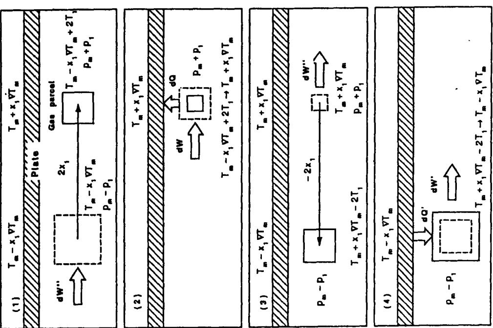
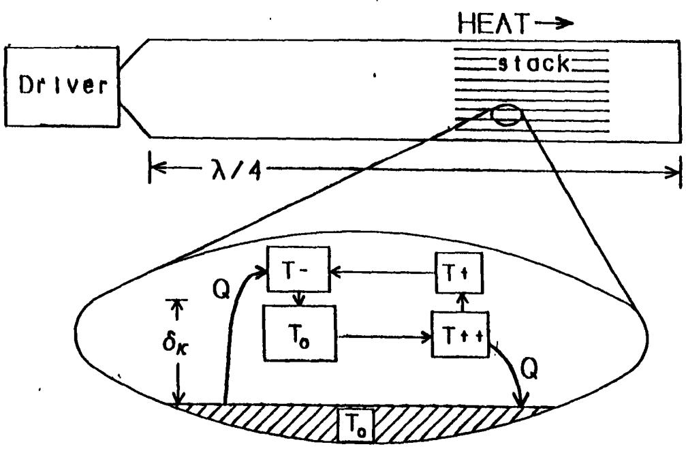
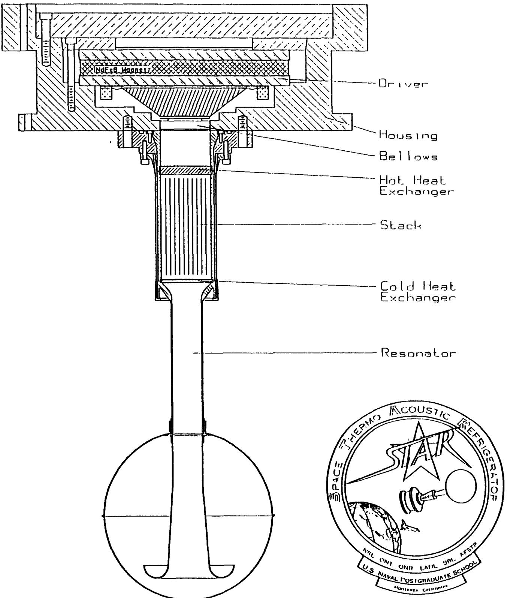
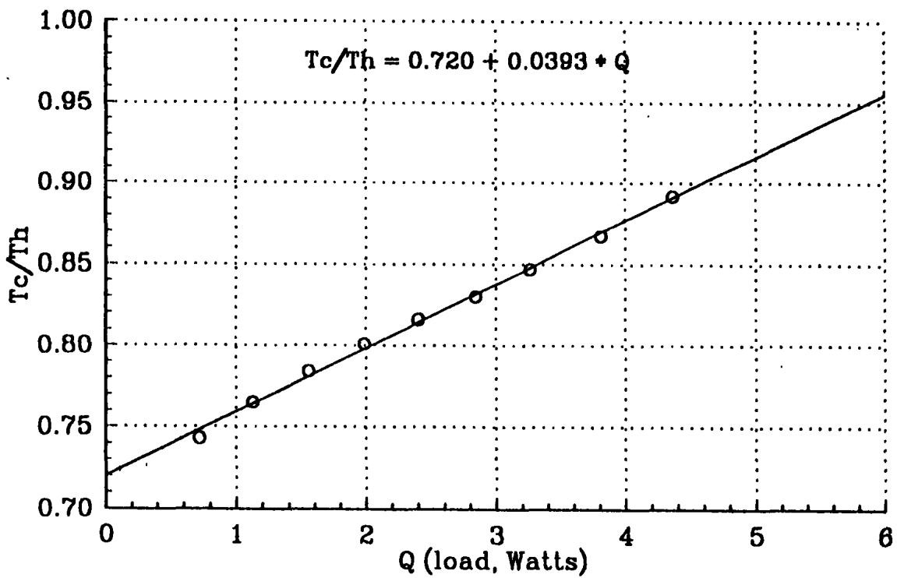
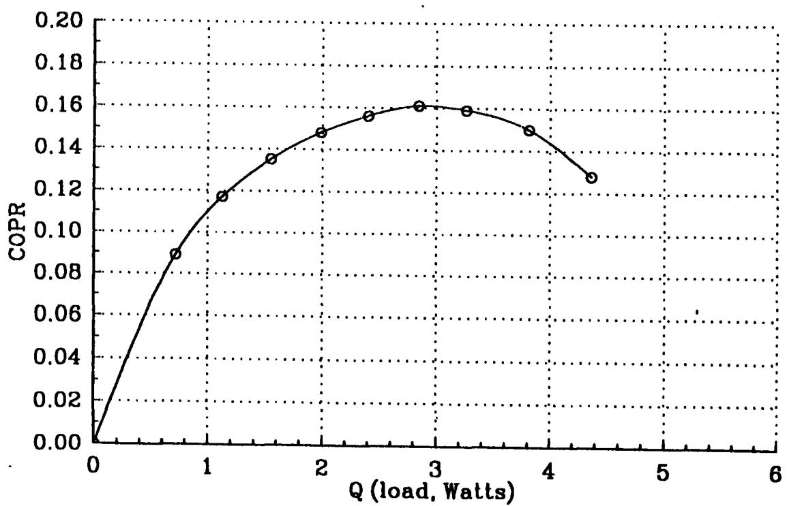
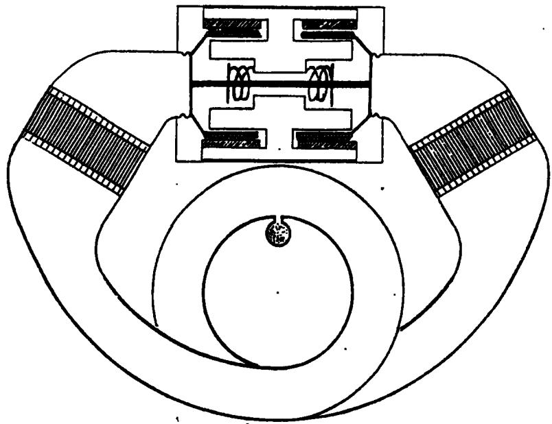

# THERMOACOUSTIC REFRIGERATION

Steven L. Garrett and Thomas J. Hofler Physics Department - Code PH/Gx Naval Postgraduate School Monterey, CA 93943

## ABSTRACT

A new refrigerator which uses resonant high amplitude sound in inert gases to pump heat will be described and demonstrated. The phasing of the thermoacoustic cycle is provided by thermal conduction. This "natural" phasing allows the entire refrigerator to operate with only one moving part (the loudspeaker diaphragm). The thermoacoustic refrigerator has no sliding seals, requires no lubrication, uses only low-tolerance machined parts, and contains no expensive components. Because the compressor moving mass is typically small (≈ 15 gm) and oscillation frequency is high (≈ 400 Hz), the small amount of vibration is very easily isolated. This low vibration and lack of sliding seals makes thermoacoustic refrigeration an excellent candidate for space applications. Since the thermoacoustic refrigerators use no CFC's and have coefficients-of-performance which are compctitive with conventional vapor compression cycle refrigerators, thermoacoustics is also a good candidate for food refrigcration and commercial/residential air conditioning applications. The design, fabrication, and performance of the first practical, autonomous thermoacoustic refrigerator, which will be flown on the Space Shuttle (STS-42), will be described and designs for terrestrial applications will be prescnted.

## INTRODUCTION

The history of refrigeration technology during the second half of the 20th century has been singularly uninteresting. Since the introduction of chlorofluorocarbons (CFC) as the working fluid in a vapor compression refrigeration cycle these chemicals have become dominant in almost all small and medium scale food refrigerator/freezer and building/residential air conditioner applications. That situation is about to change dramatically¹ and, at this moment, unpredictably.

## The End of the CFC Era

At present, it is estimated that there is \$135 billion of products which uses CFC's within the United States alone2. The spectacular success of CFC's in refrigeration was brought about by their good thermodynamic properties (phase changes at modest pressure at the required temperatures) and their excellcnt chemical stability which made them compatible with hydrocarbon lubricants. It was this compatibility with lubricants which allowed the production of compressors, bathed in oil, which could operate for decades without maintenance. (When was the last time you had to replace your home refrigerator compressor?) It is now known that the chemical stability of thc CFC's has lead to their ultimate downfall.

Two recent events are responsible for the "new era" in refrigeration which will dawn at the beginning of the 21st century. The most significant of these is the international ban on the production of CFC's which were found to be destroying the Earth's protective ozone layer. The ban was brought about with the signing on January 1, 1989, of the Montreal Protocols. This international agreement, signed by the United States and thirty-one other industrialized countries, started a stepped reduction in the production of CFC's to 20% of their present levels by 1993, one-half of their present levels by 1998, and imposes a complete ban on their production worldwide by the year 2000.

The second event was the discovery of "high temperature" superconductors and the developmcnt of high speed and high density electronic circuits which require active cooling. Although the immediate impact of this emerging requirement for cryocoolers is dwarfed by the revolution which will be brought about by the Montrcal

Protocols, much of the longer term future development of high speed electronics, electro-optics, long-haul fiber-optic communication, and computers, will be dictated by the availability, reliability, and efficiency of cryocooler technology.

## Alternative Refrigeration Technologies

The chemical companies have not abandoned the refrigeration business. As one might expect there has been a rush to develop alternative fluids which are not as detrimental to the ozone layer. Thus far, several HCFC compounds, which will be banned in 2010, have been developed but these have exhibited compatibility problems with hydrocarbon lubricants2 and some have recently been found to be carcinogenic³. This has lead others to reconsider fluids which were in use before the rise of CFC (ammonia, carbon dioxide, etc.) and other refrigeration cycles such as Stirling and Malone cycles which do not require phase changes.

It is the purpose of this paper to introduce an entirely new approach to refrigeration which was first discovered4 in the early 1980's which uses high intensity sound waves to pump heat using inert gases as the working fluid.

## THE THERMOACOUSTIC HEAT PUMPING CYCLE

The interaction between acoustics and thermodynamics has been recognized ever since the dispute between Newton and Laplace over whether the speed of sound was determined by the adiabatic or isothermal compressibility of air. Although today there are probably many physicists who might still make the wrong choice (as Newton did!), most physicists have at least been exposed to a lecture demonstration such as the Rijke Tube5 or have observed (cursed?) Taconis oscillations in liquid helium6, so they are not surprised that thermal gradients can lead to the production of sound. The reverse process - thermoacoustic heat pumping - is far less well known and was the first intentional demonstration of a new class of intrinsically irreversible heat engines.

Traditional heat engine cycles, such as the Carnot Cycle typically studied in elementary thermodynamics courses, assume that the individual steps in the cycle are reversible. Such analyses, which invoke the First and Second Laws of Thermodynamics, lead to the limiting values for the efficiencies of prime movers and the coefficients-of-performance of refrigerators. These limiting values are never realized in practical heat engines due to the unavoidable irreversibilities, such as thermal diffusion and viscous dissipation, which always reduce performance below the ideal Carnot values. Reversible engines also require various mechanical devices (eg., valves, cams, pushrods, linkages, timing chains, etc.) in order to execute the proper phasing of various cyclic processes (eg., compressions, expansions, regeneration, etc.). In thermoacoustic engines, the irreversibility due to the imperfect (diffusive) thermal contact between the acoustically oscillating working fluid and a stationary second thermodynamic medium provides the required phasing. This "natural phasing" has produced heat engines which require no moving parts other than the self-maintained oscillations of the working fluid.

## A Simple. Invisid. Lagrangian Model of the Heat Pumping Process

Although a complete and detailed analysis of the thermoacoustic heat pumping process is well beyond the scope of this study, the following simple, invisid, Lagrangian representation of the cycle contains the essence of the process. A complete analysis7 would necessarily include the gas viscosity, finite wavelength effects, longitudinal thermal conduction along the stationary second thermodynamic medium and through the gas, and the ratio of the gas and second medium dynamic heat capacities. A schematic diagram of a simple, one-quarter wavelength, λ/4, thermoacoustic refrigerator is shown in Figure 1. The loudspeaker at the left sets up the standing wave within the gas-filled tube. Its frequency is chosen so that the loudspeaker excites the fundamental (λ/4) resonance of the tube. The termination at the right-hand end of the tube is rigid so the longitudinal particle velocity at the rigid end is zero (a velocity node) and the acoustical pressure variations are maximum (a pressure antinode). At the loudspeaker end of the tube there is an acoustic pressure node and a particle velocity antinode. To the left of the termination is a stack of plates (the "stack") whose spacing is chosen to be a few thermal penetration depths.

ots es e   el. pa t   s o     o ae s   SD m n  e   mes Fr   ss   t s  err plae   l ie   l e   e e Dunt   st  s s    s ns  She coid   a e  i   e le. pu s  s  s     ily Lic i  c id i i c eia

ns o ae on. isa o d   ss  o ood  o s de e s Chl  n   e    e er sie is s   si    e a o   o  e     -   t alh.  -in    Sis   ss   ne thec o. c-sao  es rcr oer Figae   c ai Wth   gth

The thermal penetration depth, $s _ { \kappa }$ represents the distance over which heat will diffuse during a time which is on the order of an acoustic period, $\mathbf { \ell } _ { 1 } = 1 / \tilde { \mathbf { f } } ,$ where f is the acoustic frequency. It is defined in terms of the thermal conductivity of the gas, κ, the gas density, ρ, and its isobaric specific heat (per unit mass), $\circ$

$$
\delta _ { \kappa } = \sqrt { \frac { \kappa } { \pi \mathrm { f } \rho \ c _ { \mathrm { p } } } }\tag{1}
$$

This. length scale is crucial to understanding the performance of the thermoacoustic cycle since the diffusive heat transport between the gas and the "stack" is only significant within this region. It is for that reason that the stack and the spacing between its plates are central to the thermoacoustic cycle.

For this analysis we will focus our attention on a small portion of the "stack" and the adjacent gas which is undergoing acoustic oscillations at a distance from the solid stack material which is small enough that a substantial amount of thermal conduction can take place in an amount of time which is on the order of the acoustic period. In the lower half of Figure 1, a small portion of the stack has been magnified and a parcel of gas undergoing an acoustic oscillations is shown. The four steps in the cycle are represented by the four boxes which are shown as moving in a rectangular path for clarity although in reality they, of course, simply oscillate back and forth. As the fluid oscillates back and forth along the plate it undergoes changes in temperature due to the adiabatic compression and expansion resulting from the pressure variations which accompany the standing sound wave. The compressions and expansions of the gas which constitute the sound wave are adiabatic if they are far from the surface of the plate. The relation between the change in gas pressure due to the sound wave, ${ \pmb p } _ { 1 }$ , relative to the mean (ambient) pressure, Pm. and the adiabatic temperature change of the gas due , $\mathbf { T _ { l } } .$ to the acoustic pressure change, relative to the mean absolute (Kelvin) temperature, $\mathbf { T _ { m } } .$ is given below in equation (2).

$$
\scriptstyle { \frac { \mathbf { T } _ { 1 } } { \mathbf { T } _ { \mathbf { m } } } } = { \frac { \pmb { \gamma } - 1 } { \pmb { \gamma } } } { \frac { \mathbf { p } _ { 1 } } { \mathbf { p } _ { \mathbf { m } } } }\tag{2}
$$

The polytropic coefficient, γ, is equal to the ratio of the specific heat of the gas at constant pressure to the specific heat at constant volume and is exactly 5/3 for the inert gases. It is smaller for all other gases but is always greater than one.

Although the oscillations in an acoustic heat pump are sinusoidal functions of time, Figure 2 depicts the motion as articulated (a square wave) in order to simplify the explanation. The thermodynamic cycle can be considered as consisting of two reversible adiabatic steps and two irreversible isobaric (constant pressure) steps. The plate is assumed to have a mean temperature, $\pmb { \tilde { \mathbf { T } } } _ { \mathbf { m } } ,$ and a temperature gradient,VT, referenced to the mean position, x $\mathbf { \mu } = \mathbf { 0 } ,$ . The temperature of the plate at the left-most position of the gas parcels excursion is therefore $\pmb { \tilde { \mathbf { I } } } _ { \mathbf { m } } - \mathbf { \tilde { x _ { 1 } } } \pmb { \nabla } \mathbf { T }$ , and at the right-most excursion is $\pmb { \mathrm { T } } _ { \pmb { \mathrm { m } } } + \pmb { \mathrm { x } } _ { 1 } \pmb { \nabla } \pmb { \mathrm { T } }$

In the first step of this four-step cycle, the fluid is transported along the plate by a distance $\pmb { 2 \mathrm { x } _ { 1 } }$ and is heated by adiabatic compression from a temperature of $\mathbf { T _ { m } } \cdot \mathbf { x _ { 1 } } \nabla \mathbf { T _ { \ s i } } \mathbf { \bar { t o ^ { * } } } \mathbf { T _ { m } } \cdot \mathbf { x _ { 1 } } \nabla \bar { \mathbf { T } } + 2 \bar { \mathbf { T } _ { 1 } }$ . The adiabatic gas law provides the relationship between the change in gas pressure, p1, and the associated change in temperature, $\mathbf { T _ { 1 } } .$ as described in equation (2). Because we are considering a heat pump, work, in the form of sound, was done on the gas parcel and it is now a temperature which is higher than that of the plate at its present location.

In the second step, the warmer gas parcel transfers an amount of heat, $\pmb { \mathrm { d O } } _ { \mathbf { h o t } }$ to the plate by thermal conduction at constant pressure and its temperature decreases to that of the plate, $\bf \ddot { T } _ { m } + x _ { 1 } \ v { v } \bar { T }$ . In the third step, the fluid is transported back along the plate to position $\mathbf { - x _ { 1 } }$ and is cooled by adiabatic expansion to a temperature $\bar { \mathbf { T } } _ { \mathbf { m } } +$ $\mathbf { x } _ { 1 } \nabla \ T - 2 \ T _ { 1 } .$ This temperature is lower than the original temperature at location $\mathbf { \partial } \mathbf { - x _ { 1 } } ,$ , so in the fourth step the gas pārcel adsorbs an amount of heat, ${ \tt d Q } _ { \tt c o l d }$ , from the plate thereby raising its temperature back to its original value, $\dot { \mathbf { T } } _ { \mathbf { m } } + \mathbf { x } _ { 1 } \nabla \mathbf { T }$

The net effect of this process is that the system has completed a cycle which has returned it to its original state and an amount of heat, $\dot { \mathbf { d } } \mathbf { Q } _ { \mathbf { c o l d } }$ has been transported up a temperature gradient by work done in the form of sound. It should be stressed again at this point that no mechanical devices were used to provide the proper phasing between the mechanical motion and the thermal effects.

If we now consider the full length of the stack as shown in the upper portion of Figure 1, the overall heat pumping process is analogous to a "bucket brigade" in which each set of gas parcels picks up heat from its neighbor to the left at a lower temperature and hands off the heat to its neighbor to the right at a higher temperature. Heat

exchangers are placed at the ends of the stack to absorb the useful heat load at the left-hand (cold) end of the stack and exhaust the heat plus work at the right-hand (hot) end of the stack. The fact that the gas parcels actually move a distance which has typically been on the order of several millimeters means that good physical contact between the heat exchangers and the stack is not crucial since the moving gas provides good thermal contact.

## Thermoacoustic Energy Transport

If there were no external (ie. useful!) heat load applied to the stack or longitudinal thermal conduction along the stack or through the gas, then eventually the temperature gradient in the plate would approach that caused by the adiabatic processes in the gas. In the absence of gas viscosity, this critical temperature gradient, $\mathbf { v } \mathbf { T } _ { \mathbf { c } \mathbf { n i t } }$ is a function only of the gas thermophysical properties, the wavelength of the sound, λ, and the mean position of the stack, x, within the standing wave field.

$$
\nabla \mathrm { T } _ { \mathrm { c r i t } } = \frac { 2 \pi \left( \gamma - 1 \right) } { \lambda } \tan \left( \frac { 2 \pi \mathrm {  ~ x ~ } } { \lambda } \right)\tag{3}
$$

The ratio between the temperature gradient in the stack and the critical gradient, $\Gamma = \nabla \mathbf { T _ { m } } \mathcal { \pmb { N } } \mathbf { T _ { c r i t } }$ plays an important role in the performance of the stack as will be explained below.

The rate of heat transport or heat pumping power, $\mathbf { Q } _ { 2 } ,$ within the stack can be expressed in a simple form if we assume that the stack is much shorter than the wavelength of the sound and we again neglect viscosity.

$$
\mathbb { Q } _ { 2 } = - \frac { \Pi \mathbb { S } _ { \mathbb { K } } } { 4 } \mathbb { p } _ { 1 } \mathrm { \mathbf { u } } _ { 1 } \left( \Gamma - 1 \right)\tag{4}
$$

The first term in (4) is simply one quarter of the thermally effective cross-sectional area of the stack, where I is the stack surface area per unit length and $\delta _ { \bf k }$ is the thermal penetration depth. The heat pumping power is also proportional to the product of the acoustic pressure, ${ \pmb { \mathrm { p } } } _ { \pmb { 1 } }$ , and particle velocity, ${ \mathfrak { a } } _ { 1 } ,$ , in the stack. If the stack were located at a pressure or velocity node, no heat pumping would take place since either the pressure variations which cause the adiabatic temperature changes would be absent or there would be no motion of the gas parcels. Since pressure and particle velocity are proportional (the proportionality constant depends upon the location of the stack within the standing wave field), a doubling of the acoustic pressure would quadruple the heat transport. This is the origin of the subscript $" 2 "$ on the heat transport symbol, $\ Q _ { 2 } .$ which emphasizes the second order dependance of the magnitude of the thermoacoustic heat transport on the square of the acoustic field variables.

The final term in equation (4) is a measure of how close the system is to the limiting temperature gradient. As mentioned before, when $\mathbf { T } = \mathbf { l }$ , the gas parcels $" \mathtt { s e a } ^ { \pmb { n } }$ their adiabatic temperature span on the stack so no heat transfer from the gas to the plate takes place. When $\Gamma = 0 ,$ the temperature of the plate is uniform and a large quantity of heat is pumped by the oscillating gas parcels.

The stack also absorbs work, $\forall _ { 2 }$ at a rate proportional by $( \Gamma \cdot 1 )$ .The following simple expression for the work absorbed by the stack of length $\Delta \mathbf { x } ,$ in the absence of viscosity, can be written if one assumes that the heat capacity of the stack is much greater than that of the gas.

$$
\mathrm { W } _ { 2 } = \frac { \Pi \delta _ { \mathrm { K } } } { 4 } \Delta { \bf x } \frac { ( \gamma - 1 ) } { \gamma _ { \mathrm { m } } } 2 \pi \mathrm { f } ( { \sf p } _ { 1 } ) ^ { 2 } \left( \Gamma - 1 \right)\tag{5}
$$

This work represents the acoustical energy dissipated due to irreversible thermal conduction between the gas and the plate.

The ratio of the heat pumped, $\mathbf { Q } _ { 2 } ,$ to the work done, $\mathbf { w } _ { 2 } .$ to pump that heat is defined as the coefficient -ofperformance, COP, of the refrigerator. Šince the temperature spanned by the stack, $\Delta \boldsymbol { \mathsf { T } } = \boldsymbol { \Gamma } \boldsymbol { \nabla } \boldsymbol { \mathsf { T } } _ { \mathrm { c i n t } } \Delta \mathbf { x } ,$ , one can show that the thermoacoustic $\mathbf { C O P } { = } \mathbf { \bar {Gamma } C O P } _ { \mathbf { C a m o t } } ,$ where $\mathsf { C O P } _ { \mathsf { C a m o t } } = \Delta \bar { \mathbf { I } } \bar { I } _ { \mathsf { h o t } } ,$ is the ideal coefficient-of-performance dictated by the First and Second Laws of Thermodynamics. Since for a heat pump, $\pmb { \Gamma } \pmb { \ll } 1$ , we see that the thermoacoustic COP is always less than that of Carnot. We also see that with the thermoacoustic heat pump, there will be the same competition between power density and efficiency which exists in all heat engines. As we pointed out earlier, there is no useful heat pumped when $\boldsymbol { \Gamma } = \boldsymbol { 1 }$ , which is the point where the efficiency is at its maximum.

The general results derived above from the simple, invisid picture are essentially preserved when the viscosity of the gas is included but the detailed mathematical descriptions are substantially more complicated. Discussion of these: equations is well beyond the scope of this introduction to thermoacoustics. The reader is referred to the excellent review article by Dr. Swift [7] for a detailed derivation and discussion of this more complete analysis.

## THE SPACE THERMOACOUSTIC REFRIGERATOR (STAR)

STAR was the first attempt to exploit the advantages of the thermoacoustic heat pumping cycle for cryocooler applications in space. It is intended'to operate autonomously in low Earth orbit aboard the Space Shuttle in a Get Away Special (GAS) canister. It derives its power from an internal battery power source (700 Watt-hours) and was optimized for a modest temperature span $( \Delta \bar { \bf T } \le 8 0 ~ ^ { \circ } { \bf K } )$ and small heat loads $( \mathbf { Q _ { c o l d } } \leq \mathbf { 5 } \ \mathbf { W a t s } )$ . Due to requirements of small size and light weight imposed by the GAS envelope, it operates as a frequency of about 400 Hz and is driven by an electrodynamic loudspeaker8. Its frequency of operation is adjusted automatically9 to keep the system on resonance. The resonator length is approximately equal to a quarter wavelength of sound in a mixture of helium and argon or helium and xenon gas10 maintained at a mean pressure of ten atmospheres (150 psia). It has a single stack with a uniform spacing made of polyester film (Mylar™) and fishing line10,11 which is spiral wound like a "jelly roll". The stack used in STAR is 7.9 cm in length and 3.8 cm in diameter. Copper-strip, parallel plate heat exchangers are located at either end of the stack. Figures 3 are scale drawings which show the details of the acoustical sub-systems.

## Acoustical Sub-Systems.

The driver housing does more than simply hold the electrodynamic driver. The considerable mass and size of the housing is a consequence of the fact that a commercially available loudspeaker was modified for this application. The driver housing serves as a heat sink for the heat generated by the resistive losses in the driver voice coil and the heat pumped away from the cold end of the resonator. It also contains the ten atmospheres of the helium/xenon gas mixture which is the "working fluid" within the refrigerator. The housing is bolted to the standard 12 inch bolt circle provided on the GAS cannister lid which acts as the radiator while on orbit.

The driver voice coil is attached to an aluminum reducer cone which is in turn attached to a nickel electroformed bellows. The bellows provides a means of transferring acoustic pressure to the resonator without the need for sliding seals. A miniature accelerometer is attached to the surface of the reducer cone opposite the bellows to monitor the displacement magnitude and its phase relative to the acoustic pressure at the face of the bellows. That acoustic pressure is monitored by a piezoelectric quartz microphone12 followed by a MOSFET impedance converter located within the driver housing in close proximity to the microphone.

The resonator is a modified quarter wavelength tube. The open end is terminated by a tapered "trumpet" and sealed by a surrounding sphere. Thus, an "open" termination is simulated while still allowing the resonator to retain the ten atmosphere gas mixture. The thermoacoustic stack and heat exchangers are located in a section of the resonator designed to allow a minimum of heat conduction back to the cold end. The resonator is wrapped with multiple layers of superinsulation to prevent heating by thermal radiation. An electrical strip heated element is attached to the cold end of the resonator near the cold heat exchanger to permit measurement of refrigerator performance with a variable and quantifiable heat load. A thermal isolation vacuum chamber surrounds the resonator and seals against the bottom surface of the driver housing with an O-ring.

## Electrical Sub-Systems.

In order for the refrigerator to operate autonomously in space, a family of analog and digital electronic circuits are employed to monitor the "health" of the system, keep the driver running at the proper amplitude and frequency, and to acquire and store useful data for post-flight analysis. The design and function of each of these subsystems is documented in Reference [9].

  
Figure 3. Scale drawing of the STAR acoustical sub-systems showning the driver, resonator, stack, and heat exchangers. Shown to the right of the sphere is the official logo for the experiment which will be flown on Space Shuttle mission STS-42 scheduled for launch on 22 January 1992.

  
Figure 4. The ratio of the cold and hot heat exchanger temperatures, $\mathbf { r } _ { \mathbf { c } } / \mathbf { T } _ { \mathbf { h } } .$ as a function of heat load on the cold heat exchanger at an acoustic pressure ratio of $\mathrm { p } _ { 1 } / \mathrm { p } _ { \mathrm { m } } = 2 \%$ in a lean mixture (4% Xe) of helium and xenon.

  
Figure 5. Measured cocfficient-of-performance relative to the ideal Carnot coefficient-of-performance (COPR) as a function of heat load for STAR operating at an acoustic pressure ratio of $\mathrm { p } _ { 1 } / \mathrm { p } _ { \mathrm { m } } = 2 \%$ in a lean mixture (4% Xe) of helium and xenon.

The circuit which is unique to this application is the Resonance Control Board (RCB). Its function is to maintain the system at acoustical resonance and to control the amplitude of the acoustical pressure at pre-determined levels dictated by the Controller Board. As the temperature changes, the sound speed changes, hence, for fixed resonator dimensions, the resonance frequency will be a function of temperature.

The RCB maintains of the resonance condition by comparing the relative phase of the microphone and accelerometer outputs. At resonance the pressure and velocity of the gas mixture at the bellows location must be inphase. Therefore, the pressure and acceleration are required to be in quadrature (ie. 90° out-of-phase). The two signals are electronically multiplied together and the dc-component of their product, which is proportional to the cosine of their phase difference, is used as an error voltage. This error voltage is electronically integrated and fed back to a voltage controlled oscillator to close the phase accurate phase-locked-loop circuit which maintains the entire system at resonance.

## Refrigerator Performance.

The performance of STAR can be summarized by the two graphs which are presented here as Figures 4 and 5. Other measurements of the performance of the entire system, including the electrodynamic driver are included in Reference [11]. The STAR performance shown in Figures 4 and 5 is by no means the best which has been achieved in a thermoacoustic refrigerator of this style. Other improvements to the design, such as the use of a stack which has non-uniform spacing, has produced a single-stage, no-load temperature span of 118 'K even without the use of gas mixtures to reduce viscous losses or improve the coefficient of performance. COPR's as large as 20% have also been measured in a similar refrigerator over the same temperature span 10.

## HIGH POWER THERMOACOUSTIC REFRIGERATORS

The STAR is the first in a series of space cryocoolers now under development at the Naval Postgraduate School. Those applications generally require relatively little heat pumping power (a few watts) but a very large temperature span (∆T = 100 to 200 'K). The requirements of residentiai refrigerator/freezers and air conditioners are opposite of those for spacecraft cryocoolers. Those application require modest temperature spans (ΔT  25 - 45 'K), but much higher heat pumping powers on the order of hundreds of watts for refrigerators and thousands of watts for air conditioners. They also are typically powered by 110 volt alternating current rather than 28 volt direct current. There are several design modifications which are therefore required to adapt this established space cryocooler technology to residential applications, but these modifications do not present any substantial technological barriers

  
Figure 6. Schematic diagram of a half-ton (2 kW) capacity thermoacoustic chiller. The half-wavelength resonator operates at 60 Hz, is powered by a single double-acting electrodynamic driver and contains two "stacks".

Operation at fixed frequency (60 Hz or 120 Hz) can be accomplished by selective absorption of one component of the gas mixture as the temperature of the working fluid changes. Half-wavelength resonators, such as the one shown in Figure 6, can utilize both oscillating faces of a single driver which can be more massive and hence more efficient because it operates at fixed frequency. The presence of two stacks reduces the required heat pumping capacity of each individual stack although the diameters of the stacks would necessarily be larger. The design shown in Figure 7 has stack diameters of 18 cm, operates at 60 Hz, is about 90 cm wide, 60 cm tall, and 20 cm thick. It should be capable of pumping about 2 kW of heat across a $\mathfrak { a c }$ temperature span with a $\cos = 3 4$ (about 30% of Carnot performance) including electroacoustic conversion efficiencies. At the present time, the greatest uncertainty in the use of thermoacoustic engines in high power cooling applications is the design of the heat exchangers.

## ACKNOWLEDGEMENTS

The authors are indebted to Dr. Greg W. Swift, Los Alamos National Labs, for several conversations regarding this new technology and his excellent review article on thermoacoustic engines whose contents was exploited extensively in the first part of this paper7. The development of the Space Thermoacoustic Refrigerator was the work of several staff and students at the Naval Postgraduate School. Staff members include David Rigmaiden (Payload Manager), Jay Adeff (Physicist), Glenn Harrell (Machinist), Jim Horning and Ron Phelps (Programmers) and CDR (Dr.) David Gardner, NOAA Corp. (Group Leader). The students who worked on the project as part of their Master's degrees were LT Michelle Fitzpatrick, USCG (Driver), LT. Michael Susalla, USN (Thermodynamics and Gas Mixtures), CAPT David Harris, Canadian Forces (Driver), LT Richard Volkert, USN (Driver), and MAJ Ronald Bymes, USA (Electronics). The loudspeakers used as the drivers were donated by Harmon-JBL and modified by their engineer, Fancher Murray. This work is supported by the the Office of Naval Research (Physics Division), the Office of Naval Technology and the Naval Postgraduate School Direct Funded Research Program. Substantial funding and technical support for STAR was provided by the Naval Research Laboratory - Spacecraft Engineering Division. The payload launch services were provided by the Air Force Space Test Program.

## REFERENCES

1. S. Derra, "CFC's: No Easy Solutions," Res. & Dev. 32(5), 56-66 (1990)

2. R. Monastersky, "Decline of the CFC Empire," Sci. News 133, 234-236 (1988).

3. A. K. Naj, "CFC Substitute," Wall St. Journal, (2 July 1991).

4. J. C. Wheatley, T. Hofler, G. W. Swift, and A. Migliori, "Experiments with an Intrinsically Irreversible Acoustic Heat Engine," Phys. Rev. Lett. 50, 499 (1983); "Intrinsically irreversible heat engine," U. S. Patent No. 4,489,553 (Dec. 25, 1984).

5. J. W. Strutt (Lord Rayleigh), The Theory of Sound, 2nd ed., Vol. II (Dover, 1945), §322j.

6. T. Yazaki, A. Tominaga, and Y. Narahara, "Experiments on thermally driven acoustic oscillations of gaseous helium," J. Low Temp. Phys, 41, 45 (1980).

7. G. W. Swift, "Thermoacoustic Engines," J. Acoust. Soc. Am. 84(4), 1145-1180 (1988).

8. D. A. Harris and R. E. Volkert, "Design and Calibration of an Electrodynamic Driver for the Space Thermoacoustic Refrigerator", Master's Thesis, Naval Postgraduate School, Monterey, CA (Dec. 1989); DTIC Report No. AD A212 022.

R. B. Byrnes, Jr., "Electronics for Autonomous Measurement and Control of a Thermoacoustic Refrigerator in a Space Environment", Master's Thesis, Naval Postgraduate School, Monterey, CA (Dec. 1989); DTIC Report No. AD B141 388.

10. M. P. Susalla, "Thermodynamic Improvements for the Space Thermoacoustic Refrigerator", Master's Thesis, Naval Postgraduate School, Monterey, CA (June, 1988); DTIC Report No. AD A196 958.

1 1. J. A. Adeff, "Measurement of the Space Thermoacoustic Refrigerator Performance", Master's Thesis, Naval Postgraduate School, Monterey, CA (Sept. 1990).

12. T. Hofler, "Accurate Acoustic Power Measurements with a High-Intensity Driver," J. Acoust. Soc. Am. 83, 777 (1988).