# A Comprehensive Review on Stirling Engines

Turan Alp Arslan1\* , Tolga Kocakulak2

1 Automotive Engineering Department, Faculty of Technology, Afyon Kocatepe University, Afyonkarahisar, 03200, Turkey 2 Vocational School of Technical Sciences, Burdur Mehmet Akif Ersoy University, Burdur, 15100, Turkey

## ABSTRACT

Stirling engines work with all kinds of heat sources thanks to the external heat supply. It has many advantages over internal combustion engines, especially in terms of noise emissions and pollutant emissions. Since the first Stirling engine invented by Robert Stirling, development work continues on it. Considering the problems caused by fossil fuels, Stirling engines are promising in the recovery of solar energy, geothermal energy and waste heat. As a result of the studies carried out from the past to the present, many Stirling engine types, cylinder configurations and drive mechanisms have been designed. In this study, the im portance, advantages-disadvantages, usage areas and working principles of Stirling engines are explained. The Stirling cycle has been analyzed in detail. Carnot cycle and Ericsson cycle are mentioned and these three cycles are compared with each other in terms of work and efficiency. Stirling engine classifications, cylinder configurations and drive mechanisms are explained in detail. The design differences, operating characteristics, technological details and structural features of these configurations are examined. The advantages and disadvantages of all these different structures in terms of design, production, cost, power, efficiency, friction, wear, sealing, weight, dead volume, noise and number of parts are stated.

Keywords: Drive mechanisms, Low temperature, Stirling configuration, Stirling cycle, Stirling engines

History Author Contacts   
Received: 04.03.2023 \*Corresponding Author   
Accepted: 14.08.2023 e-mail addresses : talparslan@aku.edu.tr, tkocakulak@mehmetakif.edu.tr   
How to cite this paper: Arslan T.A., Kocakulak T., (2023). A Comprehensive Review on Stirling Engines. Engineering Perspective, 3 (3), 42-56. http://dx.doi.org/10.29228/eng.pers.66847

## 1. Introduction

Energy is the most important requirement for countries to have developing technology and to reach a modern life level. The energy needs of countries are increasing in proportion to their economic growth, and the energy provided from existing energy sources is becoming more costly day by day. It is not possible to meet this increasing energy need with existing energy resources. Today, most countries meet their energy needs with primary energy sources such as oil, natural gas and coal. These fuels, which constitute a large part of the energy need, cause global warming. In particular, the increase in the concentration of $\mathrm { C O } _ { 2 }$ in the atmosphere is one of the main causes of global warming. In addition, emissions that occur during energy production from fuels such as coal, oil and natural gas pollute vital environments. Pollution of these vital environments such as air, water and soil harms nature, human life and ecological system. The negative effects of fossil energy sources, which are called primary energy sources, have brought to the fore renewable energy sources that are easily available and do not harm the environment. Many countries accelerated their search for renewable energy sources with the energy crisis in the 20th century. Solar and wind energies come to the fore in electricity production. On the other hand, biomass energy is accepted as one of the main energy sources that are shown as an alternative to fossil fuels, which are depleted over time.

Stirling engines can work with many alternative energy sources. Since it is seen as a solution to the problems caused by fossil fuels, the interest in these external combustion engines is increasing day by day. In addition, its high efficiency and advantages in the recovery of waste heat at relatively low temperatures stand out. In Stirling engines (Patent No. 4081) [1], invented by Robert Stirling in 1816, heat energy is converted into mechanical work by using different working fluids such as air, helium and hydrogen. The Stirling cycle theoretically has the same thermal efficiency as the Carnot cycle. These engines are operated with any external heat source and there is no restriction in terms of fuel type. Stirling engines, which can operate at low temperature differences (LTD), are particularly striking in the utilization of low-temperature sources such as geothermal energy [2,3].

Although Stirling engines were developed long before internal combustion engines, rapid developments in internal combustion engines made Stirling engines unable to compete with these engines. However, these engines have come to the fore again due to the decrease in fossil fuels and their damage to the environment. The advantages of Stirling engines are explained as follows. Combustion is continuous. There are no intake and exhaust valves. Pressure changes are sinusoidal. Noise formation is at minimum level due to the fact that it has fewer moving parts compared to internal combustion engines. Therefore, maintenance and repair operations are easy. First actuation is easy. They can work with all fuel types and heat energy types. Parts wear is less. Since there are no sudden pressure rises as in internal combustion engines, moving engine parts are less damaged. Therefore, they work longer. Since the lubricating oil does not act as a cooling agent, thermal losses do not occur as in internal combustion engines. The oil change interval is longer and the oil consumption is lower. Thanks to externally controlled combustion, CO, unburned HC, $\mathrm { N O } _ { \mathrm { X } }$ and particulate emissions are low. They can be designed in different mechanical arrangements and in different sizes. They require less maintenance due to the absence of auxiliary systems such as ignition, fuel and valve mechanism [3-8]. The dis advantages of Stirling engines are explained as follows. They have greater mass and dimensions compared to an internal combustion engine of the same power. The power/weight ratio is less than internal combustion engines. There are sealing problems between the piston-cylinder and the mechanical power output. Deceleration and acceleration responses are very low due to thermal inertia in the heater and cooler regions. Many parts have design difficulties. In addition, since it requires experimental knowledge, the design costs are high. Research and development studies are still continuing. In these engines, in which gases such as helium and hydrogen are used as the working fluid, the gas discharge over time increases the operating costs. Over time, a corrosion layer forms on the surface of the parts exposed to high temperatures [9,10].

Today, development work on these engines is still ongoing. Different studies are carried out on the selection of the drive mechanism, working fluid, regenerator material and optimization of the dimensions of the engine. It is aimed to reduce dead volumes, improve incylinder flow and heat transfer, prevent losses due to friction and working fluid leakage, and reduce production and maintenance costs. With the development of Stirling engines, the energy needed will be produced economically without polluting the environment. Various energy sources such as solar energy, radioisotope, biomass, geothermal energy can be used in Stirling engines thanks to external controlled heat generation [9-13]. Stirling engines, which have a wide range of uses, are used in the production of electricity from solar energy, in space vehicles, in marine vehicles, in irrigation of agricultural fields, in submarines and torpedoes, in cooling systems, in nuclear reactor power stations, in heat pump systems, in automotive field and as auxiliary power engine [10,14-16].

In this article, the thermodynamic cycles of Stirling engines are analyzed and explained in detail and comparatively. Information is given about the classifications, cylinder arrangements and drive mechanisms of Stirling engines. Different structures within these headings are compared on important issues such as power, thermal efficiency, ease of design, production and maintenance cost, dead volume, friction, lubrication, leakage and weight. In addition, an idea is given about the technological details and system performances of Stirling engines.

## 2. Thermodynamics of Stirling Engines

The basic principle of the Stirling cycle is based on the compression of the cold working fluid and the expansion of the hot working fluid. During these processes, heat is converted to work, as the amount of work required for compression is less than the amount of work resulting from expansion.

The cycle consists of two constant temperature and two constant volume operations. Heat is given to the system by a heater and this heat is thrown out by another heat exchanger called a cooler. The heat required for work production is given by an external heat source such as coal, gas, solar energy, nuclear energy, which is outside the engine, and the cycle is maintained without interruption. For this reason, Stirling engines are examined in the category of external combustion engines.

## 2.1 Ideal Stirling cycle

In the Stirling cycle, isoentropic compression and expansion processes in the Carnot cycle are replaced by constant volume regeneration processes. With the regeneration processes, heat transfer takes place at every stage of the Stirling cycle. During the regeneration processes, the heat of the working fluid is stored in the regenerator and is used to heat the cooled working fluid again in the later stages of the cycle. The regenerator can also be defined as a reversible heat transfer device. Regenerators are generally produced from ceramic mesh, wire or porous material with high thermal mass. One side of the regenerator is defined as the expansion volume (high temperature zone), and the other side is defined as the compression volume (low temperature zone). It is assumed that the working gas moves between these zones without friction and pressure losses.

P-V and T-S diagrams of the Stirling cycle are shown in Figure 1. The area under the P-V diagram constitutes the net work, and the area under the T-S diagram constitutes the heat transfer.

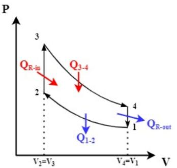

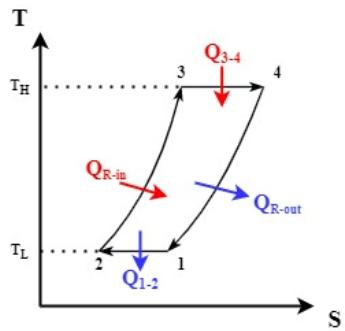  
Figure 1. P-V and T-S diagrams of the Stirling cycle

The Stirling cycle process includes:

1-2 isothermal compression: The temperature increased during compression is kept constant by cooling the system.

2-3 constant volume regeneration: Heat is transferred from the regenerator to the low temperature working fluid.

3-4 isothermal expansion: The increased temperature during expansion is kept constant by heat input into the system from an external source.

4-1 constant volume regeneration: Heat is transferred from the high temperature working fluid to the regenerator.

While the working fluid passes from the hot volume to the cold volume, it stores the heat on the regenerator, and when it passes from the cold volume to the hot volume, the heat energy stored in the regenerator is given back to the working fluid. With this feature, the regenerator reduces the dead volume of the coolant and brings the heat thrown back into the system. This situation increases the efficiency of the system while saving heat.

For a better understanding of the thermodynamic processes, the working processes of a Beta type Stirling engine are shown in Figure 2.

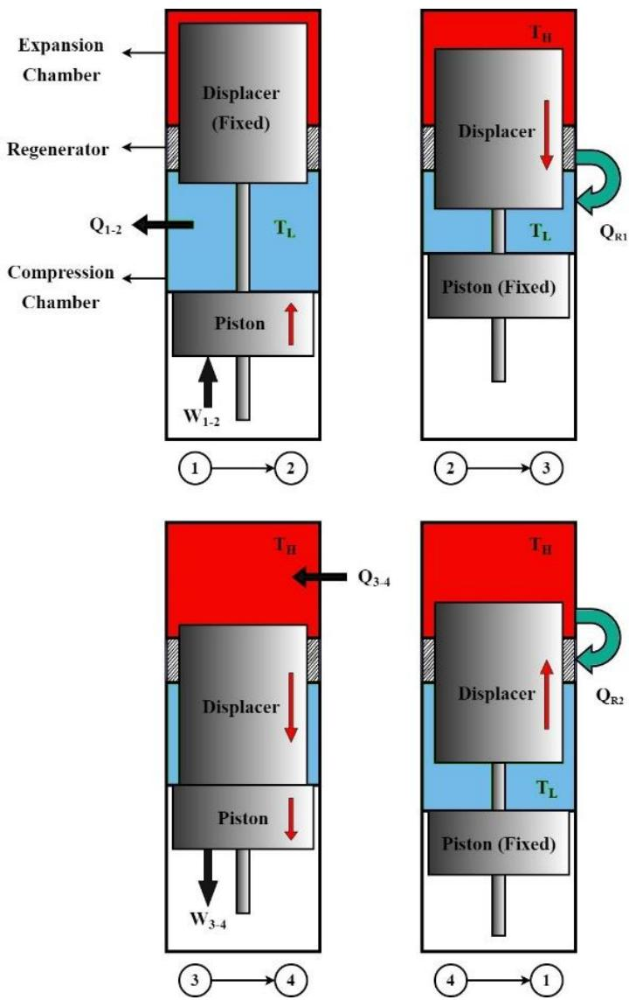  
Figure 2. The cycle of the Beta-type Stirling engine

In 1-2 isothermal compression processes, the displacer piston is stationary at the top dead center of the cylinder. Most of the working fluid is in the compression zone and at low temperature $\mathrm { T _ { L } } .$ In this process, the working fluid is compressed by the power piston at the bottom dead center, while the system is cooled to maintain its low temperature $\mathrm { T _ { L } }$ . The $\mathrm { W } _ { 1 - 2 }$ compression work required for this process is expressed as the area under the P-V diagram.

In 2-3 constant volume regeneration processes, the power piston is stationary at top dead center of the cylinder. As the displacer piston at the top dead center moves downwards, the working fluid flows from the compression zone to the expansion zone. There is a low temperature $\mathrm { T _ { L } }$ in the compression region and a high temperature TH in the expansion region. No work is done during this process. However, heat transfer from the regenerator to the low temperature working fluid takes place.

In 3-4 isothermal expansion processes, the power piston and the displacer piston move downwards together. Most of the working fluid is at high temperature $\mathrm { T _ { H } }$ in the expansion zone. The high temperature $\mathrm { T _ { H } }$ is maintained by providing heat to the system from an external source. The resulting expansion work ${ \mathrm { W } } _ { 3 - 4 }$ in this process is the sum of compression work $\mathrm { W } _ { 1 - 2 }$ and net work $\mathrm { W _ { n e t } }$

Finally, in 4-1 constant volume regeneration processes, the power piston is stationary at bottom dead center of the cylinder. As the displacer piston at the bottom dead center moves upwards, the working fluid flows from the expansion zone to the compression zone. There is a low temperature $\mathrm { T _ { L } }$ in the compression region and a high temperature $\mathrm { T _ { H } }$ in the expansion region. No work is done during this process too. However, in contrast to process 2-3, heat transfer occurs from the high temperature working fluid to the regenerator.

The same working fluid with high thermal conductivity is used in each cycle of the Stirling engine. Examples of common working fluids in these engines are oxygen, helium, air and nitrogen. These gases provide rapid heat transfer with their low molecular mass. Stirling engines do not have valves, as in internal combustion engines. There is no gas input or output to the system during the cycle. Pressure changes are smooth in Stirling engines. Since there is no valve, exhaust and intake, they operate more quietly and require less maintenance. The main reason why Stirling engines have not been widely used in automotive applications is the slow change in power output. In addition, for high efficiency, it must be operated in high pressure conditions where sealing problems occur. The net work and the amount of heat transferred from the Stirling cycle are shown in Equations (1-14).

$$
W _ { n e t } = \oint P d V\tag{1}
$$

$$
W _ { n e t } = W _ { 3 - 4 } + W _ { 1 - 2 }\tag{2}
$$

$$
P V = m R T  P = { \frac { m R T } { V } }\tag{3}
$$

$$
W _ { n e t } = \int _ { 3 } ^ { 4 } { \frac { { m R T _ { H } } } { V } d V } + \int _ { 1 } ^ { 2 } { \frac { { m R T _ { L } } } { V } d V }\tag{4}
$$

$$
W _ { n e t } = m R T _ { H } \ln \left( { \frac { V _ { 4 } } { V _ { 3 } } } \right) + m R T _ { L } \ln \left( { \frac { V _ { 2 } } { V _ { 1 } } } \right)\tag{5}
$$

$$
V _ { 2 } = V _ { 3 } \ a n d \ V _ { 1 } = V _ { 4 }  \mathrm { l n } ( { \frac { V _ { 4 } } { V _ { 3 } } } ) = - \mathrm { l n } ( { \frac { V _ { 2 } } { V _ { 1 } } } )\tag{6}
$$

$$
W _ { n e t } = m R T _ { H } \ln \left( { \frac { V _ { 4 } } { V _ { 3 } } } \right) - m R T _ { L } \ln \left( { \frac { V _ { 4 } } { V _ { 3 } } } \right)\tag{7}
$$

$$
W _ { n e t } = m R \ln \left( { \frac { V _ { 4 } } { V _ { 3 } } } \right) ( T _ { H } - T _ { L } ) ~\tag{8}
$$

$$
W _ { n e t } = Q _ { i n } - Q _ { o u t }\tag{9}
$$

$$
Q _ { i n } = Q _ { 3 - 4 } = W _ { 3 - 4 } = m R T _ { H } \ln \left( { \frac { V _ { 4 } } { V _ { 3 } } } \right)\tag{10}
$$

$$
\small { \boldsymbol { \mathcal { Q } } } _ { o u t } = { \boldsymbol { Q } } _ { 1 - 2 } = W _ { 1 - 2 } = m R T _ { L } \ln \left( { \frac { V _ { 2 } } { V _ { 1 } } } \right)\tag{11}
$$

$$
\eta _ { T h } = \frac { W _ { n e t } } { Q _ { i n } }\tag{12}
$$

$$
\eta _ { _ { T h } } = { \frac { m R ( T _ { _ { H } } - T _ { _ { L } } ) \ln \left( { \frac { V _ { _ { 4 } } } { V _ { 3 } } } \right) } { m R T _ { _ { H } } \ln \left( { \frac { V _ { _ { 4 } } } { V _ { 3 } } } \right) } }\tag{13}
$$

$$
\eta _ { T h } = \frac { T _ { H } - T _ { L } } { T _ { H } } = 1 - \frac { T _ { L } } { T _ { H } }\tag{14}
$$

Since heat transfer takes place at constant temperatures in the Stirling cycle, the thermal efficiency is higher than that of the Otto and Diesel cycle and equal to that of the Carnot cycle. The thermal efficiency in the Stirling cycle depends on the temperature difference $\mathrm { T _ { H } }$ and $\mathrm { { T } _ { L } . }$ . Since the increase of this temperature difference increases the efficiency, it should be worked with hot-cold temperature differences that cause high thermal loads. High loads caused by heat and pressure require production with expensive materials with high strength. In Stirling engines, the equations related to the heat stored in the regenerator are shown between Equations (15-22). In addition, the amount of heat stored in the regenerator was calculated to obtain 50 joules of net work by using the heat capacity ratio of different working fluid. The resulting graph, which is obtained as a result of the calculations for hydrogen, air and helium, is shown in Figure 3.

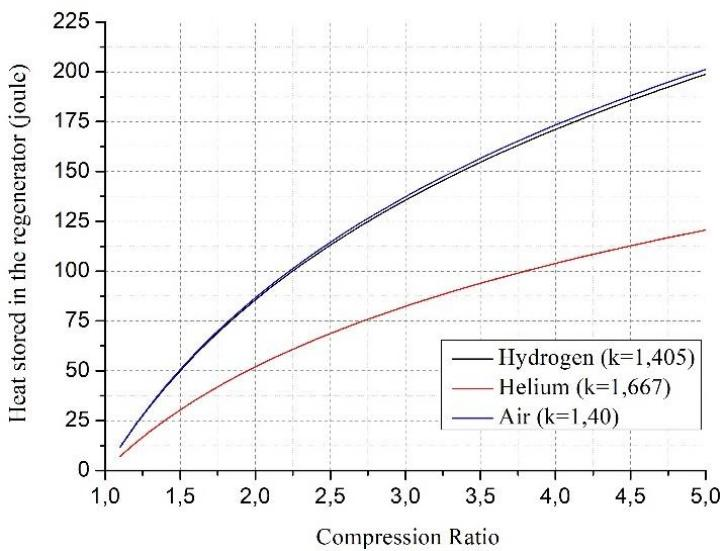  
Figure 3. Heat stored in the regenerator for 50 joules of net work

$$
Q _ { R } = m \Delta U = m C _ { V } \Delta T\tag{15}
$$

$$
Q _ { R i n } = Q _ { 2 - 3 } = m C _ { \scriptscriptstyle V } ( T _ { \scriptscriptstyle H } - T _ { \scriptscriptstyle L } )\tag{16}
$$

$$
Q _ { R o u t } = Q _ { 4 - 1 } = m C _ { v } ( T _ { L } - T _ { H } )\tag{17}
$$

$$
W _ { n e t } = m R \ln \left( { \frac { V _ { 1 } } { V _ { 2 } } } \right) ( T _ { H } - T _ { L } ) ~
$$

$$
\varepsilon = \frac { V _ { 1 } } { V _ { 2 } }\tag{18}
$$

(19)

$$
Q _ { R i n } = Q _ { 2 - 3 } = C _ { V } \frac { W _ { n e t } } { R \ln ( \varepsilon ) }\tag{20}
$$

$$
\frac { C _ { v } } { R } = \frac { 1 } { k - 1 }\tag{21}
$$

$$
Q _ { R i n } = Q _ { 2 - 3 } = \frac { W _ { n e t } } { ( k - 1 ) \ln ( \varepsilon ) }\tag{22}
$$

## 2.2 Carnot cycle

The isoentropic and isothermal processes in the Carnot cycle do not occur as desired in practice. Therefore, power machines cannot achieve the high thermal efficiency of the cycle. The Carnot cycle is basically used as a basic reference in the analysis of power machines. P-V and T-S diagrams of the Carnot cycle are shown in Figure 4.

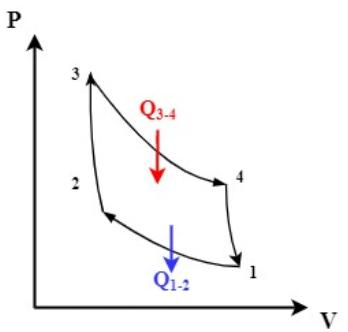

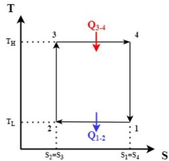  
Figure 4. P-V and T-S diagrams of the Carnot cycle

The Carnot cycle process includes:

1-2 isothermal compression: The temperature, which tends to increase due to compression, is kept constant at the low temperature TL by cooling the system.

2-3 isoentropic compression: Compression takes place at constant isoentropy.

3-4 isothermal expansion: The temperature, which tends to decrease due to expansion, is kept constant at the high temperature TH by heat input into the system.

4-1 isoentropic expansion: Expansion takes place at constant isoentropy.

In the Carnot cycle, the constant volume processes in the Stirling cycle are replaced by isoentropic compression and expansion processes. If it is assumed that the heat is given to the system at the temperature $\mathrm { T _ { H } , }$ and the heat is removed from the system at the temperature $\mathrm { { T _ { L } , } }$ the efficiency of the Carnot and Stirling cycles with regenerator are equal to each other. However, since the Stirling cycle takes place at a constant volume, the net work output is higher than the Carnot cycle. The superposition of the P-V and T-S diagrams of the Stirling and Carnot cycles within the pressure, volume and temperature limits is shown in Figure 5.

P

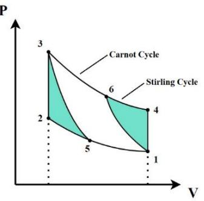

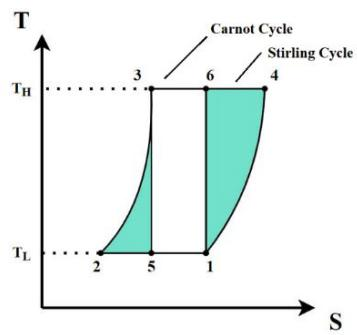  
Figure 5. P-V and T-S diagrams of the Stirling and Carnot cycles

As seen in the diagrams, constant volume displacement processes replace isoentropic processes and provide additional fields (5-2-3 and 6-4-1) to the Stirling cycle in P-V and T-S diagrams. The 1-5 and 3-6 isothermal processes in the Carnot cycle are expanded with the 1-2 and 3-4 isothermal processes in the Stirling cycle, increasing the amount of heat supplied to and removed from the system and the net work amount. The amount of heat given to the system is the same in both cycles. In this case, it is assumed that the heat exchange is at a constant temperature, and the thermal efficiency is considered to be at its maximum value according to the second law of thermodynamics. Thus, it ensures that the thermal efficiencies of both cycles are the same.

## 2.3 Ericsson cycle

Ericsson cycle is quite similar to Stirling cycle. Constant volume regeneration processes in the Stirling cycle are replaced by constant pressure regeneration processes in this cycle. The efficiency of Ericsson with regenerator, Stirling with regenerator and Carnot cycles operating at equal temperature differences are considered equal. Ericsson cycle is used at lower pressure ratios compared to Stirling and Carnot cycles. In these cycles, the thermal efficiency depends on the difference between low and high temperature values. The thermal efficiency (ηTh) equation of these cycles is shown in Equation (23). P-V and T-S diagrams of the Ericsson cycle are shown in Figure 6.

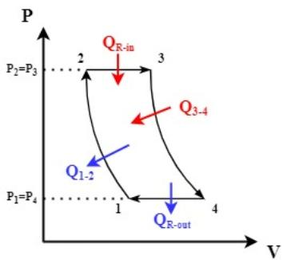

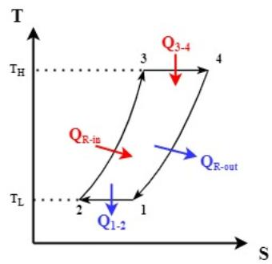  
Figure 6. P-V and T-S diagrams of the Ericsson cycle

$$
\eta _ { T h , S t i r l i n g } = \eta _ { T h , C a r n o t } = \eta _ { T h , E r i c s s o n } = 1 - \frac { T _ { L } } { T _ { H } }\tag{23}
$$

The Ericsson cycle process includes:

1-2 isothermal compression: The temperature, which tends to increase due to compression, is kept constant at the low temperature TL by cooling the system.

2-3 constant pressure regeneration: Heat is transferred from the regenerator to the low temperature working fluid.

3-4 isothermal expansion: The temperature, which tends to decrease due to expansion, is kept constant at the high temperature TH by heat input into the system.

4-1 constant pressure regeneration: Heat is transferred from the high temperature working fluid to the regenerator.

In the Ericsson cycle, the regeneration process takes place at constant pressure instead of at constant volume as in the Stirling cycle. The superposition of the P-V and T-S diagrams of the Carnot and Ericsson cycles are shown in Figure 7. Ericsson cycle efficiency is on par with Carnot and Stirling cycles with regenerator. However, the amount of heat transferred and converted into work at the pressure, volume and temperature limits is greater than the Carnot cycle.

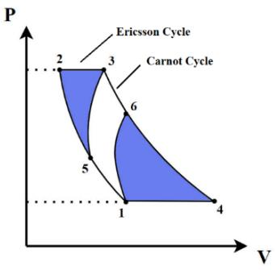

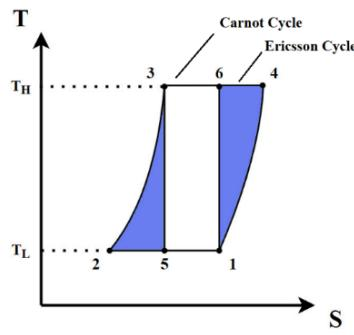  
Figure 7. P-V and T-S diagrams of the Ericsson and Carnot cycles

## 3. Classification of Stirling Engines

After the first Stirling engine manufactured by Robert Stirling in 1816, many engines with similar features were developed. Although the working principles of these engines are the same, some design differences have occurred due to reasons such as increasing their thermal efficiency, reducing dead volumes, reducing manufacturing costs and maintenance costs [10].

We can basically classify Stirling engines according to their mechanical configurations or operating principles. Examples of engines classified according to their mechanical configurations are kinematic Stirling engines and free-piston Stirling engines. Kinematic Stirling engines have mechanical connections between the crankshaft, power piston and displacer piston. With these connections, the movements of the power piston and the displacer piston are limited. Piston movements are transmitted to the flywheel by mechanisms such as slider crank, rhombic mechanism, swash plate or ross-yoke. On the other hand, in free-piston Stirling engines the power piston and the displacer piston move in the same cylinder with a certain phase difference and there is no mechanical connection between them. In freepiston Stirling engines, the movement resulting from pressure changes is usually transmitted by the power piston to the linear alternator [17].

Double-acting Stirling engines, low temperature differential (LTD) Stirling engines and thermoacoustic Stirling engines can be given as examples to Stirling engines that we can classify according to their working principles. In double-acting Stirling engines, a wide variety of arrangements with few parts can be created by placing a heater and regenerator between the expansion volume of one cylinder and the compression volume of the other cylinder. LTD Stirling engines, as the name suggests, can operate at very low temperature differences between their hot and cold ends. Because of this feature, these engines are preferred in benefiting from solar energy, in geothermal applications and in the recovery of wastes as a heat source.

In thermoacoustic Stirling engines, work is produced by causing pressure changes in the system with high amplitude acoustic waves caused by temperature difference. The interest in thermoacoustic systems is increasing day by day due to their low cost, simple structure and absence of moving parts. Liquid piston Stirling engines, have no moving mechanical parts and the liquid columns act as pistons. Oscillatory movements occur in the liquid columns due to the temperature difference. This situation creates pressure changes and provides work to be obtained.

## 3.1 Kinematic Stirling engines

In kinematic Stirling engines, the power piston and the displacer piston are connected to the output shaft by a mechanical connection. Many types of mechanical connections have been designed to improve power transmission and increase engine strength over time. The development and analysis of these connection types remains an active area of study. In addition, crank and motion transmission mechanisms in kinematic Stirling engines generate lateral forces and require lubrication. A gasket is used to prevent the working fluid from escaping between the crankcase and the cylinder. The high number of moving parts also increases the need for maintenance in these systems. The kinematic Stirling engine with Beta-type rhombic drive mechanism designed by Andy Ross is shown in Figure 8.

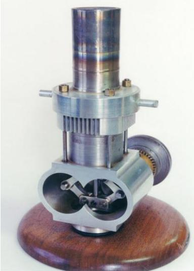  
Figure 8. Beta-type kinematic Stirling engine [18]

Kinematic Stirling engines are mechanically complex, like internal combustion engines, due to their mechanical conection. The amplitude of the power piston and displacer piston movement is constrained by these mechanical connections. Today, 60% of companies working on Stirling engine development prefer kinematic Sitrling engines. The reason why these engines, which have mechanical connections and shafts, are preferred is the familiarity with the working methods similar to internal combustion engines [19].

## 3.2 Free-Piston Stirling engines

Free-piston Stirling engines were designed by Beale at Ohio University in the 1960s with the aim of reducing sealing problems and eliminating the difficulties in lubricating the drive mechanism [17,20-23]. In free-piston Stirling engines, there is no mechanical connection between the displacer piston and the power piston. It is therefore mechanically quite simple compared to kinematic Stirling engines. In free-piston engines, which are similar to Beta-type Stirling engines in terms of cylinder structure, displacer piston movement is free [21]. The power piston works in connection with a linear alternator.

Generally, the outer surface of the cylinder functions as heater, cooler and regenerator. As in kinematic engines, gases such as helium and hydrogen with high heat transfer coefficient are used as working fluid in this type of engines. While the reciprocating movement of the piston creates the compression-expansion processes, the displacer piston moves the working fluid between the hot and cold regions, thus providing the heat flow required for the cycle. The oscillation of the displacer piston, which has a very small mass compared to the power piston, is damped by the working fluid flowing from the regenerator and is supported by springs and the compressibility effect of the working fluid. The heavy power piston, oscillates without damping except for the magnetic field forces produced by the linear alternator. The spring between the two pistons provides the force required to initiate the harmonic oscillations of the displacer. The temperature difference in the system maintains the oscillations, allowing the system to operate at the natural frequency of the massspring system [19]. The schematics of the Beta-type free-piston Stirling engine and its basic parts are shown in Figure 9.

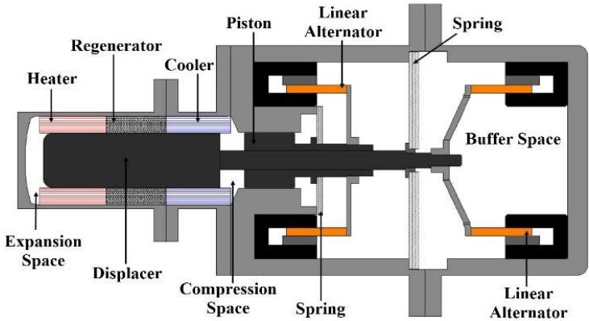  
Figure 9. The free-piston Stirling engine [24]

The free-piston Stirling engine, which is directly connected to the linear alternator, allows long-term operation due to the small amount of part movement it has. It stands out with its low amount of wear and less maintenance need. Generating the engine working volume as a single closed unit has eliminated the problem of working fluid leakage [10]. In addition, the use of flexible rings in this type of engine provides an advantage in terms of sealing by reducing friction and wear.

In this type of engines, obtaining the power at the engine output linearly is a disadvantage in systems such as pumps and compressors [21]. In addition, the oscillations of the moving parts cannot be adjusted mechanically. It is determined by the interactions of the whole system with each other. Complex calculations are required to obtain the appropriate motion and power output. Due to its oscillating nature, the response time is delayed compared to kinematic Stirling engines and internal combustion engines. Piston positions during operation are quite critical and difficult to control. The imbalance in piston movements directly affects the power output [19].

## 3.3 Double-Acting Stirling engines

One of the easiest ways to increase power output in Stirling engines is to increase the swept volume. However, the performance of a single-cylinder Stirling engine with a large cylinder is limited due to increased dead volume and inefficient heat transfer. By increasing the number of cylinders, these negativities can be prevented and the sweeping volume can be increased. The double-acting Stirling engine designed for this purpose takes its name from the fact that its piston is under the influence of hot and cold working fluid on both sides.

The theory of the double-acting Stirling engine was first put forward by Franchot in 1853, and Babcocok produced the first doubleacting engine in 1885. In 1959, after Finkeistein and Polanski's studies on this type of engine, Siemens designed the four-cylinder double-acting Stirling engine. The production of this engine was carried out by Weenan with the invention of the swash plate drive mechanism. The Stirling automobile engine, produced by Philips and Ford companies, was also designed with a four-cylinder double-acting structure, and a swash plate drive mechanism was used in this engine [10,25]. Double-acting Stirling engine, which is a joint production of Ford and Philips, is shown in Figure 10.

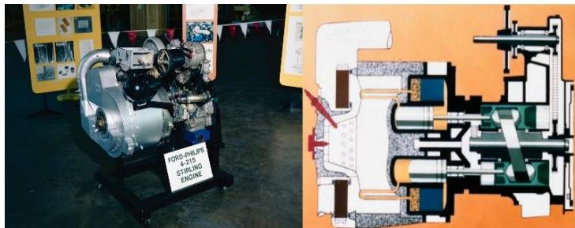  
Figure 10. Ford and Philips' double-acting Stirling engine [26]

Double-acting Stirling engines generally consist of four cylinders and are generally used with a swash plate drive mechanism. In this engine configuration, the expansion volume of one cylinder and the compression volume of the other cylinder are connected by flow channels. There are heater, regenerator and cooler on the flow channels. There is a 90⁰ phase difference between the pistons in adjacent cylinders [27]. Since the pistons working with phase difference carry the working fluid between the heater, the regenerator and the cooler, they also act as a displacer. For this reason, double-acting Stirling engines do not have a displacer piston. A wide variety of arrangements can be created with this method. A double-acting Stirling engine has half the number of cylinders and pistons compared to four single-acting Stirling engines. This increases the power density of the engine, reduces production costs and simplifies the design. The disadvantage of double-acting Stirling engines is that the size of the engine cannot be reduced as easily as in single-acting Stirling engines. The schematics of the four cylinder double-acting Stirling engine is shown in Figure 11.

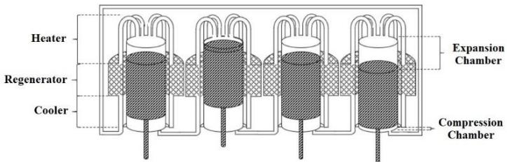  
Figure 11. The double-acting Stirling engine [28]

In double-acting engines, only the piston rods are associated with the external environment, reducing working fluid leaks. In these engines, the total net work is shared thermodynamically between the four cylinders with a 90⁰ phase difference. This shows us that the compression and expansion operations are performed by the four cylinders at different times in each cycle [29]. The most common of the double-acting Stirling engines is the Alpha-type four cylinder engine configuration [30].

## 3.4 Low temperature differential (LTD) Stirling engines

This type of engine, which has a different structure from other Stirling engines, is called low temperature differential Stirling engine (LTD) because it can operate at very low temperature differences [31]. LTD Stirling engines can operate at very low temperature differences between the hot and cold ends of the displacer cylinder. Due to these features, these engines are preferred in utilizing solar energy, in geothermal applications and in the recovery of wastes that can be used as a heat source [10,32,33]. LTD Stirling engines produce relatively low power. However, it is of interest when considering the possibility of power generation from heat sources at temperatures lower than 100 ⁰C [33].

The general features of LTD Stirling engines are as follows:

• The displacer piston/power piston swept volume ratio is large.

• The displacer cylinder and piston have a large diameter.

• The heat transfer surface area of the displacer cylinder is large.

• Displacer piston stroke is too small for its diameter.

• Engine speed is low [33,34].

LTD Stirling engines are examined in two groups as kinematic engines and ringbom engines. Many of the kinematic LTD Stirling engines designed in past years have a large diameter short displacer piston, as well as a much smaller diameter power piston. These types of engines are Gamma-type Stirling engines with a slider crank drive mechanism. In kinematic LTD Stirling engines, the displacer piston and the power piston are connected to the crankshaft by a connecting rod.

In some LTD Stirling engines, only the power piston is connected to the crankshaft. The displacer piston moves freely in response to the pressure difference between the cylinder and the atmosphere. This configuration is also known as the LTD ringbom Stirling engine. Ross-yoke drive mechanism is preferred in some medium temperature difference engines. Due to the complexity of the mechanical structures, low and medium temperature differential Stirling engines with Rhombic or swash plate drive mechanisms have not been developed. Many LTD Stirling engines use annular space between the displacer piston and the cylinder as the regenerator, rather than the porous structure [3,31,33]. In 2008, Micro Star International (MSI) company placed LTD Stirling engine on the motherboard for cooling the motherboard in computers. The LTD Stirling engine seen in Figure 12 works by taking heat from the motherboard [10].

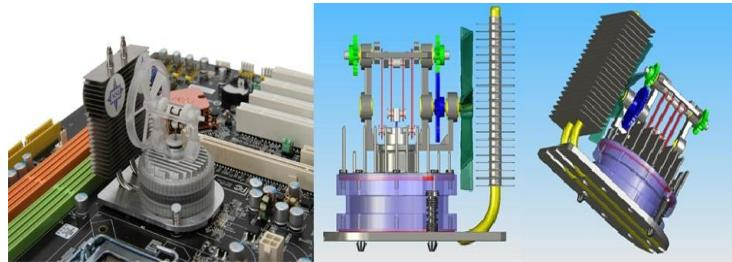  
Figure 12. LTD Stirling engine used by MSI company [35]

One of the most important problems to be solved in Stirling engines is to regulate the flow of working fluid between hot and cold regions and to reduce thermal losses. In this way, the conduction heat transfer from the hot region to the cold region can be reduced. By shortening the length of the displacer piston, the compression ratio is also reduced as well as the temperature difference. For this reason, the diameters of the displacer piston and the displacer cylinder are enlarged to provide sufficient volume in the displacer cylinder [31]. Although it has limited application areas, there are many studies in the literature about LTD Stirling engines for the recovery of waste heat thanks to its ability to operate at very low temperature differences. Moreover, the cost of these studies is quite low [36].

## 3.5 Thermoacoustic Stirling engines

In 1979, Ceperley [37,38] noticed that the phase between the pressure and velocity of the working fluid in the regenerator of a Stirling engine is the same as in a moving acoustic wave. Thus, the idea of using acoustic waves instead of moving pistons was put forward to control the gas movement and gas pressure in the Stirling cycle [3,39-41].

Thermoacoustic Stirling engines work with the acoustic power created by heating and cooling on the working fluid. With the high amplitude acoustic waves produced, heat can be pumped from one place to another, as well as electricity generation with acoustic-electric converters. Having few moving parts has eliminated sealing and lubrication problems. The high amplitude acoustic standing waves in these engines cause compression and expansion processes similar to the power piston. On the other hand, acoustic motion waves operating with phase difference act as a displacer piston and cause displacement along the temperature gradient. For this reason, thermoacoustic Stirling engines do not have a displacer piston as in Beta or Gamma-type engines. Thermoacoustic Stirling engines are designed in three types, as traveling-wave engines, standing-wave engines and traveling-standing wave hybrid-type engines.

The traveling-wave thermoacoustic Stirling engine consists of a looped-tube in which a thermoacoustic core is inserted. Thermoacoustic core consists of heater, regenerator and cooler. The loopedtube connecting both sides of the thermoacoustic core acts as the piston in Stirling engines. When the temperature difference on the regenerator exceeds a certain value, the gas oscillates. For acoustic oscillation to reach saturation, the power generated in the core must be balanced. In the traveling-standing wave hybrid-type engine, the traveling-wave loop is located near the velocity node of the standingwave resonator. Thus, viscous losses in the regenerator are reduced and performance is improved. The acoustic power obtained as a result of the oscillations flows from the hot side of the regenerator to the cold side and is amplified by the energy conversion effect of the Stirling cycle. While some of this acoustic power feeds back to the regenerator through the looptube, the rest goes to the resonator as output power [3]. The standing-wave thermoacoustic Stirling engine can be considered as a simplified version without any feedback system. Although this type of thermoacoustic engine does not offer as much efficiency as the traveling-wave configuration, it provides the opportunity to obtain similar operating characteristics and advantages with a simpler structure [42,43]. With standing-wave thermoacoustic Stirling engines, power generation from a low and medium temperature source is also possible. The engine is a straight line with the thermoacoustic core placed close to one end. Intentional imperfect heat exchange between the gas and the walls is necessary for energy conversion to occur with heat exchange during the movement of the working fluid. Therefore, the cycle cannot be reversed.

As an example Traveling-standing wave hybrid-type thermoacoustic Stirling engine is shown in Figure 13.

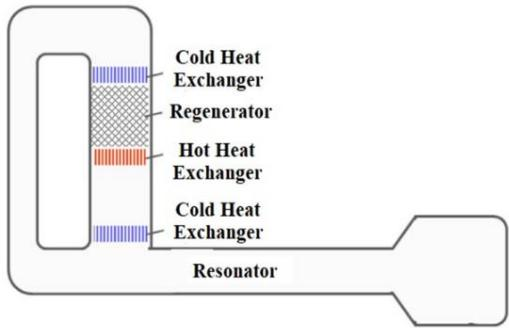  
Figure 13. Traveling-standing wave hybrid-type thermoacoustic engine [3]

Thermoacoustic Stirling engines usually have one thermoacoustic core. However, using only one core is efficient at high temperatures, and performance decreases at low operating temperatures. It is recommended to use more than one thermoacoustic core to reduce the starting temperature and increase the efficiency.

## 3.6 Liquid piston Stirling engines

Liquid piston Stirling engines do not have any moving mechanical parts. In these engines, the water column acts as a piston. Volume changes in the engine are only provided by these liquid pistons. One of the best known of this type of engine, the Fluidyne engine, was patented in 1969 at the UKAEA Atomic Energy Research Establishment’s Harwell Laboratory by West [44]. Liquid piston engines consist of three groups as Fluidyne engine, two-phase thermo-fluidic liquid piston engine and hybrid solid-liquid piston Stirling engine. The drawing of the Fluidyne engine designed by West is shown in Figure 14.

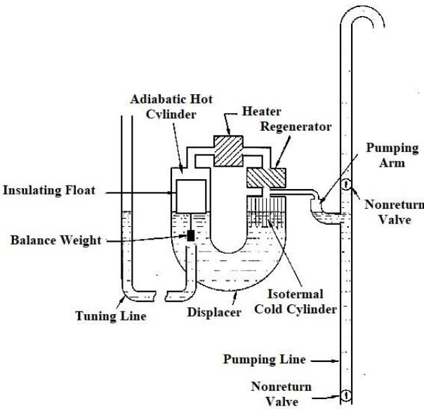  
Figure 14. Fluidyne engine [45]

Hybrid solid-liquid piston Stirling engines have both liquid and solid pistons. These engines can be thought of as a combination of Fluidyne engines and kinematic LTD Stirling engines. Liquid piston Stirling engines operate at relatively low temperature differences, low power output and low efficiency. Average working pressures are around 1 bar when air is used as the working fluid. Pressurization cannot be done so that the liquid does not come out of the system.

However, the low cost and effortless production of these engines outweighs these disadvantages. It is generally used for applications such as water pumping in rural areas where solar energy, geothermal energy, biomass energy and industrial waste heat are used [3,17].

Liquid piston Stirling engines first convert the heat energy into the oscillation of the liquid pistons. Then, the output power obtained through the variation of the dynamic pressure of the working fluid can be used as pumping or electrical power [46]. As seen in Figure 14, when the liquid column in the displacer starts to oscillate, it causes the working fluid to oscillate between the hot and cold zones. Temperature changes in the working fluid create dynamic pressure forces that force the liquid column in the outlet line to move up and down periodically. Thus, the applied heat is converted into work in the form of fluid motion periodically observed in the fluid column. In these engines, the hot end column in the displacer is produced shorter than the cold end column, providing a faster response. In this way, the phase difference required for the Stirling cycle is provided.

## 4. Cylinder Arrangements

Stirling engines are divided into three classes according to their cylinder arrangements: Alpha (α), Beta (β) and Gamma (γ). In α- type Stirling engines, two different pistons in compression and expansion volumes work with 90° phase difference. Piston and displacer piston are used in β and γ-type engines. In β-type engines, a power piston and a displacer piston work in the same cylinder. In γ- type engines, piston and displacer piston move in two different cylinders with a phase difference [3,10,47]. Schematic representations of Alpha, Beta and Gamma Stirling engines are shown in Figure 15.

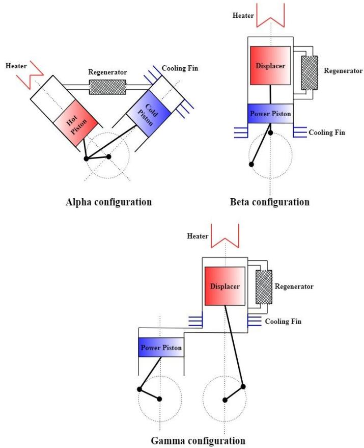  
Figure 15. Cylinder arrangements in Stirling engines

## 4.1 Alpha (α) type Stirling engines

Alpha-type Stirling engines have two different power pistons called compression and expansion pistons. The cylinder with the expansion piston can be called the hot volume, and the cylinder with the compression piston can also be called the cold volume. Power pistons operate with 90° phase difference in different cylinders connected by heater, cooler and regenerator. This phase difference means that when one piston is at the bottom or top dead center, the other piston will be halfway through its stroke. Moving the pistons with a phase difference of 90° ensures the circulation of the working fluid between the hot and cold cylinders. This circulation is most efficient by placing the hot and cold cylinders in a V shape. Alphatype engines are designed and classified with four different cylinder groups as circular, parallel, V and opposing cylinders. If the cylinders are placed in parallel, the pistons are driven by two different journals on the crankshaft. There is an angle difference of 90° between these journals [48]. The Alpha-type Stirling engine and its basic parts are shown in Figure 16.

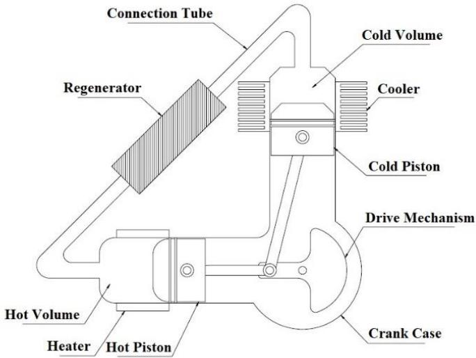  
Figure 16. The Alpha-type Stirling engine

Although Alpha Stirling engines have a high power-to-volume ratio, they also have some disadvantages. Having two different power pistons in two different cylinders of these engines, which work with high-pressure working fluid, increases the sealing problems. While one power piston and connecting rod are sealed in Beta-type engines, sealing is essential for both power pistons in Alpha engines. Thanks to the small diameter of the connecting rod, the sealing problem can be solved much more easily than with a power piston.

## 4.2 Beta (β) type Stirling engines

In Beta-type Stirling engines, a single power piston and a displacer piston work coaxially within the same cylinder. While this cylinder is heated from one end, it is cooled from the other end. The region between the power piston and the displacer piston is called the cold volume (compression chamber), and the region above the displacer piston is called the hot volume (expansion chamber) [23]. During its movement in the cylinder, the working fluid passes through the heater, regenerator and cooler respectively. When the working fluid is in the cold volume, the power piston performs the compression process. When the working fluid passes to the hot end of the cylinder, it expands and pushes the power piston. The power piston, pushed by the effect of the hot working fluid, moves the crankshaft and thus the heat energy is converted into mechanical energy. Beta-type engines can be designed with kinematic or free-piston arrangements. The Beta-type Stirling engine and its basic parts are shown in Figure 17.

While the displacer piston and the power piston are located in the same cylinder in Beta-type engines, these pistons are in different cylinders in Gamma-type engines. The displacer piston, which provides the passage of the working fluid between the hot and cold ends, is located in the cylinder with a space and does not receive power from the working fluid. Many Beta-type Stirling engines do not have a visible regenerator structure. In such arrangements, the surface between the displacer piston and the cylinder provides some regenerative effect and enables the working fluid to exchange heat cyclically. As in Alpha-type Stirling engines, there is a 90° phase difference between the pistons in Beta-type engines [49]. However, since the pistons are in the same cylinder, this phase difference is usually provided by the rhombic drive mechanism.

In low pressure Beta-type Stirling engines, the regenerator area is positioned around the displacer piston, and the flow of the working fluid between the hot-cold volumes is ensured through the space between this piston and the cylinder. In this type of engines, it is necessary to increase the length of the displacer piston, and in engines operating with high charge pressure, the heat transfer surface area should be increased [50]. Increasing the heat transfer surface area is possible by using a separate heater, cooler and regenerator. In Betatype Stirling engines, the engines with a displacer piston with regenerator are called “Stirling-type”, and those using an external regenerator are called “Rankine-Naiper-type” [10,32,48].

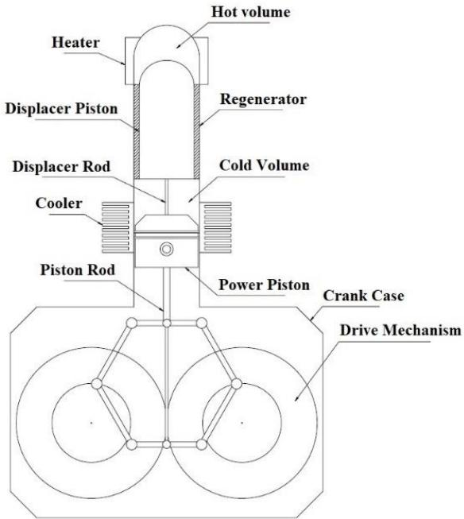  
Figure 17. The Beta-type Stirling engine

Beta-type Stirling engines have some design difficulties due to the power piston and displacer piston working with phase difference in the same cylinder. However, contrary to these difficulties, it has many advantages such as low dead volumes, high compression ratios, operation at low temperature differences, less sealing problems compared to other cylinder configurations, and higher efficiency. In addition to these advantages, Beta-type engines are frequently preferred in studies to increase power and efficiency in Stirling engines due to their high power to volume ratio [51].

## 4.3 Gamma (γ) type Stirling engines

Gamma-type Stirling engines have a power piston and a displacer piston, as do Beta-type engines. However, in this engine type, the displacer piston is not coaxial with the power piston, but in a different cylinder. With this cylinder structure, complications caused by the displacer piston rod passing through the center of the power piston are prevented, and gas leaks in this area are prevented. In Gamma-type engines, cylinders can be designed in parallel as well as with an angle of 90°. As in Alpha and Beta-type engines, there is a 90° phase difference between the movements of the pistons in Gamma-type Stirling engines.

One of the cylinders in the Gamma-type Stirling engine performs the expansion and compression of the working fluid by means of a power piston, and the other performs the heating and cooling of the working fluid through the displacer piston. The two cylinders are connected to each other by means of a pipe. The regenerator can be placed inside or outside the displacer cylinder as in Beta-type engines. The displacer piston operates with a gap between the hot and cold volume. The up and down movement of this piston carries the working fluid flowing between the cylinder and the piston between the heater, the regenerator and the cooler. The cold volume contains the cylinder with the power piston and the cooler side of the displacer piston. Gamma-type Stirling engines can have kinematic and freepiston arrangements. The Gamma-type Stirling engine and its basic parts are shown in Figure 18.

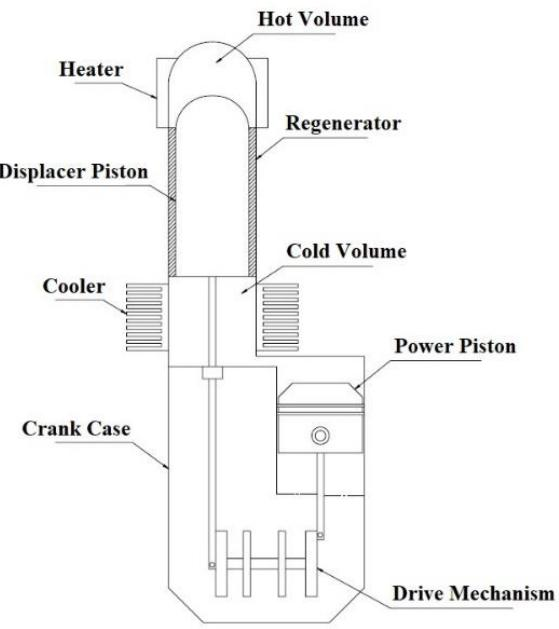  
Figure 18. The Gamma-type Stirling engine

Cyclic heating and cooling of the working fluid causes it to expand and compress, as in other Stirling engines. Thus, while being transported between hot-cold cylinders, it transfers its energy to the power piston in the cold cylinder. Gamma-type engines, which are generally seen in multi-cylinder examples, have some disadvantages although they have a simple mechanical structure. The fact that the power piston and the displacer piston are in separate cylinders increases the dead volumes in these engines, thus reducing their compression ratio and efficiency. Its advantages are ease of design, it does not require sealing on the displacer piston rod, as in Beta-type engines, so only the power piston is sealed.

Finally, Gamma-type Stirling engines consist of four different groups called Lauberau-Schwartzkopff, Heinrici, Rainbow and Robinson. In the Lauberau-Schwartzkopff Gamma-type Stirling engine, the regenerator area is located on the displacer piston. In Heinricitype engines, the power and displacer cylinders are in parallel position, and the cold and hot volumes are connected to each other by the use of external regenerators. In Robinson-type Stirling engines, there is a 90° phase difference between the power and displacer cylinders [10,52]. The advantages and disadvantages of these cylinder arrangements used in Stirling engines are shown in Table 1.

Table 1. Comparison of the cylinder arrangements
<table><tr><td rowspan=1 colspan=1></td><td rowspan=1 colspan=1>Advantages</td><td rowspan=1 colspan=1>Disadvantages</td></tr><tr><td rowspan=1 colspan=1>Alpha</td><td rowspan=1 colspan=1>-High power to volume ratio.-Simplest mechanical structure[53].-It has a compact structure andhigh specific power, with thedouble-acting piston design[3,23].</td><td rowspan=1 colspan=1>-Both power pistons ope-rating in different cylin-ders must be sealed [54].-For high engine volumes,system weight is a prob-lem.</td></tr><tr><td rowspan=1 colspan=1>Beta</td><td rowspan=1 colspan=1>-It has a more compact struc-ture. The system weight is low[54].-Only one power piston anddisplacer piston rod must besealed.-The amount of dead volume islow and can be designed athigh compression ratio.</td><td rowspan=1 colspan=1>-It has a more complexmechanical structure.-Its design and productionis quite laborious.</td></tr><tr><td rowspan=1 colspan=1>Gamma</td><td rowspan=1 colspan=1>-It has a simpler mechanicalstructure. It is more effortlessto design and manufacture[23,55].-It is quite suitable for opera-tion at low temperature diffe-rences.-It is the best cylinder configu-ration for sealing.</td><td rowspan=1 colspan=1>-The high amount of deadvolume reduces efficiencyand power. It also works atlow compression ratios[3,55].</td></tr></table>

## 5. Drive Mechanisms

In Kinematic Stirling engines, many different drive mechanisms are used for motion transmission and control. The most preferred ones are rhombic, wobble plate, slider crank, swash plate, ross-yoke, scotch-yoke drive mechanisms. The amplitudes and phases of the movements of the power piston and the displacer piston are determined by these connections. These mechanisms are mechanically complex, but their analysis is relatively simple compared to other types of Stirling engines. Many different types of drive mechanisms have been designed throughout the development of Stirling engines. With different mechanisms, high cost, wear, vibration, noise, sealing, lubrication and imbalance problems were tried to be eliminated, and it was aimed to improve power output and efficiency. Today, the development of these drive mechanisms continues to be an important field of study. The advantages and disadvantages of these drive mechanisms used in Stirling engines are shown in Table 2.

Table 2. Comparison of the drive mechanisms
<table><tr><td rowspan=1 colspan=1></td><td rowspan=1 colspan=1>Advantages</td><td rowspan=1 colspan=1>Disadvantages</td></tr><tr><td rowspan=1 colspan=1>Rhombic</td><td rowspan=1 colspan=1>-Low lateral forces, lowvibration, small enginesize, good sealing, suitablefor high pressure and highpower, suitable for singleand multi-cylinder engines[8,10,19,52,57].</td><td rowspan=1 colspan=1>-Mechanically comp-lex, high number ofparts [8,10,19,52,57].</td></tr><tr><td rowspan=1 colspan=1>WobblePlate</td><td rowspan=1 colspan=1>-Low cost [57].</td><td rowspan=1 colspan=1>-High friction, lubrica-tion problem [57].</td></tr><tr><td rowspan=1 colspan=1>SliderCrank</td><td rowspan=1 colspan=1>-Easy to manufacture, lowresistance forces [10].</td><td rowspan=1 colspan=1>-There is a balanceproblem, lateral fric-tion is high [10,57]</td></tr><tr><td rowspan=1 colspan=1>SwashPlate</td><td rowspan=1 colspan=1>-Suitable for high pressureand high power, compactstructure, small enginesize, suitable for mass pro-duction and good sealing[10,14].</td><td rowspan=1 colspan=1>-It has lubrication andfriction problems, noteconomical, difficult tomanufacture, only sui-table for multi-cylinderengines [14,65].</td></tr><tr><td rowspan=1 colspan=1>Ross-Yoke</td><td rowspan=1 colspan=1>-Balanced, low friction,low vibration, low noise,low wear, easy to manufac-ture and economic [10,57].</td><td rowspan=1 colspan=1>-Only suitable forsmall engines [10].</td></tr><tr><td rowspan=1 colspan=1>Scotch-Yoke</td><td rowspan=1 colspan=1>-Low wear, low lateral for-ces [10].</td><td rowspan=1 colspan=1>-Only suitable forsmall engines [71,72].</td></tr></table>

## 5.1 Rhombic drive mechanism

The rhombic drive mechanism was first designed by Meijer in 1953. This motion transmission mechanism, which was designed for Stirling engines, was started to be used in Philips engines in 1954 [7,10,32,55]. The rhombic drive mechanism consists of two gears rotating in opposite directions and a rod mechanism combined with a crankshaft. The power piston rod connects to the upper link and the displacer piston to the lower link. With the help of this connection type and gears, 90° phase difference is created between the pistons [56,57]. With the use of rhombic drive mechanism in Stirling engines, lateral forces and vibrations are reduced, sealing problems are eliminated and engine dimensions are reduced [7,58]. It also allows operation at higher pressures for higher specific power generation. This mechanism, which is generally used in single-cylinder Beta-type Stirling engines, can also be used in multi-cylinder engines side by side or opposite. [7,10,19,57] Beta-type Stirling engine with rhombic drive mechanism and drive mechanism parts are shown in Figure 19.

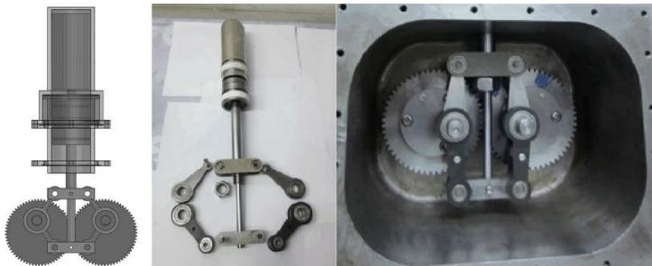  
Figure 19. β-type Stirling engine with rhombic drive mechanism [59,60]

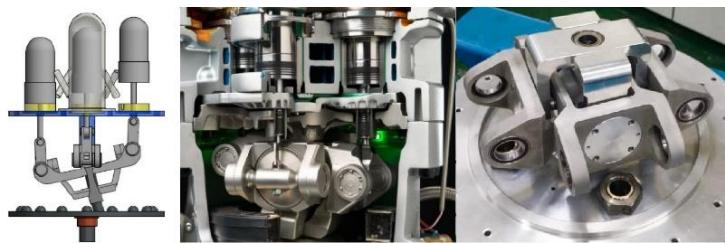  
Figure 20. Wobble plate drive mechanism [62,63]

## 5.2 Wobble plate drive mechanism

The wobble plate drive mechanism was first used by Siemens in 1860 in Stirling engines [57]. In the wobble plate drive mechanism, two pistons are placed side by side and connected to each other by a rocker mechanism. The mechanism oscillates, giving movement to the piston connecting rods at both ends. Generally used in doubleacting Stirling engines, this mechanism is also used in compressors and internal combustion engines [61]. The main advantage of the wobble plate drive mechanism is its low cost. As a disadvantage, it can be said that the high amount of wear and friction losses caused by lubrication problems [10]. Detailed views of the wobble plate drive mechanism are shown in Figure 20.

## 5.3 Slider crank drive mechanism

The slider crank drive mechanism has been used extensively since the invention of internal combustion engines. It is also widely used in Stirling engines thanks to its ease of manufacture advantage. Since the displacer piston is supported through the power piston rod, the resistance forces are minimized. However, the power piston is driven by the connecting rod, which makes an oscillating movement. This increases the frictional forces in the lateral direction.

Especially in Alpha and Gamma-type Stirling engines, the cylinders are placed in a V shape. Ease of manufacture is provided by connecting the piston-piston or piston-displacer piston to the same rod journal [3,23]. The disadvantage of this mechanism is difficulties in balancing. Beta-type Stirling engine with slider crank drive mechanism is shown in Figure 21.

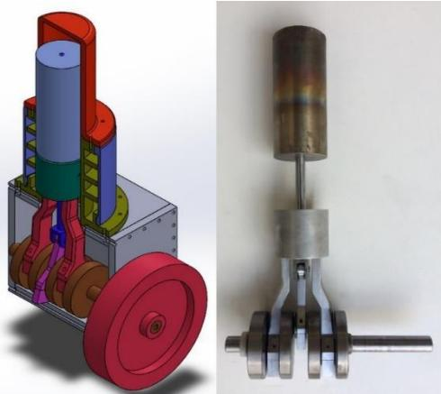  
Figure 21. Slider crank drive mechanism [64]

## 5.4 Swash plate drive mechanism

The swash plate drive mechanism, which is widely used in hydraulic pumps and compressors, was produced in Stirling engines in the 1970s with the license of Philips for use in automobiles and was tested by Ford and General Motors companies. Stirling engines with swash plate drive mechanism have been also manufactured by

United Stirling, Malmo and MAN-MWM companies independently of Philips license for underwater power systems [7]. This mechanism is used in multi-cylinder engines. It is preferred in Stirling engines, which aim high power output, thanks to its more compact structure compared to the rhombic drive mechanism [10]. The swash plate drive mechanism has several advantages such as reducing engine dimensions, suitability for mass production, good sealing and providing desired torque characteristics. As disadvantages, it is difficult to produce, not economical, hydrodynamic lubrication and friction problems at low speeds [14]. As the number of cylinders increases, the balance problem decreases in engines using swash plate drive mechanism. It is suitable for use in at least three-cylinder engines [65]. A Stirling engine with swash plate drive mechanism is shown in Figure 22.

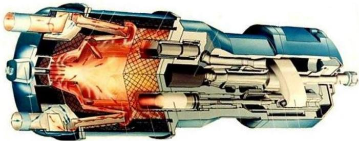  
Figure 22. Stirling engine with swash plate drive mechanism [32]

## 5.5 Ross-Yoke drive mechanism

Ross-yoke drive mechanism, designed by Ross for Stirling engines in 1976, is used in small Stirling engines [10]. In the ross-yoke drive mechanism, two parallel pistons are connected to the crankshaft by a triangle mechanism. Since the lateral forces are mutually balanced in this mechanism, friction, wear, vibration and noises are reduced [57]. Its design is easy and its production cost is very low. A small Stirling engine for hobby with ross-yoke drive mechanism is shown in Figure 23.

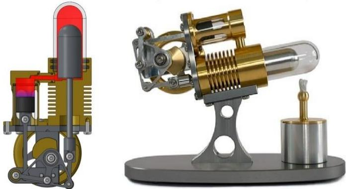  
Figure 23. Stirling engine with ross-yoke drive mechanism [66]

## 5.6 Scotch-Yoke drive mechanism

In the scotch-yoke drive mechanism, which was designed for the first time by Parsons, the alternative movement of the piston is converted into circular movement by the journal moving in the slot [67,68]. In this mechanism, which has fewer moving parts compared to other systems, as in the rhombic drive mechanism, the wear on the parts is minimized since the lateral frictional resistance is reduced [10]. Scotch-yoke drive mechanism is used in small Stirling engines without the use of any lubricating element [54,69]. The schematic representation of a Stirling engine with Scotch-yoke drive mechanism is shown in Figure 24.

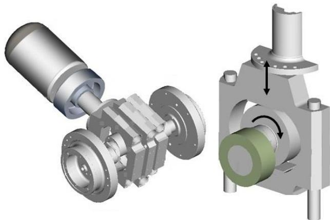  
Figure 24. Stirling engine with scotch-yoke drive mechanism [70]

## 6. Conclusions

Stirling engines, invented by Robert Stirling in 1816, can work with many alternative energy sources thanks to the external heat supply. The rapid development of internal combustion engines over time has reduced the interest in Stirling engines. However, the problems caused by fossil fuels and their impact on the environment have brought Stirling engines back to the agenda in recent years. These engines, which can operate at medium and low temperature differences with all kinds of heat sources, are especially promising in the recovery of solar energy, geothermal energy and waste heat.

Stirling engines have some advantages and disadvantages compared to internal combustion engines. The advantages of Stirling engines are that the combustion is continuous, the absence of intake and exhaust valves, the low noise emissions and pollutant gas emissions, the easy and cheap maintenance thanks to having fewer parts, and the ability to be designed with many different mechanical arrangements. The disadvantages of Stirling engines are low power/weight ratios, slow acceleration and deceleration responses, requiring experimental knowledge as it is still under development, and sealing problems.

The basic working principle of Stirling engines is the compression of the cooled working fluid and the expansion of the heated working fluid. The theoretical Stirling cycle consists of two isothermal processes and two constant volume processes. In the isothermal compression process, the increasing temperature during compression is kept constant by cooling the working fluid. In the isothermal expansion process, the decreasing temperature during the expansion is kept constant by giving heat to the working fluid from an external source. In the constant volume regeneration process, heat transfer takes place from the regenerator to the low temperature working fluid or from the high temperature working fluid to the regenerator. By giving heat to and removing heat from the regenerator between compression and expansion processes, system efficiency is increased and dead volumes are reduced.

Since the invention of Stirling engines, many engine types, cylinder arrangements and drive mechanisms have been developed for reasons such as increasing thermal efficiency, reducing costs, improving power output and reducing dead volumes. Although the working principles are the same, these configurations are structurally quite different from each other. Stirling engines can be classified according to their mechanical configuration or operating principles.

Engines classified according to their mechanical arrangement are kinematic Stirling engines and free-piston Stirling engines. In kinematic Stirling engines, the crankshaft, power piston and displacer piston are connected by mechanical connections. In free-piston engines, there is no mechanical connection between the power piston and the displacer piston. There is a phase difference between these pistons working in the same cylinder and usually the power piston is controlled by a linear alternator.

Finally, different drive mechanisms are used in kinematic Stirling engines. Commonly used among these are rhombic, wobble plate, slider crank, swash plate, ross-yoke and scotch-yoke drive mechanisms. Studies on the drive mechanisms in Stirling engines are still continuing intensively. With the use of different drive mechanisms in Stirling engines, it is aimed to prevent problems such as sealing, wear, noise, lubrication and balance, and to improve power output.

Low temperature differential (LTD) Stirling engines, double-acting Stirling engines, thermoacoustic Stirling engines and liquid piston Stirling engines can be given as examples of engines classified according to their working principle. Low temperature differential (LTD) Stirling engines, as the name suggests, can operate at very low temperature differences between the hot and cold ends. In double-acting Stirling engines, the number of parts is reduced by half, thanks to the fact that the heater, cooler and regenerator are located between the expansion volume of one cylinder and the compression volume of the other cylinder. In thermoacoustic Stirling engines, work is produced by creating pressure changes with high amplitude acoustic waves caused by temperature difference. On the other hand, liquid piston Stirling engines have no moving mechanical parts and the liquid columns act as pistons. Oscillatory movements occur in the liquid columns with the temperature difference. This situation creates pressure changes and provides work to be obtained.

## Nomenclature

Stirling engines are divided into three types according to their cylinder arrangements: Alpha, Beta and Gamma types. In Alpha and Gamma-type Stirling engines, the power piston and the displacement piston work in separate cylinders with a phase difference. In Beta-type Stirling engines, the power piston and the displacer piston are in the same cylinder.

CO Carbon Monoxide   
$\mathrm { C O } _ { 2 }$ Carbon Dioxide   
$\mathrm { C _ { v } }$ Specific heat in constant volume   
$\mathrm { H C }$ Hydrocarbon   
$\mathbf { k }$ Heat capacity ratio of working fluid   
LTD Low Temperature Differential   
m Mass of working fluid   
MAN-MWM Maschinenfabrik Augsburg-Nürnberg and Motoren Werke Mannheim   
MSI Micro Star International   
$\mathrm { N O x }$ Nitrogen Oxides   
$\mathrm { P }$ Pressure   
$\mathrm { \bf Q }$ Heat transfer   
$\mathrm { Q } _ { \mathrm { R } }$ Heat transfer regenerator   
$\mathbf { R }$ Gas constant of working fluid   
$s$ Entropy   
$\mathrm { T }$ Temperature

<table><tr><td>TH TL</td><td>High temperature Low temperature</td></tr><tr><td>U</td><td>Internal energy</td></tr><tr><td>UKAEA V</td><td>United Kingdom Atomic Energy Authority Volume</td></tr><tr><td>W</td><td>Work</td></tr><tr><td>ε</td><td>Compression ratio</td></tr><tr><td>ηTh</td><td>Thermal efficiency</td></tr></table>

## Conflict of Interest Statement

The authors declare that there is no conflict of interest in the study.

## CRediT Author Statement

Turan Alp Arslan: Writing-original draft, Conceptualization, Investigation. Tolga Kocakulak: Writing-review & editing, Visualization.

## References

1. Stirling, R. (1816). Stirling air engine and the heat regenerator. Patent No: 4081.

2. Organ, A. J. (2014). Stirling cycle engines inner working and design. New York: Wiley Publication, 33-43.

3. Wang, K., Sanders, S. R., Dubey, S., Choo, F. H. and Duan, F. (2016). Stirling cycle engines for recovering low and moderate temperature heat: a review. Renewable and Sustainable Energy Reviews, 62, 89- 108.

4. Reader, G. T. (1986). Stirling engine work royal navy. SAE Transactions, 95(4), 394-405.

5. Yuan, Z. S. (1993). Oscillatory flow and heat transfer in a Stirlingengine regenerator. PhD. Thesis, Department of Mechanical and Aerospace Engineering, Case Western Reserve University.

6. Scott, S. J., Holcomb, F. H. and Josefik, N. M. (2013). Distributed electrical-power generation: summary of alternative available technologies. ERDC/CERL SR-03-18. US Army Corps of Engineers, Washington, DC.

7. Walker, G. (1980). Stirling engines. Clarendon Press, Oxford.

8. Çınar, C., Yücesu, S., Topgül, T. and Okur, M. (2005). Beta-type Stirling engine operating at atmospheric pressure. Applied Energy, 81, 351-357.

9. White, M. A., Emigh, S. G. and Riggle, P. (1987). Practical bellows seals for Stirling engines. SAE Transactions, 96(5), 3-8.

10. Arslan, T. A. (2021). Rhombic mekanizmalı Beta tipi bir Stirling motorunda sıkıştırma oranının motor performansına etkilerinin sayısal olarak incelenmesi. Yüksek Lisans Tezi, Gazi Üniversitesi Fen Bilimleri Enstitüsü, Ankara.

11. Özgören, Y. Ö. and Çetinkaya, S. (2009). Helyum ve havanın iş gazı olarak kullanıldığı Beta tipi bir Stirling motorunun performansının deneysel olarak incelenmesi. Journal of the Faculty of Engineering and Architecture of Gazi University, 24(2), 221-228.

12. Çınar, C., Topgül, T. and Yücesu, H. S. (2007). Stirling çevrimi ile çalışan Beta tipi bir motorun imali ve performans testleri, Journal of the Faculty of Engineering and Architecture of Gazi University, 22(2), 411-415.

13. Çınar, C., Aksoy, F. and Okur, M. (2013). Design, manufacturing and performance tests of a stirling engine with rhombic drive mechanism. Journal of the Faculty of Engineering and Architecture of Gazi University, 28, 795-801.

14. Aksoy, F. (2011). Bir Stirling motoruna güneş enerjisi uygulanması. Doktora Tezi, Gazi Üniversitesi Fen Bilimleri Enstitüsü, Ankara.

15. Organ, A. J. (1992). Thermodynamics and gas dynamics of the Stirling cycle machine. New York: Cambridge University Press.

16. Organ, A. J. (1997). The regenerator and the Stirling engine. England: Mechanical Engineering Publications.

17. Walker, G. and Senft, J. R. (1985). Free-piston Stirling engines. Berlin, Heidelberg: Springer.

18. Ross, M. A. (1993). Making Stirling engines: Ross Experimental.

19. Thimsen, D. (2002). Stirling engine assessment, California, USA: EPRI Technical report, 1007317.

20. Rogdakis, E. D., Bormpilas, N. A. and Koniakos, I. K. (2004). A thermodynamic study for the optimization of stable operation of free piston Stirling engines. Energy Conversion and Management, 45(4), 575-593.

21. Boucher, J., Lanzetta, F. and Nika, P. (2007). Optimization of a dual free piston Stirling engine. Applied Thermal Engineering, 27(4), 802- 811.

22. Lane, N. W. and Beale, W. T. (2005). Free-piston Stirling design features. Presented at Eighth International Stirling Engine Conference, University of Ancona, Italy.

23. Thombare, D. G. and Verma, S. K. (2008). Technological development in the Stirling cycle engines. Science Direct Renewable and Sustainable Energy Reviews, 12, 1-38.

24. Mou, J., Li, W., Li, J. and Hong, G. (2016). Gas action effect of free piston Stirling engine, Energy Conversion and Management, 110, 278-286.

25. Mclean, A. F. (1983). Ceramics potential in automotive powerplants. “Ceramics for High-Performace Applications” III Reliability, Springer, 1, 103-121.

26. https://nara.getarchive.net/media/ford-philips-4-215-stirling-engine-8f43ad

27. Cheng, C. H. and Tan, Y. H. (2008). Numerical optimization of a four-cylinder double-acting stirling engine based on non-ideal adiabatic thermodynamic model and SCGM method. Energies, 13(8), 2008.

28. Cheng, C. H., Tan, Y. H. and Liu, T. S. (2021). Experimental and dynamic analysis of a small-scale double-acting four-cylinder α-type Stirling engine. Sustainability, 13, 8442.

29. Alberti, F. and Luigi, C. (2014). Design of a new medium temperature Stirling engine for distributed cogeneration applications. Energy Procedia, 57, 321-330.

30. Cheng, C., Yang, H. and Tan, Y. (2022). Theoretical model of a α- type four-cylinder double-acting Stirling engine based on energy method. Energy, 238, 121730.

31. Çınar, C., Aksoy, F. and Erol, D. (2012). The effect of displacer material on the performance of a low temperature differential Stirling engine. International Journal of Energy Research, 36, 911-917.

32. Erol, D. (2011). Stirling motorlarında kullanılan hareket iletim mekanizmaları, Electronic Journal of Vehicle Technologies, 3(3), 51- 74.

33. Kongtragool, B. and Wongwises, S. (2007). Performance of lowtemperature differential Stirling engines. Renewable Energy, 32, 547–566.

34. Rizzo J. G. (1997). The Stirling engine manual. Somerset: Camden miniature steam services, 1, 43, 153, 155.

35. https://www.msi.com/news/detail/WorldsFirstPowerlessAirCoolero

naMotherboardMSIpresentsthequotAirPowerCoolerquot591

36. Senft, J. R. (2004). An introduction to low temperature differential Stirling engines. New York: Moriya Press, 1-37.

37. Ceperley, P. H. (1979). A pistonless Stirling engine-The traveling wave heat engine. The Journal of the Acoustical Society of America, 66(5), 1508-1513.

38. Ceperley, P. H. (1985). Gain and efficiency of a short traveling wave heat engine. The Journal of the Acoustical Society of America, 77(3), 1239-1244.

39. Ceperley, P. H. (1978). Traveling wave heat engine. US Patent No: 4114380A.

40. Ceperley, P. H. (1982). Resonant travelling wave heat engine. US Patent No: 4355517A.

41. Backhaus, S. and Swift, G. (2002). New varieties of thermoacoustic engines. LA-UR-02-2721, 9th International Congress on Sound and Vibration.

42. Swift, G. W. (1992). Analysis and performance of a large thermoacoustic engine. The Journal of the Acoustical Society of America, 92(3), 1551-1563.

43. Swift, G. W. (1988). Thermoacoustic engines. The Journal of the Acoustical Society of America, 84(4), 1145-1180.

44. West, C. D. (1970). Hydraulic heat engines. AERE-R-6522, Harwell, UK: UKAEA Atomic Energy Research Establishment.

45. West, C. D. (1983). Liquid piston Stirling engines. Van Nostrand Reinhood Company Inc.

46. Ahmadi, R., Jokar, H. and Motamedi, M. (2018). A solar pressurizable liquid piston Stirling engine: part 2, optimization and development. Energy, 164, 1200-1215.

47. Çınar, C. (2007). Thermodynamic analysis of an α-type Stirling engine with variable phase angle. Mechanical Energy Science, 221, 949-954.

48. Yücesu, H. S. (1996). Küçük güçlü güneş enerjili bir Stirling motoru tasarımı. Doktora Tezi, Gazi Üniversitesi Fen Bilimleri Enstitüsü, Ankara.

49. Beale, W., Holmes, W., Lewis, S. and Cheng, E. (1973). Free-piston Stirling-engine: a progress report. SAE Paper No. 730647.

50. Arslan, T. A., Solmaz, H., İpci, D. and Aksoy, F. (2023). Investigation of the effect of compression ratio on performance of a Beta type Stirling engine with rhombic mechanism by CFD analysis. Environmental Progress & Sustainable Energy, 2023;e14076.

51. Arslan, T. A., Solmaz, H., ve İpci, D. (2021). Rhombic mekanizmalı Beta tipi bir Stirling motorunun adyabatik şartlarda CFD analizi. International Symposium on Automotive Science and Technology, 2: 537-546, Ankara, Türkiye.

52. Çınar, C. (2001). Gama tipi bir Stirling motorunun tasarımı, imali ve performans analizi. Doktora Tezi, Gazi Üniversitesi Fen Bilimleri Enstitüsü, Ankara.

53. Senft, J. R. (1993). Ringbom Stirling engines. Oxford: Oxford University Press.

54. Walker, G. (1973). Stirling-cycle machines. Oxford: Clarendon Press.

55. Finkelstein, T. and Organ, A. J. (2001). Air engines. Professional Engineering Publishing. ISBN 1-86058-338-5.

56. Meijer, R. J. (1959). The Philips hot gas engine with rhombic drive mechanism. Philips Technical Review, 20, 245-276.

57. Erol, D., Yaman, H. and Doğan, B. (2017). A review development of rhombic drive mechanism used in the Stirling engines. Renewable and Sustainable Energy Reviews, 78, 1044–1067.

58. Meijer, R. J. (1960). The Philips Stirling thermal engine. Thesis, Technische Hogeschool Delft, 99-103.

59. Aksoy, F. and Çınar, C. (2013). Thermodynamic analysis of a Betatype Stirling engine with rhombic drive mechanism. Energy Conversion and Management, 75, 319–324.

60. Duan, C., Sun, C., Shu, S., Ding, G., Jing C. and Chang, J. (2015). Similarity design and experimental investigation of a Beta-type Stirling engine with a rhombic drive mechanism. International Journal of Energy Research, 39, 191–201.

61. Garcia-Canseco, E., Alvarez-Aguirre, A. and Scherpen J. M. A. (2015). Modeling for control of a kinematic wobble yoke Stirling engine. Renewable Energy, 75, 808-817.

62. Baran, P., Kukuča, P., Brezáni, M. and Kovalčík, A. (2014). Simulations of nonconvetional desingnes with regard to compression ability for use in Stirling engine. Scientific Proceedings XXII Internatşonal Scientific-Technical Conference, ISSN 1310-3946, 65-68.

63. Cheng, C. H., Yang, H. S., Tan, Y. H. and Li, J. H. (2021). Modeling of the dynamic characteristics and performance of a four-cylinder doubleacting Stirling engine. International Journal of Energy Research, 45, 4197–4213.

64. Yaman, H. and Erol, D. (2022). Design, manufacturing and testing of a Stirling Engine with slider-crank mechanism. International Journal of Engineering Research and Development, 14(1), 10-23.

65. Maki, E. R. and DeHart, A. O. (1971). A new look at swash plate drive mechanisms. SAE Technical Paper, 710829, 12.

66. https://www.stirlingengine.co.uk/d.asp?product=NANOCANNON\_ ASS

67. Finkelstein, T. and Organ, A. J. (2004). Air engines the history science and reality of the perfect engine. New York: The American Society of Mechanical Engineers.

68. Darlington, R. and Strong, K. (2010). Stirling and hot air engines, designing and building experimental model stirling engines. England: Crowood Press.

69. Clucas, D. M. (1997). Wobble yoke assembly, US Patent No: 563035.

70. https://www.yanmar.com/en\_th/about/technology/technical\_review /2017/0127\_5.html

71. Hirata, K. And Iwamoto, I. (1999). Study on design and performance prediction methods for miniaturized Stirling engine. Technology Conference & Exposion, SAE, 444-449.

72. Hirata, K., Kagawa, N., Takeuchi, M., Yamashita, I., Ishhiki, N. And Hamaguchi, K. (1996). Test results of applicative 100 W Stirling engine. Proceedings of the 31st Intersociety Energy Conversion Engineering Conference, 2, 1259-1264.
