# Thermoacoustic prime movers and refrigerators: Thermally powered engines without moving components

Tao Jin a, \*, Jiale Huang a, Ye Feng a, Rui Yang a, Ke Tang a, Ray Radebaugh b

a Institute of Refrigeration and Cryogenics, Key Laboratory of Refrigeration and Cryogenic Technology of Zhejiang Province, Zhejiang University, Hangzhou 310027, China

b National Institute of Standards and Technology, Boulder, CO 80305, USA

## a r t i c l e i n f o

Article history:   
Received 4 March 2015   
Received in revised form   
21 August 2015   
Accepted 2 September 2015   
Available online 22 October 2015   
Keywords:   
Thermoacoustics   
Thermoacoustic engine   
Refrigerator   
Prime mover   
No moving component

## a b s t r a c t

Thermoacoustic engines attract much attention for their lack of moving parts and relatively benign environmental impact. In this review, an introduction of the thermoacoustic effect is supported by a summary of related theoretical models for thermoacoustics. An overview of the current research and experimental prototypes including typical thermoacoustic prime movers, thermoacoustic refrigerators, thermoacoustically driven pulse tube refrigerators, thermoacoustic generators and miniature thermoacoustic engines is presented. The worldwide research activities and the related advances in the thermoacoustic engines, mainly in past 30 years, are reviewed in details. Finally, we present a short summary of promotional studies and perspectives in this developing research field.

© 2015 Elsevier Ltd. All rights reserved.

## Contents

1. Introduction . . . . . . . . . . . . . . . . . . . . . . . . . . . . . . . . . . . . . . . . . . . . . . . . . . . . . . . . . . 829   
2. Theoretical models of thermoacoustics . . . . . . . . . . . . . . . . . . . . . . . . . . . . . . . . . . . . . . . . . . . . . . . . . . . . . . . . . 830   
2.1. Lagrangian view . . . . . . . . . . . . . . . . . . . . . . . . . . . . . . . . . . . . . . . . . . . . . . . . . . . . . 830   
2.1.1. Thermodynamic cycle of standing-wave thermoacoustic engine . . . . . . . . . . . . . . . . . . . . . . . . . . . . . . . . . . . . . . . . . . . . . . . . . . . . . . . . . . 830   
2.1.2. Thermodynamic cycle of travelling-wave thermoacoustic engine . . . . . . . . . . . . . . . . . . . . . . . . . . . . . . . . . . . . . . . . . . . . . . . . . . . . . . . . . . 830   
2.2. Eulerian view . . . . . . . . . . . . . . . . . . . . . . . . . . . . . . . . . . . . . . . . . . . . . . . . . . . . . . . . . . 831   
2.2.1. Linear thermoacoustics . . . . . . . . . . . . . . . . . . . . . . . . . . . . . . . . . . . . . . . . . . . . . . . . . . . . . . . . . . . . . . . . . . . . 831   
2.2.2. Nonlinear thermoacoustics . . . . . . . . . . . . . . . . . . . . . . . . . . . . . . . . . . . . . . . . . . . . . . . . . . . . . . . . . . . . . . . . . . . . . . . . . . . . . 832   
3. Research advances in thermoacoustic engine . . . . . . . . . . . . . . . . . . . . . . . . . . . . . . . . . . . . . . . . . . . . . . . . . . . . . . . . . . . . . . . . . . . . . . . . . . . 832   
3.1. Thermoacoustic prime mover . . . . . . . . . . . . . . . . . . . . . . . . . . . . . . . . . . . . . . . . . . . . . . . . . . . . . . . . . . . . . . . . . . . . . . . . 832   
3.1.1. Standing-wave thermoacoustic prime mover . . . . . . . . . . . . . . . . . . . . . . . . . . . . . . . . . . . . . . . . . . . . . . . . . . . . . . . . . . . . . . . . . . . . . . . . . . 832   
3.1.2. Travelling-wave thermoacoustic prime mover . . . . . . . . . . . . . . . . . . . . . . . . . . . . . . . . . . . . . . . . . . . . . . . . . . . . . . . . . . . . . . . . . . . . . . . . . . 834   
3.2. Thermoacoustic refrigerator . . . . . . . . . . . . . . . . . . . . . . . . . . . . . . . . . . . . . . . . . . . . . . . . . . . . . . . . . . . . . . . . . . . . 839   
3.2.1. Standing-wave thermoacoustic refrigerator . . . . . . . . . . . . . . . . . . . . . . . . . . . . . . . . . . . . . . . . . . . . . . . . . . . . . . . . . . . . . . . . . . . 839   
3.2.2. Travelling-wave thermoacoustic refrigerator . . . . . . . . . . . . . . . . . . . . . . . . . . . . . . . . . . . . . . . . . . . . . . . . . . . . . . . . . . . . . . . . . . . . . . . . 843   
3.3. Thermoacoustically driven refrigerator . . . . . . . . . . . . . . . . . . . . . . . . . . . . . . . . . . . . . . . . . . . . . . . . . . . . . . . . . . . . . . . . . 843   
3.3.1. Thermoacoustically driven pulse tube refrigerator . . . . . . . . . . . . . . . . . . . . . . . . . . . . . . . . . . . . . . . . . . . . . . . . . . . . . . . . . . . . . . . . . . . . . . 843   
3.3.2. Thermoacoustically driven thermoacoustic refrigerator . . . . . . . . . . . . . . . . . . . . . . . . . . . . . . . . . . . . . . . . . . . . . . . . . . . . . . . . . . . . . . . . 844   
3.4. Thermoacoustic electric generator . . . . . . . . . . . . . . . . . . . . . . . . . . . . . . . . . . . . . . . . . . . . . . . . . . . . . . . . . . . . . . . . . . . . . . . 845   
3.5. Miniature thermoacoustic engine . . . . . . . . . . . . . . . . . . . . . . . . . . . . . . . . . . . . . . . . . . . . . . . . . . . . . . . . . . . . . . . . . . . . 846   
4. Efforts on application development . . . 847   
4.1. Thermoacoustic natural gas liquefier . . . . 847   
4.2. Space thermoacoustic refrigerator . . . . . . . . . . . . . . . . . . . . . . . . . . . . . . . . . . . . . . . . . . . . . . . . . . . . . . . . . . . . . . . . . . . . . . . . . . . . 847   
4.3. Shipboard electronics thermoacoustic chiller (SETAC) [100]. . . . . . . . . . . . . . . . . . . . . . . . . . . . . . . . . . . . . . . . . . . . . . . . . . . . . . . . . . . . . . . . . . . . . . . 848   
4.4. Thermoacoustic freezer [100] . . . . . . . . . . . . . . . . . . . . . . . . . . . . . . . . . . . . . . . . . . . . . . . . . . . . . . . . . . . . . . . . . . . . . . . . . . . . . . . . . . . . . . . . . . . . . . . . . 848   
5. Concluding remarks . . . . . . . . . . . . . . . . . . . . . . . . . . . . . . . . . . . . . . . . . . . . . . . . . . . . . . . . . . . . . . . . . . . . . . . . . . . . . . . . . . . . . . . . . . . . . . . . . . . . . . . . . . . . . . 849   
Acknowledgments . . . . . . . . . . . . . . . . . . . . . . . . . . . . . . . . . . . . . . . . . . . . . . . . . . . . . . . . . . . . . . . . . . . . . . . . . . . . . . . . . . . . . . . . . . . . . . . . . . . . . . . . . . . . . . . . 850   
References . . . . . . . . . . . . . . . . . . . . . . . . . . . . . . . . . . . . . . . . . . . . . . . . . . . . . . . . . . . . . . . . . . . . . . . . . . . . . . . . . . . . . . . . . . . . . . . . . . . . . . . . . . . . . . . . . . . . . . . . . 850

## 1. Introduction

The term “thermoacoustics”, first used by Rott, is referred to as an interdisciplinary science studying the conversion between thermal energy and acoustic energy [1]. Thermal and/or hydrodynamic interaction between solid walls (or materials) and sound field in the oscillating fluid is able to produce the time-averaged work flow and heat flow along (or opposite to) the direction of the sound wave [2,3]. That is, the thermoacoustic effect includes the acoustic power generation driven by heat flow and the pumped heat flow driven by acoustic power, which is the base for the categorization into thermoacoustic prime movers and thermoacoustic refrigerators. Additionally, thermoacoustic machines may also be categorized into standing-wave and travelling-wave systems, according to the features of sound field.

A thermoacoustic engine is mainly composed of pipes and heat exchangers, but all such solid components are fixed in position. It can be designed for a variety of heat energy sources including fuel gas, solar energy, waste heat, etc. Moreover, the working fluids such as helium, argon and nitrogen are friendly to environment. Further, a thermoacoustic prime mover can be designed to drive a TAR (thermoacoustic refrigerator) or a PTR (pulse tube refrigerator), leading to a moving-component-free refrigeration system. Such a system provides the outstanding advantages of simplicity, reliability, stability and longevity due to no moving component from ambient to cryogenic temperatures [4].

Thermoacoustic phenomena were originally observed from daily life earlier than 200 years ago. In 1777, Byron Higgins discovered that acoustic oscillations in a tube might be excited by suitable placement of a hydrogen flame inside [5]. The oscillation was also found by glassblowers. When a hot glass bulb was attached to a cool glass tube, the tube tip might emit sound [2]. The research on thermoacoustics began with these occasional findings.

In 1850, Sondhauss firstly studied the thermoacoustic effect occurring in a glass tube connected to a glass bulb, which was then named as “Sondhauss tube” [6]. In 1859, Rijke observed and qualitatively analyzed the strong acoustic fluctuation, afterward called Rijke oscillation, when he placed a heated screen in an upright tube [7]. Sondhauss tube and Rijke tube are regarded as the ancestors of thermoacoustic machines. Another variant of thermoacoustic system is Taconis oscillation, which can be a severe nuisance in cryogenic apparatus. These oscillations, often of extremely high amplitude, can occur when a gas-filled tube reaches from room temperature to cryogenic temperatures [8]. Taconis' qualitative explanation of the phenomenon was essentially the same as Rayleigh's [9]. Clement and Gaffney carried out systematic observations of the Taconis oscillation [10].

In 1962, Carter and his colleagues effectively improved the Sondhauss tube. “Stack” was placed in the tube, and the thermoacoustic effect was greatly enhanced. They manufactured the first thermoacoustic engine with obvious acoustic work output, producing 27 W of acoustic power from 600 W of heat [2]. It was regarded as the most important advance in modern experimental thermoacoustics, and marked the beginning of the investigation on practical thermoacoustic machine. In 1979, Ceperley from George Mason University pointed out that the phase relation between the pressure and the velocity of oscillating working fluid in the regenerator of Stirling devices was the same as that in a travellingwave field. Based on this view, he proposed the notion of a travelling-wave thermoacoustic machine [11]. Since the pressure is in phase with the velocity in a travelling wave, the compression and expansion processes of fluid parcels separate from the heating and cooling processes, respectively. In this case, the irreversibility of poor thermal contact (inherently required in a standing-wave thermoacoustic system) is avoided, and a higher thermal efficiency can be obtained. Although a gain of acoustic power was not achieved in his experiment due to the inappropriate acoustic impedance, Ceperley's conception provided new guide to improving the efficiency of thermoacoustic machines [12]. Generally, the term “stack” is widely adopted as the core component (where the thermal-acoustical conversion occurs) in a standingwave thermoacoustic system, while the term “regenerator” used for that in a travelling-wave thermoacoustic system.

Theoretical thermoacoustics began in 1868, when Kirchhoff calculated acoustic attenuation in a duct due to the oscillatory heat transfer between the confined gas and the isothermal solid duct wall [2]. In 1896, Rayleigh gave the first qualitative explanation of thermoacoustic oscillations: if the phases of working fluid's motion and heat transfer are appropriate, a vibration may be maintained [9]. If the heat is input to the oscillating fluid at the locus of the greatest fluid density, and the heat is removed from the fluid at the locus of the least fluid density, then the heat energy is converted into acoustic energy. A contrary condition may cause attenuation of the sound wave. So far, this Rayleigh principle has been considered as a reasonable qualitative explanation for sustaining the thermoacoustic vibration inside a duct.

Rott from Federal Institute of Technology, Zurich, Switzerland, was the originator of the modern theoretical thermoacoustics. During 1969e1983, he established the theoretical frame of thermoacoustics from the quantitative models of thermoacoustic fluctuations [1,3,13e17], obtaining a set of linear solutions. His study provided an elementary means for quantitatively analyzing the thermoacoustic machines. Since 1990s, much effort by other researchers has also been extended to the nonlinear thermoacoustics, focusing on the nonlinear thermoacoustic phenomena with large oscillation amplitudes. Detailed discussion on theoretical models will be presented in next section.

Thermoacoustics is now of large interest in the academic circles of acoustics, thermodynamics and cryogenics and also in the related industries. In this review, a summary of the related theoretical models for thermoacoustics will be followed by the typical prototype experiments in the past 30 years. Worldwide research activities and advances in this field will be presented in details according to the categorization of thermoacoustic prototypes. Finally, the efforts on promoting the application of this novel technology will be followed by a short summary and perspective to the research on thermoacoustics.

## 2. Theoretical models of thermoacoustics

## 2.1. Lagrangian view

A Lagrangian view has been employed to analyze the thermodynamic processes occurring in the heat transfer stack and regenerator, which are the key components where thermoacoustic conversion occurs [2,11]. The thermodynamic cycles of a standing-wave engine and a travelling-wave thermoacoustic engine will be discussed in this section, including both prime mover and refrigerator.

## 2.1.1. Thermodynamic cycle of standing-wave thermoacoustic engine

Fig. 1 presents four thermodynamic processes with which the working fluid in the stack of a standing-wave thermoacoustic prime mover undergoes. Before coming to the details of the thermodynamic processes, it should be noted that the pressure lags the velocity by phase of90-, determined by the standing-wave sound field, and that an imperfect thermal contact is required to separate the compression and expansion of fluid parcels from the heating and cooling processes [18]. In Fig. 1, the upward direction of temperature gradient in the solid wall means a higher temperature at upper part, compared with a lower temperature at lower part. In Step 1, fluid parcel moves upwards with almost adiabatic compression. Since the temperature gradient in the solid is quite large, the temperature of the compressed fluid parcel is still lower than that of its vicinal wall, and heat flows from the wall to the parcel nearly under constant pressure in Step 2. Then in Step 3, the fluid parcel moves downwards with almost adiabatic expansion. Due to the large temperature gradient of the wall, the temperature of the expanded parcel is still higher than that of the wall close to it, and the heat flows from the fluid parcel to the wall almost isobarically in Step 4. It is seen that the thermodynamic cycle consists approximately of two adiabatic processes and two isobaric ones, i.e., Brayton cycle, and net acoustic power is generated by the cycle which absorbs heat at high temperature and exhausts heat at low temperature. The standing-wave thermoacoustic prime mover realizes the conversion from heat energy to acoustic energy just based on this thermodynamic cycle of fluid parcels in the stack. Additionally, if the temperature gradient of the wall is not large enough, the temperature of compressed fluid parcel would be higher than that of its vicinal wall in Step 2, and the temperature of expanded fluid parcel would be lower than that of wall in Step 4. Thus, the direction ofheat transfer would be reversed, i.e., the fluid parcel exhausts heat to the wall at high temperature, and absorbs heat from the wall at low temperature, which turns to be a refrigeration cycle. Thus, the magnitude of the temperature gradient of the wall determines whether a power-generating cycle or a refrigeration cycle.

## 2.1.2. Thermodynamic cycle of travelling-wave thermoacoustic engine

For a travelling-wave thermoacoustic engine, the thermodynamic cycle turns to another situation. The travelling wave dominates pressure in phase with velocity, and a perfect thermal contact is demanded to ensure that the temperature of fluid parcel is always equivalent to that of the wall at that location [19]. Four thermodynamic processes of fluid parcels in the regenerator of a travelling-wave thermoacoustic prime mover are shown in Fig. 2, in which the wall employs an upward temperature gradient. In Step 1, the fluid parcel moves upwards almost under constant pressure, and absorbs heat from the wall due to the upward temperature gradient and the above mentioned perfect thermal contact. A nearly isothermal expansion of fluid parcel occurs at high temperature, accompanied by heat-absorption from the wall, in Step 2. Then the fluid parcel moves downwards in Step 3, almost isobarically exhausting heat to the wall. In Step 4, the fluid parcel undergoes an isothermal compression with exhausting heat to the wall. Two isobaric processes and two isothermal processes form a complete thermodynamic cycle, which can be considered as an Ericsson cycle. As the pressure and velocity components of an acoustic travelling wave are inherently phased properly to cause the fluid in the stationary temperature gradient to undergo a cycle, which is very similar to Stirling cycle that results in amplification or attenuation of the wave, depending on the wave direction relative to the direction of the temperature gradient [20]. If the direction of wall temperature gradient in Fig. 2 is placed upside down, which means that the propagating direction of the travelling wave is from the warm end to the cold end of regenerator, the isothermal heatabsorption process takes place at low temperature, and the isothermal heat-exhausting process occurs at high temperature. This case results in a refrigeration cycle. Consequently, whether a travelling-wave thermoacoustic engine runs with the powergenerating cycle or the refrigeration cycle depends on the propagating direction of travelling wave, i.e., the direction of acoustic power propagation, coincident with or opposite to the temperature gradient along the regenerator.

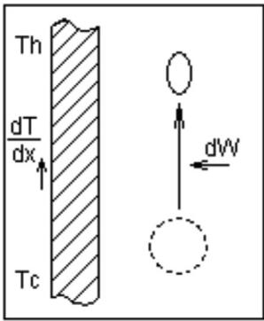  
(1)

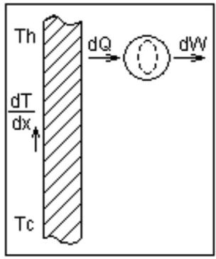  
(2)

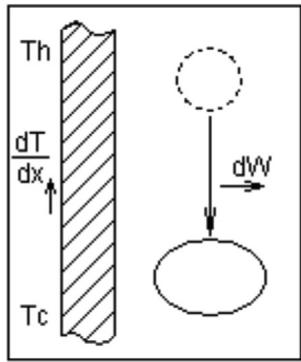  
(3)

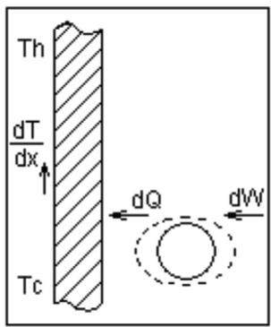  
(4)

Fig. 1. Thermodynamic processes ofstanding-wave thermoacoustic prime mover. (1-Adiabatic compression, 2-Isobaric heat-absorption, 3-Adiabatic expansion, 4-Isobaric heat-rejection).  
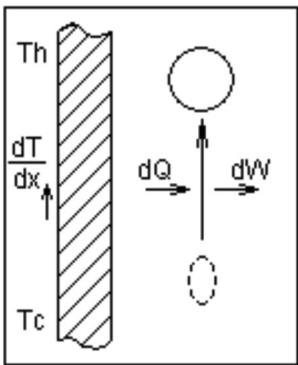  
(1)

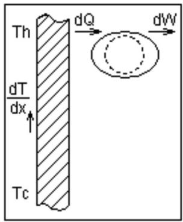  
(2)

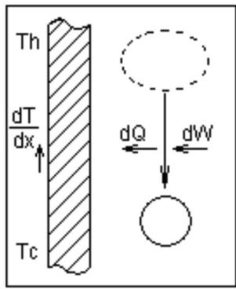  
(3)

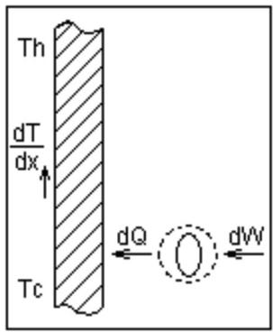  
(4)  
Fig. 2. Thermodynamic processes of travelling-wave thermoacoustic prime mover. (1-Isobaric heat-absorption, 2-Isothermal expansion, 3-Isobaric heat-rejection, 4-Isothermal compression).

Compared with the standing-wave thermoacoustic engine, the irreversibility derived from the heat transfer driven by temperature difference is avoided due to the perfect thermal contact in the regenerator of a travelling-wave system [11]. Thus, the intrinsic high efficiency of thermoacoustic conversion attracts more efforts on the travelling-wave thermoacoustic engines.

## 2.2. Eulerian view

A Lagrangian view clearly describes the thermoacoustic conversion in terms of thermodynamic cycle, and is helpful for understanding how a thermoacoustic engine operates as a prime mover or a refrigerator. However, the fluid parcels in diverse components, even in the stack or regenerator, may undergo different cycles due to the varied boundary conditions. In this section, the analysis will be made from an Eulerian view [1], focusing on what happens at a given point in space as the fluid passes by, which is widely considered better in modeling a thermoacoustic engine.

## 2.2.1. Linear thermoacoustics

Rott's work developed an original thermoacoustic theory and also brought a rapid progress in this field [1,3,13e17]. In 1988, Swift systematically expounded and summarized the thermoacoustics in the limit of low amplitudes, supposing that the time dependence of all fluctuating quantities (such as pressure, velocity, temperature) is purely sinusoidal and can be expressed in the same form as follows (with pressure as an example) [2]:

$$
p = p _ { m } + \mathsf { R e } \left[ p _ { 1 } ( x ) e ^ { i \omega t } \right]\tag{1}
$$

where the quantity with subscript m is a mean value and the one with subscript 1 is a complex function of $x ,$ which stands for both the spatial distribution of amplitude and the phase of fluctuating quantities. $e ^ { i \omega t }$ reflects the sinusoidal time dependence of fluctuating quantities. Substituting all expressions of the fluctuating quantities into the linearized momentum, continuity, and state equations, we can obtain three important equations for a short channel dx, as follows:

$$
{ \frac { d p _ { 1 } } { d x } } = - { \frac { i \omega \rho _ { m } } { 1 - f _ { \nu } } } { \frac { U _ { 1 } } { A } }\tag{2}
$$

$$
\frac { d U _ { 1 } } { d x } = - \frac { i \omega A } { \rho _ { m } a ^ { 2 } } \left[ 1 + \frac { ( \gamma - 1 ) f _ { \kappa } } { 1 + \xi } \right] p _ { 1 } + \frac { ( f _ { \kappa } - f _ { \nu } ) } { ( 1 - f _ { \nu } ) ( 1 - \mathrm { P r } ) ( 1 + \xi ) } \frac { U _ { 1 } } { T _ { m } } \frac { d T _ { m } } { d x }\tag{3}
$$

$$
\frac { d T _ { m } } { d x } = \frac { \dot { H } _ { 2 } - \frac { 1 } { 2 } \mathrm { R e } \left[ p _ { 1 } \tilde { U } _ { 1 } \left( 1 - \frac { f _ { \star } - \tilde { f } _ { \star } } { ( 1 + \xi ) ( 1 + \mathrm { P r } ) \left( 1 - \tilde { f } _ { \star } \right) } \right) \right] } { \frac { \rho _ { m } c _ { p } \left| U _ { 1 } \right| ^ { 2 } } { 2 A \omega ( 1 - \mathrm { P r } ) \left| 1 - f _ { \star } \right| ^ { 2 } } \mathrm { I m } \left[ \tilde { f } _ { \nu } + \frac { \left( f _ { \star } - \tilde { f } _ { \nu } \right) ( 1 + \xi f _ { \star } / f _ { \star } ) } { ( 1 + \xi ) ( 1 + \mathrm { P r } ) } \right] - ( A K + A _ { s } K _ { s } ) }\tag{4}
$$

where $p _ { 1 }$ and $U _ { 1 }$ are the pressure and velocity amplitudes, u is the angular frequency, $\rho _ { \mathrm { m } } , T _ { \mathrm { m } } , c _ { \mathrm { p } } , \gamma , K$ and Pr are the mean density, the temperature, the specific heat at constant pressure, the specific heat ratio, the thermal conductivity and the Prandtl Number of working fluid, respectively. $f _ { \mathrm v }$ and $f _ { \kappa }$ are the viscous and thermal functions, A is the flow area of the channel, $A _ { s }$ and $K _ { s }$ are the cross section area and thermal conductivity of the solid forming the channel, $\dot { H } _ { 2 }$ is the total power, x is a quantity presenting the effect ofspecific heat and thermal conductivity of the channel solid on the heat transfer between the working fluid and the channel (x equals to zero for ideal solid with infinite specific heat and thermal conductivity) [2]. i is the imaginary unit, Re, Im and superscript \~ mean the real part, the imaginary part and the conjugation of a complex quantity. In the above equations of linear thermoacoustics, Eqs. (2)e(3) are in the first order, while Eq. (4) is in the second order.

Linear thermoacoustics possesses many advantages. In the viewpoint of mathematics, using the form of Eq. (1) to express the fluctuating quantity aims for separating the spatial independent variable x from the temporal independent variable t. Substituting the expressions like Eq. (1) to the governing equations, the partial differential equations in the time domain are transformed into the ordinary differential equations in the frequency domain. The complete equations are capable of describing the thermoacoustic stack and regenerator, and the equations with a few modifications are appropriate for other thermoacoustic components, such as heat exchangers and resonant tube. The viscous and thermal functions are integrated over the flow area. Thus, although Eqs. (2)e(4) constitute a one-dimensional model, which can reflect the influence of channel's spatial geometry on the conversion between the heat and acoustic energies and predict the thermoacoustic performance of various stacks and regenerators. Combined with the boundary conditions of thermoacoustic components, Eqs. (2)e(4) can be used to simulate a thermoacoustic machine, and the system design and optimization can be carried out with the simulation results.

Swift et al. contributed much on the linear thermoacoustics, including the simulation of porous stacks [21], the influence of turbulent flow on viscous resistance, the local loss caused by the variety of flow area, entrance effect, joining condition [22] and the similitude in thermoacoustics [23]. Their work improved the veracity of the simulation of thermoacoustic machines with linear thermoacoustics. A program for thermoacoustic computation DeltaEC (Design Environment for Low-amplitude Thermoacoustic Energy Conservation) was developed to simulate and design thermoacoustic engines and refrigerators with ordinary geometries, and is helpful for practical application of the linear thermoacoustics [24]. In addition, for electroacoustic analogy, Swift rewrote Eqs. (2)e(3) as:

$$
\frac { d p _ { 1 } } { d x } = - ( i \omega l + r _ { \nu } ) U _ { 1 }\tag{5}
$$

$$
\frac { d U _ { 1 } } { d x } = - \bigg ( i \omega c + \frac { 1 } { r _ { \kappa } } \bigg ) p _ { 1 } + e U _ { 1 }\tag{6}
$$

$$
l = \frac { \rho _ { m } } { A } \frac { 1 - \mathsf { R e } ( f _ { \nu } ) } { \left| 1 - f _ { \nu } \right| ^ { 2 } }\tag{7}
$$

$$
c = \frac { A } { \gamma p _ { m } } \left[ 1 + ( \gamma - 1 ) \mathrm { R e } \left( \frac { f _ { \kappa } } { 1 + \xi } \right) \right]\tag{8}
$$

$$
r _ { \nu } = \frac { \omega \rho _ { m } } { A } \frac { \mathrm { I m [ - } f _ { \nu } ] } { \left| 1 - f _ { \nu } \right| ^ { 2 } }\tag{9}
$$

$$
r _ { \kappa } = \frac { \gamma } { \gamma - 1 } \frac { p _ { m } } { \omega A \mathrm { I m } ( - f _ { \kappa } / ( 1 + \xi ) ) }\tag{10}
$$

$$
e = { \frac { f _ { \kappa } - f _ { \nu } } { ( 1 - f _ { \nu } ) ( 1 - \mathrm { P r } ) ( 1 + \xi ) } } { \frac { 1 } { T _ { m } } } { \frac { d T _ { m } } { d x } }\tag{11}
$$

where $l , c , r _ { \nu } , r _ { \kappa } ,$ and e are the inertance, the compliance, the viscous resistance, the thermal-relaxation resistance and the proportionality coefficient of a controlled source, respectively. The electroacoustic analogy makes it possible to analyze the thermoacoustic systems with circuit analysis technique.

However, the linear thermoacoustics built on the Eulerian viewpoint is suitable only for the steady operation of a thermoacoustic system at low amplitude. For the case of high-amplitude oscillation, the phenomena such as amplitude saturation, frequency shift and streaming have been observed in many experimental thermoacoustic apparatuses, where nonlinear thermoacoustics is of great necessity. In fact, most phenomena in thermoacoustic systems, including self-excited oscillations and time-averaged energy effect, are assumed to be nonlinear.

## 2.2.2. Nonlinear thermoacoustics

As a branch of nonlinear acoustics, nonlinear thermoacoustics began in 1990s. Karpov and Prosperetti from Johns Hopkins University have done much outstanding work [25e28]. They adapted the momentum, continuity and energy equations with nonlinear terms to build a nonlinear thermoacoustic model in the time domain. Their model can quantitatively describe the evolution of the initial linear instability to the nonlinear regime and finally to the saturation state of finite amplitude, and can also supply a quantitative explanation on the frequency shift of thermoacoustic systems. It is a universal model, with which thermoacoustic engines, electroacoustically and thermoacoustically driven thermoacoustic refrigerators can be simulated. In addition, some modifications of the model improve the stability of numerical simulation. The results of the computation show the onset of selfexcited oscillations accompanied by an increase in the dynamic pressure. Ma calculated the nonlinear wave propagation in a composite thermoacoustic tube [29]. Novel mathematical techniques were developed to solve the Riemann equations in the case unsuitable for conventional methods, finding exact solutions for different tube configurations including the thermoacoustic stacks loaded with temperature gradient. Hamilton et al. from the

University of Texas at Austin developed a two-dimensional model and efficient solution algorithm are developed for studying nonlinear effects in a thermoacoustic engine, where the crosssectional area of the resonator may vary with position along its axis [30]. Reduced model equations were obtained by ordering spatial derivatives in terms of rapid variations across the pores in the stack, versus slow variations along the resonator axis. The solution algorithm achieved a high efficiency since the stability condition for numerical integration of the model equations was related to resonator length rather than pore diameter, leading to a reduced computation time by several orders of magnitude without sacrificing spatial resolution.

Commercial CFD (computational fluid dynamics) software has also been employed to deal with the nonlinear thermoacoustic model. Nijeholt et al. conducted an axisymmetric 2-D simulation of an assumed travelling-wave thermoacoustic engine, by using ANSYS's computational fluid dynamics code CFX 4.4 to solve the governing unsteady NaviereStokes equations and the equation for total enthalpy [31].

The quantitative description of nonlinear behavior features of thermoacoustic systems is helpful for understanding thermoacoustic phenomena and then for optimizing thermoacoustic machines. The use of commercial CFD software can help to capture the DC flow and the formation of a vortex which cannot be obtained by the existing linear theory. This is a significant step towards the development of nonlinear simulation tools for the high-amplitude thermoacoustic systems that are needed for practical use. However, the clear analysis of nonlinear model needs a great deal of abstruse mathematics knowledge and skill, and the veracity of computation results still needs to be verified by more experiments.

## 3. Research advances in thermoacoustic engine

Thermoacoustic phenomena have a history of over two centuries, however, most research progresses were achieved in past half century. The recent prosperity could be attributed to the invention of many thermoacoustic engine prototypes with potential practical applications, instead of for demonstration only. The worldwide research advances in thermoacoustic engine are presented in details in this section.

## 3.1. Thermoacoustic prime mover

## 3.1.1. Standing-wave thermoacoustic prime mover

In 1960s, the introduction of “stack” to a resonant tube by Carter and his colleagues and the further work by Feldman led to the early prototype of a standing-wave thermoacoustic prime mover, which produced 27 W of acoustic power from 600 W of heat [2].

A more practical prototype was built at LANL (Los Alamos National Laboratory) in 1990s. Fig. 3 presents an experimental setup built by Swift et al., which mainly consisted ofa heater, a stack, a cold heat exchanger and a resonator, with a load composed of a needle valve and tank at its right end [32]. The length and inner diameter of resonator is 4320 mm and 127 mm, respectively. Charged with gas helium of 1.38 MPa, the acoustic power of 630 W was achieved from a heat input of 7 kW, i.e., its efficiency reached 9%.

Another standing-wave thermoacoustic prime mover (shown in Fig. 4) was built in the National Center for Physical Acoustics in University of Mississippi in early 1990s for measuring the characteristics of thermoacoustic system [33]. Specific acoustic impedance at the mouth of the prime mover was measured as a function of the temperature difference between the hot and cold heat exchangers. The theoretically predicted radiation impedance of an open tube was compared to the measured impedance curves. Based on the theoretical results that the thermoacoustic gain as well as the thermal and viscous losses could be expressed in terms of a thermoviscous dissipation function, they also analyzed the stability of the spontaneous acoustic oscillations [34]. The onset temperature and resonance frequency for a helium-filled thermoacoustic engine were computed and measured as a function of the ambient pressure. Besides the standing-wave thermoacoustic system, they also investigated other types of systems, including the experimental work on a thermoacoustic termination of a travelling-wave tube, the theoretical analysis and experiment of a radial wave thermoacoustic engine in cylindrical resonator [35,36].

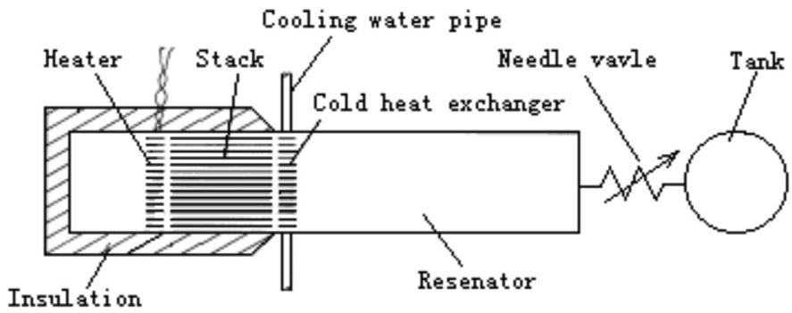  
Fig. 3. Schematic of the standing-wave thermoacoustic engine built at LANL [32].

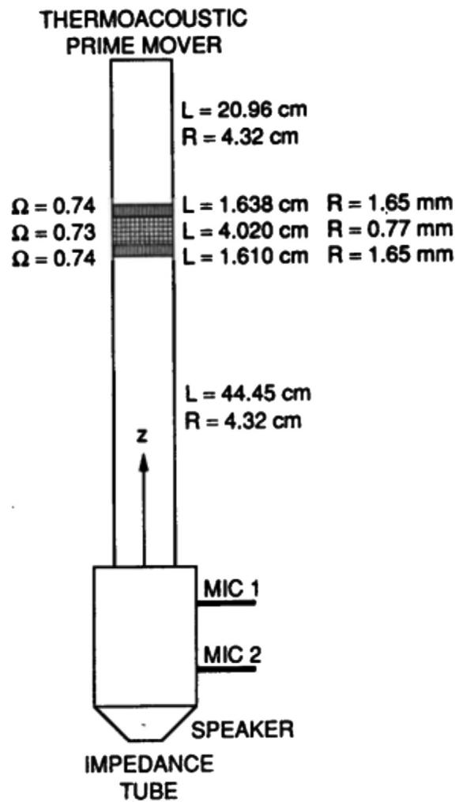  
Fig. 4. Thermoacoustic prime mover built in the National Center for Physical Acoustics in University of Mississippi [33].

In 1998, a standing-wave thermoacoustic engine powered by solar energy (shown in Fig. 5) was built by Chen and Garrett from

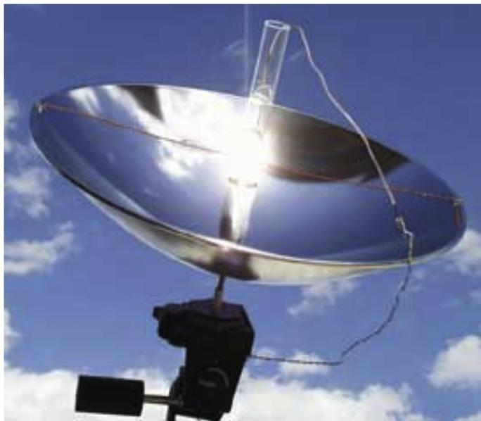  
Fig. 5. Garrett's solar energy powered thermoacoustic engine [38].

PSU (Pennsylvania State University) [37,38]. Sunlight was focused by a 3-foot-diameter lens to one end of a ceramic stack. With a oneend-open 40-cm-length resonant tube, this 1/4 wavelength system emitted the sound of 420 Hz, with an intensity of 120 dB at the point 1 m distant from the open end. The success of this prototype proved the feasibility of thermoacoustic engines driven by solar energy, a clean and environmentally benign energy.

Matsubara's group started the experimental study on a standing-wave thermoacoustic prime mover with two equivalent thermoacoustic cores at both ends of the resonant tube [39]. They focused on the optimization of the components' structure, including screen mesh number, hot buffer volume and resonant tube diameter. A ratio of about 0.35 between the thermal penetration depth of working fluid and the hydraulic radius of matrix was experimentally shown optimal for thermoacoustic conversion to supply suitable imperfect thermal contact to the standing-wave thermoacoustic effect, which provided a good reference to determining the stack dimension. An acoustic power output of 26 W was achieved from their engine with a heating input of 833 W, where a combination of needle valve and buffer volume was adopted to measure the acoustic power output. Later, a spring-supported piston (symmetrically dual piston-cylinder configuration) was proposed to substitute the long resonant tube and feedback inertance tube in the loop, helping to reduce the dimension of the whole system [40] (shown in Fig. 6). However, it is a pity that the piston violates the no-moving-component advantage of a thermoacoustic system.

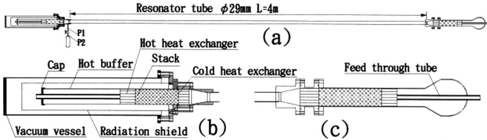  
Fig. 6. Standing-wave thermoacoustic prime mover by Matsubara [40]. (a) Integral configuration; (b) and (c) Magnified view of the left and right parts.

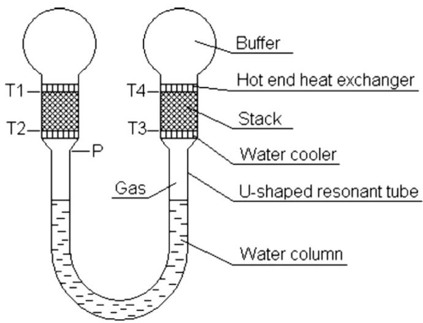  
Fig. 7. Schematic of a standing-wave thermoacoustic engine with a water column by Tang et al. [49].

Chen's group in ZJU (Zhejiang University) started the research on thermoacoustics in mid 1990s. The first topic was a standingwave thermoacoustic prime mover with a symmetrically heating configuration [41]. The amplitudes of pressure oscillation of 3e10% of the mean pressures and the pressure ratios of 1.06 and 1.10, as well as the frequencies of 70 Hz and 25 Hz, were achieved for the working fluids of helium and nitrogen, respectively. Special effort was also devoted by Chen and Jin on the onset and damping behaviors of the oscillation in the thermoacoustic prime mover [42]. Instead of the traditional notion that the damping point coincides with the onset one, the lags between the onset temperature and the damping temperature was found in the thermoacoustic oscillation. A hysteretic loop due to the temperature difference was then recognized for the first time. The influence of the resonance tube geometry shape on the performance of thermoacoustic engine was also studied by Bao et al. [43].

The onset characteristics of a standing-wave thermoacoustic engine has also been studied based on both thermodynamic analysis and circuit network theory [44,45]. Qiu et al. used liquid nitrogen to enhance the thermoacoustic oscillation at cryogenic temperature [46]. Compared with a conventional thermoacoustic engine driven by high-temperature heat sources, the onset temperature difference along the stack significantly decreases and the resonant frequency is also lower.

In order to reduce the resonant frequency and enhance the pressure amplitude, a standing-wave thermoacoustic engine containing a liquid column was theoretically studied [47,48] and also developed for experiments [49]. The schematic of an engine with a water column is illustrated in Fig. 7. Compared with the same apparatus using nitrogen gas, the introduction of a 1.5 kg water column resulted in a drop of resonant frequency by 79.0% and a rise of pressure amplitude by 157.4%, while for the case of helium gas, a drop by 91.4% and a rise by 208.3% were achieved, respectively. Later, HCOOK aqueous solution and [EMIM][BF ] were also introduced as working liquids to observe the onset characteristics of the engine [50].

Yu et al. from Chinese Academy of Sciences studied a standingwave thermoacoustic engine with the working frequency as high as 300 Hz [51]. It was numerically and experimentally proved that the higher mean pressure and the longer stack length are essential to the thermal efficiency, which provides a good reference to building an efficient standing-wave thermoacoustic heat engine for highfrequency operation. The effect of coiling on the sound losses through the resonant tube was experimentally investigated by Yang et al. [52]. The straight tube was proved to induce least transmission loss followed by 90- bend tube, U-shaped tube and coiled tube, but was claimed to occupy most space.

He et al. from Xi'an Jiaotong University provided a new explanation about the onset and damping behaviors in a standing-wave thermoacoustic engine, which was experimentally verified by the results that the temperature differences drop with the decreasing tilted angle [53].

With the help of state-of-the-art measurement techniques, researchers are exploring more effective methods to study the flow and heat transfer processes in thermoacoustic systems. Pan et al. visualized the flow and heat transfer processes in a standing-wave thermoacoustic engine by thermal infrared imager and PIV [54]. Jaworski's group comprehensively discussed the temperature and velocity fields in the parallel-plate heat exchangers for a standingwave thermoacoustic device (shown in Fig. 8) [55e57]. Planar laser-induced fluorescence measurement was used to validate the heat transfer process suggested by numerical approach. The optimal performance of heat exchangers was studied by both numerical and experimental methods when the gas displacement amplitude was comparable with the lengths of hot and cold heat exchangers in magnitude.

## 3.1.2. Travelling-wave thermoacoustic prime mover

The original concept of travelling-wave thermoacoustic machines was proposed by Ceperley in late 1970s [11]. The related effort on experiments did not result in any sound amplification until Yazaki et al. built up a loop thermoacoustic engine in 1998, as shown in Fig. 9 [58]. Spontaneous gas oscillation took place when the hot end temperature exceeded a threshold value. The operating frequency of 268 Hz shows that the oscillation is of the acoustic travelling-wave mode with $\lambda = \mathrm { L } / 2$ (the second mode)

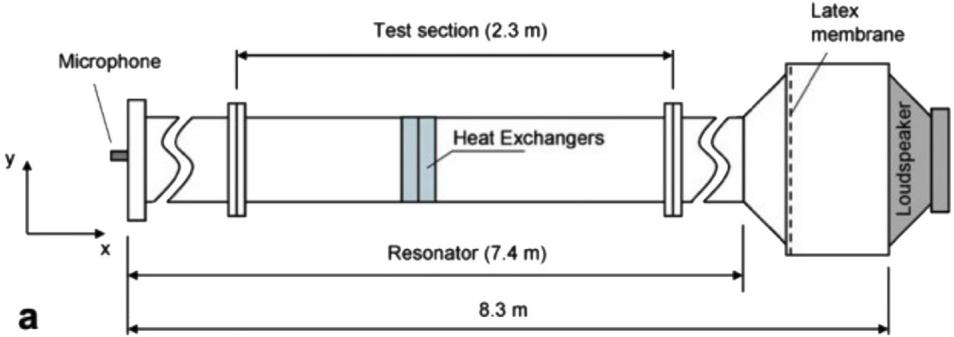

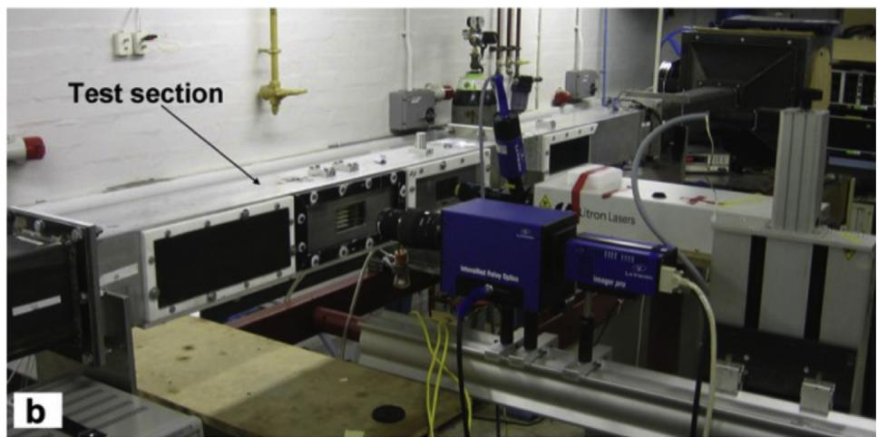  
Fig. 8. Schematic of experimental apparatus (a) and a close-up of the test section (b) by Jaworski et al. [54].

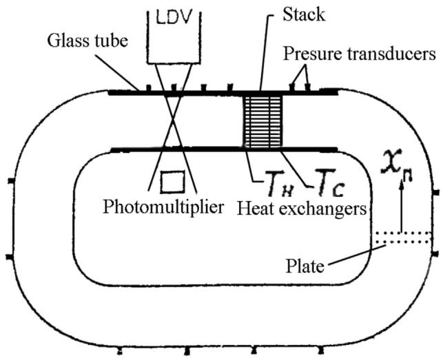  
Fig. 9. Yazaki's loop travelling-wave thermoacoustic engine [58].

running around the loop through the stack from the cold end to the hot end. The loop can be blocked by a thin, flat and rigid plate, leading to a resonant tube with both ends closed. The spontaneous gas oscillations of this standing-wave mode with the same wavelength $( \lambda = \operatorname { L } / 2 )$ and frequency (around 268 Hz) as travellingwave mode was realized by adjusting the position of blocking plate along the loop. The boundaries between the oscillatory and non-oscillatory regions for both cases are presented in Fig. 10, with $T _ { H } / T _ { C }$ and ut as its coordinates, where $T _ { H }$ is the hot end temperature, $T _ { C }$ is the cold end temperature, u is the angular frequency, $\tau = r ^ { 2 } / 2 a$ is the thermal relaxation time, r is the characteristic transverse dimension of channel, and a is the thermal diffusivity.

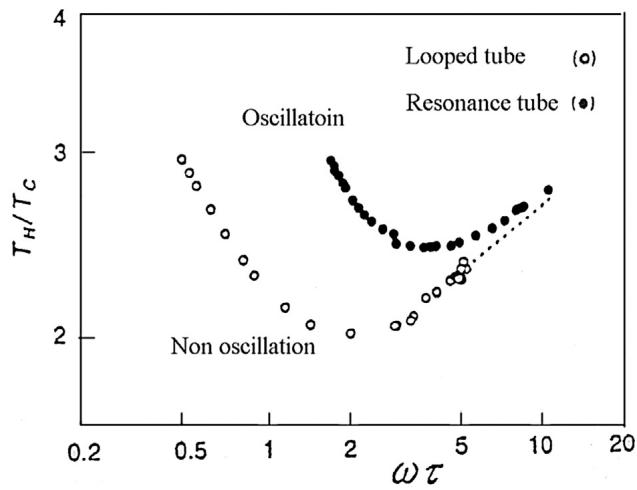  
Fig. 10. Stability boundary of standing and travelling-wave thermoacoustic engines [58].

Yazaki's prototype was the first apparatus to achieve positive power amplification in a looped tube after the travelling-wave configuration was proposed by Ceperley. Stability boundary observation showed that the onset temperature ratios were significantly smaller than those for the engine with a standingwave resonator. Through measuring the pressure and velocity of the gas in a resonator, they also observed the work done by gas parcels to flow out of the stack with a temperature gradient, which was the first reported measurement of the work flow and the work source in thermoacoustic oscillation. Unfortunately, even though they had realized the problems of impedance matching, no countermeasure was proposed. Other problems (say Gedeon streaming and Rayleigh streaming) existing in the Yazaki-type loop also seriously deteriorated the system's efficiency.

An annular thermoacoustic prime mover (shown in Fig. 11) was built up by Gusev's group at the University of Maine in late 1990s [59]. The preliminary effort was devoted to the transient nonlinear phenomena. A double-threshold effect during the amplification regime was observed in their experiments. The acoustic pressure amplitudes at fundamental frequency during a double-threshold amplification regime for different increments is shown in Fig. 12, with the solid, dotted, dashed and dash-dotted lines representing a temperature increment of 7, 9, 12 and 14 K, respectively. The first threshold, corresponding to the setting of thermoacoustic instability, was followed by a saturation regime. Then, after a time delay, without any change in the control parameters, a second threshold corresponding to an additional amplification was observed at a relatively low temperature difference.

The theory of acoustic streaming in an annular thermoacoustic prime mover was also developed [60,61]. Without any externally imposed pressure gradient, the circulation of fluid was predicted to occur above the threshold for travelling-wave excitation and the heat flux carried by this directional mass flow inside the thermoacoustic stack might exceed (or be comparable with) the heat flux associated with the acoustically induced rise in the thermal diffusivity of gas. Acoustic streaming in a steady-state thermoacoustic device was also derived in the case of zero secondorder time-averaged mass flux across the resonator section (nonlooped device), yielding the analytical expressions for the timeindependent second-order velocity, the pressure gradient, and the time-averaged mass flux in the fluid supporting a temperature gradient and confined between widely and closely separated solid boundaries. The investigation also demonstrated that the excitation of acoustic streaming did not necessarily imply a drop in the engine's efficiency, under some heating conditions. Furthermore, a simplified model was presented, focusing on the wave amplitude growth from the coupled equations for describing the thermoacoustic amplification and the unsteady heat transfer [62,63].

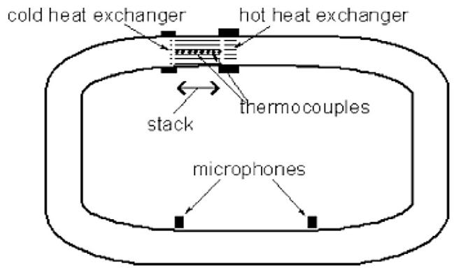  
Fig. 11. Schematic of the experimental annular thermoacoustic prime mover [59].

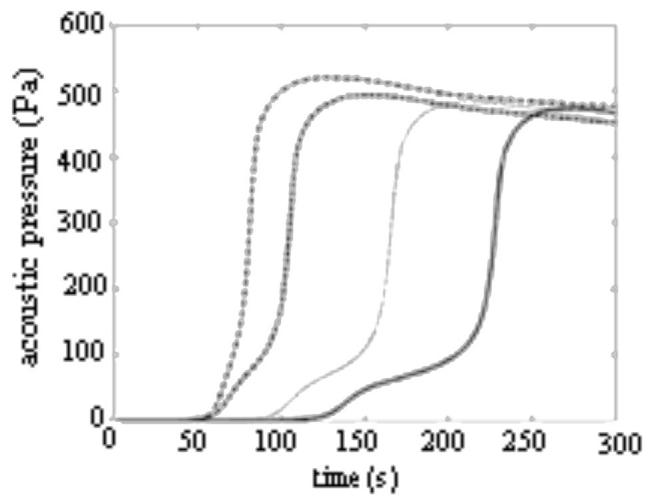  
Fig. 12. Acoustic pressure amplitude at fundamental frequency during doublethreshold amplification [59].

A breakthrough for the travelling-wave thermoacoustic prime mover was the invention of TASHE (Thermoacoustic Stirling Heat Engine) by Backhaus and Swift in 1999 [19,64]. As shown in Fig. 13, a loop was connected to one end of the standing-wave resonant tube. A regenerator, along with three heat exchangers (including main and secondary cold heat exchangers, hot heat exchanger), was placed in the travelling-wave field inside a loop. The prototype delivered 710 W of acoustic power from the loop to the resonant tube with a thermal efficiency of 0.30 (42% of Carnot efficiency), comparable to that of a traditional internal combustion engine (0.25e0.4) and a piston-driven Stirling engine (0.20e0.38) [19]. At the most powerful operating condition (with the relative pressure amplitude of 0.10), 890 W of acoustic power was delivered to the resonator with a thermal efficiency of 0.22. The originality on the TASHE was awarded “R&D 100” of USA in 1999.

Given the model described by Backhaus and Swift, de Waele developed the basic treatment of the onset conditions and transient effects in thermoacoustic Stirling engines [65]. If the hot-end temperature is assumed constant, the dynamics of the system can be described by a fourth-order differential equation which determines the damping, growth, or stability of oscillations. Transient effects were discussed based on the numerical integration of dynamic equations.

TASHE is a successful combination of modern thermoacoustics prospective and Ceperley's concept. Distinctive design assured a high acoustic impedance at the location of regenerator. The success ofTASHE should also owe to the depression ofextra heat loss due to acoustic streaming (such as Gedeon [66] and/or Rayleigh streaming [67]). The jet pump above the cold end of regenerator in Backhaus-Swift design can depress the Gedeon streaming through a reverse pressure drop $\Delta p ,$ which origins from the different flow resistance coefficients $\mathrm { K } _ { \mathrm { i n } }$ and $\mathrm { K _ { o u t } }$ due to the difference between the inlet and outlet flow areas. A tapered tube was proposed to depress the Rayleigh streaming, due to large temperature gradient along the thermal buffer tube between the hot ends of the regenerator and of the secondary heat exchanger, through varying the cross section area along the tube, which might reduce the thermal loss from the heater directly to the secondary cold heat exchanger. The proposal of high acoustic impedance and the method to depressing the acoustic streaming might be helpful for prospective innovation efforts on thermoacoustic machines.

In order to combine the favorable features of standing-wave engines and travelling-wave engines simultaneously, Gardner and Swift proposed and constructed a cascade thermoacoustic engine, consisting of one standing-wave stage plus two travelling-wave stages in straight-line series [68]. The engine delivered up to 2 kW of acoustic power, with an efficiency (the ratio of acoustic power to heating power) up to 20%. Also in 1999, Liu et al. compared different working mechanisms of the thermoacoustic engine under travelling- or standing-wave mode, and a new scheme of thermoacoustic engine based on travelling-wave mode was proposed [69], with a configuration similar to that ofBackhaus-Swift thermoacoustic Stirling engine. Instead of an iso-diameter one as in Fig. 14(a), Fig. 14(b) shows a high pressure-ratio, energy focused thermoacoustic heat engine with a tapered resonator [70]. A pressure ratio of 1.40 was achieved from the system with the nitrogen of 1.5 MPa average pressures and a heat power of 3 kW (the heating temperature reached 670 -C). The tapered resonant cavity was proved able to suppress the occurrence of nonlinear effect and to effectively increase the pressure ratio.

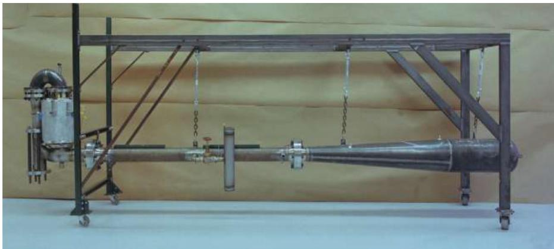  
(a) TASHE

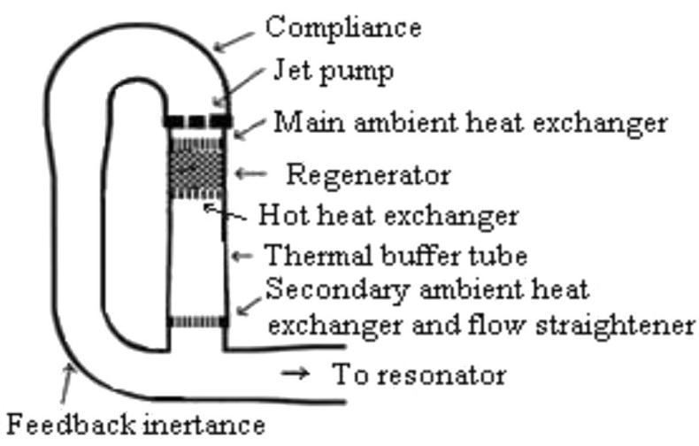  
(b) Loop structure  
Fig. 13. Backhaus-Swift's TASHE and its loop [19].

In 2005, Luo et al. introduced an “acoustical pump” or “acoustic pressure amplifier” (APA) to a travelling-wave thermoacoustic prime mover, which could significantly increase its output pressure ratio [71,72]. Tang et al. also numerically and experimentally studied the influence of the acoustic pressure amplifier dimensions on the performance of a standing-wave thermoacoustic system [73].

Starting from Jin's collaboration with Francois at LIMSI-CNRS of France [74], the cryogenic group in Zhejiang University also contributed much effort on the travelling-wave thermoacoustic prime mover. A Backhaus-Swift type travelling-wave prime mover was constructed by Sun et al., in 2005 [75]. The results showed a lower onset temperature, a higher pressure ratio and a higher efficiency, compared with the standing-wave counterparts. Charged with the nitrogen of 0.9 MPa, the maximal pressure ratio reaches 1.21 and the operation frequency is 25 Hz. The tested travellingwave thermoacoustic prime mover was then used to drive a cryocooler. In 2005, a single stage double-inlet pulse tube cryocooler driven by the thermoacoustic engine achieved a lowest refrigeration temperature of 80.9 K with an operating frequency of 45 Hz [76]. A Helmholtz resonator was introduced by Sun et al. to focus acoustic energy to its load, which showed remarkable amplification ability of pressure amplitude [77]. Performance comparison of the jet pumps with rectangular and circular tapered channels for a loop-structured traveling-wave thermoacoustic engine was carried out by Tang et al. [78].

Biwa, who originally worked for Nagoya University and then joined Tohoku University, had much collaboration with Yazaki from Aichi University of Education. They started from the measurement of work flow in a thermoacoustic engine. Besides the development of an experimental technique to determine the work flow, they emphasized on the proper and accurate evaluation of the possible correction terms involved in the work flow through the measurements of pressure and velocity oscillation. Based on the same apparatus, the successive transitions from the standing-wave mode to travelling-wave mode through the quasiperiodic state with an increasing non-equilibrium parameter $\mathrm { Q _ { H } }$ (axial heat flow) were also observed and analyzed [79]. Biwa et al. measured the acoustic streaming in a looped-tube thermoacoustic prime mover equipped with an asymmetric jet pump [80]. The time-averaged mass flow velocity was determined using visualization methods and using acoustic field measurements. The heat loss was observed through reversing the jet pump orientation, while the influence of acoustic streaming was studied from the performance of a looped-tube cooler. They also presented an experimental method for predicting the critical temperature ratio of a thermoacoustic Stirling engine using quality factor measurements [81,82]. The results showed that the critical temperature ratio dropped from 1.76 to 1.19 by five differentially heated regenerators.

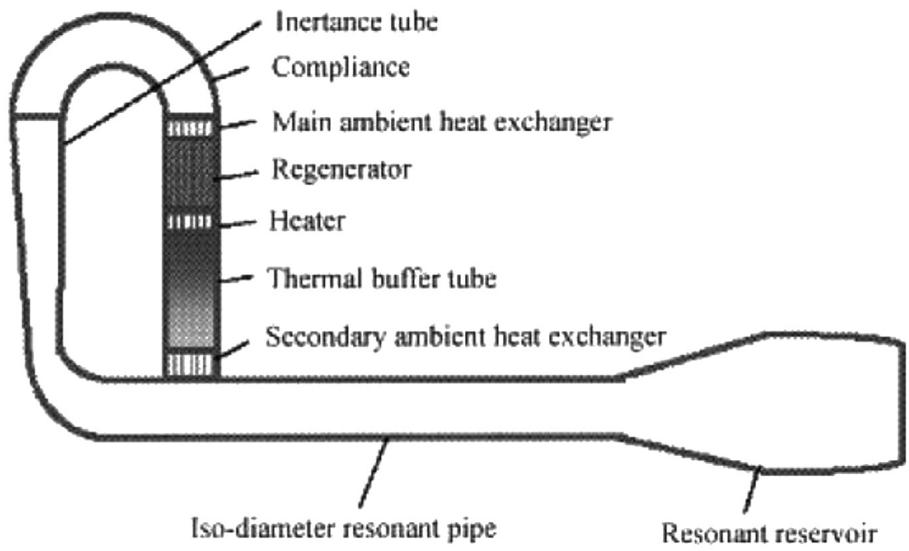  
(a) Backhaus-Swift configuration

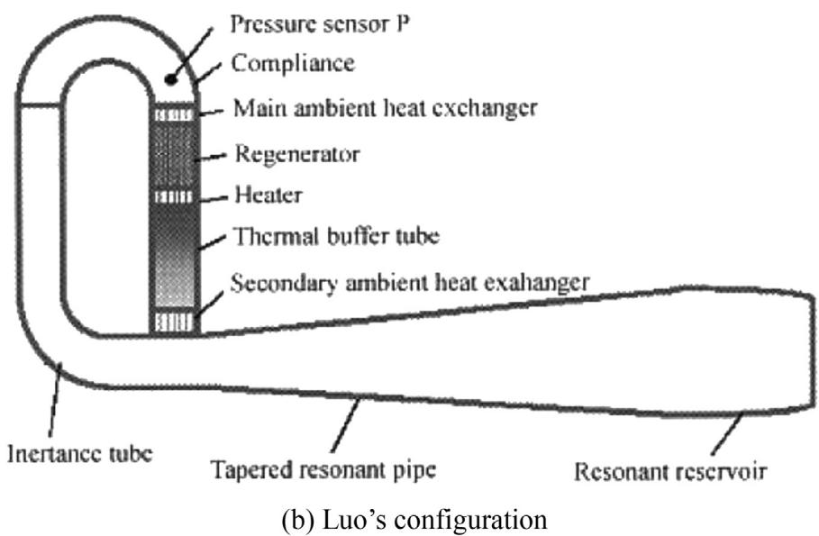  
Fig. 14. Energy focused thermoacoustic Stirling heat engine with a tapered resonator [70].

In 2010, a novel 4-stage travelling-wave thermoacoustic prime mover were presented by de Blok [83,84], where the acoustic impedance in regenerators was improved by increasing the heat transfer area inside the regenerators, as shown in Fig. 15. When using helium or argon at 2.1 MPa as working fluid, the minimum onset temperature difference (between hot heat exchanger and cold heat exchanger) was 42 K or 26 K, respectively. At a temperature difference of 90 K, the acoustic loop power was raised up to 250 W at 2.5% drive ratio (measured at the input of the regenerator units) for argon and to 140 W at 3.4% drive ratio for helium, respectively. Recently, the present authors built a 4-stage looped thermoacoustic engine, and a lowest onset temperature difference was 32 K for helium of 2.3 MPa and 17 K for carbon dioxide of 1.0 MPa. Besides, a 2-stage looped thermoacoustic engine as shown in Fig. 16 was also tested, whose lowest onset temperature difference was 51 K for helium of 2.3 MPa and 26.2 K for carbon dioxide of 1.0 MPa. At 90 K temperature difference for helium of 2.3 MPa, the 2-stage system and the 4-stage system achieved a pressure ratio of 1.07 and 1.078, respectively. Interestingly, the input power of the 2-stage system and the 4-stage system were 800 W and 3200 W, respectively, which indicates that the efficiency of the 2- stage system appears to be higher than that of the 4-stage system.

A gaseliquid, double-acting travelling-wave thermoacoustic heat engine (shown in Fig. 17) was proposed by Luo's group [85]. The performance of this novel system is much better than the traditional one. It was claimed a very enabling technology due to its high reliability, simple structure, and high efficiency. Similarly, a 2- stage traveling-wave thermoacoustic engine was constructed by Kang et al. [86]. A series of results in the multi-stage thermoacoustic systems were also reported by Jaworski's group [87e89] and Japanese groups [90,91], which are part of most exciting advances in recent years.

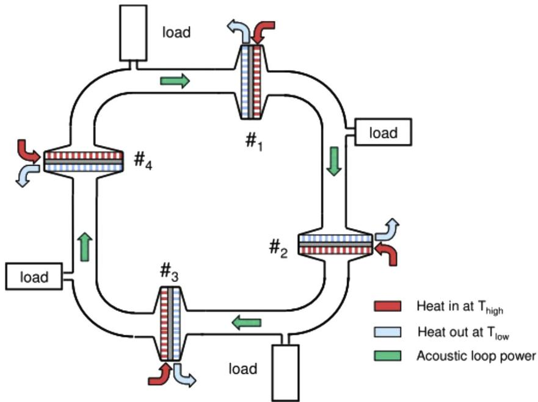  
Fig. 15. Schematic of 4-stage travelling-wave thermoacoustic power generator by de Blok [83].

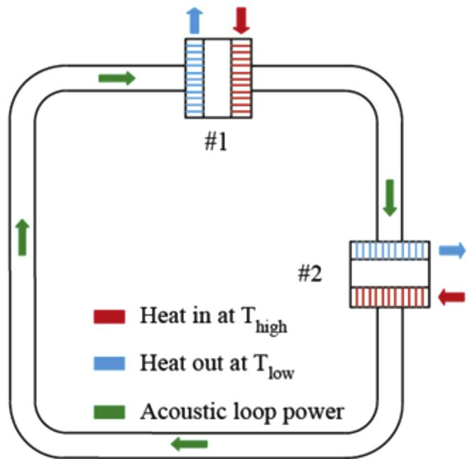  
Fig. 16. Schematic of 2-stage travelling-wave thermoacoustic engine by Jin et al. at ZJU.

## 3.2. Thermoacoustic refrigerator

Thermoacoustic refrigeration, by imposing acoustic oscillations onto a gas to cause heat pumping or refrigeration effect, has a reversed thermodynamic cycle and a briefer history, compared with the thermoacoustic prime mover. This novel refrigeration is a technology that can provide cooling to required temperature level without using any environmentally harmful substance [92]. Thermodynamic analysis and thermoacoustic analysis have been done for the optimization of both standing- and travelling-wave thermoacoustic refrigerators [93e97].

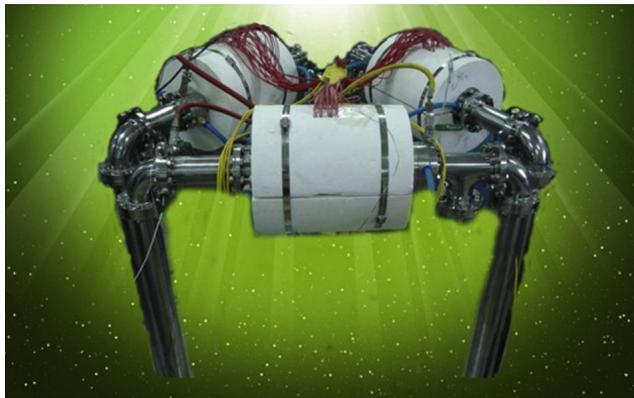  
Fig. 17. Experimental system of gaseliquid, double-acting travelling-wave thermoacoustic heat engine by Luo's group [85].

## 3.2.1. Standing-wave thermoacoustic refrigerator

The early attempt on thermoacoustic engine of a LANL group led by Wheatley is the design and construction of a thermoacoustic refrigerator in the early 1980s, based on theoretical discussion of this “intrinsically irreversible acoustic heat engine” [18]. In 1982, Wheatley's group started to construct a highly controlled experimental test bed for thermoacoustic theory, orientating for a practical thermoacoustic refrigerator. Unfortunately, the death of Wheatley ceased the efforts at LANL on this novel refrigerator. The remaining work was then shifted to Naval Postgraduate School and completed by Hofler during his Ph.D. program [98]. A simplified model of a thermoacoustic refrigerator was given by Hofler, shown in Fig. 18. The refrigerator system mainly includes a gas-filled resonator, a driving loudspeaker, and a stack of plates with one end thermally anchored at room temperature. The “stack of plates” was a long strip of plastic (Kapton) sheet, spirally wound around a plastic rod with a spacing between the layers of plastic sheet (roughly 4 times of thermal penetration depth). Each of the two heat exchangers was made of rectangular copper strips reaching across the stack ends. The “Hofler resonator”, comprising a largediameter section, a small-diameter section and a sphere in series, was essentially a quarter wavelength resonator. Charged with the helium of 10 bar, the system resonated at about 500 Hz (the exact value depending on $\mathrm { T _ { c } ) _ { \cdot } }$ . The electroacoustic power transducer used to drive the refrigerator was a modified high-fidelity midrange loudspeaker, which could deliver 13 W of acoustic power to the resonator. The lowest refrigeration temperature reached was 200 K, corresponding to a temperature ratio $\mathrm { T _ { c } } / \mathrm { T _ { H } } = 0 . 6 7$

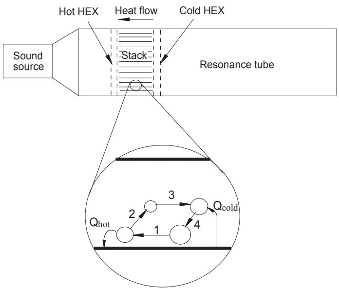  
Fig. 18. Simplified model of thermoacoustic refrigeration [98].

The highest measured efficiency relative to Carnot's (COP (coefficient of performance) COP/COP ) was 12%. Here $C O P = \dot { Q } _ { e l e c } / \dot { W } _ { a c }$ , with $\dot { Q } _ { e l e c }$ and $\dot { W } _ { a c }$ the applied heat load and measured acoustic power delivered to the resonator by loudspeaker, respectively.

Besides the electroacoustic loudspeaker, other acoustic oscillation generators can also be used to drive a thermoacoustic refrigerator, such as thermal energy or solar energy powered thermoacoustic prime mover. Fig. 19 shows a heat-driven acoustic refrigerator (also known as “the beer cooler” [2]), which includes a 37-cm-long tube, closed at the top and open at the bottom into a large spherical bulb, containing 0.3-MPa helium gas. Nearest to the top, there are a stack of plates and two sets of heat exchange strips. The lower heat exchanger strips are held at ${ 2 3 ^ { \circ } C }$ by circulating the cooling water through a collar around the outside ofthe case. When the temperature at the hot heat exchanger is sufficiently high, the top stack functions as a prime mover and produces acoustic work from heat, with the helium oscillating spontaneously at about 580 Hz. Another stack and pair of heat exchangers below the prime mover stack function as a heat pump, driven by the acoustic work generated by the prime mover stack. Hence, the whole system functions as a refrigerator, with no moving part, powered by the heat delivered at high temperature.

In 2001, Tijani et al. also constructed a thermoacoustic refrigerator [99]. Their design strategy emphasized on how to reduce the number of parameters using dimensionless parameters and on making choice of some parameters, such as the operation, working fluid and stack parameters. The discussion was mainly contributed on the optimization of the components (stack, resonator, heat exchanger, acoustic driver) and on the criteria aiming for optimization. The driver was modified from a commercial loudspeaker. An adjusting piston was added to ensure the resonance of the whole system, by controlling its back volume. The setup achieved a lowest temperature of $- 6 5 ^ { \circ } \mathsf C ,$ with the helium of an average pressure 1.0 MPa and a drive ratio of 2.1%. The results showed that a lower Prandtl number might improve the COP. However, the increased mole fraction of heavy noble gas component led to a decreased cooling capacity. By using a helium-xenon mixture containing 30% xenon with an average pressure of 1.0 MPa and a drive ratio of 1.4%, a maximum performance relative to Carnot of 17% was achieved, an improvement of 70% in comparison with pure helium. Quantitative research was carried out to analyze the effect of pore dimensions. With a penetration depth approximately of 0.1 mm, the performance was measured and also calculated (by DeltaEC) with different stacks having a plate spacing between 0.15 and 0.7 mm. A plate spacing about three times of the penetration depth was concluded optimal for the thermoacoustic refrigeration, based on the separate optimization of cooling power and lowest temperature.

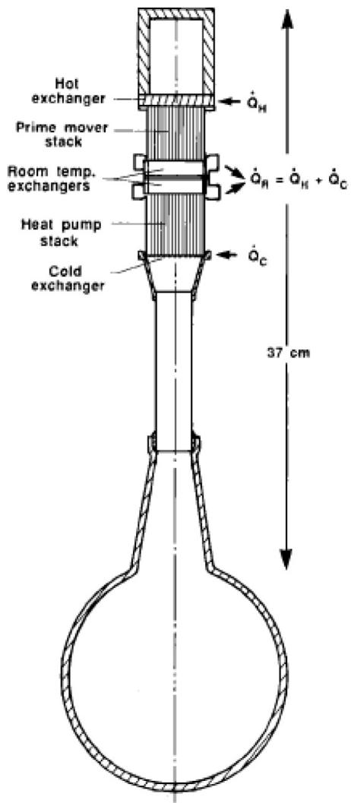  
Fig. 19. The beer cooler, a heat-driven refrigerator by Hofler [2].

The initiating scientists in PSU working on thermoacoustics came from NPS. Their projects spanned a range of topics from the development of complete prototype devices like the Ben & Jerry's ice cream freezer to the basic research, such as the experimental and numerical investigations of both the high-amplitude oscillatory hydrodynamics and the oscillatory heat exchange. Garrett's group continued their work origin from NPS, especially the thermoacoustic refrigerator for practical application, such as the thermoacoustic refrigeration at high amplitudes, including the extended performance measurement on the shipboard electronics thermoacoustic chiller (SETAC), the high-efficiency thermoacoustic driver, the nonlinear effects in the system at high amplitude, in order to achieve higher efficiency and capacity [100]. Their collaboration and combination of development, laboratory experiments, and simulations using parallel processing led to a deeper understanding than could have been achieved by the isolated explorations.

Poese and Garrett worked on a project named as “Frankenfridge”, matching a high power acoustic driver (SETAC driver, up to 100 W of acoustic power) to the resonator of a thermoacoustic refrigerator, to examine thermoacoustic refrigeration at high amplitudes [100]. As shown in Fig. 20, Frankenfridge is a well calibrated thermoacoustic device and its performance in its original configuration was thoroughly recorded, providing a good test bed for new thermoacoustic stack or heat exchanger designs. Based on the success of the SETAC, the Office of Naval Research funded a project named TRITON to develop a thermoacoustic chiller aiming for a cooling capacity of 10 kW [100], which was roughly equal to a 3-ton air conditioner.

A thermoacoustic refrigerator called STAR (Space ThermoAcoustic Refrigerator, as shown in Fig. 21) was designed and tested for NASA's space shuttle GAS (get-away-special) payload program by Atchley and Hofler [101]. The STAR was space-qualified and flown on the Space Shuttle Discovery (STS-42) in January 1992. Driven by a 400 Hz electroacoustic loudspeaker, a refrigeration capacity of 3.0 W at a temperature drop of 50 -C was achieved, with a relative COPR (coefficient of performance) of 16%. After that, another NASA-funded project to replace the LSLE (Life Sciences

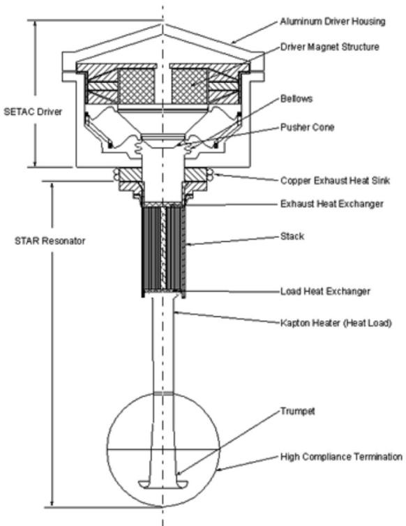

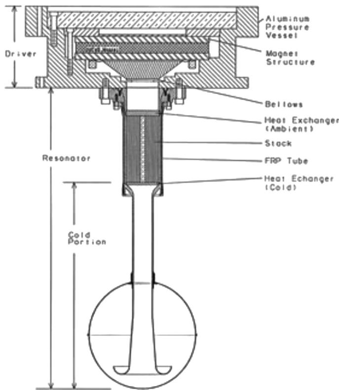  
Fig. 21. Schematic of the STAR thermoacoustic refrigerators [101].

Laboratory Experiment Refrigerator/Freezer), which was to be the TALSR (Thermoacoustic Life Sciences Refrigerator), was initiated [102]. TALSR was scheduled to have two electrodynamic loudspeakers driving opposite ends of a half-wavelength resonator that contained two stacks and four internal heat exchangers.

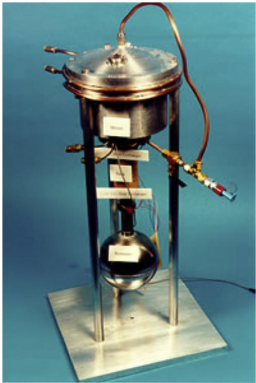  
Fig. 20. Schematic and fully constructed apparatus of Frankenfridge [100].

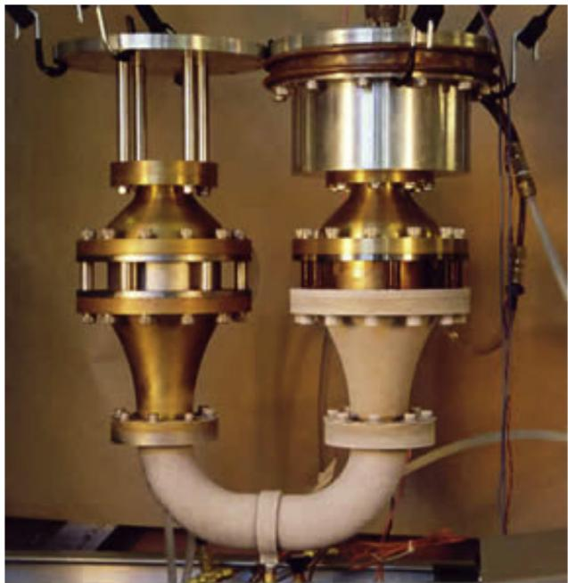  
Fig. 22. Half-way TALSR [102].

Unfortunately, the TALSR project was stopped for some unexpected reason at the half-way through the project. As demonstrated in Fig. 22, the thermoacoustic chiller was operating with only one driver and the frost can be seen extending from the bottom of right cold heat exchanger through the entire U-shaped section of the resonator. Around 1995, the same project attracted a funding from the Naval Science Assistance Program through the Office of Naval Research, and TALSR was rebuilt as a SETAC (shipboard electronics thermoacoustic chiller) [103], as shown in Fig. 23. Two custommade electrodynamic drivers are coupled to the U-shaped resonator using two dual-convolution electroformed nickel bellows to provide a flexible seal for the pistons. The resonator was pressurized to 2.07 MPa with a mixture of 94.4% helium and 5.6% argon. The refrigeration capacity was 100 times of the STAR, cooling an effective heat load of 419 W, with a sound input of 216 W from the loudspeaker.

In 2000, Adeff and Hofler [104] built and tested a solar thermal powered TADTAR (thermoacoustically driven thermoacoustic refrigerator) of a small temperature span (shown in Fig. 24). The total length of the resonant system is 0.318 m. A 0.457 m-diameter Fresnel lens focuses sunlight onto the hot end of a 0.0254 mdiameter reticulated vitreous carbon prime mover stack, heating to $4 7 5 ~ ^ { \circ } \mathrm { C }$ even without a hot heat exchanger. With an available solar heat flux of approximately 650 $\mathsf { W } / \mathsf { m } ^ { 2 }$ or 100 W from the solar collector itself, a peak acoustic pressure amplitude of 4.3% was measured and a mean pressure of 26.5 kPa was generated by the prime mover. The performance was comparable to the case with the hot and ambient ends of the prime mover at an equilibrium temperature of $4 8 0 ~ ^ { \circ } \mathrm { C }$ and $3 5 ^ { \circ } \mathsf C ,$ respectively. A largest temperature span observed in the refrigerator was $1 7 . 7 ~ ^ { \circ } \mathrm { C }$ and the total cooling power was 2.5 W at 5 -C. Later, a larger Fresnel lens (24-inch diameter) provided an increased heat power to focus sunlight at $5 5 0 ~ ^ { \circ } C$ onto the hot end of a 1-inch reticulated vitreous carbon prime mover stack. The higher-intensity sound waves then drove the thermoacoustic refrigerator to achieve a substantially improved cooling power and the temperature span had also been enlarged from 18 to $3 0 ^ { \circ } \mathsf C$

Gusev's group also made much effort on thermoacoustic refrigeration [105,106]. The coupling between electrodynamic loudspeakers and thermoacoustic cavities was analyzed to match together the components in the system, including the theoretical and experimental studies on the frequency response of the system, the acoustic power flux in the cavity and the efficiency of the coupled system. The optimal standing-wave ratio for thermoacoustic refrigeration was also analyzed and expressed directly in terms of the stack position in the resonator, the acoustic pressure level and other parameters of interest, in order to realize the optimal values of both the acoustic pressure and the particle velocity (including their relative phase). The coupling between piezoelectric loudspeaker and small thermoacoustic resonator was then investigated to optimize the acoustic energy transfer available in the resonator for the refrigeration process, based on which a new kind of thermoacoustic standing-wave-like device was proposed [107e109].

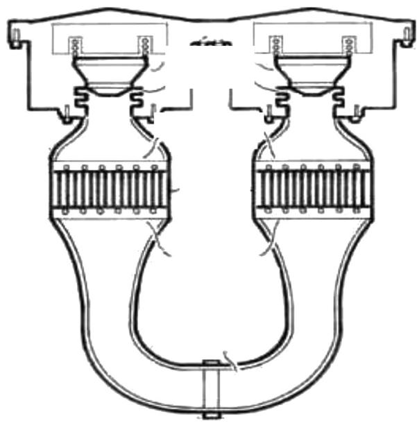  
Fig. 23. Cross-sectional diagram of SETAC [103].

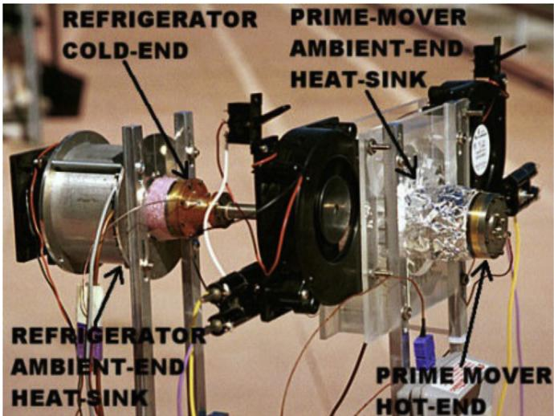

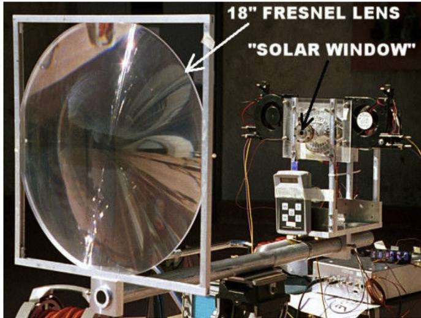  
Fig. 24. Solar energy driven thermoacoustic refrigerator and its Frensnel lens by Adeff and Hofler [104].

Blanc-Benon from Ecole Central de Lyon, together with Besnoin and Knio from Johns Hopkins University, experimentally and computationally visualized the oscillating flow field in thermoacoustic stack using PIV measurement and the results of low-Machnumber simulation, respectively [110]. In a thin-stack-plates case, the flow field around the stack edge exhibited the elongated vorticity layers, while in a thick-stack-plates case, the shedding and impingement of concentrated vortices dominated. In 2009, an analytical model of transient temperature profile in TAR was proposed, whose results obtained a good qualitative agreement with experiments [111]. Blanc-Benon and Berson also investigated the temperature fluctuation near the stack ends of a standing-wave thermoacoustic refrigerator. The influence of Peclet number on the thermal field was demonstrated [112]. The aerodynamic field between the stack and the heat exchanger in a standing-wave thermoacoustic refrigerator was characterized with a timeresolved PIV setup [113].

## 3.2.2. Travelling-wave thermoacoustic refrigerator

A travelling-wave thermoacoustic refrigerator can find similar configuration in pulse tube refrigerator family, e.g., a double-inlet pulse tube refrigerator [114]. The orifice and double inlet act as the phase shifter to provide a travelling-wave phase inside the regenerator.

In 2002, Yazaki et al. built a prototype Stirling-cycle acoustic cooler [115]. The second stack was made of ceramics with a square pore density of 1500 per square inch $( r \approx 0 . 2 7 ~ \mathrm { m m } )$ . With high acoustic impedance thermoacoustically induced in a looped tube, the tube had no moving part and only a pair of stacks sandwiched between two heat exchangers: one stack amplifying the acoustic power and the amplified wave supplying the driving energy to pump heat directly within the second stack. Calculations showed that after the optimization of the regenerator's position, length and flow-channel radius, above 60% of Carnot COP was achieved at 250 K [116]. In another occasion, a travelling-wave thermoacoustic refrigerator could achieve a lowest cooling temperature of 232 K and 20% of Carnot COP at 265 K [117].

Luo et al. developed a travelling thermoacoustic refrigerator (or called “thermoacoustic-Stirling refrigerator”), having a similar travelling-wave loop as in the thermoacoustic-Stirling heat engine [118]. As shown in Fig. 25, the refrigerator includes inertance tube, hollow cavity, hot and cold heat exchangers, regenerator, thermal buffer (like pulse tube) and feedback tube. Regulating elements were used in both ends of the thermal buffer tube to avoid turbulence. In 2003, the thermoacoustic-Stirling refrigerator was first time tested by coupling with a standing-wave thermoacoustic heat engine. At a resonant frequency of about 85 Hz, the refrigerator achieved a cooling capacity of about 30 W at ${ } _ { - 2 0 } \circ { } _ { C }$ and about 100 W at $0 ^ { \circ } \mathbb { C } .$ By simply changing the resonator length to achieve a resonant frequency of about 57 Hz, the thermoacoustic refrigerator eventually achieved a cooling power of about 80 W at $- 2 0 ^ { \circ } C .$ Later, a thermoacoustically-driven refrigerator based on double thermoacoustic-Stirling cycle (shown in Fig. 26) was also developed, i.e., the acoustic oscillation is generated by a thermoacoustic-Stirling prime mover [119]. Charged with the helium of 3.0 MPa, the refrigerator achieved a lowest temperature of about $- 6 5 ~ ^ { \circ } \mathrm { C }$ and a cooling capacity of about 270 W at $- 2 0 ^ { \circ } C$

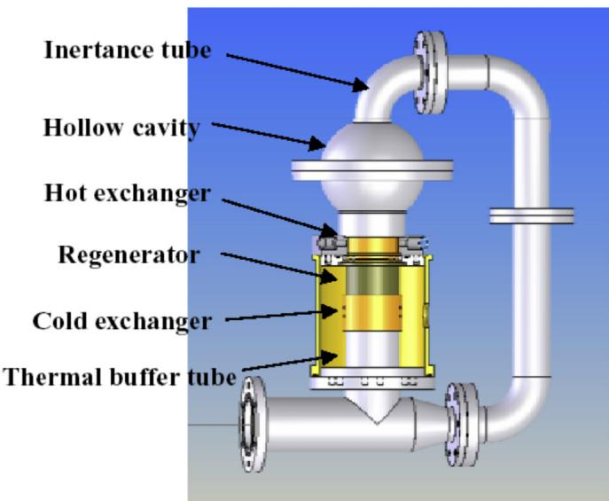  
Fig. 25. Thermoacoustic-Stirling refrigerator in Luo's group [118].

As the revival of looped tube structure in travelling-wave thermoacoustic prime movers in recent years, the looped tube structure in thermoacoustic refrigerators have aroused much interest [120e122].

## 3.3. Thermoacoustically driven refrigerator

## 3.3.1. Thermoacoustically driven pulse tube refrigerator

In 1990, Swift and Radebaugh collaborated in developing a pulse tube refrigerator driven by a thermoacoustic prime mover, instead of conventional mechanical compressor [4]. This combination led to the world's first thermoacoustically driven pulse tube refrigerator, where there is no any moving component except for the oscillating working fluid. The 10 m-long standing-wave engine with helium as working gas ran at the frequency of 27 Hz. A refrigeration temperature of 92 K was obtained from the pulse tube refrigerator, driven by a pressure ratio of 1.1 from the thermoacoustic engine. Since then, many advances have been achieved by various research groups.

Godshalk from Tektronix Company also worked on the thermoacoustically driven pulse tube refrigerator, focusing on a small scale prototype [123]. After investigating the variables affected by miniaturization, such as power output, temperature gradient and acoustic losses, the world's first 350 Hz thermoacoustic driven orifice pulse tube refrigerator was built by Tektronix, Inc., in cooperation with LANL and NIST.

Jin et al. from Zhejiang University started the work on TADPTR in 1998. A single-stage double inlet pulse tube refrigerator driven by a symmetrically heated standing-wave thermoacoustic engine was set up [124,125]. Upon optimizing the matching between prime mover and pulse tube, the above-mentioned standing-wave thermoacoustic prime mover was used to drive a coaxial single-stage pulse tube refrigerator. The preliminary effort led to the lowest cooling temperatures of 119.7 K and 117.6 K with the helium and helium-argon mixture of 2.0 MPa as the working fluids, respectively [126]. Further optimizations were made to update the system and continuous progresses were achieved in extending the lower limit of refrigeration temperature from the thermoacoustically driven pulse tube refrigerator [127]. After a series of improvements, including optimization on operating and structural parameters, a pressure ratio of 1.128 has been obtained with an operating frequency of 44.7 Hz and a mean operating pressure of 2.64 MPa, based on which a cooling temperature of 56.4 K was achieved in 2007 [128,129]. This cooling temperature was ever the lowest from a standing-wave thermoacoustically driven pulse tube refrigeration system.

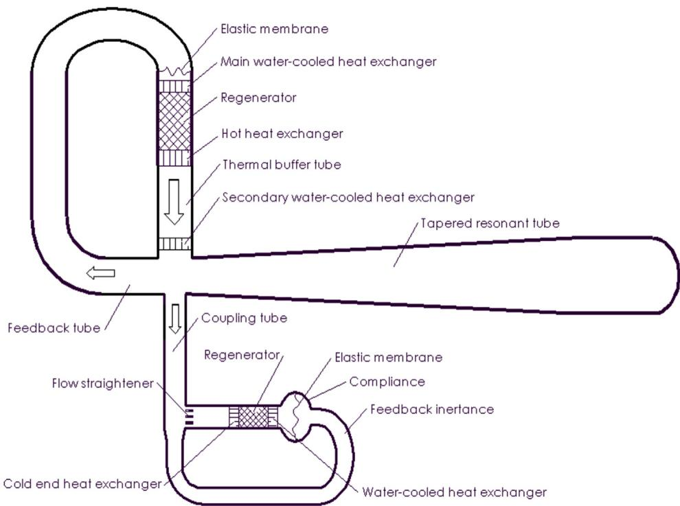  
Fig. 26. A thermoacoustically-driven refrigerator based on double thermoacoustic-Stirling cycles [119].

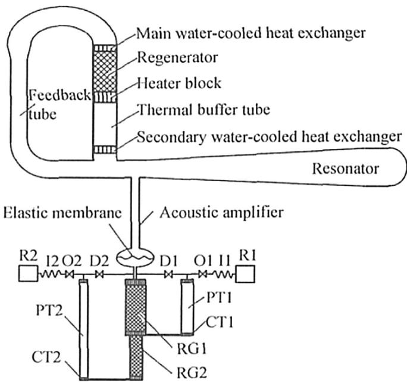  
Fig. 27. CAS's two-stage TADPTR reaching 18.7 K [130].

Luo's group from CAS also did much work in this field. By introducing the energy-focusing resonator and the double-gas acoustic amplifier, a temperature lower than 20 K was obtained from a two-stage pulse tube refrigerator driven by a TASHE [130] (shown in Fig. 27). A lowest temperature of 18.7 K was successfully achieved with nitrogen in thermoacoustic prime mover while with helium in PTR, which was the first time for a heat-driven thermoacoustic cryocooler to reach below liquid hydrogen temperature. A 300 Hz pulse tube cooler driven by a thermoacoustic standing-wave engine was also been manufactured and a lowest no-load temperature of 68 K and maximum cooling power of 1.16 W at 80 K were obtained [131e135].

## 3.3.2. Thermoacoustically driven thermoacoustic refrigerator

In 2000, a large solar/heat-driven thermoacoustic cooler, which used a direct-illumination stack and no hot-side heat exchanger, was built by Chen and Garrett [136]. With a thermal input power of 150e600 W, the expected cooling power was 10e60 W, over a 25 K temperature span. A satellite-TV-usage fiberglass parabolic dish (glued with aluminized Mylar™) [137] concentrated the solar power on a ceramic stack, with the help of a two-axis coordinated solar tracking system. They also developed a simple thermoacoustic engine kit (shown in Fig. 28) for educational mission. This so-called “Acoustic Laser” can also be driven by solar energy.

Instead of jet pump, a rubber membrane was proposed by Yu et al. to suppress the acoustic streaming in the loop of the travelling-wave thermoacoustic refrigerator, whose structure is similar to the Swift-Backhaus type thermoacoustic prime mover [138]. With the operating conditions of mean pressure of 3.0 MPa, frequency of 57.7 Hz, heat input of 2.2 kW and circulating water temperature of 15 -C, the experimental cooler provided a lowest temperature of 65 -C and a cooling capacity of 270 W at 20 -C.

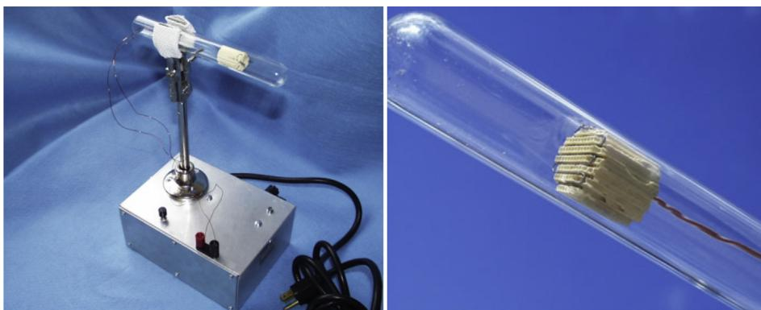  
Fig. 28. Photo of “Acoustic Laser” demo mounted on the box and its core part [137].

A novel configuration was proposed by Kang et al. where a travelling-wave cooler was driven by a cascade thermoacoustic engine [139,140]. The word “cascade” indicates that a travellingwave thermoacoustic cooler was driven by a standing-wave and a travelling-wave thermoacoustic engine in series. As a result, the need for the feedback loop was eliminated and a higher acoustic power transfer was induced. Another novel model was simulated for a thermoacoustic refrigerator driven by a multi-stage thermoacoustic engine, which was claimed to enable lower temperature oscillation and higher efficiency [141].

## 3.4. Thermoacoustic electric generator

Thermoacoustic electric generator began from the thermoacoustic prime mover with liquid metal (sodium) as its working fluid [142], as shown in Fig. 29, in which heat was thermoacoustically converted into acoustic power and the acoustic power was magnetohydrodynamically converted into electric power. The resonator operates in its fundamental mode, so that there is a pressure antinode at each end and a velocity antinode in the center. The acoustic power from stacks and heat exchangers is converted into electric power at the velocity antinode by a magnetohydrodynamic generator. Sodium's extremely low Prandtl number, high density, moderate expansion coefficient, and high electrical conductivity made it possible operating as a novel electric generator and achieving a substantial fraction of Carnot's efficiency. However, the system's efficiency was not attractively high for practical applications.

In past 10 years, thermoacoustic heat engines, especially the travelling-wave ones, have achieved promising heat-to-acoustic conversion efficiencies [143]. In 2004, a travelling-wave thermoacoustic engine was used to generate electricity by integrating it with a linear alternator [144], as shown in Fig. 30. The loop contains the heat exchangers and the duct work necessary for forcing the helium to execute a Stirling-type thermodynamic cycle. Two identical alternators are mounted on the front and the back of the centerplate in a naturally vibration-balanced pair. The first effort achieved a thermal-to-electric conversion efficiency as high as 0.18 where the electric power output $\mathrm { E _ { e l e c } }$ is 39 W. A highest electrical power output of 58 W was achieved at the relative pressure amplitude of 0.098 (peak stroke of 4.5 mm), representing that the efficiencies of thermoacoustic engine, linear alternator and combined system are 0.23, 0.68 and 0.15, respectively. This study introduced a thermodynamic system for the conversion of heat to electricity. The engine/alternator system was characterized by holding the temperature of hot heat exchanger at $6 5 0 ~ ^ { \circ } \mathrm { C }$ and the ambient heat exchanger near $3 0 ~ ^ { \circ } \mathrm { C }$ while varying the stroke of pistons, which effectively changed the amplitude of pressure oscillation.

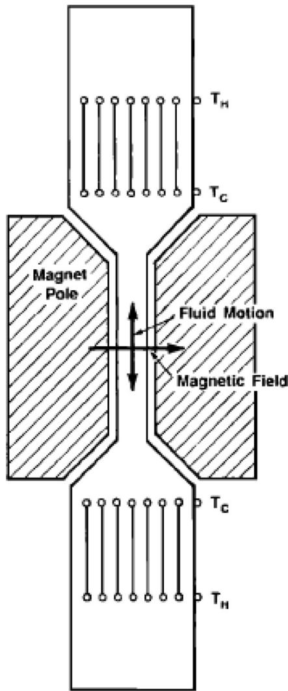  
Fig. 29. Schematic of Swift's liquid-sodium thermoacoustic engine [142].

Castrejon-Pita and Huelsz proposed another kind of thermoa-- coustic electricity generator in 2007 [145]. The heat-to-electricity thermoacoustic-magnetohydrodynamic conversion combined the functions of a thermoacoustic prime mover and a MHD (magnetohydrodynamic) generator. The thermoacoustic prime mover is a Helmholtz resonator filled with air, formed by a spherical cavity and a straight tube which is connected to a U-shaped, cylindrical tube. A conventional MHD Faraday generator is located at the bottom of the U tube. The heating at the bottom of sphere excites the oscillation in the air, and then promotes the oscillatory motion of electrolyte. The oscillatory motion of the electrolyte under the magnetic field generates an alternating electric potential difference at the electrodes. The electricity can be extracted when a load is connected to the electrodes through an external circuit. The heatto-electricity conversion effect was successfully detected from preliminary tests. However, the electrical power was still very minute.

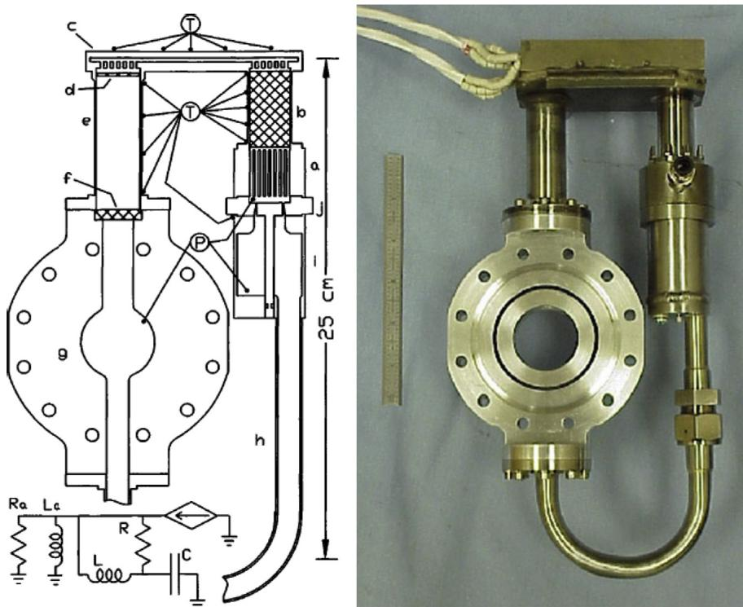  
Fig. 30. Line drawing and photo of the travelling-wave thermoacoustic engine and the analogous lumped-element electrical circuit (inset) [144].

An experimental setup of thermoacoustic electric generator was also built by Luo et al., from which an electricity output of 100 W was achieved [146]. They established a coaxial travelling-wave thermoacoustic engine, i.e., the thermal buffer tube and resistance tube were put inside the regenerator and compliance tube [147]. The cancellation ofloop leads to more compact structure, and the thermal expansion balance problem disappears. In 2011, the reassuring results in the travelling-wave thermoacoustic electricity generator were achieved. A maximum electrical power of 481.0 W was obtained with a thermal-to-electric efficiency of 12.65% [148]. A solar-powered travelling-wave thermoacoustic electricity generator was also reported (shown in Fig. 31) with a maximum electric power of about 200 W [149].

Sun et al. proposed a configuration with a travelling-wave thermoacoustic engine and two linear alternators [150]. An equivalent acoustic circuit of a linear alternator was built for analysis. An electric power of 321.8 W with a thermal-to-electric efficiency of 12.33% was produced at the most efficient point.

A low-cost electricity generator for rural areas using a travellingwave looped-tube thermoacoustic engine was proposed by Jaworski's group [151e153]. The alternator could produce a considerable amount of power with a thermal-to-electric efficiency of 1.3% [154]. The feasibility of its commercial availability was validated by experiments and economic analysis. Waste heat harvesting in rural areas was proposed and some interesting ideas and prototypes have been introduced for practice [155,156].

Efforts on thermoacoustic power conversion with a piezoelectric transducer have been made by a number of groups. Jensen and Raspet simulated a standing-wave thermoacoustic regenerator and 10% of Carnot efficiency was expected [157]. A small prototype was constructed by Smoker et al., which resulted in an output voltage of 0.9 V from a 44.82 W input thermal energy and an acoustic to electric conversion efficiency of 9.7% [158]. Symko from University of Utah did much work on this topic focusing on miniature thermoacoustic engine, which will be presented in Section 3.5.

## 3.5. Miniature thermoacoustic engine

Since late 1990s, several institutions have worked on the miniaturization of thermoacoustic engines. Early effort was included in an American research project named HERETIC (Heat Removal by Thermo-integrated Circuits) supported by the Defense Advanced Research Projects Agency, aiming to develop basic technologies and efficient methodology for cooling and thermal management at the chip level. The thermoacoustic refrigeration section was carried out by Rockwell Science Center [159] and University of Utah [160]. Fig. 32(a) shows a miniature thermoacoustic refrigerator as a spotcooler interfaced with circuit where heat from circuit is pumped to hot heat exchanger anchored thermally at room temperature. The devices vary in length from 4 cm down to 0.8 cm, with frequencies ranging from 4 kHz to 24 kHz. Hofler et al. also reported a thermoacoustic refrigerator for ICs achieving a temperature drop of 12 -C [161].

Symko's group focuses their effort on the miniaturization of thermoacoustic system, aiming for thermal management of electronics [162]. The thermoacoustic heat engines was proposed as a solution to the heat transfer problem in microcircuits, pumping heat or producing spot cooling of specific circuit elements, i.e., a thermoacoustic prime mover converts heat to acoustic energy, or a thermoacoustic cooler or heat pump uses sound to pump heat upon a temperature gradient, as shown in Fig. 32. Such device is relatively simple and readily adaptable to microcircuit interfacing and the operating frequency determines its size since it is usually operated in a resonant mode. The components of the system should be micro-machined.

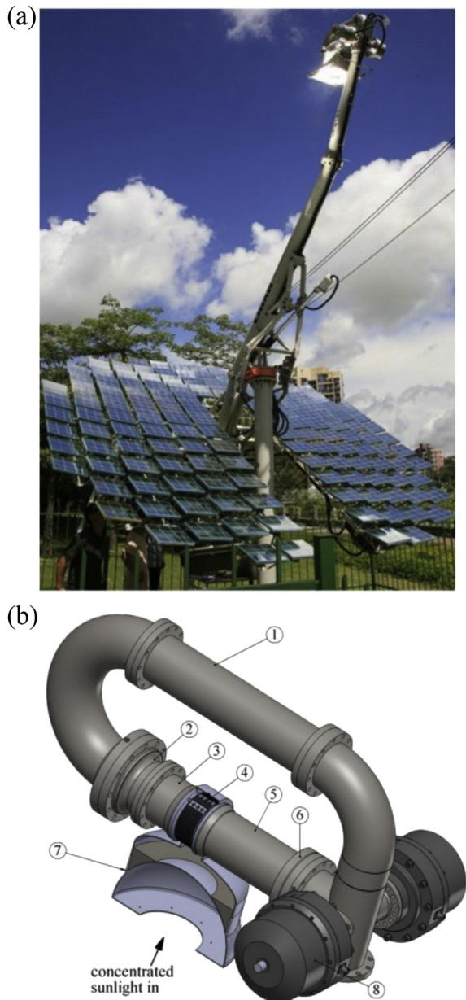  
Fig. 31. Experimental setup of the solar-powered traveling-wave thermoacoustic electricity generator system: (a) photo of the whole system; (b) illustration of the loop and the heat receiver with a section view. 1. feedback tube, 2. main ambient HX, 3. Regenerator, 4. heater block, 5. thermal buffer tube, 6. secondary ambient HX, 7. heat receiver linear alternator [149].

Li's group also built a small-scale cascade thermoacoustic prime mover, which was composed of a standing-wave stage and a travelling-wave stage in series [163]. The total length of the system was about 1.2 m, operating at 470 Hz using helium as the working gas. The onset temperature gradient was about 4.5 K/mm and the peak-to-peak acoustic pressure was 48 kPa at a mean pressure of 2 MPa, with an input heating power of 200 W. Moreover, the onset characteristics of a miniature TASHE were investigated with four kinds of working fluids [164]. Besides, they also made effort on PZT driven thermoacoustic refrigerator, which was operated around 2.2 kHz at the mean pressure ranging from 0.5 MPa to 2 MPa, achieving a maximal temperature drop of 12.3 K [165].

A miniature thermoacoustic prime mover with a variable resonant tube length of 10e25 cm was built by Jin et al. [166]. Experiments on the system's performance, onset temperature, oscillation amplitude and operating frequency showed that the onset temperature can be lower than 100 -C. The structural parameters, including stack position and tube inclination, may also affect the onset temperature. A lowest value can be observed at a proper stack position in a horizontal resonant tube. As to operating frequency, the resonant tube length is its crucial factor, while there is little influence from heat input and stack's position. With a resonant tube length of 10 cm, the measured frequency of the output sound is about 1 kHz.

Jung and Matveev reported the standing-wave thermoacoustic engines with resonators of variable lengths in the range 57e124 mm [167]. The acoustic pressure amplitudes up to 2 kPa were measured inside the resonator in the excited regimes. A small scale Stirling thermoacoustic engine with a resonator of 1 m in length was constructed and tested by Chen and Ju [168]. The pressure ratio reached 1.189 with an average charge pressure of 0.53 MPa and a heating power of 1.14 kW.

## 4. Efforts on application development

The invention of novel thermoacoustic engine prototypes and the inspiring progresses in improving their efficiencies have attracted much attention from industries, thanks to the potential in many practical applications, such as gas liquefaction, food freezing, electronics cooling and electrical power generation. More applications can be expected if these machines can achieve the performance comparable to traditional prime movers and refrigerators.

## 4.1. Thermoacoustic natural gas liquefier

The progresses in the TADPTR attracted wide interest from industry. In 1994, Cryenco, LANL and NIST (National Institute of Standards and Technology) started a cooperative project of developing thermoacoustic natural gas liquefier, powered by heat energy through burning part of natural gas [169] (This R&D project was purchased by Chart in 1997 and then sold to Praxair Inc. in 2001). The first practical thermoacoustic natural gas liquefier prototype (as shown in Fig. 33) was built up in 1998, including a standingwave thermoacoustic engine (with a 12 m-long resonant tube) and an orifice pulse tube refrigerator [170]. The operating pressure and frequency was 3.0 MPa and 40 Hz, respectively. The acoustic power of 12 kW, output from the thermoacoustic prime mover, drove the pulse tube refrigerator to obtain a refrigeration capacity of 2 kW at 130 K, enabling to liquefy about 530 L/d of natural gas. The efficiencies of the thermoacoustic engine and the pulse tube refrigerator reached 25% and 23% of their corresponding Carnot ones, respectively, indicating that the prototype may burn 60% of natural gas to liquefy the rest 40%. The refrigeration capacity of this state-of-the-art cryocooler is about 400 times larger than that of the world first TADPTR established in 1990 by Swift and Radebaugh. This achievement is regarded as a milestone for the practical application of TADPTR.

## 4.2. Space thermoacoustic refrigerator

The STAR was the first electrically-driven thermoacoustic chiller designed to operate autonomously outside a laboratory [100]. It was launched on the Space Shuttle Discovery (STS-42) on January 22, 1992. This thermoacoustic refrigerator was developed and tested at the Naval Postgraduate School in Monterey, CA. The refrigerator was driven by a modified compression driver that was coupled to a quarter-wavelength resonator using a singleconvolution electroformed metal bellow. The STAR was attached to the GAS (Get Away Special) “bridge” that would be placed in the Space Shuttle's Cargo Bay (the closest canister in the figure and the logo (enlarged in right figure) was visible on the thermal insulation blanket). The lid of the canister was not insulated to allow the heat generated by the refrigerator to be exhausted.

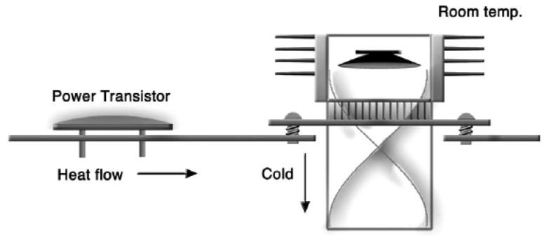  
(a)

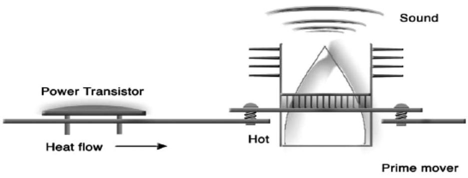

(b)  
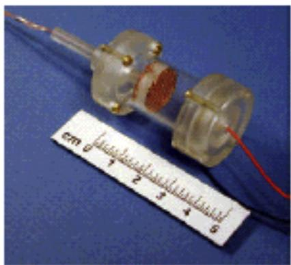  
(c)  
Fig. 32. Symko's miniature thermoacoustic device for heat removal from circuit [160]. (a) (b) refrigerator and its photo, (c) prime mover to convert heat into sound.

## 4.3. Shipboard electronics thermoacoustic chiller (SETAC) [100].

In 1995, the SETAC was used to cool the CV-2095 Radar Azimuth Converter (two racks of electronics) on board the USS Deyo (DD-989), a Spruance-class destroyer in the Atlantic Fleet, as shown in Fig. 34(a). The SETAC started out as a NASA-funded project to replace the Freon 502 vapor-compression Life Sciences Laboratory

Experiment Refrigerator/Freezer (LSLE), installed in the Life Sciences Module on the mid-deck of the Space Shuttle for cold storage of biological samples in the temperature range from 4 to 22 -C. The thermoacoustic replacement for the LSLE was to be the TALSR, which has two electrodynamic loudspeakers driving opposite ends of a half-wavelength resonator that contained two stacks and four internal heat exchangers. With a funding from the US Navy, the TALSR was reborn as the SETAC. Garrett was the principal investigator of the project.

## 4.4. Thermoacoustic freezer [100]

In 2004, Ben & Jerry's announced successful operation of a thermoacoustic ice cream freezer (shown in Fig. 35), which was created by a PSU team led by Garrett. The prototype thermoacoustic chiller had a greater power density than any other electrically driven thermoacoustic refrigerator to that date, with a cooling capacity of 119 W at a temperature of $- 2 4 . 6 ~ ^ { \circ } C .$ The overall COP (defined as the ratio of the cooling capacity to the electrical power consumption) of the chiller is measured to be 0.81, or 19% of the Carnot COP at the capacity and temperature listed above. The thermoacoustic refrigerator was interfaced to a standard ice cream storage cabinet that had the compressor and condenser removed. A commercial prototype (similar to the system shown in Fig. 36) intended for use in a home refrigerator/freezer, based on the SETAC design, was also produced for Coolsound Investments (Pty) Ltd. of Cramerview, South Africa. With the success of the thermoacoustic ice cream freezer, the confidence for household refrigerator should be more than ever.

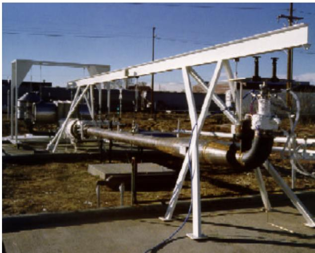  
Fig. 33. First thermoacoustic natural gas liquefier [169].

## 5. Concluding remarks

The invention of thermoacoustic engine has been widely accepted to be a promising revolution for thermal machines. The no-moving-component characteristic is changing the traditional views in both scientific and engineering fields. With the consecutive rise in efficiency, this kind of low-grade energy powered novel thermal machines are approaching to more practical applications. Preliminarily successful prototypes have demonstrated the large potential of thermoacoustic engines. Most of the breakthroughs have been introduced in this review, among which two of the most inspiring examples recently developed lie in the projects including electric power generation.

The increasing progresses have been achieved from both theoretical and experimental studies on thermoacoustic engines. Experiences from the research and development have also resulted in many improvements in related science and technology, such as high intensity acoustic sources and component integration. The thermoacoustically driven pulse tube refrigerator can have achieved a cooling temperature as low as liquid hydrogen temperature, which naturally leads us to dream for a liquid helium temperature. Among the active research all over the world in recent years, the underlying progresses mainly include the newly proposed novel structures, the high-pressure-ratio and high-power-output thermoacoustic prime mover, the efficient refrigeration technology at high frequency, and also the proper matching strategy.

It is particularly worth mentioning that the introduction of multi-stage concept has dramatically decreased the onset temperature and operating temperature at the hot end of the thermoacoustic engine, making the multi-stage “self matching” traveling wave thermoacoustic devices very promising in utilizing low grade heat source. For further study, optimizing the heat exchangers and regenerator is important deployment, and reducing acoustic loss in the acoustic resonance and feedback circuitry are key issues.

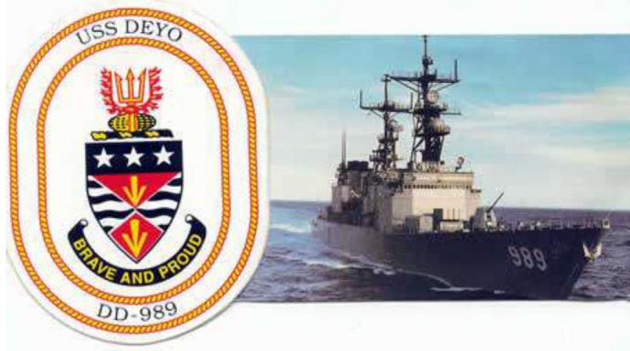

(a) USS Deyo (DD-989)  
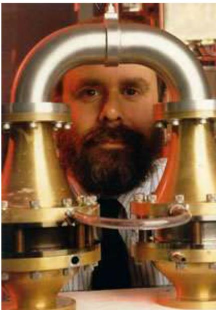

(b) Resonator section  
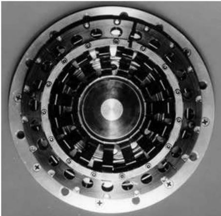  
(c) Loudspeakers section  
Fig. 34. Shipboard electronics ThermoAcoustic chiller (SETAC) for USS Deyo (DD-989) [100].

With great potential to be applied in the future engineering, however, the work on thermoacoustic prime movers and refrigerators is still mainly at the research stage. Many problems should be solved before large scale industrial application. We should be aware that to this date most of the thermoacoustic systems can compete poorly with their traditional counterparts yet, due to the low efficiency or the limit in capacity scale. Further understanding the mechanism of thermoacoustic effects should have high priority in future work. More emphasis should be devoted to understanding nonlinear effects in thermoacoustic systems and to developing nonlinear thermoacoustics. Classical thermoacoustic theory treats dynamic flow and heat transfer with laminar model. However, the oscillating flow inside some components in practical thermoacoustic machines is in a turbulent state. Discussions on fluid flow and heat transfer under oscillating and turbulent flow condition will be instructive for both theoretical and engineering study. To meet the industrial purposes of thermoacoustic system, both larger and smaller scales will be necessary, which will then bring great challenges to both design and fabrication procedures. To improve the thermodynamic efficiency, more efforts should be contributed not only on the optimization of stack, heat exchanger, and resonant tube, but also on other aspects, such as the high acoustic impedance at stack region, the depression of acoustic streaming, the frequency matching, and the working fluids with lower Prandtl Number.

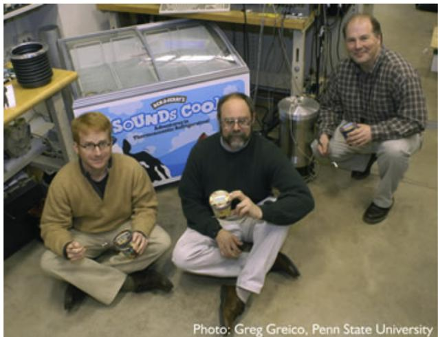

Fig. 35. PSU's research team gathered in front of the Ben & Jerry's thermoacoustic ice cream freezer cabinet [100].  
  
Fig. 36. CSIR straight-prototype during testing at LANL using two of the SETAC drivers attached at either end [100].

## Acknowledgments

This work is financially supported by the National Natural Sciences Foundation of China (No. 51276154, No. 51576170).

## References

[1] Rott N. Thermoacoustics. Adv Appl Mech 1980;20:135e75.

[2] Swift GW. Thermoacoustic engines. J Acoust Soc Am 1988;84(4):1145e80.

[3] Rott N. Thermally driven acoustic oscillations, part III: second-order heat flux. Z Angew Math Phys 1975;26(1):43e9.

[4] Radebaugh R, McDermott KM, Swift GW, Martin RA. Development of a thermoacoustically driven orifice pulse tube refrigerator. In: Proceedings of 4th Interagency Meeting on Cryocoolers, Plymouth. MA, USA; October 24, 1990. p. 205e20.

[5] Putnam AA, Dennis WR. Survey of organ-pipe oscillations in combustion systems. J Acoust Soc Am 1956;28(2):246e59.

[6] Feldman KT. Review of the literature on Sondhauss thermoacoustic phenomena. J Sound Vib 1968;7(1):71e82.

[7] Feldman KT. Review of the literature on Rijke thermoacoustic phenomena. J Sound Vib 1968;7(1):83e9.

[8] Taconis KW, Beenakker JJM, Nier AOC, Aldrich LT. Measurements concerning the vapor-liquid equilibrium of solutions of 3He in 4He. Physica 1949;15: 733e9 [see footnote on p. 738].

[9] Lord Rayleigh. The theory of sound. 2nd ed.vol. 2. New York: Dover; 1945. Sec. 322.

[10] Clement JR, Gaffney J. Thermal oscillations in low-temperature apparatus. Adv Cryog Eng 1954;1:302e6.

[11] Ceperley PH. A pistonless stirling engineethe travelling-wave heat engine. J Acoust Soc Am 1979;66(5):1508e13.

[12] Ceperley PH. Gain and efficiency of a short travelling-wave heat engine. J Acoust Soc Am 1985;77(3):1239e44.

[13] Rott N. Damped and thermally driven acoustic oscillations in wide and narrow tubes. Z Angew Math Phys 1969;20:230e43.

[14] Rott N. Thermally driven acoustic oscillations, part II: stability limit for helium. Z Angew Math Phys 1973;24:54e72.

[15] Rott N, Zouzoulas G. Thermally driven acoustic oscillations, part IV: tubes with variable cross-section. Z Angew Math Phys 1976;27:197e224.

[16] Zouzoulas G, Rott N. Thermally driven acoustic oscillations, part V: gas-liquid oscillations. Z Angew Math Phys 1976;27:325e34.

[17] Rott N. Thermally driven acoustic oscillations, part VI: excitation and power. Z Angew Math Phys 1983;34:609e26.

[18] Wheatley J, Hofler TJ, Swift GW, Migliori A. An intrinsically irreversible thermoacoustic heat engine. J Acoust Soc Am 1983;74(1):153e70.

[19] Backhaus S, Swift GW. A thermoacoustic Stirling heat engine. Nature 1999;399:335e8.

[20] Ceperley PH, U.S. Patent No. 4,114,380 (1978).

[21] Swift GW, Ward WC. Simple harmonic analysis of regenerators. J Thermophys Heat Tr 1996;10:652e62.

[22] Smith BL, Swift GW. Power dissipation and time-averaged pressure in oscillating flow through a sudden area change. J Acoust Soc Am 2003;113(5): 2455e63.

[23] Olson JR, Swift GW. Similitude in thermoacoustics. J Acoust Soc Am 1994;95(3):1405e12.

[24] Ward WC, Swift GW. Design environment for low-amplitude thermoacoustic engines. J Acoust Soc Am 1994;95(6):3671e2.

[25] Watanabe M, Prosperetti A, Yuan H. A simple model for linear and nonlinear processes in thermoacoustic prime movers, part I: model and linear theory. J Acoust Soc Am 1997;102(6):3484e96.

[26] Yuan H, Karpov S, Prosperetti A. A simple model for linear and nonlinear processes in thermoacoustic prime movers, part II: nonlinear oscillations. J Acoust Soc Am 1997;102(6):3497e506.

[27] Karpov S, Prosperetti A. Nonlinear saturation of the thermoacoustic instability. J Acoust Soc Am 2000;107(6):3130e47.

[28] Karpov S, Prosperetti A. A nonlinear model of thermoacoustic devices. J Acoust Soc Am 2002;112(4):1431e44.

[29] Ma DY. Theory and nonlinearity of thermoacoustics: II. Nonlinear sound waves in thermoacoustic tubes. Ch J Acoust 1999;18(4):289e303.

[30] Hamilton MF, Ilinski YA, Zabolotskaya FA. Nonlinear two-dimensional model for thermoacoustic engines. J Acoust Soc Am 2002;111(5):2076e86.

[31] Nijeholt JALA, Tijani MEH, Spoelstra S. Simulation of a travelling-wave thermoacoustic engine using computational fluid dynamics. J Acoust Soc Am 2005:118(4):2265–70

[32] Swift GW. Analysis and performance of a large thermoacoustic engine. J Acoust Soc Am 1992;92(3):1551e63.

[33] Arnott WP, Bass HE, Raspet R. Specific acoustic impedance measurements of an air-filled thermoacoustic prime mover. J Acoust Soc Am 1992;92(6): 3432e4.

[34] Arnott WP, Belcher JR, Raspet R, Bass HE. Stability analysis of a helium-filled thermoacoustic engine. J Acoust Soc Am 1994;96(1):370e5.

[35] Kordomenos J, Atchley AA, Raspet R, Bass HE. Experimental study of a thermoacoustic termination of a travelling-wave tube. J Acoust Soc Am 1995;98(3):1623e8.

[36] Lightfoot JA, Arnott WP, Bass HE, Raspet R. Experimental study of a radial mode thermoacoustic prime mover. J Acoust Soc Am 1999;105(5): 2652e62.

[37] Garrett SL, Backhaus S. The power of sound. Am Sci 2000;88:516e25.

[38] Chen RL, Garrett SL. Solar/heat-driven thermoacoustic engine. J Acoust Soc Am 1998;103(5):2841.

[39] Zhou SL, Matsubara Y. Experimental research of thermoacoustic prime mover. Cryogenics 1998;38(8):813e22.

[40] Sugita H, Matsubara Y, Kushino A, Ohnishi T, Kobayashi H, Dai W. Experimental study on thermally actuated pressure wave generator for space cryocooler. Cryogenics 2004;44(6e8):431e7.

[41] Jin T. Investigation on thermoacoustic prime movers and their applications to pulse tube refrigeration [Ph.D. Dissertation]. China: Zhejiang University; 2001.

[42] Chen GB, Jin T. Experimental investigation on the onset and damping behavior of the oscillation in a thermoacoustic prime mover. Cryogenics 1999;39(10):843e6.

[43] Bao R, Chen GB, Tang K, Jia ZZ, Cao WH. Influence of resonance tube geometry shape on performance of thermoacoustic engine. Ultrasonics 2006;44:1519e21.

[44] Qiu LM, Lai BH, Li YF, Sun DM. Numerical simulation of the onset characteristics in a standing-wave thermoacoustic engine based on thermodynamic analysis. Int J Heat Mass Tran 2012;55(7):2200e3.

[45] Qiu LM, Lai BH, Zhao YT, Sun DM, Zhang XJ, Li YF. Study on the onset temperature of a standing-wave thermoacoustic engine based on circuit network theory. Sci China Technol S. C 2009;55(10):2864e8.

[46] Qiu LM, Lou P, Wang K, Wang B, Sun DM, Rao JF, et al. Characteristics of onset and damping in a standing-wave thermoacoustic engine driven by liquid nitrogen. Chin Sci Bull 2013;58(11):1325e30.

[47] Tang K, Lei T, de Waele ATAM, Jin T. Basic analysis on a thermoacoustic engine with gas and liquid. J Appl Phys 2011;109(7). 074907-074907-7.

[48] Tang K, Lei T, Lin XG, Jin T, Zhang Y. Lumped parameter model for resonant frequency estimation of a thermoacoustic engine with gas-liquid coupling oscillation. J Zhejiang Univ-Sc A 2011;12(3):232e7.

[49] Tang K, Lei T, Jin T, Lin XG, Xu ZZ. A standing-wave thermoacoustic engine with gas-liquid coupling oscillation. Appl Phys Lett 2009;94(25). 254101- 254101-3.

[50] Tang K, Lei T, Jin T. Influence of working liquid on the onset characteristics of a thermoacoustic engine with gas and liquid. J Appl Phys 2012;112(9). 094909-094909-7.

[51] Yu GY, Wang XT, Dai W, Luo EC. Study on energy conversion characteristics of a high frequency standing-wave thermoacoustic heat engine. Appl Energ 2013;111:1147e51.

[52] Yang DKW, Abakr YA, Ghazali NM. Experimental investigations on the effects of coiling and bends on the sound energy losses through a resonator tube. Procedia Eng 2013;56:842e8.

[53] He YL, Ke HB, Cui FQ, Tao WQ. Explanations on the onset and damping behaviors in a standing-wave thermoacoustic engine. Appl Therm Eng 2013;58(1e2):298e304.

[54] Pan N, Wang SF, Shen C. Visualization investigation of the flow and heat transfer in thermoacoustic engine driven by loudspeaker. Int J Heat Mass Tran 2012;55(25e26):7737e46.

[55] Shi L, Yu ZB, Jaworski AJ. Application of laser-based instrumentation for measurement of time-resolved temperature and velocity fields in the thermoacoustic system. Int J Therm Sci 2010;49(9):1688e701.

[56] Shi L, Mao XN, Jaworski AJ. Application of planar laser-induced fluorescence measurement techniques to study the heat transfer characteristics of parallel-plate heat exchangers in thermoacoustic devices. Meas Sci Technol 2010;21(11). 115405.

[57] Jaworski AJ, Piccolo A. Heat transfer processes in parallel-plate heat exchangers of thermoacoustic devicesenumerical and experimental approaches. Appl Therm Eng 2012;42:145e53.

[58] Yazaki T, Iwata A, Maekawa T, Tominaga A. Travelling-wave thermoacoustic engine in a looped tube. Phys Rev Lett 1998;81(15):3128e31.

[59] Penelet G, Gaviot E, Gusev V, Lotton P, Bruneau M. Experimental investigation of transient nonlinear phenomena in an annular thermoacoustic primemover: observation of a double-threshold effect. Cryogenics 2002;42(9): 527e32.

[60] Gusev V, Job S, Bailliet H, Lotton P, Bruneau M. Acoustic streaming in annular thermoacoustic prime-movers. J Acoust Soc Am 2000;108(3):934e45.

[61] Gusev V, Job S, Lotton P, Bailliet H, Bruneau M. Theory of acoustic streaming in annular thermoacoustic prime-mover. In: Nonlinear Acoustics at the Turn of the Millennium: 15th International Symposium on Nonlinear Acoustics, Gottingen, Germany, 1-4 September 1999; AIP conference proceedings No.€ 524; 2000. p. 235e8.

[62] Penelet G, Guedra M, Gusev V, Devaux T. Simplified account of Rayleigh streaming for the description of nonlinear processes leading to steady state sound in thermoacoustic engines. Int J Heat Mass Tran 2012;55(21e22): 6042e53.

[63] Penelet G, Guedra M, Gusev V. Account of heat convection by Rayleigh streaming in the description of wave amplitude growth and stabilization in a standing-wave thermoacoustic prime-mover. Nonlinear Acoust State-of-the-Art Perspect 2012;1474:292e5.

[64] Backhaus S, Swift GW. A thermoacoustic-Stirling heat engine: detailed study. J Acoust Soc Am 2000;107(6):3148e66.

[65] de Waele ATAM. Basic treatment of onset conditions and transient effects in thermoacoustic Stirling engines. J Sound Vib 2009;325(4):974e88.

[66] Swift GW, Gardner DL, Backhaus S. Acoustic recovery of lost power in pulse tube refrigerators. J Acoust Soc Am 1999;105(2):711e24.

[67] Olson JR, Swift GW. Acoustic streaming in pulse tube refrigerators: tapered pulse tubes. Cryogenics 1997;37(12):769e76.

[68] Gardner DL, Swift GW. A cascade thermoacoustic engine. J Acoust Soc Am 2003;114(4):1905e19.

[69] Liu HD, Luo EC, Liang JT, Zhou Y. Experimental travelling thermoacoustic engine. Cryogenics 2000;3:23e8 [in Chinese].

[70] Yu GY, Luo EC, Dai W, Wu ZH. An energy-focused thermoacoustic-Stirling heat engine reaching a high pressure ratio above 1.40. Cryogenics 2007;47(2):132e4.

[71] Dai W, Luo EC, Hu JY, Chen YY. A novel coupling configuration for thermoacoustically driven pulse tube coolers: acoustic amplifier. Chin Sci Bull 2005;50(18):2114e22.

[72] Luo EC, Hu JY, Dai W, Chen YY. An acoustical pump capable of significantly increasing pressure ratio of thermoacoustic heat engines. Chin Sci Bull 2006;51(8):1014e6.

[73] Tang K, Huang ZJ, Jin T, Chen GB. Influence of acoustic pressure amplifier dimensions on the performance of a standing-wave thermoacoustic system. Appl Therm Eng 2009;29(5):950e6.

[74] Jin T, Bretagne E, Chen GB, Francois MX. Experimental study of a travellingwave thermoacoustic prime mover. Acta Acust United Ac 2003;28(4): 375e80.

[75] Sun DM, Qiu LM, Zhang W, Yan WL, Chen GB. Investigation on travellingwave thermoacoustic heat engine with high pressure amplitude. Energ Convers Manage 2005;46(2):281e91.

[76] Qiu LM, Sun DM, Yan WL, Chen P, Gan ZH, Zhang X, et al. Investigation on a thermoacoustically driven pulse tube cooler working at 80 K. Cryogenics 2005;45(5):380e5.

[77] Sun DM, Qiu LM, Wang B, Xiao Y. Novel Helmholtz resonator used to focus acoustic energy of thermoacoustic engine. Appl Therm Eng 2009;29(5): 945e9.

[78] Tang K, Feng Y, Jin SH, Jin T, Li M. Performance comparison ofjet pumps with rectangular and circular tapered channels for a loop-structured travelingwave thermoacoustic engine. Appl Energ 2015;148:305e13.

[79] Biwa T, Ueda Y, Yazaki T, Mizutani U. Thermodynamical mode selection rule observed in thermoacoustic oscillations. Europhys Lett 2002;60(3):363e8.

[80] Biwa T, Tashiro Y, Ishigaki M, Ueda Y, Yazaki T. Measurements of acoustic streaming in a looped-tube thermoacoustic engine with a jet pump. J Appl Phys 2007;101(6). 064914.

[81] Biwa T, Hasegawa D, Yazaki T. Low temperature differential thermoacoustic Stirling engine. Appl Phys Lett 2010;97(3):034102e3.

[82] Biwa T, Komatsu R, Yazaki T. Acoustical power amplification and damping by temperature gradients. J Acoust Soc Am 2011;129(1):132e7.

[83] de Blok K. Novel 4-stage travelling-wave thermoacoustic power generator. Proc ASME Fluids Eng Div Summer Conf 2010;2:73e9.

[84] de Blok K. Multi-stage traveling wave thermoacoustics in practice. In: Proceedings of the 19th International Congress on Sound and Vibration, Vilnius, Lithuania; 2012. p. 1e8.

[85] Li DH, Zhang LM, Wu ZH, Luo EC. Numerical simulation and experimental investigation of a gas-liquid, double-acting travelling-wave thermoacoustic heat engine. Int J Energ Res 2013;37(15):1963e70.

[86] Kang HF, Cheng P, Yu ZB, Zheng HF. A two-stage travling-wave thermoacoustic electric generator with loudspeaker as alternators. Appl Energ 2015;137:9e17.

[87] Abduljalil AS, Yu ZB, Jaworski AJ. Selection and experimental evaluation of low-cost porous materials for regenerator applications in thermoacoustic engines. Mater Des 2011;32(1):217e28.

[88] Yu ZB, Jaworski AJ, Abduljalil AS. Fishbone-like instability in a looped-tube thermoacoustic engine. J Acoust Soc Am 2010;128(4):E188e94.

[89] Abduljalil AS, Yu ZB, Jaworski AJ. Design and experimental validation of looped-tube thermoacoustic engine. J Therm Sci 2011;20(5):423e9.

[90] Nakano Y, Sakamoto SI. Study on thermoacoustic system to drive by low temperature: effects of loop-tube thermoacoustic system connected with parallel double stacks on the onset temperature ratio. J Acoust Soc Am 2013;133(5):3232.

[91] Ueda Y, Kato C. Stability analysis of thermally induced spontaneous gas oscillations in straight and looped tubes. J Acoust Soc Am 2008;124(2): 851e8.

[92] Zink F, Vipperman JS, Schaefer LA. Environmental motivation to switch to thermoacoustic refrigeration. Appl Therm Eng 2010;30(2):119e26.

[93] Piccolo A. Optimization of thermoacoustic refrigerators using second law analysis. Appl Energ 2013;103:358e67.

[94] Kang H, Li Q, Zhou G. Synthetical optimization of hydraulic radius and acoustic field for thermoacoustic cooler. Energ Convers Manage 2009;50(8): 2098e105.

[95] Tasnim SH, Mahmud S, Fraser RA. Effects of variation in working fluids and operating conditions on the performance of a thermoacoustic refrigerator. Int Commun Heat Mass 2012;39(6):762e8.

[96] Ke HB, Liu YW, He YL, Wang Y, Huang J. Numerical simulation and parameter optimization of thermo-acoustic refrigerator driven at large amplitude. Cryogenics 2010;50(1):28e35.

[97] Zink F, Vipperman J, Schaefer L. CFD simulation of thermoacoustic cooling. Int J Heat Mass Tran 2010;53(19):3940e6.

[98] Hofler TJ. Thermoacoustic refrigerator design and performance. PhD Dissertation. Physics Department, University of California at San Diego; 1986

[99] Tijani MEH, Zeegers JCH, de Waele ATAM. Construction and performance of a thermoacoustic refrigerator. Cryogenics 2002;42(1):59e66.

[100] http://www.acs.psu.edu/thermoacoustics/refrigeration/.

[101] Garrett SL, Adeff JA, Hofler TJ. Thermoacoustic refrigerator for space application. J Thermophys Heat Tr 1993;7(4):595e9.

[102] Garrett SL, Gaitan DF, Perkins DK, et al. Thermoacoustic life sciences refrigerator. J Acoust Soc Am 1993;93(4):2364.

[103] Ballister S, McKelvey D. Shipboard electronics thermoacoustic cooler. J Acoust Soc Am 1995;98(6):3540.

[104] Adeff JA, Hofler TJ. Design and construction of a solar powered, thermoacoustically driven thermoacoustic refrigerator. J Acoust Soc Am 2000;107(6): L37e42.

[105] Tu Q, Gusev V, Bruneau M, Zhang CP, Zhao L, Guo FZ. Experimental and theoretical investigation on frequency characteristic of loudspeaker-driven thermoacoustic refrigerator. Cryogenics 2005;45(12):739e46.

[106] Lihoreau B, Lotton P, Bruneau M, Gusev V. Piezoelectric source exciting thermoacoustic resonator: analytical modelling and experiment. Acta Acust United Ac 2002;88(6):986e97.

[107] Poignand G, Lihoreau B, Lotton P, Gaviot E, Bruneau M, Gusev V. Optimal acoustic fields in compact thermoacoustic refrigerators. Appl Acoust 2007;68(6):642e59.

[108] Poignand G, Podkovskiy A, Penelet G, Lotton P. Analysis of a coaxial, compact thermoacoustic heat-pump. Acta Acust United Ac 2013;99(6):898e904.

[109] Poignand G, Lotton P, Penelet G, Bruneau M. Small cavity excitation to achieve optimal performance. Acta Acust United Ac 2011;97(6):926e32.

[110] Blanc-Benon P, Besnoin E, Knio OM. Experimental and computational visualization of the flow field in a thermoacoustic stack. Cr Mec 2003;331(1): 17e24.

[111] Lotton P, Blanc-Benon P, Bruneau M, Gusev V, Duffourd S, Mironov M, et al. Transient temperature profile inside thermoacoustic refrigerators. Int J Heat Mass Tran 2009;52(21):4986e96.

[112] Berson A, Poignand G, Blanc-Benon P, Comte-Bellot G. Nonlinear temperature field near the stack ends of a standing-wave thermoacoustic refrigerator. Int J Heat Mass Tran 2011;54(21):4730e5.

[113] Blanc-Benon P, Poignand G, Jondeau E. Investigation of the acoustic field in a standing-wave thermoacoustic refrigerator using time-resolved particule image velocimetry. Nonlinear Acoust State-of-the-Art Perspect 2012;1474: 288e91.

[114] Zhu SW, Wu PY, Chen ZQ. Double inlet pulse tube refrigerator-an important improvement. Cryogenics 1990;30(6):514e20.

[115] Yazaki T, Biwa T, Tominaga A. A pistonless Stirling cooler. Appl Phys Lett 2002;80(1):157e9.

[116] Ueda Y, Mehdi BM, Tsuji K, Akisawa A. Optimization of the regenerator of a travelling-wave thermoacoustic refrigerator. J Appl Phys 2010;107(3): 034901e5.

[117] Bassem MM, Ueda Y, Akisawa A. Design and construction of a travellingwave thermoacoustic refrigerator. Int J Refrig 2011;34(4):1125e31.

[118] Luo EC, Huang Y, Dai W, Zhang Y, Wu ZH. A high-performance thermoacoustic refrigerator operating in room-temperature range. Chin Sci Bull 2005;50(22):2662e4.

[119] Luo EC, Dai W, Zhang Y, Ling H. Experimental investigation of a thermoacoustic-Stirling refrigerator driven by a thermoacoustic-Stirling heat engine. Ultrasonics 2006;44:1531e3.

[120] Inoue M, Sakamoto SI. The effect of resonance mode control by expanding of cross-section area on cooling capacity in a loop-tube type thermoacoustic cooling system. J Acoust Soc Am 2013;133(5):3232.

[121] Sakamoto S, Shibata K, Kitadani Y, Inui Y, Watanabe Y. One factor of resonant wavelength shift from one-wavelength to two-wavelength resonance in loop-tube-type thermoacoustic cooling system. Int Congr Ultrasonics 2012;1433:628e31.

[122] Sahashi K, Sakamoto S, Watanabe Y. Fundamental study for a working mechanism of phase adjuster set on thermoacoustic cooling system. Int Congr Ultrasonics 2012;1433:613e9.

[123] Godshalk K, Jin C, Kwong YK, Hershberg EL, Swift GW, Radebaugh R. Characterization of 350 Hz thermoacoustic driven orifice pulse tube refrigerator with measurements of the phase of the mass flow and pressure. Adv Cryog Eng 1996;41:1411e8.

[124] Jin T, Chen GB, Shen Y. A thermoacoustically driven pulse tube refrigerator capable of working below 120 K. Cryogenics 2001;41(8):595e601.

[125] Tang K, Bao R, Chen GB, Qiu Y, Shou L, Huang ZJ, et al. Thermoacoustically driven pulse tube cooler below 60 K. Cryogenics 2007;47(9e10): 526e9.

[126] Jin T, Chen GB, Wang BR, Zhang SY. Application of thermoacoustic effect to refrigeration. Rev Sci Instrum 2003;74(1):677e9.

[127] Bao R, Chen GB, Tang K, Cao WH, Jin T. Thermoacoustically driven pulse tube refrigeration below 80 K by introducing an acoustic pressure amplifier. Appl Phys Lett 2006;89:211915e22.

[128] Tang K, Chen GB, Jin T, Bao R, Kong B, Qiu LM. Influence of resonance tube length on performance of thermoacoustically driven pulse tube refrigerator. Cryogenics 2005;45(3):185e91.

[129] Tang K, Chen GB, Jin T, Bao R, Li XM. Performance comparison of thermoacoustic engines with constant-diameter resonant tube and tapered resonant tube. Cryogenics 2006;46(10):699e704.

[130] Hu JY, Luo EC, Dai W, Zhou Y. A heat-driven thermoacoustic cryocooler capable of reaching below liquid hydrogen temperature. Chin Sci Bull 2007;52(4):574e6.

[131] Zhu SL, Yu GY, Dai W, Luo EC, Wu ZH, Zhang XD. Characterization of a 300 Hz thermoacoustically-driven pulse tube cooler. Cryogenics 2009;49(1):51e4.

[132] Yu GY, Wang XT, Dai W, Luo EC. Study on cold head structure of a 300 Hz thermoacoustically driven pulse tube cryocooler. Cryogenics 2012;52: 212e5.

[133] Wang XT, Yu GY, Dai W, Luo EC, Zhou Y. Influence of acoustic pressure amplifier tube on a 300 Hz thermoacoustically driven pulse tube cooler. J Appl Phys 2010;108(7). 074905e5.

[134] Yu GY, Wang XT, Dai W, Luo EC. A high frequency thermoacoustically-driven pulse tube cryocooler with coaxial resonator. Adv Cryog Eng 2010;1218: 191e8.

[135] Yu GY, Luo EC, Dai W. Advances in a 300 Hz thermoacoustic cooler system working within liquid nitrogen temperature range. Cryogenics 2010;50(8): 472e5.

[136] Chen RL, Garrett SL. A large solar/heat-driven thermoacoustic cooler. J Acoust Soc Am 2000;108(5):2554.

[137] Baringer P, Jung C, Ogren HO, Rust DR. A drift chamber constructed of aluminized mylar tubes. Nucl Instrum Methods Phys Res Sect A Accel Spectrom Detect Assoc Equip 1987;254(3):542e8.

[138] Yu B, Luo EC, Li SF, Dai W, Wu ZH. Experimental study of a thermoacoustically-driven travelling-wave thermoacoustic refrigerator. Cryogenics 2011;51(1):49e54.

[139] Kang HF, Jiang F, Zheng HF, Jaworski AJ. Thermoacoustic travelling-wave cooler driven by a cascade thermoacoustic engine. Appl Therm Eng 2013;59(1e2):223e31.

[140] Kang HF, Zhou G, Li Q. Heat driven thermoacoustic cooler based on travelling-standing wave. Energ Convers Manage 2010;51(11):2103e8.

[141] Hasegawa S, Yamaguchi T, Oshinoya Y. A thermoacoustic refrigerator driven by a low temperature-differential, high-efficiency multistage thermoacoustic engine. Appl Therm Eng 2013;58(1e2):394e9.

[142] Swift GW. A liquid metal magnetohydrodynamic acoustic transducer. J Acoust Soc Am 1988;83(1):350e61.

[143] Jaworski AJ, Mao XA. Development of thermoacoustic devices for power generation and refrigeration. Proc Institution Mech Eng Part A-Journal Power Energy 2013;227(7):762e82.

[144] Backhaus S, Tward E, Petach M. Travelling-wave thermoacoustic electric generator. Appl Phys Lett 2004;85(6):1085e7.

[145] Castrejon-Pita AA, Huelsz G. Heat-to-electricity thermoacousticmagnetohydrodynamic conversion. Appl Phys Lett 2007;90(17):174110.

[146] Luo EC, Wu ZH, Dai W, Li SF, Zhou YA. 100 W-class travelling-wave thermoacoustic electricity generator. Chin Sci Bull 2008;53(9):1453e6.

[147] Yang M, Luo EC, Li XM, Chen GB, Ling H, Wu JF. Experimental study on a coaxial travelling-wave thermoacoustic engine. In: Proceedings of ICCR'2003. Hangzhou, China: International Academic Publishers; 2003. p. 132e5.

[148] Wu ZH, Man M, Luo EC, Dai W, Zhou Y. Experimental investigation of a 500 W travelling-wave thermoacoustic electricity generator. Chin Sci Bull 2011;56(19):1975e7.

[149] Wu ZH, Dai W, Man M, Luo EC. A solar-powered travelling-wave thermoacoustic electricity generator. Sol Energy 2012;86(9):2376e82.

[150] Sun DM, Wang K, Zhang XJ, Guo YN, Xu Y, Qiu LM. A travelling-wave thermoacoustic electric generator with a variable electric RC load. Appl Energ 2013;106:377e82.

[151] Yu Z, Jaworski AJ, Backhaus S. A low-cost electricity generator for rural areas using a travelling-wave looped-tube thermoacoustic engine. Proc Institution Mech Eng Part A J Power Energy 2010;224(6):787e95.

[152] Yu Z, Saechan P, Jaworski AJ. A method of characterising performance of audio loudspeakers for linear alternator applications in low-cost thermoacoustic electricity generators. Appl Acoust 2011;72(5):260e7.

[153] Yu ZB, Jaworski AJ, Backhaus S. Design of a low-cost thermoacoustic electricity generator and its experimental verification. Proc ASME 10th Bienn Conf Eng Syst Des Analysis 2010;1:191e9.

[154] Yu Z, Jaworski AJ, Backhaus S. Travelling-wave thermoacoustic electricity generator using an ultra-compliant alternator for utilization of low-grade thermal energy. Appl Energ 2012;99:135e45.

[155] Chen BM, Riley PH, Abakr YA, Pullen K, Hann DB, Johnson CM. Design and development of a low-cost, electricity-generating cooking Score-Stove™. Proc Institution Mech Eng Part A J Power Energy 2013;227(7):803e13.

[156] Chen BM, Abakr YA, Riley PH, Hann DB. Development of thermoacoustic engine operating by waste heat from cooking stove. In: 4th International Meeting of Advances in Thermofluids Pt 1 and 2vol. 1440; 2012. p. 532e40.

[157] Jensen C, Raspet R. Thermoacoustic power conversion using a piezoelectric transducer. J Acoust Soc Am 2010;128:98e103.

[158] Smoker J, Nouh M, Aldraihem O, Baz A. Energy harvesting from a standingwave thermoacoustic-piezoelectric resonator. J Appl Phys 2012;111(10): 104901e11.

[159] Tsai CL, Chen RL, Chen CL, DeNatale J. Micro-machined stack component for miniature thermoacoustic refrigerator. In: Proceedings of 15th IEEE International Conference on Micro-Electro-Mechanical Systems, Piscataway, NJ; 2002. p. 149e51.

[160] Symko OG, Abdel-Rahman E, Kwon YS, Emmi M, Behunin R. Design and development of high-frequency thermoacoustic engines for thermal management in microelectronics. Microelectron J 2004;35(2):185e91.

[161] T.J. Hofler, J.A. Adeff, A miniature thermoacoustic refrigerator for ICs. Proceedings of 17th International Congress on Acoustics, Roma, Italy, Sept. 2e7, 2001; 4B.02.01.

[162] Andersen BJ, Symko OG. Helmholtz-like resonators for thermoacoustic prime movers. J Acoust Soc Am 2009;125:787e92.

[163] Hu ZJ, Li Q, Li Q, Li ZY. A high frequency cascade thermoacoustic engine. Cryogenics 2006;46(11):771e7.

[164] Huang X, Zhou G, Li Q. Thermodynamic analysis of onset characteristics in a miniature thermoacoustic Stirling engine. J Therm Sci 2013;22(3):216e22.

[165] Hu P, Li Q, Li ZY, Li Q. Investigation on a miniature thermoacoustic refrigerator. Cryogenics 2007;3:25e8 [in Chinese].

[166] Jin T, Zhang BS, Tang K, Bao R, Chen GB. Experimental observation on a small-scale thermoacoustic prime mover. J Zhejiang Univ-Sc A 2007;8(2): 205e9.

[167] Jung S, Matveev KI. Study of a small-scale standing-wave thermoacoustic engine. Proc Institution Mech Eng Part C J Mech Eng Sci 2010;224(1): 133e41.

[168] Chen M, Ju YL. Design and experimental investigations on a small scale travelling-wave thermoacoustic engine. Cryogenics 2012;54:10e5.

[169] Swift GW. Thermoacoustic natural gas liquefier. Houston: DOE Natural Gas Conference; 1997. p. 1e5.

[170] Wollan JJ, Swift GW, Backhaus S, Gardner DL. Development of a thermoacoustic natural gas liquefier. Proceedings of AIChE New Orleans Meeting, New Orleans, LA, USA, March 11-14, 2002; 1e8.
